# Elite Group Coaching - Transcripts
**Formateur :** Michael Breen | **ID :** `michael-breen-elite-group-coaching-transcripts` | **Tranches :** 100

# Synthèse Architecturale du Cours : *Elite Group Coaching* (Michael Breen)

---

### 1. Thèse Centrale & Philosophie du Cours

#### Vision spécifique & Posture face à l'approche PNL standard
Là où la PNL académique et commerciale s’est embourbée dans le fétichisme technique (protocoles rigides en $N$ étapes, scripts mémorisés, micro-indices oculaires décontextualisés et réification dogmatique du modèle), Michael Breen adopte une posture d'**ingénierie cybernétique et d'artisanat opératoire direct**.
* **L’outil comme simple tournevis :** La PNL ne détient aucune vérité ontologique ; elle n'est ni vraie ni fausse, elle est purement instrumentale. Dès qu'un praticien prétend que la PNL décrit la « réalité », il perd sa flexibilité cognitive.
* **Le rejet du piège de l'intellectualisation (*The U-Word / Understanding*) :** Le besoin d’« intellectuellement comprendre » est un frein moteur d'origine académique. Le système nerveux n'est pas conçu pour stocker des explications logiques mais pour reconnaître des régularités (*patterns*) et agir (*to move and pattern*). Chercher à comprendre retarde le geste opératoire et crée de la friction.
* **L’illusion du pilotage conscient (*Arse end of perception*) :** Le conscient n'est pas aux commandes : il arrive « en bout de chaîne », après que les filtres neurologiques, la reconnaissance de motifs et l'arc réflexe ont déjà pris la décision. Travailler sur l'explication consciente revient à commenter une balle de tennis qui a déjà franchi le filet.
* **Refus de la « conspiration douillette » (*Cozy Conspiracy*) :** Le client qui récite son problème est engagé dans une répétition hypnotique active. Si le praticien acquiesce (« Tu vois ce que je veux dire ? »), il entre en transe partagée et hallucine l'impasse avec le sujet. L'intervenant doit rester hors de transe ou imposer un cadre cybernétique supérieur.

#### Le fil rouge méthodologique
Le cœur de la méthode Breen repose sur une dynamique unifiée : **Extraire l'expérience de la nominalisation et de la généralisation décontextualisée pour la réinjecter dans un circuit sensori-moteur à boucle courte (TOTE).**
Toute intervention suit ce cheminement :
1. *Dégel linguistique & Déconstruction des règles du jeu* (Méta-Modèle radical, restauration de la forme verbale, rupture des équivalences complexes limitantes).
2. *Restauration de la tolérance somatique à la confrontation* (*Confront Level*, passage immédiat à l'action motrice externe pour vider la boucle mentale abstraite).
3. *Installation de momentum ascendant* (*Bottom-Up Momentum*, micro-répétitions denses, compétition synaptique par saillance et fréquence plutôt que par catharsis adrénergique éphémère).

---

### 2. Carte des Concepts & Leviers Émergents

L'écosystème conceptuel de Breen s'articule autour de quatre pôles d'ingénierie cognitive :

```mermaid
flowchart TD
    subgraph Architecture_Neurologique["1. Neurobiologie & Cybernétique"]
        N1["Épaisseur axonale / Répétition"]
        N2["Illusion volitionnelle (Arse end)"]
        N3["Suppression d'échafaudage contextuel"]
        N4["Effet Entonnoir du Trigger"]
        N5["Compétition de dominance du signal"]
    end

    subgraph Epistemologie_Linguistique["2. Épistémologie & Modélisation Linguistique"]
        L1["Anti-intellectualisme (The U-Word)"]
        L2["Dénominalisation opératoire"]
        L3["Règles du Jeu (Game Rules)"]
        L4["Réponse sémantique conditionnée"]
        L5["Neutralité de l'univers vs Dilemme"]
    end

    subgraph Dynamique_Action["3. Dynamique Motrice & Régulation Somatique"]
        A1["Niveau de confrontation (Confront Level)"]
        A2["Prototypage rapide sous contrainte"]
        A3["Ancrage kinesthésique (Ball Game)"]
        A4["Streamlining & Anti-homéostasie"]
        A5["Reconstruction à zéro (Zero-Based)"]
    end

    subgraph Boucles_Installation["4. Stratégies d'Apprentissage & Installation"]
        B1["TOTE vs Syndrome Apprenti Sorcier"]
        B2["Compliance adrénergique vs Vraie généralisation"]
        B3["Momentum ascendant (Bottom-Up)"]
        B4["Pattern Ice Cream (Anticipatory Appetite)"]
        B5["Rituel de complétion & Convinceurs"]
    end

    Architecture_Neurologique --> Epistemologie_Linguistique
    Epistemologie_Linguistique --> Dynamique_Action
    Dynamique_Action --> Boucles_Installation
```



#### Rôle des mécanismes dans l'écosystème :

1. **Suppression de l'Échafaudage Contextuel (*Removal of Scaffolding*) & Effet Entonnoir (*Funnel Effect*) :**
   * *Rôle :* Explique la genèse de la névrose et des blocages. Pour économiser de l'énergie, le cerveau efface l'évaluation subjective et le contexte d'origine pour ne garder qu'un automatisme $Trigger \rightarrow Response$. L'extrémité réceptrice s'élargit avec le temps, déclenchant l'état limitant pour un éventail de stimuli toujours plus vague.
2. **Niveau de Confrontation (*Confront Level*) & Dérive par Confort Somatique :**
   * *Rôle :* Explique la procrastination et l'inertie. Face à un pic d'inconfort social/financier, l'individu substitue une action à faible charge affective (*low arousal* : logo, théorie) tout en rationalisant son geste.
3. **Compétition de Dominance du Signal (*Signal Dominance Competition*) vs Compliance Adrénergique :**
   * *Rôle :* Clé de l'apprentissage pérenne. Démontre l'inutilité des transes collectives à haute adrénaline (qui ne créent aucune généralisation synaptique). Le cerveau n'effaçant rien, un nouveau comportement ne prévaut sur l'ancien que par la **densité temporelle**, la **fréquence** et la **saillance contextuelle**.
4. **Le TOTE comme Conteneur Stratégique & Élimination de la Justification Post-Erreur :**
   * *Rôle :* Structure de guidage du praticien. Remplace l'ego (« pourquoi ça n'a pas marché ? ») par la cybernétique pure : mesure d'écart, correction immédiate, ré-opération sans rupture de momentum.
5. **Dénominalisation & Prédicats à deux termes :**
   * *Rôle :* Levier de dissolution rapide. Détruit l'illusion selon laquelle le client doit « interagir avec son problème » en reconnectant les nominalisations (« ma vie », « ma procrastination ») aux actions motrices concrètes sous-jacentes.
6. **Le « Pattern Ice Cream » (*Anticipatory Appetite Forwarding*) :**
   * *Rôle :* Maintien de l'énergie et évitement de l'épuisement. Pontage dopaminergique amorcé avant la saturation sensorielle d'une réussite.

---

### 3. Tableau Récapitulatif des Techniques & Démonstrations

| Technique / Exercice | Objectif Opératoire | Déclencheur / Indication | Séquence Résumée |
|---|---|---|---|
| **Audit d'Échafaudage par Auto-Interrogation** *(Démasquage des Malpractices)* | Restaurer la responsabilité causale du sujet (*operant status*) et briser la victimisation apprise. | Plaintes chroniques, sentiment d'impuissance (« ma vie est bloquée »), nominalisations massives. | 1. Cadrer l'exploration comme un inventaire logistique sans complaisance.<br>2. Dénominaliser le problème en verbe actif.<br>3. Mettre à nu les micro-actions concrètes par lesquelles le sujet fabrique activement le symptôme.<br>4. Calibrer le « rire de démasquage » actant la reconnaissance de la mauvaise pratique. |
| **Recodage Express d'une Règle du Jeu & Désamorçage Sensoriel** | Neutraliser une règle identitaire rigide génératrice d'angoisse aiguë ou d'anticipation toxique. | Attaque d'anxiété, paralysie face à une exigence interne binaire (« Je ne dois jamais échouer / être faible »). | 1. Isoler la règle sous forme d'équivalence complexe ou de cause à effet.<br>2. Exposer le piège de la négation (représentation interne obligatoire de l'état craint).<br>3. Remplacer l'injonction par une réévaluation sensorielle neutre et contextuelle.<br>4. Ancrer une alternative comportementale immédiate. |
| **Prototypage Rapide par Rupture de Latence** *(Rapid Prototyping Constraint)* | Court-circuiter le perfectionnisme défensif et l'inhibition du cortex préfrontal. | Ruminations, « page blanche », hésitation prolongée sur une offre, un texte ou une décision. | 1. Imposer une contrainte temporelle ultra-courte (5 à 10 min chrono).<br>2. Obliger le sujet à taper/dessiner en temps réel sous pression motrice sans interruption.<br>3. Externaliser le flux brut dans le champ visuel/physique.<br>4. Traiter l'objet résultant comme une matière sensorielle brute modifiable, non comme une projection identitaire. |
| **Ancrage Kinesthésique du « Ball Game »** | Décharger la pression affective (rejet/enjeu) lors de la communication ou de la vente. | Peur de prospecter, réticence à demander de l'argent, raideur relationnelle. | 1. Froisser une feuille de papier en boule.<br>2. Mettre en place un échange moteur : Nommer $\rightarrow$ « Prêt ? » $\rightarrow$ Lancer $\rightarrow$ Réceptionner $\rightarrow$ Relancer.<br>3. Remapper la conversation commerciale sur ce jeu moteur d'aller-retour fluide.<br>4. Éliminer le temps d'arrêt réflexif où s'infiltre l'angoisse en augmentant la cadence motrice. |
| **Audit de Déconstruction à Partir de Zéro** *(Zero-Based Rebuilding)* | Purger les couches de compensations inefficaces et les béquilles techniques accumulées. | Compétence plafonnée, stagnation malgré des correctifs répétés, sur-complexification d'une pratique. | 1. Poser l'amnésie délibérée de l'historique d'expertise (« faire comme si on n'avait jamais appris »).<br>2. Revenir aux stimuli environnementaux et aux gestes sensori-moteurs fondamentaux.<br>3. Élaguer systématiquement les opérations parasites (*streamlining*).<br>4. Ré-enchaîner la stratégie épurée à vitesse nominale. |
| **Remplissage Haute Définition de l'État Désiré** *(Sensory Specification Loading)* | Programmer le système réticulaire activateur et éliminer le flou attentionnel. | Objectifs formulés en nominalisations abstraites (« confiance », « liberté », « plus d'impact »). | 1. Interdire le vocabulaire abstrait et les qualificatifs internes.<br>2. Remplir les sous-modalités sensorielles complètes (VAKOG externe) : que voit-on exactement, qu'entend-on, quelles sont les coordonnées physiques de l'action ?<br>3. Valider l'orientation cybernétique par le TOTE. |
| **Construction d'une Généralisation Ascendante** *(Bottom-Up Momentum)* | Installer une croyance de capacité durable sans heurter les résistances conscientes ni l'esprit critique. | Procrastination structurelle, impuissance acquise, blocage de démarrage. | 1. Choisir une micro-action délibérément dérisoire (friction motrice quasi nulle).<br>2. Exécution immédiate dans l'environnement physique.<br>3. Focalisation hédonique immédiate : « Pense à quel point c'est cool ».<br>4. Pontage dynamique instantané : « Quelle est la prochaine toute petite chose que tu vas faire avec ça ? ». Répéter pour empiler les signaux. |
| **Interruption de Transe & Brisure de la « Conspiration Douillette »** | Protéger le praticien du vampirisme attentionnel et forcer le client à sortir de sa boucle de narration. | Sujet débitant son récit de plainte en cherchant la validation (« You know what I mean? » / regard d'appel). | 1. Refus conscient d'acquiescer (pas de hochement de tête, regard neutre décorrélé).<br>2. Interruption linguistique abrupte ou recadrage d'incongruence.<br>3. Refuser l'hallucination commune du « problème ».<br>4. Renvoyer le sujet à sa structure opératoire interne dans le moment présent. |
| **Test Sémantique du Tabou** | Démontrer au sujet l'automaticité de ses réflexes conditionnés par le langage. | Rationalisation excessive d'un blocage, déni de l'impact des mots sur le système nerveux. | 1. Prononcer un mot à forte charge taboue (ex. *fuck*) et faire calibrer la contraction somatique immédiate.<br>2. Comparer immédiatement à un mot quasi homophone neutre (ex. *dock*, *truck*).<br>3. Isoler l'arc réflexe sémantique et faire constater que la réaction somatique précède l'évaluation logique.<br>4. Utiliser cette brèche pour déconditionner les déclencheurs verbaux limitants. |

---

---

## 0. Sommaire Sémantique & Index des Lignes

- **Tranche 1 [Lignes 211-295]** : A : L'Audit d'Échafaudage par Auto-Interrogation (Démasquage des « Malpractices ») — *Protocole :* A : L'Audit d'Échafaudage par Auto-Interrogation (Démasquage des « Malpractices ») | *Verbatim :* Verbatim 1 : Le Recadrage Brutal de Contexte (Thanksgiving vs Good Riddance Day)
- **Tranche 2 [Lignes 297-409]** : Recodage Express d'une Règle du Jeu & Désamorçage Sensoriel d'Anticipation (Cas de crise aiguë) — *Protocole :* Recodage Express d'une Règle du Jeu & Désamorçage Sensoriel d'Anticipation (Cas de crise aiguë) | *Mécanisme :* La suppression de l'échafaudage contextuel (Removal of Scaffolding) | *Verbatim :* Recadrage d'Équivalence Complexe par Présupposition Inclusive
- **Tranche 3 [Lignes 411-586]** : A : La Rupture d'Évitement et Prototypage Éclair d'Offre (Rapid Prototyping & Field Testing) — *Protocole :* A : La Rupture d'Évitement et Prototypage Éclair d'Offre (Rapid Prototyping & Field Testing) | *Verbatim :* Le Recadrage Brut de l'Inhibition
- **Tranche 4 [Lignes 588-700]** : A : Installation Visuelle Forcée d'une Stratégie de Correction d'Erreur (Cas de la perte de... — *Protocole :* A : Installation Visuelle Forcée d'une Stratégie de Correction d'Erreur (Cas de la perte de momentum) | *Mécanisme :* Le TOTE comme conteneur stratégique vs "Le Syndrome de l'Apprenti Sorcier" | *Verbatim :* Le démontage de la transe collective adrénergique
- **Tranche 5 [Lignes 702-833]** : Construction d'une Généralisation Positive Ascendante (Bottom-Up Momentum) — *Protocole :* Construction d'une Généralisation Positive Ascendante (Bottom-Up Momentum) | *Verbatim :* Suggestion de bouclage d'ancrage futur (Bottom-up momentum loop)
- **Tranche 6 [Lignes 835-948]** : d'Externalisation et Tri Spatial Spontané (Technique des Cartes / File Cards) — *Protocole :* d'Externalisation et Tri Spatial Spontané (Technique des Cartes / File Cards)
- **Tranche 7 [Lignes 950-1057]** : Désamorçage de l'Impasse d'Objectif Récursif ("Le Piège de la Connexion Déjà Là") — *Protocole :* Désamorçage de l'Impasse d'Objectif Récursif ("Le Piège de la Connexion Déjà Là")
- **Tranche 8 [Lignes 1059-1170]** : L'Outil de Cadrage par Cartes (The Framing Tool) — *Protocole :* L'Outil de Cadrage par Cartes (The Framing Tool) | *Mécanisme :* Le Continuum Spécificité Sensorielle vs Abstraction / Conclusion | *Verbatim :* Le Triade d'Élévation vers le Purpose
- **Tranche 9 [Lignes 1172-1309]** : L'Ancrage Somato-Cognitif de la Nouveauté (L'Exercice du Pouce Inversé) — *Protocole :* L'Ancrage Somato-Cognitif de la Nouveauté (L'Exercice du Pouce Inversé) | *Verbatim :* Le Double Étau de la Certitude et l'Incertitude Révélatrice
- **Tranche 10 [Lignes 1311-1459]** : Désamorçage spatial d'un obstacle sur la Ligne du Temps (Timeline Leap-Over) — *Protocole :* Désamorçage spatial d'un obstacle sur la Ligne du Temps (Timeline Leap-Over) | *Verbatim :* La rupture d'accélération temporelle
- **Tranche 11 [Lignes 1461-1614]** : Démonstration 1 : Cartographie Contrastive d'Identité Dépassée vs Présente (Mapping Across S... — *Protocole :* Démonstration 1 : Cartographie Contrastive d'Identité Dépassée vs Présente (Mapping Across Spontané) | *Mécanisme :* Réponse Affective et Déclenchement Viscéral de l'Action
- **Tranche 12 [Lignes 1616-1730]** : A : La Matrice de Recadrage Tridimensionnelle (The Framing Tool) — *Protocole :* A : La Matrice de Recadrage Tridimensionnelle (The Framing Tool) | *Verbatim :* La Métaphore Cybernétique de la Vaisselle
- **Tranche 13 [Lignes 1732-1886]** : Structuration et Amplification de Vision / Résolution Logistique d'Objectif — *Protocole :* Structuration et Amplification de Vision / Résolution Logistique d'Objectif | *Verbatim :* La Déconstruction Analytique par Métaphore Mécanique
- **Tranche 14 [Lignes 1888-2000]** : A : La Stratégie de Feedback Correctif Sensoriel (Sensory-Based Bollocking) — *Protocole :* A : La Stratégie de Feedback Correctif Sensoriel (Sensory-Based Bollocking) | *Verbatim :* Pattern 1 : Désamorçage de la Pensée Positive et Ancrage Opérant
- **Tranche 15 [Lignes 2002-2108]** : La Danse des Truismes et Présuppositions (Installation d'Autorité et de Conformité) — *Protocole :* La Danse des Truismes et Présuppositions (Installation d'Autorité et de Conformité) | *Mécanisme :* L'inférence plausible & l'agrégation neurologique stimulus-réponse | *Verbatim :* Le piège des présuppositions empilées
- **Tranche 16 [Lignes 2110-2210]** : Le Déverrouillage d'Anxiété d'Entrée & Induction de Sécurité Opératoire — *Protocole :* Le Déverrouillage d'Anxiété d'Entrée & Induction de Sécurité Opératoire | *Mécanisme :* Le Statut Épistémique des Présuppositions : Vérités vs Outils Opératoires | *Verbatim :* La Destruction Opératoire du Cadre Névrotique
- **Tranche 17 [Lignes 2212-2302]** : Le "Tai Chi Sans Mouvement" (Micro-Grounding & Réalignement Proprioceptif) — *Protocole :* Le "Tai Chi Sans Mouvement" (Micro-Grounding & Réalignement Proprioceptif) | *Mécanisme :* La Loi de Variété Requise en Ingénierie Pédagogique | *Verbatim :* La rupture de cadre et la prescription de dissociation somatique
- **Tranche 18 [Lignes 2304-2430]** : Démonstration d'Apprentissage de Niveau 1 (Test d'Instructabilité) — *Protocole :* Démonstration d'Apprentissage de Niveau 1 (Test d'Instructabilité)
- **Tranche 19 [Lignes 2432-2562]** : Rupture des Circuits Habituels & Seuil de Réapprentissage (Niveau 3) — *Protocole :* Rupture des Circuits Habituels & Seuil de Réapprentissage (Niveau 3)
- **Tranche 20 [Lignes 2564-2696]** : Recalibrage de Design d'Intervention / Définition d'Objectif Flash — *Protocole :* Recalibrage de Design d'Intervention / Définition d'Objectif Flash | *Mécanisme :* Instanciation Récursive du TOTE & Raffinement des Critères Sensoriels | *Verbatim :* Dé-nominalisation & Commande Directe de Marquage Analogique
- **Tranche 21 [Lignes 2698-2805]** : d'Extraction et de Conversion d'Outputs Comportementaux (Démonstration avec Sean) — *Protocole :* d'Extraction et de Conversion d'Outputs Comportementaux (Démonstration avec Sean) | *Mécanisme :* L'Ingénierie Inverse par les Sorties Comportementales (Outputs Before Inputs) | *Verbatim :* Rupture Radicale de Croyance sur les Styles d'Apprentissage
- **Tranche 22 [Lignes 2807-2921]** : d'Assainissement des Objectifs & Extraction d'Output Pur — *Protocole :* d'Assainissement des Objectifs & Extraction d'Output Pur | *Verbatim :* Découplage de la Méthode et de l'Output
- **Tranche 23 [Lignes 2923-3061]** : Le Découpage Opératoire de Conception Pédagogique / Coaching (Input-Output Balancing & Requi... — *Protocole :* Le Découpage Opératoire de Conception Pédagogique / Coaching (Input-Output Balancing & Requisite Sequence) | *Mécanisme :* L'instanciation inconsciente par détournement attentionnel (Unconscious Learning via Distraction) | *Verbatim :* Court-circuiter l'esprit conscient par le jeu
- **Tranche 24 [Lignes 3063-3183]** : A : L'Expansion Spatiale 5% & Recadrage de la Perspective Visuelle — *Protocole :* A : L'Expansion Spatiale 5% & Recadrage de la Perspective Visuelle | *Verbatim :* Verbatim 1 : La Bascule d'Index de Référence (Switch of Referential Index)
- **Tranche 25 [Lignes 3185-3296]** : Le Déroulé de Dissociation et Propulsion d'État (Norming & Beyond Sequence) — *Protocole :* Le Déroulé de Dissociation et Propulsion d'État (Norming & Beyond Sequence) | *Mécanisme :* Le Principe de Transition d'État Immédiat (Micro-State Stepping) | *Verbatim :* La Bascule de Propulsion (Anti-Complaisance)
- **Tranche 26 [Lignes 3298-3449]** : Les Boucles Imbriquées à Clôture Retardée (Nested Loops Architecture) — *Protocole :* Les Boucles Imbriquées à Clôture Retardée (Nested Loops Architecture) | *Mécanisme :* Instanciation vs. Installation Inconsciente | *Verbatim :* Suggestion de Hallucination Auditive à l'État de Veille
- **Tranche 27 [Lignes 3451-3571]** : Rupture d'Habitude Compulsive par Ancrage de Dégoût et Anticipation Répulsive — *Protocole :* Rupture d'Habitude Compulsive par Ancrage de Dégoût et Anticipation Répulsive | *Mécanisme :* Amorçage Sémantique et Cognition Prospective (Feed-Forward Processing) | *Verbatim :* La rupture par analogie viscérale et détection de pattern
- **Tranche 28 [Lignes 3573-3666]** : Ingénierie Rétrograde d'un Plan de Formation / Communication — *Protocole :* Ingénierie Rétrograde d'un Plan de Formation / Communication
- **Tranche 29 [Lignes 3668-3809]** : L'Exercice des Fiches Bristol (The File Card Factorization) — *Protocole :* L'Exercice des Fiches Bristol (The File Card Factorization) | *Mécanisme :* La fonction d'un Convainqueur : l'Interruption de Boucle et la Sortie Stratégique | *Verbatim :* Verbatim 1 : La Clôture du Convainqueur
- **Tranche 30 [Lignes 3811-3936]** : A : Externalisation et Réorganisation Cognitive par Fiches (File Cards Protocol) — *Protocole :* A : Externalisation et Réorganisation Cognitive par Fiches (File Cards Protocol)
- **Tranche 31 [Lignes 3938-4058]** : A : Modélisation et Encodage d'une Compétence Psychomotrice (Matrice Breen-Bloom) — *Protocole :* A : Modélisation et Encodage d'une Compétence Psychomotrice (Matrice Breen-Bloom)
- **Tranche 32 [Lignes 4060-4164]** : Recadrage de l'Erreur Didactique (« Perfect Imperfection ») — *Protocole :* Recadrage de l'Erreur Didactique (« Perfect Imperfection ») | *Mécanisme :* Le « Time Step » (Temporisation par écho phonétique) | *Verbatim :* Le Double-Lien d'Autorisation de l'Erreur
- **Tranche 33 [Lignes 4166-4301]** : Le "Blowout Somatomoteur" (Désengagement d'un Schéma Musculaire Bloqué) — *Protocole :* Le "Blowout Somatomoteur" (Désengagement d'un Schéma Musculaire Bloqué) | *Mécanisme :* Libération Musculaire par Étirement de Sous-Modalités Physiques (Compulsion Blowout Somatique) | *Verbatim :* La rupture du contrat d'aide face à l'arrogance
- **Tranche 34 [Lignes 4303-4449]** : Calibrage Kinesthésique de la Force et du Geste Moteur (Actor / Machine Gun Case) — *Protocole :* Calibrage Kinesthésique de la Force et du Geste Moteur (Actor / Machine Gun Case) | *Mécanisme :* Encodage Somatique et Représentation Musculaire de Fin de Tâche | *Verbatim :* Suggestion Post-Hypnotique d'Insight Récursif Continu
- **Tranche 35 [Lignes 4451-4555]** : Recalibrage de Salience Externe pour Tâches en Dérive (Amplification Somato-Visuelle) — *Protocole :* Recalibrage de Salience Externe pour Tâches en Dérive (Amplification Somato-Visuelle) | *Mécanisme :* Levier du Détachement Épistémique (Apprentissage Vicariant sans Enjeu) | *Verbatim :* La Redéfinition Opérationnelle du Business
- **Tranche 36 [Lignes 4557-4700]** : L'Éco-Stress Testing & Dé-nominalisation Tri-Arène (Santé, Carrière, Couple) — *Protocole :* L'Éco-Stress Testing & Dé-nominalisation Tri-Arène (Santé, Carrière, Couple) | *Mécanisme :* Le Recadrage Ontologique de l'Incarnation ("Not a Rehearsal") | *Verbatim :* Le Recadrage de l'Illusion de Préparation
- **Tranche 37 [Lignes 4702-4828]** : Dénominalisation Stratégique du Futur & Alignement de Vie (Lifestyle-First Planning) — *Protocole :* Dénominalisation Stratégique du Futur & Alignement de Vie (Lifestyle-First Planning)
- **Tranche 38 [Lignes 4830-4989]** : Le Tri Épique des 3 Listes & Décharge Somatique — *Protocole :* Le Tri Épique des 3 Listes & Décharge Somatique | *Mécanisme :* Le Câblage Évolutif Anti-Prédateur & le Biais de Menace | *Verbatim :* Le Recadrage Brut de l'Inutilité Évolutive du Statu Quo
- **Tranche 39 [Lignes 4991-5161]** : Rétro-Ingénierie de la Stratégie Émotionnelle (Curiosity Tracking) — *Protocole :* Rétro-Ingénierie de la Stratégie Émotionnelle (Curiosity Tracking) | *Mécanisme :* Le Biais de Perception Électrochimique et l'Illusion Cognitive | *Verbatim :* La Destruction de l'Entonnoir Phobique par Rupture du Scénario
- **Tranche 40 [Lignes 5163-5314]** : La Technique des 10 Items (The 10 Items Magic Technique) — *Protocole :* La Technique des 10 Items (The 10 Items Magic Technique) | *Mécanisme :* Découplage de la Volition et de l'Action motrice (Action-Desire Decoupling) | *Verbatim :* Rupture du Présupposé Affectif
- **Tranche 41 [Lignes 5316-5423]** : Le Cadrage Initial & L'Écho Sémantique (Client Engagement 101) — *Protocole :* Le Cadrage Initial & L'Écho Sémantique (Client Engagement 101) | *Mécanisme :* Le Custode de la Lueur d'Excellence (Custodian for the Glimpse of Brilliance) | *Verbatim :* Pattern 1 : L'Approche Directe de Prise de Contact
- **Tranche 42 [Lignes 5425-5533]** : Le "Due Diligence" Décisionnel d'un Objectif & La Règle Énergétique Décalée (The 5% Rule Sca... — *Protocole :* Le "Due Diligence" Décisionnel d'un Objectif | *Mécanisme :* La Règle Énergétique Décalée (The 5% Rule Scaled to Mass) | *Verbatim :* La Déconstruction de la Surcharge Mentale d'Auditoire
- **Tranche 43 [Lignes 5535-5658]** : A : Structuration Procédurale de Réunion & Canalisation d'un Opposant / Rival — *Protocole :* A : Structuration Procédurale de Réunion & Canalisation d'un Opposant / Rival | *Verbatim :* Recadrage Déculpabilisant & Suspension Humoristique de l'Ego
- **Tranche 44 [Lignes 5660-5791]** : Le "Setting Out Your Stall" (Cadrage Pragmatique de Réunion) — *Protocole :* Le "Setting Out Your Stall" (Cadrage Pragmatique de Réunion) | *Mécanisme :* Le « Setting Out Your Stall » & le Pré-cadrage des Contraintes Logistiques | *Verbatim :* Le Contrat de Coopération Temporelle
- **Tranche 45 [Lignes 5793-5909]** : Désamorçage de la Paralysie face à l'Autorité (Démonstration sur Adriano) — *Protocole :* Désamorçage de la Paralysie face à l'Autorité (Démonstration sur Adriano) | *Mécanisme :* La Posture du Facilitateur Socratique : "Make Everyone Else Shine" | *Verbatim :* Verbatim 1 : Cession de Contrôle à un Décideur Alpha
- **Tranche 46 [Lignes 5911-6024]** : Désamorçage de l'Impuissance Acquise par Réalignement Identitaire Immédiat — *Protocole :* Désamorçage de l'Impuissance Acquise par Réalignement Identitaire Immédiat | *Verbatim :* Rupture du Fantasme New-Age & Recadrage Causatif
- **Tranche 47 [Lignes 6026-6147]** : Modélisation et Implémentation de la « Mise en Place » (Stratégie Exécutive d'Élite) — *Protocole :* Modélisation et Implémentation de la « Mise en Place » (Stratégie Exécutive d'Élite) | *Verbatim :* Verbatim 1 : L'Injonction Identitaire à la Maîtrise Exécutive
- **Tranche 48 [Lignes 6149-6317]** : Le Prototypage Mental Opératoire (Business Planning vs Fantasme d'Objectif) — *Protocole :* Le Prototypage Mental Opératoire (Business Planning vs Fantasme d'Objectif)
- **Tranche 49 [Lignes 6319-6468]** : A : Structuration Séquentielle Opératoire ("Running by the Numbers") — *Protocole :* A : Structuration Séquentielle Opératoire ("Running by the Numbers") | *Verbatim :* La Clôture Séquentielle Inflexible
- **Tranche 50 [Lignes 6470-6630]** : La Rétrogradation Somato-Symbolique Déroulée (Reversing the Dynamic Trauma Sequence) — *Protocole :* La Rétrogradation Somato-Symbolique Déroulée (Reversing the Dynamic Trauma Sequence) | *Mécanisme :* Inversion de la Flèche Temporelle du Pattern & Violation des Prédictions Cérébrales | *Verbatim :* La Re-qualification du Trauma en Action Défaite
- **Tranche 51 [Lignes 6632-6711]** : Désamorçage Asynchrone de la Panique et de la Rumination Chaotique — *Protocole :* Désamorçage Asynchrone de la Panique et de la Rumination Chaotique
- **Tranche 52 [Lignes 6713-6893]** : Désamorçage d'un Épisode de Crise / Panique par Externalisation Priorisée — *Protocole :* Désamorçage d'un Épisode de Crise / Panique par Externalisation Priorisée | *Mécanisme :* Externalisation Synoptique et Rupture du "Train Émotionnel" | *Verbatim :* La Prescription de Tâche par Écriture et Priorisation Spatiale
- **Tranche 53 [Lignes 6895-7009]** : A : L'Entretien d'Ouverture à Présuppositions Triangulées (Pour Jeunes Performers / Sceptiques) — *Protocole :* A : L'Entretien d'Ouverture à Présuppositions Triangulées (Pour Jeunes Performers / Sceptiques)
- **Tranche 54 [Lignes 7011-7194]** : A : La Clarification d'Implémentation & Test de Décision Réelle — *Protocole :* A : La Clarification d'Implémentation & Test de Décision Réelle | *Mécanisme :* L'Opérationnalisation Implacable de la Décision (Result-Oriented Implementation Framing) | *Verbatim :* L'Ancrage Implacable de l'Output Opérationnel
- **Tranche 55 [Lignes 7196-7312]** : d'Audit et de Recadrage d'Axiome Limitant (The Framing Tool Intervention) — *Protocole :* d'Audit et de Recadrage d'Axiome Limitant (The Framing Tool Intervention) | *Verbatim :* Démantèlement de l'Axiome Auto-Référentiel
- **Tranche 56 [Lignes 7314-7486]** : Audit & Préparation d'une Réinsertion Hiérarchique (Audience Analysis & Re-Entry Framing) — *Protocole :* Audit & Préparation d'une Réinsertion Hiérarchique (Audience Analysis & Re-Entry Framing) | *Mécanisme :* Diagnostic & Neutralisation du Biais de Réciprocité Temporelle (temporalframematching audiencefilteraudit) | *Verbatim :* La Confrontation Délibérée du Cadre Passé
- **Tranche 57 [Lignes 7488-7580]** : Le Recadrage de l'Écoute Descendante pour Experts Seniors Récalcitrants — *Protocole :* Le Recadrage de l'Écoute Descendante pour Experts Seniors Récalcitrants | *Mécanisme :* Ancrage Spatial et Visualisation Physique des Flux de Tâches (Tactile Spatial Chunking) | *Verbatim :* Le Recadrage de la Simplicité
- **Tranche 58 [Lignes 7582-7748]** : Le Cadrage Opératoire d'une Réunion Complexe (Framework "Host & Process Leader") — *Protocole :* Le Cadrage Opératoire d'une Réunion Complexe (Framework "Host & Process Leader") | *Mécanisme :* 1 La Triade des Styles Cognitifs d'Action : Starter / Maintainer / Completer | *Verbatim :* Le Rétrécissement Stratégique du Mandat
- **Tranche 59 [Lignes 7750-7882]** : d'Élucidation du ROI Réel & Vente de Prestation Invisible — *Protocole :* d'Élucidation du ROI Réel & Vente de Prestation Invisible | *Verbatim :* La dissolution de l'artifice méthodologique
- **Tranche 60 [Lignes 7884-7998]** : L'Inventaire Indexé d'Auto-Écueil et d'Extraction d'Or Caché (The 1-100 Skill Retrieval Matrix) — *Protocole :* L'Inventaire Indexé d'Auto-Écueil et d'Extraction d'Or Caché (The 1-100 Skill Retrieval Matrix) | *Verbatim :* Le Découplage Thérapeutique Personne / Image
- **Tranche 61 [Lignes 8000-8117]** : Désamorçage du Faux Dilemme Décisionnel & Rétablissement de l'Agir (Operancy) — *Protocole :* Désamorçage du Faux Dilemme Décisionnel & Rétablissement de l'Agir (Operancy)
- **Tranche 62 [Lignes 8119-8235]** : Recadrage de Négociation & Cadrage Limite (Client Setup & Duty of Care) — *Protocole :* Recadrage de Négociation & Cadrage Limite (Client Setup & Duty of Care) | *Mécanisme :* Le Piège du Pseudo-Choix & Négociation du Coût (False Choice / Price Resistance) | *Verbatim :* Verbatim 1 : Déconstruction du Pseudo-Dilemme
- **Tranche 63 [Lignes 8237-8370]** : Le Décompactage de Nominalisation par Réduction Sensorielle — *Protocole :* Le Décompactage de Nominalisation par Réduction Sensorielle | *Mécanisme :* L'Outil de Cadrage comme Matrice Cartésienne de la Pensée (framingtool matricexycognitive) | *Verbatim :* La Destruction Ontologique des Nominalisations Psychologiques
- **Tranche 64 [Lignes 8372-8467]** : Le Déverrouillage par Transition Opératoire (Step Change Framing) — *Protocole :* Le Déverrouillage par Transition Opératoire (Step Change Framing)
- **Tranche 65 [Lignes 8469-8615]** : Qualification Stratégique de l'Urgence Client (Vente de Conseil & Coaching) — *Protocole :* Qualification Stratégique de l'Urgence Client (Vente de Conseil & Coaching) | *Verbatim :* Extrait 1 : Le Défi Hypothétique sur l'Opérateur Modal de Nécessité
- **Tranche 66 [Lignes 8617-8736]** : Recadrage Territorial et Neutralisation d'un Sous-Traitant Déviant — *Protocole :* Recadrage Territorial et Neutralisation d'un Sous-Traitant Déviant | *Mécanisme :* Le Piège de l'Intériorité Systémique & Nécessité du Miroir Externe | *Verbatim :* La Clôture Juridique Subtilement Dévastatrice
- **Tranche 67 [Lignes 8738-8880]** : Le Judo Linguistique Anti-Étiquette Identitaire (« The "You Are" Defuser ») — *Protocole :* Le Judo Linguistique Anti-Étiquette Identitaire (« The "You Are" Defuser ») | *Verbatim :* La Réponse Automatique au « You Are »
- **Tranche 68 [Lignes 8882-8989]** : Nettoyage de la Première Position via l'Enquête Contradictoire (Counter-Case Interrogation) — *Protocole :* Nettoyage de la Première Position via l'Enquête Contradictoire (Counter-Case Interrogation) | *Mécanisme :* Différence juste perceptible (JND) & Traitement Comparatif | *Verbatim :* La rupture de contrat d'intervention par l'évidence des limites
- **Tranche 69 [Lignes 8991-9159]** : La Dissociation Cinétique Continue en Action (Contrôle d'État & Calibration) — *Protocole :* La Dissociation Cinétique Continue en Action (Contrôle d'État & Calibration)
- **Tranche 70 [Lignes 9161-9279]** : Désamorçage de Demande Rigide & Chunking Fonctionnel — *Protocole :* Désamorçage de Demande Rigide & Chunking Fonctionnel
- **Tranche 71 [Lignes 9281-9409]** : Le "Threshold Shock Run" (Condensation Aversive Accélérée) — *Protocole :* Le "Threshold Shock Run" (Condensation Aversive Accélérée) | *Mécanisme :* L'Empilement Rapide de Références et Seuil Neurologique (Rapid Threshold Stacking) | *Verbatim :* Verbatim 1 : L'empilement aversif viscéral
- **Tranche 72 [Lignes 9411-9542]** : Recalibrage de Scope d'un Projet & Amorçage Loosely-Tight — *Protocole :* Recalibrage de Scope d'un Projet & Amorçage Loosely-Tight | *Mécanisme :* Le Levier du « Loosely Tight Goal » et le Recalibrage de Scope | *Verbatim :* La Désactivation du Faux Manque de Sens
- **Tranche 73 [Lignes 9544-9672]** : Le "Reverse Pitch" Opératoire (Vendre sans mentionner la méthode) — *Protocole :* Le "Reverse Pitch" Opératoire (Vendre sans mentionner la méthode) | *Mécanisme :* Le "Gourmet Meal Pitch" (Désancrage de l'Outil au Profit du Produit Fini) | *Verbatim :* Le Pattern de l'Implantation d'Idée Indétectable
- **Tranche 74 [Lignes 9674-9801]** : Le Cadrage Immédiat de Délégation & Négociation de Limites — *Protocole :* Le Cadrage Immédiat de Délégation & Négociation de Limites | *Mécanisme :* Le Contrat Psychologique Immédiat & la Clôture de Périmètre | *Verbatim :* Le Démantèlement du Réflexe de Servitude
- **Tranche 75 [Lignes 9803-9932]** : Le Débroussaillage par le Méta-Cadrage d'Opportunité (The Strategic Frame Clarifier) — *Protocole :* Le Débroussaillage par le Méta-Cadrage d'Opportunité (The Strategic Frame Clarifier) | *Verbatim :* Verbatim 1 : La métaphore du lichen et de la ténacité animale
- **Tranche 76 [Lignes 9934-10048]** : Le "Tension-Release Rapport Reset" (Démonstration sur le Scénariste Hollywoodien) — *Protocole :* Le "Tension-Release Rapport Reset" (Démonstration sur le Scénariste Hollywoodien) | *Mécanisme :* Le Principe de Surcharge des Convainqueurs vs Friction Décisionnelle | *Verbatim :* La Futilité du Narcissisme d'Expert
- **Tranche 77 [Lignes 10050-10181]** : Désamorçage Immédiat de Transe Réactive ("Drop It" / Chute Kinesthésique Volontaire) — *Protocole :* Désamorçage Immédiat de Transe Réactive ("Drop It" / Chute Kinesthésique Volontaire) | *Mécanisme :* Leurre de la Cause Externe vs Réalité Corticale Somatosensorielle | *Verbatim :* Pattern 1 : Le Recadrage d'Initiation & Conspiration Émotionnelle
- **Tranche 78 [Lignes 10183-10324]** : A : Régulation du Deuil & Reconstruction de Masse (Grief Adaptation) — *Protocole :* A : Régulation du Deuil & Reconstruction de Masse (Grief Adaptation)
- **Tranche 79 [Lignes 10326-10434]** : Démantèlement des Étapes Intermédiaires (Direct Cut to Outcome) — *Protocole :* Démantèlement des Étapes Intermédiaires (Direct Cut to Outcome) | *Mécanisme :* Le Piège de l'Étape Intermédiaire & La Métaphore d'Abilene | *Verbatim :* Extrait 1 : Interruption brutale de pattern & Recadrage par l'énergie
- **Tranche 80 [Lignes 10436-10564]** : Le "Leveling" (Parlement de Déflation Émotionnelle) — *Protocole :* Le "Leveling" (Parlement de Déflation Émotionnelle) | *Mécanisme :* Le « Diagnostic par Inversion de Normalité » (Framing Tool / Inverse Coherence) | *Verbatim :* Le Recadrage par Inversion de Cohérence
- **Tranche 81 [Lignes 10566-10645]** : d'Intégration et d'Instanciation d'un Outil ou d'une Compétence PNL — *Protocole :* d'Intégration et d'Instanciation d'un Outil ou d'une Compétence PNL | *Mécanisme :* Le Principe d'Instanciation Expérientielle Directe vs Nominalisation Hors-Sol | *Verbatim :* Le Piège de l'Abstraction Déconnectée et de l'Effet Sectaire
- **Tranche 82 [Lignes 10647-10741]** : L'Intervention par Surcharge Publique & Levier Central (Démonstration du Plombier) — *Protocole :* L'Intervention par Surcharge Publique & Levier Central (Démonstration du Plombier) | *Mécanisme :* Le Principe d'Instanciation Interne Préalable (Internal Instantiation Before Guidance) | *Verbatim :* Verbatim 1 : L'injonction à l'incarnation
- **Tranche 83 [Lignes 10743-10859]** : A : Le Swish Comportemental par Saturation d'Inférence & Dégoût (Cas de l'Onychophagie Polit... — *Protocole :* A : Le Swish Comportemental par Saturation d'Inférence & Dégoût (Cas de l'Onychophagie Politique) | *Verbatim :* Pattern 1 : L'Inférence Élliptique du Dégoût Somatique
- **Tranche 84 [Lignes 10861-10981]** : A : Démontage & Réduction Opératoire d'un Protocole PNL Baroco-Complexe — *Protocole :* A : Démontage & Réduction Opératoire d'un Protocole PNL Baroco-Complexe | *Verbatim :* La déconstruction des niveaux logiques
- **Tranche 85 [Lignes 10983-11097]** : Réalignement sur le Cadre Organisateur Réel (Organizing Frame Realignment) — *Protocole :* Réalignement sur le Cadre Organisateur Réel (Organizing Frame Realignment) | *Verbatim :* Rupture du Dialogue Interne d'Inachèvement
- **Tranche 86 [Lignes 11099-11209]** : Le Recadrage d'Arbitrage Vital (« Clean Slate Matrix ») — *Protocole :* Le Recadrage d'Arbitrage Vital (« Clean Slate Matrix ») | *Mécanisme :* Le Pivot Central Identitaire (« Clean Slate Priority Anchor ») | *Verbatim :* Le Recadrage de la Priorité Absolue
- **Tranche 87 [Lignes 11211-11337]** : Recadrage de Convalescence & Réallocation Énergétique (Cas Gabrielle) — *Protocole :* Recadrage de Convalescence & Réallocation Énergétique (Cas Gabrielle)
- **Tranche 88 [Lignes 11339-11454]** : Protocole du « Contrat et Bouclage de Session » en Coaching Haute Performance — *Protocole :* Protocole du « Contrat et Bouclage de Session » en Coaching Haute Performance | *Mécanisme :* Le Principe de Continuité Relationnelle Unifiée (Contre la Compartimentation Cognitive) | *Verbatim :* La Présélection Fondamentale en Coaching Haute Performance
- **Tranche 89 [Lignes 11456-11584]** : A : Structuration d'une Conduite du Changement Organisationnel (Macro-Architecture d'Interve... — *Protocole :* A : Structuration d'une Conduite du Changement Organisationnel (Macro-Architecture d'Intervention) | *Verbatim :* Verbatim 1 : L'Apprentissage par l'Indifférence Affective
- **Tranche 90 [Lignes 11586-11725]** : Le Prototypage Rapide d'Offre (Fast Prototyping en 3P) — *Protocole :* Le Prototypage Rapide d'Offre (Fast Prototyping en 3P) | *Mécanisme :* La Trinité Somato-Attentionnelle : Énergie, Décision, Momentum | *Verbatim :* Rupture de Cadre et Recadrage de l'Illusion Décisionnelle
- **Tranche 91 [Lignes 11727-11836]** : A : Recalibrage Opératoire d'une Habitude Compulsive (Ex: Café / Grignotage) — *Protocole :* A : Recalibrage Opératoire d'une Habitude Compulsive (Ex: Café / Grignotage) | *Mécanisme :* L’Engagement Féroce Inconditionnel (Fierce Outcome Intention) | *Verbatim :* Verbatim : L'Intention Pédagogique Féroce
- **Tranche 92 [Lignes 11838-11945]** : Désamorçage et Utilisation d'un Décideur à Référence Interne (« Whack-a-Mole ») — *Protocole :* Désamorçage et Utilisation d'un Décideur à Référence Interne (« Whack-a-Mole ») | *Verbatim :* La Stratégie d'Offrande de Résistance
- **Tranche 93 [Lignes 11947-12060]** : Le Déblocage Commercial Immédiat (« The Zero-Start Blast ») — *Protocole :* Le Déblocage Commercial Immédiat (« The Zero-Start Blast ») | *Mécanisme :* Le Biais de Tangibilité et d'Évitement par Déplacement Opératoire | *Verbatim :* Pattern 1 : Le Recadrage par Inversion de l'Intrusion
- **Tranche 94 [Lignes 12062-12174]** : Le Cadrage Triangulaire Sécurisé en Milieu Corporatif — *Protocole :* Le Cadrage Triangulaire Sécurisé en Milieu Corporatif | *Mécanisme :* L'alignement éthique fondé sur le besoin réel (Radical Truth in Sales) | *Verbatim :* Le Recadrage de la Vente par la Vérité Opératoire
- **Tranche 95 [Lignes 12176-12315]** : Désamorçage Paradoxal d'un Symptôme Kinesthésique Involontaire (Tremblements, Tics, Palpitat... — *Protocole :* Désamorçage Paradoxal d'un Symptôme Kinesthésique Involontaire (Tremblements, Tics, Palpitations, Sueur) | *Verbatim :* Auto-utilisation préemptive en environnement d'entreprise
- **Tranche 96 [Lignes 12317-12462]** : Désamorçage d'un Faux Consensus et Pré-engagement de Décision — *Protocole :* Désamorçage d'un Faux Consensus et Pré-engagement de Décision | *Mécanisme :* Le Piège de la Capitulation Sociale & Le Paradoxe d'Abilene | *Verbatim :* Le Piège de la Capitulation Sociale
- **Tranche 97 [Lignes 12464-12565]** : Le "Soft Trial Close" en Session de Focus Group / Découverte Client — *Protocole :* Le "Soft Trial Close" en Session de Focus Group / Découverte Client | *Verbatim :* Le Piège de la Domination Technique vs La Relation
- **Tranche 98 [Lignes 12567-12714]** : La Stratégie de Revue Accélérée du Praticien (Review Strategy) — *Protocole :* La Stratégie de Revue Accélérée du Praticien (Review Strategy) | *Mécanisme :* Le Piège du Fétichisme Symbolique vs Compétence Réelle | *Verbatim :* Le Recadrage du Symbole Externe vs La Capacité Déjà Présente
- **Tranche 99 [Lignes 12716-12839]** : Audit & Déconstruction d'un Objectif de Statut / Titre (Breen) — *Protocole :* Audit & Déconstruction d'un Objectif de Statut / Titre (Breen) | *Mécanisme :* Le Syndrome de la Boîte à Jouets et Déflation Statutaire | *Verbatim :* La Relativisation du Territoire Institutionnel
- **Tranche 100 [Lignes 12841-12907]** : d'Action Intelligente et d'Arbitrage Causal (5e Clé) — *Protocole :* d'Action Intelligente et d'Arbitrage Causal (5e Clé) | *Verbatim :* Le Double-Lien Écologique du Sacrifice

---

## Extractions Détaillées par Tranche (Opératoire & Verbatim)

## Tranche 1 / 100 : A : L'Audit d'Échafaudage par Auto-Interrogation (Démasquage des « Malpractices »)

### 1. Mécanismes & Principes Actifs

- **La règle du câblage par répétition (Épaisseur axonale opératoire)** :
  Le système nerveux fonctionne selon une économie d'énergie stricte : le conscient n'intervient qu'au minimum syndical (*minimum amount of shepherding*). Tout stimulus externe ou impulsion interne voyage instantanément par l'autoroute neurologique la plus large (l'axone le plus épais, le circuit le plus répété). Le cerveau ne choisit pas la « meilleure » réponse dans l'absolu ; il achemine le signal vers le chemin le plus pratiqué (*use it or lose it*).
  *Tags :* `#epaisseur_axonale #repetition_synaptique #autoroute_neurologique #economie_cognitive #use_it_or_lose_it`

- **L'illusion du pilotage conscient (Le conscient en bout de chaîne / « Arse end of perception »)** :
  La conscience phénoménologique n'est pas le centre de commande exécutif ; elle est située à l'extrême fin de la chaîne sensorielle et décisionnelle. Lorsque la conscience enregistre un événement ou une impulsion, la décision neuronale a déjà été prise des microsecondes ou millisecondes plus tôt (« la balle est déjà passée »). La plupart des pensées ne sont pas des réflexions actives, mais des patterns automatisés rejoués passivement.
  *Tags :* `#conscient_retardataire #balle_deja_passee #illusion_volitionnelle #post_traitement_perceptif`

- **L'expertise dans le « non-faire » (Compétence d'évitement)** :
  L'inaction ou la procrastination n'est pas une absence de comportement ou un « manque de volonté », mais une compétence comportementale hautement raffinée, répétée et câblée. Le sujet est devenu un expert neurologique du blocage : ses circuits de « ne pas agir » sont massifs et prioritaires.
  *Tags :* `#expertise_du_non_agir #inhibition_apprise #habitus_dinertie`

- **La boucle de validation sélective (Biais de confirmation systémique)** :
  Le système nerveux ne cherche pas la vérité objective du monde extérieur ; il scanne l'environnement pour valider activement les généralisations et règles de jeu (*game rules*) déjà câblées. Une fois qu'une conclusion ou un commérage est admis comme prémisse, le filtre perceptif sélectionne exclusivement les données conformes.
  *Tags :* `#filtre_perceptif #validation_interne #regles_du_jeu #boucle_de_retroaction_biaisee`

- **La dynamique ascendante d'effacement de l'échafaudage contextuel (Généralisation du Métamodèle)** :
  Le cerveau a une poussée continue vers l'universalité (*relentless push to universal generalizing*). Pour générer des raccourcis efficaces, il élimine tout l'« échafaudage » (*scaffolding*) de l'expérience brute (sommeil, glycémie, disputes préalables, micro-événements) pour ne conserver qu'une règle figée hors contexte (ex. l'opérateur modal ou le performatif perdu : « Cette réunion est nulle », « On doit toujours X »).
  *Tags :* `#effacement_de_lechafaudage #push_vers_luniversel #nominalisation #performatif_perdu`

- **L'ancrage ontogénétique du Métamodèle (Grammaire pivot)** :
  L'architecture du Métamodèle selon Breen reproduit le développement du langage chez l'enfant : la base repose sur la *pivot grammar* à deux termes : *« Qu'est-ce que c'est ? »* (syntagmes nominaux non spécifiés / côté gauche) et *« Qu'est-ce que ça fait ? »* (verbes non spécifiés / côté droit). Toute la complexité cognitive s'empile au-dessus de cette distinction binaire élémentaire.
  *Tags :* `#grammaire_pivot #structure_du_metamodele #ontogenese_linguistique #qu_est_ce_que_c_est #que_fait_il`

---

### 2. Protocoles, Techniques & Démonstrations (Étape par Étape)

#### Protocole A : L'Audit d'Échafaudage par Auto-Interrogation (Démasquage des « Malpractices »)
* **Intention / Indication** : Sortir le sujet ou soi-même d'une boucle répétitive (« ma vie est limitée », plaintes chroniques, sentiment d'impuissance).
* **Mise en place & Pré-framing** : Cadrer l'exercice non comme une analyse psychologique, mais comme un relevé d'inventaire mécanique et factuel. Reconnaître que l'on est « opérant » (*operant in creating the experience*) et non victime passive.
* **Séquence d'actions pas à pas** :
  1. *Déclencheur d'alarme* : Régler des rappels/alarmes aléatoires au cours de la journée pendant 2 à 3 jours.
  2. *Arrêt sur image & Inventaire immédiat* : Dès que l'alarme sonne, figer l'activité et noter mot à mot le dialogue interne et l'état corporel en cours dans un carnet (recueillir 20 à 40 occurrences).
  3. *Cartographie de la boucle TOTE* : Analyser les notes pour identifier le cycle récurrent : Pensée/Croyance $\to$ Recherche de validation dans l'environnement $\to$ Confirmation de la règle $\to$ Action identique/Inaction.
  4. *Interrogation au Métamodèle* : Passer au crible chaque phrase assassine du dialogue interne pour révéler les suppressions, généralisations et distorsions.
  5. *Effondrement de l'évidence* : Constater factuellement que ce discours n'est que « commérage interne » (*rumor and gossip*), et réassigner la responsabilité de la création de cet état au sujet lui-même.
* **Signes de calibration** : Prise de conscience abrupte (« rire de démasquage »), relâchement de la certitude dogmatique, reconnaissance d'avoir fait de la « mauvaise pratique » (*malpractice*) envers soi-même.

---

#### Protocole B : Interruption de Câblage Automatisé (Triptyque d'Intervention)
* **Intention / Indication** : Neutraliser un comportement ou une pensée réflexe limitante entre le déclencheur (*trigger*) et la réponse automatique (*habit/cable*).
* **Mise en place & Pré-framing** : Poser au préalable un objectif désirable, orienté vers l'avant, spécifique et formulé en ligne droite vers ce que le sujet veut (et non ce qu'il fuit). Prévenir que l'alternative paraîtra inconfortable ou non naturelle au début (l'inconfort étant la signature neuronale d'un circuit non habitué).
* **Séquence d'actions pas à pas** (Choisir l'une des 3 branches d'interruption) :
  - *Option 1 : La Distraction mécanique*
    Interrompre le flux perceptif ou moteur pour empêcher le signal d'emprunter l'autoroute axonale usuelle.
  - *Option 2 : Le Détournement Affectif Fort*
    Injecter un stimulus à charge émotionnelle réactive supérieure (positive ou négative) qui capture et détourne immédiatement l'attention du sujet vers une direction concurrente.
  - *Option 3 : L'Éclatement par Contre-Exemple*
    Insérer un contre-exemple cognitif ou comportemental précis entre le déclencheur et la conclusion automatique pour casser le sentiment de « nécessité/évidence » de l'habitude.
* **Signes de calibration** : Rupture du pattern oculaire ou postural usuel, arrêt de la verbalisation automatique, micro-confusion, réorientation sensorielle vers l'ici et maintenant.

---

### 3. Heuristiques, Subtilités & "Sagesse du Praticien"

- **L'heuristique de l'inconfort neurologique** :
  *Règle :* Si un nouveau comportement ou une nouvelle conclusion semble « bizarre », « peu naturel » ou inconfortable au client, **c'est la preuve que l'intervention fonctionne**. Ce qui paraît « naturel » n'est rien d'autre que le circuit le plus usé et automatisé. Ne cherchez jamais le confort immédiat lors de l'établissement d'une nouvelle généralisation.
- **La règle du « N'importe où sauf ici » (Le piège de la fuite)** :
  *Règle :* Si un sujet formule son objectif comme « je ne veux plus de ce problème » ou « je veux être ailleurs », **stoppez tout travail technique**. Le système nerveux ne peut pas orienter un comportement moteur sur une négation. Tant que la cible n'est pas formulée comme un point d'arrivée atteignable en ligne droite, aucune généralisation motrice ne peut prendre.
- **L'heuristique de la simplification par la complexification** :
  *Règle :* Si vous êtes capable de comprendre comment un individu s'y prend pour rendre une situation simple extrêmement complexe (*Hobnozzle Defognostication*), vous possédez par symétrie exacte la clé pour la simplifier. Démontez la mécanique de complexification pour trouver le levier d'action minimal.
- **La règle du commérage interne** :
  *Règle :* Traitez le dialogue interne dépréciatif du client exactement comme un commérage malveillant (*scabrous gossip*) apporté par un tiers. Ne validez jamais le contenu psychologique comme une vérité intime : ramenez-le à une rumeur inventée que le client s'est habitué à valider.

---

### 4. Pépites Verbatim & Patterns Linguistiques (MOT À MOT EN V.O.)

#### Verbatim 1 : Le Recadrage Brutal de Contexte (Thanksgiving vs Good Riddance Day)
> "Dad, you see, over here we don't really think about it that way. The people who left, the pilgrims, were really looking for a place where they could have less freedom of religion and fewer personal freedoms. It was a bit too free in England. So they were kind of just the killjoys, you know, not as much fun as everybody else who was around there. So when the pilgrims left England, it was kind of like, you know, bon voyage, have fun. So, it's called Good Riddance Day over here."
- **[Analyse du Pattern]** : Recadrage de contexte et de sens radical (*Frame Shifting*). Breen prend une généralisation culturelle sacrée (Thanksgiving = fête de la liberté et de la survie héroïque) et inverse complètement les polarités des prédicats (« recherche de liberté » devient « volonté de restreindre la liberté » ; « pèlerins » devient « rabat-joie »). Il démontre par l'humour comment la signification d'un ensemble de faits dépend entièrement du cadrage historique et contextuel choisi.

#### Verbatim 2 : L'Évidence de l'Inaction Acquise
> "If you practice not doing and you become highly skilled in not doing so that you can not do at any particular moment, that'll be the first thing that comes up. [...] What stops people the most from moving towards the things that they want, it's having established a long and very, very skillful ability to not take action."
- **[Analyse du Pattern]** : Recadrage de nominalisation en processus opératoire avec valorisation paradoxale (*Skill framing*). Au lieu de traiter l'inaction comme un déficit (« procrastination », « manque de confiance »), Breen la redéfinit syntaxiquement comme une compétence experte et active (« *highly skilled in not doing* »). Ce choix lexical supprime le jugement moral et replace le sujet dans sa puissance motrice : s'il sait si bien fabriquer du « non-faire », cette même machinerie peut être réassignée à l'action.

#### Verbatim 3 : La Trajectoire Descendante du Métamodèle
> "The brain erases all that stuff. That's not necessary. The only thing that's necessary is what happened, what do I need to do? It's just, it's a basic program. Yeah? Trigger, and then the strategy in response. So that arrangement of the metamodel parallels the process, both at a developmental level and then also at the neurological level. So the generalization process going up, the specification process going down..."
- **[Analyse du Pattern]** : Modélisation structurelle et désillusionniste de la cognition. Utilisation de contrastes tranchants et de présuppositions d'automaticité (« *erases all that stuff* », « *basic program* »). Breen désacralise la complexité des états émotionnels en les ramenant à une mécanique binaire (*Trigger $\to$ Strategy*), posant le Métamodèle non comme un questionnaire académique, mais comme un ascenseur vertical : monter vers l'abstraction et l'effacement, descendre vers la spécification sensorielle et motrice.

## Tranche 2 / 100 : Recodage Express d'une Règle du Jeu & Désamorçage Sensoriel d'Anticipation (Cas de crise aiguë)

Voici l'analyse et la modélisation opératoire de la tranche 2/100 du cours de Michael Breen.

---

### 1. Mécanismes & Principes Actifs

#### A. La suppression de l'échafaudage contextuel (*Removal of Scaffolding*)
- **Principe actif :** Pour économiser de l'énergie et optimiser le temps de réaction, le système nerveux abstrait l'expérience en supprimant l'échafaudage des variables contextuelles (manque de sommeil, faim, disputes annexes, trajets difficiles). Une fois l'expérience consolidée au sommet de la hiérarchie cognitive (généralisation universelle / performatif perdu), le cerveau efface le processus subjectif d'évaluation, de comparaison et de jugement. Il ne conserve qu'un programme réflexe binaire : Déclencheur $\rightarrow$ Stratégie de réponse.
- **Tags libres :** `#performatif_perdu` `#suppression_echafaudage_contextuel` `#automatisation_heuristique` `#effacement_processus_jugement`

#### B. L'effet « Entonnoir » du Déclencheur (*Funnel Trigger Expansion*)
- **Principe actif :** Neurologiquement, le cerveau ne code pas le stimulus externe et la réponse émotionnelle/comportementale comme deux entités distinctes, mais comme une unité fonctionnelle unique liée. Initialement, la connexion ressemble à un tube très fin (un stimulus précis déclenche une réponse précise). À chaque répétition ou réactivation non nuancée, l'extrémité réceptrice s'élargit en entonnoir : les critères de reconnaissance s'assouplissent, le système filtre par similarité grossière au lieu de discriminer par différence, permettant à un spectre de plus en plus vaste de stimuli d'activer la même réponse de détresse ou de blocage.
- **Tags libres :** `#tri_par_similarite` `#elargissement_entonnoir_trigger` `#synapse_stimulus_reponse` `#assouplissement_criteriel`

#### C. L'apprentissage en un seul essai (*One-Trial Learning*) vs Anxiété
- **Principe actif :** La phobie véritable repose sur un apprentissage en un seul essai : une activation massive du système sympathique (combat/fuite écrasant) scelle instantanément le schéma dans le système nerveux sans nécessiter de renforcement behavioriste ultérieur. À l'inverse, l'anxiété n'est pas une phobie ; c'est une inflation cognitive et imaginaire d'anticipations futures, maintenue par des règles du jeu rigides et des généralisations sans vérification sensorielle.
- **Tags libres :** `#one_trial_learning` `#phobie_vs_anxiete` `#embrasement_sympathique` `#inflation_anticipatrice`

#### D. La contiguïté temporelle de l'encodage de pattern (*Sequential Density & Grouping*)
- **Principe actif :** Le cerveau est un moteur d'appariement de motifs qui ne peut regrouper, contraster et généraliser que si les exemples et les répétitions d'une stratégie se succèdent dans une fenêtre de temps resserrée. Toute interruption environnementale (téléphone, pause café) brise la boucle d'apprentissage : le système nerveux cesse d'encoder la structure de la stratégie guidée pour encoder la distraction et l'inconstance du praticien.
- **Tags libres :** `#contiguite_temporelle` `#densite_sequentielle` `#encodage_de_strategie` `#integrite_du_champ_attentionnel`

#### E. Les Règles du Jeu (*Game Rules*) et Équivalences Complexes Limitantes
- **Principe actif :** Une règle du jeu est une généralisation surplombante qui dicte la politique d'accès aux ressources internes d'un sujet (ex. « Si je suis fort, je ne dois pas ressentir d'émotions »). Tenter de supprimer directement l'émotion viole la négation psycholinguistique : pour retenir une émotion (« ne pas avoir peur »), le système nerveux est obligé de concevoir et d'activer d'abord la représentation de cette peur.
- **Tags libres :** `#game_rules` `#regle_du_jeu_identitaire` `#redefinition_equivalence_complexe` `#piege_de_la_negation`

---

### 2. Protocoles, Techniques & Démonstrations (Étape par Étape)

#### Protocole 1 : Recodage Express d'une Règle du Jeu & Désamorçage Sensoriel d'Anticipation (Cas de crise aiguë)

* **Intention / Indication :** Quand un sujet fait face à une épreuve imminente (quelques minutes/heures) avec une anticipation de panique/effondrement et une règle du jeu limitante (« Être fort = Ne rien ressentir »).
* **Mise en place & Pré-framing :** Interdire toute tentative de réconfort artificiel (« Tout va bien se passer »), qui invalide l'état réel et pousse le sujet à lutter contre son ressenti. Reconnaître la gravité objective de la situation pour créer une alliance immédiate.
* **Séquence d'actions pas à pas :**
  1. **Extraction de la règle du jeu :** Identifier l'équivalence complexe sous-jacente qui bloque le sujet :  
     $$\text{Règle limitante} : \text{Être fort} \equiv \text{Être imperméable / Ne pas être vulnérable}$$
  2. **Recodage de l'équivalence complexe :** Redéfinir sémantiquement et fonctionnellement la règle en intégrant le ressenti au lieu de le refouler :  
     $$\text{Nouvelle règle} : \text{Être fort} \equiv \text{Être suffisamment fort pour être vulnérable et continuer d'avancer}$$
  3. **Discrimination sensorielle au point de déclenchement (Tri par Différence) :**
     - Orienter l'attention du sujet sur le point précis d'entrée dans l'environnement redouté (ex. l'arrivée à l'aéroport ou dans la maison).
     - Contraindre le sujet à rechercher et lister activement les *différences sensorielles* entre ce qu'il projette/imagine et ce qui se passe réellement dans l'environnement physique immédiat, afin d'empêcher l'activation de l'entonnoir réflexe.
  4. **Canalisation de la stratégie de contrôle / dérivation comportementale :**
     - Si le sujet a un profil de contrôle compulsif par la planification, valider son besoin de structurer pour éviter le conflit interne.
     - Rediriger immédiatement cette énergie de planification vers une action relationnelle explicite : avoir une conversation clarificatrice en vol avec l'autre partie.
  5. **Principe de l'extériorisation préventive (*Put on the Table*) :**
     - Ordonner au sujet de verbaliser ouvertement et calmement son état intérieur (« C'est terrible pour toi, ça me touche profondément, je suis là pour toi ») avant d'entrer sur le terrain critique.
* **Signes de calibration :** Relâchement de la tension musculaire faciale ; passage d'un regard figé interne (transes d'anticipation négative) à une écoute externe opérationnelle ; débit de parole qui se stabilise.

---

#### Protocole 2 : Diagnostic Différentiel et Routage : Phobie Vraie vs Anxiété

* **Intention / Indication :** Déterminer instantanément le protocole d'intervention face à un sujet affirmant : « J'ai une phobie de X ».
* **Mise en place & Pré-framing :** Éviter de valider le label diagnostic posé par le sujet. Tester la réponse neurologique sous-jacente.
* **Séquence d'actions pas à pas :**
  1. **Calibration de la réponse au stimulus :**
     - Évoquer le déclencheur spécifique ou présenter le stimulus à faible dose.
     - *Condition A (Phobie vraie) :* Présence immédiate d'une réponse de combat ou de fuite (*fight/flight*) écrasante et viscérale $\rightarrow$ Orienter vers les protocoles de dissociation / double dissociation (ex. Fast Phobia Cure).
     - *Condition B (Anxiété / Appréhension) :* Présence d'un malaise, d'un discours interne anticipatoire ou d'une tension modérée sans sidération végétative immédiate.
  2. **Intervention sur l'anxiété :**
     - Attaquer la généralisation par recherche systématique de contre-exemples dans son passé ou son environnement.
     - Bâtir par petits incréments sensoriels de nouvelles micro-généralisations de compétence comportementale face à la situation.
* **Signes de calibration :**
  - Phobie : pâleur/rougeur soudaine, dilatation pupillaire, accélération brutale du pouls/respiration bloquée, sidération motrice réflexe.
  - Anxiété : verbalisations projectives au futur (« Et si... »), yeux en accès visuel construit, modulation du ton de la voix.

---

### 3. Heuristiques, Subtilités & "Sagesse du Praticien"

#### Règles conditionnelles :
- **Si** un client exprime une règle du jeu liée à un système de croyances radical ou religieux (ex. chrétien intégriste) :  
  **Alors** ne jamais tenter de modifier son modèle du monde ni de le convertir à une vision humaniste.  
  **Parce que** la solution réside dans l'utilisation des textes, des citations et des présuppositions internes à sa propre théologie pour y trouver des contre-exemples et des permissions de changement.
- **Si** un sujet a tendance à dramatiser ou anticiper une catastrophe dans un contexte futur :  
  **Alors** focaliser son traitement cognitif sur la recherche active des *différences* sensorielles entre son attente et le réel.  
  **Parce que** l'entonnoir du déclencheur fonctionne en filtrant par *similarité* ; forcer le tri par *différence* enraye l'accès automatique à la réponse émotionnelle conditionnée.
- **Si** un sujet ressent un blocage relationnel ou une émotion lourde qu'il tente de masquer :  
  **Alors** lui faire nommer et expliciter la chose directement avec son interlocuteur (« mettre sur la table »).  
  **Parce que** ce qui est rendu publiquement manifeste et nommé explicitement perd son pouvoir de sabotage passif et ne peut plus devenir un problème sous-jacent.
- **Si** un sujet affirme : « Je n'ai jamais fait ça, donc je ne peux pas le faire » :  
  **Alors** exposer immédiatement l'absurdité récursive de la structure logique.  
  **Parce que** par définition, toute compétence humaine acquise a obligatoirement débuté par un état où elle n'avait jamais été accomplie auparavant.
- **Si** le sujet présente une structure psychologique hautement orientée vers l'autorité externe :  
  **Alors** supprimer l'exploration sophistiquée du méta-modèle et utiliser l'injonction directe en lui indiquant simplement comment il va se sentir et ce qu'il va faire.

#### Pièges classiques & Erreurs de débutant :
- **Le piège de l'interruption de transe/stratégie :** Croire qu'on peut faire une pause (téléphone, café) au milieu de l'installation d'une nouvelle stratégie cognitive sans détruire le travail. Le cerveau n'encode pas les étapes disjointes ; il n'encode que la rupture.
- **L'évitement d'action par fuite esthétique :** Observer chez l'entrepreneur/client le piège du « design de logo et site web » comme substitut inconscient à l'action critique génératrice de revenus (acquisition client, confrontation au marché).
- **Le piège du réconfort mou :** Dire « Ça va aller, ne t'en fais pas » à quelqu'un en détresse, ce qui renforce l'idée qu'il ne devrait pas ressentir ce qu'il ressent et accentue son conflit interne.

---

### 4. Pépites Verbatim & Patterns Linguistiques (MOT À MOT EN V.O.)

#### Pépite 1 : Recadrage d'Équivalence Complexe par Présupposition Inclusive
> *"Within that argument, we're taking, in terms of the game rule, which is, I can't feel bad, vulnerable, afraid, whatever, in order to be strong. If I'm strong, I can't feel. [...] So we're changing the generalization, changing the rule that instead of strong means not vulnerable, the new rule that I'm building is strong means vulnerable and carrying on."*
- **[Analyse du Pattern]** : Redéfinition d'équivalence complexe. Breen détruit le faux dilemme ($A = \text{non-}B$) en opérant une conjonction intégrative ($A = B + C$). Le terme « *carrying on* » agit comme une commande de persistance motrice greffée directement sur l'état de vulnérabilité, neutralisant le réflexe d'évitement émotionnel.

#### Pépite 2 : Métaphore Isomorphique de l'Entonnoir Neuronal
> *"It's like if you have a very, very thin tube to start with, with one end being the trigger and the other end being the response, the trigger end opens up a little bit. So we're now looking at kind of like a straw that has a bell, like a funnel at the end of it. And each time it's repeated, metaphorically, that funnel becomes bigger. So more things can act as the trigger for that specific response."*
- **[Analyse du Pattern]** : Analogie spatiale et structurelle. Breen dépersonnalise le symptôme en le réduisant à un mécanisme physique simple (la paille transformée en entonnoir). Cette structure installe une dissociation : le client ne se perçoit plus comme « déficient », mais comme le siège d'un élargissement mécanique de critères sensoriels, ce qui prépare l'intervention par tri de différences.

#### Pépite 3 : Métaphore de l'Extériorisation Assainissante (*Put on the Table*)
> *"Whatever can be put on the table, metaphorically speaking, overtly, in other words, that can be talked about explicitly, will not become a topic for problems, for issues, etc. later on. Because it's overt, because you're speaking plainly, it's a topic that can be plainly spoken about."*
- **[Analyse du Pattern]** : Empilement de truismes et tautologie stratégique (*« Because it's overt [...] it's a topic that can be plainly spoken about »*). L'utilisation de la métaphore spatiale (« mettre sur la table ») matérialise l'émotion interne en un objet observable partagé, rompant la charge d'évitement tabou et prévenant les dérives passives-agressives.

#### Pépite 4 : Réfutation Logique Récursive de la Croyance d'Incompétence
> *"The game rules are usually along the lines of, I've never done it before, so I can't do it. If I've never done it before, then how can I do it now? Which, by the way, when you think about it, is genius in its level of bullshit. Because how did you do anything in the first place? If you can't do something that you've never done before, how do you do anything at all? At one time you couldn't do anything."*
- **[Analyse du Pattern]** : *Chunk-up* méta-logique et réduction à l'absurde (Sleight of Mouth : application à soi-même / contre-exemple universel). En renvoyant le client au point zéro de son propre développement ontologique (« à un moment donné, tu ne savais rien faire »), Breen pulvérise instantanément le critère de validité de la croyance.

## Tranche 3 / 100 : A : La Rupture d'Évitement et Prototypage Éclair d'Offre (Rapid Prototyping & Field Testing)

### 1. Mécanismes & Principes Actifs

- **La Dérive par Confort Somatique / Baisse du Niveau de Confrontation (Confront Level Decay)**
  *Principe actif :* Face à une tâche perçue inconsciemment comme générant une charge affective ou un risque de rejet élevé (vendre, prospecter, demander de l'argent), le système nerveux opère une substitution automatique vers des tâches concrètes, manipulables et à très faible charge d'activation neurologique (*low arousal* : logo, charte graphique, discussions avec des designers). L'individu rationalise cette fuite en la requalifiant en « étape préparatoire indispensable ». L'évitement n'est pas un manque de compétence technique mais un déficit de tolérance somatique à l'exposition (*confront level* insuffisant).
  *Tags :* #confront_level #low_arousal_displacement #substitution_evitement #rationalisation_operationnelle

- **Le Prototypage Rapide par Rupture de Latence Cognitivo-Motrice (Rapid Prototyping Constraint)**
  *Principe actif :* L'inhibition de l'action (« je ne sais pas quoi dire ») provient d'une boucle interne saturée de représentations abstraites non vérifiables. Forcer le sujet à taper sur son clavier en temps réel pendant l'échange verbal, sous contrainte temporelle drastique (5 à 10 minutes), court-circuite le cortex préfrontal analytique et désamorce le perfectionnisme défensif. Dès que la matière est externalisée sous forme graphique ou textuelle brute, elle devient traitable sensoriellement : le doute cesse d'être une identité ou un blocage pour devenir un simple objet d'évaluation externe modifiable.
  *Tags :* #rapid_prototyping #externalisation_sensorielle #court_circuit_perfectionnisme #motor_task_binding

- **L'Engagement Dynamique Réflexe : L'Ancrage Kinesthésique du "Ball Game"**
  *Principe actif :* L'inhibition relationnelle dans la prospection ou le business provient souvent d'une surpondération psychologique de « l'enjeu ». En froissant une feuille de papier en boule et en instaurant physiquement un lancer-réception verbalisé (Nom -> « Es-tu prêt ? » -> Lancer -> Réception -> Relance immédiate), le formateur remappe l'acte de communication sur un jeu moteur fluide. Le cerveau encode la prospection non plus comme un jugement existentiel, mais comme un échange de balle dont la seule mesure de succès est la cadence et la fluidité des allers-retours, annulant le temps d'arrêt réflexif où s'infiltre l'angoisse.
  *Tags :* #ball_game_anchor #fluidite_conversationnelle #reencodage_kinesthésique #suppression_latence

- **L'Élagage Synaptique et l'Abolition du Point Mort Comportemental (Streamlining & Anti-Homeostasis)**
  *Principe actif :* L'apprentissage et l'expertise ne consistent pas à accumuler des éléments, mais à éliminer (*drop off*) les micro-opérations qui surchargent l'attention consciente au fur et à mesure que les étapes de la stratégie deviennent automatisées (*streamlining*). Tout comportement humain est thermodynamique : l'état stationnaire n'existe pas. Si une compétence n'est pas activement décomposée et poussée vers une progression délibérée, elle subit une entropie spontanée.
  *Tags :* #streamlining #task_decomposition #absence_d_etat_stable #optimisation_neurologique

- **L'Audit de Déconstruction à Partir de Zéro (Zero-Based Rebuilding)**
  *Principe actif :* Face à un résultat structurellement sous-optimal, l'application de correctifs locaux renforce souvent les généralisations limitantes sous-jacentes. En faisant comme si les bases n'avaient jamais été apprises, le sujet suspend le biais de confirmation lié à son historique d'expertise et reconstruit la stratégie à partir des fondamentaux sensori-moteurs purs.
  *Tags :* #zero_based_rebuilding #deconstruction_strategique #purge_d_expertise #remise_aux_fondamentaux

- **Le Remplissage Haute Définition de l'État Désiré (Sensory Specification Loading)**
  *Principe actif :* L'inconscient et les réseaux de tri cognitif (système réticulaire activateur) ne peuvent mobiliser d'énergie orientée vers un but sans granularité sensorielle précise. Plus l'état désiré est richement décrit et débarrassé de nominalisations ou de généralisations floues, plus le système nerveux filtre spontanément dans l'environnement les ressources et opportunités nécessaires.
  *Tags :* #etat_desire_haute_definition #densite_sensorielle #tri_inconscient #alignement_tote

- **La Continuité Méta-Modèle / Modèle de Milton / Sleight of Mouth (Unification Structurelle)**
  *Principe actif :* Réfutation de la dichotomie dogmatique école « Méta-Modèle vs Milton Modèle ». Michael Breen démontre qu'il s'agit d'un continuum fonctionnel unique gouverné par le cadrage (*framing*) et le contexte : le Méta-Modèle spécifie et détricote les généralisations limitantes ; le Modèle de Milton et les Sleight of Mouth reconstruisent des généralisations génératives en restant au plus près du langage de base du sujet sans rupture de rapport. L'hypnose conversationnelle n'exige aucun changement de voix artificiel ou prosodie théâtrale (qui est un artefact culturel occidental), mais une construction rigoureuse de règles de jeu internes (*game rules*).
  *Tags :* #continuum_meta_milton #reconstruction_de_generalisation #hypnose_conversationnelle_organique #cadrage_structurel

---

### 2. Protocoles, Techniques & Démonstrations (Étape par Étape)

#### Protocole A : La Rupture d'Évitement et Prototypage Éclair d'Offre (Rapid Prototyping & Field Testing)
* **Intention / Indication :** Client ou praticien paralysé par la préparation périphérique (logos, sites, fioritures techniques, perfectionnisme), justifiant le retard de commercialisation par « je ne sais pas quoi dire ».
* **Mise en place & Pré-framing :** Interruption de pattern abrupte (*disruption*). Obliger le client à ouvrir son ordinateur ou prendre un papier immédiatement en séance. Recadrage : *« Tant que rien n'est écrit, il est neurologiquement impossible de savoir si c'est ce qu'il faut dire ou non. »*
* **Séquence d'actions pas à pas :**
  1. *Extraction sous contrainte (Chrono : 5 à 10 minutes max) :* Poser 4 questions directes sans laisser le temps de la réflexion abstraite :
     - Que proposes-tu exactement ?
     - À qui cela s'adresse-t-il spécifiquement ?
     - Quel résultat mesurable obtiennent-ils s'ils travaillent avec toi ?
     - Qui es-tu pour délivrer cela ?
  2. *Attribution d'un prix immédiat :* Si le client hésite (« je ne sais pas »), injecter une ancre contextuelle simple : *« Quel est le prix médian du marché là où tu opères ? Note ce chiffre tout de suite. »*
  3. *Sélection d'échantillon relationnel :* Ouvrir le carnet d'adresses / carnet de contacts. Sélectionner immédiatement 3 à 5 personnes connaissant le domaine ou susceptibles d'être consommatrices du service.
  4. *Envoi immédiat du message de calibration :* Rédaction et expédition *séance tenante* (pas après la séance) d'un e-mail court sans enjeu commercial formulé ainsi :
     - « Salut, je lance ma nouvelle activité et je viens de rédiger un brouillon très brut de mon offre. Peux-tu y jeter un œil rapide ? J'ai deux questions : Est-ce quelque chose qui t'intéresserait ? Qu'est-ce qui manque selon toi ? »
  5. *Traitement à vif du feedback :* Dès réception d'une réponse ou lors d'un appel téléphonique déclenché dans la foulée, interroger la franchise du contact brut :
     - « Qu'est-ce qui t'a plu ? » -> Noter mot à mot.
     - « Qu'est-ce qui ne va pas du tout ? » -> Accueillir les objections brutes sans justification.
  6. *Cycle d'itération court :* Modifier immédiatement le texte de l'offre (boucler 3 à 4 fois sur les feedbacks reçus).
  7. *Relance d'extension (Networking réflexe) :* Si le contact n'est pas preneur, envoyer aussitôt : *« Qui d'autre connais-tu qui aurait besoin de cela en ce moment ? »*
* **Signes de calibration :** Dissipation de la crispation cognitive, accélération du débit verbal, passage d'un état défensif (« je prépare ») à un état de curiosité tactique orientée action, libération de la physiologie motrice (clavier/téléphone activés).

#### Protocole B : L'Ancrage Kinesthésique du « Ball Game » (Désensibilisation à l'Interaction)
* **Intention / Indication :** Sujet qui bloque sur la prise de contact, espace exagérément les relances ou ressent une friction paralysante avant d'émettre une communication.
* **Mise en place & Pré-framing :** Prendre un déchet de papier, le froisser en boule sous les yeux du sujet. Cadrer l'exercice comme une règle du jeu physique.
* **Séquence d'actions pas à pas :**
  1. Le praticien tient la boule en main, capte le regard du sujet, nomme le sujet à voix haute : *« [Prénom] ? »*
  2. Attendre la validation verbale et corporelle du sujet (*« Oui »*).
  3. Praticien : *« Es-tu prêt à attraper la balle ? J'ai une balle ici. »* -> Attendre le *« Oui »*.
  4. Lancer la boule de papier ; le sujet l'attrape physiquement.
  5. Exiger immédiatement l'inversion des rôles sans rupture de tempo : Le sujet doit dire : *« Michael, j'ai une balle ici. Es-tu prêt à l'attraper ? »* -> Praticien : *« Oui »* -> Le sujet lance la balle.
  6. Répéter l'échange moteur plusieurs fois en augmentant la cadence.
  7. Implanter la métaphore d'action : Démontrer que le jeu s'arrête et perd tout intérêt dès que l'un des deux s'assoit sur la balle ou tarde à la relancer. La valeur réside uniquement dans la fréquence des allers-retours.
* **Signes de calibration :** Fluidité du geste de lancer/attraper, synchronisation vocale immédiate, rire ou relâchement somatique prouvant la dédramatisation de l'interaction.

#### Protocole C : L'Audit Annuel de Reconstruction Stratégique (Zero-Based Performance Rebuild)
* **Intention / Indication :** Optimisation de haut niveau pour praticien ou expert constatant une stagnation ou un angle mort persistant dans un secteur de sa pratique.
* **Mise en place & Pré-framing :** Cadrage temporel de bilan de fin d'année. Utilisation conjointe du *Framing Tool* (panneau gauche : présence, influences, attentes passées -> quadrant supérieur droit : état désiré optimisé).
* **Séquence d'actions pas à pas :**
  1. *Inventaire d'excellence :* Lister l'ensemble des performances de l'année ayant délivré d'excellents résultats.
  2. *Opération de Doublement :* Sélectionner un axe fonctionnel fort et poser la question de modélisation : *« Que ferais-je différemment si je devais être deux fois meilleur dans ce domaine précis d'ici l'année prochaine ? »* -> Décomposer la tâche (*task decomposition*).
  3. *Isolation du Point Noir Récurrent :* Isoler un aspect de performance constamment inférieur aux standards requis.
  4. *Interrogatoire du cadre mainteneur :*
     - *« Depuis combien de temps est-ce que je fonctionne ainsi ? »*
     - *« Qu'est-ce qui m'a conduit à tolérer cette situation ? »*
     - *« Qu'est-ce qui fait qu'en ce moment, le fait que la situation soit telle qu'elle est semble être la bonne chose ? »*
  5. *Reconstruction depuis le sol (*Rebuilding from the ground up*) :* Réapprendre les fondamentaux de ce compartiment spécifique comme si on ne les avait jamais connus.
* **Signes de calibration :** Absence de complaisance émotionnelle, traitement froid et chirurgical des incompétences, réorganisation immédiate du plan d'action annuel.

#### Protocole D : Auto-Nettoyage des Généralisations Limitantes au Méta-Modèle
* **Intention / Indication :** Auto-sabotage, procrastination sur un objectif désiré (« je veux faire X mais... »).
* **Mise en place & Pré-framing :** S'installer avec un carnet (1 page par pattern linguistique).
* **Séquence d'actions pas à pas :**
  1. Énoncer la phrase d'auto-limitation exacte : *« Je voudrais faire X, mais je ne peux pas parce que Y. »*
  2. Appliquer la question de Lecture de Pensée (*Mind Reading*) du Méta-Modèle (coin supérieur droit) :
     - *« Comment est-ce que je sais cela ? »*
  3. Relever les réponses de type « J'ai essayé deux trucs et ça n'a pas marché » et challenger les quantificateurs et omissions.
  4. Passer au coin supérieur gauche : densifier les détails sensoriels de l'état désiré jusqu'à obtenir un cahier des charges comportemental limpide.
  5. Insérer l'objectif dans une boucle TOTE stricte (Test - Operate - Test - Exit) en calibrant les déclencheurs (*triggers*) et les règles du jeu internes.
* **Signes de calibration :** Disparition de la confusion interne, passage du flou émotionnel à un problème d'ingénierie comportementale précis.

---

### 3. Heuristiques, Subtilités & "Sagesse du Praticien"

- **L'Heuristique du "Confront Level" :**
  *Règle :* Si un client passe son temps sur la périphérie technique (logos, designs, plateformes, messageries) au lieu de vendre ou d'interagir directement avec le marché, *alors* ne débattez pas de ses choix stratégiques : son niveau de tolérance à la confrontation affective (*confront level*) est insuffisant. Interrompez la séance et forcez-le à exécuter l'action relationnelle brute immédiatement sous vos yeux.

- **L'Heuristique de l'Écriture comme Débloqueur Cognitif :**
  *Règle :* Si le sujet affirme *« Je ne sais pas quoi dire / je ne sais pas comment formuler mon offre »*, *alors* la cause n'est jamais un manque d'idées, mais l'absence d'écriture matérielle. Le cerveau ne peut évaluer la validité d'une pensée qui reste sous forme d'onde mentale interne. Forcez l'encodage moteur (clavier ou stylo) pendant 5 minutes chrono.

- **L'Heuristique du "Ball Game" (Maintien de la Vélocité) :**
  *Règle :* Si une démarche de prospection ou de networking piétine, *alors* ce n'est pas le pitch qui est mauvais : c'est le temps de rétention de la balle. L'efficacité relationnelle se mesure au nombre d'interactions par unité de temps, non au perfectionnisme d'un envoi unique.

- **L'Heuristique des 3 à 5 Contacts :**
  *Règle :* Si vous demandez à un sujet de tester un prototype, *alors* ne lui demandez jamais de contacter 20 ou 50 personnes (ce qui réactive l'inhibition de surcharge), mais limitez arbitrairement l'échantillon à 3, 4 ou 5 contacts identifiables sur le champ dans son répertoire.

- **L'Heuristique du Démarrage en Trombe (*Hit the Ground Running*) :**
  *Règle :* Si un débutant (coach, thérapeute, consultant) démarre sans avoir préparé la mécanique réelle du business en amont, *alors* il va s'épuiser dans le vide (*thrashing around*). Si les premiers jours ne génèrent aucun succès concret, le cerveau encode une généralisation d'échec (« ce marché ne veut pas de moi ») qui sabote la suite. Il faut préparer les ressources en coulisses pour produire des victoires immédiates dès le jour 1.

- **L'Heuristique Anti-Perfectionnisme du Feedback Brut :**
  *Règle :* Si un prototype est rejeté ou critiqué violemment par un pair ou un prospect, *alors* remerciez chaleureusement pour la franchise, répétez mot à mot ses remarques pour les absorber sans filtre émotionnel, réécrivez l'offre dans les 10 minutes suivantes et relancez la question : *« Qui d'autre connais-tu qui aurait besoin de cela ? »*.

- **L'Heuristique de l'Illusion Hypnotique Occidentale :**
  *Règle :* Ne modifiez pas artificiellement votre voix avec un ton « mystique/hypnotique » pour faire passer une suggestion. Ce folklore n'a d'impact que par conditionnement médiatique occidental et ridiculise le praticien ailleurs. La véritable transe conversationnelle découle de l'adhésion millimétrée aux généralisations actuelles du sujet, suivie du glissement vers un nouveau cadre de référence sans rupture de tonalité.

- **Le Postulat de Breen sur le "Success Programming" :**
  *Règle :* Se répéter des incantations du type *« Je suis un gagnant et tout ce que je touche se transforme en or »* est une aberration cognitive sans effet neurologique durable. La véritable programmation du succès consiste à décomposer la tâche, rassembler les ressources opératoires, exécuter l'action, lisser les transitions entre les étapes et laisser le cerveau élaguer les gestes inutiles.

---

### 4. Pépites Verbatim & Patterns Linguistiques (MOT À MOT EN V.O.)

#### Pépite 1 : Le Recadrage Brut de l'Inhibition
> "Do you know why you don't know what to say? No. It's because you haven't written anything down yet. As soon as you write something down, you can find out whether that's what you should say or not."

* **[Analyse du Pattern]** : 
  - **Rupture d'équivalence complexe** : Breen détruit la croyance limitante (« Je n'écris pas parce que je ne sais pas quoi dire ») en inversant la causalité linéaire (« Tu ne sais pas quoi dire *parce que* tu n'as rien écrit »).
  - **Présupposition temporelle et opérationnelle** (*As soon as...*) : Présuppose inévitablement que l'acte d'écrire va se produire et que le discernement critique émergera instantanément de l'action motrice, annulant le débat interne stérile.

#### Pépite 2 : La Cadence Injonctive du Prototypage
> "Tell me what you're offering. Who's it for? Tell me what they get if they do it. Tell me who you are. I'm having him type while we speak. Okay? Anything else that's relevant. Pick a price point. What? Off the top of my head? I said, yep."

* **[Analyse du Pattern]** :
  - **Commandes enchâssées en rafale** (*Tell me... Tell me... Tell me... Pick...*) : Empilement d'impératifs directs à cadence rapide empêchant toute remontée de dialogue interne critique.
  - **Couplage verbo-moteur immédiat** (*type while we speak*) : Dérivation kinesthésique de l'attention consciente vers les doigts sur le clavier, forçant l'inconscient à livrer les réponses brutes sans filtre de perfectionnisme.

#### Pépite 3 : Le Cadrage Déculpabilisant du Feedback
> "Write a quick email. Say, hey, how are you? Haven't spoke with you for a while. I'm just starting my new business and I've just done a quick rough draft on this service. I'm wondering if you'd have a look at it and I want to ask you two questions. What are the two questions? What do you want to know? And so he says, well, the first thing I want to know is, is this something that he or she would want? Great! What else do you want to know? He says, what am I missing? Great, write that down."

* **[Analyse du Pattern]** :
  - **Double contrainte bienveillante / Pseudo-choix** : Le cadrage de l'e-mail désarme le risque de rejet en qualifiant l'offre de *« quick rough draft »* (brouillon rapide).
  - **Pression d'aide inversée** : La question *« What am I missing? »* présuppose qu'il manque nécessairement quelque chose et invite le prospect dans la posture valorisante du conseiller technique plutôt que du client sollicité, abaissant radicalement les barrières relationnelles.

#### Pépite 4 : L'Interruption du Statu Quo par Métaphore Physique
> "I took a scrap sheet of paper and I crumbled it up. And I said, have you ever played the ball game? And he said, no. And I said, we're about to play the ball game. This is how you play a ball game. So I held up the ball and I said his name. And then he said, yes. And I said, are you ready to catch the ball? I have a ball here. He said, yes. And so I threw the ball to him and he caught it."

* **[Analyse du Pattern]** :
  - **Rupture kinesthésique d'état (Pattern Interrupt)** : Utilisation d'un objet physique trivial (boule de papier) pour briser l'état sérieux d'un ancien PDG dirigeant à 20 millions de livres par mois.
  - **Séquençage hypnotique d'instructions ultra-élémentaires** (Yes-set comportemental) : Création d'une micro-transe d'adhésion totale par des boucles stimulus-réponse irréfutables (Nom -> Oui -> Prêt -> Attrapé).

#### Pépite 5 : La Démystification du Succès et le Modèle du Streamlining
> "Success programming is not about saying, you know, I am a winner, and everything I do turns to power, influence, or cash. That's not it at all. The way that people succeed is by figuring out what has to happen, collecting up the resources that are needed to do that, and getting on with the job, and becoming skillful in connecting those pieces together. That's what streamlining is."

* **[Analyse du Pattern]** :
  - **Démolition par dérision (Mockery Reframing)** : Satire des mantras d'auto-persuasion de la pop-psychologie (*« I am a winner... »*) pour vider l'injonction de son attrait mystique.
  - **Réduction algorithmique opératoire** : Remplacement des fantasmes par un algorithme d'ingénierie comportementale séquentiel (Comprendre l'exigence -> Rassembler les ressources -> Exécuter le travail -> Lisser les jointures).

#### Pépite 6 : L'Attaque Frontale de la Justification Cognitive
> "What makes not doing the things that would make money right now seem to be the right thing to do?"
> [...]
> "First of all, how long have I been doing this this way? What's led me to let things get into this situation? What makes the present situation, being the way that it is, the right thing?"

* **[Analyse du Pattern]** :
  - **Question de présupposition de bénéfice secondaire caché** (*What makes [...] seem to be the right thing to do?*) : Force le sujet à examiner l'incohérence logique de son comportement sans lui permettre de se cacher derrière l'excuse de « la fatalité » ou du « manque de temps ». Cette formulation expose instantanément le gain neurologique clandestin (préservation du confort somatique, évitement de l'anxiété de vente).

#### Pépite 7 : Le Démantèlement de l'Ésotérisme Hypnotique
> "Now, some people might call that use of the Milton model, whereas I call it building a generalization. Now, just because I didn't change my voice and say, and you had a difficult experience and... you aren't really looking forward to what's happening. It's because I'm not doing a funny voice or a voice that sounds hypnotic. Something to consider, by the way. In other cultures, if you start talking that way, they're going to look at you like you're crazy."

* **[Analyse du Pattern]** :
  - **Désillusionnement pédagogique par imitation parodique** : Breen singe la voix descendante caricaturale de l'hypnose de scène ou des praticiens dogmatiques pour démasquer l'artifice théâtral.
  - **Recadrage structurel** : Redéfinit le modèle de Milton non pas comme un ensemble d'incantations vocales, mais comme l'art précis d'épouser le modèle du monde du client pour bâtir une nouvelle généralisation sans générer de friction cognitive.

## Tranche 4 / 100 : A : Installation Visuelle Forcée d'une Stratégie de Correction d'Erreur (Cas de la perte de...

Voici l'extraction et la modélisation intégrale de la substance opératoire de cette tranche 4/100 de Michael Breen.

---

### 1. Mécanismes & Principes Actifs

#### Le TOTE comme conteneur stratégique vs "Le Syndrome de l'Apprenti Sorcier"
* **Principe actif** : L'interventionnisme superficiel en PNL (singer la posture du maître sans en comprendre la cybernétique interne) crée une cascade d'effets secondaires incontrôlés (les balais de Fantasia). Le TOTE (*Test-Operate-Test-Exit*) fournit la structure de contrôle minimale nécessaire : il impose de calibrer le déclencheur (*trigger*), de mesurer la boucle de rétroaction (*test*) et d'isoler les liens de cause à effet et équivalences complexes qui maintiennent la structure du problème.
* **Tags émergents** : `#tote_cybernetique` `#architecture_de_controle` `#sorcerers_apprentice_syndrome` `#cause_and_effect_mapping`

#### Découplage de la compliance adrénergique vs Installation de généralisation pérenne
* **Principe actif** : Les événements d'impact (marche sur le feu, séminaires de masse) saturent le système nerveux autonome en adrénaline. Dans cet état d'hyper-activation sympathique, le sujet donne un accord verbal et comportemental immédiat (*compliance*), mais **aucune nouvelle généralisation neuronale n'est formée**. Lorsque la courbe hormonale s'effondre, le sujet n'a plus rien. Une véritable généralisation s'établit par la répétition stratégique, des équivalences complexes stables et des contre-exemples éprouvés, non par la transe d'excitation collective.
* **Tags émergents** : `#adrenalized_compliance` `#effondrement_post_transe` `#stabilite_des_generalismes` `#vraie_vs_fausse_conversion`

#### Règle de compétition des signaux neuronaux (*Signal Dominance Competition*)
* **Principe actif** : Le cerveau n'efface pas une ancienne généralisation ; il fait entrer en compétition deux patterns neuronaux. Le pattern qui capte le prochain signal entrant est déterminé par trois variables cumulatives : l'**intensité** de l'expérience, la **fréquence** de sollicitation et le **nombre de répétitions**. Pour court-circuiter une vieille boucle dysfonctionnelle, le nouveau pattern doit être rendu hyper-saillant dans l'environnement immédiat du sujet.
* **Tags émergents** : `#signal_dominance` `#competition_synaptique` `#frequence_intensite_repetition` `#ancrage_contextuel_continu`

#### Éradication du pattern "Justification post-erreur" (*Defense vs Feedback Loop*)
* **Principe actif** : Face à un écart entre le résultat attendu et le résultat obtenu, deux stratégies cognitives s'excluent mutuellement :
  1. *Boucle de défense* : Revenir en arrière pour justifier/défendre la validité de la décision initiale. Conséquence : rupture immédiate du momentum, sanctuarisation de l'erreur, immobilité totale.
  2. *Boucle TOTE d'action* : Constater l'écart -> corriger immédiatement -> avancer vers l'étape suivante sans justification identitaire.
* **Tags émergents** : `#error_correction_protocol` `#rupture_de_momentum` `#defense_loop_elimination` `#tote_momentum`

#### Convinceurs et Rituel de Clôture / Marqueur de Contexte (*Ritual of Completion*)
* **Principe actif** : Un système humain a besoin de marqueurs proprioceptifs et attentionnels clairs pour savoir qu'une tâche ou un comportement est "terminé" (*convincer strategy*). En l'absence de ce marqueur, l'esprit boucle ou ne consolide pas l'apprentissage. La création d'une célébration somatosensorielle courte (marquage énergétique, rupture posturale, élévation d'état) valide l'étape et signale au système nerveux qu'il peut basculer dans l'action suivante.
* **Tags émergents** : `#convincer_mechanics` `#ritual_of_completion` `#context_markers` `#consolidation_somatosensorielle`

#### Le "Pattern Ice Cream" : Enchaînement préventif du prochain pas (*Anticipatory Appetite Forwarding*)
* **Principe actif** : Dans toute expérience agréable ou tout comportement vertueux, la saturation sensorielle et l'habituation interviennent aux deux tiers ou trois quarts de l'action. C'est précisément à cet instant — pendant que le système nerveux est encore baigné de dopamine/satisfaction mais avant la lassitude — qu'il faut amorcer l'anticipation de la *prochaine* itération. Cela crée un pont cognitif continu (*momentum* spontané) au lieu d'une fin d'expérience fermée.
* **Tags émergents** : `#ice_cream_pattern` `#anticipatory_appetite` `#dopamine_momentum_bridge` `#prevention_saturation`

---

### 2. Protocoles, Techniques & Démonstrations (Étape par Étape)

#### Protocole A : Installation Visuelle Forcée d'une Stratégie de Correction d'Erreur (Cas de la perte de momentum)
* **Intention / Indication** : Sujet présentant une rupture systématique de progression dès qu'une erreur survient (réflexe de justification intellectuelle, perte de la vue d'ensemble, isolement des tâches).
* **Mise en place & Pré-framing** : Cadrer que la mémoire de travail et les micro-notes discrètes permettent à l'ancien pattern d'opérer dans l'ombre. L'environnement physique doit imposer la nouvelle séquence.
* **Séquence pas à pas** :
  1. **Agrandissement du format visuel** : Transformer la to-do list / le support d'action en format supérieur à A4 avec calligraphie géante.
  2. **Positionnement dans le champ visuel primaire** : Fixer le document sur un bras articulé (*copy arm*) directement collé à l'écran d'ordinateur. Le regard ne doit faire aucun effort de recherche pour le voir.
  3. **Scriptage strict de la règle d'erreur** : Inscrire en toutes lettres la sous-routine TOTE : *"Constater l'erreur -> Ne pas justifier -> Appliquer la correction X -> Passer à l'étape suivante"*.
  4. **Exécution intensive à haute fréquence** : Imposer la consultation visuelle systématique à chaque prise de poste pendant 7 jours continus.
* **Signes de calibration** : Disparition de la vocalisation interne défensive ; vitesse de réengagement après erreur ; autonomie comportementale acquise dès 7 jours (la boucle visuelle externe est devenue une routine interne automatisée).

#### Protocole B : Déconditionnement de l'Impuissance par "Souveraineté sur Moins" (L'Ancre de la Pièce de 2 Livres)
* **Intention / Indication** : Sujet paralysé par le sentiment de manque matériel, de crise extérieure ou de dépendance aux conditions environnementales.
* **Mise en place & Pré-framing** : Poser que le contrôle ne réside pas dans ce que l'environnement donne, mais dans la capacité du sujet à choisir son comportement en dépit de la contrainte.
* **Séquence pas à pas** :
  1. **Sélection d'un déclencheur spécifique et semi-rare** : Choisir un objet transactionnel précis (ex: pièce de 2£, billet spécifique).
  2. **Décision arbitraire de non-possession** : Poser la règle absolue : *"Cet objet ne m'appartient pas. Il est exclusivement destiné au don/à l'extérieur"*.
  3. **Passage à l'acte immédiat lors de l'apparition** : Dès que l'objet entre en possession, le céder instantanément (charité, inconnu dans la rue), particulièrement si le sujet en ressent le besoin financier.
  4. **Marquage kinesthésique d'auto-suffisance** : Calibrer le soulagement et la puissance d'avoir choisi délibérément de s'en passer.
* **Signes de calibration** : Rupture du pattern de pénurie ; posture redressée ; sentiment d'agentivité découplé des facteurs économiques externes.

#### Protocole C : Le "Conscious Moment of Enjoyment" (Amplification par cercles concentriques)
* **Intention / Indication** : Construire une généralisation d'auto-efficacité et de bien-être sans s'enfermer dans la "pensée positive" incantatoire.
* **Mise en place & Pré-framing** : Définir une micro-action agréable, courte, réalisable immédiatement sans logistique lourde.
* **Séquence pas à pas** :
  1. **Création délibérée du contexte** : Prendre quelques minutes pour aménager l'espace et le moment afin qu'il soit dédié à cette seule expérience.
  2. **Consommation consciente** : Vivre l'expérience en pleine acuité sensorielle (textures, sons, kinesthésies).
  3. **Bascule anticipatoire aux 2/3 de l'expérience** : Avant la fin du plaisir, s'interroger activement : *"Quel sera le prochain moment ? Quand et comment vais-je le mettre en place ?"*.
  4. **Extension concentrique (Phase 2)** : Une fois le pattern maîtrisé pour soi, transférer l'attention sur autrui : *"Quel micro-moment inattendu puis-je orchestrer pour cette personne précise ?"*.
  5. **Extension spatio-temporelle (Phase 3)** : Généraliser la recherche d'opportunités de micro-moments à d'autres contextes de vie.
* **Signes de calibration** : Présence somatique accrue, absence de précipitation, engagement proactif vers l'action future avant la fin de l'état présent.

---

### 3. Heuristiques, Subtilités & "Sagesse du Praticien"

#### Règles Conditionnelles Opératoires
* **Si** le sujet présente des blocages et des croyances tenaces sur un sujet critique, **alors** attaquer la généralisation très tôt, de façon frontale et "chaude" (*go in early, go in hard, go in hot*) en injectant des contre-exemples irréfutables, **avant** de tenter d'ériger une nouvelle généralisation positive.
* **Si** le sujet adhère à des doctrines de passivité cosmique (type *The Secret* / collage d'images dans l'armoire sans passage à l'action), **alors** démonter l'illusion que le désir passif attire le résultat : rétablir la causalité stricte (*l'univers coopère éventuellement après que tu as agi, jamais avant*).
* **Si** un enfant ou un sujet réalise une performance, **alors** renforcer l'effort, la stratégie et le désir de progression, **ne jamais** féliciter l'état d'être identitaire (*"tu es un bon garçon"*), sous peine de générer de la paranoïa et la terreur de déchoir de ce statut.
* **Si** la situation externe ou le contexte d'un client est dégradé (crise, manque de ressources), **alors** interdire l'inventaire des manques (qui entraîne le cerveau à ne rien faire) ; basculer immédiatement en mode planification active et entraînement à être satisfait avec moins.
* **Si** un sujet est confronté à des proches toxiques ou réfractaires au changement lors d'un rituel social (Thanksgiving, Noël), **alors** ne pas tenter de les coacher ni de les convaincre ; respirer, sourire, soupirer intérieurement et leur passer la tarte au potiron (*"Let them eat it. They need it. You don't."*).

#### Pièges et Erreurs Corrigés
* **Le Piège du "Therapist's Disease"** : Confondre "rejoindre le client dans son modèle du monde" avec "plonger dans la boue avec lui". Pleurer avec le client, lui demander encore et encore ce qu'il ressent face au problème ne fait que ré-entraîner et consolider l'état problématique.
* **L'Illusion de la Compréhension Intellectuelle** : Penser que parce que des mots ont flotté jusqu'à nos oreilles ou qu'on a lu un livre, on est compétent. La maîtrise n'existe que par la pratique physique et répétée de chaque fragment de la compétence (*Milton Erickson à Bandler*).
* **Le Piège du Guruïsme Ericksonien** : Donner des tâches vagues et métaphoriques ("va gravir cette montagne") en adoptant une posture mystique. Breen rejette cette relation de gourou au profit d'un travail d'ingénierie comportementale systématique et vérifiable.

---

### 4. Pépites Verbatim & Patterns Linguistiques (MOT À MOT EN V.O.)

#### 1. Le démontage de la transe collective adrénergique
> "If you have tremendous charisma and you can bash them into agreeing with you for a little while, you might get compliance. That's one of the reasons why when people attend those, you know, super events where they do firewalks and zip lines and all that other stuff, they jack people up so high to an adrenalized state that they're agreeing to all kinds of weird shit. And then a couple of weeks later when they crash, after the adrenaline crashes, nothing happens. They're left with nothing. And the reason why was because there were no actual changes in the generalization that occurred. It was a compliance process plus energized enthusiasm."

* **[Analyse du Pattern]** : Recadrage chirurgical par contraste de catégories. Breen déconstruit l'illusion du "changement rapide" vendu dans les séminaires motivationnels en dissociant deux mécanismes souvent confondus : la *compliance sous adrénaline* (soumission temporaire induite par saturation physiologique) versus la *modification structurelle des généralisations* (reconfiguration cognitive pérenne). Utilisation d'un vocabulaire désacralisant (*"bash them"*, *"weird shit"*, *"crash"*) pour désillusionner le praticien.

#### 2. Démystification du mimétisme superficiel (L'Apprenti Sorcier)
> "Because what he went for is he went for the image of what a magician does, the image of what the great sorcerer does, rather than understanding the process. So by working the tools first, by working them on yourself, and then when you're working with others, working systematically, getting the tote in place, and then starting to work with the strategies, especially with regard to language, and especially with regard to cause and effect. It's the fundamental for how we make sense of the world. It's the fundamental for the, quote, hypnotic process that everybody's so keen on."

* **[Analyse du Pattern]** : Analogie isomorphe (Mickey dans Fantasia) fonctionnant comme un avertissement contre l'arrogance méthodologique. Breen utilise une répétition anaphorique (*"the image of... the image of..."*) pour marquer le piège de la projection narcissique de l'opérateur, puis enchaîne immédiatement sur un impératif de rigueur cybernétique (*"getting the tote in place"*, *"cause and effect"*). Il recadre l'hypnose non comme un état magique, mais comme une stricte manipulation des liens de causalité et d'équivalences de sens.

#### 3. Déconnexion de la fatalité environnementale & Biais d'action
> "And you start looking for the evidence that you're the kind of person who can simply take the next step. You've done this so many times in your life. Times when you didn't know exactly how you were going to move forward. Times when you had concerns. Times when you felt not on top of things. But you kept going. More of that... What those kind of listings, thinking, sorting, and listing exercises do is they rearrange the sorting process for whatever the resource that's being sought... The resource that we're looking to develop with that, to build, is that you have a bias towards taking action. A bias towards moving forward and then discovering what the feedback is. Not waiting until you know in some unspecified ambiguous future."

* **[Analyse du Pattern]** : Empilement de truismes et réactivation de souvenirs ressources via des nominalisations ouvertes (*"Times when..."* répété 4 fois). Breen utilise une structure de transe conversationnelle pour réorienter le filtre de tri attentionnel (*sorting process*). Il redéfinit le concept populaire de "passer à l'action" non comme une posture martiale (*"not some hard guy thing"*), mais comme un biais neuro-cognitif préférentiel orienté vers la collecte de feedback réel plutôt que la spéculation mentale.

#### 4. Le Swish kinesthésique/numérique sur le pattern de surconsommation
> "Now, the thing with ice cream is if you eat too much ice cream, it's Marlon Brando-ville really quickly. You don't want that. You remember how Marlon Brando looked before he died? Just imagine your face on his body, right? Big circle with a red slash through it and push that image away. Just slide it away. It's kind of like with the Apple phones now where you kind of flick the thing and the image goes away. It's exactly like that. Off it goes. No thank you."

* **[Analyse du Pattern]** : Implémentation directe et ultra-rapide d'une technique de Swish / rupture de compulsion visuelle sans protocole formel. Breen utilise un stimulus aversif puissant (le corps de Marlon Brando en fin de vie), y cartographie le visage du sujet (dissociation visuelle négative), superpose un symbole universel d'interdiction (panneau rouge barré), puis utilise une métaphore somatosensorielle contemporaine ultra-familière (*le balayage de l'écran d'un smartphone*) pour déclencher le geste d'évacuation cognitive automatique.

#### 5. Clôture d'immunité relationnelle face aux réfractaires
> "One thing that you've got that they don't have is you know how to change. You know how to make your life better. And if they'd let you, you could help them a lot. But they won't. Because they don't want it. So you take the deep breath in. You smile, you sigh, and you pass them the pumpkin pie. Let them eat it. They need it. You don't."

* **[Analyse du Pattern]** : Séquence d'ancrage somatique et de dissociation relationnelle bienveillante. Breen installe une présupposition de capacité exclusive chez l'auditeur (*"you know how to change"* vs *"they don't"*), détruit toute velléité de sauvetage ou de prosélytisme (*"they don't want it"*), et enchaîne une commande somatosensorielle en quatre temps : inspiration profonde -> sourire (désactivation de l'agressivité) -> soupir (relâchement parasympathique) -> action physique de diversion neutre (*passer la tarte*). Le truisme final (*"They need it. You don't."*) ancre définitivement la position haute du praticien qui choisit de ne pas s'intoxiquer émotionnellement.

## Tranche 5 / 100 : Construction d'une Généralisation Positive Ascendante (Bottom-Up Momentum)

Voici l'extraction opératoire intégrale de la tranche 5/100 du cours de Michael Breen, structurée selon les exigences strictes d'ingénierie et de modélisation.

---

### 1. Mécanismes & Principes Actifs

- **Micro-généralisations ascendantes & Momentum neurologique** :  
  Le système nerveux résiste aux changements identitaires ou comportementaux massifs imposés par décret conscient ("top-down"), car ceux-ci déclenchent des réactions de menace homéostatique. En réduisant drastiquement l'échelle de l'action ("*make it intentionally small and fun*"), le système contourne le filtre critique et l'inhibition motrice. La répétition fréquente d'actes minimaux crée une boucle d'accoutumance dopaminergique et une inertie synaptique (*momentum*). Le cerveau finit par extraire spontanément le pattern global : une généralisation positive s'installe d'elle-même depuis la base corporelle vers la structure de croyance ("*from the bottom up*").  
  *Tags :* #bottom_up_generalization #micro_momentum #low_friction_install #frequence_intensite_duree

- **Reframing de la confrontation relationnelle & Désamorçage somatique** :  
  L'agacement face à l'entourage toxique provient d'une hallucination d'intervention : projeter que l'autre devrait changer ou accepter de l'aide. La libération de la charge affective s'obtient par une double opération :  
  1. *Recadrage temporel et spatial* : réduction drastique de la portée de l'événement (finitude temporelle de Thanksgiving / Noël, rareté de l'exposition).  
  2. *Reconnaissance de l'inviolabilité du modèle du monde d'autrui* : accepter formellement qu'ils refusent l'aide car ils n'en veulent pas, ce qui annule instantanément l'injonction interne de redressement ("*They won't. Because they don't want it*"). La réinitialisation vagale s'ancre physiquement via une respiration profonde, un soupir et un geste de rupture comportementale (tendre le plat).  
  *Tags :* #desamorcage_vagale #renoncement_sauveur #dissociation_relationnelle #recalibrage_attentes

- **Dé-réification de la PNL & Dissolution du fétichisme technique** :  
  Les praticiens débutants commettent l'erreur cognitive de la réification : traiter la PNL comme une chose en soi, une entité doctrinale ("*NLP says...*") ou une boîte à outils statique à révérer. Breen ramène la discipline à sa définition générative stricte (formule de Bandler) : une *attitude* (curiosité insatiable) couplée à une *méthodologie* (modélisation de structures vivantes), qui ne laisse derrière elle les *techniques* que comme des résidus fossiles ou des appareils d'entraînement historiques. Appliquer une technique figée sans la calibration du flux vivant revient à manipuler des ossements sans organisme ("*archaeology of the bones*").  
  *Tags :* #de_reification #attitude_methodologie_technique #anti_dogmatisme #flux_vivant

- **Calibration macroscopique vs Myopie des micro-indices** :  
  La recherche obsessionnelle de micro-expressions ou de signes faciaux infimes (syndrome Paul Ekman / micro-signes) surcharge le canal attentionnel du praticien et détruit le rapport conversationnel. Si un signal requiert de plisser les yeux pour être perçu, son impact neurologique sur l'interaction est négligeable. L'efficacité opératoire repose sur la lecture des macro-marqueurs somatiques et posturaux visibles à travers la pièce (tensions d'épaules, orientation du buste, hochements de tête francs, masquage gestuel mécanique).  
  *Tags :* #macro_calibration #filtrage_pertinence #economie_attentionnelle #signaux_manifestes

- **Primat de l'action sensori-motrice sur l'intellectualisation ("The U-Word")** :  
  L'intellectualisation ("comprendre", la fausse vertu académique) est un leurre hérité du formatage scolaire, où l'on tente de superposer des conclusions abstraites sur le réel avant d'agir. Neurologiquement, l'humain n'est pas câblé pour théoriser avant d'agir, mais pour s'adapter par le mouvement et le pattern empirique (*"to move and pattern"*). Exiger la "compréhension" préalable fonctionne comme une résistance et un frein à l'apprentissage sensoriel.  
  *Tags :* #action_first #pattern_recognition #anti_intellectualisation #evidence_empirique

---

### 2. Protocoles, Techniques & Démonstrations (Étape par Étape)

#### Protocole 1 : Construction d'une Généralisation Positive Ascendante (*Bottom-Up Momentum*)
* **Intention / Indication** : Sortir de la paralysie d'action, d'un sentiment d'incompétence acquis, ou installer une nouvelle croyance de capacité sans heurter les résistances conscientes.
* **Mise en place & Pré-framing** : Cadrer l'action comme un micro-jeu délibérément dérisoire. Interdiction formelle de viser un objectif intimidant ou monumental.
* **Séquence d'actions pas à pas** :
  1. *Sélection d'une tâche microscopique* : Choisir une action si petite qu'il est impossible d'échouer (*"intentionally small"*).
  2. *Évocation de ressource analogique* : Récupérer sensoriellement en mémoire les moments où l'on a appris des choses que l'on ne croyait pas pouvoir faire, ou les moments où l'on a persisté.
  3. *Exécution à haute fréquence* : Répéter cette micro-action avec légèreté (*"a breeze, a joy"*), en jouant sur les paramètres cinétiques : fréquence élevée, intensité stable, courte durée.
  4. *Régulation de fin de boucle (Anchoring Forward)* : Immédiatement avant de clore l'action, figer un instant l'attention sur deux questions internes :
     - *"Pense à quel point c'est cool."*
     - *"Quelle est la prochaine petite chose que tu vas faire avec ça ?"*
  5. *Laisse faire l'intégration neuronale* : Arrêter l'intervention et laisser le système nerveux extraire la trajectoire globale.
* **Signes de calibration** : Sensation de fluidité motrice, absence de crispation musculaire pré-action, anticipation spontanée de l'étape suivante sans sentiment d'obligation.

---

#### Protocole 2 : Désengagement Somato-Émotionnel en Milieu Social Toxique (*The Pumpkin Pie Reset*)
* **Intention / Indication** : Présence contrainte au sein d'un environnement familial ou professionnel hostile/dysfonctionnel (ex: repas de fêtes, réunions conflictuelles).
* **Mise en place & Pré-framing** : Accepter comme donnée brute du système que les individus ne veulent pas changer et refuseront toute tentative d'aide.
* **Séquence d'actions pas à pas** :
  1. *Bornage temporel strict* : Poser mentalement l'évidence que l'interaction a un début et une fin immédiate (*"it's only once a year, it will be over soon"*).
  2. *Dissociation de compétence* : Activer le dialogue interne de distinction : *"Moi, je sais comment changer ma vie ; eux ne le peuvent/veulent pas."*
  3. *Renoncement à l'ingérence* : Activer le constat de non-intervention : *"Ils ne le veulent pas."*
  4. *Séquence somatique de réinitialisation* :
     - Inspiration profonde par le nez (*"Take the deep breath in"*).
     - Déclenchement d'un sourire facial volontaire (*"You smile"*).
     - Expiration audible de relâchement diaphragmatique (*"You sigh"*).
  5. *Redirection cinétique et rupture de pattern* : Poser un geste matériel neutre ou d'abondance vers l'autre pour clore la boucle sans combat (*"Pass them the pumpkin pie. Let them eat it. They need it. You don't."*).
* **Signes de calibration** : Déglutition facilitée, baisse du tonus des trapèzes, arrêt de la réactivité verbale immédiate, sourire détendu non ironique.

---

#### Protocole 3 : Recadrage de Dé-nominalisation du Besoin Client (*Diagnostic Consultation Framework*)
* **Intention / Indication** : En prospection ou début de coaching/consulting, lorsqu'un client formule une demande sous forme de concept flou ("super développement organisationnel", "doubler les profits via la PNL", "augmenter la communication").
* **Mise en place & Pré-framing** : Refuser de vendre une modalité ("vendre de la PNL") et refuser d'accepter la classe de solution préemballée du client.
* **Séquence d'actions pas à pas** :
  1. *Isolement de la nominalisation floue* : Repérer le mot creux (ex: "super organizational development", "understand").
  2. *Mise en échec de la classe de solution prématurée* : Signaler gentiment mais fermement que le client a combiné son problème avec une solution imaginaire sans examen des causes réelles (*"A question is presented and the class of solution is presented as well"*).
  3. *Questionnement de dérivation opérationnelle* : Poser la question de transformation fonctionnelle : *"Lorsque vous dites [Nominalisation], qu'est-ce que cela vous permettrait concrètement de FAIRE dans une situation spécifique ?"*
  4. *Redirection vers les contraintes de base du système* : Ramener le problème aux flux physiques réels : survie aux variations de l'environnement, comportement concret des collaborateurs, rentabilité nette mesurable.
* **Signes de calibration** : Silence réflexif du client, rupture de son débit automatique d'argumentation d'entreprise, recentrage du regard vers le bas (accès kinesthésique/dialogue interne critique).

---

### 3. Heuristiques, Subtilités & "Sagesse du Praticien"

#### Règles conditionnelles & Heuristiques d'intervention
- **Si** un client ou un participant demande comment "vendre de la PNL" à une organisation, **alors** interdis-lui immédiatement d'utiliser le mot PNL : le client en entreprise n'achète jamais une méthodologie, il achète l'éradication d'un coût, la survie d'un processus ou la solution à une douleur structurelle.
- **Si** un client arrive avec un problème ET la solution technique qu'il exige d'y appliquer ("Quelle formation PNL faut-il pour doubler la rentabilité ?"), **alors** refuse de répondre sur la solution : démonte la prémisse, car la solution apportée par le client fait partie intégrante de son problème de cadrage.
- **Si** un apprenant déclare vouloir "comprendre" avant d'expérimenter ("the U-word"), **alors** bloque le processus d'intellectualisation : traite la compréhension comme un retardateur d'apprentissage et force le passage immédiat au pattern corporel ou à l'exercice d'observation.
- **Si** un indice comportemental chez un sujet est si infime qu'il nécessite un effort optique pour être discerné (micro-signes), **alors** ignore-le : focalise l'attention uniquement sur les macro-manifestations visibles à distance (inclinaison du buste, posture des bras, évitement du regard, masquage).
- **Si** une personne extérieure refuse explicitement ou implicitement ton aide ou ton modèle du monde (ex: famille lors d'un repas), **alors** ne tente aucune manœuvre PNL d'influence : prends une grande inspiration, souris, soupire, et passe le plat. L'inviolabilité de leur rigidité est leur problème, pas le tien.

#### Pièges classiques & Écueils du débutant
- *Le piège de l'autel technique* : Prendre les modèles et techniques historiques de la PNL (ex: Fast Phobia Cure) pour des objets sacrés intouchables, alors qu'ils n'étaient à l'origine que des dispositifs pédagogiques d'entraînement pour apprendre à manier des distinctions.
- *Le piège de la posture d'expert pédant* : Se présenter en costume trop grand avec son jargon technique ("je suis praticien PNL certifié"), sans comprendre les rouages économiques et la réalité crue du client sur le terrain.
- *L'illusion du livre* : Croire que lire des livres sur la PNL permet d'acquérir le savoir-faire : les livres ne contiennent que des résidus de mots ; l'apprentissage réel n'existe que dans le mouvement, la calibration empirique et l'expérience vécue.

---

### 4. Pépites Verbatim & Patterns Linguistiques (MOT À MOT EN V.O.)

#### Pépite 1 : Suggestion de bouclage d'ancrage futur (*Bottom-up momentum loop*)
> *"Just before you finish, think about how cool this is and about the next one. What are you going to do next with it? That's the process. That's how you start to make the change from the inside out, from the bottom."*

* **[Analyse du Pattern]** :  
  - *Présupposition temporelle et d'état* : *"how cool this is"* installe comme un fait acquis que l'expérience est plaisante sans laisser place au doute.  
  - *Pont vers le futur immédiat (Future Pace implicite)* : *"about the next one / What are you going to do next with it?"* empêche la clôture mentale sur l'effort fourni et oriente le système nerveux vers la répétition automatique.  
  - *Suggestion de direction somatique* : L'expression *"from the inside out, from the bottom"* agit comme une métaphore spatiale d'enracinement organique opposée à l'injonction intellectuelle.

---

#### Pépite 2 : Recadrage de rupture et réinitialisation somatique (*The Thanksgiving Protocol*)
> *"You'll only have to just go through this and then it'll be over soon. But one thing that you've got that they don't have is you know how to change. You know how to make your life better. And if they'd let you, you could help them a lot. But they won't. Because they don't want it. So you take the deep breath in. You smile, you sigh, and you pass them the pumpkin pie. Let them eat it. They need it. You don't."*

* **[Analyse du Pattern]** :  
  - *Distorsion temporelle de minimisation* : Utilisation des modificateurs de réduction (*"only"*, *"just"*, *"soon"*) pour dégonfler l'ampleur perçue de l'épreuve relationnelle.  
  - *Double clivage identitaire (Us vs Them / Ressource vs Impasse)* : Établit une asymétrie de ressources valorisante (*"you know how to change... that they don't have"*) immédiatement suivie d'une rupture d'attente brutale (*"But they won't. Because they don't want it"*), stoppant net tout fantasme de sauvetage.  
  - *Chaining kinesthésique rythmé en rimes/allitérations* : L'impératif conversationnel enchâssé (*"take the deep breath in / smile / sigh / pass them the pumpkin pie"*) associe la décharge physiologique vagale à un acte moteur anodin, scellé par une suggestion de coupure projective (*"They need it. You don't"*).

---

#### Pépite 3 : Démystification de la réification & Redéfinition fondamentale
> *"NLP does not exist. It's not a thing. Nor is it a person. I read there was something in a journal that said 'NLP says'. And I've never met NLP... NLP is an attitude, which is insatiable curiosity about human beings and how they behave, plus a methodology... that leaves behind it a trail of techniques."*

* **[Analyse du Pattern]** :  
  - *Rupture de pattern par négation catégorique* : *"NLP does not exist"* désarçonne instantanément l'auditoire venu assister à un séminaire de formation en PNL, brisant l'attente passive d'un dogme.  
  - *Réduction à l'absurde (Anti-nominalisation)* : Personnifier le sigle (*"I've never met NLP"*) met en lumière le ridicule de traiter un acronyme comme un agent causal.  
  - *Réorganisation hiérarchique (Croyance de Bandler)* : Restructure la discipline en trois strates dynamiques irréversibles : *Attitude* (moteur affectif) $\rightarrow$ *Méthodologie* (processus de modélisation) $\rightarrow$ *Trail of techniques* (déchets/empreintes d'un passage antérieur).

---

#### Pépite 4 : Désamorçage de l'intellectualisation scolaire ("The U-Word")
> *"Now, you said the U-word, which for me is a four-letter word... in quotes. When you say understand, what would understanding allow you to do? ... Here's the deal. We are set up as human beings, whether by design or by evolution, not to understand, but to move and pattern... There's no understanding required. It's one of these things of, you know, you have to understand the screwdriver? It's physics."*

* **[Analyse du Pattern]** :  
  - *Tabouïsation humoristique (Shock / Pattern Interrupt)* : Traiter "understand" de *"four-letter word"* (terme désignant traditionnellement les jurons obscènes en anglais) crée un électrochoc cognitif chez un adulte en formation.  
  - *Méta-Modèle - Défi de la nominalisation floue* : *"What would understanding allow you to do?"* force la ré-assignation immédiate de l'abstraction vers un verbe d'action comportemental.  
  - *Réfutation par analogie instrumentale pragmatique* : Comparer la PNL à un tournevis (*"you have to understand the screwdriver? It's physics"*) court-circuite le besoin d'élaboration métaphysique au profit de l'efficacité mécanique brute de l'outil.

## Tranche 6 / 100 : d'Externalisation et Tri Spatial Spontané (Technique des Cartes / File Cards)

### 1. Mécanismes & Principes Actifs

- **Déconstruction du piège de la compréhension ("The U-Word")**
  *Principe actif :* Le besoin d'« intellectuellement comprendre » (*understanding*) est un artefact du conditionnement académique qui interpose un délai analytique entre la perception et l'action. Sur le plan cognitif, « comprendre » consiste souvent à projeter une conclusion préexistante ou une autorité extérieure sur le réel. Or, le système nerveux humain est optimisé pour reconnaître des régularités sensorielles (*patterns*) et se mouvoir (*to move and pattern*). Chercher à comprendre fige la boucle sensori-motrice ; extraire des patterns opératoires permet l'action immédiate sans nécessiter de théorie sous-jacente.
  *Tags :* #epistemologie_operatoire #anti_intellectualisme #action_vs_comprehension #pattern_recognition

- **Non-vérité ontologique et pragmatisme radical de la PNL**
  *Principe actif :* La PNL n'est ni vraie ni fausse ; elle n'est pas une science sociale régie par la falsifiabilité poppérienne. Dès qu'un praticien affirme qu'un modèle PNL est « réel » ou « la façon dont les choses sont », il s'enferme dans une rigidité conceptuelle. L'outil fonctionne comme un tournevis : on ne débat pas de sa véracité, on teste son efficacité dans un contexte défini. Cela libère la flexibilité cognitive en permettant de démanteler et reconstruire continuellement ses propres cadres.
  *Tags :* #heuristique_pure #modele_instrumental #tournevis_cognitif #flexibilite_pragmatique

- **La neutralité systémique de l'univers vs la genèse du problème**
  *Principe actif :* Le monde physique ne génère aucun « problème » ni dilemme ; les processus naturels fonctionnent de manière lawful et parfaite. Un problème nécessite l'émergence d'un esprit conscient qui maintient simultanément deux intentions ou objectifs contradictoires. La majorité des prétendus « problèmes » ne sont pas des dysfonctionnements réels, mais des erreurs de logistique attentionnelle, des défauts de liaison de ressources internes, ou des conflits internes entre buts divergents.
  *Tags :* #ontologie_du_probleme #dilemme_conscient #parfaite_legalite_du_reel #reorganisation_logistique

- **La transe conversationnelle par l'histoire répétée ("Cozy Conspiracy")**
  *Principe actif :* Lorsqu'un individu répète inlassablement le récit de son problème, il s'agit d'une répétition hypnotique (*practice*). Pour valider sa construction de la réalité, il cherche le contact visuel et demande implicitement ou explicitement : *"You know what I mean?"*. Si l'interlocuteur acquiesce (hochement de tête, empathie passive), les deux cerveaux s'alignent dans une transe partagée (*cozy conspiracy*). L'interlocuteur hallucine le problème de l'autre et valide l'impasse cognitive, absorbant la vitalité du praticien. Rester hors de transe (*staying out of trance*) ou imposer une transe supérieure est indispensable pour préserver la posture de levier.
  *Tags :* #transe_consensuelle #cozy_conspiracy #boucle_de_recit #hypnose_du_probleme #immunite_praticienne

- **Dénominalisation opératoire et prédicats à deux termes**
  *Principe actif :* Les nominalisations (ex. « ma relation », « ma vie ») transforment des flux d'action dynamiques (verbes) en objets statiques imaginaires posés dans l'espace mental. Dès lors qu'un client dit « coopérer avec ma vie », le langage crée une distorsion grammaticale (prédicat à deux termes nécessitant deux entités distinctes : le sujet et l'objet "sa vie"). En restaurant la forme verbale (*relate*, *act*, *live*), on détruit l'illusion d'une entité autonome bloquante et on réintroduit le comportement observable et modifiable.
  *Tags :* #denominalisation_radicale #predicat_deux_termes #verbe_vs_objet #debugging_linguistique

- **Réponse sémantique et réactivité conditionnée (Test du tabou)**
  *Principe actif :* Certains phonèmes déclenchent des réactions somatiques automatiques immédiates (contraction musculaire, blocage respiratoire) en court-circuitant l'évaluation logique (ex. le mot *"fuck"*). Cette « réponse sémantique » mécanique démontre à quel point le système nerveux est programmé par le langage. Comparer un mot tabou à un mot phonétiquement quasi identique (*fuck* vs *duck*, *lock*, *muck*) prouve que la réaction n'appartient pas au son physique, mais aux limites et frontières arbitraires du conditionnement socio-culturel.
  *Tags :* #reponse_semantique #reflexe_conditionne #violation_de_tabou #sondes_linguistiques

- **Externalisation spatiale et auto-organisation cognitive (Tri sur fiches)**
  *Principe actif :* En transférant chaque composant interne d'un problème sur un support physique externe (cartes d'index), on court-circuite la mémoire de travail (limitée à $7 \pm 2$ éléments) et on désamorce l'affect lié à la narration. Laisser ensuite le sujet manipuler et disposer spatialement les cartes sans aucune suggestion du praticien active les capacités d'auto-organisation visuo-spatiale du cerveau. Le changement émerge spontanément de la perspective globale sans qu'aucune interprétation extérieure ne vienne polluer le système.
  *Tags :* #externalisation_spatiale #dechargement_cognitif #auto_organisation #tri_spatiale

- **Rupture de pattern non verbale / Glossolalie perturbatrice**
  *Principe actif :* Dans des situations d'enlisement discursif où un groupe tourne en rond dans des protocoles verbaux stériles, l'émission d'une suite absurde et rythmée de phonèmes (*"ba-da-da-ba-ba-ba-ba-ba-da-ba-ba-ba"*) crée une sidération instantanée. L'interruption brutale de la boucle syntaxique génère un silence de surcharge, ouvre une fenêtre d'amnésie/confusion immédiate, et permet d'imposer un nouveau cadrage d'action sans résistance.
  *Tags :* #rupture_de_pattern #sidération #interruption_de_transe #reinitialisation_conversationnelle

---

### 2. Protocoles, Techniques & Démonstrations (Étape par Étape)

#### Protocole d'Externalisation et Tri Spatial Spontané (Technique des Cartes / File Cards)

* **Intention / Indication :**
  Clarification d'un objectif, résolution d'un problème de décision, déblocage d'une situation confuse ou surcharge mentale (confusion, manque de motivation, dispersion). À utiliser dès que le sujet s'enlise dans des justifications verbales sans voir la structure de son système.
* **Mise en place & Pré-framing :**
  - Matériel : Un paquet de 20 à 30 cartes vierges (*file cards*) et un marqueur.
  - Cadrage du facilitateur : Interdiction formelle d'agir en "expert", "sauveur" ou "solutionneur". Injonction de passivité active : *"Do nothing other than the simple things I ask you to do. If you feel the urge to solve it, stop, inhibit, move back."*
* **Séquence d'actions pas à pas :**
  1. **Nomination du foyer :** Demander au client de nommer son objectif, problème ou axe de travail en une phrase courte (ex. *"Making more money"*).
  2. **Ancrage initial :** Écrire cette formulation exacte sur une première carte et la déposer.
  3. **Élicitation des composants (Brainstorming déstructuré) :**
     - Poser des questions ouvertes d'élicitation pure : *"Tell me about this situation. Tell me about what goes into it."*
     - Relever les distinctions, critères, émotions, contrastes ou polarités (ex. *"effortlessly"* vs *"drivenly"*).
     - Écrire chaque facteur distinct, élément, ressource ou blocage sur une carte individuelle.
     - Répéter le processus sans débattre, sans interpréter, sans analyser, jusqu'à tarissement complet des éléments : *"Keep going until they're out of factors."*
  4. **Passation physique :** Rassembler toutes les cartes en un paquet unique et le tendre physiquement au sujet.
  5. **Injonction d'auto-organisation :** Donner une instruction minimale et neutre : *"Sort those out for me."* (Trier, organiser, disposer ces cartes sur la table ou le sol selon son propre ordre, sans contrainte de format).
  6. **Question d'émergence métacognitive :** Une fois la configuration spatiale achevée, poser uniquement la question de cadrage :
     *"Now, when you look at it this way, what does that tell you?"*
  7. **Silence et recueillement :** Laisser le sujet intégrer la nouvelle configuration sans ajouter de commentaire.
* **Signes de calibration :**
  - **Phase d'élicitation :** Débit vocal du sujet, micro-pauses marquant la recherche interne, passage de la plainte globale à la citation d'éléments atomiques précis.
  - **Phase de tri :** Changement de posture corporelle (le sujet se penche, s'accroupit, prend le contrôle de l'espace), mouvements oculaires d'évaluation visuelle externe, gestes de réajustement des cartes marquant la réorganisation de ses sous-modalités spatiales.
  - **Phase de conclusion :** Soupir de relâchement, changement de ton de voix, illumination faciale marquant l'insight spontané.

---

### 3. Heuristiques, Subtilités & "Sagesse du Praticien"

- **Si le sujet exprime un besoin de « comprendre » (*understanding*) :**
  $\rightarrow$ Alors, recadrez immédiatement l'understanding comme un sous-produit secondaire ou un préalable non nécessaire à l'action. Demandez : *"What would understanding allow you to do?"* car la seule valeur d'une compréhension réside dans le geste qu'elle libère.

- **Si le sujet commence à raconter une histoire avec une intonation familière et cherche le contact visuel pour valider son problème (*"You know what I mean?"*) :**
  $\rightarrow$ Alors, inhibez tout signe d'accord complaisant (ne hochez pas la tête, ne dites pas *"I understand"*). C'est l'indice d'une transe pré-fabriquée (*practiced problem*) visant à recruter le praticien dans sa réalité limitante. Maintenez une attention pure orientée sur l'objectif du sujet.

- **Si le sujet utilise une nominalisation pour désigner un domaine de vie (*"my relationship", "my life"*) :**
  $\rightarrow$ Alors, matérialisez l'absurdité de la réification (ex. feindre d'avoir un « kit de relation » à poser sur la table), puis transformez immédiatement le substantif en verbe d'action (*relating, living, doing*) pour récupérer les comportements concrets (*"Who are you relating to, and what are you doing?"*).

- **Si vous ressentez, en tant que praticien, l'urgence viscérale d'intervenir et de résoudre le problème du client :**
  $\rightarrow$ Alors, stoppez tout, reculez physiquement (*"stop, inhibit, move back"*). Cette pulsion relève du narcissisme professionnel (vouloir être le « gourou », le « sachant ») et prive le client de la réorganisation naturelle de ses propres patterns.

- **Si une divergence apparaît entre le verbal et le non-verbal (ex. le client dit *"yes, absolutely"* en secouant la tête de gauche à droite ou avec une tension somatique) :**
  $\rightarrow$ Alors, fiez-vous systématiquement à la calibration somatique. Vous devez posséder une présence d'esprit suffisante (*sufficient awareness*) pour déceler les deux niveaux de communication au lieu d'être distrait par votre dialogue interne ou vos notes écrites.

- **Si une assemblée s'enlise dans une boucle fermée d'impuissance ou de débats stériles :**
  $\rightarrow$ Alors, appliquez une rupture de pattern non sensique ou phonétique instantanée (*"ba-da-da-ba-ba-ba..."*) pour faire effondrer la boucle avant de réintroduire une structure d'action claire.

---

### 4. Pépites Verbatim & Patterns Linguistiques (MOT À MOT EN V.O.)

* **Démantèlement de la nominalisation "Understanding" & Présupposition temporelle :**
  > "When you say understand, what would understanding allow you to do? [...] So understanding for you is a preliminary or prequel to doing. [...] Later on, once we've done a little bit of work, I'll show you some of the things that people think are real in NLP, and I will prove to you that they're not."
  * **[Analyse du Pattern]** : Décomposition immédiate du mot flou ("understand") par une question le reliant à un comportement externe observable ("allow you to do"). Breen enchaîne ensuite avec une présupposition temporelle majeure (*"once we've done a little bit of work"*) qui verrouille dans l'esprit du sujet que le travail va inévitablement s'accomplir, installant une attente de désillusionnement salutaire.

* **Désamorçage de l'ontologie d'un problème & Recadrage de neutralité systémique :**
  > "And by the way, half your problems are not problems. Yeah? They're just not problems. I define them away. [...] Problems happen here first. The world is the world. How about this as a possibility? There never was a problem in the world. The universe experiences no problem. The universe is perfect. It functions lawfully."
  * **[Analyse du Pattern]** : Rupture de pattern radicale assénée par autorité bienveillante (*"I define them away"*), suivie d'un recadrage cosmologique à haut niveau logique. En transférant le concept de "problème" du monde extérieur vers le traitement cognitif interne ("here first"), il déculpabilise le client tout en retirant toute substance objective à l'obstacle perçu.

* **Déconstruction par l'absurde de la réification d'un verbe ("Cooperating with life") :**
  > "Has she spoken with her life lately? If you want to cooperate with your life, you have to speak with it. [...] When you talk about wanting to cooperate, it's called a two-part predicate. There has to be someone to cooperate or something to cooperate with, and then there's you, and then there's how. We've made your life into an object. But it isn't. It's doing."
  * **[Analyse du Pattern]** : Prise au pied de la lettre de la métaphore linguistique du client par réduction à l'absurde ("parler à sa vie"). Breen isole la structure syntaxique (prédicat à deux termes) pour conscientiser la scission schizophrène entre le sujet et son expérience en cours, forçant le retour au verbe pur (*"doing"*).

* **Désensibilisation sémantique et rupture de tabou conversationnelle :**
  > "If I were to say the word, fuck, it would make some people uptight automatically. Automatically. And there's nothing that I could do about it. Except say it again to find out if I could get it to work again. Fuck! Oh! It's called semantic response. [...] Well, if fuck is dirty, obscene, or vulgar, what about the word duck? Is that 75% obscene, dirty, or vulgar?"
  * **[Analyse du Pattern]** : Utilisation d'un mot à fort impact somatique suivie d'une répétition rythmée pour tester et saturer le réflexe sémantique de l'auditoire. L'enchaînement avec une analogie phonétique absurde (*fuck / duck / lock / muck*) défait instantanément la charge émotionnelle associée en exposant la nature purement conditionnée du stimulus.

* **Induction d'attention externe & Injonction de silence intérieur :**
  > "It's shut up, pay attention, get your intention pointed in the right direction, which is, what does this other person need, and how can I help them to get it? Rather than what does this mean, and what does this mean to me, and oh, I just heard something that I understand..."
  * **[Analyse du Pattern]** : Rupture de politesse thérapeutique par impératif abrupt (*"shut up, pay attention"*). Saturation du dialogue interne autoréférentiel en mimant sur un ton parodique les hésitations mentales du débutant (*"what does this mean to me..."*), basculant violemment l'appareil perceptif du praticien vers l'écoute calibrée et l'orientation sensorielle externe (Uptime).

* **Instruction opératoire minimale pour émergence de perspective :**
  > "Sort those out for me. [...] Now, when you have a look, when you look at it this way, what does that tell you?"
  * **[Analyse du Pattern]** : Suggestion de processus totalement vide de contenu (Clean Language / hypnose sans contenu). L'injonction spatiale non directive invite le système du sujet à réordonner ses propres représentations. La question finale oriente le canal visuel externe vers une conclusion interne synthétique sans orienter la nature de la réponse.

## Tranche 7 / 100 : Désamorçage de l'Impasse d'Objectif Récursif ("Le Piège de la Connexion Déjà Là")

### 1. Mécanismes & Principes Actifs

- **Décharge cognitive externe par spatialisation matérielle (Paper & Pencil State Control)**  
  *Principe actif* : Le système nerveux humain sature rapidement lorsque la boucle de mémoire de travail tente de maintenir simultanément trop de variables, d'arborescences et de contraintes conflictuelles. Cette surcharge computationnelle induit une réponse somatosensorielle de panique, de perte de contrôle et de confusion. En forçant la projection des éléments sur un support physique (cartes, papier, crayon), le praticien désengage le « processeur » interne (*"Paper is so that we don't have to keep the processor running"*). L'externalisation transforme un labyrinthe kinesthésique interne étouffant en un champ visuel discret, manipulable et stable. Le simple fait de voir les composants spatialisés réinitialise l'état neuro-émotionnel en restaurant immédiatement un sentiment d'agentivité et de contrôle.  
  *Tags libres émergents* : `#externalisation_cognitive` `#vidage_processeur_mental` `#spatialisation_discrète` `#controle_detat_par_le_support`

- **Homéostasie et intégrité systémique à absorption de chocs**  
  *Principe actif* : Un individu, une équipe ou une institution est un système complexe homéostatique doté d'une forte redondance interne. Lorsqu'une intervention attaque le système frontalement (conseil direct, injonction hiérarchique, modèle prescriptif rigide), le système active ses boucles de rétroaction défensive pour neutraliser l'intrusion et préserver sa structure (*"large systems bite back when you try and attack them from the front"*). L'intervention efficace opère par amorçage minimaliste (*resource sets opening*) : plutôt que d'imposer un contenu étranger qui déclencherait le rejet immunitaire du système, le praticien fournit une contrainte de structure minimale (trier, catégoriser) qui incite le système à réorganiser ses propres ressources internes sans entrer en résistance.  
  *Tags libres émergents* : `#integrite_systemique` `#retroaction_defensive` `#amorcage_minimal` `#levier_a_faible_friction`

- **Indifférenciation neurologique entre stimulation virtuelle et réalité somatique**  
  *Principe actif* : Le système neuro-endocrinien et le système nerveux autonome ne font aucune distinction fonctionnelle entre un percept en temps réel et une représentation interne réactivée ou anticipée. Le simple fait de repenser à une dispute passée, de scénariser une catastrophe future ou de regarder une fiction anxiogène libère la cascade physiologique complète (adrénaline, cortisol, sudation, tachycardie). Cette sensibilité du système nerveux fait que le sujet vit dans sa propre boucle d'hallucination réactive, confondant son état somatique présent avec la réalité du territoire extérieur. Le travail du praticien consiste à démonter cette illusion d'évidence en révélant que la réponse émotionnelle est générée par le modèle mental activé et non par les faits bruts.  
  *Tags libres émergents* : `#boucle_somato_representationnelle` `#indifference_neuro_virtuelle` `#reponse_endocrinienne_hallucinee` `#tyrannie_du_stimulus_interne`

- **Non-neutralité intrinsèque du langage et échec du « Clean Questioning »**  
  *Principe actif* : Toute production linguistique est structurellement bidirectionnelle : elle véhicule à la fois un contenu informationnel et une commande relationnelle de réponse (*response aspect*). Il est neurologiquement impossible de formuler une question absolument « neutre » ou « propre » : chaque direction donnée au regard, chaque focalisation lexicale contraint l'attention de l'interlocuteur dans un vecteur particulier. Dès lors que le praticien parle, il induit un tri attentionnel. L'expertise ne consiste donc pas à poursuivre l'illusion d'une neutralité stérile, mais à surveiller chirurgicalement l'impact cognitif et émotionnel que la structure de la question génère sur le modèle du monde du client (*how this client's communication is affecting them*).  
  *Tags libres émergents* : `#vecteur_attentionnel_force` `#illusion_du_langage_propre` `#injonction_relationnelle_du_langage` `#orientation_attentionnelle_contrainte`

- **Sélectivité fonctionnelle du modèle (Utilité pragmatique vs Vérité ontologique)**  
  *Principe actif* : Une représentation mentale n'est pas conçue pour être une copie conforme du réel (le plan du métro londonien n'est ni à l'échelle, ni topographiquement fidèle, et supprime 99 % des données du terrain), mais un outil décisionnel optimisé pour une tâche précise. Les problèmes psychologiques et organisationnels naissent lorsqu'un sujet utilise une carte inadaptée à son objectif actuel (ex. utiliser une carte topographique pour changer rapidement de ligne de métro, ou traiter ses enfants avec les métriques d'un projet d'ingénierie). Changer un comportement ou débloquer une impasse n'exige pas d'enseigner la « vérité », mais de remplacer un cadre de référence inadéquat par une distorsion cognitive fonctionnellement utile.  
  *Tags libres émergents* : `#carte_fonctionnelle` `#distorsion_utile` `#reduction_topologique` `#adequation_cadre_objectif`

---

### 2. Protocoles, Techniques & Démonstrations (Étape par Étape)

#### Protocole 1 : Désamorçage de l'Impasse d'Objectif Récursif ("Le Piège de la Connexion Déjà Là")
* **Intention / Indication** : À utiliser lorsqu'un sujet formule un objectif abstrait, spirituel ou existentiel (ex. *"Je veux être connecté à Dieu"*, *"Je veux trouver la paix"*), alors même que cet état est conceptuellement permanent ou déjà acquis selon ses propres axiomes.
* **Mise en place & Pré-framing** : Cadrer l'énoncé du sujet non pas comme un manque ontologique, mais comme un décalage de calibrage temporel ou sensoriel.
* **Séquence d'actions pas à pas** :
  1. *Confrontation du paradoxe présent* : Valider que la ressource demandée est déjà présente et inaliénable (*"That thing which you already have and nobody can take away. Boom."*).
  2. *Mise en évidence de la dissonance linguistique* : Souligner que formuler cette ressource comme un « objectif futur » implique nécessairement la croyance illusoire qu'elle est absente ici et maintenant (*"If it were already the case and you knew it, then you wouldn't have to say that"*).
  3. *Élicitation de la micro-distinction réelle* : Poser la question de bascule pour forcer l'émergence du véritable critère de manque.
     * Réponse du sujet : *"More often."*
     * Pivot : L'enjeu bascule d'une quête existentielle impossible à une simple gestion de fréquence opérationnelle.
  4. *Inversion de prescription (Suppression des interférences)* : Au lieu d'ajouter des rituels ou des techniques pour « fabriquer » l'état, prescrire l'arrêt des comportements qui brisent la prise de conscience de l'état (*"Just stop doing everything that breaks the connection"*).
* **Signes de calibration** : Soupir de soulagement, dégonflement de la dramatisation posturale, passage d'un regard vague/haut (transcendance abstraite) à un recentrage kinesthésique ancré.

#### Protocole 2 : Cartographie Déconstructive sur Cartes (Externalisation d'Impasse Complexe)
* **Intention / Indication** : Client submergé par une problématique multifactorielle, bloqué dans la sur-analyse ou en incapacité de prioriser.
* **Mise en place & Pré-framing** : Interdiction absolue pour le praticien d'émettre la moindre solution, suggestion ou interprétation. Le praticien agit comme un strict régulateur de cadre.
* **Séquence d'actions pas à pas** :
  1. *Atomisation écrite* : Faire noter chaque facette, contrainte, pensée ou élément du problème sur des supports physiques individuels (cartes, fiches bristol, post-its).
  2. *Organisation spatiale autonome* : Ordonner au sujet de manipuler, trier, regrouper et disposer les cartes dans l'espace physique (sur une table ou au sol) sans intervenir.
  3. *Questionnement de rupture de cadre* : Une fois le tri spatial achevé, poser exclusivement la méta-question projective :  
     * *"When you have a look, when you look at it this way, what does that tell you?"*
  4. *Régulation du silence* : Se taire totalement et laisser le système interne du sujet réorganiser ses propres connexions cognitives.
* **Signes de calibration** : Rapprochement visuel du sujet vers l'espace des cartes, mouvements oculaires de balayage systématique, arrêts respiratoires brefs marquant l'insight (*"Aha moment"*), réorientation spontanée de la posture corporelle.

---

### 3. Heuristiques, Subtilités & "Sagesse du Praticien"

- **L'Inhibition de l'Urgence Salvatrice (Anti-Guru Stance)** :  
  *Règle* : Si le praticien ressent l'envie irrépressible de donner la solution à un client sous prétexte qu'elle paraît aveuglante d'évidence, il doit impérativement réprimer cette impulsion (*"Inhibit the righteous urge to tell them"*).  
  *Justification* : Proposer sa propre solution revient à forcer le client à vivre avec des conséquences et des contraintes écologiques que le praticien ne subira jamais (*"You're willing to live those consequences for them"*). Donner sa solution transforme le client en un mauvais clone du praticien. Si le praticien intervient en expert dogmatique, il vendra invariablement sa propre marotte (*"What you need is new cushions for the sitting room"*).

- **Élucidation du Lexique vs Hallucination Sémantique** :  
  *Règle* : Si le sujet emploie un mot valise, abstrait ou nominalisé (ex. *"connecting"*, *"work-life balance"*, *"software skills"*), ne jamais supposer que l'on comprend ce qu'il veut dire.  
  *Justification* : Le praticien projette immédiatement son propre système d'imagerie et de valeurs (ex. Breen visualisant des câbles, des codes d'accès et des modems quand le client parle de « se connecter »). Travailler à partir de l'hallucination du praticien conduit le client dans une direction étrangère à ses réels besoins. Calibrer toujours si le mot appartient au sujet ou à une source extérieure.

- **Le Postulat de Non-Interférence Diagnostique (Critique des Modèles Préfabriqués)** :  
  *Règle* : Si un intervenant utilise un cadre théorique pré-établi (qu'il soit psychanalytique, psychopathologique ou une grille rigide de PNL académique), il passe son temps à découper le sujet pour le faire entrer de force dans une boîte standardisée (*"a Freudian box shaped like a coffin"*).  
  *Justification* : Le rôle du praticien n'est pas de faire entrer le monde dans un template, mais de calibrer comment le langage et la pensée du client réagissent sur lui-même en temps réel, afin de trouver l'angle de référence minimal qui libère le système.

- **Principe du Levier Minimal (Minimum Effective Dose)** :  
  *Règle* : Ne jamais chercher à restructurer l'ensemble de la personnalité ou de l'organisation d'un client.  
  *Justification* : Les systèmes complexes absorbent l'agression frontale et résistent au changement de grande envergure. L'art de l'intervention repose sur le plus petit changement possible capable d'engendrer le plus grand impact en chaîne sur le système (*"Smallest amount of change to create the biggest impact"*).

---

### 4. Pépites Verbatim & Patterns Linguistiques (MOT À MOT EN V.O.)

> *"First of all, as the facilitator, as the one guiding the process, did anybody kind of feel the urge to jump in there and try and solve? Yeah? It's so hard, isn't it? Because it's like you can just see that this person's being an idiot! And that you know what they should do. That you know their hearts, you know their lives, you know the consequences of what your idea in their life is going to be, and you're willing to live those consequences for them. Of course, obviously, that's how it works, isn't it? Yeah? No, idiot! Do it this way! It's so hard."*
* **[Analyse du Pattern]** :  
  *Ironie par grossissement à l'extrême (Reductio ad absurdum) et rupture d'empathie conventionnelle* : Breen verbalise tout haut le monologue intérieur secret et arrogant du praticien novice (*"this person's being an idiot!"*). Par un empilement d'affirmations absurdes formulées comme des évidences cyniques (*"you know their hearts, you know their lives... you're willing to live those consequences for them"*), associées à des tag-questions d'assentiment forcé (*"isn't it?", "obviously"*), il rend la posture de conseil direct psychologiquement intenable et ridicule pour l'auditoire.

---

> *"One of the presuppositions that we use, what's behind the method, is that we don't know whether these presuppositions are true or not, we just act as if, and certain things result from them. That people have the resources that they need in order to sort out their problems. Just your human experience, your experience of life, the fact that you've made it to this point. It means that you've mastered all kinds of skills, that you've been through all kinds of situations, overcome all kinds of difficulties. But for one reason or another, not relevant at this point, they aren't being applied to the situation."*
* **[Analyse du Pattern]** :  
  *Recadrage épistémologique pragmatique (Cadre du "Comme si") couplé à une induction de ressources par truismes existentiels* : Breen désamorce le débat stérile sur la vérité métaphysique des présuppositions pour n'en garder que la valeur instrumentale. Puis, il enchâsse une suggestion d'auto-efficacité imparable basée sur un truisme somatique irréfutable : la survie biologique du client jusqu'au moment présent (*"the fact that you've made it to this point"*). Cette prémisse valide rétroactivement la maîtrise de compétences multiples et recadre le problème non comme un déficit capacitaire intrinsèque, mais comme un simple défaut temporaire d'adressage contextuel (*"they aren't being applied to the situation"*).

---

> *"So what is it that you want? Connection with God. Ah, that thing which you already have and nobody can take away. Boom. Ah, but there's something that leads you to say that. As a goal statement, as a something... if it were already the case and you knew it, then you wouldn't have to say that. That's something you want. More often. Ah! Ah! And the picture changes. And the ah! Ah! That we can help with. That's easy. Yeah? Just stop doing everything that breaks the connection with God. Really easy. Done. Yeah?"*
* **[Analyse du Pattern]** :  
  *Éclatement de nominalisation par confrontation logique et bascule par soustraction* : Breen détruit la structure linguistique de manque en affirmant que l'objet désiré est déjà une propriété constitutive du sujet. L'impact sonore (*"Boom"*) marque la rupture d'état. Dès que le sujet révèle le prédicat quantitatif réel (*"More often"*), Breen valide l'émergence de la structure sous-jacente (*"And the picture changes"*). Il applique immédiatement une inversion de prescription : plutôt que d'alourdir l'intervention par une quête d'acquisition, il cadre la solution comme une cessation des patterns d'interférence (*"stop doing everything that breaks..."*).

---

> *"If you want the answer, I'll give you the answer as an expert. What you need is new cushions for the sitting room. That's what you need. New cushions for the sitting room will sort everything out. If you ask somebody for the answer, if you go to the guru, if you go to the expert, they will give you whatever it is their thing is. Yeah? And if you go to the wrong guru, you're screwed. Because you're going to end up with new cushions."*
* **[Analyse du Pattern]** :  
  *Métaphore de dévaluation par projection absurde (Deflating Anchor)* : Pour guérir les participants de la dépendance à la figure de l'expert, Breen ancre la « réponse de l'expert » à un objet dérisoire et complètement déconnecté du problème (*"new cushions for the sitting room"*). La répétition rythmique crée un ancrage comique instantané qui ridiculise le réflexe d'hétéronomie et réoriente le sujet vers la recherche de ses propres critères structurels.

---

> *"Have you ever had an argument with somebody on a Wednesday, and on Thursday you thought back to the argument, and you realized that you didn't say everything you wanted to say? [...] So that Saturday when you think back about it, you don't even have to go through the argument, you can just be angry thinking about that. [...] You see, your body-mind doesn't know the difference between I'm just thinking about and I am in the situation I'm talking about."*
* **[Analyse du Pattern]** :  
  *Régression temporelle par truisme expérientiel universel et démonstration phénoménologique* : Utilisation d'une séquence temporelle hautement spécifique (Mercredi -> Jeudi -> Vendredi -> Samedi) qui force l'auditeur à revivre intérieurement le conditionnement kinesthésique d'une rumination. Le pattern montre comment une ancre purement cognitive se transforme en un déclencheur somatique direct autonome (le simple fait de penser déclenche la chimie de la colère sans le contenu de la dispute). Cela sert de preuve irréfutable pour introduire le principe de non-différenciation corps-esprit.

---

> *"When you look at it this way, what does that tell you?"*
* **[Analyse du Pattern]** :  
  *Question à présupposition de réorganisation spatio-cognitive* : L'expression *"When you look at it this way"* présuppose d'emblée que le sujet a changé de perspective visuelle et perceptuelle grâce à l'agencement spatial des cartes. L'interrogation ouverte *"what does that tell you?"* place la source d'autorité et de sens à l'intérieur de la relation directe entre le client et son matériel externalisé, neutralisant toute intervention persuasive ou projective du praticien.

## Tranche 8 / 100 : L'Outil de Cadrage par Cartes (The Framing Tool)

Voici l'extraction intégrale et opératoire de la tranche 8/100 du cours de Michael Breen.

---

### 1. Mécanismes & Principes Actifs

#### A. Le Continuum Spécificité Sensorielle vs Abstraction / Conclusion
- **Principe actif :** Tout énoncé linguistique (*utterance*) produit par un individu est l'aboutissement final d'une chaîne computationnelle interne : `Attention -> Évaluation -> Comparaison -> Formulation -> Sortie`. Le langage n'est jamais le territoire ; il oscille constamment sur un compas de granularité.
  - Au pôle **spécifique sensoriel**, l'information est rattachable à des coordonnées spatio-temporelles directes, indexée sur le VAKOG externe (ce qu'on peut pointer du doigt dans le monde physique).
  - Au pôle **abstrait/conclusion**, l'énoncé est une évaluation, un jugement ou une généralisation qui condense et supprime des volumes massifs d'expérience brute.
- **Impact neurologique & cognitif :** Quand un interlocuteur glisse une micro-référence sensorielle tangible (ex: « le portail de la base de données ») au milieu d'un flot d'abstractions évaluatives (ex: « l'IT crée une confusion massive »), le système nerveux de l'auditeur s'accroche au détail concret et valide l'ensemble par contagion. Il entre dans la « transe du consensus » sans vérifier les prémisses logiques.
- **Tags libres émergents :** `#compass_of_abstraction` `#conclusion_of_a_process` `#sensory_anchor_entrainment` `#trance_of_agreement` `#relative_specificity`

#### B. La Primauté Cybernétique : État > Structure > Contenu
- **Principe actif :** La PNL classique focalise trop souvent sur le contenu (ce qui est dit, les arguments). Dans l'ingénierie de Breen, la hiérarchie de contrôle systémique est inversée :
  1. **L'État somato-émotionnel (State)** : Détermine ce qui est neurologiquement disponible à la conscience. En état d'effondrement ou de dépression, le système nerveux ne peut pas synthétiser d'options créatives car il filtre le monde pour trouver des preuves cohérentes avec sa physiologie actuelle.
  2. **La Structure cognitive/linguistique** : Les modèles de filtrage, les distinctions logiques et les cadres de référence générés pour organiser l'expérience.
  3. **Le Contenu** : Les détails factuels, les histoires, les justifications narratives (la composante la plus superficielle).
- **Conséquence opératoire :** Vouloir débattre ou argumenter sur un contenu avec quelqu'un dans un état dégradé (analogie de la thérapie cognitivo-comportementale face à la dépression) échoue parce que le cerveau justifie son ressenti somatique en sélectionnant activement des preuves d'échec (« *I feel bad, therefore I must find a reason* »).
- **Tags libres émergents :** `#cybernetic_hierarchy` `#state_over_content` `#state_dependent_retrieval` `#confirmation_bias_engine`

#### C. L'Amorçage Prédictif de l'Aire de Broca & la Réponse Sémantique
- **Principe actif :** L'aire de Broca ne sert pas uniquement à coller des étiquettes verbales sur des concepts ; elle anticipe et calcule statistiquement ce qui va suivre dans le discours.
  - Dès qu'un terme à haute intensité sémantique (ex: *God*, *Fuck*, *Pornography*, ou dans l'entreprise *Initiative de Changement*, *Restructuration*) est prononcé, le cerveau ouvre tout le domaine associatif lié.
  - Cette **réponse sémantique** déclenche instantanément une réponse conditionnée (physiologique et comportementale), court-circuitant l'analyse critique. Si une série d'expériences passées a démontré l'inutilité d'un stimulus (ex: répétition d'initiatives managériales sans suite), le cerveau adopte une boucle de préservation : hochement de tête passif et désengagement total (« *pattern of sitting, bobbing head, and relaxing because it will pass like a train* »).
- **Tags libres émergents :** `#broca_predictive_coding` `#semantic_response_conditioning` `#cynical_habituation` `#lexical_priming`

#### D. L'Isomorphisme Invalide et les Généralisations Artificielles
- **Principe actif :** Les rituels motivationnels (marche sur le feu, bris de verre, saut à l'élastique) reposent sur une fausse déduction logique : transposer la réussite d'un acte physique codifié à la capacité de réussir n'importe quel projet complexe.
  - Réussir une marche sur des braises répond uniquement à des variables physiques précises (conductivité thermique, vitesse, préparation de la cendre).
  - Y coller la généralisation « *si je peux marcher sur le feu, je peux tout accomplir* » est une construction fallacieuse. Lorsqu'un individu répète l'exercice en pensant devoir réinjecter du sens à chaque fois, il inverse la logique : il rend son sentiment de pouvoir dépendant de l'acte physique extérieur spécifique au lieu d'intégrer une capacité structurelle générique.
- **Tags libres émergents :** `#faulty_logical_bridge` `#fakir_trick_attribution` `#pseudo_breakthrough_collapse` `#reversal_of_generalization`

---

### 2. Protocoles, Techniques & Démonstrations (Étape par Étape)

#### Protocole : L'Outil de Cadrage par Cartes (The Framing Tool)

* **Intention / Indication :** Débloquer un sujet enlisé dans un problème ou incapable de formuler un plan d'action clair. Rendre tangible son modèle du monde en spatialisant ses cartes mentales et en navigant délibérément sur l'axe vertical d'abstraction.
* **Mise en place & Pré-framing :**
  - Matériel : Cartes / fiches vierges, feutre.
  - Consigne au praticien : « *Vous devez savoir dans quelle direction de pensée vous allez envoyer l'esprit du sujet avant même de poser votre question.* » Ne pas se laisser noyer par la prise de notes ou le contenu narratif.

* **Séquence d'actions pas à pas :**
  1. **Extraction brute et spatialisation des éléments :**
     - Inviter le sujet à expliciter sa situation/problème.
     - Écrire chaque élément énoncé sur une carte séparée.
     - Demander au sujet d'organiser physiquement ces cartes devant lui selon sa propre logique spatiale.
  2. **Calibration du gradient de granularité :**
     - Observer le tri du sujet : certaines cartes contiendront des faits sensoriels spécifiques (« *facturer mes services à tel montant* »), d'autres des méga-abstractions ou conclusions globales (« *aligner mes intentions à mes actions* »).
  3. **Mouvement d'Élévation (Chunking Up vers l'Intention / Valeur / But) :**
     - Pointer un bloc ou un énoncé orienté but et poser la triade d'élicitation :
       > « *If you get that, what does that do for you, get for you, or give you?* »
     - Noter la nouvelle réponse sur une carte et la positionner spatialement au-dessus/en arrière-plan.
     - Répéter jusqu'à toucher le niveau du **Purpose** (la raison d'être ou la valeur motrice ultime).
     - *Arrêt critique :* Dès que le sujet atteint la borne de son intention, ne pas s'acharner à creuser au-delà pour ne pas diluer l'impact somatique.
  4. **Mouvement de Descente (Chunking Down vers l'Ancrage Sensoriel Spécifique) :**
     - Pour convertir une abstraction nébuleuse en plan opérationnel, poser des questions d'indexation spatio-temporelle :
       > « *Where specifically?* » / « *When will that happen, time- and space-wise?* » / « *What specifically?* »
     - Positionner les nouvelles cartes ancrées dans le VAKOG sous les abstractions correspondantes.
  5. **Vérification de l'Émergence :**
     - Recalibrer la disposition d'ensemble : avec l'intention clarifiée au sommet et les critères ancrés à la base, un plan d'action limpide ou des critères décisionnels évidents doivent émerger spontanément sans effort d'analyse supplémentaire.

* **Signes de calibration observés par Michael Breen :**
  - **Lors du Chunking Up réussi vers le Purpose :** Changement postural spontané (le sujet se redresse sur sa chaise), allègement visible des tensions faciales (*lighten up*), décontraction physique globale (*loosen up*), gestuelle spatiale spontanée orientée vers le haut.
  - **Blocage / Friction initiale :** Hésitation, regard dans le vide, sensation déclarée de difficulté cognitive (« *it's hard* ») due à l'effort inédit de sortir de son propre cadre habituel.

---

### 3. Heuristiques, Subtilités & "Sagesse du Praticien"

#### Règles Conditionnelles d'Intervention
1. **Règle de directionnalité interrogative :**
   * *Si* tu t'apprêtes à poser une question, *alors* tu dois déjà savoir si elle oriente le système nerveux vers le haut (évaluation, finalité) ou vers le bas (contexte sensoriel, temps/espace). Ne jamais poser une question pour « récolter de l'information brute au hasard ».
2. **Règle du seuil d'abstraction (*Stop chasing the purpose*) :**
   * *Si* le sujet atteint le niveau du *purpose* et que sa physiologie s'illumine/s'allège, *alors* cesse de questionner plus haut (« *don't dog after them beyond where it goes* »). Aller trop loin fait basculer la personne dans une intellectualisation vide de sens.
3. **Règle de minimisation de l'intervention (*Smallest change, biggest impact*) :**
   * *Si* un client a un problème opérationnel, *alors* refuse absolument de lui imposer une refonte idéologique complète, une nouvelle philosophie ou un programme lourd. Trouve le micro-levier de recadrage qui produit le basculement systémique maximal avec l'effort minimal.
4. **Règle d'investigation diagnostique systémique :**
   * *Si* une organisation demande une formation motivationnelle pour 300 personnes « démotivées », *alors* rejette le présupposé que le personnel « ne sait pas se motiver ». Pose la question de la genèse : « *Did you hire them that way?* » et cherche les facteurs structurels réels (licenciements, refonte logicielle IT désastreuse, management toxique par *shit sandwich*).

#### Pièges et Erreurs Corrigés
- **L'illusion du contenu :** Croire que les mots, les détails de l'histoire et les justifications ont de la valeur. Le contenu n'est que la couche d'habillage d'un état interne opérant à travers une structure linguistique.
- **La tyrannie du consensus par micro-ancrage :** Se faire hypnotiser par le discours d'un sujet (ou d'un client) parce qu'il entremêle une infinité de jugements de valeur avec un minuscule fait réel vérifiable.
- **Le piège de la métaphore de courage superficiel :** Utiliser des exercices de fakirisme (casser des briques, marcher sur du verre) comme des ancres de transformation. Cela renforce une mauvaise logique cognitive et rend le sujet dépendant d'un exploit contextuel au lieu de développer une compétence transférable.

---

### 4. Pépites Verbatim & Patterns Linguistiques (MOT À MOT EN V.O.)

#### A. Le Triade d'Élévation vers le Purpose
> « *If you get that, what does that do for you, get for you, or give you?* »

* **[Analyse du Pattern]** : Enchaînement ternaire rythmique (`do / get / give`). L'emploi du conditionnel initial (`If you get that`) installe une présupposition d'atteinte du résultat intermédiaire. Les verbes fonctionnels forcent le système cognitif à s'arracher immédiatement au plan de l'objet/action pour aller chercher la valeur, le gain secondaire ou la finalité d'ordre supérieur (méta-niveau).

#### B. La Déconstruction de la Demande Managériale
> « *Now, what's wrong with that picture? First of all, motivational program, what does that mean? What does a program mean? What is it a training program for? What do you train for? You come to the idea, I think, is you train where there are gaps in yourself. Missing what's missing? Skills missing, knowledge missing, something missing. Okay, so the presupposition here is that 300 people demotivate, disempower, underperform. Hard to do. Hard to do. Alright, so my next question, quite logically, was, did you hire them that way?* »

* **[Analyse du Pattern]** : Déconstruction au méta-modèle par questionnement en cascade sur les nominalisations non spécifiées (*motivational program*). Élicitation du présupposé implicite du client (l'illusion du déficit individuel). Rupture de pattern chirurgicale avec la question finale : « *Did you hire them that way?* ». Cette question injecte un cadre logique absurde qui force l'interlocuteur à réaliser que la démotivation est un résultat produit activement par le système de l'entreprise et non une tare congénitale des employés.

#### C. L'Amorçage de la Transe du Consensus par Mélange Sensoriel/Évaluatif
> « *IT has been creating such a massive amount of confusion for us here in the righteous sales department. You know, we've been trying for a long time to just get on with things, but they keep changing the goddamn system every time. I mean, you know, that whole new front end for the database is just a mess. You know what I mean?* »

* **[Analyse du Pattern]** : Empilement de quantificateurs universels, nominalisations d'évaluation et distorsions (« *massive amount of confusion* », « *righteous sales department* », « *every time* », « *just a mess* »). Au milieu de cette hypnose conversationnelle, insertion d'un point d'ancrage sensoriel spécifique irréfutable (« *that whole new front end for the database* »). La question finale de clôture conversationnelle (« *You know what I mean?* ») verrouille l'assentiment de l'auditeur qui valide les abstractions toxiques en s'appuyant sur l'existence bien réelle du logiciel.

#### D. L'Induction Négative et la Commande Enchâssée d'Attention
> « *I wouldn't want you to think about, and I'm not going to say what it is I wouldn't want you to think about, because in order to do that you'd have to think about it.* »

* **[Analyse du Pattern]** : Négation paradoxale ericksonienne (paralipse). Pour que le cerveau comprenne l'interdiction de penser à une chose non spécifiée, il est structurellement obligé de créer une représentation interne ouverte (processus de recherche transdérivationnelle). Le formateur crée une boucle d'attente suspended dans l'aire de Broca, augmentant instantanément la suggestibilité et la focalisation du sujet.

## Tranche 9 / 100 : L'Ancrage Somato-Cognitif de la Nouveauté (L'Exercice du Pouce Inversé)

### 1. Mécanismes & Principes Actifs

- **La Rupture de Logique par Généralisation Abusive (Fausse Analogie Transférentielle)**
  - *Principe actif* : Le cerveau humain cherche constamment du sens et confond la démonstration spectaculaire d'une capacité contextuelle (marcher sur des braises ardentes ou du verre brisé) avec une loi universelle de compétence personnelle (*"si je fais ça, je peux tout réussir"*). Sur le plan neurologique et cognitif, la répétition de l'exploit ne généralise plus : elle hyperspécifie le pattern (*"marcher sur des braises me rend capable de..."*). Cela crée une dépendance au rituel plutôt qu'une acquisition de ressources génériques.
  - *Tags émergents* : `#fausse_generalisation` `#mauvaise_logique` `#hyperspecification_rituelle` `#deconstruction_de_mythe`

- **L'Incertitude / Confusion Fertile comme Seuil d'Accès au Changement**
  - *Principe actif* : Le système cognitif humain a horreur du vide directionnel. Face au manque de repères, il préfère adopter une mauvaise direction ou une explication erronée plutôt que de demeurer dans le non-savoir. Cependant, l'état de certitude fige les problèmes et pousse le cerveau à collecter compulsivement des biais de confirmation ("tickets" / preuves qu'il a raison d'aller mal). Susciter délibérément l'incertitude et la confusion désorganise les réseaux synaptiques stables (l'habituation) et crée l'espace nécessaire pour reconfigurer la carte mentale du client.
  - *Tags émergents* : `#confusion_fertile` `#destabilisation_de_certitude` `#seuil_de_reorganisation` `#suspension_du_sens`

- **La Neurologie de l'Inconfort et de l'Habituation (L'Effet "Autre Pouce")**
  - *Principe actif* : Toute organisation motrice le long de la ligne médiane corporelle (mains, pieds, yeux, pouces) possède une asymétrie fonctionnelle dominante. L'organisation par défaut représente la zone de confort câblée par l'habitude. L'inversion physique (croiser les pouces à l'envers) force le cortex à traiter une configuration motrice pour laquelle il ne possède pas encore de carte ou de représentation fluide. Cette absence de modèle est immédiatement étiquetée par le système limbique comme désagréable, "bizarre" ou anxiogène. La répétition lente et consciente installe la plasticité synaptique et normalise le nouveau schéma moteur.
  - *Tags émergents* : `#asymetrie_motrice_mediane` `#cartographie_neuve` `#signal_d_inconfort_d_apprentissage` `#plasticite_par_ralentissement`

- **La Posture du "Guerrier Spirituel" & La Désactivation du Syndrome du Sauveteur**
  - *Principe actif* : Face à l'inconnu ou à la détresse de l'autre, le praticien débutant projette ses propres représentations, ressent de la détresse par sympathie mimétique, et tente de calmer le client pour se soulager lui-même. Interrompre les décharges physiologiques naturelles (comme tendre compulsivement un mouchoir quand quelqu'un pleure) agit comme un signal de ponctuation qui fige le stress dans le système nerveux. Le principe actif consiste à contenir l'espace sans intervenir sur la charge émotionnelle ("tenir les rênes avec la juste tension"), permettant à la boucle neuro-végétative de décharge (pleurs, tremblements) d'aller jusqu'à son terme biologique.
  - *Tags émergents* : `#posture_guerrier_spirituel` `#decharge_neurovegetative` `#inhibition_du_syndrome_sauveur` `#ponctuation_parasite_du_mouchoir`

- **La Triade Fonctionnelle des Ressources : Désir, Connaissance & Reconnaissance d'Opportunité**
  - *Principe actif* : Pour faire passer un système de l'État Présent (EP) à l'État Désiré (ED), l'énergie motrice ne dépend pas d'un concept abstrait comme la "confiance en soi", mais de trois leviers cybernétiques distincts :
    1. *Le Désir* (gradient affectif : attraction vers un but ou fuite d'une peur motrice).
    2. *La Connaissance* (le savoir procédural interne ou le "comment-faire" technique).
    3. *La Reconnaissance d'opportunité* (la calibration contextuelle spatio-temporelle : savoir où et quand agir).
  - *Tags émergents* : `#triade_ressources_breen` `#gradient_desir_peur` `#calibration_opportunite` `#competence_vs_confiance`

- **L'Efficacité Personnelle (Self-Efficacy) versus l'Estime de Soi (Self-Esteem)**
  - *Principe actif* : L'estime de soi ("s'aimer soi-même") ne montre aucune corrélation solide avec la performance réelle et peut même générer des illusions d'incompétence. En revanche, l'auto-efficacité (théorisée par Bandura) — c'est-à-dire l'attente congruente et mesurée de sa capacité à exécuter une tâche précise — prédit directement la réussite. Construire la compétence technique stabilise neurologiquement le sentiment de capacité, rendant superflue la recherche artificielle de "confiance".
  - *Tags émergents* : `#auto_efficacite_bandura` `#deconstruction_estime_de_soi` `#priorite_competence_sur_confiance`

- **Le Piège des Motivations Croisées (Cross-Motivations / Vecteurs Antagonistes)**
  - *Principe actif* : Lorsqu'un individu se sent "bloqué", il est fréquemment pris dans deux vecteurs motivationnels divergents reliés artificiellement par l'habitude (ex: vouloir réussir un projet intellectuel vs éviter l'ennui de la pratique disciplinée). La tension entre ces deux représentations concurrentes crée une sensation somatique et cognitive d'immobilité. Résoudre le blocage nécessite de découpler les deux vecteurs pour les réassigner à leurs domaines d'expression respectifs.
  - *Tags émergents* : `#motivations_croisees` `#vecteurs_antagonistes` `#decouplage_de_representations` `#tension_d_immobilite`

---

### 2. Protocoles, Techniques & Démonstrations (Étape par Étape)

#### Protocole 1 : L'Ancrage Somato-Cognitif de la Nouveauté (L'Exercice du Pouce Inversé)
* **Intention / Indication** : À utiliser en amorce de changement ou après une pause pour faire vivre physiquement au client ce qu'est une absence de carte mentale, désamorcer la peur du flou, et conditionner l'apprentissage kinesthésique par répétition lente.
* **Mise en place & Pré-framing** : Cadrage direct sans explication intellectuelle préalable : tester les asymétries corporelles de la ligne médiane (œil, pied, main).
* **Séquence d'actions pas à pas** :
  1. *Élicitation du pattern dominant habituel* :
     - Demander au sujet de lever les mains et d'entrecroiser immédiatement les doigts.
     - Calibrer quel pouce se place naturellement au-dessus (ex: pouce droit ou gauche).
     - Faire prêter attention à la sensation de confort et de familiarité de cette posture.
  2. *Introduction de la discontinuité motrice (Pattern Break)* :
     - Demander de défaire l'entrecroisement et de ré-entrecroiser immédiatement tous les doigts en plaçant délibérément l'autre pouce sur le dessus (décalage d'un cran de tous les doigts).
     - Calibrer les réactions verbales et micro-expressions faciales d'inconfort.
  3. *Recadrage neuro-cognitif du malaise* :
     - Déclarer que la sensation d'étrangeté, de maladresse ou de gêne n'est pas un dysfonctionnement, mais le marqueur biologique de la nouveauté : le cerveau n'a pas encore de carte synaptique pour cela.
  4. *Installation de la compétence par le ralentissement (Slow Practice)* :
     - Faire alterner le croisement normal et le croisement inversé de manière extrêmement lente.
     - Répéter le cycle plusieurs dizaines de fois sans focaliser l'attention sur le résultat.
  5. *Test / Validation* :
     - Faire replacer le pouce inhabituel au-dessus et calibrer la sensation : le geste doit être devenu neutre ou confortable.
* **Signes de calibration** : Soupirs, hésitations motrices, asymétrie des doigts lors du décalage, grimaces, relâchement respiratoire quand la fluidité s'installe.

---

#### Protocole 2 : L'Intervention Cybernétique de Base (EP + Ressources = ED)
* **Intention / Indication** : Clarifier un objectif, un projet ou résoudre un blocage perçu chez un client en évitant tout enlisement dans le narratif ("story").
* **Mise en place & Pré-framing** : Utiliser un support spatial ou visuel neutre (cartes d'indexation, fiches ou marquage au sol) pour forcer le praticien et le client à rester au niveau de la structure opératoire et non du contenu émotionnel.
* **Séquence d'actions pas à pas** :
  1. *Élicitation de l'État Désiré (ED)* :
     - Poser la question de direction : *"Where do you want to go? What is the outcome?"*
  2. *Élicitation de l'État Présent (EP)* :
     - Poser la question de calibration de départ : *"Where are you now in relation to it?"*
     - Vérifier la congruence : si le sujet y est déjà, clore l'intervention immédiatement.
  3. *Diagnostic du Différentiel et Audit des 3 Ressources* :
     - Demander : *"What has to happen in order to get from present to desired?"*
     - Scanner systématiquement les trois réservoirs :
       * *Désir* : Le vecteur affectif (attraction vers le but ou fuite d'une douleur) est-il d'une amplitude suffisante ? Y a-t-il un conflit d'évitement ?
       * *Connaissance* : Le sujet possède-t-il la procédure séquentielle exacte ("how-to") pour exécuter la tâche ?
       * *Reconnaissance d'opportunité* : Le sujet sait-il identifier avec précision le contexte spatio-temporel (où et quand) pour agir ?
  4. *Dissolution du Faux Problème par Question de Butée* :
     - Demander directement : *"What stops you from doing it right now?"*
     - Si le client constate qu'aucun obstacle réel n'existe, passer immédiatement à la création d'un micro-plan d'action (un sous-état désiré inclus dans le grand).
  5. *Induction du Résumé de Haut Niveau (Chunking Up)* :
     - Demander au client de résumer lui-même l'ensemble des éléments cartographiés.
     - Valider que le résumé s'effectue à un niveau logique supérieur de généralisation et d'intégration.
* **Signes de calibration** : Relever les micro-moments où le sujet "s'allume" (changement d'énergie, modification du ton de la voix, animation corporelle spontanée, accélération du débit). Repérer sur quelle variable (Désir, Savoir ou Opportunité) l'étincelle s'est produite.

---

### 3. Heuristiques, Subtilités & "Sagesse du Praticien"

- **L'Inhibition du Signal de Confort Parasite (La règle du Kleenex)** :
  * *Heuristique* : *Si* le client commence à pleurer ou à trembler, *alors* ne lui donnez JAMAIS immédiatement un mouchoir et ne lui tapotez pas le bras en disant "ça va aller".
  * *Raison* : Ce geste n'est pas de la compassion, c'est une réaction défensive du praticien incapable de supporter l'inconfort d'autrui. Le mouchoir agit neurologiquement comme une commande de ponctuation signifiant *"arrête-toi maintenant"*. Laissez le système nerveux décharger intégralement son arc réflexe de stress.

- **La Métaphore des Rênes Équestres (Dosage de la Directivité)** :
  * *Heuristique* : Maintenez une tension médiane constante sur le cadre de travail. Si les rênes sont trop tendues (praticien ultra-directif, rigide), le client se cabre et résiste ; si les rênes sont trop lâches (praticien permissif absorbé par l'histoire du client), le client divague et fait n'importe quoi.

- **L'Écoute Structurelle Hors-Récit (Staying out of story)** :
  * *Heuristique* : *Si* le client commence à raconter les anecdotes et justifications de son passé, *alors* ramenez-le impérativement aux coordonnées cartographiques (Où veux-tu aller ? Où en es-tu ? Qu'est-ce qui manque ?).
  * *Piège corrigé* : L'empathie conventionnelle (hochonnements compulsifs de tête, *"uh-huh"*) envoie un signal linguistique ambigu qui valide le drame du client et ancre sa position de victime. La présence consciente pure sans mimétisme émotionnel est la seule empathie fonctionnelle.

- **Le Postulat de la Compétence Précédant la Confiance** :
  * *Heuristique* : *Si* un client affirme *"je manque de confiance pour faire X"*, *alors* demandez-lui immédiatement *"savez-vous techniquement comment faire X ?"*.
  * *Raison* : Le manque de confiance masque presque toujours un déficit de compétence opératoire ou un conflit de représentations concurrentes (ennui, dispersion). La compétence crée l'attente d'efficacité (Bandura), qui élimine le besoin subjectif d'un état interne de "confiance".

- **Le Traitement des Motivations Croisées** :
  * *Heuristique* : *Si* un client sait quoi faire, a le temps pour le faire, mais affirme qu'un "blocage" subsiste, *alors* ne cherchez pas un traumatisme caché. Identifiez la représentation concurrente (ex: une anticipation de corvée ou un désir immédiat plus stimulant) qui tire dans la direction opposée, et séparez spatialement ces deux vecteurs.

- **Le Biais de Direction (La descente plutôt que la montée)** :
  * *Heuristique* : Il est toujours plus facile de diriger un cheval dans la direction où il court déjà. Si un individu organise toute sa vie autour de la peur et de l'évitement ("move away from"), utilisez ce levier de fuite pour générer le mouvement plutôt que de vouloir le convertir de force à une philosophie de pensée positive ("move towards").

---

### 4. Pépites Verbatim & Patterns Linguistiques (MOT À MOT EN V.O.)

#### Pépite 1 : Le Double Étau de la Certitude et l'Incertitude Révélatrice
> **« ...that sense of not knowing, that sense of confusion, that sense of which way do I go, that sense of tell me what to do is our undoing as human beings, because we will take a bad explanation or a bad direction rather than no direction. And yet... that not knowing, that sense of confusion, of not being quite sure, is the key to being able to change our certain problems, our certain issues. It's learning to be uncertain about what we're certain about. »**
* **[Analyse du Pattern]** : 
  - *Empilement anaphorique* de clauses nominales (*"that sense of..."* répété quatre fois) induisant une transe d'identification et de saturation cognitive.
  - *Pivot paradoxal* avec la conjonction de transition (*"And yet..."*) renversant la valence émotionnelle de la confusion : le piège humain devient l'outil thérapeutique d'émancipation.
  - *Distorsion sémantique et recadrage autoréférentiel* final (*"learning to be uncertain about what we're certain about"*), créant une boucle récursive qui disloque la rigidité des croyances limitantes du sujet sans attaquer directement leur contenu.

#### Pépite 2 : La Punctuation Hypnotique Subliminale dans l'Élicitation Motrice
> **« Hands up. Pull one hand back. Wiggle fingers like this. Sleep. No, no, no. That was for my benefit. Okay, right. Hands up. »**
* **[Analyse du Pattern]** :
  - *Fractionnement et commande enchâssée furtive* : Enchaînement rapide de commandes motrices banales créant un état de compliance (suivisme kinesthésique), immédiatement brisé par la commande abrupte et directe *"Sleep."*.
  - *Déni conscient de surface ("No, no, no. That was for my benefit")* : Le rejet immédiat de la commande sur le plan conscient empêche la barrière critique de rationaliser ou de résister, tout en laissant l'inconscient enregistrer la suggestion d'hypnose comme un pattern de rupture déjà exécuté.

#### Pépite 3 : La Déconstruction de l'Inconfort comme Marqueur d'Apprentissage
> **« The first way is what you've habituated to. It's your comfort zone, it's your habit. When you reinterlace them the other way, that's a potential you haven't explored yet. It's novelty, in other words, it's a learning domain. Your brain doesn't have a representation for this, a map for it yet. So it feels unpleasant, uncomfortable, not right, slightly weird. »**
* **[Analyse du Pattern]** :
  - *Recadrage kinesthésique d'équivalence complexe* : Breen lie mécaniquement une sensation somatique désagréable (*"unpleasant, uncomfortable, slightly weird"*) à un marqueur positif d'expansion neuronale (*"novelty", "learning domain", "potential"*).
  - *Tréma descriptif progressif* : L'utilisation de descriptions sensorielles directes normalise la résistance biologique du client et désamorce par anticipation la tentation de fuir ou d'abandonner lorsque le travail de changement induit des tensions physiques.

#### Pépite 4 : L'Exorcisme Linguistique du Passé
> **« Because I know, just as a human being, there have been things that you found difficult before, or that seemed to be obstructions, and you moved through them, gone beyond them, outgrown them, blew them away. Discovered one day as something and it just went, pop, like that. And what was difficult suddenly started to ease up and became easy. »**
* **[Analyse du Pattern]** :
  - *Présupposition d'universalité humaine* (*"just as a human being"*), contournant l'ego du client pour mobiliser la mémoire phylogénétique de résolution de problèmes.
  - *Empilement d'ancrages cinétiques verbaux en crescendo* (*"moved through them"*, *"gone beyond them"*, *"outgrown them"*, *"blew them away"*).
  - *Onomatopée somato-auditive avec ancrage spatial immédiat* (*"pop, like that"*), provoquant une décharge proprioceptive instantanée qui fait basculer la polarité cognitive de la difficulté vers la facilité (*"became easy"*).

## Tranche 10 / 100 : Désamorçage spatial d'un obstacle sur la Ligne du Temps (Timeline Leap-Over)

### 1. Mécanismes & Principes Actifs

- **La représentation répulsive / prédictive de friction**  
  *Principe actif* : Lorsqu'une personne sait ce qu'elle doit faire mais procrastine (« know what to do and don't do it »), le blocage n'est pas un manque rationnel de ressources. Le système nerveux génère une représentation interne associée à de l'inconfort, de la douleur physique ou une surestimation massive de la durée/difficulté (« road diversion »). Le cerveau choisit automatiquement la voie de moindre résistance et bifurque vers une tâche d'évitement immédiate. À l'inverse, l'absence de représentation sensorielle attractive du résultat final empêche le déclenchement de la boucle dopaminergique d'action.  
  *Tags* : #representation_compétitive #déviation_d_évitement #distorsion_effort_temps #encodage_dopaminergique

- **La soumission inconsciente (« What you submit to in unconsciousness, you become »)**  
  *Principe actif* : La pensée positive consciente est inopérante face aux patterns acceptés passivement hors du champ attentionnel. Ce qui configure l'identité et le comportement n'est pas le dialogue interne volontaire, mais les micro-compromis et rationalisations tolérés par défaut (« the slide side »). L'installation d'un micro-standard non négociable (ex. : l'évier propre et brillant) sert d'ancre d'intégrité comportementale qui reconfigure la tolérance du système nerveux au désordre et à la négligence par effet de contagion ascendante.  
  *Tags* : #soumission_inconsciente #slide_side #micro_engagement_pivot #standard_comportemental

- **La spatialisation et plasticité somatosensorielle de la ligne du temps (Timeline)**  
  *Principe actif* : Le cerveau encode le temps de manière kinesthésique et spatiale (haut, bas, devant, derrière, latéral, compressé, étiré). La compression de la ligne temporelle (ex. : futur situé à 30 cm des yeux) sature le système nerveux, créant une sensation de submersion (« stuff gets on top of him »). En étirant physiquement la ligne vers l'horizon ou en la déplaçant, la charge cognitive diminue instantanément. L'accès aux états internes dépend directement de la distance spatiale et de la perspective kinesthésique adoptées par rapport à la représentation de l'événement.  
  *Tags* : #spatialisation_temporelle #compression_cognitive #timeline_physique #désensibilisation_spatiale

- **Le saut temporel post-résolution et boucle de rétroaction rétroactive**  
  *Principe actif* : Traverser spatialement un obstacle pour se placer *après* son accomplissement bascule le système nerveux d'un mode de résolution de problème (associé au stress et à la limitation) vers un mode de mémoire d'accomplissement (associé au soulagement et à la relaxation parasympathique). Depuis cette position future incarnée, regarder en arrière modifie rétroactivement le sens accordé au blocage : l'obstacle cesse d'être une impossibilité structurelle pour devenir une simple séquence d'actions passée et surmontée.  
  *Tags* : #saut_post_accomplissement #inversion_temporelle #perspective_rétroactive #effondrement_d_obstacle

- **Le transfert controlatéral de motricité et schéma corporel (Levier Feldenkrais)**  
  *Principe actif* : L'organisation neuronale motrice dispose d'une cartographie asymétrique des habitudes. L'inversion d'un geste automatisé (croisement des bras inversé) court-circuite les automatismes corticaux et force l'activation de l'attention consciente par surprise proprioceptive. En utilisant le côté fluide/habile du corps comme modèle miroir pour le côté inhibé ou maladroit (« smart side teaches the dumb side »), on active la neuroplasticité par transfert d'apprentissage inter-hémisphérique sans passer par l'analyse verbale.  
  *Tags* : #apprentissage_miroir #transfert_controlatéral #effet_feldenkrais #désautomatisation_motrice

- **L'intensité et la magnitude sous-modale pour la commande motrice**  
  *Principe actif* : Les injonctions normatives déontiques (« I should / je devrais ») ne créent aucun impact moteur car elles manquent de substrat sensoriel affectif direct. Pour contraindre le système nerveux à réagir et à passer à l'action, la représentation doit saturer le canal visuel en échelle, luminosité et proximité (comme un écran de cinéma où l'objet avance violemment vers le sujet). Sans charge affective brute provoquée par des sous-modalités visuelles et kinesthésiques dominantes, la motivation reste une simple idée stérile.  
  *Tags* : #magnitude_sous_modale #impact_affectif #inutilité_du_devoir #saturation_visuelle

---

### 2. Protocoles, Techniques & Démonstrations (Étape par Étape)

#### Protocole 1 : Désamorçage spatial d'un obstacle sur la Ligne du Temps (Timeline Leap-Over)

* **Intention / Indication** : Sujet bloqué sur un objectif précis parce qu'un obstacle perçu semble massif, insurmontable ou fige l'action dans le présent.
* **Mise en place & Pré-framing** : Cadrer l'exercice comme un « petit jeu » pour désamorcer l'enjeu sérieux (« We're going to physicalize time »). Faire lever le sujet.
* **Séquence d'actions pas à pas** :
  1. *Élicitation de l'axe temporel* : Demander au sujet de pointer physiquement où se trouvent son passé, son présent et son futur (ou « plus tard »).
  2. *Calibration et extension* : Observer la distance du futur. Si le futur est trop comprimé ou court, le faire étirer physiquement avec les mains jusqu'au mur ou à l'horizon (« stretch it out ») pour dégager de l'espace cognitif.
  3. *Localisation spatiale du but et de l'obstacle* :
     - Faire pointer avec précision l'endroit où se situe l'accomplissement total du projet sur la ligne.
     - Faire localiser l'obstacle/limitation sur cette même trajectoire.
  4. *Rupture de pattern et confusion de sortie* :
     - Ordonner au sujet de faire un pas latéral hors de la ligne temporelle en utilisant des commandes contradictoires rapides (« step to the left, which is right... the other left »).
     - Valider l'état de confusion (« Confused? Good. »).
  5. *Saut spatial au-delà de l'obstacle (Position Marcel Marceau)* :
     - Faire garder la main pointée sur l'accomplissement depuis l'extérieur de la ligne.
     - Glisser physiquement le long de la ligne jusqu'à dépasser la marque de l'obstacle.
     - Faire pivoter le sujet pour qu'il réintègre la ligne temporelle (« step in »), mais orienté en regardant *vers l'arrière*, en direction du passé/présent de départ.
  6. *Élicitation de l'état post-victoire* :
     - Vérifier la physiologie d'accomplissement (« What's the biggest difference to you now, having overcome that problem? » -> calibration du relâchement, ex. : plus détendu).
     - Extraire la stratégie implicite : « Qu'est-ce qui t'a permis de dissoudre cette limitation ? »
  7. *Message rétroactif et boucle d'intégration* :
     - Poser la question de réévaluation : « Que dirais-tu à ton toi du passé qui croyait que c'était un problème ? » (« That it wasn't that difficult »).
     - Faire ressortir le sujet de la ligne, le faire revenir au présent physique de la pièce et réintégrer sa position initiale.
  8. *Test et validation* :
     - Faire regarder à nouveau l'ancien obstacle : « Quand tu y penses maintenant, quelle est la différence ? » (Vérifier la réponse : « It's not a limitation »).
* **Signes de calibration** :
  - La direction du regard précède systématiquement le geste ou la parole (« The nonverbal behavior will always happen before the verbal »).
  - Épaules qui s'affaissent, respiration qui s'amplifie lors du basculement dans la position future accomplie.
  - Absence de tension faciale au moment où le sujet re-considère l'ancien obstacle depuis le présent.

---

#### Protocole 2 : Élicitation et Recadrage Linguistique de l'Encodage Temporel

* **Intention / Indication** : Diagnostic rapide de la structure temporelle d'un groupe ou d'un individu ; ajustement sémantique quand le concept abstrait de « futur » échoue.
* **Mise en place & Pré-framing** : Question directe sans explication préalable pour obtenir une réponse corporelle réflexe immédiate.
* **Séquence d'actions pas à pas** :
  1. Donner l'ordre spatial : « Pointez le passé. Où est-il ? » Noter immédiatement la position (derrière, sur le côté, devant, interne).
  2. Répéter pour le présent : « Où est le moment présent ? Sur la peau ? Juste devant ? »
  3. Répéter pour le futur : « Pointez le futur. »
  4. *Gestion de l'absence de réponse / Blocage sémantique* :
     - Si le sujet dit « Le futur est ici et maintenant » ou reste bloqué sans pouvoir pointer :
     - Remplacer immédiatement le mot abstrait « futur » par un acte quotidien contextualisé et concret (« Demain, si tu dois te brosser les dents ou te coiffer, ce serait où ? »).
     - Si le mot « futur » bloque, utiliser le marqueur temporel pragmatique « plus tard » (*later*).
  5. Connecter les points par un tracé physique continu pour visualiser la courbure ou la rectitude de la ligne.
* **Signes de calibration** :
  - Gestes automatiques de la main (pointage franc vs main flottante).
  - Verrouillage du regard dans une zone spécifique avant que la main ne bouge.

---

### 3. Heuristiques, Subtilités & "Sagesse du Praticien"

- **Heuristique d'ajustement sémantique sans reproche** :
  *Si* le client ne répond pas ou bloque sur une question/terme (ex. : « où est ton futur ? »),  
  *Alors* ne jamais présumer une résistance ou un déficit cognitif, changer instantanément de registre lexical vers le concret (ex. : « plus tard », « demain en te lavant les dents »),  
  *Parce que* la réponse sémantique dépend des déclencheurs internes du sujet ; incriminer le sujet bloque le rapport.

- **Heuristique du non-verbal prédictif** :
  *Règle absolue* : Observer les yeux et les micro-mouvements corporels avant d'écouter les mots. Le système nerveux traite l'information visuelle/spatiale en amont du cortex verbal (« The nonverbal behavior will always happen before the verbal. Always »).

- **Heuristique de la confusion intentionnelle** :
  *Si* le sujet est coincé dans une rigidité mentale ou une sur-analyse d'un obstacle,  
  *Alors* introduire des paradoxes kinesthésiques rapides et directionnels (« Step to the left, which is right... the other left »),  
  *Parce que* saturer la boucle de contrôle conscient crée une brèche attentionnelle propice à la réorganisation des représentations.

- **Heuristique du conditionnement canin appliqué aux humains** :
  *Si* une personne ou un partenaire reproduit un comportement problématique (désordre, agressivité, caprice),  
  *Alors* chercher immédiatement quel bénéfice secondaire ou quelle gratification inconsciente lui est octroyée à la fin de la séquence (comme la maîtresse qui caresse le chien après que le mari a fui la chambre),  
  *Parce que* « le problème n'est jamais le chien, mais celui qui distribue la récompense ».

- **Heuristique de la motivation vs le piège du "Should"** :
  *Si* le client verbalise ses objectifs avec « Je devrais... »,  
  *Alors* considérer le processus comme mort-né.  
  *Piège corrigé* : Croire que la volonté morale suffit. Le praticien doit substituer au devoir normatif une représentation sensorielle gigante, nette, attrayante et appétitive qui génère une réponse viscérale (affective response).

---

### 4. Pépites Verbatim & Patterns Linguistiques (MOT À MOT EN V.O.)

#### Pépite 1 : La rupture d'accélération temporelle
> **Michael Breen** :  
> « In NLP we say, why wait? Really simple. Why wait? Yeah, there was stuff years and years and years ago that you thought was just the hardest, most difficult thing in the world. You overcome it, you look back on it now and you go, oh God, what was that all about? It was nothing. It's that thing about, yeah, time. If time heals all wounds, let's just speed up time. Which you can do. »
* **[Analyse du Pattern]** :  
  Utilisation d'un truisme universellement admis (« time heals all wounds ») couplé à une métaphore temporelle physique (« speed up time »). La question rhétorique courte (« Why wait? ») agit comme une commande de rupture brisant la temporalité conventionnelle et installant la présupposition que l'attente est un choix arbitraire et dépassable immédiatement.

---

#### Pépite 2 : La flexibilité sémantique face au blocage
> **Michael Breen** :  
> « See, future didn't quite make sense. Yeah, the semantic response didn't trigger anything. So what do I do? Do I blame her? No? Just change the word, yeah? And then she went, later. Oh, yeah, fine. That triggers something in her brain. »
* **[Analyse du Pattern]** :  
  Démonstration méta-linguistique de calibrage opératoire. Modélisation de l'inutilité de forcer un cadre nominalisé (« future ») quand un adverbe temporel pragmatique (« later ») active directement le système de représentation interne sans friction.

---

#### Pépite 3 : La surcharge kinesthésique et confusionnelle par double liaison spatiale
> **Michael Breen** :  
> « And here's what I'd like you to do. I'd like you to take a step to the left, which is right. That's the right, yeah. Yes, the other left. Your left. No, the other right, which is left. Over. Confused? I am confused. Good. Step out. »
* **[Analyse du Pattern]** :  
  Induction de confusion par saturation du système de référence spatial (inversion miroir praticien/sujet : « left which is right »). L'acceptation de la confusion par le sujet (« I am confused ») est immédiatement verrouillée par un renforcement positif (« Good ») qui induit un état de réceptivité accrue aux instructions suivantes.

---

#### Pépite 4 : L'amnésie/distorsion temporelle par emboîtement d'anachronismes
> **Michael Breen** :  
> « So anything that if you could tell yourself now, I mean then, in the future, what it was that you didn't know? Oh, that's okay. That's all right. We're lost in time. What would you have told yourself back then, which is now? »
* **[Analyse du Pattern]** :  
  Empilement d'indices temporels contradictoires (« tell yourself now, I mean then, in the future », « back then, which is now »). Cette structure syntaxique désarticule la logique séquentielle du néocortex pour fusionner le présent d'observation avec le futur de réussite, facilitant l'accès direct aux ressources sans interférence de la mémoire du problème.

---

#### Pépite 5 : La maxime ontologique de la soumission inconsciente
> **Michael Breen** :  
> « Whatever you submit to in unconsciousness, you become. What you've submitted to, you become. It's not what you think about, you become. It's what you submit to in unconsciousness. Oh, you hadn't heard that one before, had you? Ah, that's because you haven't done the secret training. Yeah, what you submit to in unconsciousness. It's not all that positive thinking thing and keeping it up there. It's in the slide side. »
* **[Analyse du Pattern]** :  
  Répétition rythmique hypnotique en anaphore (« Whatever you submit to... »). Recadrage radical déconstruisant le postulat New Age classique (« you become what you think about ») au profit d'une focalisation sur les comportements automatiques par omission (« the slide side »). L'inclusion humoristique de la présupposition d'exclusivité (« the secret training ») réveille la curiosité et ancre la distinction en mémoire profonde.

## Tranche 11 / 100 : Démonstration 1 : Cartographie Contrastive d'Identité Dépassée vs Présente (Mapping Across S...

Voici l'analyse opératoire intégrale de la tranche 11/100 du cours de Michael Breen, structurée selon les exigences d'ingénierie et de modélisation.

---

### 1. Mécanismes & Principes Actifs

*   **Réponse Affective et Déclenchement Viscéral de l'Action** :
    *Principe actif* : Les représentations purement linguistiques ou déontiques (*"I should"*, *"il faut que"*) n'activent pas le système limbique ni le système autonome. Pour qu'une représentation mentale génère une impulsion motrice ou décisionnelle, elle doit obligatoirement induire une modification d'état somatique et émotionnel (*affective response*). Sans transduction kinesthésique d'une image/son, le cerveau n'enregistre aucune saillance décisionnelle.
    *Tags émergents* : `#affective_response` `#transduction_somatique` `#echec_du_should` `#moteur_limbique`

*   **Qualia & Submodalités comme Code Source Neurologique** :
    *Principe actif* : Ce que les philosophes nomment *qualia* correspond en PNL aux submodalités : les distinctions fines (distance, luminosité, cadrage, saturation, mouvement, angle de vue) au sein d'un canal sensoriel. L'inconscient n'évalue pas le sens d'un souvenir ou d'un objectif par son contenu abstrait, mais par ses propriétés formelles d'affichage. Changer un paramètre analogique (ex: zoomer, basculer en 3D, modifier l'angle) recalibre instantanément le signal affectif envoyé par le cortex au système neuro-végétatif.
    *Tags émergents* : `#qualia_structure` `#submodalites_analogiques` `#neuro_codage_formel` `#changement_de_processus`

*   **Contamination par Résonance Non-Verbale (Modélisation de l'État)** :
    *Principe actif* : L'induction d'un état interne chez un sujet dépend directement de la disposition somatique du praticien. Si le praticien adopte une posture froide, procédurale ou distante (style « interrogatoire de police » ou « extraction dentaire »), le sujet accède à l'ennui, à la méfiance ou à la retenue. En manifestant physiquement sa propre volonté d'accéder au plaisir ou à la curiosité (*"willing to be moved"*), le praticien déclenche chez l'autre le mimétisme des neurones miroirs.
    *Tags émergents* : `#resonance_somatique` `#willingness_to_go` `#anti_interrogatoire` `#rapport_par_l_etat`

*   **Poursuite Attentionnelle & Approfondissement de Transe par Questionnement** :
    *Principe actif* : Le cerveau ne peut répondre à une question sur une expérience interne sans recréer la configuration neuronale de cette expérience. Plus on demande de détails sensoriels, plus le sujet réinvestit les réseaux synaptiques associés. Conséquence opératoire : poser des questions sur un état problème enferme le sujet dans cet état ; creuser les détails sensoriels d'une ressource ("creuser le sillon") amplifie l'état ressource.
    *Tags émergents* : `#groove_activation` `#enfermement_attentionnel` `#transe_par_investigation` `#hygiene_du_questionnement`

*   **Spécialisation Stratégique vs Typologie Identitaire Réductrice** :
    *Principe actif* : Michael Breen détruit le mythe scolaire du VAKOG figé (le "visuel", "l'auditif", le "kinesthésique"). L'humain n'a pas une identité sensorielle figée, mais développe des **spécialisations contextuelles par apprentissage stratégique**. Un individu sur-utilise le visuel ou le mismatching parce que sa tâche (ex: comptable, graphiste) a renforcé ce pattern opératoire jusqu'à automatisation.
    *Tags émergents* : `#destruction_typologie_vakog` `#specialisation_de_contexte` `#preference_strategique`

*   **Sur-Généralisation Conservatrice du Système Corps-Esprit** :
    *Principe actif* : Le système neurobiologique humain est profondément conservateur d'énergie : dès qu'une stratégie cognitive s'avère hautement efficace dans un contexte (ex: tri sélectif rigide de critères pour une directrice RH, ou détection d'erreurs pour un auditeur), l'inconscient tente par économie d'échelle de l'appliquer à l'ensemble des domaines de vie (relations amoureuses, éducation des enfants), générant des impasses écologiques.
    *Tags émergents* : `#conservatisme_cognitif` `#overgeneralization_piege` `#derapage_contextuel` `#hyper_criteres`

*   **Découplage Responsabilité de Feedback vs Culpabilité Causaliste** :
    *Principe actif* : Le présupposé *"Le sens de la communication est le résultat obtenu"* mesure l'efficacité d'un signal, et non un lien de causalité omnipotent. Le praticien est 100 % responsable de calibrer le feedback et d'ajuster son intervention, mais n'est pas responsable des ancrages traumatiques ou idiosyncrasiques dormants de l'interlocuteur (ex: le déclencheur accidentel sur l'"asperge").
    *Tags émergents* : `#feedback_vs_culpabilite` `#boucle_retroactive` `#triggers_invisibles` `#recalibrage_continu`

---

### 2. Protocoles, Techniques & Démonstrations (Étape par Étape)

#### Démonstration 1 : Cartographie Contrastive d'Identité Dépassée vs Présente (Mapping Across Spontané)
*   **Intention / Indication** :
    Faire prendre conscience au sujet que ses croyances d'identité et ses certitudes changent déjà naturellement par modification automatique de ses submodalités spatiales et visuelles.
*   **Mise en place & Pré-framing** :
    Utiliser un sujet léger et universel : ce que la personne trouvait immensément « cool » à l'adolescence (vêtements, coiffure) et qui lui inspire aujourd'hui de la gêne ou de l'incrédulité.
*   **Séquence d'actions pas à pas** :
    1.  *Élicitation de l'ancien état (« Le faux cool »)* : Demander de repenser à cette chose du passé. Faire former une représentation de soi à cette époque avec cet attribut. Noter la posture et l'expression faciale.
    2.  *Indexation sensorielle sommaire* : Demander d'observer l'image, le son éventuel, le ressenti présent, puis poser mentalement cette image de côté.
    3.  *Élicitation de l'état d'identité actuel (« Ce qui est moi maintenant »)* : Demander de choisir un élément du quotidien actuel qui définit naturellement qui la personne est aujourd'hui (vêtement, habitude, comportement trivial).
    4.  *Indexation sensorielle du présent* : Observer comment le sujet se représente cette chose (vue, son, kinesthésique).
    5.  *Comparaison contrastive des submodalités* :
        *   Localisation spatiale dans le champ visuel : faire pointer du doigt l'ancienne et la nouvelle représentation.
        *   Distance et taille relative.
        *   Image fixe vs Séquence animée (film).
        *   Netteté (focus), contour (flou/camée vs plein champ).
        *   Luminosité et saturation des couleurs.
    6.  *Identification du levier moteur (Driver)* : Isoler la submodalité dont la différence est la plus radicale (chez Breen : distance spatiale et flou du contour).
*   **Signes de calibration** :
    *   Gestes spontanés des mains pointant des coordonnées spatiales différentes.
    *   Modifications du tonus musculaire du visage (rire gêné sur le passé, apaisement et alignement sur le présent).
    *   Direction du regard lors de l'accès aux deux représentations.

---

#### Démonstration 2 : Élicitation Épurée des Submodalités Visuelles d'Attraction Compulsive
*   **Intention / Indication** :
    Cartographier le code de programmation interne du désir, de la compulsion positive ou de la motivation irrésistible.
*   **Mise en place & Pré-framing** :
    Définir une cible de très haute attraction sans conflit moral (ex: une bière fraîche un jour de canicule, un bain chaud, une série TV). Éviter l'abstraction floue : forcer une instanciation ultra-spécifique (ex: quel spa précis, quel endroit exact).
*   **Séquence d'actions pas à pas** :
    1.  *Mise en état par résonance* : Le praticien invite le sujet à se projeter dans l'expérience en adoptant lui-même une intonation enthousiaste et sensorielle.
    2.  *Rythme de tir rapide (Rapid-Fire Elicitation)* : Poser les questions visuelles de manière fluide sans interruption bavarde :
        *   Nombre d'images (unique vs multiple) ?
        *   Couleur ou Noir & Blanc ?
        *   Fixe ou Film ?
        *   Luminosité relative (sombre vs brillante) ?
        *   Contour (défini, panoramique, flou) ?
        *   Angle de vue (face à face, en plongée, en contre-plongée) ?
        *   Taille de l'image (faire matérialiser avec les mains) ?
        *   2D (plate) ou 3D (profondeur) ?
        *   Distance et localisation précise dans l'espace (faire pointer) ?
    3.  *Noter et enchaîner* : Consigner immédiatement chaque paramètre sans débattre du contenu.
*   **Signes de calibration** :
    *   Micromouvements oculaires et micro-ajustements corporels à chaque question (le sujet doit inspecter l'image interne pour répondre).
    *   Coloration cutanée (vascularisation du visage) et respiration qui s'amplifie dès que l'image devient plus nette.

---

#### Démonstration 3 : Isolation du Levier Critique (Driver Submodality Test)
*   **Intention / Indication** :
    Identifier le commutateur neurologique analogique précis qui module l'intensité affective de l'état.
*   **Mise en place & Pré-framing** :
    Travailler sur la représentation de plaisir/motivation obtenue. Règle absolue : **une seule variation à la fois, avec remise à zéro immédiate du paramètre**.
*   **Séquence d'actions pas à pas** :
    1.  *Test de la structure de cadrage* : Ajouter un plan d'ensemble (dissocié) à côté du gros plan (associé). Mesurer : l'intensité augmente-t-elle ou baisse-t-elle ? Revenir à l'état initial.
    2.  *Test chromatique* : Retirer la couleur (bascule en N&B). Mesurer la perte d'intensité. Remettre la couleur.
    3.  *Test de saturation* : Saturer les couleurs au maximum. Observer la réponse somatique. Revenir à l'état initial.
    4.  *Test de mise au point (Focus)* : Rendre l'image floue (perte immédiate du sens/intensité ou sentiment de fausseté). Augmenter la netteté au rasoir. Revenir à l'état initial.
    5.  *Test de perspective/angle et forme* : Modifier l'angle de vue ou arrondir les angles tranchants de l'image. Observer si l'état bascule d'une émotion à une autre (ex: de désirable à curieux).
    6.  *Identification de la submodalité pivot (The Driver)* : Demander et vérifier quelle modification unique a produit le bond affectif maximal.
*   **Signes de calibration** :
    *   Augmentation de la saturation de la couleur cutanée faciale lors de la saturation des couleurs mentales.
    *   Changement d'expression faciale : le passage d'une émotion à une autre lorsque l'angle de vision est altéré (le sujet sourit différemment ou lève les sourcils).

---

### 3. Heuristiques, Subtilités & "Sagesse du Praticien"

*   **Règle du Retour à Zéro Systématique (Reset Rule)** :
    *Heuristique* : *Si vous modifiez une submodalité pour en tester l'impact -> Remettez-la TOUJOURS dans sa configuration d'origine avant de toucher à la suivante.*
    *Raisonnement* : Si vous empilez les modifications (ex: saturer la couleur, puis zoomer, puis modifier l'angle), vous perdez la causalité différentielle. Vous êtes incapable d'identifier quelle submodalité exacte agit comme le levier de commande (le *driver*).

*   **Règle de Spécification de l'Indice Sensoriel (Anti-Ambiguïté)** :
    *Heuristique* : *Si la réponse du sujet à une question de recherche est un concept abstrait ou général (ex: "se faire chouchouter") -> Recadrez immédiatement vers un ancrage contextuel concret (ex: "quel spa précis dans le monde ?").*
    *Raisonnement* : L'abstraction crée de la dispersion cognitive. L'inconscient ne peut pas coder de submodalités nettes sur une catégorie lexicale générale ; il a besoin d'une scène sensoriellement délimitée.

*   **Règle de l'Alimentation du « Groove » (Creusement du Sillon)** :
    *Heuristique* : *Si le sujet commence à évoquer un état ressource ou stimulant -> Empilez les questions de précision sensorielle ("Tell me more") pour approfondir l'état ; si le sujet part dans une boucle problème ou dépressive -> Ne demandez QUE le strict minimum d'informations nécessaires à l'intervention et interrompez la descente.*
    *Raisonnement* : Parler d'une expérience force le système nerveux à la réactiver. Creuser le problème traumatise inutilement le client en amplifiant la transe négative.

*   **Règle du Rythme d'Élicitation (Rapid Elicitation vs Inertie)** :
    *Heuristique* : *Parcourez la grille des submodalités sur un tempo soutenu, sans bavardage intermédiaire.*
    *Raisonnement* : Maintenir une image mentale stable demande un effort d'attention au sujet. Plus le praticien met du temps entre deux questions, plus l'état se dissipe et se pollue de méta-commentaires analytiques.

*   **Piège de l'Interrogatoire Rigide** :
    *Erreur de débutant* : Regarder son papier, lire la liste des submodalités d'une voix neutre ou monotone sans regarder le sujet.
    *Correction Breen* : Quitter la feuille des yeux, incarner le plaisir d'explorer l'expérience avec l'autre, et observer les micro-réactions physiques du sujet pendant qu'il traite la question.

*   **Piège de la Typologie Identitaire (Erreur du "Je ne suis pas visuel")** :
    *Réfutation Breen* : Ne jamais valider la croyance d'un sujet qui affirme ne pas pouvoir faire d'images. Utiliser une question d'orientation spatiale concrète du quotidien (*"Où as-tu garé ta voiture ?"*) : pour répondre, la personne est contrainte de mobiliser sa mémoire visuelle, prouvant que son blocage n'est qu'une étiquette identitaire erronée.

---

### 4. Pépites Verbatim & Patterns Linguistiques (MOT À MOT EN V.O.)

*   **Extrait 1 : Rupture du mythe déontique & Présupposition d'action**
    > *"And yet they try and motivate themselves by saying, I should do this, I should do that, I should do the other. That form doesn't impact on them, and yet we still try and make it work. If the representations don't create an affective response, they will not produce the results you're hoping for."*
    *   **[Analyse du Pattern]** : Utilisation d'un constat d'inutilité par empilement syntaxique répétitif (*"I should... I should... I should..."*), suivi d'un truisme logique de cause à effet structuré en conditionnelle négative (*"If... they will not..."*). Breen dissocie la rationalité verbale de l'impact neurobiologique réel pour installer le présupposé que seul le stimulus affectif régit l'action.

*   **Extrait 2 : Questionnement conversationnel & Présupposition d'apprentissage naturel**
    > *"Have you ever considered what changes when you change your mind? Yeah, but what is it, no, what is it that changes? When you change, I mean, you have changed your mind, haven't you? Once?"*
    *   **[Analyse du Pattern]** : Question rhétorique réflexive déstabilisante forçant l'introspection ontologique. Suivie d'un tag question rétroactif (*"haven't you? Once?"*) qui présuppose comme un fait universel et indiscutable que le sujet a déjà la capacité neuronale de changer d'avis spontanément, court-circuitant toute résistance liée à l'impossibilité de changer.

*   **Extrait 3 : Induction de transe par résonance somatique**
    > *"I want you to think about the possibility of having that cold beer, yeah, on a warm day like today, except not. Oh, no. Alright, like today. Alright, and I want to ask you some questions about it."*
    *   **[Analyse du Pattern]** : Encadrement permissif (*"think about the possibility"*), oscillation conversationnelle de rupture de pattern temporel/météo (*"on a warm day... except not... alright, like today"*) qui désamorce le contrôle analytique conscient, combiné à des approbations conversationnelles enchâssées (*"yeah"*, *"alright"*) qui valident l'installation sensorielle de la transe légère.

*   **Extrait 4 : Commande d'ancrage somatique de l'état du praticien**
    > *"I said, I want you to think about having that cold beer on a warm day. I'm willing to go. I'm willing to be moved. And it's through my non-verbal behavior, which is being willing to go there, that makes it possible for him to enter the state."*
    *   **[Analyse du Pattern]** : Déclaration métacognitive utilisant la répétition anaphorique (*"I'm willing to go. I'm willing to be moved"*). La commande cachée réside dans la posture : l'affirmation de sa propre disponibilité somatique sert d'injonction indirecte au client à se laisser traverser par l'expérience kinesthésique.

*   **Extrait 5 : Clarification tranchante de la boucle cybernétique de communication**
    > *"The meaning of your communication is the response you get to it and not your intention. So in other words, if the communication doesn't hit, it doesn't hit. It wasn't effective. Does that mean you're evil, bad, or wrong? No. It just means for that person, it didn't trigger off a representation."*
    *   **[Analyse du Pattern]** : Formulation du présupposé central de la PNL sous forme de tri logique cybernétique. Breen enchaîne avec une question de fausse culpabilité morale en trithèse (*"evil, bad, or wrong?"*) immédiatement tranchée par une négation catégorique (*"No"*), suivie d'un recadrage purement mécaniste et opérationnel (*"it didn't trigger off a representation"*), débarrassant l'interaction de tout enjeu d'ego.

## Tranche 12 / 100 : A : La Matrice de Recadrage Tridimensionnelle (The Framing Tool)

### 1. Mécanismes & Principes Actifs

- **Loi de la Variété Requise en Systémique Humaine (*Law of Requisite Variety*)**
  - **Principe actif :** Emprunté à la cybernétique (Ashby), ce principe stipule que dans tout système dynamique complexe en interaction, l'élément disposant du plus grand répertoire d'états internes et de réponses comportementales contrôle l'état global du système. Face à un comportement rigide ou agressif (ex. la colère comme stratégie de fermeture ou la folie institutionnalisée), l'intervenant ne doit pas chercher à contrer par une rigidité symétrique mais injecter une flexibilité imprévisible ou un état hors-cadre (calme absolu, injonction abrupte de rupture, métaphore décalée).
  - **Tags :** `#requisite_variety` `#systemic_control` `#behavioral_flexibility` `#state_dominance`

- **Principe Psychophysique de Weber-Fechner Appliqué aux Choix et Représentations**
  - **Principe actif :** La perception d'une différence ($\Delta I$) est proportionnelle à l'intensité du stimulus de base ($I$). Dans un dilemme cognitif ou des motivations croisées (*cross-motivations*), si deux options sont intriquées ou trop chargées émotionnellement, le système nerveux ne parvient pas à discriminer la valeur relative de chacune, provoquant le gel décisionnel. Pour restaurer le pouvoir d'évaluation rationnel, le praticien doit spatialement ou temporellement isoler chaque branche et amplifier artificiellement le contraste (bénéfices vs inconvénients de chaque branche examinés de manière étanche).
  - **Tags :** `#weber_fechner_cognitif` `#sensory_contrast_ratio` `#dilemma_separation` `#discrimination_threshold`

- **Conditionnement Affectif de l'Action (*Affective Imagery & Neural Ignition*)**
  - **Principe actif :** Une communication purement syntaxique ou logique ne déclenche aucun comportement effectif dans le système nerveux. Pour qu'une représentation mentale génère une impulsion motrice vers un objectif, elle doit atteindre un seuil critique d'intensité sensorielle (sous-modalités visuelles, kinesthésiques, localisation spatiale) ou une masse critique d'exemples congruents accumulés (*stacking/aggregating*). Sans affect, le cerveau ne "sait pas quoi faire" et reste en homéostasie passive.
  - **Tags :** `#affective_imagery` `#motivational_threshold` `#representation_intensity` `#neuro_somatic_ignition`

- **Déconnexion But-Pratique et Émergence du Rituel Dysfonctionnel**
  - **Principe actif :** Lorsqu'un comportement ou une règle organisationnelle/familiale survit à la disparition du contexte initial ayant justifié son utilité (comme couper le rôti parce que le plat était trop petit), le sens s'évapore et la forme se fige en rituel inconscient. Le système s'enferme dans une camisole de force auto-imposée (*self-imposed rule structure*). En rendant consciente cette règle obsolète, la structure de contrainte s'effondre instantanément.
  - **Tags :** `#rule_structure_dissolution` `#ritual_vs_purpose` `#organizational_neurosis`

- **Structure de Rétroaction Règle/Émotion vs Étiologie Psychanalytique**
  - **Principe actif :** Les émotions ne sont pas des entités indépendantes issues d'une archéologie traumatique enfouie, mais des reflets fidèles et en temps réel de ce à quoi le système prête attention et de la structure de règles cognitives appliquées. Modifier la règle cognitive ou le foyer attentionnel permute instantanément la réponse somatique et émotionnelle.
  - **Tags :** `#emotion_as_feedback` `#attention_rule_coupling` `#anti_psychoanalytic_mechanics`

---

### 2. Protocoles, Techniques & Démonstrations (Étape par Étape)

#### Protocole A : La Matrice de Recadrage Tridimensionnelle (*The Framing Tool*)
* **Intention / Indication :** Débloquer une indécision, désamorcer une croyance limitante, ou donner une charge motrice irrésistible à un projet/objectif bloqué.
* **Mise en place & Pré-framing :** Cadrer l'espace mental du sujet selon deux axes cartésiens : un axe vertical (niveau d'abstraction) et un axe horizontal (ligne temporelle). Ne jamais comparer le présent à un système idéal ou imaginaire, mais partir strictement des mécanismes de ce qui est observable ici et maintenant.
* **Séquence d'actions pas à pas :**
  1. **Cartographie de l'Axe Vertical (Haut - Abstraction) :**
     - Élévation métaphorique : Élégir les intentions fondamentales, les valeurs directrices et les buts supérieurs (*purposes, values, intentions*) qui sous-tendent la situation actuelle.
  2. **Cartographie de l'Axe Vertical (Bas - Spécificité & Preuves) :**
     - Descente au sol sensoriel : Identifier les exemples concrets, les preuves tangibles et les micro-données factuelles utilisées par le sujet pour valider son modèle. Si ce modèle est limitant, injecter immédiatement un contre-exemple précis invalidant la généralisation.
  3. **Cartographie de l'Axe Horizontal (Gauche - Ligne Temporelle Antérieure) :**
     - Rétrospection opératoire : Élucider les précédents, les avis externes, les expériences passées et les chaînes de cause à effet postulées (*"Qu'est-ce qui a dû se produire pour que cette situation existe ainsi aujourd'hui ?"*).
  4. **Cartographie de l'Axe Horizontal (Droite - Ligne Temporelle Postérieure) :**
     - Prospection systémique : Évaluer les répercussions systémiques directes et indirectes du succès (*further outcomes, secondary consequences*), ainsi que les retombées bénéfiques et négatives sur l'écologie du sujet (entourage, carrière).
  5. **Séparation Stricte des Alternatives (en cas de dilemme) :**
     - Traiter l'option A et l'option B de façon strictement étanche. Isoler les gains/pertes de A, puis les gains/pertes de B, afin d'accentuer le différentiel perceptible (seuil de Weber-Fechner).
  6. **Reconfiguration Logistique des Contraintes :**
     - Transformer les limitations conditionnelles déclarées (*"Je n'ai pas de budget"*) en purs problèmes d'ingénierie et d'allocation de ressources temporelles et organisationnelles.
* **Signes de calibration :** Regarder l'apparition de l'intensité affective (*juice*) : dilatation pupillaire, changement de tonus postural, accélération de la respiration, expression de détermination (*"What are you doing in my way? I have work to do"*). Arrêter immédiatement de spécifier si l'énergie commence à retomber ou bascule dans le découragement.

---

#### Protocole B : Démantèlement d'une Généralisation Absolue par Auto-Application de Règle (*The Isaac Counter-Example & Rule-Reversal*)
* **Intention / Indication :** Quand un sujet formule une généralisation universelle aliénante (quantificateur universel : *"Personne ne m'aime"*, *"Rien ne marche"*, *"Tout le monde me rejette"*).
* **Mise en place & Pré-framing :** Ne pas contester frontalement la détresse émotionnelle, mais la traiter comme un problème de logique interne d'une carte cognitive mal étalonnée.
* **Séquence d'actions pas à pas :**
  1. **Fourniture du Contre-Exemple Immédiat :**
     - Prendre au pied de la lettre le quantificateur universel (*"Nobody"* = zéro absolu). Opposer la réalité de l'interaction actuelle comme premier contre-exemple direct (*"Moi je t'apprécie et je te parle"*).
  2. **Recalibration par Critère d'Exclusion :**
     - Si le sujet écarte l'intervenant d'un revers de main (*"Tu ne comptes pas"*), enchaîner sans délai avec la question logique découlant de sa propre exception : *"Si je ne compte pas, qui compte ?"*.
  3. **Segmentation Catégorielle par Inférence Rapide (*Chunking Down*) :**
     - Face à un groupe indéfini (*"Les élèves de l'école"*), opérer une division catégorielle stratégique basée sur des indices comportementaux observés chez le sujet (ex: changement de tenue, hygiène -> genre/filles).
  4. **Localisation du Singulier :**
     - Transformer le groupe abstrait en une cible concrète et singulière (*"C'est quoi son prénom ?"*). Calibrer la réaction neurovégétative (vasodilatation, rougeur faciale).
  5. **Verrouillage de Témoignage d'Avocat (*The Barrister Move*) :**
     - Reformuler mot à mot l'équivalence complexe du sujet pour en faire constater la structure : *"Tu penses qu'elle ne t'aime pas parce qu'elle ne te parle pas, c'est bien cela ta déposition ?"*. Obtenir un acquiescement franc (*"Oui"*).
  6. **Renversement Chirurgical de la Règle (*Applying Their Own Rules On Them*) :**
     - Appliquer la règle du sujet à son propre comportement : *"Est-ce que toi, tu lui parles ?"* -> *"Non !"*.
     - Conclure par l'inversion de perspective : *"Alors peut-être qu'elle pense que tu ne l'aimes pas parce que tu ne lui parles pas"*.
  7. **Prescription Comportementale Directe :**
     - Remplacer la rumination fantasmatique par un protocole de test de réalité : *"Va lui parler et découvre la réalité"*.
* **Signes de calibration :** Sidération cognitive, rupture soudaine du pattern de rumination, rougeur somatique immédiate, sourire ou confusion libératrice marquant la sortie du cycle vicieux.

---

### 3. Heuristiques, Subtilités & "Sagesse du Praticien"

- **L'Intention vs Le Sens Réel de la Communication :**
  * *Règle :* Le sens de ta communication réside exclusivement dans la réponse neuro-comportementale obtenue, jamais dans la pureté de ton intention de départ.
  * *Heuristique :* Si ta communication ne produit pas l'action voulue, ne t'enferme pas dans la posture vertueuse d'avoir raison (*"being right and holy"*). Modifie ton signal jusqu'à déclencher la représentation affective adéquate.

- **Rejoindre sans Fusionner (*Meeting vs Joining*) :**
  * *Règle :* Tu dois entrer dans le modèle du monde de l'autre pour évaluer l'impact de sa carte sur lui-même, mais tu n'as pas à adopter sa pathologie ou sa névrose.
  * *Heuristique :* *"You don't have to get into the sink in order to wash the dishes."* Garde ton monde intact, laisse le sien intact, et trouve simplement l'intersection opératoire où l'interface est possible.

- **Désamorçage des États Extrêmes ou Agressifs :**
  * *Règle :* Si un sujet utilise une émotion (colère, sidération, crise d'adolescence) comme arme relationnelle pour forcer l'autre à s'adapter, c'est qu'il a compté sur un manque de variété de son interlocuteur.
  * *Heuristique :* Si le sujet monte en intensité et en volume, ne fais pas d'escalade symétrique. Adopte un état qui brise le script : soit une douceur/calme radical, soit une rupture de pattern impérative nette (*"Stop it! What are you doing? Come back to this moment"*), car personne ne lui impose jamais cette exigence de présence.

- **Piège de Débutant : La Surchauffe de Spécification :**
  * *Erreur :* Continuer à creuser les détails d'un objectif ou d'un plan jusqu'à ce que le client soit submergé ou bascule dans le découragement.
  * *Heuristique :* Observe la jauge d'énergie somatique (*juice*). Pousse la spécification tant que l'excitation et la netteté montent. Dès que le signal s'essouffle ou montre une inflexion vers le bas : **stoppe net**.

- **Le Postulat Antipsychiatrique / Anti-analytique de Michael Breen :**
  * Pour réparer une fuite d'eau, tu n'as pas besoin de retracer l'historique géologique des briques du bâtiment ; tu as seulement besoin de localiser la brèche et d'y appliquer un substitut étanche. L'inconscient n'est pas un réservoir de pathologies séculaires : c'est un système d'excitation/relaxation dont la réponse émotionnelle est strictement calée sur la structure de pensée active.

---

### 4. Pépites Verbatim & Patterns Linguistiques (MOT À MOT EN V.O.)

#### Pépite 1 : La Métaphore Cybernétique de la Vaisselle
> "We talk about meeting people at their model of the world. You don't have to join them. And this is something in terms of change, what I've been pointing towards, in terms of process. You don't have to get into the sink in order to wash the dishes."
* **[Analyse du Pattern]** : Métaphore de disjonction spatiale par l'absurde. Elle opère une séparation nette entre l'objet du travail d'intervention et l'identité du praticien. L'utilisation de l'image ménagère triviale brise le piège de la sympathie/empathie projective (contre-transfert) et réinstalle la posture d'opérateur externe souverain.

#### Pépite 2 : Commande de Rupture Réflexive Immédiate
> "Great way to deal with crazy people. Tell them, stop it! It's very rare that they're told to stop it. What are you doing? Come back to the moment. Come back to this moment. Nobody ever makes that demand on them."
* **[Analyse du Pattern]** : Injonction directe en rupture de pattern (*Pattern Interrupt*) couplée à une commande temporelle d'ancrage au présent (*"Come back to this moment"* répétée avec intensification déictique : *the* -> *this*). L'effet syntaxique court-circuite le monologue interne dissocié en exigeant une réorientation sensorielle externe instantanée.

#### Pépite 3 : Le Piège de l'Identité Absolue et le Choix Forcé du Dénominateur
> "Nobody likes me, nobody talks to me. [...] What does nobody literally mean? Not one. Not one single person. [...] Well, I like you. And I'm talking to you."
* **[Analyse du Pattern]** : Élimination du quantificateur universel par confrontation littérale d'un truisme expérientiel. Breen prend la tautologie du sujet (*Nobody*) au premier degré sémantique mathématique (zéro) pour lui opposer immédiatement une présence physique indiscutable (un). La simple existence de l'interaction détruit la validité logique de la règle.

#### Pépite 4 : Le Verrouillage de Témoignage d'Audience Juridique
> "So, you think that she doesn't like you because she doesn't talk to you. Is that correct? So this is the barrister thing. Is that your statement? Is that your testimony? Yes. I did the most vicious, ugly, and terrible thing you can do to a person, and that is I used their own rule structure on them. Do you talk to her? No! [...] Maybe she thinks that you don't like her because you don't talk to her."
* **[Analyse du Pattern]** : Pré-cadrage juridique (*Barrister Frame*) induisant un engagement d'intégrité cognitive du sujet sur son propre énoncé (*"Is that your testimony?"*). Une fois la déclaration scellée par le *"Yes"*, l'intervenant applique un retournement de causalité réflexive (*Cross-Mapping* / *Sleight of Mouth : Apply to Self*). L'équation posée par le sujet ($A \text{ ne me parle pas} \implies A \text{ ne m'aime pas}$) lui est retournée intacte ($B \text{ ne parle pas à } A \implies B \text{ n'aime pas } A$), provoquant un effondrement complet du cadre de victimisation.

#### Pépite 5 : La Double Induction de Création de Conflit Temporel
> "A couple of weeks later I chat with him. What happens? Did you talk with her? Oh, yeah. Yeah, she's not very nice. She's an idiot. So I said, and just think, you could have married her."
* **[Analyse du Pattern]** : Projection temporelle ironique rétroactive (*Future Pacing* absurde en contre-champ). En plaçant le sujet face à la conséquence ultime de son fantasme antérieur non vérifié (*"You could have married her"*), Breen ancre définitivement chez l'adolescent le réflexe d'évaluation empirique contre la projection imaginaire idéalisée.

## Tranche 13 / 100 : Structuration et Amplification de Vision / Résolution Logistique d'Objectif

### 1. Mécanismes & Principes Actifs

- **La Dé-pathologisation et le Principe de Fuite Mécanique**
  *Principe actif* : Traiter un dysfonctionnement comportemental non pas comme une faille identitaire ou historique (psychanalytique), mais comme un défaut localisé dans un modèle du monde. Le cerveau n'a pas besoin de retracer toute l'histoire génétique ou biographique d'un comportement pour le corriger : il suffit d'isoler le point d'impact structurel (« la fuite d'eau ») et d'installer une substitution comportementale. Cela allège instantanément la charge cognitive et désamorce les boucles de rumination.
  *Tags* : `#depathologisation #substitution_mecanique #cartographie_locale #focus_operatoire`

- **L'Émotion comme Rétroaction Précise et Non-Événementielle**
  *Principe actif* : L'émotion n'est ni une entité indépendante (« un nuage violet ») ni un accident somatique qui s'abat de nulle part. C'est la résultante déterministe d'un enchaînement interne spécifique : une séquence sensorielle interne (V/A/K) couplée à un foyer attentionnel. L'affect est une réponse exacte au mode de pensée en cours. Modifier un paramètre représentationnel modifie instantanément la réponse neuro-affective.
  *Tags* : `#emotion_comme_feedback #determinisme_cognitif #sequence_interne #reaction_organique`

- **La Réaction à la Réaction (Méta-affect & Biais Toxique du Bonheur Obligatoire)**
  *Principe actif* : Le système nerveux est conçu pour traiter des événements via des états spécifiques (ex. le deuil face à la perte, sélectionné par des millions d'années d'évolution). La pathologie émerge lorsque la culture ou les modèles de développement personnel imposent des méta-règles (« il faut être positif en permanence »), transformant un processus d'adaptation sain en problème. L'intervention consiste à normaliser l'émotion primaire et à casser la réaction à la réaction.
  *Tags* : `#meta_reaction #deuil_fonctionnel #piege_positivisme_toxique #ecologie_affective`

- **L'Extériorisation Spatiale et la Dissociation par Objets Tangibles**
  *Principe actif* : Le cerveau sature sa mémoire de travail lorsqu'il tente de manipuler des concepts internes complexes tout en y restant associé. En inscrivant un état, une réaction ou un événement sur un support physique (cartes, post-its), on crée une frontière proprioceptive. Le sujet bascule en position méta (dissociation visuelle et spatiale). Contrairement au mind-mapping qui gèle les hiérarchies, la manipulation d'objets mobiles permet la recombinaison neurologique, la comparaison et la réorganisation sans réactivation émotionnelle parasite.
  *Tags* : `#exteriorisation_physique #dissociation_par_objet #cartes_operatoires #manipulation_spatiale`

- **L'Indirection Somato-Sensorielle par les Micro-États « Froids » (Anti-Arousal)**
  *Principe actif* : La sur-stimulation de la volonté par des états d'excitation aiguë (high arousal, cris, ancrages de choc) épuise les glandes surrénales et induit une surcharge cognitive (« overwhelm »). En orientant l'attention vers un objet matériel trivial et immédiat via une chaîne d'accès ascendante (*Appréciation -> Plaisir/Enjoyment -> Satisfaction -> Gratitude*), le système nerveux ralentit, régule son tonus vagal et réouvre la flexibilité cognitive sans effort volontaire.
  *Tags* : `#chaine_etats_froids #tonus_vagal #anti_overwhelm #micro_orientation #acces_progressif`

- **Les Opérateurs Modaux comme Cartographie des Frontières de Règles**
  *Principe actif* : Les verbes modaux de possibilité ou de nécessité (*« I can't »*) n'expriment pas une incapacité biologique réelle, mais signalent la bordure invisible de la syntaxe de règles du client. Sur le plan neurologique, l'énoncé *« I can't do X »* code l'action réelle : *« Je m'engage activement dans l'acte de ne pas faire X »*. L'intervention fait basculer la structure d'un statut d'impossibilité universelle à un choix procédural générant un résultat indésirable.
  *Tags* : `#operateurs_modaux #frontieres_de_regles #syntaxe_linguistique #decriminalisation_comportement`

- **Le Biais de Soustraction Culturelle (« Chasing What Isn't ») vs Comparaison Soi-à-Soi**
  *Principe actif* : L'attention humaine entraînée par le conditionnement socioculturel s'oriente par défaut vers l'absence, le manque ou la comparaison externe (complexe du « grand coquelicot » / tall poppy). Ce câblage attentionnel bloque la performance en créant une double contrainte. Calibrer l'attention exclusivement sur des critères auto-référencés (*Soi dans le passé vs Soi dans le présent vs Soi dans le futur*) stabilise le focus et élimine l'inhibition motrice et psychologique.
  *Tags* : `#comparaison_interne #foyer_attentionnel #syndrome_grand_coquelicot #auto_etalonnage`

---

### 2. Protocoles, Techniques & Démonstrations (Étape par Étape)

#### Protocole 1 : Structuration et Amplification de Vision / Résolution Logistique d'Objectif
* **Intention / Indication** : Sujet bloqué, indécis, submergé par des obstacles perçus, ou incapable de démarrer un projet.
* **Mise en place & Pré-framing** : Cadrer l'exercice non comme une analyse de blocage, mais comme une clarification de vision logistique où tout obstacle devient une étape procédurale normale.
* **Séquence d'actions pas à pas** :
  1. *Élicitation de l'état final désiré* : Amener le sujet directement à la fin du processus (« Get to the end of the process ») en décrivant avec précision ce qu'il obtient.
  2. *Traduction logistique des angles morts* : Si une zone est floue ou qu'une compétence manque, interdire le recul émotionnel (« Je ne peux rien faire car il me manque X »). Transformer le manque en une étape d'acquisition concrète dans le planning (trouver l'information, acquérir le geste).
  3. *Amplification Submodale & Poussière Magique (« Magic Dust »)* :
     - Localiser la représentation visuelle du résultat accompli.
     - Agrandir l'image de 10% (« Make it 10% bigger »).
     - Augmenter la luminosité (« Brighten it up a bit »).
     - Saturer les couleurs (« Saturate the colors »).
     - spatialiser l'audio : transformer les sons ponctuels en son surround englobant (« put the sound all around you »).
     - Enchâsser l'affect magique : saupoudrer visuellement de la « poussière magique » pour créer une étincelle réflexive sur l'image (ancrage de fascination).
  4. *Test de readiness* : Poser la question de calibration somatique : *« Où en es-tu par rapport à l'objectif ? »*.
* **Signes de calibration** : Posture corporelle redressée, accélération du débit verbal, impatience motrice (« get out of my way, I've got phone calls to make »), regard défocalisé orienté vers l'avant.

---

#### Protocole 2 : La Chaîne de Régulation Basse (Appréciation -> Enjoyment -> Satisfaction -> Gratitude)
* **Intention / Indication** : Sujet submergé (« overwhelmed »), anxieux, paralysé par une surcharge de travail ou incapable d'accéder à des états ressources par la force de la volonté.
* **Mise en place & Pré-framing** : Prévenir le sujet de démarrer petit, trivial et matériel pour empêcher la dissociation intellectuelle (« going meta »). Ne pas chercher d'état mystique.
* **Séquence d'actions pas à pas** :
  1. *Fixation attentionnelle immédiate* : Faire choisir au sujet un objet physique présent sur lui ou à portée de vue (ses chaussures, un vêtement, son téléphone portable).
  2. *Ancrage d'Appréciation* : Poser l'attention sur ce qui fonctionne concrètement dans cet objet (ex. un clavier ergonomique, une texture agréable).
  3. *Glissement vers l'Enjoyment (Plaisir d'usage)* : Évoquer l'utilisation concrète et le soulagement pratique apporté par l'objet.
  4. *Stabilisation dans la Satisfaction* : Noter la résolution du besoin accomplie par l'objet.
  5. *Accès à la Gratitude (Non-déiste)* : Laisser le sentiment de reconnaissance pragmatique se déployer dans le corps.
  6. *Expansion contextuelle* : Répéter la boucle avec un objet légèrement plus distant dans l'environnement, sans jamais quitter l'incarnation somatique.
* **Signes de calibration** : Adoucissement visible des traits du visage (« it softens »), baisse des épaules, expiration profonde, ralentissement du rythme respiratoire, disparition des micro-tensions musculaires faciales.

---

#### Protocole 3 : Recadrage Comportemental Hiérarchique (« The Bollocking Strategy »)
* **Intention / Indication** : Recadrer un collaborateur ou un individu en situation de management/coaching sans induire de rupture relationnelle, de posture défensive ou de victimisation.
* **Mise en place & Pré-framing** : Bannir tout reproche identitaire ou moral ; traiter le comportement comme une action générant des résultats non désirés.
* **Séquence d'actions pas à pas** :
  1. *Description sensorielle pure (VAK)* : Énoncer uniquement les faits observables sans aucun jugement (« Here's what I saw, here's what happened »). Obtenir la validation explicite des faits par le sujet.
  2. *Impact subjectif* : Exprimer l'impact direct et ce que cela génère en termes de ressenti chez le manager (« How you feel about it »).
  3. *Projection temporelle des conséquences logiques* : Énoncer clairement les conséquences factuelles et systémiques si le comportement se maintient (« What the consequences are if it carries on »).
  4. *Régulation par renforcement positif* : Clore l'intervention en surveillant activement les actions correctes futures pour les valider immédiatement (« Catch them doing something right »).
* **Signes de calibration** : Le sujet ne se met pas en défense, hoche la tête sur la description sensorielle, maintien du contact visuel sans évitement ni hostilité.

---

### 3. Heuristiques, Subtilités & "Sagesse du Praticien"

- **L'Heuristique du Désir vs Compétence (L'exemple d'Isaac)** :
  *Si le client stagne dans un comportement dysfonctionnel -> ne pas chercher s'il en a la capacité biologique, chercher comment son modèle de pensée actuel génère logiquement de mauvaises sensations.* Le désir organise naturellement le comportement ; lorsque l'action échoue, c'est la carte qui est en contradiction mécanique avec la réalité, pas le moteur désirant.

- **L'Heuristique du Présent Opératoire (« What you like » vs « What you want »)** :
  *Si un sujet affirme : « Je ne sais pas ce que je veux » -> ne jamais s'engager dans une exploration introspective abstraite.*
  *Règle* : Les individus savent toujours ce qu'ils aiment ou ce qu'ils n'aiment pas dans l'instant. Basculer immédiatement de la projection future (« want ») à la discrimination kinesthésique présente (« like / don't like ») pour rétablir la capacité de choix.

- **Le Postulat Fondamental de Breen sur l'Intention Positive** :
  *Piège classique de la PNL* : Affirmer que « tout comportement a une intention positive » crée une confusion éthique et intellectuelle majeure.
  *Correction Breen* : Remplacer par : *« Tout comportement est adaptatif ou finalisé (purposive) dans les limites du modèle du monde de l'individu »*. Il s'agit d'une tentative mécanique de répondre à des conditions environnementales ou de réduire un stress, sans aucune charge morale.

- **L'Heuristique de Dissociation : Cartes vs Mind-Mapping** :
  *Si vous voulez restructurer un système dynamique personnel -> proscrire le mind-mapping fixe.*
  *Raison* : Le mind-mapping fige les liens hiérarchiques autour d'un centre et empêche la réorganisation. Utiliser des cartes physiques indépendantes pour transformer des processus internes en objets externes manipulables et déplaçables dans l'espace.

- **L'Erreur de la Motivation à Haut Régime (« The Tony Robbins Fallacy »)** :
  *Piège* : Croire que tout changement exige une énergie explosive ou une transe de haute intensité.
  *Correction* : La majorité des clients contemporains ne manquent pas d'énergie motrice ; ils souffrent de saturation mentale (« overwhelm »). Exiger un pic d'excitation (« adrenaline, adrenaline ») sur un système saturé aggrave la paralysie. La clé réside dans une réorientation douce et latérale de quelques degrés.

- **La Règle Olympique du Foyer Attentionnel (John Reed)** :
  *Si vous comparez votre performance à celle d'autrui au moment du déclenchement -> vous programmez mécaniquement votre défaite.*
  *Règle* : L'attention portée sur l'autre restreint le champ perceptif et force le système nerveux à adopter une position subordonnée. L'attention doit porter exclusivement sur ses propres critères d'excellence (« my own best race »).

---

### 4. Pépites Verbatim & Patterns Linguistiques (MOT À MOT EN V.O.)

#### Pépite 1 : La Déconstruction Analytique par Métaphore Mécanique
> "In order to fix a leak in a mechanical structure, you don't have to go back over the history of the construction of a building. All you have to know is where the leak is, yeah? And what's going on at that point in order to map a way forward and create the substitution."

* **[Analyse du Pattern]** : Utilisation d'une métaphore isomorphique de plomberie industrielle pour délégitimer l'approche archéologique/psychanalytique. Présupposition que l'esprit humain fonctionne comme une structure matérielle où la cause historique est sans valeur opératoire face à la localisation spatiale de l'avarie.

---

#### Pépite 2 : L'Élicitation de l'Auto-Modélisation Naturelle
> "Did anybody here ever stop smoking, stop biting their nails, stop, you know what I mean, like change your behavior, but did it just off your own back? Yeah? People are changing all the time."

* **[Analyse du Pattern]** : Empilement de truismes et questions d'évidence (*Tag questions: "Yeah?"*) forçant la recherche transdérivationnelle vers des succès passés autonomes. Présuppose que le changement est une propriété homéostatique naturelle et constante du système nerveux, détruisant la croyance que le changement exige un combat ou une aide extérieure prolongée.

---

#### Pépite 3 : Le Recadrage Fonctionnel de l'Émotion
> "The emotions for us are accurate reflections. Exactly. They are accurate. No, no, no, this is important. Yeah, the emotions are accurate in the sense of they are reactions to how we're thinking and what we're paying attention to. You change any of those aspects there and the emotions will change."

* **[Analyse du Pattern]** : Redéfinition sémantique du terme « exact » (*accurate*). L'émotion est dépouillée de sa charge dramatique ou de sa vérité métaphysique pour devenir un simple baromètre cybernétique de la syntaxe cognitive immédiate. Formule de causalité directe (*« You change... and the emotions will change »*) installant un levier de contrôle total chez le praticien.

---

#### Pépite 4 : L'Amplification Submodale Hypnotique (« Magic Dust »)
> "Wherever you got to, find that representation of yourself having already accomplished what it is that you propose. Okay, and just as an experiment, make it a bit bigger, 10% bigger... Brighten it up, a bit. Saturate the colors... put the sound all around you... Most important, take the magic dust... sprinkle it over your goals. And I'll empower it. Poof! Yeah? So that there's a sparkle to it."

* **[Analyse du Pattern]** : Induction conversationnelle directive déguisée sous le cadre permissif de l'exploration ludique (*« just as an experiment »*). Commande d'ancrage somatique futur (*« having already accomplished »* : présupposition temporelle d'achèvement) combinée à un glissement linguistique d'onomatopée (*« Poof! »*) qui court-circuite le filtre critique adulte par régression vers l'imaginaire enfantin d'omnipotence.

---

#### Pépite 5 : La Traduction Logistique de l'Impuissance Linguistique
> "Where they can't see, and they don't have strong representations, make it into a logistical thing. Alright, so you're going to have to think through that aspect. So it becomes a step in the process. Rather than, oh, I can't move forward because I can't do anything because I'm missing something."

* **[Analyse du Pattern]** : Recadrage de contenu par dé-nominalisation. Transformation de l'absence de représentation interne (état d'impuissance) en un problème technique externe neutre (*« a logistical thing »*). Substitution syntaxique du blocage en une simple sous-routine opérationnelle séquentielle (*« a step in the process »*).

---

#### Pépite 6 : La Déconstruction de l'Opérateur Modal
> "If somebody says, 'I can't give a talk in public', that it's not possible for them... That's not true. Universally, there are many possibilities within that. I can engage in the act, that's linguistically how you expand it, I can engage in the act of not giving a talk in public. So literally it's true. What they're suggesting by it is that it is not possible for them to do that."

* **[Analyse du Pattern]** : Élargissement linguistique du méta-modèle. Inversion active de la passivité du sujet : l'impossibilité apparente (*« I can't »*) est recadrée comme un choix comportemental actif d'abstention (*« I can engage in the act of not giving a talk »*). Cette reformulation détruit l'illusion d'une limite environnementale et réinstalle la responsabilité de l'action.

---

#### Pépite 7 : L'Induction Latérale de l'État Ressource Matériel
> "Now, unfortunately, my favorite thing at the moment goes all the way up to gratitude straight away, and I have my Crackberry. I love my Crackberry. The things I appreciate about it are that I can get just the emails I want to come directly to my phone... Just thinking about what I can do with this makes me feel good. Yeah? I go straight through, you know, appreciation through enjoyment to satisfaction."

* **[Analyse du Pattern]** : Auto-révélation stratégique (modeling par démonstration en première personne). Breen neutralise l'inhibition liée au concept solennel de « gratitude » en l'ancrant sur un objet trivial et addictif (son BlackBerry). Il trace la trajectoire affective à haute voix pour guider l'isomorphisme chez l'apprenant, prouvant que la machinerie neurologique s'active sur des détails sensoriels concrets sans besoin de transcendance.

## Tranche 14 / 100 : A : La Stratégie de Feedback Correctif Sensoriel (Sensory-Based Bollocking)

### 1. Mécanismes & Principes Actifs

- **Conditionnement opérant et façonnage comportemental (*Shaping Behavior*)** :
  Le cerveau humain optimise ses circuits en fonction du renforcement sélectif. Breen rappelle que la majorité des managers et individus opèrent en punition ou en recherche obsessionnelle du manque ("chasing what isn't"). Le renforcement immédiat d'un comportement adéquat ("catching them doing something right") active le système dopaminergique sans déclencher la réponse défensive de l'amygdale.
  *Tags* : #shaping_behavior #operant_conditioning #positive_reinforcement #sensory_feedback

- **Boucle de rétroaction du dialogue interne (*Auditory Loop Frequency Bias*)** :
  La fréquence d'un dialogue interne prime sur son intensité ponctuelle ("Frequency is just as important as intensity"). Une répétition subvocale continue (ex. *"Not enough time"*) agit comme une commande de cadrage attentionnel : le système réticulé activateur (SRA) filtre la réalité sensorielle pour chercher des validations empiriques du mantra, renforçant l'identité du sujet par confirmation de croyance ("and then you get to be right").
  *Tags* : #internal_dialogue #frequency_bias #reticular_activating_system #cognitive_filtering #mantra_trap

- **Sublimation productive vs. Rumination cathartique (*Art Conversion vs. Psychoanalytic Regress*)** :
  Réactiver et verbaliser indéfiniment un trauma ou une compulsion ("pull out your feces and go through it again") ré-encode la trace mnésique douloureuse en boucle fermée. Breen prescrit l'externalisation créative et marchande ("Turn it into art / Sell it") : transformer une énergie obsessionnelle en output comportemental tangible permet de court-circuiter la rumination narcissique et de fermer la boucle d'action.
  *Tags* : #sublimation #externalization #loop_closure #behavioral_output #anti_catharsis

- **Indépendance ontologique des valeurs (*States of Being vs. External Dependencies*)** :
  Toute hiérarchie motivationnelle culmine non pas sur des possessions ou des accomplissements matériels, mais sur des états internes d'être (*states of being*). L'erreur humaine standard consiste à subordonner l'accès à l'état interne (paix, complétude) à une condition environnementale préalable. En inversant ce vecteur (générer l'état somatique d'abord pour agir à partir de lui), le système nerveux se libère du biais de menace et de peur (*fear of being out of control*).
  *Tags* : #states_of_being #value_chunking #somatic_anchoring #core_states #intrinsic_fulfillment

- **Structure d'empilement des présuppositions (*Linguistic Presupposition Stacking*)** :
  Le langage encode des vérités axiomatiques implicites que l'hémisphère récepteur accepte sans analyse critique dès lors qu'il focalise son attention sur la clause de surface. Empiler plusieurs présuppositions dans une seule phrase neutralise toute possibilité logique de défense ou de réfutation sans remettre en cause l'intégralité du cadre posé.
  *Tags* : #linguistic_presuppositions #nested_assumptions #conversational_framing #cognitive_entrapment

---

### 2. Protocoles, Techniques & Démonstrations (Étape par Étape)

#### Protocole A : La Stratégie de Feedback Correctif Sensoriel (*Sensory-Based Bollocking*)
* **Intention / Indication** : Corriger une dérive comportementale chez un collaborateur ou subordonné sans déclencher de rupture relationnelle ni de boucle de défense d'ego.
* **Mise en place & Pré-framing** : Cadrage strict sur des faits mesurables et dénués de jugement moral subjectif.
* **Séquence d'actions** :
  1. *Description purement sensorielle* : Énoncer uniquement ce qui a été vu ou entendu de manière factuelle (*"Here's what I saw, here's what happened"*), puis valider l'accord factuel de l'autre (*"Can you identify that?"*).
  2. *Impact émotionnel direct* : Exprimer sans filtre l'effet interne produit sur soi (*"How you feel about it"*).
  3. *Conséquences fonctionnelles* : Poser la projection temporelle claire et inéluctable en cas de répétition (*"What the consequences are if it carries on"*).
* **Signes de calibration** : Validation non-verbale (acquiescement de tête) de l'interlocuteur sur l'étape 1, rupture de la posture défensive, compréhension immédiate des limites posées.

---

#### Protocole B : Le Recadrage du Dialogue Interne Opérant (*Virtuous Loop Mantra*)
* **Intention / Indication** : Rompre un monologue intérieur limitant compulsif et le remplacer par une macro-attention dirigée sur l'efficacité.
* **Mise en place & Pré-framing** : Démystifier la "pensée positive" naïve et l'aspiration creuse. Le nouveau focus doit porter sur une réalité déjà observable.
* **Séquence d'actions** :
  1. *Élicitation de la boucle compulsive* : Faire verbaliser à voix haute la phrase répétée en boucle (ex: *"Not enough time"*, *"Gotta get it done"*).
  2. *Test de fréquence en conscience* : Accélérer la répétition mécanique pour rendre conscient le ridicule et l'impact somatique limitant du pattern.
  3. *Pivot vers l'observable factuel* : Poser la question de rupture : *"What are you doing that's right? What's working?"*
  4. *Extraction d'un comportement orienté service/valeur* : Sélectionner une micro-action réelle et récurrente (ex: *"Giving them what they want"*, *"Great results"*).
  5. *Installation du nouveau mantra opérationnel* : Valider une formule courte ancrée dans une compétence actuelle et la faire répéter en boucle de renforcement.
* **Signes de calibration** : Rires ou sourires gênés lors de la prise de conscience de la boucle négative ; redressement postural et décharge de tension musculaire lors du basculement sur la compétence déjà existante.

---

#### Protocole C : Le Protocole des Hexagones de Valeurs (*Hexagon Values & The Yoga of Self-Actualization*)
* **Intention / Indication** : Dissoudre l'anxiété de performance, l'obsession du manque et l'attachement névrotique aux objectifs extérieurs en reconnectant le sujet à son état d'être fondamental.
* **Mise en place & Pré-framing** : Présenter une feuille avec des hexagones numérotés de 1 à 4 en bas, deux hexagones intermédiaires de synthèse, et un hexagone central sommital. Expliquer que tout objectif matériel ne vise qu'un état interne accessible immédiatement.
* **Séquence d'actions** :
  1. *Pose des objectifs matériels* : Inscrire 4 objectifs/désirs spécifiques dans les hexagones périphériques 1 à 4.
  2. *Chunk-up 1 (Paires 1 & 4)* :
     - Imaginer sensoriellement les deux objectifs 1 et 4 accomplis simultanément (VAKOG).
     - Poser la question méta : *"Having these two things fulfilled, what would that do for you, get for you, or give you?"*
     - Noter le mot-code / valeur résultante dans l'hexagone intermédiaire correspondant.
  3. *Chunk-up 2 (Paires 2 & 3)* :
     - Répéter le même processus pour les objectifs 2 et 3.
     - Noter le mot-code / valeur résultante dans le deuxième hexagone intermédiaire.
  4. *Synthèse sommitale vers l'État d'Être (Hexagone Central)* :
     - Prendre les deux valeurs intermédiaires. Se projeter dans le futur où ces deux valeurs sont déjà pleinement vécues et incarnées dans chaque geste.
     - Poser la question terminale : *"Having fulfilled and now demonstrating those values in your life, what does that do for you, get for you, or give you?"*
     - Noter le mot-clé d'état ultime au centre (ex: *Peace, Fulfillment*).
  5. *L'intégration somato-respiratoire (*Yoga of Values*)* :
     - Yeux fermés, prononcer le mot central avec un ton de voix optimal.
     - Localiser précisément la sensation physique de cet état dans le corps (ex: ligne dans la poitrine, dos).
     - Expansion respiratoire rythmée :
       * À chaque inspiration -> la sensation grandit (*In-breath, it grows*).
       * À chaque expiration -> la sensation se propage (*Out-breath, it spreads*).
     - Déborder l'état au-delà des limites corporelles dans l'espace environnant.
  6. *Pont vers le futur et réévaluation de la réalité* :
     - Projeter cet état somatique amplifié dans une situation de travail conflictuelle ou anxiogène future.
     - Réévaluer la liste initiale des 4 objectifs à partir de cet état d'être déjà acquis.
* **Signes de calibration** : Respiration qui passe d'un rythme thoracique court à une amplitude abdominale profonde, baisse visible du tonus musculaire des épaules et du visage, lissage des traits, modification du registre vocal (timbre plus grave et posé).

---

### 3. Heuristiques, Subtilités & "Sagesse du Praticien"

- **Règle de gestion de crise managériale (*Weather Control*)** :
  *Si* tu es leader ou facilitateur, *alors* ton rôle n'est pas de contrôler l'incontrôlable (les événements exogènes), mais de réguler l'environnement immédiat pour préserver les conditions de satisfaction et de sécurité de l'équipe (*"You can't stop the rain, but you can make sure there's wellies"*).
- **Règle de sélection des affirmations cognitives** :
  *Si* une affirmation interne est purement aspirationnelle (*"I will be..."*, *"I am confident"* alors qu'on doute), *alors* elle échoue car le cerveau enregistre l'aspiration et donc le manque sous-jacent. Utiliser exclusivement des faits déjà manifestés dans l'environnement (*"What's working right now"*).
- **Règle d'émergence des symptômes névrotiques (*Purposive Obsessions*)** :
  *Si* un sujet répète compulsivement un pattern d'anxiété ou une obsession ridicule en public (ex: l'allusion disruptive aux *"big boobs"*), *alors* ne jamais entrer dans une démarche psychanalytique de décorticage historique (*"Don't pull out your feces from toilet training"*). Forcer le basculement vers une sortie productive ou créative (*"Turn it into art / Sell it"*).
- **Heuristique de l'accord forcé par le choix illusoire** :
  *Si* tu souhaites emporter l'adhésion totale d'un groupe sans résistance, *alors* offre un choix fermé composé uniquement d'options que tu es toi-même prêt à délivrer à 100%. L'acte de vote crée un engagement psychologique contraignant pour l'audience.
- **Règle de décodage de la résistance organisationnelle** :
  Toute résistance, cynisme ou comportement de pouvoir dans un groupe est une manifestation dérivée de la **peur** (peur de perdre le contrôle, peur de ne pas savoir). Répondre au contenu cynique est une erreur ; traiter le sentiment de sécurité sous-jacent est la seule clé.

---

### 4. Pépites Verbatim & Patterns Linguistiques (MOT À MOT EN V.O.)

#### Pattern 1 : Désamorçage de la Pensée Positive et Ancrage Opérant
> **Michael Breen** : *"And rather than going to this thing of trying to go like, let's do positive thinking and antidote the negative thoughts, which is bullshit. You don't antidote negative thoughts. Or you cultivate a new way of thinking. And the way you cultivate is by doing. Yeah? But not by aspiring. If your affirmations are aspirational, you're affirming aspiration."*
* **[Analyse du Pattern]** :
  *Rupture de pattern violente par l'usage d'un langage cru ("bullshit") brisant le présupposé New Age de la réassurance verbale. Breen utilise un recadrage sémantique par distinction de critères : il sépare "faire" et "aspirer", pointant une boucle autoréférentielle pernicieuse (affirmer l'aspiration = valider l'absence de possession).*

#### Pattern 2 : Induction Éricksonienne Somato-Respiratoire
> **Michael Breen** : *"I want you to imagine that with each breath, it's as if the feeling begins to grow. Each in-breath, it grows. Each out-breath, the feeling spreads. In-breath grows. Out-breath, it spreads. If you like, you could give it a color. Some people like doing that. Each in-breath, it grows. Each out-breath it spreads. When it fills your entire body... let it overflow into the space around you."*
* **[Analyse du Pattern]** :
  *Utilisation d'une cadence hypnotique avec synchronisation respiratoire (pacing physiologique). L'emploi de répétitions syntaxiques parallèles courtes et de suggestions permissives ("as if", "if you like", "some people like doing that") contourne le facteur critique, tandis que le double verbe "grows / spreads" sature le traitement sensoriel pour forcer une réponse kinesthésique d'expansion.*

#### Pattern 3 : Déconstruction du Verrou Linguistique Multicouche
> **Michael Breen** : *"Why do you keep doing that to me, even though you know how much it hurts me? And I've told you so many times before. How many presuppositions are there in that? Let's start from the beginning. 'Why?' The presupposition is, there is a reason. 'Why do you?' The presupposition is, you do. 'Why do you keep doing that?' It's continuous. 'To me.' Implication? Intentional. 'Even though' — there were other possibilities. 'Even though you know' — there's a state of knowledge there. 'You know how much' — there's an amount. 'It' — there's a something here that hasn't been stated yet. 'Hurts me. And I've told you so many times before.' Now what do we call that guy? Completely fucked. No way out."*
* **[Analyse du Pattern]** :
  *Démonstration magistrale de modélisation linguistique méta : dissection anatomique d'un piège relationnel par empilement récursif de présuppositions. En démontrant comment chaque lexème isole l'interlocuteur dans une culpabilité structurelle incontestable (intentionnalité, persistance, conscience du préjudice), Breen illustre la mécanique par laquelle une structure linguistique crée une réalité psychologique fermée ne laissant aucune issue logique à la cible.*

## Tranche 15 / 100 : La Danse des Truismes et Présuppositions (Installation d'Autorité et de Conformité)

Voici l'extraction et la modélisation intégrale de la tranche 15/100 du cours de Michael Breen.

---

### 1. Mécanismes & Principes Actifs

*   **L'inférence plausible & l'agrégation neurologique stimulus-réponse** (`#pattern_of_plausible_inference #stimulus_reaction_chunking #truism_stacking`)
    *   *Principe actif* : Le système cognitif humain et l'inconscient n'évaluent pas les propositions de manière purement logique et isolée. Lorsque le cerveau perçoit un stimulus (externe ou interne) couplé à une réaction de validation sensorielle ("c'est vrai"), il intègre ces deux éléments comme une seule et même unité d'information (*chunked together*). Répéter cette boucle plusieurs fois d'affilée crée une inertie d'acceptation : chaque validation consécutive augmente la plausibilité subjective de la proposition suivante. Si l'interlocuteur valide 3 ou 4 faits immédiatement vérifiables par les sens ou universellement indiscutables, son esprit critique abaisse son seuil de vigilance et traite la suggestion/présupposition qui suit avec le même coefficient de certitude.

*   **Le non-verbal comme fuite d'intention et le rapport émergent** (`#rapport_as_second_order #intentional_leakage #anti_mirroring #mind_heart_alignment`)
    *   *Principe actif* : Le "rapport" n'est pas une action ni un verbe qu'on applique à quelqu'un (*you don't rapport people*), mais une description de second ordre d'un état partagé. Tenter d'imiter artificiellement la physiologie (le mimétisme mécanique des petits doigts ou de la posture) génère une dissonance cognitive et comportementale imperceptiblement détectée par le système nerveux de l'autre sous forme de manipulation ("fuite" / *leakage* : la personne sent inconsciemment qu'elle est ciblée par une technique). À l'inverse, dès lors que l'intention du praticien est claire, bienveillante et focalisée sur un objectif commun (*positive intention, head and heart straight*), la boucle neuromotrice s'aligne automatiquement : les micros-ajustements posturaux et vocaux se synchronisent spontanément, dissolvant les défenses sans effort mécanique.

*   **L'attention réactive comme porte d'accès opératoire** (`#response_attentiveness #open_door_calibration #anti_pushing`)
    *   *Principe actif* : Il est biologiquement et psychologiquement inutile d'émettre une suggestion, un cadrage ou une instruction tant que le système attentionnel de l'interlocuteur est passif ou dissocié (ce que Breen appelle "pousser sur une porte fermée"). La *response attentiveness* consiste à calibrer que le canal interactif est ouvert en exigeant des micro-réponses actives (lever la main, acquiescer, répondre verbalement). Tant que cette réactivité n'est pas manifeste, toute tentative de persuasion est vaine.

*   **L'effet d'entraînement des présuppositions empilées** (`#stacked_presuppositions #entailment_trap #single_map_reframing`)
    *   *Principe actif* : Dès lors qu'un individu répond au contenu d'une question ou d'une affirmation contenant des présuppositions emboîtées, son système cognitif accepte tacitement la validité de l'ensemble de la structure sous-jacente pour pouvoir formuler sa réponse. Si l'on conteste un détail de surface, on valide tout le reste de la carte imposée. Pour s'en libérer ou faire pivoter la structure, il est inopérant de négocier les détails ; il faut englober l'ensemble de la présupposition comme une seule et même gestalt et la déplacer dans le temps (*time-shift judo*).

*   **L'illusion du référent partagé** (`#referential_hallucination #cat_on_the_mat_gap #sensory_anchoring`)
    *   *Principe actif* : Le langage de surface efface la quasi-totalité des détails sensoriels de la structure profonde. Face à une phrase banale (*The cat sat on the mat*), chaque cerveau compense immédiatement le vide par des projections issues de sa propre mémoire épisodique (race du chat, type de tapis, lieu, style visuel). En contexte professionnel ou d'accompagnement, croire que l'on parle de la même chose engendre des réalités altérées parallèles. Pour persuader ou influencer sans rupture, il est indispensable de ramener l'attention sur des référents sensoriels concrets et mutuellement vérifiables avant d'introduire toute construction conceptuelle.

---

### 2. Protocoles, Techniques & Démonstrations (Étape par Étape)

#### Protocole 1 : La Danse des Truismes et Présuppositions (Installation d'Autorité et de Conformité)
*   **Intention / Indication** : Structurer l'ouverture d'une réunion, d'une négociation, d'un atelier ou d'une séance pour installer la conformité aux consignes, au respect du temps et à l'agenda sans résistance.
*   **Mise en place & Pré-framing** : Bannir l'attitude corporative passive (les présentations assommantes de 150 slides). Adopter une posture de médiateur humain entre les idées et l'auditoire.
*   **Séquence d'actions pas à pas** :
    1.  *Phase 4-1 (Validation sensorielle pure)* : Énoncer 4 truismes immédiatement vérifiables par les sens (ex: heure d'arrivée, café présent sur la table, mail envoyé la semaine passée, météo extérieure).
    2.  *Test de Réactivité (Response Attentiveness)* : Poser une question de calibration fermée exigeant un geste moteur ou un mot (ex: lever la main).
    3.  *Phase 3-2 (Glissement)* : Si la réponse est active, ré-énoncer 3 truismes contextuels/universels suivis de 2 présuppositions légères de processus (ex: "Afin de finir à 17h15, voici comment nous allons interagir...").
    4.  *Phase 2-3 (Inversion de ratio)* : Énoncer 2 truismes sensoriels et 3 présuppositions de résultat ou de cadre (contingences : "Quand vous ferez X, cela facilitera Y").
    5.  *Phase 1-4 puis Verrouillage* : Énoncer 1 truisme pour ré-ancrer le lien sensoriel, puis empiler directement les présuppositions d'action et d'engagement.
*   **Signes de calibration** :
    *   Hochements de tête synchronisés des participants.
    *   Contact visuel direct et arrêt des gestes de dispersion (crayons, téléphones).
    *   Exécution immédiate des micro-demandes physiques (lever la main, ouvrir le dossier à la page 1).

#### Protocole 2 : L'Extraction de l'Hallucination Référentielle ("The Cat Sat on the Mat")
*   **Intention / Indication** : Démontrer à un client ou une équipe à quel point leurs compréhensions respectives reposent sur des projections imaginaires et non sur des faits partagés.
*   **Mise en place & Pré-framing** : Poser une phrase syntaxiquement élémentaire et fermée en apparence.
*   **Séquence d'actions pas à pas** :
    1.  *Énonciation du stimulus* : Poser la phrase sans aucune intonation directive : *"The cat sat on the mat."*
    2.  *Questionnement de la représentation interne* : Demander à un participant : *"How do you represent that to yourself?"*
    3.  *Forçage des sous-modalités* : Sonder la porte d'entrée visuelle/spatiale (Couleur de la porte ? Quel type de tapis ? Chat réel, dessin animé, ligne graphique ?).
    4.  *Contraste interpersonnel* : Interroger immédiatement un deuxième puis un troisième participant pour faire émerger la divergence absolue des représentations (ex: Jimi Hendrix assis sur un tapis vs un chat de dessin animé).
    5.  *Recadrage d'impact* : Pointer que 100% de la matière détaillée provient de leur propre expérience projetée et non du langage émis.
*   **Signes de calibration** :
    *   Rires de prise de conscience dans le groupe face aux disparités.
    *   Ralentissement cognitif et perplexité quand ils constatent que la phrase ne contenait aucun des détails qu'ils voyaient pourtant nettement.

#### Protocole 3 : Le Judo des Présuppositions Emboîtées (Time-Shift Reframing)
*   **Intention / Indication** : Neutraliser instantanément une accusation ou une plainte complexe hyper-chargée de culpabilisation et d'intentions malveillantes présupposées.
*   **Mise en place & Pré-framing** : Ne jamais argumenter sur les faits cités ni se défendre sur le fond (se justifier valide le piège).
*   **Séquence d'actions pas à pas** :
    1.  *Identification de la gestalt* : Traiter l'accusation dans sa globalité comme une construction mentale arbitraire (*one big map*).
    2.  *Déplacement temporel (Time-Shifting)* : Poser une question qui présuppose que cette structure mentale est une création apparue à un moment précis dans le passé, la séparant du présent et de la réalité factuelle.
    3.  *Question de bascule* : *"When did you start thinking that way?"*
    4.  *Silence et calibration* : Laisser l'interlocuteur chercher dans son historique interne l'origine de sa pensée, ce qui désamorce la charge émotionnelle instantanée.
*   **Signes de calibration** :
    *   Rupture immédiate de l'agressivité ou du schéma accusatoire.
    *   Accès oculaire dirigé vers le haut et la gauche/droite (recherche mnésique temporelle).
    *   Relâchement musculaire et suspension du souffle.

---

### 3. Heuristiques, Subtilités & "Sagesse du Praticien"

*   **Règle d'or sur la résistance** :
    *   *Si* le groupe ou le client ne répond pas immédiatement à une consigne, *alors* ne continue pas à dérouler ton contenu en forçant ; arrête tout, intensifie les truismes indiscutables et exige une micro-réponse physique jusqu'à obtenir la *response attentiveness*, *parce que* pousser sur une porte fermée ne fait qu'augmenter la résistance neurologique.
*   **Règle sur le rapport** :
    *   *Si* tu t'aperçois que tu es en train d'essayer de matcher consciemment la posture ou les doigts de ton sujet, *alors* arrête immédiatement cet exercice mécanique ; réaligne ton intention interne (*get your heart and head straight*) et concentre-toi sur la tâche commune, *parce que* l'intention pilote la physiologie et évite le "leakage" (le sentiment viscéral chez l'autre d'être manipulé).
*   **Règle de traitement des pièges linguistiques** :
    *   *Si* un client ou un collègue t'envoie une phrase toxique saturée de présuppositions emboîtées, *alors* interdiction formelle de répondre à l'un des arguments de détail ; englobe toute la phrase comme un modèle du monde unique et renvoie-la dans le passé (*When did you start thinking that?*), *parce que* contester un détail valide implicitement tous les autres postulats de la phrase.
*   **Règle de sélection des truismes** :
    *   Un truisme doit être à la fois universel (ou sensoriellement irréfutable dans l'ici et maintenant) ET pertinent pour le contexte. Demander si tout le monde a fait du vélo peut exclure quelqu'un et briser le rapport ; vérifier la présence du café ou l'heure de début rassemble 100% de la pièce.
*   **Postulats philosophiques de Michael Breen** :
    *   *La science et les modèles ne décrivent pas la réalité absolue* : La science ne sait que ce qui est faux ; dans 100 ans, nos modèles actuels seront vus comme la phrénologie d'autrefois. La seule posture saine est de traiter chaque nouvelle interaction comme totalement vierge et ouverte.
    *   *Le crime de la catégorisation figée* : Le piège mortel est d'enfermer un sujet dans une étiquette définitive ("c'est un ceci", "elle est comme cela"). Il faut libérer l'autre à chaque nouvelle rencontre pour lui permettre d'être quelqu'un de neuf.
    *   *Le processus prime sur le contenu* : Se faire hypnotiser par le "quoi" (le contenu des plaintes ou de l'ordre du jour) rend aveugle. La transformation réelle s'opère toujours sur le "comment" (le processus d'interaction et la structure des échanges).

---

### 4. Pépites Verbatim & Patterns Linguistiques (MOT À MOT EN V.O.)

#### Pépite 1 : Le piège des présuppositions empilées
> "Why do you keep doing that to me, even though you know how much it hurts me? And I've told you so many times before..."
*   **[Analyse du Pattern]** : Empilement massif de présuppositions contraignantes. *Why* présuppose qu'il y a une raison ; *do you keep* présuppose une continuité temporelle délibérée ; *to me* présuppose une intention ciblée contre la personne ; *even though you know* présuppose un état cognitif conscient et de la préméditation ; *how much* présuppose une intensité quantifiable de douleur ; *it* laisse le référent non spécifié (impossible à réfuter précisément) ; *and I've told you so many times before* présuppose un historique d'avertissements répétés et une négligence coupable. Répondre à n'importe quel segment valide l'intégralité du reste.

#### Pépite 2 : La bascule temporelle (Judo linguistique)
> "When did you start thinking that way?"
*   **[Analyse du Pattern]** : Présupposition temporelle et nominalisation du cadre de pensée (*that way*). En demandant *quand* cela a commencé, la formulation présuppose que cette pensée n'est pas une vérité immuable de l'univers, mais un processus subjectif apparu à un instant T précis dans le passé, ce qui extrait instantanément l'interlocuteur de sa certitude présente et dissout l'attaque.

#### Pépite 3 : La chaîne d'adhésion par truismes sensoriels
> "Good morning, everybody. Thank you all for arriving here on time. There's coffee on the table there. I circulated an email last week. You may or may not have read it."
*   **[Analyse du Pattern]** : Empilement de truismes sensoriels et double lien de liberté cognitive (*you may or may not*). Chaque affirmation est vérifiable à 100% par les sens dans l'immédiat. Le choix binaire "lu ou pas lu" empêche toute objection interne (les deux issues sont anticipées et validées), forçant le système nerveux à enregistrer une suite de "Oui / C'est vrai" consécutifs.

#### Pépite 4 : L'induction de compliance avec contingence causale
> "As we have a very full agenda today, there are certain things that you can do to help us get out of the room by 5.15pm. Would you like to do that? ... In order for us to successfully accomplish the agenda and for you to get everything that you can from the meeting, there are certain things that will help us to do that... What I would ask from you is that you direct all commentary to me. By directing commentary to me, what that will do is facilitate this, that, and the other thing..."
*   **[Analyse du Pattern]** : Présupposition de cause à effet et clause de contingence (*When/By doing X, Y will happen*). Breen utilise un lien causal où le comportement demandé (canaliser les remarques vers lui seul) est présenté non pas comme une contrainte autoritaire, mais comme l'unique condition permettant d'obtenir le bénéfice désiré par le groupe (partir à 17h15 précises et rentabiliser leur temps).

#### Pépite 5 : La commande conversationnelle et l'ambiguïté phonétique
> "You have indeed seen the point. And you've gotten that it's ambiguous, yes? The point here, and the point. I mean... Do you feel this? Is something important? And that you'll keep in mind for the rest of your life."
*   **[Analyse du Pattern]** : Ambiguïté sémantique et commande enchâssée temporelle profonde. Le terme *the point* oscille entre le point physique désigné sur un tableau et le sens abstrait de la démonstration. L'enchaînement bascule d'une calibration kinesthésique banale (*Do you feel this?*) à une suggestion post-hypnotique à long terme déguisée en question anodine (*Is something important? And that you'll keep in mind for the rest of your life*), ancrant la leçon de manière permanente dans la mémoire du sujet.

## Tranche 16 / 100 : Le Déverrouillage d'Anxiété d'Entrée & Induction de Sécurité Opératoire

Voici l’analyse opératoire intégrale de la tranche 16/100, modélisée selon les principes de l’ingénierie comportementale, de l’hypnose et de la pédagogie générative de Michael Breen.

---

### 1. Mécanismes & Principes Actifs

#### A. Le Statut Épistémique des Présuppositions : Vérités vs Outils Opératoires
* **Principe actif :** Breen désamorce le dogmatisme académique de la PNL en distinguant strictement la présupposition linguistique (ce qui doit logiquement être tenu pour vrai pour qu'une phrase fasse sens : *"She hit me"*) de la présupposition ontologique/pratique. Traiter les présuppositions comme des « vérités » fige le praticien. Les traiter comme des assomptions délibérées, un cadre de fiction opératoire (« act as if / pretend »), libère le système nerveux du besoin d'adhésion idéologique et le focalise sur la réorganisation perceptive et comportementale.
* **Tags émergents :** `#operational_as_if #epistemic_pragmatism #presupposition_vs_assumption #perceptual_framing`

#### B. La Récursion Processus vs Contenu (Process over Content)
* **Principe actif :** Breen insiste sur le fait que la focalisation sur le contenu (« what ») induit une transe spontanée chez le sujet et le praticien (« getting hypnotized by what »). Le contenu active les boucles sémantiques et narratives déjà usées du client. Réorienter l'attention sensorielle sur la structure opératoire (« how things are happening », le processus) brise la fixation cognitive et expose les paramètres réels modifiables (temporalité, séquençage, posture somatique, spatialisation).
* **Tags émergents :** `#process_over_content #trance_of_content #structural_shift #sensory_grounding`

#### C. L’Intériorisation Comportementale : Le Processus Interne comme Action (« Doing »)
* **Principe actif :** Si un état interne (ex. : anxiété, confusion) est perçu comme un événement passif ou une entité substantielle, le système nerveux se sent démuni. Lorsque le processus interne est ré-étiqueté et expérimenté comme un comportement moteur/cognitif actif (*« Internal process equals behavior... it's a doing »*), il réintègre immédiatement la sphère du contrôle volontaire et de l'influence comportementale.
* **Tags émergents :** `#internal_process_as_behavior #agency_restoration #reification_collapse #doingness`

#### D. L'Apprentissage Incidental / Sub-Attentionnel (Tortoise Mind & Thin Slicing)
* **Principe actif :** S'appuyant sur Claxton (*Hare Brain, Tortoise Mind*) et Gladwell (*Blink*), Breen identifie que l'acquisition de compétences complexes et l'étalonnage rapide opèrent hors de la bande passante de l'attention consciente focalisée (« while looking the other way »). Tenter de tout intellectualiser sature la mémoire de travail (le cerveau « lièvre »). L'installation inconsciente exploite la cognition distribuée et implicite (l'esprit « tortue ») via des analogies et des structures non linéaires.
* **Tags émergents :** `#unconscious_acquisition #tortoise_mind #thin_slice_calibration #implicit_learning`

#### E. L'Émergence Dynamique des Boucles Imbriquées (Nested Loops as Emergent Systems)
* **Principe actif :** Contre l'erreur académique consistant à concevoir les *nested loops* (boucles imbriquées) comme un script linéaire pré-écrit, Breen dévoile leur véritable nature : une architecture adaptative en temps réel. Le praticien ne peut pas décider à l'avance du nombre de niveaux de boucle ; le nombre de boucles est une fonction directe de la résistance, du niveau d'anxiété initial du groupe/sujet et des états passerelles nécessaires pour passer de l'état présent à l'état ressource.
* **Tags émergents :** `#emergent_nested_loops #state_pacing_architecture #real_time_calibration #non_scripted_trance`

#### F. La Métaphore Fondatrice « High Equals Deep »
* **Principe actif :** Breen réfute le mythe du « travail avancé » déconnecté des bases. Sur le plan neuromoteur et pédagogique, la capacité d'improvisation et de haute performance (« high ») dépend mathématiquement de la robustesse de l'ancrage somatosensoriel et des micro-compétences (« deep »). Une fondation n'est pas un niveau débutant, c'est le vecteur de décharge et de stabilité du système face aux imprévus de la dynamique de groupe.
* **Tags émergents :** `#high_equals_deep #structural_grounding #mastery_foundations #somatic_stability`

#### G. La Distinction Stratégique : Contenu vs Processus d'Acquisition
* **Principe actif :** Lors de l'enseignement ou du coaching, il existe deux niveaux irréductibles : (1) la stratégie cible (le savoir-faire en lui-même) et (2) la méta-stratégie d'acquisition (comment extraire, activer, ordonner et séquencer les ressources internes chez l'apprenant pour qu'il intègre la stratégie). L'échec pédagogique classique consiste à enseigner le niveau 1 en présupposant à tort que le sujet possède déjà le niveau 2 (ex. : présupposer qu'un sujet sait écouter sans distorsion).
* **Tags émergents :** `#acquisition_architecture #meta_strategy #resource_sequencing #pedagogical_calibration`

---

### 2. Protocoles, Techniques & Démonstrations (Étape par Étape)

#### Protocole 1 : Le Déverrouillage d'Anxiété d'Entrée & Induction de Sécurité Opératoire
* **Intention / Indication :** À utiliser à l'ouverture d'une session, d'un atelier ou d'une intervention lorsque le sujet/groupe est en état de méfiance, d'anxiété évaluative ou d'attente flottante (*« What's going to happen? »*).
* **Mise en place & Pré-framing :** Cadrer la séance en allant chercher immédiatement l'attente névralgique ou le besoin bloquant du client, afin d'éteindre le bruit de fond cognitif.
* **Séquence pas à pas :**
  1. **Nommer la paranoïa d'entrée :** Verbaliser explicitement les dialogues internes d'évaluation mutuelle des participants pour casser l'effet d'isolement psychologique (*« Oh my god, all these people are weird... »*).
  2. **Extraction de l'exigence critique :** Demander à chaque individu ce dont il a impérativement besoin pour que le temps investi soit profitable (*« What is it that you need to get... »*).
  3. **Résolution immédiate ou Engagement formel :** Si le point soulevé est simple, donner la réponse instantanément (*« Here’s your answer. Next? »*). Si le point demande un processus, sceller l'engagement de délivrance.
  4. **Basculement dans la transe d'apprentissage :** Poser le fait que l'exigence étant prise en compte, le doute n'a plus d'objet et que le système peut cesser de lutter pour basculer dans l'absorption (*« Once you know you're going to get what you want... you can just relax and learn »*).
* **Signes de calibration :** Décélération respiratoire chez les participants, relâchement des muscles trapèzes et masséters, passage d'un regard fuyant ou scrutateur à une attention posée sur le praticien.

#### Protocole 2 : L'Exercice d'Écoute Pure (Pure Presence Listening)
* **Intention / Indication :** Rééduquer la capacité d'attention sensorielle brute sans distorsion interne ; éliminer la fâcheuse manie de traduire, d'interpréter ou de préparer une réponse pendant que l'autre parle.
* **Mise en place & Pré-framing :** Avertir le sujet que l'exercice semble simpliste mais représente une torture pour le mental intellectualisant, car il interdit toute activité cognitive réflexive.
* **Séquence pas à pas :**
  1. **Consigne d'inhibition cognitive :** Donner l'ordre formel au sujet de ne pas chercher à comprendre, mais uniquement d'être présent, détendu, et d'enregistrer le flux acoustique.
  2. **Délivrance de la phrase étalon :** Émettre une proposition syntaxique claire et sans charge émotionnelle (*ex: « Tomorrow, we're expecting a visit from the managing director »*).
  3. **Pause temporelle obligatoire :** Imposer un blanc sensoriel (silence de calibrage) avant toute autorisation de parole.
  4. **Restitution mot à mot (Verbatim feedback) :** Le sujet doit répéter exactement les mots entendus, sans reformulation ni paraphrase.
  5. **Complexification progressive (Hobnozzle Defognostication) :** Augmenter le nombre de propositions coordonnées et subordonnées, injecter des clauses enchâssées pour saturer la mémoire de travail immédiate et forcer le système nerveux à enregistrer en mode perceptif holistique.
* **Signes de calibration :** Absence de clignements des yeux rapides pendant l'écoute, suspension du dialogue interne (lèvres immobiles, déglutition différée), restitution fluide sans hachures ni tics de reformulation.

---

### 3. Heuristiques, Subtilités & "Sagesse du Praticien"

#### Heuristiques Opératoires (Conditionnelles) :
* **Si** le sujet présente une question superficielle ou conceptuelle creuse, **alors** ne pas tenter d'y répondre au même niveau : creuser l'analogie ou exiger la contrepartie somatosensorielle (*« We must bury that dog deeper »*).
* **Si** tu veux installer une structure avancée (boucles, métaphores multiniveaux), **alors** calibre d'abord les micro-compétences d'attention sensorielle du sujet ; aucune boucle ne tient sur une absence d'attention primaire.
* **Si** le feedback obtenu n'est pas la réponse désirée, **alors** changer immédiatement de comportement sans juger le résultat moralement (*« It's not good or bad, it's just another result »*).
* **Si** tu conçois un design d'intervention parfait, **alors** prépare-toi à ce que les inputs humains soient imparfaits : la rigidité du plan tue l'efficacité (*« You cannot accommodate front-end variations with rigid procedures »*).
* **Si** tu te trouves face à une situation clinique ou d'entraînement inédite, **alors** compare-la aux catégories d'expériences déjà stockées, tout en préservant explicitement une « boîte pour l'inconnu » (*Leave that box for the unknown*).
* **Si** un apprentissage doit devenir une seconde nature, **alors** fais répéter les gammes en amont jusqu'à libérer totalement l'attention consciente lors de l'exécution (*« Practice so that when you're performing, your mind is free »*).

#### Pièges et Erreurs Détectés par Breen :
* **Le fétichisme des techniques PNL :** Croire que les *nested loops* ou l'*unconscious installation* sont des procédures standardisées applicables « au kilomètre » indépendamment des sujets présents.
* **Le piège de la posture théâtrale :** Confondre l'autorité et la maîtrise pédagogique avec l'agitation scénique (sauter partout, crier, jouer un personnage). Le style n'est que l'emballage ; seule compte la modification structurelle de l'état du sujet.
* **L'illusion du manuel en entreprise :** Le travers du formateur qui lit ses slides PowerPoint et son classeur, incapable d'interagir avec la physiologie vivante de la pièce.
* **L'arrogance diagnostique :** Considérer les gens difficiles ou résistants comme des « imbéciles » plutôt que de réaliser que l'on est soi-même incapable de calibrer leurs ressources cachées et leur modèle du monde.

---

### 4. Pépites Verbatim & Patterns Linguistiques (MOT À MOT EN V.O.)

#### Pépite 1 : La Destruction Opératoire du Cadre Névrotique
> *"What happens if everybody that you think is a moron suddenly has hidden resources? It's just that you've been too stupid to recognize it. What kind of a world is that? A different world."*
* **[Analyse du Pattern] :** **Renversement de polarité et provocation identitaire.** Breen détruit la projection de jugement du stagiaire (« les gens sont idiots ») par une attaque directe de son arrogance cognitive (*« you've been too stupid »*). La question rhétorique finale combinée à la truisme minimaliste (*« A different world »*) force une réorganisation instantanée du cadre perceptuel du praticien sans lui laisser d'échappatoire logique.

#### Pépite 2 : L'Induction de Focalisation sur le Processus
> *"Start paying much closer attention to how things are happening rather than getting hypnotized by what."*
* **[Analyse du Pattern] :** **Métaphore de rupture et commande directe.** Breen qualifie l'attention au contenu d'état de « transe hypnotique » négative (*« hypnotized by what »*). En opposant phonétiquement et conceptuellement *« how »* et *« what »*, il implante une commande d'éveil sensoriel qui pousse l'inconscient à surveiller les schémas structurels plutôt que les récits.

#### Pépite 3 : La Déconstruction du Dogme PNL des Boucles
> *"The thing about things like nested loops and unconscious installation is that they are not techniques... you can't tell what the structure is, the looping structure, until you've done it. In other words, until the group sits here in front of you, you cannot tell."*
* **[Analyse du Pattern] :** **Destruction de nominalisation et recadrage d'émergence.** Breen dé-nominalise les « nested loops » pour en faire un processus interactif temps-réel. La répétition hypnotique de la négation (*« you cannot tell... you cannot tell »*) induit une suspension du contrôle prédictif conscient de l'étudiant, le forçant à descendre dans l'étalonnage sensoriel présent.

#### Pépite 4 : La Boucle d'Induction de Sécurité et d'Apprentissage Inéluctable
> *"Unless you're sure you're going to get what you want, there's always a question somewhere in the back of the mind. But once you know that you're going to get what you want, once you know that it just gets better and better, well, you can just relax. You can just go ahead and learn. And I can't stop you then. I love that... The learning will happen, and it's that promise that... you will get what you want, or you will die while I'm trying."*
* **[Analyse du Pattern] :** **Empilement de truismes, présupposition temporelle et double lien d'absorption.** 
  - La clause conditionnelle (*« Unless... there's always a question »*) valide l'anxiété du sujet pour mieux l'évacuer.
  - La transition par le marqueur temporel (*« But once you know... once you know »*) présuppose la certitude absolue de la satisfaction.
  - L'enchaînement de suggestions permissives en cascade (*« you can just relax... go ahead and learn »*) débouche sur un défi inversé (*« And I can't stop you then »*) qui neutralise toute réactance psychologique : l'apprentissage devient un phénomène autonome inéluctable. L'hyperbole humoristique finale scelle l'alliance thérapeutique/pédagogique.

## Tranche 17 / 100 : Le "Tai Chi Sans Mouvement" (Micro-Grounding & Réalignement Proprioceptif)

Voici l'extraction et l'analyse modélisatrice intégrale de la tranche 17/100 de Michael Breen.

---

### 1. Mécanismes & Principes Actifs

#### A. La Loi de Variété Requise en Ingénierie Pédagogique
- **Principe actif :** Dérivée de la cybernétique de second ordre (Ross Ashby) : *« Seule la variété absorbe la variété »*. Dans tout système fermé ou ouvert, l'élément disposant du plus grand répertoire d'états internes et d'actions comportementales possibles contrôle la trajectoire du système. 
- **Application au formateur :** Un public hétérogène présente une variance cognitive et somatique massive (inputs infinis). Si le formateur applique un déroulé rigide et procédural, le système échoue : les apprenants dont les états dévient du schéma prédéterminé décrochent. La flexibilité comportementale du praticien/formateur n'est pas une compétence optionnelle, c'est le mécanisme cybernétique obligatoire pour contraindre des entrées infiniment variées vers un résultat d'apprentissage sensoriellement calibré (*specific output*).
- **Tags libres émergents :** `#loi_de_variete_requise` `#cybernetique_de_second_ordre` `#ashby_beer_requisite_variety` `#regulation_systemique` `#anti_proceduralisation`

#### B. La Réinitialisation Somatique Immédiate (State Interrupt & Grounding)
- **Principe actif :** Lorsque l'énergie du groupe ou du sujet chute (stagnation, léthargie, tension corporelle excessive), poursuivre l'apport verbal/cognitif surcharge inutilement la boucle réflexive. Le basculement instantané vers une consigne motrice micro-différenciée (micro-mouvements vestibulaires et proprioceptifs) force le système nerveux central à court-circuiter le dialogue interne parasite. En amenant l'attention sur des seuils proprioceptifs minimes (roulis de 1 degré sur la tranche du pied, relâchement du plancher pelvien), le tonus vagal et la proprioception réinitialisent l'éveil cortical.
- **Tags libres émergents :** `#interruption_de_pattern_somatique` `#deverrouillage_pelvien` `#micromouvements_proprioceptifs` `#reset_tonique` `#tai_chi_invisible`

#### C. L'Écoute Sensorielle Pure vs Traitement Analytique Interne
- **Principe actif :** La plupart des sujets n'écoutent pas : ils sous-vocalisent, comparent à leurs modèles internes, anticipent et évaluent en temps réel, ce qui sature leur mémoire de travail. L'écoute chirurgicale requiert la suspension du décodage sémantique immédiat (*« not trying to understand, simply being present »*). Le système nerveux peut enregistrer et restituer des structures syntaxiques complexes uniquement s'il fonctionne comme un canal d'enregistrement passif ouvert, libéré de l'hyperactivité de la boucle phonologique interne.
- **Tags libres émergents :** `#ecoute_sans_analyse` `#inhibition_dialogue_interne` `#saturation_syntaxique` `#presence_sensorielle_pure`

#### D. Écologie Culturelle et Modulation du Spectre Neuro-Vocal (Méthode Tomatis)
- **Principe actif :** Le cerveau vocalise uniquement ce que l'oreille perçoit. L'exposition répétée à des environnements acoustiques riches (conducteurs d'orchestre) protège le système nerveux du stress chronique, tandis que les environnements industriels le dégradent. Selon les langues et cultures, les bandes de fréquences sonores sollicitées diffèrent (ex. le français avec des fréquences graves et aiguës distinctes). Reconfigurer l'écoute (le filtre auditif) modifie directement les états neurophysiologiques accessibles et la projection vocale sans passer par un entraînement musculaire classique.
- **Tags libres émergents :** `#effet_tomatis` `#oreille_electronique` `#bandes_de_frequence_linguistiques` `#bioacoustique_neurologique` `#calibration_culturelle`

#### E. Constructivisme Radical et Dissolution de la Causalité Linéaire
- **Principe actif :** Selon Ernst von Glasersfeld, le système nerveux est un système opérationnellement clos : après la rétine ou la cochlée, il n'existe ni lumière ni son, uniquement des signaux électrochimiques endogènes. Les stimuli externes ne « causent » rien ; ils ne font que *perturber* les potentiels préexistants du système. L'identité (« le soi ») et la causalité ne sont pas des entités fixes localisées dans un corps, mais des invariances construites récursivement à travers un réseau d'interactions relationnelles. Traiter la cause à effet comme une réalité ontologique est une illusion cognitive pré-cybernétique.
- **Tags libres émergents :** `#constructivisme_radical` `#systeme_nerveux_clos` `#dissolution_cause_effet` `#perturbation_non_instructive` `#soi_distribue`

---

### 2. Protocoles, Techniques & Démonstrations (Étape par Étape)

#### Protocole 1 : Le "Tai Chi Sans Mouvement" (Micro-Grounding & Réalignement Proprioceptif)
* **Intention / Indication :** Décrochage énergétique, léthargie somatique de l'auditoire ou du client, posture rigide bloquant le flux attentionnel.
* **Mise en place & Pré-framing :** Casser net la trame intellectuelle. Ordonner la levée de l'auditoire sans préavis théorique (*« Stop and do something different immediately »*). Humour déstabilisant pour relâcher les défenses sociales.
* **Séquence d'actions pas à pas :**
  1. *Ancrage postural :* Placer les pieds parallèles, écartés de 20 à 25 cm (8 à 10 pouces), les talons alignés directement sous l'aplomb des épaules.
  2. *Déverrouillage pelvien :* Relâcher explicitement le sphincter et la tension fessière (*« remove the screw from your arse / feel that cork just sliding out »*).
  3. *Enracinement articulaire :* Laisser le poids du corps s'enfoncer dans le sol. Déverrouiller les genoux (*« soften, don't bend »*).
  4. *Transfert millimétrique (axe latéral) :* Déplacer le centre de gravité d'un pied vers l'autre à une vitesse quasi imperceptible (degré par degré), jusqu'à atteindre un ratio 90% sur une jambe / 10% sur l'autre.
  5. *Élimination de la tension résiduelle :* Utiliser l'évaluation différentielle : relâcher toute contraction musculaire supérieure au strict minimum requis pour tenir debout.
  6. *Roulis périphérique (bord externe et talon) :* Transférer la masse sur la tranche externe du pied porteur (activation des stabilisateurs profonds), puis rouler vers le talon jusqu'à ce que la bascule s'amorce vers l'autre pied.
  7. *Régulation respiratoire et fermeture :* Inspirer profondément par le nez en montant les bras vers le plafond, relâcher d'un soupir expulsé (*« Ah ! »*), puis s'asseoir immédiatement.
* **Signes de calibration :** Abaissement de la ligne des épaules, relâchement des masséters (mâchoires), soupir spontané de décharge du système nerveux autonome, posture assise spontanément plus stable et réceptive.

#### Protocole 2 : L'Écoute Écho en Décharge Analytique (Entraînement Sensoriel Pur)
* **Intention / Indication :** Entraîner la capacité à capter des structures verbales complexes (Milton Modèle, structures de phrases, patterns hypnotiques) sans se perdre dans le sens ou le commentaire interne.
* **Mise en place & Pré-framing :** Avertir que l'exercice est contre-intuitif et inconfortable (*« pure torture »*) car il frustre l'automatisme cérébral de fabrication de sens.
* **Séquence d'actions pas à pas :**
  1. *Posture de réceptivité :* État de relaxation physique, yeux ouverts, absence d'effort cognitif d'analyse (*« not trying to understand, simply being present »*).
  2. *Émission :* Le praticien énonce une phrase simple de syntaxe neutre (ex: *« Tomorrow, we're expecting a visit from the managing director »*).
  3. *Latence suspendue :* Le sujet marque une pause silencieuse d'une seconde sans engager de répétition subvocalique anticipée.
  4. *Restitution miroir :* Le sujet répète mot à mot la phrase entendue, avec la même cadence.
  5. *Complexification syntaxique :* Augmenter progressivement la longueur, le nombre de subordonnées et l'incongruité du vocabulaire jusqu'à saturation complète de la mémoire logique court-terme, forçant l'audition périphérique à prendre le relais.
* **Signes de calibration :** Absence de mouvements oculaires de dialogue interne (regard vers le bas à gauche en PNL standard) pendant l'écoute ; regard défocalisé ; fluidité de la restitution sans hésitation de recherche sémantique.

---

### 3. Heuristiques, Subtilités & "Sagesse du Praticien"

#### Règles Conditionnelles Opératoires
- **Règle de Rupture d'État :** *Si* l'énergie d'un groupe ou d'un client dévie des conditions optimales d'assimilation -> *Alors* interrompre immédiatement l'activité sans négocier ni attendre la fin d'une section (*« Stop and do something different immediately »*).
- **Règle de Sélection des Contenus (Chunking-Down Écologique) :** *Si* tu dois concevoir une intervention ou un module court extrait d'une formation plus longue -> *Alors* ne te demande pas ce qu'il faut *ajouter*, mais décide de ce qu'il est indispensable de *perdre* (*« Chunking up / consolidating is making the decision: what isn't necessary? »*).
- **Règle de Primauté et de Récence :** *Si* tu veux rendre une session inoubliable sans recourir à une transe formelle -> *Alors* verrouille l'ouverture et la clôture avec une précision d'orfèvre ; le milieu est une zone de négociation et d'exploration (*« First and last are memorable. The middle bit is where the negotiation goes on »*).
- **Règle d'Alignement aux Attentes Culturelles :** *Si* un public manifeste un comportement rigide ou stéréotypé (ex : les Allemands et l'ordre des manuels, les Parisiens et l'élégance vestimentaire/les citations littéraires) -> *Alors* ne combats jamais l'attente du système. Soit tu t'y conformes à la perfection, soit tu la subvertis délibérément en pleine conscience, mais tu ne blâmes jamais l'audience pour son conditionnement (*« Don't blame the culture when they're doing what they do »*).

#### Pièges et Erreurs Corrigés
- **L'illusion de la procéduralisation en formation :** Croire qu'un protocole pas-à-pas rigide garantit le résultat. Dès que la variance du public augmente, la rigidité procédurale produit l'échec pédagogique. Le résultat doit être fixé avec une précision sensorielle absolue (modèle T.O.T.E.), mais le processus doit rester totalement fluide.
- **L'omission de l'index de référence (Projection du praticien) :** Lorsqu'un coach dit *« ce public est un défi / c'est difficile »*, le praticien doit immédiatement déceler le manque d'index référentiel (*« Challenging for whom? »*). Le défi n'est jamais la propriété du groupe, mais la mesure de l'inadéquation de la flexibilité du praticien face à ce groupe.
- **Vouloir forcer le plaisir (*Gratuitous Fun*) :** Tenter désespérément de rendre une formation ludique fatigue le formateur et aliène le public (référence au psychiatre R.D. Laing : *« It's hard work making you have fun »*).

---

### 4. Pépites Verbatim & Patterns Linguistiques (MOT À MOT EN V.O.)

#### Pépite 1 : La rupture de cadre et la prescription de dissociation somatique
> « What I'd like you to do is, first of all, right, remove the screw from your arse. So just, ah, oh, ah. Ah, you feel that cork just sliding out? It's a graphic image, but I was told years ago, if you don't shit, you're full of shit. Okay, and just feel the weight of your body sinking into the floor. »
- **[Analyse du Pattern] :** Rupture de pattern par provocation lexicale brutale (*« remove the screw from your arse »*). Breen utilise un recadrage métaphorique viscéral (le bouchon qui glisse) qui désactive instantanément la retenue sociale et les tensions du plancher pelvien. L'enchaînement avec une suggestion somatique directe (*« feel the weight of your body sinking »*) bénéficie de la béance critique causée par le rire/choc de la rupture de pattern.

#### Pépite 2 : La commande d'inhibition sélective et la définition restrictive du tonus
> « And as we shift the weight, just relax and allow whatever excess tensions you're holding. Excess means in excess of the requirements of standing upright and shifting your balance. »
- **[Analyse du Pattern] :** Recadrage sémantique de précision clinique. En redéfinissant le terme *« excess »* non pas comme une idée abstraite, mais comme toute énergie musculaire supérieure à la stricte fonction antigravitaire, Breen installe un critère de feedback sensoriel instantané. L'instruction permet au sujet de calibrer somatiquement sa propre tension sans générer un effort conscient de relaxation.

#### Pépite 3 : La métaphore du chien et la rétroaction cybernétique du blâme
> « Don't blame the culture, the audience, the whatever when they're doing what it is they do. It's like when people yell at a dog or smack a dog because it jumps up and tries to lick the face of somebody who arrives. That's the worst kind of stupidity and abuse because the dog is actually doing the right thing in doggy world. What a submissive dog does is it attempts to lick the muzzle of the dog that's alpha. »
- **[Analyse du Pattern] :** Métaphore isomorphique de la relation sujet-environnement. En assimilant les comportements attendus d'une audience (ex. le besoin de conformité aux manuels) aux rituels de soumission d'un canidé, il décharge le praticien de son irritation narcissique (*« they made me feel bad »*) et recontextualise la réaction du public comme une fonction logique de son écologie interne.

#### Pépite 4 : L'axiome de Glasersfeld et la déconstruction sensorielle
> « Transcription, translation, transformation process begins. After the retina, there ain't no light. It's chemical and electrical signals transcribed transcriptions of a foreign language. And we all know how translation works. Yeah? Made into brain talk and brain code. Therefore, what the senses do is they provoke or invoke, perturb the potentials that are already in the sealed system. Consequently, we do not see a real world. »
- **[Analyse du Pattern] :** Empilement de truismes physiologiques conduisant à une rupture épistémologique majeure. La gradation allitérative (*« Transcription, translation, transformation »*) associée à la négation absolue (*« After the retina, there ain't no light »*) ancre chez l'apprenant l'évidence de la clôture opérationnelle du système nerveux. L'utilisation des verbes *« provoke, invoke, perturb »* détruit l'illusion d'une communication instructive (l'idée qu'on transmettrait une information brute au client) pour la remplacer par le modèle de la perturbation ciblée.

## Tranche 18 / 100 : Démonstration d'Apprentissage de Niveau 1 (Test d'Instructabilité)

### 1. Mécanismes & Principes Actifs

- **Radical Constructivism & Système Nerveux Scellé (Sealed System)**
  - *Principe actif* : Le système nerveux est un système opérationnellement clos (Heinz von Foerster / Ernst von Glasersfeld). Après la rétine, il n'y a pas de « lumière » dans le crâne, uniquement des impulsions électrochimiques et un transcodage interne (« brain talk »). Le monde extérieur ne transfère aucun « contenu » matériel dans le cerveau ; les stimuli sensoriels ne font que perturber et provoquer des potentiels déjà préexistants dans le système scellé.
  - *Tags libres* : #constructivisme_radical #systeme_nerveux_scelle #perturbation_neurosensorielle #transduction_du_signal

- **L'Évocation vs L'Installation Mécaniste (Instantiation vs Installation)**
  - *Principe actif* : La métaphore informatique de l'« installation » (tirée de la cybernétique réifiée par la PNL populaire) est erronée : on ne transfère pas une compétence comme on colle un fichier sur un disque dur (critique du modèle Shannon & Weaver). L'acte d'apprentissage est une *instanciation* : relier une proposition abstraite à une expérience spécifique interne déjà présente. Le praticien ne transmet aucun contenu : il manipule le cadre d'attention pour contraindre le système nerveux du sujet à générer ses propres instanciations.
  - *Tags libres* : #instanciation_neurologique #formation_sans_contenu #critique_reification_pnl #evocation_de_potentiels

- **La Définition Cybernétique de l'Information (Bateson)**
  - *Principe actif* : L'information n'est pas une substance, c'est « une différence qui fait une différence » (*news of difference that makes a difference*). Si aucun comportement différent n'émerge dans la neurologie, aucune information n'a été reçue. Le sens de la communication réside exclusivement dans la réponse comportementale et non dans l'intention de l'émetteur.
  - *Tags libres* : #difference_batesonienne #sens_egal_reponse #cybernetique_de_deuxieme_ordre

- **Le Lit de Procuste & L'Erreur de Sur-Modélisation (The Procrustean Approach)**
  - *Principe actif* : Réduire un individu ou une situation à un canevas préétabli (les 16 archétypes systémiques, les catégories freudiennes ou les procédures PNL standardisées) détruit la singularité du système nerveux du client en lui coupant ou en lui étirant les membres psychologiques pour le faire entrer de force dans le moule. L'intervention efficace recherche l'écart idiosyncrasique (la signature unique) plutôt que la conformité au modèle.
  - *Tags libres* : #anti_procuste #idiosyncrasie_du_sujet #refus_des_clones

- **Le Piège de l'Intégration Post-Fragmentation**
  - *Principe actif* : Segmenter artificiellement une compétence holistique (ex: calibrer le petit doigt, puis l'annulaire, puis les sourcils pour le rapport) crée immédiatement un artefact pathologique : le « problème d'intégration ». Lorsque le tout est fracturé en parties, le praticien doit ensuite inventer des séminaires entiers pour « réintégrer » des parties qui n'existaient pas avant d'avoir été découpées.
  - *Tags libres* : #holisme_neurocomportemental #anti_fragmentation #artefact_d_integration

- **Les Niveaux d'Apprentissage de Bateson (vs Dilts)**
  - *Niveau 0 (Zero Learning)* : Comportements rigides préprogrammés génétiquement / biologiquement (réflexe de succion, réflexe de sursaut/chute, phototaxie). Le système réagit sans modification de sa structure de réponse lorsqu'un seuil biochimique est atteint.
  - *Niveau 1 (Learning 1)* : Instructabilité et réflexe conditionné. Capacité de suivre une consigne, d'imiter, d'orienter l'attention et de reproduire une procédure de base.
  - *Niveau 2 (Learning 2 / Deuterolearning)* : Apprendre à apprendre (*learning how to learn*). Boucle de rétroaction de second ordre : agir, puis observer la façon dont on a agi (*do and then look*). C'est le début de l'intelligence stratégique et réflexive.
  - *Niveau 3 (Learning 3)* : Apprendre à modifier la manière dont on apprend. Flexibilité ontologique, variété requise (*requisite variety*), refonte des prémisses et des styles cognitifs eux-mêmes.
  - *Tags libres* : #niveaux_d_apprentissage_bateson #apprentissage_zero #deuterolearning #reflexion_de_second_ordre

- **La Métaphore de la Putréfaction de l'Akène (Acorn Metaphor)**
  - *Principe actif* : Le chêne n'est ni « dans le gland » ni « dans l'environnement ». L'expression d'un potentiel nécessite obligatoirement la destruction/pourrissement de la coque protectrice rigide (la structure défensive) sous l'impact de l'humidité et du sol, avant même que le germe puisse interagir avec les nutriments. De plus, la racine pivotante s'enfonce vers le bas dans l'obscurité avant que la pousse n'émerge vers le haut.
  - *Tags libres* : #metaphore_alchimique #dissolution_du_cadre_protecteur #enracinement_prealable

- **Dénominalisation Opératoire (Verbification de Bloom)**
  - *Principe actif* : Transformer les nominalisations abstraites d'une taxonomie (cognitif, affectif, psychomoteur) en verbes d'action purs (*connaître/savoir, ressentir, faire*). L'action de « verbifier » réactive le processus moteur et permet au système nerveux d'halluciner des opérations concrètes plutôt que de s'enfermer dans des entités figées.
  - *Tags libres* : #denominalisation #verbification #restauration_processuelle

---

### 2. Protocoles, Techniques & Démonstrations (Étape par Étape)

#### Démonstration d'Apprentissage de Niveau 1 (Test d'Instructabilité)
* **Intention / Indication** : Calibrer immédiatement si le sujet/l'apprenant fonctionne au niveau d'apprentissage 1 (capacité à capter l'instruction, focaliser l'attention et exécuter une boucle motrice simple sans résistance ni déformation).
* **Mise en place & Pré-framing** : Lancer l'instruction de manière directe, en plein flux conversationnel, sans avertir qu'il s'agit d'un test.
* **Séquence d'actions pas à pas** :
  1. *Focalisation attentionnelle* : Interpeller le sujet par son prénom pour capter le faisceau attentionnel (*"Chris..."*).
  2. *Commande d'action physique précise* : Donner une instruction motrice spatialement délimitée (*"could you reach down and pick up that marker and hand it to me?"*).
  3. *Attente du comportement cible* : Calibrer l'exécution sans interférence.
  4. *Clôture et renforcement* : Valider la clôture comportementale (*"Thank you. That's learning level one."*).
* **Signes de calibration** :
  * Absence de délai d'analyse intellectuelle (le sujet ne demande pas "pourquoi ?").
  * Continuité somatique du mouvement (se baisser, saisir l'objet, tendre la main).
  * Réponse comportementale exacte à l'instruction verbale.

#### La Boucle de Rétroaction en Apprentissage de Niveau 2 ("Do and then Look")
* **Intention / Indication** : Sortir le sujet de la pure répétition machinale pour développer la capacité réflexive d'auto-coaching.
* **Mise en place & Pré-framing** : Cadrer que l'exécution de la technique ne représente que la moitié du travail ; la valeur réside dans le regard porté sur le processus lui-même.
* **Séquence d'actions pas à pas** :
  1. *Exécution (Do)* : Le sujet réalise un mouvement ou une intervention spécifique.
  2. *Décrochage méta (Look)* : Interrompre l'action et orienter l'attention sur la manière dont l'action a été générée.
  3. *Calibration de la boucle* : Le praticien invite le sujet à observer la relation entre le processus cognitif utilisé et le résultat obtenu.
  4. *Itération* : Répéter la boucle `Action -> Observation réflexive -> Ajustement`.
* **Signes de calibration** :
  * Déplacement du regard vers des positions de traitement interne (accès visuel/kinesthésique méta).
  * Verbalisations portant sur la méthode de traitement plutôt que sur le contenu du problème.

---

### 3. Heuristiques, Subtilités & "Sagesse du Praticien"

- **L'Heuristique du "Als Ob" (Hans Vaihinger / As If)** :
  - *Règle* : Ne cherche jamais à déterminer la « vérité ontologique » ou la validité absolue d'une théorie psychologique. Agis délibérément *comme si* elle était vraie et calibre ce que cette présupposition génère comme effets neurologiques et comportementaux dans l'espace de travail.
- **Règle de Clôture du Résultat** :
  - *Règle* : *"No result means result. It's just the result isn't the one you wanted."* Tout comportement est le produit fidèle d'un pattern neurologique précis. S'il n'y a pas de changement visible dans le comportement externe, la compétence n'est pas procéduralisée : *it didn't happen*.
- **Règle de Préséance des Fondations sur les Boucles Enchâssées** :
  - *Erreur classique de débutant* : Vouloir apprendre des techniques complexes de surface comme les *nested loops* (boucles imbriquées) ou l'installation inconsciente en pensant qu'il s'agit d'une formule magique linguistique.
  - *Correction* : Les boucles imbriquées ne sont que l'application synchronisée de l'ensemble des fondations (attention, calibration, instanciation). Poser la question *"Comment fait-on une nested loop ?"* prouve que les fondations ne sont pas acquises.
- **Le Danger des Clones (Robbins & Bandler Clones)** :
  - *Heuristique* : Copier la physiologie externe, la démarche ou les maniérismes d'un maître sans posséder ses structures de tri internes produit une parodie grotesque. Le praticien doit amener sa propre expérience singulière à la table (*"bring you to the table"*).
- **Le Contenu comme Leurre Attentionnel** :
  - *Règle* : Le contenu informatif d'un séminaire ou d'une séance sert uniquement de dérivatif pour occuper le conscient pendant que le processus inconscient d'évocation opère. Le formateur/praticien n'a strictement aucun contenu à « transférer ».

---

### 4. Pépites Verbatim & Patterns Linguistiques (MOT À MOT EN V.O.)

```text
"To the extent that there is content, it is there to hold your attention while an internal process is going on, an evocation is happening. I have no idea what's going on inside of you."
```
* **[Analyse du Pattern]** : Présupposition de processus double. Utilisation de la conjonction temporelle *"while"* qui lie la fixation de l'attention consciente sur un stimulus neutre ("le contenu") à l'activation autonome et ininterrompue d'une dynamique inconsciente ("internal process / evocation"). La déclaration d'ignorance délibérée (*"I have no idea..."*) désamorce toute résistance ou vigilance critique envers l'autorité du praticien.

---

```text
"Learning is not what I do. Learning is what will happen as a result of the provocations and elicitations that happen in the room. I have nothing to teach. I have no content."
```
* **[Analyse du Pattern]** : Recadrage de responsabilité par négation radicale et dissociation agent-processus. En affirmant *"I have nothing to teach"*, Breen détruit la relation pédagogique classique émetteur-récepteur (Shannon-Weaver) et installe la présupposition que l'apprentissage est une propriété émergente auto-organisée déclenchée par des perturbations environnementales.

---

```text
"If they say, how do you do nested loops? There's a universe that comes before that. Before nested loops, there's a whole bunch of stuff. To say, how do you do nested loops? Nested loops is easy. Tracking over a period of days is easy, as long as you have the foundations in place and have practiced enough."
```
* **[Analyse du Pattern]** : Recadrage de hiérarchie logique et pré-supposition de facilité sous condition. En répétant *"Nested loops is easy"*, il dédramatise la complexité perçue de l'outil tout en plaçant la condition sine qua non sur l'intégration procédurale des fondations (*"as long as..."*).

---

```text
"And then the first thing that occurs, autumn, you have to go through a season where the wet can penetrate it, and the outer shell, that husk, rots. In other words, it doesn't fulfill its potential as an oak tree unless it first has that protective shell penetrated. Can you imagine the acorn from its perspective? Like a horror film, right? It has to deteriorate. Yeah, melting skin."
```
* **[Analyse du Pattern]** : Métaphore isomorphe de rupture du cadre de référence (défenses du Moi) et recadrage somatique de la douleur de transformation. L'analogie dramatique (*"melting skin"*, *"horror film"*) normalise l'inconfort viscéral lié au changement profond : la décomposition des protections actuelles du client n'est pas un échec mais le prérequis biologique incontournable à la germination de nouvelles ressources.

---

```text
"Chris, could you reach down and pick up that marker and hand it to me? Thank you. That's learning level one. Instruction."
```
* **[Analyse du Pattern]** : Commande conversationnelle imbriquée dans une démonstration en temps réel (*live utilization*). La question polie de forme modale (*"could you..."*) opère comme une instruction motrice directe, immédiatement suivie d'une validation rétroactive qui nominalise l'action passée comme la preuve vivante du concept théorique énoncé.

---

```text
"Learning how to learn is where we pay attention to the process that we're using as well as to whatever the specific move is. Learning how to learn requires a second level reflection. There's a reflective side to it. We have to do and then look, do and then look, do and then look."
```
* **[Analyse du Pattern]** : Incantation rythmique et empilement de truismes par répétition ternaire (*"do and then look"*). Ce martèlement hypnotique ancre dans la mémoire procédurale le couplage inséparable entre l'action et l'observation méta-cognitive, créant un automatisme d'auto-évaluation immédiate.

## Tranche 19 / 100 : Rupture des Circuits Habituels & Seuil de Réapprentissage (Niveau 3)

### 1. Mécanismes & Principes Actifs

- **Dénominalisation Opératoire (Verbification de la Taxonomie)**
  * **Principe actif** : Les nominalisations figent les processus dynamiques en pseudo-objets mentaux (« cognition », « affect », « psychomoteur »). En reconvertissant ces substantifs académiques en verbes d'action (« savoir/penser », « ressentir », « faire »), le système nerveux passe d'un état de conceptualisation statique (hallucination intellectuelle) à une chaîne d'instructions neurologiques exécutables.
  * **Tags** : #denominalisation #verbification #dynamique_processuelle #recodage_verbal

- **Suivabilité Réduite & Miroir Neurologique (Requisite Followability & Mirroring)**
  * **Principe actif** : L'apprentissage de Niveau 1 repose sur la capacité d'attention, de sentience et de copie (système des neurones miroirs). Si le modèle d'entrée (l'enseignant ou le support) n'offre pas une « suivabilité » adaptée au système récepteur de l'apprenant (ex: un formateur ennuyé face à des élèves habitués aux stimuli intenses des jeux vidéo), le système nerveux ne s'éteint pas : il reproduit spontanément l'état émotionnel interne du modèle (l'ennui) ou décroche vers une distraction interne (transe spontanée d'évasion).
  * **Tags** : #suivabilite #requisite_followability #neurones_miroirs #transe_spontanee #modelisation_involontaire

- **Perception Différentielle & Archétype de Comparaison (« It takes two to know one »)**
  * **Principe actif** : Le système nerveux est aveugle aux signaux constants ; il ne perçoit l'information que par le contraste (« *just noticeable difference* »). Pour installer une compétence ou évaluer un état, il est neurologiquement obligatoire d'avoir au minimum deux points de référence (l'archétype/état présent vs état désiré/variante). L'amplification de l'état (intensification physiologique) élargit le différentiel et force l'activation d'un réseau neuronal plus étendu.
  * **Tags** : #perception_differentielle #just_noticeable_difference #archetype_comparatif #intensification_detat

- **Verrouillage des Voies Habituelles (Seuil du Niveau 3 d'Apprentissage)**
  * **Principe actif** : Le cerveau tend vers la moindre dépense énergétique en empruntant les circuits neuronaux pré-câblés (automatismes, habitudes). Pour forcer le passage à l'apprentissage de Niveau 3 (apprendre à changer la manière d'apprendre), il faut couper délibérément le stimulus et la réponse qui fonctionnent habituellement. La sensation corporelle viscérale de rejet (« Non ! », inconfort somatique) signale le point précis où le cerveau manque de schéma moteur préexistant et est forcé d'engager la synaptogenèse.
  * **Tags** : #niveau_3_bateson #rupture_d_habitude #inconfort_somatique #synaptogenese #recablage_neural

- **La Confusion comme Déclencheur de Restructuration Cognitive**
  * **Principe actif** : La confusion n'est pas un échec cognitif, mais un signal proprioceptif indiquant que les architectures internes actuelles sont inadéquates pour traiter la structure des stimuli entrants. Ce manque de cadre force le système à déstructurer ses représentations antérieures pour reconfigurer un nouveau modèle fonctionnel.
  * **Tags** : #confusion_reorganisatrice #rupture_de_structure #seuil_adaptatif

- **Présomption d'Omni-Compétence Fondamentale vs Modèle Déficitaire**
  * **Principe actif** : Postuler l'incompétence inconsciente comme point de départ place le sujet dans une posture d'infériorité cognitive artificielle. En recadrant l'état de départ comme une *compétence inconsciente massive* (le simple fait d'être vivant, fonctionnel et présent valide des milliers de compétences intégrées), le praticien supprime la charge d'anxiété liée à la performance et connecte immédiatement l'apprentissage sur les ressources neurologiques déjà câblées.
  * **Tags** : #omni_competence #recadrage_fondationnel #suppression_du_deficit #auto_efficacite

---

### 2. Protocoles, Techniques & Démonstrations (Étape par Étape)

#### Protocole 1 : Rupture des Circuits Habituels & Seuil de Réapprentissage (Niveau 3)
* **Intention / Indication** : Sortir un sujet d'un plateau de compétence, pulvériser une habitude motrice/cognitive enkystée, ou faire expérimenter physiquement le véritable état d'apprentissage neurologique.
* **Mise en place & Pré-framing** : Cadrer l'exercice comme anodin et direct, sans intellectualisation préalable. Demander une action kinesthésique réflexe.
* **Séquence d'actions pas à pas** :
  1. *Évocation du pattern par défaut* : Donner l'instruction directe : « *Cross your arms* » (Croisez les bras) de façon naturelle et immédiate.
  2. *Ancrage du réflexe câblé* : Valider que le geste est automatique, fluide, sans réflexion consciente.
  3. *Verrouillage de la voie automatique & Inversion en miroir* : Donner l'ordre immédiat : « *Reverse them. Mirror, reverse them.* » (Inversez-les, faites l'exact miroir).
  4. *Calibration et maintien sous tension* : Empêcher le sujet de revenir au geste par défaut. Attendre l'apparition du signal somatique de blocage.
  5. *Nomination du signal somatique* : Pointer verbalement le malaise kinesthésique : ce « *Non !* », cette raideur, ce sentiment d'inconfort.
  6. *Installation du recadrage cognitif* : Indiquer que cette sensation exacte d'inconfort est l'indicateur somatosensoriel que le cerveau recrée de nouvelles connexions synaptiques.
* **Signes de calibration** :
  - Hésitation motrice subite, doigts ou bras qui flottent dans le vide en cherchant leur prise.
  - Micro-grimaces, soupirs, rires nerveux ou blocage respiratoire.
  - Exclamation verbale (« Non ! », « C'est bizarre », « C'est pas naturel »).

---

#### Protocole 2 : Gestion Stratégique du Creux Circadien Post-Prandial (« After-Lunch Management »)
* **Intention / Indication** : Faire face à l'afflux de sérotonine et à la digestion chez les apprenants lors de la reprise après le déjeuner en formation ou séance longue.
* **Mise en place & Pré-framing** : Prévoir le phénomène physiologiquement plutôt que de lutter émotionnellement contre l'audience. Ne jamais surjouer l'enthousiasme artificiel (calibré instantanément par le public comme condescendant).
* **Séquence d'actions pas à pas (Deux voies au choix)** :
  - *Option A : La Voie Somatique / Révolution Kinesthésique*
    1. Briser la position assise dès l'entrée en salle.
    2. Donner une tâche physique imposant la station debout, le déplacement spatial ou une interaction motrice directe.
    3. Accepter et calibrer les râles initiaux (« *They're going to groan a bit* ») sans baisser d'intensité motrice.
  - *Option B : La Voie de l'Absorption Trancique & Basse Conscience*
    1. Laisser délibérément le niveau d'éveil descendre (accompagner le rythme circadien).
    2. Délivrer du contenu de révision ou des suggestions sous forme narrative ne nécessitant aucun traitement analytique critique (Niveau de conscience réflexive minimale).
    3. Optionnel (Cruauté didactique de Breen) : Asséner le bloc conceptuel le plus difficile précisément au moment où la résistance intellectuelle est désarmée par l'hypo-frontalité de la digestion.
* **Signes de calibration** :
  - Ptôse des paupières, regard fixe, relâchement du tonus postural, respiration abdominale lente (présence du creux circadien).
  - Éviter le regard fuyant ou agacé qui sanctionne l'animateur trop enthousiaste (« *fucking wanker* »).

---

#### Protocole 3 : Conduite Attentionnelle par Guidage Oculaire Direct (Eye-Lead Calibration)
* **Intention / Indication** : Rediriger instantanément l'attention externe ou interne d'un sujet ou d'un groupe sans utiliser de commande verbale.
* **Mise en place & Pré-framing** : S'appuyer sur le mécanisme neurologique réflexe selon lequel le regard précède toujours la rotation de la tête et l'attention motrice.
* **Séquence d'actions pas à pas** :
  1. *Fixation préalable* : Établir un micro-contact visuel ou une direction neutre.
  2. *Décrochage oculaire focalisé* : Déplacer brusquement et précisément ses propres yeux vers un point spatial précis (une main tendue, un coin de la pièce, un détail corporel) *avant* tout mouvement de la tête ou du corps.
  3. *Attente du verrouillage réflexe* : Attendre que le système visuel du sujet suive mécaniquement la cible.
  4. *Exploitation de la rupture d'état* : Profiter de l'état d'interrogation spontané (« Qu'est-ce qu'il y a ? ») pour déposer une suggestion, une analogie ou initier un geste d'interaction (comme la poignée de main).
* **Signes de calibration** :
  - Mouvement saccadique immédiat des yeux du sujet vers le point focalisé.
  - Déclenchement d'un état de recherche transdérivationnelle ou d'étonnement (« *What? What is it?* »).

---

### 3. Heuristiques, Subtilités & "Sagesse du Praticien"

- **Heuristique de l'Après-Midi (Règle d'or de formation)** :
  * *Si* tu animes un événement multi-formateurs, *alors* évite systématiquement le créneau de reprise juste après le déjeuner (*after lunch slot*).
  * *Si* tu y es contraint, ne compense jamais par un enthousiasme forcé ou une sur-énergie factice, car cela active chez le public le mépris pour le formateur et l'impression d'être infantilisé. Utilise le mouvement somatique obligatoire ou le dépôt d'informations sous basse vigilance.

- **Heuristique de la Détection de Modélisation (« It takes two to know one »)** :
  * *Si* tu veux évaluer, calibrer ou enseigner une compétence, *alors* assure-toi d'avoir au moins deux exemples ou points de comparaison distincts. Une occurrence isolée n'est pas une information utilisable par le cerveau ; l'apprentissage commence à la mise en contraste.

- **Heuristique du Présent Opérant vs Dérive Téléologique** :
  * *Si* le sujet s'enlise dans des anticipations du futur ou des limitations identitaires (« je n'ai pas le profil », « j'ai un style d'apprentissage lent »), *alors* coupe court immédiatement. Tout discours sur le futur n'est que le passé extrapolé. Reviens à la question brute : « *What do you want?* » et impose un micro-geste opératoire de test immédiat dans l'ici-et-maintenant.

- **Heuristique de la Compétence Présupposée** :
  * *Si* un client/apprenant arrive avec l'étiquette d'être « incompétent », refuse catégoriquement ce cadre. *Règle de Breen* : Le fait brut qu'il soit physiquement en vie, debout et en face de toi prouve qu'il est neurologiquement câblé et compétent sur des millions de paramètres. Traite-le comme un être omni-compétent dont il s'agit seulement de réordonner les séquences internes (stratégies TOTE).

- **Pièges Classiques & Erreurs de Débutant** :
  * *Piège de la réification académique (Erreur Bloom / Maslow)* : Croire que les hiérarchies théoriques (niveaux de Bloom, pyramide de Maslow) décrivent la réalité neurologique. Croire qu'il faut obligatoirement valider le bas pour atteindre le haut est un mythe culturel réfuté par l'observation brute (ex: les ascètes indiens atteignent l'actualisation sans sécurité matérielle).
  * *Piège de la sur-intellectualisation de l'hypnose* : Croire que l'analog marking ou l'induction requiert une liturgie complexe. Breen rappelle que l'emphase analogique est un geste naturel du quotidien (« *You just drop the suggestions in!* »).

---

### 4. Pépites Verbatim & Patterns Linguistiques (MOT À MOT EN V.O.)

* **Citatum 1** :
  > « Knowing! Feeling and doing. There's three things that you can do when you're learning. One of those three. [...] So I've taken Bloom's taxonomy and I've turned it into verbs. Rather than the nominalizations that's put in there, I've just verbified [...] means that you can at least hallucinate what Bloom might be pointing at if he were alive. »
  * **[Analyse du Pattern]** : Démantèlement de nominalisation par réduction trinaire brute. Breen pulvérise l'armature académique (« cognitif, affectif, psychomoteur ») en la remplaçant par des verbes d'action primaire (*knowing, feeling, doing*), couplé à une ironie mordante qualifiant le modèle d'origine d'« hallucination » conceptuelle.

* **Citatum 2** :
  > « The invisible man upon the stair. I looked again, he wasn't there. Well, I look for him again today. I wish that man who isn't there would go away. It's that thing of, you know, whenever you don't look, it's there. Yeah? You're going to see in the manual, there are some left-hand pages that are blank when you don't look at them. This is what language can do. »
  * **[Analyse du Pattern]** : Rupture de pattern par paradoxe autoréférentiel et distorsion de réalité. En utilisant une comptine sur « l'homme invisible qui n'est pas là », enchaînée avec la suggestion absurde que des pages sont blanches uniquement quand on ne les regarde pas, Breen court-circuite le traitement logique linéaire et illustre la nature auto-créatrice et hallucinatoire du langage pur.

* **Citatum 3** :
  > « As I've spoken on other occasions, my first experiences of hypnosis were in math class. I was driven inside. To distraction, looking out the window and having spontaneous fantasies arise of the girl in the seat next door. And I was gone for 40 minutes. The reason why I did this was because the person who was over there at the front of the room looked just as bored as I was. I took my cues from the teacher. »
  * **[Analyse du Pattern]** : Recadrage naturaliste de la transe et commande temporelle rétrospective. Breen dé-pathologise et dé-mystifie l'hypnose en la reliant à une transe quotidienne universelle (l'évasion scolaire induite par l'ennui). Il utilise le verbe actif d'introversion « *driven inside* » pour suggérer que le retrait attentionnel est une réponse adaptative saine face à un modèle kinesthésique déficient.

* **Citatum 4** :
  > « If you have to, you have two choices. One is you go with it [...] In which case, pretty much you're lost in terms of memorability. [...] So I've seen people try and take the opposite tack, by then coming in super energized, and hello, how are you, and you just watch the audience go, fucking wanker, can't put it on. »
  * **[Analyse du Pattern]** : Double lien destructeur et langage de choc (« *vulgar shock-anchor* »). Breen coince l'auditoire entre deux pièges (le sommeil ou le ridicule) pour faire s'effondrer les comportements d'animation conventionnels. L'emploi d'une vulgarité abrupte (« *fucking wanker* ») sert de point d'ancrage négatif violent pour interdire au praticien tout jeu de rôle inauthentique.

* **Citatum 5** :
  > « You close off all the avenues that did work before. You eliminate the possibilities that have already been habituated. Cross your arms. Right? Do it the first, the natural way. [...] Now, reverse them. Mirror, reverse them. No! Yes! Guess what? That's the beginning of learning level three. Yeah? It's that feeling where your brain is actually being put into, right? I don't have a structure for this. I don't have a map for this. [...] That feeling of no! That feeling of... Ugh, that feeling of it's uncomfortable, it's not natural [...] That is the learning state. »
  * **[Analyse du Pattern]** : Fractionnement kinesthésique et re-marquage somato-sémantique. Breen force un acte corporel immédiat, induit un blocage moteur via l'inversion spatiale, amplifie l'état d'inconfort par des onomatopées (« *No!* », « *Ugh* »), puis lie immédiatement cet affect négatif (inconfort) au prédicat noble (« *That is the learning state* »). Il inverse ainsi instantanément l'évaluation neurologique de l'obstacle chez l'apprenant.

* **Citatum 6** :
  > « You don't start unconsciously incompetent. You may start unconsciously incompetent with relation to some specific set of criteria, but you start unconsciously competent in a huge range of others. My learning curve starts from what you are unconsciously competent in. You understand? I don't care what it is you don't do or don't think you can do. Not interested. Don't care. Not going to talk about it, not going to waste a second on it. »
  * **[Analyse du Pattern]** : Négation empilée et refus de cadre (Frame Refusal). Par une avalanche de négations tranchantes répétées (« *I don't care... Not interested. Don't care. Not going to talk about it...* »), Breen démolit brutalement le cadre déficitaire habituel de la thérapie ou du coaching. Cette posture d'indifférence feinte ferme hermétiquement l'accès aux boucles de rumination du sujet.

* **Citatum 7** :
  > « Somebody asked me, how do you use suggestions and analog marking? It's very straightforward. It's just something you do. There's no big deal about it either. It's very funny. You know, it's not a big deal. You just drop the suggestions in! Is that clear enough? Do you see that? Do you see my point? »
  * **[Analyse du Pattern]** : Démonstration en acte (In-vivo Analog Marking) par marquage vocal et truisme circulaire. Alors qu'il affirme verbalement que ce n'est « rien de spécial », son intonation, le changement de tonalité et l'inflexion rythmique sur « *drop the suggestions in!* » constituent précisément l'exécution mot à mot du pattern qu'il feint de dédramatiser. L'utilisation conjointe des questions de verrouillage visuel (« *Do you see that? Do you see my point?* ») oblige le système de l'interlocuteur à valider le marquage sans passer par l'analyse critique.

## Tranche 20 / 100 : Recalibrage de Design d'Intervention / Définition d'Objectif Flash

Voici l'extraction intégrale et opératoire de la tranche 20/100 du cours *Training Mastery / Elite Group Coaching* de Michael Breen.

---

### 1. Mécanismes & Principes Actifs

#### Instanciation Récursive du TOTE & Raffinement des Critères Sensoriels
Le TOTE (*Test-Operate-Test-Exit*) n'est pas une simple boucle de décision statique ; c'est un système cybernétique de contrôle neurologique. La condition de sortie (*Exit*) échoue et tourne en boucle pathologique (ex. : *buyer's remorse*) tant que les critères de validation sensorielle ne sont pas d'une richesse et d'une netteté micro-descriptives absolues. Chaque passage dans la phase *Operate* modifie l'environnement ou l'état interne, ce qui requiert un second test dont les critères ont évolué. 
*Principe neurologique :* L'apprentissage et l'intégration d'une stratégie ne se font pas par accumulation intellectuelle, mais en construisant le système de contrôle en temps réel (*process instantiation*) : le système nerveux crée une cartographie active de lui-même à mesure qu'il calibre ses entrées sensorielles sur les résultats observés.
- Tags : `#tote_recursif #process_instantiation #criteres_sensoriels_purs #cybernetique_comportementale #boucle_de_sortie`

#### La Boîte Noire Cybernétique & Isomorphisme Input/Output
Considérer le système humain comme une "boîte noire" (*black box*) dont les mécanismes internes sont inobservables sans détruire le vivant (analogie du sang vivant vs sang séché/tué au microscope). Le praticien/designer ne manipule que ce qui entre et ce qui sort.
*Principe opératoire :* Règle stricte d'isomorphisme de niveau logique : un input abstrait produit toujours un output abstrait ; un input concret/sensoriel produit un output concret. Le feedback réinjecté amplifie ou atténue la performance du système (cybernétique de premier et second ordre). Le design pédagogique et thérapeutique procède par rétro-ingénierie (*reverse engineering*) : déterminer l'output comportemental strict visé, puis bâtir le processus transformationnel capable de le générer à partir des inputs disponibles.
- Tags : `#boite_noire #retro_ingenierie_outputs #isomorphisme_input_output #cybernetique_premier_second_ordre`

#### Illusion Corporelle & Fusion Projective Neurologique
L'esprit humain fusionne les signaux proprioceptifs et visuels dès lors qu'il y a identification cognitive (démontré par l'expérience de la main en caoutchouc de Ramachandran). 
*Principe neurologique :* Dès qu'un sujet identifie un stimulus externe à sa structure interne, le cerveau génère les sensations somatiques « comme si » l'événement était réel. Ce mécanisme explique les phénomènes de transfert et de projection relationnelle : si un sujet projette l'archétype d'un tiers (ex-conjoint, figure divine) sur le praticien, la réponse affective et physiologique survient de manière neurologiquement complète et imperméable au démenti rationnel.
- Tags : `#rubber_hand_illusion #projection_neurologique #fusion_identitaire #reponse_as_if #effet_messie`

#### Principe d'Intégrité Holistique du Geste Comportemental
Découper un comportement humain en micro-fragments artificiels détruit le pattern neurologique global. Réduire le mirroring à des étapes décomposées (ex. : bas du corps, haut du corps, clignements d'yeux) surcharge le conscient et empêche l'intégration. 
*Principe actif :* L'apprentissage efficace exige de préserver le pattern à son tempo et dans sa dynamique réelle (analogie de l'apprentissage du gamelan où les enfants jouent directement au tempo). L'action doit être pilotée par une intention globale synthétique (ex. : *« réduire les différences manifestes »*) plutôt que par un catalogue analytique d'actions fragmentées.
- Tags : `#integrite_du_geste #non_fragmentation #tempo_reel #reduction_des_differences #jfdi_heuristique`

#### Pédagogie Constructiviste Inversée (Bottom-Up vers Top-Down)
Le véritable changement et l'apprentissage pérenne refusent l'imposition d'un cadre conceptuel extérieur. 
*Principe actif :* Faire vivre l'expérience sensorielle brute d'abord, amener le sujet à formuler sa propre signification sur le versant retour (*flip side*), puis monter en niveau d'abstraction (nominalisation/catégorisation). En procédant ainsi, la structure de contrôle s'intègre directement dans la carte du monde du sujet sans créer de résistance cognitive.
- Tags : `#constructivisme_organique #experience_avant_label #elicitation_de_sens #chunking_bottom_up`

---

### 2. Protocoles, Techniques & Démonstrations (Étape par Étape)

#### Protocole 1 : Recalibrage de Design d'Intervention / Définition d'Objectif Flash
* **Intention / Indication :** Déloger instantanément le praticien de ses propres théories projectives et psychologisantes afin de concevoir une intervention basée uniquement sur les ressources sensorielles requises par le sujet.
* **Mise en place & Pré-framing :** Cadrage direct : interdiction d'intellectualiser ou de chercher la pathologie. Travail en binôme, 10 minutes par rôle. Consigne : esquisser au fusain (*sketched in charcoal*), sans chercher le chef-d'œuvre.
* **Séquence d'actions pas à pas :**
  1. **Spécification de l'état désiré (Outputs) :** Demander au sujet de définir son état désiré en critères vérifiables par une caméra vidéo imaginaire (son et image, zéro nominalisation).
  2. **Calibration de l'écart :** Évaluer où se situe le sujet actuellement par rapport à cet état désiré.
  3. **Identification des ressources :** Identifier les ressources et compétences opérationnelles strictement nécessaires pour combler l'écart, en se basant *exclusivement* sur le verbatim et les faits rapportés par le sujet.
  4. **Formulation de l'hypothèse préliminaire :** Poser une hypothèse d'action sans recourir à un modèle théorique a priori.
  5. **Auto-évaluation post-exercice :** Comparer le niveau de clarté entre l'état initial et la fin de l'échange.
* **Signes de calibration :** Absence totale de jargon psychologique dans les réponses de l'opérateur ; capacité à décrire l'objectif sous la forme d'un test TOTE binaire (Oui/Non).

---

#### Protocole 2 : Boucle de Guidage TOTE pour l'Acquisition Stratégique
* **Intention / Indication :** Installer une nouvelle stratégie ou éliminer une hésitation chronique (ex. : remords de l'acheteur, boucle d'indécision).
* **Mise en place & Pré-framing :** Définir la question test fondamentale : *« Are we there yet? »* (Sommes-nous arrivés ?), à l'image d'un enfant en voiture.
* **Séquence d'actions pas à pas :**
  1. **Phase Test 1 :** Confrontation sensorielle au critère d'évaluation.
  2. **Point de Décision :**
     * Si *OUI* -> **Exit** (Clôture immédiate du comportement ou de la tâche).
     * Si *NON* -> Bascule en phase **Operate**.
  3. **Phase Operate (Opérations sensorielles) :** Exécution d'actions observables (mouvements, verbalisations, micro-actions spécifiques). Chaque action introduit une variable dans le système.
  4. **Phase Test 2 (Post-opératoire) :** Réévaluation sensorielle. Le critère a évolué car la condition a été modifiée par l'action.
  5. **Bouclage récursif :** Réitération jusqu'à validation sans équivoque du critère de sortie.
* **Signes de calibration :** Résolution somatique claire lors de l'atteinte de l'Exit (détente musculaire, expiration spontanée, orientation de l'attention vers l'extérieur). Si le sujet continue d'analyser après l'action, les critères du Test 1 manquaient de précision sensorielle.

---

#### Protocole 3 : Calibration & Mirroring par Réduction des Écarts Manifestes
* **Intention / Indication :** Établir un rapport physiologique profond sans la rigidité d'une imitation mécanique segmentée.
* **Mise en place & Pré-framing :** Règle unique : « J-F-D-I » (*Just Fucking Do It*). Abandonner tout modèle de découpage corporel.
* **Séquence d'actions pas à pas :**
  1. Prendre la personne en face de soi comme repère global.
  2. Comparer globalement son propre comportement non-verbal au sien dans l'instant présent.
  3. **Réduire l'écart :** Supprimer ou atténuer les contrastes majeurs (posture globale, niveau d'énergie, amplitude gestuelle).
  4. Maintenir cette intention sans fragmenter l'attention sur des micro-détails.
* **Signes de calibration :** Synchronisation spontanée de la respiration, adoucissement du regard du sujet, réponse facilitée aux guidages verbaux.

---

### 3. Heuristiques, Subtilités & "Sagesse du Praticien"

#### Règles Conditionnelles (If / Then)
- **Si** une plainte est formulée sous forme de nominalisation abstraite (ex. : *« nous avons un problème de moral »*), **alors** l'affirmation ne contient aucune information réelle ; **conséquence :** poser la question cybernétique : *« Que doit-il se produire dans le système pour que ce que nous observons soit la réponse correcte ? »*.
- **Si** un sujet est coincé dans une rumination post-décisionnelle (*buyer's remorse*), **alors** ses critères d'évaluation ne sont pas assez affinés pour déclencher le point de sortie (*Exit*) du TOTE ; **conséquence :** forcer la clarification des critères sensoriels plutôt que d'analyser son anxiété.
- **Si** une compétence complexe doit être enseignée ou modélisée, **alors** il faut respecter l'ordre chronologique exact de sa performance dans la réalité ; **conséquence :** l'apprentissage séquentiel instancie directement le pattern neurologique adéquat.
- **Si** la salle ou le lieu présente une acoustique défavorable (ex. : réverbération / écho prononcé), **alors** réduire drastiquement le débit de parole et le nombre de mots, ou caler son rythme sur l'écho en s'écoutant en temps réel.
- **Si** le groupe est profane ou peu sophistiqué, **alors** la phase de cadrage prend moins de 20 minutes : obtenir uniquement l'attention et la conformité (*compliance*). S'il s'agit d'un groupe intellectualisant (ou sur-certifié), s'attendre à devoir détruire des constructions théoriques parasites avant de pouvoir pratiquer.

#### Pièges Classiques & Corrections
- **Le piège de la sur-décomposition didactique :** Croire qu'en divisant une compétence en minuscules morceaux (ex. : synchroniser les pieds, puis les mains, puis le ton, puis les cils), on facilite l'apprentissage. *Correction :* Garder les blocs de comportement entiers. Ralentir ou saucissonner dénature le pattern neurologique.
- **Le piège de la projection de sa propre carte :** Bâtir une intervention sur ses propres modèles favoris (ex. : psychologie théorique, chakras, abstractions) au lieu d'utiliser exclusivement les mots et les faits sensoriels du sujet.
- **Le piège de l'accréditation sans compétence :** Juger des aptitudes d'un praticien à ses diplômes de PNL. *Règle de Breen :* Seul compte ce que la personne produit comportementalement en temps réel face à un test donné.

#### Postulats Fondamentaux de Michael Breen
- *« Si nous ne pouvons observer un changement dans le comportement, rien n'a changé dans le cerveau. »*
- Tout comportement humain est dépendant de l'état (*state-determined*). Les souvenirs, les capacités cognitives et les potentiels d'action sont encodés et limités par l'état physiologique et émotionnel présent.
- Le formateur/praticien ne détient aucune magie personnelle ; l'effet ressenti par le sujet est une construction générée par son propre système nerveux via l'identification cognitive.

---

### 4. Pépites Verbatim & Patterns Linguistiques (V.O.)

#### Dé-nominalisation & Commande Directe de Marquage Analogique
> *"Somebody asked me, how do you use suggestions and analog marking? It's very straightforward. It's just something you do. There's no big deal about it either. It's very funny. You know, it's not a big deal. You just drop the suggestions in! Is that clear enough? Do you see that? Do you see my point? It's just one of them things, you know?"*
- **[Analyse du Pattern]** : Dé-mystification radicale par truisme et aplatissement émotionnel (*« it's just something you do »*). Breen utilise un marquage analogique immédiat tout en prétendant expliquer qu'il n'y a rien de complexe : il enchâsse la commande d'action directe (*« drop the suggestions in »*) encadrée de vérifications visuelles prédicatives (*« Do you see that? Do you see my point? »*), forçant l'interlocuteur à créer une représentation visuelle instantanée du geste.

---

#### Double Lien d'Apprentissage & Pression par l'Absurde
> *"Can you do it now? What? You don't want to. Right. Oh dear. It's just too bad, you see, because that was going to be the context for all the really good learnings. Ah well. No, it's your choice. It's one of those things of, I can't force anybody to become better if they don't want to."*
- **[Analyse du Pattern]** : Provocation par feinte déception et fausse liberté de choix. Breen crée un FOMO hypnotique intense en liant arbitrairement l'exercice futile (dire l'alphabet à l'envers) à l'unique opportunité d'accéder aux véritables apprentissages (*« context for all the really good learnings »*). Le recadrage pseudo-permissif (*« I can't force anybody to become better »*) opère une présupposition d'échec volontaire : refuser l'exercice équivaut à refuser de progresser.

---

#### Satire de la Nominalisation Clinique & Provocation Provocative
> *"We have a morale problem. I said, fire the boss. From a totally objective and godlike perspective and 25 years experience, I can tell you, the fish rots from the top. Now, does this sound like I'm actually saying something? I'm saying nothing. Not a damn thing. I said, a morale problem. Who gave it to them? Let's give a training to them! Remember, our question is, what must be true if what we're seeing as a problem is the correct response?"*
- **[Analyse du Pattern]** : Rupture de pattern par hyperbole ironique (*« totally objective and godlike perspective »*). Breen pousse le diagnostic à l'extrême pour démontrer l'inanité sémantique de la nominalisation (*« morale problem »*). Il utilise ensuite une question de réorientation systémique radicale (*« what must be true if what we're seeing as a problem is the correct response? »*), qui présuppose que tout symptôme est une adaptation logique et cohérente d'un système à son contexte.

---

#### Rupture d'Idolâtrie par Désillusion Somatique
> *"Because she'd had the experience, and I went, please, madam, up, right? And she says, no, but the light's shining out of you, right? It had nothing to do with me, you understand? I promise you, I do not have a light bulb stuffed up there. It just doesn't work that way. But you did this, and there's nothing you can do. It's kind of like, once they've had that experience internally, having projected stuff onto you, that's it. The event happened neurologically. It doesn't matter what I say."*
- **[Analyse du Pattern]** : Recadrage comique par rupture d'ambiance sacrée (*« light bulb stuffed up there »*). En fracassant violemment l'imagerie mystique de l'étudiante avec un réalisme trivial et cru, Breen ancre chez ses praticiens le fait que l'état d'illumination ou d'hypnose est une fabrication 100 % endogène du sujet (*« the event happened neurologically »*), libérant ainsi le praticien de tout piège mégalomaniaque ou d'obligation de jouer le gourou.

---

#### Commande d'Autorité Brute & Cadre d'Entraînement
> *"With an unsophisticated group, it's 20 minutes because there ain't that much that has to be done. All I've got to do is get their attention and compliance. Follow me, motherfuckers. Just fucking follow me. We'll go. Come on. Let's go. Yeah?"*
- **[Analyse du Pattern]** : Utilisation d'un registre de langage disrupteur et directif. L'injonction profano-rythmique court-circuite toute délibération intellectuelle pour ne solliciter que deux réponses physiologiques de base : la capture attentionnelle et la conformité motrice (*compliance*). L'adhésion est obtenue par l'élan kinesthésique et l'énergie vocale plutôt que par négociation rationnelle.

---

#### Clôture par Ambiguïté Polysémique Enchâssée
> *"It's really simple. It's not a big deal. It's easy. Really easy. Get with the program. That's a great ambiguity. Get with the program. Which one? So you see, so you see, I love that. Yeah? You see my point?"*
- **[Analyse du Pattern]** : Empilement de truismes décontractants (*« simple... easy... really easy »*) suivi du largage d'une expression idiomatique à double niveau (*« Get with the program »*). Breen déploie une ambiguïté polysémique délibérée : le sens conventionnel d'obéissance sociale/pédagogique (*« adapte-toi à la formation »*) vs le sens neuro-computationnel de la PNL (*« associe-toi à ton propre programme comportemental inconscient »*). La question réflexive (*« Which one? »*) génère un arrêt de traitement cognitif immédiat (mini-transe par saturation sémantique).

## Tranche 21 / 100 : d'Extraction et de Conversion d'Outputs Comportementaux (Démonstration avec Sean)

Voici l'analyse d'ingénierie et de modélisation opératoire de la tranche 21/100 du cours *"Elite Group Coaching / Training Mastery"* de Michael Breen.

---

### 1. Mécanismes & Principes Actifs

#### 1. L'Ingénierie Inverse par les Sorties Comportementales (*Outputs Before Inputs*)
- **Principe actif :** En ingénierie pédagogique et en modélisation du changement, déterminer le style d'apprentissage ou les filtres d'entrée (*inputs*) de l'apprenant sans avoir au préalable formalisé l'exacte modification comportementale visée en sortie (*outputs*) est une aberration cybernétique. L'apprentissage n'est pas une complaisance envers les préférences cognitives du sujet (ce qui l'enferme et le handicape), mais l'installation d'une nouvelle capacité opératoire. La séquence des processus (les systèmes de représentation VAKOG mobilisés) et les états internes requis sont strictement déduits de l'output final recherché.
- **Tags libres :** `#outputs_before_inputs` `#retro_ingenierie_comportementale` `#rejet_du_matching_d_entree` `#teleologie_neurologique`

#### 2. L'Épistémologie Non-Ontologique des Modèles (*Models & Strategies Don't Exist*)
- **Principe actif :** Une stratégie PNL ou un modèle n'ont aucune réalité objective dans le système nerveux ou le cerveau du client : ils n'existent que dans l'esprit du modélisateur/praticien comme grille d'observation arbitraire servant à orienter sa propre action. Prétendre que l'autre « possède » une stratégie relève de la réification erronée. Traiter les systèmes de représentation comme ayant une valeur de signal égale dans le cerveau est une fiction utile pour recalculer et réordonner des séquences d'action, mais ne constitue pas une vérité biologique.
- **Tags libres :** `#epistemologie_constructiviste` `#non_reification_des_modeles` `#strategie_comme_lentille_observateur` `#fiction_operatoire`

#### 3. Décodage Neurologique de la Négation et Critères Négatifs (*Negation Processing Deficit*)
- **Principe actif :** Le système nerveux ne peut pas exécuter ou stabiliser un objectif formulé en négation (*away-from*, ex: « ne pas avoir peur »). Pour rejeter ou nier une représentation (« ne pas avoir peur »), le cerveau doit d'abord obligatoirement activer et stabiliser la représentation sensorielle de cette peur. Un critère négatif impose une surcharge cognitive infinie (*listing program* sans fin) car l'inconscient cherche ce qu'il doit éviter sans savoir quel pattern moteur ou somatique engager à la place.
- **Tags libres :** `#traitement_cognitif_de_la_negation` `#presupposition_d_existence_par_negation` `#evitement_sans_vecteur` `#conversion_en_operable`

#### 4. La Boucle d'Auto-Conviction Expérientielle (*The Convincer Mechanism*)
- **Principe actif :** La simple connaissance intellectuelle d'une formule étape par étape (ex: écouter -> reformuler -> exprimer son point) est impuissante face à une menace perçue ou un pic d'adrénaline. L'état d'aisance (*comfortable*) ne s'installe durablement que lorsque le système neurologique accumule un seuil critique de preuves perceptives par l'action répétée. Le *convincer* est le sous-programme sensoriel (visuel, kinesthésique ou temporel) qui bascule la certitude interne du statut d'hypothèse à celui de réalité somatique intégrée.
- **Tags libres :** `#mecanisme_du_convinceur` `#preuve_par_l_action` `#seuil_de_bascule_somatique` `#intellect_vs_calibration`

#### 5. Déconstruction Constructiviste des Cosmogonies Victimes/Culpabilisantes
- **Principe actif :** Les idéologies de type « Loi de l'Attraction » ou la pensée magique (comme *The Secret*) sont des extrapolations modernes du calvinisme protestant adaptées au consumérisme capitaliste : elles créent des boucles d'auto-référence paradoxales et culpabilisantes (si une tragédie arrive à quelqu'un, ce serait parce qu'il n'était pas aligné avec l'univers). Sur le plan du cadrage thérapeutique, le praticien doit couper court à ces contaminations conceptuelles pour ramener le sujet au modèle pragmatique : l'aléatoire et les dysfonctionnements structurels (société, anatomie de la colonne vertébrale, etc.) ne sont pas de la faute de l'individu ; ils relèvent de contraintes systémiques avec lesquelles il faut simplement composer.
- **Tags libres :** `#demystification_ideologique` `#rejet_du_blame_cosmique` `#pragmatisme_decomplexant` `#paradoxes_auto_reflexifs`

#### 6. Saturation Consciente et Découpage Temporel (*Conscious Overload & Chunking*)
- **Principe actif :** Lorsque le formateur/thérapeute délivre une trop grande quantité de contenu analytique conscient (« conscious content up the yin-yang »), l'esprit conscient sature, générant une transe léthargique non productive ou des décrochages attentionnels complets (clients qui entendent des mots absents comme « la mort » au lieu de « *totes* / objectifs »). La gestion du rythme exige des ruptures franches (pauses, amnésie induite, passage au sensoriel) et un séquençage en modules étanches d'une heure à une heure et demie (*frames*).
- **Tags libres :** `#saturation_attentionnelle` `#rupture_de_charge_mentale` `#architecture_en_frames` `#transes_de_decrochage`

---

### 2. Protocoles, Techniques & Démonstrations (Étape par Étape)

#### Protocole d'Extraction et de Conversion d'Outputs Comportementaux (Démonstration avec Sean)

* **Intention / Indication :** À utiliser dès qu'un sujet, un coach ou un concepteur formule un objectif ou une intention de formation/thérapie sous forme d'états négatifs (« ne plus avoir peur »), de concepts flous (« prendre le contrôle ») ou de jugements de valeur (« ce sera utile »).
* **Mise en place & Pré-framing :**
  - Cadrage direct : On ne choisit aucun outil, aucun exercice, ni aucun style pédagogique avant d'avoir isolé la différence comportementale mesurable entre l'entrée et la sortie.
  - Posture de l'intervenant : Respirer, relâcher la pression, ne pas donner tort au sujet lorsqu'il s'accroche à sa carte du monde d'origine, mais l'amener impitoyablement vers des verbes d'action observables.

* **Séquence d'actions pas à pas :**
  1. **Détection du contraste temporel :**
     - Poser la question de bascule : *« Une fois sorti de ce processus, quelles seront les différences exactes entre le moment où ils entrent et celui où ils sortent ? »*
  2. **Interception et mise à l'écart des formulations négatives :**
     - Dès que le sujet dit *« Ils n'auront plus peur »*, marquer l'arrêt : *« Won't fear, so out. We'll put them aside. »*
  3. **Recherche du substitut positif immédiat :**
     - Relancer vers le canal d'expérience : *« Que ressentiront-ils à la place ? »* / *« Que feront-ils à la place ? »*
  4. **Tri entre Savoir, Faire et Moyens :**
     - Si le sujet répond par un résultat commercial ou abstrait (« introduire ma boîte », « acquérir quelque chose d'utile »), classifier : *« C'est une valeur intermédiaire (means value). Qu'est-ce qui doit concrètement se produire ? »*
     - Isoler la nature de la ressource : *« Est-ce un savoir (knowing) ou un faire (doing) ? »*
  5. **Mise à l'épreuve de la condition de suffisance (Stress-Test du Savoir) :**
     - Quand le client prétend qu'une simple « formule intellectuelle » (ex: écouter, reformuler) suffit à dissoudre la peur, introduire un contre-exemple extrême et absurde pour briser la croyance : *« Et si l'interlocuteur sort un couteau à cran d'arrêt camouflé en peigne ? Est-ce que ta formule suffit ? »*
     - Constater que la formule intellectuelle n'est qu'une base cognitive, non l'output achevé.
  6. **Conversion en critère d'expérience et extraction du Convinceur :**
     - Sélectionner un prédicat somatique acceptable (ex: *« se sentir confortable »*).
     - Rétro-ingénierie des conditions d'activation : *« Qu'est-ce qui va conduire à cet état ? »* (Réponse : Connaissance des étapes + Pratique).
     - Intégration du composant de validation interne : *« Comment en auront-ils la preuve ? Par quelle action ? Quel est le convinceur ? »*
  7. **Formulation de l'Énoncé Opératoire Synthétique :**
     - Verrouiller la boucle : *[Sujet cible] aura la connaissance de [étapes/formule] et aura pratiqué suffisamment pour générer un convinceur interne afin de [état somatique désiré] en situation de [contexte déclencheur].*

* **Signes de calibration :**
  - Repérer la transe d'indexation (*listing program*) : regard vague, hésitations, énonciation de listes sans fin sans conviction somatique.
  - Repérer la rigidité défensive quand la carte du sujet est questionnée ; vérifier que la respiration du praticien reste basse pour éviter la confrontation d'ego.
  - Valider l'accès au *convincer* par un changement de tonus postural et un accord verbal net (*« Yeah »* franc, baisse des épaules).

---

### 3. Heuristiques, Subtilités & "Sagesse du Praticien"

#### Heuristiques Conditionnelles (Si X -> Alors Y parce que Z)
- **Si** un client ou un participant formule son objectif sous la forme d'un évitement (*away-from*, ex: « ne pas avoir peur »), **alors** recadrez-le immédiatement sans négocier en lui expliquant la mécanique cognitive : le cerveau ne peut exécuter une négation sans d'abord activer et présupposer l'état négatif.
- **Si** vous concevez un protocole ou une formation et avez une technique favorite que vous adorez, **alors** supprimez-la impitoyablement de la séquence, **sauf si** elle constitue le levier direct, primaire et indispensable pour générer l'output final spécifié.
- **Si** vous observez un sujet partir dans une transe d'évocation hors sujet (ex: une participante qui lève la main pour parler de la mort en plein milieu d'un module sur les *totes* et l'établissement d'objectifs), **alors** prenez acte qu'il a dérivé sur son propre programme interne sans chercher à le forcer dans l'instant, réalignez le groupe et notez que votre débit de matière consciente était probablement trop dense.
- **Si** vous devez concevoir une architecture de formation ou de coaching complexe, **alors** ne cherchez pas l'optimisation parfaite au premier jet : visez l'état « suffisant » (*satisfice / adequate*), faites tourner un pilote expérimental, et laissez la séquence s'auto-organiser à partir des outputs.
- **Si** vous facilitez le travail d'un client pour la première fois et qu'il s'accroche désespérément à son ancienne carte mentale, **alors** respirez, calmez votre propre physiologie et refusez de lui donner tort : reformulez doucement jusqu'à extraire le verbe d'action sous-jacent.

#### Pièges Classiques & Postulats de Michael Breen
- **Le piège du fétichisme des styles d'apprentissage :** Tenter d'adapter son enseignement aux préférences d'entrée de l'élève (V, A ou K) sous prétexte de respect est une bêtise qui handicape l'apprenant. Ce sont les exigences du résultat (*outputs*) qui dictent les modalités sensorielles à développer, pas le confort de l'élève.
- **Le postulat sur l'extériorité :** *« There is no external. »* Le monde perçu, l'environnement, et même l'image du formateur/thérapeute n'existent pas « dehors » mais sont intégralement construits à l'intérieur de la boîte crânienne du sujet. Par conséquent, modifier des éléments physiques dans une pièce (retirer des fleurs) est strictement une manipulation de sous-modalités internes projetées.
- **Le piège de la sophistication narcissique :** Croire que l'être humain est complexe et raffiné est une illusion d'ego. Nous sommes tous programmés de façon extrêmement rigide et mécanique. Dès que l'on accepte cette absence de complexité, on cesse de lutter contre ses tempéraments de base et le changement devient simple et rapide.
- **Le rejet du fatalisme cosmique :** La douleur, le chaos et les imperfections (comme les faiblesses structurelles de la colonne vertébrale humaine) ne sont ni des punitions divines, ni le résultat d'un « manque d'alignement vibratoire » : ce sont des bugs de conception et des réalités matérielles qu'il faut gérer avec pragmatisme d'artisan.

---

### 4. Pépites Verbatim & Patterns Linguistiques (MOT À MOT EN V.O.)

#### Pépite 1 : Rupture Radicale de Croyance sur les Styles d'Apprentissage
> « Do you understand that to say we're going to attempt to match people's filters on the input without considering what the output is is just stupid? It just is stupidity in practice. In the service of a nice idea, people need to be respected. We have to respect people's preferences and choices. Yeah, so therefore we should only attempt to match their learning preferences is a way to handicap people. »
* **[Analyse du Pattern]** : **Recadrage par reductio ad absurdum et ironie caustique**. Breen reprend les présuppositions du politiquement correct pédagogique (« respecter les choix », « idées bienveillantes ») pour les retourner immédiatement en leur contraire logique exact (« une façon d'handicaper les gens »). L'utilisation de termes crus (« just stupid », « stupidity in practice ») opère un électrochoc linguistique qui détruit la complaisance théorique de l'auditoire.

#### Pépite 2 : Définition Opératoire de la PNL vs Psychologie
> « NLP is the study of excellence and eccentricity. If Jung created the psychology of eccentricity, NLP is the technology. What we study is we study those people who are outside the circle. We study the outlier, we study the great person, we find out what those patterns are, and then we move them around into other places. »
* **[Analyse du Pattern]** : **Distinction catégorielle et recadrage d'identité (Science vs Technologie)**. Breen ancre la PNL hors du champ médical et psychologique normatif (« the circle ») pour la relier à l'étude des exceptions statistiques (« outliers »). La structure syntaxique en trois temps (« study... find out... move them around ») désacralise le génie humain en le réduisant à une manipulation de patterns déplaçables d'un système à un autre.

#### Pépite 3 : Démystification du Modèle des Stratégies
> « Human beings do not have strategies. Strategies are how we look. In other words, the strategy belongs to the person who's... Ah! Oh! See, it's not in their head. It's in your head. Yeah? A lot of what goes on in the name of education or development comes from trying to push models into other people. »
* **[Analyse du Pattern]** : **Rupture épistémologique par inversion sujet-objet**. Par une rupture brutale de l'attente (« do not have strategies »), il suspend le cadre cognitif standard des praticiens PNL. L'onomatopée conversationnelle (« Ah! Oh! ») marque l'ancrage auditif de la prise de conscience : la structure observée n'est pas une entité neurologique chez l'autre, mais un artefact cognitif généré par l'observateur.

#### Pépite 4 : Réfutation de la Négation comme Cible Thérapeutique
> « That's a marketing term. It actually has no place in NLP as a goal state. If you formulate the goals in terms of the away from fear, what it means is any other state can do. The brain can only do what it's instructed to do. And because of the way that the brain processes negation, before you can negate something, you have to presuppose that it exists. »
* **[Analyse du Pattern]** : **Contrainte logique incontournable fondée sur la présupposition linguistique**. Breen élimine le concept d'évitement en le rétrogradant au statut de « terme marketing ». Il utilise une causalité formelle implacable (« before you can negate... you have to presuppose ») pour démontrer au niveau neurologique et syntaxique que l'énoncé du client recrée en temps réel le symptôme qu'il souhaite fuir.

#### Pépite 5 : Dissolution de la Réalité Externe (Sous-modalités Projetées)
> « See, I practice NLP in the environment... And the only reason why I can work with submodalities externally is because I don't believe there's an external. Right now, I am in your head. I'm not even out here. The you that you seem to be looking at is not out there. It's in here with us. You understand? There's nothing out there. You have no idea what's out there. »
* **[Analyse du Pattern]** : **Induction de désorientation spatiale et effondrement de frontière perceptuelle**. Utilisation d'un paradoxe ontologique (« I am in your head / not even out here ») qui force le système cognitif de l'auditeur à inverser sa projection sensorielle. En redéfinissant l'environnement physique immédiat comme une simple construction interne de sous-modalités, il induit une transe légère de déstabilisation du schéma corporel et environnemental.

## Tranche 22 / 100 : d'Assainissement des Objectifs & Extraction d'Output Pur

### 1. Mécanismes & Principes Actifs

- **Découplage Moyen vs Fin (Means-to-End Extraction)**
  - *Principe actif* : Le système cognitif humain a une propension naturelle à confondre le véhicule (la technique, l'exercice, la tâche) avec la destination neurologique ou comportementale finale (l'output). En figeant un moyen comme but, le praticien ou le client verrouille le champ des possibles et crée des boucles de procrastination ou de rigidité. En extrayant le moyen de l'équation (*"get the means out of the equation"*), on libère l'espace des solutions : des centaines de stratégies alternatives deviennent instantanément sélectionnables pour atteindre le même état d'arrivée mesurable.
  - *Tags libres* : #decouplage_moyen_fin #output_pur #liberation_strategique #flexibilite_comportementale

- **Calibrage de l'Entrée par le Comparatif (Input/Output Differential Anchor)**
  - *Principe actif* : Dès qu'un objectif est formulé avec un comparatif implicite ou explicite (*"better"*, *"more effectively"*), il instancie automatiquement une structure différentielle. Le cerveau ne peut évaluer *"mieux"* sans postuler une ligne de base (*"input"*). En faisant expliciter l'état d'entrée correspondant à l'état de sortie, le modélisateur crée un différentiel cybernétique précis. Cela transforme une aspiration floue en un vecteur d'écart mesurable : la tâche de coaching se résume alors à combler la distance exacte entre l'input et l'output.
  - *Tags libres* : #ancrage_differentiel #comparatif_cybernetique #vecteur_input_output #cartographie_de_lecart

- **Spécification du Verbe & Décomposition de Tâche (Task Decomposition Trigger)**
  - *Principe actif* : Les verbes non spécifiés (*"use"*, *"manage"*, *"prioritize"*) masquent des architectures de sous-processus complexes sous une étiquette linguistique unitaire. Le cerveau traite l'action globale comme une boîte noire, ce qui génère de la surcharge cognitive ou des stratégies incomplètes. La décomposition de tâche force la rétro-ingénierie des micro-opérations sensorielles et décisionnelles nécessaires à la réalisation du macro-verbe.
  - *Tags libres* : #decomposition_de_tache #despecification_verbale #micro_operations_cognitives #retro_ingenierie

- **Désincarnation Analytique pour l'Accès Métacognitif (Dissociated Design Position)**
  - *Principe actif* : Un individu qui a totalement intégré un apprentissage fonctionne en état d'association kinesthésique et somatique pure (*"embodied learning"*). Cependant, cet état somatique empêche l'architecture et la pédagogie : on ne peut pas enseigner ou modéliser ce que l'on ressent sans pouvoir s'en extraire. Forcer une position dissociée n'est pas une simple coupure émotionnelle, mais un acte cognitif d'un ordre représentationnel supérieur permettant d'interroger, séquencer, faire varier et rendre esthétique la structure interne de l'expérience.
  - *Tags libres* : #position_meta_design #dissociation_representationnelle #extraction_de_competence_incarnee #conscience_architecturale

- **Modélisation Structurale vs Vol de Contenu (Structural Modeling vs Content Theft)**
  - *Principe actif* : La copie directe du contenu superficiel (une blague, un exercice type, une suite de mots) relève du plagiat inopérant (*"Franken-music"* ou *"hack"*), car elle n'intègre pas les lois systémiques sous-jacentes. À l'inverse, l'extraction de la structure syntaxique (le rythme, le contraste, les relations fonctionnelles entre éléments) permet de transposer le pattern dans un contenu ou un domaine entièrement nouveau (*"time binding"*). Le résultat est organique, original et conserve la puissance du pattern originel sans parasitage.
  - *Tags libres* : #modelisation_structurale #transposition_de_pattern #time_binding #syntaxe_profonde

---

### 2. Protocoles, Techniques & Démonstrations (Étape par Étape)

#### Protocole d'Assainissement des Objectifs & Extraction d'Output Pur

* **Intention / Indication** :
  À utiliser dès qu'un client, un apprenant ou un concepteur présente un objectif formulé sous forme d'exercice, de méthode, de théorie sur le problème, ou d'action intermédiaire ("Je veux faire l'exercice X", "Je veux acquérir des ressources pour...").
* **Mise en place & Pré-framing** :
  Cadrer la distinction entre l'exercice (l'outil/le moyen) et le changement effectif mesurable chez le bénéficiaire final (l'output). Rappeler que la méthode n'est qu'une hypothèse parmi des milliers d'autres.
* **Séquence d'actions pas à pas** :
  1. **Élicitation initiale** : Demander la sortie souhaitée (*"What's the output you're looking for?"*).
  2. **Détection du piège du moyen** : Repérer si la réponse contient une méthode, une théorie ou un exercice (*"You made your exercise into the output"*).
  3. **Purge du véhicule** : Poser la question de soustraction : *"What is it that you want that method to do? What difference will that make?"* ou *"What does it do for them, get for them, or give them?"*.
  4. **Extraction de l'effet terminal** : Reformuler en un verbe d'action orienté résultat final pur (ex: *"Secure funding for Project X"* au lieu de *"Acquire resources to enable me to..."*).
  5. **Traction de l'Input (Analyse différentielle)** : Identifier le comparatif dans l'output (*"better"*, *"effective"*) et le ramener du côté de l'entrée : *"If the output is X, what must the input be?"*. Poser les hypothèses de départ (ex: absence totale de compétence vs compétence confuse).
  6. **Validation de complétude** : Vérifier si la liste d'outputs couvre l'ensemble de la promesse (*"Do the list of outputs constitute an adequate set to deliver the result?"*).
* **Signes de calibration** :
  - Relâchement des tensions d'analyse chez le sujet (*"the light goes on"*).
  - Bascule d'un discours abstrait/théorique vers un critère sensoriel concret (ce que le client final voit, entend, fait ou obtient).

---

#### Protocole d'Extraction de Compétence Incarnée (Embodied to Meta-Process)

* **Intention / Indication** :
  Lorsqu'un praticien/expert sait faire quelque chose instinctivement (posture, état interne, aisance) mais est incapable de l'enseigner ou de le séquencer de manière reproductible.
* **Mise en place & Pré-framing** :
  Accepter l'état de maîtrise corporelle tout en demandant explicitement de basculer dans une position méta-cognitive déconnectée du simple ressenti immédiat.
* **Séquence d'actions pas à pas** :
  1. **Calibration de l'incarnation** : Constater que le sujet démontre physiquement l'état (*"He's inhabited his learnings, it's embodied"*).
  2. **Interrogation de la colonne vertébrale processuelle (Through-line Test)** :
     - Demander : *"Is there a through line? A process structure within them?"*.
     - Tester la nature des éléments : S'agit-il d'un flux continu qui s'amplifie (*"aggregating/amplifying effect"*) ou d'éléments discrets/ponctuels greffés (*"Christmas bulbs on the tree"* / *"episodic informational things"*).
  3. **Test de séquentialité vs aléatoire** :
     - Pousser le sujet dans ses retranchements logiques : *"Is it sequential? Or is it random? Could we start on your left toe, then go to your shoulder, then go there?"*.
  4. **Explicitation des ressources et exercices intermédiaires** : Faire lister les modules d'entraînement qui donnent un "avant-goût" du résultat avant l'état final.
  5. **Ouverture à la variation esthétique** : Une fois la syntaxe de base extraite, injecter des analogies et formats transversaux (musique, art, métaphores visuelles) pour enrichir la boîte à outils.
* **Signes de calibration** :
  - Le sujet cesse de mimer physiquement la réponse et commence à regarder dans le vide en construisant une séquence temporelle linéaire (accès visuel construit / auditif digital).
  - Capacité du sujet à nommer les étapes intermédiaires sans avoir besoin de régresser dans la transe somatique du comportement.

---

### 3. Heuristiques, Subtilités & "Sagesse du Praticien"

- **Heuristiques Conditionnelles :**
  - *Si le client inclut sa théorie ou sa méthode dans son objectif* $\rightarrow$ *Alors retirer immédiatement les moyens de la phrase et poser la question : "What does it do for them, get for them, or give them?"* $\rightarrow$ *Parce que confondre le moyen et la fin restreint les options stratégiques et déclenche des boucles d'évitement ou de procrastination.*
  - *Si l'output formulé contient un verbe hautement non spécifié (ex: "utiliser les outils", "être un bon manager")* $\rightarrow$ *Alors déclencher immédiatement la décomposition de tâche (task decomposition)* $\rightarrow$ *Parce qu'un verbe générique empêche de déterminer le nombre d'étapes de la stratégie et interdit tout test de progression rigoureux.*
  - *Si l'objectif inclut un comparatif (ex: "faire de meilleures décisions")* $\rightarrow$ *Alors tirer ce comparatif vers l'input initial (ex: "quelles décisions prend-il actuellement ?")* $\rightarrow$ *Parce que le cerveau a besoin d'établir une ligne de base pour mesurer la déviation et savoir exactement où il se situe dans le processus.*
  - *Si le sujet reste bloqué dans une démonstration somatique pure ("c'est une posture, c'est comme ça")* $\rightarrow$ *Alors lui poser des questions de séquentialité absurde ("est-ce qu'on commence par l'orteil gauche puis l'épaule droite ?")* $\rightarrow$ *Parce que l'absurdité force une rupture de pattern kinesthésique et contraint le cortex à adopter une position méta dissociée pour rétablir la logique.*

- **Erreurs Détectées & Corrigées :**
  - *L'illusion du "Réalisme" des objectifs* : Michael Breen coupe court à la notion d'objectif "réaliste" (*"There ain't no reality in goals"*). Les objectifs sont des constructions purement subjectives et pragmatiques (constructivisme radical). La seule question valide est : le processus est-il gérable, auto-initié et maintenable ?
  - *L'échec des méthodes universelles (Exemple Getting Things Done)* : Une stratégie ne fonctionne que si les étapes internes de gratification sont présentes. Si une personne ressent l'achèvement d'une tâche dès qu'elle l'écrit sur une liste, elle ne passera jamais à l'action. L'outil (la liste) sans la sous-modalité d'impulsion kinesthésique vers l'action détruit l'efficacité de la méthode.
  - *Le syndrome de la "Franken-Music"* : Empiler des bouts de techniques ou de scripts pris à droite à gauche sans comprendre la fonction de leur dynamique (comme copier une ligne de basse et un rythme de batterie sans saisir le "groove" relationnel entre eux) produit une intervention maladroite (*cack-handed*). Il faut modéliser la syntaxe relationnelle, pas les briques de contenu.

- **Postulats de Michael Breen :**
  - *"We are on the inside"* : Approche constructiviste radicale. La réalité externe n'est pas accessible directement ; nous manipulons des représentations. Toute technique n'est qu'une hypothèse de travail.
  - *"Steal only from the very best, but make it yours"* : Modéliser les meilleurs en extrayant la structure pure et en réinventant le contenu par transposition de domaine.
  - *"Title and packaging are executional details"* : Ne jamais s'attarder sur le titre d'un atelier ou le nom d'un concept tant que la chaîne sensorielle des outputs n'est pas calibrée au millimètre.

---

### 4. Pépites Verbatim & Patterns Linguistiques (MOT À MOT EN V.O.)

#### Découplage de la Méthode et de l'Output
> *"The only thing I'd say is that what you've done is you've made your exercise into the output. In other words, you've turned your means into the output. So that's the presumption that your method is the right way and the right one. If we remove that, then it becomes an interesting question. What is it that you want that method to do?"*

- **[Analyse du Pattern]** : Recadrage de niveau logique immédiat. Breen isole l'exercice (moyen/véhicule) de la finalité fonctionnelle. L'utilisation du présupposé conditionnel (*"If we remove that, then it becomes an interesting question"*) disqualifie la rigidité méthodologique du sujet sans invalider son intention, ouvrant instantanément une transe de recherche sur la conséquence désirée plutôt que sur l'outil.

---

#### Recadrage Constructiviste Radical de l'Objectif
> *"There ain't no reality. There ain't no reality in goals. This is the construct, well, you know, I've been talking about constructivism recently because it was an important influence on NLP, but to go to the radical position, it doesn't deny that there may be a reality out there somewhere that can be known. It simply says, we're never going to get there. We are in. We are on the inside. When you say realistic, are they manageable? Manageable. A process that they can own and adopt. Self-initiate."*

- **[Analyse du Pattern]** : Rupture de pattern brutale (*"There ain't no reality"*) pour démolir la nominalisation sclérosante *"realistic goal"*. Breen recadre l'illusion d'une réalité objective vers des prédicats opérationnels de contrôle cybernétique interne : *"manageable"*, *"own and adopt"*, *"self-initiate"*. Il déplace le critère d'évaluation d'un jugement de conformité externe vers un test de faisabilité neuro-comportementale subjective.

---

#### Forçage de la Position Méta & Dissociation Représentationnelle
> *"Richard's inhabited his learnings, which is fantastic. They are embodied learnings. And now the questions I'm asking him require a perspective, a disassociated position, or, and we have to change our thinking about disassociation and association. They are both cognitive acts. They are both representations of different orders."*

- **[Analyse du Pattern]** : Re-catégorisation épistémologique. Breen redéfinit l'association et la dissociation non pas comme des états affectifs opposés (bon/mauvais ou impliqué/coupé), mais comme des *"actes cognitifs"* et des *"représentations d'ordres différents"*. Ce méta-cadrage permet au praticien d'ordonner au sujet de s'extraire de son propre corps sans culpabilité, afin d'activer les fonctions exécutives d'analyse architecturale.

---

#### Métaphore Opératoire du "Vol" de Structure vs de Contenu
> *"You listen to their songs, what you hear is you hear a drum pattern from one song, a bass line from another. A horn part from a third. The lyric themes from two or three other songs. It's Franken-music... Now, a true thief, on the other hand, would take the themes, would take the music, would take the beats, and transform them into something different... So what you can do is by rearranging those, what's being played off of what? You can come up with ideas. You can get a melody from a bass line. You can take a rhythm and transfer it to the guitar from one thing to the other."*

- **[Analyse du Pattern]** : Analogie isomorphe puissante entre l'arrangement musical et l'ingénierie comportementale PNL. Breen démontre le principe de modélisation par transposition syntaxique : la valeur ne réside pas dans les éléments isolés (morceaux de cadavres formant une créature artificielle / *"Franken-music"*), mais dans la relation structurelle et rythmique (*"what's being played off of what?"*). En transférant une fonction d'un support à un autre (la basse qui devient mélodie, la guitare qui agit comme une batterie), il installe la stratégie mentale d'hybridation créative chez le modélisateur.

## Tranche 23 / 100 : Le Découpage Opératoire de Conception Pédagogique / Coaching (Input-Output Balancing & Requi...

Voici l'analyse d'ingénierie modélisatrice de la tranche 23/100 de Michael Breen (*Elite Group Coaching / Training Mastery*).

---

### 1. Mécanismes & Principes Actifs

#### 1. L'instanciation inconsciente par détournement attentionnel (Unconscious Learning via Distraction)
* **Principe actif :** L'esprit conscient agit comme un filtre réducteur et rigide : face à la nouveauté, il tente immédiatement de ramener l'inconnu au déjà-connu (« tries to take what's novel and turn it into what's already known ») ou de sur-analyser la gestuelle, ce qui crispe le système neuromusculaire et sabote l'apprentissage (« and now I'll use the technical term, fuck it up »). En occupant l'attention consciente avec un jeu, un échauffement ou une tâche périphérique ludique, le praticien crée une dissociation fonctionnelle : les actions motrices, perceptives et relationnelles nécessaires à la compétence s'exécutent en tâche de fond. Le système nerveux intègre le pattern d'action de manière fluide avant même que le conscient ne puisse formuler un doute ou une résistance.
* **Tags :** #unconscious_instantiation #conscious_distraction #bypassing_critical_factor #motor_schema_absorption #play_as_trance_vehicle

#### 2. L'isomorphisme structurel et transfert inter-domaines ("True Theft" vs Hack)
* **Principe actif :** La copie superficielle d'éléments de surface (les mots exacts, une suite d'accords sans dynamique) crée des artefacts dysfonctionnels et rigides. Le modélisateur d'élite extrait le *mouvement sous-jacent* — la structure relationnelle pure (ex. : la façon dont la guitare rythmique opère neurologiquement comme un élément de la batterie et non des guitares mélodiques ; la progression harmonique du *Canon en D* de Pachelbel réinjectée avec la puissance vocale de sopranos de l'Armée Rouge). Le cerveau réagit à la géométrie profonde des patterns, pas au vernis contextuel. En transposant cette ossature structurelle dans un nouveau domaine, le praticien génère une intervention ou un apprentissage neuf, puissant et impossible à bloquer.
* **Tags :** #deep_structural_isomorphism #pattern_theft #interdomain_transfer #underlying_groove #functional_rearrangement

#### 3. Réduction comportementale radicale & Élimination de l'hallucination (Input-Output Balancing)
* **Principe actif :** Lorsque le praticien ou le formateur utilise des nominalisations ou des étiquettes émotionnelles internes (« terrified », « safe », « challenging », « relationship skills »), le système nerveux est contraint d'halluciner du sens pour combler le vide sémantique, dérivant vers des projections subjectives déconnectées du terrain. Le principe d'ingénierie consiste à écraser toute nominalisation jusqu'à atteindre un état sensoriellement vérifiable : un verbe d'action observable. L'équation doit s'équilibrer : une entrée sensorielle précise (« trainee does not assess client relationship ») doit subir une transformation identifiable pour produire une sortie comportementale précise (« confident, comfortable, client-focused »).
* **Tags :** #input_output_specification #sensory_grounding #anti_hallucination_filter #behavioral_reduction #equation_balancing

#### 4. La relation comme tierce entité émergente (One Plus One Equals Three)
* **Principe actif :** La dynamique humaine n'est pas la somme statique de deux individus A + B, mais l'émergence d'un système cybernétique : le lien lui-même (le « 3 »). Cette entité abstraite ne s'évalue pas par des critères quantitatifs rigides ou des règles morales, mais s'appréhende par calibration somatosensorielle directe (un ressenti esthétique et spatial d'état partagé : *felt perception*). Le feed-back en boucle fermée entre le sujet et le praticien modifie instantanément le champ de réponse sans qu'un mot n'ait besoin d'être intellectualisé.
* **Tags :** #intersubjective_field #cybernetic_third #felt_perception #systemic_resonance #somatic_calibration

#### 5. Constructivisme radical opératoire ("Knowing is Doing")
* **Principe actif :** La cognition n'est pas un stockage abstrait d'informations : elle s'incarne exclusivement dans l'action motrice et comportementale. S'il n'y a pas de manifestation motrice ou sensorielle observable dans l'environnement, le changement n'existe pas dans le système nerveux (« if there's no behavior, there's nothing going on on the inside »). L'installation ne s'achève pas à la compréhension intellectuelle, mais au moment précis où le pattern s'exécute spontanément dans les muscles et la voix.
* **Tags :** #radical_constructivism #knowing_is_doing #enactive_cognition #behavioral_instantiation

---

### 2. Protocoles, Techniques & Démonstrations (Étape par Étape)

#### Protocole 1 : Le Découpage Opératoire de Conception Pédagogique / Coaching (Input-Output Balancing & Requisite Sequence)

* **Intention / Indication :** À utiliser impérativement lorsqu'un client ou praticien s'empêtre dans des concepts flous (« je veux qu'ils se sentent en sécurité », « ils manquent de leadership », « c'est un contexte menaçant ») et échoue à concevoir une intervention ou une formation efficace.
* **Mise en place & Pré-framing :** Cadrer l'exercice comme une équation physique stricte. « Tout ce qui est abstrait en entrée produit de l'abstrait en sortie. Si nous voulons un résultat concret, nous devons faire entrer du concret. »
* **Séquence d'actions pas à pas :**
  1. **Capture de l'Output (Sortie désirée) :** Demander l'objectif final. Face aux nominalisations, forcer l'ancrage sensoriel observable.
     * *Exemple :* Passer de « être à l'aise » à « parle au client d'égal à égal, centré vers l'extérieur (externe), voix calme, structure en main ».
  2. **Extraction de l'Input (Entrée réelle / état de départ) :** Revenir en amont. Quelle est la contrepartie exacte de cet output au point de départ ?
     * *Règle :* L'input doit contenir la version non-transformée de ce qui sera dans l'output (« The trainee does not assess the relationship with the client » ou « Trainee is terrified of first contact »).
  3. **Vérification de l'équation :** S'assurer que le praticien ne présume pas de la méthode dans la définition de l'input ou de l'output. Si l'input est comportemental, l'output doit être comportemental.
  4. **Extraction de la Séquence Requise (Requisite Sequence / Spinal Column) :**
     * Identifier l'axe minimal indispensable pour que la transformation opère :
       - Étape A : Conscience / Reconnaissance (*Awareness / Acknowledge*).
       - Étape B : Modèle / Méthode (*Method familiarization*).
       - Étape C : Pratique décontextualisée / sécurisée (*Practice*).
       - Étape D : Application contextualisée / réelle (*Contextualized use*).
  5. **Habillage libre (Contenu et anecdotes) :** Greffer les métaphores, exercices, jeux ou histoires autour de cette colonne vertébrale sans jamais perdre l'axe directeur.
* **Signes de calibration :**
  * Validation du modèle : Le regard du sujet quitte la rêverie interne (transes d'hallucination) pour se focaliser sur des représentations motrices concrètes.
  * Clarté physiologique : Relâchement de la tension au niveau du visage et posture redressée dès que le problème complexe se réduit à 2 ou 3 comportements élémentaires.

---

#### Protocole 2 : L'Ensemencement Suggestif par Dérivation Analogique et Somatique (The Pen Metaphor & Somatic Lead)

* **Intention / Indication :** Obtenir une action ou une modification d'état chez un individu ou un groupe sans donner d'ordre direct, en contournant la réactance psychologique.
* **Mise en place & Pré-framing :** Créer un événement environnemental anodin ou introduire une tâche distrayante (ex. : faire tomber un objet, poser un sujet d'attention externe).
* **Séquence d'actions pas à pas :**
  1. **Rupture ou action physique neutre :** Faire tomber un objet au sol (ex. : un stylo) ou amorcer un geste incomplet.
  2. **Empilement de micro-ancrages analogiques non-verbaux :** Taper du pied de façon répétitive, pointer discrètement vers l'objet sans interrompre le fil de la parole.
  3. **Verbalisation de truismes et d'analogies périphériques :** Parler du concept de « ramasser », « ranger les choses », « s'entraider », en maintenant le regard ailleurs.
  4. **Changement de cadrage de la décision :** Éliminer le doute quant à la nécessité de l'action pour ne laisser ouverte que la modalité d'exécution (« Ce n'est pas la question de savoir *si* vous devez le faire, mais *qui* va le faire »).
  5. **Délégation à l'inconscient :** Amorcer une boucle hypnotique où le corps s'active de manière autonome (« Le bras flotte spontanément dans les airs... et descend ramasser le stylo »).
* **Signes de calibration :**
  * Tension motrice chez les sujets : orientation de la tête, micro-mouvements des épaules, tension dans les cuisses indiquant l'urgence kinesthésique d'exécuter l'action pour soulager la boucle ouverte dans l'environnement.

---

### 3. Heuristiques, Subtilités & "Sagesse du Praticien"

* **Règles conditionnelles (If -> Then -> Because) :**
  * *Si* un client utilise des adjectifs dramatisants ou des métaphores émotionnelles (« threatening », « terrified », « personal challenge ») -> *alors* couper court à l'empathie descriptive et poser immédiatement la question : *"What specifically are you asking them to do differently than they may have done before?"* -> *parce que* compatir avec l'hallucination du client enferme le praticien dans un modèle du monde distordu qui empêche toute modélisation opératoire.
  * *Si* vous devez installer un apprentissage complexe ou anxiogène -> *alors* créez un jeu physique ou un exercice dont la dynamique motrice contient exactement la compétence cible, sans annoncer son but -> *parce que* l'esprit conscient sabote la nouveauté en voulant la ramener au connu dès qu'il est prévenu de l'enjeu.
  * *Si* une organisation impose un cadre rigide, une taxonomie scolaire (ex. Bloom) ou une procédure bureaucratique -> *alors* ne combattez pas la procédure administrative ; utilisez-la comme contrainte externe de surface tout en glissant le véritable apprentissage transformateur à l'intérieur des moments vécus -> *parce que* la standardisation existe pour des raisons de contrôle administratif, non pour l'acte d'apprendre.
  * *Si* vous concevez une intervention et qu'une étape paraît trop dense -> *alors* vérifiez si vous n'avez pas confondu l'output visé avec votre présomption sur la méthode -> *parce que* l'output doit être le résultat pur chez le sujet, jamais l'outil pédagogique utilisé pour l'y amener.
  * *Si* vous avez une intuition ou un modèle -> *alors* appliquez-le immédiatement sans attendre (« Just do it. Do not wait ») -> *parce que* le délai entre la compréhension intellectuelle et l'exécution motrice est le prédicteur n°1 de l'échec ou de la réussite d'un praticien en PNL.

* **Pièges classiques & Corrections :**
  * *Le piège de l'évaluation abstraite :* Vouloir commencer la conception par le diagnostic du contenu au lieu du comportement observable. *Correction :* Établir l'entrée et la sortie en termes d'actions sensorielles mesurables avant de choisir le moindre exercice.
  * *Le piège du formateur "Hack" :* Répéter mécaniquement des exercices vus en formation d'enseignant sans comprendre le « groove » structurel sous-jacent. *Correction :* Maîtriser le principe cybernétique pour être libre d'inventer 10 manières différentes d'obtenir le même résultat comportemental.
  * *Le piège de la sélection des clients :* Accepter des individus fascinés par les techniques d'influence sans vérifier leurs critères moraux. Breen élimine immédiatement les individus cherchant des raccourcis de manipulation unilatérale (« There's enough places where people can go and learn to manipulate... Seduction doesn't require manipulation »).

* **Postulats de Michael Breen :**
  * *Reconnaissance is never wasted :* En consulting comme en hypnose, entrer dans la carte du monde du sujet avant la rencontre fait 80 % du travail d'alignement.
  * *You are always doing what you are talking about :* Tout formateur ou praticien en PNL qui n'incarne pas au niveau somatique et verbal le pattern qu'il est en train d'expliquer est une fraude méthodologique.
  * *L'élégance cybernétique :* La PNL n'est pas un catalogue d'outils, c'est l'art d'installer des mécanismes de rétroaction (feed-back) élégants entre deux systèmes nerveux.

---

### 4. Pépites Verbatim & Patterns Linguistiques (MOT À MOT EN V.O.)

#### Pépite 1 : Court-circuiter l'esprit conscient par le jeu
> « The game, by teaching through the game, by working through the exercise there, the actions that needed to occur were performed while you were otherwise distracted, and therefore couldn't, and now I'll use the technical term, fuck it up. Because that's what the conscious mind does. It tries to make something else out of what's in front of it. It tries to take what's novel and turn it into what's already known. Knowing is doing. »

* **[Analyse du Pattern]** :
  * **Double liaison temporelle et dissociation fonctionnelle :** Breen juxtapose l'action en cours (« while you were otherwise distracted ») et l'incapacité neurologique de sabotage (« and therefore couldn't... fuck it up »), créant une suggestion directe que la distraction est la condition de l'excellence motrice.
  * **Rupture de registre stylistique :** L'insertion de l'argot (« fuck it up ») précédé de l'étiquette ironique (« the technical term ») provoque un flash attentionnel qui brise le filtre critique (pattern interrupt).
  * **Axiome condensé d'enaction :** La formule finale « Knowing is doing » agit comme une commande de clôture identitaire, invalidant la réflexion passive au profit du passage à l'acte.

---

#### Pépite 2 : L'équilibrage cybernétique Input-Output
> « Going through the system, something of the input remains in a transformed state in the output. This is how you keep your thinking straight. This is how you know what you're tracking. [...] We see them coming in with this. And it's this particular specific behavior. »

* **[Analyse du Pattern]** :
  * **Présupposition de conservation énergétique/informationnelle :** La structure syntaxique « something of the input remains in a transformed state in the output » emprunte le cadre rigide de la physique thermodynamique pour forcer l'interlocuteur à rejeter les explications magiques ou floues.
  * **Marquage analogique de la rigueur :** « This is how you keep your thinking straight » pose un double cadre : la maîtrise de la PNL n'est pas une compétence mystique, mais une hygiène de pensée rigoureuse basée sur le calibrage du comportement (« this particular specific behavior »).

---

#### Pépite 3 : Le recadrage de la contrainte vers la modalité
> « If I keep tapping my foot and pointing, tapping my foot and pointing, eventually somebody's going to look at it, and they're going to feel an urge. Should I do that? I don't know. It's a question of who's going to do it. Not a question of whether you should do it. »

* **[Analyse du Pattern]** :
  * **Recadrage d'illusion de choix (Double bind implicite) :** La bascule linguistique s'opère entre l'hésitation délibérative (« Should I do that? ») et la sélection de l'agent (« It's a question of *who* is going to do it. Not a question of *whether* you should do it »).
  * **Présupposition d'inévitabilité :** L'action de ramasser le stylo est présupposée comme déjà acquise dans la structure profonde ; la seule variable négociable devient l'identité de l'exécutant.
  * **Ancrage somato-rythmique :** La répétition verbo-motrice (« tapping my foot and pointing ») installe une boucle d'urgence kinesthésique qui force l'environnement à décharger la tension en exécutant la commande.

---

#### Pépite 4 : L'hypnose conversationnelle invisible (The "Burying the Dog" Frame)
> « How do you use hypnosis? I say, very easily and well. Remember the thing about burying the dog? Yeah? I just put the suggestion. It's really simple. It just slides in, and while you guys are otherwise preoccupied, in go the suggestions, and everybody starts to smile, and we just have a better and better time, and anyway, we all have a happy life and go take a house by the sea together. Anyway, it's easy. It's straightforward. »

* **[Analyse du Pattern]** :
  * **Empilement de truismes et rythme d'induction fluide (Pacing & Leading) :** Breen utilise des connecteurs fluides (« It just slides in, and while... in go the suggestions, and everybody starts to smile... ») qui calquent la respiration et entraînent le système nerveux dans un état thêta/alpha léger sans rupture formelle.
  * **Dissociation attentionnelle en direct :** L'expression « while you guys are otherwise preoccupied » décrit exactement le mécanisme au moment précis où il l'exécute sur le groupe (isomorphisme performatif).
  * **Régression idyllique et rupture absurde :** La métaphore de « take a house by the sea together » sature le conscient par une image chaleureuse et disproportionnée, désarmant toute analyse critique avant de conclure sur une présupposition d'évidence (« It's easy. It's straightforward »).

---

#### Pépite 5 : La relation comme réalité intersubjective (1 + 1 = 3)
> « NLP is the process of creating elegant feedback mechanisms between the practitioner and the person it's being worked with. It's exactly the same. It takes two to know one. We can't talk about relationship unless you understand that one plus one equals three. Understand? I hope so. Three being the relationship. The third being this abstract quality. That abstract quality which can be known through the senses as state and by various signs, but it is artistic rather than quantitative. It is a felt perception rather than a look there, look there, look there. »

* **[Analyse du Pattern]** :
  * **Définition opératoire par feedback cybernétique :** En redéfinissant la PNL comme « the process of creating elegant feedback mechanisms », Breen évacue le jargon interventionniste habituel pour installer un cadre relationnel d'ajustement dynamique perpétuel.
  * **Paradoxe arithmétique comme rupture de cadre (« 1 + 1 = 3 ») :** Cette provocation sémantique force une réorganisation conceptuelle immédiate chez l'auditeur pour conceptualiser la relation non comme un lien passif, mais comme une entité dynamique vivante.
  * **Substitution modale (du visuel analytique au kinesthésique global) :** L'opposition entre « look there, look there » (démarche de contrôle visuel fragmenté) et « felt perception » (calibration globale somatosensorielle) invite directement le praticien à relâcher la focalisation oculaire aiguë au profit d'une transe d'attention périphérique (vision uptime/état d'ouverture).

## Tranche 24 / 100 : A : L'Expansion Spatiale 5% & Recadrage de la Perspective Visuelle

Voici l’analyse structurelle, technique et linguistique de la tranche 24/100 du cours de Michael Breen.

---

### 1. Mécanismes & Principes Actifs

- **La Relation comme Propriété Émergente ($1 + 1 = 3$)**  
  *Principe actif :* En rupture avec le modèle télégraphique de Shannon & Weaver (où l'information est réifiée comme un objet envoyé d'un point A à un point B), la communication humaine est constructiviste et intersubjective. Une idée ne quitte jamais le crâne de celui qui l'émet. Le communicateur ne fait qu'une *offre* sensorielle/linguistique ; l'interlocuteur crée ses propres représentations et équivalences complexes à partir de ses critères internes. L'interaction crée une tierce entité dynamique ("le 3"), un état abstrait et qualitatif partagé, impossible à réduire aux caractéristiques individuelles isolées.  
  *Tags :* `#intersubjectivite_radicale` `#modele_de_loffre` `#critere_vs_equivalence_complexe` `#constructivisme_operatoire`

- **Attraction et Contagion par la Loi de Variété et d'Intensité Requises**  
  *Principe actif :* Le système nerveux le plus congruent, stable et intense absorbe ou polarise l'état d'un groupe (loi de la variété requise de la cybernétique combinée à l'intensité de l'état). Un praticien qui entre dans une salle avec un état de clarté et d'énergie supérieur de seulement 5 % sature les boucles de rétroaction du groupe sans générer de résistance consciente.  
  *Tags :* `#loi_de_variete_requise` `#intensite_congruente` `#elevation_detat_systemique` `#stabilite_neurologique`

- **Instanciation Subconsciente par Glissement de l'Index de Référence**  
  *Principe actif :* Utiliser une narration distanciée à la troisième personne (anecdote externe, métaphore, cas générique) puis, lors d'un ralentissement du rythme respiratoire ou d'un flottement attentionnel du sujet, opérer un basculement d'index de référence (*Switch of Referential Index*) vers le "Tu / Vous". L'inconscient du sujet adopte la structure de l'histoire et l'instancie directement dans sa propre physiologie et son identité sans passer par le filtre critique.  
  *Tags :* `#switch_d_index_de_reference` `#instanciation_implicite` `#capture_d_hesitation_attentionnelle`

- **L'Inflexion Descendante comme Ancrage de Certitude (Downward Inflection)**  
  *Principe actif :* Sur le plan prosodique, une inflexion ascendante en fin de phrase active neurologiquement le circuit de la question, du doute ou de la soumission à l'approbation extérieure (typique du ton hésitant). Une inflexion descendante nette verrouille la phrase sur une fréquence de commande biologique et de vérité établie, projetant une autorité incarnée et induisant un état de certitude chez l'auditeur.  
  *Tags :* `#prosodie_de_certitude` `#downward_inflection` `#autorite_neurologique`

- **Étirement Délibéré des Sous-Modalités Comportementales (Behavioral Submodality Stretching)**  
  *Principe actif :* Les automatismes d'un individu (tics de prise de parole, débit, posture) sont des boucles sensori-motrices rigides. Forcer le sujet à exécuter son comportement en faisant varier les sous-modalités à leurs extrêmes (volume +/-, vitesse +/-, amplitude spatiale grande/petite) brise l'amnésie de l'habitude (*automaticity*). Cela "étire" l'espace des états possibles, forçant la présence somatique ("*being more in his trousers*") sans passer par une analyse intellectuelle du problème.  
  *Tags :* `#etirement_sous_modalites` `#cassure_d_automaticite` `#presence_somatique_incarnee`

- **Transition d'État en Chaîne de Markov Pédagogique (Markov Chain State Design)**  
  *Principe actif :* Dans un design d'intervention ou de formation, le système nerveux d'un apprenant n'évalue son état qu'en comparaison directe avec l'état immédiatement antérieur (propriété markovienne). Commencer par associer le sujet à ses pires échecs ("sticking them in the shit") provoque un état d'apathie ou de repli défensif. Tout apport positif immédiat est alors contaminé par le contraste négatif. La progression opératoire exige de caricaturer les problèmes à distance (dissociation universelle), de valider les acquis fonctionnels ("ce qui marche"), puis d'introduire une rupture dynamique ("*BUT there is more*") pour ouvrir l'apprentissage sans fermeture égotique.  
  *Tags :* `#chaine_de_markov_pedagogique` `#gradient_detats` `#dissociation_du_probleme` `#sequence_non_contaminante`

---

### 2. Protocoles, Techniques & Démonstrations (Étape par Étape)

#### Protocole A : L'Expansion Spatiale 5% & Recadrage de la Perspective Visuelle
* **Intention / Indication :** Quand le sujet se sent intimidé, écrasé par la taille d'une pièce, d'une salle de conférence, d'un auditoire ou d'un contexte de performance.
* **Mise en place & Pré-framing :** Démontrer physiquement la relativité de la perception à l'aide d'un objet (ex: tenir un stylo près de ses yeux pour montrer qu'il paraît plus grand que le formateur au loin). Déclarer : *"There is no spoon... you don't move the spoon, you move your mind."*
* **Séquence d'actions pas à pas :**
  1. *Évocation du contexte :* Faire visualiser la pièce cible dans ses détails perceptifs réels (éclairage, obscurité, silhouette du public).
  2. *Augmentation de clarté :* Demander au sujet de rendre l'image interne nettement plus claire et lumineuse que la normale.
  3. *Grandissement de soi :* Faire grandir sa propre silhouette/présence de 5% par rapport à l'espace.
  4. *Rétablissement de l'environnement :* Laisser la pièce reprendre sa taille réelle normale, mais ordonner au sujet de conserver sa stature agrandie de 5%.
  5. *Traduction motrice :* Transposer cette sous-modalité visuelle dans le comportement physique : s'asseoir 5% plus grand, parler 5% plus grand, ralentir ou accélérer de 5%.
* **Signes de calibration :** Redressement de la colonne, abaissement des épaules, respiration élargie, suppression des micro-mouvements de recul.

---

#### Protocole B : Le Yoga des Sous-Modalités Vocales et Spatiales (Défigeage d'Habitude)
* **Intention / Indication :** Débloquer un orateur figé dans une routine monotone, effacée ou mécanique (introducteur, conférencier).
* **Mise en place & Pré-framing :** Mettre le sujet sur scène. Refuser les justifications intellectuelles ("C'est une habitude de 10 ans"). Poser le cadre : *"You're not going to break a habit, you're just going to do something different."*
* **Séquence d'actions pas à pas :**
  1. *Baseline :* Le sujet déroule son introduction standard.
  2. *Étirement Temporel & Liaison :* Répéter en ralentissant de 5% et en liant tous les sons sans rupture phonétique (élongation fluide).
  3. *Étirement d'Intensité / Volume :* Répéter 5% plus fort (insister physiquement : *"More! More!"* jusqu'à rupture du seuil habituel).
  4. *Étirement de Vitesse :* Répéter 5% plus vite.
  5. *Réduction Minimale :* Répéter 5% plus bas (voix feutrée/confidentielle).
  6. *Passage en Grand Cadre (Big Frame Tai Chi) :* Exagérer tous les gestes du corps à une échelle immense, occupant tout l'espace physique.
  7. *Verrouillage du Micro :* Bloquer le bras tenant le microphone à distance fixe de la bouche pour rendre les mouvements de tête indépendants du niveau sonore.
  8. *Attraction Spatiale (Pulling vs Pushing) :* Remplacer l'effort de projeter sa voix ("push") par l'intention interne que le public vient vers soi ("pull them in / you come to me").
  9. *Verrouillage des Inflexions Descendantes :* Découper l'introduction en courtes propositions indépendantes, chacune se terminant obligatoirement par une chute de tonalité.
* **Signes de calibration :** Présence physique massive ("*he's more in his trousers*"), voix posée dans les graves/le ventre, arrêt des regards en quête d'approbation, contact visuel ancré.

---

#### Protocole C : Séquençage d'États de Formation (Architecture de Markov)
* **Intention / Indication :** Conception du déroulé pédagogique d'un module difficile sans plomber le moral ni provoquer la résistance défensive des apprenants.
* **Mise en place & Pré-framing :** Cadrer la règle : *Ne jamais étaler la merde en début de formation*.
* **Séquence d'actions pas à pas :**
  1. *Dissociation Humoristique / Caricature :* Évoquer les situations d'échec sous forme de tableau universel ou de sketch (ex: référence externe comique type *Fawlty Towers*), jamais sous forme d'introspection douloureuse personnelle.
  2. *Validation des Acquis Fonctionnels :* Faire lister ce qui fonctionne déjà dans leur boîte à outils actuelle (*"Instantiate what works"*).
  3. *Rupture par Contraste Dynamique ("BUT / FURTHER THAN") :* Bannir le simple "ET" (qui incite à la passivité : "je le fais déjà"). Poser un pivot contrastif fort : *"Mais il y a des choses auxquelles vous n'avez pas pensé, au-delà de ce que vous connaissez."*
  4. *Entraînement en Mini-Pratiques :* Lancer immédiatement des exercices d'éléments isolés (ex: prise de contact, poignée de main) pour ancrer le nouveau modèle dans l'action motrice.
* **Signes de calibration :** Rires de soulagement/dissociation au lieu de micro-tensions honteuses, posture d'ouverture et curiosité active, engagement immédiat dans les exercices pratiques.

---

### 3. Heuristiques, Subtilités & "Sagesse du Praticien"

- **Règles Conditionnelles (Si [X] -> Alors [Y] parce que [Z]) :**
  * *Si le sujet accélère et s'enferme dans son dialogue interne anxiogène ("I'm talking to myself, getting nervous")* -> *Alors lui imposer la stratégie "Bounce-Hit" (Timothy Gallwey) : verbaliser à voix haute l'impact de la balle sur la raquette ("bounce") et sur le sol ("hit")* -> *Parce que cela sature le canal auditif avec une description sensorielle externe en temps réel, annihilant instantanément le dialogue interne dérégulateur.*
  * *Si vous voulez introduire une suggestion de commande ou un recadrage identitaire percutant* -> *Alors attendez une hésitation dans la respiration ou un ralentissement de l'état du sujet* -> *Parce que l'hésitation marque une fenêtre de désarmement du contrôle conscient où le message s'instancie sans friction.*
  * *Si vous devez formuler une menace d'autorité ou poser une limite stricte ("Someone will die")* -> *Alors ne regardez personne en face, regardez dans le vide* -> *Parce que fixer un participant rend la menace personnelle et agressive, alors que regarder dans l'espace en fait une loi universelle du contexte sans déclencher d'hostilité directe.*
  * *Si un participant dit "J'essaie de briser une habitude de 10 ans"* -> *Alors recadrez immédiatement : "On ne brise aucune habitude ici, on n'a pas de personnel de ménage. Tu fais juste quelque chose de différent"* -> *Parce que conceptualiser une habitude comme quelque chose à "briser" présuppose un combat violent contre soi-même, alors qu'installer un nouveau comportement contourne la résistance par simple divergence.*

- **Pièges et Erreurs de Débutant Relevés :**
  * *Le piège de Shannon & Weaver :* Croire que communiquer consiste à "pousser" une idée dans la tête de l'autre. Le praticien débutant s'épuise à expliquer, alors qu'il doit simplement faire une offre sensorielle calibrée.
  * *Le piège de la projection empathique :* Croire que l'on ressent la souffrance ou l'émotion de l'autre face à soi. L'émotion ressentie est réelle, mais elle ne porte sur rien d'autre que notre propre modèle interne projeté.
  * *L'erreur de l'inflexion montante australienne :* Finir ses déclarations par un ton aigu/interrogatif, ce qui signale inconsciemment l'insécurité, l'attente de validation et détruit le leadership.
  * *Le piège du "ET" complaisant :* Enchaîner les acquis par "Et voilà ce que vous faites", ce qui transforme l'apprenant en spectateur passif ("Je sais déjà faire"). Utiliser le "MAIS / PLUS LOIN" pour réveiller la dissonance cognitive opératoire.

- **Postulats de Michael Breen :**
  * *"There is no behavior = there is nothing going on on the inside."* (Constructivisme radical : seule la trace comportementale valide l'existence d'un processus interne).
  * *"Lifting every situation you are in is what makes activity worthwhile and moral."* (La posture du praticien est d'élever l'état de la pièce de 5% par son engagement et son énergie).

---

### 4. Pépites Verbatim & Patterns Linguistiques (MOT À MOT EN V.O.)

#### Verbatim 1 : La Bascule d'Index de Référence (Switch of Referential Index)
> *"There are some people who, when they walk into a room, they suck the good mood out. Reason why? Law of requisite intensity plus the law of requisite variety... In the same way, you walk into a room and... because you're bringing energy to every situation, because you have decided that lifting every situation you are in is what makes activity worthwhile and moral. To lift, to make better than when you came in, to leave in a better condition than when you arrived. Not you, them! You get what I'm saying? I slowed down at just the right moment so that hopefully you catch the switch of referential index."*
* **[Analyse du Pattern]** : Breen démarre sur une troisième personne générique négative (*"some people / they suck"*), établissant un contraste dramatique. Au moment précis où l'attention est captée, il bascule sur la seconde personne (*"you walk into a room"*) couplée à une présupposition d'identité éthique (*"because you have decided that lifting every situation is what makes activity worthwhile"*). Le ralentissement du débit crée une rupture de rythme qui force le système nerveux du sujet à internaliser la posture de leader énergétique comme une évidence identitaire.

---

#### Verbatim 2 : L'Élévation de Présence par l'Injonction 5%
> *"Darkness creates a sense of size, but also a lack of clarity. Here's what I want you to do. I want you to see this as more clear than you ordinarily would and in your mind just make it a little bit bigger but make you bigger by five percent so the thing gets bigger and there you are you get bigger got it all right now just let the room go to life size you stay a little bit bigger it's kind of like you have to sit a little bit bigger you have to speak a little bit bigger yeah just that much just that much and that's it that's the only job you have to do."*
* **[Analyse du Pattern]** : Utilisation d'un empilement de truismes et de suggestions par paliers sensoriels. Breen manipule d'abord la sous-modalité de clarté visuelle, puis enchaîne sur la taille relative. L'expression minimaliste répétée (*"just 5%", "just that much"*) fonctionne comme un désarmement de la résistance critique : le changement paraît si infime qu'aucune barrière psychologique ne s'y oppose. Enfin, la nominalisation spatiale se transmute directement en commandes kinesthésiques et auditives enchâssées (*"sit a little bit bigger", "speak a little bit bigger"*).

---

#### Verbatim 3 : Rupture du Cadre de Problème ("Breaking Habits")
> *"Breaking 10 years of habit. Oh, sorry, wait, what was that? What was that? Breaking 10 years of habit. Not here. You're not going to break any habits here. We don't have the cleaning staff. You're just going to do something different. You're not going to break a habit. You're just going to do something different."*
* **[Analyse du Pattern]** : Rupture de pattern brutale et recadrage métaphorique par l'humour absurde (*"We don't have the cleaning staff"* pour balayer le verbe *break*). En prenant l'expression "briser une habitude" au sens littéral matériel, Breen court-circuite le cadre victimisant ou dramatique du sujet. Il réinjecte immédiatement une reformulation ultra-simple et comportementale (*"do something different"*), réduisant un combat psychologique de 10 ans à un choix moteur immédiat et anodin.

---

#### Verbatim 4 : L'Attitude d'Attraction contre la Dispersion ("Pulling vs Pushing")
> *"They're coming to you. You don't have to go to them. In order to reach the back, pull them in. Alright? Watch... Here's push. Okay, right. Good evening, ladies and gentlemen... and it's pushing out. Instead it's, good evening, ladies and gentlemen. You fuckers are going to look. Yeah? Good evening. Tonight we're going to have Michael Breen doing training mastery. Thank you for coming. Come here. It's this attitude of, you're going to come to me."*
* **[Analyse du Pattern]** : Démonstration somatique par contraste direct. L'utilisation d'un juron interne volontairement cru (*"You fuckers are going to look"*) n'est pas destinée à être prononcée à voix haute, mais sert d'amorce somato-psychique (*state primer*) pour déclencher une intention tranchante, éliminer la posture de suppliant chez l'orateur et inverser le gradient d'attention de la pièce : l'orateur devient le centre de gravité gravitationnel du lieu.

## Tranche 25 / 100 : Le Déroulé de Dissociation et Propulsion d'État (Norming & Beyond Sequence)

Voici l'analyse modélisatrice et opératoire de la tranche 25/100 de la transcription brute de Michael Breen (*Elite Group Coaching* & *Training Mastery*).

---

### 1. Mécanismes & Principes Actifs

#### A. Le Principe de Transition d'État Immédiat (Micro-State Stepping)
* **Principe actif :** En ingénierie de formation ou d'intervention de groupe, la comparaison pertinente ne se fait jamais entre un état passé lointain et un futur abstrait, mais exclusivement entre l'état physiologique/émotionnel dans lequel se trouve le sujet *ici et maintenant* et l'état immédiatement consécutif vers lequel on l'oriente. Vouloir catapulter un groupe d'un état de terreur/apathie à un état de performance haute par un simple bond intellectuel crée une rupture de congruence et un rejet. La conception pédagogique et hypnotique consiste à concevoir une séquence de micro-transitions où chaque acte ou parole répond à : « Dans quel état exact cela va-t-il les placer à la seconde suivante, et comment puis-je calibrer ce changement ? »
* **Tags émergents :** #immediate_state_stepping #micro_transitions_d_etat #calibration_sequentielle #state_to_state_trajectory

#### B. La Dissociation Caricaturale vs L'Enlisement Émotionnel (« Shit Stew »)
* **Principe actif :** Pour traiter les freins, les échecs passés ou la peur, il est inutile (et neurologiquement contre-productif) de faire revivre ou verbaliser en détail à chaque participant ses traumatismes ou erreurs (« *shit stew* »), car l'évocation détaillée réactive l'ancrage somatique de l'impuissance. Le levier consiste à nommer rapidement quelques archétypes négatifs universels sur un ton caricatural ou exagéré. Le cerveau des participants procède instantanément à l'instanciation interne (reconnaissance du pattern), mais le cadre grotesque empêche l'association émotionnelle complète. Une fois le constat posé, l'opérateur utilise une rupture de conjonction (« *But* / *Mais* » ou « *Au-delà de ça* ») pour déplacer spatialement et temporellement le contenu vers le passé, libérant le système nerveux pour l'état ressource.
* **Tags émergents :** #dissociation_caricaturale #instanciation_sans_association #evitement_du_shit_stew #rupture_par_conjonction

#### C. L'Approche Éthologique / Méthode Monty Roberts (The Join-Up Dynamic)
* **Principe actif :** Face à des profils analytiques, rigides ou réfractaires (ex. comptables, consultants, sceptiques), toute agression frontale, contact visuel fixe ou tentative de vente directe déclenche une fermeture défensive du cortex préfrontal et des réponses d'évitement. En s'inspirant du chuchoteur pour chevaux Monty Roberts, l'opérateur se détourne, feint le désintérêt directionnel et crée une tension de curiosité. En bougeant légèrement sans aller vers eux, le sujet comble le vide relationnel en faisant un pas vers l'opérateur. La régression tactique vers une simplicité enfantine (niveau 7 ans / métaphores grotesques type Muppet/Old Spice) court-circuite la posture d'intellectualisation défensive.
* **Tags émergents :** #chuchotement_ethologique #join_up_dynamique #retrait_strategique #court_circuit_analytique #niveau_cognitif_enfant

#### D. L'Établissement Brutal de la Réactivité (« Response Attentiveness »)
* **Principe actif :** Dans toute transmission hypnotique ou d'influence, l'autorité fonctionnelle repose sur le non-passage sous silence de la non-réponse. Parler dans le vide tolère l'affaissement attentionnel et la passivité. La *Response Attentiveness* exige d'installer dès l'ouverture une boucle sensorimotrice rigide : chaque sollicitation verbale ou non-verbale DOIT générer une rétroaction physique mesurable chez l'auditoire (hochement, main levée, vocalisation). Si la réponse n'apparaît pas, le formateur interrompt le cours du contenu et manœuvre jusqu'à obtenir la conformité physique, calibrant ainsi le canal de commande.
* **Tags émergents :** #response_attentiveness #boucle_sensorimotrice #exigence_de_reponse #calibration_du_canal_de_commande

#### E. L'Amplification d'État Anticipée (5% Leading / State Amplification)
* **Principe actif :** Les états internes se transmettent par contagion via le système des neurones miroirs. Un opérateur ne peut pas entraîner un groupe dans un état d'excitation, de curiosité ou de focus en restant au même niveau vibratoire ou d'énergie que le groupe. Il doit obligatoirement incarner l'état cible avec une avance d'au moins 5% en intensité (prosodie, regard, ouverture posturale, micro-mouvements des sourcils). Cette sur-amplification crée un différentiel de potentiel somatique qui force le système nerveux des apprenants à monter vers l'état cible.
* **Tags émergents :** #state_amplification #5_percent_leading #contagion_somatique #entrainement_physiologique

#### F. La Dynamique du Flipper Attentionnel (The Pinball Effect)
* **Principe actif :** L'énergie d'un groupe ne s'obtient pas en arrosant uniformément l'ensemble de la salle, ni en essayant d'animer les membres passifs/morts (« *the zombies / dead batteries* »). L'opérateur lance une sollicitation (« *serve the ball* »), identifie instantanément l'individu qui produit la micro-réponse la plus intense et s'appuie dessus. En renvoyant l'énergie sur ce répondeur haut, les observateurs périphériques se calent sur cette interaction. Le rebond se propage alors de proche en proche à travers l'assemblée (« *pinball* »), créant un champ d'entraînement cumulatif sans usure pour le formateur.
* **Tags émergents :** #effet_flipper #pinball_attentionnel #focalisation_sur_les_haute_reponses #epargne_d_energie_du_praticien

#### G. Évocation et Hallucination Auditive en État de Veille (Waking Trance Utilization)
* **Principe actif :** La transe hypnotique n'est pas une passivité induite ou une « installation inconsciente » magique, mais une instanciation interne où l'esprit conscient est dérivé pendant que le système nerveux projette sensoriellement des représentations internes. En décrivant des propriétés acoustiques d'un autre lieu (l'écho de St. James Church) avec une prosodie intime et enveloppante, l'opérateur pousse le système auditif des sujets à halluciner l'acoustique décrite dans la pièce présente, validant l'état de transe éveillée en plein discours contextuel.
* **Tags émergents :** #transe_eveillee #hallucination_auditive_induite #instanciation_vs_installation #double_niveau_d_ecoute

---

### 2. Protocoles, Techniques & Démonstrations (Étape par Étape)

#### Protocole 1 : Le Déroulé de Dissociation et Propulsion d'État (Norming & Beyond Sequence)
* **Intention / Indication :** Quand un individu ou un groupe arrive lesté de peurs, d'échecs passés, de sentiment d'isolement ou de résistance passive.
* **Mise en place & Pré-framing :** Cadrer l'espace en signifiant que l'échec n'est pas un mystère individuel mais une banalité partagée.
* **Séquence d'actions pas à pas :**
  1. **Nomination Caricaturale Universelle (Norming) :** Énoncer 2 ou 3 situations extrêmes/grotesques représentatives de la difficulté (« *They threw you out of the office...* »).
  2. **Verrouillage de Banalité :** Sceller par une affirmation directe d'universalité (« *It's happening to a lot of people. It's normal. You're not the only one.* »). Stopper net toute exploration introspective.
  3. **Rupture par le « BUT » / Écartement Spatial :** Prononcer le mot pivot « *BUT* » tout en repoussant physiquement ou verbalement ces faits sur le côté (« *Push all that to one side, it's the past* »).
  4. **Instanciation de Ressources Réelles :** Introduire 2 ou 3 compétences ou faits qui fonctionnent déjà, connus du sujet (« *Here are some things that work, and you know this too* »). Laisser le sujet instancier intérieurement.
  5. **Propulsion « Further Than » :** Utiliser une seconde conjonction d'élévation (« *Next stage, let's go beyond that* »). Interdiction d'utiliser le mot « *AND* » (qui provoquerait l'auto-satisfaction « je fais déjà ça »).
  6. **Appel à l'Action Inédite :** Annoncer l'obligation d'un comportement neuf (« *It's not just allowed. It's compulsory* ») et engager immédiatement un jeu ou un exercice pratique.
* **Signes de calibration :** Le formateur surveille la rupture de la posture d'affaissement (redressement du buste), l'arrêt des dialogues internes anxieux (fixité du regard, déglutition) et l'acceptation kinesthésique (sourire, hochement franc).

#### Protocole 2 : Le Calibrage et Dressage de Réactivité (The Response Attentiveness Drill)
* **Intention / Indication :** Dès les 3 premières minutes d'une formation, d'une conférence ou d'une séance pour briser la posture de consommateur/observateur passif.
* **Mise en place & Pré-framing :** Aucune annonce formelle. L'intervention prend la forme d'un sondage anodin.
* **Séquence d'actions pas à pas :**
  1. **Sollicitation Binaire Simple :** Poser une question fermée nécessitant un geste moteur (« *Put your hand up if you've heard of X* »).
  2. **Contre-Sondage Négatif Immédiat :** Sans temps mort, poser la question inverse (« *Who hasn't heard of X?* »).
  3. **Piégeage des Passifs (The Non-Responders Catch) :** Cibler visuellement et verbalement ceux qui n'ont rien fait (« *And who hasn't put their hand up yet?* »).
  4. **Nomination du Cadre :** Définir la règle du jeu avec franchise (« *That's called response attentiveness. When you ask something, you get a response* »).
  5. **Recours au « Snake Charming » si résistance :** Si la réponse reste molle, exagérer un micro-signal physique (haussement unilatéral de sourcils, inclinaison marquée de la tête) et attendre le premier qui synchronise pour l'interpeller (« *Yes! That's it!* »).
* **Signes de calibration :** Fluidité et rapidité du lever de main, tension d'attention dans le regard, disparition des regards fuyants ou rivés sur les carnets de notes.

---

### 3. Heuristiques, Subtilités & "Sagesse du Praticien"

#### Règles Conditionnelles & Heuristiques Opératoires
* **RÈGLE DU CONTENU DU PASSÉ :** *Si* les sujets arrivent avec des vécus négatifs ou de la peur, *alors* normalise-les en 2 ou 3 phrases génériques universelles et passe à autre chose immédiatement, *parce que* les laisser déballer leurs histoires individuelles crée un ragoût émotionnel délétère (*shit stew*) qui plombe le système nerveux du groupe.
* **RÈGLE DE L'OPÉRATEUR LINGUISTIQUE DE TRANSITION :** *Si* tu veux faire franchir un cap à un participant, *alors* utilise toujours « *BUT* » (ou « *further than* ») et JAMAIS « *AND* », *parce que* le « *AND* » invite le sujet à fusionner l'information avec ce qu'il sait déjà, déclenchant l'illusion cognitive « Je suis déjà bon, je sais déjà faire cela ».
* **RÈGLE DES PUBLICS INTELLECTUELS / RIGIDES :** *Si* tu as affaire à des profils analytiques ultra-rationnels (comptables, consultants), *alors* traite-les comme des enfants surdoués de 7 ans sans intelligence sociale : présente des métaphores grossières, des accessoires ridicules ou des images de marionnettes, *parce que* l'évidence enfantine court-circuite leurs remparts défensifs théoriques sans leur laisser le temps d'intellectualiser.
* **RÈGLE D'ÉNERGIE RELATIONNELLE :** *Si* un auditeur ou un sous-groupe se comporte comme une « batterie morte » (*devital/zombie*) qui retombe dans son apathie dès que l'intervention directe s'arrête, *alors* cesse d'investir ton énergie en lui et joue au flipper avec les participants hautement réactifs, *parce que* l'énergie ne se donne pas au vide, elle se fait rebondir sur les corps qui vibrent pour contaminer la salle.
* **RÈGLE DU « POURQUOI VOUS ? » (The Trainer's Moat) :** *Si* ton cours ou ton intervention peut être résumé dans un manuel ou un mémo écrit, *alors* ta présence physique n'a aucune valeur ajoutée. Ce qui justifie ta présence en direct, c'est l'incarnation somatique, la modulation d'état et le « *how* » de l'application en temps réel.

#### Typologie Pragmatique des Publics selon Breen
1. **Les Vitaux (*Vital*) :** Viennent pour le spectacle et le dynamisme. Stratégie : Dérouler les classiques, les « *showstoppers* » et l'humour sans chercher à tisser une cohérence académique lourde.
2. **Les Dévitalisés (*Devital / Dead Batteries*) :** Coincés dans leur tête, absorbent l'énergie sans la retenir. Stratégie : Ne pas s'épuiser à les réanimer ; leur donner des cadres d'expérience, de la transe structurante et travailler avec le reste de la pièce.
3. **Les Singuliers / Fantasques (*Peculiar / Escapists*) :** Incapables de tolérer une sensation somatique réelle, fuient dans le New Age, le magique, le délire angélique (« *mermaid cats tarot* »). Stratégie : Les confronter au réel ou leur donner un cadre rituel net, sans valider leurs fictions de déni.

---

### 4. Pépites Verbatim & Patterns Linguistiques (MOT À MOT EN V.O.)

#### Pépite 1 : La Bascule de Propulsion (Anti-Complaisance)
> **« Then comes the but. The next stage is push all that to one side, put it out of the way, it's the past. Here are some things that work, and you know this too. Instantiate, instantiate, instantiate. Next stage, let's go beyond that. It's another but or another further than. Yeah? It's not and. And will just generate, I'm already doing this. I'm already good. Yeah? Show me. No. I'm alright. Yeah. I'm just an observer here. I'm just observing. I'm not doing the exercises. Right? You're not an observer here. You're a wanker. You're a self-deluding moron. You're a fool. We're going to show you some stuff that's different. »**
* **[Analyse du Pattern] :** 
  * **Rupture spatio-temporelle :** L'usage impératif de « *push all that to one side... it's the past* » crée une dissociation kinesthésique et spatiale immédiate du champ perceptif du sujet.
  * **Présupposition de compétence :** « *Here are some things that work, and you know this too* » verrouille l'assise sécuritaire du sujet par un truisme indiscutable.
  * **Contraste conjonctif strict :** Breen oppose la conjonction additive (« *and* ») qui maintient l'état d'auto-satisfaction passive, à la conjonction de dépassement (« *but* », « *beyond* ») qui fracture l'équilibre narcissique.
  * **Électrochoc identitaire & Rupture de politesse :** La rafale d'insultes nominales (« *You're a wanker. You're a self-deluding moron* ») pulvérise l'illusion de retrait de l'observateur neutre en requalifiant son inaction non comme une réserve intellectuelle, mais comme une lâcheté prétentieuse.

#### Pépite 2 : Le Calibrage de Conformité Réactive (Response Attentiveness Drill)
> **« Put your hand up if you've heard of response attentiveness. Let me see. Okay, who hasn't heard of response attentiveness? And who hasn't put their hand up yet? Okay, there we go. That's called response attentiveness. In other words, when you ask something, you get a fucking response. You are not talking into the air. »**
* **[Analyse du Pattern] :**
  * **Double lien d'action motrice :** En demandant qui a entendu parler du concept, puis immédiatement qui n'en a pas entendu parler, Breen crée une couverture logique totale où 100% de la salle doit réagir.
  * **Capture de l'échappatoire :** La troisième question (« *And who hasn't put their hand up yet?* ») démasque les passifs en neutralisant le comportement neutre.
  * **Ancrage nominal immédiat :** Il boucle en reliant la réussite du geste à la définition du terme (« *That's called response attentiveness* »), instituant instantanément la conformité comme norme de survie sociale dans la salle.

#### Pépite 3 : Le Recadrage Brutal du « Déballage d'Expériences Négatives »
> **« You're feeling alone. You're feeling isolated. You've had a shit time. They threw you out of the office. Fuck marched you from the building. You lost your job. You lost your home. You lost your... It's happening to a lot of people. That's adequate. You don't have to have everybody contribute something bad to the pot and then have a shit stew for lunch. Yeah? You understand? That's an example of if that's what you want, a couple of instances will do it if they're at a universal enough level and then just say, it's normal. You're not the only one. »**
* **[Analyse du Pattern] :**
  * **Empilement de truismes à haut voltage affectif :** Utilisation d'un rythme staccato avec des phrases ultra-courtes en VAKUG cru (« *threw you out* », « *fuck marched* », « *lost your job* ») pour saturer le canal émotionnel sans laisser le temps à l'auto-apitoiement de se déployer.
  * **Métaphore dégoûtante répulsive :** L'expression « *shit stew for lunch* » associe kinesthésiquement le partage de plaintes de groupe à l'ingestion d'excréments, démolissant instantanément toute complaisance thérapeutique de groupe.
  * **Normalisation réductrice :** Clôture par « *It's normal. You're not the only one* », dépouillant le problème de son caractère unique pour le réduire à une statistique banale permettant d'avancer.

#### Pépite 4 : L'Induction Éveillée par Hallucination Auditive Contextuelle
> **« What's great about St. James Church, in terms of its acoustic properties, is that you can borrow from the acoustics of... Yeah, you can hear it, you see? What's really cool is I'm talking and you're hearing an echo that's not here. You understand? Steve can hear the echo in that room because he's heard it so many times. Everybody else is hearing their own echo. Got it? By the way, who's in trance? Anybody in trance here? Who's in trance? But I thought unconscious installation was the same as trance. No, that's because you don't know what you're talking about. »**
* **[Analyse du Pattern] :**
  * **Présupposition sensorielle rétroactive :** « *Yeah, you can hear it, you see?* » valide comme fait déjà accompli une perception auditive qui relève de l'hallucination de mémoire ou d'imagination.
  * **Fractionnement et dissociation auditive :** L'affirmation « *I'm talking and you're hearing an echo that's not here* » scinde l'auditeur entre la voix émise par le formateur et le traitement perceptif interne altéré de l'apprenant.
  * **Attribution différentielle :** Attribuer à Steve une raison historique (« *because he's heard it so many times* ») induit que tous les autres fabriquent spontanément leur propre phénoménologie hypnotique (« *hearing their own echo* »).
  * **Rupture par disqualification épistémique :** Enchaîner sur la question faussement candide « *Who's in trance?* » pour immédiatement sanctionner le concept d'installation inconsciente (« *you don't know what you're talking about* ») désoriente l'intellect conscient et focalise l'attention sur l'expérience phénoménologique brute en cours.

## Tranche 26 / 100 : Les Boucles Imbriquées à Clôture Retardée (Nested Loops Architecture)

Voici l'extraction opératoire intégrale de la tranche 26/100 du cours de Michael Breen.

---

### 1. Mécanismes & Principes Actifs

#### Instanciation vs. Installation Inconsciente
* **Principe actif :** Breen réfute l'idée d'une « installation » passive (comme un greffon de code ou une puce qu'on insère). Le cerveau n'apprend pas par téléchargement passif mais par génération d'expériences subjectives actives. L'**instanciation** consiste à amener l'auditoire à créer dans son propre système nerveux l'instance concrète, sensorielle et vécue d'un concept ou d'une stratégie avant même que le concept ne soit nommé formellement.
* **Tags :** `#instanciation #rejet_modele_informatique #generation_experience #anti_installation`

#### Effet Zeigarnik Appliqué & Arousal par Interruption
* **Principe actif :** Lorsqu'une boucle d'action ou un arc narratif est initié puis brutalement interrompu avant sa résolution, le système nerveux refuse d'abandonner ce fil cognitif suspendu. Le cerveau maintient la boucle ouverte en mémoire de travail à court terme (`"back in the meat"`), générant un état d'éveil attentionnel aigu (*arousal*) et une quête compulsive de clôture cognitive (*closure*). En empilant ces interruptions, le système nerveux finit par implorer l'accès à l'exercice technique pour enfin obtenir sa libération de tension.
* **Tags :** `#effet_zeigarnik #arousal_neurologique #boucles_ouvertes #tension_de_cloture #interruption_de_pattern`

#### Priming Multi-Niveaux & Feed-Forward Cognitif
* **Principe actif :** La cognition humaine n'est pas réactive mais prédictive (*feed-forward function*). Le système nerveux tente continuellement d'anticiper le stimulus suivant pour des raisons de survie évolutive. En introduisant des amorces sémantiques, perceptuelles et conceptuelles (*priming*) à travers des métaphores et anecdotes préalables, le praticien pré-active les réseaux neuronaux cibles. Lorsque l'explication formelle ou la démonstration technique arrive enfin, le cerveau la reconnaît instantanément comme familière et évidente.
* **Tags :** `#priming_cognitif #feed_forward_perception #predécodage #anticipation_neuronale`

#### Oscillation Sensorielle : Nouveauté Extrême vs. Ennui Prévisible
* **Principe actif :** L'attention consciente s'émousse face à la prévisibilité totale (ennui) et panique face au chaos absolu. L'apprentissage hypnotique avancé repose sur une oscillation constante entre le respect des conventions attendues d'une formation (cadre rassurant) et des ruptures absurdes ou choquantes (nouveauté extrême, obscénités détournées, chutes d'objets, météores). Cette modulation maintient l'auditoire dans une fenêtre d'alerte optimale sans basculer dans l'inhibition défensive.
* **Tags :** `#oscillation_attentionnelle #novelty_vs_boredom #gestion_sensorium #arousal_curve`

#### Préoccupation Consciente & Apprentissage Dérivé
* **Principe actif :** Si le néocortex analytique du sujet est laissé inactif face à une compétence psychomotrice ou une nouvelle attitude, il interfère en sur-analysant et bloque l'intégration (`"so your conscious mind doesn't fuck it up"`). Le formateur sature délibérément l'esprit conscient avec du divertissement, des puzzles narratifs inachevés, de l'humour puéril ou des gestes distrayants, libérant les processus inconscients pour qu'ils automatisent la structure réelle en arrière-plan.
* **Tags :** `#conscious_bypass #saturation_cognitive #apprentissage_implicite #distraction_tactique`

#### Régressions Archaïques par Inflexion Vocale Descendante
* **Principe actif :** Certaines modulations prosodiques (inflexion tonale descendante, rythme lent et berçant) activent des réponses neurobiologiques infantiles innées d'apaisement (similaires au bercement maternel/paternel ou au frottement du dos d'un nourrisson). Cela neutralise immédiatement la vigilance critique en connectant l'état interne à des empreintes de sécurité primaires.
* **Tags :** `#inflexion_descendante #prosodie_infantile #apaisement_archaïque #calage_somatique`

---

### 2. Protocoles, Techniques & Démonstrations (Étape par Étape)

#### Protocole 1 : Les Boucles Imbriquées à Clôture Retardée (Nested Loops Architecture)
* **Intention / Indication :** Transmettre un changement d'attitude complexe ou une compétence comportementale en contournant l'analyse critique consciente de l'auditoire.
* **Mise en place & Pré-framing :** S'appuyer sur les conventions du contexte (ordre du jour, présentation des intervenants, geste d'introduction habituel).
* **Séquence d'actions pas à pas :**
  1. *Ouverture du cadre global (Boucle 1) :* Amorcer une action somatique ou une convention (ex. serrer des mains au début de la session, poser un objet).
  2. *Ouverture narrative (Boucle 2) :* Lancer une histoire captivante basée sur une expérience vécue réelle (ex. anecdote embarrassante avec enjeu émotionnel élevé).
  3. *Interruption au Cliffhanger :* Juste avant la résolution ou la révélation critique, interrompre net la narration par une digression feinte (`"I'm sorry, what were we talking about?"`).
  4. *Enchâssement Pédagogique (Boucle Centrale / 3-4-5) :* Déposer la leçon, le pattern ou la stratégie comportementale sous forme d'analogie, d'inférence ou de démonstration couverte.
  5. *Intensification de la Frustration :* Répéter l'opération jusqu'à ce que les sujets manifestent une impatience physique d'obtenir du concret.
  6. *Délivrance Technique Formelle :* Présenter enfin l'explication théorique ou lancer l'exercice. L'auditoire l'accueille avec soulagement (`"Thank God, give us the exercise!"`).
  7. *Clôture Partielle ou Rétention Totale :* Choisir soit de refermer les boucles en ordre inverse, soit de **laisser intentionnellement la boucle maîtresse ouverte indéfiniment** pour forcer l'inconscient à continuer de pratiquer et chercher le sens pendant des mois/années.
* **Signes de calibration :** Regard fixe, silence lourd dans la pièce, rougeurs ou micro-mouvements faciaux d'incompréhension suspendue, sursaut ou rire réflexe à l'interruption, demandes explicites de la part du groupe pour connaître la fin.

#### Protocole 2 : L'Interruption Physique par Objet Suspendu (The Drink Stalling Gig)
* **Intention / Indication :** Provoquer un pic d'attention immédiat (*arousal*) et rompre un flux de pensée intellectuel stérile chez un individu ou un groupe.
* **Mise en place & Pré-framing :** Avoir une tasse d'eau, de thé ou un stylo en main pendant la prise de parole.
* **Séquence d'actions pas à pas :**
  1. Amorcer le geste de boire ou de déposer l'objet (mouvement téléologique naturel que le cerveau du sujet anticipe automatiquement).
  2. Suspendre le geste à mi-chemin : garder la tasse à quelques centimètres de la bouche ou suspendue en l'air.
  3. Faire une pause mentale apparente : faire semblant de chercher ses mots, changer de sujet ou entamer une réflexion parallèle sans jamais terminer le geste de boire.
  4. Calibrer l'attention du sujet magnétisée par l'objet inachevé.
  5. Faire tomber délibérément l'objet (ou un feutre) pour forcer une rupture d'état cinétique chez l'autre (`"Everybody wants to pick up my pens"`).
* **Signes de calibration :** Suivi oculaire figé sur l'objet suspendu, suspension respiratoire chez l'interlocuteur, impulsion physique chez le sujet tendant à vouloir ramasser l'objet tombé à la place du formateur.

#### Protocole 3 : Le Marquage Analogique Couvert (The Giant Invisible Marker)
* **Intention / Indication :** Souligner des suggestions clés ou des segments de phrases linguistiques sans que l'auditoire n'enregistre consciemment qu'il est suggestibilité.
* **Mise en place & Pré-framing :** Adopter un visage et un ton ultra-sérieux, presque académique.
* **Séquence d'actions pas à pas :**
  1. Pendant le discours, sortir métaphoriquement un marqueur surligneur géant invisible de sa poche.
  2. Réaliser un geste ample et visible de surlignage dans l'air pile au moment où le mot ou la commande clé est prononcé (ex. `"remember"`, `"as you will recall"`).
  3. Maintenir un déni verbal absolu si interrogé (`"I don't mean anything. Never mean."`).
  4. Amplifier le geste jusqu'à ce que la gestalt visuelle/spatiale devienne évidente pour le système inconscient de la pièce, tout en restant officiellement absurde.
* **Signes de calibration :** Rires nerveux du groupe qui comprend le sous-texte, synchronisation de l'attention visuelle sur l'espace d'air balayé, adoption ultérieure du mot souligné dans le langage des participants.

---

### 3. Heuristiques, Subtilités & "Sagesse du Praticien"

#### Règles Opératoires & Arbres Conditionnels
* **Si** le groupe entre en salle dans un état passif ou catatonique ("zombies"), **alors** n'essaye pas d'expliquer le contenu théorique ; commence par des ruptures choquantes, de l'humour agressif ou absurde, et des mouvements physiques pour atteindre l'état minimal de réceptivité motrice (*"Yee-haw"* ou conformité enthousiaste).
* **Si** un participant tente de terminer l'histoire dans sa tête et perd temporairement le fil conscient, **alors** ne t'en inquiète pas et ne cherche pas à contrôler son comportement : cette recherche interne prouve que l'effet Zeigarnik opère et que le matériel inconscient travaille.
* **Si** tu veux qu'une attitude ou une compétence soit exécutée naturellement lors d'un exercice, **alors** instancie sa structure profonde 3 à 6 fois en amont à travers des histoires, des analogies et des démonstrations couvertes avant de l'annoncer formellement (*"It starts before it starts"*).
* **Si** tu utilises des histoires vécues, **alors** veille à ce qu'elles soient strictement réelles dans leur substance afin de maintenir une congruence somatique et physiologique absolue, mais découpe-les, désordonne-les et retarde leur conclusion.
* **Si** les sujets sont trop intellectuels ou résistants, **alors** fais-toi passer pour l'obstacle à leur apprentissage en retenant l'exercice pour qu'ils te somment d'ouvrir le passage.

#### Pièges Classiques & Erreurs Corrigées
* **Le piège de la confusion dans l'interruption de poignée de main :** L'interruption de poignée de main ne fonctionne pas par "confusion intellectuelle" (`"The reason why the handshake interrupt works is not fucking confusion. Dumb as that."`), mais par rupture cinétique d'un programme moteur automatisé qui ouvre une fenêtre immédiate de suggestibilité.
* **L'illusion de l'installation passive :** Croire que la PNL consiste à "brancher" ou "programmer" des compétences dans un cerveau passif. Tout apprentissage durable est une instanciation générée par l'effort perceptif du sujet guidé par des inférences.
* **L'erreur du clonage d'histoires :** Raconter les histoires de Bandler ou de Breen sans les avoir vécues. Sans la congruence somatique des faits vécus, le marquage analogique perd sa charge de persuasion neurologique.
* **L'explication magistrale descendante (cours magistral) :** Balancer directement l'historique et la théorie (le piège des "eigenfactors") sans priming préalable produit une amnésie immédiate et une absence totale de transfert de compétences.

#### Postulats Fondamentaux de Michael Breen
* *« L'humour est l'état fondamental de l'apprentissage. »* Le rire et le jeu stimulent l'arousal cérébral et empêchent le néocortex de verrouiller les défenses.
* *« Une boucle laissée ouverte pendant 20 ans travaille toujours dans le système nerveux. »* On n'a pas besoin de clore les histoires ; l'absence de clôture est le vecteur thérapeutique et pédagogique le plus puissant.
* *« Comment pouvez-vous tout oublier si vous ne pouvez même pas oublier deux ou trois mots ? »* L'esprit est incapable de faire table rase dès lors que des ancrages spécifiques ont été disséminés.

---

### 4. Pépites Verbatim & Patterns Linguistiques (MOT À MOT EN V.O.)

#### Pépite 1 : Suggestion de Hallucination Auditive à l'État de Veille
> *"Steve can hear the echo in that room because he's heard it so many times. Everybody else is hearing their own echo. Got it? By the way, who's in trance? Anybody in trance here? Who's in trance? [...] But how can you do hypnotic phenomenon in the waking state? Very easily. Imagine that. People hearing auditory hallucinations. Combining my voice with your unconscious mind. Speaking to you closely as we are. I want you to gain a deeper still understanding of the topic."*

* **[Analyse du Pattern]** :
  * **Présupposition d'existence** : *"Steve can hear the echo... Everybody else is hearing their own echo"* présuppose comme un fait acquis que le phénomène hallucinatoire a déjà lieu dans la pièce.
  * **Question de diversion** : *"Who's in trance?"* implique que la transe est déjà installée chez au moins une partie de l'auditoire.
  * **Commande enchâssée et liaison temporelle** : *"Combining my voice with your unconscious mind"* fusionne la voix externe et l'autorité interne.
  * **Ambiguïté de transition / Glissement de profondeur** : *"Speaking to you closely as we are. I want you to gain a deeper still understanding..."* : utilisation de l'adverbe *"deeper still"* qui s'applique phonétiquement à l'état de transe tout en se rattachant syntaxiquement à la compréhension cognitive.

---

#### Pépite 2 : Interruption au Sommet Émotionnel et Amnésie Feinte
> *"You know, the last practitioner course I did, I did something really, really mean, which was I put one of my best stories in and I didn't close the loop on it [...] And I got right up to the point where I was about to tell about the most shameful thing I ever did. Yeah, and I get involved more than 20,000 pounds in cash. There were six Egyptian hookers, a prince or two. Anyway, sorry, we were talking about the looping thing."*

* **[Analyse du Pattern]** :
  * **Empilement de stimuli hautement stimulants (Sex, Money, Taboo)** : Mention de prostitution, argent liquide en masse et royauté pour saturer instantanément l'attention émotionnelle et le système limbique.
  * **Rupture abrupte (Pattern Interrupt)** : *"Anyway, sorry, we were talking about..."* brise net la narration au point culminant de l'arc, générant une frustration cognitive intense (effet Zeigarnik maximal).
  * **Boucle méta** : Il raconte une histoire sur le fait de ne pas finir une histoire... tout en refusant de finir l'histoire qu'il est en train de raconter, incarnant dans l'instant même le concept expliqué.

---

#### Pépite 3 : Double Lien d'Inévitabilité Cognitive
> *"Yeah, it's one of those things that you consciously are going to get this, right? Or you don't get to leave. Yeah, I know, I'm sorry, that's just how it is. Can't help you there, you're gonna get it, or you can't go."*

* **[Analyse du Pattern]** :
  * **Double lien (Double Bind)** : Le choix offert est binaire et illusoire : soit vous comprenez consciemment, soit vous restez prisonnier de la pièce.
  * **Pseudo-empathie et fatalisme** : *"I'm sorry, that's just how it is. Can't help you there"* cadre la contrainte comme une règle physique extérieure incontournable, forçant le système nerveux à valider l'assimilation du contenu.

---

#### Pépite 4 : Répétition Temporelle et Marquage Analogique Rétroactif
> *"It's a suggestion. There's only one suggestion across those two CDs. [...] You know, it's a direct suggestion over and over again. It's, as you'll recall. You will recall. When you recall. As you will recall. You will recall. Remember. Remember. Remember. Over and over again with all these different stories."*

* **[Analyse du Pattern]** :
  * **Présupposition temporelle d'ancrage passé-futur** : *"As you will recall"* et *"When you recall"* présupposent que l'information est déjà apprise, intégrée et stockée en mémoire inconsciente, transformant l'apprentissage futur en un simple acte de remémoration passive.
  * **Conjonction subordonnée de temps** : L'usage de *"When"* élimine le doute (pas de "si").
  * **Perte d'index de référence** : Le verbe *"Remember"* est répété sans objet direct spécifié, déclenchant une recherche transdérivationnelle généralisée dans le système du sujet.

---

#### Pépite 5 : Métaphore Clinique du Berceau et Suggestion de Descente Somatique
> *"The script in the Paziz is based on a principle, which is how to get a baby to go to sleep. There, there. It's all right. Everything's okay. Everything is lovely. Everything's... But it's said in much nicer words. You can relax completely. It's exactly the same thing. It's running a hand down a baby's back. All the downward inflection. There, there. It's the whole infantile response to the soothing sound of a mother or father's voice."*

* **[Analyse du Pattern]** :
  * **Isomorphisme somatique** : La comparaison avec le geste de descendre la main le long du dos du bébé agit comme une commande corporelle de détente de la colonne vertébrale.
  * **Calquage archaïque** : Utilisation d'apaisements rituels (*"There, there"*) qui court-circuitent le langage d'adulte pour toucher les schèmes primaires de sécurité.
  * **Inflexion vocale descendante** : La prosodie elle-même descend en ton et en volume à chaque fin de segment, induisant une baisse du tonus musculaire chez l'auditeur.

---

#### Pépite 6 : Truisme Récursif d'Amnésie et de Rétention
> *"If you can't forget a couple of words, or phrases, or bits, or gestures, how are you going to forget a whole training? You can't forget a few things, yeah? How can you forget everything if you can't forget a few things?"*

* **[Analyse du Pattern]** :
  * **Raisonnement paradoxal par réduction à l'absurde** : Lie l'incapacité d'oublier des micro-détails à l'impossibilité d'oublier la formation entière.
  * **Double négation et présupposition d'intégration totale** : La structure linguistique enferme l'auditeur dans un piège logique où l'obsession sur un détail (l'histoire inachevée du chien ou des prostituées) garantit et prouve la mémorisation indélébile de l'ensemble du séminaire.

## Tranche 27 / 100 : Rupture d'Habitude Compulsive par Ancrage de Dégoût et Anticipation Répulsive

Voici l'analyse modélisatrice et l'extraction opératoire intégrale de la tranche 27/100 du cours de Michael Breen.

---

### 1. Mécanismes & Principes Actifs

#### A. Amorçage Sémantique et Cognition Prospective (Feed-Forward Processing)
* **Principe actif** : Le système nerveux humain n'attend pas passivement les stimuli sensoriels : il projette constamment des hypothèses en avant (*feed-forward function*) pour prédire le pattern suivant (héritage évolutif de détection de menace/tigre aux dents de sabre). En présentant une chaîne de stimuli conceptuellement ou sémantiquement liés de manière de plus en plus explicite avant d'énoncer le concept cible, le réseau neuronal entre en état de pré-activation synaptique. Le temps de réaction et la résistance cognitive s'effondrent lorsque l'idée est finalement formulée, car le cerveau a déjà complété le pattern par anticipation (effet de clôture / *closure*).
* **Tags émergents** : `#feed_forward_cognition` `#semantic_priming` `#pattern_completion_closure` `#perceptual_anticipation`

#### B. Rupture par Effet de Choc Viscéral (Graphic Disgust & Arousal Window)
* **Principe actif** : L'utilisation d'images répulsives ou choquantes (brosse à dents dans les toilettes/l'anus, floraison fécale, etc.) produit une élévation neurovégétative immédiate (*arousal*) et force une rupture drastique de transe ou de torpeur. L'émotion de dégoût viscéral crée un réflexe d'évitement neurobiologique irrépressible (*away-from motivation*). En associant ce choc à un déclencheur spécifique (ex. se ronger les ongles), le système nerveux refuse catégoriquement d'engager le comportement cible par simple rejet somatosensoriel. De plus, le choc ouvre une fenêtre d'inhibition transitoire (*window of susceptibility*) permettant d'introduire des recadrages ou de réorienter la direction attentionnelle.
* **Tags émergents** : `#shock_pattern` `#arousal_window` `#away_from_instantiation` `#visceral_repulsion_anchor` `#pattern_detector_veto`

#### C. Cognition Incarnée et Non-Réification Catégorielle
* **Principe actif** : L'esprit humain ne traite pas des abstractions pures désincarnées. Tout traitement mathématique ou linguistique repose sur le système sensorimoteur (Lakoff & Johnson). Dès qu'un modélisateur ou formateur traite une étiquette conceptuelle comme une entité physique réelle (réification, comme dans les « niveaux neurologiques » ou les « méta-états »), il perd le contact avec la dynamique neurologique sous-jacente. Neurologiquement, un prétendu « méta-état » n'est qu'un état primaire suivi d'une réaction corporelle au souvenir de cet état (une réflexion/dissociation séquentielle).
* **Tags émergents** : `#embodied_cognition` `#anti_reification` `#sensorimotor_grounding` `#reflection_vs_metastate` `#epistemological_cleanliness`

#### D. Isomorphisme de Niveau : Équation Entrée-Sortie (Clean Level Matching)
* **Principe actif** : Pour qu'un modèle opérationnel ou une conception pédagogique reste fonctionnel, l'entrée (*input*) et la sortie (*output*) doivent appartenir au même niveau logique et d'abstraction. Un résultat abstrait découle d'un apport abstrait ; une compétence concrète découle d'un apport concret. Confondre le *moyen* (ex. la disposition des chaises) avec le *critère de résultat* (l'ambiance chaleureuse) crée une distorsion logique qui paralyse la conception et le calibrage de l'intervention.
* **Tags émergents** : `#input_output_isomorphism` `#means_vs_ends_level` `#abstraction_discipline` `#logical_level_hygiene`

#### E. Stratégie d'Acquisition vs Stratégie de Performance
* **Principe actif** : Détenir la séquence comportementale idéale pour accomplir une tâche (stratégie de performance) est inutile si le sujet ne possède pas au préalable les prérequis cognitifs et physiologiques pour l'apprendre (stratégie d'acquisition). Une formation échoue dès lors qu'elle exige une exécution sans avoir préalablement installé les compétences sous-jacentes (ex. techniques de mémorisation, gestion de la fatigue, tolérance au stress des examens).
* **Tags émergents** : `#acquisition_strategy` `#performance_strategy` `#contingency_prerequisites` `#structural_dependencies`

#### F. Hypnose Conversationnelle par Clôture Induite (Gestural Ellipsis & Universality)
* **Principe actif** : En amorçant une structure narrative universellement partagée (ex. les meubles IKEA dont il manque des pièces) sans terminer la phrase et en y associant une simple ancre gestuelle, l'esprit du sujet complète automatiquement le sens. L'inconscient fournit son propre matériau identificatoire, générant une transe d'adhésion immédiate sans qu'aucune affirmation frontale n'ait été émise par l'intervenant.
* **Tags émergents** : `#gestural_ellipsis` `#unconscious_completion` `#universal_narrative_hook` `#conversational_closure`

---

### 2. Protocoles, Techniques & Démonstrations (Étape par Étape)

#### Protocole 1 : Rupture d'Habitude Compulsive par Ancrage de Dégoût et Anticipation Répulsive
* **Intention / Indication** : Neutraliser un réflexe compulsif inconscient (ex. onychophagie, grignotage, vérification névrotique) en installant un réflexe automatique d'évitement (*away-from*).
* **Mise en place & Pré-framing** : Demander la permission de poser des questions incongrues ou avertir de l'emploi d'images très concrètes du quotidien sans révéler immédiatement la finalité.
* **Séquence d'actions pas à pas** :
  1. *Évocation du pattern d'orientation spatiale saine* : Évoquer deux objets du quotidien aux fonctions radicalement opposées et situées dans le même environnement (ex. brosse à dents et brosse des toilettes).
  2. *Violation kinesthésique grotesque* : Décrire une transgression corporelle absurde et violente (ex. enfoncer la brosse à dents dans le rectum ou plonger la brosse à dents dans la cuvette des toilettes souillée après une diarrhée).
  3. *Calibration de la répulsion somatique* : Observer le recul physique, le dégoût viscéral du sujet (*ugh* somatique, contraction faciale, recul du buste).
  4. *Isolement de la fonction cognitive* : Mettre en lumière que le cerveau sait d'avance (*feed-forward*) où s'arrête la limite acceptable bien avant l'action.
  5. *Arrimage au déclencheur compulsif* : Lier immédiatement cette réaction viscérale au déclencheur du comportement indésirable (ex. associer l'image de la « floraison fécale » microscopique présente sous les ongles au moment où les doigts approchent de la bouche).
  6. *Vérification du seuil de tolérance (Convincer)* : Demander au sujet s'il souhaite un autre exemple plus personnel. Le refus catégorique du sujet confirme que le filtre d'évitement est définitivement verrouillé.
* **Signes de calibration** : Réflexe nauséeux, sursaut, rire nerveux, rupture immédiate de la somnolence/inattention, arrêt franc de toute contestation verbale (*"No, thank you. I got it"*).

---

#### Protocole 2 : Ingénierie Pédagogique par Analyse de Contingence et T.O.T.E. Imbriqué
* **Intention / Indication** : Construire un design de formation ou de transformation comportementale sans dispersion abstraite, garantissant des résultats observables.
* **Mise en place & Pré-framing** : Poser le principe que tout T.O.T.E. (Test-Operate-Test-Exit) s'inscrit dans un système plus vaste dont le modélisateur/formateur fait lui-même partie (méthodologie des systèmes souples de Checkland).
* **Séquence d'actions pas à pas** :
  1. *Définition du cadre macro-systémique* : Identifier les contraintes de l'environnement (bruit, culture d'entreprise, distractions en ligne) pour s'en servir comme opportunités pédagogiques plutôt que d'y résister.
  2. *Spécification des états Présent et Désiré* : Décrire explicitement les gains (*upsides*) et les pertes (*downsides*) liés à l'atteinte ou à la non-atteinte de l'objectif afin de verrouiller la motivation.
  3. *Vérification de l'homogénéité Entrée/Sortie* : S'assurer que les outputs sont spécifiés au même niveau logique que les inputs. Ne pas mélanger le moyen hypothétique (ex. des fleurs, des chaises en rang) avec le résultat qualitatif poursuivi (ambiance chaleureuse).
  4. *Décomposition en T.O.T.E.s comportementaux imbriqués* : Segmenter le résultat final jusqu'à obtenir des micro-actions physiologiquement vérifiables (verbes d'action concrets issus de la taxonomie de Bloom).
  5. *Audit de contingence d'apprentissage (Stratégie d'acquisition)* : Poser la question de structure : *"Pour que l'étape N soit possible, que doit obligatoirement maîtriser le sujet à l'étape N-1 ?"* Si le sujet ne possède pas la ressource sous-jacente (ex. savoir mémoriser, rester calme), concevoir un module préalable pour l'installer.
  6. *Installation de Convincers d'apprentissage inconscient* : Créer délibérément des exercices ou des questions de vérification permettant au sujet de constater de façon irréfutable que sa réponse automatique s'est modifiée sans effort conscient.
* **Signes de calibration** : Sensation kinesthésique nette de fluidité chez le concepteur (*"now we can work it"*, disparition du flou mental) et chez l'apprenant, capacité à exécuter le comportement sans hésiter.

---

### 3. Heuristiques, Subtilités & "Sagesse du Praticien"

#### Règles Conditionnelles & Heuristiques d'Action
* **Règle de l'Amorçage Sémantique** : *Si* tu veux installer une idée complexe ou déstabilisante sans résistance, *alors* expose d'abord le sujet à une série d'images, de métaphores ou de concepts corrélés de manière de plus en plus explicite, *parce que* la fonction de pré-activation prospective (*feed-forward*) amène le cerveau du sujet à formuler lui-même la conclusion avant que tu ne la verbalises.
* **Règle de l'Oscillation Attentionnelle** : *Si* tu veux maintenir l'attention et l'empreinte mnésique, *alors* oscille constamment entre l'extrême nouveauté sensorielle et la prévisibilité (ennui relatif), *parce que* si tout est prévisible, le cerveau cesse d'encoder l'information.
* **Règle de l'Alarme Répulsive** : *Si* tu cherches à créer un évitement immédiat et durable, *alors* ne donne pas d'arguments logiques, utilise un choc viscéral basé sur l'interdit sensoriel (dégoût), *parce que* le détecteur de pattern inconscient utilise le signal somatique comme un veto instantané.
* **Règle de Clarté Conceptuelle (Abstract vs. Concrete)** : *Si* le sujet formule un objectif sous forme d'action matérielle (ex. « organiser les chaises ») pour résoudre un problème qualitatif (« ambiance froide »), *alors* stoppe-le immédiatement et sépare le critère recherché du moyen d'y parvenir, *parce que* l'action matérielle n'est qu'une hypothèse de moyen qui masque l'incompétence de calibration.
* **Règle du Point de Vue Incarné** : *Si* tu modélises un système ou conçois une formation, *alors* inclus systématiquement ton propre comportement et ton point de vue dans l'équation, *parce qu'*il n'existe aucune connaissance abstraite en dehors de la perspective corporelle du praticien. Le design de formation est un guide pour ton propre comportement visant à susciter la réponse chez l'autre.
* **Règle du Client Rigide vs Flexibilité Réelle** : *Si* un client a besoin de rassurance bureaucratique pour signer, *alors* produis le design ultra-détaillé et formel qu'il réclame (même si cela te frustre), mais *une fois en salle*, autorise-toi à sortir de la piste tracée (*go off piste*) selon ce que la dynamique du groupe exige.

#### Pièges Classiques & Erreurs de Débutant
* **Le piège de la réification des catégories (L'erreur de Dilts/Hall selon Breen)** : Croire que les catégories conceptuelles (comme les niveaux neurologiques ou les méta-états) sont des réalités anatomiques du système nerveux. L'abstraction fait perdre de l'information ; la prendre pour une réalité conduit à des modélisations délirantes déconnectées de la physiologie.
* **Le piège du T.O.T.E. isolé** : Traiter une compétence comme si elle flottait dans le vide sans prendre en compte le contexte physique, l'énergie des participants ou les compétences d'apprentissage préalables requises.
* **L'absence de Convincers** : Penser que parce que l'apprentissage inconscient s'est produit, le sujet sait qu'il sait. Sans séquence de test ou de validation explicite, le sujet sombre dans le doute (*"are we there yet?"*).

---

### 4. Pépites Verbatim & Patterns Linguistiques (MOT À MOT EN V.O.)

#### Pépite 1 : La rupture par analogie viscérale et détection de pattern
> *"Can you tell the difference between a toothbrush and a toilet brush? Is my question. Right? So, you've got your toothbrush. You know what color it is, you know what color the handle is, yeah? You have the brush, you take the brush, and you stick it up your ass. Is that right? Just like that? No, that's not right, is it? Right? You don't take your toothbrush, Steve. No. No. Not at all. Yeah? Nor do you take a toilet brush and go, mmm, you."*

* **[Analyse du Pattern]** : 
  * **Empilement de truismes sensoriels préalables** (*Yes-set* sensoriel : *"You know what color it is..."*) induisant une imagerie visuelle hyper-précise et familière.
  * **Rupture de pattern brutale et incongruité somatique** (*"...and you stick it up your ass"*), provoquant une décharge d'adrénaline et un sursaut attentionnel (*arousal*).
  * **Interrogation tag restrictive** (*"No, that's not right, is it?"*) forçant l'esprit conscient à rejeter violemment l'image et activant instantanément la fonction d'inhibition prospective (*feed-forward veto*).
  * **Imagerie miroir grotesque** (*toilet brush + "mmm"*) qui achève de saturer le canal kinesthésique par le dégoût.

---

#### Pépite 2 : La commande enchâssée sur la libération de l'abstraction
> *"We're trying to create a means for us to self-test our own thinking. And particularly for people who like to stay at the abstract level, you've got to use these rules of thumb. Yeah? This is how you get out of the trap. It's not embedded suggestion, it's embedded command. This is how you get yourself out of the trap. I'm always pointing in these workshops towards concrete because it's very hard for most people to do."*

* **[Analyse du Pattern]** :
  * **Méta-commentaire provocateur et désarmement logique** (*"It's not embedded suggestion, it's embedded command"*), attirant délibérément l'attention consciente sur la technique pour faire passer l'injonction au niveau neurologique sans résistance.
  * **Répétition isomorphique d'une commande d'action** (*"This is how you get out of the trap... This is how you get yourself out of the trap"*), enchâssée au milieu d'un discours pédagogique en apparence descriptif.
  * **Recadrage de valeur par défi d'ego** : qualifier l'accès au concret de tâche difficile (*"it's very hard for most people to do"*) pour inciter l'auditoire à sortir de l'abstraction afin de prouver sa compétence.

---

#### Pépite 3 : Déconstruction du pseudo-méta et réancrage neurologique
> *"The whole problem with Diltz is he thinks categories are structures. He presumes that there is some reality in categories, whereas in fact they are mere abstractions. There's nothing connected from his neurological levels model to the world itself. There's nothing neurological about them. They're just concepts. In the same way, what's his name? Hall. Michael Hall. His, what does he call it? Meta, whatever it is. He's not. Yeah? We talk metastates. Where there's a metastate, no there isn't. Not neurologically. Neurologically, what you have is a state, and then moments later, a reaction to the memory of the state. It is a reflection."*

* **[Analyse du Pattern]** :
  * **Recadrage réductif et démystification épistémologique** : dissociation brutale entre le mot et la chose (*"mere abstractions"*, *"nothing connected... to the world itself"*).
  * **Loi de succession temporelle contre hiérarchie spatiale** : remplacement de l'illusion de verticalité spatiale (« méta ») par une chaîne chronologique réelle (*"a state, and then moments later, a reaction to the memory of the state"*).
  * **Dé-nominalisation chirurgicale** : transformation du concept abstrait de « méta-état » en un simple processus séquentiel de souvenir et de dissociation kinesthésique (*"It is a reflection"*).

---

#### Pépite 4 : La clôture conversationnelle projective (L'anecdote Billy / IKEA)
> *"I can tell stories and anecdotes to you guys and I don't even have to finish sentences. All I have to do is make gestures and you guys complete it. Yes? Well, it's that suggestion. Exactly. It's that universal quality, isn't it? Yes? Water into sand. Water into sand. All I have to do is start and you finish it for me."*

* **[Analyse du Pattern]** :
  * **Ellipse conversationnelle et ratification de transe collective** : énoncer le mécanisme au moment exact où le groupe vient de le manifester (le public complétant la fin de l'histoire du meuble Billy sans que les mots soient prononcés).
  * **Métaphore liquide à haut pouvoir d'absorption** (*"Water into sand"*), évoquant la disparition immédiate et sans résistance de la suggestion dans l'inconscient du sujet.
  * **Boucle de rétroaction hypnotique** : l'intervenant ne fait que fournir l'amorce (*"All I have to do is start"*), transférant l'entière responsabilité de la production de sens et de l'installation du pattern à l'inconscient de l'auditeur (*"and you finish it for me"*).

## Tranche 28 / 100 : Ingénierie Rétrograde d'un Plan de Formation / Communication

### 1. Mécanismes & Principes Actifs

- **La tension irréductible Principe vs Procédure (Généralisation vs Conformité)**
  - *Principe actif :* Plus une procédure est détaillée, rigidifiée et sur-spécifiée (comme les instructions d'un GPS / sat-nav ou une recette de cuisine pas à pas), plus il est aisé d'amener un individu à exécuter la tâche de manière conforme dans un contexte nominal. En revanche, plus la procédure est fermée, plus le système nerveux devient incapable de généraliser, de s'adapter aux imprévus (travaux, déviations routières) ou de transférer l'apprentissage à un domaine connexe. À l'opposé, l'abstraction pure (le principe) permet une flexibilité maximale mais ne garantit pas la reproductibilité motrice ou opérationnelle. 
  - *Tags :* #principe_vs_procedure #procrustean_design #generalisation_vs_specification #rigidite_procedurale #flexibilite_adaptative

- **Amorçage Cognitif & Inférence Plausible (Priming & Polya Pattern)**
  - *Principe actif :* Le cerveau humain fonctionne selon une boucle prédictive (*feed-forward function*) optimisée pour détecter instantanément les patterns et menaces environnementales. En présentant séquentiellement des stimuli sémiotiques convergents (ex. drapeau britannique, char d'assaut, Camilla Parker Bowles), on pré-active un réseau sémantique précis, abaissant le seuil synaptique de reconnaissance pour la cible finale (Prince Charles). Ce mécanisme repose sur le schéma d'inférence de George Pólya : lorsqu'un événement se produit une fois, puis se répète, le système nerveux infère une probabilité croissante de répétition et « court de lui-même » le long de cette trajectoire d'anticipation. L'orateur/praticien n'a plus qu'à s'effacer (*get out of the way*), le sujet générant lui-même les conclusions et états visés.
  - *Tags :* #feed_forward_priming #pattern_de_polya #reseaux_semantiques #inference_plausible #abduction_cognitive #neuroplasticite_active

- **Architecture Récursive du TOTE et Sortie de Stratégie (TOTE & Convincer Function)**
  - *Principe actif :* Toute stratégie cognitive/comportementale bien formée respecte une architecture en quatre temps : **Déclencheur (Trigger) -> Motivation/Activation -> Opération de compétence (Skill to TOTE) -> Convainqueur (Convincer / Test de sortie)**. La fonction neuro-computationnelle exacte du convainqueur n'est pas simplement de valider subjectivement la compétence (« je peux le faire »), mais de fournir le critère d'arrêt algorithmique permettant au système de basculer sur l'étape suivante (*Exit*). Sans critère de sortie univoque et borné, le cerveau boucle indéfiniment sur l'étape de vérification.
  - *Tags :* #modele_tote #architecture_strategique #convincer_exit_function #criteres_darret #boucle_neurocognitive

- **Pathologie de la Boucle de Décision : Le Remords de l'Acheteur (Buyer's Remorse)**
  - *Principe actif :* Le remords de l'acheteur n'est pas une émotion passive mais une boucle opérationnelle défectueuse à deux points (*two-point loop*). Le sujet accumule des données pour franchir le seuil d'achat, mais une fois l'objet acquis, au lieu d'activer un convainqueur de sortie, il réinjecte l'objet dans la boucle d'évaluation initiale en lui appliquant rétroactivement de nouveaux critères non déclarés (*back-filtering*, ex. « ces chaussures devaient me faire paraître plus mince »). La comparaison entre la réalité perçue et une attente hallucinatoire non calibrée produit une saturation sans résolution.
  - *Tags :* #buyers_remorse #two_point_loop #back_filtering #criteres_defectueux #boucle_infinie

---

### 2. Protocoles, Techniques & Démonstrations (Étape par Étape)

#### Protocole 1 : Ingénierie Rétrograde d'un Plan de Formation / Communication

* **Intention / Indication :** Développer un module pédagogique, une intervention ou une communication d'influence sans tomber dans le piège du « script figé » qui s'effondre face aux conditions réelles.
* **Mise en place & Pré-framing :** Interdiction de rédiger un texte au mot à mot. Considérer le plan comme un meuble IKEA : posséder l'ensemble des pièces structurelles tout en sachant que le terrain imposera des ajustements.
* **Séquence d'actions pas à pas :**
  1. *Étalonnage des bornes :* Définir précisément l'État Présent (EP) et l'État Désiré (ED).
  2. *Spécification chirurgicale des Outputs (Sorties) :* Décomposer les comportements observables finaux jusqu'à une spécification complète. Ordonner rigoureusement ces outputs (chaque output pouvant constituer un sous-TOTE autonome).
  3. *Cartographie des Inputs (Entrées) :* En miroir des outputs, identifier ce que les participants apportent (niveaux de compétence selon la taxonomie de Bloom, métaprogrammes, canaux sensoriels par défaut).
  4. *Rétro-conception de la stratégie (Backward Chaining) :* Partir de l'output désiré et remonter à reculons pour déterminer les étapes séquentielles, les états ressources requis à chaque transition et les illustrations métaphoriques.
  5. *Intégration multi-niveaux (State N & Nested Loops) :* Encapsuler la stratégie logique dans un nid de boucles narratives (histoires imbriquées), d'implications indirectes et de démonstrations, en réservant l'explication explicite pour la phase d'ancrage conscient final.
* **Signes de calibration :** Le praticien valide que le concepteur a une clarté directionnelle absolue (sait exactement où il va) tout en restant souple sur l'expression stylistique (capacité à improviser les « pas de danse » intermédiaires : cha-cha, rumba, valse).

---

#### Démonstration 2 : Calibrage et Test de Portée Mémorielle (Scope & Extent Elicitation)

* **Intention / Indication :** Évaluer l'organisation interne, la portée (*scope*) et le mécanisme d'indexation mémorielle d'un sujet sans se fier à son auto-évaluation subjective.
* **Mise en place & Pré-framing :** Utiliser un sujet dont on connaît superficiellement les centres d'intérêt pour tester les limites de sa base de données interne.
* **Séquence d'actions pas à pas :**
  1. *Pose du Trigger ésotérique :* Poser une question factuelle ultra-spécifique située à la périphérie du domaine de compétence du sujet (ex. : « À quelle heure précise est mort le dernier soldat britannique de la Première Guerre mondiale ? »).
  2. *Calibration de la latence :* Observer le temps de traitement neurologique et l'accès visuel/auditif interne (temps d'accès quasi instantané chez le sujet Chris).
  3. *Élicitation de l'ancrage relationnel (The Hook) :* Isoler le connecteur cognitif utilisé par le sujet pour stocker l'information (ex. date d'anniversaire de son épouse indexée sur la déclaration de la Seconde Guerre mondiale).
  4. *Discrimination Concept Maître / Concept Accroché :* Déterminer quelle structure est le concept senior (*the hook-er*) et quelle donnée est subordonnée (*the hook-ee*).
* **Signes de calibration :** Précision immédiate du rappel factuel (« Deux minutes avant la onzième heure »), micro-mouvements oculaires d'accès, stabilité posturale.

---

### 3. Heuristiques, Subtilités & "Sagesse du Praticien"

- **Heuristique de la Dépendance Séquentielle (L'analogie de Blumenthal) :**
  * *Règle :* L'efficacité d'un outil catalyseur dépend strictement de son point d'insertion dans la séquence temporelle.
  * *Application :* De même que verser de l'azote liquide ou de la glace carbonique avant d'avoir mélangé les ingrédients détruit la recette au lieu d'affiner les cristaux de crème glacée, injecter un ancrage ou un recadrage puissant avant d'avoir suscité l'état physiologique adéquat ou calibré l'input produit un blocage chaotique.

- **Heuristique de l'Amorçage Réciproque (Water into Sand) :**
  * *Règle :* *« Si vous installez suffisamment de prémisses implicites dans l'environnement sensoriel, l'inconscient du sujet terminera la phrase et complétera le geste à votre place. »*
  * *Piège corrigé :* L'erreur du novice est de tout expliciter, de sur-verbaliser et de forcer la direction. Le maître amorce le mouvement, active la fonction *feed-forward* par des prédécesseurs sémantiques congruents, puis s'écarte pour laisser le sujet revendiquer la découverte.

- **Heuristique du Déverrouillage des Métaprogrammes de Conviction :**
  * *Règle :* *« Pour qu'un individu sorte d'une stratégie de décision, ses critères de conviction par défaut (canal d'entrée, modalité de sortie, fréquence/durée, intensité) doivent être formellement saturés. »*
  * *Piège corrigé :* Croire que l'adhésion intellectuelle suffit. Si le convainqueur d'un sujet requiert 3 répétitions dans le canal kinesthésique interne et qu'on ne lui présente qu'une démonstration visuelle unique, il restera bloqué dans la boucle de test.

- **Heuristique de Dépolarisation Métaphorique :**
  * *Règle :* Si un sujet bloque sur un mot porteur d'une charge névrotique ou culturelle (ex. le mot *« relax »* qui déclenche une tension paradoxale), ne débattez pas du mot. Contournez l'étiquette verbale et pilotez directement la physiologie par des sous-modalités ou des ordres comportementaux banalisés (*« rest for a little while »*).

---

### 4. Pépites Verbatim & Patterns Linguistiques (MOT À MOT EN V.O.)

> *"I can tell stories and anecdotes to you guys and I don't even have to finish sentences. All I have to do is make gestures and you guys complete it. Yes? Well, it's that suggestion. Exactly. It's that universal quality, isn't it? Yes? Water into sand. Water into sand. All I have to do is start and you finish it for me."*
* **[Analyse du Pattern]** : Emploi d'un feedback en boucle fermée avec tag questions répétées (*« Yes? »*, *« isn't it? »*) qui verrouille l'assentiment. La métaphore condensée *« Water into sand »* agit comme une suggestion post-hypnotique d'absorption passive et inévitable, couplée à un postulat implicite : l'auditoire est déjà programmé pour compléter les blancs cognitifs laissés volontairement par l'orateur.

---

> *"Because tomorrow, what I'm going to teach you how to do is then put that into a structure, we'll call it State N, until we get to go for it. And so what we're going to do is I'm going to show you how to put it into a nest of stories and content and implications and demonstration, and then save this best bit for the bit where it's overtly taught."*
* **[Analyse du Pattern]** : Présupposition temporelle d'apprentissage futur inévitable (*« what I'm going to teach you... what we're going to do »*) associée à une nominalisation mystérieuse (*« State N »*) qui ouvre une boucle d'attente (effet Zeigarnik). L'empilement structurel (*« nest of stories and content and implications... »*) prépare neurologiquement les sujets à recevoir un enseignement à niveaux multiples où le conscient est distrait par les métaphores pendant que la compétence est installée implicitement.

---

> *"The sat-nav has some presumed mathematically figured out route, either that or elves. You put the destination in, it's sent off kind of like, you know, Harry Potter-like to some realm, and then it comes back. But it's giving this guy instructions that are going to get us into trouble... What do we call a sat-nav? Procrustean to the hilt."*
* **[Analyse du Pattern]** : Recadrage par dérision ironique (réduction à l'absurde en assimilant les algorithmes déterministes à des « elfes » ou à « Harry Potter »). L'introduction du prédicat culturel *« Procrustean »* (lit de Procuste) détruit l'illusion d'infaillibilité des procédures universelles rigides face au feedback dynamique du terrain.

---

> *"You don't actually anchor a state. What you do is you add to the state. It's interesting. When you wrote out that to remember, I thought, that red looks like poppy red... Did we speak about the other day? Priming, it's called, priming. If I show you a rubber spoon or a mixing knife, and a car, and a palm tree, and Prince Charles, it'll take you longer to recognize the picture of Prince Charles than if we put up a British flag, a tank, and Camilla."*
* **[Analyse du Pattern]** : Recadrage ontologique direct de la notion d'ancrage en PNL (l'ancre ne stocke pas un état clos, elle *évoque* et *s'ajoute* à un potentiel). Breen glisse ensuite immédiatement dans une démonstration analogique de *priming* : en juxtaposant des symboles congruents (drapeau, char, épouse), il s'appuie sur des évidences sémantiques partagées pour illustrer physiquement la réduction du temps de latence cognitive.

---

> *"Well, no. The function of a convincer in any strategy is to exit and move on. The function of a convincer is so that someone exits that particular strategy and the looping. To move on, to move on, to move on, to move on. Yes? Test, operate, test, exit."*
* **[Analyse du Pattern]** : Rupture brutale de pattern par négation catégorique (*« Well, no »*) brisant l'illusion de son interlocuteur, suivie d'une répétition rythmée en crescendo hypnotique (*« To move on »* répété 4 fois sur un tempo accéléré). Cela réinstalle l'impératif biologique et computationnel du modèle Miller-Galanter-Pribram (TOTE) : l'aboutissement d'une boucle n'est pas la complaisance dans le test, mais la sortie opératoire immédiate (*Exit*).

## Tranche 29 / 100 : L'Exercice des Fiches Bristol (The File Card Factorization)

Voici l'extraction et la modélisation intégrale de la substance opératoire de cette tranche.

---

### 1. Mécanismes & Principes Actifs

#### La fonction d'un Convainqueur : l'Interruption de Boucle et la Sortie Stratégique
* **Principe actif :** Dans la structure d'une stratégie neurologique (modèle T.O.T.E. : *Test-Operate-Test-Exit*), le convainqueur (*convincer*) ne sert pas à valider une vérité métaphysique, mais à déclencher la condition de sortie (*Exit*). Sans critère d'arrêt explicite, le système nerveux boucle indéfiniment dans l'étape d'opération (*Looping*). La saturation délibérée des sous-modalités du désir (ex: gonfler la taille/proportions d'un choix secondaire pour forcer la décision) crée un seuil critique qui oblige la stratégie à évacuer la boucle d'évaluation pour basculer vers l'action ou l'abandon.
* **Tags :** `#convincer_function` `#tote_exit_gate` `#loop_breaker` `#submodality_blowout` `#strategy_architecture`

#### L'Impasse des "Styles d'Apprentissage" et l'Invalidation par Concordance
* **Principe actif :** Adapter systématiquement l'information au canal sensoriel préféré d'un apprenant (visuel, auditif, kinesthésique) atrophie la flexibilité cognitive et l'invalide fonctionnellement lorsque la tâche exige un traitement d'une autre nature (ex: tenter d'apprendre la multiplication de manière purement kinesthésique échoue face aux exigences de l'abstraction séquentielle). Les "styles d'apprentissage" relèvent d'un paradigme consumériste conçu pour donner un sentiment viscéral de confort, et non pour installer la compétence. L'apprentissage réel requiert d'imposer des tâches qui contraignent le système à développer la variété requise.
* **Tags :** `#consumerist_learning_myth` `#preference_vs_requirement` `#requisite_variety_training` `#cognitive_disabling`

#### La Loi de Variété Requise et le Contrôle par Élimination Systémique
* **Principe actif :** En cybernétique (loi d'Ashby), si un système ne possède pas la variété interne suffisante pour absorber la complexité de son environnement, il ne peut maintenir son équilibre qu'en réduisant drastiquement la variété entrante (sélection brutale, bureaucratie, élimination, hyper-réglementation). Les systèmes institutionnels (concours, prépas, universités) ne sélectionnent pas l'intelligence universelle : ils fonctionnent selon le principe d'auto-préservation systémique (*Le Chatelier / autofinalité*) en détruisant 90% des éléments non-conformes pour ne reproduire que des "gens du système".
* **Tags :** `#requisite_variety` `#systemic_filtration` `#le_chatelier_principle` `#culling_mechanism` `#institutional_filter`

#### Le Contre-Biais Délibéré (*Tacking Against Natural Preferences*)
* **Principe actif :** L'expansion de la cartographie mentale (*Map expansion*) exige de suspendre l'évaluation critique (jugement moral/idéologique) pour adopter la structure de pensée adverse : *"Que doit-il impérativement croire et tenir pour vrai pour que cette conclusion soit le résultat logique de son traitement ?"*. Aller contre ses préférences naturelles découple le traitement cognitif de l'affect identitaire et permet d'accéder au générateur de modèle de l'autre.
* **Tags :** `#counter_preference_expansion` `#epistemic_decentration` `#entering_alien_maps` `#cognitive_stretching`

#### "Comprendre est la Mort de l'Apprentissage" (*Closure Block*)
* **Principe actif :** Le cerveau humain a une pulsion de complétion (*cognitive closure*) : dès qu'il nomme, catégorise ou articule un concept, la représentation interne se fige, la recherche neuronale s'arrête et l'illusion de savoir s'installe. Bloquer délibérément la fermeture précoce (*blocking off closure*) force le sujet à tolérer l'inconfort de l'incertitude et empêche le remplacement de la compétence incarnée par une pure récitation verbale. Le savoir n'existe pas sous forme désincarnée dans des livres : *le savoir est l'action dans le système moteur et somatique*.
* **Tags :** `#premature_cognitive_closure` `#closure_blocking` `#embodied_knowing` `#anti_intellectualization`

#### La Dissociation et Réorganisation Spatialisée Simultanée (Fiches Bristol)
* **Principe actif :** La mémoire de travail est incapable de traiter simultanément des fragments d'expériences répartis sur plusieurs échelles de temps et niveaux logiques. Le fait d'externaliser un élément par carte physique produit une dissociation opératoire immédiate. Le geste du praticien consistant à battre/équarrir les cartes brise les associations temporelles rigides. En manipulant les cartes sur une table, le sujet projette son espace mental dans l'espace physique, convertissant un conflit séquentiel et flou en une représentation globale simultanée modifiable kinesthésiquement.
* **Tags :** `#spatial_externalization` `#simultaneous_representation` `#perceptual_dissociation` `#file_card_sorting` `#somatic_manipulation`

---

### 2. Protocoles, Techniques & Démonstrations (Étape par Étape)

#### Protocole 1 : L'Exercice des Fiches Bristol (*The File Card Factorization*)
* **Intention / Indication :** Débroussailler un objectif, projet, conflit ou vision complexe chez un client saturé ou intellectualisant. Court-circuiter l'ego du coach "expert" et induire une réorganisation cognitive autonome par le client.
* **Mise en place & Pré-framing :** S'installer avec un paquet de fiches bristol (*file cards*) et un feutre. Aucune explication préalable théorique sur la PNL n'est donnée au client.

```
[Étape 1 : Élicitation & Neutralité Absolue]
   │
   ├─► Poser la question de départ (objectifs, vision, projet).
   ├─► Règle absolue du praticien : Se taire à l'intérieur ("shut up on the inside").
   └─► Focaliser toute l'attention sensorielle sur l'externe.
   │
   ▼
[Étape 2 : Extraction et Écriture Atomique]
   │
   ├─► Factoriser le discours du client : 1 seule idée / facteur par carte.
   ├─► Lancer les cartes dans une pile en désordre au fur et à mesure.
   └─► Seules relances verbales permises : 
         * "Just tell me more."
         * "Are you done?"
   │
   ▼
[Étape 3 : Rupture de Pattern & Réinitialisation Sensorielle]
   │
   ├─► Quand le client dit "j'ai fini" : rassembler les cartes méticuleusement.
   └─► Les équarrir parfaitement ("squaring the cards") sur la table (ancrage spatial de clôture).
   │
   ▼
[Étape 4 : Décharge et Réorganisation Externe]
   │
   ├─► Tendre le paquet au sujet.
   └─► Injonction minimale : "Sort those out for me."
   │
   ▼
[Étape 5 : Traitement Visuo-Spatial du Sujet]
   │
   ├─► Le sujet dispose, déplace, catégorise et compare les cartes dans l'espace physique.
   └─► Le praticien observe la calibration sans intervenir.
   │
   ▼
[Étape 6 : Verbalisation Émergente]
   │
   └─► Relance finale unique : "Tell me about it."
```

* **Signes de calibration du praticien :**
  - Chez le praticien : Calibrer son propre état interne (absence totale de dialogue interne impatient, absence du besoin d'apparaître comme "l'expert qui sait", attention 100% calibrée sur le rythme du sujet).
  - Chez le sujet : Bascule du regard d'un accès interne flou (yeux en l'air ou non focalisés) vers une focalisation externe fine sur les cartes posées ; soupirs somatiques ou micro-ajustements posturaux lorsque les positions relatives des cartes font sens (*shift* visuo-spatial).

---

#### Protocole 2 : Le Modèle des 4 Portes d'Entrée (*Universal Honey / 4-Mat System*)
* **Intention / Indication :** Présentation ou amorce d'une intervention auprès d'un groupe ou d'un individu dont on ne connaît pas les métaprogrammes, afin de capturer l'attention sans déclencher de résistance.
* **Mise en place :** Structurer l'ouverture d'un sujet en balayant séquentiellement 4 questions universelles avant d'entrer dans la technique spécifique.
* **Séquence opératoire :**
  1. **WHY (Pourquoi / Pour quelle raison) :** Répondre à la finalité, au sens et aux raisons historiques ou motivationnelles (attrape les profils centrés sur la raison d'être et les valeurs).
  2. **WHAT (Quoi) :** Poser les concepts, les faits bruts et les définitions objectives (attrape les profils logiques, analytiques et conceptuels).
  3. **HOW (Comment) :** Dérouler les étapes méthodologiques, la procédure séquentielle et la mise en pratique immédiate (attrape les profils pragmatiques axés sur l'exécution).
  4. **WHAT IF (Et si / Quelles options futures) :** Ouvrir sur les conséquences, les scénarios alternatifs, les applications inédites et l'extension dans le futur (attrape les profils axés sur les possibilités et l'avenir).

---

### 3. Heuristiques, Subtilités & "Sagesse du Praticien"

#### Règles Conditionnelles d'Intervention
* **Si** un client ou un apprenant cherche à obtenir une définition prématurée pour "comprendre", **alors** bloquer immédiatement la fermeture cognitive (*block off closure*) et le renvoyer à une tâche kinesthésique ou sensorielle, **parce que** la compréhension intellectuelle fige la représentation et stoppe net l'apprentissage réel.
* **Si** vous voulez capturer l'attention d'un public inconnu, **alors** maintenez les métaphores et anecdotes à un niveau hautement universel sans spécifications rigides, **parce que** les individus forcent automatiquement le contenu à travers leurs propres filtres et instancient eux-mêmes les détails cognitifs.
* **Si** vous concevez un exercice de changement, **alors** réduisez au minimum le rôle verbal de l'intervenant pour laisser l'architecture de la tâche faire le travail, **parce que** le système nerveux apprend par sa propre réorganisation et non par la persuasion du praticien.
* **Si** vous voulez modéliser une façon de penser qui vous rebute, **alors** suspendez toute critique sur la conclusion et isolez les postulats nécessaires à sa génération (*"What does he have to think for this to be the product?"*), **parce que** réfuter une conclusion n'apprend rien sur la structure de l'esprit qui l'a produite.

#### Erreurs de Débutant & Pièges Dénoncés par Michael Breen
* **L'illusion de l'expert en PNL :** Le praticien débutant croit qu'il est la cause du changement et veut prouver son expertise ("When do I get to be the expert?"). Conséquence : il parle trop, interrompt le client, projette son propre cadre et brise le processus d'auto-organisation du sujet.
* **Le piège procrustéen des modèles :** Prendre un cadre utile (comme le format 4-Mat ou les cycles de Kolb) et le transformer en carcan rigide imposé mécaniquement à chaque communication. Breen dénonce l'abandon de la flexibilité relationnelle au profit d'une "programmation" mécanique.
* **La confusion entre "Articuler une carte" et "Savoir" :** Croire que parce qu'un sujet ou un praticien utilise un jargon élégant ou récite la carte d'un autre, il a intégré la compétence. Le savoir n'existe que dans le comportement moteur et opérationnel.
* **La complaisance consumériste des styles d'apprentissage :** S'adapter systématiquement aux préférences d'un sujet sous prétexte de respect humaniste, ce qui revient à valider et renforcer ses incapacités structurelles au lieu d'élargir sa variété requise.

---

### 4. Pépites Verbatim & Patterns Linguistiques (MOT À MOT EN V.O.)

#### Verbatim 1 : La Clôture du Convainqueur
> « The function of a convincer in any strategy is to exit and move on. […] The function of a convincer is so that someone exits that particular strategy and the looping. »
* **[Analyse du Pattern] :** **Recadrage fonctionnel / Définition cybernétique.** Breen dépouille le terme "convainqueur" de sa connotation sémantique habituelle (persuasion, certitude subjective, croyance) pour le réduire à une variable logique pure de type *gatekeeper* dans un algorithme. Syntaxiquement, la répétition cadencée de "move on" agit comme une commande de levée d'ancrage, reprogrammant la compréhension de l'auditoire de l'état statique ("être convaincu") vers une dynamique de libération de ressources attentionnelles ("sortir de la boucle").

---

#### Verbatim 2 : L'Incapacité Induite par la Complaisance
> « Multiplication, the output requirement is different from that learning style. To attempt to cater to that individual's learning style is to disable them. […] The presumption that learning requires us to match an individual's preferences is just as disabling, but on a much higher and grander scale. The notion of learning styles was created as a kind of a humanistic sop, as a way that we can respect the individual. In other words, it's another consumerist paradigm. »
* **[Analyse du Pattern] :** **Choc de recadrage / Inversion de polarité morale.** Breen prend une valeur unanimement perçue comme vertueuse dans la culture moderne ("respecter les préférences de l'individu", "humanisme") et la requalifie brutalement en agent toxique ("disable them", "consumerist paradigm", "humanistic sop"). L'emploi de termes cliniques et péjoratifs juxtaposés pulvérise le présupposé bienveillant de l'interlocuteur, forçant l'esprit à distinguer le *confort de consommation* de la *nécessité structurelle de la tâche*.

---

#### Verbatim 3 : L'Extraction de Modèle sans Adhésion
> « You're not looking to try and make them fit your map of the world. What you're looking to do is to find out how to get into their map. You read a book for its own terms. You read a book to find out how can the author think this way, what does he have to think, what does she have to think in order for this to be the product of it. That's how you learn to change your mind about it. »
* **[Analyse du Pattern] :** **Découplage cartographique / Épistémologie opératoire.** Présupposition radicale de cohérence interne du sujet observé. La tournure interrogative réflexive (*"what does he have to think in order for this to be the product"*) installe une dissociation où l'opinion du lecteur est neutralisée pour isoler la machinerie générative du modèle. Ce schéma syntaxique force l'inconscient à passer d'une position de juge (critique) à une position de rétro-ingénieur (modélisateur).

---

#### Verbatim 4 : L'Inexistence du Savoir Abstrait
> « There is no knowledge to receive. […] There's no knowledge. There is no abstract knowledge out there. It's always embodied. It's always in someone. Even if you're listening to a lecturer who is telling you facts and telling you about things, it's their embodiment of it, unless it is embodied within you beyond the level of mere articulation. It's just sounds and words. There ain't no there there. »
* **[Analyse du Pattern] :** **Élimination nominaliste / Fragmentation d'illusion.** Dé-nominalisation totale du concept de "connaissance" (*knowledge*). En répétant l'absence matérielle du savoir abstrait et en le réduisant à "des sons et des mots", Breen induit un vide sémantique brutal chez les auditeurs intellectuels (*"There ain't no there there"*, citation de Gertrude Stein). L'impact hypnotique réside dans l'opposition entre l'illusion externe (les livres, les discours) et l'impératif somatique interne (*"embodied within you"*), ancrant la responsabilité de l'action dans le système nerveux de l'apprenant.

---

#### Verbatim 5 : L'Injonction Minimaliste du Praticien Effacé
> « Look at the file card exercise. You have file cards. Here are file cards. Here's a marker. Ask them about some goals, some plans, some projects, some vision. Factor it out. But all you get to say is, just tell me more. Are you done? You write one idea, factor per card, throw them into a pile. In other words, the magic happens through the process. Your job is to create the experience through that. […] What you have to do is shut up on the inside, focus your attention on the outside, be ready to receive, and annotate and write down. […] And then handing the cards across to the other person and saying, sort those out for me. That's the whole thing. »
* **[Analyse du Pattern] :** **Prescription de comportement sous forme de commandes directes et contraintes négatives.** La syntaxe est hachée, pragmatique, épurée de toute théorie : phrases courtes, impératifs d'action (*"Factor it out", "shut up on the inside", "throw them into a pile"*). Les commandes enchâssées pour le praticien consistent à castrer son besoin d'interventionnisme pour transférer l'autorité à l'action matérielle (*"the magic happens through the process"*). L'expression finale *"sort those out for me"* utilise une ambiguïté conversationnelle : cela ressemble à une demande de service informelle tout en agissant neurologiquement comme un déclencheur direct d'auto-réorganisation cognitive spatiale chez le client.

## Tranche 30 / 100 : A : Externalisation et Réorganisation Cognitive par Fiches (File Cards Protocol)

### 1. Mécanismes & Principes Actifs

- **Externalisation Spatio-Visuelle et Manipulation Discrète (The File Card Strategy)**
  - *Principe actif* : Décharger la mémoire de travail en projetant des fragments cognitifs internes (souvenirs, étapes, critères, émotions) sur des supports physiques manipulables (fiches bristol). En tenant et déplaçant les fiches, le client passe d'un état associé, submergé et temporellement confus, à une dissociation propre : il construit une représentation simultanée (*simultaneous representation*) d'événements distribués dans le temps et à différents niveaux logiques. La manipulation spatiale externe permet de créer des contrastes, d'identifier des lacunes (« *what's missing* ») et d'engager des comparaisons sans saturer le cortex préfrontal.
  - *Tags libres* : #spatial_sorting #externalized_cognition #simultaneous_representation #file_card_protocol #dissociation_par_le_support

- **Autonomie Systémique du Processus vs Ego de l'Expert (« The Process Takes Care »)**
  - *Principe actif* : Dès que le praticien tente de « fabriquer » le changement ou d'endosser la posture de l'expert sachant (« *When do I get to be the expert?* »), son attention se tourne vers l'intérieur (dialogue interne, anxiété de performance, rigidité). Cela détruit le calibrage et contraint le client dans un « lit de Procuste » théorique. Le principe actif repose sur une attention entièrement sensorielle externe, une présence stable (« *hold state* ») et l'effacement de l'ego. Le praticien devient le catalyseur d'un cadre où le système nerveux du client réorganise lui-même son information dès que les contraintes spatiales et opératoires sont posées.
  - *Tags libres* : #process_over_ego #holding_state #external_sensory_tracking #anti_procrustean #client_self_organization

- **Désensibilisation Homéostatique par Déconstruction Somatosensorielle (« Soften & De-label »)**
  - *Principe actif* : Les sensations désagréables (anxiété, nœud viscéral au niveau estomac/pancréas/vésicule) sont des interprétations corticales issues du cortex somatosensoriel couplé à des boucles de feedback cérébral pré-construites. L'amplification émotionnelle provient de la labellisation conceptuelle et du maintien de micro-tensions musculaires périphériques (notamment au niveau de la cage thoracique et des côtes). En retirant l'étiquette sémantique (« *it is simply a sensation* »), en observant froidement ses frontières physiques précises (« *where it is and where it isn't* ») et en relâchant les micro-muscles agonistes (« *soften* »), le signal nociceptif ou d'alerte perd son substrat de rétroaction positive et se dissipe mécaniquement.
  - *Tags libres* : #somatosensory_deconstruction #boundary_tracking #somatic_softening #de_labeling #cortex_somatosensoriel

- **Tolérance Récepteur / Piège de l'Inflation Psychologique (« The 70-Foot Screen Trap »)**
  - *Principe actif* : Recourir systématiquement à des représentations internes géantes, hyper-lumineuses et gonflées (l'image d'un « dieu doré » sur écran de 70 pieds) ou à des pics adrénergiques pour se motiver déclenche une boucle de rétroaction positive fugitive (*runaway positive feedback*). Tout comme dans les processus addictifs ou masochistes (principe « S&M »), le système nerveux s'habitue au stimulus ; le seuil d'excitabilité monte, exigeant des visualisations ou des souffrances toujours plus massives pour déclencher la moindre action. La compétence opératoire supérieure consiste à éliminer l'intermédiaire (« *cut out the middle man* ») pour agir sans friction ni condition requise (*unconditioned execution* / *JFDI*).
  - *Tags libres* : #receptor_habituation #dopamine_tolerance_trap #anti_hypertrophie_visuelle #unconditioned_action #jfdi_state

- **Rétro-Ingénierie par la Contrainte de Sortie (Backward Outcome Design)**
  - *Principe actif* : Pour modéliser ou enseigner une stratégie d'apprentissage ou de mémorisation, il est inopérant de partir du processus global. Le principe actif exige de modéliser à rebours à partir du format de restitution final (*output format / constraint*). La structure de sortie (ex: QCM à 4 choix, séquence motrice procédurale de danse en 4 temps) détermine strictement les représentations d'entrée et les filtres TOTE nécessaires.
  - *Tags libres* : #backward_chaining #output_constraint_modeling #tote_reverse_engineering #procedural_memory

---

### 2. Protocoles, Techniques & Démonstrations (Étape par Étape)

#### Protocole A : Externalisation et Réorganisation Cognitive par Fiches (File Cards Protocol)

* **Intention / Indication** : Clarification d'un problème complexe, extraction d'objectifs, décharge d'un état de confusion ou de surcharge cognitive où plusieurs événements et niveaux logiques s'entrechoquent.
* **Mise en place & Pré-framing** :
  - Disposer d'un paquet de fiches bristol (cards) et d'un feutre.
  - Le praticien entre en état d'attention sensorielle pure : silence interne complet, regard et ouïe branchés à 100 % sur l'externe.
* **Séquence d'actions pas à pas** :
  1. *Recueil & Traçage (Tracking)* : Poser la question de base : « *What do you want?* ». Pendant que le sujet verbalise, noter les éléments clés, faits, étapes et critères distincts sur des fiches individuelles sans interpréter ni commenter.
  2. *Équarrissage & Rupture de pattern kinesthésique* : Prendre toutes les fiches rédigées, les rassembler soigneusement et les égaliser en tapotant les bords pour former un paquet parfait (« *very carefully gathering the cards and squaring them* »). Ce geste précis attire et focalise l'attention du sujet.
  3. *Délégation de l'autorité opératoire* : Tendre le paquet au sujet et formuler l'injonction sobre : « *Sort those out for me.* »
  4. *Manipulation spatiale autonome* : Laisser le sujet disposer, déplacer, regrouper, éloigner ou ordonner les fiches sur la table. Ne pas intervenir. Observer la construction de la représentation simultanée.
  5. *Élicitation neutre* : Dès que la disposition spatiale se stabilise, délivrer la phrase magique : « *Tell me about it.* »
  6. *Détection des manques* : Calibrer les trous dans la structure et poser la relance : « *And what's missing?* »
  7. *Itération & Consolidation* : Répéter le processus d'ajustement. Chaque réflexion spatiale crée un espace cognitif et induit un nouvel état interne.
* **Signes de calibration** :
  - Yeux qui balayent l'ensemble de la table plutôt que d'être fixés dans le vide en dialogue interne.
  - Relâchement musculaire somatique au moment où les fiches sont réorganisées (dissociation effective).
  - Déplacement spontané de cartes trahissant une prise de recul réflexive.

---

#### Protocole B : Auto-Désamorçage des Tensions et Affects Somatiques (The Somatic De-Label & Soften Sequence)

* **Intention / Indication** : Inconfort viscéral, stress pré-viscéral (estomac, vésicule, plexus), anxiété somatisée sans cause organique immédiate.
* **Mise en place & Pré-framing** : Posture neutre. Décision d'arrêter de lutter contre la sensation ou de chercher à la justifier par une histoire psychologique.
* **Séquence d'actions pas à pas** :
  1. *Localisation brute sans étiquette* : Repérer la zone somatique inconfortable (ex: région épigastrique/hypocondre) et supprimer toute qualification émotionnelle : « *It is simply a sensation.* »
  2. *Délimitation des frontières sensorielles* : Scanner activement pour déterminer la géométrie exacte du signal : « *I'm noticing where it is and where it isn't. I'm noticing the boundary.* »
  3. *Repérage des micro-armures musculaires associées* : Observer les muscles squelettiques contractés en périphérie (ex: petits muscles intercostaux, paroi abdominale latérale).
  4. *Commande de relâchement (« Soften »)* : Porter l'attention sur ces micro-muscles et relâcher la tension périphérique.
  5. *Bascule attentionnelle directe* : Dès que la sensation commence à se modifier par absence de maintien musculaire, porter l'attention sur ce qui se sent naturellement neutre ou agréable à l'intérieur.
  6. *Génération de l'état sans condition* : Valider le bien-être immédiatement sans recourir à aucune image grandiose ni stimulus externe (« *feel good, for no good reason whatsoever* »).
* **Signes de calibration** :
  - Décompression visible de la cage thoracique (soupir physiologique ou baisse de la ligne des épaules).
  - Ralentissement du rythme respiratoire.
  - Teint du visage qui s'éclaircit (diminution du tonus sympathique).

---

### 3. Heuristiques, Subtilités & "Sagesse du Praticien"

- **Heuristique de la Présence du Praticien :**
  - *Règle* : Si tu constates que tu es en train de calculer ton prochain coup brillant ou d'attendre ton tour pour faire l'expert (« *When do I get to be the expert?* ») -> *Alors* tais-toi immédiatement à l'intérieur, projette ton attention à l'extérieur sur la physiologie du client, note ce qu'il dit et maintiens l'état pour lui.
  - *Raison* : Ton dialogue interne coupe le rapport et perturbe le traitement inconscient du client ; le processus fonctionne tout seul si tu sais tenir l'espace.

- **Heuristique de l'Usage des Modèles vs Lit de Procuste :**
  - *Règle* : N'utilise jamais un modèle théorique pour décréter à l'avance ce qui est bon pour le client ou pour le faire entrer de force dans une case (« *Procrustean bed* ») -> *Alors* utilise les modèles uniquement pour informer tes propres comportements, calibrer les sorties et savoir quelles questions poser.
  - *Raison* : Le modèle sert à guider tes actions et à formuler des hypothèses de travail, jamais à imposer une vérité dogmatique. Le succès se mesure au changement observé par rapport aux critères de départ, négocié dans la relation.

- **Heuristique de l'Action Inconditionnelle (Anti-Adrénaline) :**
  - *Règle* : Si tu dois accomplir une tâche rébarbative ou quotidienne (ex: faire la vaisselle, rédiger un document) -> *Ne génère pas* un état d'urgence, de culpabilité interne ou d'excitation artificielle sur écran géant -> *Applique la règle JFDI brute* : perçois le fait, décide et exécute sans affect intermédiaire (« *There are dishes in the sink, therefore I shall do them* »).
  - *Raison* : Dépendre de l'adrénaline ou de l'exaltation crée une accoutumance neurochimique qui rend impossible l'action fluide et use le système nerveux.

- **Heuristique de l'Extraction Procédurale :**
  - *Règle* : Si une compétence est procédurale (ex: secourisme, machine d'atelier, pas de danse) -> *Alors* isole la modalité d'entrée dominante (généralement visuelle externe : démonstration) avant le passage moteur, puis tronçonne en sous-boucles TOTE réduites et dénombrables (ex: séquence fixe de 4 pas répétée).
  - *Raison* : Lancer le sujet directement dans le moteur sans modèle visuel stable entraîne l'échec kinesthésique immédiat (« *they'll trip over* »).

---

### 4. Pépites Verbatim & Patterns Linguistiques (MOT À MOT EN V.O.)

> "What you have to do is shut up on the inside, focus your attention on the outside, be ready to receive, and annotate and write down, so in other words, track, and hold state for the other person."
- **[Analyse du Pattern]** : Enchaînement de directives courtes à l'impératif fonctionnel créant une rupture radicale avec les postures d'analyse intellectuelle habituelles. L'utilisation de « *shut up on the inside* » agit comme une commande de neutralisation du dialogue interne (Uptime State), tandis que « *hold state for the other person* » présuppose que la stabilité du cadre repose entièrement sur la régulation somatique non verbale du praticien.

---

> "That's the important bit. And then handing the cards across to the other person and saying, sort those out for me. That's the whole thing. They will sort it out. They're disassociated from the issue. They're creating a simultaneous representation of things that happen over many different times and at many different levels."
- **[Analyse du Pattern]** : Commande conversationnelle enchâssée (« *sort those out for me* ») adressée au subconscient du client via la manipulation d'objets externes. La transition syntaxique utilise une présupposition d'inévitabilité (« *They will sort it out* ») corrélée à une réorientation de l'état interne : en transférant physiquement le problème sous forme de cartes, la dissociation spatiale s'installe mécaniquement, forçant le système nerveux à un traitement synoptique plutôt que séquentiel et anxiogène.

---

> "The magic phrase then, tell me about it."
- **[Analyse du Pattern]** : Question ouverte minimale à très haute vacuité sémantique (Clean Language minimaliste). En refusant de poser une question orientée ou d'injecter des présuppositions conceptuelles, cette formulation oblige le sujet à projeter et verbaliser sa propre structure de sens sans contamination par les filtres du praticien.

---

> "Understand, the difference between a Procrustean bed and using models in order to inform our choices is that we don't presume to know the right thing. We use the models in order to guide our own behavior. It's not about them. The models affect us. The models affect how we ask questions."
- **[Analyse du Pattern]** : Recadrage épistémologique par contraste et inversion de causalité. Breen déconstruit le fantasme du praticien omniscient : les modèles de la PNL ne décrivent pas la « réalité » du client mais contraignent la perception et l'interrogation du praticien. Cela protège le travail d'une dérive dogmatique en maintenant l'interaction sous forme d'expérimentation clinique continue.

---

> "I figure, cut out the middle man. Kill that guy. You know what I'm saying? Don't bother with the inflated image. You don't need it. Choose. We can choose to feel how we want. This is the cool thing that came out of NLP. The recognition and the practice of how to feel good for no reason whatsoever."
- **[Analyse du Pattern]** : Rupture de pattern brutale et métaphore agressive (« *cut out the middle man. Kill that guy* ») pour détruire la dépendance aux ancrages visuels hypertrophiés de la PNL classique. L'intervention est suivie d'une série de commandes directes (« *Choose. We can choose...* ») et d'un truisme libérateur (« *feel good for no reason whatsoever* ») qui court-circuite le besoin de justification causale pour modifier son état interne.

---

> "I'm just letting go of everything that doesn't feel good right now. And as I do that, and I pay attention to what does feel good inside, hmm, hmm, hmm, just paying attention to what feels good and better and better, ah, and here's the other thing, it's all created by the brain."
- **[Analyse du Pattern]** : Induction conversationnelle en temps réel par monologue somatique modèle. Utilisation de la conjonction de liaison temporelle (« *And as I do that...* ») pour lier le lâcher-prise à l'orientation attentionnelle sélective, empilement de comparatifs vagues (« *better and better* ») et ancrage vocal para-verbal (« *hmm, hmm, ah* ») induisant un ralentissement physiologique par contagion mimétique.

---

> "So all I'm going to do is I'm going to relax, and I'm going to allow that sensation to change. And the way that I allow it to change is it's just a sensation. It is simply a sensation. And I'm noticing where it is and where it isn't. I'm noticing the boundary. And I'm just, ah, that's what that is. Okay, curious, little muscles on the side of the rib, a little bit tight. So I'm releasing that, and the feeling starts to change. Remember Richard's little phrase from 1996-97, soften."
- **[Analyse du Pattern]** : Protocole hypnotique complet de recadrage kinesthésique intégré dans un flux de parole fluide. 
  1. Présupposition de changement inévitable (« *allow that sensation to change* »).
  2. Réduction sémantique dé-hypnotisante (« *it's just a sensation. It is simply a sensation* »).
  3. Fractionnement perceptif spatial (« *where it is and where it isn't... the boundary* »).
  4. Réorientation vers une attitude de curiosité phénoménologique (« *Okay, curious* »).
  5. Commande verbale minimale issue de la tradition bandlérienne (« *soften* ») agissant comme ancrage auditif direct de décrispation somatique.

## Tranche 31 / 100 : A : Modélisation et Encodage d'une Compétence Psychomotrice (Matrice Breen-Bloom)

### 1. Mécanismes & Principes Actifs

- **Déconstruction Stratégique Récursive & Emboîtement de T.O.T.E. (Test-Operate-Test-Exit)**
  - *Principe actif* : Une compétence motrice ou cognitive complexe n'est jamais un bloc monolithique (ce que Breen appelle les nominalisations ou verbes non spécifiés comme « mémoriser » ou « apprendre »). Le système nerveux encode l'action par une hiérarchie de boucles cybernétiques : des mini-T.O.T.E. emboîtés dans un macro-T.O.T.E. Chaque étape requiert une opération (mouvement/instruction), un critère de test sensoriel (détection de l'erreur sans interruption bloquante) et une sortie vers le bloc suivant. Sans granularité descendante jusqu'au système de représentation primaire ($V_e \rightarrow K_i \rightarrow A_i$), le cerveau ne peut pas instancier le programme moteur de façon fiable.
  - *Tags libres* : #sub_totes_hierarchiques #instanciation_neurologique #deconstruction_micro_strategique #cybernetique_du_mouvement

- **Effondrement des Verbes Non Spécifiés & Modélisation Descendante**
  - *Principe actif* : Des verbes comme « copier », « mémoriser » ou « répéter » masquent l'absence de protocole opératoire. L'apprenant lambda tente de mémoriser en dissociant son schéma corporel (« ses pieds quittent le corps »). Breen force l'exploration au niveau microscopique : *qui* parle, *quel* canal sensoriel guide, *comment* le feedback visuel externe ($V_e$) est transposé en kinesthésique interne ($K_i$) ou dialogue interne ($A_i$). 
  - *Tags libres* : #de_nominalisation #meta_modele_operatoire #syntaxe_representationnelle

- **Incorporation Somatique par Miroir Synchrone (Anti-Position 2 classique)**
  - *Principe actif* : Contrairement à la « seconde position » standard de la PNL souvent intellectualisée ou vécue comme une projection dissociée, l'apprentissage accéléré d'un geste se fait par mapping isomorphique direct (activation des neurones miroirs) : l'observateur projette un couplage 1:1 entre les segments corporels du modèle et les siens (« être le miroir et regarder le miroir », relation marionnettiste/marionnette). Le mouvement de l'autre déclenche simultanément la micro-activation neuromusculaire du sujet.
  - *Tags libres* : #couplage_isomorphique_1_1 #neurones_miroirs #mirroring_somatique_dynamique #anti_seconde_position_scolaire

- **Intériorisation du Dialogue Interne Dirigeant (Articulate & Downward Inflection)**
  - *Principe actif* : Au stade psychomoteur initial, l'apprenant ne possède pas de code de guidage autonome. L'instructeur fournit une commande verbale articulée avec une inflexion descendante d'autorité apaisante (*downward inflection and relax*). Cette voix externe est absorbée par le système nerveux de l'apprenant et transférée directement dans son propre dialogue interne ($A_d^i$), stabilisant la commande motrice sous pression sans panique.
  - *Tags libres* : #internalisation_dialogue_interne #inflexion_vocale_descendante #ancrage_auditif_directif

- **Loi de la Variété Requise & Boucle d'Auto-Correction Cybernétique**
  - *Principe actif* : Tout système didactique sans canal de feedback et de détection d'erreur en temps réel s'effondre face à l'imprévu (métaphore du Martien et de la tasse de thé). La clarté verbale absolue sans boucle sensorielle est impossible. Pour qu'une compétence s'installe, le sujet doit posséder un critère interne de détection de déviation (trébucher, désynchronisation) qui sert de recalibrage immédiat, plutôt que de signal d'abandon (*abort button*).
  - *Tags libres* : #variete_requise_ashby #boucle_retroaction_correctrice #resilience_a_l_erreur

- **Pollution Mnésique Réfractaire & Rupture d'Automatismes Inconscients (Technique Alexander Appliquée)**
  - *Principe actif* : Une boucle anxieuse ou phobique inconsciente (ex. peur de l'avion) tourne sur un programme automatique prédictif strict. En introduisant par surprise des éléments grotesques, incongrus, concrets et comiques (le petit ami à dresser, sortir la carte bleue, la rue commerçante de Düsseldorf), le praticien force l'attention consciente à ré-investir le processus inconscient. Cette saturation d'éléments parasites non congruents pollue l'accès au schéma phobique : le cerveau ne peut plus ré-exécuter le programme d'angoisse sans buter sur le matériel comique greffé.
  - *Tags libres* : #pollution_strategique_incongrue #desactivation_phobique_par_l_absurde #intrusion_consciente_alexander #court_circuit_anxieux

---

### 2. Protocoles, Techniques & Démonstrations (Étape par Étape)

#### Protocole A : Modélisation et Encodage d'une Compétence Psychomotrice (Matrice Breen-Bloom)
* **Intention / Indication** : Apprendre ou enseigner une séquence motrice complexe (danse, arts martiaux, gestuelle) sans surcharge cognitive et avec mémorisation proprioceptive immédiate.
* **Mise en place & Pré-framing** : Cadrer que l'observation passive ne sert à rien. Supprimer les instructions verbeuses au démarrage. Installer le principe de division en blocs atomiques (4 temps / 4 mouvements).
* **Séquence d'actions pas à pas** :
  1. *Étape 1 : Chunking Réduit* — Réduire le comportement global à un bloc minimal de 4 mouvements consécutifs.
  2. *Étape 2 : Projection en Miroir Synchrone* — Le sujet observe le démonstrateur en établissant mentalement un lien physique direct 1:1 entre ses membres et ceux du formateur. Quand le formateur bouge, le sujet micro-active ses membres au même rythme (pas de dissociation spatiale).
  3. *Étape 3 : Implantation du Code Auditif Externe* — Le formateur compte ou énonce les mouvements avec une voix calme, rythmée, à inflexion descendante (*« right leg back, bring together »*).
  4. *Étape 4 : Intériorisation du Dialogue Interne* — Le sujet exécute le geste en s'appropriant les mots et le ton de l'instructeur dans son propre dialogue interne ($A_d^i$).
  5. *Étape 5 : Répétition en Boucle de Sous-T.O.T.E.* — Répéter le bloc 4 fois jusqu'à fluidité. L'erreur ne déclenche pas un arrêt (*abort*), mais une note de recalibrage en continu.
  6. *Étape 6 : Chaînage Rétroactif / Progressif* — Lier le bloc 1 au bloc 2 (16 temps), puis au bloc 3, etc.
  7. *Étape 7 : Transfert Partenaire / Stress Test* — Exécution avec un partenaire où l'attention se porte sur le rythme partagé et l'évaluation du résultat sans assistance verbale extérieure.
* **Signes de calibration** : Fluidité du mouvement sans saccade hésitante ; absence de micro-ruptures ou d'arrêts de panique lors d'une fausse note corporelle ; synchronisation du souffle et du rythme verbal intérieur.

---

#### Protocole B : Neutralisation d'Urgence d'un État Anxieux par Incongruité Parasite (Démonstration Camilla / Avion)
* **Intention / Indication** : Sujet en état d'anxiété anticipatoire aiguë (phobie de l'avion, trac, panique d'examen) joint à chaud ou par téléphone.
* **Mise en place & Pré-framing** : Interrompre le schéma anxieux immédiatement par une prise de contact assurée, familière et chaleureuse. Poser une promesse décontractée de soulagement facile (*« It's going to be a hell of a lot easier than you've been imagining »*).
* **Séquence d'actions pas à pas** :
  1. *Étape 1 : Commande Physiologique Initiale* — Ordonner simplement : *« relax and breathe »*.
  2. *Étape 2 : Elicitation du Contexte Réel* — Extraire la destination et le mobile sous-jacent (ex: aller voir son petit ami à Düsseldorf).
  3. *Étape 3 : Emboîtement d'une Double Inversion Émotionnelle* — Valider temporairement l'anxiété sur un mode absurde (*« Actually, I would be afraid of flying to Düsseldorf »*), puis pivoter instantanément sur l'objet de désir (*« You have to think about how lovely that's going to be »*).
  4. *Étape 4 : Dérivation Attentionnelle Obsessionnelle & Comique* — Remplacer la préoccupation de vol par une tâche de contrôle relationnel absurde et mercantile :
     - Vérifier si le petit ami est « dressé » (*fully trained*).
     - Assigner la mission d'entraînement du petit ami durant le vol.
     - Planifier les achats dans la rue commerçante.
     - Focaliser sur l'action de « sortir son portefeuille/sa carte de crédit ».
  5. *Étape 5 : Ré-encadrement du Temps de Vol* — Réduire le vol à une simple contrainte de temps insuffisante pour planifier tout ce travail comique (*« It's not that long a flight. You've got a lot of things to plan »*).
  6. *Étape 6 : Clôture Rapide & Rupture* — Raccrocher sur une tonalité joviale pour laisser le matériel s'installer sans analyse logique.
* **Signes de calibration** : Déclenchement d'un rire ou gloussement (*giggle*) ; modification du ton de voix de l'interlocutrice ; rupture de l'hyperventilation.

---

### 3. Heuristiques, Subtilités & "Sagesse du Praticien"

- **Règle de Traitement de l'Erreur Motrice / Stratégique :**
  - *Si* le sujet fait une erreur d'exécution au milieu d'un pattern, *alors* interdire formellement l'arrêt ou l'interruption complète (*pattern interrupt abort button*).
  - *Parce que* le système nerveux doit apprendre à recalibrer et marquer l'erreur tout en menant la séquence jusqu'à son terme, sous peine d'ancrer le blocage réflexe à chaque micro-faute.

- **Règle de Transmission du Dialogue Interne (Tone Transfer) :**
  - *Si* vous donnez une instruction procédurale à un sujet sous pression, *alors* utilisez impérativement une inflexion descendante en fin de phrase (*downward inflection*) associée à une détente somatique personnelle.
  - *Parce que* le cerveau du sujet n'adopte pas seulement les mots, il clone la prosodie et l'état émotionnel sous-jacent de la voix pour forger son dialogue interne de guidage.

- **Règle du Piège de la « Compréhension » Abstraite :**
  - *Si* vous voulez vérifier qu'un apprenant a acquis une compétence, *alors* ne demandez JAMAIS « Est-ce que tu as compris ? » (*Did you get it?*), demandez-lui d'exécuter ou de répéter la démonstration.
  - *Parce que* « Est-ce que tu as compris ? » teste uniquement la présence d'une représentation subjective interne et un ressenti émotionnel de confort, jamais la validité opérationnelle du programme neurologique.

- **Règle de Désactivation de l'Habitude (Modèle Alexander) :**
  - *Si* une phobie ou un comportement dysfonctionnel est totalement automatisé et inconscient, *alors* forcez l'irruption de l'attention consciente par l'absurde, le détail trivial ou le comique incongru.
  - *Parce que* la prise de conscience forcée sabote la mécanique automatique réflexe du programme et rend la réorganisation neuronale possible.

- **Règle du « Time Step » en Questionnement :**
  - *Si* un coaché/élève répète mot pour mot votre question (*« How do you make it enjoyable? »*), *alors* identifiez immédiatement qu'il est en train d'exécuter un « time step » de panique interne (dialogue interne affolé pour masquer le vide stratégique). Ne le laissez pas noyer le poisson : exigez la désagrégation du verbe (*« How specifically? »*).

---

### 4. Pépites Verbatim & Patterns Linguistiques (MOT À MOT EN V.O.)

> **« All right, so show and then do. Show and then do. Absolutely. Watch me and fucking do it. Absolutely. And feel good while you're fucking doing it. You understand? »**
* **[Analyse du Pattern]** : Présupposition d'action immédiate couplée à un ancrage d'état émotionnel lié (*feel good while you're doing it*). Utilisation d'un intensificateur vulgaire pragmatique (*fucking*) pour saturer le filtre critique, briser l'intellectualisation et forcer le passage direct au plan moteur.

---

> **« There's a much easier way to do this, Chris. While you watch somebody doing their moves, all you do is imagine that you are them. By the way, that's not second positioning. Second positioning is something that NLPers do when they don't know what they're doing. What I'm suggesting is that when they move, you move. Yeah? So in other words, you imagine there are many different ways to do this. One of them is that you imagine that they are you and you are a distant them. And when they move, it's like a mirror. »**
* **[Analyse du Pattern]** : Rupture de cadre dogmatique (« ce n'est pas de la seconde position ») créant une dissociation d'avec les étiquettes théoriques. Utilisation d'un cadrage en boucle réflexive paradoxale (*« they are you and you are a distant them »*) créant une transe de confusion légère qui permet d'induire le mapping somato-sensoriel direct en miroir synchrone.

---

> **« If you give them a good enough form and an interesting enough form, and particularly a sound that is authoritative and sounds good and sounds cool, they will transfer the tone and the words into their own internal dialogue. You're still only kept at the level of instruction... but at least it gets the fucking job done. »**
* **[Analyse du Pattern]** : Enchaînement de truismes sur les qualités acoustiques menant à une présupposition causale inévitable (*« they will transfer the tone... into their own internal dialogue »*). Formulation directrice qui installe le mécanisme d'emprunt acoustique inconscient.

---

> **« Downward Reflection and Relax. It's on the back of the computer there. Downward Reflection and Relax while you say the word at the end of the line. It's on the back of the computer there. You fucking moron. Is the machine plugged in? Have you switched the machine on? The button is on the back of the computer. »**
* **[Analyse du Pattern]** : Démonstration kinesthésico-vocale d'une commande d'ancrage d'état de calme physiologique sous stress. Le contraste saisissant entre la prosodie descendante apaisée et le dialogue interne exaspéré (*« You fucking moron »*) enseigne par dissociation la maîtrise du canal de transmission d'autorité.

---

> **« Hello Camilla, it's Michael Breen here... You know what? It's going to be a hell of a lot easier than you've been imagining. Really, I promise you, all you have to do is just relax and breathe. Now, here's the thing... Camilla, you're going to see your boyfriend in Dusseldorf. Well, that's what you have to think about. You have to think about how lovely that's going to be. And you have to think about all the lovely things that you can do, or that you'll make him do... Has he been fully trained? Ah, well, you see, I'm thinking that she may have additional training to do... It's not that long a flight. You've got a lot of things to plan, and especially his behavior. You need to think about these things thoroughly so that when you get there, you can get to work as quickly as possible. And get his wallet out. »**
* **[Analyse du Pattern]** : 
  - *Postulat d'invalidation du passé* : *« a hell of a lot easier than you've been imagining »* présuppose que tout ce qui a été imaginé jusqu'ici était faux et démesuré.
  - *Commande d'apaisement direct* : *« all you have to do is just relax and breathe »* réduit la charge cognitive à deux automatismes biologiques.
  - *Redirection d'attention et absorption d'état* : Glissement immédiat de la terreur du vol vers une focalisation hypnotique absurde (domestication du petit ami, planification stratégique, dépenses d'argent). 
  - *Recadrage temporel compressif* : *« It's not that long a flight »* transforme la durée perçue de l'épreuve en un délai trop court face au volume de tâches triviales imposées.

---

> **« See, all we have to do is get her thinking about what it is that she's afraid of. But ruin it by putting in stuff that doesn't belong. That's what all the joke stuff is about... She'll have to work really hard. This is when you insert the conscious mind, in other words, having to place conscious attention onto what is an unconscious process. It screws up the habit. It screws up the automatic side of it. »**
* **[Analyse du Pattern]** : Recadrage explicite du pattern d'humour en arme de sabotage mnésique (*ruin it by putting in stuff that doesn't belong*). Utilisation d'un modèle d'entropie cognitive : forcer l'effort conscient (*work really hard*) au sein d'une boucle automatique pour briser la cohérence du schéma phobique.

## Tranche 32 / 100 : Recadrage de l'Erreur Didactique (« Perfect Imperfection »)

Voici l'analyse modélisatrice et l'extraction de la matière opératoire de la tranche 32.

---

### 1. Mécanismes & Principes Actifs

#### A. Le « Time Step » (Temporisation par écho phonétique)
* **Principe actif :** Répéter textuellement la question qui vient d'être posée (`"How do you make it enjoyable?"`) produit l'illusion sociale d'une considération analytique profonde, alors que le système cognitif est en réalité en rupture d'accès immédiat (`"I haven't got anything there"`). Ce délai verbal maintient le rythme relationnel (*flow*) tout en allouant un cycle de calcul au dialogue interne pour formuler une réponse.
* **Tags :** `#time_step #temporisation_verbale #gestion_latence_cognitive`

#### B. Variation qualitative vs Rupture de séquence (Neurological Engagement)
* **Principe actif :** Dans l'apprentissage d'un geste ou d'un processus, la séquence motrice/procédurale constitue le minimum incompressible (*"minimum bid"*). Pour intensifier l'engagement neurologique et la jouissance du processus sans désorganiser la chaîne logique, le formateur ne change pas la séquence : il injecte de la nouveauté (*novelty*) sur les dimensions analogiques (vitesse, legato/continuité, amplitude/extension maximale). Ralentir l'action force le système nerveux à recruter une proprioception fine et à relier les nœuds moteurs qui restaient hachés (*bitty*).
* **Tags :** `#neurological_engagement #variation_analitique #legato_moteur #requisite_variety`

#### C. Calibration par exploration des conditions initiales et des extrêmes
* **Principe actif :** La calibration ne s'enseigne pas par prescription d'un idéal rigide, mais par exploration kinesthésique des bornes. En faisant pratiquer un mouvement trop près, puis trop loin, le système nerveux compare les feedbacks sensoriels et découvre organiquement la distance optimale.
* **Tags :** `#calibration_somatique #conditions_initiales #exploration_frontieres`

#### D. L'analogie d'évocation : Le « Souvenir/Pine Cone Pattern »
* **Principe actif :** Les objets mentaux (dans un palais de la mémoire ou un paysage imaginaire) ne contiennent pas l'information sous forme d'archives figées. Ils fonctionnent exactement comme un souvenir de vacances rapporté (ex. : une pomme de pin d'Italie) : un ancrage minimaliste dont le rôle unique est d'évoquer (*trigger*) un état kinesthésique ou un ensemble de représentations riches. Le ressenti kinesthésique (ex. : sentiment de certitude, reconnaissance sur la ligne médiane) crée la catégorie de tri cérébrale qui remplit ensuite le contenu à la volée.
* **Tags :** `#evocation_pattern #ancrage_kinesthésique #palais_de_la_memoire #tri_categoriel`

#### E. Response Attentiveness (Attention-Réponse comme Porte de Contrôle)
* **Principe actif :** En formation ou en intervention, avancer vers un contenu ou un objectif sans avoir préalablement vérifié l'écoute active et la réactivité du système nerveux du sujet est une faute stratégique. L'attention-réponse n'est pas passive : elle s'évalue par des micro-réponses comportementales ou somatiques immédiates. Si elle fait défaut, toute la charge didactique ou suggestive tombe dans le vide.
* **Tags :** `#response_attentiveness #seuil_perceptif #boucle_de_retroaction #porte_de_controle`

#### F. Injonction Paradoxale Physique & Décharge Somatique (« Physical Compulsion Blowout »)
* **Principe actif :** Lorsqu'un comportement ou un pattern moteur est bloqué, le problème n'est pas l'incapacité à atteindre une cible, mais le sur-engagement d'un réseau musculaire figé dans un réflexe improductif. Breen transfère la technique de la *Compulsion Blowout* (habituellement submodale/visuelle chez Bandler) dans le plan somatique pur : étirer et saturer chaque composante kinesthésique dans différentes directions jusqu'à ce que la rigidité lâche. Cela brise la transe négative du sujet (*zombiedom*) et réinstalle sa présence somatique (*"in his trousers"*).
* **Tags :** `#physical_compulsion_blowout #saturation_proprioceptive #rupture_rigidite_musculaire #incarnation`

---

### 2. Protocoles, Techniques & Démonstrations (Étape par Étape)

#### Protocole 1 : Recadrage de l'Erreur Didactique (« Perfect Imperfection »)
* **Intention / Indication :** Quand un apprenant/client anticipe l'échec, se fige par peur de mal faire ou déclare d'emblée qu'il ne va pas y arriver.
* **Mise en place & Pré-framing :** Casser l'injonction paralysante de la perfection dès la consigne de départ.
* **Séquence d'actions pas à pas :**
  1. Annoncer un standard absolu : *"I'm going to teach you how to do this perfectly."*
  2. Poser la condition paradoxale incontournable : *"And in order for you to do it perfectly, the first thing you have to do is do it imperfectly."*
  3. Obtenir un engagement contractuel explicite : *"Will you do that for me?"*
  4. Dès que le sujet commet sa première imperfection motrice ou comportementale, valider immédiatement le succès : *"Look! They're doing what I asked them to do! Fantastic."*
  5. Enclencher l'amélioration continue : *"Now we can get better at it."*
* **Signes de calibration :** Décrispation faciale, relâchement respiratoire du sujet, disparition de l'évitement défensif.

#### Protocole 2 : Installation & Calibration de l'Attention-Réponse de Groupe
* **Intention / Indication :** En ouverture de séquence ou après une rupture de rythme (ex. : retour de pause), pour s'assurer que le public/sujet n'est pas en retrait cognitif passif.
* **Mise en place & Pré-framing :** Poser une question globale sur un ton faussement conversationnel, puis changer drastiquement d'acuité.
* **Séquence d'actions pas à pas :**
  1. *Test global à basse intensité :* Poser une question de vérification générale avec une voix neutre (*"Do you understand?"*).
  2. *Calibration du retour :* Observer le nombre exact de validations non-verbales (ex. : deux hochements de tête mous sur une salle entière = échec du test).
  3. *Verrouillage individuel :* Interpeller nominativement les individus distraits en face à face (*"You. You speak English. I know you do."*).
  4. *Incorporation inconsciente :* Prendre le moindre mouvement involontaire (ex. : une main qui s'agite ou se lève) et le recadrer comme le signal inconscient légitime : *"Your hand understands much better than you do."*
  5. *Stabilisation :* N'entamer la matière que lorsque 100 % de l'attention-réponse motrice est réengagée.
* **Signes de calibration :** Regard qui s'ancre, arrêt des micromouvements d'échappement, tonus postural redressé, réponse motrice littérale.

#### Protocole 3 : Métamodélisation Radicale par Réponse Littérale
* **Intention / Indication :** Quand le sujet s'exprime par nominalisations vagues, métaphores déconnectées ou fragments flous (*"word salad"*) pour formuler son objectif.
* **Mise en place & Pré-framing :** Adopter une posture de candide rigoureux en prenant au mot absolu chaque terme du sujet.
* **Séquence d'actions pas à pas :**
  1. *Écoute littérale :* Repérer les ellipses, nominalisations creuses et abstractions (ex. : *"populated with things"* -> *"I see elves"* ; *"generate video on the fly"* -> *"how is a fly going to pick up a thing?"*).
  2. *Mise en absurdité par matérialisation :* Renvoyer au sujet la physicalité brute de ce qu'il vient de dire jusqu'à ce que la formulation s'effondre sous son propre non-sens.
  3. *Recentrage sur le critère de sortie sensoriellement basé :* Forcer la définition de l'évidence externe (ex. : *"Hit the criteria three times within bounds"*).
* **Signes de calibration :** Rupture de pattern chez le sujet (silence, rire d'impuissance, recentrage cognitif), passage spontané d'un vocabulaire conceptuel à des verbes d'action sensoriels.

---

### 3. Heuristiques, Subtilités & "Sagesse du Praticien"

* **Règle de l'Attention-Réponse prioritaire :**
  * *Condition :* Si tu n'obtiens pas de réponse attentive immédiate de ton sujet ou de ton groupe.
  * *Action :* Stop immédiat. N'avance jamais vers l'objectif didactique ou thérapeutique. Fais n'importe quoi d'autre (interpelle individuellement, serre des mains, crée une rupture) jusqu'à rétablir la connexion.
  * *Raison :* Ce que le sujet tolère en passivité au début devient sa norme d'inattention pour toute la suite.
* **Règle de l'Équivalence Fonctionnelle des Stratégies :**
  * *Condition :* Quand deux sujets prétendent utiliser deux méthodes radicalement différentes (ex. : l'un utilise un palais mental visuel géant, l'autre un simple Post-it).
  * *Action :* Ne te laisse pas berner par le contenu ou le format de surface. Recherche la séquence des systèmes de représentation : Déclencheur visuel -> Évocation -> Ressenti kinesthésique d'accès/certitude -> Déploiement du contenu. C'est la même stratégie.
* **Règle de l'Écologie du Praticien face au « Turkey » (Posture de non-sauveur) :**
  * *Condition :* Si le client/sujet préfère « avoir raison d'avoir tort » plutôt que de changer, s'il rumine le coup passé au lieu de jouer le coup présent, et attend que le praticien le flatte.
  * *Action :* Refuser de travailler avec lui immédiatement (*"I ain't licking your ass. Off you go."*).
  * *Raison :* L'énergie investie à combattre une rigidité identitaire complaisante épuise le praticien sans générer de compétence chez le client.
* **Règle de la Position sur la Sellette (*Hot Seat Dynamics*) :**
  * *Condition :* En dynamique de groupe, la personne appelée devant tout le monde a en réalité la tâche la plus simple : elle est occupée à réagir.
  * *Subtilité :* Ceux qui restent assis sont sous haute tension cognitive car ils projettent leurs propres peurs d'exposition. Le formateur utilise cette tension périphérique pour maximiser l'attention générale.

---

### 4. Pépites Verbatim & Patterns Linguistiques (MOT À MOT EN V.O.)

#### Pépite 1 : Le Double-Lien d'Autorisation de l'Erreur
> *"I'm going to teach you how to do this perfectly. And in order for you to do it perfectly, the first thing you have to do is do it imperfectly. Will you do that for me? Fantastic. Done! Look! They're doing what I asked them to do! Fantastic. Now we can get better at it."*
* **[Analyse du Pattern] :** Double lien thérapeutique et présupposition d'apprentissage. En posant l'imperfection comme la *condition obligatoire* de la perfection, le formateur neutralise l'anxiété de performance. Dès que l'erreur se produit, elle est immédiatement requalifiée comme un acte d'obéissance et de conformité réussie au protocole (*"They're doing what I asked them to do!"*), court-circuitant l'auto-jugement du sujet.

#### Pépite 2 : L'Assignation Inconsciente Somatique (« Somatic Split »)
> *"See, your hand understands much better than you do. But that's, but you see, Richard, that's all that embodiment stuff. You've done enough embodiment stuff that your hand understands what your mind doesn't. Yeah? So leave your mind out of it."*
* **[Analyse du Pattern] :** Clivage conscient/inconscient avec commande d'inhibition cognitive. En attribuant la compréhension à la main (*"your hand understands"*) et en la dissociant du mental (*"leave your mind out of it"*), Breen valide une réponse motrice involontaire comme une ressource somatique experte tout en ordonnant l'extinction du dialogue interne critique.

#### Pépite 3 : La Réponse Littérale Déstructurante
> *"Things, we're back to the things, but how is a fly going to pick up a thing? See, that's great. He's following me now. He has no idea."*
* **[Analyse du Pattern] :** Rupture de pattern par calembour phonétique/sémantique et littéralisme radical. Le stagiaire a utilisé l'expression figurée *"on the fly"* (à la volée) et la nominalisation floue *"things"*. Breen fait une collision conceptuelle délibérée en prenant *"fly"* au sens de la mouche physique transportant une chose. Cette désorganisation sémantique désarçonne le modèle mental du stagiaire pour le contraindre à spécifier sensoriellement son propos.

#### Pépite 4 : La Transe d'Inattention Éveillée (« Zombiedom »)
> *"When people's behavior needs to be adjusted, quite often it's not the fact that they aren't hitting some predetermined target that's the problem, but that their musculature is over-committed to something that doesn't deliver... after a certain number of goes, you'll notice the person suddenly comes to life for a half moment. Just for a half moment, the zombiedom finishes, and they're there. They're a little bit more in their trousers."*
* **[Analyse du Pattern] :** Recadrage perceptuel du blocage moteur comme une transe catatonique / état zombie somatique. La métaphore spatiale *"in their trousers"* opère comme une commande d'ancrage proprioceptif direct (réintégration du schéma corporel par rupture des surtensions musculaires parasites).

## Tranche 33 / 100 : Le "Blowout Somatomoteur" (Désengagement d'un Schéma Musculaire Bloqué)

Voici l'extraction et la modélisation intégrale de la substance opératoire de cette tranche de formation.

---

### 1. Mécanismes & Principes Actifs

#### A. Libération Musculaire par Étirement de Sous-Modalités Physiques (Compulsion Blowout Somatique)
* **Principe actif :** Lorsqu'un individu échoue de manière répétée dans une tâche psychomotrice (ou comportementale), le dysfonctionnement provient rarement d'une incapacité à viser la cible, mais d'une sur-activation musculaire tonique (« *musculature is over-committed* ») verrouillée sur un schéma inopérant. En appliquant le principe du *Compulsion Blowout* (Bandler) non pas aux représentations mentales mais directement à l'espace kinesthésique/moteur — en étirant les sous-modalités physiques (angles, vitesse, extension, amplitudes extrêmes) au-delà des limites du patron habituel —, le système nerveux sature et disloque l'engramme neuromusculaire rigide. Le sujet sort brusquement de son état d'automate dissocié (« *zombiedom* ») pour revenir en présence somatique complète (« *more in their trousers* »). La relâche tonique précède obligatoirement l'apprentissage d'un nouveau schéma moteur.
* **Tags :** `#somatomotor_blowout #paradoxical_stretching #tonus_release #presence_grounding #compulsion_blowout_physique`

#### B. La Comparaison comme Moteur Unique de la Stratégie (TOTE & Feed-Forward)
* **Principe actif :** Aucune stratégie cognitive ou comportementale ne peut fonctionner sans un mécanisme comparatif explicite. Le TOTE (Test-Operate-Test-Exit) repose sur l'évaluation constante d'un état présent par rapport à un standard de référence. Les sous-modalités internes changent et se réajustent en réponse à cet écart. En exposant le sujet à un modèle d'excellence externe multiple (ex: vidéos successives d'experts), puis en reliant ce standard aux moments où ses propres performances passées s'en sont le plus rapprochées, le praticien construit un dossier de référence (« *reference file folder* »). Ce dossier amorce un système d'anticipation (*feed-forward priming*) qui ajuste automatiquement les sous-modalités et fournit le régulateur (« *governor* ») du TOTE.
* **Tags :** `#tote_governor #feed_forward_priming #comparative_driver #reference_standard #submodality_recalibration`

#### C. L'Écart Infranchissable de la « Volonté d'Avoir Raison » (Rigidité Identitaire vs Amélioration)
* **Principe actif :** Chez certains individus (notamment à structure narcissique), la métavaleur dominante n'est pas le résultat concret ou le feedback d'apprentissage, mais la validation identitaire : *avoir raison* (y compris « avoir raison d'être en échec ou lésé »). Dès lors qu'un sujet préfère avoir raison plutôt que de s'ajuster à la réalité, tout système de feedback cybernétique (TOTE) s'effondre. Le praticien ne peut pas installer de boucle d'apprentissage parce que la comparaison sert à alimenter l'ego et non à calibrer l'action.
* **Tags :** `#rightness_trap #cybernetic_block #client_selection #narcissistic_defense #ecological_boundaries`

#### D. Extraction Chirurgicale : Valeurs Finales (*Ends Values*) vs Moyens (*Means Values*)
* **Principe actif :** Les clients et les formateurs novices confondent systématiquement les processus, outils ou méthodes d'entraînement (*means values* : visualiser, faire un exercice, être curieux, utiliser le kinesthésique) avec le produit final observable (*ends values* / *outputs* : mettre la balle dans le trou en un coup, réduire l'erreur de 40 %, faire prendre la photo pour le journal). Tant que les objectifs sont formulés en termes de moyens ou d'états internes intermédiaires, le cerveau s'enferme dans des présomptions rigides qui gaspillent l'énergie vitale (« *tap dancing very expensive at the level of the life force* »). L'ingénierie d'une intervention exige de remonter uniquement depuis les résultats factuels et mesurables.
* **Tags :** `#ends_vs_means #output_specification #hard_metrics #cognitive_simplicity #life_force_conservation`

#### E. Rétro-Ingénierie Séquentielle de Design (Backwards Chaining & Convincer)
* **Principe actif :** Pour structurer un atelier, une intervention ou une formation, la séquence des étapes ne doit jamais être dictée par la préférence des exercices du formateur. Elle se déduit mécaniquement en partant de l'événement terminal (ex: photo finale pour la presse) et en posant la question : *« Immédiatement avant cela, qu'est-ce qui doit obligatoirement avoir eu lieu ? »*. Cette rétro-ingénierie isole le *Convincer* (la preuve irréfutable pour le système nerveux que la compétence a grimpé, ex: +40 % mesuré) et fait émerger la « colonne vertébrale » (*spine*) du programme, éliminant tout superflu.
* **Tags :** `#backwards_chaining #convincer_installation #spine_design #structural_inevitability`

#### F. Fractionnement Heuristique d'États (« Halfway, Halfway »)
* **Principe actif :** On ne peut pas propulser un groupe ou un individu d'un état d'apathie/scepticisme total (« *dead fish* ») à un état de haute excitation/gratitude en un seul bond sans provoquer de rupture ou de rejet. La transition d'état émotionnel s'opère par fractionnement intermédiaire continu : trouver le point médian (« *halfway* ») entre l'état actuel et l'état cible (ex: Poisson mort $\rightarrow$ Attention basique/Signe de vie $\rightarrow$ Anticipation d'action $\rightarrow$ Excitation). Chaque division fournit une micro-direction d'ancrage immédiatement atteignable.
* **Tags :** `#halfway_heuristic #state_stepping_stones #fractionated_induction #dead_fish_transition`

#### G. Modulation d'Impact et Rupture d'État Théâtrale (Bandlerian Shock & Play)
* **Principe actif :** L'intensité de présence et la responsabilité du cadre reposent entièrement sur le praticien/formateur (« *You're in charge the whole time* »). L'utilisation délibérée et contrôlée d'une intensité sonore ou d'une menace théâtrale (« *scary voice* », hurlement calibré hérité de Richard Bandler) ne relève pas de la colère émotionnelle mais d'un levier de jeu stratégique : elle brise instantanément la transe d'évitement ou de léthargie du sujet, impose une exigence absolue de conformité à l'exercice (« *Do it fucking now* ») et réinitialise la qualité de l'attention sans laisser de dommage relationnel si le pré-cadrage implicite de jeu est maîtrisé.
* **Tags :** `#theatrical_intensity #shock_pattern_interrupt #state_leverage #practitioner_authority #playful_aggression`

---

### 2. Protocoles, Techniques & Démonstrations (Étape par Étape)

#### Protocole 1 : Le "Blowout Somatomoteur" (Désengagement d'un Schéma Musculaire Bloqué)
* **Intention / Indication :** Quand un sujet échoue répétitivement dans un geste technique (sportif, vocal, manipulation d'outil) parce que ses muscles sont sur-engagés dans une trajectoire ou une intensité inadaptée.
* **Mise en place & Pré-framing :** Ne pas faire de démonstration formelle du « bon geste » à ce stade. Prévenir que l'on va simplement explorer les extrêmes physiques.
* **Séquence d'actions :**
  1. **Identification de la tension :** Repérer la sous-modalité motrice sur-engagée (vitesse, angle, force, extension).
  2. **Étirement paradoxal multidirectionnel :** Faire répéter le geste au sujet en poussant intentionnellement chaque sous-modalité dans des directions et amplitudes inhabituelles ou exagérées (ex: varier la vitesse à l'extrême, changer les angles, pousser l'extension au-delà de la norme).
  3. **Répétition jusqu'au point de rupture :** Répéter le mouvement étiré plusieurs fois d'affilée sans chercher à atteindre la cible.
  4. **Attente du décrochage tonique :** Calibrer l'instant exact où l'ancien schéma moteur lâche prise.
  5. **Réinstallation du geste fluide :** Dès que le relâchement survient, faire exécuter le geste standard avec le minimum d'effort nécessaire.
* **Signes de calibration :** Fin soudaine de l'expression faciale figée (« *zombiedom finishes* »), retour visible du sujet dans son corps et son bassin/posture (« *more in their trousers* »), soupir, chute du tonus musculaire parasite, reprise de contact visuel présent.

---

#### Protocole 2 : Rétro-Ingénierie d'une Conception de Session / Atelier (Le "Spine Design")
* **Intention / Indication :** Structurer une formation, un atelier de coaching ou une intervention sans se perdre dans le contenu théorique ou les exercices fétiches.
* **Mise en place & Pré-framing :** Bannir les titres pompeux, les métaphores floues (« bâtir son palais intérieur ») et les valeurs de moyens (*means values*).
* **Séquence d'actions :**
  1. **Définition de l'End Value finale :** Définir le résultat mesurable et observable ultime (ex: +40 % d'efficacité, photo finale avec la presse, contrat signé).
  2. **Positionnement du Critère Transversal :** Identifier l'ambiance/qualité qui doit teinter tout le processus (ex: « *Enjoyable process* » / Plaisir).
  3. **Rétro-ingénierie étape par étape (Question récursive) :**
     * *« Immédiatement avant cette finalité, que doit-il y avoir eu ? »* $\rightarrow$ Le **Convincer** (la preuve comportementale/chiffrée par le sujet lui-même qu'il a réussi).
     * *« Immédiatement avant le Convincer, que doit-il y avoir eu ? »* $\rightarrow$ La **Pratique / Répétition** (l'exercice d'application directe).
     * *« Immédiatement avant la Pratique, que doit-il y avoir eu ? »* $\rightarrow$ L'**Intégration d'un repère rythmique/kinesthésique** (ex: ancrage auditif d'un tempo « tick-tock » ou sensation du point de relâche).
     * *« Immédiatement avant l'intégration, que doit-il y avoir eu ? »* $\rightarrow$ La **Démonstration** (observation visuelle claire du modèle).
  4. **Emballage opérationnel (*Packaging*) :** Une fois la « colonne vertébrale » (*spine*) nue établie, habiller chaque étape avec le format requis (vidéo, live demo, exercice en binôme) en fonction du temps alloué.
* **Signes de calibration :** Clarté absolue du client/concepteur ; disparition du jargon abstrait ; substitution de verbes d'action directs aux formulations mentalisées.

---

#### Protocole 3 : Conduite d'État par Escalier Médian ("Halfway Stepping Stones")
* **Intention / Indication :** Quand le public ou le client entre dans un état inerte, sceptique ou hostile (« poisson mort ») alors qu'un état d'excitation ou d'action est requis.
* **Mise en place & Pré-framing :** Règle de scène : *« Quand les épées sortent du fourreau, personne ne dort. »* Ne jamais dévoiler l'arme/le cœur du sujet avant d'avoir mis le groupe en tension d'anticipation.
* **Séquence d'actions :**
  1. **Calibration de l'état d'entrée :** Identifier précisément où se situe le sujet (ex: état 0 = apathie totale / poisson mort).
  2. **Calcul du premier palier intermédiaire :** Se demander : *« Quelle est la moitié du chemin vers le réveil ? »* (Réponse : Un signe de vie / attention réactive basique).
  3. **Provocation du palier 1 :** Poser une question fermée d'engagement direct réclamant un micro-geste physique (ex: *« Combien d'entre vous ont vu X ? Qui ne l'a pas vu ? »*).
  4. **Calcul du palier 2 :** *« Quelle est la moitié du chemin entre l'attention et l'excitation ? »* $\rightarrow$ L'anticipation (promesse d'action imminente : *« Dans un instant, vous allez frapper dans quelque chose »*).
  5. **Itération ascendante :** Répéter le calcul médian jusqu'à ce que l'état physiologique cible soit atteint avant de lancer le contenu.
* **Signes de calibration :** Micro-mouvements corporels, sourires, redressement de la colonne vertébrale, hochements de tête synchronisés, fin de l'immobilité atone.

---

#### Protocole 4 : L'Analogie Métaphorique Transgénérationnelle pour la Régulation Kinesthésique
* **Intention / Indication :** Un sujet applique trop de force brute et d'excitation mécanique sur une tâche exigeant de la finesse sensorielle (ex: l'acteur de 21 ans qui maltraite la culasse d'une arme automatique).
* **Mise en place & Pré-framing :** Cadrer la maladresse non comme un manque de volonté, mais comme un excès d'enthousiasme juvénile.
* **Séquence d'actions :**
  1. **Calibration de l'âge et de l'enjeu identitaire :** Identifier le domaine où la sensibilité kinesthésique a une valeur critique pour le profil du sujet (ici : jeune homme de 21 ans $\rightarrow$ relation amoureuse/conjugale).
  2. **Injection de l'analogie d'isomorphisme moteur :** Formuler une métaphore reliant l'action brute à la délicatesse requise dans ce domaine clé.
  3. **Instruction de contraste somatique :** Lier l'accomplissement du résultat à la douceur du geste (*« Accomplir la mission, mais avec délicatesse »*).
* **Signes de calibration :** Réaction de surprise, rire d'embarras ou prise de conscience subite ; relâchement instantané des trapèzes et des doigts sur l'objet ; exécution du geste avec fluidité.

---

### 3. Heuristiques, Subtilités & "Sagesse du Praticien"

#### Heuristiques Conditionnelles (If / Then / Because)
1. **Si** le client formule son objectif sous la forme d'un processus, d'un titre, d'un concept mental ou d'un ressenti abstrait (*means value*), **alors** interrompez-le immédiatement et exigez le résultat comportemental brut et chiffré (*ends value*), **parce que** figer prématurément un concept mental donne une fausse certitude qui bloque la recherche d'une ligne d'action directe.
2. **Si** vous voulez qu'un groupe parle de votre intervention ou accepte une action spécifique après coup (ex: se faire photographier), **alors** pré-cadrez-le et ordonnez-le explicitement dès la mise en place initiale, **parce que** si vous ne programmez pas la commande comportementale au départ, vous êtes dans le simple vœu pieux.
3. **Si** un client démontre qu'il préfère avoir raison (même avoir raison de son échec, de ses blocages ou de son statut de victime) plutôt que d'apprendre du feedback, **alors** refusez de travailler avec lui et renvoyez-le, **parce que** sa structure défensive narcissique détruit la possibilité même d'installer une boucle TOTE de recalibration.
4. **Si** un participant résiste passivement ou refuse de jouer le jeu d'une consigne simple (ex: choisir un bonbon pour un collègue), **alors** utilisez immédiatement une rupture vocale théâtrale abrupte (« *Do it fucking now* »), **parce que** le praticien doit démontrer en temps réel qu'il est l'autorité absolue responsable du critère de la pièce tout en restant dans le métacadre du jeu.
5. **Si** le public ne réagit pas à l'énergie haute prévue, **alors** n'essayez pas de forcer l'état idéal d'un coup ; visez le niveau « un demi-pas au-dessus de l'état actuel » (*halfway*), **parce que** le système nerveux ne peut franchir que des gradients de proximité physiologique.
6. **Si** vous élaborez une stratégie mentale, **alors** cherchez la séquence représentationnelle (V-A-K) et les comparaisons les plus simples possibles, **parce que** la puissance d'une stratégie réside dans son dépouillement, et qu'elle doit toujours déboucher sur un Kinesthésique (K) net (critère binaire oui/non ou seuil d'état prêt à l'action).

#### Pièges Classiques & Erreurs de Débutant
* **Le piège de la curiosité :** Les formateurs débutants posent souvent la « curiosité » comme état cible en formation. Breen fustige cette erreur : la curiosité n'est qu'un micro-moyen transitoire, pas un état moteur propulseur. Visez l'excitation ou l'anticipation d'action.
* **Confondre l'exercice avec la finalité :** Croire qu'un exercice précis (ex: l'exercice du « One Point ») possède une vertu en soi. Un exercice n'est qu'un emballage contextuel adaptable à l'ancrage, à la concentration ou à la posture. Ce qui compte est l'output qu'il génère.
* **L'obligation thérapeutique illusoire :** Croire que l'on doit accepter d'aider tout le monde. Le praticien choisit ses clients. Si le coût en stress et en toxicité relationnelle dépasse le bénéfice, la frontière écologique doit être posée sans hésitation.
* **Le « Tap dancing » énergivore :** Passer des heures à intellectualiser, inventer des théories ou tourner autour du pot au lieu de simplement poser une consigne comportementale directe (*« Just ask for it »*).

---

### 4. Pépites Verbatim & Patterns Linguistiques (MOT À MOT EN V.O.)

#### Pépite 1 : La rupture du contrat d'aide face à l'arrogance
> « Thought, sorry mate, I'm sure you'll find somebody to help you, you don't need me, and I ain't licking your ass. Off you go. »
* **[Analyse du Pattern]** : Rupture brutale de rapport et inversion de pouvoir. Utilisation d'un désengagement total (*« you don't need me »*) combiné à un rejet familier décapant (*« I ain't licking your ass »*). Ce pattern désintègre l'attente du client égocentrique qui espérait manipuler le praticien, rétablissant la souveraineté absolue de ce dernier.

#### Pépite 2 : La commande d'action directe pour le bouche-à-oreille
> « Listen, this afternoon I'm going to knock 40% off of your error rate or whatever it is. Yeah? I want it so that next week, by next week, when you're talking with your friends and your family about what you did here, understand, right from the setup, you tell them what you want them to do. Otherwise it won't happen. »
* **[Analyse du Pattern]** : Postulat temporel et pont vers le futur enchâssé (*« when you're talking with your friends... »* présuppose comme un fait inévitable que l'événement aura lieu). La suggestion de performance (*« knock 40% off »*) sert de levier pour introduire la prescription de comportement futur sans résistance.

#### Pépite 3 : Le piège de l'intellectualisation dénoncé
> « All the rest of this has been tap dancing and very expensive at the level of the life force. »
* **[Analyse du Pattern]** : Recadrage métaphorique dévalorisant (*« tap dancing »* = gesticulation superficielle) couplé à une mise en garde somatique majeure (*« expensive at the level of the life force »*). Ce pattern réoriente l'attention du sujet vers le coût biologique de la sur-réflexion, forçant le retour à la simplicité comportementale.

#### Pépite 4 : La boucle d'interruption hypnotique par le bonbon
> « Where were we? Where were we? Oh, okay, right, quality straight. Oh, no! Loop, endless. Endless loop! What's that? Okay. I can't remember. Well, yes, indeed. Indeed. I mean, there is more enjoyment to be had, you know. Yes, we have celebrations here. Would you care for one? What's that? Well, we'll do it again. No? Oh, we've had enough? We've had enough. Are you sure we've had enough? I could put them away forever. All right, here we go. I'm sorry, what were we talking about? »
* **[Analyse du Pattern]** : Amnésie induite et boucle de surcharge cognitive (*confusion technique*). L'enchaînement de faux départs, d'amnésie simulée (*« I can't remember »*), de focalisation sur un objet trivial (les bonbons *Quality Street*) et de double sens phonétique/sémantique (*« quality »* = critère de qualité vs marque de confiserie) sature l'hémisphère gauche critique et crée un vide de conscience réceptif à la réorientation du cadre.

#### Pépite 5 : L'ordre explosif sous métacadre de jeu
> « This is the enjoyment portion of the program. No, you won't. I want you to choose for someone else. Do it fucking now. And make it good! God damn it to hell. R.D. Laing, The Politics of Experience. Yes, I want you to have fun when you're with me. But making you have fun is hard work, which makes it not fun for me. Quality. »
* **[Analyse du Pattern]** : Paradoxe intentionnel, rupture tonale violente et injonction contradictoire feinte. Breen juxtapose le concept de « plaisir/amusement » avec un ordre militaire proféré avec une intensité terrifiante (*« Do it fucking now »*), suivi d'une référence intellectuelle immédiate (*R.D. Laing*) pour créer un choc d'incongruité. Ce pattern détruit toute inertie ou rébellion passive dans le groupe et réaffirme qui pilote l'espace psychologique.

#### Pépite 6 : L'analogie d'isomorphisme moteur érotico-relationnelle
> « Son, if you're ever lucky enough to have a spouse, you'll have to go a little more gently than that. You have to get the job done, but not like that. Try a little differently. »
* **[Analyse du Pattern]** : Recadrage métaphorique par transfert de domaine d'expérience. En transposant l'armement brutal d'une mitrailleuse sur la délicatesse exigée dans l'intimité d'un couple (*« a little more gently than that »*), Breen contourne l'analyse technique rationnelle pour activer instantanément un schéma proprioceptif de douceur et de tact chez le jeune adulte.

## Tranche 34 / 100 : Calibrage Kinesthésique de la Force et du Geste Moteur (Actor / Machine Gun Case)

Voici l'extraction exhaustive et l'ingénierie modélisatrice de la substance opératoire contenue dans cette tranche.

---

### 1. Mécanismes & Principes Actifs

#### 1. Encodage Somatique et Représentation Musculaire de Fin de Tâche
- **Principe actif :** Pour qu'un comportement moteur ou une habileté physique complexe s'exécute avec fluidité et précision, le système nerveux ne peut pas s'appuyer uniquement sur une instruction cognitive verbale ("fais attention", "vas-y doucement") ni sur la représentation des *moyens* (le geste en cours). Il exige une **représentation proprioceptive et kinesthésique du point d'arrivée exact (Goal State / End Value)** inscrite dans la musculature. L'excitation ou le stress court-circuitent le dosage de la force lorsque le sujet tente de "jouer le rôle" de l'effort au lieu d'exécuter la compétence. La régulation du geste nécessite un calibrage sensoriel direct (ex. biofeedback manuel, calibration comparative +50% / -50%, feedback sonore).
- **Tags libres :** #end_state_representation #somatosensory_feedback #muscular_calibration #ends_vs_means #motor_learning

#### 2. L'Effet Zeigarnik et la Tension de Clôture Inconsciente
- **Principe actif :** Le cerveau humain possède un impératif biologique et cognitif de complétude (*closure*). Une tâche, une narration ou une boucle de traitement interrompue avant son terme reste active dans la mémoire de travail et dans les processus d'arrière-plan inconscients, générant une tension d'attention continue (*processing loop*). Dès que la fermeture s'opère, le cerveau "décharge" l'information. En pédagogie et en hypnose conversationnelle, laisser intentionnellement des boucles ouvertes crée une recherche transdérivationnelle prolongée et ancre le formateur/praticien comme déclencheur contextuel de réactivation mémorielle.
- **Tags libres :** #zeigarnik_effect #open_loops #closure_drive #transderivational_tension #cognitive_retention

#### 3. Architecture d'Imbrication en Sablier (Hourglass Nested Design)
- **Principe actif :** Le format "sablier" (*hourglass*) est la forme la plus épurée et géométrique de l'imbrication (*nesting*). Il démarre au sommet par des principes abstraits/méta (haut niveau de chunk), descend progressivement par des métaphores, des anecdotes et des données concrètes vers le point d'apprentissage clé / la consigne au centre (chunk bas / niveau opérationnel ou transe), puis remonte en sens inverse vers la surface en réaffirmant les principes initiaux. Cette géométrie garantit que l'apprentissage conscient et procédural est encapsulé au cœur d'un réseau dense d'inférences, de présuppositions et de métaphores qui en facilitent l'assimilation inconsciente ("digestion métaphorique").
- **Tags libres :** #hourglass_nesting #structural_chunking #symmetrical_embedding #metaphoric_digestion #curriculum_architecture

#### 4. Empilement de Réalités vs Boucles Imbriquées (Stacking Realities vs Nested Loops)
- **Principe actif :** Breen distingue chirurgicalement deux mécanismes souvent confondus :
  * **Stacking Realities (Empilement de Réalités) :** Consiste à compacter des niveaux de métaphores sans respiration temporelle ni détails concrets, en omettant délibérément les indices référentiels (*lack of referential index* : "lui", "ce gars", "l'autre"). Effet neurologique : surcharge de la boucle phonologique, saturation analytique, fixation de l'attention consciente qui s'épuise à chercher qui parle de qui.
  * **Nested Loops (Boucles Imbriquées / Nesting) :** Consiste à développer une histoire avec ses détails sensoriels, à l'interrompre au pic d'engagement émotionnel/somatique (*peak state*), à y poser un ancrage (visuel ou auditif), puis à empiler une autre histoire. Effet neurologique : chaînage d'états internes (*state chaining*), amplification et amnésie sélective de surface.
- **Tags libres :** #stacking_realities #referential_deprivation #nested_loops #state_chaining #artistic_vs_overload_nesting

#### 5. Clôture Isomorphique Cross-Modale (Cross-Modal Loop Closing)
- **Principe actif :** Une boucle narrative ou pédagogique n'a pas besoin d'être fermée par son propre contenu textuel. Le cerveau encode une boucle par son état neuro-émotionnel et ses marqueurs analogiques associés (ton de voix, posture, localisation spatiale, tempo). Il est donc possible de **fermer une boucle narrative A en utilisant simplement le ton de voix, le rythme ou l'ancre analogique de la boucle A tout en racontant le contenu d'une histoire B**. Cela permet de fermer 2, 3 ou 4 boucles simultanément en un seul geste économique.
- **Tags libres :** #analog_closure #cross_modal_anchoring #tonal_loop_closure #compression_technique #covert_resolution

#### 6. Double Écoute Métacognitive Simultannée (Speaking While Listening)
- **Principe actif :** Division de l'attention du praticien/orateur en temps réel. Le communicateur maître ne se contente pas de délivrer du contenu : il opère une boucle de rétroaction instantanée où il écoute le son, le timbre, la résonance et l'impact de sa propre voix pendant qu'il parle, tout en calibrant les micro-réponses du groupe. Cela permet des micro-ajustements immédiats de tonalité, de débit ou de contenu sans rupture de fluidité.
- **Tags libres :** #split_attention #dual_auditory_monitoring #realtime_vocal_calibration #metacognitive_feedback

#### 7. Triangulation Posturale et Marquage Analogique Hors-Champ
- **Principe actif :** Disposer la base corporelle (les pieds) de manière asymétrique : un pied orienté vers l'extrémité du groupe, l'autre vers l'angle opposé, les épaules maintenues ouvertes au maximum. Cette géométrie corporelle permet d'interagir verbalement en face-à-face avec un individu (ex. Brigitte) tout en maintenant le champ kinesthésique ouvert vers tout le groupe, et d'envoyer des signaux de marquage analogique non verbaux (gestes, micro-orientations) à une tierce personne sans la regarder directement.
- **Tags libres :** #open_shoulder_frame #spatial_triangulation #peripheral_analog_marking #audience_envelope

---

### 2. Protocoles, Techniques & Démonstrations (Étape par Étape)

#### Protocole 1 : Calibrage Kinesthésique de la Force et du Geste Moteur (Actor / Machine Gun Case)
* **Intention / Indication :** Quand un sujet échoue à exécuter un geste technique parce qu'il "sur-joue" l'effort musculaire, est submergé par l'excitation ou manque de dosage proprioceptif fin.
* **Mise en place & Pré-framing :** Cadrer l'action non pas comme une démonstration de force brute, mais comme une compétence de sensibilité. Réduire la pression temporelle ("we need a bit more time / safety").
* **Séquence d'actions :**
  1. *Étape 1 : Ancrage tactile de référence.* Poser ses mains sur celles du sujet (ou faire poser ses mains sur les nôtres). Appliquer exactement la tension/force requise : *"Place your hands on top of mine. Here's the amount of force."*
  2. *Étape 2 : Étalonnage contrasté par pourcentages.* Demander au sujet de reproduire le geste en faisant varier le curseur proprioceptif :
     - Essayer avec 50% de force en moins.
     - Essayer avec 50% de force en plus.
     - Revenir au point cible.
  3. *Étape 3 : Calibrage par feedback auditif.* Associer le bon mouvement à la signature acoustique exacte de l'objet (le cliquetis mécanique régulier vs le choc qui casse la pièce : *"calibrating sounds in here"*).
  4. *Étape 4 : Utilisation d'une analogie de sensibilité.* Fournir une métaphore de dosage dans un contexte à haute conséquence (ex. métaphore relationnelle intime ou conduite automobile sans accès aux secours).
* **Signes de calibration :** Relâchement du tonus musculaire agoniste/antagoniste parasite ; le son du mécanisme devient régulier ; la pièce mécanique ne se détache plus.

---

#### Protocole 2 : Construction d'un Sablier Pédagogique Imbriqué (Hourglass Nested Loops)
* **Intention / Indication :** Pour enseigner une compétence complexe, installer une conviction ou transmettre un apprentissage critique de manière à ce qu'il s'intègre au niveau inconscient et reste actif des années.
* **Mise en place :** Identifier la compétence centrale / l'apprentissage clé qui doit être déposé au centre.
* **Séquence d'actions :**
  1. *Étape 1 (Ouverture Haute) :* Présentation du principe général abstrait (top-level principles / méta-modèle).
  2. *Étape 2 (Descente Métaphorique) :* Amorcer une histoire A basée sur une expérience humaine universelle (ex. circulation, nourriture, réveil matinal).
  3. *Étape 3 (Interruption au Pic d'État) :* Calibrer une réaction émotionnelle/physiologique forte dans le public -> Couper l'histoire net -> Poser un ancrage spatial, visuel ou auditif précis.
  4. *Étape 4 (Descente dans le Détail Technique) :* Ouvrir l'histoire B ou la démonstration technique concrète amenant au point pivot (le centre du sablier).
  5. *Étape 5 (Le Cœur / Apprentissage Procédural Conscient) :* Délivrer la consigne, l'exercice ou le noyau dur de l'apprentissage.
  6. *Étape 6 (Remontée et Réaffirmation) :* Ré-élargir vers des exemples contextuels.
  7. *Étape 7 (Fermeture des Boucles en Ordre Inverse ou Croisé) :* Fermer l'histoire B, puis l'histoire A (soit par la résolution narrative, soit par l'utilisation de l'ancre vocale/posturale associée).
  8. *Étape 8 (Ré-articulation Haute) :* Reformuler le principe initial enrichi de l'expérience vécue.
* **Signes de calibration :** Regard fixe (*trance stare*), immobilité corporelle lors des transitions d'histoires, soupirs ou rires de décharge lors des fermetures de boucles.

---

#### Protocole 3 : Gestion Radicale d'un Participant Perturbateur / Hostile (The Heckler / Disruptive Participant Pattern)
* **Intention / Indication :** Face à un individu qui monopolise l'espace, conteste d'emblée l'autorité du formateur ou manifeste un besoin compulsif d'attention/trouble de la personnalité.
* **Mise en place :** Ne jamais entrer en débat d'égal à égal ni en dialogue symétrique argumentatif.
* **Séquence d'actions (Gradient d'intensité) :**
  1. *Niveau 1 (Report Temporel Élégant) :* Interrompre à l'inspiration du sujet :
     - *"I'd like to listen to you further, but then I'd have to start thinking about it. And right now, what I'd like to ask you is..."*
     - *"Hold the comments, we'll come around to that a little bit later on during the break."*
  2. *Niveau 2 (Passe-Passe Humoristique Déstabilisant) :*
     - *"Have you got a newsletter I can subscribe to?"* (Rupture de pattern qui transforme son monologue en caricature d'orateur).
  3. *Niveau 3 (Rupture Hiérarchique Patronisante Délibérée) :* Si le niveau 1 et 2 échouent et que l'attitude est systématiquement agressive :
     - Utiliser un langage condescendant calibré pour briser la posture de pouvoir de l'interlocuteur : *"Please, love. Just hang on a little while. All right, darling, just hold it. All right, sweetheart."*
  4. *Niveau 4 (Éjection Propre et Définitive) :*
     - Coupure immédiate de la transaction : ordonner le remboursement intégral ("give that person a refund") et congédiement poli mais sans équivoque.
* **Signes de calibration :** Chez le sujet : rupture brutale de son schéma de contestation. Chez le groupe : soulagement collectif et restauration de la sécurité du cadre.

---

### 3. Heuristiques, Subtilités & "Sagesse du Praticien"

#### Heuristiques Opératoires (Règles Conditionnelles)
- **Si** le sujet échoue à contrôler la force ou la finesse d'une action motrice, **alors** ne lui donne pas d'adverbes abstraits ("doucement"), **mais** donne-lui une échelle numérique d'ajustement relative (+50% / -50%) ou fais-lui sentir la résistance sur ton propre corps, **parce que** le système nerveux ne peut pas réguler un geste sans modèle kinesthésique interne du résultat final (*representation of the end value*).
- **Si** tu veux qu'une boucle imbriquée produise une amnésie et une intégration inconsciente, **alors** n'interromps pas l'histoire au hasard, **mais** interromps-la exactement au moment où tu calibres une réponse émotionnelle/somatique vive (*"It's when you're getting a response"*), **parce que** le pic d'état émotionnel rend l'ancrage indélébile.
- **Si** tu manques de temps pour conclure une session de formation ou d'hypnose, **alors** ne cherche pas à raconter la fin de toutes les histoires, **mais** réutilise simplement la tonalité vocale ou le micro-geste associé à chaque histoire pour refermer la boucle, **parce que** pour l'inconscient, l'indice analogique équivaut à la résolution du contenu.
- **Si** tu dois concevoir une intervention ou un cours pour un grand groupe hétérogène (public trainings), **alors** construis tes amorces métaphoriques exclusivement sur des "expériences humaines universelles" (se réveiller, manger, feux de circulation) et progresse du familier vers l'étrange (*from familiar to strange*), **parce que** l'instanciation cérébrale est garantie et contourne toute résistance.
- **Si** un participant commence à monopoliser la parole avec un discours hors-cadre, **alors** guette son inspiration pour insérer ton interruption, **parce que** sur le plan physiologique, une personne ne peut pas continuer à parler pendant qu'elle inspire.
- **Si** un participant montre des signes manifestes de perturbation pathologique ou d'hostilité destructive envers le groupe, **alors** rappelle-toi : *"You're not a servant. You can interrupt."* Déclare la fin de la relation et rembourse, **parce que** protéger l'écologie du groupe prime sur le désir d'être perçu comme "gentil".

#### Erreurs de Débutant & Pièges Déjoués
- **Piège du moyen vs fin :** Confondre les moyens et les fins. Le débutant enseigne la technique (le moyen) sans s'assurer que le sujet a une image kinesthésique et proprioceptive ultra-nette de la fin (*end output*).
- **L'empilement sans art (Stacking brut) :** Jeter des couches d'histoires abstraites sans ancrage sensoriel ni développement narratif pour faire le "malin". Breen prévient que cela ne crée que de la confusion vide et aucune transe générative.
- **La peur de laisser des boucles ouvertes :** L'illusion du débutant qui ressent le besoin compulsif de tout clore intellectuellement. Michael Breen démontre que laisser des boucles entrouvertes ("l'histoire des 6 prostituées égyptiennes") garantit que le sujet continuera à apprendre et à associer des insights au formateur des années plus tard.

---

### 4. Pépites Verbatim & Patterns Linguistiques (MOT À MOT EN V.O.)

#### Pépite 1 : Suggestion Post-Hypnotique d'Insight Récursif Continu
> **"I've already created some loops that go round and round and round, and that's one of the reasons why not only will you remember, but you will understand more and more as time goes on. Because each review that you make and each time you use an idea will lead to the next idea, will lead to the next idea, will lead to the next idea, and then you'll go, oh, you have insight about that, which will lead to insight about the other, which will lead to a further insight."**

* **[Analyse du Pattern]** : 
  - **Empilement de boucles itératives et récursives** (*"round and round and round"*, *"next idea... next idea"*) qui imite syntaxiquement le processus d'un feed-forward neuronal.
  - **Double lien temporel** : liaison de la remémoration (*"remember"*) à la compréhension expansive (*"understand more and more"*).
  - **Présupposition temporelle d'action future inévitable** : *"each review that you make"* présuppose comme un fait acquis que le sujet va réviser et utiliser le matériel.
  - **Effet boule de neige d'épiphanies** : la cascade *"insight about that -> insight about the other -> further insight"* pré-programme le cerveau à interpréter toute réflexion future comme une confirmation de la réussite de la formation.

---

#### Pépite 2 : Interruption Polie et Redirection Hypnotique d'un Bavard
> **"I'd like to listen to you further, but then I'd have to start thinking about it. And right now, what I'd like to ask you is..."**

* **[Analyse du Pattern]** :
  - **Paradoxe poli de rupture** : *"I'd like to listen to you further"* valide superficiellement l'égo de l'interlocuteur.
  - **Raison pseudo-logique absurde** : *"but then I'd have to start thinking about it"* utilise un connecteur logique d'opposition suivi d'un truisme déroutant (suggérant que réfléchir à ses propos prendrait trop d'énergie ou de temps).
  - **Redirection directive sous couvert de demande polie** : *"And right now, what I'd like to ask you is..."* utilise la conjonction *"And"*, une ancre temporelle de présence immédiate (*"right now"*), et bascule instantanément le cadre conversationnel sur la question du praticien.

---

#### Pépite 3 : Métaphore Amorce du Calibrage Kinesthésique
> **"Son, if you're ever lucky enough to have a spouse, you'll have to go a little more gently than that. You have to get the job done, but not like that. Try a little differently."**

* **[Analyse du Pattern]** :
  - **Recadrage par changement d'échelle et d'enjeu affectif** : transposer le maniement brutal d'une arme à feu vers la délicatesse d'un rapport conjugal/intime.
  - **Double contrainte pragmatique** : *"You have to get the job done, but not like that"* sépare nettement l'objectif (l'efficacité opérationnelle) de la manière (la brutalité), validant l'intention tout en invalidant le comportement moteur.
  - **Suggestion ouverte floue** : *"Try a little differently"* évite l'ordre autoritaire précis et active une exploration kinesthésique autonome chez le sujet.

---

#### Pépite 4 : Ensemencement de l'Incubation Inconsciente Post-Formation
> **"We have effectively created a series of experience and a map internally that can be referred to and that you can modify and take and work with over time, which means that for the moment our job is done here."**

* **[Analyse du Pattern]** :
  - **Présupposition d'installation terminée** : l'emploi du passé composé et de l'adverbe *"effectively created"* scelle l'existence neuro-cognitive de la carte interne comme un fait accompli.
  - **Nominalisation émancipatrice** : *"a series of experience and a map internally"*, donnant un statut d'objet interne réutilisable à ce qui s'est passé durant le cours.
  - **Liaison causale de libération** : *"which means that for the moment our job is done here"* crée une clôture formelle tout en insérant l'opérateur modal de temporalité limitante (*"for the moment"*), suggérant que le véritable travail se poursuit désormais de façon autonome sous le seuil de la conscience.

## Tranche 35 / 100 : Recalibrage de Salience Externe pour Tâches en Dérive (Amplification Somato-Visuelle)

Voici l'extraction et l'analyse modélisatrice intégrale de la tranche 35/100 du cours *Elite Group Coaching* de Michael Breen.

---

### 1. Mécanismes & Principes Actifs

#### A. Levier du Détachement Épistémique (Apprentissage Vicariant sans Enjeu)
* **Principe actif :** Lorsque le praticien ou l'observateur observe une séance de coaching sur un sujet qui lui est totalement étranger ou inintéressant, la charge cognitive liée au contenu (*content trap*) et l'implication émotionnelle personnelle tombent à zéro. Ce détachement force le système perceptif à découpler la sémantique de la structure. L'attention est alors mécaniquement libérée pour calibrer les micro-patterns : stratégies de décision, orientations spatiales, micro-transitions d'états internes et dynamiques de cadrage.
* **Tags :** #vicarious_learning #content_vs_structure #decouplage_attentionnel #pattern_extraction

#### B. Représentation Systémique Globale Préalable (Big Picture First)
* **Principe actif :** Le cerveau humain est incapable de hiérarchiser ou d'évaluer du feedback en temps réel sans un cadre de référence téléologique stable. Vouloir prioriser sans une modélisation explicite de l'ensemble du système (la forme du business, ce qui génère la valeur, l'issue finale) active une boucle de dérive cognitive (*thrashing around*). L'absence de critère final mesurable empêche le cortex préfrontal d'attribuer une valeur pondérée aux stimuli entrants.
* **Tags :** #systemic_representation #outcome_frame #meta_prioritization #cash_register_driver

#### C. L'Action Progressive comme Brise-Boucle Obsessionnelle (*Don't know = Take Action*)
* **Principe actif :** Face à l'incertitude dans un domaine inconnu, la tendance spontanée de l'appareil cognitif est de saturer le canal du dialogue interne (*sitting talking to themselves*) sous forme de simulations mentales stériles. L'heuristique « Inconnu = Action concrète immédiate » court-circuite le biais de rumination en forçant l'intégration de données sensorielles externes réelles via une boucle action-perception active.
* **Tags :** #action_as_sensor #rumination_breaker #behavioral_probing #external_feedback

#### D. Extériorisation Sensorielle Amplifiée (Rupture d'Inertie Synaptique)
* **Principe actif :** Laisser les objectifs et les processus sous forme de représentations purement internes ou sur de minuscules supports banalisés (bloc-notes standard) maintient le système nerveux dans son mode par défaut (*situated, autopiloted default mode*). Pour que le cerveau alloue une charge attentionnelle saillante à une tâche non urgente ou en retard, l'ancrage spatial et visuel externe doit violer les attentes perceptives : amplification de la taille (police x2, taille géante), contraste chromatique violent (fluo), positionnement spatial aligné sur les clés d'accès visuel (haut-gauche / champ périphérique saillant).
* **Tags :** #external_representation #perceptual_salience #spatial_anchoring #visual_interrupt #visuo_spatial_cueing

#### E. Signal de Non-Renforcement (*Non-Reinforcement Signal*)
* **Principe actif :** Différent de la punition (qui génère un état aversif paralysant), le signal de non-renforcement (« *Uh-oh* ») informe instantanément le système dopaminergique que la récompense attendue ne sera pas délivrée si la trajectoire actuelle se maintient. En fournissant ce feedback négatif informatif sans composante punitive, il recalibre immédiatement l'orientation comportementale sans provoquer d'effondrement d'état (*state crash*).
* **Tags :** #non_reinforcement_signal #dopaminergic_feedback #feedforward #behavioral_calibration

---

### 2. Protocoles, Techniques & Démonstrations (Étape par Étape)

#### Protocole 1 : Recalibrage de Salience Externe pour Tâches en Dérive (Amplification Somato-Visuelle)
* **Intention / Indication :** Pour un individu motivé par l'accomplissement séquentiel de listes (*task clearing*) qui accumule du retard ou procrastine sur des tâches clés reportées de jour en jour.
* **Mise en place & Pré-framing :** Identifier d'abord le sous-type motivationnel (évitement de pénalité vs plaisir d'effacer/cocher vs vision d'ensemble).
* **Séquence d'actions pas à pas :**
  1. **Audit de la liste :** Identifier les items reportés de la veille à aujourd'hui (*carry-over items*).
  2. **Doublement de la taille typographique :** Réécrire manuellement ou réimprimer l'item reporté avec une taille de police **strictement multipliée par deux** (ou en écriture manuscrite deux fois plus large).
  3. **Incrémentation périodique :** Si la tâche subsiste au bout de 3 jours, agrandir à nouveau et utiliser un support à contraste élevé (ex: feuille A4 fluo avec un seul item géant).
  4. **Ancrage spatial directionnel :** Disposer les 3 livrables majeurs sur un pan de mur dédié, situé spatialement dans le champ visuel périphérique haut-gauche (aligné sur les accès visuels de remémoration/construction cognitive), forçant un balayage oculaire involontaire à chaque mouvement de tête depuis le poste de travail.
* **Signes de calibration :** Réaction de sursaut attentionnel chez le sujet (« *Oh, that's so cool... it gets your attention* »), sentiment immédiat d'urgence/désir d'action pour effacer la saillance visuelle discordante.

---

#### Protocole 2 : Recadrage Diagnostic du Pipeline Business (Focalisation Conversion vs Rendez-vous)
* **Intention / Indication :** Praticien, coach ou consultant qui se disperse, s'épuise à multiplier les rendez-vous clients sans générer de chiffre d'affaires, et s'expose aux arnaques marketing.
* **Mise en place & Pré-framing :** Poser la métaphore de la cloche de caisse enregistreuse (*ringing the cash register*).
* **Séquence d'actions pas à pas :**
  1. **Détection de la fausse métrique :** Vérifier si le sujet mesure son succès au volume de son agenda rempli (*filling the diary*) ou au taux de conversion effectif.
  2. **Rupture d'illusion :** Confronter le sujet : le remplissage d'agenda sans conversion est une dispersion d'évitement qui vide la trésorerie.
  3. **Filtrage en amont :** Réduire le volume d'appels entrants non qualifiés en resserrant les critères d'entrée dès la phase amont.
  4. **Spécification de l'offre centrale :** Obliger le sujet à définir chirurgicalement son offre, sa valeur mesurable et son prix fixe avant toute nouvelle prise de contact.
  5. **Mise sous tension du closing :** Focaliser 100 % de l'attention opérationnelle sur la transaction contractuelle.
* **Signes de calibration :** Abandon du discours de plainte sur les prospects/clients, focalisation soudaine sur la clarté de sa propre offre et sur les paramètres d'échange monétaire.

---

#### Protocole 3 : Pré-Cadrage Analytique de Facilitation Décisionnelle de Groupe
* **Intention / Indication :** Avant d'animer un atelier ou une session de prise de décision collective au sein d'une organisation.
* **Mise en place & Pré-framing :** Refuser d'engager le moindre processus de facilitation avant d'avoir clarifié les limites contextuelles strictes hors de la salle.
* **Séquence d'actions pas à pas :**
  1. **Calibration de l'échelle (Scale Check) :** Déterminer le nombre exact de participants (5 personnes vs 20 vs 100 vs 500). Adapter structurellement le processus (impossibilité d'une discussion libre au-delà d'un groupe restreint).
  2. **Bornage Intra/Extra-Cadre (Boundary Slicing) :** Cartographier explicitement ce qui relève de la décision et ce qui est imposé/non-négociable (ex: cadre réglementaire, budget bloqué).
  3. **Matrice des Conséquences :** Expliciter par écrit les bénéfices attendus d'un succès et les impacts critiques d'une décision erronée.
  4. **Levier Temporel :** Éliciter l'urgence contextuelle : *Pourquoi cette décision doit-elle être tranchée impérativement maintenant ?*
* **Signes de calibration :** Alignement immédiat du commanditaire sur des critères binaires et mesurables, éliminant les débats périphériques non actionnables.

---

### 3. Heuristiques, Subtilités & "Sagesse du Praticien"

* **L'Heuristique du « Don't Know = Take Action » :** 
  * *Règle :* Si tu te retrouves dans un domaine inconnu et que tu ne sais pas quoi faire -> ne t'assieds pas pour intellectualiser ou te raconter des histoires ; pose immédiatement une action concrète dans le monde physique pour forcer la réalité à te renvoyer du feedback.
* **L'Heuristique de la Métrique Décisionnelle Primaire :**
  * *Règle :* Si l'action en cours ne fait pas sonner la caisse enregistreuse (*economic driver*) ou ne rapproche pas directement de la conversion -> alors c'est une distraction déguisée en travail, née d'un refus de se confronter à la difficulté de spécifier son offre.
* **L'Heuristique de l'Apprentissage par Tiers :**
  * *Règle :* Si le contenu du coaching d'un tiers t'ennuie ou ne te concerne pas -> alors focalise 100 % de tes canaux sensoriels sur la forme pure (modèles linguistiques, tonalité, bascules d'état, points de rupture de cadre).
* **L'Heuristique du Format d'Affichage :**
  * *Règle :* Si une information cruciale est confinée dans un format ordinaire ou invisible (carnet fermé, petit post-it) -> l'inertie de l'autopilote cérébral l'ignorera. Si tu veux que le cerveau réagisse, rends le stimulus visuellement disproportionné par rapport à l'environnement quotidien.
* **L'Heuristique de Dimensionnement de Groupe :**
  * *Règle :* 5 personnes peuvent délibérer ; 100 personnes ne peuvent pas débattre, elles doivent être soumises à une ingénierie de processus segmentée.

---

### 4. Pépites Verbatim & Patterns Linguistiques (MOT À MOT EN V.O.)

#### Pépite 1 : La Redéfinition Opérationnelle du Business
> **« It's called Describe Business in One Line. It would be the sequential and parallel solution, solving problems. For a profit. Hallelujah. Ring that bell. »**
* **[Analyse du Pattern] :** Recadrage par redéfinition ultra-minimaliste. Breen déconstruit toute la charge émotionnelle ou mystique du mot « business » pour le ramener à deux opérations logiques pures (« *sequential and parallel problem solving* ») couplées à une condition de sortie invariable (« *for a profit* »). L'ancrage verbal rythmé (« *Hallelujah. Ring that bell.* ») agit comme un réveil sensoriel qui associe le pragmatisme à un ancrage d'état dynamique.

#### Pépite 2 : Découplage Contenu/Structure en Écoute Vicariante
> **« At times when somebody else is being coached, or ever somebody is, especially when the topic has nothing to do with you or your discipline, that is your best opportunity to learn and apply your skills. Reason why? With no vital interest in whatever the topic is, that's when you get to listen for and learn to pattern stuff like which patterns and strategies and direction and state management. »**
* **[Analyse du Pattern] :** Utilisation d'un paradoxe didactique couplé à une justification logique (présupposition causale : « *With no vital interest... that's when you get to...* »). En neutralisant la recherche de pertinence sémantique (« *no vital interest* »), il installe la suggestion implicite que l'ennui thématique est le prérequis nécessaire pour libérer l'accès aux métadonnées structurelles de la PNL.

#### Pépite 3 : Le Postulat Inéluctable du Résultat
> **« Before we can talk about decision making, we have to talk about what the outcome is. What do you want? What do you want to have happen? What is the desired result? No desired result, no criteria. Click NLP. »**
* **[Analyse du Pattern] :** Empilement de questions de spécification du méta-modèle en cadence rapide (*pacing and leading* vers le truisme fondamental). La formule lapidaire finale « *No desired result, no criteria. Click NLP.* » fonctionne comme une commande de verrouillage d'attention : elle lie indissociablement l'opération cognitive (choisir) à son prérequis formel (le résultat mesurable), rendant toute tentative de décision sans objectif logiquement absurde.

#### Pépite 4 : L'Exposition de l'Illusion de Compétence
> **« And this is also, this is where I have to loop back around to that matter that I was talking about earlier, that thinking that we're thinking. The words in our head, or thinking that we're capable because we're here... Point is, I know I've got low competence in the area. Trigger, that is how you bring awareness to the situation and recognize. »**
* **[Analyse du Pattern] :** Rupture de pattern par autodérision et démolition du nominalisme interne. Breen utilise l'expression récursive « *thinking that we're thinking* » pour créer un dédoublement méta-cognitif : il force l'auditeur à discriminer entre le bavardage cérébral non vérifié et la compétence empirique démontrée. S'utiliser soi-même en exemple d'incompétence technique désamorce la résistance de l'ego de l'apprenant.

#### Pépite 5 : La Distinction Conditionnante du Signal de Non-Renforcement
> **« In other words, they get a yay when things come in, but the non-reinforcement signal, uh-oh, that's the non-reinforcement signal for Connor. Non-reinforcement signal is when it's a sign that a reward will not be forthcoming. It's not punishment, it is a communication. Uh-oh. »**
* **[Analyse du Pattern] :** Recadrage de distinction sémantique majeure (*Splitting Criteria*) entre « punition » et « signal d'information négative ». L'utilisation de l'onomatopée conversationnelle « *Uh-oh* » sert d'ancre auditive préverbale immédiate. Elle désensibilise la peur de la faute pour la recadrer en pure rétroaction cybernétique utile à l'action.

## Tranche 36 / 100 : L'Éco-Stress Testing & Dé-nominalisation Tri-Arène (Santé, Carrière, Couple)

Voici l'extraction et la modélisation intégrale de la substance opératoire de cette tranche.

---

### 1. Mécanismes & Principes Actifs

#### A. Le Recadrage Ontologique de l'Incarnation ("Not a Rehearsal")
* **Principe actif :** Le sujet envisage souvent ses objectifs ou ses lacunes avec une posture d'attente passive, traitant sa trajectoire de vie comme un « fait accompli » ou une répétition générale où l'arbitrage réel aura lieu plus tard. Michael Breen brise cette illusion en imposant la contrainte neurologique de l'irréversibilité temporelle : aucune modification de la réalité n'émerge en dehors de la décision et de l'action incarnée à l'instant présent. Cela réactive la boucle d'agentivité primaire en supprimant la dissociation projective.
* **Tags :** `#ontologie_de_l_action #brisure_de_dissociation #agentivite_radicale #contrainte_temporelle_irreversible`

#### B. La Dé-nominalisation Stratégique des États Désirés
* **Principe actif :** Les concepts comme « relation », « santé », « forme physique » ou « clarté » sont des nominalisations (des verbes d'action figés en substantifs statiques). Tant qu'ils restent des substantifs, le cerveau ne peut exécuter aucun programme moteur ou comportemental direct. Le principe actif consiste à dé-nominaliser systématiquement le concept pour le ramener à sa matrice verbo-motrice : quels micro-gestes, quelles interactions précises, quels échanges de signaux observables constituent concrètement cette réalité ?
* **Tags :** `#denominalisation_operatoire #reactivation_motrice #effondrement_d_abstractions #pragmatisme_linguistique`

#### C. L'Éco-Stress Testing Systémique (Injection de Réalité Chaotique)
* **Principe actif :** L'illusion de contrôle et l'optimisme naïf reposent sur des projections d'avenir linéaires et stables (scénario « ciel bleu »). En injectant des variables de friction à forte probabilité statistique (enfants, contagion virale, pics de fatigue, tensions de couple, charge mentale entrepreneuriale), le système nerveux est forcé de recalibrer ses heuristiques de survie et d'organisation. Cela fait passer le sujet d'une planification abstraite à une résilience dynamique outillée face aux turbulences réelles.
* **Tags :** `#stress_testing_systemique #injection_de_friction #rupture_d_optimisme_naif #resilience_contextuelle`

#### D. L'Écologie de l'Échelle en Facilitation de Groupe (Scale Architecture)
* **Principe actif :** Au-delà d'un seuil critique (5 à 6 individus), la dynamique relationnelle bascule mathématiquement : les interactions un-à-un simultanées deviennent impossibles, provoquant l'apparition de biais de groupe (leaders autoproclamés/spokesmen et passivité silencieuse). Le mécanisme consiste à architecturer la taille des sous-groupes (quadratures de 4 personnes) et à pré-définir la frontière du cadre décisionnel (ce qui est *inside* vs *outside*) ainsi que l'attribution formelle de l'autonomie budgétaire et de l'imputabilité avant même de lancer la discussion.
* **Tags :** `#dynamique_des_petits_groupes #seuil_critique_de_scalabilite #design_de_processus #cadrage_frontiere`

---

### 2. Protocoles, Techniques & Démonstrations (Étape par Étape)

---

#### PROTOCOLE 1 : L'Éco-Stress Testing & Dé-nominalisation Tri-Arène (Santé, Carrière, Couple)
Démontré en direct par Michael Breen sur Tom.

* **Intention / Indication :** Quand le sujet exprime un désir de clarté ou d'action soutenue, mais formule ses objectifs de manière déconnectée des contraintes systémiques réelles (optimisme aveugle, compartimentation illusoire).
* **Mise en place & Pré-framing :** Cadrer la santé non pas comme un « domaine de vie isolé », mais comme le substrat physiologique incontournable sur lequel reposent la carrière et la relation.

* **Séquence d'actions pas à pas :**
  1. **Ancrage du Statut Quo et Détection de l'Écart :**
     * Demander : *"Starting from right now, do you want the condition that you're in? Are you happy with it?"*
     * Clarifier le delta : accepter le plancher actuel vs vouloir une amélioration (et introduire d'emblée la notion de coût/prix à payer).
  2. **Extraction des Métriques & Critères Spécifiques :**
     * Éliciter les preuves sensorielles tangibles de la capacité souhaitée (ex: courir/pédaler 15 miles à n'importe quel moment, acuité cognitive sans détérioration, absence de maladie).
  3. **Challenger la Croyance de Trajectoire (Worldview Bet) :**
     * Demander : *"Would you be willing to bet right now that you'll still be doing those things in 15 years, living as you live now?"*
  4. **Injection Systémique de Frictions Multi-Variables (Le Test de Stress) :**
     * Introduire successivement et cumulativement les frictions contextuelles probables :
       * *Facteur Couple/Famille :* Nombre d'enfants réels + marge d'imprévu (passer de 2 à 4 ou 5 enfants, grossesses multiples).
       * *Facteur Énergie/Temps :* Logistique domestique accrue, réduction drastique du temps libre.
       * *Facteur Pathologique Inévitable :* Les maladies infantiles hautement contagieuses rapportées à la maison + vulnérabilité immunitaire adulte (le « mother of all man flu »).
       * *Facteur Professionnel :* Expansion entrepreneuriale, déplacements, surcharge d'heures.
  5. **Mise en Crise du Modèle Habitude Actuel :**
     * Poser la question de rupture : *"Are the habits you are creating adequate for addressing increased levels of stress plus illness you're planning on bringing on?"*
     * Obtenir le constat lucide de non-adéquation (*"No, the likelihood is not adequate"*).
  6. **Dé-nominalisation des Comportements Quotidiens :**
     * Prendre les concepts abstraits du sujet (ex: « rester connecté dans la relation ») et exiger les micro-actions immédiates.
     * Identifier l'antipolymorphisme : repérer le comportement d'évitement actuel (ex: « le grognement d'époux » / *husbandly grunt* en fin de journée par épuisement) et définir l'action active de synchronisation verbale et émotionnelle.

* **Signes de calibration :**
  * Le passage du rire/défense intellectuelle à un ralentissement du débit vocal et une posture corporelle plus lourde et attentive.
  * L'abandon des réponses stéréotypées au profit d'évaluations réalistes (*"No, I would have to chunk how I approach it..."*).
  * L'admission directe de l'insuffisance du plan initial face aux frictions cumulées.

---

#### PROTOCOLE 2 : Cadrage Préalable de Facilitation Décisionnelle en Groupe
Extrait de l'expérience de facilitation d'agence publicitaire partagée par Breen.

* **Intention / Indication :** Intervenir comme facilitateur externe auprès d'un groupe ou d'une organisation devant prendre une décision stratégique lourde.
* **Mise en place & Pré-framing :** Refuser d'entrer dans la salle sans avoir établi le mandat, les limites du cadre et l'imputabilité réelle du leadership.

* **Séquence d'actions pas à pas :**
  1. **Définition Pré-Meeting des Frontières Décisionnelles :**
     * Cartographier ce qui est *Inside the frame* (variables modifiables par le groupe) et *Outside the frame* (réglementations, impératifs légaux, contraintes non négociables).
     * Clarifier le motif d'urgence : *"Why does the decision have to be made now?"*
  2. **Audit des Jeux Politiques et Passions Individuelles :**
     * Détecter les chevaux de bataille personnels (*hobby horses*), les inimitiés latentes et les promotions de façade (*vanity promotions*).
  3. **Verrouillage des Conditions de Pouvoir (Deal with Leadership) :**
     * Exiger du décideur en chef (PDG/Président) l'engagement préalable à ne pas micro-manager et l'octroi d'un budget discrétionnaire réel pour les équipes.
     * Heuristique de fermeté : être prêt à se retirer immédiatement (*"I'm out of here"*) si le leader refuse de donner de la marge d'autonomie et d'imputabilité.
  4. **Architecture Métrique du Groupe (Règle de Scalabilité) :**
     * Fractionner tout effectif supérieur à 5-6 personnes en cellules autonomes de travail de 4 personnes pour empêcher l'émergence de porte-paroles dominants et l'anesthésie des participants passifs.

* **Signes de calibration :**
  * Clarté absolue des critères chez le sponsor avant la réunion.
  * Engagement contractuel/émotionnel du leader à lâcher du lest.
  * Absence de blocages stériles sur des variables extérieures non négociables durant la session.

---

### 3. Heuristiques, Subtilités & "Sagesse du Praticien"

#### Heuristiques Conditionnelles (Si [X] -> Alors [Y] parce que [Z])
* **Si** un groupe dépasse 5 ou 6 personnes, **alors** segmente-le impérativement en sous-groupes de 4, **parce que** au-delà de ce chiffre, la dynamique de communication transversale directe s'effondre au profit d'un orateur dominant et d'une majorité silencieuse.
* **Si** le dirigeant refuse d'accorder une responsabilité réelle assortie d'un budget discrétionnaire aux équipes, **alors** refuse d'animer le processus (*"I'm out of here"*), **parce que** toute décision collective sans marge de manœuvre réelle n'est qu'une illusion cosmétique qui génère cynisme et inertie.
* **Si** le sujet verbalise un objectif de vie sous forme de statut ou d'état idéal, **alors** force la dé-nominalisation immédiate en verbes d'action observables, **parce que** le système nerveux ne peut pas exécuter un concept abstrait.
* **Si** le sujet affiche un optimisme béat sur sa longévité ou son succès, **alors** applique immédiatement un test de stress stochastique (maladies, fatigue, accumulation de responsabilités), **parce que** la véritable valeur d'une stratégie se mesure à sa résilience lors des crises et des blessures, non lors des conditions idéales.

#### Pièges Classiques & Erreurs de Débutant
* **L'erreur du facilitateur « naïf » :** Croire qu'une décision collective se pilote de la même façon à 5, 20 ou 100 personnes en laissant simplement la discussion ouverte.
* **Le piège de la compartimentation :** Traiter la santé, la carrière et les relations comme des silos hermétiques. Breen démontre que le stress relationnel ou familial draine directement l'immunité et impacte la capacité à exécuter le travail stratégique.
* **La complaisance face au plancher :** Laisser le sujet se satisfaire de son état présent sous prétexte qu'il « va bien », sans lui faire intégrer que le maintien de ce niveau dans 10 ans requiert un système d'habitudes totalement différent du système actuel.

#### Postulats Philosophiques de Michael Breen
* *« This isn't a rehearsal »* : La vie n'est pas un galop d'essai. Attendre des conditions parfaites pour s'aligner est une erreur logique fondamentale.
* *« If you want to make God laugh, show him your business plan »* : La réalité ne suit jamais une trajectoire lisse. L'adaptation dynamique et la marge de sécurité prévisionnelle (*put a margin in there*) surpassent toute planification rigide.
* L'excellence athlétique ou humaine ne se mesure pas au nombre de médailles gagnées par beau temps, mais à la vitesse et à la manière dont l'individu gère la blessure et la maladie.

---

### 4. Pépites Verbatim & Patterns Linguistiques (MOT À MOT EN V.O.)

#### Pépite 1 : Le Recadrage de l'Illusion de Préparation
> **Michael Breen :** *"The question indicates that the person is taking their life as if it were a fait accompli... as you say, this isn't a rehearsal. You're not getting a second time through as you in this life... Even if it's, you know, you want a chocolate bar and you don't have one in the house, or you want to be God Emperor of the Universe, the pursuit and fulfillment of that goal will always happen. There will be no modification of reality until you choose to make it."*

* **[Analyse du Pattern] :**
  * **Polarité disproportionnée / Rapprochement d'extrêmes :** Met sur le même plan neurologique l'envie d'une barre de chocolat et le désir d'être « l'Empereur-Dieu de l'Univers ». Cet écart absurde détruit le sérieux névrotique lié aux grands buts tout en ramenant l'exigence au niveau du choix moteur brut.
  * **Présupposition d'immédiateté :** L'usage du présent continu et de la négation absolue (*"There will be no modification... until you choose to make it"*) élimine toute passerelle de procrastination intellectuelle.

---

#### Pépite 2 : L'Injection de Marge Inévitable (Pattern Interrupt & Reality Load)
> **Michael Breen :** *"Oh, all right. So you're going to change. So how many kids are we talking about? Six? Is that your decision? ... So you're planning on two or three. Well, we've got to put a margin in there. So let's say four for now. Remember what I said? Oh, yeah, like your mother planned on having three sets of twins. Yeah? You don't think that was a surprise? Okay, gotta put the margin in there."*

* **[Analyse du Pattern] :**
  * **Surenchère d'ancrage (Over-anchoring) :** Proposer un chiffre extrême (six) pour faire accepter quatre comme un compromis raisonnable, alors que le sujet prévoyait deux ou trois.
  * **Utilisation de données historiques réelles contre la prévisibilité :** Utilise l'histoire familiale du sujet (les jumeaux de la mère) pour faire voler en éclats son sentiment de contrôle statistique, installant la présupposition implicite que l'imprévu *va* se produire.

---

#### Pépite 3 : Le Test de Stress Immunitaire / Métaphore Sportive
> **Michael Breen :** *"Silver medalist, according to him, the silver medal was his gold. Silver was the best that he could do on the day. And the one thing that he said that I thought was really interesting was he said, measure. Sportsman is not in terms of how they win medals, it's how they deal with illness and how they deal with injury. Because those are the times when they're... Now we're putting stress. Now let me ask you again, is the way that you handle your health, the kind of habits that you're creating around health, are they adequate for addressing increased levels of stress plus illness?"*

* **[Analyse du Pattern] :**
  * **Recadrage par changement de critère (Sleight of Mouth / Criteria Shift) :** Redéfinit la valeur d'un athlète (et par extension d'un individu performant) non par le succès en pic de forme, mais par la gestion de la dégradation physique (blessure, maladie).
  * **Empilement de contraintes avant la question de calibration :** Crée un tableau sensoriel saturé (fatigue, transmission de virus par les enfants, responsabilités) juste avant de poser la question fermée d'adéquation, forçant le système d'évaluation du sujet à abandonner sa réponse réflexe de complaisance.

---

#### Pépite 4 : La Dé-nominalisation Injonctive
> **Michael Breen :** *"Now, what's interesting about what you said was that although they were expressed as desirable states, denominalize what you said and you would have the actions and the way of acting that you would need to become better at. You see, with relationship, whether we're talking about relationship, how we just use the language, what do you want in the future, and denominalizing that... What's not on the plan? The enemy in one sense is that."*

* **[Analyse du Pattern] :**
  * **Instruction méta-linguistique directe :** Commande conversationnelle ordonnant au sujet d'opérer la transformation cognitive lui-même (« dé-nominalise ce que tu viens de dire »).
  * **Définition de l'angle mort comme ennemi :** Crée une tension d'attention aiguë en qualifiant « ce qui n'est pas sur le plan » d'« ennemi », ce qui oblige immédiatement le sujet à scruter ses micro-comportements automatiques nocifs du quotidien (comme le *husbandly grunt*).

## Tranche 37 / 100 : Dénominalisation Stratégique du Futur & Alignement de Vie (Lifestyle-First Planning)

### 1. Mécanismes & Principes Actifs

- **Dénominalisation Opératoire (De l’état statique à la micro-action)**  
  *Principe actif :* Les nominalisations (« relationship », « quality », « communication ») figent des processus dynamiques dans des substantifs abstraits et immobiles au niveau cortical. Lorsque le système nerveux traite un concept sous forme de nominalisation, il n'a aucune commande motrice ou comportementale directe à exécuter. Dénominaliser consiste à transformer le nom en verbe d'action (« comment agis-tu ? », « comment interagissez-vous concrètement ? »), ce qui déverrouille le cortex moteur et préfrontal, forçant le client à passer d'une attente passive/d'un vœu pieux à une séquence de comportements testables dans le monde physique.  
  *Tags :* #denominalisation_actionnelle #degel_linguistique #conversion_verbe_moteur #specifite_comportementale

- **Cosmologie, Vision du Monde et Coût Irrécupérable (Worldview Binding & Sunk Cost Bias)**  
  *Principe actif :* Les comportements d'un sujet (qu'ils soient constructifs ou destructeurs comme le tabagisme ou l'acharnement thérapeutique) ne subsistent jamais dans le vide : ils sont maintenus par une structure de cohérence interne (« worldview/cosmology ») qui les rend légitimes, rationnels et moraux pour la personne. Tenter de modifier un comportement sans comprendre l'architecture de croyances et l'investissement temporel/émotionnel déjà consenti (*sunk cost*) déclenche immédiatement une réponse immunitaire identitaire : le praticien est perçu comme « l'ennemi ». Le changement durable n'opère que si la nouvelle trajectoire s'articule avec les fondations de la vision du monde du client sans invalider ses investissements passés.  
  *Tags :* #cosmologie_du_sujet #architecture_de_croyances #biais_des_couts_irrecuperables #ecologie_identitaire #evitement_polarisation_ennemi

- **Ingénierie Environnementale vs Tentative de Contrôle de l'Autre**  
  *Principe actif :* L'illusion de pouvoir « rendre quelqu'un heureux » active une boucle de feedback négative faite d'impuissance et de ressentiment. La régulation affective d'un tiers dépend de son propre système de filtres et de ses intentions internes. Le levier opérationnel réel consiste à basculer du contrôle direct (impossible) vers le façonnage des conditions contextuelles et des soutiens environnementaux (*affordances*) qui permettent l'émergence spontanée de l'état recherché.  
  *Tags :* #ingenierie_de_contexte #non_controle_affectif #soutien_systemique #affordances_relationnelles

- **Répétition Idéomotrice en Boucle Fermée (Mental Rehearsal with Proprioceptive Fidelity)**  
  *Principe actif :* L'encodage neurologique d'un geste expert dans la mémoire procédurale (« getting it into the muscle ») n'est efficace que si la répétition mentale respecte la contrainte proprioceptive : relâchement musculaire absolu, angle articulaire, posture globale et tempo d'exécution parfait. L'accélération ne doit jamais dépasser le seuil où la forme technique ou la décontraction se dégrade. L'entraînement imaginaire active les mêmes réseaux corticaux moteurs et les mêmes voies de myélinisation que la pratique physique, à condition d'intégrer le retour kinesthésique précis (ex: sensation de la pulpe du pouce contre le doigt) et auditif simultané.  
  *Tags :* #programmation_neuromusculaire #repetition_ideomotrice #fidelite_proprioceptive #myelinisation_mentale #chunking_moteur

- **Chunking Global-Vers-Local (Whole-to-Part Integration)**  
  *Principe actif :* L'apprentissage fragmenté et anarchique (jouer des bribes éparses, des « licks » isolés) empêche le cerveau d'établir la gestalt neurologique et temporelle d'une compétence. Le cerveau apprend par intégration de séquences globales complètes : appréhender l'ensemble d'un morceau/d'une tâche du début à la fin (même à vitesse très lente), puis isoler les sous-composantes, avant de les réinsérer dans le flux complet.  
  *Tags :* #chunking_comportemental #gestalt_d_apprentissage #apprentissage_synthetique #macro_vers_micro

- **Biais Négatif Évolutionniste & Fuites Attentionnelles (Asset-Based Focus)**  
  *Principe actif :* Le câblage primitif du système nerveux humain est optimisé pour la détection des prédateurs et la prévention des pertes (asymétrie hémisphérique de défense, focalisation paranoïaque). En l'absence d'une direction claire et délibérée imposée par le cortex préfrontal, l'attention dérive automatiquement vers la peur, la projection d'apocalypse et le bruit médiatique externe. L'état d'épuisement ou de démotivation n'est pas un manque d'énergie intrinsèque mais une diffusion pathologique de l'attention sur des variables incontrôlables.  
  *Tags :* #biais_evolutionniste_de_survie #fuites_attentionnelles #ancrage_sur_les_actifs #controle_attentionnel #hygiene_informationnelle

---

### 2. Protocoles, Techniques & Démonstrations (Étape par Étape)

#### Protocole 1 : Dénominalisation Stratégique du Futur & Alignement de Vie (Lifestyle-First Planning)
* **Intention / Indication :** Quand le client exprime des objectifs sous forme de désirs vagues, de nominalisations relationnelles (« avoir une meilleure relation », « être un bon père ») ou s'enferme dans une stratégie de carrière déconnectée de la réalité quotidienne de son foyer.
* **Mise en place & Pré-framing :** Cadrer la discussion non pas à partir des ambitions professionnelles abstraites, mais à partir des contraintes logistiques brutes du style de vie souhaité à 10-15 ans (nombre de personnes dans le foyer, chambres, logistique, santé, temps libre réel).
* **Séquence d'actions pas à pas :**
  1. *Fixation des variables matérielles et systémiques :* Quantifier les données concrètes futures (ex: 3 à 5 enfants, 4 à 6 chambres, localisation géographique, budget équipement/activités).
  2. *Dénominalisation des critères relationnels :* Transformer chaque concept qualitatif en action motrice quotidienne (ex: passer de « être présent » à « un jour de week-end complet bloqué avec engagement direct tant qu'ils le souhaitent » ; passer de « mieux communiquer avec son conjoint » à « ne plus répondre par des grognements de mari le soir et consacrer un temps dédié au partage des projets »).
  3. *Recherche et calibration du contraste (Gap Analysis) :* Comparer le comportement actuel (minute par minute) avec les réquisits comportementaux du futur projeté. Mesurer le fossé.
  4. *Priorisation du style de vie sur la carrière :* Subordonner l'orientation de carrière à l'écosystème de vie désiré, et non l'inverse.
* **Signes de calibration :** Le client cesse de hocher la tête de manière conceptuelle ; ses réponses deviennent précises en chiffres, en temps d'horloge et en actions observables ; son regard s'oriente vers le concret logistique plutôt que vers l'idéalisation floue.

---

#### Protocole 2 : Encodage Neuromusculaire Accéléré (Mental Practice & Motor Chunking)
* **Intention / Indication :** Intégrer un geste technique, un pattern d'action ou une séquence corporelle dans la mémoire procédurale (« in the muscle ») sans tension parasite, applicable aux instruments, aux sports ou aux compétences comportementales.
* **Mise en place & Pré-framing :** Exiger un protocole strict de préparation (échauffement articulaire/musculaire et accordage/calibrage des outils) avant tout contact instrumental. Interdire l'accélération prématurée.
* **Séquence d'actions pas à pas :**
  1. *Étalonnage postural et kinesthésique :* Vérifier l'axe d'assise ou de posture, le relâchement complet des épaules, des bras et des poignets. Ne pas fixer les doigts des yeux de manière obsessionnelle.
  2. *Micro-mouvement avec ancrage tactile :* Isoler le mouvement fondamental (ex: rapprocher la pulpe du pouce d'un doigt précis) pendant quelques minutes, en se focalisant sur la sensation tactile exacte au point de contact.
  3. *Simulation imaginaire au ralenti :* Les yeux fermés ou les mains posées au repos, exécuter mentalement le geste en ressentant fidèlement la texture, la pression, la posture détendue et en entendant simultanément le son produit.
  4. *Accélération conditionnelle :* Augmenter la vitesse mentale milliseconde par milliseconde **uniquement** tant que le relâchement musculaire et la précision du pattern restent parfaits. Au moindre signe de tension, ralentir.
  5. *Répétitions par micro-blocs :* Pratiquer des séries de 10 à 20 répétitions durant 30 à 60 secondes, plusieurs fois par jour.
  6. *Intégration dans la Gestalt complète :* Exécuter la pièce ou la séquence dans sa globalité du début à la fin (cycle complet) pour habituer le système nerveux à la continuité temporelle.
* **Signes de calibration :** Absence totale de crispation des trapèzes, mâchoire détendue, respiration diaphragmatique régulière pendant l'exercice mental ; capacité du sujet à restituer le pattern sur l'instrument sans hésitation visuelle.

---

#### Protocole 3 : Tri Attentionnel des 3 Listes & Purge des Fuites (Clearing the Scrub)
* **Intention / Indication :** Dispersion cognitive, sentiment de submersion face aux crises économiques ou au bruit informationnel extérieur, baisse continue du niveau d'énergie.
* **Mise en place & Pré-framing :** Recadrer l'énergie basse non comme un déficit biologique, mais comme une conséquence directe d'une attention orientée vers ce qui ne peut être contrôlé.
* **Séquence d'actions pas à pas :**
  1. *Inventaire des actifs actuels :* Dresser la liste de tous les pans de vie qui fonctionnent déjà et sont orientés dans la bonne direction (matériels, financiers, relationnels, spirituels).
  2. *Cartographie exhaustive des préoccupations (Le Scrub) :* Poser sur papier l'ensemble des éléments qui mobilisent de l'attention ou de l'anxiété.
  3. *Tri en 3 colonnes/listes :*
     - *Liste 1 :* Éléments sur lesquels le sujet n'a aucun pouvoir d'action directe (économie mondiale, comportements d'autrui, etc.).
     - *Liste 2 :* Éléments d'incertitude ou hors de portée immédiate.
     - *Liste 3 :* **Uniquement** les variables sur lesquelles le sujet a un levier d'action opérationnel immédiat.
  4. *Rupture somato-kinesthésique sur la Liste 1 :* Relire une dernière fois la Liste 1 (les incontrôlables), la froisser physiquement en boule et l'éliminer symboliquement et physiquement.
  5. *Concentration exclusive :* Réorienter 100 % de la bande passante exécutive sur les actions de la Liste 3.
* **Signes de calibration :** Baisse immédiate de la réactivité émotionnelle, focalisation du regard, respiration plus profonde, cessation des boucles de rumination verbale sur l'actualité ou le contexte extérieur.

---

### 3. Heuristiques, Subtilités & "Sagesse du Praticien"

- **Règle d'Or de l'Opposition Écologique :**  
  *Si* tu t'attaques frontalement au comportement problématique d'un client (ex: tabagisme, arrêt des soins, procrastination) sans avoir élucidé en amont la cosmologie et le système de valeurs qui rendent ce comportement légitime à ses yeux,  
  *Alors* tu te transformes immédiatement en « ennemi » pour son système nerveux,  
  *Parce que* son comportement est protégé par des années d'investissement (*sunk cost*) et une logique identitaire que son inconscient défendra contre toute intrusion morale ou émotionnelle extérieure.

- **Heuristique de l'Énergie Vitale et des Filtres Mentaux :**  
  *Si* un client rapporte que son énergie globale s'effondre constamment lors de l'évaluation de sa vie,  
  *Alors* ne cherche pas d'abord un problème de physiologie ou de motivation externe : inspecte immédiatement ses filtres attentionnels (« look to your mind »),  
  *Parce que* l'état interne dépend de la façon dont le sujet maintient et contemple sa relation avec les éléments extérieurs, et non des circonstances objectives du monde ou de son solde bancaire.

- **Heuristique du Cadrage de Référence Initial (Precedent & Setup Frame) :**  
  *Si* un client a eu une mauvaise expérience préalable (avec un coach, avec la PNL ou avec un consultant d'entreprise),  
  *Alors* tu dois immédiatement marquer des distinctions chirurgicales nettes et explicites entre ce qu'il a vécu par le passé et ce que vous allez faire ensemble,  
  *Parce que* tout ce qui n'est pas cadré en amont est automatiquement assimilé par le cerveau aux précédents négatifs, ce qui crée un « limp communication » (une communication boiteuse) privée d'autorité légitime.

- **Heuristique de l'Apprentissage Musical et Procédural :**  
  *Si* un débutant s'entraîne en fixant intensément ses doigts au lieu d'intégrer la posture d'ensemble et la détente,  
  *Alors* il détruit sa capacité à jouer à long terme,  
  *Parce que* la mémoire visuelle superficielle court-circuite la proprioception, la coordination auditive-motrice et la fluidité globale nécessaire à l'art.

---

### 4. Pépites Verbatim & Patterns Linguistiques (MOT À MOT EN V.O.)

> **"You can't actually keep somebody happy. What you can do is you can create environments and support where they can be happy. If you know what someone enjoys, if you know what they like to talk about, need to talk about, or need to do, you can help to support those kind of environments... If somebody is intent on being miserable, they will be."**
* **[Analyse du Pattern]** :  
  *Dé-responsabilisation systémique et recadrage de cause à effet.* Michael Breen commence par détruire le lien de causalité toxique (« keep somebody happy » = A cause B) par une négation catégorique. Il utilise ensuite une distinction entre *contrôle direct* et *conditionnement environnemental*, réassignant l'agentivité à l'autre (« If somebody is intent on being miserable, they will be »). Ce pattern libère le sujet du sentiment d'échec tout en focalisant ses actions sur des paramètres sous son contrôle opératoire (l'environnement).

---

> **"The reason why this matter of compellingness and clarity is not difficult is because it's going to come anyway. It's coming anyway. You might as well have what you want."**
* **[Analyse du Pattern]** :  
  *Présupposition d'inévitabilité temporelle et truisme d'écrasement.* Breen utilise la répétition (« It's going to come anyway. It's coming anyway ») pour installer une certitude temporelle irréversible (le futur va advenir de toute façon, la dégénérescence ou le vieillissement auront lieu). Il greffe ensuite une suggestion de choix par modalité déontique douce (« You might as well have what you want »), transformant un travail difficile de planification en une simple évidence pragmatique.

---

> **"Unless and until you can dig out the precedence, the expectations and beliefs that people have, what's important to them, the values and the worldview that organizes that, to try and press them in a particular direction... you will set yourself up as the enemy."**
* **[Analyse du Pattern]** :  
  *Double lien restrictif temporel (« Unless and until ») et métaphore d'opposition martiale.* La construction syntaxique « Unless and until » suspend l'autorisation d'agir tant qu'une condition de diagnostic profond (cosmologie/valeurs) n'est pas remplie. La conclusion (« set yourself up as the enemy ») dramatise la conséquence de l'erreur pédagogique ou thérapeutique, activant un signal d'alarme immédiat chez le praticien.

---

> **"When you start to develop that in your mind, you see if you can actually feel in your imagination the contact of the thumb pad on the ring finger. And once you can do that, you then speed up in your imagination very slowly. You only go as fast as you can maintain relaxation, no muscular tension, and perfect pattern."**
* **[Analyse du Pattern]** :  
  *Boucle de rétroaction proprioceptive et commande enchâssée sous contrainte conditionnelle.* L'instruction « see if you can actually feel » utilise une fausse permission (défi doux) pour engager le focus sensoriel interne (kinesthésie imaginaire). La transition temporelle « And once you can do that, you then speed up... very slowly » associe un paradoxe délibéré (« speed up... very slowly ») pour empêcher la précipitation du système nerveux, verrouillé par le critère absolu d'intégrité somatique (« only go as fast as you can maintain relaxation »).

---

> **"The economy is all weird, the world's all weird, everything's all weird, and it's actually the perfect time for kind of checking out where you're at... It really doesn't matter what is going on in the world... If it's all downer, look to your mind."**
* **[Analyse du Pattern]** :  
  *Empilement de truismes (Pacing), rupture de pattern (Leading) et recadrage d'imputation interne.* Breen commence par s'accorder de façon presque caricaturale avec le sentiment ambiant de chaos (« all weird » répété trois fois). Une fois le rapport solidement établi, il opère un virage à 180 degrés (« it's actually the perfect time »), dissociant l'état interne des données macro-économiques. Il conclut par une commande lapidaire (« look to your mind ») qui ramène instantanément le locus de contrôle à l'intérieur du sujet.

## Tranche 38 / 100 : Le Tri Épique des 3 Listes & Décharge Somatique

### 1. Mécanismes & Principes Actifs

#### 1. Le Câblage Évolutif Anti-Prédateur & le Biais de Menace
* **Principe actif :** Le système nerveux humain s'est développé sous la pression sélective de prédateurs physiques. La latéralisation croisée (l'hémisphère cérébral contrôlant le côté opposé du corps) est une architecture de redondance de survie permettant d'éviter une mise hors combat immédiate en cas d'attaque asymétrique. En conséquence, la configuration par défaut (*default setting*) du système nerveux non dirigé est la protection contre la perte et la surveillance permanente de la menace. Sans une direction délibérée vers les ressources et les actifs (*asset-based focus*), l'esprit conscient s'effondre naturellement dans la panique, la rumination et l'hyper-vigilance négative.
* **Tags :** `#evolutionary_threat_bias` `#cross_hemispheric_architecture` `#asset_based_focus` `#default_nervous_programming`

#### 2. L'Illusion de Permanence & l'Émergence du Mental par Gravité
* **Principe actif :** Le mental n'est pas une entité matérielle continue, mais une propriété émergente transitoire sécrétée par le processeur organique corporel (*meat processor*). Cette propriété naît de la proprioception du corps luttant en permanence sous les effets de la gravité, couplée à la création cognitive du sens du temps. La perception d'un « statu quo » ou d'une fixité intérieure est une hallucination du mental : biologiquement, neurologiquement et contextuellement, un organisme vivant est un flux constant de mouvement (*movement is life*). Rien ne stagne ; tout système est soit en train de se renforcer, soit en train d'atrophier et de se dégrader.
* **Tags :** `#emergent_mind` `#meat_processor` `#gravity_proprioception` `#no_status_quo` `#movement_is_life`

#### 3. L'Élagage Synaptique par Inaction Délibérée (Extinction Comportementale)
* **Principe actif :** La dynamique du changement neurologique repose sur le principe de plasticité d'extinction : *« you engage in one behavior, you stop doing it, and engage in another behavior »*. L'inhibition répétée d'une voie neuronale prive le circuit de son activation fonctionnelle, ce qui atrophie les connexions synaptiques exactement comme un faisceau musculaire non sollicité. À l'inverse, l'arrêt complet de l'action ancienne couplé au basculement immédiat vers une action de remplacement recâble physiquement le cerveau (*literally the brain rewires*).
* **Tags :** `#synaptic_pruning` `#extinction_learning` `#neural_rewiring` `#behavioral_replacement`

#### 4. Le Piège de la « Rectitude Égotique » & l'Addiction à la Souffrance
* **Principe actif :** Les individus préfèrent supporter des douleurs extrêmes plutôt que d'admettre la fausseté de leur modèle du monde (*death grip on the rightness of mind*). Le changement de posture cognitive (« j'ai tort / je ne sais pas ») est interprété par le système de survie comme une menace existentielle majeure. Cette crispation cognitive bloque toute intervention thérapeutique externe : le sujet mobilise toute son intelligence à prouver l'impossibilité de la solution plutôt qu'à expérimenter l'action.
* **Tags :** `#death_grip_on_rightness` `#suffering_defense` `#epistemic_threat` `#identity_rigidity`

#### 5. Désactivation de l'Hyper-Arousal autour des Tâches Neutres (Le Paradoxe de l'Évier)
* **Principe actif :** La procrastination et le blocage psychologique proviennent d'une surcharge émotionnelle et identitaire artificielle (*arousal*) greffée sur une tâche factuelle neutre. Une vaisselle sale dans un évier ne contient en soi aucune composante d'obligation, d'injustice ou de contrainte ; elle est pure matière attendant d'être lavée. Vouloir « se motiver » ou attendre de « se sentir bien » avant d'agir est une tentative de manipulation interne stérile (*fucking with your own head*). Réduire le niveau d'excitation/dramatisation à zéro ramène la tâche à un acte mécanique direct, vidant le conflit interne de toute énergie.
* **Tags :** `#arousal_reduction` `#affective_decoupling` `#task_neutrality` `#zen_epiphany`

#### 6. Fuite Non-Verbale de la Volonté de Contrôle
* **Principe actif :** L'intention consciente ou inconsciente de contrôler autrui engendre inévitablement des micro-fuites comportementales et posturales non verbales (*non-verbal leakage*). L'interlocuteur perçoit intuitivement cette prédation relationnelle, ce qui déclenche un mécanisme automatique de défense et de résistance, sabordant le rapport et créant des conflits sur des détails factices (ex: la corvée des poubelles).
* **Tags :** `#non_verbal_leakage` `#control_intention` `#relational_reactance`

#### 7. Principe Organisateur Supérieur & TOTE Régressif
* **Principe actif :** Tout comportement humain découle d'un méta-cadre directeur ou principe organisateur (croyances religieuses, dogmes culturels, blessures identitaires). Tenter d'intervenir sur une difficulté comportementale (ex: prospection commerciale) sans identifier le principe supérieur organisateur rend le comportement apparemment irrationnel. Dès que le principe directeur est explicité, la résistance devient logique et déverrouillable. À l'inverse, la création de boucles TOTE (Test-Operate-Test-Exit) surchargées de critères émotionnels crée un parasitage cognitif qui empêche la complétion de la phase de test.
* **Tags :** `#organizing_principle` `#meta_frame` `#tote_breakdown` `#contextual_coherence`

---

### 2. Protocoles, Techniques & Démonstrations (Étape par Étape)

#### Protocole 1 : Le Tri Épique des 3 Listes & Décharge Somatique
* **Intention / Indication :** Encombrement mental, dispersion cognitive, rumination anxieuse, fuites énergétiques causées par l'attention portée sur des abstractions incontrôlables.
* **Mise en place & Pré-framing :** Prendre trois feuilles distinctes. Cadrer l'exercice comme une purge biologique et matérielle, non comme un simple exercice intellectuel.
* **Séquence d'actions pas à pas :**
  1. **Brain Dump exhaustif sur 3 listes :**
     - *Liste 1 :* Tout ce qui pose problème mais sur quoi le sujet n'a **absolument aucun contrôle direct** (l'économie globale, la météo, le passé, les actions des gouvernements).
     - *Liste 2 :* Les éléments sur lesquels le sujet **pourrait agir matériellement, mais choisit de ne rien faire** (râler sur la politique sans adhérer à un parti ni voter).
     - *Liste 3 :* **Uniquement** les éléments sur lesquels le sujet peut et décide d'agir concrètement maintenant.
  2. **Destruction Somatique de la Liste 1 :**
     - Relire la Liste 1 une dernière fois pour acter sa vacuité.
     - Froisser physiquement la feuille en boule compacte avec les mains.
     - Jeter la boule à la poubelle avec engagement kinesthésique en verbalisant à voix haute : *« I throw out unhelpful ideas and rubbish »*.
  3. **Filtrage Électif & Destruction de la Liste 2 :**
     - Examiner chaque élément de la Liste 2.
     - Poser le choix binaire : *« Est-ce que je veux vraiment m'engager à agir là-dessus dès maintenant ? »*
     - Si oui : transférer l'action spécifique sur la **Liste 3**.
     - Pour tout le reste : accepter de renoncer définitivement à s'en plaindre.
     - Froisser la feuille de la Liste 2 en boule et la projeter violemment dans la poubelle (*« Good riddance to bad rubbish »*).
  4. **Exécution Pure de la Liste 3 :**
     - Conserver uniquement la Liste 3. Traiter les items un par un de manière directe, sans attendre l'apparition d'un « état émotionnel favorable ».
* **Signes de calibration :** Détente visible des trapèzes et du cou, expiration profonde lors du geste physique de jet, disparition de la posture affaissée liée à l'impuissance apprise.

---

#### Protocole 2 : Rétro-Ingénierie du Succès & Micro-Victoires Cumulatives (Modélisation Vic Charles)
* **Intention / Indication :** Objectif ambitieux à long terme avec risque de découragement, dispersion de l'effort ou écrasement par la charge quotidienne.
* **Mise en place & Pré-framing :** Cadrer l'esprit non pas sur *« qu'est-ce que je veux ? »*, mais sur la question opératoire : *« Que dois-je faire pour GAGNER à ceci ? »*.
* **Séquence d'actions pas à pas :**
  1. **Ancrage du Macro-Objectif Sommet :** Définir le résultat final sans compromis (ex: Devenir champion du monde).
  2. **Rétro-Planification Linéaire Inverse (Back-Chaining) :**
     - Partir du sommet et reculer dans le temps : pour gagner le championnat ($J$), il faut battre 6 à 10 adversaires ;
     - Pour être au sommet de sa forme le jour $J$, il faut passer la sélection à $M-3$ ;
     - Pour réussir la sélection, il faut un quota strict de combats et de séances d'entraînement ;
     - Dérouler la chaîne causale en marche arrière sur 2 à 3 ans, jusqu'au jour et à l'heure présente.
  3. **Intégration du Paysage Global (*Landscape Pieces*) :**
     - Caler dans l'agenda les blocs non négociables de la vie réelle (gagner sa vie, famille, repos, logistique).
  4. **Atomisation de la Définition de la Victoire (Micro-Wins) :**
     - Réduire le concept de « victoire » à l'échelle de l'heure et de l'acte immédiat :
       * Enfiler sa tenue et monter sur le tatami concentré = **Victoire**.
       * Exécuter l'échauffement avec une forme posturale parfaite = **Victoire**.
       * Réaliser chaque tâche du quotidien au maximum de sa capacité présente = **Victoire**.
  5. **Célébration / Renforcement Neurologique Immédiat :**
     - Valider chaque micro-étape comme un succès complet, sans attendre le résultat macro pour sécréter le renforcement neurochimique.
* **Signes de calibration :** Rythme cardiaque régulé, alignement postural stable, disparition du sentiment de surcharge (*overwhelm*), présence focalisée dans l'action immédiate.

---

#### Protocole 3 : La Désescalade de l'Arousal par Gradient Minimal (Technique de la Cuillère)
* **Intention / Indication :** Procrastination aiguë sur une corvée domestique ou administrative saturée de dramatisation émotionnelle (*« je n'ai pas envie », « c'est injuste »*).
* **Mise en place & Pré-framing :** Interdire formellement au sujet de chercher un état d'enthousiasme ou de motivation. Poser la neutralité absolue de la matière.
* **Séquence d'actions pas à pas :**
  1. **Constat Dénotatif Pur :** Regarder l'objet du blocage (l'évier plein) et couper tout dialogue interne évaluatif. La situation est réduite à des faits bruts : *des assiettes sales sont dans l'évier*.
  2. **Isolation du Gradient Minimal :** Sélectionner une unité d'action ridicule et non menaçante (ex: une seule cuillère).
  3. **Action Neutre :** Prendre la cuillère, la laver, la rincer, la poser sur l'égouttoir.
  4. **Interruption & Autorisation de Retrait :** Poser la cuillère et faire un pas en arrière. Stopper immédiatement toute obligation d'enchaîner (*walk away*).
  5. **Incrémentation Graduelle :** Proposer un second élément (une tasse). Puis deux assiettes.
  6. **Bascule Zen :** Constater que le coût métabolique de l'action directe est infiniment inférieur au coût de la rumination mentale. L'évier est vidé sans excitation émotionnelle.
* **Signes de calibration :** Absence de soupir, mouvements fluides et économiques, regard défocalisé, cessation du dialogue interne agonistique.

---

### 3. Heuristiques, Subtilités & "Sagesse du Praticien"

* **La Règle du « Butthead » :**
  * *Condition :* Si le client répond systématiquement par *« Oui, mais... »* (*Yes, but...*) lorsqu'on lui présente une évidence opératoire.
  * *Action :* Couper net la boucle linguistique sans ménagement diplomatique. Rejeter le « mais » comme une construction défensive hallucinée.
  * *Raison :* Le « mais » sert uniquement à préserver l'illusion que son mental contrôle l'univers et à justifier l'addiction à son statut de victime impuissante (*wiener*).

* **Heuristique de la Détection du Principe Organisateur :**
  * *Condition :* Si un sujet manifeste un comportement apparemment aberrant, auto-destructeur ou totalement bloqué (ex: incapacité viscérale à faire du closing commercial).
  * *Action :* Ne jamais chercher à le motiver ou à modifier la technique au niveau inférieur. Remonter au méta-cadre : chercher le système de croyances identitaire ou culturel (ex: endoctrinement religieux passé) qui rend cette résistance parfaitement logique et morale dans sa carte du monde.
  * *Raison :* Aucun comportement ne change durablement tant qu'il viole le principe organisateur invisible qui régit l'identité du sujet.

* **Heuristique du Niveau d'Arousal et des Feedbacks Externes :**
  * *Condition :* Si le praticien constate que le client intellectualise, s'auto-observe et s'épuise dans des boucles de feedback internes négatives.
  * *Action :* Réduire drastiquement le niveau d'excitation/tension interne (*arousal*) et forcer l'attention sur des critères de calibration sensoriels purement externes.
  * *Raison :* Les techniques PNL échouent quand elles tournent en vase clos dans le mental. Le succès dépend exclusivement de l'utilisation des boucles de rétroaction du monde réel (*external checks*).

* **L'Heuristique de la Démission Volontaire du Statut de Victime :**
  * *Sagesse de Breen :* Personne n'est génétiquement programmé pour être une « mauviette » (*wiener*). C'est un état dans lequel l'individu s'installe par confort passif. Pour en sortir, aucune thérapie complexe n'est requise : il suffit d'un refus catégorique et d'une décision irrévocable de réattribuer son attention à ce qui fonctionne et génère de l'énergie.

---

### 4. Pépites Verbatim & Patterns Linguistiques (MOT À MOT EN V.O.)

#### Pépite 1 : Le Recadrage Brut de l'Inutilité Évolutive du Statu Quo
> **Verbatim :**
> *"While you try and hold the status quo, the aging process is going on, the life process is going on, and in terms of skill and capability, there is no status quo, there is no standing still. Then the place where things stand still is in the mind. You're either getting better or you're getting worse."*

* **[Analyse du Pattern] :**
  * **Double lien temporel & Rupture d'illusion :** Breen pulvérise l'illusion de sécurité par une conjonction d'évidences biologiques irréfutables (*aging process, life process*).
  * **Distinction cartographique nette :** Établit une dichotomie radicale entre le territoire (mouvement universel entropique) et la carte (*the mind*), forçant le sujet à réaliser que l'inaction est en réalité une régression active (*getting worse*).

---

#### Pépite 2 : Déconstruction de la Bataille Illusoire (Le Pattern de la Bouteille et des Assiettes)
> **Verbatim :**
> *"The alcoholic thinks that they're in a battle with the bottle. They are not. The bottle doesn't care. It doesn't do anything. It just sits there. The struggle is not with the alcohol. The struggle is not with the dishes. The dishes are merely dirty and sitting in the sink. There is nothing else for them to do. They sit there until somebody recognizes that the next step... Now, at no point in this description is it required for you to feel good, feel bad, feel indifferent, feel like you want to do it, resent doing it, be happy doing it. That does not enter the world of that task at all. All of those reactions and emotions and demands are what you bring. They're the act that you do. They're your little dance."*

* **[Analyse du Pattern] :**
  * **Désaccouplement sémantique & Réduction phénoménologique :** Dépersonnalisation absolue de l'objet du conflit (*the bottle doesn't care, it just sits there*).
  * **Élagage de l'exigence émotionnelle :** Énumération en rafale d'états internes exclus de l'équation (*feel good, feel bad, resent doing it*), neutralisant la condition préalable du « besoin de motivation ».
  * **Recadrage ridiculisant bienveillant :** L'affectation névrotique est reléguée au rang de spectacle inutile (*your little dance*), libérant instantanément le sujet de la nécessité d'avoir un état émotionnel particulier pour agir.

---

#### Pépite 3 : La Décision Irrévocable par Dévaluation des Sous-Modalités
> **Verbatim :**
> *"Collect up from within your experience those times when you changed your mind or you just stopped doing things. And essentially what happens is, in that decision, that irrevocable decision, changing the submodalities so that you no longer look at them as something meaningful and compelling, and you think of them as stuff that you just don't do anymore. It's that simple."*

* **[Analyse du Pattern] :**
  * **Évocation de ressources universelles :** Présupposition forte que le client possède déjà dans sa neurologie l'algorithme de cessation instantanée (*everyone has had an experience...*).
  * **Recadrage par vacuité sous-modalitaire :** Déplacement de l'objet d'un statut « lourd de sens et irrésistible » (*meaningful and compelling*) à un statut de trivialité désuète (*stuff that you just don't do anymore*).
  * **Clôture par truisme d'inévitabilité :** La cadence rythmique (*irrevocable decision... It's that simple*) ancre la simplicité fonctionnelle du saut de phase neurologique.

---

#### Pépite 4 : L'Exorcisme Somatique des Idées Toxiques
> **Verbatim :**
> *"You go back, you take the first list, which are things you can't do anything about, read through the list once again, and take the piece of paper that the list is on, crumble it into a ball, and forcefully throw that into the bin. Good riddance to bad rubbish."*

* **[Analyse du Pattern] :**
  * **Commande enchâssée somatique et kinesthésique :** Utilisation d'instructions physiques directes (*crumble it, forcefully throw*) qui lient l'évacuation cognitive d'un concept abstrait à un acte moteur viscéral.
  * **Formule d'expulsion incantatoire :** L'idiome populaire (*Good riddance to bad rubbish*) sert de déclencheur verbal d'extinction, rompant l'attachement narcissique à des ruminations stériles par le dédain délibéré.

## Tranche 39 / 100 : Rétro-Ingénierie de la Stratégie Émotionnelle (Curiosity Tracking)

Voici l'extraction et la modélisation intégrale de la substance opératoire de cette tranche 39/100, selon les règles strictes d'ingénierie et d'ontologie émergente.

---

### 1. Mécanismes & Principes Actifs

#### A. Le Biais de Perception Électrochimique et l'Illusion Cognitive
* **Principe actif :** Rien du monde extérieur n'entre directement dans le système nerveux. Dès qu'un stimulus frappe un récepteur sensoriel, il est immédiatement converti en signal électrochimique (transcription/translittération). Le cerveau ne traite pas le réel, mais fabrique des *relations*, des *variations* et des *simulations narratives* à partir de patterns préalablement stockés et sélectionnés pour leur avantage évolutif (*"close enough for jazz"*). 
* **Levier opératoire :** L'auto-tromperie (*capacity to deceive themselves*) n'est pas un défaut moral ou une erreur de parcours : c'est l'architecture computationnelle de base du cerveau humain. Le travail de changement consiste à cesser de confondre la simulation (l'histoire interne) avec le monde réel.
* **Tags :** `#sensory_transliteration` `#simulation_engine` `#close_enough_for_jazz` `#evolutionary_bias` `#perceptual_deception`

#### B. La Dynamique Vectorielle des Tendances Habituées (Physique de l'Inertie)
* **Principe actif :** Un pattern comportemental ou émotionnel automatisé agit exactement comme la première loi du mouvement de Newton (une flèche déjà tirée ou une bille lancée sur un plan incliné). Une fois l'énergie cinétique libérée au niveau du déclencheur, le pattern se déroulera jusqu'au bout, sauf s'il épuise son carburant ou s'il rencontre une **force opposée / interruptrice plus puissante**.
* **Levier opératoire :** Lutter contre la trajectoire en plein vol est épuisant. Deux solutions systémiques : 1) intercepter la séquence en amont (dévier le déclencheur), 2) injecter une rupture de pattern massive avant l'emballement moteur.
* **Tags :** `#kinetic_habit_loop` `#newtonian_neuro_inertia` `#arrow_in_flight` `#pattern_interruption`

#### C. L'Asymétrie Entonnoir-Paille (Généralisation Phobique & Panique)
* **Principe actif :** Les personnes bloquées dans une compulsion, une phobie ou des attaques de panique construisent un entonnoir sensoriel gigantesque (trois pieds de large) convergeant vers une paille microscopique (une seule réponse neuro-somatique possible).
* **Levier opératoire :** N'importe quel stimulus anodin qui tombe dans cet entonnoir déclenche l'unique réponse rigide. Le levier thérapeutique consiste à détruire ce goulot d'étranglement en réinjectant une matrice de probabilités et d'alternatives comportementales dès le point de déclenchement (*decision gate*).
* **Tags :** `#funnel_to_straw_architecture` `#rigid_generalization` `#decision_gate_shattering` `#probability_reintroduction`

#### D. La Dépropriation du Scénario Phobique (Contamination Fantasmatique)
* **Principe actif :** Une stratégie de panique/phobie repose sur un script mental *propriétaire*, hyper-précis, rigide et exécuté en boucle fermée (ex. : l'avion monte, le moteur prend feu, tout le monde crie, crash, mort).
* **Levier opératoire :** Breen ne cherche pas à détendre le sujet. Il s'empare du script interne et y injecte activement des variations absurdes, pires, banales ou héroïques (*"ruiner le fantasme"*). Dès que le sujet s'écrie intérieurement ou verbalement *"Non, ce n'est pas comme ça que ça se passe !"*, la nature compulsive et automatique de la stratégie est fracturée : le client est obligé de reconnaître qu'il s'agit d'une fiction construite.
* **Tags :** `#proprietary_fantasy_ruin` `#scenario_hijacking` `#absurdist_extension` `#compulsion_breaker`

#### E. L'Injonction Passive vs La Réappropriation Agentique
* **Principe actif :** Les boucles de souffrance chronique s'auto-maintiennent par une posture de victimisation passive (*"cela m'arrive"*, *"le monde me fait ça"*), souvent héritée d'injonctions développementales non remises en cause (parents, éducation, dogmes religieux comme l'exemple des Mormons). 
* **Levier opératoire :** Rendre au sujet la pleine paternité de sa machinerie interne. On ne traite pas une attaque de panique comme un météore tombé du ciel, mais comme un ensemble d'actions internes que le sujet *exécute activement* (images, dialogue interne, tension musculaire).
* **Tags :** `#agentic_reclaiming` `#injunction_audit` `#self_dramatization_collapse` `#de_victimization`

#### F. La Fin du Mythe du "Devenir" (Être vs Faire)
* **Principe actif :** L'illusion de devoir *"devenir la meilleure version de soi-même"* maintient le système nerveux dans une dissociation permanente entre un présent rejeté et un futur idéalisé imaginaire (*"head up in the clouds"*).
* **Levier opératoire :** L'identité n'est pas en devenir ; elle est déjà là dans l'action actuelle. Il n'y a que le faire, l'habituation et le choix comportemental. L'ancrage au sol démarre là où l'on est (*"feet on the ground"*).
* **Tags :** `#anti_becoming` `#operational_grounding` `#action_habituation` `#direct_choice`

---

### 2. Protocoles, Techniques & Démonstrations (Étape par Étape)

---

#### PROTOCOLE 1 : Rétro-Ingénierie de la Stratégie Émotionnelle (Curiosity Tracking)

* **Intention / Indication :** Déconstruire un état limitant récurrent (anxiété, procrastination, panique, crise de doute) sans s'enliser dans le "pourquoi" ou les justifications rationnelles.
* **Mise en place & Pré-framing :** Cadrer l'exploration sous l'angle d'une **curiosité insatiable** et neutre (*"Hmm, comment fais-tu exactement pour produire ça ?"*). Interdire formellement toute justification, explication causale ou recherche de coupable.

* **Séquence d'actions pas à pas :**
  1. **Détection de l'état / du pattern :** Attraper le sujet (ou soi-même) sur le fait, au moment précis où l'état indésirable se manifeste.
  2. **Rétro-traçage de la chaîne sensorielle :**
     * *"À quoi prêtais-tu attention juste avant que cet état n'apparaisse ?"*
     * *"Quel stimulus a servi de signal de départ (un mot, une image, un panneau de signalisation, une intonation) ?"*
     * *"Quelle règle tacite t'es-tu donnée pour t'autoriser à paniquer / stresser à ce moment précis ?"*
  3. **Identification du Baseline State :** Évaluer l'état de fond habituel (le ton émotionnel par défaut) et vérifier s'il obéit à une injonction archaïque périmée (*"Est-ce que tu sers encore un ordre reçu enfant ?"*).
  4. **Conception d'une réponse alternative (Design du Desired State) :**
     * Dès que le déclencheur est isolé, poser l'alternative : *"Face à ce même déclencheur X, quelle serait une réponse élégante / cool ?"*
     * Construire l'alternative avec suffisamment de détails sensoriels (V-A-K-O-G) et un gain immédiat (*payoff*) perceptible par le système nerveux.
  5. **Instanciation mentale immédiate :** Rejouer mentalement le déclencheur originel et embrayer immédiatement sur la nouvelle réponse (ex. : inspirer profondément + phrase de recadrage interne).

* **Signes de calibration :**
  * Le passage d'une physiologie défensive (tête penchée, voix justificative) à une physiologie de curiosité ludique (micro-sourire, regard défocalisé, respiration qui descend).
  * Verbalisation de l'incongruence : le sujet commence à trouver son propre pattern ridicule ou ennuyeux (*"C'est vrai que c'est chiant de faire ça"*).

---

#### PROTOCOLE 2 : Destruction de Scénario Phobique / Catastrophiste par Saturation d'Alternatives

* **Intention / Indication :** Phobies spécifiques (peur de l'avion), anticipations anxieuses catastrophiques, crises d'angoisse focalisées sur un scénario catastrophe unique.
* **Mise en place & Pré-framing :** Ne pas contredire la peur du sujet. Accepter son scénario de mort/catastrophe comme une simple option parmi d'autres.

* **Séquence d'actions pas à pas :**
  1. **Explicitation du scénario rigide :** Faire verbaliser au sujet son film catastrophe interne jusqu'au point culminant (ex. : l'avion s'écrase dans les flammes).
  2. **Pire-que-pire (Surenchère grotesque) :**
     * Ajouter des détails horrifiques ou décalés qui ne faisaient pas partie de son script : *"Et si au lieu de mourir sur le coup, tu te réveillais avec le visage totalement défiguré et un bras en moins, est-ce que ce ne serait pas encore pire ?"*
     * Calibration : Le sujet hésite, son script se bloque (*"Euh... oui, je suppose"*).
  3. **Introduction de variations psychologiques paradoxales :**
     * *"Et si tout le monde mourait sauf toi, et que tu passais le reste de ta vie rongé par la culpabilité du survivant ?"*
     * Calibration : Rupture d'adhésion (*"Non, ce n'est pas comme ça que ça se passe"*). Le sujet défend les frontières de son fantasme, révélant sa nature artificielle.
  4. **Injection de la normalité / banalité écrasante :**
     * Dérouler un scénario ultra-banal : vol ennuyeux, turbulences légères, arrivée dans un endroit sans intérêt, retour à la routine.
  5. **Scénario héroïque / inattendu :**
     * Dérouler le scénario où l'avion pique du nez, puis le pilote redresse l'appareil in extremis et devient un héros acclamé par tous.
  6. **Écrasement de la porte de décision (Decision Gate Stomping) :**
     * Poser la question de calibration structurelle : *"Comment sais-tu avec certitude que le crash est la SEULE issue possible parmi toutes celles qu'on vient d'explorer ?"*
     * Le sujet constate l'absence de preuve : *"Je ne le sais pas"*.
  7. **Instanciation d'un trajet ordinaire :** Faire répéter au sujet mentalement la séquence depuis le déclencheur initial jusqu'au scénario standard (vol ennuyeux ou normal), reconnectant ainsi le déclencheur à un faisceau de probabilités.

* **Signes de calibration :**
  * Rupture de transe phobique : le sujet s'arrête, cligne des yeux, affiche une expression de confusion cognitive (*"That's not how the fantasy goes"*).
  * Baisse immédiate du tonus sympathique (relâchement des épaules, déglutition, expiration profonde).

---

#### PROTOCOLE 3 : Le Protocole des 10 Éléments (Ten Items Technique)

* **Intention / Indication :** Clarification des objectifs, réorientation attentionnelle, sortie de l'illusion de complexité pour les sujets qui cherchent des systèmes ultra-compliqués pour ne rien faire.
* **Mise en place & Pré-framing :** Cadrer comme une discipline quotidienne pure et directe, sans fioritures intellectuelles.

* **Séquence d'actions pas à pas :**
  1. **Écriture brute :** Prendre une feuille de papier physique. Écrire exactement 10 éléments désirés (états d'être, résultats matériels, situations professionnelles).
  2. **Format strict :** Une seule phrase courte et directe par élément (*"No more, no less"*).
     * Exemples : *"Je veux un nouveau travail dans tel domaine"*, *"Je veux [montant précis] d'argent"*.
  3. **Visualisation de complétude (Instanciation) :** Pour chaque ligne, fermer les yeux une seconde et imaginer le résultat déjà accompli / atteint.
  4. **Vérification de cohérence :** Si un élément ne produit pas d'attrait réel au moment de l'imagination, le barrer et le remplacer.
  5. **Répétition disciplinée :** Réitérer l'exercice chaque jour.
  6. **Exploitation du biais de disponibilité (Availability Bias) :** Le cerveau privilégie et traite en tâche de fond les éléments sur lesquels la concentration consciente est répétée quotidiennement.

* **Signes de calibration :**
  * Clarté syntaxique (phrases dépouillées de justifications, de nominalisations floues ou de subordonnées hésitantes).
  * Passage immédiat à l'action physique sans tergiversation mentale.

---

### 3. Heuristiques, Subtilités & "Sagesse du Praticien"

#### Règles Conditionnelles & Arbres de Décision
* **Si** le client justifie ou défend les raisons de son comportement (*"Pourquoi j'ai fait ça..."*), **alors** couper immédiatement la narration et réorienter sur le déroulé mécanique : *"Non, pas le pourquoi. Qu'est-ce qui s'est passé juste avant ? Quelle est la séquence brute ?"*.
* **Si** le client affirme que ses émotions ou ses crises lui tombent dessus par accident de l'extérieur, **alors** lui faire programmer / ritualiser le symptôme (ex. : assigner les attaques de panique exclusivement au dimanche après-midi). Dès qu'un symptôme est déplacé ou planifié temporellement, le statut de victime passive s'effondre et le contrôle agentique réapparaît.
* **Si** un client présente une résistance massive à une action simple (ex. : phobie du téléphone chez un commercial), **alors** chercher l'injonction dogmatique / morale sous-jacente (ex. : passé religieux, croyance que vendre est une profanation ou un péché).
* **Si** le client exige un système complexe, une méthode ésotérique ou refuse les exercices simples (comme les 10 items), **alors** ne pas complexifier l'enseignement : le qualifier comme résistant ou non prêt (*"If you refuse to do the simple things that work, there's no point in teaching something more complicated"*).
* **Si** le client est pris au piège de l'auto-dramatisation culturelle, **alors** le praticien doit réduire drastiquement le "théâtre" et ramener l'échange à une sobriété factuelle radicale.

#### Pièges Classiques & Erreurs de Débutant
1. **Le piège de la technique miracle (*"Just tell me the technique"*) :** Croire qu'un protocole PNL va régler le problème sans que le sujet ne comprenne la cybernétique de sa propre attention.
2. **Le piège du "Pourquoi" :** Demander au sujet pourquoi il angoisse. Cela ne fait que muscler ses compétences d'auto-justification et figer le problème dans une identité.
3. **Le piège du "Devenir" :** Encourager le client à se projeter dans un futur où il "deviendra quelqu'un d'autre". Cela coupe l'ancrage sensoriel présent et retarde l'action immédiate.
4. **Le piège du délai magique (*"Combien de semaines ?"*) :** Laisser croire qu'un entraînement mental a une date de fin. L'attention consciente et l'adaptation stratégique sont la discipline d'une vie entière.

---

### 4. Pépites Verbatim & Patterns Linguistiques (MOT À MOT EN V.O.)

#### Pépite 1 : La Destruction de l'Entonnoir Phobique par Rupture du Scénario
> "Get up in the air, engine starts on fire, everybody screams, the plane goes down, and just before, as the flames flash up through the cabin and they're in horrible pain and they scream, just as they hit the ground and crash, they're like, man, and an arm, and your face was distorted, they lost your face, wouldn't that be even worse? And then they'd go, um... I guess so. I mean, yeah. You know, there's all kinds of possibilities you haven't considered. How about this? How about everybody else on the plane dies and you're the only one who lives and you have the survivor's guilt as well? And they go, uh, no, that's not how it goes."

* **[Analyse du Pattern] :** 
  * **Pacing agressif & Over-matching :** Breen synchronise le rythme du sujet (*"everybody screams, the plane goes down..."*) puis bifurque brusquement vers une surenchère grotesque (*"they lost your face"*).
  * **Rupture de pattern par intrusion non-consensuelle :** En insérant un détail hors-script, il force le sujet à sortir de son état de transe interne pour évaluer la nouvelle donnée.
  * **Double lien implicite :** Si le client accepte le détail, Breen prend le contrôle du film mental. Si le client le rejette (*"that's not how it goes"*), il admet implicitement que son angoisse est une mise en scène arbitraire dont il est lui-même l'auteur et le metteur en scène.

---

#### Pépite 2 : La Réorientation Épistémologique (Curiosité vs Justification)
> "When you become curious, not concerned, not worried, not anxious, about how, not why, but how you do what you do. In other words, you catch yourself in a moment, you catch yourself in a mood. You say, what was I paying attention to? What came just before that? How did I make the decision to do this? What was the process that I went through? Note that I didn't say, go back through your experience and find a defense of it."

* **[Analyse du Pattern] :** 
  * **Empilement de négations contrastives :** *"not concerned, not worried, not anxious... how, not why"*. Cela verrouille l'accès aux réponses émotionnelles habituelles et ouvre exclusivement le canal d'analyse cybernétique.
  * **Présupposition d'agentivité :** *"How did I make the decision to do this?"* présuppose formellement que l'état interne découle d'une décision active du sujet, même si celle-ci était inconsciente une seconde auparavant.
  * **Post-framing préventif :** *"Note that I didn't say..."* désactive par anticipation le réflexe de défense psychologique du client.

---

#### Pépite 3 : Démantèlement de l'Illusion du "Devenir"
> "I do not recommend, I do not recommend people try and quote become. Don't become. You look at these people who are always becoming. This thing about, you know, you've got to become your best you. No. No. You already are. You see, although we have the language of the future, the language of goals, the language of desired state, the language of present state. You will always be as you are. There is no becoming. There is only doing, habituating, and changing. In other words, making a different choice with the behaviors. You don't become. You can't become because you already are."

* **[Analyse du Pattern] :** 
  * **Répétition incantatoire et rupture modale :** *"I do not recommend... Don't become... No. No."* Élimination frontale de l'injonction new-age de développement personnel.
  * **Recadrage d'équivalence complexe :** Breen dissocie l'Être du Faire : il réduit l'abstraction nominalisée *"becoming"* à une trilogie d'actions concrètes mesurables (*"doing, habituating, and changing"*).
  * **Truisme ontologique d'ancrage :** *"You can't become because you already are"*. Paradoxe linguistique stabilisateur : en supprimant la tension vers un idéal illusoire, il force l'énergie cognitive à redescendre immédiatement sur le comportement présent opérationnel.

---

#### Pépite 4 : Métaphore Physique de l'Inertie Comportementale
> "Habituated patterns and tendencies are like either an arrow that's been fired already, the energy's been expended, the pattern is in play, or like a ball rolling down a hill... Once the ball is released, it's going to keep going down that hill until it either runs out of energy or it's met by an opposing force. Those habituated tendencies are like an arrow that's been released already or the ball rolling down the hill. It will tend to keep rolling unless it is interrupted by a stronger force... Literally, it's like taking, you've been driving with the handbrake on for years, you take the handbrake off, you let go of the death grip, you start making simpler decisions, and you learn to roll."

* **[Analyse du Pattern] :** 
  * **Analogie isomorphique à haute adhérence :** L'usage des lois de la mécanique newtonienne (flèche, bille, inertie) déculpabilise le client de la répétition du problème (ce n'est pas une tare identitaire, c'est de l'énergie physique stockée qui s'épuise).
  * **Changement de registre métaphorique somatique :** Passage direct de la cinétique physique à l'analogie tactile de la conduite (*"handbrake on"*, *"death grip"*).
  * **Commande enchâssée somatique :** *"take the handbrake off, let go of the death grip, start making simpler decisions, and learn to roll"*. Induction d'un relâchement neuromusculaire immédiat et d'une fluidité décisionnelle.

## Tranche 40 / 100 : La Technique des 10 Items (The 10 Items Magic Technique)

Voici l'extraction et la modélisation intégrale de la substance opératoire issue de la tranche 40/100 de l'entraînement *Elite Group Coaching* avec Michael Breen.

---

### 1. Mécanismes & Principes Actifs

#### A. Découplage de la Volition et de l'Action motrice (*Action-Desire Decoupling*)
* **Principe actif :** L'illusion humaniste courante présuppose que l'état affectif interne (l'envie, la motivation, le « sentir ») doit précéder et légitimer le mouvement physique. Le système nerveux n'exige aucunement l'activation du circuit dopaminergique de désir pour déclencher la commande motrice (ex: un parent qui se lève la nuit pour un nourrisson qui hurle, ou laver une seule tasse). Exiger un pic de motivation pour des micro-tâches entraîne une habituation néfaste et un épuisement surrénalien. En réduisant le seuil au plus petit geste cinématique possible (*next physical action*), on court-circuite le cortex préfrontal réflexif et le dialogue interne paralysant.
* **Tags :** `#decoupling_action_desire #motor_trigger #energy_conservation #micro_kinetics #anti_humanistic_pragmatism`

#### B. Clôture Opérationnelle du Système Nerveux & Rupture de la projection interne/externe
* **Principe actif :** Le cerveau humain est un système biologiquement clos opérationnellement (*operationally closed system*). Il n'a aucun accès direct à la « réalité extérieure » ; il ne traite que des signaux électrochimiques endogènes qu'il synthétise en représentations. La crise de panique ou l'anxiété massive découle d'une projection synesthésique où le sujet traite sa construction interne (imagerie géante, accélération mentale) comme un prédateur externe objectif. En ramenant l'attention sur le fait que tout se joue dans un infime volume de tissu neural et en forçant la décomposition spatiale/somatique, l'hypnotiseur démantèle la fusion cognitive.
* **Tags :** `#operational_closure #internal_external_collapse #cognitive_synthesis #sensory_localization #construct_disruption`

#### C. Réduction de Dimensionnalité Synesthésique (*Overwhelming Chunk-Down*)
* **Principe actif :** L'état d'attaque de panique ou d'inhibition par la peur repose sur une macro-structure de type : Visual Construct géant composite $\rightarrow$ Signification globale instantanée (« tout s'effondre ») $\rightarrow$ Kinesthésique diffuse paralysante ($V_c \rightarrow K_{diffus}$). Breen inverse le ratio en forçant le sujet à faire des micro-discriminations sensorielles pointues (comparer la jambe droite au bras gauche, isoler un appui physique réel). Dès que le système nerveux est forcé de comparer des sous-modalités locales, il sort de l'état de saturation globale.
* **Tags :** `#chunking_down #submodality_localization #synesthesia_disruption #proprioceptive_grounding #comparative_processing`

#### D. Prescription du Symptôme & Saturation Somatomotrice (*Tension Loop Exhaustion*)
* **Principe actif :** Lorsqu'un membre ou un état kinesthésique est perçu comme « figé » ou « paralysé » (inhibition motrice d'origine phobique/anxieuse), le sujet lutte passivement contre la rigidité, créant un verrouillage isométrique inconscient. En ordonnant d'intensifier délibérément la tension (« *paralyze that leg even more, tense it all the way* »), le praticien transforme une paralysie subie en contraction volontaire (reprise de contrôle inconscient), puis épuise la boucle réflexe jusqu'au relâchement végétatif (hyperhémie réactive : retour de la circulation et picotements).
* **Tags :** `#symptom_prescription #voluntary_hypertonia #ischemia_reperfusion_reset #neuromuscular_exhaustion #kinesthetic_reframe`

#### E. Disponibilité Cognitive par Focalisation Matérielle (*The 10 Items Vector*)
* **Principe actif :** Le biais de disponibilité psychologique induit que le système réticulé activateur accorde une priorité opérationnelle aux éléments activement et répétitivement pointés. L'externalisation sous forme physique (papier plié dans le portefeuille, et non fichier virtuel ou carnet volumineux) crée une friction minimale et un ancrage spatial permanent. Une phrase entière par objectif, sans surcharge, force une spécificité sémantique sans activer le bavardage interne.
* **Tags :** `#availability_bias #reticular_activation #analog_friction #spatial_anchoring #micro_target_setting`

#### F. Désensibilisation par Rupture d'Isomorphisme Environnemental
* **Principe actif :** L'hyper-sensibilité ou la rigidité comportementale (ne pouvoir dormir qu'avec un oreiller précis, dans une pièce grande, ou un espace stérile) est une neuro-rigidification de l'adaptation. En imposant une perturbation environnementale bénigne mais inconfortable (changer d'oreiller 2 jours, modifier l'orientation du lit), on réinitialise la relation consciente au milieu et on restaure l'élasticité homéostatique du système nerveux.
* **Tags :** `#environmental_flexibility #neuro_habituation_disruption #proprioceptive_reset #sensory_recalibration`

---

### 2. Protocoles, Techniques & Démonstrations (Étape par Étape)

---

#### PROTOCOLE 1 : La Technique des 10 Items (*The 10 Items Magic Technique*)
* **Intention / Indication :** Dispersion mentale, procrastination sous couvert de recherche du « système parfait », surcharge cognitive, incapacité à focaliser son attention au quotidien.
* **Mise en place & Pré-framing :** Exiger une simplicité brute. Cadrer que la recherche de complexité est un refuge névrotique pour éviter l'action. « Es-tu assez intelligent pour faire quelque chose de vraiment simple ? »

* **Séquence d'actions pas à pas :**
  1. **Support physique exclusif :** Prendre une seule feuille de papier physique. Interdiction formelle d'utiliser un ordinateur, un smartphone ou d'insérer cela dans un grand carnet de notes.
  2. **Rédaction calibrée :** Rédiger exactement 10 items que l'on veut manifester ou atteindre (mélange possible d'états d'être, de biens matériels, d'objectifs professionnels ou financiers).
  3. **Format linguistique contraint :** Exactement une seule ligne par item, sous la forme d'une phrase complète concise (ex: « *I want a new job [spécifier]* », « *I want X amount of money* »). Ni plus, ni moins.
  4. **Emplacement corporel / spatial :** Plier la feuille et la placer dans son portefeuille ou son porte-monnaie (*wallet/purse*). L'objet doit accompagner les déplacements physiques sans exiger une consultation frénétique.
  5. **Évocation & Contrôle répété :** Sortir périodiquement la feuille. Lire chaque ligne, imaginer l'état accompli (« *Imagine you've achieved the thing that you want* »), puis ranger la feuille.
  6. **Disponibilité cognitive :** Laisser le biais de disponibilité opérer en arrière-plan sans forcer une hyper-volonté permanente.

* **Signes de calibration :** Absence d'argumentation sur le format (le sujet cesse de demander des dérogations techniques comme « est-ce que je peux le mettre sur mon PC ? »), calme attentionnel, passage spontané à l'action sur les opportunités du quotidien.

---

#### PROTOCOLE 2 : Désamorçage d'Urgence d'une Crise de Panique / Sensation de Paralysie
* **Intention / Indication :** Crise d'angoisse aiguë, sensation de cœur qui s'emballe, impression de paralysie corporelle, submersion émotionnelle face à l'impossibilité de contrôler l'environnement.
* **Mise en place & Pré-framing :** Le praticien renonce totalement à la posture du « sauveur » ou du « magicien » extérieur. Attitude de désescalade neutre, ton posé, direct. Postulat : le contrôle appartient déjà au corps du sujet.

* **Séquence d'actions pas à pas :**
  1. **Localisation somatosensorielle précise :** Interrompre le récit globalisant. Demander où le sujet se trouve physiquement et inspecter la posture mécanique réelle (ex: assise sur le canapé, pied calé contre un coussin lui-même calé contre le rebord).
  2. **Révélation mécanique du faux symptôme :** Faire constater que la jambe est en réalité arc-boutée (*braced*) contre un obstacle, ce qui génère mécaniquement la sensation de blocage.
  3. **Prescription paradoxale du symptôme :** Commander d'amplifier volontairement la paralysie :
     * « *I’d like you to paralyze that leg and foot even more. Press harder and tense the muscles slowly, all the way.* »
  4. **Attente du point de rupture végétatif :** Maintenir la pression et le silence jusqu'à calibrer une modification respiratoire nette (respiration haletante, irrégulière ou saccadée).
  5. **Relâchement brutal :** Donner la commande d'extinction : « *Okay, just relax.* »
  6. **Recadrage somatosensoriel immédiat :**
     * Le sujet verbalise le retour sensitif : « *Oh, mon pied picote.* »
     * Anéantir toute interprétation ésotérique ou dramatique : « Ce n'est pas de la magie, c'est simplement ton sang et ta circulation qui reviennent. »
  7. **Réactivation du contrôle actif :** Ordonner un micro-mouvement direct : « *Wiggle your damn foot.* » (Bouge ton satané pied).
  8. **Généralisation :** Faire constater la disparition de la « paralysie » par contraste sensoriel direct entre avant et après.

* **Signes de calibration :**
  * Respiration qui s'accélère lors de la contraction isométrique, suivie d'un soupir de décharge parasympathique au relâchement.
  * Déglutition réflexe, décélération du débit verbal, reprise du tonus naturel du pied/jambe.

---

#### PROTOCOLE 3 : Décomposition Minimale d'Action (*FlyLady Sink Baseline*)
* **Intention / Indication :** Procrastination chronique, sentiment de découragement face au volume de travail, désorganisation domestique ou professionnelle.
* **Mise en place & Pré-framing :** Casser l'association toxique entre « action efficace » et « excitation / état de motivation émotionnelle intense ».

* **Séquence d'actions pas à pas :**
  1. **Isolement de la Baseline Unitaire :** Définir une unique action physique non négociable, infime mais immédiatement visible (ex: nettoyer complètement l'évier chaque soir avant de dormir).
  2. **Interdiction de l'expansion prématurée :** Maintenir cette unique action pendant plusieurs jours d'affilée sans rien ajouter d'autre, pour stabiliser la boucle sans coût cognitif.
  3. **Incrémentation séquentielle :** Ajouter ensuite un seul maillon (ex: jour 3, se lever 15 minutes plus tôt et s'habiller de la tête aux pieds).
  4. **Découpage cinématique pur (*Task Decomposition*) :** Face à n'importe quel blocage, éliminer les représentations de la tâche globale : « Ne pense pas à toute la vaisselle ; prends simplement la tasse, frotte-la, pose-la sur l'égouttoir. »

* **Signes de calibration :** Exécution sans soupir ni monologue interne préalable ; baisse de l'effort perçu.

---

### 3. Heuristiques, Subtilités & "Sagesse du Praticien"

#### Règles Conditionnelles & Arbres de Décision
* **Si** le sujet prétend qu'il ne peut pas agir parce qu'il « ne se sent pas d'humeur » ou « ne ressent pas l'envie » ($K_{vouloir} = 0$), **alors** démolir immédiatement la prémisse : « *Who said anything about feeling like? You don’t have to want to do anything to take effective action.* » L'action est motrice, l'émotion est un bruit accessoire.
* **Si** un client refuse d'appliquer un outil ultra-simple et demande des systèmes complexes ou des théorisations métaphysiques, **alors** refuser de lui enseigner des techniques avancées : « *If you refuse to do the simple things that work, there's no point in teaching something more complicated.* »
* **Si** le sujet commence à rationaliser ou négocier la consigne matérielle (« Est-ce que je peux le mettre dans un carnet ou sur mon ordinateur portable ? »), **alors** administrer une rupture de pattern verbale autoritaire : « *Shut up and listen. It goes in your wallet.* »
* **Si** un sujet est submergé par une crise d'angoisse en décrivant un problème comme « tout en même temps », **alors** forcer la focalisation sur une seule sous-modalité kinesthésique distale (un pied, un orteil, la pression d'un muscle contre un meuble).
* **Si** un sujet est bloqué par la peur existentielle, l'incertitude ou le doute financier/professionnel (le pattern *FUD*), **alors** activer le recadrage stoïcien/guerrier par la mortalité : « Nous allons tous mourir de toute façon. Si le raz-de-marée doit passer au-dessus de ta tête, tu peux courir en criant ou mettre ta plus belle cravate, tes belles chaussures et jouer de l'air guitar. Fais ton choix. »

#### Pièges d'Ingénierie & Erreurs de Débutant
* **L'illusion du thérapeute-héros :** Croire que c'est le praticien qui crée le changement. Breen insiste : « *I'm completely relinquishing the idea of me being the one who makes the change happen. I relinquish the applause.* » Le praticien ne fait que poser les questions comparatives ; c'est le système nerveux du sujet qui découvre son propre contrôle somatique.
* **Gaspiller les pics adrénaliniques pour le quotidien :** Chercher à être « hyper-motivé » et survolté (*juiced up*) pour laver la vaisselle ou faire un email administratif. L'adrénaline et le cortisol sont réservés aux événements de performance critique ; les utiliser au quotidien mène au burnout et à l'atrophie exécutive.
* **La tyrannie du cadre unique :** Croire que l'on ne peut être serein ou productif que si l'environnement extérieur est parfaitement configuré (minimalisme rigide, zéro bruit, etc.). La véritable compétence du système nerveux est la flexibilité adaptative (*comfort flexibility*).

---

### 4. Pépites Verbatim & Patterns Linguistiques (MOT À MOT EN V.O.)

#### Pépite 1 : Rupture du Présupposé Affectif
> « Yes, but I don't feel like. And I said, shush, shush. Who said anything about feeling like? You know? Who says you have to feel like that you want to wash the dishes? That sounds like you've got your head filled with all of that humanistic crap. You don't have to want to do anything. »
* **[Analyse du Pattern]** : 
  * Interjection phonétique abrupte (« *shush, shush* ») agissant comme une rupture instantanée du schéma discursif du client.
  * Double interrogation rhétorique déstabilisatrice attaquant le lien causal entre désir et comportement.
  * Recadrage péjoratif violent (*« all of that humanistic crap »*) qui dé-légitime la croyance selon laquelle l'émotion intérieure est sacrée ou obligatoire avant d'agir.

---

#### Pépite 2 : La Métaphore Brute du Nourrisson (Truisme Biologique)
> « If you've got kids, you already know the answer to the question is, do you have to want to do something in order to take effective action? And the answer is, absolutely not. If you have a kid, and the kid is screaming, and it's the middle of the night, if you don't do something about it, it's going to tend to carry on. [...] In other words, it doesn't matter how you feel about it. Something has to occur. »
* **[Analyse du Pattern]** :
  * Présupposition par référence d'accès universel (*« you already know the answer »*) qui force le sujet à valider le postulat sans pouvoir argumenter.
  * Évocation d'un fait instinctif indiscutable (le bébé qui crie la nuit) court-circuitant toutes les excuses intellectuelles d'évitement.
  * Commande finale binaire et impersonnelle (*« Something has to occur »*) dissociant l'acte du concept de motivation personnelle.

---

#### Pépite 3 : Dé-nomination du Thérapeute et Assignation de l'Agentivité
> « The important thing with this as well, that sometimes with NLP people think that they are the one who makes the change happen. Whereas what I'm doing here is I'm completely relinquishing the idea of me being the one who makes the change. I'm going to guide the questions and I'm going to point in the right direction, but I'm relinquishing the applause and I'm relinquishing the sense of being the one who is the doer. I know that the location and the one making the change is them. On the inside, they're discovered to have far more control and far more influence. »
* **[Analyse du Pattern]** :
  * Répétition hypnotique ternaire du terme « *relinquishing* » (renoncer, abandonner l'idée, renoncer aux applaudissements, renoncer à être l'acteur).
  * Déplacement spatial de l'agentivité : l'opérateur se redéfinit comme un simple vecteur géométrique (« *point in the right direction* »), forçant le focus attentionnel du client à se relocaliser en interne (« *the location... is them* »).
  * Présupposition d'existence et de capacité intégrée (*« discovered to have far more control »*).

---

#### Pépite 4 : Commande d'Amplification du Symptôme (Double Lien Kinesthésique)
> « So what I asked her to do is I said, all right, do me a favor. I'd like you to paralyze that leg and foot even more. So I want you to press harder and tense the muscles. And do that slowly and tense it all the way. Okay, got it. Tense it, tense it, tense it, tense it. And what I did was I waited. And I waited until I heard her breath get a little bit up and down. [...] So I said, okay, just relax. And of course, what the next words out of her mouth. Oh, my foot is tingling. What do you think that tingling is? It's magic. No, it's just blood. It's circulation returning. »
* **[Analyse du Pattern]** :
  * Pré-cadrage poli et anodin (« *do me a favor* ») réduisant la réactivité critique face à une consigne paradoxale.
  * Commande enchâssée d'intensification somatique avec empilement de répétitions impératives (« *tense it, tense it, tense it, tense it* ») entraînant la saturation motrice.
  * Calibration du marqueur autonome (variation du rythme respiratoire entendu au téléphone) servant de bascule pour la commande d'extinction (« *just relax* »).
  * Question d'évaluation immédiate suivie d'un recadrage physiologique direct : le symptôme est dépouillé de son mystère anxiogène et ramené à un simple phénomène vasomoteur rassurant.

---

#### Pépite 5 : Recadrage Radical Face au FUD (L'Humour d'Exécution)
> « If the death is going to occur, I'll put it in the form of a joke, you know, when I die, I want to go like my grandfather, peacefully and in my sleep, and not like the passengers on the bus he was driving at the time. You understand? That's a very Irish way of dealing. [...] If the tidal wave is going to come over your head and you've got the choice, you can run around to the screen or in a nice tie, nice shoes, yeah? Put on your favorite rock and roll and play air guitar. Really. »
* **[Analyse du Pattern]** :
  * Humour noir subversif servant de rupture de pattern face à la dramatisation paralysante (le « *theatre for one* »).
  * Double contrainte / Alternative de posture : puisque la finitude ou la crise est inévitable (le raz-de-marée arrive), le choix ne porte pas sur l'événement extérieur mais sur la dignité du comportement interne.
  * Imagerie sensorielle décalée et vivante (cravate élégante, rock and roll, air guitar) créant un ancrage kinesthésique d'impassibilité et d'humour face à la panique.

## Tranche 41 / 100 : Le Cadrage Initial & L'Écho Sémantique (Client Engagement 101)

Voici l'extraction et la modélisation intégrale de la substance opératoire de cette tranche 41/100, selon les règles strictes d'ingénierie et d'ontologie émergente.

---

### 1. Mécanismes & Principes Actifs

#### Le Custode de la Lueur d'Excellence (*Custodian for the Glimpse of Brilliance*)
- **Principe actif :** Breen articule ici le couplage direct entre l'effet Pygmalion/Rosenthal, l'auto-efficacité (*Albert Bandura*) et l'impuissance apprise (*Martin Seligman*). L'état interne du praticien n'est pas neutre : le système nerveux du client décode en micro-signaux inconscients (ton, micro-tensions, posture) la représentation interne que le praticien a de lui. Si le coach perçoit le client à travers son problème ou sa célébrité, il s'aligne sur la pathologie ou l'illusion. En s'ancrant sur un détail « éclatant » et indéniable (*Glimpse of Brilliance*), le praticien induit un champ relationnel qui soutient le potentiel le plus élevé du sujet sans complaisance.
- **Tags libres :** `#glimpse_of_brilliance` `#effet_pygmalion_operatoire` `#posture_du_custode` `#auto_efficacite_relationnelle`

#### L'Écho Phonologique des Critères (*Criteria Word Duplication vs Paraphrase*)
- **Principe actif :** La paraphrase classique force le système cognitif de l'interlocuteur à traduire la sémantique du coach dans son propre dictionnaire interne, ce qui génère une friction cognitive, des micro-désaccords (« ce n'est pas exactement ça ») et un doute sous-jacent sur l'écoute. En répétant mot à mot les derniers mots ou les mots-critères exacts du sujet, le praticien valide directement la boucle de feedback auditivo-interne du sujet sans distorsion, éliminant le besoin de ré-explication et déclenchant un sentiment viscéral de compréhension instantanée.
- **Tags libres :** `#echo_phonologique` `#criteria_backtracking` `#zero_paraphrase` `#boucle_de_validation_somatique`

#### La Calibration des Classes & Catégories Analogiques (*Analogical Categorization & Tone Tracking*)
- **Principe actif :** Dans l'évaluation initiale (*scoping*), le contenu informatif (« j'ai le trac ») est fréquemment un leurre ou un faux diagnostic porté par le client. Le praticien filtre le discours en isolant le profil prosodique (hauteur, saturation, vitalité du ton) et le champ métaphorique récurrent (ex. métaphores de mort, de morcellement : « creuser ma tombe », « morceaux de personnes brisées »). Ce saut de niveau logique révèle l'architecture de la structure problématique (ex. dissociation traumatique ou effondrement dépressif vs simple trac d'exécution).
- **Tags libres :** `#calibration_analogique` `#metaphores_de_structure` `#prosodie_diagnostique` `#scoping_ecologique`

#### La Règle d'Énergie et la Masse Critique de Groupe (*Energy Gradient & The Group Mind*)
- **Principe actif :** En dynamique de groupe, la dispersion de l'attention et le conformisme social (*social proof*, inhibition de l'action) augmentent proportionnellement à la taille de l'auditoire. De 1 à 6 personnes, les individus conservent leur système d'individuation. À partir de 9 à 25 personnes, la peur de dévier émerge et l'inertie s'installe. Le praticien applique la « règle des 5-10% » : calibrer le niveau énergétique moyen du collectif et projeter vocalement et kinesthésiquement 5 à 10 % au-dessus pour créer une traction attentionnelle, tout en rassurant les circuits reptiliens (absence de danger, d'humiliation ou d'agression).
- **Tags libres :** `#gradient_energetique_5pourcent` `#seuil_de_masse_critique` `#desamorcage_reptilien_collectif` `#group_mind_lebon`

---

### 2. Protocoles, Techniques & Démonstrations (Étape par Étape)

#### Protocole 1 : Le Cadrage Initial & L'Écho Sémantique (Client Engagement 101)
* **Intention / Indication :** Première prise de contact avec un client potentiel (particulier, exécutif, célébrité). Établir une confiance chirurgicale, filtrer l'adéquation et neutraliser les projections d'incompétence.
* **Mise en place & Pré-framing :** Se centrer intérieurement sur la fonction de service sans servilité. Ne rien vendre, ne pas adopter une posture magistrale de cours (*no lecture mode*).
* **Séquence d'actions pas à pas :**
  1. *Élicitation de l'historique et des attentes :* Poser le cadre opérationnel : « Qui je suis, ce que je fais, ce qu'on vous a dit sur moi, qu'est-ce que vous voulez ? »
  2. *Audit d'expérience passée :* Demander si le client a déjà été coaché.
     - Si oui : identifier ce qu'il a apprécié (à réutiliser) et ce qui a échoué (à exclure explicitement).
     - Si non : initier une conversation bidirectionnelle d'éducation sur ce qu'est et n'est pas le coaching (poser les frontières).
  3. *Synchronisation par Écho Phonologique :* Lorsque le sujet termine sa phrase, capturer les 2-3 mots-clés de critères et les derniers mots de sa phrase, puis les réinjecter tels quels en amorce de votre réponse/question suivante.
  4. *Élimination de la paraphrase :* Bannir formellement les résumés interprétatifs personnels.
* **Signes de calibration :** Fluidité du débit du client, baisse visible des mécanismes de défense, absence de réajustements (« oui, c'est ce que je disais »), maintien du regard et synchronisation respiratoire.

#### Protocole 2 : L'Installation du « Glimpse of Brilliance »
* **Intention / Indication :** Avant toute session ou intervention difficile, particulièrement face à un client défaitiste, conflictuel, ou dont le statut social/célébrité risque d'intimider le praticien.
* **Mise en place & Pré-framing :** Travail de préparation interne de l'état du praticien.
* **Séquence d'actions pas à pas :**
  1. *Criblage de l'historique :* Examiner le parcours du sujet en suspendant tout jugement sur ses plaintes ou ses comportements dysfonctionnels actuels.
  2. *Isolation de la Lueur :* Trouver un élément spécifique, indiscutable, louable et remarquable (*laudable, praiseworthy*) dans sa structure, ses réalisations ou sa résilience.
  3. *Changement d'état somatique :* Fixer cette représentation jusqu'à ressentir un shift kinesthésique d'admiration et de respect profond.
  4. *Engagement en position de Gardien :* Devenir le « dépositaire/custode » de ce potentiel pendant l'interaction, indépendamment des transferts ou de la négativité temporaire du sujet.
* **Signes de calibration chez le praticien :** Disparition de la peur d'échouer, absence de flatterie servile, solidité du ton de voix, attitude calme et directivité bienveillante.

#### Protocole 3 : La Boucle de Feedback et de Réglage de Trajectoire (Session-by-Session Contracting)
* **Intention / Indication :** À la fin de chaque séance ou jalon d'intervention pour prévenir les dérives de cadre, l'insatisfaction latente et les ruptures de contrat.
* **Mise en place & Pré-framing :** Expliquer que le feedback continu est le seul moyen de rester sur la cible.
* **Séquence d'actions pas à pas :**
  1. Poser explicitement la structure de recueil du feedback :
     - *« Qu'est-ce qui a bien fonctionné ? »*
     - *« Qu'est-ce qui était particulièrement notable ? »*
     - *« Y a-t-il quelque chose qui doit être modifié ? »*
     - *« Avons-nous manqué quelque chose d'essentiel ? »*
  2. Traiter immédiatement les micro-écarts sans justification défensive.
  3. Réajuster le contrat d'objectif pour la session suivante.
* **Signes de calibration :** Clarté contractuelle, absence d'accumulation de rancœurs sous-jacentes, maintien d'un niveau d'engagement élevé du client.

---

### 3. Heuristiques, Subtilités & "Sagesse du Praticien"

- **Règle du Diagnostic Analogique vs Sémantique :**
  * *Si* le sujet formule une demande standard (ex. « j'ai le trac ») mais utilise un ton d'anéantissement et des métaphores destructrices (ex. « je creuse ma tombe », « personnes brisées »),
  * *Alors* refuser de traiter le symptôme de surface (le trac) : il s'agit d'une détresse structurelle majeure relevant d'une réorientation ou d'une thérapie spécialisée.
- **Règle de l'Orientation Écologique (L'Aiguillage Déontologique) :**
  * *Si* le client a besoin d'une ressource que vous n'incarnez pas (ex. un mentor intra-industrie, une thérapie lourde),
  * *Alors* expliciter immédiatement et fermement son inadéquation pour votre coaching et l'aiguiller vers la bonne ressource.
  * *Raison :* Cette franchise radicale génère paradoxalement une confiance et un respect absolus, tout en protégeant l'écologie du client et votre réputation.
- **Règle du Service vs Servilité :**
  * *Si* vous travaillez avec des personnalités de haut rang, des célébrités ou des dirigeants,
  * *Alors* supprimez l'attention portée à leur statut social et focalisez-vous exclusivement sur la qualité de l'expérience que vous créez pour eux.
  * *Piège de débutant :* Être trop excité d'avoir décroché le rendez-vous ou trop anxieux de toucher l'argent, ce qui place le praticien en posture servile et détruit son autorité.
- **Règle des 5% / 10% en Gestion de Groupe :**
  * *Si* la taille du groupe passe la barre des 9-12 personnes et monte vers 25+,
  * *Alors* n'essayez pas de converser comme en individuel : augmentez votre énergie de 5 à 10 % au-dessus de la masse collective et sécurisez immédiatement le cerveau reptilien du groupe (humour, bienveillance, garantie qu'ils ne seront ni humiliés ni piégés).
- **Règle de Clarté Interne sur son Offre (*Get a Grip*) :**
  * *Si* vous ressentez la moindre friction ou gêne à formuler ce que vous faites et proposez,
  * *Alors* travaillez la description de votre offre jusqu'à ce qu'elle devienne limpide et sans effort. Toute hésitation interne est instantanément convertie en doute chez le prospect.

---

### 4. Pépites Verbatim & Patterns Linguistiques (MOT À MOT EN V.O.)

#### Pattern 1 : L'Approche Directe de Prise de Contact
> *"Hi, you know, this is who I am, this is what I do, what did Mr. tell you about me, okay, what do you want?"*
- **[Analyse du Pattern] :** Enchaînement compact de présuppositions de transparence et de cadre opératoire. Élimine d'emblée la posture de vente ou de séduction. L'interrogation finale brute (*"what do you want?"*) force le sujet à sortir du bavardage social pour déclarer son intention première, tout en mesurant instantanément son niveau de clarté et sa congruence vocale.

#### Pattern 2 : L'Écho Phonologique de Validation Inconsciente
> *"Instead by repeating back just those few bits, a couple of criteria words and a little bit of the sentence, it sends the message to you, the listener, that I've been listening. [...] It prevents people from going back."*
- **[Analyse du Pattern] :** Prescription opérationnelle d'une boucle de feedback à synchronisation directe. En réinjectant les signifiants acoustiques exacts de l'interlocuteur sans passer par le filtre de l'interprétation ou de la paraphrase, le praticien verrouille la communication et supprime l'incongruence sémantique.

#### Pattern 3 : L'Attitude du Custode du Potentiel
> *"If you don't respect and can't hold your client to the very highest possibility that they're capable of, then that attitude, that way that you hold them will influence how you interact with them and it will negatively affect your performance with them. [...] You've got to find something about your client that is just absolutely amazing. And something that when you think about that, it changes how you think and how you feel."*
- **[Analyse du Pattern] :** Cadre de cause à effet (*Cause-Effect Link*) liant l'état cognitivo-émotionnel du praticien à la performance objective du client. Utilisation du quantificateur universel (*"highest possibility"*, *"absolutely amazing"*) pour contraindre le système de perception du coach à opérer un balayage sélectif orienté ressources, court-circuitant le biais d'attention au problème.

#### Pattern 4 : Le Recadrage de la Sollicitation de Feedback
> *"Feedback is how you become a champion. You've got to seek it out. You've got to keep at it. If they don't know how to give the feedback, then you tell them the format for what would be helpful to you. What worked well? What was especially notable? Was there anything that needed to be changed? Did we miss anything essential?"*
- **[Analyse du Pattern] :** Empilement de questions orientées critères fermés et précis (*chunk down*). La structure isole d'abord les gains positifs (*"What worked well?"*, *"especially notable"*) pour ancrer l'état de réussite, avant d'ouvrir un cadre chirurgical d'ajustement sans charge émotionnelle (*"needed to be changed"*, *"miss anything essential"*), neutralisant la peur du rejet chez le praticien.

#### Pattern 5 : Le Recadrage de l'Éveil Tardif
> *"And yet, on the hopeful side, it actually doesn't matter when you wake up. Wake up ten minutes before you die, you're better off than most people. You're in a better position, even if it's ten minutes. Even if you have ten minutes left."*
- **[Analyse du Pattern] :** Recadrage de portée temporelle extrême (*Extreme Scope Shift*) et truisme existentiel. En positionnant le repère temporel ultime à « dix minutes avant la mort », Breen pulvérise instantanément les regrets, la culpabilité liée au temps perdu ou le sentiment de retard dans la carrière. L'effet neurologique est un soulagement immédiat par élargissement drastique du contexte de référence.

## Tranche 42 / 100 : Le "Due Diligence" Décisionnel d'un Objectif & La Règle Énergétique Décalée (The 5% Rule Sca...

Voici l'extraction chirurgicale et opératoire de la **tranche 42/100** du cours *"Elite Group Coaching"* par **Michael Breen** (accompagné de Tom).

---

### 1. Mécanismes & Principes Actifs

#### A. La Règle Énergétique Décalée (The 5% Rule Scaled to Mass)
* **Principe actif :** Pour capter, synchroniser et conduire l'attention (*Pacing & Leading*) d'un individu ou d'un groupe, l'opérateur doit calibrer son niveau d'énergie à environ 5 % au-dessus de la ligne de base présente. Cependant, face à un groupe (de 25 à plus de 1 000 personnes), l'inertie somatique et l'effet de dilution de l'attention changent l'échelle : ces "5 % au-dessus de la salle" demandent 90 % à 95 % de la réserve énergétique totale du praticien. Si l'intervenant ne compense pas l'amortissement causé par la distance physique et la dispersion acoustique/visuelle, le groupe glisse en état de veille passive ou d'évitement.
* **Tags émergents :** `#5_percent_rule #group_energy_calibration #somatosensory_projection #state_amplification #mob_pacing`

#### B. La Dé-singularisation Grégaire et la Sécurité Prévérbale (Threat-Detection Pacing)
* **Principe actif :** Dans les groupes moyens (9 à 25 personnes), la dynamique bascule vers l'inhibition sociale : les individus s'observent mutuellement pour déterminer la norme de comportement acceptable et éviter d'émerger (*"less of a tendency to stick out"*). Dans les premières minutes, le système limbique des participants scanne l'intervenant sur des critères de survie fondamentaux : *absence de menace mortelle, garantie de non-humiliation, préservation du statut*. Avant que le contenu intellectuel ne puisse être absorbé, le praticien doit apaiser ce filtre de menace primaire via la prosodie, la posture et l'humour désarmant.
* **Tags émergents :** `#limbique_threat_detection #herd_mentality #group_mind_lebon #social_referencing #preverbal_safety`

#### C. L'Illusion de la Foule vs Communication Mono-Synaptique (One-to-One in Mass Architecture)
* **Principe actif :** Bien qu'une foule (60 à 10 000 personnes) réagisse comme une unité globale (*"group mind"* selon Le Bon), le traitement cognitif de la parole reste strictement individuel : dans son crâne, chaque auditeur est seul à écouter un seul locuteur. L'orateur ne s'adresse jamais à une masse abstraite mais à un esprit unique répété en parallèle mille fois. Techniquement, le praticien doit compenser le retard temporel de réverbération du son dans les grands espaces par une amplification gestuelle et spatiale (ouverture corporelle limitée à 15° sous peine de rompre le lien visuel périphérique).
* **Tags émergents :** `#parallel_monologue #one_to_one_in_crowd #acoustic_latency_compensation #spatial_anchoring_large_room`

#### D. Extraction d'Action 90-10 & Diligence Raisonnable des Objectifs (Dream Due Diligence)
* **Principe actif :** L'accumulation passive d'informations crée l'illusion de compétence tout en maintenant l'individu dans la procrastination. Pour briser cette friction, le contenu doit être filtré selon le ratio 90/10 (extraire les 10 % d'or brut qui produisent 90 % de l'effet) et passé au crible de la réalité financière et contextuelle ("The business in business"). Si un objectif n'évoque pas un état somatique propice à l'action immédiate, c'est qu'il a été implanté de l'extérieur par conformisme culturel ou qu'il manque de congruence écologique.
* **Tags émergents :** `#dream_due_diligence #90_10_extraction #ecological_presupposition #actionable_insight #operational_filtering`

#### E. Structuration Spatiale Synoptique vs Saturation Séquentielle (Visual Dashboard Architecture)
* **Principe actif :** La mémoire de travail humaine (empan mnésique limité à 7 ± 2 éléments) ne peut pas arbitrer des priorités stratégiques complexes à travers des listes séquentielles linéaires (texte, todo-lists). Les listes entraînent la surcharge et la myopie opérationnelle. Pour piloter plusieurs projets en parallèle sans dissociation, le cerveau a besoin d'une représentation spatio-visuelle simultanée (*dashboard* / panneau de contrôle). La stabilisation des invariants ("hard landscape") permet ensuite de tester des scénarios conditionnels (*if/then*) par simulation mentale sans effondrer le cadre général.
* **Tags émergents :** `#visual_dashboard #spatial_cognition #hard_landscape #working_memory_offload #puzzle_boundary_heuristic`

---

### 2. Protocoles, Techniques & Démonstrations (Étape par Étape)

#### Protocole 1 : Le "Due Diligence" Décisionnel d'un Objectif
* **Intention / Indication :** À utiliser dès qu'un sujet exprime un désir, un projet de reconversion (ex: devenir coach) ou un objectif majeur, avant d'engager la moindre action ou planification. Élimine les fantasmes culturels injectés de l'extérieur.
* **Mise en place & Pré-framing :** Cadrer que le cerveau poursuit souvent des illusions dont il n'a jamais évalué le coût réel ni les composantes structurelles.
* **Séquence d'actions pas à pas :**
  1. **Clarification du gain primaire :** Poser : *"What do I think getting this goal will give me or do for me?"*
  2. **Interrogation du lien de cause à effet :** Poser : *"Will it really do that? How do I know?"* (Obliger le sujet à amener des données métriques, quantitatives et concrètes, ex: tarifs réels du marché, quotidien réel du métier).
  3. **Évaluation du coût caché et des arbitrages :** Poser : *"What is the cost and trade-off to get it?"* (Temps, statut, argent, relations).
  4. **Question de condition nécessaire (The Keystone Question) :** Poser : *"What must be so if this result is going to be so?"* Dérouler la chaîne séquentielle des ressources obligatoires.
  5. **Vérification écologique élargie :** Examiner comment ce projet s'articule avec le reste de la vie, les proches et l'environnement global.
* **Signes de calibration :** Regarder si le sujet hésite, cesse d'idéaliser, recalibre sa respiration et bascule d'un enthousiasme abstrait (visuel construit désincarné) à un état kinesthésique d'évaluation pragmatique.

---

#### Protocole 2 : L'Éjection Stratégique du Parasite de Groupe (The Heckler Ejection Move)
* **Intention / Indication :** En grand groupe ou séminaire, lorsqu'un individu manifeste une hostilité récurrente, interrompt systématiquement la pose du cadre initial (*setup frame*) et tente de faire dévier l'attention collective sur sa pathologie personnelle.
* **Mise en place & Pré-framing :** Poser les bases logistiques neutres (toilettes, pauses). Dès que l'attaque frontale survient pendant la phase critique d'ouverture des "dossiers mentaux" (*file folders*), calibrer l'équipe logistique en fond de salle.
* **Séquence d'actions pas à pas :**
  1. **Calibration de l'espace & Soutien logistique :** Vérifier visuellement l'accord non-verbal de l'assistant en fond de salle (hochement de tête).
  2. **Rupture de pattern directe et irréversible :** Interrompre net l'escalade argumentative. Refuser d'entrer dans le jeu de justification rationnelle.
  3. **Exécution publique du recadrage de sortie :** Ordonner calmement et sans colère le remboursement immédiat : *"Give that woman a refund."*
  4. **Reprise d'autorité :** Laisser la foule valider l'expulsion (standing ovation naturelle par soulagement de la libération du groupe).
* **Signes de calibration :** Détente immédiate de l'atmosphère collective ; le groupe cesse de regarder l'élément perturbateur et réaligne son regard et sa posture sur l'animateur.

---

#### Protocole 3 : Cartographie Stratégique par le "Hard Landscape" (The Picture Puzzle Strategy)
* **Intention / Indication :** Quand un client multipotentiel ou un dirigeant se sent submergé par trop de projets simultanés et n'arrive plus à choisir ses priorités.
* **Mise en place & Pré-framing :** Cadrer que sa haute compétence passée en tant qu'exécutant le piège désormais en tant que pilote. Interdire les listes écrites linéaires.
* **Séquence d'actions pas à pas :**
  1. **Tracer le cadre invariant (*The Puzzle Boundary*) :** Identifier les activités incontournables déjà engagées qui doivent impérativement continuer (*hard landscape* / éléments fixes du paysage).
  2. **Simulation de scénarios conditionnels (*Hypothetical Testing*) :** Pour chaque nouveau projet envisagé, poser : *"Si je choisis celui-ci comme priorité n°1, que dois-je gérer d'autre ? Quelles ressources et quel temps cela exige-t-il ?"*
  3. **Traque de la friction récurrente :** Noter l'élément émotionnel qui revient en boucle lors des ajustements (une peur spécifique, une exigence, un espoir, une contrainte financière).
  4. **Extraction du méta-critère :** Cet élément récurrent devient le critère d'arbitrage hiérarchique numéro 1.
  5. **Ancrage visuel synoptique :** Disposer l'ensemble sur un support visuel permanent (*dashboard*) permettant de balayer l'écosystème d'un seul coup d'œil.
* **Signes de calibration :** Soulagement somatique visible chez le sujet (baisse des épaules, expiration profonde) dès lors que les projets cessent de rivaliser dans sa mémoire de travail et trouvent une place spatiale distincte.

---

### 3. Heuristiques, Subtilités & "Sagesse du Praticien"

#### Règles Conditionnelles Opératoires
* **Si** tu te trouves face à un groupe de 9 à 25 personnes, **alors** augmente ton niveau d'énergie d'au moins 5 à 10 % au-dessus du ressenti global du groupe et introduis immédiatement du jeu et de l'humour, **parce que** les individus cherchent instinctivement à se fondre dans le décor et ont besoin de s'assurer en amont qu'ils ne risquent ni humiliation ni danger social.
* **Si** tu t'adresses à une salle de plus de 100 personnes ou en configuration théâtre, **alors** ne pivote jamais ton buste de plus de 15 degrés par rapport à l'axe central, **parce qu'au-delà**, les participants situés aux extrémités du champ périphérique ne voient plus que ton dos ou l'arrière de ta tête, rompant instantanément le rapport hypnotique.
* **Si** tu animes une réunion stratégique critique avec des intervenants distants, **alors** envoie l'ordre du jour, les documents d'étude et les attentes d'arbitrage une semaine à l'avance avec rappel la veille, **parce que** la négociation des décisions doit être pré-cadrée avant la rencontre physique pour que celle-ci ne serve qu'à la validation opérationnelle.
* **Si** un client ou étudiant dit *"I am lazy, I couldn't be arsed doing it"*, **alors** refuse cette étiquette identitaire et requalifie cela en problème de représentation mentale, **parce que** la procrastination découle d'un objectif formulé de telle sorte qu'il n'évoque pas la réponse neuro-émotionnelle motrice nécessaire à l'action.
* **Si** une peur, une contrainte ou une préoccupation spécifique revient de manière répétée à chaque fois qu'un client teste mentalement différents scénarios de projets, **alors** isole ce point comme étant son critère décisionnel prioritaire réel, **parce que** ce qui boucle dans la simulation mentale constitue la valeur charnière cachée qui subordonne toutes les autres.

#### Pièges & Postulats de Breen
* **Le piège de la compétence passée :** Exceller dans l'exécution de tâches détaillées en tant que salarié est souvent ce qui détruit un entrepreneur, car il continue à gérer ses projets par des listes séquentielles au lieu d'adopter une vue panoramique de contrôle.
* **Le mythe de la foule uniforme :** Ne parlez jamais "à la masse". Il n'y a toujours qu'une seule personne qui parle dans la pièce et une seule personne qui écoute dans chaque tête. L'intimité du dialogue interne reste strictement individuelle, même devant 10 000 auditeurs.
* **La règle des 20 combats de ceinture noire :** Pour maîtriser la prise de parole en public et calibrer son énergie corporelle, la théorie est nulle sans le frottement au réel. Il faut aller chercher 20 interventions réelles (clubs d'affaires, instituts locaux, chambres de commerce), même gratuites, pour créer la banque de références kinesthésiques indispensables.

---

### 4. Pépites Verbatim & Patterns Linguistiques (MOT À MOT EN V.O.)

#### 1. La Déconstruction de la Surcharge Mentale d'Auditoire
> *"How many of you inside your head were speaking or were listening? How many people were inside your head, Tom? Just me? Just, I hope so. You see, there's only one person speaking and there's only one person listening. It's just that it happens that there might be a thousand who are listening in parallel."*
* **[Analyse du Pattern]** : **Rupture de cadre par questionnement cartésien et dissociation spatiale**. En forçant l'interlocuteur à vérifier son expérience subjective interne (*"How many people were inside your head?"*), Breen pulvérise l'illusion anxiogène de la "foule intimidante" pour la ramener à une simple duplication en parallèle d'une conversation intime de un à un.

---

#### 2. La Question-Levier de Condition Séquentielle Incontournable
> *"The key question you need to think about, what must be so if this result is going to be so? That is a brilliant question. And a lot of people are familiar in terms of that question, but the question itself, if you use it and really ask yourself what must be so in order for this key result you're going after to be so, allows you to really think through the resources and the sequencing of the resources that are going to be needed to be brought to bear in order to produce the goal."*
* **[Analyse du Pattern]** : **Présupposition de nécessité absolue par boucle modale conditionnelle**. La formule répétée *"What must be so if this result is going to be so"* force l'appareil cognitif à remonter le temps (rétro-ingénierie) depuis le futur désiré jusqu'au présent, contraignant l'esprit à faire émerger les maillons logistiques et les compétences préalables obligatoires sans lesquelles le résultat s'effondre.

---

#### 3. L'Éjection Chirurgicale du Perturbateur de Cadre
> *"I decided, okay, and I'm not proud. It wasn't the best choice that I've ever made. It wasn't even probably a smart choice. I looked at the woman and I went, she looks like three of my dears, my darlings, and the three patronizing. I said, give that woman a refund."*
* **[Analyse du Pattern]** : **Pré-cadrage d'auto-dérision suivi d'une commande absolue irréversible**. En préfaçant son acte par une concession d'imperfection (*"I'm not proud... wasn't the best choice"*), il désarme le jugement moral de l'auditoire, puis assène l'ordre d'expulsion financière (*"give that woman a refund"*), transformant un incident déstabilisant en acte d'autorité protectrice du cadre d'apprentissage collectif.

---

#### 4. Recadrage de la Procrastination en Absence d'Évocation Motrice
> *"And by the way, I don't think anybody necessarily is lazy or any of that, which sometimes I hear. People say, oh, I'm lazy, I couldn't be arsed doing it. It's often the case, and most often the case, that people have thought about their goal or pursuing whatever in such a way that essentially it doesn't evoke in them the response where action and taking the relevant action is the right thing to do."*
* **[Analyse du Pattern]** : **Recadrage de sens (*Reframing*) avec dé-nominalisation du trait de caractère**. Breen extrait l'étiquette péjorative identitaire (*"lazy"*) pour la recoder en un problème purement fonctionnel de sous-modalités et de structure de pensée (*"thought about their goal in such a way that it doesn't evoke the response"*), restaurant instantanément le contrôle et la possibilité d'intervention technique.

## Tranche 43 / 100 : A : Structuration Procédurale de Réunion & Canalisation d'un Opposant / Rival

### 1. Mécanismes & Principes Actifs

- **Visual Externalization & Working Memory Offloading** :
  L'esprit conscient possède une mémoire de travail restreinte (Miller, 7 ± 2 fragments). Lorsqu'un individu gère plusieurs projets sans support visuel externe, la bande passante cognitive est saturée par le maintien en mémoire des priorités, provoquant une surcharge attentionnelle ou un retour en mode « pilote automatique ». En projetant les objectifs dans l'espace physique sous forme d'ancres visuelles imposantes (tableaux blancs, photographies, posters), le système nerveux décharge sa mémoire de travail et bascule d'une tentative de rétention interne vers une reconnaissance perceptive continue. La taille et l'échelle de la représentation imposent un recadrage attentionnel involontaire chaque fois que le regard balaie la pièce.
  *Tags :* #visual_representation #offloading_cognitif #attention_capture #anchor_spatialization

- **Context-Dependent Cognitive Processing (State-Space Coupling)** :
  La plasticité et l'activation des états internes dépendent étroitement des stimuli environnementaux (effet de contexte dépendant). Travailler sur un même bureau physique pour des tâches radicalement différentes (gestion opérationnelle fine vs stratégie macroscopique à long terme) crée une interférence d'états (state contamination). Déplacer physiquement son corps d'une pièce à une autre, ou changer de surface de travail (passer d'un écran compact à un tableau blanc de 1,80 m x 1,20 m), modifie l'amplitude posturale, la kinesthésie et les canaux de traitement visuel, déclenchant ainsi un basculement neuro-cognitif immédiat vers la pensée systémique (« big picture »).
  *Tags :* #spatial_anchoring #state_dependent_processing #environmental_leverage

- **Procedural Routing & Negative Constraint Utilization (Canalisation de l'opposition)** :
  Lorsqu'un individu dans un groupe adopte une attitude hostile, critique ou d'opposition (« Black Hat thinking » selon Edward de Bono), le confronter frontalement ou tenter de le museler active sa résistance et déclenche une lutte de dominance. Le mécanisme consiste à dépersonnaliser l'attaque en la transformant en une fonction procédurale assignée. En segmentant temporellement la discussion et en assignant à l'opposant la tâche explicite de chercher les failles à un moment précis et circonscrit du protocole, son pattern d'opposition est neutralisé : il ne peut plus saboter la phase générative, et son besoin d'influence est satisfait dans un cadre rigoureusement contrôlé par le facilitateur.
  *Tags :* #utilization_ericksonienne #black_hat_routing #procedural_control #neutralisation_objection

- **Linguistic Pre-framing & Psychological Inoculation** :
  Le cerveau encode prioritairement les informations situées au début (primauté) et à la fin (récence) d'une séquence pour créer une clôture gestaltiste et stabiliser la mémoire. L'inoculation conversationnelle consiste à nommer, dès la phase d'ouverture (setup), les frictions, jeux de pouvoir, objections ou agendas cachés sous-jacents, avant même qu'ils ne se manifestent dans l'interaction. Dès lors qu'un non-dit est formulé métaphoriquement (« posé sur la table ») et redéfini avec légèreté ou autodérision, le groupe perd la possibilité de recourir à l'agressivité passive : le mécanisme de défense potentiel est désamorcé avant son déclenchement neurophysiologique.
  *Tags :* #conversational_inoculation #primacy_recency #setup_framing #preempting_resistance

- **Matching Communication Modalities & Processing Bandwidth** :
  Tout décideur ou interlocuteur possède un filtre de traitement de l'information (ex. synthèse globale en puces de 1 page vs analyse de données détaillées sur 50 pages). Lorsque la forme d'un message entre en conflit avec la capacité ou la modalité préférentielle du système de traitement du récepteur, l'information n'est pas traitée et déclenche une réaction d'évitement ou d'agacement (« whacking a thick document creates a problem for the boss »). L'alignement chirurgical sur le format, la densité et le débit préférés du récepteur lève toute friction cognitive.
  *Tags :* #sensory_matching #cognitive_bandwidth #metaprogram_matching #pacing_format

- **Somatic Anchoring & Non-Verbal State Interruption** :
  Lorsqu'un leader ou participant impulsif est sur le point d'interrompre autrui ou de réagir de manière explosive, une montée de tension musculaire et une modification respiratoire précèdent l'acte verbal. Une ancre kinesthésique négociée à l'avance (ex. une simple pression de la main sur l'avant-bras) sert d'interruption de pattern instantanée, réactivant l'accord cognitif préétabli sans nécessiter de confrontation verbale publique, préservant ainsi le statut et la face de l'individu.
  *Tags :* #somatic_anchor #pattern_interrupt #kinesic_pacing #state_regulation

---

### 2. Protocoles, Techniques & Démonstrations (Étape par Étape)

#### Protocole A : Structuration Procédurale de Réunion & Canalisation d'un Opposant / Rival
* **Intention / Indication** : Prendre l'ascendant légitime et maintenir la structure d'une réunion en présence d'un rival interne, d'un saboteur passif-agressif ou d'un profil hypercritique (« Black Hat ») qui coupe la parole et tente d'imposer son statut.
* **Mise en place & Pré-framing** :
  - Valider son autorité sur le processus en amont auprès des sponsors/décideurs.
  - Préparer un ordre du jour qui ne liste pas seulement des sujets bruts, mais découpe explicitement la séquence d'opérations cognitives du groupe.
* **Séquence d'actions pas à pas** :
  1. *Étape 1 : Cadrage des Faits purs (White Hat)* : Annoncer que la première phase de l'examen d'un problème exclut formellement tout avis personnel, jugement ou opinion. Ne recenser que les variables brutes.
  2. *Étape 2 : Organisation & Hiérarchisation* : Catégoriser les données pour identifier le cœur de la problématique, toujours sans débat polémique.
  3. *Étape 3 : Attribution Délibérée du Rôle Critique (Utilisation)* : Interpeller nommément l'opposant/rival, reconnaître publiquement son expertise ou son expérience, et lui confier la direction exclusive de la phase d'analyse des risques (« Phase Black Hat ») :  
     *Formulation opérationnelle :* « Bob, comme tu as plus d'expérience sur [Sujet X], j'aimerais que tu prennes en charge cette section pour en identifier tous les inconvénients et angles morts. Tu veux bien faire ça pour moi ? »
  4. *Étape 4 : Confinement Temporel du Rôle* : Si l'opposant tente d'intervenir en amont (durant les phases 1 ou 2), le recadrer calmement en renvoyant à l'architecture du processus : « Nous avons réservé une étape spécifique pour les failles et c'est toi qui l'animeras tout à l'heure ; restons sur les faits pour l'instant. »
* **Signes de calibration** :
  - Baisse de la tension corporelle chez l'opposant dès que son statut est flatté/validé publiquement.
  - Absence d'interruptions précoces dans les premières minutes de l'échange.
  - Coopération mesurable au moment où sa séquence dédiée s'ouvre.

---

#### Protocole B : Inoculation Conversationnelle en Ouverture de Session (« Setting Out Your Stall »)
* **Intention / Indication** : Débuter une session, un atelier ou une négociation dans un climat hostile, tendu, ou face à un groupe qui anticipe des désaccords, des contraintes d'horaires ou des conflits d'ego.
* **Mise en place & Pré-framing** :
  - Recueillir en amont (phase de préparation/renseignement) les griefs cachés, les craintes logistiques (ex. horaires de train) et les dynamiques relationnelles de la salle.
* **Séquence d'actions pas à pas** :
  1. *Étape 1 : Ancrage Logistique et Temporel Précis* : Définir le périmètre temporel exact et les contraintes objectives pour sécuriser le besoin de certitude du système nerveux : « Nous avons 1h30 pour traiter 3 points précis afin que tout le monde parte à l'heure pour... »
  2. *Étape 2 : Externalisation Métaphorique du Conflit Sous-jacent* : Formuler à haute voix ce que tout le monde pense tout bas, en utilisant l'exagération ou l'autodérision pour dissoudre la charge émotionnelle :  
     *Formulation opérationnelle :* « D'un point de vue totalement objectif et quasi-divin, chacun de nous dans cette pièce détient déjà la vérité exacte sur ce que tous les autres devraient faire... »
  3. *Étape 3 : Invitation au Désarmement Temporaire (Double Lien Opératoire)* : Proposer une suspension provisoire de l'ego en échange d'un bénéfice partagé : « Mais pour cette réunion spécifique, ce que je vous propose, c'est d'abandonner un instant notre statut divin afin d'obtenir un résultat supérieur pour l'ensemble du groupe. »
  4. *Étape 4 : Engagement de Réciprocité Ferme* : Sceller le cadre en promettant une écoute équitable de chaque voix en contrepartie d'un respect absolu du timing et du protocole : « Je m'engage personnellement à ce que chacun soit entendu, en échange de votre coopération stricte sur le déroulé. »
* **Signes de calibration** :
  - Relâchement des postures rigides (épaules qui tombent, sourires, expirations collectives audibles).
  - Basculement d'un regard défensif/méfiant vers un contact visuel engagé et coopératif.

---

### 3. Heuristiques, Subtilités & "Sagesse du Praticien"

- **L'Heuristique d'Anticipation Radicale** :  
  *« Anything that you can anticipate means you can be prepared for it. »*  
  Si un événement, une objection politique ou un dysfonctionnement de comportement peut être prédit à l'avance, entrer dans la pièce sans réponse pré-programmée constitue une faute professionnelle du praticien. L'improvisation n'est tolérée que face à l'imprévisible absolu ; tout le reste relève du calibrage amont.

- **Règle de Gestion de la Rébellion / Rivalité d'Égo** :  
  *« Si un subordonné ou un pair conteste votre leadership en voulant prendre le contrôle -> Ne l'affrontez pas frontalement sur le fond ; prenez le contrôle absolu du PROCESSUS. »*  
  La confrontation sur le fond crée un champ de bataille d'opinion où le manager/facilitateur risque d'apparaître tyrannique ou faible. Prendre le contrôle du processus (temps de parole, formats de compte-rendu, règles d'agenda) impose une autorité structurelle indiscutable contre laquelle le rival ne peut lutter sans paraître manifestement dysfonctionnel.

- **Règle du Canalisateur de Négativité (Black Hat Heuristic)** :  
  *« Le penseur négatif placé en amont d'une conversation détruit toute créativité ; placé à la fin pour tester la robustesse d'un projet, il devient votre meilleur atout. »*

- **Règle du Format de Restitution (Anti-Rejet de Proposition)** :  
  *« Si vous devez faire valider une idée à une autorité -> Calibrez d'abord la forme exacte sous laquelle cette autorité produit et consomme l'information. »*  
  Une idée brillante de 50 pages soumise à un décideur synthétique qui ne lit que des fiches d'une page avec puces sera systématiquement rejetée, non pas sur sa valeur substantielle, mais sur la friction cognitive générée par son contenant.

- **Règle de Préservation de Statut et de Désescalade Verbale** :  
  *« Si le ton monte ou si vous commettez l'erreur de réagir agressivement (ex. insulte ou rupture brutale de cadre) -> Utilisez immédiatement la respiration, le silence total et l'absence de défense corporelle pour laisser l'autre réagir sans alimenter la boucle de menace. »*  
  Dans l'anecdote de l'intervention de crise où Breen crie « shut the fuck up » au président international, il n'argumente pas, ne s'excuse pas avec servilité et ne surenchérit pas : il s'ancre, respire et attend que l'humour ou la prise de recul réintègre le champ relationnel.

- **Règle du "Clair" contre "Offensif"** :  
  *« Si un client utilise des termes de confrontation violente ("offensive", "faire la guerre") -> Recadrez immédiatement le vocabulaire interne vers des termes d'intégrité structurelle ("clair", "fondé sur des principes", "centré sur la contribution de chacun"). »*  
  Le langage employé par le client pilote l'état physiologique qu'il amènera dans l'arène ; nettoyer le lexique nettoie l'état interne.

---

### 4. Pépites Verbatim & Patterns Linguistiques (MOT À MOT EN V.O.)

#### Pépite 1 : Recadrage Déculpabilisant & Suspension Humoristique de l'Ego
> « Of course, my expression that I use, from a totally objective and godlike perspective, each one of us has the correct answer. But for this meeting, what I'm hoping we can do is give up a little bit of our godhood in order to get a better result with the rest of the group. »

* **[Analyse du Pattern]** :  
  Utilisation d'une ironie bienveillante et d'un truïsme hyperbolique (« *from a totally objective and godlike perspective...* ») qui valide d'abord pleinement l'ego de chacun (pacing extrême : « vous avez tous raison »), rendant impossible toute défense outrée. Suit immédiatement une conjonction d'opposition (« *But...* ») adossée à une suggestion paradoxale (« *give up a little bit of our godhood* »). Cette métaphore déplace l'entêtement personnel d'un enjeu de survie ou de statut vers un sacrifice consenti et amusé, orienté vers le bénéfice supérieur du groupe (« *to get a better result* »).

---

#### Pépite 2 : Commande Implicite d'Obéissance Enchâssée dans un Cadre Temporel
> « Well, in order for us to get out if you're on time, and I know some of you have to be on the train by 6.12 in order to get home by 7.30 so that you can watch whatever it is, I'm going to need your cooperation. So, if you do everything that I say when I say it, you'll have a swimming day and I'll get you out the door in time. »

* **[Analyse du Pattern]** :  
  Structure de double contrainte / conditionnement pavlovien à haute valeur d'échange. Breen couple un désir viscéral et pratique de l'auditoire (partir attraper le train de 18h12 pour être chez soi à 19h30, avec mention précise du détail temporel qui prouve sa calibration) avec une directive autoritaire absolue enchâssée : « *if you do everything that I say when I say it* ». La subordination totale à ses consignes n'apparaît plus comme une soumission au pouvoir de l'animateur, mais comme l'unique instrument pragmatique au service de la liberté immédiate des participants.

---

#### Pépite 3 : Recadrage Identitaire & Responsabilisation de l'Artisan / Entrepreneur
> « When we are employed, and someone else is doing the thinking and doing the decision making and deciding what are the most important activities, we can go on automatic pilot to a certain degree and just let the work roll in... But when you're controlling your own business and when you're running your own operations, then you need to be reminded of what that big picture is. »

* **[Analyse du Pattern]** :  
  Clivage d'identité (Polarity Framing) entre le statut de salarié passif et celui de dirigeant responsable. Breen associe l'emploi salarié à l'absence de conscience (« *automatic pilot* », régression, dépendance décisionnelle) et l'oppose directement par un contraste syntaxique (« *But when you're controlling...* ») à la nécessité vitale d'une prise en charge de sa propre attention. Cela installe une présupposition d'action : si le sujet veut appartenir à la catégorie de ceux qui dirigent réellement leur vie ou leur entreprise, la tenue d'un rappel visuel géant (« *holding that big picture* ») cesse d'être une option pour devenir une condition constitutive de son identité.

---

#### Pépite 4 : Cadrage de Protection Écologique / Négociation Non-Verbale d'un Leader
> « Nigel, in order for this to work, you cannot cut across other people when they're speaking. I know you're right. You know you're right. This isn't about who's right. This is about getting this group under your control and willing to listen to what you have to say. But you're going to have to do it by withholding that natural urge to cut in first. »

* **[Analyse du Pattern]** :  
  Empilement de truismes et validation narcissique préalable : « *I know you're right. You know you're right.* » Breen désamorce instantanément le besoin compulsif du dirigeant de prouver sa compétence. Ensuite, il découple la vérité de l'efficacité opérationnelle par un recadrage de critère : « *This isn't about who's right. This is about getting this group under your control...* » En requalifiant la retenue verbale non pas comme un renoncement ou une faiblesse, mais comme la stratégie suprême pour asseoir son autorité sur le groupe, il transforme l'inhibition motrice de l'interruption en un acte de pure puissance managériale.

## Tranche 44 / 100 : Le "Setting Out Your Stall" (Cadrage Pragmatique de Réunion)

### 1. Mécanismes & Principes Actifs

#### A. Le « Setting Out Your Stall » & le Pré-cadrage des Contraintes Logistiques
* **Principe actif :** En réunion ou en négociation, les participants arrivent souvent avec des contraintes externes (urgences personnelles, impératifs de transport, doutes latents). Si ces contraintes restent implicites, elles créent une dérive attentionnelle et une résistance passive. En verbalisant explicitement ces contraintes et en posant un pacte de conformité comportementale ("si vous suivez mon cadre, je garantis votre impératif"), le praticien capture la boucle attentionnelle du groupe. Cela génère ce que Breen nomme la *response attentiveness* : l'attention du groupe est sécurisée et conditionnée à la coopération.
* **Tags émergents :** #setting_out_your_stall #response_attentiveness #preframing_logistique #contrat_cooperation #pacte_temporel

#### B. L'Ancrage Somatique d'Inhibition Motrice Directe
* **Principe actif :** Face à un collaborateur impulsif incapable d'inhiber son réflexe d'interruption verbale (hyper-réactivité motrice/système limbique), l'avertissement verbal préalable ne suffit pas toujours lors du pic de tension. En s'asseyant à côté de lui et en appliquant un toucher physique ferme sur son bras (*proprioceptive touch anchor*), le praticien court-circuite le déclencheur moteur sans esclandre public, maintenant la retenue comportementale sans rupture de rapport de groupe.
* **Tags émergents :** #inhibition_motrice #ancrage_somatique_direct #spatial_containment #regulation_physiologique

#### C. L'Élargissement du Haut d'Entonnoir par Artefact Tangible Dérivé (Effet Pomodoro)
* **Principe actif :** Pour vendre des services intangibles et complexes (ex: consulting agile, PNL, coaching), la demande directe est souvent trop étroite ou saturée. En isolant un mécanisme opératoire simple, universel et immédiatement testable (le *time-boxing* de 20-25 min) et en l'incarnant dans un objet physique tangible et distinctif (le minuteur tomate / *Pomodoro*), on transforme un concept intellectuel abstrait en un produit grand public d'appel. Cela fait exploser le haut du tunnel de vente (*blowing the top of the funnel wide open*), attirant un volume massif de prospects dont une fraction est ensuite convertie vers les prestations de haut niveau.
* **Tags émergents :** #time_boxing #artefact_tangible #top_of_funnel_expansion #niche_derivation #metaphore_physique

#### D. L'Humour Forcé comme Auto-Régulation Anxieuse vs Humour comme Arme Relationnelle
* **Principe actif :** Lorsqu'un individu est en situation de stress ou face à un interlocuteur perçu comme froid, le recours compulsif à la plaisanterie est une tentative inconsciente d'auto-apaisement (*soothing mechanism*) visant à décharger la tension interne du praticien. Au niveau relationnel, l'humour non sollicité agit comme une effraction ou une arme : il force l'autre à changer brutalement d'état émotionnel (*forced state break*). Si l'interlocuteur estime que le contexte, son statut ou la tâche exigent du sérieux, l'humour est décodé comme un manque de respect ou une agression, entraînant une rupture immédiate de rapport.
* **Tags émergents :** #humour_auto_apaisement #humour_arme_relationnelle #forced_state_change #rupture_de_rapport

#### E. Désamorçage de la Posture Alpha par le Paradoxe Taoïste de la Façade
* **Principe actif :** Breen applique le principe : *« The bigger the front, the bigger the behind »*. L'agressivité, l'arrogance et les comportements dits « mâles alpha » en milieu professionnel ne traduisent pas une force absolue, mais une surcompensation défensive face à des peurs intenses, une vulnérabilité masquée ou un besoin démesuré d'être reconnu et validé dans leur rôle. Entrer en symétrie (confrontation frontale) ou en soumission paralysée (inhibition de l'action / passage en « delta ») valide leur jeu projectif. En recadrant intérieurement cette agressivité comme une demande d'apaisement et en leur conférant explicitement le contrôle du cadre formel, la menace perçue disparaît et l'échange devient direct et dénué d'artifices.
* **Tags émergents :** #paradoxe_taoiste_de_la_facade #desamorcage_alpha #decentrage_de_soi #securisation_du_statut

#### F. Décentrage Attentionnel et Posture de Gardien de l'Intérêt d'Autrui
* **Principe actif :** L'inhibition ou la paralysie en présence de figures d'autorité découle d'un repli attentionnel interne (focalisation sur son propre état, ses performances, sa peur du rejet). En basculant radicalement l'attention vers la fonction opératoire (« mon travail est de faire briller l'autre et de rentabiliser son temps »), le système nerveux quitte le mode de menace (survie égocentrée) pour passer en mode instrumental orienté tâche (*task-focused engagement*).
* **Tags émergents :** #decentrage_attentionnel #custodian_of_value #posture_de_service #external_focus

---

### 2. Protocoles, Techniques & Démonstrations (Étape par Étape)

#### Protocole 1 : Le "Setting Out Your Stall" (Cadrage Pragmatique de Réunion)
* **Intention / Indication :** Reprendre le contrôle d'un groupe indiscipliné ou préoccupé par des contraintes temporelles/logistiques avant d'engager le travail de fond.
* **Mise en place & Pré-framing :**
  - Effectuer son « homework » en amont : identifier les contraintes matérielles réelles des participants (ex: horaires de train, obligations familiales) et les doutes non-dits.
  - Rejeter le modèle permissif de type « encounter group » ("qui veut commencer ?").
* **Séquence d'actions pas à pas :**
  1. *Nommer explicitement la contrainte extérieure :* Verbaliser à voix haute l'heure limite et les obligations des membres du groupe.
  2. *Établir le pacte d'obéissance au cadre :* Lier la libération à l'heure exacte à l'exécution stricte de vos consignes de travail.
  3. *Inhibition physique des perturbateurs :* Assis à côté du membre identifié comme le plus impulsif, poser calmement la main sur son bras dès les premiers signes de tension somatique pour différer son intervention verbale.
  4. *Laisser ventiler le minimum relationnel :* Accorder un temps très circonscrit aux objections périphériques pour que les participants se sentent entendus, puis recentrer sur l'agenda.
* **Signes de calibration :** Détente corporelle des participants une fois la contrainte temporelle prise en charge publiquement ; regard attentif fixé sur le facilitateur (*response attentiveness*).

---

#### Protocole 2 : Neutralisation et Conduite d'un Interlocuteur "Alpha" / Autoritaire
* **Intention / Indication :** Rencontre en face-à-face avec une figure d'autorité intimidante, agressive ou hautaine dans son bureau.
* **Mise en place & Pré-framing :**
  - Se concevoir mentalement comme un invité (*guest mindset*) dans l'espace territorial de l'autre.
  - Déconnecter son propre état interne : ne pas chercher à prouver sa valeur ni à plaire. Poser l'intention : être le gardien de la rentabilisation de son temps.
* **Séquence d'actions pas à pas :**
  1. *Validation du statut et de la recommandation (le cas échéant) :* Mentionner brièvement qui vous a recommandé et pourquoi cette personne a souligné vos résultats, sans flagornerie.
  2. *Attribution du contrôle procédural à l'autorité :* Offrir à l'interlocuteur le choix de la structure de l'entretien. Demander explicitement la modalité qu'il préfère (ex: étude de cas, présentation de credentials, audit de situation).
  3. *Verrouillage du critère d'utilité :* Poser une question directe sur ce qui constituerait la meilleure rentabilisation de son temps.
  4. *Calibration du registre d'humour :* Conserver une neutralité courtoise ; n'utiliser l'humour que si l'interlocuteur en prend l'initiative, et s'aligner subtilement sur son sous-modalité d'humour (ironie froide, jeux de mots, etc.).
  5. *Arrêt méta-communicatif régulier :* À mi-parcours ou à 15 minutes de la fin, marquer un temps d'arrêt pour valider si les priorités de l'interlocuteur sont couvertes.
* **Signes de calibration :** Baisse du ton de voix de l'interlocuteur, abandon des postures théâtrales de domination (bras croisés rigides, voix tonitruante), transition vers un débit conversationnel direct et pragmatique.

---

#### Protocole 3 : Facilitation par la Posture d'Ignorance Stratégique ("Faire Briller l'Autre")
* **Intention / Indication :** Intégration et prise d'ascendant relationnel au sein d'un groupe d'experts, d'intellectuels ou de statuts perçus comme supérieurs.
* **Mise en place & Pré-framing :** Renoncer totalement à la posture de rivalité intellectuelle ("posturing"). Poser comme unique mandat relationnel d'être un catalyseur de brillance pour l'entourage.
* **Séquence d'actions pas à pas :**
  1. *Aveu explicite d'ignorance :* Déclarer simplement et sans honte : *"I don't know"*.
  2. *Élicitation de l'expertise de l'interlocuteur :* Poser une question de clarification conceptuelle reliant le domaine pointu de l'expert à une application concrète ou intuitive (ex: distinction entre inférence bayésienne et probabilité ordinaire).
  3. *Connexion latérale d'un tiers :* Lorsqu'un nouvel entrant arrive dans le champ spatial, le relier immédiatement au sujet en cours en s'appuyant sur son propre domaine d'expertise.
  4. *Disparition du praticien derrière le flux conversationnel :* Maintenir la dynamique en relançant par des questions ouvertes orientées vers la mise en valeur des participants.
* **Signes de calibration :** Les participants s'animent, déploient leur gestuelle, s'adressent spontanément au praticien comme au pivot social du groupe ; réinvitations spontanées ultérieures.

---

### 3. Heuristiques, Subtilités & "Sagesse du Praticien"

#### Heuristiques Conditionnelles (Si [X] -> Alors [Y] parce que [Z])
* **Si** vous sentez l'envie compulsive de faire une plaisanterie ou un trait d'esprit en entrant dans une réunion froide, **alors** abstenez-vous immédiatement et observez votre propre état corporel, **parce que** cette pulsion est une tentative d'auto-apaisement de votre propre anxiété qui risque d'être perçue par l'autre comme une agression relationnelle ou un manque de professionnalisme.
* **Si** un dirigeant adopte une attitude agressive, méprisante ou démonstrativement « alpha », **alors** ne vous recroquevillez pas et ne cherchez pas à surenchérir, mais donnez-lui le contrôle immédiat du format de l'échange, **parce que** plus la façade est imposante, plus le besoin sous-jacent de contrôle et la peur d'être dépossédé sont intenses (*« the bigger the front, the bigger the behind »*).
* **Si** un client ou décideur prend des décisions de manière hautement interne (*sort by self*), **alors** formulez vos conclusions en utilisant des clauses d'autonomie ("vous devrez bien sûr décider par vous-même"), **parce que** toute tentative de prescription directe déclenchera une réactance automatique.
* **Si** l'atmosphère d'une réunion s'enlise ou que l'attention s'évapore, **alors** faites un stop méta-communicatif ("Il nous reste 15 minutes, je veux m'assurer que nous couvrons ce qui est vital pour vous..."), **parce que** cela replace instantanément le praticien dans le rôle du gardien légitime de la valeur de l'échange.
* **Si** vous êtes entouré d'experts intimidants qui rivalisent de statut, **alors** admettez votre ignorance et posez des questions naïves mais structurelles pour les faire briller, **parce que** les gens adoptent et recherchent la compagnie de ceux qui révèlent leur propre valeur plutôt que de ceux qui cherchent à l'égaler.

#### Pièges Classiques & Erreurs de Débutant
* **Le piège de l'Encounter Group :** Commencer une réunion d'affaires de manière horizontale et non-directive ("Merci d'être là, voici l'ordre du jour, qui veut commencer ?"). Cela paraît séduisant et participatif en surface, mais dissout l'autorité du cadre et conduit à l'enlisement dans des détails hors-sujet.
* **Croire que les figures d'autorité veulent de la courbette en privé :** Se comporter de manière obséquieuse ou servile (*sucking up*) avec des décideurs puissants en tête-à-tête. En public, le protocole peut l'exiger ; en privé, ils n'ont aucun respect pour les flagorneurs et recherchent des interlocuteurs directs, pragmatiques et orientés résultats.
* **Vendre des abstractions sans point d'ancrage opérationnel :** Vouloir vendre du "coaching" ou du "développement de potentiel" en restant dans un discours vague et flou (*wishy-washy*), au lieu d'identifier la douleur précise et le résultat concret et mesurable attendu par le client.

#### Postulats Opératoires de Michael Breen
* **L'humain en affaires est une fonction avant d'être une personne :** Dans un premier contact commercial, les interlocuteurs interagissent à travers des masques, des rôles et des attentes défensives mutuelles ; prétendre installer une authenticité forcée d'emblée sans honorer ces rôles est une faute stratégique.
* **Être un invité dans le territoire d'autrui :** L'espace physique ou organisationnel d'un client est son domicile symbolique. La courtoisie et le respect de son rythme territorial prévalent sur toute technique de persuasion.
* **L'attention est une transaction conditionnelle :** On n'obtient l'attention soutenue d'un groupe que si l'on prend en charge publiquement ses contraintes matérielles les plus prosaïques.

---

### 4. Pépites Verbatim & Patterns Linguistiques (MOT À MOT EN V.O.)

#### Pépite 1 : Le Contrat de Coopération Temporelle
> *"Well, in order for us to get out if you're on time, and I know some of you have to be on the train by 6.12 in order to get home by 7.30 so that you can watch whatever it is, I'm going to need your cooperation. So, if you do everything that I say when I say it, you'll have a swimming day and I'll get you out the door in time."*

* **[Analyse du Pattern]** : 
  - **Précision hypnotique d'illusion de contrôle :** L'utilisation de chiffres hyper-spécifiques (*"train by 6.12"*, *"home by 7.30"*) agit comme un puissant truism/pacing de la réalité interne des sujets, conférant une autorité indiscutable au cadrage.
  - **Double contrainte / Conditionnement unilatéral :** Breen enchâsse un échange contractuel implicite (*"in order for us... I'm going to need your cooperation"*).
  - **Présupposition de conformité totale et bénéfice garanti :** La proposition *"if you do everything that I say when I say it, you'll have a swimming day"* associe par simple juxtaposition syntaxique l'obéissance aveugle immédiate à un résultat hédoniste et relaxant (*"a swimming day"*), validant le transfert de contrôle au facilitateur.

---

#### Pépite 2 : La Restitution Procédurale à l'Autorité
> *"Well, this is a different situation and a different case, but how would you like to do this? Shall we talk about your situation first? Do you want to do a credentials presentation? How shall we run this?"*

* **[Analyse du Pattern]** : 
  - **Rupture d'attente d'argumentation :** Au lieu de dérouler un pitch commercial, le praticien pose une méta-question de pilotage.
  - **Illusion de choix (Double Lien de Coopération) :** En proposant deux formats alternatifs (*"talk about your situation"* vs *"credentials presentation"*), l'interlocuteur choisit *comment* il va interagir, mais présuppose qu'il interagit pleinement.
  - **Désarmement de la posture défensive :** La formule finale *"How shall we run this?"* confère à la figure d'autorité le statut de co-directeur de l'entretien, neutralisant sa nécessité d'affirmer son pouvoir par l'agression.

---

#### Pépite 3 : Le Mini-Setup de Recentrage Centré sur la Valeur
> *"Bob, I'm conscious of the fact that we've got another 15 minutes, and I want to make sure that you get something that's useful to you out of this. We talked about this, we talked about that, we talked about the other. Is there anything that we've missed? Is there anything that you'd like to talk about?"*

* **[Analyse du Pattern]** : 
  - **Empilement de truismes temporels et sensoriels :** Le rappel du temps restant (*"another 15 minutes"*) ancre l'échange dans la réalité tangible.
  - **Posture de tiers bienveillant / Gardien du temps :** L'affirmation *"I want to make sure that you get something that's useful to you"* déplace le cadre : le praticien ne cherche pas à vendre, il veille sur l'investissement du client.
  - **Rythme ternaire et balayage hypnotique :** L'énumération floue (*"this... that... the other"*) résume rapidement le passé pour réorienter l'attention vers l'ouverture présente par deux questions ouvertes consécutives.

---

#### Pépite 4 : L'Axiome Taoïste du Démasquage Émotionnel
> *"The bigger the front, the bigger the behind."*

* **[Analyse du Pattern]** : 
  - **Recadrage d'équivalence complexe en aphorisme :** Ce proverbe condense une heuristique diagnostique immédiate : il brise l'illusion de puissance de l'interlocuteur agressif pour le recadrer instantanément dans l'esprit du praticien comme un être sous tension, effrayé ou vulnérable.
  - **Désensibilisation somatique :** En transformant l'autorité intimidante en une caricature corporelle/géométrique (la taille de la façade proportionnelle au vide arrière), le praticien désamorce son propre réflexe d'inhibition (paralysie "delta") et recouvre sa pleine disponibilité cognitive.

## Tranche 45 / 100 : Désamorçage de la Paralysie face à l'Autorité (Démonstration sur Adriano)

Voici l'extraction et la modélisation intégrale de la substance opératoire de cette tranche.

---

### 1. Mécanismes & Principes Actifs

#### La Posture du Facilitateur Socratique : "Make Everyone Else Shine"
* **Principe actif :** En contexte d'experts ou de haute hiérarchie, adopter une posture d'affirmation de statut ("posing") crée une rivalité de territoire et active les défenses cognitives des interlocuteurs. En assumant délibérément l'incompétence relative (*"I don't know"*) et en posant des questions naïves mais structurelles (ici, ramener le théorème d'inférence bayésienne au sens commun puis relier les convives entre eux), le praticien désamorce toute menace d'ego. Il devient le hub relationnel invisible : il valorise le statut d'autrui, provoquant un ancrage affectif positif intense (*"good company"*).
* **Tags :** `#strategic_humility #status_defusal #conversational_hubbing #ego_bypass`

#### Cession de Cadre Procédural face aux Profils "Alpha"
* **Principe actif :** Les personnalités perçues comme agressives ou dominantes surinvestissent le contrôle procédural pour réguler leur anxiété ou leur charge cognitive. Si le praticien impose son propre rythme ou un discours vague, l'interlocuteur le délègue ou l'éjecte (*"passed on to someone else"*). En lui offrant immédiatement le contrôle du format (*"How shall we run this?"*) et en quantifiant les bénéfices, on satisfait le besoin de maîtrise de l'alpha sans céder sur le fond du message.
* **Tags :** `#procedural_control_ceding #alpha_management #cognitive_load_reduction #quantified_benefit`

#### Réduction de Taille Submodale & Recadrage de Vulnérabilité ("Shrink to Human Size")
* **Principe actif :** La paralysie face à une figure d'autorité provient d'une distorsion de représentation interne : l'interlocuteur est projeté comme un géant archétypal (King Kong, Pharaon) tout-puissant et malveillant. Breen opère un double changement :
  1. *Submodalités visuelles/spatiales :* rétrécir l'image à l'échelle 1:1 (*"shrink them down to human size"*).
  2. *Recadrage de causalité :* requalifier l'agressivité non pas comme une attaque punitive, mais comme une réaction somatique de frustration ou de peur face à l'inconfort du sujet (*"uncomfortable with your discomfort"*, *"they need your compassion"*). Ce glissement convertit la sidération phobique en posture de compassion clinique.
* **Tags :** `#submodalities_resizing #authority_demagnification #causal_reframe #fear_to_compassion`

#### Le Quadri-Vecteur du Cadre ("The 4-Direction Framing Tool")
* **Principe actif :** Tout problème humain ou blocage organisationnel est une fixation sur l'état présent générée par un manque de navigation sur quatre dimensions de cadrage :
  - **Nord (Purpose / Intent) :** La finalité supérieure, le cap téléologique.
  - **Sud (Precedents / Origins) :** Les conditions préalables et facteurs antérieurs qui rendent la vision actuelle "obligatoire".
  - **Est (Consequences / Future Pace) :** Les répercussions systémiques à moyen et long terme non reliées au présent.
  - **Ouest (Specific Examples / Instantiations) :** Les occurrences sensorielles précises et concrètes qui matérialisent l'abstraction.
  Parcourir ces 4 directions libère le système nerveux de la boucle réactive immédiate.
* **Tags :** `#framing_tool #quadri_vector_navigation #chunking_systemique #intent_consequence_dialectic`

#### La Transmission Émotionnelle par Contagion ("Contact High")
* **Principe actif :** En situation d'exposition sous stress (télévision, pitch), le client souffre d'hyper-conscience de soi (*self-awareness* inhibitrice). Le coach n'agit pas comme un correcteur rigide mais comme un générateur d'état festif/ludique. Le client capte par neurones miroirs la détente et l'enthousiasme du coach (*contact high*), contournant le monitoring anxieux du cortex préfrontal.
* **Tags :** `#contact_high #state_transmission #mirror_neuron_bypass #self_awareness_dissolution`

#### Dé-nominalisation Opératoire : Remplacement de "Manifester" par "Créer / Causer"
* **Principe actif :** Le vocabulaire de la "Loi de l'Attraction" (*manifest*, *resonate*) nominalise le résultat et passivise l'agent en installant une hallucination d'influence magique sans boucle de rétroaction sensori-motrice. Remplacer le verbe par *"create"* ou *"cause"* force le système nerveux à réinvestir le comportement, la chaîne causale concrète et le travail nécessaire sur la matière.
* **Tags :** `#denominalization #active_verb_shift #causal_agency #anti_fantasy_grounding`

#### Écologie du Voyage vs Fantasme du Résultat Final
* **Principe actif :** Beaucoup d'échecs de fixation d'objectifs proviennent d'une dissociation temporelle : le sujet désire la représentation finale (le statut, la carte de visite) sans tolérer le coût sensoriel, l'effort et la réalité quotidienne du processus (*"Do you want the journey as well?"*). Valider l'attrait pour le processus sensoriel réel conditionne l'adhésion inconsciente durable.
* **Tags :** `#outcome_vs_journey #process_ecology #sensory_reality_check #goal_viability`

---

### 2. Protocoles, Techniques & Démonstrations (Étape par Étape)

#### Protocole 1 : Désamorçage de la Paralysie face à l'Autorité (Démonstration sur Adriano)
* **Intention / Indication :** Déblocage d'un client sidéré, muet ou rigide en présence de hiérarchiques ou de profils dominants.
* **Mise en place & Pré-framing :** Expliciter la croyance limitante : *"What kind of thinking makes paralysis the right thing to do?"* (Présuppose une intention adaptative derrière le symptôme).
* **Séquence d'actions pas à pas :**
  1. *Élicitation de la catastrophe fantasmée :* Faire verbaliser la peur sous-jacente (*"What happens if something is wrong? - They may get angry"*).
  2. *Réduction à l'absurde (Over-exaggeration) :* Pousser le fantasme jusqu'à l'extrême comique (*"And kill you. ... shot me dead with a rifle"*) pour casser le sérieux du pattern somatique.
  3. *Inversion de responsabilité (Provocative Framing) :* Re-cadrer le comportement de l'autorité comme une conséquence directe de la rigidité du sujet (*"You're forcing them to be mean... they're uncomfortable with your discomfort"*).
  4. *Métaphore zoomorphe / satirique :* Introduire les pièges à larbins (*"underling traps along the periphery of the office with shiny coins"*).
  5. *Recadrage de compassion :* Requalifier le supérieur furieux en être frustré, dépassé et cognitivement saturé nécessitant la pitié du sujet (*"these people need your compassion and perhaps even pity"*).
  6. *Shift submodal et contextualisation :* Réduire l'image mentale de l'entité colossale à une échelle humaine réelle, insérée dans le banal du quotidien (le café du matin, le choix du déjeuner, les enfants malades).
  7. *Installation du pattern comportemental de synchronisation :* Si le supérieur monte le ton, égaler l'intensité un bref instant pour faire pont (*pacing*), puis enchaîner immédiatement sur la question suivante orientée résultats.
* **Signes de calibration :** Rire de soulagement du sujet, baisse du tonus musculaire cervical/épaules, verbalisation de décalage cognitif (*"You made it seem absurd now"*).

#### Protocole 2 : Préparation Stratégique à une Intervention Haute Visibilité / Médias (Cas Cora)
* **Intention / Indication :** Préparer un intervenant/coach à une captation télévisuelle ou un pitch sous contrainte éditoriale externe.
* **Mise en place & Pré-framing :** Cadrer l'exercice non comme une séance thérapeutique intimiste, mais comme une performance publique scénarisée (*"run a tight session... like in a party"*).
* **Séquence d'actions pas à pas :**
  1. *Modélisation contrastive contextuelle :* Analyser les enregistrements des homologues dans le même écosystème ; comparer facteur par facteur les présentateurs impactants et les inefficaces.
  2. *Conditionnement pré-session (Covert Setup) :* Amorcer le travail hors caméra lors d'une rencontre informelle pour aligner le sujet sur son enthousiasme de base plutôt que sur ses défenses.
  3. *Préparation de l'arsenal procédural ("Load your machine guns") :* Anticiper les modules d'interventions, routines, analogies universelles et soundbites à débit rapide (*"tick, tick, tick"*).
  4. *Diagnostic de prosodie défensive :* Évaluer si la voix (monotone, nasale) est structurelle ou défensive. Si c'est défensif, ne pas attaquer l'identité ; modifier le débit (ralentir, articuler) et connecter le client à la passion de son sujet.
  5. *Inondation de feedback valorisant :* Pratiquer l'éloge constant et généreux (*"unstinting praise"*) pour verrouiller l'état interne ressources du coaché.
  6. *Bouclage sur l'écologie de levier ("Go pro on it") :* Connecter immédiatement la performance présente au plan de rentabilisation post-exposition (conversion en visibilité, business, mandats futurs).
* **Signes de calibration :** Capacité du sujet à résumer son plan d'action en soundbites clairs, disparition du doute d'auto-légitimité, passage d'une préoccupation d'image à une logique de capitalisation d'actifs.

---

### 3. Heuristiques, Subtilités & "Sagesse du Praticien"

* **Règle du statut d'expert :** *Si* tu es dans une pièce remplie de gens plus qualifiés ou en représentation d'ego, *alors* ne cherche pas à briller ; pose des questions structurelles, relie les spécialités des uns et des autres, et fais-les briller. Tu seras invité à nouveau parce que tu crées de la valeur relationnelle sans encombrement narcissique.
* **Règle de l'Alpha et de l'inconnu :** *Si* ton discours devant un décideur de haut niveau contient trop d'inconnues ou de sophistication superflue, *alors* il ne va pas chercher à comprendre ; il va te renvoyer vers un subalterne technique et tu perdras la décision. Sois concis, prépare 3 versions de pitch, et quantifie le bénéfice net.
* **Règle de gestion des voix monotones :** *Si* un client parle sur un ton parfaitement monocorde, *alors* traite cela comme un blindage défensif inconscient (stratégie pour ne pas être repéré ni touché). N'attaque jamais le dialecte ou l'accent de front (risque de blessure identitaire) ; fais-le simplement ralentir, articuler et canaliser son enthousiasme intrinsèque.
* **Règle de la posture physique face à l'agression :** *Si* l'interlocuteur élève la voix, *alors* élève brièvement la tienne pour égaler son niveau d'énergie sensorielle, puis pivote immédiatement vers la question suivante. En revanche, *si* l'agression devient physique ou territoriale, lève-toi et quitte la pièce sans égard pour le statut hiérarchique.
* **Correction d'erreur classique en coaching :** Vouloir corriger un comportement sans explorer le quadruple vecteur (intention, précédents, conséquences, instanciations concrètes). La plupart des anxiétés proviennent d'une hyper-fixation sur la réaction immédiate plutôt que sur l'intention globale (*"big picture purpose"*).
* **Postulat de Michael Breen sur les objectifs :** La fixation d'objectifs n'est pas un rituel d'attraction mentale mais un outil cybernétique de trajectoire. Si le client n'aime pas la texture quotidienne du travail nécessaire pour atteindre l'objectif, l'objectif est un leurre névrotique.

---

### 4. Pépites Verbatim & Patterns Linguistiques (MOT À MOT EN V.O.)

#### Verbatim 1 : Cession de Contrôle à un Décideur Alpha
> *"Bob, I'm concerned that we make best use of your time. How shall we run this?"*
* **[Analyse du Pattern] :** 
  - **Prise de judo conversationnelle :** En exprimant une préoccupation pour le temps de l'autre (*"make best use of your time"*), l'opérateur valide la valeur supérieure du statut de l'alpha.
  - **Question ouverte d'attribution de cadre :** *"How shall we run this?"* transfère instantanément la souveraineté procédurale au client, désamorçant toute pulsion de domination agressive.

#### Verbatim 2 : Réduction à l'Absurde de la Phobie de l'Autorité
> *"And kill you. I can think of many occasions where I've been in a meeting and I've so angered someone that they pulled out a rifle or a revolver and shot me dead."*
* **[Analyse du Pattern] :**
  - **Rupture de pattern par surenchère parodique :** Breen prend la conclusion implicite du catastrophisme du client et la pousse jusqu'à l'absurdité physique littérale.
  - **Incongruité temporelle et logique :** Affirmer au passé qu'on a été *"shot dead"* génère un paradoxe linguistique immédiat qui fait court-circuiter la boucle anxieuse du sujet par le rire.

#### Verbatim 3 : Inversion Causale de l'Agressivité
> *"Maybe they're getting aggressive because they feel like you're so uncomfortable with them that they're uncomfortable with your discomfort. Do you ever think of that? Somebody comes into your presence and they're terrified? Yeah? Why are they doing that to me? I'm a nice guy. Yeah, exactly. You're forcing them. You're forcing them to be mean and aggressive. It's all your fault."*
* **[Analyse du Pattern] :**
  - **Recadrage de feedback en boucle récursive :** *"uncomfortable with your discomfort"*. Déplace le statut de victime passive du sujet vers celui d'initiateur involontaire du malaise.
  - **Prescription provocatrice / Pression paradoxale :** *"You're forcing them... It's all your fault"*. En chargeant ironiquement le sujet de toute la culpabilité, Breen brise l'auto-apitoiement et rend la posture de timidité totalement intenable et grotesque.

#### Verbatim 4 : Ancrage Submodal de Normalisation
> *"Shrink them down. Shrink them down to human size. Instead of King Kong or, you know, some kind of evil pharaoh, like an ancient Egyptian pharaoh who's going to crack a whip at you, yeah? Human size. You know, they have an espresso in the morning. They're trying to decide what to have for lunch. They're worried about their kids."*
* **[Analyse du Pattern] :**
  - **Commandes impératives répétées :** *"Shrink them down. Shrink them down to human size."*
  - **Contraste métaphorique brutal :** Oppose des archétypes de terreur mythologique (*"King Kong"*, *"evil pharaoh"*) à des micro-détails sensoriels triviaux et rassurants (*"espresso"*, *"lunch"*, *"worried about their kids"*). Cette saturation d'images domestiques neutralise instantanément la charge adrénergique associée à l'autorité.

#### Verbatim 5 : Recadrage Radical du Mythe de la "Manifestation"
> *"The word you use manifest is a metaphor. ... How about changing the word manifest to create? ... You aren't causing the right things to happen. You're not manifesting. Change the verb. Yeah? I promise you, you know, that this whole thing with manifesting is a distraction. Generally, when people talk to me about manifesting, it's people who haven't managed to do."*
* **[Analyse du Pattern] :**
  - **Destruction de nominalisation passive :** Révélation de la structure linguistique (*"manifest is a metaphor"*).
  - **Remplacement de verbe d'action causale :** Shift direct vers *"create"* et *"causing"*, réassignant au système nerveux la charge neurologique du travail opératoire.
  - **Truisme d'observation clinique :** Relie la croyance en la "manifestation" au pattern comportemental d'impuissance (*"people who haven't managed to do"*), détruisant le vernis spirituel pour exposer l'évitement comportemental sous-jacent.

## Tranche 46 / 100 : Désamorçage de l'Impuissance Acquise par Réalignement Identitaire Immédiat

### 1. Mécanismes & Principes Actifs

- **Remplacement du verbe passif par le verbe agentif ("Change the verb")** :
  - *Principe actif* : Remplacer les termes passifs ou magiques comme « manifester » par des verbes d'action concrets (*"getting down to it and do things"*) réoriente le cortex préfrontal de la rêverie passive vers la boucle exécutive motrice. Le concept de manifestation maintient l'individu dans un état de spectateur cognitif attendant un événement extérieur (« waiting for your ship to come »). La bascule linguistique force l'attribution causale interne (locus de contrôle interne).
  - *Tags libres* : `#changement_de_verbe` `#locus_de_controle_interne` `#desillusion_active` `#agentivite_radicale`

- **Due diligence du désir & Évaluation du coût d'incarnation** :
  - *Principe actif* : La plupart des objectifs sont des conditionnements socioculturels (« the dream box », la télévision) ou des fantasmes visuels dissociés (l'image flatteuse de l'astronaute ou du coach). Tant que le sujet ne confronte pas son fantasme à la réalité opérationnelle du voyage quotidien (*"do you want the journey as well?"*), le système nerveux traite l'objectif comme une échappatoire et non comme un projet moteur. Si le sujet n'aime pas les 95 % de routine technique que le rôle implique (logistique, chiffres, tâches répétitives), l'inconscient sabotera la démarche pour préserver son énergie.
  - *Tags libres* : `#due_diligence_des_reves` `#ecologie_du_processus` `#desencodage_fantasme` `#cout_d_incarnation`

- **Dépassement de l'impuissance acquise par la micro-action incarnée (Anti-Learned Helplessness)** :
  - *Principe actif* : Lorsque le système nerveux est traumatisé par des échecs répétés, il entre dans la boucle de la paralysie apprise (analogie des chiens de Pavlov/Seligman tournant en rond dans leur cage sous le choc). La rumination mentale (*"trust their mind more than they trust themselves"*) valide le blocage en boucle fermée. L'intervention ne consiste pas à motiver (« don't jolly them up »), mais à forcer immédiatement une rupture par un geste physique minimal, congruent et observable dans le réel (faire deux tasses, laver la vaisselle pendant qu'on discute). Cela rétablit la proprioception de l'efficacité personnelle sans surcoût cognitif.
  - *Tags libres* : `#rupture_impuissance_acquise` `#action_proprioceptive_minimale` `#court_circuit_rumination` `#jfdi_somatic`

- **Externalisation spatiale et synoptique de la mémoire de travail (The Visual Board Strategy)** :
  - *Principe actif* : Le cerveau humain gère mal les architectures complexes en boucle interne purely phonologique ou visuelle restreinte (surcharge cognitive). En déchargeant sur un tableau physique (*"the back of mind made external"*) l'ensemble des tâches, blocages, ressources et directions, le praticien permet au cortex pariétal et visuel de traiter l'information à distance (perspective hélicoptère à 50 000 pieds), désamorçant l'anxiété de saturation et activant des stratégies de tri spontanées.
  - *Tags libres* : `#externalisation_cognitive` `#tableau_synoptique` `#gestion_50000_pieds` `#clarté_structurelle`

- **Mise en Place psychoneurologique & Automatisation en amont ("Going Pro")** :
  - *Principe actif* : Transposition de l'art culinaire professionnel (*mise en place*) à la performance cognitive et décisionnelle. Réduire l'entropie au moment de l'exécution en pré-calibrant toutes les variables, ressources, découpes et mesures à froid. Lors de la phase d'exécution sous contrainte ou lors d'un événement critique, la charge mentale est proche de zéro, éliminant l'épuisement de la volonté (ego depletion) et garantissant la fluidité d'action.
  - *Tags libres* : `#mise_en_place_cognitive` `#preparation_radicale` `#going_pro` `#zero_friction_execution`

---

### 2. Protocoles, Techniques & Démonstrations (Étape par Étape)

#### Protocole 1 : Désamorçage de l'Impuissance Acquise par Réalignement Identitaire Immédiat
* **Intention / Indication** : Sujet paralysé, déprimé, évitant l'action face à un désordre cumulatif (ex. pile de vaisselle, retards administratifs), enfermé dans une boucle de justification (« je n'arrive pas à me motiver »).
* **Mise en place & Pré-framing** :
  - Refuser catégoriquement toute tentative de réconfort ou d'encouragement superficiel (« don't jolly them up »).
  - Constater les faits bruts avec une franchise dédramatisante et humoristique.
* **Séquence d'actions pas à pas** :
  1. *Calibration de la micro-compétence* : Repérer l'exception active déjà réalisée (ex: *« Tu as bien réussi à laver deux tasses pour notre thé »*).
  2. *Déconnexion de l'exigence émotionnelle* : Désarticuler le lien entre "se motiver" et "agir". Poser que l'action ne requiert aucun état d'enthousiasme préalable.
  3. *Levier d'Identité (Niveaux Logiques)* : Poser la question de rupture identitaire : *« What kind of person do you want to be? »*. Amener le sujet à admettre l'écart entre qui il veut être et le fait de laisser cette tâche s'accumuler.
  4. *Blocage de l'échappatoire temporelle* : Si le sujet dit « je le ferai dès que tu seras parti », refuser fermement (*« Nope, not how it works »*).
  5. *Dédoublement d'attention / Décontextualisation sociale* : Casser la pression de la tâche en instaurant une conversation anodine en parallèle pendant que le corps agit (*« Je reste là, on parle normalement comme des gens ordinaires, et toi tu laves la vaisselle »*).
* **Signes de calibration** :
  - Relâchement musculaire au moment de l'abandon de la lutte contre la motivation.
  - Déclenchement du mouvement physique sans friction.
  - Changement immédiat du timbre de voix et de la tonalité globale de la conversation dès que les mains sont en mouvement.

---

#### Protocole 2 : Entraînement Somato-Émotionnel du "Moment of Enjoyment"
* **Intention / Indication** : Réinitialiser la régulation vagale et briser l'emballement sympathique chez des personnes submergées par le bruit ambiant (crises, médias, anxiété de performance). Développer le muscle de la flexibilité d'état.
* **Mise en place & Pré-framing** : Cadrer l'exercice comme une discipline d'entraînement rigoureuse (pratique spirituelle laïque à coût zéro), et non comme un simple moment de détente passive.
* **Séquence d'actions pas à pas** :
  1. *Choix du micro-contexte* : Sélectionner un rituel minimal (un siège de lecture spécifique, une tasse de thé préparée dans les règles de l'art, un point de vue précis en promenade).
  2. *Conditionnement préparatoire* : Ranger et agencer l'environnement immédiat pour éliminer toute friction visuelle ou tactile.
  3. *Immersion sensorielle délibérée* : Entrer dans l'expérience, savourer en conscience pleine pendant quelques minutes (arrêt complet de toute agitation mentale).
  4. *Dissolution délibérée (Release)* : Clore le moment net sans s'y accrocher, et reprendre ses activités (exercice de la commande volontaire du frein).
  5. *Extension relationnelle (Phase 2)* : Appliquer ce protocole à autrui sans théâtralisation ni attente de validation (ex. préparer la boisson de son conjoint exactement comme il l'aime, avant qu'il n'ait à le demander).
* **Signes de calibration** :
  - Décélération du rythme respiratoire.
  - Posture assise ou corporelle stabilisée, ancrée.
  - Disparition de la fébrilité attentionnelle.

---

### 3. Heuristiques, Subtilités & "Sagesse du Praticien"

- **Règle de l'Adulte dans la Pièce** :
  - *Règle* : Si le sujet travaille seul (indépendant, entrepreneur, coach) et se sent désorienté, poser le constat : *« Who's the adult in the room? If nobody else is there, it's you »*.
  - *Application* : Tout flou opérationnel provient du refus d'endosser le rôle de direction générale de sa propre vie. La structure temporelle (horaires de gestion dédiés, revues synoptiques) doit être imposée par soi-même à soi-même.

- **Règle du Canot de Sauvetage** :
  - *Règle* : *« The best time to get a life raft is before you need it »*.
  - *Application* : Travailler la résilience et le réseau relationnel quand tout va bien. Préparer les plans de contingence (*downside planning*) en amont pour que les revers inévitables ne détruisent pas l'élan de l'objectif.

- **Règle de la Richesse d'Objectif (Deep Alignment)** :
  - *Règle* : Si un revers mineur ou une série d'obstacles décourage complètement le sujet, ce n'est pas un manque de force mentale, c'est que l'objectif initial est trop superficiel, étroit ou mal connecté aux dimensions profondes de sa vie.
  - *Correction* : Enrichir les ramifications de l'objectif (pourquoi on le fait, ce qu'il sert au-delà de l'argent ou du statut) pour que la trajectoire survive aux blocages structurels (ex. contourner les canaux de production télévisuelle classiques).

- **Règle Anti-Magie Financière** :
  - *Règle* : L'argent n'est jamais une compétence ni une vocation (*« Money is not magic »*).
  - *Piège identifié* : Si la motivation principale énoncée pour devenir coach/consultant est « l'argent », le sujet confond le résultat d'une maîtrise d'affaires avec un outil de fuite pour « ne plus avoir à penser à l'argent ». C'est le diagnostic direct de sa précarité actuelle.

---

### 4. Pépites Verbatim & Patterns Linguistiques (MOT À MOT EN V.O.)

#### Pépite 1 : Rupture du Fantasme New-Age & Recadrage Causatif
> « In terms of results, you aren't causing the right things to happen. You're not manifesting. Change the verb. Yeah? I promise you, you know, that this whole thing with manifesting is a distraction. Generally, when people talk to me about manifesting, it's people who haven't managed to do. »
- **[Analyse du Pattern]** : Rupture brutale de pattern face au jargon New-Age. Breen utilise un recadrage de cause à effet : le nominalisateur « manifesting » est requalifié en symptôme d'incompétence (« people who haven't managed to do »). L'impératif direct *« Change the verb »* opère une désactivation immédiate du filtre passif pour forcer l'ancrage dans la grammaire de l'action.

---

#### Pépite 2 : Métaphore Décapante de la Loterie
> « By all means, if you want to buy a lottery ticket, but understand that lottery tickets are a form of tax on people's dreams and fantasies. Change the verb and learn how to get down to it. »
- **[Analyse du Pattern]** : Recadrage de définition (Sleight of Mouth : Redéfinition). L'achat d'un billet de loterie n'est pas un espoir mais un impôt prélevé sur les illusions. L'injonction répétée *« Change the verb and learn how to get down to it »* agit comme une commande post-hypnotique de mobilisation motrice pragmatique.

---

#### Pépite 3 : Déconstruction du Rêve Télévisuel (The Dream Box)
> « That dream box that sits in your living room, they don't call those things on television programs for nothing. We're programmed with all kinds of images of what's not good. We've got thousands and thousands of people telling us this thing to value, that's bad. And we sit in the midst of this, that's a military term, in the midst of that, there's poor little old us. »
- **[Analyse du Pattern]** : Utilisation d'une ambiguïté sémantique et d'un jeu de mots sur « television *programs* » pour ancrer le concept de programmation neurologique hétéronome. Le cadrage spatial militaire (« in the midst of this ») place l'individu en territoire hostile sous bombardement perceptif, ce qui déculpabilise l'auditeur tout en créant l'urgence d'une souveraineté critique sur ses propres buts.

---

#### Pépite 4 : Double Lien d'Action & Dérivation Identitaire
> « What sort of person do you want to be? Do you want to be the kind of person who leaves a big amount of dishes in the sink? He said, no, I'm ashamed of it. I said, well, there's only one thing to do then. And he says, I'll wash them as soon as you go. I said, nope, not how it works. I said, if you're ashamed of it, and you're the sort of person who washes the dishes and keeps the sink clean and, you know, puts them all the way in that, then just do it. Let's do it now. Here, I'm going to stand over here. You wash the dishes. We'll speak. We'll pretend we're just ordinary people having a conversation here. And you happen to be washing the dishes. How's that? »
- **[Analyse du Pattern]** : Enchaînement redoutable :
  1. *Levier d'incongruence identitaire* : mise en contradiction de l'auto-image (« la honte ») avec le comportement présent.
  2. *Refus du délai temporel* (« Nope, not how it works ») pour empêcher la procrastination de soulager la tension cognitive.
  3. *Dissociation hypnotique en tâche de fond* : fractionnement attentionnel. Il scinde la réalité en deux plans : une conversation détendue (« ordinary people having a conversation ») au premier plan conscient, pendant que le corps exécute la tâche mécanique (« you happen to be washing the dishes ») sans friction réflexive.

---

#### Pépite 5 : Recadrage Ultra-Naturaliste du Sommeil et de la Réinitialisation
> « My favorite is tomorrow is another day, by the way. Have you noticed how tomorrow is always another day? I love that. I wake up each morning. It's a new day. I didn't have to do anything. I just laid down. I went to sleep, opened my eyes, and here it is. What a difference 24 hours and a good night's sleep make. »
- **[Analyse du Pattern]** : Empilement de truismes et d'évidences biologiques indiscutables (utilisation du rythme circadien comme induction naturelle). En reliant la résolution du problème à un phénomène physiologique passif et garanti (« tomorrow is always another day », « I didn't have to do anything »), Breen dégonfle l'anxiété d'effort, réamorce le système nerveux parasympathique et installe une suggestion de renouveau sans résistance.

## Tranche 47 / 100 : Modélisation et Implémentation de la « Mise en Place » (Stratégie Exécutive d'Élite)

### 1. Mécanismes & Principes Actifs

- **La Stratégie de « Mise en place » (Pré-allocation Cognitive et Logistique)**
  * **Principe actif :** Le cerveau humain sous stress ou en situation de charge mentale élevée subit une saturation de sa mémoire de travail (effet goulot d'étranglement exécutif). En découpant l'activité entre une phase préparatoire rigoureuse hors tension (*doing as much of what needs to be done in advance as you possibly can*) et une phase d'exécution épurée, le système nerveux n'a plus à arbitrer de micro-décisions lors du pic de performance. L'action devient fluide, presque passive (« *it's the oven on... then the rest of the day he's there with the guests* »), désactivant la réponse d'anxiété liée à l'improvisation.
  * **Tags :** #mise_en_place #pre_allocation_cognitive #reduction_charge_mentale #strategie_culinaire_appliquee #decouplage_preparation_execution

- **Résolution de Problème comme Extraction et Allocation de Ressources**
  * **Principe actif :** Michael Breen redéfinit le « problem solving » non pas comme une lutte contre un obstacle externe, mais comme un processus d'ingénierie d'états internes et d'aménagements externes. L'obstacle n'est qu'un manque de configuration de ressources (états émotionnels, localisation spatiale, réseau social, temps). Cette redéfinition élimine la polarité conflictuelle « objectif vs problème » pour fusionner les deux dans une boucle d'allocation opérationnelle.
  * **Tags :** #allocation_de_ressources #reframing_problem_solving #etats_internes_comme_ressources #architecture_de_soutien

- **La « Moment of Enjoyment » comme Reset Somato-Émotionnel et Ravitaillement Énergétique**
  * **Principe actif :** En état de déflation ou d'épuisement (« *realm of thud* », « *deflated* »), le système nerveux est en boucle sympathique d'épuisement ou d'inhibition vagale. Tenter d'imposer un macro-objectif sur un système déchargé aggrave l'anxiété. Breen préconise de reconnecter immédiatement le système somatique à une micro-expérience sensorielle de plaisir/satisfaction autonome (nettoyer un tiroir, prendre un bain, parler à un pair sans attente de solution). Cela réamorce la dopamine, décharge le cortisol et rétablit la marge exécutive nécessaire à la projection.
  * **Tags :** #moment_of_enjoyment #reset_dopaminergique #decharge_somatique #realm_of_thud #nettoyage_espace_emotionnel

- **Externalisation de l'Index de Référence vs « Being in Your Trousers » (Proprioception Exécutive)**
  * **Principe actif :** Lorsqu'un client dit « il y a une partie en moi / quelque chose en moi qui refuse de faire X », il opère une déconnexion linguistique et proprioceptive (déplacement de l'index de référence). En traitant son refus comme une entité extérieure logée en lui, il se déresponsabilise et bloque l'accès à la décision exécutive motrice. « Être dans son pantalon » (*being in your trousers*) force le sujet à réintégrer la somatotopie de l'action : habiter pleinement son corps physique et assumer que toute hésitation est une décision active, pas une présence parasite.
  * **Tags :** #being_in_your_trousers #index_de_reference #reintegration_somatique #dissociation_vs_association #proprioception_executive

- **Désamorçage de l'Impuissance Apprise (*Learned Helplessness*) par la Planification Dé-engagée**
  * **Principe actif :** Les sujets conditionnés par des échecs antérieurs répétés (modèle de Seligman) subissent une inhibition de l'action par anticipation de chocs inévitables. Breen utilise le *business thinking* et la cartographie mentale comme un bac à sable cognitif : penser, écrire, cartographier les ressources **sans s'engager immédiatement dans l'action motrice** (*"business thinking, and not commit you to action"*). Cela permet au cortex préfrontal d'explorer des scénarios sans déclencher le réflexe d'évitement amygdalien.
  * **Tags :** #learned_helplessness #desensibilisation_cognitive #cartographie_sans_engagement #sandbox_strategique

---

### 2. Protocoles, Techniques & Démonstrations (Étape par Étape)

#### Protocole 1 : Modélisation et Implémentation de la « Mise en Place » (Stratégie Exécutive d'Élite)
* **Intention / Indication :** Pour les clients submergés par un macro-objectif complexe (changement de carrière, prise de parole, lancement d'entreprise, charge festive/familiale massive) qui paniquent face à l'ampleur de la tâche.
* **Mise en place & Pré-framing :** Cadrer l'excellence professionnelle non pas comme un coup d'éclat héroïque le jour J, mais comme une ingénierie minutieuse en coulisses. Métaphore du chef de brigade de l'armée.
* **Séquence d'actions pas à pas :**
  1. *Étape 1 : Définition de l'Échéance Finale et de l'État Désiré.* Fixer le point de livraison exact (ex: le matin de Noël, l'heure du rendu).
  2. *Étape 2 : Déconstruction Analytique Amont (Spéculation Pré-Opératoire).* Isoler tout ce qui peut être délégué ou sous-traité en premier niveau (ex: demander au boucher de préparer la carcasse en couronne).
  3. *Étape 3 : Fractionnement & Pré-dosage (Mise en pots/tiroirs).* Peser, assaisonner, précuire (parboiling), découper et étiqueter toutes les composantes requises à l'avance.
  4. *Étape 4 : Disposition Spatiale Ordonnée.* Ranger chaque élément dans un ordre séquentiel invariant dans l'environnement physique (ex: frigo, plan de travail). Rien ne doit être déballé ou mesuré au moment de l'action.
  5. *Étape 5 : Exécution Réduite au Déclencheur Simple.* Le jour J, se limiter à l'allumage des machines/déclencheurs (ex: allumer le four) et à un temps d'intervention comprimé (ex: 45 min à 2h max).
  6. *Étape 6 : Présence et Jouissance Relationnelle.* Le reste du temps est 100% alloué aux invités ou à la posture de leadership sans friction mentale.
* **Signes de calibration :** Détente du visage du client lorsqu'il réalise que le "jour J" ne nécessite aucun effort d'invention cognitive ; respiration ralentie ; transition d'une vue d'ensemble oppressante à un séquençage d'étapes matérielles concrètes.

---

#### Protocole 2 : Sortie de Crise et Déflation Émotionnelle (« The Deflated/Thud Recovery »)
* **Intention / Indication :** Client bloqué dans un emploi toxique ou une situation de crise, sans énergie (*deflated*), isolé et paralysé par l'anxiété.
* **Mise en place & Pré-framing :** Interdire au client de chercher à "résoudre son problème de carrière" tant que le système somatique est en mode *thud* (choc sourd/effondrement).
* **Séquence d'actions pas à pas :**
  1. *Étape 1 : Validation de l'Injustice Systémique.* Normaliser et valider la dureté objective de l'environnement ("*It's simply unfair*") sans culpabilisation interne.
  2. *Étape 2 : Activation du Réseau Écoute Pure (Sans Conseil).* Identifier un contact de confiance dans son réseau relationnel uniquement pour être entendu, avec consigne explicite : *« Ne me donne pas de solutions, écoute juste »*.
  3. *Étape 3 : Audit Sensoriel de l'Environnement Immédiat.* Regarder autour de soi dans son espace de vie direct : identifier ce qui soutient et ce qui draine l'énergie.
  4. *Étape 4 : Micro-Action Décisionnelle d'Ordre Physique.* Accomplir une action triviale de mise en ordre immédiate (ex: vider et nettoyer un seul tiroir) pour réengager l'agentivité neuronale (*active in making decisions*).
  5. *Étape 5 : Ancrage du « Moment of Enjoyment ».* Créer un rituel sensoriel délibéré (ex: bain chaud, boisson de qualité) sans aucun objectif de rentabilité, pour reconstituer le réservoir d'énergie vitale.
* **Signes de calibration :** Récupération de l'influx vocal (intonation moins atone), reprise de contact visuel direct, réapparition d'un micro-sourire ou d'un soupir de soulagement somatique.

---

#### Protocole 3 : Réintégration de l'Index de Référence (« Being in Your Trousers »)
* **Intention / Indication :** Face à un client qui procrastine depuis des mois ou années et justifie son inertie par un dédoublement interne : « Une partie de moi veut, mais il y a quelque chose d'autre en moi qui bloque ».
* **Mise en place & Pré-framing :** Refuser le jeu de la fragmentation schizoïde si elle sert d'alibi d'évitement. Recadrer immédiatement l'espace interne comme un espace unifié.
* **Séquence d'actions pas à pas :**
  1. *Étape 1 : Confrontation Écologique Douce.* Renvoyer le paradoxe de la dissociation : *"When I go inside, there's only me in there. But you say there's something else in there?"*
  2. *Étape 2 : Neutralisation de l'Alibi des « Bonnes Excuses ».* Reconnaître que les raisons invoquées sont logiques, mais qu'elles résultent de décisions et de filtres personnels, non d'une fatalité externe.
  3. *Étape 3 : Dérivation vers la Valeur d'Impact Relationnel Direct.* Sortir de la tâche aride (ex: peindre le couloir) et connecter le client au visage de la personne signifiante (ex: sa femme) une fois la tâche achevée : *"Think about making your wife happy... Do you want that?"*
  4. *Étape 4 : Calibration de la Réponse Neurologique Spontanée.* Évaluer la vitesse de réponse et les micro-changements somatiques (afflux sanguin, coloration cutanée, alignement postural).
  5. *Étape 5 : Enchaînement Linéaire de l'Action.* Ancrer l'équation directe : Si tu veux cet impact (faire plaisir à ta femme), alors peindre le couloir est simplement la prochaine étape mécanique évidente, sans dramatisation interne.
* **Signes de calibration :** Afflux de couleur sur les joues (*color in his face*), redressement de la colonne, bascule du regard de l'interne/flou vers un focus externe direct et sourire franc (*He smiled. He looked at me and he said, okay*).

---

### 3. Heuristiques, Subtilités & "Sagesse du Praticien"

- **L'Heuristique du "Go Pro on Your Life" :**
  * *Règle :* Si un individu doit de toute façon traverser les contraintes de l'existence, alors il a l'obligation structurelle de concevoir son système de vie au standard d'un professionnel d'élite (*"You're going to live it anyway. You might as well make it so that it's great"*). L'amateurisme dans sa propre vie est la source première du stress chronique.

- **Heuristique de la Vitesse de Réponse (Micro-Calibration du Rapport au Désir) :**
  * *Règle :* Lorsque tu poses la question du désir authentique (*"Do you want your wife to be happy?"*), le contenu verbal compte moins que la latence de la réponse. Une réponse instantanée avec engagement vocal sans sur-réflexion valide l'alignement congruent du système nerveux. Une pause cognitive traduit une négociation d'alibis internes.

- **Heuristique de Détection de la Structure vs Contenu :**
  * *Règle :* Quand un client remplit une feuille d'objectifs ou répond à une question, **la manière dont il aborde le défi renseigne infiniment plus que les mots qu'il couche sur le papier** (*"The commentary that I've created is as much about how you answer it as what you put down"*). Calibrer : hésitation, surcharge, contournement, ou clarté laser.

- **L'Erreur de Débutant en Résolution de Conflit de Ressources :**
  * *Piège classique :* Séparer d'un côté la formulation des objectifs et de l'autre la résolution de problèmes.
  * *Correction de Breen :* La résolution de problèmes n'est pas un ennemi de l'objectif ; c'est précisément l'outil opératoire qui permet de localiser, développer et agréger les ressources internes et externes nécessaires au plan.

- **L'Heuristique Anti-Gourou sur le Temps et l'Énergie :**
  * *Règle :* Ne jamais vendre au client une illusion d'heures magiques. Le temps nécessaire dépend strictement de ses contraintes écologiques de vie (conjoint, enfants, obligations). Pour augmenter le temps disponible, il ne faut pas forcer la volonté, mais installer des îlots de plaisir sensoriel (*moment of enjoyment*) qui régénèrent l'énergie motrice.

---

### 4. Pépites Verbatim & Patterns Linguistiques (MOT À MOT EN V.O.)

#### Verbatim 1 : L'Injonction Identitaire à la Maîtrise Exécutive
> *"John, you've got to decide. You want to go pro on your life. You're going to live it. You're going to live it anyway. You might as well make it so that it's great and it's cool and enjoyable. But in order to make that happen, it takes a lot of thinking. Mise en place."*
* **[Analyse du Pattern] :** 
  - **Double contrainte / Truisme inévitable :** *"You're going to live it anyway"* coupe toute échappatoire existentielle. Le client ne peut pas choisir de ne pas vivre sa vie.
  - **Recadrage par contraste d'évidence :** *"You might as well make it so that it's great"* pose la recherche d'excellence non comme un luxe optionnel, mais comme la seule posture logique face à l'inévitabilité de l'existence.
  - **Ancrage nominalisé :** Utilisation répétée du syntagme emprunté *"Mise en place"* comme métaphore maîtresse condensant l'exigence professionnelle et l'ordre mental.

---

#### Verbatim 2 : Recadrage Déculpabilisant et Désamorçage des Défenses
> *"I'm not suggesting for a moment that these obstacles and these things that people have accumulate to the point that... I'm not saying that there aren't very good reasons why those things haven't been taken. Wonderful reasons. And I'm not even going to try and make you feel bad through saying, but they're just excuses. No, no, no. These are decisions that have been taken and observations that have been made and stresses that have been encountered."*
* **[Analyse du Pattern] :**
  - **Paralipse et préemption d'objection :** En niant vouloir qualifier leurs raisons d'excuses (*"I'm not even going to try and make you feel bad through saying, but they're just excuses"*), il introduit le mot "excuses" tout en désarmant l'agressivité du client.
  - **Réattribution de l'Agentivité :** En qualifiant les blocages de *"decisions that have been taken"* au lieu de fatalités ou de faiblesses, il redonne au sujet sa souveraineté : si l'inaction est une décision, une autre décision peut être prise à l'instant même.

---

#### Verbatim 3 : Dissolution Socratique du Clivage Interne (« Being in Your Trousers »)
> *"When I go inside, there's only me in there. But you say there's something else in there? ... As soon as we create a form and identity for the stuff that we're thinking about, we get feelings that go along with it... Instead of saying, I don't want to, he talks about it, this thing inside not wanting to. It wasn't what I call being in your trousers."*
* **[Analyse du Pattern] :**
  - **Rupture de pattern par réduction à l'absurde somatique :** *"When I go inside, there's only me in there"* pulvérise l'illusion de la possession ou de l'entité autonome interne.
  - **Révélation du méta-modèle (Suppression d'index de référence) :** Met en lumière le mécanisme de réification par lequel le client transforme un simple refus volitif ("*I don't want to*") en un objet substantiel étranger ("*this thing inside*").
  - **Métaphore kinesthésique brute :** *"Being in your trousers"* réancre instantanément l'esprit dans le corps physique et la réalité matérielle concrète.

---

#### Verbatim 4 : Présupposition Identitaire Fondamentale du Praticien
> *"I've worked with a broken person or an idiot or a moron, somebody who wasn't skilled in my entire career. When I talk with you and when I think about you, I know that you are the kind of people who don't know what's possible yet. You don't know how great you could be or what could be done. Every time somebody tells me that they don't think something can happen, they go ahead and do it and create the very thing that they said couldn't be."*
* **[Analyse du Pattern] :**
  - **Postulat d'intégrité absolue (Principe PNL) :** Négation radicale du concept de personne "cassée" (*"never... a broken person"*).
  - **Présupposition temporelle enchâssée :** L'usage du marqueur *"yet"* (*"don't know what's possible yet"*) présuppose de façon inéluctable que la découverte de ces possibilités va se produire dans le futur proche.
  - **Recadrage du doute en prophétie de réussite :** Transformation de la déclaration d'impuissance (*"they don't think something can happen"*) en prélude mécanique au triomphe créatif (*"they go ahead and do it and create the very thing"*). Le doute n'est plus un frein, il devient le signal précurseur du franchissement de seuil.

## Tranche 48 / 100 : Le Prototypage Mental Opératoire (Business Planning vs Fantasme d'Objectif)

Voici l'extraction opératoire complète et rigoureuse de la tranche 48/100 du cours *Elite Group Coaching* de Michael Breen.

---

### 1. Mécanismes & Principes Actifs

- **Le Prototypage Mental Extériorisé (vs Objectif Abstrait)**  
  *Principe actif :* Le cerveau humain est incapable d'initier une action motrice ou stratégique complexe à partir d'une simple image de résultat final (ce que la PNL classique confond souvent : la fin et les moyens). Sans "matière à moudre" (*enough to chew on and to crunch on*), le système nerveux n'active pas de sentiment d'évidence interne et fige l'individu dans la procrastination. Extérioriser la réflexion sur papier, tableau blanc ou flipchart dissocie le sujet de son idée, décharge la mémoire de travail et transforme le but en prototype manipulable, testable et itérable.  
  *Tags :* #mental_prototyping #ends_vs_means #exteriorization #due_diligence_cognitive

- **Biais d'Adrénaline vs Biais d'Évidence (Adrenaline to Obviousness Drift)**  
  *Principe actif :* L'état d'urgence et de surexcitation adrénergique induit par les techniques de motivation forcée (écrans géants de sous-modalités de 20 mètres, hyperexcitation) est énergétiquement insoutenable et crée un effet de rebond dépressif ou de blocage (*learned helplessness*). En modifiant l'état interne pour passer de la dépendance à l'adrénaline à un état de pure « évidence » (évidence logique et procédurale des étapes à franchir), l'action devient naturelle, exempte de friction, puis génère du plaisir d'exécution (*enjoyment*).  
  *Tags :* #adrenaline_bias #obviousness_drift #frictionless_action #submodality_regulation

- **Démystification de l'Impuissance Apprise (Learned Helplessness Reset)**  
  *Principe actif :* Lorsque des individus essuient des échecs répétés, ils construisent une narration interne d'enfermement (*talk themselves into a corner*). Ils inhibent leurs fonctions exécutives de planification d'affaires et attribuent leur inaction à un manque de ressources ou à une fatalité extérieure. Traiter ce blocage non pas comme un traumatisme profond mais comme un simple conditionnement pavlovien/seligmanien permet de désamorcer la charge affective et de réactiver immédiatement la cognition opératoire (la "mise en place").  
  *Tags :* #learned_helplessness #cognitive_cornering #mise_en_place #executive_reboot

- **L'Attitude Professionnelle face à la Résistance (« Going Pro »)**  
  *Principe actif :* Plutôt que de fusionner avec la résistance interne, le blocage de l'écrivain ou la procrastination (ce qui revient à leur accorder du pouvoir et à s'y soumettre), le sujet externalise cette force sous la forme d'un adversaire objectif auquel on fait face avec rigueur technique et neutralité d'artisan. L'émotion est dissociée de la tâche : "jouer le vent" comme au golf plutôt que de se plaindre des conditions météo.  
  *Tags :* #going_pro #resistance_externalization #playing_the_wind #steven_pressfield_frame

- **L'Activation du Filtre Attentionnel par Image Fixe Délibérée (Réticulaire Acteur)**  
  *Principe actif :* Maintenir de manière obstinée une sous-modalité visuelle claire d'un objet (ex: la pièce de 20 pence) sans y injecter de « pensée magique » ésotérique sature l'orientation du système réticulaire activateur descendant (SRAD). Le cerveau, guidé par cette consigne perceptive brute, élimine le bruit ambiant pour filtrer et faire émerger spontanément dans le champ visuel les correspondances physiques réelles.  
  *Tags :* #reticular_tuning #submodality_hold #perceptual_filtering #concrete_manifestation

- **Partenaire de Redevabilité Factuel (Calibration sans Psychologisation)**  
  *Principe actif :* L'écueil majeur des contrats d'action réside dans le « jeu de cache-cache » moral et les négociations d'intégrité névrotiques (*screwed up around integrity*). L'intervention d'un pair observant neutralise ce piège si et seulement si le cadre interdit toute thérapie, tout conseil et tout coaching. Le partenaire agit comme un simple miroir de calibration factuelle : confrontation pure entre ce qui a été annoncé et ce qui a été produit, forçant l'effondrement des rationalisations.  
  *Tags :* #accountability_partner #anti_coaching_peer #moral_negotiation_bypass #hard_calibration

- **Mémorialisation Contemporaine et Sécurité Juridique du Cadre**  
  *Principe actif :* Dans une relation de coaching ou d'accompagnement, la clarté opérationnelle repose sur l'ancrage écrit immédiat des termes objectifs convenus (*letter of intent* / notes contemporaines). Cela empêche la dérive du praticien dans "le pays de la thérapie" (*therapy land*) hors mandat, protège légalement les parties (test de la lecture publique au tribunal dans 7 ans) et verrouille l'engagement du client sur ses propres critères verbaux.  
  *Tags :* #contemporaneous_notes #letter_of_intent #scope_protection #therapy_land_avoidance

---

### 2. Protocoles, Techniques & Démonstrations (Étape par Étape)

#### Protocole 1 : Le Prototypage Mental Opératoire (Business Planning vs Fantasme d'Objectif)
* **Intention / Indication :** Quand le client verbalise un objectif ambitieux ("je veux gagner plus d'argent", "lancer mon projet") mais reste passif, hésitant, submergé ou prisonnier d'une impuissance apprise.
* **Mise en place & Pré-framing :** Interdire formellement les visualisations d'objectifs purement émotionnelles/stimulantes. Poser le cadre : *"Votre cerveau a besoin de matière à mâcher, pas seulement de l'image de la ligne d'arrivée. Le plan n'est pas un engagement définitif, c'est un prototype à tester."*
* **Séquence d'actions pas à pas :**
  1. *Éjection sur support externe :* Faire poser le projet sur un support physique (papier, tableau blanc, flipchart) pour dissocier l'esprit du contenu.
  2. *Due Diligence de l'Objectif :* Lister concrètement ce que la réalisation requiert matériellement : quelles activités précises, journalières et horaires cela demande.
  3. *Audit du Troc Identitaire / Ressources :* Poser les questions de négociation concrète :  
     - *"Qu'avez-vous dans vos placards ? Êtes-vous équipé pour cuisiner cela maintenant ?"* (Métaphore de la calzone / *Mise en place*).  
     - *"Que devez-vous échanger ou abandonner (temps libre, vieilles habitudes) pour développer les compétences requises ?"*
  4. *Dérive vers l'Évidence :* Ajuster les sous-étapes jusqu'à ce que la suite logique devienne plate, évidente et directe (*straightforward walk*), débarrassée de tout besoin d'adrénaline ou de transe héroïque.
  5. *Test d'Inquisition Critique :* Examiner le prototype à distance, tester ses faiblesses, le corriger sans affect avant toute action sur le terrain.
* **Signes de calibration :** Disparition de l'agitation verbale et des récits justificatifs complexes (*"oh well, and then we start hearing the story..."*). Respiration ralentie, tonus musculaire stabilisé, regard posé sur le support externe, acquiescement neutre face aux étapes concrètes.

---

#### Protocole 2 : L'Étalonnage par Partenaire de Redevabilité Factuelle (Anti-Thérapie)
* **Intention / Indication :** Éliminer l'auto-illusion, le flou d'engagement et le bavardage interne sur l'intégrité morale chez un praticien ou un client en phase d'action.
* **Mise en place & Pré-framing :** Former des binômes stricts. Prescrire fermement : *"Votre rôle n'est PAS d'aider, de coacher, de sonder ou de résoudre le problème de l'autre. Vous êtes un instrument de mesure."*
* **Séquence d'actions pas à pas :**
  1. *Émission du contrat d'étape :* Le sujet A envoie un écrit concis stipulant exactement :  
     - Ce qu'il s'engage à faire d'ici la date butoir.  
     - Le format vérifiable du résultat.
  2. *Rapport de calibration brut :* Au moment du point de contact, le sujet A annonce simplement :  
     - *"Voici où j'avais dit que j'irais."*  
     - *"Voici où je suis arrivé."*
  3. *Verrouillage du rôle d'écoute :* Le partenaire B écoute ou lit l'information sans formuler d'interprétation psychologique, sans valider les excuses ni faire de restructuration cognitive.
  4. *Ajustement logistique :* Si l'action n'est pas faite, aucune dramatisation morale. Définition immédiate de la correction d'emploi du temps (*"Je n'ai pas alloué assez de temps ; je dois bloquer mes soirées"*).
* **Signes de calibration :** Absence de ton théâtral, absence de honte ou de justification culpabilisante. Le dialogue reste froid, mesuré, purement arithmétique.

---

#### Protocole 3 : Conduite d'Entretien "By the Numbers" & Mémorialisation Légale
* **Intention / Indication :** Prise en charge d'un client (particulier, ami ou entreprise) pour cadrer la séance, définir les frontières de compétences et consigner les faits de manière inattaquable.
* **Mise en place & Pré-framing :** Clarifier d'emblée les frontières d'expertise (ce qui relève du droit/psychiatrie vs du coaching opérationnel) et imposer le traitement séquentiel strict de l'ordre du jour.
* **Séquence d'actions pas à pas :**
  1. *Délimitation du Bailiwick (Territoire de compétence) :* Verbaliser calmement et amicalement ses limites d'intervention (ex: absence de mandat juridique/psychiatrique, renvoi à un conseil agréé).
  2. *Élicitation séquentielle de l'agenda :* Faire énoncer au client l'ensemble de ses demandes précises (ex: Item 1, Item 2, Item 3).
  3. *Traitement unitaire strict ("By the numbers") :* Traiter l'Item 1 de bout en bout sans digression.
  4. *Boucle de verrouillage :* Valider l'achèvement complet de l'Item 1 avant d'autoriser la transition :  
     - *"Avez-vous des questions là-dessus ?"*  
     - *"Avons-nous couvert ce point ?"*  
     - *"C'est fait ? Parfait. Passons au point suivant."*
  5. *Prise de notes contemporaines & Mémorandum :*  
     - Rédiger des notes factuelles, brèves, limitées aux thèmes et aux citations mot à mot du client (pas d'interprétations subjectives). Appliquer le filtre : *"Est-ce lisible à voix haute devant un tribunal dans sept ans ?"*  
     - Envoyer un email récapitulatif sans fioriture (*Note for the record*) faisant office de lettre d'intention : objectifs, livrables, critères d'évaluation convenus.
* **Signes de calibration :** Validation concise du client (*"Non, c'est très clair"*), absence de divagation narrative, respect mutuel du timing de séance.

---

### 3. Heuristiques, Subtilités & "Sagesse du Praticien"

- **L'Heuristique du Troc (Trade-off Heuristic) :**  
  *Si* le client parle avec passion de ses valeurs déclarées (*espoused values*) ou de ses buts aspirationnels sans passer à l'action,  
  *Alors* ne l'écoutez pas et coupez court à cette conversation stérile,  
  *Parce que* tant que vous n'avez pas découvert ce qu'il est concrètement prêt à *troquer* (son temps de loisir, ses habitudes de confort, son image de soi), ses objectifs restent de purs fantasmes sans engagement réel.

- **L'Heuristique de la Fin vs les Moyens (Ends vs Means Heuristic) :**  
  *Si* vous tentez d'appliquer des techniques PNL comportementales simples (conçues pour arrêter de fumer ou débuter le sport) à des projets d'envergure,  
  *Alors* vous créez un blocage neurologique,  
  *Parce que* le cerveau n'a pas besoin de la simple image du but final, mais d'une modélisation architecturale des moyens intermédiaires (*mental prototype*).

- **L'Heuristique de l'Élève Perpétuel (The Ongoing Inquiry Heuristic) :**  
  *Si* un praticien affirme : *"Le méta-modèle ? Oui, j'ai vu ça en formation de Praticien, j'ai pigé le truc des questions"*,  
  *Alors* considérez qu'il s'est fermé la porte de la maîtrise,  
  *Parce que* même les créateurs (Richard Bandler, Michael Breen) continuent d'expérimenter et d'explorer la mécanique fine de ces outils après des décennies. Tracer une frontière ferme, c'est stopper son apprentissage.

- **L'Heuristique du Tribunal dans 7 Ans (Seven-Year Courtroom Filter) :**  
  *Si* vous prenez des notes de consultation ou rédigez un email à un client,  
  *Alors* filtrez mentalement chaque mot écrit sous la condition suivante : *"Suis-je totalement à l'aise si cette note est lue mot à mot en audience publique par un juge dans sept ans ?"*,  
  *Parce que* les notes de coaching ne bénéficient d'aucun privilège de confidentialité ecclésiastique ou médical ; elles doivent demeurer purement factuelles, descriptives et exemptes de jugements psychologisants.

- **L'Heuristique de l'Expérimentation Inconditionnelle :**  
  *Si* un auteur ou un formateur de valeur vous propose un exercice inhabituel (même s'il semble stupide ou contredit votre goût pour la rationalité, ex: visualiser une pièce de 20 pence pour la trouver),  
  *Alors* mettez votre scepticisme entre parenthèses et faites exactement la procédure prescrite,  
  *Parce que* c'est l'unique moyen d'adopter la posture cognitive de l'auteur et d'extraire la valeur opératoire réelle d'un système sans la déformer par vos propres biais.

- **L'Heuristique de la Dérive vers l'Évidence (Adrenaline Detox) :**  
  *Si* l'énergie d'un projet repose sur l'excitation, l'adrénaline et le battage émotionnel,  
  *Alors* faites immédiatement dériver l'état vers l'« évidence » mécanique,  
  *Parce que* l'adrénaline mène à l'épuisement ou à la tétanie, alors que l'évidence procédurale mène à une action fluide et à un plaisir d'exécution stable dans le temps.

---

### 4. Pépites Verbatim & Patterns Linguistiques (MOT À MOT EN V.O.)

```text
"We don't have to go creating 70-foot screens for every damn day. Basically, the techniques we're looking to modify sub-modalities, that's the way that we're looking at things, the manner in which we're listening, trigger off an adrenaline response, activating to add the notion of mind or energy to a thinking process. What we're going to do in these stages and then creating the meeting class for it, we're going to make it so you're going for what you want."
```
* **[Analyse du Pattern]** : **Démystification par contraste d'échelle et recadrage de sous-modalités**. Breen utilise une caricature visuelle ridicule (*"70-foot screens for every damn day"*) pour briser l'hypnose du folklore PNL classique (qui force l'amplification démesurée des sous-modalités visuelles). Il recadre le phénomène en pure réponse physiologique (*"trigger off an adrenaline response"*), désamorçant l'illusion magique pour ramener le processus à une simple calibration interne.

```text
"Looks like for a couple of people you got your ass kicked a few times or there's challenges in the environment. Exactly like what happened to those poor, poor doggies before Martin Seligman, the god of positive psychology. Before he became a nice man, he was an animal torturer. [...] It looked like from what some of you were telling me was that you've gotten kicked a couple of times before. You've talked yourself into a corner, and that talking yourself into a corner has prevented you from using your brain in order to create a path to express planning, business thinking, and not commit you to action."
```
* **[Analyse du Pattern]** : **Provocation subversive, recadrage historique et métaphore d'enfermement linguistique**. En qualifiant le fondateur de la psychologie positive de tortionnaire d'animaux (*"animal torturer"*), Breen crée un choc de rupture de pattern cognitif qui empêche l'auditoire de se complaire dans la victimisation. Il enchaîne immédiatement avec une métaphore opératoire puissante : *"You've talked yourself into a corner"*. Le blocage n'est pas structurel, il est syntaxique (s'enfermer soi-même par son propre discours), ce qui présuppose que l'on peut s'en libérer en changeant d'opérations linguistiques.

```text
"When we talk about goal setting or planning, let's change it to mental prototype. You'll use pen and paper, or a flip chart, or a whiteboard, something to exteriorize and plan in detail. [...] without the due diligence on the goal, in terms of what it's going to take, how it's going to work, etc., etc., you're not ready to make a commitment to it."
```
* **[Analyse du Pattern]** : **Nominalisation déconstruite et réancrage sémantique**. Breen prend le terme conventionnel et usé de *"goal setting"* et opère une substitution lexicale directe : *"let's change it to mental prototype"*. Ce glissement transforme instantanément un idéal rigide porteur d'enjeu de performance en un objet d'ingénierie détachable. Il injecte ensuite le vocable du monde des affaires (*"due diligence"*) pour présupposer qu'un engagement est nul et non avenu tant que le coût d'exécution n'a pas été audité.

```text
"Drifting the bias away from adrenaline, drifting it to obviousness, we can then craft from obviousness enjoyment, then to go from adrenaline."
```
* **[Analyse du Pattern]** : **Enchaînement hypnotique par dérivation progressive (Sleight of Mouth / Chaînage d'états)**. Utilisation répétée du participe présent à valeur cinétique continue (*"Drifting... drifting... craft"*). La phrase installe une transition neurologique fluide : Adrénaline $\to$ Évidence $\to$ Plaisir d'agir. L'évidence (*"obviousness"*) sert de pivot d'ancrage neutre pour évacuer la tension motrice agressive tout en évitant l'apathie.

```text
"All I did was I just did what he said. 20 pence piece. I'm holding the image of a 20 pence piece in my mind. I'm holding the image of a 20 pence piece. And you know what? I felt really stupid. Because I don't like all that magical thinking stuff. I like magical living. So I'm looking, I'm in my mind, I have this image of a 20 pence piece and I'm walking around and with that image of a 20 pence piece in my mind, I'm going, right, well, what am I supposed to do? And so I would just naturally start looking for 20 pence pieces. And guess what? I started to find them."
```
* **[Analyse du Pattern]** : **Répétition d'induction sous-modalitaire, truisme expérientiel et contraste conceptuel**. Breen martèle l'ancrage visuel et auditif (*"20 pence piece"*, répété 6 fois en boucle courte) mimant fidèlement la fixation réticulaire interne. Il utilise le contraste puissant : *"I don't like all that magical thinking stuff. I like magical living"*, dissociant la croyance new-age passive de l'expérimentation pragmatique active, validée par un résultat matériel indiscutable.

```text
"What the accountability partner will teach you, stop hiding from yourself. One of the biggest problems that people bring to me is that, and they get into hide and seek games around what it is they say they're doing and what it is they think they're doing. [...] Your job as a partner is not to solve their problem. Your job is not to process them. Your job is not to coach them. Your job is to listen."
```
* **[Analyse du Pattern]** : **Négations multiples directives et effondrement de rôle**. Utilisation d'injonctions négatives en série (*"not to solve... not to process... not to coach"*). Cette séquence syntaxique dépouille l'interlocuteur de son réflexe de sauvetage ou de psychologisation pour le contraindre à une présence pure et neutre (*"Your job is to listen"*). L'expression métaphorique *"hide and seek games"* expose impitoyablement la duplicité des récits internes.

```text
"Now, for those of you who have already switched off, what I've just done there is I've just said, I'm not qualified to give legal advice. In the same way, I'm not qualified to give psychiatric advice. [...] You have to know what's in and what's out from within your own bailiwick. It's not about being shifty, it's about being clear."
```
* **[Analyse du Pattern]** : **Rupture de transe méta-communicative et recadrage de frontières professionnelles**. Breen interpelle brutalement les auditeurs passifs (*"for those of you who have already switched off"*), réveillant la vigilance critique. Il modélise explicitement le méta-cadre de l'intervention : poser des limites n'est pas une dérobade (*"shifty"*), mais l'affirmation souveraine d'un espace de compétence délimité (*"bailiwick"*), condition sine qua non de la sécurité opérationnelle.

```text
"Do not put anything on paper unless you have put an ear towards it being read out in open court in seven years' time. Now, that is also exactly the same advice that my brother, the judge, my brother, the judge, who used to be a public prosecutor. Before he was a prosecutor, he was a lawyer. He said, don't send any emails or any letters or anything that you wouldn't want read out in court."
```
* **[Analyse du Pattern]** : **Synesthésie projective (audition prospective) et argument d'autorité par empilement généalogique**. La construction *"put an ear towards it being read out"* force le sujet à anticiper auditivement l'impact futur de ses écrits. L'amplification hypnotique de la figure tutélaire (*"my brother, the judge, my brother, the judge... public prosecutor... lawyer"*) confère à l'injonction une force d'évidence péremptoire, gravant durablement l'heuristique de neutralité documentaire dans l'esprit du praticien.

```text
"So, for people who are listening, what I just did there was, having taken Richard's request for what he wanted, I've now just taken that first item, I've gone through the recommendations that I had to make, I asked if he had any questions, if he wanted any clarification. Have we covered it? Yes. Would you like? Great. Boom. That's done. We're now on to the next bit. So, for a straightforward interaction like this, you want to run it by the numbers."
```
* **[Analyse du Pattern]** : **Déconstruction méta-procédurale en direct et onomatopée d'ancrage de clôture**. Breen arrête le temps de la séance pour exposer l'architecture squelettique de son interaction. La séquence rythmée par l'onomatopée (*"Boom. That's done"*) ancre la fin irrévocable de la boucle cognitive ouverte. L'idiome *"run it by the numbers"* installe l'opérateur dans une rigueur quasi militaire, immunisée contre le bavardage et l'errance méthodologique.

## Tranche 49 / 100 : A : Structuration Séquentielle Opératoire ("Running by the Numbers")

### 1. Mécanismes & Principes Actifs

- **Verrouillage par Agenda et Découpage Séquentiel ("Run it by the numbers")**
  *Principe actif* : En structurant explicitement l'entretien point par point avec validation binaire systématique (question traitée -> recommandation -> questions restantes -> clôture de l'item), le praticien libère la charge cognitive du client. Le cerveau du sujet n'a plus à surveiller le temps ni à retenir l'historique de l'échange ; il se focalise à 100 % sur la tâche en cours. Ce mécanisme évite la dérive associative ("scope creep" conversationnel) et garantit la clôture neurologique (*closure*) des boucles ouvertes.
  *Tags* : #run_by_the_numbers #cloture_de_boucle #chunking_sequentiel #gestion_charge_cognitive

- **Archivage Miroir ("Note for the Record" & Predicate Mirroring)**
  *Principe actif* : Rédiger un compte-rendu factuel reprenant mot pour mot la phraséologie et les critères de valeur du client (*their own words*) permet un ancrage d'accord profond. Sur le plan cognitif, réutiliser les prédicats exacts du sujet élimine toute friction sémantique : le système nerveux du client reconnaît sa propre structure de pensée, ce qui verrouille la confiance, installe la certitude d'être compris et prévient les contestations contractuelles ou identitaires ultérieures.
  *Tags* : #note_for_the_record #predicate_mirroring #isomorphisme_semantique #criteria_tracking

- **Ré-ancrage de l'Attention Présente à l'Ouverture**
  *Principe actif* : Même si l'ordre du jour a été envoyé par écrit à l'avance, demander systématiquement en début de session : *"Qu'est-ce qui rendrait cet échange particulièrement utile aujourd'hui ?"* force le système d'orientation attentionnelle (formation réticulée) du sujet à recalibrer ses priorités en temps réel. Les états internes et les contraintes contextuelles ayant muté depuis l'envoi de l'e-mail, cette question empêche de travailler sur un fantôme cognitif (un problème déjà dissous ou devenu secondaire).
  *Tags* : #recalibrage_attentionnel #real_time_orientation #setting_the_agenda

- **Mimétisme Écosystémique & Calibration de Tribu ("Wearing the Herd's Clothes")**
  *Principe actif* : Dans les contextes exécutifs de haut niveau, l'inconscient collectif du groupe évalue instantanément les marqueurs de statut et d'appartenance. Adopter exactement le code vestimentaire et matériel du milieu sans surjouer (ni *overdress*, ni *underdress*) court-circuite le radar de menace / détection d'intrus du système limbique. Le praticien est inconsciemment classé comme *"membre de la même tribu/du même club"*, ce qui rend ses recadrages et ses questions percutantes immédiatement admissibles sans rejet d'autorité.
  *Tags* : #mimetisme_ecosystemique #tribal_signaling #status_pacing #congruence_contextuelle

- **Questionnement Naïf Stratégique vs Pression d'Expertise**
  *Principe actif* : Poser des questions faussement naïves sur le jargon technique d'un client permet de cartographier ses distinctions mentales précises sans s'encombrer de fausses interprétations. Cependant, au-delà d'un seuil critique, la naïveté excessive déclenche un décrochage attentionnel et une perte de confiance chez le dirigeant. La maîtrise du vocabulaire global des affaires permet de faire des recadrages structurels (processus/forme) tout en restant à l'intérieur de la carte du client (contenu).
  *Tags* : #naive_questioning #meta_model_inside_the_map #status_maintenance

- **Frontière Ontologique : Push/Pull (Instruction, Coaching, Conseil, Thérapie)**
  *Principe actif* : L'ingénierie humaine se distribue sur un spectre d'intervention selon le niveau de contrainte (Push) et de responsabilisation (Pull).
  * *Push extrême* : Institution psychiatrique / contention chimique.
  * *Push modéré* : Éducation / enseignement directif.
  * *Zone médiane* : Counseling (exploration des problèmes).
  * *Pull analytique* : Conseil / consulting (collecte massive de données, analyse, rapport d'expert).
  * *Coaching opératoire* : Fourniture d'un **feedback pertinent et négocié** en vue de **résultats comportementaux négociés**. Si le praticien prend en charge la réparation psychique ou effectue le travail de changement interne à la place du client, il bascule hors du coaching pour entrer dans la thérapie ou l'assistanat.
  *Tags* : #push_pull_continuum #feedback_negocie #perimetre_coaching_vs_therapie #non_reparation

- **Iatrogénie Sémantique des Questions Ontologiques ("L'Erreur du Life Coaching")**
  *Principe actif* : Toute question posée par une figure d'autorité présuppose une réalité sous-jacente et force le système nerveux à chercher des représentations internes cohérentes avec cette présupposition. Demander *"Qui êtes-vous vraiment ?"* ou *"Quels sont vos vrais rêves par rapport à ce que vous faites aujourd'hui ?"* installe chez le sujet la présupposition destructrice qu'il vit actuellement une existence inauthentique, insuffisante ou erronée. Cette induction involontaire fragilise l'identité, déclenche de l'insatisfaction artificielle et sabote les structures écologiques fonctionnelles du client.
  *Tags* : #iatrogenie_semantique #presupposition_insidieuse #sabotage_ontologique #life_coaching_critique

- **Décharge Neurobiologique Traumatique Inachevée (Modèle Somatique / Levine)**
  *Principe actif* : Lors d'une surcharge sympathique aiguë (accident, éclair, agression), le système nerveux autonome mobilise une charge d'énergie de survie massive (combat/fuite). Si l'organisme est sidéré (inhibition de l'action / *freeze*), cette énergie reste encapsulée dans le système neuromusculaire. Contrairement aux animaux sauvages qui complètent la boucle via un tremblement neurogénique involontaire (*shaking off*), l'humain supprime cognitivement ou chimiquement (alcool, distraction, rationalisation) ce réflexe moteur. Le patron traumatique reste enkysté, prêt à être réactivé par le moindre stimulus sensoriel isomorphique.
  *Tags* : #decharge_somatique #shaking_off #waking_the_tiger #boucle_traumatique_inachevee

- **Loi de Hebb & Généralisation du Déclencheur Sensoriel**
  *Principe actif* : *"Neurons that fire together, wire together."* L'intensité émotionnelle ou la répétition élargit le diamètre et l'efficacité de transmission synaptique des voies neuronales associées au danger. Par économie biologique et impératif de survie, le cerveau abaisse le seuil de déclenchement : il n'a plus besoin de la menace initiale complète (car crash, orage), un stimulus minime (bruit sourd, fatigue, état d'endormissement) suffit à faire transiter l'influx nerveux par l'autoroute synaptique dominante.
  *Tags* : #loi_de_hebb #plasticite_synaptique #generalisation_de_declencheur #sensibilisation_au_bruit

- **Inhibition Motrice / Catatonie Traumatique Péri-Nocturne**
  *Principe actif* : Le traitement sensoriel auditif reste actif en phase de sommeil. Lorsqu'un signal ambigu pénètre le cortex sensoriel au repos, la voie traumatique hypersensible déclenche instantanément une réponse de sidération archaïque. L'aphasie motrice temporaire (*"I can't speak"*) résulte d'une inhibition féroce de l'aire de Broca et des motoneurones phonatoires par le complexe amygdalien, mimant l'immobilité tonique de survie (faire le mort face au prédateur).
  *Tags* : #aphasie_traumatique #immobilite_tonique #veille_sensorielle_nocturne #deregulation_du_sommeil

---

### 2. Protocoles, Techniques & Démonstrations (Étape par Étape)

#### Protocole A : Structuration Séquentielle Opératoire ("Running by the Numbers")
* **Intention / Indication** : Conduire une session d'accompagnement ou de conseil professionnelle sans dérive temporelle, en garantissant l'atteinte exhaustive des objectifs convenus.
* **Mise en place & Pré-framing** : Cadrer d'entrée de jeu que le travail avance par points fermés et séquentiels, en accord avec l'agenda négocié.
* **Séquence d'actions pas à pas** :
  1. *Élicitation initiale* : Demander systématiquement au client ce qu'il souhaite obtenir de la session en temps réel, même si un échange écrit préalable a eu lieu.
  2. *Chunking & Isolation de l'item* : Extraire le premier point de la liste et isoler tout le reste.
  3. *Délivrance de recommandations* : Fournir les distinctions, options ou retours d'expérience ciblés sur ce point spécifique.
  4. *Test de clôture & Vérification d'alignement* : Demander expressément : *"Est-ce qu'on a fait le tour de ce point ? As-tu besoin d'une clarification supplémentaire ?"*
  5. *Verrouillage binaire ("Boom, that's done")* : Valider explicitement la fin de l'item dès confirmation du client.
  6. *Transition* : Passer sans transition dilatoire au point suivant (*"We're now on to the next bit"*).
* **Signes de calibration** : Réponses brèves, nettes et soulagées du client (*"No, that's very straightforward"*, *"That's fine"*), posture physique détendue attestant qu'aucune interrogation résiduelle n'encombre son esprit.

#### Protocole B : Diagnostic Différentiel & Contractualisation Coaching vs Thérapie
* **Intention / Indication** : Dès qu'un client formule une demande floue, régressive ou chargée d'un historique traumatique (symptôme physique involontaire, réaction phobique, tétanie nocturne).
* **Mise en place & Pré-framing** : Poser explicitement la ligne de démarcation entre performance comportementale et réparation clinique sans ambiguïté.
* **Séquence d'actions pas à pas** :
  1. *Écoute et calibration de la demande* : Repérer si le client parle de défaillance involontaire incontrôlable (*"I can't speak"*, réveils en panique).
  2. *Nomination directe du cadre* : Déclarer immédiatement : *"This sounds to me more like you're talking therapy than coaching."*
  3. *Recadrage psycho-éducatif immédiat* : Éliminer la culpabilité et l'illusion d'anomalie psychologique en nommant le problème : *"You're missing information."*
  4. *Forçage du choix délibéré* : Proposer explicitement les deux options et exiger un choix conscient du client : travailler sur ce blocage spécifique ou rester sur un autre sujet (*"What I need is I need for you to choose"*).
  5. *Élagage des détails parasites ("Bottom-lining")* : Exiger le fait brut sans les justifications narratives : *"Let's bottom-line this... what is it that you'd like to work on or fix?"*
* **Signes de calibration** : Arrêt net des ruminations et hésitations chez le client, acceptation du cadre par une réponse courte et engagée (*"Okay, we'll go with that"*).

#### Protocole C : Normalisation Psycho-Physiologique du Traumatisme
* **Intention / Indication** : Désamorcer l'angoisse secondaire d'un sujet paniqué par des symptômes involontaires nocturnes qu'il tente en vain de "contrôler mentalement".
* **Mise en place & Pré-framing** : Évacuer la notion de folie ou de perte de contrôle mental en déplaçant le problème du champ psychique au champ neurophysiologique pur.
* **Séquence d'actions pas à pas** :
  1. *Validation factuelle de l'événement racine* : Identifier l'impact physique initial (ex: choc violent en voiture, foudre).
  2. *Défamiliarisation par analogie éthologique* : Expliquer le mécanisme naturel de tremblement libérateur chez les animaux blessés ou pourchassés (oiseau, antilope, rongeur) qui tremblent pour évacuer l'influx avant de repartir intacts.
  3. *Mise en évidence du blocage culturel* : Expliquer que la société force l'humain à réprimer la décharge motrice (paroles rationalisantes, alcool, distraction), ce qui enkyste la boucle neuro-émotionnelle.
  4. *Destruction de l'illusion de contrôle conscient* : Démontrer que le conflit sommeil/éveil est un faux problème : le cerveau traite les bruits en continu et active des autoroutes synaptiques préexistantes (*"What fires together, wires together"*).
  5. *Recadrage protecteur du symptôme* : Recadrer la généralisation du déclencheur comme une tentative archaïque du corps d'anticiper la souffrance pour protéger l'individu.
* **Signes de calibration** : Soupir de soulagement, dégonflement visible de la tension musculaire faciale, adhésion intellectuelle immédiate (*"Yeah, I've seen it in a different context..."*).

---

### 3. Heuristiques, Subtilités & "Sagesse du Praticien"

- **L'Heuristique du "Driver's Seat" (Responsabilité du Projet)**
  *Règle* : Si un client s'attend à ce que le praticien brandisse une baguette magique pour résoudre ses projets à sa place, alors interrompre immédiatement la dynamique et exiger qu'il prenne le volant opérationnel.
  *Sagesse de Breen* : Le coach peut être mentor, consultant ou ressource, mais le client doit rester dans le siège du conducteur. Faire le travail à la place du client crée une régression infantile et détruit l'efficacité de l'intervention.

- **L'Heuristique du Package vs La Vente à la Séance**
  *Règle* : Si un praticien débutant se torture sur ses tarifs horaires (*"Dois-je facturer 150£ ou 175£ la séance ?"*), alors recadrer immédiatement le problème : la question n'est jamais le tarif à l'heure, mais l'offre d'un package intelligible répondant à une douleur précise d'une cible précise (ex: accompagnement de transition professionnelle en 3 sessions).

- **L'Heuristique de Spécialisation Radicale (Niche vs Faillite)**
  *Règle* : Si un coach refuse de choisir une niche, un type de problème concret et une spécialisation, alors il est programmé pour faire faillite.
  *Sagesse de Breen* : Personne n'achète du "life coaching" abstrait. Les programmes de certification apprennent des micro-protocoles théoriques, mais n'enseignent jamais la réalité commerciale, la gestion de soi et la construction d'une réputation professionnelle.

- **L'Heuristique de Conformité Vestimentaire Écosystémique**
  *Règle* : Si vous intervenez auprès de dirigeants à hauts revenus (300k£+), alors cirez vos chaussures la veille et revêtez un costume impeccable calqué sur leurs codes stricts.
  *Raison* : L'élite économique repère la qualité instantanément. Être habillé comme "la meute" (*the herd*) valide l'entrée dans le club et élimine le bruit social qui polluerait la relation de conseil.

- **L'Heuristique du Cadre Sacro-saint en Entreprise**
  *Règle* : En environnement corporate centré sur la performance, les livrables et objectifs convenus sont sacro-saints et intangibles. Si un objectif change ou disparaît, acte-le formellement par écrit pour vos dossiers et les leurs. Cela installe la certitude viscérale chez le client que le coach *"tient le cadre"* (*holding them*).

- **L'Heuristique de la Responsabilité Linguistique du Questionneur**
  *Règle* : Chaque question posée agit comme une commande post-hypnotique et restructure la réalité du sujet. Ne posez JAMAIS de questions présupposant une tare, une fausse vie ou un manque existentiel à moins d'avoir l'intention explicite de déstabiliser le système du client.

---

### 4. Pépites Verbatim & Patterns Linguistiques (MOT À MOT EN V.O.)

#### Pépite 1 : La Clôture Séquentielle Inflexible
> "Have we covered it? Yes. Would you like? Great. Boom. That's done. We're now on to the next bit. So, for a straightforward interaction like this, you want to run it by the numbers."

- **[Analyse du Pattern]** : Enchaînement staccato de truismes binarisés et d'onomatopée d'ancrage somato-auditif (*"Boom. That's done"*). L'utilisation de questions fermées consécutives force l'esprit du sujet à valider l'achèvement de la tâche, éliminant tout résidu de doute avant de propulser immédiatement l'attention dans l'étape suivante (*"We're now on to the next bit"*).

#### Pépite 2 : La Préséance du Cadre Négocié
> "I hope you've noticed that at the beginning of interactions, even if I've had an email, I always ask. Why do you think that is? (...) It makes sure that you are both clear about what it is that you're seeking, and if there's a problem or if there's a challenge or an issue that has come up in the meantime that needs to be addressed, that that can be brought up as well."

- **[Analyse du Pattern]** : Présupposition enchâssée d'attention vigilante (*"I hope you've noticed"*), suivie d'un questionnement socratique qui contraint l'interlocuteur à modéliser la structure de Breen. L'utilisation du triple marqueur d'obstacle (*"a problem or if there's a challenge or an issue"*) élargit le filet d'élicitation pour balayer toute interférence contextuelle survenue depuis l'interaction précédente.

#### Pépite 3 : Déconstruction du Faux Choix Tarifaire
> "And I said, well, the question isn't really whether you should be charging 150 pounds or 175 pounds for your session, but exactly what it is you're selling. In other words, you have to create a package. You have to create something that is easy for them to understand."

- **[Analyse du Pattern]** : Recadrage par déplacement d'échelle et rupture de faux dilemme (*"The question isn't really X or Y, but Z"*). Breen invalide la fixation myope sur le chiffre horaire pour forcer une réorganisation cognitive vers la nature même du produit et l'intelligibilité perçue par l'acheteur.

#### Pépite 4 : Dénonciation du Poison Suggestif en Développement Personnel
> "Just looking at the training materials and watching one of the videos from the pilot program, it became clear that this life coaching training organization had installed in the participants, unhappiness about where they were and what they were doing. Not by evil, but by stupidity. By not being aware that every question that you ask has an impact."

- **[Analyse du Pattern]** : Recadrage de causalité percutant et décharge de malice morale (*"Not by evil, but by stupidity"*). Utilisation du verbe hypnotique opératoire *"installed"*, désignant l'implantation inconsciente d'états internes négatifs par la simple structure syntaxique des questions du formateur.

#### Pépite 5 : La Définition Opératoire Épure du Coaching
> "Coaching is the act of providing relevant and negotiated feedback, and in the context that I teach, to negotiated outputs, to negotiated behavioral results."

- **[Analyse du Pattern]** : Répétition hypnotique ternaire de l'adjectif pivot *"negotiated"* (*negotiated feedback -> negotiated outputs -> negotiated behavioral results*). Cette construction syntaxique ancre de force l'interaction dans un contrat bilatéral rigide, dépouillant le mot "coaching" de tout mysticisme, flou artistique ou prétention thérapeutique.

#### Pépite 6 : Dépathologisation par l'Éthologie Traumatique
> "An analogy we can use in other mammals is, have you ever seen like a mouse or a little bird that's been injured and before it gets back up and walks away, it will shake? (...) They now know that that is a primary discharge process to mammals. So the shaking and the emotion of it is literally shaken off... But what we do is we try and suppress whatever the reactions or the responses are. We try and talk ourselves out of it, have a drink to cover it up, distract ourselves in other ways, but what we don't do is allow it to finish."

- **[Analyse du Pattern]** : Utilisation d'une métaphore naturelle isomorphique induisant un truisme d'observation sensorielle indiscutable. L'antithèse structurale entre la sagesse biologique animale (*"literally shaken off"*) et la dysfonction culturelle humaine empile des comportements d'évitement banals (*"talk ourselves out", "have a drink", "distract ourselves"*) pour culminer sur la commande implicite de complétion somatique (*"allow it to finish"*).

#### Pépite 7 : Élimination de l'Illusion de Contrôle Conscient
> "Right. Sleep or awake is actually not the issue, and that's the confusion that you've got. What it is is that you've learned a response to a particular pattern. (...) What fires together, wires together. (...) Sound is still being processed, minimally, but still being processed by the brain even while we sleep."

- **[Analyse du Pattern]** : Recadrage de redéfinition directe (*"X is not the issue, that's the confusion"*), suivi d'une nominalisation réattribuée sous forme d'apprentissage neuromusculaire (*"you've learned a response"*). L'intégration de la formule mnémotechnique en rime (*"What fires together, wires together"*) installe une évidence neurobiologique déculpabilisante, transformant un "trouble mystérieux" en simple réflexe conditionné automatisé.

## Tranche 50 / 100 : La Rétrogradation Somato-Symbolique Déroulée (Reversing the Dynamic Trauma Sequence)

Voici l’extraction et la modélisation intégrale de la substance opératoire de cette tranche, structurées selon les exigences requises.

---

### 1. Mécanismes & Principes Actifs

#### 1. Inversion de la Flèche Temporelle du Pattern & Violation des Prédictions Cérébrales
*Terme exact de Michael Breen :* « *Run it backwards* » / « *Running the feelings backwards* »  
*Tags libres émergents :* `#temporal_sequence_reversal #somatic_counter_conditioning #prediction_error_encoding #somatosensory_rewiring`
- **Principe actif :** Le système nerveux encode les patterns d'activation traumatique et phobique selon une chaîne séquentielle unidirectionnelle, calquée sur le temps perçu (amorce $\rightarrow$ montée de l'activation $\rightarrow$ tétanie/somatisation maximale). Tant que le sujet travaille sur un état stable ou tente d'y opposer une imagerie positive sans respecter la dimension temporelle, il crée un conflit cognitif (« *mixed state* »). En forçant l'inconscient à rejouer la séquence kinesthésique et symbolique strictement à l'envers depuis son point d'extension maximal (ex. : gorge $\rightarrow$ poitrine), le cerveau se heurte à une absence totale de référence mémorielle (*« hang on a minute, I don't have a reference for this »*). Cette impossibilité algorithmique brise la compulsion neurologique, génère une erreur de prédiction majeure dans le cortex somatosensoriel et ouvre une nouvelle voie neuronale rompant le déterminisme stimulus-réponse.

#### 2. Démystification Neuro-Somatique et Libération des Micro-Tensions
*Terme exact de Michael Breen :* « *Depotentiating* » / « *Release of microtensions* » / « *Blocked attempt to discharge* »  
*Tags libres émergents :* `#somatic_discharge #depotentiation #unfreezing_response #microtension_release #demystification`
- **Principe actif :** Le blocage somatique (ici la gorge nouée/paralysie d'élocution) n'est pas une paralysie neurologique lésionnelle, mais une tentative interrompue de décharge d'un réflexe de sidération ou de frayeur (*freeze/trauma response*). L'organisme maintient cette énergie non déchargée sous forme de micro-tensions musculaires chroniques. Lors de la rétrogradation du pattern, la dissipation de l'hyperactivation sympathique déclenche spontanément des décharges motrices involontaires (étirements des orteils, fourmillements, rétablissement de la micro-circulation sanguine périphérique). Recadrer ces manifestations non comme des phénomènes mystiques, ésotériques ou pathologiques, mais comme la restitution physiologique du flux sanguin et la libération motrice normale (*« microtensions releasing »*) valide le travail du système nerveux autonome et lève le tabou corporel de la détente.

#### 3. Ré-ontologisation : Du Statut de Substantif à Celui de Verbe d'Action
*Terme exact de Michael Breen :* « *The reaction was a doing* » / « *Undoing* »  
*Tags libres émergents :* `#nominalization_unpacking #agency_restoration #active_doing #unlearning_loop`
- **Principe actif :** La nominalisation d'un symptôme (« un trauma », « une attaque de panique », « un blocage ») aliène l'agentivité : le sujet le vit comme une fatalité subie de manière passive. Breen recadre l'événement intérieur comme une *action motrice active* (*« a doing »*) : le système nerveux *fabrique* activement la tension selon une chorégraphie précise. Dès lors qu'une réaction est reconnue comme un *faire*, elle relève de la motricité et peut donc être *dé-faite* (*« undone »*). L'entraînement à dénouer volontairement le nœud apporte une preuve incarnée (*counter-example*) qui invalide la croyance d'impuissance.

#### 4. Intégration Vocale & Amorçage Moteur de Contre-Conditionnement
*Terme exact de Michael Breen :* « *Putting your voice in gear* »  
*Tags libres émergents :* `#motor_priming #laryngeal_unblocking #vocal_anchor #counter_command`
- **Principe actif :** La phobie de la récidive portait spécifiquement sur l'incapacité physique à parler en situation d'urgence face aux enfants. L'association d'une vocalisation motrice active (le son guttural « *Hmm* », le « *Oh yeah* », le « *Amen* ») directement articulée au moment où le sujet défait le nœud kinesthésique réenclenche le circuit moteur laryngé. Cela réactive la boucle phonatoire avant même que la sidération ne puisse figer les cordes vocales.

#### 5. Macro-Cadrage Stratégique en Négociation : Échelle de Complexité & Positionnement Identitaire
*Terme exact de Michael Breen :* « *Where do you want to sit?* » / « *Corporate structure* »  
*Tags libres émergents :* `#ecosystemic_framing #identity_seat #negotiation_leverage #creative_vs_governance`
- **Principe actif :** Les négociateurs débutants abordent les discussions d'affaires sous un angle tactique et conflictuel (vouloir « presser » l'interlocuteur) ou sous-évaluent l'asymétrie de pouvoir face aux apporteurs de capitaux (6 à 7 chiffres). Breen force une expansion systémique du cadre : une simple cession d'idées créatives implique en réalité une structure corporative globale (IT, capital-actions, partenariats, licences parcs à thèmes). La négociation ne commence pas par les chiffres, mais par la clarification rigoureuse du rôle et de la place opératoire du sujet (*« Where do you sit? »*). Sans compétences de direction générale, vouloir tout contrôler mène à l'éviction ou à l'écrasement ; définir précisément sa valeur (direction créative, garde-fou éthique) permet de verrouiller ses participations sans s'exposer à la gestion opérationnelle.

---

### 2. Protocoles, Techniques & Démonstrations (Étape par Étape)

#### Protocole : La Rétrogradation Somato-Symbolique Déroulée (Reversing the Dynamic Trauma Sequence)

* **Intention / Indication :**  
  À utiliser sur les réactions traumatiques, phobiques ou paniques récurrentes qui possèdent une cinétique temporelle (déclenchement somatique initial $\rightarrow$ trajet dans le corps $\rightarrow$ apex symptomatique/sidération), lorsque les techniques de dissociation classiques (comme le cinéma/double dissociation) ou les changements statiques de sous-modalités échouent en raison d'un « *mixed state* ».
* **Mise en place & Pré-framing :**  
  Poser le principe que l'organisme a simplement appris à sur-généraliser un déclencheur et à exécuter une action motrice (*a doing*). Informer le sujet qu'on va reprogrammer le circuit somatosensoriel en apprenant au corps à jouer le film à l'envers.

```
[Étape 1 : Cartographie Topographique et Temporelle]
   │
   ├─ Localiser l'origine corporelle de la tension (ex. : la poitrine).
   ├─ Tracer la cinétique d'expansion jusqu'à l'apex (ex. : montée vers la gorge, blocage d'élocution).
   └─ Associer une représentation symbolique projective (ex. : un nœud, une corde, une texture, une couleur).
   │
[Étape 2 : Amorçage de l'Inversion depuis le Point d'Arrivée (Apex)]
   │
   ├─ Figer la sensation à son point terminal (la gorge).
   ├─ Débuter le dénouement obligatoirement à reculons (dénouer d'abord le nœud de la gorge).
   └─ Rétrograder la détente le long du trajet d'origine jusqu'à la source (poitrine).
   │
[Étape 3 : Dissolution, Inversion Topologique & Diffusion Périphérique]
   │
   ├─ Commander de retourner le symbole à l'envers (« Turn it inside out »).
   ├─ Laisser le symbole se dissoudre (le transformer en autre chose, dispersion, métaphore libre).
   └─ Faire circuler la décharge vers les extrémités distales (diffusion somatique jusqu'aux orteils/doigts).
   │
[Étape 4 : Calibration Somatique & Accompagnement des Libérations Motrices]
   │
   ├─ Repérer les mouvements cloniques, décharges musculaires, bâillements ou fourmillements.
   └─ Valider et encourager les décharges spontanées : « Let your toes move... let it happen until they fully release ».
   │
[Étape 5 : Ré-expérimentation Créative et Multi-Modalités (Variations)]
   │
   ├─ Recréer volontairement l'amorce de la tension (reprise de contrôle actif).
   ├─ Faire varier délibérément les sous-modalités pendant la marche arrière (couleurs fluorescentes, arc-en-ciel, métaphores absurdes).
   └─ Valider la rapidité de la dissolution.
   │
[Étape 6 : Ancrage Moteur Vocal et Pont vers le Futur]
   │
   ├─ Associer un son ou une vocalisation motrice (« Hmm », « Oh yeah », « Amen ») à la rétrogradation.
   └─ Programmer la réponse réflexe : face au déclencheur $\rightarrow$ recul interne immédiat $\rightarrow$ déroulement à l'envers $\rightarrow$ vocalisation active $\rightarrow$ disponibilité comportementale.
```

* **Signes de calibration observés par Michael Breen :**  
  - Déglutition libre, retour du souffle et déblocage de la prosodie.  
  - Relâchement des fascias et étirements spontanés des extrémités (mouvements involontaires des orteils et des doigts).  
  - Réaction vasomotrice périphérique (changement de coloration, picotements, vascularisation rétablie).  
  - Chute du tonus musculaire agoniste/antagoniste (disparition du clench musculaire).

---

### 3. Heuristiques, Subtilités & "Sagesse du Praticien"

#### Heuristiques Conditionnelles (If / Then / Because)

1. **Si** le sujet tente de modifier son état en se parlant à lui-même mentalement pour se forcer à imaginer quelque chose d'agréable,  
   **Alors** interrompre immédiatement cette boucle de « *mixed state* »,  
   **Parce que** superposer une imagerie positive sur un état d'activation physiologique sans alignement corporel crée de la confusion et bloque la neuroplasticité.

2. **Si** l'intervention de sous-modalités ou de rotation (Bandler spin) ne prend pas sur un état traumatique,  
   **Alors** réintroduire explicitement la variable temporelle et dérouler la séquence complète à l'envers,  
   **Parce que** les traumas ne sont pas des états statiques ; ils possèdent une cinétique temporelle d'encodage qui doit être désarticulée chronologiquement.

3. **Si** le sujet commence à dénouer ou rétrograder la séquence par le point de départ corporel (ex. : la poitrine au lieu de la gorge),  
   **Alors** le recadrer fermement et lui faire prendre le fil par le point terminal (l'apex),  
   **Parce que** le système nerveux ne peut faire l'expérience du débouclage inverse que s'il part de l'effet maximal pour remonter à la cause déclenchante.

4. **Si** des secousses musculaires, des tremblements ou des mouvements involontaires surviennent aux extrémités (orteils, doigts) pendant l'exercice,  
   **Alors** instruire le sujet de ne surtout pas les contraindre et de les laisser aller jusqu'à leur résolution complète,  
   **Parce qu'**il s'agit de la décharge motrice somatique normale du système nerveux autonome qui achève le cycle d'alerte interrompu.

5. **Si** le sujet craint de perdre l'usage de sa parole lors d'une crise,  
   **Alors** installer immédiatement une vocalisation physique active (un « sound anchor » type *Amen*, *Hum*) synchronisée avec le recul mental,  
   **Parce qu'**engager activement les muscles laryngés annule l'inhibition motrice centrale de la sidération.

6. **Si** un client créatif aborde une négociation avec un investisseur majeur en voulant agir comme dans les émissions de télévision (pression, rapport de force brutal),  
   **Alors** désamorcer ce modèle conflictuel et recadrer vers la clarté du positionnement structurel,  
   **Parce que** celui qui injecte les capitaux à 7 chiffres impose les termes ; le levier du créatif réside dans la définition de sa fonction irremplaçable et la délimitation de ses compétences réelles.

#### Pièges d'application & Postulats

- **Le piège de la compréhension intellectuelle :** Le sujet demande souvent *pourquoi* ou *comment* faire (« *I'm not quite sure how to turn it inside out* »). Breen tranche net : *« You don't have to know how to do it. All you have to do is do it. »* Forcer la conceptualisation analytique réactive le cortex préfrontal gauche et sabote le processus d'imagerie somatique.
- **Le postulat de l'action motrice inconsciente :** Le trauma n'est pas un dysfonctionnement passif mais une prouesse motrice du système nerveux exécutant un protocole appris trop rapidement. Ce qui a été fait peut être défait.
- **La normalisation absolue (zéro mysticisme) :** Breen ramène systématiquement les sensations étranges (fourmillements, chaleurs, décharges) à une réalité purement biologique : circulation du sang, oxygénation et relâchement des micro-tensions.

---

### 4. Pépites Verbatim & Patterns Linguistiques (MOT À MOT EN V.O.)

#### Pépite 1 : La Re-qualification du Trauma en Action Défaite
> « And now what we've just done is we've created for your brain an example of it being undone. We've made the feeling go away by, not by assaulting it, not by, yeah, but by just making it run backwards. »

* **[Analyse du Pattern]** :  
  - *Nominalisation inversée & Découpage opératoire* : Breen déconstruit le concept rigide de « blocage » en le transformant en une action réversible (*undone*).  
  - *Présupposition d'apprentissage machine* : La tournure *« created for your brain an example »* postule que le cerveau est une entité apprenante qui a simplement besoin d'une preuve de concept kinesthésique.  
  - *Négation contrastive douce* : L'expression *« not by assaulting it »* court-circuite la tendance habituelle du sujet à lutter contre son symptôme, induisant un lâcher-prise neurologique immédiat.

#### Pépite 2 : Normalisation et Métaphore d'Harmonisation Somatique
> « Your toes, each one of them, they go, ah, but it even sounds like a chord, you know, ah, ah, ah, ah, ah, and they do it all as one, ah. What we're doing is we're creating a way for the somatosensory cortex to do something different with that signal that only went one way before. We're now reversing it. »

* **[Analyse du Pattern]** :  
  - *Synesthésie auditivo-motrice* : Breen plaque un pattern auditif harmonique (*« sounds like a chord »*) sur des décharges musculaires cloniques involontaires des orteils. Cela transforme une réaction physiologique potentiellement anxiogène en une symphonie somatique apaisante.  
  - *Cadrage neuro-anatomique d'autorité* : L'usage explicite de *« somatosensory cortex »* opère une suggestion d'efficacité technique indiscutable, activant l'effet placebo/neurophysiologique et justifiant la rupture du pattern unidirectionnel.

#### Pépite 3 : Suggestion Post-Hypnotique Enchâssée dans l'Absurde Ludique
> « What happens if I change it to fluorescent green? Hey, no, don't like that. Start undoing the knot, quick. And if he undoes the knot, it turns blue and yellow, yeah? And then the rope dissolves and turns into little birds like Disney birds. »

* **[Analyse du Pattern]** :  
  - *Désamorçage de la gravité traumatique par l'humour et le ridicule* : L'insertion d'images grotesques (vert fluorescent, oiseaux de Disney) introduit une rupture de pattern majeure au sein de la charge émotionnelle phobique.  
  - *Double lien et cadence temporelle* : La séquence conditionnelle rapide (*« And if he undoes... turns into... dissolves »*) enchaîne des liens causaux où la disparition de la tension somatique devient la conséquence inévitable de la manipulation imaginative.

#### Pépite 4 : Enclenchement Réflexe & Commande Vocale d'Urgence
> « Even if I feel that feeling, I can still back away from it, undo it. And use my voice. Yeah, exactly. And you're putting your voice in gear when you go, mm-hmm, right on. Mm-hmm. »

* **[Analyse du Pattern]** :  
  - *Rétrécissement de conditionnelle / Re-framing préemptif* : L'introduction par *« Even if... »* accepte la possibilité de l'amorce du symptôme sans panique, tout en reliant immédiatement cette amorce à un comportement correctif automatique (*back away, undo*).  
  - *Amorçage moteur laryngé* : L'onomatopée *« mm-hmm »* sert de trépied phonatoire réel. En validant le son émis par le sujet, Breen reconnecte la commande motrice de la voix (*« putting your voice in gear »*) à l'état de contrôle, brisant définitivement la prophétie de paralysie.

#### Pépite 5 : Confrontation d'Échelle et Rupture d'Illusion en Négociation
> « Have you heard of something called Facebook? Yeah, that does ring a bell, yeah. Have you heard of something called Disney World? [...] And this question of where you sit, what your role is, what's your function, all of these things are going to affect how you negotiate. I'm going to be the Brian Wilson of the operation, aren't I? Oh, no, you're not. If you're going to be the Brian Wilson, I'm going to be the psychiatrist who takes all the money. »

* **[Analyse du Pattern]** :  
  - *Question faussement naïve & Ancrage de proportions macroscopiques* : Les questions courtes sur Facebook et Disney provoquent un électrochoc cognitif, forçant le client à sortir de son micro-détail conceptuel pour évaluer la réalité corporative brute.  
  - *Recadrage par l'humour noir et métaphore culturelle* : Face à l'illusion du sujet qui s'imagine en génie créatif martyr (*Brian Wilson*), Breen assène une réplique cinglante (*« I'm going to be the psychiatrist who takes all the money »*, référence au Dr Eugene Landy). Cette provocation détruit instantanément la posture de victimisation romantique du créatif naïf et impose la nécessité d'une lucidité contractuelle impitoyable.

## Tranche 51 / 100 : Désamorçage Asynchrone de la Panique et de la Rumination Chaotique

### 1. Mécanismes & Principes Actifs

- **La Rupture de Transe du "Créatif Aveugle" (Dépolarisation Naïveté / Pouvoir Financier)**
  - *Principe actif* : Dans les projets créatifs, le sujet a tendance à s'enfermer dans une transe d'auto-séduction focalisée sur les valeurs, la vision artistique et l'illusion d'indispensabilité. Cette posture neuro-émotionnelle court-circuite les zones analytiques liées au risque matériel. En injectant un choc sémantique violent (langage cru, métaphores de prédation corporelle/financière), Breen brise l'illusion de protection magique pour forcer le basculement cortical vers la prise en compte de la réalité des rapports de force et de dilution capitalistique.
  - *Tags* : `#choc_semantique #rupture_illusion_indispensable #depolarisation_creatif_capital #realite_predation`

- **Déconstruction Ontologique du "Master Trainer" (Nominalisation vs Processus)**
  - *Principe actif* : Le terme « Master Trainer » opère comme une nominalisation statique et vide, souvent fétichisée via des affiliations d'ego (admiration de figures d'autorité). Breen déconstruit la structure syntaxique du syntagme pour forcer l'interlocuteur à distinguer trois niveaux logiques : maîtriser un domaine d'expertise métier, maîtriser la pédagogie/ingénierie de formation, ou former des maîtres. Sans domaine d'application circonscrit en amont, la quête de « maîtrise » demeure un signifiant vide.
  - *Tags* : `#deconstruction_nominalisation #distinction_domaines #niveaux_logiques_maitrise #recalibrage_ego`

- **La Dialectique Démonstration Étroite vs Modèle Mental (Spécificité vs Généralisation)**
  - *Principe actif* : Un compromis cognitif universel en acquisition motrice et comportementale : plus l'exemple montré est resserré, ultra-spécifique et imitatif, plus le système nerveux l'encode vite en boucle fermée, mais plus le transfert contextuel (généralisation) est faible. À l'inverse, plus l'apprentissage est orienté modèle mental et principes abstraits, plus le sujet tarde à acquérir la compétence motrice/somatique immédiate. La maîtrise réside dans l'aller-retour continu entre le détail d'exécution comportementale et la carte conceptuelle englobante.
  - *Tags* : `#dialectique_specifique_principe #compromis_generalisation_vitesse #ancrage_moteur_vs_modele #boucle_apprentissage`

- **La Dé-synesthésie par Externalisation Graphique et Comparaison Forcée (Désamorçage de l'Angoisse)**
  - *Principe actif* : L'état d'affolement ("beside oneself") provient d'une boucle kinesthésique interne auto-alimentée où des pensées distinctes s'agglomèrent en chaîne catastrophique floue (« *train of issues* »). En exigeant du sujet qu'il produise une liste exhaustive sur support externe, le traitement de l'information passe d'une synesthésie interne confuse à une modalité visuelle externe dissociée. Dès que les éléments sont spatialement séparés, l'injonction de priorisation et d'évaluation de certitude oblige le cortex à effectuer des comparaisons relatives, ce qui rompt le lien associatif paniquant et dissout la réaction émotionnelle.
  - *Tags* : `#externalisation_visuelle #rupture_synesthesie_panique #decouplage_train_pensees #triage_cognitif_dissocie`

---

### 2. Protocoles, Techniques & Démonstrations (Étape par Étape)

#### Protocole 1 : Désamorçage Asynchrone de la Panique et de la Rumination Chaotique
* **Intention / Indication** : Client/sujet en crise d'angoisse aiguë, submergé par des problèmes emmêlés (« beside themselves »), incapable de traiter la situation calmement, hors présence immédiate du praticien.
* **Mise en place & Pré-framing** : Cadrer un délai temporel ferme d'indisponibilité (« Je suis en réunion jusqu'à X heure ») afin d'interrompre l'attente d'une prise en charge passive, puis donner une tâche opératoire stricte à exécuter dans l'intervalle.
* **Séquence d'actions pas à pas** :
  1. *Étape 1 - Épuisement extensif (Vidange cérébrale)* : Ordonner au sujet de coucher sur papier une liste exhaustive, en points à puces (*bullet points*), de chaque source de panique, de doute ou de préoccupation. Continuer jusqu'à tarissement complet du flot mental.
  2. *Étape 2 - Forçage de priorisation comparative* : Demander d'identifier et de classer les éléments : lesquels sont objectivement les plus cruciaux ?
  3. *Étape 3 - Épreuve de réalité / Calibrage de certitude* : Pour chaque point listé, obliger le sujet à tester la véracité factuelle : « Duquel es-tu factuellement le plus certain de la réalité de ton interprétation ? ».
  4. *Étape 4 - Interrogation du stimulus* : Lors du débriefing, constater la réduction du train de pensées à son élément déclencheur unique et observer la réévaluation rationnelle.
* **Signes de calibration** : Passage d'une voix précipitée/souffle court à une tonalité posée ; apparition du rire ou de l'auto-dérision (« *within 15 minutes they were laughing* ») marquant la dissociation cognitive et la fin de l'état de fusion émotionnelle.

---

#### Protocole 2 : L'Épreuve du Choc de Réalité Pré-Négociation (Démystification de l'Innocence Créative)
* **Intention / Indication** : Sujet engagé dans un projet de création d'entreprise/deal commercial qui intellectualise les concepts et la « valeur client » tout en esquivant le volet financier, les clauses d'éviction et les rapports de pouvoir.
* **Mise en place & Pré-framing** : Pointer sans complaisance les lacunes critiques de compétence opérationnelle (« *You probably don't have the competence to function as chief executive* »).
* **Séquence d'actions pas à pas** :
  1. *Étape 1 - Localisation de posture* : Interroger l'emplacement d'assise désiré : « *Where do you want to sit?* ». Révéler le fantasme de contrôle purement conceptuel.
  2. *Étape 2 - Injection de métaphores de prédation brute* : Utiliser des analogies percutantes (« *preparing to be buggered* », « *Brian Wilson vs the psychiatrist* ») pour détruire la naïveté relationnelle.
  3. *Étape 3 - Identification des angles morts contractuels* : Forcer le sujet à regarder la dilution des parts, les types d'actions (A/B), la stratégie de sortie (*exit strategy*) et le profil réel de l'investisseur (frontman vs groupe).
  4. *Étape 4 - Élimination de la croyance d'indispensabilité* : Citer des contre-exemples brutaux du secteur (ex: Alan Moore évincé) pour faire admettre que tout créatif est remplaçable tant que sa protection n'est pas structurellement verrouillée.
  5. *Étape 5 - Dérivation vers des mentors hors-deal* : Interdire d'entrer en négociation sans données préalables ; rediriger le travail de recherche vers des tiers de confiance totalement extérieurs au deal financier direct.
* **Signes de calibration** : Rupture du discours idéaliste ; admission de son ignorance factuelle (« *I don't know enough is the answer* ») ; posture corporelle passant de la défense d'ego à une lucidité attentive orientée recherche de données factuelles.

---

### 3. Heuristiques, Subtilités & "Sagesse du Praticien"

- **L'illusion de la demande explicite** :
  * *Règle* : Si un client formule une demande apparente d'information spécifique (ex: une tactique de négociation), alors il faut vérifier la structure de son terrain, car la requête de surface masque presque toujours l'absence totale de fondations matérielles et de données réelles (« *an example of a request seemingly for a specific piece of information that had nothing to do with what he actually needed* »).
- **Le piège de la créativité non adossée au capital** :
  * *Règle* : Si le client ne parle spontanément que de vision artistique, de valeurs éthiques et de direction créative sans aborder les flux financiers et la structure capitalistique (« *you didn't talk about money... and that worries me* »), alors prépare-toi à intervenir comme barrière de sécurité, car le milieu financier sépare systématiquement l'argent du talent créatif.
- **Le critère d'indispensabilité comme hallucination** :
  * *Règle* : Dès qu'un client dit « Je vais me rendre indispensable », détruis immédiatement cette croyance par des précédents historiques documentés. L'indispensabilité n'est jamais un état contractuel a priori ; elle n'émerge que comme un risque opérationnel mesuré avec le temps.
- **La modélisation par imitation d'icônes vs délimitation du champ** :
  * *Règle* : Si quelqu'un prétend viser la maîtrise en citant uniquement des mentors ou des héros qu'il admire sans définir le périmètre technique exact de son domaine, alors il n'est pas dans une dynamique d'apprentissage mais dans une projection d'identité idéale (« *If your references are only to people... you're not there yet* »).
- **L'analogie de la ceinture noire (L'illusion du palier)** :
  * *Règle* : L'obtention d'une certification, d'un diplôme ou d'une ceinture noire ne valide en aucun cas la maîtrise, mais uniquement l'exposition formelle aux prérequis techniques. La véritable pratique commence à l'instant où l'évaluation formelle cesse.

---

### 4. Pépites Verbatim & Patterns Linguistiques (MOT À MOT EN V.O.)

* **"Have you bought a very large tube of lubricant? [...] Essentially, from what you've told me, you are preparing to be buggered repeatedly."**
  * **[Analyse du Pattern]** : Rupture de pattern brutale et provocation somato-émotionnelle. Breen utilise un registre vulgaire inattendu dans un contexte de coaching d'affaires pour créer un sursaut d'alerte biologique immédiat. Ce choc anéantit l'intellectualisation de l'interlocuteur et ancre la réalité viscérale de la vulnérabilité contractuelle.

* **"If you're going to be the Brian Wilson, I'm going to be the psychiatrist who takes all the money."**
  * **[Analyse du Pattern]** : Recadrage métaphorique par référence historique archétypale (Brian Wilson sous l'emprise financière totale d'Eugene Landy). La réplique condense la dynamique de prédation sous forme d'une métaphore culturelle percutante, confrontant l'ego créatif à la perspective d'une spoliation intégrale par sa propre naïveté.

* **"Because if you haven't been thinking about what the return might be or could be, then it most likely will slip your mind at just the right moment."**
  * **[Analyse du Pattern]** : Cause-effet hypnotique couplé à une projection temporelle d'échec (« *most likely will slip your mind at just the right moment* »). En installant l'incongruité entre l'enjeu et la passivité du client, il induit une anxiété préventive saine visant à mobiliser les ressources d'investigation financière.

* **"The rule of thumb in training is that the tighter the example that you present to someone of how to do something, the faster they'll be able to pick up that specific whatever it is that you're demonstrating. Unfortunately, the tighter someone practices to one specific way of doing something, the less likely it is that it's going to generalize."**
  * **[Analyse du Pattern]** : Structure comparative en double contrainte dialectique (« *the tighter X, the faster Y / the tighter X, the less likely Z* »). Breen verbalise une loi de modélisation comportementale sous forme de truisme structurel, neutralisant les débats dogmatiques entre partisans du drill mécanique et adeptes de la théorie pure.

* **"I would like you to list out, bullet-pointed list, the different things that you're freaking out about... When you get as many as you can down on that list, I then want you to prioritize them. Which ones are most important, and which ones are you most certain that you got correct?"**
  * **[Analyse du Pattern]** : Empilement de commandes présupposées d'action avec fractionnement d'état. L'injonction temporelle (« *When you get... I then want you to...* ») force la projection séquentielle. Les deux questions finales introduisent un critère de tri visuel et probabiliste (« *most certain* ») qui contraint neurologiquement le sujet à évaluer son monologue interne sous un angle logique, stoppant le déferlement émotionnel.

## Tranche 52 / 100 : Désamorçage d'un Épisode de Crise / Panique par Externalisation Priorisée

Voici l'extraction intégrale et opératoire de la substance de la tranche 52/100, modélisée selon les règles d'ingénierie demandées.

---

### 1. Mécanismes & Principes Actifs

#### A. Externalisation Synoptique et Rupture du "Train Émotionnel"
* **Principe actif :** Lorsque le sujet panique ou rumine, il génère une chaîne linéaire associative fermée (*"created a train of issues, lined them all up, hooked them together"*). Le système nerveux sature la mémoire de travail en liant des peurs disparates dans un enchaînement affectif continu sans point d'arrêt. En obligeant le sujet à externaliser cette chaîne sous forme de liste à puces écrite (*bullet-pointed list*), on force le basculement d'un mode de traitement kinesthésique interne/auditif fermé vers un mode visuel spatial externe (*Vex*).
* **Effet cognitif :** En voyant la liste déployée dans l'espace physique, le sujet peut "interroger" chaque point de manière dissociée (*"see what they were thinking [...] interrogate the list: Is this true?"*). De plus, l'obligation d'ordonner par priorité force le cerveau à effectuer des comparaisons relatives (*comparative processing*), ce qui brise instantanément le pattern d'amplification unitaire et déclenche le rire (décharge de tension due à la désillusion du drame mental).
* **Tags émergents :** `#externalisation_synoptique` `#rupture_de_train_associatif` `#dissociation_visuelle_spatiale` `#interrogation_de_pensee` `#comparative_processing`

#### B. Diagnostic Écologique du Modèle du Monde : "Résultats vs Workflow"
* **Principe actif :** Avant d'intervenir sur un problème de ressenti ou d'état interne, le praticien doit impérativement discriminer si l'écueil relève d'une incompétence systémique (le client n'atteint pas ses objectifs opérationnels) ou d'une anomalie de cadrage/état interne au sein d'une boucle fonctionnelle (le client performe, mais gère mal son vide mental ou sa transition).
* **Effet cognitif :** Cela évite au coach d'appliquer des techniques invasives de refonte organisationnelle là où le problème est une absence de critère de fin de boucle (Test 2 du TOTE) ou un rétrécissement de la vision globale.
* **Tags émergents :** `#diagnostic_resultats_vs_workflow` `#discrimination_structurelle` `#calibrage_decologique`

#### C. L'Élément Manquant du T.O.T.E. : Déclarer la Victoire / Le Critère d'Arrêt (Test 2)
* **Principe actif :** Un workflow neuro-cognitif sain exige 4 phases complètes : 
  1. Signal déclencheur de démarrage (Trigger / Test 1).
  2. Opérations d'exécution (Operate).
  3. Critère clair de succès et d'achèvement (Test 2 : *Declare victory*).
  4. Signal de bascule et d'évacuation d'attention (Exit : rituel de clôture).
  Chez les performeurs bloqués par le sentiment de "devoir faire quelque chose" même au repos, le Test 2 et l'Exit sont absents ou défaillants. Le système nerveux reste en veille active d'alerte (*urgency zone*), interprétant l'absence de tâche urgente comme un risque imminent (*"shit's going to hit the fan"*). L'attention ne peut se relâcher sans un rituel cognitif ou somatique explicite de clôture (*"that's the end of the day, the work has been accomplished"*).
* **Tags émergents :** `#tote_exit_strategy` `#declaration_de_victoire` `#rituel_de_cloture` `#desactivation_du_mode_alerte` `#evacuation_attentionnelle`

#### D. La "Snag List" Existentielle (Tolérances et Micro-Frictions Répétées)
* **Principe actif :** Emprunté au secteur du bâtiment/rénovation, le concept de *snag list* (liste des réserves / malfaçons résiduelles) agit comme un inventaire de micro-traumatismes ou frictions quotidiennes. Le système nerveux s'habitue à tolérer des anomalies de fonctionnement ou d'environnement au point de les normaliser (*"become part of how God made this place"*). Ces tolérances siphonnent l'énergie attentionnelle en tâche de fond. 
* **Effet cognitif :** Identifier et réparer ces détails matériels ou comportementaux réactive le sentiment d'agentivité, désengorge la charge mentale passive et réinjecte de la valeur relationnelle/spatiale.
* **Tags émergents :** `#snag_list_existentielle` `#inventaire_des_tolerances` `#recuperation_d_energie_passive` `#recalibration_de_l_agentivite`

#### E. L'Agrandissement de la Portée (Scope Expansion) au-delà de la Zone d'Urgence
* **Principe actif :** Beaucoup d'individus à haute performance ne savent fonctionner que sous la contrainte du gradient d'urgence neurochimique (adrénaline/dopamine réactive). Une fois la sécurité matérielle acquise (ex: rente passive), le système s'effondre dans le vide (*"big gaping hole"* / sidération / *go blank*) car la vision téléologique était uniquement négative ou instrumentale (*avoir assez pour ne plus être obligé de*). Pour relancer la dynamique, il faut forcer l'expansion du *Scope* (taille, complexité, impact transpersonnel : famille, communauté, contribution).
* **Tags émergents :** `#expansion_de_portee` `#scope_expansion` `#sevrage_de_l_urgence` `#vision_transpersonnelle` `#jeu_a_plus_grande_echelle`

#### F. Outframing Préemptif & "Not This, But That" (Recadrage Comparatif de Légitimité)
* **Principe actif :** Face à un client expert ou sceptique qui évalue l'intervenant sur des critères où l'intervenant n'est pas légitime (ex: un joueur de rugby professionnel face à un coach qui ne joue pas au rugby, ou des directeurs généraux face à un consultant externe), toute tentative de prétendre à une expertise de contenu déclenche une résistance immédiate.
* **Effet cognitif :** L'intervenant désarme préemptivement le cadre de l'interlocuteur en énumérant lui-même, exhaustivement et de l'intérieur du cadre du client, toutes les raisons pour lesquelles il ne devrait pas travailler avec lui (*"go through the list of things to tick off the possible blockages"*). Puis, il trace une distinction chirurgicale par contraste binaire : **"Pas X (la technique/le contenu où vous êtes maître), mais Y (la pression psychologique/le processus mental où je suis expert)"**.
* **Tags émergents :** `#outframing_preemptif` `#desarmement_de_legitimite` `#contraste_binaire_comparatif` `#processus_vs_contenu` `#credentials_presentation`

---

### 2. Protocoles, Techniques & Démonstrations (Étape par Étape)

#### Protocole 1 : Désamorçage d'un Épisode de Crise / Panique par Externalisation Priorisée

* **Intention / Indication :** Client qui panique à distance, submergé par une multitude perçue de catastrophes imminentes, qui monte en boucle fermée (*train of issues*).
* **Mise en place & Pré-framing :** Cadrage asynchrone strict (par SMS/message direct). Le praticien temporise le contact oral pour obliger le sujet à accomplir l'opération cognitive seul avant l'échange :
  > *"I'm in a meeting right now, and I'll be able to speak with you at this time. In the meantime, what I'd like you to do is..."*
* **Séquence d'actions pas à pas :**
  * **Étape 1 : Vidage de tête exhaustif (Braindump non censuré)**
    Donner instruction d'écrire une liste à puces de toutes les sources d'inquiétude sans exception (*"bullet-pointed list, the different things that you're freaking out about... Write an extensive list"*).
  * **Étape 2 : Opération de Priorisation et de Certitude**
    Une fois la liste saturée, donner l'instruction de tri : classer par ordre d'importance et évaluer le niveau de certitude factuelle (*"Which ones are most important, and which ones are you most certain that you got correct?"*).
  * **Étape 3 : Interrogation Critique & Dissociation Visuelle**
    À la lecture externe de la feuille, le sujet applique la question test : *"Is this true?"*. Le comparatif réduit le "train" à son unique wagon réel.
* **Signes de calibration :** Bascule émotionnelle spontanée en moins de 15 minutes, rire franc (*laughing*), détente musculaire, réduction du problème à un seul fait identifiable et gérable.

---

#### Protocole 2 : Audit et Réinstallation de la Fin de Boucle de Travail (T.O.T.E. Completion)

* **Intention / Indication :** Client entrepreneur/cadre libéré du travail subalterne, mais incapable de savourer son temps libre, restant bloqué dans l'angoisse que *"the shit's going to hit the fan"* et figeant devant ses listes de loisirs.
* **Mise en place & Pré-framing :** Vérifier d'abord si les résultats réels sont satisfaisants. Si oui, recadrer le symptôme non pas comme un problème psychologique lourd, mais comme une **incomplétude de workflow**.
* **Séquence d'actions pas à pas :**
  * **Étape 1 : Cartographie des Déclencheurs Début / Fin**
    Demander : *"Do you have office hours?"*, *"How do you know when it's time to work?"*, puis calibrer la rupture sur : *"How do you know when it's time to stop?"*.
  * **Étape 2 : Pointage du Manque de Test 2**
    Nommer le déficit : *"It doesn't sound like you know how to declare victory"*.
  * **Étape 3 : Installation du Rituel de Clôture Opératoire**
    Mettre en place un processus somatique et cognitif quotidien en 3 temps :
    1. Constat factuel : *"That's the end of the day. The work has been accomplished. Here's what's been done."*
    2. Libération volontaire de l'attention : bascule intentionnelle de l'énergie vers les sphères hors travail (famille, loisir).
    3. Fermeture physique du poste de travail.
* **Signes de calibration :** Prise de conscience du client (*"I don't know when to stop, that's why I guess I'm not content when I do stop"*), détente respiratoire, disparition de la culpabilité résiduelle.

---

#### Protocole 3 : La "Snag List" Existentielle (Traitement des Tolérances)

* **Intention / Indication :** Client qui s'ennuie, tourne en rond, ou sent une stagnation dans sa vie quotidienne malgré des résultats financiers/professionnels stables.
* **Mise en place & Pré-framing :** Utiliser la métaphore du secteur du bâtiment (chantier de rénovation avec sous-traitants où l'on dresse la liste des réserves avant livraison définitive).
* **Séquence d'actions pas à pas :**
  * **Étape 1 : Balayage perceptuel de l'environnement physique immédiat**
    Faire parcourir au client son espace de vie/travail pour repérer tout ce qui cloche, ce sur quoi il trébuche ou qu'il évite sans cesse (*"I keep tripping over that thing, I keep bumping into that thing"*).
  * **Étape 2 : Nommer la Tolérance**
    Identifier les irritants chroniques qui ont fini par être perçus comme immuables (*"tolerations [...] reality as you allow it to aggregate and pile up around you"*).
  * **Étape 3 : Action Matérielle Réparatrice comme Symbole Relationnel**
    Faire traiter/réparer/déléguer ces points immédiatement. Recadrer l'action technique banale en vecteur d'intention supérieure (*"It's what that represents that's important: energy, care, love"*).
* **Signes de calibration :** Sentiment immédiat de soulagement, dynamisation de l'espace relationnel (auprès du conjoint/famille), reprise de contrôle sur l'environnement.

---

#### Protocole 4 : Recadrage Préemptif d'Entrée en Matière ("Outframing the Blockages")

* **Intention / Indication :** Accompagnement d'un sujet réfractaire, expert dans son domaine sportif ou business, qui perçoit le coach comme illégitime car "non-initié" à sa discipline.
* **Mise en place & Pré-framing :** Ne JAMAIS attendre que le client formule son objection ou son rejet. Prendre l'initiative totale de l'objection lors des premières minutes de la séance.
* **Séquence d'actions pas à pas :**
  * **Étape 1 : Énumération exhaustive des incompétences de contenu**
    Prendre la perspective du client et valider son cadre à 100% : expliciter qu'on ne connaît rien à son métier/sport et qu'il est infiniment supérieur sur ce plan.
  * **Étape 2 : Poser la distinction chirurgicale Contenu vs Processus Mental**
    Formuler le pattern binaire : *"Je ne peux pas t'apprendre [Compétence X de terrain], mais ce que je peux faire avec toi, c'est [Résoudre le blocage mental Y / la pression d'être observé]"*.
  * **Étape 3 : Contractualisation sur la valeur recherchée**
    Poser la question d'alignement direct : *"What is it that you need in order to make it so that you can get value out of the time we're going to spend together?"*.
* **Signes de calibration :** Relâchement de la posture défensive du client, acquiescement franc, passage d'une position de défiance technique à une coopération sur la gestion de l'état interne.

---

### 3. Heuristiques, Subtilités & "Sagesse du Praticien"

* **Heuristique de Niveau d'Intervention :**
  * *SI* le client obtient les résultats qu'il souhaite sur le terrain mais se plaint d'un malaise ponctuel ou d'un flottement, *ALORS* ne fouille pas dans son calendrier ni dans ses processus métier : adresse directement la manière dont il génère son état interne face à son vide ou sa liste de tâches.
  * *SI* les résultats réels ne sont pas au rendez-vous, *ALORS* et alors seulement, interviens sur le workflow et la mécanique opérationnelle.

* **Heuristique du T.O.T.E. et du Syndrome du Faux Problème :**
  * *SI* la demande initiale du client est mal formée (*not well-formed*) et impossible à traduire en action concrète, *ALORS* ne rentre pas dans le contenu de sa narration : remonte l'arbre de décision en interrogeant la structure complète de sa stratégie (Trigger -> Operate -> Test 2 / Arrêt).
  * *Règle :* L'incapacité à apprécier le repos est presque toujours causée par l'absence d'une stratégie formalisée de fin de travail (*"declare victory"*).

* **Heuristique de la Dépendance à l'Urgence :**
  * *SI* un individu ne parvient à se mobiliser que sous la menace d'une crise (*"falling out of the urgency zone leads to feeling lost"*), *ALORS* son problème n'est pas la gestion du temps mais la taille de sa vision.
  * *Règle :* Sans défi réel d'une portée supérieure à ses besoins personnels immédiats, le système nerveux d'un performeur s'atrophie et crée de l'anxiété artificielle pour combler le vide.

* **Heuristique de Légitimité face aux Spécialistes :**
  * *SI* tu coaches un expert d'un domaine que tu ne pratiques pas, *ALORS* tue immédiatement dans l'œuf toute comparaison d'expertise technique avant qu'il ne la verbalise.
  * *Règle :* Ne vends jamais de l'expertise de contenu à un homme de terrain ; vends-lui la maîtrise du processus mental sous pression via la formule comparative *"Not this, but that"*.

* **Différence entre l'Amateur et le Maître en PNL selon Michael Breen :**
  * L'amateur applique mécaniquement les techniques qu'il a vues en formation ou ce qui lui fait plaisir sur le moment.
  * Le maître évalue à quel niveau logique aborder la personne, détermine l'ordre exact des séquences (*ongoing dialectic*), et conçoit une suggestion sur-mesure déduite de la modélisation préalable de la stratégie du sujet.

---

### 4. Pépites Verbatim & Patterns Linguistiques (MOT À MOT EN V.O.)

#### Pépite 1 : La Prescription de Tâche par Écriture et Priorisation Spatiale
> *"Look, I'm in a meeting right now, and I'll be able to speak with you at this time. In the meantime, what I'd like you to do is I would like you to list out, bullet-pointed list, the different things that you're freaking out about. What are the things that you're worrying about? What are the things that you're concerned about? Write an extensive list. When you get as many as you can down on that list, I then want you to prioritize them. Which ones are most important, and which ones are you most certain that you got correct?"*

* **[Analyse du Pattern] :**
  * **Fractionnement temporel et suspension de la relation :** *"I'm in a meeting right now... I'll be able to speak with you at this time"*. Le praticien pose un cadre ferme qui interrompt immédiatement la recherche de réassurance affective en temps réel chez le client.
  * **Trithérapie synonymique d'élicitation :** L'enchaînement de trois formulations d'intensité décroissante (*"freaking out about"* -> *"worrying about"* -> *"concerned about"*) ratifie l'état émotionnel brut tout en amorçant linguistiquement sa désensibilisation par un vocabulaire de plus en plus cognitif.
  * **Commande enchâssée d'externalisation visuelle :** *"list out, bullet-pointed list"* force le passage d'une boucle kinesthésique interne continue à une structure discrète, segmentée et spatiale.
  * **Double critère de triage comparatif :** L'injonction de hiérarchisation (*"most important"* couplé à *"most certain that you got correct"*) introduit une faille épistémique majeure dans le délire anxieux : elle force le cerveau à évaluer la validité factuelle de chaque peur, désamorçant la panique par l'activation du néocortex analytique.

---

#### Pépite 2 : Le Recadrage Structurel du T.O.T.E. (Déclarer la Victoire)
> *"It doesn't sound like you know how to declare victory."*

* **[Analyse du Pattern] :**
  * **Recadrage de diagnostic pur par présupposition sémantique :** En utilisant le verbe d'évaluation modale atténuée (*"It doesn't sound like"*) suivi de la nominalisation métaphorique martiale (*"declare victory"*), Breen transforme un prétendu problème d'anxiété existentielle ou de culpabilité au repos en un simple déficit de compétence procédurale (le sujet "ne sait pas comment" faire une action spécifique).
  * **Effet de rupture de pattern :** Le sujet s'attend à une analyse psychologique sur son rapport au travail ; il reçoit à la place une désignation chirurgicale d'un manque d'indicateur de complétion dans sa boucle décisionnelle.

---

#### Pépite 3 : Le "Mind Reading" Utilisé comme Outil de Calibration et de Mise en Action
> *"Well, I mean, even if you're not handy, alright, now, I'll do my fake psychic mind reading here. There are tasks. There are tasks at home. And you're married, yes. There are certain things that need to be taken care of around the house, but for some reason, they're not. Do you know what I'm talking about? Indeed. Alright. Even just organizing and getting it together to get that sorted out, that can be a gift for your wife. Yeah? She doesn't want to have to bug you about those things. Take them off of her list. [...] It's not the painting the stairway or, you know, making the repair to whatever, but getting it taken care of represents something else. It's what that represents that's important. Yeah? Energy, care, love. You'd be surprised at how sexy getting something repaired can be."*

* **[Analyse du Pattern] :**
  * **Déclaration d'intention ironique (Meta-framing de lecture de pensée) :** *"I'll do my fake psychic mind reading here"*. En annonçant explicitement qu'il s'agit d'une feinte de voyance, Breen désamorce le scepticisme tout en exploitant à 100% l'effet Barnum ciblé sur la vie domestique d'un homme marié.
  * **Glissement métonymique du matériel au relationnel/émotionnel :** Breen relie un geste trivial de maintenance (*"painting the stairway", "making the repair"*) à une charge symbolique supérieure (*"represents something else: energy, care, love"*).
  * **Présupposition de séduction et ancrage de valeur :** *"You'd be surprised at how sexy getting something repaired can be"*. Cette rupture de registre (passer du bricolage ménager à la sensualité conjugale) réérotise la corvée et crée un puissant levier d'action dopaminergique immédiat.

---

#### Pépite 4 : La Métaphore des Vêtements Obsolètes pour Cadrer l'Élagage Existentiel
> *"Part of the well-lived life is that checking from time to time. You ask your wardrobe full of clothes that don't fit anymore, too small, too big, haven't worn for a long time because they no longer fit, get rid of them."*

* **[Analyse du Pattern] :**
  * **Truisme analogique isomorphe :** L'image d'un dressing encombré de vêtements inadaptés est universellement acceptée par le système critique comme une évidence de bon sens ménager.
  * **Généralisation trans-catégorielle :** En liant cette habitude matérielle triviale à la macro-catégorie philosophique *"the well-lived life"*, Breen force une projection inconsciente : le sujet cartographie automatiquement ses relations, ses objectifs passés, ses engagements obsolètes ou ses anciennes croyances sur les "vêtements qui ne lui vont plus", rendant l'acte d'abandonner/élaguer naturel, sain et débarrassé de toute culpabilité.

---

#### Pépite 5 : La Formule Chirurgicale du Recadrage Comparatif de Légitimité
> *"I can't tell you about tackling. What I can do is I can help you get over not giving 100% when you think you're being watched. It's a form of creating a comparative basis. Not this, but this. Not this, but that. That helps to open the door."*

* **[Analyse du Pattern] :**
  * **Structure antithétique "Not X, but Y" :** La formulation syntaxique rigide oppose radicalement le contenu technique (*"tackling"*) au processus psychologique sous-jacent (*"not giving 100% when you think you're being watched"*).
  * **Double aveu d'impuissance et affirmation de puissance :** Le praticien gagne une autorité absolue en concédant immédiatement et sans fard sa nullité sur la tâche physique (*"I can't tell you about tackling"*), ce qui confère une crédibilité d'autant plus inattaquable à sa promesse d'intervention sur le mécanisme inhibiteur.
  * **Nomination du pattern par le métalangage de Breen :** *"Creating a comparative basis. Not this, but this. Not this, but that"*. Breen enseigne la mécanique linguistique du cadre au moment exact où il en fait la démonstration.

## Tranche 53 / 100 : A : L'Entretien d'Ouverture à Présuppositions Triangulées (Pour Jeunes Performers / Sceptiques)

### 1. Mécanismes & Principes Actifs

- **La Présentation de Crédibilité comme Réducteur d'Inhibition (Credentials Presentation)**
  - *Principe actif* : Avant qu'un client ou un athlète n'accepte de s'engager ou de dévoiler ses blocages, le système nerveux et l'inconscient opèrent un filtrage de menace/légitimité. En formulant explicitement son cadre d'incompétence et de compétence ("ce que je ne fais pas / ce que je peux faire"), le praticien désamorce le réflexe de défense face au sentiment d'être "cobaye d'une expérience" (*experimented on*). Le cadrage sous la bannière "recherche pour étendre le champ du possible" convertit la méfiance en exploration conjointe.
  - *Tags libres* : `#credentials_presentation` `#seuil_de_legitimite` `#desamorçage_cobaye` `#cadrage_recherche`

- **La Restructuration Référentielle du Blessé (Self-to-Self vs Self-to-Others)**
  - *Principe actif* : Chez les sujets dont l'identité dépend d'une activité externe (sportifs, performers), une blessure ou un échec brise le sens de soi (*sense of self*). La bascule cognitive consiste à faire migrer le comparateur interne d'une évaluation externe normative (*self-to-others* : battre les autres, podium) vers un standard autoréférencé de complétude d'effort (*self-to-self* : "pousser jusqu'où je peux aller"). Cela restaure l'autonomie agentique et neutralise le deuil identitaire.
  - *Tags libres* : `#self_to_self` `#recalibrage_identitaire` `#changement_de_comparateur` `#resilience_somatique`

- **Déconstruction d'Étiquette Nominale vs Règle de Décision Stratégique (Lifting the Floor Tiles)**
  - *Principe actif* : Lorsqu'un client emploie un terme du langage quotidien flou (ex. "timidité", *shyness*), l'inconscient fige une séquence comportementale sous une fausse étiquette de trait de caractère. Le praticien vérifie si l'inhibition est constante ou contextuelle. Si elle varie selon les cibles (t plaquer uniquement des gens connus vs inconnus), il ne s'agit pas d'un état interne statique mais d'une *stratégie de décision sous critères d'incertitude*. Soulever les "lattes du plancher" (*lift up the floor tiles*) révèle la micro-stratégie sous-jacente.
  - *Tags libres* : `#lifting_floor_tiles` `#nominalisation_vers_processus` `#variance_contextuelle` `#discrimination_strategique`

- **La Segmentation Temporelle et la Saturation d'Information chez le Jeune Adulte**
  - *Principe actif* : Sur le plan neurologique et développemental, la perception du temps s'accélère avec la segmentation sociale (cours de 50 min, découpage horaire, accumulation de représentations internes). Chez un jeune adulte (20 ans), l'hyper-accès instantané aux données crée un paradoxe cognitif aigu : l'illusion d'omniscience couplée à une terreur de l'avenir et à un besoin massif de validation existentielle (*they want to hear they're okay*). Le coaching échoue s'il applique une grille purement corrective ("chasse aux défauts") au lieu de sécuriser la valeur fondamentale du sujet avant d'aborder les faiblesses.
  - *Tags libres* : `#segmentation_temporelle` `#neuro_developpement_adulte` `#validation_existentielle_prealable` `#paradoxe_omniscience_terreur`

- **La Rupture de l'Illusion Numérique / Binaire de Décision (Digital to Analog Frame)**
  - *Principe actif* : La décision n'est pas un calcul binaire (*digital decision*) où l'on choisit A ou B en subissant un coût perçu comme une perte nette. L'étymologie latine (*decidere* = trancher/couper) renvoie à l'élagage d'une plante pour stimuler sa vitalité globale. La souffrance du choix provient du fait de figer deux options isolées sous un seul critère rigide. En modifiant la taille et la perspective du cadre (*shifting the frame size*), la "perte" se transforme en coût différé, en opportunité ou en restructuration de ressources.
  - *Tags libres* : `#rupture_binaire` `#decidere_elagage` `#frame_size_shift` `#dissolution_du_trade_off`

- **L'Inclusion de la Condamnation d'Accès (Shutting the Door / Verrouillage Exécutif)**
  - *Principe actif* : Une décision purement verbale qui maintient l'accès matériel ou contextuel à l'ancienne option n'est pas une décision : c'est un maintien de potentiel en situation d'épuisement de volonté. L'engagement décisionnel réel exige la suppression de l'alternative dans l'environnement physique et temporel (ex. ne pas acheter le dessert plutôt que d'avoir à lui résister devant le frigo).
  - *Tags libres* : `#fermeture_de_porte` `#suppression_de_l_alternative` `#decision_sans_echappatoire` `#criteres_operatoires_extrinseques`

---

### 2. Protocoles, Techniques & Démonstrations (Étape par Étape)

#### Protocole A : L'Entretien d'Ouverture à Présuppositions Triangulées (Pour Jeunes Performers / Sceptiques)
* **Intention / Indication** : À utiliser en début d'accompagnement lorsqu'un sujet a besoin de validation, se sent jugé ou évalué, ou lorsque le praticien tend à être perçu comme un simple correcteur de défauts.
* **Mise en place & Pré-framing** :
  - Définir les limites de compétence sans complaisance (*"Ce dont je suis qualifié / ce dont je ne le suis pas"*).
  - Positionner la session comme une alliance stratégique d'égal à égal, sans infantilisation ni fausse louange permanente (*"Not being Little Mary Sunshine"*).
* **Séquence d'actions pas à pas** :
  1. *Présupposition d'imperfection universelle* : Poser la prémisse qu'aucun individu ne maîtrise parfaitement l'ensemble des facettes de son domaine.
  2. *Élicitation de l'excellence perçue* : Demander au sujet de nommer ce en quoi il excelle spontanément.
  3. *Amplification et exploration des conditions de grandeur* : Explorer ce qui permettrait à cette force d'atteindre son plein déploiement. Renvoyer (*feed it back*) et ancrer la fierté somatique.
  4. *Pivot vers la zone de friction* : Introduire le point d'amélioration en tant que simple tâche technique ou tactique à ajuster.
  5. *Recadrage terminal et élévation d'état* : Clore l'échange par un résumé tripartite (Forces -> Axe de travail -> Accord mutuel) puis tester le livrable : *"Did you get what you wanted from the session?"*.
* **Signes de calibration** :
  - Relâchement des tensions faciales et musculaires lors de l'évacuation de la posture de défi ("je sais tout").
  - Posture corporelle redressée et tonus vocal plus vivant au moment du récapitulatif des points forts.
  - Capacité du sujet à regarder le problème sans défensive ni minimisation.

#### Protocole B : Déverrouillage d'un Dilemme de Décision Binaire (Break the Binary Trap)
* **Intention / Indication** : Sujet paralysé entre deux options (A vs B), incapable de trancher par peur de perdre les bénéfices de l'une ou de subir les coûts de l'autre.
* **Mise en place & Pré-framing** :
  - Revenir à la racine du mot décision : *Decidere* = couper, élaguer.
  - Rappeler que la décision binaire est un artefact managérial artificiel et que la réalité vivante offre de multiples modes d'évaluation.
* **Séquence d'actions pas à pas** :
  1. *Étalonnage du dilemme* : Poser les deux termes présentés comme exclusifs par le sujet.
  2. *Défocalisation par l'Échelle Extrême (Metaphorical Shock)* : Introduire une métaphore de confrontation existentielle (ex. le moine face à la baïonnette) pour briser l'attachement anxieux aux issues secondaires et désensibiliser la peur de la perte.
  3. *Expansion de la taille du cadre (Frame Size Expansion)* : Poser la question : *"En élargissant l'horizon de temps ou en intégrant d'autres dimensions (ressources réorganisables, bénéfices indirects, compensations fiscales ou temporelles), en quoi ce coût immédiat devient-il un actif ou un levier ?"*
  4. *Recherche de la 3e voie opérationnelle* : Forcer l'inconscient à générer des alternatives en dehors du compromis tiède (*averaging*).
* **Signes de calibration** :
  - Rupture du réflexe de balancement oculaire ou corporel entre "gauche et droite" (représentation spatiale du dilemme).
  - Soupir de décompression ou rire cognitif signalant la désactivation du double lien perçu.

#### Protocole C : Test de Validité Décisionnelle par Verrouillage Opératoire (Executive Commitment Test)
* **Intention / Indication** : Identifier si une décision prise en séance ou en réunion est réelle ou s'il s'agit d'une simple simulation intellectuelle vouée à la rechute.
* **Mise en place & Pré-framing** :
  - Établir le postulat : *"S'il n'y a pas d'output concret et mesurable immédiatement, la réunion n'a pas eu lieu."*
* **Séquence d'actions pas à pas** :
  1. *Définition des horizons d'action* :
     - *Quick win* : action irréversible exécutée sur-le-champ ou le jour même.
     - Moyen terme : échéance stricte à 1 ou 2 semaines.
     - Long terme : fin du mois (ou fin de semaine selon le rythme).
  2. *Plan de fermeture de l'alternative (Shutting the Door)* : Exiger du sujet qu'il décrive comment l'accès matériel, relationnel ou comportemental à l'ancienne option est physiquement condamné.
  3. *Validation par le Livrable (The Output Rule)* : Si le sujet hésite sur les livrables précis ou refuse de bloquer l'agenda, invalider la prétention de décision : le recadrer sur le fait que la décision n'a pas encore été prise.
* **Signes de calibration** :
  - Absence de clauses de secours conditionnelles dans le discours (*"au cas où", "si jamais"*).
  - Engagement verbal direct, débit plus ferme, ancrage temporel précis.

---

### 3. Heuristiques, Subtilités & "Sagesse du Praticien"

- **Règle de Discrimination Stratégique vs Problème Interne** :
  * *Heuristique* : Si le sujet manifeste un blocage (inhibition, timidité, retenue) *en permanence et dans tous les contextes*, le problème est une construction mentale globale (croyance/identité). S'il le manifeste *par intermittence*, le problème relève d'une prise de décision inconsciente basée sur des critères discriminants.
  * *Conséquence* : Ne pas faire de thérapie là où il suffit de mettre au jour les critères de sélection comportementale.

- **Règle de Cadrage Temporel chez le Client Post-Traumatique / Blessé** :
  * *Heuristique* : Un individu qui organise son identité autour d'une performance externe est dévasté par l'interruption physique. Si la perspective temporelle est réduite au court terme, la blessure est vécue comme une mort identitaire.
  * *Conséquence* : Déployer le cadre temporel sur plusieurs années (ex. cycle olympique de 3 à 4 ans) pour diluer l'impact immédiat et réorienter l'énergie sur le protocole de récupération comme discipline de maîtrise de soi.

- **Règle du Contre-Poids Émotionnel chez le Jeune Adulte** :
  * *Heuristique* : Face à un client de 20 ans saturé d'informations et terrifié par l'incertitude future, chaque feedback critique non précédé d'une consolidation massive de son sentiment de compétence déclenche un repli défensif d'arrogance ou de sidération.
  * *Conséquence* : Toujours débuter par l'excellence reconnue, traiter le point technique au milieu, et clore impérativement sur la dynamique de valorisation pour élever son état interne (*lift your state*) avant qu'il ne quitte la pièce.

- **Règle de Réalité de la Décision Organisationnelle** :
  * *Heuristique* : Si une décision n'est pas assortie d'un calendrier de destruction de l'ancienne voie, le système reviendra automatiquement à la moyenne sous la pression des habitudes ou des sollicitations externes.
  * *Postulat de Michael Breen* : *"If there was no output, then nothing happened."* Peu importe l'intensité émotionnelle ou intellectuelle d'une conversation de coaching ; en l'absence de livrable contraignant, la session est nulle et non avenue.

---

### 4. Pépites Verbatim & Patterns Linguistiques (MOT À MOT EN V.O.)

> "Given that nobody is perfect at every aspect of their sport, tell me what you think you're best at. And now tell me what you know you've got to work on to improve."
- **[Analyse du Pattern]** : Utilisation d'une présupposition de cadrage universaliste (*"Given that nobody is perfect..."*) qui normalise instantanément la vulnérabilité et supprime la honte de l'imperfection. Enchaînement par une commande directe en deux temps qui ancre d'abord la ressource positive avant d'autoriser l'examen lucide des faiblesses.

> "The monk opened his eyes and said, 'Did you know, in the flick of an eyelid, I could make you run me through?'"
- **[Analyse du Pattern]** : Rupture de pattern radicale et renversement total du double lien de pouvoir. La menace de mort de l'agresseur présupposait que la vie était la valeur suprême non négociable du moine. En acceptant l'issue fatale, le moine dérobe l'effet de levier psychologique du soldat et transforme l'acte de violence en une décision sous son propre contrôle.

> "What is the root for the word decision in Latin? It means cut off. Decidere, decaedere means cut off something... But it always involves cutting something away. And that is the function of a decision. To close off those other opportunities and those other possibilities."
- **[Analyse du Pattern]** : Recadrage étymologique par désillusionnement. Breen détruit la croyance enfantine qu'une décision optimale conserve toutes les options. En réintroduisant la fonction sacrificielle du terme, il ancre que la sensation de perte (*trade-off*) n'est pas un défaut du choix, mais l'essence mécanique même de l'acte de trancher.

> "The talk was decision, but the action was possibility... If you don't get to the deliverables on the timetable or they won't agree to them, you don't have an agreement and it doesn't matter what you called that meeting."
- **[Analyse du Pattern]** : Distinction tranchante entre contenu nominal et réalité de structure (*talk vs action*). Breen utilise une désignation crue pour pulvériser les faux-semblants sémantiques en ramenant la cognition au critère sensoriel-moteur : existence ou absence d'un livrable temporel.

> "If you don't want to eat the dessert, don't buy it and put it into the fridge, right?"
- **[Analyse du Pattern]** : Réduction par analogie concrète d'une fausse complexité psychologique. Breen déplace le problème d'une lutte interne épuisante de "force de volonté" vers une décision logistique préalable d'aménagement de l'environnement qui supprime le stimulus à la source.

## Tranche 54 / 100 : A : La Clarification d'Implémentation & Test de Décision Réelle

Voici l'extraction exhaustive, chirurgicale et opératoire de la tranche 54/100 du cours *Elite Group Coaching* de Michael Breen.

---

### 1. Mécanismes & Principes Actifs

#### 1. L'Opérationnalisation Implacable de la Décision (Result-Oriented Implementation Framing)
* **Principe actif :** Pour le système nerveux et cognitif humain, nommer un choix ("prendre une décision") ou tenir une réunion sans plan d'implémentation temporel et budgétaire immédiat n'active aucun réseau sensori-moteur de passage à l'acte. Une décision qui n'engage pas de livrables précis à court terme (jours, semaines) n'existe pas neurologiquement : elle reste une abstraction verbale ou un fantasme de conformité sociale.
* **Mécanisme cognitif :** Breen pose qu'une décision "digitale" (oui/non) est un leurre si les critères de mise en œuvre ne sont pas pesés. L'absence d'output convenu équivaut à un événement nul (`Output = 0 ⟹ Decision = 0`). Pour que l'inconscient valide l'accord, la conversation doit impérativement cartographier les coûts cachés ("*how much shit somebody else is going to have to shovel*") et la clôture explicite des patterns antérieurs.
* **Tags émergents :** `#implementation_framing #result_as_reality #decision_criteria_weighting #closure_of_prior_ways #deliverables_anchor`

#### 2. La Dette de Changement Organisationnelle / Historique (Change Debt)
* **Principe actif :** Lorsqu'un individu ou une organisation a traversé une succession de tentatives de changement non abouties, le système nerveux acquiert un apprentissage de second ordre (conditionnement par habituation/extinction) : *"tout nouvel élan sera abandonné"*. Proposer une nouvelle initiative sans solder cette dette réactive automatiquement le réflexe de cynisme, de protection ou d'extinction comportementale.
* **Mécanisme cognitif :** Breen met en évidence que la décision présente est parasitée par l'historique non digéré. L'intervention ne doit pas porter sur le contenu du changement n°6, mais sur la méta-structure : qu'est-ce qui garantit que ce processus ne répétera pas le pattern d'abandon des 5 précédents ?
* **Tags émergents :** `#change_debt #historical_pattern_interruption #meta_expectation #cleaning_past_failures`

#### 3. Asymétrie Neuro-Motivationnelle : Représentation Cible vs Gratification Immédiate
* **Principe actif :** Le cerveau limbique choisit toujours le renforcement immédiat face à un but futur abstrait si l'état désiré manque de résolution sensorielle (VAKOG sous-spécifié) ou de comportements de substitution compétitifs. En l'absence d'une alternative incarnée et ultra-spécifique, refuser la gratification immédiate est voué à l'échec ("*there is no reason on earth that your brain should cooperate*").
* **Mécanisme cognitif :** Le conflit motivationnel (ex. diète vs plaisir de manger) n'est pas un dilemme de volonté, mais un déficit d'architecture cognitive. Pour créer un basculement neuro-comportemental, il faut lier la décision à un critère de transcendance ou de survie identitaire/relationnelle (ex. vivre pour ses petits-enfants) plutôt qu'à un concept esthétique mou ("aimer l'idée d'être en forme").
* **Tags émergents :** `#goal_state_specification #sensory_compelling_representation #immediate_gratification_vs_future_value #criterial_distance`

#### 4. Le Protocole Relationnel Minimaliste en 3 Mouvements (Anti-Awkward Reconnection)
* **Principe actif :** L'anxiété de rejet ou la peur de paraître "dans le besoin" (*needy/awkward*) provient d'une sur-complexification mentale où le sujet superpose un agenda commercial caché sur un échange humain banal. En décomposant la reprise de contact en trois mouvements épurés et transparents, la charge émotionnelle tombe instantanément à zéro.
* **Mécanisme relationnel :**
  1. *Rapport d'événement interne/synchronicité* (ce qui a déclenché la pensée de l'autre).
  2. *Question ouverte d'investigation* (curiosité bienveillante et désintéressée).
  3. *Requête transactionnelle basse pression* (un café, un appel informel).
  L'offre commerciale n'est jamais poussée dans ce message initial : elle est réservée en aval, soit sur demande naturelle du client, soit en post-scriptum/email de suivi détaché ("*no arm twisting*").
* **Tags émergents :** `#three_movement_reconnect #low_pressure_touchpoint #anti_neediness_deconstruction #relationship_first_sales_later`

#### 5. Dé-projection Cognitive par Extériorisation Écrite (Cognitive Exteriorization)
* **Principe actif :** La boucle de panique ou d'overthinking (*freak out / snag issues*) est entretenue par le dialogue interne et les images kinesthésiques fermées en circuit court. Le simple fait de forcer le sujet à écrire noir sur blanc ce qui l'angoisse déplace le traitement de l'hémisphère émotionnel/interne vers les fonctions perceptives et critiques externes. En voyant le problème hors de lui, le système nerveux recalibre son état sans intervention thérapeutique lourde.
* **Tags émergents :** `#exteriorization_cure #writing_as_state_shift #snag_issue_deflation`

#### 6. L'Immunité d'Ingénuité et la Suppression des Frontières Arbitraires (Beginner's Frame Dissolution)
* **Principe actif :** Les experts d'un domaine intériorisent des tabous et des limites invisibles ("ce projet est infilmable", "cela prend 6 mois de réécriture"). Le praticien d'élite aborde le mandat sans ces filtres limitants : en prenant l'autorité au mot ("ne t'occupe d'aucune contrainte") et en démantelant systématiquement chaque frontière rencontrée (*pulling boundaries down*), il court-circuite les rigidités systémiques et produit un livrable épuré qui stupéfie les institutions.
* **Tags émergents :** `#boundary_pulling #naive_expertise #taboo_bypass #framing_freedom`

#### 7. Le Recadrage par Intention Protectrice (Protection Against Disillusionment / 6-Step Logic)
* **Principe actif :** Lorsqu'un client détruit ses états ressources (assombrissement automatique des sous-modalités visuelles, disqualification du plaisir parce qu'« il n'a pas été choisi »), lutter directement contre les sous-modalités est inefficace à long terme. Ce comportement est un bouclier homéostatique contre la déception.
* **Mécanisme cognitif :** Attaquer la stratégie de disqualification revient à menacer la sécurité du sujet. Il faut isoler l'intention protectrice (éviter la désillusion/déception) et l'amener à examiner la circularité logique de sa croyance : détruire préventivement le bonheur par peur qu'il s'arrête produit exactement la souffrance qu'on cherche à fuir.
* **Tags émergents :** `#protective_intention #disillusionment_shield #submodality_defense_mechanism #circular_belief_unpacking`

---

### 2. Protocoles, Techniques & Démonstrations (Étape par Étape)

#### Protocole A : La Clarification d'Implémentation & Test de Décision Réelle
* **Intention / Indication :** Quand un client, une équipe ou une organisation affirme avoir "pris une décision" ou "fait une réunion", mais qu'aucun changement réel ne s'ancre dans la réalité.
* **Mise en place & Pré-framing :** Cadrer que le libellé de l'interaction importe peu. Seul compte l'output mesurable : *"If there was no output, then nothing happened."*
* **Séquence d'actions pas à pas :**
  1. **Tester la réalité de l'accord :** Exiger les livrables précis et l'échéancier temporel (*timetables*).
  2. **Cartographier l'effort ingrat (The Poop Pile) :** Identifier explicitement quelle personne va devoir porter la pénibilité concrète de la transition (*"how much shit somebody else is going to have to shovel"*).
  3. **Planifier la clôture de l'ancien mode :** Définir de manière contractuelle comment l'ancienne façon de fonctionner va être définitivement désactivée et fermée.
  4. **Échelonner les victoires comportementales :**
     - *Quick wins* : Ce qui est exécuté immédiatement (aujourd'hui / demain).
     - *Moyen terme* : 1 à 2 semaines.
     - *Long terme* : Fin de semaine ou mois suivant (selon l'urgence).
  5. **Validation :** Si le client refuse de s'engager sur ce plan d'implémentation opérationnel, acter qu'aucune décision n'a été prise et refuser de clore la session sur une illusion.
* **Signes de calibration :** Regard qui passe de l'enthousiasme théorique flou à une concentration focalisée sur des blocs de temps et des tâches concrètes ; absence de fuite du regard sur la question des contraintes d'autrui.

---

#### Protocole B : Diagnostic de la "Dette de Changement" Organisationnelle
* **Intention / Indication :** Premier entretien d'intervention ou de coaching d'équipe pour une transformation de culture / conduite du changement.
* **Mise en place & Pré-framing :** Interrompre d'emblée la discussion théorique sur les "données" ou les "objectifs futurs".
* **Séquence d'actions pas à pas :**
  1. **Calibrer l'usure historique :** Poser la question de rupture : *"Combien d'initiatives de changement avez-vous eues ces 3 dernières années ?"*
  2. **Calibrer la réaction non-verbale :** Observer si les interlocuteurs lèvent les yeux au ciel (*eye roll*), sourient ironiquement ou soufflent.
  3. **Exiger la quantification brute :** Face au mouvement des yeux, insister sans concession : *"J'ai besoin de savoir exactement combien."*
  4. **Révéler le taux de suivi réel :** Demander combien de ces projets ont été menés à leur terme et pérennisés. La réponse est généralement quasi-nulle.
  5. **Poser le méta-problème :** Verrouiller le diagnostic : *"Vous me demandez de faire exactement ce qui a échoué par le passé. La première chose à traiter n'est pas le nouveau projet, mais comment nous allons nous démarquer de ce pattern d'abandon."*
* **Signes de calibration :** Soulagement massif des commanditaires, sentiment d'être compris, rupture immédiate du masque corporate.

---

#### Protocole C : La Reprise de Contact Épurée en 3 Temps (Anti-Needy Outreach)
* **Intention / Indication :** Recontacter un ancien client/prospect perdu de vue depuis un an ou plus, sans anxiété, sans posture de quémandeur et sans vente forcée.
* **Mise en place & Pré-framing :** Réduire la complexité mentale. Traiter la démarche comme un acte de relation humaine ordinaire entre professionnels.
* **Séquence d'actions pas à pas :**
  1. **Le Rapport de causalité interne (Mouvement 1) :** Énoncer honnêtement ce qui a fait penser à lui (une émission, un souvenir, une réorganisation).
     * *Exemple :* "J'ai pensé à toi l'autre jour en regardant..."
  2. **L'Enquête ouverte (Mouvement 2) :** Manifester une curiosité authentique sur son actualité.
     * *Exemple :* "Je me demandais comment vont tes projets en ce moment / ce que tu deviens."
  3. **La Requête simple (Mouvement 3) :** Proposer un échange sans enjeu lourd.
     * *Exemple :* "Est-ce que tu aurais 15 minutes pour un café ou un appel de nouvelles ?"
  4. **Gestion de l'offre (Post-appel) :**
     - Si le client demande ce que vous faites pendant l'appel : présenter l'atelier/l'offre de façon naturelle comme une réponse à sa question.
     - S'il ne demande pas : envoyer un mot chaleureux après l'échange : *"Ravi d'avoir échangé. Au fait, voici le lien vers mon nouvel atelier. Si tu connais quelqu'un que ça intéresse, n'hésite pas à transmettre."*
* **Signes de calibration :** Diminution immédiate de la tension dans les épaules et la voix du coaché ; acceptation de la simplicité de l'action.

---

#### Protocole D : L'Enquête Client comme Copywriting & Pré-Vente
* **Intention / Indication :** Quand un praticien hésite sur son positionnement, son argumentaire ou a peur de "vendre" un nouveau produit.
* **Mise en place & Pré-framing :** Renverser la dynamique : au lieu de vendre au client, lui demander son expertise pour apprendre à formuler l'offre pour des profils comme le sien.
* **Séquence d'actions pas à pas :**
  1. Contacter un ancien client de confiance : *"J'ai conçu un nouvel atelier, mais je ne sais pas exactement comment le formuler pour que quelqu'un comme toi comprenne immédiatement sa valeur et dise oui."*
  2. Présenter le pitch brut en un paragraphe ou une page.
  3. Laisser le client critiquer sans filtre ("C'est du charabia, ça ne me parle pas").
  4. Demander : *"Qu'est-ce qu'il faudrait dire pour que ce soit évident ?"*
  5. Noter mot à mot les verbatims du client : le script de vente est rédigé par la cible elle-même.
* **Signes de calibration :** Rires de connivence du client, passage d'une posture défensive de prospect à une posture de co-créateur investi.

---

#### Protocole E : Détection de la Fonction Protectrice du Sabotage d'États Ressources
* **Intention / Indication :** Sujet qui "éteint" activement ses états positifs (assombrit ses images, disqualifie le plaisir) par peur de la rechute ou de la finitude.
* **Mise en place & Pré-framing :** Tracer un cadre vide (*framing tool*) sur papier. Placer au centre la citation paradoxale du client.
* **Séquence d'actions pas à pas :**
  1. **Isoler l'incongruence centrale :** Noter au centre : *"Je me sentais très bien, mais comme je ne l'ai pas choisi consciemment, ce n'est pas vraiment bien."*
  2. **Interroger la fonction adaptative :** Demander au praticien/sujet : *"Quelle est l'intention protectrice derrière cette disqualification ?"* ⟹ Réponse : *Éviter la désillusion.*
  3. **Valider et préserver l'écologie (Esprit 6-Step Reframe) :** Refuser expressément d'arracher ou de détruire cette protection : *"Voulez-vous retirer cette protection contre la déception ? Certainement pas pour le moment."*
  4. **Recadrer le problème :** Redéfinir l'axe de travail : le problème n'est pas un déficit de sous-modalités (luminosité de l'image), mais une stratégie de défense préventive contre la souffrance d'un bonheur éphémère.
  5. **Mettre au jour la circularité cognitive :** Mettre le sujet face au paradoxe : en anticipant la fin du bon sentiment pour ne pas être déçu, il produit immédiatement la désillusion qu'il cherchait à fuir.
* **Signes de calibration :** Ralentissement du tempo verbal, arrêt des rationalisations intellectuelles rapides, prise de conscience somatique du piège logique.

---

### 3. Heuristiques, Subtilités & "Sagesse du Praticien"

#### Heuristiques Conditionnelles ("Si... Alors...")
* **Si** un client ou une organisation annonce un accord ou une réunion sans délivrables datés à court terme, **alors** considère que l'accord n'a jamais eu lieu, peu importe la solennité de l'événement.
* **Si** un client présente un comportement compulsif (ex. manger du sucre) et affirme manquer de volonté, **alors** vérifie d'abord l'environnement matériel (*"si tu ne veux pas manger le dessert, ne l'achète pas pour le mettre dans le frigo"*). La contrainte spatiale prime sur la négociation interne.
* **Si** le cerveau d'un sujet refuse d'abandonner une gratification immédiate, **alors** ne force pas la privation : cela prouve que la représentation de l'état désiré futur est sous-spécifiée et n'a pas assez d'instances concrètes alternatives.
* **Si** tu interviens dans un système qui accumule les échecs de transformation, **alors** ne propose aucun plan d'action avant d'avoir adressé la "dette de changement" (*change debt*), sous peine d'être assimilé aux précédents consultants discrédités.
* **Si** un coaché hésite à contacter un client par peur de paraître "dans le besoin" (*needy*), **alors** diagnostique une complication névrotique : ramène l'action à un pattern en 3 mouvements (pensée ➔ question ➔ requête simple) faisable en 30 minutes avant de dormir.
* **Si** un sujet sabote systématiquement une image ou un ressenti positif (ex. en assombrissant la sous-modalité visuelle), **alors** ne force pas la modification sous-modalitaire (mettre de la lumière) sans avoir identifié et respecté l'intention protectrice (ex. éviter la désillusion).

#### Pièges Classiques & Erreurs de Débutant
1. **L'erreur du "bricolage sous-modalitaire" de surface :** Croire qu'aider un client à éclaircir une image mentale sombre résout le problème. Si la métacroyance de protection (*"le bonheur ne dure pas, je vais être déçu"*) est active, le système nerveux ré-assombrira l'image dès la fin de la séance.
2. **Le piège de la fausse décision :** Quitter une réunion ou une session en croyant qu'une décision est prise parce que tout le monde est d'accord sur le principe, sans avoir défini qui prend en charge l'exécution ingrate et ingérable (*the big pile of poop*).
3. **La sur-spiritualisation commerciale :** Bloquer sa prospection par peur d'être intrusif alors que l'on est un professionnel en activité (*"You're in business, for God's sake. You offer courses."*). Assimiler l'offre de service à du harcèlement agressif (*high-pressure sales*) est une distorsion cognitive pure.

#### Postulats & Philosophie de Michael Breen
* **Le Réalisme des Résultats :** *"The result is the result."* Il n'y a aucune différence pratique entre une conversation qui n'a pas eu lieu et une conversation sans output mesurable.
* **L'Écologie de l'Action :** Pour qu'une opportunité se matérialise, le praticien doit être visiblement sur le terrain (*"put stuff out there"*). L'univers ne peut pas interagir avec une compétence enfermée chez elle.
* **Le Démantèlement des Frontières :** L'ignorance délibérée des tabous conventionnels d'une industrie donne une liberté d'ingénierie que les experts formatés ont perdue.

---

### 4. Pépites Verbatim & Patterns Linguistiques (MOT À MOT EN V.O.)

#### 1. L'Ancrage Implacable de l'Output Opérationnel
> **"So, in other words, if you don't get to the deliverables on the timetable or they won't agree to them, you don't have an agreement and it doesn't matter what you called that meeting. [...] If there was no output, no agreed output, no action on the back end, it didn't happen."**

* **[Analyse du Pattern]** : Utilisation d'un **recadrage par redéfinition d'équivalence complexe** (`Pas d'output = Pas d'accord`). Breen détruit la valeur nominale accordée aux formes sociales ("ce que vous avez nommé cette réunion") par une proposition conditionnelle stricte (`If... then`). L'empilement des négations assertives (`doesn't matter`, `no output`, `didn't happen`) vide l'espace de rationalisation de l'interlocuteur.

---

#### 2. La Réalité Somatique du Coût Politique de l'Action
> **"As a political practice, it's a good idea to look at implementation and basically how much shit somebody else is going to have to shovel in order to make the change that you want to make. If you expect this decision to stick, if you expect it to be honored, then you have to include as part of the implementation plan how to deal with that big pile of poop."**

* **[Analyse du Pattern]** : **Rupture de registre stylistique (Shock Metaphor)**. Breen brise le jargon managérial aseptisé en introduisant une image brute et viscérale (*"shovel shit" / "big pile of poop"*). Cette métaphore kinesthésique et viscérale ancre neurologiquement la pénibilité de la transition que la cognition abstraite cherche systématiquement à ignorer.

---

#### 3. L'Absurdité Neuro-Cognitive du Manque de Spécification
> **"Because, for example, in the case of, you know, you don't want to eat this thing because you tend to put on weight when you eat that, but you haven't got a strong enough representation of what you want to do instead, there is no reason on earth that your brain should cooperate."**

* **[Analyse du Pattern]** : **Présupposition de légitimité neurologique**. Breen déculpabilise le sujet en déplaçant la faute du caractère moral ("je n'ai pas de volonté") vers un déterminisme fonctionnel (`there is no reason on earth that your brain should cooperate`). L'effet syntaxique pose une règle d'écologie mentale : le système nerveux est un serviteur cybernétique qui requiert une commande sensorielle alternative compétitive pour désactiver un comportement.

---

#### 4. La Métaphore Désarçonnante de la Vente Simple (The Pen Metaphor)
> **"I'm now holding up a pen. I just picked up a pen. I have a pen. Do you want it? 'Well, what kind of pen is it?' Well, I'll tell you. 'No, I've got a pen and I'm happy with my pen.' Could you sign that, please? 'I don't have a pen.' Well, I have this one here. It's a very nice pen. I have this pen. Do you want it? 'No?' Okay, no problem. It's taking the complication out of it."**

* **[Analyse du Pattern]** : **Démonstration par dialogue emboîté et dédramatisation comportementale**. Breen incarne physiquement l'acte commercial dans sa structure la plus élémentaire : une simple mise à disposition sans charge affective (`I have a pen. Do you want it?`). La juxtaposition rapide de l'acceptation et du refus neutre (`No? Okay, no problem`) dissout instantanément l'hallucination d'agression ou de supplication attachée à la vente.

---

#### 5. L'Ironie Thérapeutique de la Fausse Rente (Identity Irony Challenge)
> **"I've assumed that you're a millionaire businessman who only toys at business, something to occupy your time, you know. You're in business, for God's sake. You offer courses. That's what you do? Yeah. Are you calling these people every week? Not every week, no. High-pressure sales? No. Okay. Well, it's not needy and it's not awkward."**

* **[Analyse du Pattern]** : **Provocation par réduction à l'absurde (Reductio ad absurdum) et confrontation identitaire**. Breen formule une hypothèse grotesque (*"millionaire businessman who only toys at business"*) pour créer un choc de cohérence logique. Il enchaîne par une calibration binaire sous forme d'interrogatoire rapide (`Are you calling them every week? No. High-pressure? No.`), forçant le sujet à constater lui-même que ses peurs ne reposent sur aucun comportement réel.

---

#### 6. L'Interception de la Protection contre la Déception
> **"So if it's to avoid disappointment you now have a new issue as it were. So the way I might frame it for a coaching session is it's not that she defines feelings in certain ways so they're not real, it's that she avoids disillusionment by doing these things."**

* **[Analyse du Pattern]** : **Recadrage de sens par substitution causale (Reframing from Mechanism to Purpose)**. Structure syntaxique classique d'inversion : *"Ce n'est pas X (le symptôme cognitif de disqualification), c'est Y (l'intention de protection contre la désillusion)"*. Ce déplacement linguistique libère l'espace de coaching : le praticien cesse de batailler contre le mécanisme de sabotage pour dialoguer avec la fonction de survie émotionnelle.

## Tranche 55 / 100 : d'Audit et de Recadrage d'Axiome Limitant (The Framing Tool Intervention)

### 1. Mécanismes & Principes Actifs

- **Contrôle du Cadre Amont vs Piège du Contenu Réactif**  
  *Principe actif :* Le système cognitif d'un sujet maintient sa cohérence interne au moyen de méta-cadres et de généralisations englobantes. Lorsqu'un praticien plonge prématurément dans l'application de protocoles (désensibilisation de phobie, sous-modalités, ancrage) sans avoir verrouillé le cadre supérieur, le client génère indéfiniment des contre-exemples ou « déplace » le problème (*scope creeping*). Sur le plan neurologique et cognitif, traiter le symptôme isolément laisse intact l'opérateur de tri amont ; le cerveau reforme instantanément un nouveau symptôme pour satisfaire l'axiome invariant. Verrouiller le cadre en amont modifie directement le filtre de sélection attentionnelle.  
  *Tags :* #cadrage_amont #frame_control #scope_creep_prevention #metacadre #chunking_up

- **Destruction de la Certitude Épistémique (Blowing Out Generalizations)**  
  *Principe actif :* Une croyance limitante n'est pas une simple information verbale ; c'est un état de haute certitude neurologique adossé à une déduction auto-référentielle. Breen rappelle le précepte de Bandler : changer une croyance ne consiste pas à remplacer un contenu lexical par un autre, mais à briser la *certitude subjective* qui cimente la conclusion. En soumettant l'axiome à des contre-exemples tranchants ou en dévoilant son statut de pure tautologie/truisme, la plasticité cognitive est rétablie, transformant la règle rigide en hypothèse malléable.  
  *Tags :* #certitude_epistemique #blow_out_generalizations #destruction_d_axiome #neuroplasticite_de_croyance

- **Antidotage Automatique de l'État Ressource (Axiome Défectueux)**  
  *Principe actif :* Face à des clients très intellectuels ou sur-analytiques, la cognition applique des déductions logiques rigoureuses sur des postulats de départ faussés (« si je n'ai pas choisi consciemment le ressenti, alors il est faux » ; « tout ce qui est bon doit durer toujours sous peine d'être une illusion »). Lorsque le praticien induit un état ressource, l'appareil critique du sujet applique immédiatement l'axiome pour disqualifier l'expérience (*antidoting the good feeling* via un assombrissement spontané des sous-modalités). L'intervention doit obligatoirement viser l'axiome causale erroné et non l'amplification forcée de l'état.  
  *Tags :* #antidotage_cognitif #axiomes_defectueux #rationalisation_paradoxale #disqualification_affective

- **Écologie de Protection contre la Désillusion (Intention Positive Auto-Protectrice)**  
  *Principe actif :* Le refus de ressentir de la joie ou de s'investir dans un état positif constitue un mécanisme de sécurité préventif : « Si je refuse de qualifier cela de formidable, je ne souffrirai pas quand cela prendra fin ». Il s'agit d'un arbitrage neuropsychologique de minimisation du regret et de la douleur. Tenter d'enlever cette défense de force déclenche une résistance homéostatique immédiate. Le recadrage consiste à valider la fonction de protection tout en démontrant que le mécanisme actuel garantit la survenue continue du malheur qu'il prétend éviter.  
  *Tags :* #protection_desillusion #intention_positive #arbitrage_risque #homeostasie_defensive

- **Immunisation par Résilience vs Illusion de Contrôle Total**  
  *Principe actif :* L'illusion selon laquelle le bien-être n'est légitime que sous contrôle absolu est une régression fantasmatique. L'analogie de la préparation aux intempéries (déneigement, assurance) reconfigure la sécurité interne : la véritable sécurité ne réside pas dans l'absence d'aléa ou l'éradication du risque (statistiquement impossible), mais dans la capacité somatique et comportementale à absorber le choc, tolérer l'inconfort temporaire et rebondir (*resilience muscle*).  
  *Tags :* #illusion_de_controle #immunisation_psychologique #musculation_de_resilience #assurance_interne

---

### 2. Protocoles, Techniques & Démonstrations (Étape par Étape)

#### Protocole d'Audit et de Recadrage d'Axiome Limitant (The Framing Tool Intervention)

* **Intention / Indication :**  
  Sujet intellectuel/analytique chez qui les techniques classiques (ancrages, sous-modalités, double dissociation) échouent ou s'étiolent rapidement en raison d'un mécanisme de disqualification (*« C'est faux », « Ça ne compte pas », émergence de nouvelles phobies/problèmes en boucle*).
* **Mise en place & Pré-framing :**  
  Dessiner un cadre vide (*Empty Frame*) sur une feuille de papier. Prévenir le sujet qu'avant de « faire des exercices », il s'agit de s'assurer que l'on traite le véritable problème et non un symptôme dérivé.

* **Séquence d'actions pas à pas :**
  1. **Extraction de la Conclusion Auto-Référentielle :** Isoler la formulation exacte du sujet qui neutralise l'expérience (ex: *« J'allais très bien, mais comme je ne l'ai pas choisi, ça ne compte pas vraiment »*).
  2. **Chunking Up vers la Fonction Protectrice :** Demander la fonction / finalité du mécanisme : *« À quoi cela sert-il de disqualifier cela ? »* -> Faire émerger l'enjeu sous-jacent (ex: *Éviter la désillusion, se protéger de la déception*).
  3. **Vérification Écologique :** Poser la question de cadre : *« Veux-tu supprimer cette protection contre la déception ? »* -> Réponse attendue : *« Non »*. Valider explicitement l'utilité vitale de la protection.
  4. **Attaque de la Certitude de l'Axiome (Testing the Axiom) :**  
     - Révéler le postulat caché : *« Tu présupposes que si c'est bien, cela doit durer pour toujours, sinon c'est un leurre ? »*
     - Ébranler l'infaillibilité du raisonnement : *« As-tu déjà eu tort par le passé ? Que signifierait le fait que tu aies tort à propos de cette règle ? »*
  5. **Contre-Exemple Radical / Rupture de Causalité :**  
     - Injecter un domaine d'expérience universel brisant le lien *Contrôle = Valeur* (ex: les montagnes russes, la sexualité, le goût acquis du café amer).
     - Démontrer que les expériences les plus intenses de la vie se produisent hors du contrôle volontaire.
  6. **Re-cadrage Fonctionnel (Alternative Frame) :**  
     - Poser le nouveau cadre : *« Ce mécanisme ne te protège pas de la déception : il te garantit de vivre une mauvaise expérience permanente en devançant la fin du plaisir. »*
     - Substituer la stratégie : Remplacer l'évitement par la résilience (apprendre à tomber, se relever, et réactiver le plaisir de manière consciente).
  7. **Réactivation des Sous-Modalités comme Convainqueur :**  
     - Une fois la certitude de l'axiome pulvérisée, réengager les sous-modalités (laisser l'image s'assombrir, puis demander au sujet de l'éclaircir volontairement). La modification physique de la sous-modalité valide kinesthésiquement le nouveau choix.

* **Signes de calibration :**  
  - Rupture du flux verbal ultra-rationnel du sujet (silences soudains, hésitations, rire d'absurdité).  
  - Disparition de la contraction défensive lors de l'évocation de l'incertitude future.  
  - Absence de disqualification immédiate après induction d'un état ressource.

---

### 3. Heuristiques, Subtilités & "Sagesse du Praticien"

- **L'Heuristique du "Scope Creeping" :**  
  *Si* un client résout un problème (ex: phobie du train) et qu'immédiatement un problème équivalent surgit (phobie du bateau, doutes rétroactifs), *alors* arrête immédiatement le travail technique direct et monte d'un niveau logique (*chunk up*), *parce que* tu es en train de tailler des branches au lieu de déraciner l'axiome central.

- **L'Heuristique de l'Axiome Faux chez l'Intellectuel :**  
  *Si* un client hautement intelligent et cultivé intellectualise ses blocages, *alors* ne débats pas sur sa logique interne (qui est rigoureusement cohérente), mais isole ses axiomes fondamentaux et pulvérise-les par le contre-exemple concret (*« We think we're thinking »* : raisonnement sans faille bâti sur un postulat erroné).

- **L'Heuristique de la Vitesse d'Ancrage vs Attaque de l'Axiome :**  
  *Erreur de débutant :* Croire qu'il faut ancrer « plus vite » avant que le sujet ne gâche son bon état.  
  *Correction Breen :* Si le sujet détruit le bon état en disant *« C'est faux/artificiel »*, chercher à ancrer plus vite est inutile. L'urgence est de traquer immédiatement l'axiome : *« Comment sais-tu que c'est faux ? »* et d'éliminer la conclusion inhibitrice.

- **L'Heuristique de la Répétition Ericksonienne :**  
  *Règle :* Ne cherche pas la « formulation magique unique » qui transformerait le sujet instantanément. Répète la suggestion autant de fois que nécessaire, sous autant d'angles, de métaphores et de variations que requis, jusqu'à ce que le système bascule.

- **L'Heuristique de la Vraie Assurance :**  
  L'assurance ne consiste pas à payer quelqu'un dans l'espoir magique que le mauvais temps n'arrivera jamais ; la vraie assurance psychologique consiste à s'équiper de pelles robustes et d'une trousse de secours pour agir avec sérénité lorsque l'inévitable se produira.

---

### 4. Pépites Verbatim & Patterns Linguistiques (MOT À MOT EN V.O.)

#### Pépite 1 : Démantèlement de l'Axiome Auto-Référentiel
> *"With a belief change technique, what it's working on is not the belief itself, it's working on the certainty behind the conclusion. And in the same way, when you're trying to establish the frame, yeah, 'I was feeling great because I know I didn't choose it, so therefore it isn't really great.' What function does that serve? Well, to avoid disillusionment, to avoid disappointment, that's a very, very good thing. How do you know that doing that is more important than anything else?"*

* **[Analyse du Pattern]** :  
  Breen dissocie chirurgicalement le *contenu* de la croyance de sa *charge de certitude* épistémique. Il enchaîne par une validation immédiate de l'écologie du sujet (*« that's a very, very good thing »* — pacing sans confrontation), suivie d'un pivot hiérarchique (*« How do you know that doing that is more important than anything else? »*) qui force le méta-modèle à évaluer la valeur relative de la règle, fissurant la rigidité du filtre.

---

#### Pépite 2 : Le Choc de Réalité Anti-Fantasme (Disney Reframe)
> *"I'm sorry, but that's Disney. That's Walt Disney. That's not reality, yeah? We feel good, we feel bad. Sometimes things happen for a short time, sometimes they happen for a long time. What was that song? I beg your pardon, I never promised you a rose garden, yeah? So we want to get this thing up, up, into what binds it, yeah? If she's expecting that a real good feeling is something that will float down and land on her, or come from the outside and then last forever, that's either poor education and unrealistic expectation... kind of a fantasy."*

* **[Analyse du Pattern]** :  
  Utilisation d'une métaphore disqualifiante brutale (*« That's Disney »*) couplée à une référence populaire (*« Rose garden »*). L'intervention réduit la croyance romantique du sujet à un archétype infantile d'impuissance passive (*« float down and land on her »*). Cela brise le pattern d'auto-apitoiement intellectuel en le recadrant comme un simple déficit d'apprentissage réaliste (*« poor education »*).

---

#### Pépite 3 : Le Contre-Exemple Choc par Rupture de Causalité
> *"What's the relationship between no control and great? Has she ever been on a roller coaster? Has she ever had sex? [...] Basically, some of the greatest things in life are when you are out of control."*

* **[Analyse du Pattern]** :  
  Pattern de contre-exemple instantané par violation de la relation de cause à effet postulée par le sujet (*Contrôle = Réel / Positif*). Breen utilise deux ancrages kinesthésiques universels d'abandon de contrôle (l'attraction physique vertigineuse et la sexualité) pour rendre l'équivalence complexe du sujet cognitivement intenable.

---

#### Pépite 4 : Le Recadrage du Parasitage Déguisé en Sécurité
> *"What this woman has is she's got a way that she thinks protects herself against disappointment, yeah? But actually what it does is it guarantees that she's going to have a bad time. Yes. Okay? That's the reframe. It works. You're absolutely right. It works fine. But it's not the only way. And it has a very big downside to it."*

* **[Analyse du Pattern]** :  
  Recadrage de conséquence paradoxale. Breen accorde d'abord le crédit de fonctionnement au symptôme (*« It works fine »* — validation de l'efficacité mécanique du pattern), avant d'inverser complètement la polarité de son bénéfice : le mécanisme protecteur n'empêche pas la douleur, il anticipe et inflige de façon certaine l'inconfort qu'il promet d'éviter.

---

#### Pépite 5 : L'Invitation Expérimentale par Déstabilisation Douce
> *"Well, are you open to testing that, to finding out whether you're right or whether you're wrong? Have you considered the possibility you could be wrong about this? Let's try some experiments, shall we?"*

* **[Analyse du Pattern]** :  
  Présupposition de curiosité et abaissement du seuil de menace. En demandant *« Have you considered the possibility you could be wrong? »*, le formateur n'impose pas une nouvelle vérité ; il invite à une exploration scientifique partagée (*« Let's try some experiments »*). Cela contourne la posture d'auto-préservation de l'ego intellectuel en transformant l'enjeu identitaire en simple recueil de données d'apprentissage.

## Tranche 56 / 100 : Audit & Préparation d'une Réinsertion Hiérarchique (Audience Analysis & Re-Entry Framing)

Voici l'analyse opératoire intégrale de la tranche 56/100 du cours *Elite Group Coaching* de Michael Breen.

---

### 1. Mécanismes & Principes Actifs

#### A. Diagnostic & Neutralisation du Biais de Réciprocité Temporelle (#temporal_frame_matching #audience_filter_audit)
* **Principe actif :** Lorsqu'un individu réintègre un écosystème après une longue absence (ici 8 ans), il projette inconsciemment des filtres figés sur ses anciens collaborateurs (« ils sont réfractaires au changement »), sans s'apercevoir que l'audience opère exactement le même mécanisme rétroactif sur lui (« il est parti / il a abandonné le navire »). Breen force l'alignement méta-cognitif : le client ne peut pas exiger un « nouveau départ » (*fresh start*) tout en maintenant un cadre d'évaluation vieux de huit ans. 
* **Levier :** Égalisation des filtres perceptuels. En démontrant la symétrie des postures, Breen brise l'illusion de supériorité stratégique du client et réoriente le travail vers une analyse d'audience préalable, pragmatique et dénuée de ressentiment.

#### B. La Technique du « Coin » Cognitif (#cognitive_wedge #shared_inevitability)
* **Principe actif :** Face à une résistance collective inévitable (ex. transformation de systèmes informatiques et comptables), tenter d'imposer un changement suscite immédiatement une réactance psychologique. Breen utilise le principe du « coin » (*wedge*) : segmenter la réalité perçue en deux catégories distinctes :
  1. *Ce qui est inévitable et hors de contrôle* (la météo, les décisions corporate du board).
  2. *Ce qui relève du choix et de l'aménagement local* (comment nous choisissons collectivement d'aborder la transition).
* **Levier :** En installant le « coin » entre l'obligation externe et l'autonomie de réponse, le praticien déplace la cible de la contestation : les collaborateurs ne s'opposent plus au manager (qui subit le même contexte objectif), mais s'allient avec lui pour optimiser l'inévitable.

#### C. L'Acceptation Radicale par Isomorphisme Métaphorique (#stoic_isomorphism #fuck_it_pivot)
* **Principe actif :** L'anecdote de l'imperméable Burberry et de l'oubli du parapluie sous une averse battante sert d'isomorphisme de décharge émotionnelle. Le cerveau gaspille de l'énergie neurologique à regretter des variables passées immuables (« j'aurais dû vérifier mon parapluie »). 
* **Levier :** Le point de rupture verbal (« *fuck it* ») court-circuite la boucle de rumination et bascule instantanément le système dans un état opératoire fonctionnel (« *decided to be jolly* »). L'énergie libérée cesse de lutter contre la réalité et se concentre sur l'exécution immédiate.

#### D. Ancrage Identitaire par le Détail Vestimentaire (#somato_semiotics #distinction_signaling)
* **Principe actif :** L'esprit humain utilise des raccourcis heuristiques basés sur la sémiotique visuelle. Conserver des attributs stylistiques désuets (les chaussures à bouts carrés des années 90/2000) signale inconsciemment à l'entourage que la structure interne de l'individu n'a pas évolué. 
* **Levier :** Modifier chirurgicalement des marqueurs visibles (chaussures, cravate, coupe) envoie un signal fort de maturité et d'actualisation sans nécessiter de discours justificatif. Le changement externe prépare et valide le changement de statut hiérarchique.

#### E. Réduction de l'Épuisement Décisionnel via la « Mise en Place » (#decision_fatigue_reduction #frictionless_execution)
* **Principe actif :** Chaque micro-décision consomme du glucose et de la bande passante préfrontale (*ego depletion*). Commencer sa journée en devant choisir sa tenue, son repas ou l'ordre de ses tâches sature le cortex avant même le début de la performance métier.
* **Levier :** Transposition directe de la discipline culinaire de haute gastronomie (« *mise en place* ») au cadre de vie du dirigeant. La standardisation en amont (lots de 5 tenues complètes photographiées, collations pré-dosées, revue de début/fin de journée) élimine la prise de décision parasite (*spurious decision making*) et sanctuarise l'attention pour les enjeux stratégiques à haute valeur.

#### F. La Métaphore du Tonneau Percé (#thermodynamic_leak_audit #plug_the_hole)
* **Principe actif :** Chercher à augmenter sa motivation (« *bring your A-game* ») en rajoutant de l'intensité mentale sans traiter les fuites d'énergie quotidiennes est une erreur thermodynamique.
* **Levier :** Le praticien refuse l'injonction abstraite de motivation. Il force la recherche des « trous dans le tonneau » (mauvaise alimentation, désorganisation logistique, corvées domestiques). La règle opératoire est mécanique : identifier la fuite principale et la boucher soit par modification comportementale, soit par externalisation systématique (ex. sous-traiter la préparation des repas à la femme de ménage).

#### G. Spatialisation Cognitive et Synesthésie Externe (#spatial_anchoring #externalized_working_memory #kanban_neuromap)
* **Principe actif :** Pour les profils à référence interne ou réfractaires à l'autorité des listes linéaires (GTD classique), une liste textuelle est perçue neurologiquement comme une simple « suggestion optionnelle » sans contrainte motrice. 
* **Levier :** Breen exploite l'encodage visuo-spatial de la mémoire de travail (système inspiré des cartes T industrielles ou Kanban). En représentant chaque projet sur un support physique distinct (cartes carrées de 2x2 pouces, tableau blanc 6x4) et en organisant l'espace selon la ligne du temps (Gauche = immédiat / sous la main ; Droite = futur), la tâche perd son caractère d'injonction textuelle abstraite pour devenir un objet spatial manipulable. L'engagement kinesthésique (déplacer physiquement la carte) déclenche l'impulsion motrice d'exécution.

---

### 2. Protocoles, Techniques & Démonstrations (Étape par Étape)

#### Protocole 1 : Audit & Préparation d'une Réinsertion Hiérarchique (Audience Analysis & Re-Entry Framing)

* **Intention / Indication :** Quand un client réintègre une organisation où il a déjà travaillé, avec un changement de statut (ancien pair devenant manager) et un mandat de transformation.
* **Mise en place & Pré-framing :** Suspendre les projections naïves du client (« tout va bien se passer si je commence sur les chapeaux de roues ») et lui faire adopter la posture d'un auditeur externe menant une *due diligence*.
* **Séquence d'actions :**
  1. **Cartographie quantitative de l'impact :** Déterminer le nombre exact de rapports directs et indirects (ex. 5 directs, 10 en aval).
  2. **Segmentation sociologique :** Identifier les cohortes en présence (les anciens enracinés vs les nouvelles recrues motivées).
  3. **Identification des rancœurs et narratifs passés :** Formuler crûment la perception sous-jacente du groupe (« *You abandoned ship and now you're coming back* »).
  4. **Audit de parité des filtres :** Vérifier si le client n'aborde pas l'équipe avec les préjugés d'il y a 8 ans tout en exigeant d'eux un regard neuf.
  5. **Audit de mise à niveau sémiotique :** Évaluer l'apparence physique et les attributs vestimentaires pour casser l'image de la personne d'il y a 8 ans (ex. élimination des chaussures à bouts carrés obsolètes).
  6. **Reconnexion informelle en amont :** Organiser des déjeuners ou verres informels avec les décideurs clés (DG, Chairman) avant la prise de poste officielle pour sonder l'agenda réel, les nouvelles orientations et les tabous récents.
* **Signes de calibration :** Le client passe de la justification défensive à une prise de conscience lucide (« *I may well come in with a perception of them that's as old as their perception of me* ») et valide l'utilité tactique des ajustements proposés.

---

#### Protocole 2 : Installation du Dispositif « Mise en Place » pour Haute Performance

* **Intention / Indication :** Quand un professionnel veut opérer régulièrement à son niveau d'excellence (« A-game ») sans s'effondrer dans la zone de confort ou subir la fatigue mentale.
* **Mise en place & Pré-framing :** Cadrer la « mise en place » non comme une corvée d'organisation générique, mais comme une arme tactique d'élimination de la friction décisionnelle.
* **Séquence d'actions :**
  1. **Audit de la garde-robe hebdomadaire :**
     - Sélectionner 5 tenues complètes dès le week-end.
     - Associer costume, chemise, cravate, pochette, chaussettes et sous-vêtements.
     - Protéger sous housse avec photo de l'ensemble agrafée à l'extérieur.
     - Cirer et aligner les chaussures correspondantes sous chaque tenue.
  2. **Standardisation nutritionnelle :**
     - Supprimer la décision alimentaire impulsive (distributeurs, snacks, pizzas surgelées).
     - Définir une liste de courses fermée et préparer les encas sains en portions individuelles (sachets de fruits secs/noix).
     - Si le budget le permet : externaliser intégralement l'approvisionnement et la cuisine pour la semaine à un tiers.
  3. **Vérification logistique des ressources vitales :**
     - Identifier les points d'ancrage de la santé (ex. localisation exacte d'une salle de sport à proximité immédiate du bureau à Euston).
  4. **Ritualisation des boucles de feedback :**
     - Bilan de début de semaine (thème/priorité de la semaine).
     - Revue quotidienne d'entrée et de sortie (validation des livrables et recalibrage).
* **Signes de calibration :** Soulagement immédiat chez le client, qui réalise que son énergie professionnelle est directement conditionnée par l'éradication des micro-frottements domestiques.

---

#### Protocole 3 : Système d'Organisation Visuo-Spatial pour Profils « Réfractaires aux Listes »

* **Intention / Indication :** Individus qui échouent systématiquement avec les méthodologies de type GTD (*Getting Things Done*), pour qui une liste n'est qu'un recueil de « possibilités optionnelles » et qui ont besoin d'une vision panoramique globale pour agir.
* **Mise en place & Pré-framing :** Valider le profil neurologique du client (orientation interne face à l'autorité externe de la liste) plutôt que de le culpabiliser d'avoir « lâché prise ».
* **Séquence d'actions (Variante Cartes 2x2 de Breen) :**
  1. Utiliser un support physique relié (classeur en simili-cuir) maintenant des fiches carrées de 2x2 pouces dans des fentes.
  2. Créer 4 colonnes de 12 emplacements chacune (cartes légèrement superposées).
  3. Définir des fiches de projets maîtres avec des en-têtes fluorescents, sous lesquelles sont regroupées les actions spécifiques associées.
  4. Encoder spatialement la ligne du temps :
     - **Extrême gauche (sous la main gauche) :** Actions immédiates de la semaine en cours.
     - **Vers la droite :** Projets futurs ou étapes aval.
  5. Déplacer manuellement les cartes physiques de droite à gauche à mesure que les échéances progressent lors d'une revue hebdomadaire.
* **Séquence d'actions (Variante Tableau Kanban Mural 6x4) :**
  1. Segmenter un grand tableau blanc (1,80 m x 1,20 m) en zones distinctes : *Ready* (à gauche), *Doing*, *Read*, *Today*, *Follow-up*, *Reflect* (réflexions de fond), *Focus de la semaine* (en bas à droite), et indicateurs de résultats chiffrés.
  2. Réserver une section dédiée aux collaborateurs managés (fiches individuelles de suivi des blocages/projets de chaque personne).
  3. Utiliser des Post-its à haute adhérence déplacés plusieurs fois par jour en temps réel.
* **Signes de calibration :** Le client visualise instantanément le système, demande une preuve concrète (photo du dispositif de Breen) et ressent l'allègement de la charge mentale.

---

### 3. Heuristiques, Subtilités & "Sagesse du Praticien"

#### Règles Conditionnelles Opératoires :
* **SI** le client affirme vouloir prendre un « nouveau départ » avec d'anciens collègues,  
  **ALORS** tester immédiatement si sa perception de l'équipe n'est pas aussi figée et obsolète que celle que l'équipe a de lui,  
  **PARCE QUE** l'on ne peut pas construire une posture d'ouverture avec une grille de lecture périmée.
* **SI** un changement organisationnel impose des contraintes non négociables,  
  **ALORS** introduire un « coin » conceptuel en séparant ce qui est subi de ce qui peut être modulé collectivement,  
  **PARCE QUE** cela transforme l'opposition frontale en collaboration tactique d'adaptation.
* **SI** le sujet s'obstine à ruminer un événement passé non modifiable (la pluie sans parapluie),  
  **ALORS** déclencher un pivot sémantique violent (*« Fuck it, be jolly »*),  
  **PARCE QUE** aucune plainte ne modifie rétroactivement la réalité physique ; seule l'acceptation stoïque libère les ressources attentionnelles.
* **SI** le client souhaite incarner un nouveau niveau hiérarchique ou de maturité,  
  **ALORS** inspecter les marqueurs vestimentaires périphériques (forme des chaussures, cravates, grooming),  
  **PARCE QUE** les signaux visuels rétrogrades maintiennent l'interlocuteur dans le modèle de l'ancienne relation.
* **SI** le client demande comment maintenir son « A-game » au quotidien,  
  **ALORS** refuser les discours motivationnels et auditer la logistique matérielle (tenues, nourriture, sommeil, entraînement),  
  **PARCE QUE** la performance est une fonction de la disponibilité d'énergie mentale, laquelle est dilapidée par les micro-décisions inutiles.
* **SI** une fuite d'énergie est identifiée dans le quotidien (la « fuite dans le seau »),  
  **ALORS** appliquer l'alternative stricte : modifier radicalement le comportement ou externaliser la tâche contre rétribution financière,  
  **PARCE QUE** le temps et la clarté cognitive d'un décideur ont une valeur économique infiniment supérieure au coût de la sous-traitance logistique.
* **SI** un individu échoue de manière répétée avec les to-do lists conventionnelles (GTD),  
  **ALORS** basculer impérativement sur un dispositif visuo-spatial synoptique (Kanban, cartes physiques mobiles),  
  **PARCE QUE** son système nerveux interprète les listes comme de simples suggestions facultatives et nécessite de « tout voir en même temps » pour prioriser.

---

### 4. Pépites Verbatim & Patterns Linguistiques (MOT À MOT EN V.O.)

#### Pépite 1 : La Confrontation Délibérée du Cadre Passé
> "In other words, you're coming in from the outside having abandoned ship. Never let it be forgotten. Yeah, there will be some of that. You abandoned ship. Yeah, and now you're coming back. So the question here is, okay, first of all, what is it that you want? And secondly, why on earth should we do anything differently? You're going to have to deal with that, and that's going to be the big filter, especially if these people were your peers before."

* **[Analyse du Pattern]** :  
  * **Recadrage provocateur (*Provocative Reframe*) & Rupture de complaisance :** Breen utilise l'expression brutale *« abandoned ship »* répétée trois fois. Il injecte intentionnellement la voix des opposants internes pour détruire l'illusion naïve du client.
  * **Double interrogation pré-suppositionnelle :** En formulant les questions que l'équipe se pose secrètement (*« what is it that you want? »* et *« why on earth should we do anything differently? »*), il place le client en position de devoir prouver sa légitimité plutôt que de la présumer acquise.

---

#### Pépite 2 : L'Installation du « Coin » Cognitif
> "So, you know, I'm working at a very high level here, talking about audience analysis first. And then looking to kind of get a wedge into the mindset, which is there's some things that we just have to deal with. There's some things that we have some choice, yeah? But for both of them, we're going to be going through this process. And so while we have the opportunity to choose, yeah? Why don't we make some good decisions about how we're going to do this?"

* **[Analyse du Pattern]** :  
  * **Distinction de polarité forcée (*Bifurcation Frame*) :** Division nette de la réalité perçue entre « ce qu'on doit subir » et « ce qu'on peut choisir ».
  * **Boucle d'accord & Question orientée (*Tag Questions & Presuppositional Invitation*) :** L'usage répété de *« yeah? »* force l'assentiment continu du système nerveux. La question finale formulée en négation douce (*« Why don't we make some good decisions...? »*) présuppose qu'il est évident, intelligent et urgent de collaborer, rendant tout refus absurde.

---

#### Pépite 3 : La Métaphore Stoïcienne de l'Imperméable
> "I looked in my bag and I didn't have the umbrella with me. And I realized that even though I'd gone a couple of traffic lights, a couple of blocks, complaining bitterly about not having the umbrella, it wasn't actually changing my situation in any way. No amount of complaining was going to change the fact that I didn't check for the umbrella before I left. No amount of whining, complaining, or wishing it was otherwise was going to change. Yeah? So I just thought, fuck it. Yeah? And decided to be jolly."

* **[Analyse du Pattern]** :  
  * **Empilement de truismes (*Truism Pacing*) :** Répétition rythmée de la futilité du comportement (*« wasn't actually changing my situation »*, *« No amount of complaining was going to change »*, *« No amount of whining, complaining, or wishing... »*), ce qui sature la résistance rationnelle.
  * **Rupture de pattern par vulgarité tactique (*Pattern Interrupt via Swear Word*) :** L'émergence abrupte du mot *« fuck it »* brise instantanément le cadre sérieux et compassé du discours de consulting, provoquant une bascule somatique immédiate de lâcher-prise.
  * **Commande enchâssée d'état émotionnel :** *« decided to be jolly »* installe l'idée révolutionnaire que l'état interne est une décision volontaire instantanée et non la conséquence de la météo ou des événements extérieurs.

---

#### Pépite 4 : La Définition Opératoire de la « Mise en Place »
> "The principle is, what mise en place does is it removes the need for spurious decision making. Decisions take mental energy. And what the mise en place and what the prep does for the A game is it removes spurious decision making."

* **[Analyse du Pattern]** :  
  * **Équivalence complexe (*Complex Equivalence*) :** Breen lie rigidement la « mise en place » à la suppression des décisions parasites (*spurious decision making*).
  * **Axiome causal direct :** *« Decisions take mental energy »*. En posant cette prémisse incontestable comme loi physiologique fondamentale, il disqualifie d'emblée toute tendance à l'improvisation quotidienne, faisant de la préparation minutieuse une condition sine qua non de la survie cognitive.

---

#### Pépite 5 : La Destruction de l'Attrait des Listes Linéaires
> "It has to do with your orientation to both external reference and authority and what your actual motivators are. So, for example, for me, I just don't like lists. When I look at a list, they look to me like possibilities. It doesn't matter what I write on top of the list. I can say, do these in this order, and I'll go, isn't that sweet? Oh, that's cute. And then I'll put the thing down. I just don't do it that way. Instead, what I've got, I'm at an extreme in terms of the tendencies and preferences... For me, I need to see everything in order to do something."

* **[Analyse du Pattern]** :  
  * **Dé-moralisation du problème via le Métaprogramme :** Breen déculpabilise immédiatement le sujet en attribuant son incapacité à suivre les listes à un trait neurologique et perceptuel structurel (*« orientation to external reference and authority »*).
  * **Ironie et défamiliarisation (*Defamiliarization via Irony*) :** En personnifiant sa propre réaction face à une liste de tâches ordonnée (*« isn't that sweet? Oh, that's cute »*), il désamorce l'autorité symbolique du papier et normalise le profil de rébellion face aux injonctions textuelles descendantes.
  * **Formulation du besoin synesthésique :** *« I need to see everything in order to do something »* — formulation chirurgicale de la stratégie cognitive visuelle globale (nécessité d'une vue d'ensemble simultanée pour amorcer l'action motrice).

## Tranche 57 / 100 : Le Recadrage de l'Écoute Descendante pour Experts Seniors Récalcitrants

Voici l'extraction et l'analyse opératoire intégrale de la tranche 57/100 du cours *Elite Group Coaching* de Michael Breen.

---

### 1. Mécanismes & Principes Actifs

#### A. Ancrage Spatial et Visualisation Physique des Flux de Tâches (*Tactile Spatial Chunking*)
* **Principe actif :** Pour les profils non linéaires ou non séquentiels (*non list-orientated*), le traitement de l'information sous forme de listes textuelles crée une surcharge cognitive ou de la procrastination. Le système nerveux nécessite une indexation spatiale externe visuelle et kinesthésique : manipulation physique de cartes carrées (`two inch square cards`), déplaçables de gauche à droite en colonnes dans un classeur compact (taille d'environ deux feuilles A4). Le mouvement physique d'une carte d'une colonne à une autre procure un feedback proprioceptif immédiat d'avancement, décharge la mémoire de travail et permet un contrôle d'état (*status track*) panoramique hebdomadaire sans perte de contexte.
* **Tags :** `#visual_triggering` `#spatial_sorting` `#externalized_cognition` `#tactile_feedback`

#### B. Rupture d'Inhibition par Action Minimale Directe (*Direct Action Heuristic*)
* **Principe actif :** Face à la prospection ou au réengagement client, l'esprit a tendance à sur-intellectualiser, complexifier et dramatiser l'enjeu (« être trop sérieux »), ce qui déclenche un gel comportemental. En ramenant l'action à un geste direct, minimaliste et absurde/décalé (ex: jeu de mots ou métaphore culinaire *tomato ketchup* comme objet d'e-mail), la gravité sociale perçue s'effondre. Le système nerveux contourne le filtre de la peur du rejet, générant des taux de réponse massifs (6/11 immédiatement, 1 mandat de formation en 1 heure).
* **Tags :** `#pattern_interrupt` `#de-escalation` `#direct_action` `#low_friction_outreach`

#### C. Démantèlement des Métaphores Floues en Briefing Client (*Nominalization & Metaphor De-packaging*)
* **Principe actif :** Les demandes de coaching ou de formation en entreprise arrivent quasi systématiquement emballées sous forme de métaphores vides, de nominalisations ou de prédicats incomplets (ex: *"open up more"*, *"increase the capacity"*). Travailler sur la métaphore brute revient à opérer sur du vide ou à projeter ses propres hallucinations. Le praticien doit forcer la décomposition comportementale et situationnelle : qui, quoi, où, quand, sous quelles conditions observables ? Sans cette spécification sensorielle en amont (*upstream briefing*), toute intervention est vouée à l'échec car non évaluable.
* **Tags :** `#meta_model_specification` `#unspecified_predicate` `#operational_definition` `#upstream_framing`

#### D. Recadrage de Rôle vs Recadrage d'Attitude (*Role Redefinition vs Moral Lecture*)
* **Principe actif :** Demander à des profils seniors performants de « changer d'attitude » ou « d'écouter les juniors par gentillesse/respect » échoue systématiquement : leur ego et leurs résultats passés renforcent le postulat rationnel qu'ils n'ont rien à apprendre de moins expérimentés. Le mécanisme de contournement consiste à ne pas attaquer leur compétence métier, mais à redéfinir la nature de leur rôle de leadership : écouter le junior n'a pas pour but d'obtenir de l'information stratégique, mais de remplir une fonction de développement du subordonné (comme un parent écoute un enfant raconter sa journée). L'écoute devient alors un indicateur de haut statut et de mentorat plutôt qu'une soumission.
* **Tags :** `#identity_reframing` `#role_expansion` `#functional_listening` `#status_preserving_reframe`

#### E. Structuration d'un Mandat Délimité en Milieu Volontaire (*Bounded Remit & Structural Anchoring*)
* **Principe actif :** Dans les structures non lucratives / associatives sans leviers financiers directs, l'ambiguïté de la mission conduit à l'inertie, aux luttes d'influence ou à la paralysie par consensus mou. Le leader doit restreindre arbitrairement le périmètre d'action (*bounded remit*), limiter l'équipe centrale à une taille critique (5 à 6 personnes maximum) et obtenir une validation formelle en cascade auprès des instances décisionnelles pour créer de la responsabilité et de la mesurabilité.
* **Tags :** `#bounded_remit` `#scope_control` `#volunteer_governance` `#accountability_architecture`

---

### 2. Protocoles, Techniques & Démonstrations (Étape par Étape)

#### Protocole 1 : Le Recadrage de l'Écoute Descendante pour Experts Seniors Récalcitrants
* **Intention / Indication :** Quand un client ou une direction demande d'amener des cadres/vendeurs seniors très performants à « être plus ouverts » ou « écouter davantage » les membres juniors du personnel.
* **Mise en place & Pré-framing :** Cadrer l'exercice non pas comme une correction d'un défaut moral ou relationnel, mais comme l'acquisition d'un niveau supérieur de leadership collaboratif et d'impact organisationnel.
* **Séquence d'actions pas à pas :**
  1. **Valider la légitimité du comportement actuel :** Confirmer ouvertement que, sur le plan purement factuel et technique, ils ont probablement raison et possèdent plus d'expérience que les juniors.
  2. **Introduire la métaphore du parent et de l'enfant :** Poser la question analogique : *"Have you ever listened to a child tell you about their day?"*. Faire calibrer que l'intérêt de l'échange ne réside pas dans le contenu intellectuel ou informatif de la donnée transmise.
  3. **Basculer le focus du contenu vers la fonction :** Expliquer que l'acte d'écoute n'est pas fait pour que le senior apprenne quelque chose du junior, mais pour permettre au junior de développer sa capacité de discernement et son sentiment d'habilitation (*developmental function*).
  4. **Redéfinir le statut du senior :** Positionner le senior comme un modèle de référence (*role model*) dont l'impact dépasse sa performance technique individuelle.
  5. **Créer des canaux structurés de contribution :** Éviter les réunions de brainstorming impromptues ; instaurer des formats formels de revue où le senior sollicite l'avis des juniors comme un rituel de collecte d'intelligence et d'entraînement d'équipe.
* **Signes de calibration :** Détente posturale, fin de la posture défensive, soulagement cognitif chez le manager/coach (compréhension qu'il n'aura pas à forcer une conversion émotionnelle artificielle de type « câlins et larmes »).

---

#### Protocole 2 : Clarification Métamodèle d'un Brief Client Flou (*Upstream Framing*)
* **Intention / Indication :** En phase d'avant-vente ou d'analyse des besoins, lorsque le donneur d'ordre utilise des injonctions abstraites (*"they need to open up more"*, *"increase capacity"*).
* **Mise en place & Pré-framing :** Utiliser la posture de l'avocat du diable (*devil's advocate*) pour interroger la légitimité de la demande sans braquer le client.
* **Séquence d'actions pas à pas :**
  1. **Prendre le contre-pied délibéré :** Demander au commanditaire : *"Pourquoi voudriez-vous que des gens qui réussissent très bien changent leur manière de faire pour adopter des idées potentiellement moins efficaces ?"*
  2. **Isoler les enjeux réels :** Déterminer si le problème est une nuisance opérationnelle (impolitesse, rupture de flux) ou une simple frustration narcissique/hiérarchique du demandeur non entendu.
  3. **Dénominaliser la métaphore :**
     - *Quand précisément voulez-vous qu'ils fassent cela différemment ?*
     - *Avec qui spécifiquement (quelles personnes, quels services) ?*
     - *Sur quels sujets précis l'apport extérieur est-il requis ?*
     - *Que font-ils exactement aujourd'hui au lieu de ce comportement ?*
  4. **Sécuriser une offre en deux temps :** Si les réponses sont floues, proposer une offre préliminaire courte incluant des entretiens individuels d'investigation avant de contractualiser le concept d'intervention définitif.
* **Signes de calibration :** Le client cesse les généralisations floues et formule des scènes comportementales observables ; le consultant n'est plus coincé dans la rédaction d'une proposition hors-sol.

---

### 3. Heuristiques, Subtilités & "Sagesse du Praticien"

* **Règle de l'action simple :** *Si* un coach/entrepreneur hésite et retarde sa prise de contact avec son marché, *alors* éliminer toute stratégie complexe et lui faire envoyer un message direct, dépouillé et non solennel, *parce que* le succès immédiat provient de la suppression de la friction et du sérieux excessif.
* **Règle du non-problème organisationnel :** *Si* des collaborateurs sont performants, satisfaits et non perturbateurs, mais que la direction se plaint qu'ils « n'écoutent pas », *alors* le problème ne vient pas de ces collaborateurs mais du besoin de la direction de se sentir respectée et écoutée. Ne jamais soigner une pathologie imaginaire.
* **Règle de l'avocat du diable en diagnostic :** Toujours demander : *"Pour quelle excellente raison ces personnes refusent-elles de faire ce qu'on attend d'elles ?"* Cela permet de révéler les bénéfices secondaires et la rationalité interne du système actuel.
* **Règle du prédicat incomplet :** Face à une formulation comme « augmenter la capacité de X », exiger immédiatement le complément d'objet d'action : *augmenter la capacité à faire quoi concrètement ?*
* **Règle de dimensionnement des comités bénévoles :** *Si* on structure un comité d'action dans une organisation à gouvernance bénévole, *alors* plafonner la taille entre 5 et 6 personnes maximum, *parce qu'*au-delà de ce chiffre, l'inertie politique et les divergences d'ego rendent toute prise de décision impossible.
* **Règle du périmètre restreint (*Tight Remit*) :** *Si* l'on démarre une nouvelle mission sans budget ni historique clair, *alors* restreindre drastiquement le champ d'action au démarrage (*"get successful first, then develop grandiose ideas"*), *parce qu'*un cadre hyper-spécifique est la seule condition de génération de résultats rapides et mesurables.

---

### 4. Pépites Verbatim & Patterns Linguistiques (MOT À MOT EN V.O.)

#### Pépite 1 : Le Recadrage de la Simplicité
> "You've been hesitating to do the simplest and most direct thing. And the answer for you, of course, is simple and straight and direct will be an excellent way to keep going and to keep making gains. It's not about being complicated. It's about doing the obvious."
* **[Analyse du Pattern]** : Utilisation d'un empilement d'adjectifs synonymes (*"simple and straight and direct"*) couplé à un truisme d'évidence (*"of course"*) et à une structure antithétique classique (*"It's not about... It's about..."*). Ce pattern linguistique dépouille le problème de toute dimension psychologique complexe et repositionne l'action directe comme la seule conclusion logique.

#### Pépite 2 : La Provocation de l'Avocat du Diable
> "Let me play devil's advocate. Let's pretend that there's a very good reason why they don't listen. So why should they listen? What reason could they have to listen to somebody whom they might perceive as having less experience?"
* **[Analyse du Pattern]** : Présupposition d'intention positive et d'adaptation fonctionnelle (*"there's a very good reason"*). L'invitation à prétendre (*"Let's pretend"*) suspend temporairement le cadre normatif du client (qui postule que "ne pas écouter est mal") et force la cognition à explorer les leviers réels de statut, de compétence perçue et de préservation du temps des opérateurs seniors.

#### Pépite 3 : L'Analogie Déstabilisatrice de l'Enfant
> "Have you ever listened to a child tell you about their day? From a totally objective data point of view, there's nothing to it. Their scope is extremely restricted and the intellectual stimulation is very poor. It's not terribly fascinating from a content point of view, is it? When you listen to them talk about their day and narrate their day, it's not for you. It's for the child."
* **[Analyse du Pattern]** : Isomorphisme analogique pur. Breen commence par un truisme universel partagé (*"Have you ever..."*), suivi d'une description clinique et délibérément crue du contenu intellectuel (*"scope extremely restricted"*, *"intellectual stimulation very poor"*). La question d'accord en fin de phrase (*tag question* : *"is it?"*) verrouille l'assentiment. La chute linguistique (*"It's not for you. It's for the child."*) opère une rupture de pattern immédiate qui dissocie instantanément la *valeur informative* de la *valeur relationnelle/développementale*.

#### Pépite 4 : La Double Contrainte Identitaire du Senior
> "A more senior person, although you may not wish or need input from younger people, you are still looked at as either a role model or a moral warning. You're either a role model or you're a there but for the grace of God go I."
* **[Analyse du Pattern]** : Double lien / dilemme identitaire (*Double Bind*). La structure dichotomique (*"either a role model or a moral warning"*) ne laisse aucune échappatoire neutre au senior : s'il refuse d'incarner le mentor bienveillant qui écoute, il devient automatiquement un contre-exemple pathétique (*"a there but for the grace of God go I"*). Ce recadrage utilise l'orgueil de l'expert pour motiver le changement comportemental.

#### Pépite 5 : La Réduction à l'Absurde de la Métaphore
> "When people use metaphor, like open up more, then you need more tangible information. I have an idea of how to open up more. It involves dropping my trousers and turning around... If they say that somebody's not open enough, well, that conjures up a range of different possibilities. Yes, you could open them with a knife. Do you want them to open from the bottom or from the top?"
* **[Analyse du Pattern]** : Rupture humoristique par sur-littéralisation grotesque (*humorous literalization*). En projetant la métaphore *"open up"* sur un plan physique/médical violent ou grivois, Breen choque le cadre de référence de l'interlocuteur. L'effet de choc détruit l'illusion que le mot avait un sens précis, démontrant de façon viscérale l'obligation d'aller chercher des critères sensoriels concrets (*high quality framing information*).

## Tranche 58 / 100 : Le Cadrage Opératoire d'une Réunion Complexe (Framework "Host & Process Leader")

Voici l'analyse opératoire intégrale de la tranche 58/100 du cours *Elite Group Coaching* de Michael Breen.

---

### 1. Mécanismes & Principes Actifs

#### 1.1 La Triade des Styles Cognitifs d'Action : Starter / Maintainer / Completer
- **Principe actif :** Breen modélise le traitement de l'information et de l'action selon trois profils cognitifs fondamentaux : l'initiateur (*beginner/starter*), le gestionnaire de continuité (*maintainer*), et le finisseur/clôtureur (*completer/finisher*). Neurologiquement et motivationnellement, la majorité des individus traitent deux phases sur trois avec fluidité, laissant la troisième en déficit structurel. Chez le *completer*, le levier d'action n'est pas conceptuel mais émotionnel et somatique : soit une quête dopaminergique intense liée au bouclage de la tâche (célébration de la fermeture de boucle), soit un évitement viscéral du stress aigu provoqué par une tâche incomplète ou en retard. Laisser un non-finisseur sur une fonction de pilotage mène invariablement à l'entropie organisationnelle.
- **Tags libres émergents :** `#triade_cognitive_action` `#profil_completer` `#bouclage_strategique` `#dopamine_vs_stress_evitement` `#complementarite_systemique`

#### 1.2 Le Contrôle Rétroactif du Cadre par l'Écriture : "Minutes as Reality Anchoring"
- **Principe actif :** Breen formule une loi systémique de l'autorité : *« The person who holds the agenda holds the power around the frame. The person who holds the power around the agenda and who gets to formulate the minutes controls the meaning. »* Dans un groupe ou une négociation, la mémoire de travail humaine est volatile et poreuse. La transcription écrite post-interaction (procès-verbal, compte-rendu d'action) agit comme un ancrage de réalité indiscutable. En l'absence de contestation immédiate, le compte-rendu devient la réalité opérationnelle et juridique du groupe. C'est un mécanisme de recadrage rétrospectif unilatéral qui fige la signification et verrouille les engagements sans passer par la confrontation directe.
- **Tags libres émergents :** `#controle_du_sens` `#ancrage_de_realite_ecrite` `#gouvernance_du_cadre` `#recadrage_retrospectif`

#### 1.3 Pré-signalisation Procédurale & Découplage Contenu/Processus
- **Principe actif :** Pour diriger sans autoritarisme formel (dans un groupe de pairs ou de bénévoles), le facilitateur doit séparer le contenu (les idées débattues) du processus (la séquence temporelle selon laquelle les idées sont traitées). En exposant et faisant valider le cadre formel *avant* d'injecter la matière (*Principle of marking what's coming*), le système nerveux des participants est sécurisé : la charge cognitive d'incertitude est supprimée. L'anticipation des objections est neutralisée en imposant une phase d'écoute préliminaire ("entendre sans juger d'abord"), ce qui inhibe le réflexe de réactivité limbique immédiat.
- **Tags libres émergents :** `#decouplage_processus_contenu` `#marquage_prealable` `#inhibition_limbique_reactivite` `#cadre_operatoire_3P`

#### 1.4 La Taxonomie Tripartite des Requêtes d'Intervention
- **Principe actif :** Breen classe toute demande d'aide selon trois archétypes distincts qui dictent la posture du praticien :
  1. *Remedial Coaching* : Traitement d'un blocage émotionnel, cognitif ou comportemental présent.
  2. *Missing Resources* : Résolution d'un déficit d'information, de stratégie ou d'accès à des compétences internes existantes mais non transférées.
  3. *Mentoring* : Extension du répertoire de référence par transmission d'expérience vécue, de raccourcis heuristiques et de cartes mentales hors manuels.
  Confondre une demande de ressources avec un problème thérapeutique crée de la résistance ; traiter un manque de compétences par de la simple reformulation entretient la stagnation.
- **Tags libres émergents :** `#taxonomie_tripartite_breen` `#diagnostic_d_intervention` `#extension_du_repertoire` `#calibrage_besoin_ressource`

#### 1.5 Compaction du Questionnement Fondamental : Du Meta-Modèle à la Décomposition
- **Principe actif :** Toute complexité opérationnelle ou stratégique se réduit à deux questions directrices : *"What do you really want?"* suivi immédiatement de *"What do you mean by that? How would you know that it was happening?"*. Ce double filtre (désir réel -> spécification sensorielle / critères d'évidence) purge les nominalisations et force le sujet à descendre de la structure de surface à la structure profonde. C'est la base de la *task decomposition* : rendre une intention directement exécutable dans le monde physique.
- **Tags libres émergents :** `#meta_modele_fondamental` `#critere_d_evidence` `#decomposition_de_taches` `#clarification_structure_profonde`

---

### 2. Protocoles, Techniques & Démonstrations (Étape par Étape)

#### Protocole 1 : Le Cadrage Opératoire d'une Réunion Complexe (Framework "Host & Process Leader")
* **Intention / Indication :** Piloter un groupe de travail sans autorité hiérarchique directe (bénévoles, comités, pairs, experts) pour éviter les discussions interminables et imposer une direction productive sans braquer l'ego des participants.
* **Mise en place & Pré-framing :** Cadrer la posture : l'animateur est à la fois l'hôte d'une fête (chaleur, inclusion, valorisation) et le chef du protocole (fermeté absolue sur les règles d'interaction et le temps).

**Séquence d'actions pas à pas :**
1. **Verrouillage de l'Ordre du Jour (J-3/J-4) :**
   - Diffuser un document court (1 page maximum sous forme de puces claires).
   - Injecter les données brutes nécessaires (ex: chiffres, budgets) en avance pour interdire les surprises cognitives en séance.
2. **Installation Ouverte du Processus (Introduction de séance) :**
   - Remercier les présences et valoriser le prestige/l'impact de la contribution.
   - Poser explicitement les règles d'hygiène mentale : formalisation temporaire pour garantir la qualité du résultat.
   - Demander un accord explicite sur les règles du jeu : *"I want to make sure that everybody's heard and at the same time that we don't become too precious about any specific idea. Is that okay as a process?"*
3. **Découpage Séquentiel de la Discussion (Inspiré de De Bono / 3P) :**
   - *Phase A (Purpose/Focus) :* Poser le problème, sa pertinence et ce qui doit être acté.
   - *Phase B (Exploration constructive) :* Analyser les caractéristiques positives et opportunités (interdiction de critiquer à ce stade).
   - *Phase C (Obstacles & Frictions) :* Isoler spécifiquement les verrous, objections et risques.
   - *Phase D (Ressources & Faisabilité) :* Évaluer les impacts matériels, temporels et financiers.
4. **Verrouillage des Engagements d'Action :**
   - Forcer chaque membre à formuler verbalement un engagement d'action précis assorti d'une échéance temporelle (*Commitment to action and timing*).
5. **Clôture du Cadre par les Minutes (J+1) :**
   - Rédiger et envoyer le compte-rendu le lendemain matin.
   - Formuler les décisions prises, le sens attribué aux échanges et la matrice des responsabilités. Le document fait office de référence incontestable.

* **Signes de calibration :**
  - Validation verbale unanime lors du pré-cadrage de la méthode.
  - Absence d'interruptions conflictuelles pendant l'exploration grâce au découpage préalable des phases de pensée.
  - Diminution des dérives verbales non cadrées dès que l'animateur rappelle l'étape en cours.

---

#### Protocole 2 : Audit & Délégation par Profiling Cognitif (Starter / Maintainer / Completer)
* **Intention / Indication :** Structurer une équipe, choisir un bras droit (PA, chef de projet) ou diagnostiquer pourquoi les projets d'un client s'enlisent systématiquement.
* **Mise en place & Pré-framing :** Expliciter au client qu'aucun individu n'excelle sur l'ensemble de la chaîne de production et que la complétion est une fonction neurologique spécifique.

**Séquence d'actions pas à pas :**
1. **Auto-évaluation du Leader :**
   - Calibrer où se situent les deux préférences naturelles parmi : Conception/Idéation (*Starter*), Gestion/Coordination (*Maintainer*), Clôture/Finition (*Completer*).
   - Prendre acte du déficit : si la phase de complétion n'est pas dominante, interdiction de s'en charger soi-même.
2. **Identification du Completer Pur dans l'Environnement :**
   - Tester l'historique : les tâches déléguées sont-elles finies *avant* l'échéance ?
   - Calibrer le profil somato-émotionnel du candidat :
     * Option A (Dopamine) : Joie/euphorie manifeste à chaque fermeture de boucle (même anodine, ex: poster un courrier).
     * Option B (Évitement du stress) : Tension interne aiguë, anxiété visible à la perspective qu'un délai soit dépassé.
3. **Mandatement Explicite du Pouvoir :**
   - Donner le mandat formel d'agir en son nom.
   - Établir la règle d'or de la délégation : *"You back them up if they screw up."*
   - Fixer les frontières d'autonomie et former aux standards attendus.
4. **Régulation Écologique de la Charge :**
   - Monitorer le volume opérationnel du *Completer* : en raison de son incapacité neurologique à laisser une tâche ouverte, une surcharge le fait basculer en épuisement sans qu'il refuse le travail.

* **Signes de calibration :**
  - Soulagement visible du leader qui cesse de porter la culpabilité de la non-finition.
  - Fermeture systématique des boucles opérationnelles sans rappel nécessaire.

---

### 3. Heuristiques, Subtilités & "Sagesse du Praticien"

#### Heuristiques Conditionnelles (Si [X] -> Alors [Y] parce que [Z])
- **Si** vous lancez un nouveau groupe ou une nouvelle entité, **alors** réduisez le mandat (*remit/scope*) à une échelle minuscule et ultra-serrée, **parce que** seule une première victoire concrète et tangible légitime l'autorité et crée du momentum avant d'aborder des visions complexes (*"Get successful first, then develop grandiose ideas"*).
- **Si** un budget apparaît dans un système humain, **alors** préparez-vous immédiatement à un combat politique d'appropriation, **parce que** l'enjeu financier polarise inévitablement les jeux de pouvoir (*"Where there's a budget, there's a battle"*).
- **Si** vous devez interagir avec le management intermédiaire dans des corps publics ou institutionnels, **alors** ne leur demandez jamais une autorisation d'innovation, **parce que** le middle-management n'a structurellement que le pouvoir de dire « non » et presque jamais celui de dire « oui ».
- **Si** un collaborateur n'a pas les compétences pour accomplir une mission déléguée, **alors** la responsabilité finale de l'échec repose entièrement sur vous, **parce que** déléguer n'annule jamais la responsabilité du mandant.
- **Si** un client pose une question opérationnelle apparemment complexe, **alors** ramenez-le à la clarification de son désir sensoriel et à la décomposition de tâche, **parce que** la quasi-totalité des blocages provient d'un flou sur l'objectif et d'un manque de rigueur dans l'application du Meta-Modèle.

#### Pièges Classiques & Erreurs Corrigées
- **Le piège de la discussion ouverte non structurée :** Poser une question générale à une table (*"Qu'est-ce que vous en pensez ?"*) garantit une heure de palabres stériles, d'argumentations d'ego et aucun résultat concret. L'animateur doit imposer la séquence cognitive de traitement.
- **L'illusion du volontariat décontracté :** Penser que parce qu'un groupe est bénévole, les accords doivent être informels. C'est l'inverse absolu : plus le groupe est bénévole, plus les accords d'engagement, de standards et de temps doivent être rendus **explicites et formalisés**.
- **La naïveté institutionnelle (Discours vs Réalité) :** Confondre la mission affichée d'une institution (ce qu'elle dit faire) avec ses dynamiques cachées de préservation ou d'intérêt politique (ce qu'elle fait réellement).
- **Le syndrome du leader omniscient :** Croire qu'un leader doit combler tous les rôles. Breen insiste sur l'abandon tactique de la gestion opérationnelle à des tiers dotés du profil neurologique adapté (le *completer*).

---

### 4. Pépites Verbatim & Patterns Linguistiques (MOT À MOT EN V.O.)

#### Pépite 1 : Le Rétrécissement Stratégique du Mandat
> "There is nothing like having a tight remit that helps to facilitate success. Get successful first, then develop grandiose ideas about who and what you are."

* **[Analyse du Pattern]** :
  - **Structure paradoxale et recadrage pragmatique :** Breen juxtapose la rigueur opérationnelle (*"tight remit"*) avec une caricature de l'ego (*"grandiose ideas"*). 
  - **Présupposition temporelle d'ordre (*First... then...*) :** Il verrouille l'obligation d'un résultat matériel mesurable comme prérequis absolu avant toute expansion d'identité, neutralisant ainsi les fuites imaginaires du client dans la conceptualisation stérile.

---

#### Pépite 2 : La Truisme Systémique du Conflit
> "Where there's a budget, there's a battle. There's an expression in theatre and entertainment, where there's a hit, there's a writ."

* **[Analyse du Pattern]** :
  - **Isomorphisme métaphorique et allitération rythmique :** Utilisation d'adages populaires en rimes phonétiques (*"budget / battle"*, *"hit / writ"*). 
  - Ce pattern opère comme une vérité axiomatico-évangélique : en reliant la situation du client au monde impitoyable du divertissement, Breen normalise le conflit à venir. Il déculpabilise l'interlocuteur et transforme une peur subjective en une certitude mécanique inévitable qu'il suffit d'anticiper techniquement.

---

#### Pépite 3 : Le Cadrage Directif sous Suggestion Douce
> "What I'd like to do is I'd like to just be a little bit more formal in terms of the process that we go through, because one of the things that I think will help us produce a better quality result is going consciously and intentionally through the different aspects of these issues or problems. In order to do that, what that means is perhaps thinking through things that might seem obvious, or listening to ideas that we might think are problematic, I would ask you to just listen for the first few times, even if you know that something is not the best way to go about it."

* **[Analyse du Pattern]** :
  - **Adoucisseurs et modalisateurs de surface (*Softeners*) :** *"What I'd like to do"*, *"just be a little bit more formal"*, *"perhaps"*. Ces modalisateurs réduisent la réactance psychologique à l'autorité.
  - **Liaison causale (*Complex Equivalence / Cause-Effect*) :** Lie l'acceptation de la contrainte procédurale à l'obtention d'un résultat d'élite (*"produce a better quality result"*).
  - **Injonction paradoxale d'inhibition :** Il ordonne d'écouter des idées perçues comme erronées (*"even if you know that something is not the best way"*) pour préserver l'écologie du groupe, désactivant ainsi le réflexe d'attaque ou de débat prématuré.

---

#### Pépite 4 : La Loi du Pouvoir par l'Écriture
> "The person who holds the agenda holds the power around the frame. Yes. But furthermore, the person who holds the power around the agenda and who gets to formulate the minutes and the notes also controls the meaning."

* **[Analyse du Pattern]** :
  - **Empilement d'équivalences complexes (*A = B, and B = C*) :** Établit une gradation inexorable reliant un outil administratif banal (*agenda / minutes*) au concept ultime de domination du modèle du monde (*power / frame / meaning*).
  - **Marqueur d'accentuation d'autorité (*"Furthermore..."*) :** Élève la compétence administrative au rang d'arme d'influence invisible et magistrale.

---

#### Pépite 5 : La Calibration Psychologique du Finisseur Pur
> "The completer is the one who will attempt to finish things before they're due. The strong completer is the one who either becomes ecstatic when a goal is completed, including finishing a letter, or they go into deep stress when there's a possibility that something might not happen on time."

* **[Analyse du Pattern]** :
  - **Polarisation binaire exclusive (*Either / Or*) :** Réduit le profil motivationnel à deux dynamiques émotionnelles extrêmes : l'euphorie dopaminergique (*"ecstatic"*) ou l'angoisse viscérale (*"deep stress"*).
  - **Ancrage par le contraste d'échelle :** L'inclusion de la micro-action (*"including finishing a letter"*) démontre que le pattern est indépendant de l'importance de la tâche : c'est un programme neurologique automatique de fermeture de boucle.

---

#### Pépite 6 : L'Écologie Fondamentale de la Modélisation
> "It always comes down to what do you really want. And then the question after what do you really want is what do you mean by that? How would you know that it was happening?"

* **[Analyse du Pattern]** :
  - **Focalisateur absolu (*Universal Quantifier / Reductio*) :** *"It always comes down to..."*. Réduit instantanément toute complexité cognitive ou dispersion mentale à un point d'ancrage téléologique unique.
  - **Chaînage de questions de précision du Meta-Modèle :**
    1. Volonté motrice fondamentale (*"What do you really want"*) ;
    2. Dé-nominalisation sémantique (*"What do you mean by that"*) ;
    3. Calibration sensorielle concrète (*"How would you know that it was happening"*).
    Ce triptyque désintègre les constructions verbales superficielles pour forcer l'alignement sur une preuve externe tangible.

## Tranche 59 / 100 : d'Élucidation du ROI Réel & Vente de Prestation Invisible

### 1. Mécanismes & Principes Actifs

- **Extension du Référentiel Interne par Transposition Vicariante**
  *Principe actif :* Le système nerveux apprend et calibre ses modèles du monde en intégrant des schémas comportementaux extérieurs. Écouter un cas clinique ou un débriefing de coaching qui semble a priori hors de son domaine d'expertise force la cognition à sortir de la reconnaissance de formes étroite (*pattern-matching* égocentré) pour construire des catégories abstraites plus larges. Cela élargit la distribution statistique interne du praticien, lui évitant d'être pris au dépourvu face à l'hétérogénéité extrême de la nature humaine.
  *Tags :* #extension_du_referentiel #apprentissage_vicariant #distribution_statistique_humaine #calibration_hors_domaine

- **Zooming Cognitif Dynamique (Big Picture ⇄ Micro-Détail)**
  *Principe actif :* Capacité neuro-cognitive à modifier instantanément la focale attentionnelle et la taille de cadre (*frame size*). Descendre au niveau micro permet d'exécuter la tâche technique (ex. : écrire du code, choisir un prédicat linguistique précis). Remonter au niveau macro (l'écologie du projet, les enjeux d'entreprise, les jeux de pouvoir) permet de percevoir la fonction réelle et systémique dans laquelle la tâche s'insère. La maîtrise découle de la fluidité de la navette entre ces deux plans, empêchant la myopie opératoire.
  *Tags :* #frame_size_shifting #chunking_up_down #navette_attentionnelle #ecologie_systemique

- **Désoccultation des Agendas Cachés & Modélisation des Parties Prenantes (Stakeholder Analysis)**
  *Principe actif :* Tout projet explicite (*overt purpose*) est doublé d'exigences implicites, affectives ou politiques (*unvoiced expectations*). L'esprit humain prend rarement des décisions pour des motifs purement rationnels ou techniques ; il cherche avant tout la réassurance identitaire, l'évitement de l'embarras ou la désignation d'un bouc émissaire (ex. : embaucher un cabinet d'audit pour légitimer un plan social déjà décidé). Cartographier les gains émotionnels et les peurs de chaque acteur permet de déceler la logique réelle qui sous-tend des comportements perçus à tort comme chaotiques ou aléatoires.
  *Tags :* #agendas_caches #fonctions_latentes_vs_manifestes #analyse_parties_prenantes #reduction_incertitude

- **Modèle des Cercles Concentriques du ROI Psychologique & Décisionnel**
  *Principe actif :* La perception de valeur chez un décideur ou un client n'est pas logée dans les mesures d'attitude extérieure (« feuilles de bonheur » / *happiness sheets*) ni même dans les compétences techniques observables, mais au cœur : dans le cercle des problèmes secrets et des sources de honte/peur (ex. : peur du ridicule, voix qui tremble, risque de faillite). En adressant directement l'élimination de la douleur émotionnelle sous-jacente tout en la reliant à un résultat pragmatique, le praticien déclenche une décision d'achat irrationnellement forte et pérenne.
  *Tags :* #cercles_concentriques_roi #cercle_secret #suppression_de_la_douleur #levier_emotionnel_d_achat

- **Intégration d'Objectifs de Développement Qualitatif (Invisibilité du Processus)**
  *Principe actif :* Le conditionnement par des métriques purement temporelles ou quantitatives rigidifie les stratégies d'apprentissage. En greffant un critère d'élégance qualitatif (ex. : faire disparaître l'artifice visible des protocoles ou le jargon PNL au profit d'une présence et d'un calibrage pur), l'opérateur déplace son focus du « faire une technique sur quelqu'un » vers « s'accorder directement à la structure interne de l'autre ». L'intervention devient invisible, non intrusive et infiniment plus efficace.
  *Tags :* #elegance_operatoire #invisibilite_du_protocole #calibration_pure #criteres_qualitatifs

---

### 2. Protocoles, Techniques & Démonstrations (Étape par Étape)

#### Protocole d'Élucidation du ROI Réel & Vente de Prestation Invisible
* **Intention / Indication :** Quand un client, sponsor d'entreprise ou coaché demande comment justifier le retour sur investissement (ROI) d'une formation, d'un coaching ou d'une compétence « douce » (prise de parole, management, formation de formateurs).
* **Mise en place & Pré-framing :** Cadrer l'échange non pas autour des métriques de surface (« feuilles de satisfaction de fin de stage »), mais autour des conséquences viscérales de l'inaction. Dessiner mentalement ou sur papier les trois cercles concentriques.

```
+-------------------------------------------------------+
|  3. Cercle Externe : Métriques dures & corporatives   |
|     (Économies budgétaires, indicateurs formels)      |
|  +-------------------------------------------------+  |
|  |  2. Cercle Médian : Compétences observables    |  |
|  |     (Techniques d'animation, slides, débit)     |  |
|  |  +-------------------------------------------+  |  |
|  |  |  1. Cercle Secret : Enjeux viscéraux      |  |  |
|  |  |     (Honte, mains qui tremblent, peur du   |  |  |
|  |  |      jugement, perte de statut, faillite) |  |  |
|  |  +-------------------------------------------+  |  |
|  +-------------------------------------------------+  |
+-------------------------------------------------------+
```

* **Séquence d'actions pas à pas :**
  1. *Étape 1 : Cartographie des 3 Cercles*
     - Tracer le cercle central : « Problèmes secrets & sources secrètes » (peur, anxiété, honte, humiliation, syndrome de l'imposteur).
     - Tracer le cercle médian : « Compétences professionnelles manifestes » (gestes métier, élocution, livrables, règles techniques).
     - Tracer le cercle extérieur : « Métriques dures » (coûts financiers, données quantifiables dures).
  2. *Étape 2 : Élicitation de la Douleur Viscérale (Cercle Secret)*
     - Interroger directement le client ou les participants sur leurs terreurs concrètes et non avouées : *« Quel est le pire qui puisse arriver ? Qu'est-ce qui vous empêche de dormir la nuit ? De quoi avez-vous peur lors de votre prochaine prise de parole ? »*
     - Écouter les verbatims sensoriels bruts : « mes mains qui tremblent », « ma voix qui se brise », « la peur de passer pour un incompétent ».
  3. *Étape 3 : Formulation de l'Offre en Suppression de Souffrance*
     - Articuler le ROI non pas sur une note abstraite sur 10, mais sur l'élimination définitive de ce symptôme émotionnel : *« Le retour sur investissement, c'est que vous n'aurez plus jamais à subir vos mains qui tremblent ou cette terreur en prenant la parole devant votre équipe. »*
  4. *Étape 4 : Connexion Systémique avec les Sponsors / Décideurs*
     - Monter d'un niveau systémique (chunking up) et poser les mêmes questions aux commanditaires de la formation : *« Quel est le véritable problème sous-jacent dans cette équipe ? Quels sont les blocages non formulés qui freinent la direction ? »*
     - Adapter la prestation pour qu'elle résolve le problème politique ou structurel interne sans l'étiqueter avec du jargon de formateur.

* **Signes de calibration :**
  - Le client quitte la posture réflexive intellectuelle pour accéder à un état somatique congruent (baisse du tonus vocal, soupir de soulagement, hochement de tête franc confirmant le point de douleur).
  - Validation explicite du livrable : le client cesse de négocier le prix ou de demander des métriques impossibles dès que son angoisse secrète est verbalisée avec précision.

---

### 3. Heuristiques, Subtilités & "Sagesse du Praticien"

- **Heuristique de la Médianité Toxique des "Best Practices" :**
  *Règle :* Dès qu'une méthode est institutionnalisée sous le label de « best practice » ou devient le standard de l'industrie, elle cesse d'être un vecteur d'excellence et devient la nouvelle norme de la médiocrité (*the new median*).
  *Action :* Ne jamais viser la « bonne pratique » courante du marché ; viser l'apprentissage longitudinal continu et le raffinement au-delà des standards établis.

- **Heuristique du Comportement Aléatoire Apparent :**
  *Si* un collaborateur, un sous-traitant ou une partie prenante semble générer du désordre ou accumuler des retards de façon imprévisible (« apparent randomness »),
  *Alors* cherche le pattern temporel ou structurel sous-jacent,
  *Parce que* tout retard ou dysfonctionnement répétitif est lourdement structuré (*heavily patterned*) autour d'évitements, de peurs ou de goulets d'étranglement relationnels.

- **Heuristique de l'Intervention en Entreprise (L'Agenda Caché) :**
  *Si* une organisation fait appel à un consultant ou un coach externe de haut niveau sous couvert d'une analyse d'efficacité ou d'audit organisationnel,
  *Alors* identifie immédiatement quelle décision impopulaire a déjà été prise en interne,
  *Parce que* le rôle réel d'un consultant senior consiste fréquemment à servir de « réceptacle du blâme » pour soulager les dirigeants du coût émotionnel ou politique d'un arbitrage difficile.

- **Piège du Débutant : La Réification des Outils et Formats PNL :**
  *Erreur :* Croire que l'efficacité découle du respect scrupuleux du rituel, des étapes formalisées d'un protocole ou de l'exhibition d'un vocabulaire technique (« je fais une ancre », « je fais un recadrage »).
  *Correction Michael Breen :* La technique visible est une béquille d'apprentissage. Le véritable maître dissout le format pour ne conserver que la structure d'acuité sensorielle sous-jacente. Il s'accorde directement à la syntaxe mentale du sujet sans que ce dernier ne s'aperçoive qu'une intervention a lieu.

- **Heuristique des Formateurs Internes (La Posture d'Évaluation) :**
  *Si* tu dois former des formateurs,
  *Alors* prévois une résistance accrue et court-circuite d'emblée leur besoin d'évaluer,
  *Parce que* les formateurs ont le réflexe réflexif spontané de se placer en position méta pour juger si ce que tu fais correspond à ce qu'eux feraient, ce qui bloque le système nerveux dans un état critique au lieu d'un état réceptif d'apprentissage.

---

### 4. Pépites Verbatim & Patterns Linguistiques (MOT À MOT EN V.O.)

#### Pépite 1 : La dissolution de l'artifice méthodologique
> "One man's sensory acuity is another man's deep trance. You don't need the process, you need the structure behind it."

* **[Analyse du Pattern]**
  - **Aphorisme d'équivalence complexe déstabilisante :** Breen juxtapose deux notions fondamentales de la PNL (l'acuité sensorielle, tournée vers l'extérieur, et la transe profonde, tournée vers l'intérieur) pour court-circuiter les catégories habituelles du praticien.
  - **Délétion du rituel au profit du niveau méta :** La structure grammaticale oppose « process » (la forme superficielle, le script) à « structure behind it » (l'opérativité neurologique invisible), agissant comme un recadrage de critère qui libère le praticien du dogme des protocoles rigides.

---

#### Pépite 2 : Lecture de pensée projective et universalisation de l'angoisse
> "Here, everybody on the call tonight, if you run a coaching, training, or consulting business, I'm going to read your heart. I'm going to read your mind. I'm going to go and I'm going to find one of the key issues that are deep inside of you there, and it's something that you ask yourself about from time to time. Sometimes it keeps you up at night. Sometimes you sit there during the day and you say, 'Oh my God, how am I going to deal with this?' The question in your heart is: How am I going to get more clients?"

* **[Analyse du Pattern]**
  - **Mind Reading explicite assumé :** Utilisation directe et théâtralisée de la lecture de pensée (*« I'm going to read your heart. I'm going to read your mind »*), ce qui désamorce le scepticisme en le nommant à voix haute.
  - **Pacing kinesthésique et temporel :** Évocation sensorielle de deux états d'impuissance universels (*« keeps you up at night »* pour l'insomnie nocturne, et *« sit there during the day »* pour la paralysie diurne).
  - **Citation enchâssée (*Embedded Dialogue*) :** Injection de la pensée intime au discours direct (*« Oh my God, how am I going to deal with this? »*), forçant le système nerveux de chaque auditeur à réactiver la boucle interne correspondante avant de délivrer la conclusion unificatrice.

---

#### Pépite 3 : Recadrage de la valeur en suppression directe de souffrance somatique
> "I want to be able to stand in front of my work group and deliver the reports without my hands shaking or without sweating or without my voice breaking. The return on investment is you don't have to suffer that anymore. How's that?"

* **[Analyse du Pattern]**
  - **Description sensorielle sans nominalisation :** Remplacement total du concept abstrait d'aisance oratoire par trois ancres physiologiques brutes négatives (*« hands shaking »*, *« sweating »*, *« voice breaking »*).
  - **Recadrage de définition percutant :** Définition chirurgicale du ROI par une négation libératrice (*« you don't have to suffer that anymore »*). La valeur n'est pas mesurée par un gain hypothétique, mais par la fin immédiate d'un supplice somatique conscient.
  - **Question de bouclage conversationnelle (*Tag question*) :** Le *« How's that? »* final crée une rupture abrupte qui verrouille l'assentiment du client en ramenant le cadre à une simplicité évidente.

---

#### Pépite 4 : Suggestion de simplification et d'allègement de charge
> "How about we get rid of that? How about we reduce that number to one or two every couple of programs? [...] How about we make it easier on you and make it so that you can do your job better with less effort? It'll mean you're going to have to change. Some things will have to go."

* **[Analyse du Pattern]**
  - **Empilement de questions suggestives en boucle ouverte (*Stacked Conversational Pacing*) :** L'anaphore *« How about... »* installe une dynamique hypnotique permissive qui contourne les barrières critiques sans jamais donner un ordre frontal.
  - **Pacing de l'économie d'effort :** Formulation du changement sous l'angle du soulagement personnel du client (*« make it easier on you »*, *« with less effort »*), associant le fait de modifier ses habitudes rigides à un gain immédiat de confort physique et cognitif.
  - **Présupposition d'inévitabilité avec concession préparatoire :** L'affirmation *« It'll mean you're going to have to change »* est acceptée sans résistance car elle est encadrée entre la promesse d'allègement et la mise au rebut d'un objet pénible et aliénant (*« the giant lever arch file »*).

## Tranche 60 / 100 : L'Inventaire Indexé d'Auto-Écueil et d'Extraction d'Or Caché (The 1-100 Skill Retrieval Matrix)

### 1. Mécanismes & Principes Actifs

- **La Distanciation Personne/Image & Régulation du Transfert Projectif**
  - *Principe actif* : Dans les contextes de forte visibilité (télévision, célébrité, posture d'expert ou de "gourou"), le public projette massivement des compétences, du pouvoir ou du salut sur la figure visible. La souffrance psychologique et la perte d'intégrité surviennent lorsque le praticien commet une confusion d'identité en absorbant cette projection comme un commentaire sur sa valeur ontologique (`I am the image`). Le mécanisme opératoire consiste à scinder délibérément l'entité opérante : l'« image/rôle » est une interface technique extérieure manipulable, tandis que l'individu demeure distinct et entier (`integer` = intègre/entier). Cette désidentification neutralise le contre-transfert narcissique et protège l'écologie interne.
  - *Tags* : `#dissociation_identite_image` `#projection_power_dynamics` `#transfert_contre_transfert` `#role_playing_operatoire`

- **Désamorçage Linguistique de l'Auto-Invalidation (« I guess » Pattern Interrupt)**
  - *Principe actif* : L'insertion réflexe de modalisateurs de doute épistémique (ex. *"I guess"*, *"je suppose"*, *"peut-être"*) opère neurologiquement comme un signal de rétroaction affaiblissant l'accès aux états de certitude. Ce tic de langage crée une boucle de rétroaction négative : l'individu formule une intention claire, puis y accole un opérateur de doute, provoquant une perte somatique de cohérence et une sensation de flou décisionnel. En ordonnant l'extirpation chirurgicale et immédiate de ce pattern, le praticien rétablit un ancrage d'autorité interne direct entre l'intention et la verbalisation.
  - *Tags* : `#interruption_de_pattern_linguistique` `#modalisateurs_epistemiques` `#verrouillage_de_certitude` `#epuration_lexicale`

- **Récupération de la Mémoire de Compétence par Indexation Exhaustive (The 1-to-100 Retraining Inventory)**
  - *Principe actif* : Le cerveau humain organise préférentiellement l'accès aux souvenirs via la saillance émotionnelle immédiate et le biais de récence, reléguant des décennies d'apprentissages dans l'oubli opérationnel. Le sujet ressent alors un manque artificiel (« syndrome de l'imposteur » ou dispersion compulsive vers de nouvelles formations). En contraignant l'attention à lister chronologiquement et exhaustivement plus de 100 domaines, micro-certifications, passions et compétences depuis l'enfance, le système nerveux est forcé de réactiver les réseaux neuronaux associés à la maîtrise passée. Cela reconstruit une base somatique d'auto-efficacité solide et permet à l'intelligence discriminative de recycler d'anciennes ressources dormantes.
  - *Tags* : `#recalibrage_mnemonique` `#activation_de_ressources_dormantes` `#indexation_d_auto_efficacite` `#bouclage_d_apprentissage`

- **Recadrage du « Dilettante » en Système d'Incitation / Énergie Opérante**
  - *Principe actif* : Vouloir tout apprendre et accumuler des boucles ouvertes génère habituellement de la culpabilité chez le professionnel ambitieux. Au lieu de combattre cette propension par une tentative stérile d'inhibition cognitive (qui crée du frottement interne), le mécanisme consiste à valider le désir fondamental d'exploration, tout en reconfigurant son timing séquentiel : le comportement de dilettante passe du statut de distraction dispersive à celui de gratification conditionnée (principe de Premack). On associe l'impulsion hédonique d'exploration comme carburant de récompense aux tâches commerciales à haute friction.
  - *Tags* : `#recadrage_dilettante` `#principe_de_premack` `#boucles_ouvertes_comme_recompense` `#canalisation_d_energie`

- **Découplage de la Mesure d'Effet vs Retour sur Investissement (ROI Multidimensionnel)**
  - *Principe actif* : L'erreur d'ingénierie classique en formation et en vente réside dans la réduction du ROI aux seules métriques comptables ou financières immédiates. Le levier consiste à scinder l'analyse en trois cercles : l'effet intrinsèque observable (ex. maîtrise technique, aisance scénique), l'impact qualitatif/émotionnel (ex. diminution du stress, statut perçu, réputation, opportunités de promotion) et le ROI quantitatif. En modifiant les critères de succès au-delà des « feuilles de satisfaction » (*happiness sheets*), le formateur reconfigure le cadre de référence du client pour le focaliser sur des transformations systémiques durables.
  - *Tags* : `#modele_des_trois_cercles` `#decouplage_effet_roi` `#criteres_de_calibration_formation` `#valeur_qualitative`

---

### 2. Protocoles, Techniques & Démonstrations (Étape par Étape)

#### Protocole 1 : L'Inventaire Indexé d'Auto-Écueil et d'Extraction d'Or Caché (*The 1-100 Skill Retrieval Matrix*)
* **Intention / Indication** : Sujet présentant une dispersion compulsive ("syndrome de l'objet brillant"), une anxiété liée à l'accumulation de cours non finis, ou le sentiment de devoir acquérir encore plus de savoirs avant de passer à l'action.
* **Mise en place & Pré-framing** : Pré-framer que le problème n'est jamais le manque de compétence ou de temps, mais l'amnésie systématique de ses propres investissements passés. Préciser que cet exercice ne s'exécute pas en un seul jet, mais sur plusieurs sessions dédiées.
* **Séquence d'actions pas à pas** :
  1. *Indexation séquentielle stricte* : Numéroter une feuille de 1 à 100 minimum.
  2. *Extraction exhaustive rétroactive* : Noter chaque cours, micro-compétence, livre approfondi, atelier, brevet ou hobby depuis l'enfance (ex. cours de natation à 7 ans, cours de secourisme, pratique instrumentale, 74 ateliers d'approches thérapeutiques). Découper les domaines généraux en sous-spécialités chirurgicales.
  3. *Inclusion des fragments et boucles ouvertes* : Consigner sans jugement les formations abandonnées à 20% et les théories lues mais non assimilées.
  4. *Filtrage par Intelligence Discriminative* : Passer la liste en revue selon 3 filtres opérationnels :
     - *Catégorie A (Or/Fondation)* : Apprentissages pénibles ou sous-estimés à l'époque qui se révèlent être des piliers somatiques ou stratégiques aujourd'hui.
     - *Catégorie B (Archivage conscient)* : Boucles ouvertes sans avenir opérationnel -> officialiser l'arrêt définitif et basculer sur une liste d'abandon sans culpabilité ("*I'm going to go that far, and no further*").
     - *Catégorie C (Technologies oubliées à réactiver)* : Concepts abandonnés par l'histoire ou la profession (ex. phénomènes hypnotiques pré-béhavioristes) à remixer dans une offre novatrice.
  5. *Intégration comportementale* : Conserver la liste accessible et l'utiliser comme tableau de bord motivationnel.
* **Signes de calibration** : Respiration qui descend, relâchement des micro-tensions faciales liées à l'anxiété de complétion, posture corporelle qui se redresse (sentiment de plénitude et d'assise historique).

---

#### Protocole 2 : L'Interruption Chirurgicale de Modalisateur de Doute (*« Cut "I Guess" » Intervention*)
* **Intention / Indication** : Client articulant des objectifs clairs mais sabordant sa force assertive par des tics verbaux auto-invalidants (*"I guess"*, *"je suppose"*, *"en quelque sorte"*).
* **Mise en place & Pré-framing** : Demande d'accord solennelle et cadre d'autorité bienveillant : *"If I might ask you a favor for the rest of the conversation and for the rest of your life."*
* **Séquence d'actions pas à pas** :
  1. *Identification et isolation du pattern* : Repérer l'itération répétée du marqueur linguistique affaiblissant.
  2. *Injonction d'élimination radicale* : Poser la règle d'interdiction formelle du terme dans l'instant et pour l'avenir.
  3. *Explicitation du mécanisme invisible* : Démontrer au sujet que ce mot est une habitude d'auto-doute (*second guessing*) qui génère artificiellement un état interne d'incertitude alors que le fond de son intention est déjà tranché.
  4. *Reprise et ancrage de la proposition épurée* : Reformuler les propos exacts du sujet en retranchant le mot parasite (*"You'd like to raise your international profile... There's no guessing about that."*).
  5. *Calibration de la réaction* : Vérifier l'émergence d'une prise de conscience somatique (rire gêné, pause réflexive, assentiment direct).
* **Signes de calibration** : Rire libérateur/nerveux (*giggle*), disparition instantanée des hésitations vocales sur les prises de parole subséquentes, voix plus grave et posée.

---

#### Protocole 3 : La Désidentification du Rôle Public & Gestion de la Projection
* **Intention / Indication** : Client hésitant à passer à l'échelle supérieure (médias, statut de leader, prise de parole publique) par peur de perdre son authenticité ou de devenir une caricature narcissique.
* **Mise en place & Pré-framing** : Poser le postulat anthropologique et systémique : le milieu du spectacle et du leadership de masse repose structurellement sur l'illusion et la projection de pouvoir non mérité (*unwarranted power projection*).
* **Séquence d'actions pas à pas** :
  1. *Cartographie du système projectif* : Expliquer au client qu'un public a besoin d'un support pour ses propres idéaux et que l'image publique ne lui appartient plus totalement.
  2. *Élucidation du piège narcissique* : Révéler que les célébrités brisées sont celles qui confondent la projection extérieure avec leur valeur personnelle afin de combler un vide psychologique passé.
  3. *Recadrage étymologique de l'intégrité* : Revenir à la racine latine *integer* (entier/indivisible). Poser que l'intégrité consiste précisément à maintenir la cloison étanche entre la personne réelle et le personnage scénique.
  4. *Adoption délibérée du masque opératoire* : Autoriser le client à "jouer le rôle" projeté par l'audience sans y investir son âme, permettant de délivrer l'impact (faciliter) tout en restant indemne en coulisses.
* **Signes de calibration** : Dépolarisation du conflit éthique intérieur, passage de l'appréhension défensive à une curiosité stratégique d'acteur.

---

### 3. Heuristiques, Subtilités & "Sagesse du Praticien"

- **Sur l'incertitude linguistique du client :**
  - *Heuristique* : *Si* un client utilise de manière récurrente des locutions d'atténuation comme *"I guess"*, *alors* ne traite pas son problème comme un manque de clarté intellectuelle mais comme une mauvaise habitude de micro-défiance somatique ; élimine le mot chirurgicalement pour forcer le système nerveux à ressentir la certitude sous-jacente.
- **Sur l'accumulation de formations et d'intérêts :**
  - *Heuristique* : *Si* un client à haut potentiel se sent coupable d'être attiré par mille sujets à la fois, *alors* ne cherche jamais à le formater en monomaniaque rigide ; valide son statut de dilettante accompli et convertis cette tendance en récompense opératoire programmée après l'effort commercial.
- **Sur la clôture des apprentissages :**
  - *Heuristique* : *Si* une boucle d'apprentissage reste ouverte mais ne sert aucun dessein stratégique actuel, *alors* autorise formellement son abandon sans culpabilité (*"It's okay not to finish those things. It's okay to say, I'm going to go that far, and no further"*).
- **Sur la valeur des technologies historiques :**
  - *Heuristique* : *Si* tu cherches des innovations majeures, *alors* ne regarde pas seulement les tendances futures ; fouille les protocoles anciens (1880-1920) qui ont été abandonnés non par inefficacité, mais parce qu'une nouvelle mode ou les limitations personnelles d'un pionnier (ex. la phobie sociale de Freud créant le divan de la psychanalyse) les ont éclipsés.
- **Sur l'évaluation des formations et du ROI :**
  - *Heuristique* : *Si* un client évalue une formation uniquement par des *happiness sheets* (questionnaires de satisfaction à chaud), *alors* recadre-le immédiatement : la satisfaction hédoniste superficielle ne mesure en rien l'intégration de compétences ou l'impact systémique réel.
- **Sur les personnalités et les maîtres spirituels :**
  - *Heuristique* : *Si* un client idéalise une figure publique ou spirituelle (ex. le Dalaï-Lama), *alors* rappelle-lui qu'aucun personnage public ne coïncide avec son image ; tout leader d'envergure est un animal politique manipulant le décorum, les costumes et les protocoles d'accès pour canaliser la dévotion de masse.

---

### 4. Pépites Verbatim & Patterns Linguistiques (MOT À MOT EN V.O.)

#### Pépite 1 : Le Découplage Thérapeutique Personne / Image
> **Michael Breen :** *"Part of becoming a celebrity or a personality or known is that you lose the right to totally form your own image. In other words, you present, people react. And how they react to you and how they then feed back to you, that becomes a part of who you are... The projection of unwarranted power and ability is a part of how those systems work. Without the projection of power onto a guru, they would have no fascination... And they were afraid of not being who the image was. The person and the image are always two separate things. In terms of your integrity, by the way, you know what the word integrity means from its root, from the etymology, yeah? Integrity, integer, integral, it means whole. As long as you recognize you're not that image, but you're also not who people hold you to be."*

* **[Analyse du Pattern]** : 
  - **Définition de cadre systémique incontournable** : L'utilisation de phrases déclaratives universelles (*"you lose the right..."*, *"that becomes a part of..."*) pose un principe mécanique neutre plutôt qu'un problème moral.
  - **Recadrage étymologique par présupposition d'évidence** : En injectant la racine *integer* (*"whole"*), Breen court-circuite la croyance de l'interlocutrice qui pensait que refuser la projection était la seule façon de rester intègre. Il démontre que l'intégrité est la dissociation consciente entre l'observateur interne intact et l'image projetée.
  - **Négation double d'identité** : *"You're not that image, but you're also not who people hold you to be"* brise l'adhérence narcissique et libère le client du regard d'autrui.

---

#### Pépite 2 : L'Interruption et l'Injonction de Sortie du Doute Réflexif
> **Michael Breen :** *"If I might ask you a favor for the rest of the conversation and for the rest of your life. Eliminate the words, I guess... The reason why is that I think from our previous conversations that you have developed a habit of second guessing yourself when actually you are relatively clear on what's going on and that part of the challenge for you is that by constantly second guessing what you've just said or what you're going to say that you make yourself feel less certain. That makes sense. Yeah? You know, you'd like to raise your international profile and develop a more solid base of credibility for the work that you want to do. Yeah. There's no guessing about that. Yeah?"*

* **[Analyse du Pattern]** :
  - **Empilement de cadres temporels extrêmes (*Time Pacing*)** : *"for the rest of the conversation and for the rest of your life"* élève une simple correction de langage au rang de pacte initiatique irréversible.
  - **Cause-effet hypnotique explicité (*Complex Equivalence / Cause-Effect*)** : Breen relie syntaxiquement l'emploi du mot au sentiment d'insécurité (*"by constantly second guessing... you make yourself feel less certain"*), rendant le comportement lexical responsable de l'état somatique délétère.
  - **Validation par truisme et répétition de tags d'assentiment (*Tag Questions*)** : Enchaînement de *"That makes sense. Yeah?"* suivi de la reformulation directe sans fioritures du désir réel, conclu par *"There's no guessing about that. Yeah?"*, ce qui verrouille la certitude chez le sujet et rend impossible le retour en arrière.

---

#### Pépite 3 : La Commande Générative d'Intégration d'Expérience de Vie
> **Michael Breen :** *"The reason why is because if you only made use of what you've already learned, if you only made use of what you already have, you could probably very happily get through the rest of your life and deal with a lot more situations that maybe you thought you would have difficulty with... But part of your job in terms of personal development is to let nothing in your life not serve your ongoing health, well-being, and happiness. In the now, every experience can be drawn on for power, for knowledge, for strength, for other kinds of resources."*

* **[Analyse du Pattern]** :
  - **Présupposition de complétude par conditionnelle contrefactuelle adoucie** : *"if you only made use of what you already have, you could probably very happily..."* sature l'attention sur la richesse déjà présente et dissout le sentiment de manque compulsif.
  - **Double négation à impératif masqué (*Nested Constraint*)** : *"let nothing in your life not serve your ongoing health..."*. L'utilisation de la double négation force l'esprit inconscient à effectuer un balayage transcérébral complet pour vérifier que même les traumatismes, erreurs ou échecs passés sont désormais réquisitionnés comme ressources.
  - **Nominalisations en cascade d'empouvoirement** : Alignement de termes à haute valence (*"power"*, *"knowledge"*, *"strength"*, *"resources"*) ancrés temporellement dans l'instant présent par l'embrayeur *"In the now"*.

## Tranche 61 / 100 : Désamorçage du Faux Dilemme Décisionnel & Rétablissement de l'Agir (Operancy)

Voici l'analyse opératoire intégrale de la tranche 61/100 du cours *Elite Group Coaching* de Michael Breen.

---

### 1. Mécanismes & Principes Actifs

- **Décorrélation Identitaire par Scénarisation de Rôle (*Role-Detached Functionality*)**
  *Principe actif* : Lorsqu'un individu entre dans un espace d'hyper-visibilité, de statut ou d'autorité (télévision, politique, statut de maître spirituel comme le Dalaï-Lama), la projection du public tend à réifier la personne en une icône sacralisée ou idéalisée. Si le système nerveux fusionne l'identité biologique/personnelle avec le statut social, cela génère une surcharge psychologique destructrice (*« Humans can't take that »*). L'intervention consiste à installer une frontière spatiale et cognitive nette entre le « rôle » joué (comme un vêtement fonctionnel ou une partition théâtrale requérant des compétences spécifiques) et l'identité personnelle qui reste ordinaire (*« remember that thou art mortal too »*). Cela préserve l'équilibre émotionnel et protège des illusions narcissiques ou de la décompensation.
  *Tags* : #role_separation #ego_boundary #iconic_projection_management #memento_mori

- **Élimination de la Ruminative Indécision par Modélisation de Scénarios Prototypes (*Prototype Scenario Testing vs. Mulling*)**
  *Principe actif* : La rumination mentale (*mulling*) tente de projeter un futur global sans contraintes opératoires, ce qui boucle dans un état d'impuissance et de brouillard cognitif. En transformant la réflexion vague en 3 ou 4 prototypes/scénarios incarnés et spécifiques (avec contraintes, rôles, formats précis), le sujet déplace son traitement cérébral du mode *boucle d'anxiété/flou* vers le mode *évaluation sensorielle et stratégique*. L'indécision est débloquée dès lors que des paramètres tangibles sont mis en contraste.
  *Tags* : #scenario_thinking #chunking_down #indecision_breaker #operational_prototyping

- **Démasquage des « Problem-Solution Sets » Fictifs (*Pseudo-Dilemma Deconstruction*)**
  *Principe actif* : Un client présente souvent son blocage sous forme de dilemme insoluble (*« Je dois choisir entre l'option A et l'option B, et aucune ne prévaut »*). Il s'agit d'un ensemble problème-solution pré-empaqueté (*problem-solution set*), servant de bouclier cognitif pour masquer la réalité. Dans ce cas, la décision est généralement **déjà prise** inconsciemment, mais le sujet refuse d'en payer le coût émotionnel, relationnel ou identitaire (ex. : ne pas assumer d'être le « méchant » ou le responsable de la souffrance de l'autre). L'indécision affichée est une stratégie d'évitement de responsabilité (*lack of operancy*).
  *Tags* : #problem_solution_set #pseudo_choice #cost_avoidance #operancy_restoration

- **Extension Hors-Cadre par Réduction à l'Absurde Écologique (*Out-of-Scope Metamodel Instantiation*)**
  *Principe actif* : Quand un client s'enferme dans un lien de causalité implicite régi par des opérateurs modaux de nécessité universels (*« Il faut que ça change, mais sans que je fasse quoi que ce soit »*), le praticien va délibérément chercher une possibilité opératoire grotesque et hors du modèle du monde du client (ex. : enregistrer une bande subliminale nocturne pour pousser l'autre au divorce). Confronté à cette proposition absurde mais logiquement cohérente avec son souhait d'inaction, le client est forcé de réduire la portée (*scope*), de rejeter l'absurdité, et de verbaliser enfin son intention réelle et inavouée.
  *Tags* : #metamodel_instantiation #scope_expansion #reductio_ad_absurdum #boundary_forcing

- **Contournement de la Fausse Écologie (*Ecology as Resistance vs. Boundary Conditions*)**
  *Principe actif* : Les praticiens débutants confondent souvent le blocage décisionnel avec une objection d'écologie systémique. Breen neutralise cette approche : on ne peut pas connaître l'écologie absolue d'un système complexe. Ce que l'on qualifie d'objection écologique n'est souvent qu'un sentiment de culpabilité (*bad feeling*) servant de verrou pour ne pas trancher. En normalisant le mauvais sentiment (*« C'est une excellente nouvelle, vous n'êtes pas un psychopathe »*), le praticien le prive de son pouvoir d'invalidation et force le sujet à tester les conditions de limites réelles de ses choix.
  *Tags* : #deconstructing_ecology #guilt_normalization #boundary_conditions

---

### 2. Protocoles, Techniques & Démonstrations (Étape par Étape)

#### Protocole 1 : Désamorçage du Faux Dilemme Décisionnel & Rétablissement de l'Agir (*Operancy*)

* **Intention / Indication** :
  À utiliser lorsqu'un client affirme être bloqué entre deux choix d'égale valeur apparente (ex. : mari vs amant, démissionner vs rester) et que les outils classiques (matrices de décision, lignes du temps, cadrages) échouent parce que le sujet tourne en boucle.
* **Mise en place & Pré-framing** :
  Cadrer la distinction fondamentale : le client ne souffre pas d'un manque d'options, mais d'une incapacité perçue à contrôler l'issue, ou du refus d'assumer le rôle d'initiateur de la rupture (*« not wanting to be the bad guy »*).
* **Séquence d'actions pas à pas** :
  1. *Élicitation du Désir Idéal Décontextualisé* :
     Demander au sujet : *"Given you've got this situation, what do you want, ideally?"*
     Si le sujet sort une généralité vide (*« Je veux être heureux »*), accepter le truisme et poser la question de cadrage temporel/hiérarchique : *"What is it that makes this question important NOW?"*
  2. *Démasquage de la Tentative de Délégation d'Action* :
     Identifier si le client fantasme que quelqu'un d'autre prenne l'initiative (l'amant qui part, le mari qui demande le divorce).
  3. *Re-formulation Explicite du Cadre Fictif* :
     Verbaliser crûment le non-dit : *"So what you want is to be happy by someone else taking an action which resolves the dilemmas here, so you don't get to be the bad guy. Is that closer to what you want?"*
  4. *Instanciation Absurde du Métamodèle (Scope Out)* :
     Prendre la règle du client au pied de la lettre et proposer une méthode mécanique grotesque pour y parvenir : *"Do you want me to make up a subliminal tape, sneak onto the stereo and play for him: 'Darling, I want a divorce'?"*
  5. *Capture de la Correction Spontanée du Client* :
     Attendre que le client rejette l'absurde pour calibrer l'émergence de la vérité refoulée (*« Non, je veux partir, mais je ne veux pas lui faire de mal »*).
  6. *Confrontation au Coût Réel (*Price Tag*)* :
     Montrer que le choix est déjà fait et que le statu quo inflige déjà des dommages collatéraux (le mensonge quotidien, l'illusion). Le problème n'est pas un choix, mais l'acceptation de payer le prix de la décision.
* **Signes de calibration** :
  - Passage d'un ton plaintif/impuissant (*overcooked wet spaghetti*) à un recentrage corporel avec soupir de décharge ou silence réflexif quand la formulation crue frappe juste.
  - Rectification immédiate du cadre par le client : le client cesse de justifier le dilemme et commence à poser des conditions concrètes (*boundary conditions*).

---

#### Protocole 2 : Sortie de Rumination par Scénarisation Prototype (*Scenario Planning*)

* **Intention / Indication** :
  Lorsque le client tourne en boucle (*mulling*) sur une opportunité ou transition de carrière (ex. : passage à la télévision, lancement d'entreprise) sans parvenir à s'engager.
* **Mise en place & Pré-framing** :
  Expliquer au sujet qu'on ne peut pas « barboter » (*dabble*) dans une structure binaire (*« You can't dabble in a souffle. You're either making a souffle or you're not »*).
* **Séquence d'actions pas à pas** :
  1. *Stopper la rumination globale* : Identifier les boucles abstraites sans fin.
  2. *Création de 3 à 4 prototypes opératoires* :
     Construire des scénarios contrastés avec contraintes fixes (ex. : Présentateur expert sur la chaîne 1 ; Chroniqueur ponctuel ; Consultant de fond en coulisses).
  3. *Identification des Ressources Métier Indispensables* :
     Pour chaque scénario, lister le kit de survie non négociable (ex. : avocat média, formatage de *soundbites* concis).
  4. *Mise en Situation et Répétition Sèche (*Dry Runs*)* :
     Pré-écrire les éléments de langage condensés (*stock phrases*) pour libérer la bande passante cognitive lors de l'exécution en direct.
* **Signes de calibration** :
  - Réduction de l'anxiété diffuse au profit d'un focus attentionnel sur des détails pratiques (outils, contacts à activer).

---

### 3. Heuristiques, Subtilités & "Sagesse du Praticien"

- **Règle du Spaghetti Cuit (*Wet Spaghetti Heuristic*)** :
  *Si* le client ne sait pas ce qu'il veut et se contente de lister des possibilités vagues en demandant ce qu'il « pourrait » faire, *alors* ne commencez pas à construire des plans d'action ou des matrices de choix. C'est du spaghetti trop cuit : aucune structure ne tiendra debout. *Rétablissez d'abord son agentivité (*operancy*)*.
- **Règle de l'Absurdité du Soufflé (*The Soufflé Axiom*)** :
  *« You can't dabble in a souffle »*. Quand vous franchissez la ligne d'un domaine d'exposition (télévision, politique, nouveau business), l'engagement doit être absolu pour la durée de l'expérience, même si vous décidez d'arrêter après une seule itération. Ne confondez pas tester une expérience (*trying one thing out*) et agir avec un sous-engagement mou (*dabbling*).
- **Règle du Déplacement de Responsabilité (*The Bad Guy Dynamic*)** :
  *Si* un client déclare ne pas pouvoir choisir entre deux options relationnelles, *alors* vérifiez immédiatement s'il attend secrètement qu'un tiers prenne la décision à sa place pour ne pas endosser le rôle du « méchant ».
- **Normalisation du Mauvais Ressenti (*Bad Feeling as Healthy Calibration*)** :
  *Si* le client bloque par peur de faire souffrir autrui, *alors* validez immédiatement son ressenti comme une preuve de santé mentale (*« You're not a psychopath »*), puis montrez-lui que son inaction ou ses mensonges actuels constituent déjà une action produisant de la souffrance.
- **Règle du Coût vs Règle du Choix (*Price Tag vs. Choice*)** :
  *« What she's arguing about and hesitating on is the price. »* La plupart des indécisions chroniques ne sont pas des problèmes de choix : le sujet sait exactement ce qu'il désire, mais refuse le prix à payer associé à cette décision.
- **Principe de l'Économie Cognitive sous Stress (*Bandwidth Preservation*)** :
  Dans un environnement nouveau ou hautement exposé (télévision, négociation de crise), votre attention consciente est saturée. Préparez vos formules clés et éléments de langage (*soundbites*) à l'avance pour ne pas avoir à réfléchir sous le feu des projecteurs.

---

### 4. Pépites Verbatim & Patterns Linguistiques (MOT À MOT EN V.O.)

> **"You can't dabble in a souffle. You're either making a souffle or you're not. You know what I mean? You're either doing a television program or you're not."**
* **[Analyse du Pattern]** : Analogie de rupture par binarité culinaire. Breen détruit la distorsion cognitive du « je veux juste essayer sans m'engager » en imposant un cadre d'engagement total. La structure syntaxique en disjonction exclusive (*either / or*) élimine toute zone grise de fuite comportementale.

---

> **"Remember that you don't have to commit to everything at once, but you do have to commit to what you're doing."**
* **[Analyse du Pattern]** : Recadrage par distinction de portée (*Scope Reframing*). Breen utilise un contraste syntaxique entre la totalité temporelle de la carrière (*everything at once*) et la présence opératoire dans l'acte présent (*what you're doing*). Cela libère le sujet de l'angoisse du long terme tout en verrouillant l'exigence d'excellence immédiate.

---

> **"Okay, so what you want is you want to be happy by someone else taking an action which resolves the dilemmas that go on here. That you get to be happy and don't get to be the bad guy. Is that closer to what you want?"**
* **[Analyse du Pattern]** : Reformulation provocatrice par clarification de cadre (*Brutal Reality-Reframing*). Breen assemble la nominalisation creuse du client (*happy*) avec la motivation inavouée (*someone else taking an action / don't get to be the bad guy*). La question finale en présupposition fermée (*Is that closer...*) force l'interlocuteur soit à valider son hypocrisie, soit à formuler la vérité.

---

> **"So do you want like what, a subliminal tape? We'll make a subliminal tape so that it'll repeat over and over and over again to him, divorce your wife, divorce your wife, divorce your wife."**
* **[Analyse du Pattern]** : Extension hors-cadre du Métamodèle par instanciation grotesque. En proposant une solution délirante mais parfaitement alignée avec le désir d'irresponsabilité de la cliente, Breen crée une saturation cognitive et une rupture de pattern qui contraint la cliente à resserrer les limites de son modèle du monde et à dire ce qu'elle veut vraiment.

---

> **"Her solution is that there's a choice to be made. That's her imagined solution set. But exploring it further, what we discover is she's actually made the decision already. What she's arguing about and hesitating on is the price."**
* **[Analyse du Pattern]** : Recadrage ontologique fondamental : transformation d'un *Dilemme de Choix* en une *Négociation de Coût*. Breen dissocie la décision (qui a déjà eu lieu dans l'inconscient du sujet) de la transaction émotionnelle (l'acceptation des conséquences néfastes). Cela transforme radicalement la tâche du coach : on ne cherche plus à comparer des options, mais à travailler sur le courage d'assumer le coût.

## Tranche 62 / 100 : Recadrage de Négociation & Cadrage Limite (Client Setup & Duty of Care)

Voici l'analyse et la modélisation de la tranche 62/100 du séminaire *Elite Group Coaching* de Michael Breen.

---

### 1. Mécanismes & Principes Actifs

#### 1. Le Piège du Pseudo-Choix & Négociation du Coût (False Choice / Price Resistance)
- **Principe actif :** Lorsqu'un sujet présente un dilemme bloqué (« Je ne sais pas choisir entre X et Y »), son esprit tente souvent de masquer une décision interne déjà arrêtée. La cognition crée un *« problem-solution set »* artificiel : la solution déclarée est « faire un choix », ce qui empêche d'agir. En réalité, le système nerveux a déjà sélectionné la direction désirée, mais refuse ou craint de payer le coût psychologique, relationnel, financier ou systémique inhérent aux conséquences de cette action. En maintenant l'illusion d'une indécision, le sujet cherche à obtenir les gains sans assumer les pertes.
- **Tags libres :** `#pseudo_choix #decision_deja_prise #negociation_du_prix #problem_solution_set #evitement_des_consequences`

#### 2. L'Indécision par Déficit de Critères & Tri d'Éloignement (Away-From Wandering)
- **Principe actif :** Quand un sujet opère principalement en méta-programme d'évitement (*Away From*), son système attentionnel est mobilisé pour fuir un inconfort présent sans avoir construit de critères précis pour le futur. En l'absence de critères discriminants clairs (éléments indispensables vs *deal breakers* absolus), chaque nouvelle option imaginée (ex. passer de l'agriculture en bord de mer à un projet en Toscane) s'effondre dès qu'on y injecte de la structure. L'esprit zappe pour préserver la fantasmatisation et éviter la confrontation à la réalité concrète de l'action.
- **Tags libres :** `#away_from_drift #carence_criterielle #deal_breakers #fuite_devant_la_structure #fantasme_evasif`

#### 3. Déconnexion Neurologique par Non-Engagement (Extinction by Non-Engagement)
- **Principe actif :** Les fixations psychologiques autour du contrôle et de la rébellion (peur infantile d'être dominé par « l'autorité » ou de « devenir le système ») s'auto-alimentent lorsqu'on lutte directement contre elles. Le levier neurologique consiste à couper délibérément l'alimentation attentionnelle accordée à ces schémas obsessionnels. En ancrant le focus sur un projet intrinsèquement engageant, riche sensoriellement et exigeant, les circuits neuronaux du faux contrôle s'éteignent faute d'activation (*extinction par non-usage*).
- **Tags libres :** `#extinction_neurologique #non_engagement #desactivation_de_lutte #dissolution_du_controle #focus_attracteur`

#### 4. Rupture de la Virtualisation Nerveuse & Isomorphisme Somatique (Framing Axis)
- **Principe actif :** Le système nerveux humain encode de manière quasi identique une expérience sensorielle directe et une simulation mentale fortement investie (fondement du marketing et de l'anxiété moderne). Cette plasticité expose le sujet à la dérive virtuelle : vivre des scénarios imaginaires sans jamais les confronter au terrain. La grille de recadrage (*Framing Tool*) articule le raisonnement causal (causes/conséquences) et le spectre de pensée (niveaux d'abstraction / chunking) sur un axe cartésien (X/Y) pour forcer le cortex à réancrer ses inférences dans la matérialité empirique.
- **Tags libres :** `#indistinction_neurologique_imaginaire_reel #axe_causal_abstraction #framing_tool #ancrage_empirique #choc_de_realite`

---

### 2. Protocoles, Techniques & Démonstrations (Étape par Étape)

#### Protocole 1 : Recadrage de Négociation & Cadrage Limite (Client Setup & Duty of Care)
* **Intention / Indication :** Quand un client dérive systématiquement vers le bavardage non structuré, refuse d'exécuter les tâches d'action, saute de sujet en sujet dès qu'on demande des détails, ou sollicite implicitement une écoute passive de type compassionnel.
* **Mise en place & Pré-framing :** Cadrer la posture dès la phase d'entrée ou lors d'un point d'évaluation (ex. à la 3ᵉ séance). Ne jamais entrer en conflit affectif : adopter le style *Leveling* (Virginia Satir) — posture calme, objective, neutre et centrée sur l'intérêt du client.
* **Séquence d'actions pas à pas :**
  1. **Audit de progression factuel :** Poser les faits observables sans jugement : *« Nous nous sommes vus trois fois. Nous avons défini tel et tel exercice. Tu n'as pas pu les compléter. »*
  2. **Déclaration de préoccupation éthique :** Exprimer la responsabilité professionnelle : *« J'ai une inquiétude quant au fait que nous ne progressons pas au rythme attendu pour que tu en tires la pleine valeur. »*
  3. **Clarification du mandat :** Poser la distinction entre exploration non mesurable et coaching axé sur les résultats : *« Si nous explorons de manière créative et libre, nous sacrifions l'atteinte de résultats concrets mesurables. Est-ce ce que tu veux ? »*
  4. **Négociation explicite :** 
     - Option A : Le client accepte la structure, les critères précis et le passage à l'action.
     - Option B : Réorientation immédiate vers un conseiller (*counselor*) ou un psychothérapeute orienté psychodynamique.
* **Signes de calibration :** Absence d'accusation dans la voix du praticien ; relâchement somatique ou clarification immédiate chez le client ; fin des faux-fuyants discursifs.

---

#### Protocole 2 : Extraction de Critères Radicaux & Élimination par "Deal Breakers"
* **Intention / Indication :** Face à un client indécis, coincé dans des scénarios imaginaires superficiels (changement de région, reconversion, etc.) et incapable d'arrêter un choix.
* **Mise en place & Pré-framing :** Suspendre la recherche de la « bonne idée » globale. Utiliser la métaphore de l'achat d'une maison pour forcer la granularité concrète.
* **Séquence d'actions pas à pas :**
  1. **Définition de l'incontournable absolu (*Must-Haves*) :** Qu'est-ce qui doit obligatoirement être présent dans le scénario pour qu'il soit viable ?
  2. **Élicitation des clauses éliminatoires (*Deal Breakers*) :** Identifier l'élément unique ou critique qui annule instantanément le projet, même si tout le reste est parfait (ex. l'orientation nord d'un jardin).
  3. **Confrontation des scénarios au filtre d'exclusion :** Dès que le client propose une idée (ex. « faire de l'agriculture »), lui injecter immédiatement les contraintes de réalité et tester la résistance des critères face aux *deal breakers*.
  4. **Évaluation de l'investissement :** Si le client esquive en changeant de sujet, calibrer qu'il n'a pas encore fait son « travail préparatoire » (*homework*) et refuser de valider l'illusion du choix.
* **Signes de calibration :** Le client s'arrête de divaguer, son débit ralentit, il est contraint de peser concrètement le coût plutôt que d'empiler des fantasmes.

---

#### Protocole 3 : Stratégie Somatique du "5% More" & Borne Temporelle Fermée (Kitchen Timer)
* **Intention / Indication :** Pour sortir de la procrastination, de la perfection paralysante ou de la dispersion mentale lors de l'exécution d'une tâche.
* **Mise en place & Pré-framing :** Abandonner l'ambition d'un chef-d'œuvre immédiat hors du temps.
* **Séquence d'actions pas à pas :**
  1. **Micro-ajustement qualitatif (+5%) :** Dans n'importe quelle interaction ou tâche (écoute, posture, écriture), injecter intentionnellement 5 % de présence, d'attention ou d'énergie supplémentaire.
  2. **Verrouillage temporel strict :** Enclencher un minuteur physique (ex. minuteur de cuisine ou alarme de téléphone) réglé sur 15 minutes.
  3. **Sprint d'exécution brute :** Travailler aussi vite que possible pendant ces 15 minutes sans aucune retouche ni jugement critique.
  4. **Interruption somatique externe :** Utiliser des rappels sensoriels environnementaux (post-it visuels géants, vibration kinesthésique) pour forcer le système nerveux à sortir du dialogue interne et à recalibrer son état.
* **Signes de calibration :** Bascule instantanée de la focalisation interne (rumination) vers une focalisation externe active (*external orientation*).

---

### 3. Heuristiques, Subtilités & "Sagesse du Praticien"

#### Règles Conditionnelles de Michael Breen
- **Si** le client prétend hésiter entre deux choix équivalents sans parvenir à trancher, **alors** ne pas analyser les avantages/inconvénients des deux options, **parce que** la décision interne est déjà prise ; ce que le client refuse d'affronter, c'est le prix des conséquences de son désir.
- **Si** le client change systématiquement de sujet ou de décor dès que vous demandez des détails concrets, **alors** arrêter immédiatement l'exploration du contenu et recadrer le processus de travail, **parce que** le client cherche un exutoire conversationnel complaisant et fuit toute structure opérationnelle.
- **Si** un client n'a pas fait son travail préparatoire d'élicitation de critères (*homework*), **alors** refuser d'évaluer ses projets, **parce qu'**il est impossible de mesurer la valeur d'une option sans standard de comparaison.
- **Si** au bout de trois séances les progrès attendus ne sont pas au rendez-vous, **alors** initier une conversation de confrontation factuelle (*leveling*), **parce que** continuer à encaisser l'argent sans résultat viole l'obligation légale et éthique de diligence (*duty of care*).
- **Si** vous vous éloignez de votre zone d'expertise méthodologique pour complaire à la demande floue d'un client, **alors** vous engagez directement votre responsabilité et votre responsabilité juridique en cas d'échec.

#### Pièges Classiques & Erreurs de Débutant
- **Prendre le « problem-solution set » du client pour argent comptant :** Croire que le problème est celui que le client verbalise (ex. « aidez-moi à choisir » au lieu de « aidez-moi à assumer le coût de mon choix »).
- **Glisser dans le conseil compassionnel (*psychodynamic sympathetic nodding*) :** Écouter passivement un client se plaindre en disant « oh, ça doit être dur », ce qui renforce les circuits d'évitement sans jamais générer de changement génératif.
- **Confondre la liberté avec l'absence de structure :** Les clients immatures associent souvent la discipline et la planification à la contrainte autoritaire (« the man »), sabotant ainsi leur propre capacité à obtenir ce qu'ils veulent.
- **Documenter les séances uniquement pour le client :** L'enregistrement et la prise de notes rigoureuse servent d'abord au praticien pour auditer ses propres décisions stratégiques, repérer ses erreurs et raffiner son modèle d'intervention.

#### Postulats Opératoires de Michael Breen
- **« The map is never the territory » :** Les constructions du client et celles du praticien ne sont que des représentations relatives ; le praticien doit pouvoir changer de cadre de référence dès qu'une technique coince au lieu de s'acharner.
- **« Lift every situation to its highest possibility » :** Ne pas chercher passivement à « rendre service », mais élever intentionnellement le niveau d'énergie, de rigueur et de clarté de chaque rencontre en se tournant vers l'extérieur.
- **Auto-audit sans complaisance :** Se poser quotidiennement la question opérationnelle : *« Quel genre de crétin ai-je été aujourd'hui ? »* afin de corriger ses dérives comportementales avant qu'elles ne se cristallisent en habitudes toxiques.

---

### 4. Pépites Verbatim & Patterns Linguistiques (MOT À MOT EN V.O.)

#### Verbatim 1 : Déconstruction du Pseudo-Dilemme
> « Her solution is that there's a choice to be made. That's her imagined solution set. But exploring it further, what we discover is she's actually made the decision already. What she's arguing about and hesitating on is the price. »

* **[Analyse du Pattern]** : 
  - **Nominalisation démasquée :** Breen isole la structure du piège cognitif (*« imagined solution set »*), montrant que la formulation du problème est en soi une impasse fabriquée.
  - **Présupposition de décision antérieure :** L'adverbe *« already »* et le présent parfait *« she's actually made »* court-circuitent l'illusion de l'indécision en installant la certitude neurologique que le choix existe déjà dans l'inconscient.
  - **Recadrage sémantique chirurgical :** Remplacement de la catégorie cognitive « hésitation de choix » par la catégorie transactionnelle « refus de payer le prix » (*« What she's arguing about... is the price »*), déplaçant instantanément l'intervention de la délibération vers l'acceptation de la perte ou de la responsabilité.

---

#### Verbatim 2 : Recadrage de Confrontation Déontologique (Leveling Frame)
> « Look, we've met three times, we've been through this, we've been through that, I have a concern here that, you know, we've talked about three different sets of exercises to work on and you haven't either been able to finish them or haven't had time and I'm concerned that you're not going to get best value from this. So I'd like to talk a little bit about whether I'm the best person for you or whether you need a different approach or a different style. »

* **[Analyse du Pattern]** :
  - **Empilement de truismes et faits indiscutables (*Pacing*) :** *« we've met three times »*, *« we've talked about three different sets of exercises »*, *« you haven't... been able to finish them »*. Le client ne peut qu'acquiescer à la réalité sensorielle.
  - **Posture de nivellement sans charge accusatoire (*Leveling*) :** Utilisation répétée de *« I have a concern »* plutôt que d'un reproche direct. L'émotion est contenue dans un cadre rationnel centré sur le bénéfice du client (*« best value from this »*).
  - **Double contrainte élégante (*Double Bind*) :** En introduisant l'hypothèse de la fin du contrat (*« whether I'm the best person for you or whether you need a different approach »*), Breen retire l'enjeu financier et place le client face à une obligation absolue : soit s'engager pleinement dans la démarche, soit quitter la relation de coaching.

---

#### Verbatim 3 : L'Indirection Viscérale d'Élévation
> « By lifting every situation to its highest possibility, what that calls in or what that calls up, gauge to assess what's going on here. What could be even better? What's missing from within? Do I need to bring to the situation? I didn't say make the situation better. I didn't say do things that help others along. It's lift, a very visceral. »

* **[Analyse du Pattern]** :
  - **Distinction négative par contraste :** En excluant les formulations banales (*« I didn't say make the situation better. I didn't say do things that help others along »*), Breen dépouille l'esprit des interprétations moralisatrices ou de « sauvetage ».
  - **Verbe d'action somato-kinesthésique (*Visceral Metaphor*) :** Le choix exclusif du verbe *« lift »* associé au qualificatif *« very visceral »* active un schéma moteur corporel d'élévation plutôt qu'un concept intellectuel abstrait.
  - **Questionnement auto-génératif :** Les prédicats interrogatifs (*« What could be even better? What's missing from within? »*) orientent la recherche interne vers la responsabilité personnelle et la posture proactive, plutôt que sur la plainte liée aux circonstances extérieures.

## Tranche 63 / 100 : Le Décompactage de Nominalisation par Réduction Sensorielle

### 1. Mécanismes & Principes Actifs

#### L'Outil de Cadrage comme Matrice Cartésienne de la Pensée (#framing_tool #matrice_xy_cognitive)
* **Principe actif** : La cognition humaine a tendance à s'égarer dans des abstractions déconnectées ou des tunnels réactifs. L'outil de cadrage (*framing tool*) contraint le praticien à superposer deux axes de traitement simultanés : l'axe vertical (le spectre de l'abstraction, allant du sensoriel spécifique aux méta-conclusions/valeurs) et l'axe horizontal (le raisonnement causal diachronique : passé $\rightarrow$ présent $\rightarrow$ futur).
* **Effet neuro-cognitif** : Cette spatialisation empêche la sidération technique ("je ne sais pas quelle technique appliquer"). Elle active un méta-état d'orientation où chaque énoncé du client est localisé comme un vecteur de coordonnées précises, forçant le clinicien à calibrer les inférences plutôt qu'à fusionner avec le contenu.
* *Tags* : #framing_tool #matrice_xy_cognitive #spectre_abstraction #raisonnement_causal #orientation_meta

#### La Non-Distinction Neurologique entre Simulation et Réalité (#isomorphisme_neurologique #hallucination_virtuelle)
* **Principe actif** : Le système nerveux central ne fait pas de différence physiologique intrinsèque entre un stimulus sensoriel externe réel et une représentation interne générée avec suffisamment d'intensité ou de complétude narrative. 
* **Effet neuro-cognitif** : Dans un monde saturé de représentations virtuelles et linguistiques, l'appareil psychique produit des réponses émotionnelles et somatiques (sécrétion hormonale, tonus musculaire) à des narrations pures. Utilisé dans la vente ou le changement, faire imaginer les bénéfices active les mêmes circuits neuronaux de satisfaction que la possession effective. En contrepartie, le sujet traite ses conclusions abstraites et ses peurs imaginées comme des réalités factuelles.
* *Tags* : #isomorphisme_neurologique #simulation_mentale #reponse_somatique #piege_narratif

#### La Dénominisation Radicale : Valeurs et Croyances comme Processus Fluides (#denominisation_radicale #ontologie_de_processus)
* **Principe actif** : Les « valeurs », les « croyances » ou la « motivation » n'ont aucune existence matérielle ontologique. Ce sont des substantifs linguistiques créés pour figer arbitrairement des dynamiques cognitives continues :
  * Une **croyance** est un processus d'évaluation aboutissant temporairement à un degré subjectif de certitude somatique/cognitive.
  * Une **valeur** est un processus récurrent de pondération relative et de direction d'intention (un critère d'importance).
* **Effet neuro-cognitif** : Transformer ces verbes en objets immobiles (« j'ai perdu ma motivation ») ampute le système nerveux de ses liens vivants avec l'environnement. Rétablir le verbe sous-jacent défait la réification et réactive les circuits d'agentivité motrice et sensorielle.
* *Tags* : #denominisation_radicale #de-reification #ontologie_de_processus #recouvrement_agentivite

#### Le Postulat du Modélisateur : "What Must Be So?" (#presupposition_de_necessite #retro-ingenierie_cognitive)
* **Principe actif** : Lorsqu'un sujet formule un problème limitant (« Je ne peux pas parler en public »), le praticien refuse l'interprétation d'erreur, d'irrationalité ou de dysfonctionnement. Il pose l'hypothèse d'une cohérence computationnelle parfaite du système nerveux du client : *« Pour que cette phrase soit vraie et nécessaire dans son univers, quelles expériences de référence, quelles déductions et quelles chaînes causales passées ont dû obligatoirement avoir lieu ? »*
* **Effet neuro-cognitif** : Ce principe court-circuite le débat d'opinion et l'invalidation du sujet. Il force le praticien à cartographier les inférences rétroactives (expériences traumatiques, humiliations, simulations négatives répétées) qui soutiennent logiquement la conclusion limitante.
* *Tags* : #what_must_be_so #coherence_du_symptome #retro-ingenierie_cognitive #inference_causale

#### La Segmentation Rétrograde par Jalons Isomorphes (#storyboarding_cinematographique #retro-planification_sensorielle)
* **Principe actif** : L'esprit humain échoue souvent à concrétiser un objectif complexe parce qu'il saute magiquement de l'état présent au résultat final (« garçon rencontre fille $\rightarrow$ mariage »), omettant les étapes intermédiaires critiques. Le fractionnement rétrograde (*backward factoring*) oblige le cerveau à construire des représentations sensorielles spécifiques pour chaque maillon de la chaîne causale.
* **Effet neuro-cognitif** : Le passage par des cartes physiques déplaçables (index cards) soulage la mémoire de travail (tampon phonologique et calepin visuo-spatial). La recherche récursive du point médian (milieu entre l'état actuel et le but, puis milieu du milieu) désamorce l'inhibition motrice causée par des gouffres d'abstraction et révèle instantanément les angles morts de compétences.
* *Tags* : #retro_planification #segmentation_sensorielle #storyboarding #reduction_surcharge_cognitive

---

### 2. Protocoles, Techniques & Démonstrations (Étape par Étape)

#### Protocole 1 : Le Décompactage de Nominalisation par Réduction Sensorielle
* **Intention / Indication** : À utiliser dès que le sujet se plaint de l'absence, de la perte ou du blocage d'un objet mental non manipulable (« je manque de motivation », « ma relation ne marche pas », « je n'ai pas la confiance »).
* **Mise en place & Pré-framing** : Provoquer une rupture de pattern humoristique pour exposer l'absurdité ontologique de la nominalisation, puis rediriger immédiatement vers l'expérience somato-sensorielle.
* **Séquence d'actions pas à pas** :
  * **Étape 1 : Le Crash-Test de la Brouette (*The Wheelbarrow Test*)**
    * Dès l'apparition du terme abstrait, confronter son statut matériel : *"Did you look under the sofa?"* ou évaluer si l'entité peut être transportée physiquement.
  * **Étape 2 : L'Interruption du Figeage Temporel**
    * Dissoudre l'illusion de l'objet fixe en restaurant la relation dynamique avec le monde réel : reconnaître que le mot désigne des millions de connexions vivantes artificiellement coupées.
  * **Étape 3 : La Descente Guidée vers le Sensoriel Spécifique**
    * Formuler la commande de reconnexion VAK : *"If you were [verbe d'action lié au concept, ex: motivating yourself], what would you be seeing and hearing? What would you be sensing?"*
  * **Étape 4 : Ancrage Comportemental**
    * Exiger du sujet qu'il pointe vers des occurrences observables dans l'environnement physique plutôt que de disserter dans l'espace abstrait de la conclusion.
* **Signes de calibration** :
  * Rupture du regard fixe vers le haut (accès visuel construit abstrait/digital).
  * Micro-hésitation, rire ou confusion physiologique marquant la désolidarisation de la nominalisation.
  * Réapparition de verbes d'action et description d'éléments sensoriels externes (VAK) tangibles.

---

#### Protocole 2 : Cartographie Rétrograde par Cartes d'Index (*Backward Storyboarding*)
* **Intention / Indication** : Blocage sur un grand projet, procrastination face à un objectif ambitieux, illusion de manque de ressources (ex: « je n'ai pas assez d'argent »), ou incapacité à agir.
* **Mise en place & Pré-framing** : Prévoir 30 à 60 minutes, une pile de fiches bristol 3x5 (ou feuilles de brouillon découpées). Recadrer l'exercice non comme une planification rigide jusqu'au énième degré, mais comme une mise à l'épreuve expérimentale de la continuité des représentations neuronales.
* **Séquence d'actions pas à pas** :
  * **Étape 1 : Pose des Deux Bornes Temporelles Extrêmes**
    * Rédiger la Carte 0 (Point de départ) : *"Moi assis à cette table en ce moment même"*.
    * Rédiger la Carte Finale (Le résultat achevé sous forme sensorielle concrète, sans ambiguïté).
  * **Étape 2 : Extraction Libre des Facteurs (*Factoring Out*)**
    * Noter sur des cartes volantes tous les éléments, compétences, tâches répétitives, interactions ou étapes qui viennent à l'esprit, sans ordre hiérarchique, et les empiler.
  * **Étape 3 : Bisection Récursive (Le Point Médian)**
    * Identifier le jalon intermédiaire majeur à mi-chemin exact entre la Carte 0 et la Carte Finale. Poser cette carte au milieu.
    * Recommencer la bisection : poser une carte à mi-chemin entre le début et ce jalon intermédiaire.
    * Poser une carte à mi-chemin entre le jalon intermédiaire et le but final.
    * Répéter la division récursive jusqu'à ce que chaque action mène directement et de manière causale à la suivante.
  * **Étape 4 : Le Test de Fluidité Représentationnelle (*The Flow Test*)**
    * Parcourir la séquence : *D'abord je fais ceci, puis cela*.
    * Interroger le système nerveux : *« Mon cerveau possède-t-il une représentation claire de chaque action consécutive ? Est-ce que je sais faire ce geste ? »*
  * **Étape 5 : Isolement et Normalisation des Vides de Connaissance**
    * Lorsqu'une carte révèle un vide (absence d'information, compétence inconnue) : cesser de l'interpréter comme un obstacle émotionnel ou un échec.
    * Convertir le manque en tâche d'acquisition concrète : *« Trouver un coach/expert pour m'éduquer sur ce point précis »* ou *« Trouver où acquérir cette ressource »*.
* **Signes de calibration** :
  * La respiration se régule ; disparition de l'anxiété diffuse liée à la globalisation de l'objectif.
  * Passage d'une posture passive/défensive à une focalisation pragmatique sur la prochaine action sensorielle immédiate.

---

#### Protocole 3 : Calibration du "Step Change" dans la Demande du Client
* **Intention / Indication** : En coaching ou thérapie, lorsque le dialogue s'embourbe dans des détails opérationnels et qu'une rupture soudaine dans l'énoncé du problème révèle la contrainte systémique réelle.
* **Mise en place & Pré-framing** : Écouter l'argumentaire du client sur son problème initial tout en testant la robustesse de son modèle opératoire.
* **Séquence d'actions pas à pas** :
  * **Étape 1 : Cartographie du Modèle Opératoire de Base**
    * Vérifier la clarté de la chaîne de valeur : *« Avez-vous une représentation explicite de la manière dont les éléments fonctionnent ensemble pour faire tinter la caisse enregistreuse ? »*
  * **Étape 2 : Traque du Goulot d'Étranglement (*Constraint Tracking*)**
    * Pousser le client vers ses métriques précises (taux de conversion, fuites, rétention).
  * **Étape 3 : Provocation de la Limite Somatique/Structurelle**
    * Observer le moment où le client cesse de répondre sur la technique pour exprimer sa véritable surcharge (*« Si j'appuie sur l'accélérateur, je serai noyé sous le support client »*).
  * **Étape 4 : Interruption et Marquage du Changement de Niveau**
    * Interrompre instantanément le flux narratif : verbaliser le *step change* pour recadrer le contrat de la séance de la mécanique de surface vers la structure du système (ex: passer de "gagner plus de clients" à "bâtir un système d'absorption de charge").
* **Signes de calibration** :
  * Rupture de ton du client : abandon du discours préparé ("tout est sous contrôle") pour une parole plus authentique et pressante.
  * Décalage explicite de l'enjeu : la question déclarée (optimisation ROI) laisse place à la peur du goulot d'étranglement structurel.

---

### 3. Heuristiques, Subtilités & "Sagesse du Praticien"

#### Règles Conditionnelles d'Intervention
* **Si** le client s'enferme dans un débat interminable sans fin (*"discussions that go on and on and they never land anywhere"*), **alors** interrompre le contenu et descendre le long de l'axe vertical du *framing tool* vers le sensoriel spécifique, **parce que** les désaccords insolubles sont le produit d'abstractions déconnectées de tout référent physique.
* **Si** le client affirme manquer d'argent ou d'une ressource matérielle pour démarrer un projet, **alors** suspendre cette croyance et cartographier les étapes préparatoires en amont, **parce que** l'investigation révèle presque systématiquement que l'argent n'est pas requis au stade actuel de préparation.
* **Si** le sujet formule une limitation sous forme d'incapacité catégorique (*"I can't give talks in public"*), **alors** ne jamais présumer qu'il se trompe ou qu'il décrit mal les choses, mais demander : *« Quelles expériences ont dû obligatoirement avoir lieu dans son passé pour que cette conclusion soit logique ? »*, **parce que** le symptôme est une adaptation rigoureuse à des expériences de référence.
* **Si** le client se plaint d'une surcharge en tant que travailleur solitaire (*"one-man band"*), **alors** vérifier immédiatement où se situe la contrainte qui l'empêche de "mettre le pied sur l'accélérateur", **parce que** la limitation réelle n'est jamais le manque de volonté mais le coût collatéral anticipé du succès.

#### Pièges Classiques & Erreurs de Débutant
* **Le Piège du Cinéma Édulcoré (*The Bridges of Madison County Fallacy*)** : L'erreur du débutant est de planifier des transitions magiques (*rencontre $\rightarrow$ amour $\rightarrow$ mariage*). Si le plan n'inclut pas les frictions, les micro-décisions et les faux pas nécessaires, le système nerveux panique dès qu'il rencontre la première étape manquante sur le terrain.
* **Confondre la Carte et le Territoire par Nominalisation** : Traiter la "motivation", la "relation" ou "l'estime de soi" comme des organes qu'on pourrait soigner, réparer ou perdre sous un meuble. Tout substantif abstrait doit être immédiatement re-verbalisé.
* **L'Angoisse du Vide de Connaissance** : L'illusion que ne pas savoir faire une étape d'un plan constitue une menace identitaire. Breen recadre : l'absence d'un savoir-faire n'est qu'une donnée brute indiquant une ligne d'action d'apprentissage ou de délégation.

---

### 4. Pépites Verbatim & Patterns Linguistiques (MOT À MOT EN V.O.)

#### Pépite 1 : La Destruction Ontologique des Nominalisations Psychologiques
> *"I mean literally what I'm saying. There are no such things as beliefs, values. The word beliefs, values, describes processes that are going on in people's minds, and they point towards the qualities of experience by which values are characterized. Beliefs are those things that are characterized often by degree of certainty that we feel."*
* **[Analyse du Pattern]** : Déclaration littérale disruptive (*"There are no such things as..."*) agissant comme une rupture de pattern épistémologique. Breen utilise une désignation méta-linguistique (*"The word beliefs... describes processes"*) qui arrache l'auditeur à la réification conceptuelle pour repositionner l'expérience dans le domaine kinesthésique et somatique (*"degree of certainty that we feel"*).

#### Pépite 2 : Le Recadrage Humoristique de la Nominalisation Égarée
> *"When you say, 'I don't have enough motivation and I've lost it,' there's only one correct response to that, which is, 'Did you look under the sofa?' Makes as much sense saying that they lost their motivation... you can't put your relationship in a wheelbarrow."*
* **[Analyse du Pattern]** : Réduction à l'absurde par matérialisation littérale (*"under the sofa"*, *"in a wheelbarrow"*). La collision syntaxique entre un prédicat physique concret et un substantif hautement abstrait provoque un choc cognitif qui dissout instantanément l'illusion de chosification du sujet.

#### Pépite 3 : Le Postulat Fondamental du Modélisateur
> *"If we listen to what somebody says, we don't assume that they're wrong, or inaccurate, or not describing in the right way. We assume that there is a very, very [valid] thing for them to say. Modeler's question: what must be so?"*
* **[Analyse du Pattern]** : Utilisation d'un cadre de validation radicale. En posant la question modélisatrice elliptique *"What must be so?"*, Breen installe une commande de présupposition temporelle et structurelle : le comportement du client n'est pas une pathologie mais le résultat inévitable d'un calcul interne fondé sur des événements réels ou imaginés préalables.

#### Pépite 4 : La Normalisation de l'Ignorance dans l'Action
> *"There is no threat in not knowing or not having a resource that you think is essential. There's no threat. All it means is that your plan has to acquire the resource. Now the game becomes, once we figure out exactly what it is you need, exactly, is then making those few modifications around decisions that you've made around what stands for a limitation or an obstacle."*
* **[Analyse du Pattern]** : Répétition hypnotique d'un truisme de dé-sécurisation désamorcée (*"There is no threat... There's no threat"*). Breen opère un glissement de cadre (*reframe*) en transformant une impasse affective (« ne pas savoir ») en une simple clause algorithmique de projet (*"your plan has to acquire the resource"*). L'emploi de la métaphore ludique (*"Now the game becomes..."*) réduit la charge émotionnelle du système limbique et réengage le cortex préfrontal dans la résolution de problème.

#### Pépite 5 : L'Interruption Chirurgicale du "Step Change"
> *"Let me just intervene there for everyone who's listening. We've just had a step change in the presenting question."*
* **[Analyse du Pattern]** : Interruption verbale autoritaire nette (*pattern interrupt*). En nommant publiquement l'événement structurel (*"step change in the presenting question"*), Breen élève instantanément l'ensemble des auditeurs à un niveau méta : il sépare l'histoire de surface du client de la dynamique systémique sous-jacente qui vient tout juste d'émerger à la surface.

## Tranche 64 / 100 : Le Déverrouillage par Transition Opératoire (Step Change Framing)

### 1. Mécanismes & Principes Actifs

- **Le Saut Qualitatif du Cadrage Opératoire (*Step Change in the Presenting Question*)**  
  *Principe actif :* Lorsqu'un client arrive avec une question générale ou conceptuelle (ex. : « comment prioriser mes investissements d'énergie ? »), son système cognitif traite des abstractions floues, ce qui engendre un faible effet de levier et une surcharge mentale. En explorant la friction réelle, le coach provoque un basculement où le client formule spontanément son goulot d'étranglement concret et systémique (le support client manuel bride l'acquisition de trafic). Ce déplacement d'un niveau d'abstraction élevé à un niveau opérationnel précis produit une clarification immédiate et maximise le retour sur investissement cognitif.  
  *Tags :* #step_change #chunking_down #reframing_operationnel #goulot_d_etranglement

- **Boucle de Rétroaction Quantifiée vs Fantasme Décisionnel (*Dashboard vs Pie-in-the-Sky*)**  
  *Principe actif :* En l'absence de données empiriques précises (taux de conversion par étape, coût par canal), le système nerveux comble le vide informationnel par des conjectures, de l'anxiété ou une fausse réassurance. L'obligation d'extraire des chiffres tangibles (*hard numbers*) neutralise les distorsions cognitives (généralisations, surestimation des capacités, fuite dans les détails secondaires comme l'infrastructure prématurée) et fournit au système exécutif une base stable pour une prise de décision rationnelle et calibrée.  
  *Tags :* #boucle_retroaction #tableau_de_bord #ancrage_empirique #reduction_de_biais

- **Préservation de la Conduite Communicationnelle (*Holding Conversational Control*)**  
  *Principe actif :* Dès lors qu'un intervenant envoie une proposition commerciale sans fixer explicitement l'étape suivante, il cède l'initiative psychologique à l'interlocuteur. Cette rupture de cadre génère une dynamique d'attente passive et d'asymétrie relationnelle, interprétée par le cerveau du prospect comme une absence d'autorité ou un statut inférieur (sentiment de posture demandeuse / *begging bowl*). En imposant contractuellement et aimablement l'action de rappel dans la proposition même, le praticien conserve la structure du cadre temporel et relationnel, ce qui décharge le prospect de la charge de relance tout en prévenant le sentiment d'intrusion.  
  *Tags :* #controle_du_cadre #asymetrie_relationnelle #posture_d_autorite #cloture_de_boucle

- **Dissonance Décisionnelle et Friction d'Engagement Monétaire (*Decision Pain Threshold*)**  
  *Principe actif :* Décaisser des fonds et valider formellement un contrat active une réponse d'évitement face au risque chez le décideur, même lorsque la valeur perçue du service est élevée. Sans un niveau de douleur/gravité suffisant ou une urgence structurelle, le prospect entre dans une inertie d'évitement. Le suivi ne doit donc pas être perçu comme une pression intrusive, mais comme une clarification rigoureuse et bienveillante de ce seuil de passage à l'action.  
  *Tags :* #friction_decisionnelle #seuil_d_action #inertie_acheteur

- **Retrait Stratégique d'Offre et Décharge Émotionnelle (*The Option to Withdraw*)**  
  *Principe actif :* Lorsque des blocages organisationnels internes et des atermoiements infinis apparaissent dès la phase préliminaire, ils préfigurent la dynamique future du projet entier. En retirant formellement son offre avec élégance et empathie, le consultant rétablit instantanément son statut de ressource rare et non captive. Cela libère l'intervenant de l'épuisement attentionnel (*sunk cost fallacy*) et soulage le contact interne de sa culpabilité politique, tout en laissant la porte ouverte à une reprise nette et sans friction lorsque les conditions réelles seront réunies.  
  *Tags :* #retrait_strategique #couts_irrecuperables #preservation_d_energie #statut_professionnel

- **Alignement Identitaire de Rôle et Décontamination du Transfert (*Clarity of Function*)**  
  *Principe actif :* L'anxiété de rejet ou la peur d'être perçu comme « collant » (*needy*) provient d'une confusion interne : le praticien projette ses doutes personnels dans l'interaction commerciale. Breen désamorce ce piège en clarifiant la fonction systémique exacte de l'intervenant dans l'organisation (résoudre un problème spécifique, remplacer une compétence manquante, ou servir de fusible politique externe). Dès que la fonction est comprise comme un service professionnel facturé au juste prix et non comme une quête d'approbation personnelle, la communication devient transparente, directe et dépourvue de charge émotionnelle parasite.  
  *Tags :* #clarification_de_role #dissociation_ego_fonction #posture_pro #neutralite_emotionnelle

---

### 2. Protocoles, Techniques & Démonstrations (Étape par Étape)

#### Protocole 1 : Le Déverrouillage par Transition Opératoire (*Step Change Framing*)
* **Intention / Indication :** Quand un client pose une question générale, théorique ou philosophique sur la gestion de son activité/projet qui masque le problème opérationnel critique immédiat.
* **Mise en place & Pré-framing :** Interroger les métriques ou les frictions concrètes d'exécution jusqu'à ce que le client dévoile spontanément son véritable goulot d'étranglement.
* **Séquence d'actions pas à pas :**
  1. *Élicitation de la friction :* Demander où se situe la perte de flux ou d'énergie actuelle.
  2. *Mise en évidence de la contradiction :* Amener le client à verbaliser la contrainte systémique (ex. : « Si j'accélère, le système de délivrance/support s'effondre »).
  3. *Verrouillage du basculement (*Step Change Intervention*) :* Marquer une pause méta, interrompre le flux narratif pour nommer publiquement le changement de niveau de question : signifier au client et au groupe que l'on passe de l'abstrait à l'opératoire à fort impact.
  4. *Exigence de métriques brutes :* Refuser de trancher sur des impressions ; exiger les chiffres réels de conversion étape par étape.
  5. *Orientation vers le tableau de bord (*Dashboard*) :* Transformer la résolution du problème en construction d'un outil de pilotage factuel permettant la prise de décision autonome en temps réel.
* **Signes de calibration :** Le client passe d'un ton hésitant et théorique (« *how do I know...* ») à une affirmation pragmatique de sa contrainte concrète (« *the more customers I get, the more customer support I have to do* »), suivi d'un soulagement visible lorsqu'il admet ignorer ses chiffres bruts.

#### Protocole 2 : Maîtrise de la Boucle de Relance Commerciale (*The Controlled Follow-Up Loop*)
* **Intention / Indication :** Lors de l'envoi d'une proposition commerciale, d'un devis ou après une réunion de cadrage pour éliminer le flou du suivi, éviter l'évitement du prospect et neutraliser le sentiment d'être importun (*needy*).
* **Mise en place & Pré-framing :** Cadrer le suivi dès l'échange initial en direct avant même la transmission du document écrit.
* **Séquence d'actions pas à pas :**
  1. *Ancrage temporel initial :* Lors du rendez-vous, fixer la date précise d'envoi du document (« Vous l'aurez lundi »).
  2. *Envoi avec pré-réservation d'action :* Accompagner la proposition d'une lettre/email de couverture stipulant explicitement l'appel de suivi bref (date et créneau suggéré) sous forme d'un appel de courtoisie technique (vérifier la bonne réception, répondre à d'éventuelles questions).
  3. *Appel de suivi chaleureux et décontracté :* Effectuer l'appel avec un ton ouvert et souriant (*smile in the voice*).
  4. *Gestion de l'objection de temporisation :* Si le décideur temporise (besoin de consulter un tiers, autre offre requise), reformuler sa contrainte avec bienveillance, puis verrouiller immédiatement la prochaine borne temporelle (« Je vous note dans mon agenda d'ici deux semaines pour faire un point rapide »).
  5. *Test de qualification d'autorité et d'urgence :* Si les reports s'enchaînent sans motif opérationnel clair, diagnostiquer si le contact possède l'autorité budgétaire réelle et si la douleur traitée est suffisamment aiguë.
* **Signes de calibration :** Absence de réticence chez le prospect lors de la prise de date ; voix détendue ; accord formel sur le moment précis de la prochaine interaction.

#### Protocole 3 : Retrait Stratégique d'une Offre Bloquée (*The Graceful Withdrawal*)
* **Intention / Indication :** Prospect ou client corporatif qui repousse indéfiniment la signature en raison de blocages internes, de restructurations politiques ou de valses d'hésitations (*dicking around*).
* **Mise en place & Pré-framing :** Considérer que les frictions en phase de négociation préfigurent fidèlement l'enfer d'exécution futur. Décider de couper court sans animosité.
* **Séquence d'actions pas à pas :**
  1. *Écoute et validation empathique :* Reconnaître la difficulté de la situation interne du contact (changement de direction, réorganisation politique, blocages).
  2. *Annonce formelle et apaisée du retrait :* Exprimer de manière limpide et calme le retrait officiel de la proposition (« *I'm going to withdraw my proposal* »).
  3. *Déculpabilisation de l'interlocuteur :* Souligner que l'on comprend parfaitement sa contrainte et qu'on ne lui en tient aucune rigueur (« *Just relax, it's okay* »).
  4. *Réouverture conditionnelle :* Inviter le prospect à reprendre contact uniquement lorsque le projet sera réellement redémarré ou re-spécifié.
  5. *Clôture mentale immédiate :* Considérer le temps investi comme un coût d'apprentissage (*learning curve*) et réallouer 100 % de son attention à des pistes qualifiées.
* **Signes de calibration :** Soulagement immédiat de l'interlocuteur interne qui n'est plus coincé entre sa direction et les relances du consultant ; réaffirmation instantanée de la stature professionnelle et de l'indépendance du praticien.

---

### 3. Heuristiques, Subtilités & "Sagesse du Praticien"

- **Règle de Contrôle du Canal :** *« Si tu envoies un document ou une proposition à un prospect sans planifier explicitement le moment exact et la modalité de ton retour, tu as abandonné le contrôle du processus de communication. »* (Métaphore de la balle : on annonce qu'on lance la balle et qu'on attend qu'elle soit renvoyée, on ne la jette pas dans le vide en espérant un retour).
- **Heuristique de Prédictibilité Relationnelle :** *« Si les atermoiements, les changements perpétuels et les manœuvres évasives (*dicking around*) commencent dès la phase de proposition, ils se poursuivront avec certitude pendant toute la durée du contrat. »*
- **Aiguillage Face aux Frictions Pré-Contractuelles :**
  - *Si* le contrat est à très haute valeur financière et stratégique, *alors* creuser les dynamiques politiques internes et mobiliser son influence pour débloquer la décision.
  - *Sinon (si l'énergie requise dépasse le retour prévisible ou si le flou persiste)*, exercer immédiatement l'option de retrait de l'offre pour stopper l'hémorragie d'attention.
- **Principe de Clôture des Doutes en Amont (*Home vs Field*) :** *« Si le praticien ressent de la peur, de l'anxiété de rejet ou un sentiment d'illégitimité (*needy*), ce sont des sujets à régler chez soi avant la rencontre. Le prospect n'a pas à porter l'insécurité du consultant. »*
- **Heuristique de Qualification de l'Urgence :** Si un prospect qualifié reporte indéfiniment son accord, c'est soit qu'il manque d'autorité/budget réel, soit que la proposition ne s'ancre pas sur un problème perçu comme critique et douloureux par l'organisation (*urgent problem threshold*). Vendre dans un espace où il n'y a pas de problème conscientisé constitue un défaut majeur de ciblage commercial.
- **Postulat sur la Fonction Externe :** Le consultant/coach doit toujours savoir à quelle fin il est employé : pallier un manque de compétence interne, résoudre un problème technique précis, ou servir d'alibi/fusible politique (*to be blameworthy*) pour faire passer des décisions impopulaires au sein du conseil d'administration.

---

### 4. Pépites Verbatim & Patterns Linguistiques (MOT À MOT EN V.O.)

> **"We've just had a step change in the presenting question. Where Abdel had a more general question... but now we're talking about something that's very, very specific and very focused on particular parts of running the business. He's going to get a higher payoff with this question earlier on."**
* **[Analyse du Pattern]** : *Méta-commentaire structurant et recadrage de valeur.* Breen fige l'échange pour étiqueter explicitement la rupture (« step change »). En valorisant immédiatement la transition vers le spécifique par une présupposition de gain (« higher payoff »), il renforce l'état d'ouverture et d'alignement du sujet tout en enseignant au groupe le marqueur linguistique du basculement opératoire.

> **"As a rule of thumb, you don't want to release control over the communication process unless you don't really care. Well, yeah, so it's like throwing a ball. You let them know, hey, there's a ball coming and here's the ball, right? And then some will walk away with it. So instead what you have to say is, I'm going to throw the ball to you and then I want you to throw it back, okay?"**
* **[Analyse du Pattern]** : *Métaphore kinesthésique et double contrainte relationnelle.* Utilisation d'une analogie physique ultra-simple (le lancer de balle) pour incarner la dynamique invisible du pouvoir conversationnel. La structure prescriptive établit une règle absolue (« don't release control ») tempérée par une modalité d'action conjointe où la responsabilité de la suite est explicitement verrouillée en amont.

> **"When you do it, you say it with a smile. 'Excellent. All right. So you're going to go and talk with some other people. That's great. I'll tell you what. I'm going to put you in the diary for two weeks. I'm going to give you a call just to see where we are. Is that all right?' You hear the tone? It's not, 'ah, you want to talk with someone... Whack of the latex rubber glove on the hand.' If it sounds like it's friendly and enjoyable, there's no problem with it."**
* **[Analyse du Pattern]** : *Contraste prosodique, méta-recadrage et rupture d'ancrage négatif.* Breen met en scène deux tonalités opposées. La première utilise des truismes enthousiastes (« That's great », « I'll tell you what ») associés à une présupposition d'accord (« Is that all right? »). Il détruit ensuite l'image anxiogène de la relance (la métaphore grotesque et viscérale du gant en latex d'examen médical) pour neutraliser la culpabilité du praticien et normaliser le suivi sous l'égide du plaisir et de la légèreté.

> **"And so I said to this person, 'I understand completely. Oh, it's tough when you get new people in...' empathizing with their situation. 'But I'll tell you what, I'm going to withdraw my proposal and I'm really sorry to have to do that. But you can let me know if the process is going to be restarted again or if you're going to change the specification on it. Let me know. I would love to come back and talk with you then. No problem. I understand. You're in a bind. Just relax. It's okay.' And then move on."**
* **[Analyse du Pattern]** : *Empilement d'empathie, rupture de pattern par retrait et suggestion post-hypnotique de relaxation.* Breen synchronise d'abord intensément avec la douleur interne du client (« empathizing »), créant un rapport fort. Puis, au lieu de supplier ou négocier, il applique une rupture nette (« withdraw my proposal ») qui désamorce toute tension commerciale. Il réinstalle un cadre de sécurité via des commandes douces (« Just relax. It's okay ») tout en plaçant une condition de reprise explicite, préservant son statut et son écologie personnelle.

> **"You're not there with a begging bowl in your hand saying, 'please hire me. Please, oh please.' That's not how it's done. Not a professional demeanor... You are there to perform that function to the best of your abilities for an agreed price. You're there to create a particular kind of an outcome."**
* **[Analyse du Pattern]** : *Polarisation identitaire et recadrage de rôle.* Utilisation d'un symbole disqualifiant puissant (« the begging bowl » / le bol de mendiant) pour provoquer une aversion somatique immédiate contre la posture de dépendance. Il y oppose une redéfinition nette de l'identité professionnelle fondée sur la contractualisation d'une fonction et d'un résultat factuel, purgeant la démarche commerciale de tout enjeu affectif.

## Tranche 65 / 100 : Qualification Stratégique de l'Urgence Client (Vente de Conseil & Coaching)

### 1. Mécanismes & Principes Actifs

- **Contrôle Procédural du Cadre Commercial & Prémunition contre l'Évaporation Post-Vente** :
  L'absence de suivi d'un prospect ne provient pas d'un refus actif du client, mais d'une omission structurelle dans le processus de vente. Si la relance n'est pas formalisée comme une étape contractuelle dès le départ, le prospect sort du cadre opérationnel. L'esprit humain suit les cadres explicites ; en l'absence de balise temporelle convenue, l'inertie relationnelle et la déperdition d'attention dissolvent la transaction.
  *Tags :* `#stated_process #cadre_temporel #suivi_systemique #non_deperdition`

- **Hypothèse de Nécessité Fondamentale & Sondage Contextuel (Modal Operator of Necessity)** :
  Au niveau psycholinguistique profond, chaque énoncé d'un client repose sur un opérateur modal implicite de nécessité (« il faut », « on doit »). Pour tester si le problème est réel ou simplement discursif (pure « biomasse » administrative de consultation), l'intervenant applique un défi hypothétique (*hypothetical challenge*) : interroger directement l'urgence temporelle et les conséquences de la non-action (*« What happens if you don't? »*). Si l'urgence ou la douleur systémique n'est pas activée au présent, la décision ne se cristallisera jamais en l'absence du consultant dans la pièce.
  *Tags :* `#modal_operator_of_necessity #urgency_calibration #hypothetical_challenge #qualif_client`

- **Amnésie Post-Changement par Élagage Synaptique et Économie Cognitive** :
  Le cerveau opère selon un principe d'extrême conservation d'énergie métabolique (*cognitive miser*). Dès qu'un nouveau comportement plus efficace ou moins douloureux est adopté en réponse au même déclencheur (*trigger*), le système nerveux coupe les circuits de maintenance de l'ancien schéma. L'énergie synaptique est réallouée, et les anciens schémas se dissolvent (*synaptic pruning*). Cette économie produit une amnésie fonctionnelle naturelle : le client efface le souvenir de l'intensité de son problème passé, normalise son état présent et s'attribue une guérison spontanée, ce qui peut conduire à l'abandon prématuré du travail ou à la rechute.
  *Tags :* `#natural_amnesia #synaptic_pruning #neuroplasticite_conservative #use_it_or_lose_it #effortless_shift`

- **Ancrage Évaluatif de Base & Calibration Rétrospective (SUDS & Signature Spécifique)** :
  Pour contrecarrer l'effacement mnésique du problème, le praticien doit contraindre le système cognitif du sujet à créer un encodage sémantique et somatique précis de sa détresse initiale (via une échelle SUDS 1-10 ou une ancre comportementale ultra-spécifique, comme l'impulsion physique d'étouffer quelqu'un avec un coussin). Lors des sessions suivantes, forcer la comparaison entre l'état initial chiffré/décrit et l'état actuel oblige les réseaux neuronaux à calculer le différentiel d'apprentissage, consolidant ainsi la perception du progrès.
  *Tags :* `#suds_scaling #baseline_signature #comparative_evaluation #neutralisation_amnesie`

- **Futurisation Précoce Sous Tension Antalgique (Early Seeding & Future Pacing)** :
  Lorsque le sujet sort d'une douleur aiguë, son réflexe est de retourner en pilote automatique sans contrainte. C'est précisément à cet instant — quand le soulagement commence mais que l'impact de la souffrance est encore accessible — que le praticien doit insérer des « graines » (*seeds*) comportementales et opérer un pont vers le futur (*future pacing*). Découper le changement en sous-unités (*smaller chunk size*) et lier la pérennité du soulagement au maintien d'actions quotidiennes empêche le retour à la passivité homéostatique.
  *Tags :* `#early_seeding #future_pacing #chunk_down #maintien_homeostatique`

- **Conditionnement Opérant par Renforcement Aléatoire Variable** :
  La pérennisation d'une habitude autonome ne peut pas reposer sur des récompenses systématiques massives (qui saturent le système dopaminergique ou deviennent contre-productives, comme manger une pizza pour fêter une perte de poids). Pour ancrer des automatismes durables, le protocole exige des micro-renforcements distribués selon un calendrier à intervalles variables (*variable schedule rewards*).
  *Tags :* `#variable_schedule_reward #reinforcement_signals #dopamine_micro_dosing #stabilisation_comportementale`

- **Distinction Systémique : Authenticité Externe vs Pertinence Contextuelle** :
  Au sein d'un système familial dysfonctionnel en crise (ex: funérailles), la détresse somatique déclenche les mécanismes automatiques de survie des participants (ex: le blâme projectif pour évacuer la douleur du deuil). Exiger l'expression d'une « authenticité pure » dans un environnement incapable de la recevoir relève d'une erreur de cadrage contextuel. Le praticien sépare l'accueil intrapsychique de l'émotion de son extériorisation relationnelle : être entier avec soi-même n'exige pas de faire éclater la scène publique.
  *Tags :* `#systemic_entanglement #authenticite_vs_pertinence #stress_response #blame_attribution`

- **Incapacité d'Auto-Extraction Systémique (Théorème du Chirurgien)** :
  Un individu immergé dans son système d'origine ne peut pas occuper simultanément la position méta-objective nécessaire à sa propre régulation : de même qu'un chirurgien ne s'opère pas lui-même de l'appendicite, un thérapeute plongé dans son clan familial régresse à l'état de nœud dans le réseau. L'élucidation des angles morts exige obligatoirement une surface de projection extérieure (thérapeute tiers ou écriture externalisée sans envoi).
  *Tags :* `#metasystemic_blindspot #chirurgien_appendicite #position_meta #exteriorisation_symbolique`

---

### 2. Protocoles, Techniques & Démonstrations (Étape par Étape)

#### Protocole 1 : Qualification Stratégique de l'Urgence Client (Vente de Conseil & Coaching)
* **Intention / Indication** : Valider avant tout déplacement ou proposition formelle que le client fait face à une nécessité réelle et urgente, et éviter de servir de « faire-valoir administratif » (*biomass/bulk*) dans un appel d'offres pipé.
* **Mise en place & Pré-framing** : Cadrer l'échange préliminaire au téléphone comme un prérequis structurel : *"We can definitely have a conversation, but before we make arrangements for that, let me just check a couple of things."*
* **Séquence d'actions pas à pas** :
  1. *Interrogation du contexte temporel* : Poser la question de la rupture d'équilibre : *« Why does this have to be solved now? »*
  2. *Élucidation de la priorité d'agenda* : *« What is it about this time period that is essential to the problem or the issue? »*
  3. *Test de la négative / Défi hypothétique sur l'opérateur modal de nécessité* : Demander les conséquences réelles de l'inaction : *« What happens if you don't? »*
  4. *Évaluation du statut* : Si la réponse est floue, purement intellectuelle ou dénuée de conséquence négative immédiate, disqualifier le pitch ou recadrer la demande avant d'investir du temps.
* **Signes de calibration** : Présence d'un enjeu financier, organisationnel ou émotionnel immédiat chez l'interlocuteur ; débit de parole accéléré lors de l'évocation des conséquences de l'inaction ; capacité à formuler une date butoir non négociable.

---

#### Protocole 2 : Fixation d'Empreinte de Référence (Baseline Inscription) & Rétro-Calibration
* **Intention / Indication** : Prévenir l'amnésie post-changement où le client guéri affirme que le problème n'était pas si grave ou oublie la transformation accomplie.
* **Mise en place & Pré-framing** : En tout début de première séance, lors de la description des symptômes, exiger une mesure concrète et somato-comportementale sans la minimiser.
* **Séquence d'actions pas à pas** :
  1. *Mesure d'intensité subjective (SUDS)* : Demander sur une échelle de 1 à 10 l'impact émotionnel/comportemental : *« On a scale of 1 to 10, how bad is this problem for you? »*
  2. *Ancrage d'une signature comportementale concrète* : Faire décrire un exemple ultra-spécifique du réflexe indésirable (ex: *« Chaque fois que ma mère dit X, j'ai envie de prendre l'oreiller pour l'étouffer »*).
  3. *Intervention de changement* : Réaliser le travail hypnotique ou PNL.
  4. *Rétro-calibration comparative (Fin de séance ou sessions suivantes)* : Réactiver textuellement les descripteurs de départ : *« Lors de notre premier rendez-vous, vous aviez dit que ce problème était à 10 et que vous vouliez saisir l'oreiller. À quel niveau cela se situe-t-il aujourd'hui ? »*
  5. *Forçage du traitement différentiel* : Laisser le sujet mesurer son décalage comportemental (ex: *« Je n'y pense plus qu'une fois par jour au lieu de toute la journée »*).
* **Signes de calibration** : Pause cognitive du sujet, micro-mouvements oculaires d'accès aux souvenirs comparatifs, surprise faciale en constatant la baisse chiffrée, validation verbale explicite de l'écart.

---

#### Protocole 3 : Ensemencement Stratégique et Pont vers le Futur Post-Soulagement
* **Intention / Indication** : Empêcher la rechute et la paresse homéostatique du client dès que la souffrance aiguë a décru.
* **Mise en place & Pré-framing** : Intervenir au moment précis où le client sourit ou célèbre une amélioration notable en début/milieu de parcours thérapeutique.
* **Séquence d'actions pas à pas** :
  1. *Validation de l'avancée* : Reconnaître le travail effectué : *« C'est fantastique, vous commencez à faire ces changements. »*
  2. *Recadrage de la responsabilité métabolique (Principe du doigt dans l'œil)* : Déclarer immédiatement la loi de continuité : *« Si vous continuez à vous mettre le doigt dans l'œil, cela continuera à faire mal. Ce n'est pas un événement magique isolé. »*
  3. *Découpage en micro-actions (Chunking down)* : Fractionner la pratique quotidienne en routines minimales faciles d'accès.
  4. *Conditionnement par pont vers le futur (Future Pacing)* : Lier explicitement le maintien des bénéfices à ces micro-actions : *« Si vous voulez continuer à aller de mieux en mieux, voici exactement ce qu'il faut intégrer chaque jour. »*
  5. *Prescription de micro-récompenses à calendrier variable* : Instaurer des gratifications minimes et aléatoires pour chaque petite action accomplie, en proscrivant les récompenses contradictoires avec l'objectif.
* **Signes de calibration** : Passage d'une euphorie passive (« je suis guéri ») à une posture d'engagement pragmatique (« je dois maintenir le processus ») ; respiration calme et acquiescement corporel aux micro-devoirs.

---

#### Protocole 4 : Désengagement Émotionnel des Systèmes Toxiques (Lettre de Décharge Non-Envoyée)
* **Intention / Indication** : Clôturer un conflit relationnel ou un deuil non résolu au sein d'une famille toxique, sans provoquer d'affrontement destructeur inutile.
* **Mise en place & Pré-framing** : Valider que le besoin d'expression de la vérité est légitime, mais que l'interlocuteur (parents vieillissants, proches figés dans le déni) est structurellement incapable de l'entendre.
* **Séquence d'actions pas à pas** :
  1. *Cadrage de la non-pertinence du théâtre extérieur* : Établir la métaphore de la pièce de théâtre (interrompre la scène pour hurler son mécontentement ne change pas la pièce).
  2. *Écriture brute sans filtre (Unsent Letter)* : Demander au sujet de rédiger l'intégralité de sa vérité, de ses accusations, de sa douleur et de sa rage sur papier, sans censure diplomatique.
  3. *Scellement & Non-envoi* : Consigne absolue de **ne jamais envoyer la lettre**. L'acte d'extériorisation graphique suffit à traiter la charge au niveau neurologique et somatique.
  4. *Recentrage sur l'intégrité personnelle* : Définir la frontière intérieure : rester poli et fonctionnel en présence du système familial, tout en maintenant sa propre vérité en interne.
* **Signes de calibration** : Baisse visible des tensions musculaires des épaules et du cou ; relâchement respiratoire profond ; acceptation sans cynisme de la limitation cognitive/émotionnelle des parents.

---

### 3. Heuristiques, Subtilités & "Sagesse du Praticien"

- **L'Heuristique du Suivi Inclusif** :
  *Si* un client ne donne pas de nouvelles après un devis ou une proposition, *alors* ne l'attribuez pas à un désintérêt ou à un rejet, *parce que* l'erreur vient du praticien qui a omis d'intégrer contractuellement la relance dès la première conversation.

- **L'Heuristique de l'Urgence d'Agenda** :
  *Si* un prospect ne sait pas expliquer pourquoi son problème doit être résolu *maintenant* plutôt que dans six mois, *alors* refusez d'émettre une offre complexe, *parce que* toute vente sans urgence intrinsèque retombe dès que vous quittez la pièce.

- **La Règle de l'Évitement de la Biomasse (Appels d'offres)** :
  *Si* une organisation invite un grand nombre de prestataires à un appel d'offres rigide sans communication directe possible, *alors* ne soumissionnez pas, *parce qu'*il y a systématiquement un favori pré-désigné et que vous ne servirez que de quota administratif de justification légale.

- **L'Heuristique du Cerveau Paresseux & Amnésique** :
  *Si* un client affirme spontanément en suivi : « En fait, tout va bien, je n'avais pas vraiment de problème », *alors* ressortez immédiatement vos notes de la séance 1 (verbatim exact et chiffres SUDS), *parce que* le cerveau réécrit son passé pour économiser de l'énergie et restaurer son illusion de contrôle.

- **Le Piège du Débutant avec les Récompenses** :
  *Erreur* : Autoriser le client à s'offrir une récompense colossale ou diamétralement opposée à l'objectif (ex: s'empiffrer après un régime).
  *Correction Breen* : Prescrire des micro-récompenses fréquentes, qualitatives (ex: un voyage, un vêtement parfaitement ajusté) et réparties de manière aléatoire (*variable schedule*) pour bâtir un réflexe durable sans créer d'accoutumance ni de sabotage.

- **L'Heuristique du « Théâtre Familial » et de la Fausse Authenticité** :
  *Si* vous ressentez une pulsion d'authenticité explosive au milieu d'un événement familial dysfonctionnel (enterrement, fête), *alors* réprimez le passage à l'acte public et traitez l'émotion en privé, *parce que* hurler sa vérité au milieu d'une scène dramatique collective est aussi inadapté que monter sur scène pour insulter les comédiens en pleine représentation théâtrale.

- **Le Postulat du Chirurgien Mental** :
  *Si* un thérapeute expérimenté perd tous ses moyens face à sa propre famille, *alors* déculpabilisez-le immédiatement : nul ne peut s'extraire seul du système névrotique dont il est issu. Un miroir extérieur est obligatoire.

---

### 4. Pépites Verbatim & Patterns Linguistiques (MOT À MOT EN V.O.)

#### Extrait 1 : Le Défi Hypothétique sur l'Opérateur Modal de Nécessité
> « You can determine these things when you're in the room. You can say, okay, so why does this have to be solved now? What's the urgency that makes this issue come to the top of the pile? What happens if you don't? You understand for those who are NLP trained, we're using every utterance, whether it's stated or not, has a modal operator of necessity. If there's a modal operator overtly in the statement, then you go with that modal operator. But if there's no overt modal operator, you assume that the statement is made on the basis of necessity. And then you put up a hypothetical challenge from there. »

* **[Analyse du Pattern]** :
  Breen exploite ici l'inversion d'assomption linguistique. En posant la question négative *« What happens if you don't? »*, il force l'interlocuteur à simuler mentalement les conséquences cataclysmiques de l'inaction. L'empilement de présuppositions temporelles (*« why does this have to be solved now? »*, *« at this time period »*) retire la possibilité que l'événement soit accessoire : la syntaxe oblige le cerveau du client à justifier la nécessité sous peine de dissoudre l'échange.

---

#### Extrait 2 : Recadrage Neurobiologique de l'Amnésie Thérapeutique
> « It's like a switch gets pulled. The trigger for whatever the behavior was was the same, but the brain now says, we're not going anymore to the bad way. We don't like that. We're going to focus on this new one. In other words, what happens is the brain goes, yeah, I'll have that. But then, whatever is not actively maintained in the brain, the brain will let go of... literally, the synapses and the neurons in the brain, they change. They're rededicated. A handful of this is taken and put into something new over here. Some of that, we're just going to let it dissolve. »

* **[Analyse du Pattern]** :
  Breen utilise une métaphore spatiale et mécanique (*« a switch gets pulled »*, *« put into something new over here »*, *« let it dissolve »*) combinée à une prosopopée de l'organe (*« the brain says... »*). Ce pattern dépersonnalise totalement le comportement du client : l'ingratitude ou l'oubli du patient ne sont plus un défaut moral mais une propriété biologique inévitable du système nerveux (*dissolution synaptique*). Ce recadrage soulage immédiatement la culpabilité et l'agacement du praticien.

---

#### Extrait 3 : La Métaphore Disruptive de la Scène de Théâtre
> « The real question though is this thing about you being you, authentic, yes? Authentic while you are in a situation where authenticity will not be appreciated. Does that make sense? It's rather like, do you go to the theatre? It would be like going to the theatre after a really bad day and having a headache... and you go to the theatre and the play starts and you're sitting there, the lights are down, but you're not feeling whole in yourself. You're actually pissed off, angry. So you say, in order to be authentic, I've got to do something. So as the actors are there on the stage, you stand up in the audience and say, I'm really annoyed with what's going on. I mean, you're being authentic in that situation. But also not being appropriate. »

* **[Analyse du Pattern]** :
  Recadrage par réduction à l'absurde via une analogie métaphorique projective. En associant la valeur hautement idéalisée de l'interlocutrice (*« Being authentic »*) à un comportement socialement démentiel (interrompre des comédiens en pleine pièce pour hurler ses soucis personnels), Breen dissocie brutalement l'authenticité de l'obligation de l'exprimer publiquement. Il installe le double lien implicite : exprimer votre colère brute ici ne fait pas de vous quelqu'un de vrai, mais quelqu'un qui confond le contexte dramatique avec son for intérieur.

---

#### Extrait 4 : Cadrage Écologique de l'Origine du Système Familial
> « We're born into a system, into a crazy system. And it doesn't matter how wealthy the family is or how poor. We arrive in this circumstance with open eyes and open ears and open senses, and the first job that the family has is to shut all that down. Because all of that love and freedom and authenticity gets seriously, gets in the way of people being mean to one another, being angry at one another, and keeping secrets from one another. We come into the system, we have to adapt to it, and then we spend the rest of our lives trying to undo that. »

* **[Analyse du Pattern]** :
  Renversement complet de prémisse (reframe anthropologique cynique mais libérateur). Au lieu de présenter la famille comme un sanctuaire d'épanouissement qui aurait « mal tourné », Breen présuppose que la fonction adaptative primaire de toute structure familiale est d'inhiber la perception sensorielle directe (*« to shut all that down »*) pour perpétuer les névroses du clan. Ce truisme amplifié normalise le dysfonctionnement de Gabrielle, le sort de l'exception individuelle et redéfinit l'autonomie adulte non comme une guerre contre les parents, mais comme un travail universel de déprogrammation post-systémique.

## Tranche 66 / 100 : Recadrage Territorial et Neutralisation d'un Sous-Traitant Déviant

### 1. Mécanismes & Principes Actifs

#### 1. Le Piège de l'Intériorité Systémique & Nécessité du Miroir Externe
*   **Principe actif :** Lorsqu'un individu est intégré à l'intérieur d'un système relationnel ou familial, ses filtres perceptifs, ses patterns d'adaptation somatique et ses biais cognitifs sont entièrement co-définis par les règles implicites de ce système. Il lui est neurologiquement et logiquement impossible d'adopter une métaposition perceptive directe ("literal outside view") sans passer par une médiation symbolique ou par la rétroaction d'un observateur tiers. L'inconscient recycle les adaptations précoces (inhibition de l'authenticité pour préserver le lien d'attachement), et la tentative de décodage autonome bute sur les angles morts du système lui-même. Le miroir externe (thérapeute, coach) brise la boucle récursive en offrant une surface de projection différenciée.
*   **Tags :** `#systemic_entrapment` `#symbolic_distancing` `#external_reflection` `#first_order_limitation`

#### 2. Souveraineté de la Relation Client & Règle Anti-Piratage
*   **Principe actif :** En ingénierie d'affaires et coaching d'organisation, la frontière psychologique de "propriété de la relation" (*owning the client relationship*) est un ancrage d'autorité absolu. Tout sous-traitant introduit auprès d'un client est porteur de l'empreinte et de la réputation du contractant principal. Dès lors qu'un sous-traitant contourne cette ligne (contact direct non validé, démarchage dissimulé, encaissement hors contrat), il active une dynamique prédatrice ("client capture" / "pirating"). Le principe actif consiste à réaffirmer immédiatement le cadre unilatéral : la relation n'appartient pas au sous-traitant, toute déviation affaiblit la position du mandataire principal si elle n'est pas stoppée net par une reprise en main territoriale.
*   **Tags :** `#client_relationship_ownership` `#boundary_enforcement` `#anti_pirating_frame` `#contractor_dominance`

#### 3. L'Archétype du "Petty Tyrant" (Castaneda) comme Catalyseur Évolutif
*   **Principe actif :** Face à un interlocuteur abusif, narcissique ou déstabilisant, le sujet a tendance à entrer dans un état de réactivité émotionnelle, d'épuisement énergétique et de passivité espérant que "la situation se règle d'elle-même". Le recadrage archétypal via le concept de *Petty Tyrant* extrait le sujet du drame interpersonnel pour le placer dans une posture métacognitive de défi d'affûtage personnel. Le "tyranneau" cesse d'être une nuisance pour devenir un révélateur des boutons émotionnels non intégrés du sujet. Ce déplacement d'attribution réduit l'inhibition de l'action, stoppe l'évitement et mobilise les ressources décisionnelles fermes (application stricte des règles, coupure sans affect).
*   **Tags :** `#petty_tyrant_reframing` `#castaneda_leverage` `#drain_neutralization` `#metacognitive_detachment`

#### 4. Le Conservatisme Profond du Système Corps-Esprit & Seuil d'Arousal
*   **Principe actif :** Le complexe psychocorporel (*body-mind*) opère selon un principe d'économie d'énergie homéostatique rigide : toute proposition de changement, d'effort abstrait ou d'incertitude est prioritairement encodée comme une menace ou une rupture de routine non rentable. Pour déclencher une action proactive sans procrastination, le système nerveux exige un niveau d'activation (*arousal*) couplé à une équation de rétribution neuro-comportementale sans équivoque : la clarté brute du bénéfice versus la douleur directe de l'inaction. À l'image du ramassage du chèque de paie le 3ème jeudi du mois, dès lors que la contingence de survie/récompense est tangible, immédiate et binaire, la résistance cognitive s'effondre spontanément.
*   **Tags :** `#conservative_bodymind` `#arousal_threshold` `#paycheck_clarity_mechanism` `#dopaminergic_contingency`

#### 5. Confrontation au Réel (*Reality Testing*) vs Fantasme Pathologique
*   **Principe actif :** La culture consumériste conditionne les individus à attendre des gratifications instantanées et sans friction ("pizza livrée en 30 minutes", aspirations floues de célébrité). Ce conditionnement alimente une dérive dissociative : viser un objectif irréaliste non pour bâtir une trajectoire, mais pour fuir la peur de l'insignifiance ou de l'ordinaire. Dans les phases de contraction matérielle (récession, perte d'emploi), le succès dépend d'un contact somatique et concret avec les faits (*"reality may be made of concrete, but it smells of grass"*). L'alignement sur ce qui est biologiquement et existentiellement fondamental (sécurité, toit, famille, valeurs intrinsèques) fournit un socle motivationnel inépuisable, immunisé contre les désillusions des fantasmes abstraits.
*   **Tags :** `#reality_testing` `#anti_consumerist_conditioning` `#pathological_fantasy_bypass` `#intrinsic_motivation_grounding`

---

### 2. Protocoles, Techniques & Démonstrations (Étape par Étape)

#### Protocole 1 : Recadrage Territorial et Neutralisation d'un Sous-Traitant Déviant
*   **Intention / Indication :** À activer lorsqu'un sous-traitant intervenant auprès d'un de vos clients fait preuve d'insubordination, d'insubstantialité (ne fournit pas le contenu demandé), d'agressivité/non-professionnalisme ou tente de contourner le contractant en s'adressant directement aux sponsors.
*   **Mise en place & Pré-framing :** Rétablir immédiatement en interne la métaposition de souveraineté : *"C'est votre client, vous possédez la relation, vous définissez les règles."* Ne jamais tolérer l'incompétence ou le contournement par peur de créer un incident diplomatique.

```
[Étape 1 : Bilan des Livrables & Détection de la Défaillance]
  └── Poser le constat froid : l'intervenant ne fournit pas les inputs nécessaires.
  └── Définir le seuil critique : s'il refuse de servir les standards du client, il devient immédiatement un facteur de risque inacceptable.

[Étape 2 : Recadrage Frontal Direct (Stop Immédiat)]
  └── Couper court à toute tentative d'incursion auprès du client :
      "Brian, non, ne fais pas cela. Nous suivons le rythme du client. Ne franchis pas cette ligne."
  └── Répéter la demande de livrables précis sous délai ferme.

[Étape 3 : Sécurisation en Amont du Sponsor Client (Protect the Client)]
  └── Contacter l'interlocuteur principal chez le client avant d'exclure le sous-traitant.
  └── Formuler l'exclusion sans entrer dans le drame émotionnel :
      Prendre l'entière responsabilité sur la gestion des standards :
      "En raison de certaines circonstances et de conditions d'accord non tenues, je n'intégrerai pas X sur cette phase. Mea culpa, je veille à la parfaite tenue de votre prestation."

[Étape 4 : Déploiement de la Rupture Écrite "In Sorrow Than In Anger"]
  └── En l'absence de réponse constructive ou en cas de refus verbal, acter formellement par email (valeur contractuelle par traçabilité d'échanges).
  └── Formule d'invalidation polie et irrévocable :
      "Je vous écris davantage avec tristesse qu'avec colère... Constatant que vous ne pouvez/souhaitez pas vous conformer à nos exigences de service client, nous poursuivons sans vous."

[Étape 5 : Verrouillage Juridique et Clause de Non-Concurrence]
  └── Mobiliser la clause de non-sollicitation / non-concurrence (12 à 18 mois).
  └── Si nécessaire, signifier au client de manière protectrice que le sous-traitant est lié par cet engagement pour éviter qu'il ne se fasse démarcher en direct.
```

*   **Signes de calibration :**
    *   Chez le praticien/coach : Disparition de l'inhibition polie ou de l'espoir passif ("j'espérais que ça passe"). Bascule vers un état logique, froid, dénué de charge émotionnelle.
    *   Chez le sous-traitant : Réactions défensives, colères narcissiques ("vous m'avez mal compris") ou silence radio, validant qu'il ne s'agissait pas d'un simple malentendu mais d'une rupture de cadre.

---

#### Protocole 2 : L'Audit de Contrat de Sous-Traitance Opérationnel
*   **Intention / Indication :** Structuration préventive de toute alliance ou délégation commerciale pour interdire l'émergence de non-dits et de passivité agressive.
*   **Mise en place & Pré-framing :** Poser le postulat que les accords informels "d'un simple signe de tête" (*on the nod*) s'effondrent dès que l'argent, l'effort ou la crise surviennent. Tout doit être posé sur la table de façon explicite.
*   **Séquence d'actions pas à pas :**
    1.  **Propriété de la Marque & Image :** Définir exactement comment le sous-traitant représente l'organisation (standards de posture, dress code, format d'expression).
    2.  **Standards de Communication & SLA :** Spécifier les temps de réponse maximaux, les gabarits de documents, formats, marges, typographies et voies de communication officielles.
    3.  **Propriété Exclusive du Client & Ligne Rouge :** Inscrire l'interdiction formelle de sollicitation directe, de débauchage ou de captation.
    4.  **Périmètre de Non-Concurrence :** Verrouiller une période stricte de 12 à 18 mois post-mission interdisant de contracter directement avec l'organisation cliente.
    5.  **Modalités Financières & Dépenses :** Détailler le calendrier de paiement, ce qui est facturable (frais réels, indemnités kilométriques) et ce qui est expressément exclu.

---

#### Protocole 3 : Alignement Motivationnel par le Réel & Clarification des Niveaux de Découpage (*Chunking*)
*   **Intention / Indication :** Pour un sujet paralysé par la perte de ses repères (licenciement, remise en question), coincé dans des visions larges non opérationnelles ou pollué par des ruminations mentales.
*   **Mise en place & Pré-framing :** Déconnecter le sujet des illusions du prêt-à-penser ("succès instantané", fantasme de statut) pour le reconnecter à son moteur somatique viscéral.
*   **Séquence d'actions pas à pas :**
    1.  **Évacuation des Fantasmes Toxiques :** Identifier si les aspirations verbalisées visent à combler un déficit identitaire (vouloir être "quelqu'un" pour fuir l'angoisse d'être "personne"). Éliminer l'illusion de la récompense magique.
    2.  **Calibrage du Socle Vital (Priorités Incompressibles) :** Interroger le sujet sur ce qui est biologiquement et matériellement essentiel (*"Qu'est-ce qui est vital pour dire : j'ai une vie ?"* -> sécurité, foyer, ressources de base).
    3.  **Activation de l'Ancre du "Paycheck" :** Réactiver neurologiquement le mécanisme d'évidence d'action où le bénéfice et la conséquence sont si lisibles que la question de la motivation ne se pose même plus.
    4.  **Réconciliation Vision Globale / Précision Opérationnelle :** Pour les profils orientés "Big Picture", réintroduire le découpage vers le bas (*chunk down*) en créant des ponts séquentiels vers des tâches concrètes de micro-détails, testables dans le monde matériel.
*   **Signes de calibration :** Le sujet passe d'un discours abstrait, évasif et accablé ("il y a des cochonneries dans ma tête, je vois grand mais je ne sais pas commencer") à une prise de conscience nette de ses véritables leviers intrinsèques.

---

### 3. Heuristiques, Subtilités & "Sagesse du Praticien"

*   **Règle du non-dit contractuel :** *"Si un point n'est pas posé explicitement sur la table au début, alors il deviendra inévitablement le sujet de l'agressivité passive, de l'insatisfaction et des conflits dès que la pression monétaire ou opérationnelle apparaîtra."*
*   **Règle du serpent en liberté :** Si un collaborateur ou sous-traitant change de comportement, devient arrogant, refuse de livrer les éléments demandés et agit dans votre dos, ne cherchez pas à psychologiser ou excuser ses motifs : *"You've got a snake loose."* Vous ne le mettez plus jamais devant un client.
*   **Règle de l'insincérité diplomatique protectrice :** Utiliser des formules de politesse juridique formelle (*"I'm writing to you more in sorrow than in anger"*) permet de clore une relation toxique sans ouvrir de brèche de débat ou de négociation émotionnelle.
*   **Heuristique de protection du client :** En cas de crise avec un intervenant, le client final ne doit jamais être pris en otage des conflits internes. Vous absorbez la responsabilité apparente (*"Mea culpa, il n'a pas pu respecter nos standards d'exigence"*), ce qui renforce paradoxalement votre autorité et votre valeur auprès du sponsor.
*   **Principe de test de réalité en temps de crise :** En période de récession ou de pénurie financière, la marge de complaisance envers les fantasmes est nulle. Le succès entrepreneurial émerge d'un test de réalité sans faille : *"Reality may be made of concrete, but it smells of grass."*
*   **Erreur classique du coach/thérapeute débutant :** Croire qu'on peut gérer des relations professionnelles d'affaires "au feeling" ou par la seule gentillesse. Sans cadre explicite, formalisation écrite et clauses de protection, la bienveillance se transforme en vulnérabilité face aux profils prédateurs ou narcissiques.

---

### 4. Pépites Verbatim & Patterns Linguistiques (MOT À MOT EN V.O.)

#### Pépite 1 : La Clôture Juridique Subtilement Dévastatrice
> *"The line is, I'm writing to you more in sorrow than in anger."*
*   **[Analyse du Pattern] :** **Recadrage d'attitude par dissociation émotionnelle et supériorité morale.** L'expression neutralise l'attaque adverse en refusant le terrain de la colère (qui justifierait une contre-attaque symétrique) pour adopter une posture de tristesse déçue. Cette formulation enlève à l'autre tout levier d'escalade conflictuelle, fige la fin de non-recevoir dans un formalisme glacial et place l'émetteur dans une position d'irréprochabilité comportementale.

#### Pépite 2 : La Rupture Implacable face au Refus de Coopération
> *"Dear Bob, I'm so sorry you chose not to respond to communications XY and Z as decisions are being taken about how to move forward with this. I've had concerns about your behavior with regard to this and I wanted to clear them, but it's pretty clear to me that you're not interested in serving this client in the way that it needs to be handled. I'm really broken up about this. I hope all is well with you. I hope you're mentally alright upstairs."*
*   **[Analyse du Pattern] :** **Attribution unilatérale de responsabilité & Clôture irrévocable.** La phrase *"you chose not to respond"* présuppose le libre arbitre et la responsabilité pleine et entière de la rupture chez le destinataire. Le pivot *"it's pretty clear to me that you're not interested in serving this client"* disqualifie professionnellement l'autre en redéfinissant son attitude non comme un désaccord, mais comme une trahison de l'objectif commun (le service client). La formule conclusive feignant l'empathie (*"I hope you're mentally alright upstairs"*) agit comme une estocade psychologique qui pathologise le comportement de l'interlocuteur, rendant toute tentative ultérieure de justification caduque et disqualifiée d'avance.

#### Pépite 3 : La Réflexivité Inconsciente du Système Familial
> *"We come into the system, we have to adapt to it, and then we spend the rest of our lives trying to undo that. Yeah, that's right. You know, as a therapist and someone who knows, you are within the system. So therefore, you can't literally see it from the outside. It can only be done symbolically from the inside."*
*   **[Analyse du Pattern] :** **Enchaînement de truismes et présupposition d'impossibilité logique.** Breen amorce par une vérité d'expérience universelle (*"adapt to it... spend the rest of our lives trying to undo that"*), créant un rythme de *pacing* irréfutable. Il enchaîne sur un connecteur d'équivalence complexe (*"So therefore, you can't literally see it from the outside"*), instaurant une contrainte cognitive absolue : l'observation externe directe étant structurellement impossible, l'unique issue thérapeutique réside dans la manipulation symbolique interne. Cela installe une acceptation totale du travail métaphorique/symbolique.

#### Pépite 4 : L'Allégorie Énergétique du Tyranneau Domestique
> *"The petty tyrant is the one who pushes all your buttons. The petty tyrant is the one who you get embroiled into a very complicated, knotted, tangled situation that absorbs all of your life force and all of your energy, but not in a way that resolves or produces something or whatever. It just binds you. And of course, it's the universe providing you with a perfect opportunity for personal and spiritual development."*
*   **[Analyse du Pattern] :** **Répétition anaphorique, hypotypose kinesthésique et recadrage d'opportunité téléologique.** L'accumulation sensorielle de prédicats kinesthésiques d'entrave (*"knotted, tangled, absorbs all of your life force, binds you"*) plonge l'auditeur dans la saturation sensorielle exacte de l'état problème. Une fois la tension à son comble, Breen assène un *"And of course..."* (présupposition d'évidence) couplé à un recadrage majeur : l'épreuve aliénante devient une opportunité universelle délibérée d'évolution. Ce basculement redéfinit l'impuissance subie en exercice de maîtrise souveraine.

#### Pépite 5 : La Finitude du Test de Réalité
> *"When you don't have tons of resource and when there doesn't seem to be a lot of money around, you don't have time for a lot of fantasy. There isn't time for being wafty. When you look at the ideas or when you're exploring the possibilities, you have to use reality testing. Reality may be made of concrete, yeah, but it smells of grass."*
*   **[Analyse du Pattern] :** **Rupture de pattern sensoriel et métaphore d'ancrage somatique.** Après une série de propositions logiques rigides sur l'austérité et le manque de ressources qui resserrent le cadre (*"no time for fantasy, not time for being wafty"*), Breen introduit une formule paradoxale visuelle/olfactive (*"concrete... smells of grass"*). Ce contraste synesthésique réveille le système sensoriel : la réalité n'est pas une abstraction conceptuelle grise et froide, elle est vivante, organique et tangible, ramenant l'auditeur de ses rêveries théoriques à un engagement direct et incarné sur le terrain.

## Tranche 67 / 100 : Le Judo Linguistique Anti-Étiquette Identitaire (« The "You Are" Defuser »)

### 1. Mécanismes & Principes Actifs

- **La Co-création Complice du Jeu Transactionnel (Non-Participation Principle)**  
  *Principe actif* : La manipulation, le chantage affectif et le sentiment d'inadéquation ne peuvent opérer en vase clos ; ils requièrent l'adhésion active et la validation interne de la cible. Le mécanisme repose sur le fait qu'en acceptant de ressentir de la culpabilité face à une manœuvre externe, le sujet valide le cadre relationnel de l'agresseur et l'alimente en boucle de rétroaction positive. Si le sujet refuse de fournir la réponse émotionnelle attendue, le jeu relationnel s'effondre par privation d'énergie interactionnelle.  
  *Tags* : #game_collusion #participation_requise #transactional_collapse #emotional_boundary

- **Défocalisation Contenu vs Métaniveau (Process over Content)**  
  *Principe actif* : Lorsqu'une personne projette un blâme ou pose une étiquette identitaire (« Tu es paranoïaque », « Tu es offensant »), le piège réside dans le débat sur le contenu (tenter de prouver qu'on ne l'est pas). Le système nerveux se crispe en position défensive. Le principe actif consiste à ignorer immédiatement le contenu sémantique pour traiter exclusivement la structure de la manœuvre (« c'est une tactique pour transférer un sentiment d'échec »). En déplaçant l'attention vers la fonction de l'interaction (le « dance routine »), l'emprise hypnotique de l'étiquette est désamorcée.  
  *Tags* : #meta_level_shift #content_vs_process #identity_label_defusal #linguistic_judo

- **La Rupture de Statut Intentionnelle (Strategic One-Down Move)**  
  *Principe actif* : La peur d'être manipulé ou rabaissé provient d'une tentative désespérée de maintenir un statut haut ou égal face à l'interlocuteur. En théâtralité improvisée et en dynamique sociale, descendre volontairement en statut (« *one-down* » : « Je ne comprends rien », « C'est peut-être moi ») retire instantanément le levier de pression de l'agresseur. On ne peut pas faire tomber quelqu'un qui s'assoit délibérément par terre. Cela neutralise l'escalade compétitive et expose la vacuité de la demande adverse.  
  *Tags* : #status_play #strategic_one_down #improvisational_mechanics #ego_detachment

- **La Désillusion de la Télépathie / Décorrélation de la Douleur d'Autrui**  
  *Principe actif* : Le réflexe de culpabilité empathique découle d'une distorsion cognitive où le sujet s'attribue la cause des affects négatifs de l'autre (« Il est déçu par ma faute »). Breen opère une séparation chirurgicale : si un individu utilise ce pattern de reproche avec son conjoint, ses enfants ou ses collègues, le pattern est préexistant et structurel à cet individu. Le sujet n'est qu'un prétexte transactionnel de décharge. Reconnaître le pattern comme une mécanique externe impersonnelle (« marionnette inconsciente ») éteint instantanément la résonance somatique de la culpabilité.  
  *Tags* : #pattern_recognition #unconscious_puppetry #projection_differentiation #guilt_depersonalization

- **L'Illusion du « Prérequis d'État Interne » (Behavior Precedes State)**  
  *Principe actif* : Les sujets procrastinent souvent l'action relationnelle assertive en exigeant d'abord un état interne idéal (« J'ai besoin de ressentir de la confiance en moi d'abord »). Breen inverse le vecteur cybernétique : s'appuyer sur la structure linguistique mécanique (dire les mots bruts) indépendamment du ressenti intérieur court-circuite la dépendance à l'état émotionnel et contraint la physiologie à suivre le comportement exécuté.  
  *Tags* : #state_independence #behavioral_anchoring #linguistic_reliance #anti_procrastination

- **Transposition de Compétence Subconsciente (Cross-Contextual Resource Transfer)**  
  *Principe actif* : Le cerveau ne souffre pas d'un déficit d'aptitude (ex. incapacité à gérer le détail ou à structurer), mais d'une assignation contextuelle restrictive de ses ressources. Si un individu maîtrise le détail dans une activité hautement intégrée (la cuisine, l'habillement, la gestion d'un budget), le câblage neurologique du « micro-chunking » existe déjà. L'intervention consiste à cartographier ce programme existant pour le transférer vers le contexte réputé « bloqué ».  
  *Tags* : #resource_transposition #micro_chunking #latent_competence #context_shift

---

### 2. Protocoles, Techniques & Démonstrations (Étape par Étape)

#### Protocole 1 : Le Judo Linguistique Anti-Étiquette Identitaire (« The "You Are" Defuser »)
* **Intention / Indication** : À utiliser dès qu'un interlocuteur (proche, hiérarchie, client) colle une étiquette identitaire ou comportementale (« Tu es paranoïaque », « Tu es difficile », « Tu es agressif ») dans le but d'induire culpabilité ou soumission.
* **Mise en place & Pré-framing** : Cadrer l'agression non pas comme une attaque personnelle, mais comme une « petite danse inconsciente » ou un transfert de malaise d'une personne en souffrance qui n'assume pas son propre échec.
* **Séquence d'actions pas à pas** :
  1. **Phase 1 : Accusé de réception plat et rupture de pattern (Pattern Interrupt)**  
     Dès l'émission du « Tu es [X] », bloquer toute justification, excuse ou contre-attaque. Répondre immédiatement avec un ton neutre et détaché :  
     *« Thank you. »* ou *« Thank you for your opinion. »*
  2. **Phase 2 : Silence et ancrage visuel**  
     Regarder l'interlocuteur dans les yeux sans bouger la tête, sans tension corporelle. Attendre qu'il comble le vide (« Qu'est-ce que tu veux dire par là ? »).
  3. **Phase 3 : Redirection vers le résultat opératoire (Outcome Focus)**  
     Sortir du cadre psychologisant en interrogeant l'objectif pragmatique :  
     *« I was just wondering: what do you want? »*
  4. **Phase 4 : Métamodèle de précision opératoire (si reproche d'erreur)**  
     Si l'autre insiste sur un problème de travail :  
     *« Are you saying that I've screwed up? Where have I screwed up? »*  
     Exiger des données sensorielles précises :  
     *« I'm perfectly happy to discuss what you'd like to fix, but I need something more than just your feelings about it. »*
* **Signes de calibration** :
  * Déstabilisation chez l'interlocuteur (clignement rapide des yeux, hésitation verbale, arrêt de la trajectoire agressive).
  * Chez le praticien/sujet : respiration basse maintenue, absence d'accélération cardiaque, pas de tension aux épaules ni de voix qui monte dans les aigus.

---

#### Protocole 2 : L'Exercice de Désamorçage par Descente Volontaire de Statut (« Strategic One-Down Drill »)
* **Intention / Indication** : Pour les profils souffrant du syndrome de l'imposteur, de la peur panique de décevoir, ou tétanisés à l'idée d'être pris en défaut par des supérieurs.
* **Mise en place & Pré-framing** : Recadrer la baisse de statut comme un ressort comique (référence à John Cleese) et une démonstration de force tranquille. Accepter de « tomber à plat ventre » intentionnellement pour réaliser que les conséquences redoutées sont inexistantes.
* **Séquence d'actions pas à pas** :
  1. **Identifier une situation à faible enjeu relationnel ou professionnel.**
  2. **Formuler explicitement une rupture de compétence feinte ou assumée face à un supérieur/collègue sans aucune tonalité d'excuse ou de passivité agressive :**  
     *« It could be me, it could be today, but I'm not following what you're saying. I don't know what you're talking about. »*
  3. **Maintenir la posture corporelle détendue et observer la réaction de l'autre.**
  4. **Calibrer l'absence de catastrophe systémique (l'illusion de la sanction mortelle s'effondre).**
* **Signes de calibration** :
  * Rupture du sentiment d'inadéquation interne.
  * L'interlocuteur est contraint de reformuler, de clarifier ou de simplifier sa pensée au lieu de dominer la conversation.

---

#### Protocole 3 : Recadrage de Limite Négociée par Coût Réel Absurde (« The Real Cost Boundary »)
* **Intention / Indication** : Face à des clients ou partenaires qui demandent plus de travail pour moins cher en jouant sur l'affect ou la culpabilité.
* **Mise en place & Pré-framing** : Dépouiller la demande commerciale de son vernis affectif. Rappeler que toute concession financière ou temporelle est un transfert direct de ressources vitales.
* **Séquence d'actions pas à pas** :
  1. **Exagération par l'absurde (Lien de cause à effet direct) :**  
     *« Which meals should I hold back from my daughter? Tuesday, Thursday, Friday, or Monday, Tuesday? »*  
     *(Permet de rendre visible l'impact concret et déraisonnable de la demande).*
  2. **Le « Non » d'acier enveloppé de validation flatteuse (Iron Fist in Velvet Glove) :**  
     Valider l'individu tout en rejetant catégoriquement les termes :  
     *« Roberta, you are a gem and a radiant example of humanity in the sea of darkness. And I can't do it for that price. »*
  3. **Offre de négociation sur les critères opératoires stricts :**  
     *« I'm perfectly happy to talk about X, Y, and Z, but I just can't do it for that. »*
* **Signes de calibration** :
  * Fermeté du ton sans trace de justification laborieuse.
  * Rupture de l'attente de soumission chez le demandeur.

---

### 3. Heuristiques, Subtilités & "Sagesse du Praticien"

- **L'Heuristique du Miroir de Rétroviseur (*Blade Runner & Mirror Heuristic*)** :  
  *Règle* : Si le sujet anticipe des conséquences relationnelles cataclysmiques (« Si je dis non, ils vont me haïr / m'écraser »), lui rappeler : *« Objects in the mirror may be closer than they appear. What things look like often are not what they are. »* Les gens ont peur d'une mise à mort symbolique imaginaire ; personne ne sort une épée de son bureau.

- **L'Heuristique « You Think You're Thinking » (L'Illusion du Savoir Intellectuel)** :  
  *Règle* : Si le client dit « Oui, je sais ça en théorie », Breen tranche immédiatement : *« No, you don't know it. You think you know it. »*  
  *Justification* : Le véritable savoir est une réponse somatique et comportementale automatisée. Si le stimulus externe (« Tu es méchant ») produit encore de la tachycardie ou de la culpabilité, le savoir n'est pas intégré, c'est une simple rationalisation de surface.

- **L'Heuristique du Dégoût Thérapeutique contre l'Adulation Morbide (« Mother Teresa of Guilt »)** :  
  *Règle* : Quand un client complaît dans son rôle de martyr sacrificiel (« Je veux les soulager de leur peine en absorbant leur culpabilité »), utiliser l'ironie cinglante et la commercialisation de l'absurde : lui proposer de facturer 2 000 € la minute pour se faire accuser à la place des autres.  
  *Effet* : Brise net le bénéfice secondaire narcissique d'être « noble » dans la souffrance.

- **Règle de Sélection Relationnelle (The 2002 Cutoff Rule)** :  
  *Règle* : Si une personne utilise la manipulation par l'affect et réserve ses comportements toxiques uniquement à son cercle intime, la solution n'est pas de développer un meilleur bouclier psychologique : la solution est de purger son entourage. *« Anybody who says "it's only business, it's not personal" is full of it. It's very personal. »*

- **Distinction Vision Globale vs Détail Opératoire** :  
  *Règle* : Si un client se définit comme « un penseur global incapable de gérer les détails », ne jamais travailler sur son « incapacité ». Trouver immédiatement le contexte où il gère déjà les détails avec excellence (la cuisine, le style vestimentaire, l'éducation) et formuler l'intervention comme une migration de compétences déjà installées.

---

### 4. Pépites Verbatim & Patterns Linguistiques (MOT À MOT EN V.O.)

#### Pépite 1 : La Réponse Automatique au « You Are »
> « Anytime somebody says something, especially you are, as soon as they say the words you are, there's only one response. Yeah. Thank you. Thank you for your opinion. Thank you for telling me. Yeah. Yes. And then just look back at them. »
* **[Analyse du Pattern]** :  
  *Rupture de pattern radicale et recadrage conversationnel.* Le formateur enseigne l'absorption du coup en traitant une attaque identitaire (« You are... ») comme une simple transmission d'information consultative (« opinion »). Le passage immédiat au silence visuel (« just look back at them ») transfère l'intégralité de la charge cognitive et du malaise social sur l'agresseur, détruisant l'escalade projective.

---

#### Pépite 2 : La Désarticulation du Prérequis d'État
> « But if you rely on inner confidence, then you are at the mercy of what's going on inside. Rather than rely on inner confidence, why not rely on the words? »
* **[Analyse du Pattern]** :  
  *Double lien inversé et déconstruction de la nominalisation.* Breen attaque la croyance New Age / PNL simpliste selon laquelle il faut « l'état ressource interne » avant de pouvoir agir. En redéfinissant la quête de confiance comme une mise en esclavage (« at the mercy of what's going on inside »), il offre comme porte de sortie concrète et stable une dépendance opératoire aux patterns verbaux (« rely on the words »), réhabilitant la primauté du comportement sur le sentiment.

---

#### Pépite 3 : La Réduction du Drame en Spectacle de Marionnettes
> « You're not actually witnessing an act of consciousness. You're seeing a little bit of unconscious puppetry. Yes. Now why are you uptight about this puppet game? There's nothing in it. It's not real. »
* **[Analyse du Pattern]** :  
  *Recadrage ontologique par analogie déshumanisante délibérée.* En qualifiant le comportement intimidant de l'autre de « unconscious puppetry » (marionnettes inconscientes), il annule instantanément le pouvoir menaçant de l'interlocuteur. L'usage de présuppositions d'irréalité (« not real », « nothing in it ») modifie la sous-modalité d'importance : la situation passe d'un danger vital à une farce ridicule dont le sujet peut se distancier somatiquement.

---

#### Pépite 4 : L'Absurde du Complot Imaginaire (Over-Exaggeration Reframing)
> « Because as we all know, Adriano, and we've all said this behind your back when you weren't looking, how awful you are as a person. What a terrible human being. Nobody really likes you. In fact, we've had several meetings about this and laughed and laughed and laughed. That's the fear, right? That people are holding meetings about how much they hate us, right? It never happens. »
* **[Analyse du Pattern]** :  
  *Reductio ad absurdum et extériorisation de la voix paranoïaque interne.* Breen vocalise à voix haute, sur un ton théâtral et outrancier, la terreur subconsciente cachée du sujet. En amenant l'angoisse sous-jacente à son paroxysme grotesque (« we've had several meetings about this and laughed and laughed »), il provoque un éclat de lucidité et un rire de défusion cognitive : le contraste brutal avec la réalité démontre l'inanité mathématique de la croyance.

---

#### Pépite 5 : Le Compliment Hyperbolique comme Bouclier de Refus
> « Roberta, you are a gem and a radiant example of humanity in the sea of darkness. And I can't do it for that price. »
* **[Analyse du Pattern]** :  
  *Juxtaposition dissociative (Pattern "Sweet & Hard").* L'utilisation d'une métaphore hyperbolique et poétique d'admiration inconditionnelle (« radiant example of humanity in the sea of darkness ») désamorce tout reproche d'animosité personnelle. La conjonction « And » (plutôt qu'un « But » conflictuel) lie l'affection humaine à l'inflexibilité absolue du cadre contractuel (« I can't do it for that price »). L'interlocuteur ne peut ni s'offusquer, ni négocier l'affect.

## Tranche 68 / 100 : Nettoyage de la Première Position via l'Enquête Contradictoire (Counter-Case Interrogation)

Voici l'analyse opératoire intégrale de la tranche 68/100 du cours *Elite Group Coaching* de Michael Breen.

---

### 1. Mécanismes & Principes Actifs

#### 1. Différence juste perceptible (JND) & Traitement Comparatif
* **Principe actif :** Le système nerveux et sensoriel humain ne traite pas des valeurs absolues, mais fonctionne par ratios de contraste et comparaisons relatives (*Just Noticeable Difference*, issue de la psychophysique de Weber-Fechner). Gregory Bateson formulait cela par « une différence qui fait une différence ». Le cerveau ne perçoit que la discontinuité.
* **Effet cognitif :** En apprenant à amener consciemment ces mécanismes comparatifs automatiques (inconscients) au premier plan, le praticien ou le sujet gagne la capacité de modifier la structure même de sa réalité perçue et son état interne indépendamment de la situation factuelle.
* **Tags :** `#just_noticeable_difference` `#traitement_comparatif` `#bateson_difference` `#foreground_background_shift`

#### 2. Démystification de la Multi-Position Perceptuelle (Épigénèse de la 1re Position)
* **Principe actif :** Toutes les positions perceptuelles (2e position = l'autre, 3e position = témoin extérieur neutre, 4e/méta-position = vision systémique) ne sont en réalité que des hallucinations opérées depuis une seule et unique position : **la première position (soi-même)**. Si la 1re position est saturée de biais, d'illusions, de mauvaise foi ou d'absence d'auto-critique (« crapped in »), toutes les autres positions hallucinées ne sont que des projections toxiques ou complaisantes de cette même 1re position.
* **Effet cognitif :** La 2e position n'offre aucun accès télépathique ou direct à l'autre ; elle n'est qu'un jeu d'hypothèse cognitive. Faire de la 2e position sans nettoyer la 1re amène à confirmer ses propres stéréotypes sur l'autre tout en croyant être objectif.
* **Tags :** `#first_position_primacy` `#hallucinated_positions` `#demystification_positions_perceptuelles` `#cognitive_fantasy_vs_sensory`

#### 3. Déconstruction de la Notion de « Représentations Internes » & Auto-Référence
* **Principe actif :** Sur le plan neurobiologique moderne, il n'y a pas d'homoncule dans le cerveau qui regarde des images sur un écran mental ou écoute des sons. La sensation d'avoir un « espace mental interne » avec quelqu'un qui observe est un sous-produit émergent du fonctionnement neurologique. 
* **Effet linguistique :** Le langage permet de formuler des énoncés autoréférentiels sans valeur de vérité vérifiable (ex. « cette page est blanche quand vous ne la regardez pas »). Appliquer ce piège autoréférentiel à l'esprit et à l'identité crée de fausses entités et des paradoxes qui bloquent les sujets.
* **Tags :** `#epiphenomene_homoncule` `#illusion_des_representations_internes` `#piege_autoreferentiel` `#linguistic_non_provability`

#### 4. Cartographie Somatique & Incohérence Sensorielle Habituée (Faulty Sensory Appreciation)
* **Principe actif :** Le cortex sensorimoteur intègre les informations périphériques et leur assigne un sentiment d'alignement ou de normalité par pure répétition. En cas d'usage corporel chronique désaxé (ex. pencher la tête), le cortex recalibre sa carte : la position asymétrique devient le « droit », et la position anatomiquement correcte est perçue par le sujet comme « tordue » ou fausse.
* **Effet neurobiologique :** C'est le phénomène de *faulty sensory appreciation* (F.M. Alexander). Tout recadrage ou réalignement corporel/mental profond génère initialement un signal de rejet ou de malaise proprioceptif, car le système nerveux compare la nouveauté à sa carte habituée corrompue.
* **Tags :** `#somatic_map` `#cortex_sensorimoteur` `#faulty_sensory_appreciation` `#feldenkrais_adaptation` `#recalibrage_proprioceptif`

#### 5. Fréquence d'Échantillonnage de l'Apprentissage Moteur/Cognitif
* **Principe actif :** Pour que le cerveau dégage une règle, un pattern et réorganise sa carte sensorimotrice, les stimuli correctifs doivent survenir à des intervalles suffisamment rapprochés dans le temps. Si les séances ou les boucles de rétroaction sont trop espacées (ex. 1 fois toutes les deux semaines), le cerveau ne connecte pas les événements comme un pattern unique : l'apprentissage stagne.
* **Tags :** `#sampling_rate_apprentissage` `#densite_temporelle_feedback` `#pattern_recognition_latency`

#### 6. Calibration Précise de l'Imagination au Réel (Modélisation Tesla)
* **Principe actif :** L'imagerie mentale n'est opérante que si les ratios, contraintes physiques et proportions spatiales ont été rigoureusement calibrés sur le monde sensoriel réel (comme Tesla qui testait l'usure mécanique de ses turbines mentalement). Une visualisation déconnectée de la friction du réel n'est que du fantasme improductif.
* **Tags :** `#calibrated_imagination` `#tesla_modeling` `#ratio_proportion_mentale`

---

### 2. Protocoles, Techniques & Démonstrations (Étape par Étape)

#### Protocole 1 : Nettoyage de la Première Position via l'Enquête Contradictoire (Counter-Case Interrogation)
* **Intention / Indication :** À utiliser face à une certitude rigide, une croyance politique, idéologique, ou un jugement péremptoire sur un client/concurrent/problème.
* **Mise en place & Pré-framing :** Poser le cadre que l'esprit humain adhère par défaut à ce qu'on lui a raconté, sans jamais vérifier les structures de référence originales. L'objectif n'est pas d'avoir raison, mais de cartographier la cohérence interne de chaque modèle.
* **Séquence pas à pas :**
  1. **Identifier la position de départ :** Relever l'affirmation ou le jugement direct porté sur une situation ou une personne (ex. : « Ce film / ce groupe est malveillant ou totalement faux »).
  2. **Recherche active de la thèse opposée directe :** Trouver délibérément l'étude de cas, le film, l'argumentaire ou le texte fondamental de la partie adverse (ex. : lire Marx quand on se croit capitaliste ; regarder la vidéo de riposte de l'industrie gazière face au film écologiste).
  3. **Détection des distorsions de surface :** Relever dans le message adverse les nominalisations, les truismes universels et les sous-modalités manipulatrices (musique émotionnelle, images d'enfants qui soufflent des bulles).
  4. **Extraction des structures de référence (*Reference Structures*) :** Poser la question fondamentale du cadrage : *« What makes what they say the right thing for them to say? »* (Qu'est-ce qui, dans leurs données et leur cadre de référence, rend leur énoncé parfaitement logique pour eux ?).
  5. **Isolement des points de divergence réels :** Dépouiller l'émotionnel et les surgénéralisations pour identifier les 1 ou 2 faits précis sur lesquels repose le désaccord.
  6. **Mise à jour de la 1re position :** Réévaluer son propre modèle du monde à la lumière des faits réels et des intentions sous-jacentes.
* **Signes de calibration :** Dissolution de la charge émotionnelle réactive (« shock horror ») ; passage d'un jugement binaire (gentil/méchant, vrai/faux) à une posture de curiosité chirurgicale sur les présuppositions.

#### Protocole 2 : Double Boucle d'Auto-Calibration Vidéo (Internal/External Split)
* **Intention / Indication :** Pour les orateurs, formateurs, négociateurs ou praticiens cherchant à affiner leur présence et à acquérir une méta-vue réaliste en situation réelle.
* **Mise en place & Pré-framing :** Cesser d'imaginer « comment on a l'air » de l'extérieur sans étalon de mesure sensoriel. La caméra fournit l'ancrage sensoriel objectif requis pour calibrer l'imagerie interne.
* **Séquence pas à pas :**
  1. **Enregistrement brut :** Placer une caméra vidéo et enregistrer sa propre performance (présentation, échange client) sans surjouer.
  2. **Visionnage analytique (Micro-clips) :** Découper la séquence comportementale en courtes sections (format court de type YouTube).
  3. **Comparaison Interne / Externe :** Comparer les sensations proprioceptives et kinesthésiques éprouvées à l'instant T avec l'apparence visuelle et posturale réelle capturée par l'objectif.
  4. **Création du Référent Visuel Fiable :** Ancrer l'image objective de sa posture, de ses gestes et de ses expressions.
  5. **Déportation attentionnelle en direct (Hallucination Utile en Temps Réel) :** En direct devant un public ou un client, pendant que la bouche continue de parler de façon fluide, déporter son attention à l'arrière de la pièce pour visualiser l'ensemble de la scène à travers ce filtre désormais fidèlement calibré.
* **Signes de calibration :** Fluidité verbale préservée pendant le déport attentionnel ; capacité à ajuster sa posture et son débit sans rupture de rythme, sans dissociation panique.

---

### 3. Heuristiques, Subtilités & "Sagesse du Praticien"

* **Heuristique de la 1re Position Corrompue :**
  * *Règle :* « Si ta 1re position est polluée ou immature, toutes les 2e et 3e positions que tu imagines seront tout aussi polluées. »
  * *Action :* Ne tente pas de faire entrer un client en 2e position d'un conflit avant d'avoir méticuleusement déconstruit et interrogé les certitudes et les labels de sa propre 1re position.
* **Heuristique de la Conspiration vs Incompétence (Continuous Fuck-Up Theory) :**
  * *Règle :* Ne cherche pas une machination délibérée là où s'enchaînent simplement des erreurs consécutives. 
  * *Citation d'attitude :* Les systèmes complexes génèrent une suite ininterrompue d'incompétences et de rapiéçages où chaque solution appliquée crée le germe du problème suivant.
* **Piège classique du praticien en 2e position :**
  * *Erreur :* Croire que monter sur la « fleur magique » (l'état neutre) permet d'entrer réellement dans la peau de l'autre sans biais.
  * *Correction de Breen :* C'est un jeu d'enfant, une simulation cognitive (« pretend/play »). Traite-la comme une hypothèse de travail à tester au niveau sensoriel, jamais comme une lecture télépathique ou une vérité absolue.
* **Heuristique de l'Apprentissage Somatique (Feldenkrais / Alexander) :**
  * *Règle :* Pour déverrouiller une carte sensorimotrice bloquée, rapproche la fréquence des feedbacks. Si le sujet met trop de temps entre deux corrections, le cerveau n'intègre pas le pattern.
* **Heuristique de la Persistance Cognitive :**
  * *Règle :* L'illusion de l'intelligence supérieure vient de la persistance à suivre les pistes jusqu'aux textes sources (les structures de référence) plutôt que de s'arrêter aux gros titres et aux résumés.

---

### 4. Pépites Verbatim & Patterns Linguistiques (MOT À MOT EN V.O.)

#### Pépite 1 : La rupture de contrat d'intervention par l'évidence des limites
> « And, you know, there are some times when you just have to say, what you need is beyond me and your organization needs a bit more than what I can offer. And basically from what he said at that stage, I think he needed lawyers, accountants, and a team. »
* **[Analyse du Pattern] :** **Désarmement par congruence et rupture de posture d'expert omniscient.** Breen refuse d'entrer dans le jeu du « magicien » face au problème du client. L'empilement d'entités factuelles précises (*lawyers, accountants, and a team*) tranche avec la demande floue du client et recadre la réalité opérationnelle sans ménagement.

#### Pépite 2 : La négociation d'autorité basée sur l'incongruence du message corporatif
> « And so I call them up and I say, hey guys, I mean, I get your bills every quarter, but I'm not feeling the love. You know, I keep seeing your ads. You know, you keep saying you love us, but I'm not feeling it. What are you going to do for me? »
* **[Analyse du Pattern] :** **Rétro-ingénierie du message publicitaire (Double-lien conversationnel).** Breen prend la métaphore affective de l'entreprise (*« we love our customers »*) au pied de la lettre pour créer un décalage flagrant avec la transaction financière froide (*« bills every quarter »*). La question finale est une présupposition d'action obligatoire unilatérale posée sans agressivité apparente.

#### Pépite 3 : Le recadrage interrogatif sur la logique de l'adversaire
> « And back to the framing tool, what makes what they say the right thing for them to say? If you start looking at two sides or more, sometimes you need more in order to do it, then you start getting the perspectives and the penetrating insight into how things are working. »
* **[Analyse du Pattern] :** **Présupposition de validité contextuelle.** La question ne demande pas *si* l'autre a raison, mais *ce qui rend* son discours pertinent dans son propre cadre (*« what makes what they say the right thing »*). Cette formulation syntaxique neutralise instantanément le réflexe de jugement et force le système cognitif à modéliser la structure de référence de l'émetteur.

#### Pépite 4 : La démystification cinglante de la 2e position non épurée
> « I've actually heard some quite well-known people say, yeah, I second-positioned that guy, and I thought he was a complete shitbag. And then someone else said, yeah, I second-positioned him as well, and I thought he was a shitbag as well. And I think they must have missed a memo or something, because from within their own school, that's not how a second position works. »
* **[Analyse du Pattern] :** **Rupture par dérision et confrontation d'incohérence méthodologique.** Utilisation d'un mot cru contrastant avec le jargon prétentieux de la PNL classique pour souligner le biais de confirmation déguisé en outil technique. Démontre par l'absurde que projeter son mépris sur l'autre tout en l'appelant « seconde position » est une imposture cognitive.

#### Pépite 5 : La nature fictive de l'espace mental interne
> « We're at the stage now, in terms of the research that's come out, when we're pretty certain there's no representations in there. There's nobody in there looking at pictures and listening to sounds and enjoying feelings. The perception of an internal space, an internal person looking at pictures and listening to sounds and feeling things, seems to be a byproduct of how the system functions. »
* **[Analyse du Pattern] :** **Déconstruction nominale par truisme neurologique.** Breen éradique l'illusion de l'homoncule intérieur en empilant les prédicats sensoriels (*looking, listening, enjoying*) pour montrer qu'ils ne qualifient aucune entité matérielle tangible, réduisant l'« identité » à un simple sous-produit émergent du traitement cérébral.

#### Pépite 6 : Le piège de l'énoncé autoréférentiel non vérifiable
> « Sometimes I'll put a little couple of jokes into a manual where, you know, it's the end page of a chapter that sometimes is left blank. So that's on the left-hand side of the page. And I say, this page is blank when you aren't looking at it. As soon as you go and check it, you're looking at it. That is a phenomenon of language. We can create statements that are not testable, that have no truth values to them, and that is a problem. »
* **[Analyse du Pattern] :** **Boucle autoréférentielle et mise en évidence des mirages linguistiques.** Breen utilise une démonstration par le fait pour prouver que le langage peut générer une réalité syntaxique parfaite qui s'effondre logiquement dès qu'on cherche son critère de vérification sensorielle. Prémunit le praticien contre la création de problèmes psychologiques issus uniquement de boucles linguistiques insolubles.

## Tranche 69 / 100 : La Dissociation Cinétique Continue en Action (Contrôle d'État & Calibration)

Voici l'extraction chirurgicale et opératoire de la substance de la tranche 69/100 du cours de Michael Breen.

---

### 1. Mécanismes & Principes Actifs

- **La Calibration à la Réalité vs Fantasme Désincarné**
  *Principe actif* : Le cerveau consomme une énergie cognitive massive à créer et entretenir des représentations internes déconnectées des contraintes physiques. Lorsque l'imagination est étalonnée sur les lois du monde réel (usure, friction, physique, contraintes matérielles), la simulation mentale devient un banc d'essai prédictif fiable plutôt qu'une décharge dopaminergique stérile.
  *Tags* : #calibrating_imagination_to_reality #predictive_mental_simulation #reality_grounding

- **Boucle Vidéo Externe & Dissociation Cinétique Dynamique**
  *Principe actif* : Observer son comportement depuis une caméra ou un point de vue décalé (au fond de la pièce, sur le côté) en maintenant le flux d'action sous forme de *film continu* (et non d'image fixe). Cela court-circuite la boucle de réactivité limbique immédiate. Contrairement à la projection astrale ou à la rêverie passive, cette dissociation est opérée *en pleine action* (parler tout en observant son corps de l'extérieur), ce qui permet d'ajuster le comportement en temps réel sans effondrement de l'état.
  *Tags* : #instant_dynamic_dissociation #movie_vs_still_frame #external_feedback_loop #split_attention_monitoring

- **Deuxième Position par Inférence Sensorielle vs Deuxième Position Hallucinée**
  *Principe actif* : La deuxième position classique en PNL souffre d'un biais majeur : le praticien projette ses propres filtres affectifs et ses jugements dans l'esprit de l'autre en prétendant « ressentir ce que l'autre ressent ». Breen substitue à cela la question structurelle : *« What must be true/so in order for that to be so? »*. On déduit les contraintes, critères et données environnementales nécessaires pour que le comportement de l'autre soit logique et cohérent, sans halluciner son état émotionnel.
  *Tags* : #sensory_referenced_second_position #what_must_be_true #depersonalized_modeling #epistemic_reconstruction

- **Conservatisme Neurologique et Énergie d'Adaptation**
  *Principe actif* : La carte somatique et le système nerveux sont structurellement conservateurs (myélinisation et renforcement synaptique par répétition : *use it or lose it*). Tout changement exige de forcer les neurones à tracer une nouvelle route, ce qui se traduit physiquement par une friction viscérale perçue comme anormale (« it feels wrong/uncomfortable »). Si le sujet interprète cette friction biologique comme le signe que « ce n'est pas pour lui », il abandonne. Il faut requalifier somatiquement cette sensation de friction en signal d'apprentissage et de nouveauté désirable.
  *Tags* : #somatic_conservatism #neural_inertia #habit_myelination #reframing_discomfort_as_learning

- **Création du Gradient de Réalité (Perception of a Gradient)**
  *Principe actif* : Pour qu'un système nerveux paresseux s'engage dans l'action, l'objectif ne doit pas être représenté comme un bloc monolithique lointain et écrasant. Il faut construire un dégradé sensoriel continu (*gradient*) : des micro-étapes tangibles reliées à l'expérience quotidienne où le pas suivant est immédiatement perçu par le corps comme l'action la plus évidente, la plus intelligente et la plus économe en friction.
  *Tags* : #perception_of_a_gradient #obviousness_architecture #sub_component_traction

- **Intoxication par la Décharge Émotionnelle vs Efficacité Réelle**
  *Principe actif* : L'hypnose culturelle et le développement personnel grand public enferment les sujets dans une boucle de complaisance : chercher à « se sentir bien à l'intérieur » (*feelings puffed up, fluffed nicely*) par des fantasmes de grandeur (millions instantanés, succès magique). Cette satisfaction prématurée empêche l'action. La véritable puissance neurologique et l'estime de soi ne proviennent pas d'une auto-persuasion interne, mais du feedback direct de l'environnement physique modifié par une action humaine concrète (*altering reality*).
  *Tags* : #cultural_hypnosis #vanity_vs_efficacy #reality_alteration #potency_through_feedback

- **Le Piège Temporel du « Lag Time » et le Sevrage de la Célébration Immédiate**
  *Principe actif* : La frustration et l'anxiété chronique naissent du décalage (*lag time*) entre l'action présente et l'état futur fantasmé. Si la référence interne de satisfaction reste fixée sur le résultat final non encore advenu, chaque instant présent est codé comme un échec ou un manque. Pour stabiliser la dopamine et soutenir l'effort, il est impératif de calibrer l'évaluation sur l'avancement matériel immédiat (*forward movement*) et de conditionner le système nerveux à célébrer chaque bloc d'action exécuté.
  *Tags* : #lag_time_management #process_enjoyment #micro_celebration_anchoring #dopamine_pacing

- **Le Rythme Opératoire comme Installation Inconsciente**
  *Principe actif* : L'intégration inconsciente durable ne se fait pas par la volonté ou des visualisations sporadiques, mais par la mise en place d'une cadence mécanique (*rhythm*). En calquant l'activité sur un rythme récurrent (comme les saisons ou les cycles naturels), l'action n'exige plus de délibération consciente : le corps s'engage par habituation mécanique, éliminant la paralysie décisionnelle.
  *Tags* : #operational_rhythm #unconscious_installation #seasonal_pacing #effortless_momentum

- **Création du « Petit Tyran » et Économie des Bénéfices Secondaires d'Évitement**
  *Principe actif* : Lorsqu'une tâche génère une tension ou menace l'inertie du sujet, celui-ci utilise la distraction ou l'indignation pour faire baisser son niveau d'excitation (*arousal*). En projetant la cause de son blocage sur une figure d'autorité (« le patron est injuste/incompétent »), il crée un « petit tyran » externe. Ce narratif de victimisation lui procure un gain immédiat (se dédouaner de l'effort tout en préservant son identité), au détriment de ses conséquences à long terme. Revenir dans « ses propres pantalons » consiste à reprendre l'entière responsabilité des choix, des bénéfices et des conséquences.
  *Tags* : #petty_tyrant_projection #arousal_reduction_payoff #getting_back_in_your_own_trousers #consequence_accounting

---

### 2. Protocoles, Techniques & Démonstrations (Étape par Étape)

#### Protocole 1 : La Dissociation Cinétique Continue en Action (Contrôle d'État & Calibration)
* **Intention / Indication** :
  À utiliser lorsqu'un animateur, formateur, négociateur ou praticien sent la situation se bloquer (*things get sticky*), lorsque son plan échoue, ou lors d'une réaction somatique aiguë (peur, montée allergique, panique).
* **Mise en place & Pré-framing** :
  Préalable : avoir accumulé des références vidéo réelles de soi pour savoir objectivement à quoi on ressemble de l'extérieur. Cadrer l'exercice comme une hallucination fonctionnelle opératoire (non ésotérique).
* **Séquence d'actions pas à pas** :
  1. *Maintien de l'output verbal/physique* : Continuer à parler ou à agir sans marquer d'interruption dans la pièce.
  2. *Translation spatiale du point de vue* : Projeter mentalement son centre d'observation soit d'un pas sur le côté, soit tout au fond de la pièce.
  3. *Maintien cinétique (Format Film)* : Regarder la pièce et son propre corps physique en train d'interagir sous forme de film dynamique continu (interdiction stricte de geler une image fixe).
  4. *Évaluation objective & Diagnostic somatique* : Observer calmement les réactions de son propre corps (ex: voir le corps s'agiter ou stresser) et la réponse de l'environnement depuis ce point d'observation neutre.
  5. *Ajustement micro-comportemental* : Identifier la correction tactique nécessaire depuis la vue d'ensemble.
  6. *Réintégration (Step Back In)* : Glisser à nouveau dans son corps physique avec l'état émotionnel régulé et appliquer l'ajustement.
* **Signes de calibration** :
  Baisse immédiate du tonus sympathique (respiration qui se calme, baisse de la réactivité émotionnelle), voix qui retrouve sa fluidité, ajustement précis du rythme face au groupe.

---

#### Protocole 2 : L'Épreuve du Croisement des Bras (Démonstration du Conservatisme Somatique)
* **Intention / Indication** :
  Démontrer expérimentalement à un client ou à un groupe la résistance physiologique au changement, et convertir la sensation de « malaise/anormalité » en marqueur somatique d'apprentissage.
* **Mise en place & Pré-framing** :
  Demander au sujet de s'engager physiquement dans un geste banal, sans lui annoncer l'objectif cognitif de l'exercice.
* **Séquence d'actions pas à pas** :
  1. *Élicitation de l'habitude* : « Croisez les bras comme vous le faites d'habitude. »
  2. *Prise de repère somatosensoriel précis* : Faire verbaliser/remarquer la configuration exacte (ex: « Quel bras passe au-dessus ? Où se loge la main gauche ? »). Faire constater la sensation d'aisance et de familiarité.
  3. *Commande d'inversion en miroir* : « Maintenant, inversez exactement le croisement en miroir. »
  4. *Calibration du blocage cognitif* : Observer la confusion, les mouvements hachés, le regard qui se fige (*brain goes ahhh!*).
  5. *Débrayage conscient* : Si le sujet bloque ou essaie de calculer : lui faire réinitialiser le geste normal, puis lui donner l'instruction d'autoriser l'inversion à se produire sans l'intervention de l'intellect conscient.
  6. *Recadrage somatique immédiat* : Lorsque le sujet dit « ça fait bizarre / ça semble faux », recadrer instantanément : cette sensation viscérale n'est pas une erreur, c'est l'exacte signature corporelle de l'adaptation neurologique en cours.
* **Signes de calibration** :
  Hésitations motrices, micro-spasmes des doigts, rire nerveux de confusion, puis relâchement lorsque l'inversion est exécutée sans forçage conscient.

---

#### Protocole 3 : La Fragmentation Opératoire et l'Élargissement des Possibilités Phobiques
* **Intention / Indication** :
  Traitement des blocages d'action majeurs, des évitements phobiques (ex: avion) ou des spirales d'échec anticipé.
* **Mise en place & Pré-framing** :
  Poser le postulat que la phobie ou le blocage n'est pas un dysfonctionnement de la personne, mais une fixation rigide sur une seule image mentale incomplète.
* **Séquence d'actions pas à pas** :
  1. *Cartographie du film phobique* : Repérer où s'arrête prématurément le scénario du sujet (ex: l'avion qui pique du nez et s'écrase).
  2. *Extension temporelle au-delà du climax* : Forcer le film à continuer bien après le point d'arrêt (ce qui se passe le lendemain, les démarches, etc.).
  3. *Génération de branches alternatives réalistes* : Injecter de multiples déroulements absents de son schéma univoque :
     - Crash en pleine mer vs atterrissage d'urgence dans un champ.
     - Secousse due à une simple poche d'air suivie d'un atterrissage rude mais réussi.
     - Scénario statistiquement ultra-dominant : l'ennui mortel d'un vol long-courrier (regarder les passagers, somnoler, lire).
  4. *Rupture de la fixation* : Constater la sidération du système nerveux face à l'abondance de choix perceptifs.
  5. *Descente au niveau de la tâche exécutable* : Ramener immédiatement l'attention du sujet sur le premier micromouvement réalisable dans les 5 prochaines minutes (*task level*).
* **Signes de calibration** :
  Disparition du regard fixe paniqué, accès à des réponses physiologiques alternatives (sourire, soupir de soulagement, posture qui se détend).

---

#### Protocole 4 : Recadrage de la Demande d'un Commanditaire (« Getting Back Into Your Own Trousers »)
* **Intention / Indication** :
  Lorsqu'un client, un patron ou un partenaire exige une tâche superflue ou irritante, et que le praticien/coaché commence à procrastiner ou à développer du ressentiment envers lui.
* **Mise en place & Pré-framing** :
  Cesser de tenter d'éduquer ou de juger l'autre. Replacer la demande dans le cadre strict de son utilité fonctionnelle et de son coût/bénéfice personnel.
* **Séquence d'actions pas à pas** :
  1. *Inversion de priorité tactique* : Au lieu de repousser la tâche au bas de la pile (ce qui maintient une charge mentale toxique), la passer tout en haut de la pile pour s'en libérer au plus vite.
  2. *Chunking Up Fonctionnel (Questionnement du Cadre)* :
     - « Quelle fonction exacte cela va-t-il remplir pour vous ? »
     - « Qu'est-ce que cela va vous procurer, vous donner ou vous apporter ? »
  3. *Identification du critère sous-jacent* : Isoler le besoin réel (ex: le besoin de certitude du client).
  4. *Facturation / Exécution alignée* : Livrer exactement ce qui comble le besoin (ex: produire le document demandé s'il insiste), facturer le travail si applicable, et récupérer son énergie opérationnelle.
* **Signes de calibration** :
  Fin de la plainte interne, exécution ultra-rapide et détendue de la tâche, transaction clarifiée.

---

### 3. Heuristiques, Subtilités & "Sagesse du Praticien"

- **Règles Conditionnelles Praticiennes** :
  * *SI* le sujet se plaint d'être submergé ou paralysé face à un grand objectif, *ALORS* il faut fragmenter la tâche jusqu'au niveau sensoriel exécutable immédiatement (*task level*), *PARCE QUE* le système nerveux rejette toute commande dont le coût énergétique semble disproportionné par manque de gradient évident.
  * *SI* le sujet bloque systématiquement toujours au même endroit dans un projet, *ALORS* vérifier s'il a relié les « corvées stupides » du début à l'image globale du projet, *PARCE QUE* l'absence de lien de sens empêche le recrutement de la volonté et de la puissance musculaire mentale.
  * *SI* le sujet passe son temps à se plaindre d'un comportement nocif sans changer, *ALORS* poser la question provocatrice : *« Avez-vous envisagé de NE PAS faire X ? »*, *PARCE QUE* les personnes habituées sont obsédées par leur détestation du pattern mais n'ont jamais inclus l'arrêt pur et simple comme une possibilité motrice réelle.
  * *SI* un client réagit avec malaise face à une nouvelle tâche en affirmant « ça ne me correspond pas / ce n'est pas naturel », *ALORS* recadrer ce ressenti comme la simple résistance neuromusculaire à la nouveauté, *PARCE QUE* confondre la friction de l'apprentissage avec une intuition d'incompatibilité identitaire détruit la capacité d'évolution.
  * *SI* le sujet réitère sans cesse la même erreur sans la corriger, *ALORS* chercher le gain d'évitement (baisse immédiate d'arousal par distraction ou création d'un bouc émissaire), *PARCE QUE* le système privilégie toujours le soulagement immédiat tant que la douleur de stagner n'est pas supérieure à la friction d'agir.

- **Pièges Classiques & Erreurs de Débutant** :
  * *L'illusion de la deuxième position fusionnelle* : Penser que pour comprendre quelqu'un il faut ressentir ses émotions. C'est une hallucination projective polluée par nos propres valeurs. La vraie modélisation déduit les présupposés nécessaires (*what must be so*).
  * *L'adolescence terminale* : Adopter la posture « Je suis mon propre chef, personne ne me dicte mes actions » en refusant la discipline d'un rythme et d'un plan. C'est la signature de l'échec garanti à long terme.
  * *L'attente de la fin pour se réjouir* : Ne chercher la satisfaction que dans l'accomplissement final imaginaire. Cela maintient un niveau continu de basse anxiété et d'auto-sabotage.
  * *Penser que l'on pense* : Confondre une réflexion stratégique réelle avec le simple fait de tourner en boucle dans des représentations familières préexistantes.

- **Postulats Philosophiques de Michael Breen** :
  * *Le pouvoir réside dans l'altération de la réalité extérieure* : La valeur d'un être humain ne se mesure pas à ses ressentis internes capitonnés (*fluffed feelings*), mais à sa capacité délibérée de conformer le monde extérieur à son intention.
  * *L'inconscient s'installe par la cadence, non par l'incantation* : Le rythme des actions quotidiennes est le véritable vecteur d'hypnose comportementale.
  * *Tout comportement répété génère un bénéfice d'arousal ou d'évitement* : Rien n'est gratuit dans la biologie comportementale ; si une stupidité est maintenue, c'est qu'elle permet d'éviter une tension perçue comme pire.

---

### 4. Pépites Verbatim & Patterns Linguistiques (MOT À MOT EN V.O.)

* **Citation 1 : Dissociation Fonctionnelle vs Projection Éthérée**
  > "Sometimes if things get sticky or the plans aren't working, I take a step off to the side or I walk to the back of the room in my mind while I'm talking, and I have a look at what's going on from the back. So I'm still talking, but I can see what's going on from the back. Understand that's hallucination, not some form of astral projection."
  * **[Analyse du Pattern]** : *Double ancrage d'attention divisée et désensibilisation par démystification.* Breen juxtapose une commande d'action motrice continue (*« I'm still talking »*) avec une scission de l'appareil perceptif (*« see what's going on from the back »*). L'étiquetage clinique brut (*« that's hallucination »*) dégonfle l'illusion mystique, ramène l'intervention au statut d'outil neurologique ajustable et prévient le décrochage passif.

* **Citation 2 : Désamorçage d'une Crise Somatique Aiguë**
  > "Just step off and to the side. Have a look at it. My body freaking out. Looking calmly at the situation through the disassociated perspective and then stepping back in. So it's a little state change through the imagination."
  * **[Analyse du Pattern]** : *Séquence d'impératifs spatiaux brefs et scission corps/observateur.* Breen sépare grammaticalement le « Moi » observateur (*« looking calmly »*) de l'objet biologique souffrant traité à la troisième personne (*« My body freaking out »*). L'adverbe *« calmly »* est enchâssé comme une propriété inhérente du point de vue dissocié, créant une régulation vagale instantanée avant l'instruction de réassociation (*« stepping back in »*).

* **Citation 3 : L'Inférence Structurelle face à l'Autre**
  > "When we talk about what must be true in order for whatever it is they're saying or whatever they're presenting to be the right thing to do. We're doing the equivalent of second positioning, but we're doing it via sensory reference. In other words, we're staying connected and referring to external circumstance that doesn't require us to create a hallucinated emotional state and then have a judgment about it."
  * **[Analyse du Pattern]** : *Recadrage épistémologique et présupposition logique de validité.* La question syntaxique *« What must be true in order for... »* force le cerveau à remonter la chaîne des conditions environnementales et cognitives préalables. Elle court-circuite le réflexe moralisateur du néocortex (*« have a judgment about it »*) en transformant un conflit d'opinion en un problème de rétro-ingénierie des critères.

* **Citation 4 : La Dénonciation du Piège de l'Illusion Mentale**
  > "One of the things if you want to become more productive and become that person who does have their dreams come true is we've got to break that loop of going inside to your fantasies about having your feelings puffed up, fluffed nicely as the primary criteria around how you move through the world and move it over into that reality change... Changing reality. Start getting a buzz from having efficacy, from discovering your potency as a human being, to be able to make the world conform with a goal or a dream you have."
  * **[Analyse du Pattern]** : *Plaquage d'un lexique ridicule sur l'émotivité interne vs vocabulaire d'impact physique.* Breen dévalorise la quête d'états internes agréables par des termes infantilisants et sensoriellement dépréciatifs (*« puffed up, fluffed nicely »*), puis opère un basculement vers l'action transformatrice brute (*« efficacy », « potency », « make the world conform »*). L'itération immédiate en incantation (*« Changing reality »*) ancre la récompense dopaminergique (*« getting a buzz »*) non plus dans le fantasme, mais dans l'impact matériel tangible.

* **Citation 5 : Injection d'Alternatives et Désarmement Phobique par la Banalité**
  > "They don't add the most typical way that flights occur, which is you get on the plane, and if it's a long flight, you get terribly, terribly, terribly bored. And you start looking around at people, and wondering what they do for a living, and wondering if that's really a man, or if that's a woman... In other words, that it's a boring flight. No, no. There's just one picture there. And it's that absence of perceived choice in how they think. That's what causes the freak out. What we're doing is we are adding possibilities in."
  * **[Analyse du Pattern]** : *Saturation par le truisme hypnotique et substitution d'état (terreur remplacée par l'ennui).* La répétition rythmique intensive de l'adverbe (*« terribly, terribly, terribly bored »*) crée une induction d'hypo-arousal opposée à la panique. L'évocation d'associations mentales triviales et décalées (s'interroger sur l'identité des passagers) force le système attentionnel à quitter la boucle fermée de survie pour réactiver le vagabondage mental propre à la sécurité cognitive.

* **Citation 6 : L'Exigence du Rituel de Célébration Immédiate**
  > "Even if it's as simple as when you finish a block of calls or a lot of text, you stop for a moment, you go, right, I've just taken an X step forward, that's where I'm heading, okay. Right? This is a win. This is forward movement. Even if you just do that inside your head. That's fine... It does have to be that you're telling your brain what you want it to pay attention to, what you want more of."
  * **[Analyse du Pattern]** : *Boucle de rétroaction positive et marquage linguistique d'ancrage.* Séquence d'injonctions ultra-courtes en sous-modalités auditives internes (*« right », « okay », « this is a win »*). Ce micro-protocole verbal intérieur agit comme un marqueur temporel net d'arrêt de tâche, associant immédiatement l'effort consenti à un statut de victoire motrice, ce qui programme le système nerveux pour la reproduction du comportement (*« what you want more of »*).

* **Citation 7 : La Règle d'Alignement Relationnel et Professionnel**
  > "There's an expression that I use with my clients. I talk about getting back into your own trousers. This is also for the second positioners. Oh, stop trying to get into their trousers. Get back into your own trousers... Pull out the framing tool in your mind, and I start asking, what function is this going to perform for you? That's the purpose question, that's the chunking up question. What function does this perform? What do you think it's going to do for you? What's it going to do for you, get for you, or give you?"
  * **[Analyse du Pattern]** : *Métaphore kinesthésique de recadrage territorial et empilement de questions de chunking up.* L'expression familière et viscérale (*« get back into your own trousers »*) produit une rupture de pattern immédiate chez le sujet perdu dans la complaisance ou l'irritation. Elle est instantanément enchaînée avec un trépied de questions de niveau supérieur (*« do for you, get for you, or give you »*) qui force le client à clarifier la valeur instrumentale de sa demande sans conflit d'ego.

## Tranche 70 / 100 : Désamorçage de Demande Rigide & Chunking Fonctionnel

### 1. Mécanismes & Principes Actifs

- **La Théorie du Gradient d'Action et de Charge Cognitive**
  *Principe actif* : Le système nerveux rejette brutalement tout saut d'intensité trop disproportionné par rapport à son niveau d'habituation actuel (homéostasie somatique et kinésthésique). Lorsqu'une tâche impose une charge trop lourde sans adaptation préalable, elle génère un pic de stress (cortisol, micro-douleurs, signaux de rejet) qui agit comme un « mur métaphorique » bloquant l'action. En calibrant la pente d'apprentissage ou de production (*gradient*) à un niveau accessible, l'organisme ne déclenche aucune résistance défensive. La progression se fait par incréments microscopiques (*fractional adjustments*) permettant une habituation neurologique stable avant d'augmenter l'inclinaison (*up the ante*).
  *Tags* : #gradient_scaling #habituation_neurologique #incline_calibration #anti_friction_somatique #micro_chunking

- **Le Pattern de Seuil d'Accumulation Neuro-Émotionnelle (*Threshold Pattern*)**
  *Principe actif* : Une compulsion ou une habitude automatisée repose sur un découplage temporel : le gain à court terme est sur-représenté tandis que le coût à long terme est occulté. Pour provoquer un basculement neurologique irréversible (*threshold* / rupture de charge), le praticien empile délibérément et de manière répétée des représentations associées (en première personne, VAKOG) de conséquences négatives futures insupportables, combinées aux bénéfices majeurs de l'arrêt. Lorsque la densité de ces représentations atteint la masse critique neuronale (« la paille qui brise le dos du chameau »), le cerveau réencode le stimulus : ce qui était perçu comme un besoin ou un automatisme devient un objet de dégoût ou d'inacceptabilité absolue.
  *Tags* : #threshold_pattern #seuil_de_saturation #empilement_representionnel #rupture_homeostasique #associe_futur_intolerable

- **Le Chunking Fonctionnel et la Rétro-Ingénierie du But Caché (*Chunking Up / Purpose Framing*)**
  *Principe actif* : Lorsqu'un sujet ou un client s'entête sur un moyen matériel ou une demande rigide (ex: un document, un livrable précis), son focus est fixé au niveau des opérations (bas niveau logique). En questionnant la fonction et l'intention (« *What function does this perform?* »), le praticien force le néocortex à monter d'un niveau logique (*chunking up*) pour identifier le véritable état interne recherché (ex: le besoin de certitude). Dès lors que l'état ressource sous-jacent est nommé, le praticien peut dissocier le besoin psychologique du moyen rigide et travailler directement sur la régulation de cet état.
  *Tags* : #chunking_up #purpose_question #extraction_fonctionnelle #decouplage_moyen_etat #meta_recadrage

- **L'Ancrage de Marqueurs Contextuels et Réassignation du Comportement de Remplacement**
  *Principe actif* : Les habitudes et addictions s'accrochent à des stimuli environnementaux ou physiologiques précis qui servent de « marqueurs de contexte » (*context markers* : pause travail, fin de repas, sas de transition). Supprimer le comportement sans fournir d'alternative neurologiquement équivalente ou supérieure crée un vide que le système comble par le symptôme initial. Le comportement alternatif doit offrir une intensité émotionnelle et somatique égale ou supérieure (*cooler, better, more impressive emotional impact*) pour capter et rediriger la décharge dopaminergique.
  *Tags* : #context_markers #reassignation_dopaminergique #substitut_isofonctionnel #recablage_d_ancrage

- **L'Intégration Temporelle et Quantificateurs d'Action**
  *Principe actif* : L'anxiété, la procrastination ou les phobies proviennent d'une troncature de la ligne du temps (le sujet n'imagine que le crash ou l'obstacle immédiat, coupant la suite du film temporel). Réintroduire la ligne du temps longue et apposer une échéance explicite force le cerveau à quantifier l'énergie requise et à calibrer l'effort interne en regard des contraintes du monde réel.
  *Tags* : #temporal_extension #quantificateur_d_action #calibration_interne_externe #boucle_acquisition

---

### 2. Protocoles, Techniques & Démonstrations (Étape par Étape)

#### Protocole 1 : Désamorçage de Demande Rigide & Chunking Fonctionnel
* **Intention / Indication** : Client ou sujet qui exige obstinément une solution de surface inadaptée, un outil inutile ou un livrable redondant.
* **Mise en place & Pré-framing** : Accepter formellement la demande sans confrontation directe (pacing), puis déployer l'outil de cadrage (*framing tool*) pour investiguer le gain réel.
* **Séquence d'actions pas à pas** :
  1. *Acquiescement stratégique* : Valider la faisabilité immédiate de ce qui est demandé.
  2. *Interrogation fonctionnelle (Chunking Up)* : Poser les questions de fonction :
     - « *What function is this going to perform for you?* »
     - « *What do you think it's going to do for you?* »
     - « *What's it going to do for you, get for you, or give you?* »
  3. *Isolation de l'état nominalisé* : Extraire le gain émotionnel profond énoncé par le sujet (ex: certitude, contrôle, sécurité).
  4. *Boucle de rétroaction* : Renvoyer l'état interne : « *Okay, alright, so what you really want is certainty. We can work on that certainty a bit.* »
  5. *Optionnel (Transactionnel)* : Si le sujet maintient sa demande de surface malgré tout, délivrer l'artefact au plus vite et tarifer la prestation en conséquence, tout en traitant l'état interne en parallèle.
* **Signes de calibration** : Passage d'un ton revendicatif/bloqué à une hésitation réflexive (« *Well, I just, I want a little bit more...* »), relâchement des épaules, focus passant de l'objet extérieur à l'état interne.

---

#### Protocole 2 : Calibration et Progression par Gradient (Anti-Overwhelm)
* **Intention / Indication** : Sujet paralysé par l'ampleur d'un projet, procrastinateur chronique, ou sujet en reprise d'activité/déconditionné.
* **Mise en place & Pré-framing** : Poser le postulat que tout débordement (*overwhelm*) est un problème de découpage (*chunk size*) et non un manque de compétence ou de volonté.
* **Séquence d'actions pas à pas** :
  1. *Évaluation de l'état de conditionnement actuel* : Cartographier les ressources immédiatement mobilisables sans résistance ni friction somatique.
  2. *Définition du palier plancher (Zéro friction)* : Fixer une micro-action à un gradient tellement bas qu'il n'éveille aucune réponse de stress viscérale (ex: écrire 500 mots, marcher 15 minutes, fractionner un rapport de 80 000 mots en blocs de 1 000 mots).
  3. *Rassemblement du set de ressources environnementales* : Préparer tous les déclencheurs somatiques et matériels avant l'exécution (ex: café, musique rythmée au casque, plan détaillé sous les yeux, récompense programmée en soirée).
  4. *Mesure de la friction à l'effort* : Exécuter l'action sur une durée définie avec une échéance explicite (*deadline* pour quantifier l'effort).
  5. *Ajustement de l'inclinaison (*Incline Calibration*)* :
     - Si l'action s'exécute avec fluidité et aisance : augmenter immédiatement le ratio (*up the ante* : passer de 1 000 à 2 000 mots/h, intensifier le rythme).
     - Si une douleur, fatigue ou dispersion apparaît : redescendre immédiatement au cran de gradient inférieur pour préserver l'intégrité de l'habitude.
* **Signes de calibration** : Respiration régulière, absence de tensions musculaires parasites, sentiment de satisfaction à l'effort au lieu d'épuisement.

---

#### Protocole 3 : Le Seuil d'Accumulation Neuro-Émotionnelle (*Threshold Pattern*)
* **Intention / Indication** : Arrêt d'une compulsion installée (tabac, rongement d'ongles, emportements verbaux, inertie chronique).
* **Mise en place & Pré-framing** : Ne pas imposer l'arrêt immédiat par la force ou la volonté brute. Permettre au sujet de poursuivre le comportement tout en activant délibérément le système de traitement cognitif et imaginaire.
* **Séquence d'actions pas à pas** :
  1. *Clarification du but divergent* : Définir avec précision ce que le sujet veut construire à la place du comportement actuel.
  2. *Élicitation des marqueurs de contexte* : Identifier précisément les moments, rituels et transitions où le comportement s'enclenche (pause-café, fin de repas, stress).
  3. *Génération du comportement alternatif supérieur* : Concevoir un substitut produisant un impact émotionnel, sensoriel et social plus gratifiant ou plus excitant que le comportement initial (*cooler and better*).
  4. *Empilement des représentations négatives (Ligne du temps future VAKOG - 1ère personne)* :
     - Guider le sujet à s'associer pleinement dans des scènes futures montrant l'accumulation des conséquences destructrices réelles (ex: souffle coupé, perte d'autonomie physique, incapacité de jouer avec ses enfants/petits-enfants, coût financier finançant des structures rejetées).
     - Répéter et intensifier les scènes jusqu'à susciter une réaction de rejet physique ou d'écoeurement (*queasy*).
  5. *Contraste massif avec le futur désiré* : Faire tenir le stimulus toxique (ex: tenir la cigarette en main) tout en visualisant en pleine association la présence auprès des générations futures (enfants, petits-enfants) : installer le sentiment d'un troc inacceptable (*not a good trade*).
  6. *Franchissement du seuil (*The Straw that Breaks the Camel's Back*)* : Empiler successivement les scénarios jusqu'au point de bascule où le sujet bascule de l'hésitation à la décision viscérale irréversible (« *That's it, I don't care what I feel like, I'm not doing it* »).
  7. *Test & Réallocation des ressources* : Vérifier la réaction face au stimulus déclencheur et allouer formellement le temps et l'argent économisés à des projets actifs.
* **Signes de calibration** : Déglutition, micro-expressions de dégoût (moue, retrait du buste), ton de voix qui passe du doute geignard à une assertivité sèche et posée, sensation somatique de libération.

---

### 3. Heuristiques, Subtilités & "Sagesse du Praticien"

- **Heuristiques Conditionnelles :**
  - *Si le client persiste à exiger un livrable dont il n'a pas besoin* -> *Alors* accepte de le produire et facture-le, mais isole impérativement l'état interne visé (*chunking up*) pour traiter la cause réelle.
  - *Si un individu répète indéfiniment la même erreur ou le même comportement dysfonctionnel* -> *Alors* c'est qu'il en retire un bénéfice secondaire inconscient (*payoff*) perçu comme supérieur à la douleur de la situation actuelle.
  - *Si un sujet entre en surcharge cognitive (*overwhelm*)* -> *Alors* réduis drastiquement la taille des unités d'action (*chunk size*) et intègre des jalons temporels extérieurs (calendrier/agenda) au lieu de le laisser mouliner dans son imagerie interne.
  - *Si le sujet maîtrise déjà un set de ressources éprouvées* -> *Alors* tu peux appliquer une pente d'apprentissage raide (*steep gradient*).
  - *Si le domaine implique des apprentissages entièrement nouveaux* -> *Alors* baisse au maximum le gradient initial sous peine de provoquer l'effondrement du système par blessure ou rejet émotionnel.
  - *Si la tâche démarre trop lentement et que le sujet s'endort dans la complaisance* -> *Alors* monte le niveau d'exigence (*turn up the heat / up the ante*) pour calibrated l'effort à la limite du challenge stimulant.
  - *Si le sujet justifie son inertie par ses parents, son enfance ou les reproches du passé* -> *Alors* balaie ces rationalisations d'un revers de main (« *Guess what? None of that matters. Set all of that to one side* ») et réoriente immédiatement le cadre sur l'identité de créateur actif.
  - *Si un fumeur prétend qu'il est trop tard pour arrêter car le mal est déjà fait* -> *Alors* recadre immédiatement de la perte passée irrécupérable vers la préservation active des capacités motrices futures (escaliers, membres, longévité).

- **Pièges & Erreurs Classiques :**
  - *Le piège de la surestimation ou sous-estimation dramatique de ses capacités* : La majorité des individus planifient soit avec une ambition démesurée qui brise leur physiologie, soit avec trop de marge de sécurité, ce qui dilue l'énergie d'action.
  - *Le piège du substitut fade* : Tenter de remplacer une habitude nocive par une action austère ou ennuyeuse mène à la rechute. Le nouveau comportement doit procurer un impact émotionnel supérieur.
  - *Confondre la stratégie d'action et la boucle d'acquisition* : Penser qu'il suffit de connaître les étapes pour agir, sans concevoir la boucle d'apprentissage et de tolérance neurologique progressive nécessaire pour les exécuter.

- **Postulats de Michael Breen :**
  - Tout individu est le créateur actif de la qualité de sa vie, de ses relations et de ses états internes ; prétendre que la fatigue ou les circonstances extérieures nous ôtent cette créativité est un abandon de soi.
  - La plupart des « problèmes chroniques » sont illusoires : de petites danses internes conçues pour éviter un événement passé ou hypothétique.
  - Le changement durable n'est pas une question de volonté morale, mais une mécanique d'ajustement de gradients, de calibrage d'échéances et de saturation de représentations sensorielles associées.

---

### 4. Pépites Verbatim & Patterns Linguistiques (MOT À MOT EN V.O.)

> "What function is this going to perform for you? That's the purpose question, that's the chunking up question. What function does this perform? What do you think it's going to do for you? What's it going to do for you, get for you, or give you?"
- **[Analyse du Pattern]** : Série de questions de découpage vers le haut (*chunking up*) avec trinité de verbes d'impact (*do / get / give*). Ce questionnement brise l'attention fixée sur l'objet matériel pour contraindre le système cognitif à remonter vers la finalité opératoire et l'état désiré.

> "There is always, there is always a better way, there's always a quicker way, there's always a smoother way that's more enjoyable."
- **[Analyse du Pattern]** : Répétition hypnotique de truismes comparatifs en rythme ternaire (*better / quicker / smoother*), couplée à une présupposition d'existence absolue (*There is always*). Ce pattern installe une croyance permissive universelle sur la fluidité et le plaisir dans l'action.

> "Guess what? None of that matters. Set all of that to one side. What this is about is it's about you learning to enjoy challenging and productive creation. You are a creator. You are creating many different things in your life."
- **[Analyse du Pattern]** : Rupture de pattern violente par disqualification conversationnelle des causes historiques/psychologisantes, suivie d'une réassignation identitaire directe au présent (« *You are a creator* »). L'utilisation de l'aspect progressif (*creating*) ancre l'identité dans une dynamique active ininterrompue.

> "If you're in a relationship and the sparkle is gone, who do you think let it go? The reason why there's sparkle in relationships is because there's two people sparkling for each other. Keep sparkling!"
- **[Analyse du Pattern]** : Dénominalisation et repérage de cause-à-effet : le terme abstrait « étincelle » (*sparkle*) est transformé en verbe d'action (*sparkling*). La question rhétorique détruit la position de victime passive et réattribue la pleine responsabilité causale au sujet.

> "To the point where they reach the threshold. The threshold is what will kick the brain from smoking is something that I do even though I say I don't like it, I keep doing it, into something that I don't care what I feel like, I'm not doing it. In other words, that those thoughts that have been run over and over and over again create enough intensity to their sheer number to create the, quote, breaking the straw that buries the camel's back."
- **[Analyse du Pattern]** : Utilisation d'une métaphore cinétique brute (*kick the brain*) combinée à la dramatisation du saut qualitatif par contraste syntaxique (« *I keep doing it* » vs « *I'm not doing it* »). La répétition rythmique (*over and over and over*) mime neuro-linguistiquement le processus d'accumulation de masse critique jusqu'au point de bascule.

> "You hold a cigarette and you think about your grandchildren, yeah? Hold a cigarette and think about your great-grandchildren. It's just not a good trade."
- **[Analyse du Pattern]** : Ancrage de contraste spatial et temporel simultané. Associer somatiquement la main tenant le poison avec la visualisation d'une descendance précieuse crée un double lien conflictuel insoutenable, tranché par un recadrage d'évaluation économique disqualifiant (*not a good trade*).

## Tranche 71 / 100 : Le "Threshold Shock Run" (Condensation Aversive Accélérée)

Voici l'analyse opératoire et la modélisation de la tranche 71/100 du cours *Elite Group Coaching* de Michael Breen.

---

### 1. Mécanismes & Principes Actifs

#### 1. L'Empilement Rapide de Références et Seuil Neurologique (Rapid Threshold Stacking)
- **Principe actif :** Pour briser une habitude ou une addiction profondément ancrée (ex. le tabagisme), la prise de conscience passive ou diluée dans le temps est inopérante. Le système nerveux s'adapte aux toxines et à la stimulation (cortisol, adrénaline, nicotine) tandis que l'urgence addictive augmente et que la capacité de régénération métabolique décline. Pour forcer une rupture de pattern (*threshold / Seuil de Bandler*), il faut agréger les conséquences négatives extrêmes (perte de membres, impuissance, neuropathies, cécité) et les projeter dans le temps futur de façon **condensée, accélérée et répétée**. La vitesse de passage en revue des références sensorielles empêche le cerveau d'activer ses mécanismes habituels de déni ou de minimisation.
- **Tags libres émergents :** `#threshold_stacking #compression_temporelle #saturation_aversive #aggravation_neuro_metabolique #rupture_addictive`

#### 2. Réattribution Opératoire du Craving : "Vouloir et Dire Non" comme Trophée Somatique
- **Principe actif :** Dans les addictions et les pulsions, le signal d'envie est conventionnellement interprété comme une commande motrice d'assouvissement immédiat. Breen recadre la sensation physique de privation/manque en un signal de puissance et de fierté motrice (identique à la discipline de l'athlète de haut niveau). En dissociant le désir somatique de l'action motrice, le sujet apprend à savourer l'acte de refuser : l'énergie de la pulsion est immédiatement réallouée vers une valeur supérieure (ex. voir grandir ses petits-enfants).
- **Tags libres émergents :** `#craving_reframing #inhibition_gratifiante #dissociation_desir_action #empilement_dopaminergique_secondaire`

#### 3. Loi de Momentum et Point de Non-Retour Cinétique (Motorcycle Jump Principle)
- **Principe actif :** Quand un individu lance un grand projet ou un changement comportemental profond, l'interruption précoce ou l'hésitation à mi-chemin est la décision la plus létale cognitivement ("sauter en moto par-dessus un ravin et couper les gaz en l'air"). La loi d'inertie psychologique stipule que s'arrêter crée une habitude d'effondrement. Même si le plan initial présente des failles, la structure cinétique doit être maintenue : on réajuste en mouvement (*in-flight correction*), sans jamais briser le vecteur de vitesse.
- **Tags libres émergents :** `#momentum_psychologique #loi_inertie_action #interdiction_rupture_cinetique #in_flight_adjustment`

#### 4. Rupture de l'Idole de la Gratification Immédiate ("Chocolate Ganache")
- **Principe actif :** Déconstruction de l'illusion infantile d'une récompense passive sans friction ("l'idole comestible"). Sur le plan dopaminergique, la consommation passive d'une gratification immédiate s'épuise dès qu'elle est consommée, laissant le sujet vide et dépendant de stimuli externes onéreux. Le praticien réoriente le sujet de la quête de satisfaction passive vers la création active de son propre momentum.
- **Tags libres émergents :** `#demantelement_gratification_immediate #souverainete_dopaminergique #anti_edible_deity`

#### 5. Réduction de Taille de Morceau (Chunking Bounded Scoping) vs Paralysie du Choix
- **Principe actif :** Face à une infinité de choix et à l'absence de contraintes extérieures (classique après une carrière d'employé ou de fonctionnaire guidée par la demande extérieure), le système cognitif s'engorge et s'inhibe. La solution n'est pas de renoncer aux centres d'intérêt, mais de calibrer une **définition ultra-bornée et contextuelle du but** (ex. au lieu de "maîtriser le japonais", définir "être capable de commander dans un restaurant japonais en 6 mois"). La réduction drastique du périmètre abaisse la friction exécutive et autorise le déclenchement immédiat de micro-milestones.
- **Tags libres émergents :** `#bounded_scoping #chunking_down #reduction_friction_decisionnelle #jalons_minimaux`

#### 6. Inversion Sémantique de la Contrainte : La Structure comme Économiseur d'Énergie
- **Principe actif :** Recadrage de la "structure" / "routine" : ce n'est pas une prison imposée de l'extérieur pour restreindre la liberté, mais un dispositif de décharge cognitive destiné à éliminer l'effort décisionnel permanent et libérer de la bande passante pour le style de vie désiré.
- **Tags libres émergents :** `#recadrage_structure #liberte_par_contrainte #decharge_cognitive #protection_attentionnelle`

#### 7. Le "Role Modeling" Invisible et l'Autorisation Sociale
- **Principe actif :** Utiliser l'identité et les caractéristiques somatiques vécues comme des tares ou des excuses ("femme d'âge mûr et en surpoids") comme le vecteur même d'inspiration pour autrui. En s'exposant dans l'action sans demander d'autorisation ni s'excuser de son apparence, le sujet acquiert une valeur de modèle (exemplarité d'incarnation pure). La présence physique brute sans parole (*somatic presence*) influence l'environnement par contagion neuro-mimétique.
- **Tags libres émergents :** `#reframing_identitaire #role_model_organique #contagion_somatique #transgression_de_convenance`

---

### 2. Protocoles, Techniques & Démonstrations (Étape par Étape)

#### Protocole 1 : Le "Threshold Shock Run" (Condensation Aversive Accélérée)
* **Intention / Indication :** Habitude nocive enkystée, addiction (tabac, alimentation compulsive) où le sujet minimise les risques ou reporte l'arrêt ("j'ai déjà trop perdu, autant continuer").
* **Mise en place & Pré-framing :** Cadrer que le temps joue physiologiquement contre le système nerveux (la dégradation s'accélère alors que l'envie augmente). Le changement pérenne n'est pas une question de durée de thérapie, mais de **vitesse d'agrégation des références**.
* **Séquence d'actions :**
  1. **Sélection des pertes réelles et viscérales :** Isoler les conséquences somatiques directes et inévitables (ex. pour un homme : perte de la fonction érectile/amputation/cécité/perte d'autonomie motrice).
  2. **Construction du film aversif :** Créer une représentation mentale VAK (Visuel, Auditif, Kinesthésique) en l'associant directement au sujet (interdiction de la dissociation : *"It's not happening to somebody else. This is stuff moving closer to you"*).
  3. **Amplification submodale :** À chaque passage, ajouter de la saturation de couleur, intensifier le son du dommage, amplifier la sensation kinesthésique d'étouffement/perte.
  4. **Passages en boucle haute fréquence (High-Frequency Looping) :** Faire défiler ce film de dégradation en accéléré, encore et encore (1, 3, 5, 10 ou 20 répétitions sans temps mort).
  5. **Contre-empilement de la vision ressource (Stacking Joy) :** Immédiatement après la saturation aversive, projeter et empiler les visions futures de vitalité (ex. jouer avec ses petits-enfants, mobilité, santé).
  6. **Ancrage du seuil :** Répéter jusqu'à la rupture verbale et somatique spontanée ("Basta / C'est terminé / Plus jamais").
* **Signes de calibration :** Réaction de dégoût viscéral, micro-mouvements de recul corporel, soupir profond de rupture, rejet net et spontané de la représentation de la substance.

#### Protocole 2 : L'Étalonnage de But par "Chunking Ultra-Borné" (Bounded Scoping)
* **Intention / Indication :** Sujet paralysé par l'ampleur d'un apprentissage ou d'un changement (ex. apprendre le chinois/japonais, reconversion) en situation d'absence de contraintes externes.
* **Mise en place & Pré-framing :** *"You can have it all, but perhaps it's not the number of things, it's the scope of the goals."*
* **Séquence d'actions :**
  1. **Circonscrire une scène d'action réelle unique :** Définir une situation ultra-spécifique de mise en pratique dans le monde réel (ex. entrer dans un restaurant, commander le menu, poser une question et corriger une erreur uniquement dans la langue cible).
  2. **Fixer une borne temporelle courte :** Exemple : 6 mois d'échéance ferme.
  3. **Déterminer le jalon minimal d'exposition (Lowest Milestone) :** Identifier l'action préparatoire à friction zéro (ex. aller au Japan Center une fois par semaine simplement pour s'asseoir et écouter le personnel parler sans obligation d'interagir).
  4. **Phase d'expérimentation tolérante :** Utiliser les interlocuteurs réels comme "victimes expérimentales", en acceptant l'imperfection et le ridicule transitoire.
  5. **Clôture et décision de reconduction :** Une fois le but minimal atteint, valider le succès et choisir en toute conscience d'augmenter le périmètre ou de passer à un autre intérêt.
* **Signes de calibration :** Baisse immédiate de la tension dans les épaules et le visage, rire de décharge, focalisation attentionnelle retrouvée.

#### Protocole 3 : Réingénierie de la Demande Externe (External Demand Harnessing)
* **Intention / Indication :** Ancien employé/fonctionnaire incapable d'auto-générer de la discipline ou du dépassement ("stretch") sans hiérarchie ou consigne externe.
* **Mise en place & Pré-framing :** Cesser de lutter pour changer sa structure interne si son câblage est historiquement réactif à la demande extérieure. Utiliser ce pattern existant au lieu de tenter de le détruire.
* **Séquence d'actions :**
  1. **Repérage du pattern d'allumage moteur :** Valider que le sujet ne s'active que si autrui lui passe commande ("ils m'ont demandé de le faire, donc je peux et je dois le faire").
  2. **Positionnement stratégique ("Go-to person") :** Au lieu de créer des projets dans le vide, se placer délibérément sur la trajectoire des besoins d'un groupe ou d'une communauté (ex. cours, site web, service).
  3. **Mise en place de contraintes relationnelles acceptées :** Créer des points de rendez-vous récurrents où des tiers formulent des requêtes, déclenchant ainsi le moteur de réponse du praticien.
* **Signes de calibration :** Soulagement du sujet qui cesse de se juger coupable de "manquer de volonté propre", bascule vers l'action pratique.

---

### 3. Heuristiques, Subtilités & "Sagesse du Praticien"

#### Règles Conditionnelles de Michael Breen :
- **Si** le sujet se plaint d'un passé gâché ou dit *"J'ai déjà fumé 30 ans, le mal est fait"* :
  - **Alors** ne discutez pas du passé ; basculez instantanément sur la **protection contre les pertes futures cumulatives** (*"It’s not what you haven't done. It’s what you are going to increasingly lose"*).
- **Si** le sujet a une pulsion addictive subite lors du sevrage :
  - **Alors** apprenez-lui à jouir du refus (*"enjoy wanting something but saying no"*). Transférez la sensation de désir en fierté de non-consommation.
- **Si** une méthode d'apprentissage ou de thérapie espace trop ses stimuli (ex. la critique de Breen sur la Technique Alexander) :
  - **Alors** elle échoue ou prend des années. Le système nerveux a besoin d'exemples rapprochés dans le temps pour extraire le pattern et basculer.
- **Si** le sujet a enclenché une dynamique d'action forte et qu'il panique en plein vol :
  - **Alors** interdiction formelle de s'arrêter. Recadrez avec la métaphore du saut en moto : *"Newton’s laws are controlling what’s going to happen"*. Ajustez la trajectoire en vol, mais ne brisez jamais l'élan cinétique.
- **Si** un client issu d'un environnement ultra-hiérarchisé (fonction publique, grande bureaucratie) est perdu dans sa liberté :
  - **Alors** diagnostiquez une dépendance au mode "piloté par la demande d'autrui" (*demand-driven*). Ne lui demandez pas de trouver une "mission de vie intérieure abstraite" ; redonnez-lui des grilles d'horaires et des contraintes concrètes de service.
- **Si** le sujet culpabilise de vouloir quitter un lieu, une tâche ou une réunion qui ne lui apporte rien :
  - **Alors** autorisez et prescrivez l'impolitesse stratégique (*"You can be a little more rude... you paid for the seat, not to stay"*).

#### Pièges et Erreurs Classiques :
1. **L'illusion du temps thérapeutique long :** Croire qu'un changement profond nécessite des mois. Breen rappelle que le franchissement du seuil est quasi instantané ; ce qui prend du temps, c'est l'espacement inefficace des références par le praticien.
2. **Le culte du "Chocolate Ganache" :** Attendre un déclic passif sans effort. L'inconscient n'est pas une divinité distributrice de bonbons ; c'est le momentum généré par le sujet qui façonne le changement.
3. **Le déni des signaux somatiques crus :** Vouloir rester "poli" en thérapie du tabagisme. Si vous ne nommez pas la perte de l'érection, l'amputation ou la mort prématurée, vous restez dans une abstraction intellectuelle qui ne franchira jamais le seuil limbique.

---

### 4. Pépites Verbatim & Patterns Linguistiques (MOT À MOT EN V.O.)

#### Verbatim 1 : L'empilement aversif viscéral
> "Basically, it's not what you haven't done. It's what you are going to increasingly lose, like your limbs, like your ability to climb stairs. Like as other metabolic processes and metabolic diseases kick in, if your family has a tendency towards diabetes, as diabetic neuropathies kick in, the smoking is going to amplify all of them. So if you're a guy, you'll lose your dick sooner. You might lose limbs, you might lose your eyes, you might, yeah? As you get older, that's the stuff that you have to protect against. You're protecting against loss."
* **[Analyse du Pattern] :**
  - **Recadrage de polarité temporelle :** Déplacement brutal du focus du passé irréversible (*"what you haven't done"*) vers la menace future concrète (*"what you are going to increasingly lose"*).
  - **Dégénérescence somatique en cascade :** Énumération rythmée d'ancrages aversifs majeurs (*"limbs"*, *"climb stairs"*, *"lose your dick"*, *"lose your eyes"*). L'utilisation d'un registre de langue cru et direct pulvérise la politesse conversationnelle pour impacter directement les circuits de survie (peur de la mutilation et de l'impuissance).
  - **Présupposition de causalité directe :** L'usage du présent continu et de la certitude (*"is going to amplify"*, *"you'll lose"*) détruit la possibilité d'échapper aux conséquences statistiques sans arrêt immédiat.

#### Verbatim 2 : La transmutation du craving
> "So what you have to learn to do is you have to learn to enjoy wanting something but saying no. You know, as an athlete, Tom, there are times when you might want something, I don't know, some, I don't know, sugar thing, whatever, and you say no to it. Sure. And what you do is you transfer, no, no, I'm not going to have that now, even though I would like it, even though my mouth is watering, because I'm not doing that and I am doing something else. I still want it, but damn, I want the other thing more."
* **[Analyse du Pattern] :**
  - **Double contrainte intégrée / Redéfinition du plaisir :** Rapprochement syntaxique de deux états autrefois opposés : *"enjoy wanting"* et *"saying no"*. Le plaisir n'est plus dans la consommation, mais dans l'acte de refuser.
  - **Pacing somatique et validation de la pulsion :** *"even though my mouth is watering"*, *"I still want it"*. Breen ne combat pas la sensation physiologique ; il l'accueille et la valide pour éviter l'effet rebond, puis la subordonne immédiatement à une pulsion de rang supérieur (*"I want the other thing more"*).

#### Verbatim 3 : La métaphore cinétique du saut de ravin
> "The very worst time to decide to abandon your motorcycle jump across a ravine. Now, here's the thing, when's the very worst time to do it? ... To abandon your motorcycle when you're already committed and momentum is in motion. When the momentum is already going forward, that's the very worst time. And particularly if your motorcycle is in the air. If you decide suddenly, no, I don't want to do this, you're still going to enjoy the consequences of the previous decision. This is where physics, a little bit of knowledge about physics can go a long way. Once you are in the air, Newton's laws are controlling what's going to happen."
* **[Analyse du Pattern] :**
  - **Métaphore isomorphique de non-retour :** Le saut en moto au-dessus du ravin installe une analogie physique irréfutable où l'arrêt mental ne stoppe pas la chute corporelle.
  - **Recadrage par l'inévitabilité balistique :** L'appel aux lois de Newton désamorce l'illusion de contrôle psychologique du sujet : une fois l'action lancée, hésiter ne protège pas du crash, cela le garantit. Cela force le système nerveux à maintenir l'énergie propulsive jusqu'à l'atterrissage.

#### Verbatim 4 : L'inversion de la contrainte (Structure = Liberté)
> "Structure is not something that's imposed from the outside in order to prevent you from doing things. Structure is what allows you to not waste your energy or your time. A good structure, a good routine, a good strategy, a good habit will save you time and leave you freer. It's getting structure to work for you, that's the question."
* **[Analyse du Pattern] :**
  - **Recadrage de définition (Sleight of Mouth / Redéfinition) :** Déconstruction de la croyance *"Structure = Perte de liberté / Obligation externe"* pour réécrire l'équation en *"Structure = Protection d'énergie / Émancipation"*.
  - **Empilement de synonymes d'ancrage (Pacing cognitif) :** *"structure"*, *"routine"*, *"strategy"*, *"habit"*, tous rattachés au prédicat final libérateur : *"leave you freer"*.

#### Verbatim 5 : La destruction du modèle sacrificiel d'infériorité
> "To imagine the role model for people of middle-aged fat women who want to do martial arts. Oh, no, no, no, none of that. We're not having any of that here. No, you're right. We don't buy that. We don't buy that at all... It's not about being fat, middle-aged, and whatever. It's you're somebody who is doing what you want to do, calling the shot, and following through on it. It doesn't matter how fat or skinny you are, or how old or how young. That kind of deciding what you want and then going for it, it's an inspiration."
* **[Analyse du Pattern] :**
  - **Rupture de pattern et refus direct d'empathie complaisante :** Breen coupe net l'auto-dénigrement du sujet (*"Oh, no, no, no, none of that. We don't buy that"*), refusant de valider l'étiquette d'auto-apitoiement.
  - **Élévation de niveau logique (Comportement vs Identité) :** Il déplace le cadre des caractéristiques physiques et d'âge (*"fat"*, *"middle-aged"*, *"skinny"*, *"young"*) vers le niveau des critères d'intégrité et de volonté pure (*"doing what you want to do"*, *"calling the shot"*, *"following through"*). L'identité n'est plus définie par l'enveloppe somatique, mais par la fermeté de l'alignement décisionnel.

## Tranche 72 / 100 : Recalibrage de Scope d'un Projet & Amorçage Loosely-Tight

Voici l'analyse modélisatrice et l'extraction opératoire de la tranche 72/100 du cours *Elite Group Coaching* de Michael Breen.

---

### 1. Mécanismes & Principes Actifs

#### 1. Le Levier du « Loosely Tight Goal » et le Recalibrage de Scope
* **Terme de Breen :** *Loosely tight goal* / *Scope of the goal*.
* **Tags :** `#scope_tuning` `#loosely_tight` `#chunking_down` `#dopamine_threshold` `#reduction_friction`
* **Principe actif :** Face à un objectif écrasant ou abstrait (ex. : « apprendre le mandarin » ou « lancer un business »), le système nerveux active des mécanismes d'évitement et de paralysie par indécision. L'ambiguïté perçue requiert trop de bande passante cognitive. Breen recalibre le *scope* (l'envergure) pour créer un objectif « lâchement serré » (*loosely tight*) :
  - **Serré / Bounded :** Fortement délimité par un contexte physique, sensoriel et immédiat (ex. : *« parler aux cuisiniers près de l'université pour apprendre la cuisine du Zhejiang »*). Cela fournit des bornes contextuelles claires (*context markers*).
  - **Lâche / Loose :** Dénué de critères de performance scolaire rigides ou d'obligations encyclopédiques (*« you don't have to learn everything in order to be able to do something »*). 
  Le résultat neurologique immédiat est l'abaissement du seuil de friction et la génération d'un signal d'actionabilité clair, permettant au sujet de commencer sur-le-champ sans attendre d'aller en Chine.

#### 2. L'Isomorphisme Somatique : La Métaphore Structurelle du Zhan Zhuang
* **Terme de Breen :** *Zhang Zhang / Standing post / Phasic vs large muscle groups*.
* **Tags :** `#somatomorphic_reframe` `#neurological_patterning` `#phasic_muscles` `#micro_repetition`
* **Principe actif :** Pour dissoudre le piège de la précipitation moderne (*« the Domino's Pizza effect »*), Breen utilise la discipline corporelle du sujet (le Tai Chi) comme véhicule métaphorique isomorphique. Dans la posture de l'arbre (*Zhan Zhuang*), les gros groupes musculaires surutilisés se contractent et tremblent parce qu'ils tentent d'exécuter la tâche stabilisatrice dévolue aux petits muscles phasiques d'équilibration. De même, dans la gestion de projets de vie, le sujet tente d'utiliser une volonté brute et des structures massives (« gros muscles ») au lieu de laisser s'installer des micro-habitudes phasiques régulières. La libération du bassin exige d'abord le relâchement de la nuque et des épaules : de manière identique, l'action fluide exige de relâcher l'injonction de résultat global avant de pouvoir faire circuler l'énergie du projet.

#### 3. L'Entonnoir d'Externalisation : Le Déchargement Mémoriel et le Dépistage de Fantasmes
* **Terme de Breen :** *Writing them down / Interrogate fantasies and desires / Hard landscaping*.
* **Tags :** `#cognitive_offloading` `#hard_landscaping` `#fantasy_filtration` `#externalized_cognition`
* **Principe actif :** Conserver des dizaines d'idées et de projets en boucle dans la mémoire de travail sature la boucle phonologique et le calepin visuo-spatial, créant une impression d'anxiété et de dispersion. Poser les projets dans un carnet (*externalisation*) libère la mémoire de travail (*« once it's in the book, you don't have to fret about it »*). Une fois le projet externalisé sous forme d'objet d'observation, le cortex préfrontal peut opérer une distinction nette entre le *fantasme d'expérience* (« j'aimerais savoir ce que ça fait ») et le *désir d'engagement réel* (« est-ce que je veux vraiment payer le coût opératoire de cette action ? »). Cela permet de poser le *« hard landscaping »* (les 2-3 éléments immobiles comme l'arbre ou le rocher dans un jardin japonais) autour desquels le reste s'organise avec fluidité.

#### 4. Le Reconditionnement de la Contrainte Temporelle : De la Menace au Conteneur Auto-Généré
* **Terme de Breen :** *Office hours / Time as a resource vs constraint / Have-to vs Want-to*.
* **Tags :** `#time_reframing` `#office_hours_anchor` `#external_to_internal_locus` `#protective_container`
* **Principe actif :** Pour un sujet issu de structures bureaucratiques rigides (ex. : la fonction publique britannique), la structure temporelle et les horaires ont été conditionnés comme une contrainte coercitive externe (*have-to*), associée à la perte d'autonomie. En réaction, la liberté retrouvée prend la forme d'un rejet de toute structure (ambivalence temporelle). Breen recadre le temps non pas comme une contrainte imposée, mais comme un *contenant protecteur* (*« office hours »*) et une *ressource exploitable* (*want-to*). Fixer des « heures de bureau » pour accueillir ses élèves de Tai Chi ou clients informels ne limite pas le plaisir : cela crée un espace délimité qui force l'intention et donne automatiquement de la valeur à la présence.

#### 5. L'Inexistence Ontologique des Outils Isolés (La Métaphore du Couteau Suisse et de Ron Popeil)
* **Terme de Breen :** *There's no such thing as NLP / Selling a tool without an application / Ron Popeil's pitch*.
* **Tags :** `#no_such_thing_as_nlp` `#swiss_army_knife` `#solution_outcome_coupling` `#infomercial_mechanics`
* **Principe actif :** Une méthodologie (PNL, hypnose, coaching) n'a aucune réalité autonome sur le plan commercial : ce n'est qu'un ensemble de leviers sans valeur intrinsèque hors de leur point d'impact. Tenter de vendre « la PNL » ou « le Meta-Modèle » revient à vouloir vendre un couteau suisse fermé ou une lame abstraite sans montrer le repas gastronomique qu'elle permet de trancher (modèle publicitaire de Ron Popeil). Le cerveau de l'acheteur n'achète pas une boîte à outils générique ; il achète la suppression d'un frottement précis ou l'acquisition d'un super-pouvoir situationnel.

---

### 2. Protocoles, Techniques & Démonstrations (Étape par Étape)

#### Protocole 1 : Recalibrage de Scope d'un Projet & Amorçage Loosely-Tight
* **Intention / Indication :** Quand un client se sent submergé par l'ampleur d'un projet d'apprentissage ou de reconversion, procrastine par perfectionnisme, ou confond l'idéal ultime avec la première étape d'action.
* **Mise en place & Pré-framing :** Cadrer la démarche non pas comme une refonte de vie, mais comme une extension progressive de ce qui fonctionne déjà (*« Rather than trying to change everything... why don't we let things work and try an experiment? »*).
* **Séquence pas à pas :**
  1. **Détection du macro-objectif :** Identifier le grand bloc abstrait (« Parler chinois », « Créer mon entreprise »).
  2. **Interrogation du micro-désir sensoriel :** Poser la question de précision : *« What would you really like to be able to do with [X]? »*. Extraire une scène vivante, concrète et incarnée (ex. : parler aux cuisiniers près de la fac).
  3. **Création du cadre délimité (Loosely Tight) :** Borner l'objectif à cette scène précise. Décharger immédiatement le sujet de l'obligation de maîtriser la totalité du domaine.
  4. **Installation d'amorces visuelles externes (Prompts) :** Faire créer des rappels visuels massifs (*« strong, big visual reminders »* : photos découpées, tableau de liège, affichage) pour maintenir la saillance attentionnelle du désir sans effort de remémoration cognitive.
  5. **Détournement ludique des ressources (Play vs Force) :** Substituer aux supports académiques arides des matériels basiques et interactifs (livres pour enfants Usborne, imagiers, vidéos simples, chansons) placés en bruit de fond pour divertir le système nerveux (*« entertaining your mind with it »*).
  6. **Recherche de terrain immédiate (Immediate Proximity Test) :** Trouver le lieu réel le plus proche (le supermarché du Chinatown local) pour tester immédiatement deux micro-phrases de contact sans attendre d'être dans le contexte final lointain.
  7. **Régularité hygiénique de répétition :** Calibrer l'apprentissage sur le modèle du brossage de dents (répétition espacée à J+1, J+2, J+5) en utilisant des micro-intervalles de temps morts (transports, temps de pause).
* **Signes de calibration :** Le sujet passe d'une respiration bloquée et d'un discours de contrainte (« c'est immense / je n'ai pas de structure ») à des rires, un allègement corporel et une validation immédiate (*« Yeah, that is perfect, that's really great... »*).

---

#### Protocole 2 : L'Élévator Pitch In-House via la Focalisation Résultat (Pattern Ron Popeil / Breen)
* **Intention / Indication :** Pour les coachs ou praticiens incapables de pitcher la PNL ou leurs services à des entreprises et qui s'égarent dans un jargon technique ou une liste académique de certifications.
* **Mise en place & Pré-framing :** Poser le postulat de base : *« There is no such thing as NLP »*. L'outil n'existe pas en soi ; seule existe la tâche finale exécutée dans l'écosystème du client.
* **Séquence pas à pas :**
  1. **Suppression du nom de l'outil :** Interdire formellement le mot « PNL », « hypnose », « méta-modèle » ou le nom des protocoles dans l'accroche.
  2. **Définition du « repas gastronomique » (The Prepared Meal) :** Formuler le livrable sous l'angle exclusif d'une capacité opératoire concrète ou d'un problème prévenu/résolu :
     - Quel problème concret cela résout-il dans l'entreprise ?
     - Quel frottement coûteux cela prévient-il ?
     - Que pourront faire les collaborateurs qu'ils ne pouvaient pas faire hier ?
     - En quoi cela aiguise-t-il les fonctions cognitives (*« sharpened his brains, get through things quicker »*) ?
  3. **Questionnement d'impact & Éveil d'appétit (Curiosity Loop) :** Poser une question fermée sur une compétence invisible irrésistible : *« Do you know how to speak to people so that the ideas seem like they're in their own heads? »*.
  4. **Suspension stratégique (Takeaway / Pattern Interrupt) :** Dès que l'intérêt est piqué, suspendre l'explication : *« It's a very useful thing when you're selling, but we won't go into that here »*.
  5. **Recueil de la demande entrante :** Laisser l'interlocuteur générer lui-même la question d'achat : *« This sounds rather interesting. How would I get this in-house? »*.
* **Signes de calibration :** L'interlocuteur cesse d'avoir un regard vitreux devant une énumération technique ; ses pupilles se dilatent, il se penche en avant et formule une question active d'implémentation.

---

### 3. Heuristiques, Subtilités & "Sagesse du Praticien"

#### Règles Conditionnelles de Breen
* **SI** le client exprime une résistance viscérale ou une angoisse face à la notion d'engagement ou de structure,  
  **ALORS** ne jamais imposer un cadre ou un planning rigide de l'extérieur. Proposer uniquement d'étendre de quelques millimètres ce qui tourne déjà bien (*« extend what's working just a little bit further »*).
* **SI** le client dit : *« Je cherche encore ma direction et mon but dans la vie »*,  
  **ALORS** rejeter immédiatement l'affirmation comme un faux problème linguistique (*« Nonsense »*). Calibrer ses actions réelles (ex. : elle part en Chine rejoindre son compagnon, elle enseigne 4 cours de Tai Chi). La direction existe déjà dans les faits ; c'est le cadre de labellisation interne qui est décalé.
* **SI** le client est terrorisé par l'idée de « créer un business »,  
  **ALORS** fragmenter le mot monstrueux (*« Break it down, break it down, break it down »*) en micro-conversations délimitées (*office hours*) et en un public déjà présent (ex-étudiants, voisins, réseau local) sans nommer l'abstraction commerciale.
* **SI** le carnet d'idées du client se remplit jusqu'à déborder,  
  **ALORS** l'encourager à continuer d'écrire sans modération. Le but du carnet n'est pas d'exécuter chaque idée, mais d'offrir un espace d'interrogatoire pour séparer le simple *fantasme contemplatif* du *projet désiré dans la matière*.
* **SI** un client veut apprendre rapidement sans effort d'intégration neurologique (*« The Domino's Pizza effect »*),  
  **ALORS** le ramener à la biomécanique de l'apprentissage : ce sont la fréquence et les micro-répétitions d'hygiène quotidienne (J+1, J+2, J+5) qui tissent les circuits neuronaux, jamais l'intensité isolée.

#### Pièges Classiques & Postulats Détectés
* **Le piège du « catalogue de fonctionnalités » en vente de coaching :** Le praticien débutant croit qu'il doit vendre la PNL ou lister les techniques apprises en formation. Breen rappelle que vendre une technique sans application, c'est comme agiter un tournevis devant quelqu'un qui n'a pas de vis à serrer.
* **Le postulat de l'expérience déjà réussie :** Un client senior qui sort d'une longue carrière ou qui pratique un art martial possède déjà en lui les schémas neurologiques de la discipline et de la réussite. L'intervention ne consiste pas à lui greffer une nouvelle compétence, mais à réallouer une matrice déjà maîtrisée à un nouveau contexte.

---

### 4. Pépites Verbatim & Patterns Linguistiques (MOT À MOT EN V.O.)

#### Pépite 1 : La Désactivation du Faux Manque de Sens
```text
"She says that she's not clear about how she defines success for herself. That's all well and good. That's all as maybe she's already a success. Yeah? She's not somebody who is, you know, just starting out or never done anything before. She's already succeeded. Yeah.
So she has these different areas. She's got a very clear direction. This is why, you know, I didn't buy in the notes. I had highlighted her sentence, which was what I want is to have a sense of direction and purpose. Nonsense. She already has a sense of direction and purpose."
```
* **[Analyse du Pattern] :** Rejet direct et sans détour de la nominalisation victimisante du client (*« Nonsense »*). Breen court-circuite le piège du méta-modèle scolaire où le coach explorerait indéfiniment « Que signifie avoir un but pour vous ? ». Il pose une présupposition d'accomplissement déjà présent (*« She's already succeeded »*) et requalifie les choix de vie récents comme la preuve indiscutable qu'une direction existe déjà sur le plan somatique et comportemental.

---

#### Pépite 2 : La Métaphore Déstabilisante du « Domino's Pizza Effect »
```text
"It's the repetition that does the work. In the same way, whether we're talking about learning Chinese or doing anything of value, it's the repetition and coming back to it that builds the neurological pattern. Everybody wants a Domino's Pizza effect, you know? They want it in a half hour or less, delivered to their door, yeah? And free if it doesn't get there on the half hour, yeah? That's, I'm afraid, not how things are built here. The way things are built is a little bit at a time and frequently."
```
* **[Analyse du Pattern] :** Analogie anachronique et rupture de pattern par l'humour commercial (*« Domino's Pizza effect »*). Breen ridiculise subtilement l'impatience infantile de l'apprenant contemporain (le fantasme d'un savoir livré tiède en 30 minutes sans engagement somatique). L'utilisation de truismes successifs ponctués de *« yeah? »* force une série de *yes-sets* chez le sujet, l'amenant à accepter le cadre réaliste de la plasticité synaptique : *« a little bit at a time and frequently »*.

---

#### Pépite 3 : Le Recadrage Structurel par « Hard Landscaping »
```text
"The Chinese one is a good one to put a tiny little bit of structure around because you're going to be doing it. It's going to happen. Yeah? Yeah. It's what we call hard landscaping. That's the tree and the rock in the garden. You can change anything else, but those two things are going to be in there. That's well worth accommodating a little bit better."
```
* **[Analyse du Pattern] :** Métaphore spatiale paysagère (*« Hard landscaping / the tree and the rock »*). En identifiant deux invariants inamovibles, Breen réduit l'angoisse du choix infini chez une cliente qui a trop d'options. L'expression *« because you're going to be doing it. It's going to happen »* constitue une commande présuppositionnelle d'inévitabilité temporelle : l'action n'est plus soumise à un débat interne d'hésitation, elle est installée comme un élément du décor réel.

---

#### Pépite 4 : L'Enchâssement Hypnotique du Résultat et l'Éveil de Transe Spontané
```text
"You are so close to making a living, it's not funny. You are so close to it. I wouldn't want to spook you at this moment with it. The reason why is because basically once you can decide what you want to do and how you want to use your time and you recognize the time as being a resource rather than a constraint, and it's about desire and scope and being clear and getting the offer right, the details will look after themselves."
```
* **[Analyse du Pattern] :** Prétérition stratégique et présupposition temporelle emboîtée. En affirmant *« I wouldn't want to spook you at this moment with it »*, il valide que la réussite économique est si imminente et massive qu'elle pourrait effrayer le sujet si elle était révélée d'un coup. La structure *« once you can decide... the details will look after themselves »* déplace la focale cognitive : la résolution financière devient une conséquence collatérale automatique d'une simple clarification de posture interne. Immédiatement après cet échange, la cliente témoigne spontanément d'un état modifié de conscience d'intégration (*« Quite strange, actually... in a good way. There's a whole lot of stuff that I can feel just kind of sorting itself out in the back of my mind »*).

---

#### Pépite 5 : L'Accroche Conversationnelle Suggestive (The Covert Selling Pitch)
```text
"So, for example, when people ask me, what is the Meta Model for? And I say, well, it's not so much that the metamodel is an important thing, it's what do you want to be able to do better with language that you don't know how to do? So, for example, do you know how to speak to people so that the ideas seem like they're in their own heads? That's one thing you can learn how to do. It's a very useful thing when you're selling, but we won't go into that here."
```
* **[Analyse du Pattern] :** Reframing d'objet vers capacité opératoire, couplé à une prétérition d'éveil de désir (*« but we won't go into that here »*). Breen déplace l'attention de la théorie stérile (*« the Meta Model »*) vers un pouvoir d'influence quasi-hypnotique (*« ideas seem like they're in their own heads »*). En fermant immédiatement la porte de l'explication après l'avoir ouverte, il crée une boucle d'open-loop irresistible : le prospect est neurologiquement forcé de demander la suite et de solliciter la prestation.

## Tranche 73 / 100 : Le "Reverse Pitch" Opératoire (Vendre sans mentionner la méthode)

Voici l’extraction intégrale et opératoire de la tranche 73/100 du cours *Elite Group Coaching* de Michael Breen.

---

### 1. Mécanismes & Principes Actifs

#### 1. Le "Gourmet Meal Pitch" (Désancrage de l'Outil au Profit du Produit Fini)
*   **Principe actif :** Le cerveau d'un prospect/client n'achète pas une boîte à outils méthodologique (la PNL, le méta-modèle, une technique hypnotique), car une méthode active immédiatement l'effort cognitif et la surcharge d'apprentissage. Breen utilise le principe de l'infomercial de Ron Popeil : avant de montrer le couteau, on montre le repas gastronomique (*gourmet meal*) préparé par le chef. Sur le plan cognitif, cela force le système nerveux du client à encoder le résultat sensoriel final désirable (gain de temps, décisions nettes, fluidité). L'outil n'apparaît que secondairement comme un simple pont mécanique d'acheminement.
*   **Tags libres :** `#gourmet_meal_pitch` `#outcome_over_modality` `#unconscious_solution_focus` `#popeil_framing`

#### 2. L'Extraction et Transformation d'Heuristiques Tierces ("Borrowing Rules of Thumb")
*   **Principe actif :** Au lieu d'arriver avec le jargon abstrait de la PNL (systèmes de représentation, sous-modalités, calibrage), le praticien emprunte les maximes comportementales reconnues du milieu cible (ex. : les *33 Unwritten Rules of Management* de Bill Swanson, PDG de Raytheon). En greffant les outils PNL sous ces maximes ordinaires (*"Don't lose your sense of humor"* -> gestion des états internes ; *"Beg for the bad news"* -> stratégie de réencodage de feedback ; *"Learn to say I don't know"* -> rupture de pattern et recadrage d'incompétence consciente), le praticien élimine toute friction d'adoption culturelle.
*   **Tags libres :** `#heuristic_borrowing` `#corporate_bridge_pattern` `#linguistic_packaging` `#state_management_reframing`

#### 3. La Dissociation Identité / Fonction ("The Impostor Leader Paradox")
*   **Principe actif :** Breen brise l'illusion selon laquelle il faudrait *ressentir* l'identité de leader pour agir en leader. L'attente d'un sentiment interne ("I want to feel like a leader") maintient le sujet dans un piège de boucle kinesthésique d'auto-évaluation stérile. Breen recadre le leadership non pas comme un état identitaire ou émotionnel interne, mais comme une pure fonction systémique et relationnelle définie par des frontières contractuelles, de l'autorité formelle et des ressources. En montrant que les PDG de multinationales se sentent eux-mêmes souvent comme des "fraudes", il désactive la fixation sur le syndrome de l'imposteur.
*   **Tags libres :** `#role_vs_identity` `#decoupling_state_and_function` `#impostor_defusal` `#structural_leadership`

#### 4. Le Moment de Cadrage Contractuel ("The Contracting Moment")
*   **Principe actif :** En dynamique organisationnelle et systémique, toute demande informelle ("Tu pourrais prendre un rôle de leader là-dessus ?") est une tentative de capture de ressources ou de décharge de responsabilités (délégation ascendante/latérale toxique). "The Contracting Moment" est une fenêtre temporelle critique et fugitive : l'instant précis où la requête est formulée. Si le sujet accepte sans définir immédiatement le périmètre, les ressources et l'autorité formelle, le pattern s'enkyste dans l'implicite ("politically messy"). Revenir en arrière devient coûteux.
*   **Tags libres :** `#contracting_moment` `#boundary_setting` `#leverage_locking` `#anti_exploitation_frame`

#### 5. L'Onction Publique Institutionnelle ("In Nomine Patris Pattern")
*   **Principe actif :** Le leadership horizontal ou transversal ne peut pas s'imposer par simple volonté individuelle ou par diplomatie souterraine ("sneaky way"). Le système social exige un acte public d'investiture symbolique ("waving the incense", "In nomine Patris"). Sans cette officialisation explicite par l'autorité supérieure devant le groupe, les subordonnés perçoivent l'intervention comme une ingérence arbitraire ("another stupid person I'm going to have to work around") ou de la complaisance ("Adriano's nice"), détruisant tout levier de conduite du changement.
*   **Tags libres :** `#public_investiture` `#symbolic_authority` `#systemic_sanction` `#in_nomine_patris`

---

### 2. Protocoles, Techniques & Démonstrations (Étape par Étape)

#### Protocole 1 : Le "Reverse Pitch" Opératoire (Vendre sans mentionner la méthode)
*   **Intention / Indication :** Quand un prospect demande *"Qu'est-ce que la PNL / le méta-modèle / votre méthode ?"* ou quand on présente une intervention en entreprise.
*   **Mise en place & Pré-framing :** Casser immédiatement la fixation sur l'outil ou le jargon. Renvoyer la question sur l'opérabilité du client.
*   **Séquence d'actions pas à pas :**
    *   **Étape 1 : Désamorcer l'importance de l'outil.** Déclarer explicitement que la méthode en elle-même n'a aucun intérêt intrinsèque.
    *   **Étape 2 : Recadrer sur la capacité manquante.** Poser la question miroir : *"Ce qui compte, c'est : qu'est-ce que vous voulez être capable de faire avec le langage que vous ne savez pas faire aujourd'hui ?"*
    *   **Étape 3 : Implanter une capacité spécifique irrésistible.** Énoncer une compétence concrète sans l'expliquer : *"Par exemple, savez-vous parler aux gens de façon à ce que vos idées leur semblent émerger directement de leur propre esprit ?"*
    *   **Étape 4 : Retrait stratégique (Takeaway / Clôture temporaire).** Ajouter immédiatement : *"C'est une chose qu'on peut apprendre, très utile en vente, mais nous n'entrerons pas là-dedans ici."*
    *   **Étape 5 : Empilement de questions à haute valeur.** Enchaîner sur la structure des bénéfices :
        *   Quels problèmes cela résout-il ?
        *   Quels problèmes cela empêche-t-il d'apparaître ?
        *   Qu'est-ce que cela permet de faire qu'ils ne pouvaient pas faire avant ?
        *   Quel est l'impact sur les autres zones de l'activité ?
*   **Signes de calibration :** Le client bascule d'une posture d'évaluation passive/critique à une posture de demande active : *"Ça a l'air très intéressant, comment fait-on pour mettre ça en place chez nous ?"*

---

#### Protocole 2 : Conversion d'Heuristiques Métier en Architecture d'Apprentissage PNL
*   **Intention / Indication :** Structurer une formation ou un coaching pour dirigeants/professionnels sans déclencher leurs résistances au jargon PNL.
*   **Mise en place & Pré-framing :** Sélectionner une liste de règles d'or comportementales validées par des pairs de leur industrie (ex. : les règles de Bill Swanson).
*   **Séquence d'actions pas à pas :**
    *   **Étape 1 : Sélection de la règle empirique.** Prendre une maxime comportementale simple (ex. : *"Don't ever lose your sense of humor"* ou *"Beg for the bad news"*).
    *   **Étape 2 : Traduction en proposition d'apprentissage cognitive/systémique.**
        *   *Humour* -> Rôle de la gestion d'état (*state*) dans la prise de décision et le maintien de la perspective stratégique sous pression.
        *   *Mauvaise nouvelle* -> Stratégies cognitives d'accueil de feedback négatif et conversion en avantage opérationnel.
        *   *Dire 'je ne sais pas'* -> Étalonnage de la précision linguistique et posture de modélisation.
    *   **Étape 3 : Réduction à 3 micros-stratégies verbales.** Extraire 3 phrases clés exécutables immédiatement :
        1. *"I don't know."* (Reconnaissance de limite de carte).
        2. *"I'm sorry."* (Nettoyage relationnel immédiat sans justification).
        3. *"What needs to happen instead?"* (Orientation vers l'état désiré / Outcome Frame).
*   **Signes de calibration :** Le client coche les points spontanément car ils s'insèrent naturellement dans ses modèles de management existants.

---

#### Protocole 3 : Reprise de Négociation & Cadrage de Rôle ("Contracting Recovery")
*   **Intention / Indication :** Utilisé lorsqu'un individu (comme Adriano) a accepté une surcharge de responsabilité ou un faux rôle de "leader" sans autorité, sans ressources et sans mandat officiel.
*   **Mise en place & Pré-framing :** Confronter le client sur son illusion ("What are you, a slave?"). Dissocier son besoin intérieur d'approbation de la réalité politique de l'entreprise.
*   **Séquence d'actions pas à pas :**
    *   **Étape 1 : Diagnostic du non-dit politique.** Démasquer le bénéficiaire réel : à qui profite la tâche ? (Si le supérieur délègue sans officialiser, il décharge sa corvée sans en céder le pouvoir ni le budget).
    *   **Étape 2 : Définition de l'invariance systémique.** Poser l'équation absolue : *Pas d'autorité formelle + Pas de ressources = Aucune imputabilité/responsabilité possible (No authority and no resources means no accountability).*
    *   **Étape 3 : Réouverture du "Contracting Moment".** Même après coup, retourner voir le supérieur en affirmant le droit fondamental d'ajuster le cadre.
    *   **Étape 4 : Exigence de l'investiture publique explicite.**
        *   Demander : *"Si vous souhaitez que j'assume ce rôle, vous devez formaliser publiquement devant l'équipe (les 8-9 personnes) que mon statut a changé et qu'ils doivent se référer à moi pour X, Y et Z."*
    *   **Étape 5 : Formulation du 'No' tactique.** Si le supérieur refuse d'officialiser ou d'attribuer les leviers d'action : refuser la responsabilité. Accepter la tâche dans ces conditions est une impossibilité systémique.
*   **Signes de calibration :** Sortie de la posture de soumission ("I felt I had to say yes") vers une prise de conscience lucide des dynamiques de pouvoir internes.

---

### 3. Heuristiques, Subtilités & "Sagesse du Praticien"

#### Règles Conditionnelles & Arbres de Décision
*   **Si** un client ou une entreprise demande de travailler sur le "charisme", la "présence" ou "l'allure" de leader, **alors** traiter cela comme un simple emballage superficiel (*wrapping*) et exiger d'abord l'assise structurelle interne (Attitudes, Stratégies cognitives, Ressources/Références), **parce que** du charisme sans structure n'est qu'une marionnette vide (*sock puppet*).
*   **Si** un client exprime : *"Je veux me sentir comme un leader avant de prendre ce poste"* ou *"J'ai peur d'être un imposteur"*, **alors** balayer cette condition émotionnelle préalable, **parce que** les plus grands dirigeants ne se "sentent" pas leaders et craignent d'être démasqués ; le leadership est un ensemble de rôles, de limites et de fonctions négociées, non une sensation viscérale préalable.
*   **Si** une hiérarchie propose plus de responsabilités sans autorité officielle ni ressources explicites, **alors** refuser ou exiger un mandat public immédiat, **parce que** l'autorité informelle ("sneaky way") crée inévitablement des sabotages politiques avec les pairs qui contourneront l'intervenant.
*   **Si** un praticien propose des "séances gratuites" pour attirer des clients, **alors** il détruit la relation dès le départ, **parce que** c'est perçu inconsciemment comme une manœuvre malhonnête (*"clearly a con"*) pour vendre ; la valeur doit être générée immédiatement dans la conversation sans mendier.

#### Pièges Classiques & Erreurs de Débutant
*   *L'illusion de l'obligation de soumission :* Croire que l'on ne peut pas dire non à son N+1 ou à un client corporate ("I felt I didn't have the option"). Breen rappelle avec virulence que la négociation existe même face au Pape.
*   *Confondre soutien privé et autorité publique :* Se satisfaire d'un manager qui dit en tête-à-tête : *"Ne t'inquiète pas, en cas de conflit je te soutiendrai"*. C'est un piège mortel. Le soutien doit être structurel, public et préalable, et non un arbitrage a posteriori.
*   *Parler de ses outils au lieu du problème :* Sortir le lexique PNL (VAKOG, sous-modalités, Milton Modèle) dès le premier contact au lieu d'articuler avec précision chirurgicale les frictions opérationnelles du client (réunions inutiles, prises de décision lentes, communication floue).

---

### 4. Pépites Verbatim & Patterns Linguistiques (MOT À MOT EN V.O.)

#### 1. Le Pattern de l'Implantation d'Idée Indétectable
> "And I say, well, it's not so much that the metamodel is an important thing, it's what do you want to be able to do better with language that you don't know how to do? So, for example, do you know how to speak to people so that the ideas seem like they're in their own heads? That's one thing you can learn how to do. It's a very useful thing when you're selling, but we won't go into that here."
*   **[Analyse du Pattern] :**
    *   *Réfutation / Négation de cadrage initial :* "It's not so much that the metamodel is an important thing..." neutralise l'étiquette technique.
    *   *Présupposition de compétence manquante :* "...that you don't know how to do?" crée un vide d'apprentissage que le cerveau cherche instantanément à combler.
    *   *Suggestion hypnotique enchâssée :* "...speak to people so that the ideas seem like they're in their own heads" définit la compétence en termes d'impact télépathique/inconscient fascinant.
    *   *Pattern de frustration délibérée / Seeding avec Takeaway :* "That's one thing you can learn how to do [...] but we won't go into that here." Breen ouvre une boucle irrésistible, valide son utilité commerciale, puis retire immédiatement l'accès, ce qui décuple le désir d'achat du client.

---

#### 2. La Définition Commerciale de l'Expertise
> "You get amazing clients by having amazing conversations with people, building amazing relationships with them, providing value for them right from the word go. Then when they say, what do you do? You say, I have conversations like this which helps people get results, and they pay me for it. Please, sir, I'm a coach. I will talk with you for an hour or so, and you might feel better. Get out of here."
*   **[Analyse du Pattern] :**
    *   *Boucle autoréférentielle :* "I have conversations like this which helps people get results, and they pay me for it." Le processus de vente *est* la démonstration en direct du service. Breen utilise le moment présent (l'interaction en cours) comme preuve concrète du produit vendu.
    *   *Parodie par contraste d'état :* "Please, sir, I'm a coach..." Breen imite la mendicité du coach lambda ("you might feel better"), créant un ancrage aversif puissant contre la posture de faiblesse commerciale.

---

#### 3. L'Équation Système & Limite Opératoire
> "If it's going to be a leadership role and not just doing work, then there also has to be authority that goes with it. No authority and no resources means no accountability. Higher management can say whatever they want if they don't give you a brief or an outline of exactly what it is that they want you to create, the boundaries of your authority, and the resources to do it. It doesn't matter what they say about who's responsible."
*   **[Analyse du Pattern] :**
    *   *Axiome modal d'obligation :* "there also has to be authority that goes with it".
    *   *Formule lapidaire (Truisme structurel) :* "No authority and no resources means no accountability." Ce pattern en triple négation symétrique ancre une règle logique incontournable qui immunise le praticien contre la culpabilité induite par la hiérarchie.
    *   *Recadrage d'invalidation hiérarchique :* "It doesn't matter what they say..." dévalue les déclarations verbales informelles de l'autorité pour ne retenir que les paramètres physiques et systémiques réels (budget, temps, droit d'imposer des sanctions).

---

#### 4. Le Pattern de l'Ordination Publique ("In Nomine Patris")
> "He has to point to you in front of the group and say, in nomine Patris, e fili, e spiritus sancti, go to him for questions about... In other words, he has to wave the incense in front of you, in front of the group, and say, the relationship has now changed. If he just has a conversation with you and doesn't make it official within the rest of the group as a formal function, you've been screwed because you will not get the leverage you need in order to be able to lead."
*   **[Analyse du Pattern] :**
    *   *Métaphore liturgique outrancière :* Utilisation de l'investiture religieuse ("in nomine Patris...", "wave the incense") pour marquer la nécessité d'un rituel social de passage. L'humour et l'exagération court-circuitent les rationalisations diplomatiques du client.
    *   *Rupture de pattern brutale :* "...you've been screwed" fait basculer instantanément le sujet de sa complaisance polie ("it's happening in a sneaky way") vers la prise de conscience viscérale qu'il est victime d'un transfert déloyal de charge de travail sans pouvoir d'action.

## Tranche 74 / 100 : Le Cadrage Immédiat de Délégation & Négociation de Limites

Voici l'analyse d'ingénierie et de modélisation opératoire extraite de la tranche 74/100 du cours *Elite Group Coaching* de Michael Breen.

---

### 1. Mécanismes & Principes Actifs

#### 1. Le Contrat Psychologique Immédiat & la Clôture de Périmètre
* **Principe actif** : En négociation organisationnelle ou interpersonnelle, le rapport de force s'établit à la seconde précise où l'offre ou la tâche est déléguée. Accepter d'abord sans fixer les conditions pour ensuite tenter de renégocier place immédiatement l'opérateur en position de demandeur vulnérable. Le principe consiste à marquer un arrêt cognitif instantané pour négocier les limites (*boundaries* : ce qui est dedans, ce qui est dehors), l'autorité requise et le support contextuel avant tout engagement somatique d'acceptation.
* **Tags libres** : `#contracting_at_the_offer_moment` `#boundary_delimitation` `#political_nous` `#scope_management`

#### 2. La Posture de Négociation Permanente & Dissolution du Réflexe de Soumission
* **Principe actif** : Nombre d'individus basculent face à l'autorité dans un schéma archaïque de soumission automatique ("je n'avais pas d'autre choix que de dire oui"). Breen brise cette illusion neurologique en rappelant que le "Non" est un droit structurel fondamental et qu'un refus de l'autre n'est pas un point d'arrêt, mais l'ouverture de la négociation ("Even if somebody says no, you're still negotiating"). La relation est recadrée non pas en maître/esclave ou en vassalité hiérarchique, mais en partenariat opérationnel inter-dépendant sur un même projet.
* **Tags libres** : `#permanent_negotiation_state` `#de_subjugation` `#adult_to_adult_framing` `#sovereignty_reframe`

#### 3. Le Levier de Rareté Cialdini & Appât Énergétique ("Wiggling the Bait")
* **Principe actif** : Face à des interlocuteurs fermés ou non demandeurs, insister ou tenter de convaincre déclenche une résistance homéostatique accrue (réactance psychologique). En inversant la polarité via le principe de rareté (attribution au premier arrivé / temps et ressources strictement comptés) et la preuve sociale implicite ("d'autres avancent et obtiennent déjà des résultats"), on réactive le désir d'inclusion. L'opérateur formule l'offre, la rend visible et désirable ("wiggle it so it looks like it's alive"), puis retire la pression en fixant une limite de sollicitation.
* **Tags libres** : `#scarcity_application` `#wiggle_the_bait` `#reactance_reversal` `#first_come_first_served`

#### 4. La Piste d'Audit Défensive (CYA : "Cover Your Ass") & Protection contre le Vortex
* **Principe actif** : Dans tout système politique humain, la structure sous-jacente du pouvoir repose sur la contrainte et l'évitement des conséquences négatives. Lorsqu'une entité ou un manager sous-performant chute, un appel d'air systémique ("vortex / tornado") tente d'aspirer les pairs pour diluer la responsabilité. L'ancrage d'une trace écrite systématique par email (remerciement, cadrage de l'ordre du jour, formalisation de l'offre de service déclinée ou différée) fige la réalité factuelle et immunise l'opérateur contre la déformation narrative ultérieure.
* **Tags libres** : `#cya_file` `#paper_trail_anchoring` `#vortex_shielding` `#defensive_politics`

#### 5. Modélisation à Travers la Carte de l'Autre ("Speaking Inside Their Map")
* **Principe actif** : Rejeter un collaborateur sous prétexte d'un "style différent" est une erreur épistémologique majeure. En PNL d'élite, l'expertise consiste à pénétrer le modèle du monde de l'interlocuteur, à identifier ses critères et objectifs propres, et à parler *depuis l'intérieur* de sa carte afin de l'amener à créer de la valeur conjointe. Cela élimine la confrontation d'ego ("arm-twisting") au profit d'une coopération instrumentale orientée livrables.
* **Tags libres** : `#working_inside_their_map` `#partner_style_transcendence` `#functional_alliance`

#### 6. Rupture de la Fantaisie Magique & Cinétique de Momentum
* **Principe actif** : Breen fustige l'illusion d'une PNL passive ("installer un logiciel de génie sans effort"). La transformation humaine et la réussite matérielle n'échappent pas aux lois temporelles et à l'inertie physique. L'effort n'est pas aboli mais condensé : le rôle de la méthode est de raccourcir la courbe d'apprentissage. L'opérateur doit créer un mouvement délibéré suffisant pour vaincre l'attraction passive (sidération par les écrans/médias programmés) et alimenter un momentum d'action continu.
* **Tags libres** : `#fantasy_shattering` `#momentum_kinetics` `#shortening_the_curve` `#unyielding_commitment`

---

### 2. Protocoles, Techniques & Démonstrations (Étape par Étape)

#### Protocole 1 : Le Cadrage Immédiat de Délégation & Négociation de Limites
* **Intention / Indication** : À activer dès qu'un supérieur hiérarchique ou un donneur d'ordres propose une nouvelle responsabilité ou transfère une tâche sans ressources associées.
* **Mise en place & Pré-framing** : S'interdire l'acceptation automatique immédiate. Se positionner comme un partenaire stratégique garant de la viabilité de l'objectif commun.
* **Séquence d'actions pas à pas** :
  1. **Suspension réflexe** : Face à la proposition, marquer un temps d'arrêt sans dire un "oui" somatique.
  2. **Interrogation du périmètre** : Poser les questions de structure : *"What purpose is this serving? What is in and what is out?"*
  3. **Demande d'autorité formelle** : Si la tâche implique d'intervenir auprès de tiers, exiger la communication descendante du mandant : *"I'd like you to send a note/message round to let them know the change is happening to smooth the way for me."*
  4. **Enregistrement des ressources et de la responsabilité** : Clarifier formellement l'impact sur les métriques d'évaluation et de bonus (*skin in the game*).
  5. **Droit de retrait poli** : Si le mandant refuse d'accorder les outils, l'autorité ou la clarté nécessaires, faire valoir le refus stratégique : *"Then say no, thank you."*
* **Signes de calibration** : Clarté absolue des livrables chez l'interlocuteur, validation explicite de l'envoi de la note de cadrage, absence de zone grise d'autorité.

#### Protocole 2 : L'Appât de Rareté pour Interlocuteurs Résistants / Fermés
* **Intention / Indication** : Collaborateurs ou marchés régionaux fermés, persuadés de ne pas avoir besoin de vos services d'accompagnement ou de coaching interne.
* **Mise en place & Pré-framing** : Cesser immédiatement d'argumenter ou d'imposer son aide. Se positionner en ressource rare et courtisée.
* **Séquence d'actions pas à pas** :
  1. **Prise de contact détendue** : Établir la communication courante (*"Hi Bob, how are you?"*).
  2. **Lancement de l'offre restrictive** : Annoncer que le support est débloqué mais restreint : *"Just letting you know, some of my services are being made available, but only to those who want them, on a first-come, first-served basis."*
  3. **Introduction du coût d'inaction / preuve sociale** : *"Competition's coming in. If you want some input on this, let me know earlier rather than later, because others are already moving ahead and results are starting to show."*
  4. **Retrait volontaire (Takeaway)** : *"I'm going to offer this a few more times, and then I'll leave you alone on it."*
  5. **Verrouillage par la trace écrite (CYA)** : Envoyer immédiatement un email neutre récapitulant la discussion, l'ordre du jour et l'offre d'assistance formulée.
* **Signes de calibration** : Changement d'attitude de la cible face à la peur de manquer une ressource accordée aux rivaux ; conservation d'une preuve factuelle d'offre en cas d'audit managérial futur.

#### Protocole 3 : Alignement Opérationnel avec un Profil Antagoniste ("Asshole Partner")
* **Intention / Indication** : Obligation de collaborer avec un partenaire de travail, un co-coach ou un pair dont la personnalité, les critères ou le style sont opposés ou conflictuels.
* **Mise en place & Pré-framing** : Mettre son ego de côté ("get over yourself"). Se rappeler que le but n'est pas l'affinité affective mais la production de livrables et la valeur mutuelle.
* **Séquence d'actions pas à pas** :
  1. **Prise de posture adulte** : Assumer la posture mature sans attendre que l'autre cède unilatéralement.
  2. **Exploration du modèle du monde adverse** : Ouvrir la discussion sur ce que l'autre cherche réellement à obtenir, ses ambitions et ses livrables prioritaires.
  3. **Proposition d'alliance instrumentale** : Formuler comment vous allez appuyer ses critères depuis l'intérieur de sa carte du monde.
  4. **Canalisation de la tension en énergie de projet** : Utiliser la friction comme un stimulant de rigueur et d'excellence (ne laisser aucune place à la critique ou au triomphe adverse par une exécution irréprochable).
  5. **Clôture sur livrables mesurables** : S'appuyer sur le partenaire comme mécanisme de feedback externe intraitable (*"external check that can't be bullshitted"*).
* **Signes de calibration** : Disparition de la résistance passive, reconnaissance mutuelle des contributions lors des bilans de projet, respect opérationnel tacite.

---

### 3. Heuristiques, Subtilités & "Sagesse du Praticien"

* **Si l'interlocuteur exprime un refus direct** $\rightarrow$ **Alors maintenir la posture de négociation** : *"Even if somebody says no, you're still negotiating."* Un non n'est qu'une donnée d'entrée sur un paramètre, pas la rupture de l'échange.
* **Si vous devez intervenir auprès d'une équipe pour le compte d'un supérieur** $\rightarrow$ **Alors exiger que le mandant prépare le terrain par écrit avant votre premier contact** : S'il omet de le faire, il délègue un problème non formalisé qui sabote votre légitimité.
* **Si une entité organisationnelle est fermée à vos méthodes** $\rightarrow$ **Alors ne jamais forcer l'adhésion** : Réorienter 80% des ressources sur les entités motrices à fort potentiel, et traiter les récalcitrants uniquement par le levier de rareté et d'assurance-risque.
* **Si vous opérez dans une organisation politique** $\rightarrow$ **Alors formaliser chaque échange verbal par un email de synthèse dans l'heure** : En droit coutumier comme en politique interne, l'absence de trace écrite vous expose à l'aspiration destructrice des échecs d'autrui (*CYA file*).
* **Si un apprenti affirme : *"Je ne peux pas travailler avec lui car il a un style différent"*** $\rightarrow$ **Alors recadrer violemment cette limitation comme une incompréhension totale de la PNL** : La PNL n'est pas faite pour rester dans son cocon de confort narcissique, mais pour modéliser et opérer dans des cartes étrangères.
* **Si le client ou l'étudiant fantasme un changement passif et instantané** $\rightarrow$ **Alors briser sans ménagement la complaisance régressive** : La PNL accélère l'acquisition, mais l'inertie neurologique exige un engagement répété quotidiennement et une cinétique d'action délibérée (*"commit to it every day again"*).

---

### 4. Pépites Verbatim & Patterns Linguistiques (MOT À MOT EN V.O.)

#### Pépite 1 : Le Démantèlement du Réflexe de Servitude
> **"You can always say no, even to the Pope. [...] What are you, a slave? Of course you could say no. [...] The reason why is because we are on the same team. This is not some kind of, it's not 200 years ago and we're in some kind of weird structure where one person calls the shot and nobody dares say anything. We have to work it together. You have the right to say no and to ask questions."**

* **[Analyse du Pattern]** :
  * **Rupture de pattern par provocation somatique brute** : L'apostrophe *"What are you, a slave?"* brise instantanément le positionnement de soumission polie de l'étudiant en créant un choc identitaire inacceptable.
  * **Hyperbole de décontextualisation d'autorité** : *"Even to the Pope"* fige une référence universelle d'autorité absolue pour rendre absurde la peur d'un supérieur corporate.
  * **Recadrage historique et égalitaire** : *"It's not 200 years ago..."* réassigne le sujet dans un cadre de modernité démocratique où le statut d'égal (*"we are on the same team"*) présuppose ontologiquement la légitimité du questionnement et du refus.

---

#### Pépite 2 : La Suggestion Enchâssée de l'Assurance Mafieuse
> **"Hello, small section, you know, how are you? I'm not threatening, I'm just saying, you know, you need some insurance in case something bad happens. I'm not saying something will happen, because you never know with these trigger-happy Americans. I'm here."**

* **[Analyse du Pattern]** :
  * **Dénégation hypnotique (Paralipse / Paralepsis)** : *"I'm not threatening... I'm not saying something will happen..."* introduit directement dans l'esprit de l'interlocuteur l'évocation précise de la menace et du danger systémique, tout en dégageant formellement l'orateur de toute responsabilité d'intimidation.
  * **Attribution externe de dangerosité** : *"these trigger-happy Americans"* projette la peur sur une tierce entité imprévisible.
  * **Ancrage de recours salvateur monosyllabique** : *"I'm here."* positionne l'interlocuteur comme l'unique bouclier de survie disponible au milieu d'un environnement hostile.

---

#### Pépite 3 : Le Piège de la Demande Passive-Agressive (Postulat Organisationnel)
> **"Never let it be said that power isn't lazy as well. It's rather like using a conversational postulate when you're just being lazy and passive-aggressive. 'Can you get me a cup of tea while you're out in the kitchen?' [...] This is the organizational postulate. 'Could you be a deer and look after that little group for me? Thank you.'"**

* **[Analyse du Pattern]** :
  * **Décodage structurel d'un postulat conversationnel de manipulation** : Breen met en lumière l'utilisation d'une question de capacité (*"Can you / Could you..."*) qui masque un ordre impératif tout en exploitant la politesse sociale du sujet.
  * **Conditionnement de gratitude prématurée** : L'ajout immédiat du *"Thank you"* clôt la possibilité de négociation en présupposant l'accord comme déjà acquis avant même que le sujet n'ait pu traiter cognitivement la charge de travail imposée.

---

#### Pépite 4 : L'Obligation d'Opérer dans le Modèle du Sujet
> **"Part of your job as an NLP-er, and it's part of what you must learn to do if you're going to be applying these skills with other people, is you have to learn to work from within somebody's map or model and guide them outside. [...] It has nothing to do with whether you like their style. It has nothing to do with whether you like them or not. This is what you have to be able to do for everyone."**

* **[Analyse du Pattern]** :
  * **Empilement de truismes et contraintes identitaires déontologiques** : *"Part of your job... what you must learn to do..."* transforme une difficulté relationnelle en devoir professionnel non négociable.
  * **Double dissociation affective** : *"It has nothing to do with whether you like their style... whether you like them or not."* neutralise les filtres émotionnels primaires (sympathie/antipathie) pour ne laisser subsister que la compétence pure de calibration et de guidage à partir de la carte de l'autre (*"guide them outside"*).

---

#### Pépite 5 : La Destruction de l'Illusion du Bouton Magique
> **"The very question itself reveals an immaturity and a kind of a fantasy orientation, hysterical fantasy orientation, insane, local, not connected up orientation. [...] But is it going to be without any effort? Absolutely not. Will it be quicker than it might have been? Absolutely. If you do the work. What we do with the models and techniques is we can shorten the curve tremendously."**

* **[Analyse du Pattern]** :
  * **Pilonnage sémantique réducteur** : L'accumulation d'adjectifs destructeurs (*"immaturity", "fantasy", "hysterical", "insane", "not connected up"*) pulvérise la complaisance cognitive de l'élève en associant le désir de facilité à une pathologie de l'illusion.
  * **Distinction modélisatrice majeure (Temps vs Effort)** : Opposition binaire nette entre la négation absolue de la magie passive (*"without any effort? Absolutely not"*) et l'affirmation de l'efficience technologique (*"shorten the curve tremendously"*), restaurant le postulat de réalité de la pratique délibérée.

## Tranche 75 / 100 : Le Débroussaillage par le Méta-Cadrage d'Opportunité (The Strategic Frame Clarifier)

### 1. Mécanismes & Principes Actifs

- **Élévation au Niveau Logique Supérieur (Meta-Framing Stratégique)**
  - *Principe actif* : Lorsqu'un individu est submergé par une masse de détails tactiques contradictoires (logistique, prix, dates, canaux), le système cognitif sature son espace de travail (mémoire de travail débordée). En imposant une question à un niveau logique supérieur (*« What do I want out of this? »*), on force une réorganisation instantanée de toutes les sous-catégories. La clarification du méta-objectif (ex. : génération de trésorerie immédiate vs investissement moyen terme) sert de filtre sélectif : chaque variable tactique inférieure cesse d'être une hésitation et devient une fonction directe de la règle supérieure.
  - *Tags* : #meta_framing #chunking_up #niveaux_logiques #filtre_directionnel #saturation_reduction

- **Résolution Neurologique de la « Tache Blanche » (Anti-Blank Canvas Protocol)**
  - *Principe actif* : Le cerveau humain tolère très mal le vide d'information dans une projection future (*blank canvas* / zone d'inconnu). Face à un vide non structuré, l'imagination active par défaut des boucles d'anxiété, de doute ou d'hallucinations d'échec (« that's where the mischief starts »). Le principe consiste à neutraliser immédiatement le vide non pas en inventant une fausse réponse, mais en assignant une structure de recherche d'action : transformer le « Je ne sais pas » en une tâche orientée ressources relationnelles externes (*« Who will know? Who do I know who might know someone? »*). Le système nerveux repasse ainsi instantanément de l'inhibition défensive à l'action orientée agentivité.
  - *Tags* : #anti_blank_canvas #external_resourcing #action_loop #reduction_anxiete #social_graph_search

- **Différenciation Identitaire des Rôles & Posture de Négociation**
  - *Principe actif* : Les praticiens ou consultants experts transfèrent inconsciemment leur méta-programme d'accompagnement (« aider, contribuer, ouvrir des options futures, faciliter ») dans des contextes de négociation commerciale où ils représentent leur propre intérêt. Cette contamination des rôles affaiblit la frontière de survie financière (la ligne plancher / *bottom line*). En exigeant une compartimentation rigide des rôles en amont (*role separation*), le praticien active un état d'ancrage adulte/déterminé qui dissocie la générosité relationnelle de la protection contractuelle.
  - *Tags* : #role_separation #bottom_line_defense #state_compartmentalization #adult_ego_state #boundary_holding

- **Désabstraction & Instanciation Sensorielle Précise**
  - *Principe actif* : Les nominalisations ultra-hautes comme « marketing materials » ou « course outline » n'offrent aucune prise motrice au cerveau ; elles paralysent l'exécution par hyper-abstraction. En forçant la conversion de la nominalisation en effets sensoriels et comportementaux concrets (*« What effect do you want to create? »* -> faire reconnaître un manque, exciter, faire cliquer), l'intention devient immédiatement programmable en sous-modalités visuelles et kinesthésiques, permettant une production textuelle ciblée (scénarios, peintures verbales, scripts d'accroche).
  - *Tags* : #instanciation_sensorielle #denomi_nalisation #effet_visé #choc_pragmatique #micro_action

- **Écologie à Long Terme vs Pratiques d'Interruption Aversives**
  - *Principe actif* : La surcharge artificielle des critères de conviction (*convincer overload*) par des pages de vente interminables ou des pop-ups de sortie (*exit pop-ups*) viole le processus décisionnel naturel du prospect. Si ces techniques peuvent forcer une conversion statistique à court terme, elles déclenchent un réflexe de rejet aversif et une rancœur cognitive durable. Breen pose la distinction fondamentale entre « ce qui marche mécaniquement à court terme » et « ce qui marche en préservant l'intégrité de la relation et le positionnement du praticien ».
  - *Tags* : #convincer_overload #ecologie_relationnelle #anti_aversif #respect_du_cycle_decisionnel

---

### 2. Protocoles, Techniques & Démonstrations (Étape par Étape)

#### Protocole 1 : Le Débroussaillage par le Méta-Cadrage d'Opportunité (The Strategic Frame Clarifier)

* **Intention / Indication** :
  À utiliser lorsqu'un client ou le praticien lui-même a une opportunité (partenariat, formation, contrat) mais se retrouve noyé sous une centaine de variables opérationnelles (prix, logistique, dates, contenu) sans parvenir à décider.
* **Mise en place & Pré-framing** :
  Interrompre immédiatement le déballage des détails opérationnels. Poser une rupture de pattern : « Oublie le programme et les détails un instant. »
* **Séquence d'actions pas à pas** :
  1. *Élévation au méta-besoin immédiat* : Poser la question binaire de direction : « Que veux-tu retirer de cela à ce moment précis de ta vie/business ? » (ex. : *Trésorerie immédiate* vs *Investissement de notoriété/croissance à 18 mois*).
  2. *Établissement du standard plancher (The Bottom Line)* : Fixer la valeur absolue non négociable requise (ex. : « Je veux dégager 2 000 net net pour ma journée »).
  3. *Clarification et séparation stricte des fonctions* :
     - Rôle du praticien/expert : Livrer le contenu, concevoir les supports, garantir l'excellence pédagogique.
     - Rôle du partenaire/promoteur : Remplir la salle (« bums on seats »), gérer les campagnes, assumer le risque de remplissage.
  4. *Rétro-ingénierie financière et logistique* : Calibrer le prix par tête, la taille de la salle et les coûts fixes (salle, café) UNIQUEMENT pour garantir que la ligne plancher de l'étape 2 est mécaniquement atteinte dès le seuil minimal de participants.
  5. *Verrouillage de la boucle itérative (Series Strategy)* : Ne jamais créer 5 programmes différents d'un coup. Planifier 2 dates du MÊME atelier pour absorber le cycle de décision des prospects non convertis lors du premier appel.
* **Signes de calibration** :
  - Relâchement musculaire massif chez le sujet (épaules qui descendent, expiration profonde, sensation explicite de « poids qui s'enlève »).
  - Clarté assertive vocale : le débit ralentit, les phrases deviennent directes et nettes, fin du vagabondage mental.

---

#### Protocole 2 : L'Algorithme Anti-Inconnu (« Don't Leave Blank Canvases »)

* **Intention / Indication** :
  Dès qu'une question surgit en réunion ou en planification et que la réponse est inconnue, évitant ainsi la paralysie ou l'improvisation hasardeuse.
* **Mise en place & Pré-framing** :
  Reconnaître l'inconnu sans honte ni fabrication intellectuelle : « Je ne sais pas. »
* **Séquence d'actions pas à pas** :
  1. *Identification et délimitation de la zone aveugle* : Nommer précisément le point de données manquant.
  2. *Refus du vide mental* : Bloquer l'apparition du tableau blanc (*blank canvas*) en y plaçant immédiatement une action de recherche sociale.
  3. *Exécution de la cascade de questionnement relationnel* :
     - Niveau 1 : « Qui sait cela ? » (*Who knows?*)
     - Niveau 2 : « Qui pourrait savoir cela ? » (*Who might know?*)
     - Niveau 3 : « Qui est-ce que je connais qui pourrait connaître quelqu'un qui le sait ? » (*Who do I know who might know somebody who knows?*)
  4. *Imputation de tâche* : Transformer cette recherche en la prochaine action immédiate inscrite à l'agenda.
* **Signes de calibration** :
  - Arrêt du regard dans le vague (accès visuel constructif non ancré).
  - Reprise de contact visuel ferme et orientation motrice vers la prise de notes.

---

#### Protocole 3 : Pré-Cadrage d'Entretien L.I.M. + Rôles (Pre-Meeting Boundary Form)

* **Intention / Indication** :
  Avant toute négociation commerciale ou réunion partenariale, particulièrement pour les profils empathiques ou consultants habitués à « donner trop ».
* **Mise en place & Pré-framing** :
  Prendre une fiche écrite avant de pénétrer dans la pièce. Ne rien laisser à l'improvisation émotionnelle dans la pièce.
* **Séquence d'actions pas à pas** :
  1. *Définir les Rôles* : « Quel est mon rôle strict dans cette pièce ? » (Je suis le prestataire qui pose ses conditions, pas le facilitateur bénévole de leur stratégie globale).
  2. *Remplir le filtre L.I.M.* :
     - **L (Like)** : Ce que j'aimerais obtenir / explorer idéalement.
     - **I (Intend)** : Ce que j'ai l'intention ferme de réaliser/poser.
     - **M (Must)** : Ce que je DOIS impérativement obtenir (ma ligne plancher inamovible).
  3. *Activer le commutateur d'arrêt (« Off-switch muscle »)* : Décider à l'avance des sujets interdits dans la pièce. Consigner les réflexions à long terme (pourcentages, partenariats futurs) pour la phase de debriefing en solitaire. Interdiction formelle de négocier contre soi-même pour suivre l'euphorie du groupe.
* **Signes de calibration** :
  - Posture corporelle campée, maintien de l'accord sans surenchère verbale, absence de sourires de complaisance ou de concessions prématurées.

---

### 3. Heuristiques, Subtilités & "Sagesse du Praticien"

- **L'Heuristique de l'Adulte dans la Pièce (*The Adult in the Room*)** :
  *Règle* : Si un partenaire ou un client manifeste de l'enthousiasme pour un projet mais n'a pas de plan d'action structuré, n'attends pas qu'il organise le cadre. Prends le rôle de l'adulte : définis clairement les responsabilités unilatérales (« Voici ce que je fais, voici ce que vous devez faire »). Les gens ne fuient pas l'autorité fonctionnelle bienveillante ; ils s'y adossent avec soulagement et excitation.

- **Le Piège de l'Assomption de Compétence Commerciale** :
  *Règle* : Ne présume JAMAIS qu'une organisation qui prétend « faire du marketing » sait réellement promouvoir un événement public. La majorité des acteurs du marché savent réseauter ou gérer des bases institutionnelles, mais ignorent tout d'une campagne de vente directe (séquence d'emails, relances téléphoniques, acquisition payante).

- **L'Axiome de la Négociation et du Verrouillage Plancher** :
  *Règle conditionnelle* : *Si tu fixes un montant plancher fixe (ex: 2 000€) et qu'ensuite, sous le coup de l'excitation collective, tu proposes de passer à un pourcentage sur les résultats futurs -> alors tu viens de signaler à l'autre partie que ton plancher n'en était pas un et tu réouvres la négociation à tes dépens.*
  *Correction* : Établis d'abord ta rentabilité fixe. Le partage des bénéfices ne s'introduit qu'une fois le succès prouvé et encaissé, jamais comme monnaie d'échange initiale pour paraître arrangeant.

- **La Métaphore Agricole vs Le Bouton Poussoir** :
  *Postulat philosophique de Michael Breen* : La culture moderne conditionne l'esprit à exiger des résultats instantanés (« push-button », livraison au pas de la porte). Le praticien d'élite doit réinstaller une temporalité agraire : labourer, semer, entretenir chaque jour. L'engagement n'est pas une incantation prononcée une fois, c'est un choix réitéré chaque matin (« everyday you get up and commit to it again »).

- **Encourager l'Échec Rapide (*Fast Failure Loop*)** :
  *Heuristique d'action* : « Prendre action a son propre génie. » Ne cherche pas à savoir avant d'agir ; agis de manière ciblée avec un système de feedback rapide pour savoir si tu es dans la trajectoire. L'erreur n'est pas une faute, c'est la seule unité d'information valide d'un système cybernétique.

---

### 4. Pépites Verbatim & Patterns Linguistiques (MOT À MOT EN V.O.)

#### Verbatim 1 : La métaphore du lichen et de la ténacité animale
> « In terms of tenacity and persistence, the analogy that I sometimes use is, look, moss and lichens cling to a rock more than some people actually cling to and persist with their goals. You get it? Fungus has greater tenacity than some people. We're much bigger, we're much better than that. But it has to be those circuits in your brain, those circuits in your body, in your life, they have to be worked and exercised and honed and focused. »

* **[Analyse du Pattern]** :
  - *Rupture de pattern et recadrage d'humiliation constructive* : Breen compare la volonté humaine à celle d'un champignon ou du lichen sur un rocher. Cette rupture d'échelle biologique choque l'ego du client pour contourner ses rationalisations intellectuelles habituelles.
  - *Truisme suivi d'une commande d'identité* : « We're much bigger, we're much better than that » rétablit immédiatement l'état ressource identitaire après le choc.
  - *Neuromécanique corporelle* : Utilisation du vocabulaire des « circuits » cérébraux et somatiques qui nécessitent un travail mécanique continu, détruisant l'illusion de la pensée magique.

#### Verbatim 2 : L'effondrement de l'abstraction marketing
> « If you jump to, I have to write an outline for the course or I have to create marketing stuff. Creating marketing materials means nothing. The category is so broad, it just is meaningless. But if you want to do a focused communication for prospective clients that when they read it, they will understand or get that they have a need with regard to networking... and feel excited, excited enough to click the button, or excited enough to take the next step. See, that you can work on. You can't work on marketing materials. They don't exist. Very high abstractions. Can't be nailed to the wall. »

* **[Analyse du Pattern]** :
  - *Déconstruction méta-modèle chirurgicale* : Attaque frontale des nominalisations vagues (« outline », « marketing materials ») qualifiées d'inexistantes dans la réalité physique (« Can't be nailed to the wall »).
  - *Chaînage séquentiel de suggestions comportementales* : Breen remplace la nominalisation par une séquence cinématique précise chez le prospect : lecture -> prise de conscience du besoin (*get that they have a need*) -> état somatique kinesthésique d'excitation (*feel excited*) -> micro-comportement moteur (*click the button* / *take the next step*).

#### Verbatim 3 : Le recadrage du rôle et du plancher en négociation
> « It's not them we have to worry about, it's you. Okay. Right? Because essentially what you said is, my bottom line is not my bottom line. [...] Your bottom line is, here's what I want out of the training day. At a later stage, once we've gotten successful, we'll also look at taking a percentage of the cost. [...] You probably got carried away by the group energy, and everybody contributing, and everybody getting excited. [...] You have to be both the creator and the one who holds the boundaries. »

* **[Analyse du Pattern]** :
  - *Désignation du foyer de causalité interne (Internal locus of control)* : « It's not them we have to worry about, it's you » inverse la dynamique classique où le client projette le problème sur l'interlocuteur extérieur.
  - *Mise en lumière du double message paradoxal* : Dénonciation du métamessage inconscient envoyé à l'acheteur (« my bottom line is not my bottom line »), ce qui décrédibilise l'autorité du négociateur.
  - *Double contrainte identitaire structurante* : Poser la double nécessité simultanée (« both the creator and the one who holds the boundaries ») forçant l'intégration de deux parties psychologiques souvent dissociées chez le consultant.

## Tranche 76 / 100 : Le "Tension-Release Rapport Reset" (Démonstration sur le Scénariste Hollywoodien)

Voici l'analyse d'ingénierie et de modélisation opératoire extraite de la tranche 76/100 de la transcription d'Elite Group Coaching par Michael Breen.

---

### 1. Mécanismes & Principes Actifs

#### A. Le Principe de Surcharge des Convainqueurs vs Friction Décisionnelle
* **Principe actif** : La théorie marketing classique veut que saturer la boucle de vérification interne de l'interlocuteur (*convincer strategy*) en empilant des données ou des arguments finisse par faire basculer la décision d'achat. Michael Breen démontre le seuil d'inversion neurologique : imposer une surcharge cognitive (*cognitive overload*) à un sujet ayant déjà activé sa décision d'achat introduit une friction qui détruit l'intention motrice. Tenter de forcer un contenu non désiré déclenche un réflexe d'évitement et de rejet de l'offre.
* **Tags émergents** : `#convincer_overload` `#friction_decisionnelle` `#seuil_de_saturation` `#rupture_intention_achat`

#### B. La Dégradation Systémique des Déclencheurs Artificiels
* **Principe actif** : L'utilisation de pseudo-leviers de persuasion (fausses urgences temporelles, fausse gratuité, *exit pop-ups*) fonctionne via un réflexe d'alarme archaïque (peur de manquer, opportunité immédiate). Dès lors que le système nerveux de la cible reconnaît le pattern comme un artefact artificiel et manipulatoire, le pattern-matching s'inverse : l'émetteur est immédiatement classé dans la catégorie cognitive « menteur/arnaqueur » (*grifter*), détruisant instantanément toute possibilité de construction de rapport à long terme et augmentant l'immunité psychologique du public.
* **Tags émergents** : `#faux_declencheurs_urgence` `#usure_de_pattern` `#degradation_du_rapport` `#tagging_menteur`

#### C. L'Égo-Centrage vs Centrage-Problème Opératoire
* **Principe actif** : La tendance spontanée d'un communicant ou formateur débutant est le sur-investissement narcissique (« *buffing the golden helmet* », étalage de titres, diplômes, prestige). Neurologiquement, l'interlocuteur n'engage son attention et ses ressources que lorsqu'il projette la résolution d'une douleur ou d'un besoin spécifique. La crédibilité réelle ne découle pas des attestations symboliques (PhD, certifications), mais de la démonstration concrète et observable de la capacité à livrer la solution.
* **Tags émergents** : `#ego_buffing_fallacy` `#centrage_solution_client` `#credibilite_par_demonstration` `#architecture_de_valeur`

#### D. Le Re-Packaging & Crunch Sémantique
* **Principe actif** : La valeur perçue d'une compétence ou d'un savoir ne réside pas dans sa complexité technique brute, mais dans l'architecture de son emballage (*wrapping*) et la concentration sémantique de la proposition (*crunch*). Breen montre comment une méthode existante (le *time-boxing* des années 70) devient un phénomène viral simplement par une ré-analogie sensorielle marquante (la *technique Pomodoro* / le minuteur tomate). De même, extraire l'essence d'un cursus lourd (passer d'un cursus thérapeute de 21 jours à £2 350 à un format ultra-dense « *Learn NLP in 7 Days for £399* ») élimine le biais hors-sujet (la prétention thérapeutique incompétente) pour ne vendre que l'expérience pure de développement personnel.
* **Tags émergents** : `#crunch_semantique` `#packaging_perceptuel` `#epuration_de_biais` `#destruction_de_price_point`

#### E. Régulation Somato-Respiratoire de l'État & Contagion Émotionnelle
* **Principe actif** : L'état interne (*state control*) n'est pas une entité abstraite ou mentale ; il est directement gouverné par la mécanique corporelle. En rétractant volontairement la sangle abdominale (*sucking in the gut*), Breen bloque la descente du diaphragme et interdit l'inspiration ventrale complète. Cela modifie mécaniquement la pression sous-glottique, altère le timbre vocal, durcit les harmoniques (ton sec, cassant, *snarky*) et fait monter un état d'irritation somatique. Par effet miroir et rétroaction de menace, le sujet en face entre en tachycardie et sueurs froides (contagion émotionnelle directe). La libération soudaine du ventre et le retour à une voix chaude induisent immédiatement une rupture de pattern et une détente viscérale chez la cible.
* **Tags émergents** : `#blocage_diaphragmatique_volontaire` `#modulation_vocale_somatique` `#contagion_vegetative` `#tension_release_break`

---

### 2. Protocoles, Techniques & Démonstrations (Étape par Étape)

#### Protocole 1 : Le "Tension-Release Rapport Reset" (Démonstration sur le Scénariste Hollywoodien)
* **Intention / Indication** : À utiliser lors d'une négociation ou d'une interaction bloquée où l'interlocuteur adopte une posture intellectuelle condescendante, plate, ou réduit la PNL/persuasion à une technique de manipulation externe bon marché.
* **Mise en place & Pré-framing** :
  * Renoncer à expliquer théoriquement le concept.
  * Prendre la décision interne d'interrompre l'ennui en incarnant physiquement l'antithèse du rapport mou.
* **Séquence d'actions pas à pas** :
  1. *Anti-matching flagrant* : Imiter grossièrement et mécaniquement la gestuelle du sujet pour faire avorter sa croyance intellectuelle (« Tu fais de la PNL/matching ? » -> « Clairement pas, puisque tu ne te sens pas en rapport »).
  2. *Induction somatique d'irritation* :
     - Verrouiller et aspirer la paroi abdominale vers l'intérieur.
     - Bloquer l'inspiration profonde ; forcer une respiration haute et courte.
     - Ajuster le timbre vocal : augmenter la tension, le mordant (*snarky tone*).
     - Répondre à chaque phrase du sujet avec un niveau d'agacement corporellement augmenté.
  3. *Calibration de la déstabilisation* : Observer la montée du stress physiologique chez le sujet (transpiration, agitation motrice, rupture de son masque d'assurance).
  4. *Rupture et Relâchement Somatique (The Release)* :
     - Relâcher brutalement la sangle abdominale.
     - Laisser l'air descendre dans le ventre en une inspiration ample et visible.
     - Réinjecter instantanément de la chaleur, de la rondeur et de la profondeur dans la voix.
  5. *Recadrage d'Autorité* : Poser un ancrage visuel droit dans les yeux, formuler la redéfinition du cadre (« Ce n'est pas manipuler derrière une vitre, c'est entrer dans une situation de telle sorte que les autres doivent obligatoirement répondre »). Attendre le sourire de détente du sujet.
  6. *Conspiration d'initiés (*Insider Conspiracy*)* : Enchaîner sur une complicité thématique (critiquer les amateurs de *speed seduction* ou les clichés éculés), calibrer le vrai profil du sujet (ici : ex-juge, investisseur de fortune) et l'entraîner dans un cadre de réflexion supérieur.
* **Signes de calibration** :
  - *Phase de tension* : Apparition de sueur sur le front/visage de l'interlocuteur, regard incertain, postures figées, gêne visible des témoins alentour.
  - *Phase de relâchement* : Soupir involontaire du sujet, décrispation des traits faciaux, sourire spontané, contact oculaire engagé, passage d'un discours convenu à des révélations personnelles sur son statut réel.

---

#### Protocole 2 : Conception d'Offre par Optimisation Répétée & "Crunch" Sémantique
* **Intention / Indication** : Créer un positionnement commercial ou une formation à impact massif en éliminant les scories et en détruisant les barrières d'accès habituelles du marché.
* **Mise en place & Pré-framing** :
  * Adopter l'état d'esprit « agricole » (*farming activity*) : le lancement n'est pas un événement ponctuel miraculeux, mais une sédimentation d'itérations réelles (13 à 18 mois de maturation).
  * Poser le postulat : « On ne crée pas une offre finale dans son bureau ; une proposition de valeur est une série d'offres expérimentales (*trial offers*) soumises au marché réel ».
* **Séquence d'actions pas à pas** :
  1. *Élagage des biais parasites* : Lister ce que le créateur ou l'expert originel déteste dans la pratique de son domaine (ex. : Bandler détestant le « biais thérapeutique » qui encombrait la PNL). Éliminer chirurgicalement ce biais de la proposition pour assumer une promesse pure (ex. : développement personnel et performance).
  2. *Création d'offres concurrentes simultanées* : Rédiger 4 à 5 déclinaisons différentes de la proposition de valeur avec des angles, promesses et axes distincts.
  3. *Road-testing & Test des Convainqueurs* : Présenter ces options à des prospects réels ou cibles qualifiées via la question simple : « Auquel de ces séminaires vous inscririez-vous ? ».
  4. *Compression de la Promesse (The Crunch)* : Réduire l'offre à son équation d'impact maximal en fusionnant résultat, temps, autorité et tarif accessible (ex. : « *Learn NLP in 7 days with its creator Richard Bandler for £399* »). Réécrire le titre au moins 20 fois.
  5. *Test d'Emballage (Packaging Calibration)* : Valider que le packaging extérieur évoque immédiatement un standard professionnel élevé (l'apparence visuelle l'emporte toujours sur la valeur brute du contenu aux yeux du grand public).
* **Signes de calibration** :
  - Réponse comportementale immédiate du marché (achats concrets, taux de clics ou remplissage au-delà des capacités réelles de la salle, ex. : 900 réservations pour 700 places).

---

### 3. Heuristiques, Subtilités & "Sagesse du Praticien"

* **Si l'interlocuteur a déjà validé son intention d'achat/d'action**, alors arrête de délivrer du contenu ou des arguments de vente ; ouvre immédiatement le canal d'action, sinon la surcharge d'informations réactivera un doute ou une irritation motrice.
* **Si une technique de persuasion repose sur un artifice (fausses urgences, fausse rareté, pop-ups)**, alors sache qu'elle possède une date d'expiration cognitive programmée : dès que le public la reconnaît, le gain à court terme se paie par la destruction de la réputation de l'émetteur.
* **Si un praticien, coach ou formateur dit « Je veux juste former/coacher, je ne veux pas vendre »**, alors c'est le prédicteur n°1 de mort professionnelle (*failure pattern*) : dans une structure autonome, le praticien *est* la force commerciale ; externaliser la vente sans la maîtriser conduit à la faillite.
* **Si tu cherches à prouver ta crédibilité**, alors abandonne la liste de tes titres universitaires ou diplômes : calibre le problème spécifique du sujet et démontre par ta communication que tu possèdes la solution concrète.
* **Si le packaging d'un contenu exceptionnel ressemble à une cassette de bureau amateur**, alors la majorité des clients (y compris les profils non experts) jugeront le contenu médiocre par simple contagion de la forme extérieure.
* **Si une interaction stagne dans des banalités convenues**, alors monte délibérément l'agacement corporel (par la voix et le souffle) pour forcer une réponse viscérale chez l'autre, puis libère la tension pour instaurer une intimité d'initiés.

---

### 4. Pépites Verbatim & Patterns Linguistiques (MOT À MOT EN V.O.)

#### Pépite 1 : La Futilité du Narcissisme d'Expert
> **Michael Breen :** « But Tom, what about me? What about my product? What about my offering? Isn't it all about me? [...] But, I mean, I am intrinsically interesting and fascinating. Just adore me. Adore you, exactly. Kiss, die, peace. You know, do you think it's easy being this pretty? I have to put a lot of time and effort into this, you know. »
* **[Analyse du Pattern]** : Utilisation de l'ironie provocatrice et de l'hyperbole égocentrique (*reductio ad absurdum*). En adoptant de manière outrancière la posture narcissique interne inavouée de la plupart des débutants (« *Just adore me* »), Breen force son auditoire à voir le ridicule du centrage sur l'émetteur, créant un recadrage par contraste sans attaquer frontalement ses élèves.

---

#### Pépite 2 : La Formule à Fort "Crunch" Sémantique
> **Michael Breen :** « Learn NLP in seven days with its creator, Richard Bandler, for £399. That was the maximum amount of crunch we could put into a product. We wrote, we rewrote, we rewrote. It was over and over and over again. »
* **[Analyse du Pattern]** : Empilement dense de présuppositions d'autorité et d'accessibilité en une seule proposition syntaxique :
  - *Commande / Verbe d'action direct* : « *Learn NLP* »
  - *Borne temporelle condensée (élimination du doute sur la durée)* : « *in seven days* »
  - *Ancrage d'autorité absolue / exclusivité* : « *with its creator, Richard Bandler* »
  - *Destruction du point de prix* : « *for £399* »
  Chaque syntagme répond simultanément et sans délayage aux convainqueurs fondamentaux du prospect (Quoi ? En combien de temps ? Par qui ? À quel prix ?).

---

#### Pépite 3 : Le Mécanisme Somatique du Changement d'État
> **Michael Breen :** « So what I did was I pulled in my stomach so that I couldn't take a deep breath. Literally, if you suck in your gut and hold it in and then try and take a deep breath, you can't take a full breath downwards. And by holding my gut in that way, I was able to shift the tone of my voice and get a little bit more snarky with each response. Pretty soon I got him sweating. »
* **[Analyse du Pattern]** : Description d'un bio-feedback somatique volontaire. Breen utilise une cause physiologique mécanique (« *suck in your gut* ») pour contraindre un effet acoustique involontaire (« *shift the tone of my voice* »), créant une boucle de rétroaction descendante qui modifie directement l'état émotionnel du locuteur, forçant le système nerveux de l'autre à entrer en résonance de détresse par calibration vocale inconsciente.

---

#### Pépite 4 : La Redéfinition du Rapport Opératoire
> **Michael Breen :** « It's not about manipulation, i.e. sitting behind a glass wall and making people do things, it's how do you enter a situation in such a way that the other people around you have to respond. And I looked him in the eye, and he looked me in the eye, and then he smiled. »
* **[Analyse du Pattern]** : Recadrage de distinction par négation/affirmation (*distinction reframe*) :
  - Démolition du cadre fantasmé : « *not about manipulation, i.e. sitting behind a glass wall...* » (dissociation spatiale froide).
  - Réancrage dans l'inévitabilité relationnelle : « *enter a situation in such a way that the other people around you have to respond* » (engagement spatial et somatique obligatoire).
  - Ancrage synchrone non-verbal : le rythme ternaire (« *I looked... he looked... he smiled* ») scelle l'installation du rapport profond par libération de tension.

## Tranche 77 / 100 : Désamorçage Immédiat de Transe Réactive ("Drop It" / Chute Kinesthésique Volontaire)

Voici l'analyse opératoire intégrale de la tranche 77/100 du cours *Elite Group Coaching* de Michael Breen.

---

### 1. Mécanismes & Principes Actifs

#### Leurre de la Cause Externe vs Réalité Corticale Somatosensorielle
- **Principe actif** : Le système nerveux commet une erreur d'attribution fondamentale en traitant les contenus mentaux comme des événements extérieurs qui lui arrivent par effraction, plutôt que comme des fabrications internes en temps réel.
- **Mécanisme neurologique** : L'intensité émotionnelle et le sentiment d'objectivité ("ceci est vrai") proviennent de la façon dont le cortex somatosensoriel mappe les sous-modalités (notamment kinesthésiques) et leur attribue une masse, un poids et une densité sensorielle. Plus une image ou un discours interne s'accompagne d'une sensation de solidité corporelle, plus le cerveau le valide comme "le monde extérieur objectif". L'effondrement de cette croyance intervient dès lors que le sujet désolidarise la sensation physique de la représentation symbolique.
- **Tags libres** : `#external_attribution_fallacy` `#somatosensory_cortex_mass` `#perceived_solidity` `#sensory_motor_gluing` `#subjective_reality_construction`

#### Déclenchement d'État par Pure Décision Neurologique (Court-circuit de la Technique)
- **Principe actif** : Les techniques de PNL (ancrages, switch, modification de sous-modalités) ne sont que des détours pédagogiques pour autoriser le système nerveux à changer d'état. Le praticien avancé élimine l'intermédiaire technique : il agit directement sur les corrélats physiologiques (respiration, tonus postural, focus) par commande volitionnelle directe.
- **Mécanisme cognitif** : Attendre "qu'une technique fonctionne" maintient l'illusion que le changement requiert une causalité mécanique complexe. Décider d'exécuter physiquement l'état opposé modifie instantanément le feedback afférent vers le tronc cérébral et le système limbique.
- **Tags libres** : `#state_change_by_volition` `#direct_somatic_override` `#bypassing_nlp_techniques` `#physiological_correlates`

#### Réciprocité Interactionnelle : Décrochage du "Tug-of-War" & Rupture de Boucle Calibrée
- **Principe actif** : Un conflit ou un échange verbal tendu est une boucle systémique fermée qui exige que les deux protagonistes tirent simultanément sur le même "jouet en caoutchouc" relationnel.
- **Mécanisme interactionnel** : Si l'un des intervenants relâche unilatéralement et totalement la tension somatique (baisse de l'adrénaline, respiration ample, neutralité tonique) tout en restant présent, l'autre se retrouve en porte-à-faux neurologique. Privé du point d'appui de l'agression adverse, son système surchauffe brièvement avant de devoir obligatoirement recalibrer la dynamique.
- **Tags libres** : `#calibrated_loop_collapse` `#dropping_the_rope` `#tug_of_war_dynamics` `#unilateral_somatic_drop`

#### La Frustration comme Indicateur de Pensée Défectueuse
- **Principe actif** : La persistance de la frustration au-delà de deux tentatives n'est jamais la preuve que le problème externe est insoluble, mais le diagnostic formel d'un sur-engagement dans une stratégie cognitive dysfonctionnelle.
- **Mécanisme cognitif** : Vouloir défendre la légitimité de son énervement revient à justifier le maintien d'une boucle neuronale en échec. Céder à l'émotion fige l'exploration de nouvelles sous-modalités ou perspectives.
- **Tags libres** : `#frustration_as_defective_thinking` `#overcommitted_habit` `#somatic_pattern_interruption`

#### Nature Neurologique du Deuil : Phénomène de "Membre Fantôme" Sensorimoteur
- **Principe actif** : Le deuil est la désadaptation neuro-kinesthésique survenant lorsqu'un stimulus externe (le partenaire, l'animal) qui servait de point d'ancrage à une masse sensorielle interne disparaît.
- **Mécanisme somatosensoriel** : Le cerveau continue de projeter des schémas d'attente et de la masse proprioceptive vers un espace désormais vide, générant le sentiment aigu d'« irréalité ». L'ajustement nécessite que cette masse soit réattribuée ou réinvestie dans une nouvelle configuration (ex: adopter un animal, réactiver des contextes relationnels familiers préalablement validés dans la carte du sujet).
- **Tags libres** : `#grief_phantom_limb` `#sensory_mass_reallocation` `#loss_adaptation` `#reality_gap_readjustment`

---

### 2. Protocoles, Techniques & Démonstrations (Étape par Étape)

#### Protocole 1 : Désamorçage Immédiat de Transe Réactive ("Drop It" / Chute Kinesthésique Volontaire)
* **Intention / Indication** : Sortir sur-le-champ d'une escalade symétrique (conflit, dispute d'ego, marchandage stérile, provocation externe).
* **Mise en place & Pré-framing** : Décider intérieurement de ne pas être celui qui subit le stress ; recadrer la sortie de conflit non comme une défaite, mais comme une manœuvre stratégique victorieuse.
* **Séquence d'actions pas à pas** :
  1. *Interruption de la saisie* : Cesser net de défendre son point de vue ou de surenchérir ("lâcher le jouet en caoutchouc").
  2. *Décharge somatique descendante* : Relâcher délibérément la cage thoracique, laisser tomber les épaules, expirer longuement pour évacuer l'adrénaline.
  3. *Maintien du contact visuel sans hostilité* : Regarder l'interlocuteur dans les yeux avec une détente faciale totale.
  4. *Redirection d'orientation vers l'issue* : Poser une question de recadrage opératoire neutre : *"So how are we going to resolve this? What do you want out of this?"*.
  5. *Absorption du contrecoup* : Observer sans réagir l'interlocuteur devenir momentanément plus tendu, jusqu'à ce que son système s'adapte à l'absence de résistance.
* **Signes de calibration** : Déglutition chez l'adversaire, regard désorienté par rupture de pattern, respiration qui saccade puis baisse d'un octave du ton de la voix.

---

#### Protocole 2 : L'Établissement de la Conspiration ("Chocolate Telephone Voice" & Breathing With)
* **Intention / Indication** : Rallier un profil réfractaire, sceptique, cynique ou institutionnellement sur-défensif (ex: juge, producteur, intellectuel suspicieux) sans passer par des techniques de PNL explicites.
* **Mise en place & Pré-framing** : Valider tacitement le cynisme de la personne en refusant la banalité du sujet habituel pour lui proposer une exclusivité d'initié.
* **Séquence d'actions pas à pas** :
  1. *Changement de tonus et rapprochement spatial* : Se pencher légèrement vers le sujet, réduire l'espace interpersonnel.
  2. *Calibrage respiratoire ("Con-spire")* : Synchroniser sa respiration sur le tempo de l'autre (*con-spirare* = respirer avec).
  3. *Activation de la "Chocolate Voice"* : Baisser le volume de la voix, adopter un timbre chaud, feutré, grave et confidentiel (la voix de confidences nocturnes au téléphone).
  4. *Signal métaphorique de complicité* : Glisser un micro-signal visuel (micro-clin d'œil, sourire complice, sourcil levé).
  5. *Recadrage d'Initiation ("Insider Knowledge")* : Déplacer le sujet vers une zone de complicité partagée qui exclut la masse des "profanes", rendant l'état de confiance naturel et évident.
* **Signes de calibration** : Détente des commissures des lèvres du sujet, micro-inclinaison de la tête vers l'avant, ralentissement du clignement des yeux.

---

#### Protocole 3 : Auto-Déconstruction Cartographique par Métamodèle Appliqué au Dialogue Interne
* **Intention / Indication** : Stopper un état interne dysphorique, une plainte récurrente (*"Life is shit"*), ou une prophétie de crise auto-réalisatrice.
* **Mise en place & Pré-framing** : Partir du postulat d'unicité de conscience : *"Il n'y a qu'une seule personne dans ma boîte crânienne : qui parle et qui n'écoute pas ?"*.
* **Séquence d'actions pas à pas** :
  1. *Capture de la nominalisation ou généralisation universelle* : Isoler la formule toxique du dialogue interne (ex: *"La vie est nulle"*).
  2. *Interrogation du performatif perdu* : Poser la question métamodèle : *"Qui dit ça précisément ?"* -> Isoler que c'est une auto-évaluation arbitraire contextualisée.
  3. *Index de référence et contextualisation spatiotemporelle* : *"Quand spécifiquement ai-je commencé à penser cela ?"*.
  4. *Réintroduction de contre-exemples* : Identifier les phases immédiatement antérieures où la déclaration était fausse.
  5. *Exagération par l'absurde (Over-matching)* : Si le dialogue interne persiste (*"Je suis le seul au monde pour qui c'est ainsi"*), valider ironiquement : *"C'est exact, Dieu a créé l'univers juste pour te haïr spécifiquement"*.
  6. *Constat de l'effondrement* : Noter la disparition de la charge somatosensorielle dès que l'incohérence logique est percée.
* **Signes de calibration** : Soupir spontané, rire intérieur ou auto-dérision, décrispation des muscles de la mâchoire et du cou.

---

### 3. Heuristiques, Subtilités & "Sagesse du Praticien"

#### Règles Conditionnelles Directes (Si... Alors... Parce que...)
- **Si** le sujet se plaint d'avoir une "faible estime de lui-même", **alors** recadre immédiatement en mettant en lumière sa très haute estime pour sa capacité de critique, **parce que** l'auto-évaluation négative requiert une certitude et une autorité interne absolues.
- **Si** tu ressens de la frustration depuis plus de deux itérations sur une tâche, **alors** arrête tout, vide tes pensées sur des fiches 3x5, étale-les au sol et recule physiquement, **parce que** continuer à forcer ne fait que solidifier une stratégie de pensée défectueuse.
- **Si** tu te surprends à accuser l'autre de ne pas respecter un principe de développement personnel (ex: "tu ne vois pas mon intention positive"), **alors** repère que tu es en train d'enfreindre ce principe à l'instant même, **parce que** projeter l'exigence d'évolution sur autrui est l'illusion suprême des praticiens débutants ("hacks").
- **Si** un client traverse un deuil, **alors** ne tente jamais de supprimer son émotion de deuil, mais guide-le à reconstruire de la "masse sensorielle" à partir d'éléments déjà familiers de sa carte du monde, **parce que** le deuil est une phase neurobiologique d'adaptation à la disparition d'une ancre kinesthésique externe.

#### Pièges Classiques & Erreurs de Débutant
- **Le piège des "mots magiques" (Syndrome *Speed Seduction*)** : Croire qu'aligner mécaniquement des séquences linguistiques hypnotiques crée du rapport ou de la séduction. L'interlocuteur décide d'abord de faire confiance en évaluant l'alignement somatique réel du praticien.
- **Le déguisement de la souffrance en vertu** : Justifier et rationaliser la légitimité de son anxiété ou de sa colère ("j'ai de bonnes raisons d'être hors de moi"). Le cerveau préfère avoir raison sur sa misère plutôt que d'altérer sa physiologie.
- **L'utilisation d'éléments étrangers pour consoler la perte** : Proposer à une personne endeuillée des perspectives entièrement nouvelles qu'elle n'a jamais expérimentées. Le cerveau en état de perte rejette tout contenu n'ayant pas déjà une empreinte d'investissement somatosensoriel préalable.

#### Postulats de Michael Breen
- **Toute description est incarnée** : Il n'existe aucune évaluation en suspension libre dans l'univers ; toute pensée émane d'une neurologie spécifique, dans un état précis, à un instant t.
- **La réalité interne est une colle sensorimotrice** : Ce que nous appelons "la réalité" n'est rien d'autre que l'amalgame forgé par notre cortex somatosensoriel entre une représentation linguistique et une sensation de densité corporelle.
- **Le changement est une affaire de volonté nue** : Les rituels techniques sont des béquilles transitoires. L'aboutissement de la maîtrise est de basculer d'état en décidant simplement de modifier sa physiologie.

---

### 4. Pépites Verbatim & Patterns Linguistiques (MOT À MOT EN V.O.)

#### Pattern 1 : Le Recadrage d'Initiation & Conspiration Émotionnelle
> *"It’s not about manipulation, i.e. sitting behind a glass wall and making people do things, it’s how do you enter a situation in such a way that the other people around you have to respond... what I did in changing my state was I started to draw him into a conspiracy of insider knowledge."*
- **[Analyse du Pattern]** : Recadrage de définition et présupposition d'inévitabilité. Breen détruit la nominalisation péjorative "manipulation" (distance froide/mûr de verre) pour la remplacer par une dynamique d'engagement inévitable (*"have to respond"*). L'expression métaphorique *"conspiracy of insider knowledge"* change instantanément la position perceptive de l'interlocuteur : il passe du statut de cible évaluée à celui de complice privilégié.

---

#### Pattern 2 : La Tautologie Opératoire de Dépolarisation Causale
> *"You can learn to control your state better simply by deciding in any moment to change how you're feeling. Well, how do I decide to change? Quite simple, by changing. It’s the great truism that your feelings change when you change your feelings."*
- **[Analyse du Pattern]** : Rupture de pattern par truisme autoréférentiel. Face à la tentative de l'intellect de construire un algorithme complexe ("comment décide-t-on ?"), Breen assène une tautologie circulaire qui coupe court à la recherche de cause externe. Ce pattern renvoie l'entière responsabilité à l'agentivité immédiate du système nerveux du sujet.

---

#### Pattern 3 : Déconstruction du Dialogue Interne par Réduction à l'Unité
> *"Who the fuck is talking and who isn't listening? If there’s only one, then you’ve been engaging in a symbolic activity, but treating that symbolic activity as if it were reality."*
- **[Analyse du Pattern]** : Question rhétorique de rupture paradoxale et défusion cognitive. En confrontant l'absurdité ontologique de la scission interne (qui parle à qui s'il n'y a qu'une entité biologique présente ?), Breen pulvérise l'illusion de la voix critique interne. L'usage du juron intensif (*"Who the fuck..."*) force un sursaut d'attention et dissout la solennité de l'auto-jugement.

---

#### Pattern 4 : Paradoxe Thérapeutique sur la Plainte Absolue (Over-matching Absurde)
> *"Life is shit. Who says what I say? Yeah, but it's not shit for other people. No, it's just me. Well, how specifically can you be the only one in the universe for whom life is shit? I don't know. God must hate me. You're right. God does hate you."*
- **[Analyse du Pattern]** : Empilement du Métamodèle (quantificateur universel et omission du comparatif) menant à un double lien d'accordage provocateur. Breen commence par forcer la précision contextuelle, puis, face à la croyance délirante d'exceptionnalisme négatif du sujet, il valide outrancièrement sa conclusion (*"You're right. God does hate you"*). Cette sur-adhésion rend la position du sujet intenable et fait s'effondrer la charge émotionnelle dans le ridicule.

---

#### Pattern 5 : Redéfinition Identitaire de la "Basse Estime de Soi"
> *"When somebody says, I have low self-esteem, they're lying. In order to have low self-esteem, you have to have very high self-esteem... No, you have very high self-esteem for your ability to judge yourself poorly... you're not a loser. You're a critic."*
- **[Analyse du Pattern]** : Recadrage de sens par renversement de polarité présuppositionnelle. Breen déconstruit la nominalisation figée "low self-esteem" en démontrant la haute compétence requise pour la produire : pour s'attribuer la note zéro avec certitude, il faut accorder une valeur suprême à son propre tribunal intérieur. La bascule finale *"You're not a loser. You're a critic"* transforme une identité passive victimisée en une activité comportementale arbitraire susceptible d'être modifiée.

---

#### Pattern 6 : Suggestion en Chaîne de Contamination Positive Irrationnelle
> *"And then what'll happen is your happiness will start sneaking up on you, you'll start having moments of unreasonable contentment, you'll start feeling good about what you're doing for no particular reason, you'll start cherishing and relishing your mistakes, you'll start getting into the mood to make more mistakes more quickly, because then you get to learn, and if you learn faster, then you get resolved faster, and if you get resolved faster, then you tend to get profits, you tend to make money. Ah well, you'll just have to suffer through it. Suffer the joys."*
- **[Analyse du Pattern]** : Enchaînement de présuppositions temporelles (*"what'll happen is..."*, *"you'll start..."*) suivi d'un cliquet logique de cause à effet (*A mène à B qui mène à C*) et d'un oxymore de clôture hypnotique (*"Suffer the joys"*). Breen installe un avenir inévitable où le contentement devient un phénomène autonome qui prend le sujet par surprise, recadrant l'erreur en moteur d'apprentissage et la joie en une épreuve inéluctable qu'il faudra "endurer".

## Tranche 78 / 100 : A : Régulation du Deuil & Reconstruction de Masse (Grief Adaptation)

### 1. Mécanismes & Principes Actifs

- **Création et Remplacement de Masse Somato-Cognitive (Grief & Object Replacement)**
  - *Principe actif :* Lorsqu'une perte majeure survient (deuil, rupture), le système nerveux subit un vide structurel : la « masse » ou la solidité perceptive occupée par la présence de l'autre disparaît. Si cette masse n'est pas remplacée, le système reste figé sur le vide ou tente de s'ancrer dans des substituts compulsifs (le chiot, l'accumulation de chats pour « se sentir solide » et avoir une raison d'être là : *« I have to be here for them »*). L'intervention ne consiste pas à stopper la peine (qui est un processus biologique naturel), mais à reconnecter l'attention à des éléments familiers déjà validés dans la carte du sujet (*« what they enjoyed before »*) pour réintroduire la possibilité d'une nouvelle masse sans créer de rejet neurologique.
  - *Tags libres :* #remplacement_de_masse #solidite_perceptive #physique_de_la_representation #adaptation_au_deuil

- **Interruption de Pattern Directe & Expérimentation Réflexe (5% Baseline Boost & State Breaking)**
  - *Principe actif :* Le cerveau a tendance à figer les états d'anxiété, de colère ou de frustration en identités stables. Breen utilise un protocole d'interruption abrupte : dès qu'un état limitant modéré se déclenche, le sujet doit le briser mécaniquement (mouvement, rupture attentionnelle, pattern interrupt). Le but n'est pas de rester dans un état parfait pour toujours, mais d'installer au moins une à quelques ruptures volontaires dans le système nerveux. Dès que l'automatisme est brisé, un espace synaptique et attentionnel émerge : le choix redevient disponible (*« once it's interrupted, then you get to make a choice »*).
  - *Tags libres :* #pattern_interrupt #choix_attentionnel #plasticite_actionnelle #rupture_detat

- **Dé-solennisation Métacognitive (Evaluation vs Reality / "Feeling Good for No Reason")**
  - *Principe actif :* La souffrance psychologique ne provient pas de l'événement brut, mais du jugement interne sur le caractère terminal et définitif de la situation (*« your own mind's judgment or evaluation about the final and terminal quality of the events »*). En appliquant le Métamodèle à son propre dialogue interne, on sépare le fait objectif de l'évaluation solennelle. Si avoir une « bonne raison » d'aller mal est admis, cela devient logiquement une raison encore plus forte de se sentir bien sans raison extérieure (*« an even better reason to feel good for no good reason »*).
  - *Tags libres :* #desolennisation #auto_metamodele #recadrage_paradoxal #plasticite_subjective

- **Neutralisation de l'Inflation Égoïque par Cadrage Supérieur (Holding the Frame & The "Arse Hat")**
  - *Principe actif :* Tenter de changer un collaborateur ou un pair bloqué dans un jeu d'ego ou d'obstruction critique permanente (*« performing for an audience of one, the mirror »*) déclenche une escalade symétrique. Breen neutralise cela en étendant le modèle des Six Chapeaux d'Edward de Bono avec un chapeau fonctionnel dédié (*« the arse hat »* ou le critique absolu). Au lieu d'affronter l'ego ou d'essayer de le rendre bienveillant, le praticien sanctuarise le cadre du projet global (*« holding the frame for the professionalism of the project »*) et assigne à cet individu un créneau ultra-précis dans le processus où son biais critique est utile ou contenu, le privant d'impact systémique sur le reste.
  - *Tags libres :* #holding_the_frame #assignation_fonctionnelle #arse_hat #neutralisation_dego

- **Exigence Pédagogique d'Explicitation : Échec du "Purement Covert" (Covert vs Overt Calibration)**
  - *Principe actif :* L'inconscient et le système cognitif ont besoin de points d'ancrage clairs pour généraliser un apprentissage (*« there's nothing there for the brain to pattern on »*). L'illusion du « tout conversationnel / tout secret » où l'on balance des métaphores ou du stand-up humoristique sans connecter le récit à un principe ou à une démonstration explicite ne produit aucun transfert de compétence durable. L'hypnose conversationnelle ou l'usage d'exemples subtils ne fonctionne que si elle sert d'instance concrète rattachée à un cadre ou à un résultat vérifiable.
  - *Tags libres :* #pedagogie_generative #illusion_covert #ancrage_de_principes #design_de_formation

- **Recodage Sous-Modal et Théâtral de la Représentation d'Autrui (Sad Clown Re-imprinting)**
  - *Principe actif :* Transformer la charge émotionnelle toxique liée à un agresseur ou un collaborateur difficile en altérant sa représentation interne : superposer à sa façade rigide l'image d'un clown triste ou d'un acteur portant un masque (*« wearing a human suit, but beneath it is a clown »*). Cette modification des sous-modalités et de la méta-signification désactive instantanément le réflexe de défense/colère chez le praticien, rétablissant le détachement, la compassion distante et la fluidité comportementale.
  - *Tags libres :* #recodage_sous_modal #desensibilisation_theatrale #compassion_strategique #dezoom_perceptuel

---

### 2. Protocoles, Techniques & Démonstrations (Étape par Étape)

#### Protocole A : Régulation du Deuil & Reconstruction de Masse (Grief Adaptation)
* **Intention / Indication :** Accompagner un sujet en phase de deuil, de séparation lourde ou de perte d'un repère identitaire majeur.
* **Mise en place & Pré-framing :** Cadrer strictement : l'objectif n'est pas d'empêcher la douleur ou d'éteindre le deuil (processus sain), mais d'éviter l'atrophie et d'adapter le système nerveux à la perte en recréant de la texture d'existence.
* **Séquence d'actions pas à pas :**
  1. *Validation de l'état présent :* Rejeter toute tentative d'injonction au bonheur immédiat ou d'évitement artificiel.
  2. *Excavation de la carte passée (Known Mass) :* Interroger le sujet sur ce qu'il trouvait réel, plaisant, vivant et solide *avant* la perte (ex. interactions avec des amis, cercles de lecture, activités manuelles). Ne jamais proposer d'expériences radicalement étrangères à sa carte du monde actuelle.
  3. *Introduction de la Possibilité (New Mass Potential) :* Utiliser les éléments familiers repérés pour ouvrir une micro-possibilité d'action concrète.
  4. *Génération de Nouvelle Solidité :* Construire progressivement des micro-engagements sensoriels et relationnels qui fournissent un nouveau focus émotionnel stable.
* **Signes de calibration :** Absence de rejet défensif (*« brushing it off »*). Déglutition, détente musculaire des épaules, reprise d'un contact visuel orienté vers le futur, respiration qui retrouve de l'amplitude.

#### Protocole B : Auto-Interruption Réflexe d'États Limitants (The Friction-Stop Drill)
* **Intention / Indication :** Dès qu'un état de colère, de frustration, d'anxiété ou d'inquiétude commence à monter.
* **Mise en place & Pré-framing :** Cadrer cela comme une *expérience purement mécanique*. Ne pas chercher la perfection ni la disparition définitive des émotions, mais tester la capacité du système nerveux à s'interrompre sur commande.
* **Séquence d'actions pas à pas :**
  1. *Détection somatique :* Identifier le signal précurseur d'anxiété, de colère ou de rumination.
  2. *Stop immédiat et mécanique :* Casser immédiatement la posture, le souffle, le dialogue interne ou le mouvement en cours par une action délibérée (*« do whatever you have to do to stop »*).
  3. *Validation de la rupture :* Marquer une pause de 2 à 3 secondes de vacuité attentionnelle (silence interne).
  4. *Ouverture du choix délibéré :* Poser la question opérationnelle : *« Qu'est-ce que je veux faire/ressentir à la place ? »*
  5. *Construction du nouvel état :* Activer l'alternative comportementale ou émotionnelle souhaitée.
* **Signes de calibration :** Rupture du débit de parole interne, relâchement de la mâchoire, changement instantané du rythme ventilatoire.

#### Protocole C : Démantèlement Temporel par Ressource (« Frustration / Decision Destroyer »)
* **Intention / Indication :** Effacer l'accumulation de frustration chronique, de blocages motivationnels ou d'hésitations récurrentes.
* **Mise en place & Pré-framing :** Utiliser la ligne du temps comme métaphore organisatrice du système nerveux pour saturer les traces mémorielles limitantes.
* **Séquence d'actions pas à pas :**
  1. *Élicitation & Intensification d'un état ressource :* Guider le sujet vers un état positif extrêmement dense, stable et ancré (calme souverain, joie motrice, certitude).
  2. *Régression métaphorique sur la ligne du temps :* Transporter cet état ressource le long de la ligne temporelle jusqu'aux premières occurrences mémorielles du problème (premières frustrations ou blocages).
  3. *Balayage anachronique vers le présent :* Traverser toutes les mémoires intermédiaires en injectant continuellement cette ressource à haute intensité.
  4. *Intégration au point zéro :* Réémerger dans le moment présent, observer comment la structure interne du problème s'est effondrée.
* **Signes de calibration :** Rires involontaires, désorientation momentanée face à la tentative de retrouver l'ancienne frustration, soupir de soulagement somatique.

#### Protocole D : Gestion Stratégique d'un Partenaire Toxique / Obstructionniste (The "Arse Hat" Confinement)
* **Intention / Indication :** Gérer un co-intervenant, collègue ou client qui sabote la dynamique de travail par rigidité ou besoin de briller.
* **Mise en place & Pré-framing :** Accepter le postulat qu'il ne changera pas par courtoisie. Réduire le niveau d'affect personnel (*« It's not personal »*).
* **Séquence d'actions pas à pas :**
  1. *Baisse du volume dramatique :* Reconnaître sa propre part de réactivité et « baisser le théâtre » (*« dial down the drama »*).
  2. *Maintien du métacadre :* Poser fermement le cadre de la mission globale et du professionnalisme attendu.
  3. *Assignation fonctionnelle du profil :* Ne pas le confronter de front ; lui allouer une tâche ou un créneau précis et délimité correspondant à son biais (ex : agir en tant que critique strict lors de l'évaluation, mais pas pendant l'émergence des idées).
  4. *Cloisonnement des livrables :* Définir explicitement les objectifs de sa section et le laisser opérer sans chercher à négocier son style.
  5. *Refonte de l'image interne du praticien :* Recoder la perception interne de l'individu (le percevoir comme un clown pathétique ou un personnage d'opéra) pour préserver son propre état d'amusement et d'efficacité.
* **Signes de calibration chez le praticien :** Rythme cardiaque stable face aux attaques ou jérémiades de l'autre, ton neutre et posé, focalisation exclusive sur les livrables (*outputs*).

---

### 3. Heuristiques, Subtilités & "Sagesse du Praticien"

- **Heuristique du Deuil et de la Carte :**
  * *Règle :* Si une personne en deuil reçoit des suggestions d'activités nouvelles qui n'existaient pas dans sa carte préalable -> *alors* elle les balayera d'un revers de main ; *parce que* l'esprit endeuillé rejette l'inconnu qui menace le peu de solidité résiduelle.
  * *Action :* Toujours greffer les nouvelles expériences sur des plaisirs, connexions ou routines validés et pratiqués *avant* la perte.

- **Heuristique de l'Interruption vs la Permanence :**
  * *Règle :* Ne cherche jamais à installer un état de sérénité absolue 24h/24. Vise seulement à briser la boucle réflexe une ou deux fois.
  * *Raison :* Une seule brèche volontaire dans un schéma automatique suffit à prouver au cerveau qu'il a le pouvoir de choisir, réamorçant la plasticité neuronale.

- **Heuristique du Respect en Milieu Professionnel :**
  * *Axiome Breen/Directrice d'Opéra :* *« Respect is commanded through your actions, and it can't be demanded as an expectation. »* Si quelqu'un exige le respect sans le commander par son comportement, ne tente pas de le lui enseigner : contourne son ego et livre le travail.

- **Heuristique de l'Énergie Vitale et du Choix d'Engagement (Calibration du Désir) :**
  * *Règle praticien :* Si le client décrit un projet en cochant toutes les cases logiques mais que son intonation s'éteint et que l'énergie s'affaisse (*« my will to live has just died »*) -> *alors* interromps immédiatement le narratif rationnel pour chercher où est la joie réelle ; *parce que* la compétence technique sans appétence somatique mène tout droit à l'épuisement ou à l'échec de mise en œuvre.

- **Heuristique de la Déliverance Covert :**
  * *Règle :* N'utilise jamais une approche covert (métaphores, allusions, humour) sans l'adosser à des critères de résultats précis (*outputs*) et à des démonstrations de principes explicites.
  * *Piège corrigé :* Croire que faire rire ou raconter des anecdotes métaphoriques équivaut à former des gens. Si le cerveau ne dispose pas de principes explicites sur lesquels modéliser, il n'apprend rien.

- **Heuristique du "Go Pro" sur Contrat Absurde :**
  * *Règle :* Quand un mandat est bancal, mal cadré par le client et partagé avec un partenaire incompétent -> *ne te plains pas et ne sabote pas la mission*. Deviens un artisan impérial : livre les objectifs minimaux avec une rigueur absolue, amuse-toi intérieurement du ridicule de la situation et archive l'anecdote pour tes futures mémoires.

---

### 4. Pépites Verbatim & Patterns Linguistiques (MOT À MOT EN V.O.)

```text
"And suddenly the surviving partner buys a puppy. In other words, they provide an emotional focus on a witch to take all those emotions and create a new sense of solidity out of it."
```
* **[Analyse du Pattern]** : Recadrage fonctionnel de la projection d'objet. Breen utilise le syntagme nominal *« emotional focus »* couplé à une nominalisation somatique *« sense of solidity »* pour expliquer la conversion d'un vide affectif interne en une structure externe tangible.

```text
"You have to remember that respect is commanded through your actions, and it can't be demanded as an expectation."
```
* **[Analyse du Pattern]** : Double contraste sémantique et phonétique entre *« commanded »* (induit organiquement par la démonstration comportementale) et *« demanded »* (imposé arbitrairement comme une attente de droit). Rupture nette de la présupposition narcissique.

```text
"You mean you played a part in this? Fantastic. Once you get your part in the drama, it's very easy. Just dial down the theatre. Just dial down the drama of the situation, you know?"
```
* **[Analyse du Pattern]** : Recadrage métaphorique théâtral. En redéfinissant le conflit interpersonnel en termes de « pièce de théâtre » (*« drama »*), Breen introduit une sous-modalité kinesthésique/auditive de contrôle de volume (*« dial down »*), ce qui désamorce la gravité identitaire de la querelle.

```text
"Instead of trying to change them, instead what you do is you put them in the process where you want them. So where do you want to have a look at the downside or the possibilities or the difficulties?"
```
* **[Analyse du Pattern]** : Présupposition d'inévitabilité comportementale et recontextualisation spatio-temporelle. Breen annule l'effort stérile de modifier l'autre pour le remplacer par une question de séquençage stratégique (*« where do you want them »*), transformant un obstacle relationnel en une fonction mécanique dans un pipeline.

```text
"Covert is a choice of style that must be connected to outputs through a pedagogical approach. [...] But if they aren't then pointed or connected up to either specific principles or examples, there's nothing there for the brain to pattern on. Just because a metaphor is delivered means nothing."
```
* **[Analyse du Pattern]** : Dé-nominalisation brutale et démolition de dogme PNL. Breen pulvérise l'illusion de la toute-puissance de la communication indirecte en réintroduisant la rigueur cybernétique : la métaphore sans ancrage de pattern explicite est un stimulus vide.

```text
"Even though you have a good reason, perhaps because you have a good reason to feel bad, that's an even better reason to feel good for no good reason. Do you understand?"
```
* **[Analyse du Pattern]** : Boucle de récursion logique paradoxale (Sleight of Mouth - Redéfinition et Inversion de Causalité). En reliant *« good reason to feel bad »* à *« even better reason to feel good for no good reason »*, Breen disloque le lien de causalité rigide entre événement externe et état interne, instaurant l'autonomie émotionnelle comme postulat a priori.

```text
"You're not in denial. You're fully present, fully accepting and working with what's going on. You're simply not taking it that solemnly. But what you're not taking solemnly is not the circumstance. It's your own mind's judgment or evaluation about the final and terminal quality of the events."
```
* **[Analyse du Pattern]** : Distinction épistémologique fine (Distinction de Critère / Meta-Model PNL). Breen sépare chirurgicalement la circonstance factuelle (qui est pleinement acceptée) de l'évaluation cognitive terminale (qui est déchue de sa solennité), prévenant toute dérive vers le déni pathologique ou le positivisme naïf.

```text
"I'm sorry, my will to live has just died. Where's your joy? You're an amazing, positive, powerful person. Very skillful. And what you've just told me about here doesn't sound like much fun."
```
* **[Analyse du Pattern]** : Rupture de pattern kinesthésique et calibration somatique sans complaisance. En verbalisant de manière hyperbolique sa propre perte d'énergie vitale en écoutant son client (*« my will to live has just died »*), Breen agit comme un miroir impitoyable de la perte de congruence entre le projet rationnel et l'affect réel de Cora.

## Tranche 79 / 100 : Démantèlement des Étapes Intermédiaires (Direct Cut to Outcome)

### 1. Mécanismes & Principes Actifs

#### 1. Le Piège de l'Étape Intermédiaire & La Métaphore d'Abilene
* **Principe actif :** Tendance cognitive et névrotique à insérer des strates préparatoires non indispensables (*« a plan for preparation »*) entre l'intention et l'exécution directe. Le sujet substitue l'activité périphérique (ex. passer à la télévision pour attirer des clients) à l'objectif fondamental (travailler directement avec des clients haut de gamme). Sur le plan systémique, Michael Breen mobilise le *Paradoxe d'Abilene* : une dynamique où des acteurs s'engagent collectivement dans une direction coûteuse et pénible que personne ne désire réellement, uniquement parce que chacun présuppose à tort que c'est ce que les autres ou le contexte exigent.
* **Tags :** `#intermeidary_steps_trap` `#abilene_paradox` `#proxy_goal_confusion` `#action_deflection`

#### 2. La Boucle Neuro-Comportementale « Conséquence Indésirable / Action Distrayante »
* **Principe actif :** Modélisation cybernétique de la procrastination et de l'auto-sabotage :
  1. *Déclencheur interne :* Représentation mentale anticipée d'une conséquence négative, d'un échec ou d'un rejet (*« undesired consequence »* / *« Theatre for one »*).
  2. *Réaction somatique :* Micro-anxiété ou inconfort viscéral.
  3. *Action distrayante :* Le sujet dévie son attention vers une tâche périphérique ou de diversion pour faire chuter la tension interne, rationalisant souvent cette fuite sous le label valorisant de « créativité » ou « gestion de projet ».
  4. *Levier d'inversion :* Recadrer la pulsion d'évitement non pas comme un arrêt, mais comme un capteur kinesthésique pur validant que l'on se trouve exactement sur la ligne de front du travail signifiant (*« steering information »*).
* **Tags :** `#undesired_consequence_loop` `#distracted_action` `#theatre_for_one` `#avoidance_signal_reframe`

#### 3. Réduction de Friction Cognitive par la Routine Externe vs Motivation Émotionnelle
* **Principe actif :** Démantèlement du mythe de la productivité par le « plaisir et la joie » constants. Face à la tâche de haute valeur (l'écriture, la prospection directe), le système limbique négocie. La mise en place d'un ancrage temporel rigide (« à 5h/9h, on écrit ») couplé à une inhibition explicite du dialogue interne (*« Shh! Working now »*) externalise la décision. Cela économise l'énergie volitive et neutralise le parasitage des scripts précoces d'insécurité (*« It's not safe », « Mustn't be »*).
* **Tags :** `#routine_as_constraint` `#internal_dialogue_silencing` `#ego_depletion_bypass` `#temporal_anchoring`

#### 4. La Loi de la Variété Requise & L'Heuristique des 3P (Purpose, Process, Payoffs)
* **Principe actif :** Issu de la cybernétique de Ross Ashby : dans un système, la composante possédant le plus grand nombre d'états internes et d'options comportementales contrôle l'issue de l'interaction. Plutôt que de s'enfermer dans une typologie caractérielle rigide ou de pathologiser autrui (*« crazy people »*), le praticien formate et décode l'échange selon trois axes cognitifs d'entrée :
  - **Purpose (Sens / Intention macro) :** Cadre global, vision, finalité.
  - **Process (Méthode / Structure) :** Étapes séquentielles, modalités d'implémentation.
  - **Payoffs (Bénéfices / WIIFM - What's In It For Me) :** Gains concrets, retour sur investissement somatique ou financier.
* **Tags :** `#law_of_requisite_variety` `#three_ps_heuristic` `#cognitive_pacing` `#behavioural_flexibility`

---

### 2. Protocoles, Techniques & Démonstrations (Étape par Étape)

#### Protocole 1 : Démantèlement des Étapes Intermédiaires (Direct Cut to Outcome)
* **Intention / Indication :** Quand le client verbalise un objectif simple mais déploie une usine à gaz opérationnelle (ex. faire 6 épisodes TV, créer un master-plan de formation) qui dilue son énergie vitale.
* **Mise en place & Pré-framing :** Interrompre l'exposé narratif sans ménagement pour confronter la perte d'affect et d'élan vital.
* **Séquence d'actions :**
  1. *Calibration de la vitalité :* Interruption de pattern immédiate dès que l'affect s'affaisse (*« Where's your joy? »*).
  2. *Isolation du désir fondamental :* Poser la question de cadrage ultime : *« What is it that you really want? »* et refuser les réponses d'activités périphériques.
  3. *Mise en lumière de l'illusion d'Abilene :* Montrer au client comment il s'épuise dans une direction par projection erronée des attentes du milieu.
  4. *Suppression des filtres de légitimité :* Mettre le client face à l'unique obstacle réel : son auto-validation (*« There's only one person who is questioning your credentials »*).
  5. *Prescription de l'action directe minimale :* Empêcher la préparation de la préparation ; imposer le contact direct avec la cible finale sans intermédiaire.
* **Signes de calibration :** Bascule posturale d'un débit verbal rationnel/défensif vers un soupir de soulagement cognitif ou un aveu clair (*« Yeah, that's what I'm realizing »*).

#### Protocole 2 : L'Offre Triangulaire Éclair & Sondage de Valeur (Trial Close)
* **Intention / Indication :** Sortir de l'analyse infinie d'une cible de marché et lancer un test terrain immédiat.
* **Mise en place & Pré-framing :** Interdire les programmes ouverts ou flous. Forcer une contrainte de structure stricte.
* **Séquence d'actions :**
  1. *Extraction empirique des 3 frictions majeures :* Demander au client de nommer à chaud les 3 douleurs critiques vécues par ses prospects cibles (ex. efficacité, dispersion, posture d'autorité).
  2. *Formatage en Camembert (The Pie Concept) :* Packager l'intervention sous un format unitaire, fermé et calibré dans le temps : 1 session focalisée ou un cycle de 3 unités (1 tranche ou le gâteau complet).
  3. *Float the Concept :* Proposer le pitch sous forme de consultation exploratoire bienveillante : *« Let me run something past you... »*.
  4. *Verrouillage d'essai (Trial Closing) :* Injecter la présupposition de perte puis sonder le prix :
     *« Si vous vous rendiez compte que votre carrière n'avancera pas à sa juste vitesse sans régler ces points, combien cela vaudrait-il pour vous que ces problèmes soient réglés ? »*
* **Signes de calibration :** Le client arrête de conceptualiser des « modules de cours » et commence à visualiser une conversation commerciale immédiate.

#### Protocole 3 : Contournement du Blocage de la Page Blanche (External Vocal Drafting)
* **Intention / Indication :** Blocage à la production écrite chez un profil doté d'une forte compétence d'explication orale mais paralysé par le formalisme écrit.
* **Mise en place & Pré-framing :** Séparer radicalement la génération de contenu de la structuration académique ou du référencement.
* **Séquence d'actions :**
  1. *Délégation du problème périphérique :* Règle heuristique : *« Who do I know who would know? »* Décharger la norme académique (MLA, Chicago) sur un tiers compétent.
  2. *Substitution du canal d'expression :* Installer un sujet réel (un étudiant ou un candide) en face de soi avec de l'eau.
  3. *Décharge orale continue :* Allumer un enregistreur. Expliquer le contenu à la personne en direct pendant 45 minutes en utilisant ses notes/cartes comme repères visuels.
  4. *Capture & Transcription :* Laisser l'interlocuteur poser des questions de clarification en temps réel pour forcer la précision linguistique, puis faire transcrire la matière brute.
* **Signes de calibration :** Disparition de la posture d'anxiété liée à l'évaluation écrite ; fluidité verbale retrouvée.

---

### 3. Heuristiques, Subtilités & "Sagesse du Praticien"

* **L'Interruption de pattern par l'affect du praticien :**
  * *Règle :* Si le client déroule un narratif professionnel ultra-structuré mais que son non-verbal et sa prosodie sont éteints, **interromps brutalement** la narration (*« I'm sorry, my will to live has just died »*). Ne valide jamais un objectif qui sonne comme une corvée d'adulte résigné.
* **L'Heuristique du désintérêt stratégique (The Turn and Walk Away) :**
  * *Règle :* Plus vous voulez une opportunité de haut niveau (médias, gros contrats), plus vous devez afficher une posture intérieure et extérieure de détachement total : signalez votre enthousiasme poli, puis tournez les talons (*« If and when you want us, we'll be here »*). Le pouvoir de négociation réside chez celui qui n'a pas besoin de la transaction.
* **Règle anti-régression réflexive :**
  * *Règle :* Si le client répond à une clarification par un nouveau besoin d'analyse (*« I need to review the situation... »*), le praticien bloque : *« You don't need any more considerations and plans in order to come up with a plan for preparation »*. L'analyse réflexive devient une résistance quand elle retarde le premier geste concret.
* **Diagnostic relationnel face à un conflit / rupture de confiance :**
  * *Règle d'investigation :* Face à une relation professionnelle détériorée ou superficielle, avant d'envisager une réconciliation, élimine d'abord la trahison manifeste (*overt betrayal*). Si elle est absente, cherche le sentiment de menace statutaire (*« Does he think that you want his job? »*) ou la perception d'agendas cachés (*covert agendas*).
* **Traitement de l'urgence de distraction :**
  * *Règle :* Lorsque l'impulsion de distraction frappe durant une session de travail profond, **prolonge de 5 à 10 minutes** l'activité en cours sans céder. Cela dissipe la charge projective de l'illusion anxiogène.

---

### 4. Pépites Verbatim & Patterns Linguistiques (MOT À MOT EN V.O.)

#### Extrait 1 : Interruption brutale de pattern & Recadrage par l'énergie
> *"I'm sorry, my will to live has just died. Where's your joy? You're an amazing, positive, powerful person. Very skillful. And what you've just told me about here doesn't sound like much fun."*
* **[Analyse du Pattern]** : Rupture de pattern kinesthésique et sémantique brutale (*« my will to live has just died »*) brisant net l'hypnose narrative du client. Immédiatement suivie d'un contraste identitaire massif : empilement d'assignations identitaires positives puissantes (*« amazing, positive, powerful, skillful »*) qui entrent en contradiction flagrante avec la fadeur du projet présenté, forçant le client à un réalignement somatique de ses priorités.

---

#### Extrait 2 : Recadrage de la position haute & Invalidation de l'auto-dépréciation
> *"Well, I mean, you know, I could speak the truth, but then it would be a question of whether I would be believed or not and acted upon. You can have any clients you want. You are set up. You have what you need. People would be crazy not to work with you. You are competent in a way that many people who approach me are not."*
* **[Analyse du Pattern]** : Présupposition d'autorité et de réalité objective (*« I could speak the truth... »*). Utilisation d'un cadre de folie inversé (*« People would be crazy not to work with you »*), qui déplace l'insécurité du sujet vers l'extérieur : le problème n'est plus la valeur du coach, mais le manque de discernement de ceux qui ne feraient pas appel à elle. L'ancrage de compétence par comparaison différentielle (*« in a way that many people who approach me are not »*) scelle l'appartenance à l'élite.

---

#### Extrait 3 : Neutralisation de la négociation interne par ancre temporelle
> *"It's 9 o'clock, or whatever it is, it's time to write. Yes? Oh, but I want... Sorry, it's 9 o'clock. Should have thought of it earlier. [...] But I don't... Shh! It's not part of the... But I want... Not part of the game. Yes, but... Shh! Working now."*
* **[Analyse du Pattern]** : Démonstration vivante de désactivation des sous-personnalités d'évitement. Breen externalise et parodie le dialogue intérieur du client par des injonctions brèves et répétitives d'interruption (*« Shh! Working now »*). La temporalité stricte (*« It's 9 o'clock »*) est posée comme un truisme physique non négociable, retirant tout pouvoir à l'affect infantile (*« But I want... »*).

---

#### Extrait 4 : Trial Close par présupposition de perte future
> *"If you realized that your career wasn't going to move as quickly as it should if you didn't address these three, how much do you think it would be worth to have those three issues sorted out and handled?"*
* **[Analyse du Pattern]** : Question rhétorique en structure de double lien temporel et présuppositionnel. Le prédicat *« If you realized »* présuppose que le constat est déjà factuel. L'enchâssement de la clause négative *« wasn't going to move as quickly as it should »* installe l'inconfort du coût d'inaction. Enfin, le passage direct à la quantification de la valeur (*« how much do you think it would be worth... »*) by-passe l'accord sur la méthode pour ancrer directement le prospect dans la résolution finale (*« sorted out and handled »*).

---

#### Extrait 5 : Présupposition temporelle d'achèvement (Time Distortion)
> *"Cool. I look forward to you saying, they are done. They're done. No, no, no. They are done. They're done. And they're done. Yes, exactly. Celebrate, celebrate."*
* **[Analyse du Pattern]** : Pont vers le futur (future pacing) auditif et kinesthésique intense. En faisant répéter et moduler la phrase exacte au présent parfait (*« They are done »*), Breen installe neurologiquement l'état d'achèvement dans le schéma corporel du sujet avant même le début de l'exécution, associant immédiatement l'image de la tâche terminée au déclencheur somatique de la célébration (*« Celebrate, celebrate »*).

## Tranche 80 / 100 : Le "Leveling" (Parlement de Déflation Émotionnelle)

Voici l'analyse modélisatrice intégrale et opératoire de la tranche 80/100 de l'enregistrement *Elite Group Coaching* de Michael Breen.

---

### 1. Mécanismes & Principes Actifs

#### A. Le « Diagnostic par Inversion de Normalité » (Framing Tool / Inverse Coherence)
- **Principe actif :** Au lieu de présupposer qu'une relation dégradée, froide ou superficielle est une anomalie ou un échec du système relationnel (« Something is wrong »), l'opérateur pose comme prémisse cognitive : *« En quoi cette dégradation, cette distance ou cette méfiance est-elle la réponse exacte et correcte à la configuration systémique actuelle ? »*. 
- **Effet sur le système nerveux et la cognition :** Ce recadrage supprime l'état d'urgence interne du client et interrompt la boucle réactive de justification. Il force le cortex préfrontal à rechercher les paramètres environnementaux cachés (menaces perçues, asymétries de pouvoir, historiques de downsizing) qui justifient biologiquement et stratégiquement la mise en place d'une barrière défensive chez l'interlocuteur.
- **Tags émergents :** `#framing_tool #inverse_coherence #positive_systemic_necessity #recherche_de_la_blessure`

#### B. La Vulnérabilité Structurelle de l'Intimité et le Schéma Blessure/Défense
- **Principe actif :** L'intimité est définie hors de tout champ sexuel comme un état de dé-focalisation défensive (« being undefended ») où l'individu renonce à son armure pour se montrer tel qu'il est. Cette ouverture contient par nature le risque de dommage narcissique ou professionnel. Toute dégradation relationnelle post-crise découle du sentiment (fondé ou projeté) qu'une franchise antérieure a été instrumentalisée ou trahie.
- **Effet neurologique :** Le système nerveux autonome de la personne blessée passe en état d'hyper-vigilance sympathique (*high arousal / hyper-alertness*). Toute tentative prématurée de rapprochement chaleureux est alors décodée par l'amygdale non comme une offre de paix, mais comme une feinte prédatrice.
- **Tags émergents :** `#intimacy_as_vulnerability #defense_arousal #wound_tracking #hyper_alertness`

#### C. Réhabilitation Pavlovo-éthologique (« The Abused Dog Protocol »)
- **Principe actif :** Modélisation directe de la réhabilitation canine pour sujets en état de défense territoriale. Lorsqu'un sujet a été maltraité ou se sent menacé hiérarchiquement, tout mouvement direct d'agrippement ou d'affection (« reach for the dog ») déclenche une morsure réflexe ou une fuite. La pacification exige des signaux de soumission calibrée : reconnaissance de l'autorité/territoire (« signaling alpha »), regard neutre/détourné, extension de la main paume ouverte sans forcer le contact, et micro-offres unilatérales non intrusives étalées dans le temps.
- **Effet sur le système nerveux :** Extinction progressive du réflexe conditionné de peur par habituation sans renforcement négatif ; reconstitution d'un capital de sécurité biologique sans jamais solliciter de contrepartie immédiate.
- **Tags émergents :** `#ethological_pacing #abused_dog_metaphor #territorial_appeasement #palm_up_offer`

#### D. La Cooptation Préventive (« Involving Him in the Conspiracy »)
- **Principe actif :** Le sentiment d'agression chez un pair ou supérieur territorial provient de l'effet de surprise et de l'exclusion des circuits de décision (fait accompli). En consultant délibérément le sujet hostile *en amont* sous forme d'avis d'expert, l'opérateur transmute la rivalité en alliance complice : le sujet devient co-auteur de la proposition.
- **Effet cognitif :** Désarçonne l'architecture paranoïaque (« il veut ma place ») en activant le biais de cohérence de l'ego (« il valide mon statut et mon expertise ») ; le client passe du statut de menace externe à celui de subordonné respectueux ou de partenaire de réflexion.
- **Tags émergents :** `#preemptive_cooptation #fait_accompli_bypass #status_validation #conspiracy_framing`

#### E. Clivage Ontologique « Je-Tu » vs « Je-Objet » (Martin Buber Applied)
- **Principe actif :** Dans les contextes transactionnels modernes et les structures d'entreprise, les individus cessent d'être perçus comme des consciences vivantes (« Tu ») pour devenir des instruments ou des obstacles fonctionnels (« Cela / It »). Lorsqu'un individu se sent réifié (décisions d'entreprise dites « purely business », licenciements sans égards humains), son anxiété existentielle explose et il projette en miroir sa terreur en devenant rigide, défensif et paranoïaque.
- **Effet somatique et identitaire :** Reconnaître la dimension morale et la souffrance de l'autre désamorce le statut de bouc émissaire (« totem / point d'absorption ») et replace l'interaction sur un terrain écologique où blesser l'autre devient une incongruence vécue.
- **Tags émergents :** `#i_thou_vs_i_it #buber_existential_nlp #depathologizing_projection #moral_dimension`

#### F. La Distinction Éthique vs Morale dans les Systèmes Auto-anesthésiants
- **Principe actif :** 
  - L'*éthique* = la conformité aux contrats, aux lois et aux accords convenus (dimension externe, procédurale, transactionnelle).
  - La *morale* = le juste usage de l'expérience humaine et la responsabilité de ses actes vis-à-vis d'autrui (dimension interne, relationnelle, téléologique).
  Les systèmes sociologiques recrutent des « hommes-systèmes » ou broient les individus entrants pour les standardiser et anesthésier leur sens moral au profit de la conformité éthique-procédurale (« it's only business »). Cette anesthésie engendre la constitution cumulative de conditionnements toxiques (la métaphore de la chaîne de Jacob Marley).
- **Tags émergents :** `#ethics_vs_morality #systemic_anesthesia #transactional_vs_relational #jacob_marley_chain`

---

### 2. Protocoles, Techniques & Démonstrations (Étape par Étape)

#### Protocole 1 : Le "Leveling" (Parlement de Déflation Émotionnelle)
* **Intention / Indication :** À utiliser lorsqu'un incident passé a gelé une relation de travail, créant de la politesse artificielle, de l'agressivité passive ou un évitement suspicieux.
* **Mise en place & Pré-framing :** Exécutable **uniquement** si l'interlocuteur est dans un état d'éveil physiologique bas/moyen (hors crise aiguë ou paranoïa panique). Contexte informel (autour d'un café, en marge d'un sujet anodin). L'objectif est de réduire la dramatisation (« reducing the drama ») par le principe opératoire : *« Ce qui est explicité ne peut plus alimenter l'agression passive »*.
* **Séquence pas à pas :**
  1. *Ouverture décontractée (Demande de pourparler) :* Raccrocher le sujet à une réflexion récente et banale :
     > « Bob, you know, I was thinking this past weekend about some of the events that happened two years ago... and I wasn't happy with how it turned out. I'm wondering if we could discuss it, just to clear the air. »
  2. *Calibration de la barrière défensive :* L'interlocuteur territorial va généralement minimiser ou nier pour protéger son statut : *« Oh, there's nothing to be talked about. »*
  3. *Forçage doux sans confrontation :* Ne pas argumenter sur le déni, demander une fenêtre temporelle fermée et nommer son propre état émotionnel sans pathos :
     > « Well, I'll tell you what, give me a minute. »
  4. *Révélation de l'intention et de l'appréciation passée :* Exprimer la valeur de la relation antérieure sans violons émotionnels (« look, I really enjoyed our conversations... »).
  5. *Accepter le seuil de recul :* Si l'interlocuteur ne peut restaurer l'intimité, verrouiller au minimum une posture de non-agression stable (« better distance »), validant que la tension aiguë est tombée.
* **Signes de calibration :** Baisse du tonus musculaire du cou et des épaules ; relâchement de la posture figée (« stiff ») ; disparition du regard fuyant ou scrutateur ; soupir de décompression marquant le passage de l'hyper-alerte à la neutralité.

---

#### Protocole 2 : L'Apprivoisement Territorial à Froid (Ethological Desensitization & Preemptive Consultation)
* **Intention / Indication :** Reconstruire la confiance avec un supérieur ou pair hiérarchique territorial, anxieux et méfiant, incapable d'assumer une discussion directe d'assainissement.
* **Mise en place & Pré-framing :** Cesser toute recherche d'intimité immédiate (déjeuners intimes, confidences). Opérer sur une échelle de temps longue (mois/années) en mode dépôts unilatéraux non conditionnels (« emotional bank account »).
* **Séquence pas à pas :**
  1. *Marquage du statut Alpha :* Lors des interactions collectives, valider ostensiblement sa position et son autorité territoriale (analogue à demander au propriétaire du chien si l'on peut le caresser).
  2. *La Paume Ouverte (Micro-offres sans exigence de retour) :* Déposer des signaux de soutien périphériques :
     - Email de remerciement spécifique post-réunion.
     - Partage spontané et sans contrepartie d'une ressource extérieure (ex: « J'ai deux billets en trop pour tel événement, est-ce que ça t'intéresse ? »).
  3. *L'Inclusion dans la « Conspiration » (Preemptive Seeking of Advice) :*
     - Avant de finaliser tout rapport, recommandation ou mouvement transversal, approcher le sujet seul à seul.
     - Poser le cadre de consultation flatteur :
       > « Bob, I'd like to run a couple of things past you, and I'd like your opinion. I'm making my report for this and that, and I'm thinking about recommending X. What do you think? »
     - Tirer parti de ses conseils, incorporer publiquement ses suggestions.
  4. *Désamorçage du statut de menace transversale :* Démontrer par des faits récurrents que le client protège les arrières du sujet anxieux au lieu d'utiliser son accès direct au grand patron pour le court-circuiter.
* **Signes de calibration :** Diminution des sourires crispés (« lip service ») ; passage d'un discours corpo rigide à un partage spontané d'avis professionnels ; ralentissement de la paranoïa de couloir (le sujet cesse de colporter que le client veut son poste).

---

### 3. Heuristiques, Subtilités & "Sagesse du Praticien"

#### Heuristiques Conditionnelles (Si [X] -> Alors [Y] parce que [Z]) :
- **Si** un client se plaint qu'une relation de travail autrefois fluide est devenue rigide, artificielle et méfiante, **alors** ne pas chercher comment la réparer immédiatement, mais poser : *« Que faudrait-il pour que cette distance soit exactement ce qui convient à la situation ? »*, **parce que** cela force la mise au jour des blessures non dites et des menaces structurelles réelles.
- **Si** la personne en face est en état d'anxiété aiguë ou d'hyper-vigilance paranoïaque (*heightened anxiety state*), **alors** interdiction formelle de tenter une clarification (« clearing the air »), **parce que** toute tentative d'intimité sera interprétée par son système limbique comme une manœuvre offensive.
- **Si** l'autre personne est territoriale et craint pour son emploi face à un collaborateur transversal, **alors** bannir l'effet de surprise et solliciter systématiquement ses conseils avant la publication d'un travail, **parce que** coopter l'adversaire le transforme mécaniquement en allié de validation.
- **Si** une relation a subi une rupture de confiance profonde (analogie de l'infidélité conjugale), **alors** accepter que l'intimité antérieure soit définitivement forclose, et viser uniquement une **alliance fonctionnelle bienveillante**, **parce que** le fait que la blessure ait existé demeure gravé dans le système relationnel.
- **Si** un individu ou une organisation justifie ses choix par « ce n'est que du business » (*it's only business*), **alors** identifier une tentative d'anesthésie et d'objectification (Je-Objet), **parce que** toute décision impliquant des humains comporte inévitablement une dimension morale et relationnelle dont l'omission crée de la pathologie systémique.

#### Pièges Classiques & Postulats Fondamentaux de Breen :
- **Le piège du « Je suis innocent » :** Croire que parce qu'on n'a aucune intention hostile, l'autre est « fou » d'avoir peur. L'autre n'est jamais purement fou : il a des raisons objectives (peur pour sa survie, performance chancelante, dynamique de réduction d'effectifs) de se sentir vulnérable.
- **L'illusion de la vitesse relationnelle :** Reconstruire la confiance après une fracture ne se fait pas en une discussion brillante. C'est un processus éthologique lent de dépôts d'apaisement répétés sans attente de réciprocité.
- **L'absurdité du « plein potentiel » :** Breen fustige l'injonction moderne à « réaliser son potentiel » (*« Once your potential is filled, then what? »*) comme une chimère statique qui fait passer à côté de l'expérience vivante et de la maîtrise quotidienne des relations.
- **La loi systémique d'absorption :** *« Systems hire systems people. If they're not a systems person when they start, in a very short time, they will be made. »* Le praticien doit savoir que le cadre sociologique use les bonnes intentions et robotise les agents s'ils n'entretiennent pas une lucidité philosophique sur ce qu'ils forgent jour après jour.

---

### 4. Pépites Verbatim & Patterns Linguistiques (V.O.)

#### Pépite 1 : Le Recadrage par Inversion de Cohérence
> **Michael Breen :** « So what I've been doing while we've been speaking is I've been thinking in terms of like the framing tool. What would make the relationship being not as good the right thing? So rather than looking at the relationship break as being something wrong, in looking at it as what would make a relationship that's not as good, a bit artificial, a bit stiff, a bit whatever, the correct thing. »
* **[Analyse du Pattern]** : Recadrage de contexte par présupposition de légitimité systémique (*« the right thing / the correct thing »*). L'accumulation d'adjectifs descriptifs dédramatisés (*« a bit artificial, a bit stiff, a bit whatever »*) dégonfle l'affrontement émotionnel en le transformant en une variable structurelle logique, éliminant instantanément la posture de victime chez le client.

---

#### Pépite 2 : Définition Opératoire de l'Intimité et Détection de la Blessure
> **Michael Breen :** « When we have trust with one another, when we're undefended, when we're intimate in the non-defensive, friendly, being frank and speaking our minds with other people, we make ourselves vulnerable. Intimacy does not necessarily imply sex. It implies a degree of being willing to show up as we are, which also then contains the possibility of being wounded. And when we talk about relationships that have been damaged or affected, one or the other or both may feel that they have been wounded. In other words, that they offered a degree of intimacy and candor that was somehow abused. Okay, now whether that's true or not is a completely different matter. »
* **[Analyse du Pattern]** : Redéfinition nominale (*« Intimacy implies being undefended / willing to show up as we are »*) liée par implication causale à la vulnérabilité somatique (*« contains the possibility of being wounded »*). Remarquez la dissociation finale magistrale : *« whether that's true or not is a completely different matter »*, qui sépare chirurgicalement la réalité objective des faits de la réalité neuro-affective de la blessure vécue.

---

#### Pépite 3 : Le Script de "Leveling" (Déflation d'un Conflit Froid)
> **Michael Breen :** « Bob, you know, I was thinking this past weekend about some of the events that happened two years ago. And I mean, I wasn't happy with how it turned out. I'm wondering if we could discuss it, that kind of thing, just to clear the air. »
* **[Analyse du Pattern]** : Utilisation d'un cadre temporel anodin (*« thinking this past weekend »*) pour banaliser l'acte. Présupposition d'insatisfaction partagée formulée en message-Je à basse intensité (*« I wasn't happy with how it turned out »*), combinée à un adoucisseur conversationnel (*« I'm wondering if... »*) et à une métaphore sensorielle libératrice universelle (*« just to clear the air »*) qui évite tout blâme nominatif.

---

#### Pépite 4 : La Séquence de Cooptation Préventive
> **Michael Breen :** « Bob, I'd like to run a couple of things past you, and I'd like your opinion. You know, I'm making my report for this, that, and the other thing, and I'm thinking about recommending X. What do you think? And, you know, basically draw him out beforehand. So, in other words, you are basically kind of involving him in your conspiracy. »
* **[Analyse du Pattern]** : Préqualification valorisante flattant le statut d'expert (*« I'd like your opinion »*), suivie d'un découpage vague des éléments neutres (*« this, that, and the other thing »*) pour isoler la décision stratégique (*« recommending X »*). Clôture par une question ouverte d'alignement (*« What do you think? »*) et recadrage hypnotique de la relation : transformer un acte hostile potentiel en une « conspiration » commune (*« involving him in your conspiracy »*).

---

#### Pépite 5 : La Métaphore Éthologique du Chien Traumatisé
> **Michael Breen :** « Have you ever seen a dog that has been abused and then is rehoused with a family? Even if the family is great, you know, the dog will recover, but there'll be certain things that are just not quite right? So, with all dogs, it's actually good at first, if the owner is there, you only look at the owner until the owner starts talking about the dog, then you look down. If you want to pet the dog, yeah, then you ask the owner, signaling to the dog that you recognize them, the owner, as being alpha. Can I pet your dog? And they'll say, sure, in which case you put your hand down and turn the palm towards them. It's an offer. And if the dog comes over, he'll sniff first, yeah? But you don't go reach for the dog. »
* **[Analyse du Pattern]** : Isomorphisme métaphorique de haute précision. La projection sur le comportement animal suspend le jugement moral du client envers son collègue paranoïaque. L'analogie kinesthésique détaillée (*regarder l'alpha, détourner les yeux, tendre la main paume vers le haut sans saisir*) installe inconsciemment chez le client la posture corporelle et comportementale non agressive requise face au collègue sans qu'il s'agisse d'un ordre intellectuel abstrait.

---

#### Pépite 6 : Déconstruction de l'Objectification et Dictum de Dickens
> **Michael Breen :** « For the most part with other people, we are not human beings. We're objects. Martin Buber, a German philosopher wrote a book called I and Thou, and he talked about the I-it relationship. The difficulty with the I and Thou relationship is that when you are willing to fully see and feel another person as a complete Thou, who is not different from I, but who has just as many issues, concerns as I, it becomes almost impossible to harm another person. (...) Outside of whatever you're doing in that day-to-day thing, outside of what you're doing in those meetings, outside of what you're doing in the contract, outside of what you're doing in the office, you're going to have to live with it. And over time, like the image in Dickens, the Christmas Carol, that when the ghost of Jacob Marley, Scrooge's former business partner, comes to him, he's carrying behind him a long chain and Scrooge asks him about the chains and Marley says, those are the chains that I forged link by link throughout my life, every single act, every single day, every time you turn away, every time you make a choice not to do what is right... »
* **[Analyse du Pattern]** : Empilement de vérités existentielles par saturation de cadres. Breen utilise d'abord la transcendance philosophique de Buber pour dissoudre la victimisation du client face aux attaques d'autrui (recadrage ontologique : « ils ne vous attaquent pas vous, ils attaquent un objet projeté »), puis bascule brutalement vers la responsabilité individuelle par la métaphore hypnotique archétypale de Dickens (la chaîne de Jacob Marley). Le tempo répétitif et anaphorique (*« every single act, every single day, every time you turn away »*) installe une transe d'auto-implication morale profonde, avertissant l'auditeur des conséquences cumulatives et neuro-somatiques de ses propres compromissions systémiques.

## Tranche 81 / 100 : d'Intégration et d'Instanciation d'un Outil ou d'une Compétence PNL

Voici l'analyse modélisatrice et opératoire de la tranche 81/100 de la transcription d'Elite Group Coaching par Michael Breen.

---

### 1. Mécanismes & Principes Actifs

#### A. Le Principe d'Instanciation Expérientielle Directe vs Nominalisation Hors-Sol
* **Principe actif** : Le système nerveux n'apprend et n'intègre pas des abstractions verbales (nominalisations, cartes théoriques, dogmes), mais des représentations sensorielles incarnées (VAKOG) vécues, décomposées et réordonnées. Lorsqu'un apprenant empile des concepts (« cognitive schema », « schemata ») sans ancrage sensoriel direct, le cerveau produit une réponse d'illusion cognitive ou de croyance auto-validante sans capacité d'action opératoire. L'instanciation consiste à faire vivre au système nerveux l'expérience neurologique précise correspondant au label avant de coller l'étiquette.
* **Tags émergents** : #instanciation_experielle #embodied_representations #anti_nominalisation #ancrage_sensoriel_primaire #architecture_cognitive_reelle

#### B. La Dynamique d'Assimilation Systémique (« Systems Hire Systems People »)
* **Principe actif** : Tout macro-système (organisation, entreprise, groupe social) opère comme un champ homéostatique qui sélectionne les éléments compatibles avec ses propres règles cybernétiques. Si un individu entre dans le système sans être aligné sur ces règles, la pression adaptative du milieu opère une désensibilisation morale progressive (« anesthetized to moral aspects ») par micro-compromis cumulatifs (analogie de la chaîne de Jacob Marley). Le système force la réécriture de l'écologie interne de l'agent afin de préserver l'inertie du système global.
* **Tags émergents** : #assimilation_systemique #homeostasie_organisationnelle #erosion_ethique_cumulative #chaine_de_marley #conformite_neurologique

#### C. Conduction d'État par Résonance Non-Verbale & Présence Opératoire
* **Principe actif** : Le rôle du praticien/coach n'est pas de délivrer une consigne procédurale (ce qu'un enregistrement MP3 ferait tout aussi bien), mais de tenir les paramètres et limites de l'expérience (« hold boundaries and parameters »). Le système nerveux du sujet se synchronise de manière inconsciente et somatique sur l'état interne stabilisé du praticien. En incarnant l'état cible et en démontrant la physiologie requise, le praticien crée le couloir neurologique qui permet au sujet d'accéder sans résistance à la séquence d'expériences voulue.
* **Tags émergents** : #conduction_detat #synchronisation_somatique #state_management #depassement_du_script_mp3 #holding_the_boundaries

#### D. Heuristiques Fondamentales vs Complexité Illusoire (« Heat & Chemistry »)
* **Principe actif** : Toute compétence humaine de haut niveau repose sur une poignée de micro-heuristiques élémentaires répétées et combinées en temps réel. La croyance selon laquelle l'excellence requiert des modèles théoriques hermétiques est une défense intellectuelle. Comme la cuisine se résume physiquement à la gestion de la chaleur et des interactions chimiques, le changement en PNL se résume à calibrer, modifier une représentation sensorielle et tester la réaction comportementale, une étape à la fois.
* **Tags émergents** : #heuristiques_minimales #metaphore_culinaire #deconstruction_analytique #simplicite_fondamentale #performance_art

---

### 2. Protocoles, Techniques & Démonstrations (Étape par Étape)

#### Protocole d'Intégration et d'Instanciation d'un Outil ou d'une Compétence PNL

* **Intention / Indication** :
  À utiliser lorsqu'un praticien (ou un client) connaît la théorie d'une technique mais reste incapable de l'exécuter avec fluidité, ou lorsqu'il se perd dans le jargon abstrait sans impact comportemental.
* **Mise en place & Pré-framing** :
  Établir le postulat du "zéro savoir préalable" : vider la mémoire de travail de toutes les étiquettes conceptuelles, nominalisations et explications historiques. Ne conserver que le matériel sensoriel brut.
* **Séquence d'actions pas à pas** :
  1. *Décomposition atomique (Chunking Down)* : Réduire la technique globale à ses composants comportementaux et sensoriels unitaires (ex: calibrer un changement de tonus, modifier une sous-modalité critique, poser une question de cause à effet).
  2. *Application auto-référentielle immédiate* : Appliquer le micro-composant exclusivement à sa propre expérience vécue, sur des problèmes, désirs ou blocages réels du praticien (interdiction de s'entraîner sur des cas fictifs ou théoriques).
  3. *Instanciation sensorielle répétée* : Répéter l'opération jusqu'à ce que le système nerveux produise une représentation kinesthésique et proprioceptive claire de l'action (« feel how the tool functions »).
  4. *Génération de la procédure d'arrêt / Sécurité* : Avant de chercher à accélérer ou complexifier, pratiquer systématiquement le freinage, la sortie d'état et le contrôle de l'intervention (heuristique de « descendre du cheval » ou d'« éteindre l'eau de l'apprenti sorcier »).
  5. *Nommage a posteriori* : Attribuer une étiquette/label uniquement *après* que l'expérience a été somatiquement et neurologiquement enregistrée.
  6. *Généralisation en environnement informel* : Transposer la structure de l'interaction dans un contexte totalement anodin (ex: transposer une dynamique d'analyse stratégique d'entreprise dans les rayons d'un supermarché).
* **Signes de calibration** :
  * Disparition du vocabulaire pseudo-thérapeutique ou académique chez l'opérateur.
  * Réponses physiologiques congruentes et immédiates.
  * Capacité à stopper net l'état ou le processus sans inertie ni panique.

---

### 3. Heuristiques, Subtilités & "Sagesse du Praticien"

* **Règle de l'apprentissage parallèle** :
  * *Règle* : Le processus par lequel une compétence est enseignée doit être rigoureusement isomorphe au processus requis pour l'exécuter. Si l'on enseigne un outil comportemental via des cours magistraux abstraits, on crée une rupture cognitive qui empêche l'instanciation neurologique.
* **Heuristique de la décomposition ericksonienne** :
  * *Règle* : *"You don't really know something until you've broken the topic down and practiced every single piece of it thoroughly."* Démonter l'outil jusqu'au niveau du geste sensoriel élémentaire avant de réassembler.
* **Heuristique de sécurité de l'Apprenti Sorcier** :
  * *Règle* : *Si tu apprends à déclencher un processus, assure-toi d'abord de maîtriser la procédure d'arrêt.* Ne jamais monter sur un cheval (lancer une transe, induire une abréaction, ouvrir une boucle cognitive) sans savoir exactement comment descendre, calmer l'animal et stopper la machine.
* **Heuristique du Maître-Nageur vs Générateur d'Expérience** :
  * *Règle* : *Si ton intervention se résume à débiter une liste d'instructions procédurales (« fais une image, déplace-la, agrandis-la »), tu n'es qu'un maître-nageur qui siffle au bord du bassin ; un simple fichier MP3 ferait mieux.* Le praticien n'est là que pour incarner l'état, tenir le cadre et danser en temps réel avec la physiologie du sujet.
* **Heuristique de pragmatisme ontologique (Face au concept de Karma/Fatalisme)** :
  * *Règle* : Peu importe que l'on apprécie ou non ce qui arrive, le fait est là (le caddie dévale la pente). Toute explication métaphysique rétroactive qui blâme la victime ou justifie l'inertie est inutile. La seule question cybernétique valide est : *"What are you going to do now?"*

---

### 4. Pépites Verbatim & Patterns Linguistiques (MOT À MOT EN V.O.)

#### A. Le Piège de l'Abstraction Déconnectée et de l'Effet Sectaire
> "When you start piling up nominalizations and labels and cognitive models but without connecting them up to people's experiences, you get either religious conversion, a belief system of one kind or another, which then becomes self-validating..."
* **[Analyse du Pattern]** : Utilisation d'une chaîne causale en équivalence complexe (*nominalisations sans expérience = conversion religieuse*). Breen utilise le verbe d'action physique (*piling up*) pour matérialiser la dérive linguistique de l'abstraction, créant un recadrage disqualifiant sur l'intellectualisation en formation.

#### B. La Métaphore du Caddie et la Rupture du Fatalisme
> "For me, karma is like there's somebody for whatever reason in a supermarket trolley on a hill that they're rolling down. And halfway through this ride down the hill, they suddenly wake up and realize, holy shit, I'm in trouble. And they're heading in that downward direction. The person who believes in karma says, ah, it's their evil karma, you see. What kind of a universe is that? One where if somebody's rolling downhill, you blame them for rolling downhill. You've got to stop them rolling downhill, otherwise they're going to keep rolling until they crash at the bottom."
* **[Analyse du Pattern]** : Réduction à l'absurde (reductio ad absurdum) couplée à une analogie grotesque (le chariot de supermarché sur la pente). Ce pattern brise le cadre mystique de la nominalisation "Karma" en y substituant une scène kinesthésique d'urgence mécanique, forçant le focus attentionnel sur la responsabilité de l'intervention pragmatique plutôt que sur l'explication théorique.

#### C. L'Analogie du Maître-Nageur (Critique du Guidage Mécanique)
> "When you put those two together and you really get how they work, you have power to do all kinds of stuff... because you don't require a little recipe card, and because you're not forced to work via a series of explicit instructions to someone else, making your work into a kind of advanced form of lifeguard at the pool. 'No running by the poolside. No throwing things at one another. Stop splashing water.' A lot of times, you know, 'go inside and make a picture. Now move it over here. Now make it even bigger.' That stuff can be more easily delivered with an MP3. Just hit the button and go. That's not why you have a person there."
* **[Analyse du Pattern]** : Emboîtement de citations avec changement de registre vocal et rupture de pattern parodique (*satire pacing*). Breen juxtapose les règles disciplinaires d'une piscine publique avec les scripts conventionnels de sous-modalités en PNL. L'effet syntaxique détruit le statut d'expert du praticien procédural en le réduisant à une consigne automatisable, installant en creux la nécessité d'une présence relationnelle et calibrée.

#### D. Le Primat de la Démonstration Somatique sur l'Algorithme
> "We use our own state management and our own ability to change state in order to guide and influence other people's states. It's not the one, two, three that does it. It's your demonstration, how you communicate with the non-verbals. That's why you're there. It's not the techniques. When you have your resources in order and you're clear about what it is that you're there to do... you can then influence other people's states and bring them into a place where they need to be in order to be able to most easily go through the sequence of experiences that you're going to take them through."
* **[Analyse du Pattern]** : Empilement de présuppositions d'évidence (*"It's not... It's your demonstration..."*) et boucle d'entraînement conversationnelle (*pacing and leading*). Breen utilise une structure de truisme couplée à une modalité de nécessité (*"bring them into a place where they need to be"*), subordonnant l'outil technique ("the 1, 2, 3") à la congruence biologique et à la posture de l'opérateur.

## Tranche 82 / 100 : L'Intervention par Surcharge Publique & Levier Central (Démonstration du Plombier)

Voici l'extraction opératoire intégrale de la tranche 82/100 du cours *Elite Group Coaching* de Michael Breen.

---

### 1. Mécanismes & Principes Actifs

#### A. Le Principe d'Instanciation Interne Préalable (*Internal Instantiation Before Guidance*)
- **Principe actif :** Pour guider, induire ou modifier un état chez autrui, le praticien doit impérativement avoir activé et stabilisé en lui-même une représentation phénoménologique vivante de cet état. La transmission hypnotique et communicationnelle repose sur la contagion émotionnelle et le calibrage involontaire : la physiologie, la prosodie, les micro-expressions et le timing non-verbal du praticien agissent comme des inducteurs directs sur le système nerveux de l'interlocuteur. Sans instanciation préalable, l'instruction verbale n'est qu'une lecture morte (« *reading a script* ») qui échoue à saturer les canaux sensoriels du sujet.
- **Tags libres :** `#instanciation_interne` `#contagion_psychophysiologique` `#embodied_guidance` `#etat_premier`

#### B. La Métaphore du Contrôle d'Arrêt (*The Sorcerer's Apprentice / Emergency Dismount*)
- **Principe actif :** Tout déclenchement d'un processus hypnotique, d'une boucle émotionnelle ou d'une modification comportementale requiert la maîtrise neurologique de son interruption. Tout comme l'apprentissage de l'équitation commence par savoir descendre ou arrêter un cheval qui s'emballe, le praticien doit calibrer les mécanismes de régulation et de sortie de transe/d'état avant de chercher l'accélération ou la profondeur. La sécurité psychologique et somatique permet ensuite une exploration sans sidération.
- **Tags libres :** `#mecanisme_darret` `#controle_cinetique` `#interruption_processus` `#securite_neurologique`

#### C. L'Unité Neurososomatique vs les Fictions Cognitives de Niveaux (*Summary State Principle*)
- **Principe actif :** Le système nerveux central ne fait aucune distinction neurophysiologique entre un événement réel et une simulation mentale d'ordre supérieur (méta-état). Lorsqu'un sujet « se sent mal à propos du fait de se sentir mal », la neurologie ne traite pas cela comme deux strates superposées, mais synthétise instantanément l'ensemble dans un **état somatique résumé unique** (*summary process*). Les concepts de hiérarchies neurosémantiques complexes sont des modèles cognitifs artificiels : au niveau du corps, il n'existe qu'une seule cascade hormonale et neurovégétative active à l'instant T.
- **Tags libres :** `#etat_somatique_unique` `#processus_de_sommation` `#illusion_meta_niveaux` `#reduction_neurosomatique`

#### D. La Déstabilisation par Surexposition Sociale Absurde (*Public Shame Reframing / Pattern Overload*)
- **Principe actif :** Le maintien d'une boucle névrotique (ex: lamentation stérile) dépend d'un environnement privé et d'un auto-dialogue protégé. En exposant publiquement le paradoxe du sujet à des tiers neutres (témoins en supermarché, caissière), le praticien provoque un choc de rupture de pattern (« *shock of evocation / recognition* »). Cette amplification grotesque (« *too much is never enough* ») rend le pattern intolérable pour l'ego du sujet, saturant sa boucle de plainte par la honte sociale et forçant une bascule immédiate vers l'action concrète pour restaurer son intégrité.
- **Tags libres :** `#rupture_pattern_sociale` `#surexposition_grotesque` `#levier_choc` `#saturation_ego`

#### E. Le Modèle Fonctionnel du Swish comme Rappel Ancré (*Swish as Anchored Compelling Reminder*)
- **Principe actif :** Le pattern du Swish n'est pas un dogme géométrique de sous-modalités (taille de l'image, direction des coins), mais un conditionnement fonctionnel pavlovien/opérant. Il fonctionne neurologiquement comme un **déclencheur automatique de motivation attractive** : greffer sur le stimulus exact qui précède l'ancien comportement (l'amorce sensorielle inévitable) une représentation visuelle dissociée et hautement attractive de soi-même ayant déjà intégré le changement, libérant une réponse dopaminergique qui court-circuite l'ancien réflexe.
- **Tags libres :** `#swish_fonctionnel` `#amorce_pre_comportementale` `#rappel_ancre` `#attracteur_identitaire`

---

### 2. Protocoles, Techniques & Démonstrations (Étape par Étape)

#### Protocole 1 : L'Intervention par Surcharge Publique & Levier Central (Démonstration du Plombier)
* **Intention / Indication :** Sujet coincé dans une boucle chronique de plainte passive (*whining*), d'inhibition d'action et d'auto-apitoiement, bloqué sur un détail organisationnel masquant son refus d'avancer sur ses projets vitaux (ex: livre non publié).
* **Mise en place & Pré-framing :** 
  - Contexte informel ou dynamique (hors du cadre rigide du cabinet, ex: lieu public, supermarché).
  - Écoute active pour isoler la « clé de voûte » linguistique (*keystone / linchpin*) qui soutient toute la structure du problème.
* **Séquence d'actions pas à pas :**
  1. *Identification du pivot paradoxal :* Extraire le bénéfice objectif dissimulé derrière la plainte (ex: sa mère gère l'entreprise gratuitement et lui économise 18 000 à 25 000 £/an).
  2. *Surexposition sociale (The Public Call-Out) :* Dès qu'un passant ou un tiers entre dans le champ, interpeller directement le tiers en pointant le sujet du doigt et en formulant le paradoxe de manière outrancière :  
     *« Regardez ce type, sa mère gère sa boîte pour lui, elle lui fait économiser 25 000 £ et il passe son temps à pleurnicher ! »*
  3. *Amplification jusqu'à saturation somatique :* Répéter l'opération 3 à 5 fois avec différents passants. Observer les changements physiologiques (rougeurs, agitation motrice, gêne aiguë).
  4. *Application de la règle "Too much is never enough" :* Porter le coup de grâce à la caisse en intégrant le personnel de service dans la dérision. Valider que le sujet crie grâce (« *Please stop it, I got the message* »).
  5. *Rupture d'état et re-cadrage orienté ressources :* Une fois la boucle de plainte pulvérisée, basculer immédiatement sur un ton neutre/constructif en évoquant un projet dormant à fort potentiel (le manuscrit écrit des années auparavant).
  6. *Pont vers le futur et action immédiate :* Inciter à une première prise de contact dans les 48 heures.
* **Signes de calibration :** Virage chromatique du visage (le sujet rougit ou pâlit fortement), rupture de la posture d'apitoiement, supplication verbale explicite d'arrêter, reconnaissance soudaine du ridicule (« *shock of recognition* »), bascule dans l'action sous 48h.

---

#### Protocole 2 : Architecture Fonctionnelle du Swish Pattern
* **Intention / Indication :** Comportements compulsifs, tics, habitudes automatiques non désirées (ronger les ongles, tabagisme, hésitations).
* **Mise en place & Pré-framing :**
  - Démystifier la technique : ne pas s'attacher à des règles de coin d'écran, mais comprendre qu'on installe une balise de rappel automatique.
* **Séquence d'actions pas à pas :**
  1. *Calibration du déclencheur immédiat (The Trigger) :* Isoler le repère visuel/kinesthésique qui apparaît **immédiatement avant** que le comportement problématique ne démarre (ex: la main qui monte vers la bouche, le regard qui se pose sur le paquet).
  2. *Création de l'image de soi-cible attractive (Compelling Self-Image) :* Construire une représentation visuelle dissociée de soi ayant résolu le problème, enrichie des sous-modalités critiques (mouvement, couleurs, luminosité, détails) qui déclenchent instantanément un état kinesthésique intense de plaisir, d'intérêt et de fierté.
  3. *Test d'attractivité autonome :* Vérifier que la simple évocation de cette image-cible allume l'état ressource sans effort.
  4. *Conditionnement de transition (Lien cinétique) :* Remplacer l'image déclencheuse par l'image attractive en une fraction de seconde, de manière répétée (du stimulus vers la ressource).
  5. *Test d'évocation :* Présenter le stimulus initial -> calibrer si le système nerveux bascule spontanément vers l'état ressource et le comportement alternatif.
* **Signes de calibration :** Dilatation pupillaire et sourire réflexe à la vue de l'image-cible, sensation d'attraction spontanée, incapacité à réactiver l'urgence de l'ancien comportement face à l'amorce.

---

### 3. Heuristiques, Subtilités & "Sagesse du Praticien"

#### Heuristiques Conditionnelles
- **Règle du Contenu Vivant :** *Si* le praticien n'a pas déjà activé en lui-même une représentation claire et vécue de ce qu'il demande au sujet d'expérimenter, *alors* ses instructions verbales sonneront creux et le sujet n'entrera pas dans l'état, *parce que* l'état non-verbal du praticien gouverne et contraint la réponse non-verbale du sujet.
- **Règle du Levier Unique (*Linchpin Principle*) :** *Si* un client déploie une histoire complexe pleine d'obstacles et de jérémiades, *alors* ne traite pas l'ensemble de l'histoire : identifie la croyance pivot la plus absurde ou le bénéfice paradoxal central et applique toute la pression dessus jusqu'à ce que la structure s'effondre.
- **Règle de Sélection du Déclencheur :** *Si* tu installes une ancre de substitution comportementale, *alors* ancre-la sur un élément qui est **invariablement présent immédiatement avant** le déclenchement du comportement indésirable.
- **Règle du TOTE Externe :** *Si* le praticien ou le sujet se perd dans des ruminations internes, *alors* forcer une vérification externe impitoyable : *« Qu'est-ce que je suis en train de créer ici ? Est-ce le résultat que je veux ? Non ? Alors fais autre chose. »*

#### Pièges Classiques & Démystifications
- **Le piège de la nominalisation « Master Practitioner » :** Confondre le bout de papier (le certificat) avec la compétence neuro-comportementale réelle. Historiquement, le niveau *Master Practitioner* est né d'un simple besoin administratif d'empiler du nouveau contenu (praticien 2, 3...) pour remplir les 22-28 jours de formation continue exigés par les États américains pour les thérapeutes, et non d'une validation d'excellence.
- **Le syndrome de la boîte à outils sans domaine d'application :** La PNL n'est pas une profession autonome. Ceux qui réussissent brillamment avec la PNL ont déjà un domaine d'expertise préalable (management, plomberie, sport, médecine) auquel ils appliquent les outils. Ceux qui cherchent à faire de la PNL une profession facile échouent parce qu'ils n'ont pas de structure de discipline personnelle.
- **L'illusion scolastique des sous-modalités :** Se quereller pour savoir si le Swish doit partir du coin inférieur gauche ou droit est une erreur d'amateur. Ce qui compte est purement fonctionnel : l'image finale est-elle assez désirable pour servir d'attracteur neurologique ?

---

### 4. Pépites Verbatim & Patterns Linguistiques (MOT À MOT EN V.O.)

#### Verbatim 1 : L'injonction à l'incarnation
> « If you don't have a representation of what the instruction is describing, or if you don't have some representation of what it is that you want to have happen, you can't actually create a description. In other words, you have to know what you're describing before you describe it. »
- **[Analyse du Pattern]** : Présupposition causale stricte avec structure tautologique en miroir (*« you have to know what you're describing before you describe it »*). L'agencement syntaxique détruit l'illusion intellectualiste et verrouille l'obligation d'avoir une expérience interne avant toute émission linguistique.

#### Verbatim 2 : La provocation déstabilisatrice en public
> « Hey, this guy's mother runs his company for him, and he's whining because he's saving money. Can you believe it? [...] Great, but I'm here with this idiot. His mother runs this company for him. She's saving him 18 to 25,000 pounds a year, and he's whining about it. »
- **[Analyse du Pattern]** : Rupture brutale de cadre de politesse sociale combinée à un recadrage de contexte/sens en boucle fermée. L'opposition sémantique violente entre un gain objectif financier massif (*saving 18 to 25,000 pounds*) et l'attitude infantile (*whining*) est répétée verbatim face à des tiers. Ce contraste brutal et public court-circuite la rationalisation interne du sujet par surcharge émotionnelle.

#### Verbatim 3 : Redéfinition étymologique hypnotique
> « Your experience of learning should radicalize you. Radical. Do you know what radical means? I mean, radical. If you take it etymologically and break it down, radical means to cut away to the essence. When something, when you radicalize, it means to cut away to the very essence only. What is necessary? »
- **[Analyse du Pattern]** : Pattern de redéfinition avec nominalisation recyclée (*radical -> radicalize -> essence*). Breen utilise une question rhétorique captivante pour suspendre le sens politique péjoratif usuel du mot, puis ré-ancre le terme sur une injonction de dépouillement opératoire et d'efficacité épurée.

#### Verbatim 4 : Élucidation du paradoxe de l'auto-référence
> « That's the problem of consciousness and language is self-reference. That we can refer to ourselves as if we are an object of our own consideration. So consequently, we can second-guess ourselves. We can talk about our experience as if it's happening to somebody else. We can then have a feeling about what we've represented. In other words, feel bad about what we're thinking about. But because of the way we're wired up, our nervous system doesn't draw a distinction between I'm just thinking about what it is I was hypothesizing about. It just gives us the feeling. So you can feel bad about feeling bad. »
- **[Analyse du Pattern]** : Empilement logique de truismes descriptifs décortiquant la boucle méta. Breen démontre par le langage la manière dont la dissociation projective (*refer to ourselves as an object*) trompe la réponse somatique primaire, créant une boucle fermée où l'effet rétroagit sur la cause.

## Tranche 83 / 100 : A : Le Swish Comportemental par Saturation d'Inférence & Dégoût (Cas de l'Onychophagie Polit...

### 1. Mécanismes & Principes Actifs

- **La Fonction Réelle du Swish Pattern : Rappel Ancré vs Décorum Visuel**
  - *Principe actif :* Le *Swish Pattern* standard est massivement encombré d'instructions anecdotiques (taille de l'image, angle dans le coin inférieur gauche, vitesse de rétrécissement). Au niveau neurologique et fonctionnel, son unique rôle est de créer un **rappel ancré** (*anchored reminder*) de l'état désiré ou des conséquences d'un changement comportemental, injecté précisément à l'instant T précédant le déclencheur d'un automatisme.
  - *Tags :* `#fonction_vs_technique` `#anchored_reminder` `#swish_deconstruction` `#pattern_interruption`

- **Construction de Seuil de Dégoût par Inférence & Empilement Sensoriel (Threshold Crossing)**
  - *Principe actif :* Pour briser une boucle comportementale impulsive (ex. se ronger les ongles), le système nerveux n'a pas nécessairement besoin d'un ancrage de ressource positive ; il a besoin d'un basculement d'évitement brutal (*away from state*). En saturant la mémoire de travail avec des stimuli viscéraux de contamination (urine sur snacks de bar, bactéries fécales sur rampes de métro), le praticien déclenche une réponse somatique de rejet (*"eww"*, contorsion faciale, retrait physique). En calant ce seuil sensoriel juste au moment où le sujet initie le geste moteur (lever la main à la bouche), la compulsion est désactivée par répulsion biologique immédiate. L'utilisation de l'ellipse et de l'inférence force le sujet à générer lui-même l'image fécale ou toxique dans son propre système de représentation, ce qui rend l'expérience impossible à esquiver ou à intellectualiser.
  - *Tags :* `#threshold_stacking` `#disgust_conditioning` `#away_from_trigger` `#somatic_aversion` `#inference_saturation`

- **Démystification des Méta-Programmes : Descripteurs de Déclencheurs vs Typologies Fixes**
  - *Principe actif :* Les méta-programmes (comme *Aller Vers* / *S'Éloigner De*) ne constituent pas des types de personnalité psychométriques ou des entités cérébrales internes. Ce sont de simples descripteurs des aspects qualitatifs du **déclencheur** (*trigger*) au sein d'une stratégie opérationnelle, marquant la transition d'une étape cognitive ou comportementale à la suivante. Traiter les méta-programmes comme des traits figés relève de la réification commerciale.
  - *Tags :* `#metaprogram_demystification` `#strategy_trigger` `#qualitative_shift` `#anti_typology`

- **Parasitage & Extension de Références Visuelles Préexistantes (Spelling Strategy)**
  - *Principe actif :* Pour installer une stratégie mnésique ou cognitive efficace (ex. l'orthographe visuelle), forcer un sujet à construire une image mentale abstraite ex nihilo dans l'espace vide produit un taux d'échec élevé. Le levier actif consiste à greffer la nouvelle donnée sur une **référence graphique déjà encodée, stable et saillante** dans le système nerveux du sujet (le générique de *L'Homme qui valait trois milliards*, la gueule de Chewbacca dans *Star Wars*, un panneau de signalisation routier familier). L'encodage visuel préexistant fournit le support contrasté et stable ; le mot n'a plus qu'à être surimprimé dessus.
  - *Tags :* `#preexisting_visual_reference` `#graphic_scaffolding` `#spelling_strategy` `#salience_parasitism`

- **Engagement Moteur Actif & Salience Cognitive (L'Effet Captcha)**
  - *Principe actif :* La mémorisation durable et la saillance (*salience*) ne reposent pas sur une exposition passive, mais sur une **activation somatosensorielle et motrice**. Lorsque le sujet doit décoder un stimulus graphique et taper activement les caractères au clavier pour déverrouiller un accès (Captcha/ReCaptcha publicitaire), le traitement cognitif profond et l'acte kinesthésique ancrent la trace mnésique de manière disproportionnée par rapport à un affichage passif.
  - *Tags :* `#motor_engagement` `#embodied_activation` `#salience_index` `#forced_processing`

- **L'Illusion Épistémologique des Modèles Abstraits (Validation Récursive par Changement d'État)**
  - *Principe actif :* Les modèles théoriques de haut niveau (comme les Niveaux Neurologiques de Dilts) ne décrivent en rien l'architecture ou le fonctionnement réel du cerveau : ce sont des nominalisations et des cartographies purement conceptuelles. Pourtant, lorsqu'un sujet traverse un protocole spatialisé (ex. enchaînement de Cercles d'Excellence étiquetés "Croyances", "Identité", etc.), la succession des changements d'états physiologiques réels induits par l'imagination sert de **preuve tautologique** au sujet que la carte théorique est vraie. Le même mécanisme opère lors de la marche sur le feu : l'inondation adrénergique et cortisolaire crée un événement neurologique intense qui valide rétrospectivement la croyance dans le rituel, alors que le phénomène physique sous-jacent (conductivité thermique) fonctionne indépendamment de toute transcendance.
  - *Tags :* `#cognitive_map_fallacy` `#state_change_as_proof` `#chained_circle_of_excellence` `#neurological_levels_deconstruction` `#epistemic_circularity`

---

### 2. Protocoles, Techniques & Démonstrations (Étape par Étape)

#### Protocole A : Le Swish Comportemental par Saturation d'Inférence & Dégoût (Cas de l'Onychophagie Politique)
* **Intention / Indication :** Interrompre définitivement une compulsion motrice inconsciente (se ronger les ongles, fumer, gestes parasites en public) chez un sujet réfractaire à la thérapie classique ou à l'hypnose formelle.
* **Mise en place & Pré-framing :** Cadrer l'échange comme une conversation banale d'audit ou de conseil média. Ne prononcer aucun mot du lexique thérapeutique ("transe", "changement", "sous-modalités"). Observer en amont le pattern moteur exact (calibré ici via un passage télévisé).
* **Séquence d'actions pas à pas :**
  1. *Élicitation & Synchronisation du Déclencheur Moteur :*
     Amener le sujet à évoquer le contexte de stress sans aborder frontalement le geste. Guetter ou induire le début du mouvement moteur : la main qui commence à s'élever, les doigts tournés vers le visage prêts à être mordus.
  2. *Interruption de Pattern & Rupture Conversationnelle :*
     Au millième de seconde où la main amorce son ascension, s'interrompre brusquement en pointant un élément physique présent dans l'environnement immédiat : *"Oh, look over here. Look at these peanuts on the table..."*
  3. *Empilement d'Histoires Contaminantes par Proximité Géographique (Stacking de Seuil) :*
     Raconter une anecdote documentaire précise et réaliste (ex. étude scientifique sur la présence de 11 types d'urines différentes sur les bols d'amuse-gueules dans les bars de son quartier d'activité, Westminster).
  4. *Calibration du Micro-Rejet Somatique :*
     Observer la réaction viscérale (recul du torse, crispation labiale, son *"eww"*). Immédiatement, réintroduire le geste moteur en ramenant sa propre main vers la bouche pour re-lier l'évocation du geste au dégoût naissant.
  5. *Intensification par Inférence Inévitable (Le Seuil Bactérien) :*
     Transférer l'anecdote sur un lieu physique familier et prestigieux où le sujet se rend quotidiennement (grands magasins comme Harrods/Selfridges, ou station de métro Westminster). Décrire les prélèvements sur les mains courantes d'escalators mécaniques (détection d'E. coli).
  6. *Verrouillage par Inférence Non Dite :*
     Poser la question d'ambiguïté vague : *"Do you know how E. coli bacteria gets from inside the human gut and transfers onto the hand and then onto the escalator?"* Laisser le silence opérer. Attendre que le sujet comble l'omission par sa propre représentation de matières fécales non nettoyées.
  7. *Franchissement du Seuil (Threshold Pop) :*
     Dès que la torsion somatique de rejet maximal se produit (la tête qui se détourne violemment, le visage contorsionné), ancrer ce dégoût viscéral sur le fait d'approcher ses propres doigts de sa bouche.
  8. *Installation Immédiate de l'Alternative Motrice ("Do Something Else") :*
     Une fois le rejet moteur stabilisé, ouvrir immédiatement l'espace de redirection : *"What could you do instead?"* Éliciter et pratiquer plusieurs réponses physiques élégantes et valorisantes pour gérer le stress (respiration profonde, posture d'ancrage, geste des mains alternatif).
  9. *Fermeture des Échappatoires Cognitives (Crazy Logic Pre-empting) :*
     Vérifier que le cerveau ne contourne pas l'interdit (ex. "la main gauche est sale mais la main droite est propre"). Généraliser explicitement la contamination à l'ensemble des mains (et avec humour jusqu'aux orteils).
  10. *Test & Intégration Associée :*
      Faire revivre la scène d'origine (le studio télévisé) en association complète (*"Let's just go back..."*). Calibrer le moment où la main amorce le geste : constater l'arrêt spontané du mouvement, la respiration profonde et la prise de conscience cognitive de la liberté de choix.
* **Signes de calibration :**
  - Contorsion du visage, plissement du nez, recul de la tête à l'évocation de la contamination.
  - Blocage cinétique ou détournement spontané de la main lorsqu'elle s'approche du visage.
  - Décompression respiratoire (inspiration profonde, redressement postural) lors de la bascule vers le nouveau choix.

---

#### Protocole B : Installation de Stratégie Orthographique par Greffe de Référence Visuelle
* **Intention / Indication :** Débloquer instantanément les difficultés d'orthographe ou d'encodage textuel chez un enfant ou un adulte bloqué dans une boucle phonétique/kinesthésique inopérante.
* **Mise en place & Pré-framing :** Éliminer toute consigne auditive (interdire de "prononcer les sons" ou d'épeler phonétiquement). Cadrer l'exercice comme un jeu de projection cinématographique.
* **Séquence d'actions pas à pas :**
  1. *Élicitation d'une Référence Graphique Saillante Déjà Encodée :*
     Identifier dans l'univers visuel du sujet une image, un logo ou une séquence graphique hautement mémorisée et émotionnellement captivante (ex. le titre lumineux de sa série préférée, la bouche grande ouverte d'un monstre de film).
  2. *Surimpression Visuelle du Texte (Graphic Scaffolding) :*
     Faire projeter le mot à mémoriser directement **à l'intérieur** ou **en travers** de ce support visuel préexistant, en adoptant la même typographie, les mêmes couleurs et le même éclat lumineux.
  3. *Vérification du Traitement Visuel Spatialisé :*
     Demander au sujet de lire le mot affiché sur ce support graphique, de gauche à droite.
  4. *Test de Rétro-Lecture (Reverse Verification) :*
     Demander au sujet d'épeler le mot **de droite à gauche (à l'envers)** à voix haute en lisant directement sur son écran mental. (S'il doit recourir à la phonétique, il échoue ; s'il le lit visuellement, la tâche est immédiate et sans effort).
  5. *Stabilisation du Feedback Kinesthésique de Conformité :*
     Conditionner la sensation de familiarité/confort ("ça a l'air juste") par appariement visuel direct avec l'image mentale stable, sans passer par l'auditif interne.
* **Signes de calibration :**
  - Mouvements oculaires fixes vers le haut (accès visuel remémoré/construit) sans mouvements latéraux ou vers le bas (auditif/kinesthésique).
  - Vitesse fluide et dénuée d'hésitation syllabique lors de l'épellation à l'envers.

---

### 3. Heuristiques, Subtilités & "Sagesse du Praticien"

- **Heuristique de l'Ancre Temporelle :**
  * *Règle :* *"Si tu veux interrompre un comportement indésirable, l'ancre doit toujours être posée sur un stimulus qui est systématiquement présent, mais qui se produit IMMÉDIATEMENT AVANT le comportement que tu veux modifier."* (Si tu ancres pendant le comportement, tu renforces l'état présent ; si tu ancres trop tôt, le déclencheur naturel effacera l'effet).
- **Heuristique de l'Inférence vs Suggestion Brute :**
  * *Règle :* *"Si tu veux créer un dégoût ou un choc viscéral indiscutable, ne formule jamais la conclusion à voix haute. Supprime les éléments spécifiques et laisse le silence combler l'ellipse."* En posant une question vague (*"Comment la bactérie passe de l'intestin à la main courante ?"*), l'inconscient du sujet est forcé de fabriquer sa propre représentation de matière fécale. Le sujet ne peut pas résister à une image qu'il a lui-même produite.
- **Heuristique de la Logique du "Fou" (Crazy Logic Pre-empting) :**
  * *Règle :* *"Si tu éteins un comportement compulsif sur un membre ou dans un contexte donné, anticipe immédiatement que le cerveau du sujet rationalisera pour le reproduire ailleurs (ex: 'la main gauche est sale, donc je vais ronger la main droite')."* Ferme préventivement toutes les variations anatomiques ou contextuelles possibles avant de clore l'intervention.
- **Heuristique de la Fonction vs la Recette Formelle :**
  * *Règle :* *"Si un praticien s'inquiète de savoir dans quel coin spatial mettre la petite image, comment compresser le cadre ou quelle sous-modalité manipuler, c'est qu'il n'a aucune référence incarnée du fonctionnement du système nerveux."* La technique n'est rien d'autre qu'un moyen de capturer l'attention et de lier un état à un déclencheur.
- **Postulat Médical vs Opérationnel de Breen :**
  * *Règle :* *"Nous ne guérissons personne car les gens ne sont pas malades. Le cerveau du sujet fonctionne à la perfection en exécutant fidèlement sa séquence."* Si le sujet rechute après quelques mois, n'en fais pas un drame clinique : réinstancie l'expérience ou traite le nouveau cadre limitant qu'il vient de construire.
- **Heuristique de Direction et Modèle TOTE :**
  * *Règle :* *"Toute l'efficacité de l'accompagnement réside dans la direction temporelle : où es-tu maintenant, où vas-tu, et quelle est la séquence de tests (TOTE) pour t'y conduire."* L'intention du praticien n'est pas une posture mystique, c'est l'organisation rigoureuse d'une séquence d'objectifs emboîtés orientés vers un état désiré.

---

### 4. Pépites Verbatim & Patterns Linguistiques (MOT À MOT EN V.O.)

#### Pattern 1 : L'Inférence Élliptique du Dégoût Somatique
> **« Do you know how E. coli bacteria gets from inside the human gut and transfers onto the hand and then onto the escalator? »**
* **[Analyse du Pattern] :** Présupposition d'existence de la contamination (`E. coli bacteria transfers`) combinée à une suppression sélective des détails intermédiaires (omission du nettoyage anal déficient). La structure syntaxique sous forme de question ouverte neutre force la cognition du sujet à reconstituer mentalement la chaîne causale fécale pour répondre. L'ambiguïté par omission transforme l'interlocuteur en co-créateur de sa propre réaction d'aversion.

#### Pattern 2 : L'Élicitation Temporelle par Ré-association Douce
> **« So let's just go back, shall we? Let's just go back, shall we? Let's just go back, shall we? ... Let's just go back and recall you were sitting in the studio in Norwich for Newsnight and the earlier stories were going on and then you spoke with that other MP and then... »**
* **[Analyse du Pattern] :** Répétition hypnotique en boucle (*looping*) d'une suggestion conversationnelle permissive (`let's just go back, shall we?`). L'utilisation de l'adverbe adoucissant `just` réduit toute résistance psychologique. L'empilement de truismes contextuels réels (`sitting in the studio`, `earlier stories`, `spoke with that other MP`) force une ré-association kinesthésique et spatio-temporelle complète à l'état ressource d'avant la compulsion.

#### Pattern 3 : L'Injection de Choix sur le Seuil Kinésique
> **« And as we went through the experience and as I had him associated to it while I was talking about it, I said, so you're there in the studio and at just that moment when your hand went up, if instead you make a different choice, make a different choice. »**
* **[Analyse du Pattern] :** Présupposition temporelle de coïncidence (`at just that moment when your hand went up`) suivie d'une clause conditionnelle tronquée bifurquant immédiatement sur une commande enchâssée répétée avec marquage analogique et impératif direct (`make a different choice, make a different choice`). La focalisation spatiale fige la boucle motrice juste avant l'inflexion comportementale, introduisant la rupture d'automatisme par pure assertion de liberté d'action.

#### Pattern 4 : Démystification Caustique du Fétichisme des Niveaux Logiques
> **« With neurological levels, the technique is like doing a chain of circle of excellence. That is, imagine a dissociated representation of some state or other, stick a high-level fluffy nominalization or value word onto it, step onto the physical location that you set aside for it and hallucinate, imagine, or otherwise pretend what it would be like in order to be in that state. »**
* **[Analyse du Pattern] :** Rupture de cadre satirique et dé-nominalisation chirurgicale. Breen dépouille le modèle conceptuel de Dilts de son vernis théorique en réduisant l'intervention à ses composantes sensorielles réelles : une spatialisation physique combinée à des nominalisations creuses (*"fluffy nominalization"*). Les verbes d'action juxtaposés (`hallucinate, imagine, or otherwise pretend`) désamorcent l'autorité quasi-médicale du protocole pour exposer sa nature d'auto-induction guidée.

## Tranche 84 / 100 : A : Démontage & Réduction Opératoire d'un Protocole PNL Baroco-Complexe

### 1. Mécanismes & Principes Actifs

- **Déconstruction fonctionnelle des techniques (Démystification des Niveaux Neurologiques)**
  - *Principe actif :* Michael Breen démontre que les structures protocolaires réputées complexes (comme l'alignement des niveaux logiques de Robert Dilts) ne sont pas des descriptions réelles de l'architecture cérébrale ou de la neurologie, mais des abstractions cognitives. Leur levier mécanique réel repose sur un enchaînement d'ancrages spatiaux (*chain of circle of excellence*) : le sujet imagine une représentation dissociée, y colle une nominalisation de haut niveau (valeur/identité), entre physiquement dans l'espace spatialisé et hallucine l'état somatique correspondant. L'efficacité perçue ne vient pas de la véracité de la carte conceptuelle, mais de la kinésthésie induite par le changement d'état somatique.
  - *Tags :* #demystification_fonctionnelle #niveaux_neurologiques #spatial_anchoring #chain_of_states #reductionnisme_operatoire

- **L'Illusion de validation de la carte par l'intensité somatique (Effet Firewalk / Expérience Mystique)**
  - *Principe actif :* Le système nerveux a tendance à confondre la cause et la contiguïté temporelle/somatique. Lorsqu'un individu vit une décharge neurophysiologique intense (adrénaline, cortisol, excitation) ou un apaisement émotionnel soudain alors qu'il se concentre sur un rituel (marcher sur des braises, prier Dieu, exécuter un protocole PNL), le cerveau attribue la réussite ou la vérité à l'objet extérieur ou à la méthode (*« J'ai ressenti un changement d'état intense, donc la théorie est vraie / Dieu existe / la technique fonctionne »*). C'est le phénomène de rétro-validation par le corps : le changement d'état devient la preuve auto-générée du narratif.
  - *Tags :* #somatic_retrovalidation #attibution_causale_erronee #firewalk_effect #projection_detat #boucle_de_croyance

- **La Fonction fondamentale du Swish Pattern : Déclencheur opératoire conditionnel**
  - *Principe actif :* Au-delà du protocole classique visuel (petite image sombre qui grandit), Breen ramène le *Swish Pattern* à sa fonction cognitive nue : *« a pattern to remind yourself either to do something or to not do something »*. Le mécanisme consiste à greffer une représentation riche (visuelle, narrative ou par cadrage de coût calorique/futur négatif) directement sur le stimulus déclencheur contextuel pour créer un vecteur d'évitement (*away-from*) ou de redirection comportementale instantanée.
  - *Tags :* #swish_pattern #fonction_cognitivo_comportementale #cue_response_relink #away_from_intensification

- **Le Récipient Cognitif (The Glass vs Fluidity) : Structuration de l'attention**
  - *Principe actif :* Un état de dispersion, d'absence de motivation ou d'« fluidité » n'est pas un trait de personnalité (paresse ou mysticisme passif), mais une carence de représentations internes spécifiques (*« No representation, no goal, no feeling »*). Sans cible représentée de manière sensorielle et finie dans le temps, l'énergie psychique se dissipe comme un liquide à travers une passoire. Le coaching vise à construire un « conteneur » précis (chiffres nets, devises, contraintes géographiques, cadre temporel d'immigration) pour contraindre l'énergie à s'orienter vers une décision.
  - *Tags :* #cognitive_container #representation_to_feeling_pipeline #dissipation_attentionnelle #clarification_structurelle

- **Effondrement des fausses priorités par l'horizon temporel fini (La Contrainte de Mortalité)**
  - *Principe actif :* Lorsque le sujet tergiverse entre plusieurs objectifs non tenus, confronter brutalement le système nerveux à une fin de vie imminente (5 à 10 ans restants) nettoie instantanément les nominalisations de confort (« objectifs business sympathiques ») pour faire émerger la valeur motrice cardinale (la relation amoureuse). Cela court-circuite les défenses logiques et sépare le « nice to have » de l'impératif vital.
  - *Tags :* #time_distortion #mortality_frame #hierarchy_of_values #tri_de_priorites

- **Le Principe du « Prix Réel » (Price Tag vs Fantasy)**
  - *Principe actif :* Une aspiration reste une rêverie improductive tant qu'elle n'est pas assortie de ses métriques précises et de ses contraintes opérationnelles (charges fiscales, obligations d'immigration, statut de dépendance dans le couple, contribution financière réelle). L'engagement émerge uniquement lorsque l'inconscient peut traiter les données sous forme d'équations matérielles testables (*« think it through to the end »*).
  - *Tags :* #grounding_fantasy #price_tag_rule #possibility_vs_certainty #operational_reality

---

### 2. Protocoles, Techniques & Démonstrations (Étape par Étape)

#### Protocole A : Démontage & Réduction Opératoire d'un Protocole PNL Baroco-Complexe
* **Intention / Indication :** Quand un praticien ou un client se perd dans des étapes artificielles, surchargées (« baroques, rococo ») ou lorsqu'on veut exécuter une intervention sans s'embarrasser du folklore conceptuel.
* **Mise en place & Pré-framing :** Cadrer la technique non pas comme une vérité psychologique ou neurologique, mais comme un agrégat de fonctions élémentaires.
* **Séquence d'actions pas à pas :**
  1. *Élaguer l'emballage théorique :* Isoler les nominalisations de haut niveau (ex: « identité », « mission », « croyance ») et les traiter comme de simples labels sémantiques.
  2. *Identifier la fonction mécanique pure :* Repérer les briques de base (ex: ancrage spatial dissocié + enchaînement d'états + simulation mentale).
  3. *Tester l'intensité somatique directe :* Faire vivre l'expérience à travers le corps sans réciter la théorie.
  4. *Valider le résultat opérationnel :* Vérifier si le changement d'état comportemental est atteint sans le narratif dogmatique.
* **Signes de calibration :** Le sujet ne récite plus les concepts intellectuellement ; sa physiologie bascule directement dans l'état ressource dès qu'il engage l'espace ou le stimulus.

---

#### Protocole B : Le Swish Fonctionnel de Rupture par Cumul Calorique & Projection dans le Miroir
* **Intention / Indication :** Neutraliser une compulsion orale/grignotage (ex: biscuits au chocolat, sodas) en générant un levier d'éloignement (*away-from*) irréversible.
* **Mise en place & Pré-framing :** Établir le fait neuro-métabolique brut : le corps ne fait pas la différence entre un écart par jour ou le total sur une année.
* **Séquence d'actions pas à pas :**
  1. *Quantification mathématique cumulative :* Calculer le total calorique de l'aliment consommé sur 12 mois et le convertir directement en masse corporelle réelle (ex: *« 12 pounds of chocolate biscuits a year »* ou *« 5 to 10 pounds in Cokes »*).
  2. *Ancrage visuel dissocié dans le réel :* Ordonner au sujet de s'imaginer ou d'aller physiquement devant un miroir.
  3. *Amplification sous-modalitaire de l'effet négatif :* Faire visualiser le corps avec ces 10 à 20 livres excédentaires (*« waddle over to the mirror and imagine yourself 10 pounds heavier... now let's add another 10 »*).
  4. *Liaison au stimulus déclencheur (Le Swish) :* Connecter immédiatement cette image répulsive à l'action de voir ou d'acheter le produit en magasin.
  5. *Règle environnementale stricte :* Bloquer l'entrée du stimulus dans le territoire domestique (*« Don't buy the shit and keep it in the house »*).
* **Signes de calibration :** Réaction somatique immédiate de rejet, dégoût ou crispation faciale ; rupture instantanée de l'attrait pour l'objet de la compulsion.

---

#### Protocole C : Élicitation de Clarté Stratégique par le Cadrage du « Conteneur » & Horizon Temporel
* **Intention / Indication :** Client dispersé, « fluide », incapable d'expliquer pourquoi il n'atteint pas ses objectifs déclarés et se croyant « paresseux » ou déconcentré.
* **Mise en place & Pré-framing :** Casser l'étiquetage moralisateur (interdire l'auto-dénigrement type paresseux/mauvais) et poser la règle : l'absence d'émotion découle de l'absence de représentations claires.
* **Séquence d'actions pas à pas :**
  1. *Rupture des auto-reproches :* Recadrer le jugement moral en problème structurel d'ingénierie cognitive.
  2. *La Question Guillotine :* Poser à froid : *« What do you really want? »*. Calibrer le silence ou l'incapacité de réponse comme le véritable point de blocage.
  3. *Choc de temporalité finie :* Imposer une fenêtre de survie limitée (*« S'il ne te restait que 5 ans à vivre sur cette planète... »*). Constater l'effondrement des objectifs secondaires et faire verbaliser l'unique priorité vitale (la relation, le couple).
  4. *Chiffrage sans complaisance (Sticking the Price Tag) :*
     - Forcer la quantification financière (ex: 100 000 $).
     - Intégrer les variables réelles ignorées : fiscalité (+50% = 150 000 $), statut légal (mariage, immigration), répartition des charges dans le foyer.
  5. *Polarisation : Possibilités vs Décisions :* Confronter le client sur son ambiguïté : veut-il rester dans le champ des options confortables ou s'engager dans des certitudes d'action ?
  6. *Installation du Mantra Opératoire :* Remplacer le vagabondage interne par la consigne stricte : *« Think it through to the end »* (Penser la séquence jusqu'au conteneur final).
* **Signes de calibration :** Passage d'un ton vague et hésitant (*« I'm a little bit fluid »*) à une tension cognitive accrue, suivie d'un recentrage pragmatique (reconnaissance des non-dits, rire nerveux lors des métaphores directes de Breen, acceptation du travail d'ancrage chiffré).

---

### 3. Heuristiques, Subtilités & "Sagesse du Praticien"

- **Règle de causalité émotionnelle interne :**
  * *Heuristique :* Si le sujet attribue son changement d'état à un système de croyance externe (Dieu, la théorie de Dilts, le partenaire amoureux ou le rituel de la marche sur le feu), ne tentez pas de débattre rationnellement de la validité de la carte. *Pourquoi :* L'argument rationnel ne peut vaincre une référence expérientielle somatique vécue par le corps. Celui qui a ressenti un soulagement en priant dans sa chambre aura la certitude physique que Dieu existe, tout comme Peter O'Toole déduisait être Dieu parce qu'il se parlait à lui-même.

- **Règle de la mécanique motivationnelle :**
  * *Heuristique :* Si un client affirme manquer d'énergie, de feeling ou de motivation pour un objectif, ne cherchez pas un blocage psychologique profond. *Vérifiez la représentation :* *« No representation, no goal, no feeling »*. Sans image nette et spécifique de la destination, le système nerveux n'alloue aucune ressource somatique.

- **Règle de gestion des processus rébarbatifs ("Agricultural Processes") :**
  * *Heuristique :* Si une tâche requiert une régularité quotidienne méthodique et ennuyeuse (comptabilité, routines de suivi), le sujet doit soit aimer le processus pour le faire lui-même, soit obligatoirement le déléguer. Tenter de s'auto-coacher ou de se forcer sur une tâche agricole contre sa nature cognitive mène systématiquement à l'abandon.

- **Règle de l'évaluation des objectifs abandonnés :**
  * *Heuristique :* Si un client n'a accompli qu'un seul objectif sur cinq, n'en déduisez pas qu'il est paresseux. *Déduction opératoire :* Soit cet objectif était le seul dont la barre d'accomplissement était immédiatement accessible, soit c'était le seul lié à une valeur réellement prioritaire. Les quatre autres n'étaient que des désirs superficiels (*« nice to have »*).

- **Règle de l'élimination environnementale des stimuli :**
  * *Heuristique :* Ne gaspillez pas de force de volonté contre un stimulus accessible. Si vous ne voulez pas manger de biscuits, ne comptez pas sur votre discipline sur le canapé : n'achetez pas les biscuits. Modifiez le contexte physique d'approvisionnement plutôt que de mener une guerre d'usure contre vos circuits dopaminergiques.

---

### 4. Pépites Verbatim & Patterns Linguistiques (MOT À MOT EN V.O.)

#### Pépite 1 : La déconstruction des niveaux logiques
> **« With neurological levels, the technique is like doing a chain of circle of excellence. That is, imagine a dissociated representation of some state or other, stick a high-level fluffy nominalization or value word onto it, step onto the physical location that you set aside for it and hallucinate, imagine, or otherwise pretend what it would be like in order to be in that state... That because they change their state when they go through that process, that change of state becomes the evidence that the map is real, and the map is true. »**
* **[Analyse du Pattern] :** Désillusionnement linguistique par substitution péjorative (*« fluffy nominalization »*, *« hallucinate, imagine, or otherwise pretend »*). Breen utilise un empilement de verbes dépréciatifs pour dégonfler le prestige du protocole de Dilts et isole le mécanisme opératoire sous-jacent : un ancrage spatial en chaîne où la kynesthésie sert de preuve circulaire (*tautologie expérientielle*).

---

#### Pépite 2 : La satire du syllogisme de conviction interne
> **« In it, Peter O'Toole plays an English lord who believes that he is Jesus Christ. And when they get him to speak with the psychiatrist, the psychiatrist says to him, "How do you know that you're God?" And he answers, "One evening, when I was speaking to God, I discovered I was talking to myself. QED. I am God." It's exactly that logic. What Mr. Dawkins is up against is a huge stack of experiences where people have interpreted every change in their state as being... caused by God. »**
* **[Analyse du Pattern] :** Métaphore satirique et réduction à l'absurde. Utilisation d'un cadre anecdotique pour démontrer la boucle d'auto-référencement cognitif : le cerveau génère une sensation somatique interne, projette une entité externe, puis referme le piège logique sur lui-même, rendant toute confrontation dialectique ou rationnelle parfaitement inopérante.

---

#### Pépite 3 : Le recadrage du grignotage par projection corporelle négative
> **« Go on, waddle over to the mirror, and imagine yourself 10 pounds heavier. Well, for next year anyway, and let's, while we're here, I mean, if you keep doing that, let's add another 10. By the way, that's so mean to do to women. They hate that. They really do. It creates a really powerful away from... »**
* **[Analyse du Pattern] :** Commande kinesthésique directe utilisant un verbe à forte charge projective (*« waddle »* = se dandiner comme un canard). Empilement de suggestions temporelles négatives (*« imagine yourself 10 pounds heavier... add another 10 »*) créant un pic d'intensité répulsive (*away-from* brutal). L'aparté sur les femmes sert de rupture de pattern humoristique tout en validant indirectement la violence somatique du levier.

---

#### Pépite 4 : La métaphore du fluide et de la passoire
> **« Well, there's no problem being fluid. You just have to have a glass, you know, or a cup to pour it into, yeah? But if you're fluid and you don't have a glass or you don't have a container for it, it's like pouring water through a sieve or a colander, you know, something with holes in it for draining your spaghetti, yeah? All of the fluid is going to fall through. Your life force, your energy... »**
* **[Analyse du Pattern] :** Recadrage métaphorique par isomorphisme somatique. Breen prend la nominalisation de complaisance du sujet (*« I'm a little bit fluid »*) pour la retourner immédiatement en analogie d'impuissance physique (l'eau qui coule à travers une passoire à spaghettis). Le passage du registre culinaire trivial à la perte de substance existentielle (*« Your life force, your energy »*) force le client à réaliser l'urgence de créer une structure d'accueil rigide.

---

#### Pépite 5 : Le recadrage brutal de la rêverie amoureuse sans assise financière
> **« What do you call a guy with no job, no prospects who sleeps on your couch? ... A bass player. ... No price tag on the dream. It ain't a proper dream. It's just a fantasy. Yeah? But at $150,000 per year before taxes, are you going to want to own property? ... You've got to think it through to the container, all the way through to the container, to the glass. »**
* **[Analyse du Pattern] :** Rupture de pattern par provocation humoristique déstabilisante (la blague du *« bass player »* / *« kept man »*). Breen détruit la complaisance romantique du client en imposant le cadre financier brut (*« price tag on the dream »* vs *« fantasy »*). La commande terminale ancre le nouveau dialogue interne en réutilisant l'amorce métaphorique précédente sous forme d'injonction impérative : *« think it through to the container »*.

## Tranche 85 / 100 : Réalignement sur le Cadre Organisateur Réel (Organizing Frame Realignment)

### 1. Mécanismes & Principes Actifs

- **Le Principe Organisateur Fondamental (*Organizing Frame of Reference / Core Principle*)**  
  *Principe actif :* Le système cognitif humain arbitre ses investissements énergétiques selon une hiérarchie implicite de critères et de désirs réels. Lorsqu'un client déclare des objectifs rationnels (business, revenus, expansion) mais échoue à maintenir le focus et l'action, l'incongruence provient d'un principe organisateur concurrent non déclaré mais dominant (ici, la relation affective avec une femme). Tant que le praticien travaille sur les objectifs déclarés de surface, le système du sujet dérive (« *drifts off* »). Dès que le praticien identifie et positionne le principe réel au centre, l'énergie somatique et la motivation s'alignent sans friction.  
  *Tags :* #organizing_frame #core_principle #alignement_critères #attracteur_cognitif #ecologie_systemique

- **Analyse Rétrograde & Rétroduction Cognitivo-Comportementale (*Retrograde Analysis*)**  
  *Principe actif :* Empruntée à la théorie des jeux et aux échecs, l'analyse rétrograde consiste à déduire la structure mentale, les croyances et les présuppositions obligatoires qui sous-tendent les choix et les blocages observables. Le praticien pose la question d'ingénierie inversée : *« Que doit obligatoirement croire le sujet ou quelle doit être sa vision du monde pour que cette inaction ou ce comportement spécifique devienne le choix logique à faire ? »*. Cela permet de percer les alibis rationnels et d'isoler l'absence de commitment ou le TOTE incomplet.  
  *Tags :* #retrograde_analysis #retroconception_mentale #presuppositional_inference #game_theory_coaching

- **Re-cadrage du Dialogue Interne : De l'Évitement à la Clôture Cognitive (*Thinking it through to the end*)**  
  *Principe actif :* Le client maintient une boucle d'inhibition en s'arrêtant au stade des « possibilités » et « options » abstraites, évitant la confrontation aux contraintes réelles par un dialogue interne tronqué : *« I haven't thought it through to the end »*. Breen installe un mantra impératif qui force le système nerveux à projeter la séquence décisionnelle jusqu'au contenant matériel/somatique ultime (« *all the way through to the container, to the glass* »), effondrant ainsi la complaisance dans le vague.  
  *Tags :* #internal_dialogue_reframe #mantra_installation #closure_cognitrice #end_state_projection

- **Distinction Opératoire : « Aimer l'artisanat » vs « Aimer le business du métier »**  
  *Principe actif :* Découpage catégoriel (*chunking*) séparant l'activité de service (aider les gens, délivrer le coaching/la formation) de l'architecture d'affaires (acquisition, maintien de relation client, structure opérationnelle). En levant l'illusion que le sujet « n'aime pas ce qu'il fait », Breen valide son identité technique tout en exposant la cause racine de la négligence commerciale : l'absence d'amour pour le « business of the business ».  
  *Tags :* #chunking_distinction #identity_vs_operations #clarification_valeurs

- **La Boucle de Rétroaction Réciproque (Boucle de Moebius Écologique)**  
  *Principe actif :* Au lieu d'opposer le domaine professionnel (moyen d'échange froid) et la vie personnelle (but affectif isolé), Breen configure une boucle cybernétique symbiotique : le business finance et libère le temps pour nourrir la relation ; la complétude relationnelle apporte vitalité, inspiration et ressources pour nourrir le business. Le travail mental bascule du compromis sacrificiel à une dynamique auto-renforçante.  
  *Tags :* #moebius_loop #cybernetique_motivationnelle #symbiose_systemique #integrite_ecologique

- **Postulat Taoïste de Neutralité Radicale : « No Praise, No Blame »**  
  *Principe actif :* Neutralisation instantanée des réflexes de culpabilité ou d'auto-flagellation du client par l'application d'un axiome neutre. En refusant le blâme moral, l'énergie psychique bloquée dans le jugement de soi est immédiatement réallouée à l'analyse lucide des causes à effets matérielles et des pénalités/bénéfices systémiques de chaque choix.  
  *Tags :* #no_praise_no_blame #neutralite_operatoire #deculpabilisation_somatique #taoist_framing

- **Rôle de « Custodian » (Gardien de Cadre à Haute Valeur Ajoutée)**  
  *Principe actif :* Dans les interactions de conseil/coaching à haute valeur, la valeur perçue ne réside pas dans des livrables transactionnels programmés, mais dans le holding méta-cognitif : être le garant silencieux de l'identité et de l'adaptation du client (ex: passage de 100 pieds à 50 000 pieds d'altitude stratégique), matérialisé par des micro-contacts asynchrones chirurgicaux (« *texts from left field* ») qui prouvent que le praticien est branché en permanence sur la carte du monde du client.  
  *Tags :* #custodian_posture #high_ticket_holding #meta_presence #client_calibration

---

### 2. Protocoles, Techniques & Démonstrations (Étape par Étape)

#### Protocole 1 : Réalignement sur le Cadre Organisateur Réel (*Organizing Frame Realignment*)
* **Intention / Indication :**  
  Quand un client stagne sur ses objectifs d'affaires, oscille entre des options sans jamais décider, multiplie les excuses opérationnelles, ou présente une perte d'énergie/focus dans le suivi de ses plans.
* **Mise en place & Pré-framing :**  
  Prendre du recul vis-à-vis des tactiques de court terme (« *take a step back* »). Désamorcer tout jugement moral (« *No praise, no blame* ») et cadrer l'exploration sur la réalité factuelle des résultats générés.
* **Séquence d'actions pas à pas :**
  1. **Calibration de la charge émotionnelle/somatique :**  
     Passer en revue les différents pans de vie et calibrer la physiologie (timbre de voix, respiration, tempo, intensité). Isoler le sujet/la personne où la vitalité s'allume spontanément face aux sujets abordés en mode tiède (« *could be, maybe* »).
  2. **Extraction du Facteur Dominant :**  
     Nommer explicitement la personne/valeur dominante sans fard : *« In two to three years, do you imagine you're going to be married to this one? »*. Valider l'affirmation somatique : *« There's energy there in your voice. With her, it's yes »*.
  3. **Inversion Hiérarchique du Système (Placement au Centre) :**  
     Sortir l'élément de la catégorie « distraction » pour le positionner en clé de voûte : prendre une page blanche et inscrire l'élément central (la relation) au milieu géométrique du cadre.
  4. **Subordination Opératoire des Domaines Satellites :**  
     Poser la question architecturale inversée : *« Ce n'est plus : comment faire de l'argent ? La question devient : je vais vivre avec cette femme, quel type de business va soutenir, amplifier et rendre cela possible ? »*.
  5. **Génération d'Options d'Implémentation :**  
     Dérouler exhaustivement les configurations concrètes (déménagement, navette bi-continentale, transition de métier, adaptation d'offres) jusqu'à matérialisation complète.
* **Signes de calibration :**  
  Bascule immédiate de la voix (d'un ton hésitant, lointain ou intellectuel à une tonalité résonnante, connectée, présente), disparition des marqueurs d'oscillation (*maybe, could be*), clarification somatique rapportée par le sujet (*« It sounds very clear, a little bit scary »*).

---

#### Protocole 2 : Installation du Moebius Loop (Intégration Travail/Vie)
* **Intention / Indication :**  
  Lorsque le sujet perçoit son activité professionnelle comme une corvée d'arrache-pied déconnectée de ses aspirations profondes, ou lorsqu'il culpabilise de faire passer sa vie personnelle avant son entreprise.
* **Mise en place & Pré-framing :**  
  Clarifier la distinction entre l'art du métier et la logistique d'affaires. Cadrer l'impossibilité de maintenir un système scindé où les composantes se parasitent au lieu de s'alimenter.
* **Séquence d'actions pas à pas :**
  1. **Validation de l'Incongruence Passée :**  
     Faire constater pourquoi les objectifs antérieurs étaient voués à l'échec : l'énergie n'était pas disponible car retenue ailleurs.
  2. **Connexion Écologique Symbiotique (Boucle sans Fin) :**  
     - Injecter le vecteur A $\rightarrow$ B : L'activité professionnelle est repensée pour générer les ressources, le temps et la liberté de nourrir l'intimité/le désir profond.  
     - Injecter le vecteur B $\rightarrow$ A : L'accomplissement du désir profond infuse le système nerveux en joie, ancrages positifs et force vive, qui sont directement réinvestis dans le service et le business.
  3. **Mise en Mouvement Conjointe (*T for Two*) :**  
     Interdire l'isolement du rêve : amener le sujet à inclure activement le partenaire dans la co-construction du modèle pour briser la passivité (« *playing it cool / giving space* »).
* **Signes de calibration :**  
  Soupir de décompression cognitive, émergence du rire ou de l'aveu de soulagement (*« Wow, I don't have to be Mr. 100% business all the time »*), acceptation sereine de la hiérarchie.

---

### 3. Heuristiques, Subtilités & "Sagesse du Praticien"

- **Règle de l'Inférence Rétrograde :**  
  *« Si un client n'exécute pas un plan rationnel qu'il a lui-même conçu, ne cherche pas une défaillance de volonté ou de stratégie : cherche ce qui, dans sa vision du monde, rend cette non-action logique ou secondaire par rapport à une priorité silencieuse. »*

- **Heuristique de Perception Client vs Intention :**  
  *« Si les clients ont l'impression que tu viens prendre l'argent et que tu disparais, c'est ce qui existe dans leur réalité neurologique, que ce soit objectivement vrai ou faux. N'attribue jamais à de la "jalousie" ou de "l'envie culturelle" ce qui est simplement le ressenti d'un client qui se sent sous-aimé et sous-servi. »*

- **Règle du Conteneur Ultime (*Think it through to the container*) :**  
  *« Si le dialogue interne d'un sujet s'arrête aux options et aux "peut-être", force-le à penser la trajectoire jusqu'à la matière finale (le verre, l'action physique concrète). Les idées sans conteneur physique s'évaporent en anxiété stérile. »*

- **Heuristique du TOTE et du Grand Tableau (*The Big Picture*) :**  
  *« Un objectif ne génère une force somatique d'action que si le TOTE (Test-Operate-Test-Exit) est bouclé et relié à un tableau d'ensemble suffisamment vaste et émotionnellement ancré. S'il n'y a pas d'émotion motrice, c'est que la boucle n'est pas finalisée dans l'esprit du sujet. »*

- **Postulat sur la Façade Culturelle d'Affaires :**  
  *« Attention au piège de l'adaptation aveugle à un marché étranger (ex: l'illusion de devoir singer le modèle américain de célébrité). Pour percer hors de son sol, le praticien doit identifier une compétence spécifiquement ancrée et différenciée, plutôt que de tenter d'imiter des codes qui ne lui appartiennent pas. »*

---

### 4. Pépites Verbatim & Patterns Linguistiques (MOT À MOT EN V.O.)

#### Pépite 1 : Rupture du Dialogue Interne d'Inachèvement
> **Michael Breen :** *« First and foremost, where you said you haven't thought it through to the end, I'd like you to change your mantra. Your internal dialogue. Your new mantra is, think it through to the end. In other words, you've got to think it through to the container, all the way through to the container, to the glass. »*
* **[Analyse du Pattern]** :  
  Interception chirurgicale d'une formulation nominale passive utilisée par le sujet pour justifier son inertie (« *I haven't thought it through to the end* »). Breen opère une commande directe de recadrage (« *I'd like you to change your mantra* »), requalifie l'énoncé en injonction d'action permanente (« *Your new mantra is...* »), et ancre la suggestion par une métaphore somatosensorielle hautement tactile (« *all the way through to the container, to the glass* »), forçant le système cognitif à descendre du virtuel vers la densité de la matière.

#### Pépite 2 : Recadrage Écologique de la Projection Transactionnelle
> **Michael Breen :** *« But do not attribute to jealousy the disquiet or challenge from your clients, because it may be that they're feeling underloved or underserved. [...] In other words, this is the possibility that you only love them for what they can do for you. Now, in a transactional situation, where somebody's handing money over to have a certain job done, that's what it's all about. But at the client relationship level, no customer or client wants to feel that. »*
* **[Analyse du Pattern]** :  
  Destruction d'une distorsion cognitive défensive (lecture de pensée accusatoire / externalisation : « les clients sont jaloux »). Breen réinjecte la responsabilité dans la boucle relationnelle par l'emploi provocateur du prédicat affectif (« *underloved* », « *you only love them for what they can do for you* »). Il crée un contraste saisissant entre le niveau logique transactionnel (froid, financier) et le niveau de la relation humaine, provoquant une prise de conscience immédiate sans déclencher d'hostilité.

#### Pépite 3 : Installation Conversationnelle de la Boucle de Moebius
> **Michael Breen :** *« You have to set up a business that you can love enough that you really, really, truly get that it's connected with your being able to spend more time with this woman. It can't merely be the means to an end. It has to be, there has to be a kind of like a symbiotic relationship. You have to love the clients and love the work and love the business of the business. So that it supports you in spending more time with this amazing woman. And spending time with this amazing woman brings you the energy, the joy, the resources, and the development in order to do that work that you wanted to do. »*
* **[Analyse du Pattern]** :  
  Empilement de modaux d'obligation (« *You have to...* ») adoucis par des répétitions hypnotiques et des intensificateurs kinesthésiques (« *really, really, truly get* »). Breen construit syntaxiquement une boucle autoréférentielle infinie (A entraîne B qui nourrit A), reliant deux polarités jusqu'alors disjointes (le devoir d'affaires vs l'amour personnel). L'enchâssement des prédicats de ressource (« *energy, joy, resources, development* ») ancre la relation amoureuse comme la génératrice de carburant du système entier.

#### Pépite 4 : Commande d'Autorisation et Évacuation du Blâme
> **Michael Breen :** *« In the I Ching, there's one of this line that comes up over and over again, no praise, no blame. [...] You're doing what you are doing, yes? Whether you blame yourself or don't, you are creating the results that you are creating right now. And you're actively participating in it. [...] Once we get what's actually being pursued, actually being held, actually being concentrated on, and put it in its proper place, out front, then you don't have to play games with yourself. You don't have to try and hide from the implications of things. »*
* **[Analyse du Pattern]** :  
  Utilisation d'une métaphore d'autorité impersonnelle et ancestrale (*I Ching* / axiome taoïste) pour bypasser le censeur moral du client. Utilisation de truismes indiscutables (« *you are creating the results that you are creating right now* ») qui forcent le *yes-set* neurologique. Enchaînement sur des suggestions négatives intégrées (« *you don't have to play games with yourself / you don't have to try and hide* ») qui présupposent et délivrent l'autorisation inconsciente de cesser le faux-semblant immédiatement.

## Tranche 86 / 100 : Le Recadrage d'Arbitrage Vital (« Clean Slate Matrix »)

Voici l'analyse rigoureuse et opératoire de la tranche 86/100 d'*Elite Group Coaching* de Michael Breen.

---

### 1. Mécanismes & Principes Actifs

#### A. Le Pivot Central Identitaire (« Clean Slate Priority Anchor »)
- **Principe actif :** Face à l'éparpillement attentionnel et aux boucles sans fin de planification cognitive ("business first", perfectionnisme analytique), l'esprit oscille et s'épuise. Breen force un point focal unique absolu (ex: placer la partenaire de vie au centre d'une feuille vierge). Ce geste spatial et conceptuel réordonne toute la matrice de décisions : le temps, les ressources et les contraintes professionnelles ne sont plus des buts en soi, mais des variables d'ajustement satellitaires.
- **Effet neurologique/cognitif :** Réduction drastique de la charge cognitive en éliminant les conflits d'objectifs concurrents. Le système nerveux passe du mode « oscillation défensive / procrastination » au mode « focalisation orientée exécution ».
- **Tags libres émergents :** `#clean_slate_anchor #hierarchie_de_valeurs_spatiale #rupture_d_oscillation #recadrage_prioritaire`

#### B. La Déconstruction des Mèmes de Développement Personnel (« Cultural Meme Stripping »)
- **Principe actif :** Breen attaque frontalement les injonctions toxiques du marketing et du New Age (« Trouver sa passion », « Vivre son bliss », « Avoir un 'elevator pitch' sur son identité », « Devenir quelqu'un d'autre »). Il les qualifie d'escroqueries d'influence (« confidence person / Madison Avenue »).
- **Effet cognitif :** Libération du fardeau d'inadéquation ("not special enough"). En ramenant le sujet au simple fait d'« être là, vivant, respirant, capable de répondre », il désamorce l'anxiété de performance existentielle et neutralise le piège de la copie d'un modèle extérieur (l'illusion de copier Bandler ou des leaders d'opinion).
- **Tags libres émergents :** `#demystification_du_bliss #desamorçage_d_injonction #elimination_du_pre_requis #originalite_temperamentale`

#### C. L'Épistémologie de la Maîtrise par le Non-Savoir (« Socratic Master Void »)
- **Principe actif :** Redéfinition de la compétence d'expert : la vraie maîtrise n'est pas l'accumulation d'identités ou de certitudes (le statut de "knower"), mais la traversée d'un processus amenant à la réalisation lucide qu'on ne sait rien, permettant de tester sans peur ce qui est fonctionnel (« workable »).
- **Effet psychologique :** La perte d'une croyance rigide n'est plus vécue comme une « perte de temps » traumatisante, mais recontextualisée comme le seuil initiatique de la maîtrise (« the death of an idea that was never going to work »).
- **Tags libres émergents :** `#epistemologie_du_non_savoir #mort_d_une_illusion #utilite_pragmatique #courage_operationnel`

#### D. La Transmutation Alchimique / Monétisation de l'Épreuve (« Don't get crazy, make art »)
- **Principe actif :** Face aux traumatismes, erreurs stupides ou ruptures de parcours, deux voies existent : la somatisation/névrose fermée (« getting crazy ») ou l'externalisation productive et esthétique (« make art », « turn into teaching stories », valorisation financière ou relationnelle).
- **Effet sur le système nerveux :** Rupture de la boucle de victimisation et de culpabilité rétroactive. L'incident devient une ressource brute, un matériau d'apprentissage ou une source de valeur objective pour autrui (storytelling pédagogique, chansons, repositionnement de vie).
- **Tags libres émergents :** `#alchimie_de_l_echec #transmutation_esthetique #pricing_the_pain #externalisation_créative`

#### E. L'Ajustement par Chunking Descendant (« Micro-Exploration sensorielle »)
- **Principe actif :** Quand un individu bloque sur une abstraction trop vaste (« Quel est le but de ma vie ? »), le cerveau freeze par excès de complexité. Breen découpe vers le bas : « Tu ne sais peut-être pas ce que tu veux dans l'absolu, mais tu sais exactement ce que tu aimes et ce que tu n'aimes pas ici et maintenant ».
- **Effet cognitif :** Remplacement d'une quête métaphysique paralysante par une boussole proprioceptive et kinesthésique immédiate (goût / dégoût, plaisir / déplaisir), invitant à l'expérimentation comportementale concrète.
- **Tags libres émergents :** `#down_chunking_kinesthésique #tri_binaire_aime_aime_pas #action_exploratoire`

#### F. Désensibilisation du Statut Social (« High-Status Deconditioning via Clown/Improv »)
- **Principe actif :** Utiliser les arts de la scène (clown, improvisation théâtrale) pour reprogrammer la flexibilité comportementale. Le clown enseigne à habiter la position « One Down » (statut bas) avec jubilation (« mindless glee »), désactivant la peur panique de perdre la face ou d'avoir l'air ridicule. L'improvisation impose le principe du « Oui, et... » (accepter toute offre de la réalité au lieu de la rejeter).
- **Tags libres émergents :** `#statut_one_down #acceptation_d_offre_improv #desensibilisation_du_ridicule #flexibilite_ego`

---

### 2. Protocoles, Techniques & Démonstrations (Étape par Étape)

#### Protocole 1 : Le Recadrage d'Arbitrage Vital (« Clean Slate Matrix »)
* **Intention / Indication :** Client paralysé par l'illusion de devoir tout planifier à la perfection avant d'agir, compartimentant sa vie personnelle et sa carrière, et retardant un engagement affectif majeur par fausse politesse (« playing it cool »).
* **Mise en place & Pré-framing :** Interrompre net les justifications intellectuelles ("business, business"). Fixer le cadre : *« On parle ici d'obtenir ce que tu veux et d'être heureux. Tout le reste n'est que commentaire »*.
* **Séquence pas à pas :**
  1. **Table rase spatiale :** Prendre une feuille blanche vierge.
  2. **Ancrage du noyau :** Placer le sujet réel de désir au centre exact (ex: le prénom du partenaire, le mariage/cohabitation).
  3. **Réagencement temporel satellitaire :** Organiser le reste des éléments (business, temps de travail, clients) *autour* et *en fonction* de ce centre.
  4. **Sortie de la fausse neutralité :** Éliminer la réserve polie qui bloque la progression (« not strong-arming » devient un frein à l'engagement). Imposer une conversation directe et brute avec le partenaire pour sceller la vision commune (« A dance, a folio due »).
  5. **Bascule en exécution imparfaite :** Interdire l'attente du « plan parfait à 10 ans ». Lancer l'action le soir même.
* **Signes de calibration :** Regarder l'état énergétique du sujet lorsqu'il évoque l'objet de son désir (« You come to life ») par contraste avec l'énergie terne et lourde de la rationalisation professionnelle.

#### Protocole 2 : L'Audit de Désillusion Vocationnelle (Déconstruction du Mythe de la Passion)
* **Intention / Indication :** Client complexé par la réussite affichée des autres (séminaires, réseaux) et cherchant désespérément une « grande passion » ou un « elevator speech » synthétique.
* **Mise en place & Pré-framing :** Cadrer la question comme un artefact de marketing extérieur : *« Es-tu sûr que ce n'est pas simplement du bruit publicitaire qui t'a intoxiqué ? »*
* **Séquence pas à pas :**
  1. **Mise à nu de la source :** Faire identifier au sujet d'où provient l'injonction (ex: comparaison sociale lors d'un séminaire marketing).
  2. **Interrogation écologique du présent :**
     - *« Où en es-tu aujourd'hui ? »*
     - *« Est-ce que ce que tu fais fonctionne déjà ? »*
     - *« Quelles sont les choses que tu aimes et apprécies déjà dans ta vie ? »*
  3. **Le Test de Nécessité Évolutive :** Demander frontalement : *« Veux-tu vraiment changer quelque chose en ce moment, ou es-tu juste fasciné par l'image que les autres projettent ? »*
  4. **Down-chunking par l'expérimentation :** Si un désir d'exploration subsiste, ne pas chercher un « statut identitaire », mais tester des activités de terrain (improvisation, clown, cirque, arts).
* **Signes de calibration :** Soulagement immédiat chez le sujet (*« Well, that's a relief »*), baisse des tensions d'épaules et du débit verbal saccadé.

#### Protocole 3 : La Question Échafaudage & Recadrage Téléologique (« And Then What? »)
* **Intention / Indication :** Objectifs matérialistes rigides ou quêtes de « mission de vie » unique et fantasmée.
* **Mise en place & Pré-framing :** Poser une parabole d'absurdité (ex: la cousine de la meilleure amie de la grand-mère de Cléopâtre dont le seul destin aurait été de présenter les grands-parents).
* **Séquence pas à pas :**
  1. **Projection sur le climax de l'objectif :** Amener le sujet au sommet de sa revendication (*« J'ai 10 millions et une grande maison »* ou *« J'ai accompli ma mission »*).
  2. **La rupture par la question d'après :** Demander sèchement : *« And then what? (Et après, quoi ?) Est-ce que tu meurs ? Quel est le mouvement suivant ? »*
  3. **Reconnexion au principe vivant :** Remplacer le point d'arrêt par la conscience du mouvement continu de l'existence.

---

### 3. Heuristiques, Subtilités & "Sagesse du Praticien"

#### Règles Conditionnelles (« Si X -> Alors Y parce que Z »)
- **Si** le client oscille indéfiniment en attendant le plan parfait, **alors** impose une décision imparfaite immédiate, **parce que** le temps biologique s'écoule (« we're all getting older ») et que la clarté naît de l'engagement, pas de la spéculation mentale.
- **Si** un individu déclare chercher sa « passion » ou son « grand but », **alors** vérifie d'abord son niveau de contamination par la culture consumériste / marketing, **parce que** l'injonction d'être « autre chose que ce qu'on est » est un levier de vente, pas une réalité psychophysiologique.
- **Si** le client trouve l'objectif trop vaste, flou ou accablant, **alors** découpe immédiatement vers ce qu'il aime ou n'aime pas au quotidien, **parce que** le système nerveux kinesthésique ne ment pas sur l'appréciation directe.
- **Si** une catastrophe, un traumatisme ou une blessure survient (ex: jambe brisée), **alors** calibre les bénéfices secondaires et la contrainte forcée comme une opportunité opérationnelle masquée (délégation domestique forcée, temps imposé pour clarifier ce qui compte).

#### Pièges Classiques & Corrections de Breen
- **Le piège de la modélisation mimétique superficielle :** Copier la voix, l'attitude ou la provocation d'un maître (comme Richard Bandler) ne produit qu'une « mauvaise copie ». Breen rappelle que la structure opératoire n'est pas dans les tics comportementaux extérieurs mais dans les distinctions profondes du pattern.
- **Le piège de la sur-intellectualisation du problème :** Comme le formule la cliente Gabrielle : *« Quand je trouve la question, je trouve la réponse. Quand je n'ai pas la question, j'ai le problème »*. L'erreur du praticien débutant est de vouloir solutionner un problème mal posé au lieu d'amener le client à formuler la question exacte qui dissout le problème.
- **Le piège du sérieux d'affaires :** Croire qu'il faut « avoir l'air sérieux » pour réussir (contre-exemple : Richard Branson avec son pull en laine et sa barbe). L'image compte pour rien, la production et l'utilité réelle comptent pour tout.

---

### 4. Pépites Verbatim & Patterns Linguistiques (MOT À MOT EN V.O.)

#### Pépite 1 : Le Recadrage de la Priorité Absolue
> « Metaphorically speaking, you come to life. You think about spending time with her. Yes. Yes. Need I say more? You understand? Everything else is commentary. »
* **[Analyse du Pattern] :** Calibration sensorielle projetée en métaphore kinesthésique active (*« you come to life »*). Utilisation de tags de validation affirmatifs en cascade (*« Yes. Yes. »*) forçant l'accord du système nerveux du client. Chute par une présupposition d'évidence péremptoire (*« Everything else is commentary »*) qui relègue instantanément tous les problèmes de travail et de logistique au rang de bruits de fond insignifiants.

#### Pépite 2 : La Redéfinition du Doute comme Maîtrise
> « Look, how else are you going to become a master at anything unless you are willing to discover that you don't know a damned thing? You cannot become a master and think that you know. The sign of mastery is someone who has been through a process, worked and worked and worked, and then discovered that actually they know nothing. »
* **[Analyse du Pattern] :** Recadrage de sens (Reframing via Sleight of Mouth / Critère de redéfinition). L'échec perçu par le client (*« j'ai fait fausse route, j'ai perdu du temps »*) est transformé en critère d'éligibilité indispensable à la maîtrise. Le double lien implicite désarme la résistance : refuser d'admettre qu'on ne sait rien, c'est s'interdire la maîtrise.

#### Pépite 3 : Démolition du Fétichisme Vocationnel
> « You must find your passion. You must find your bliss. You must live your bliss. Find your passion and live your bliss. Then make a big goal. Then you'll become who you want to be. These are all lies. These are all lies. They're marketing. They come from Madison Avenue. They're part of consumer culture. At no point in human history has any spiritual tradition ever said, you have to become something other than you are. »
* **[Analyse du Pattern] :** Répétition hypnotique des injonctions populaires sur un ton de litanie pour en saturer le sens jusqu'à l'absurde, suivie d'une rupture brutale de pattern par négation catégorique (*« These are all lies »* répétée deux fois avec ancrage de certitude). Recours à un cadre temporel historique et spirituel universel pour atomiser la validité de l'injonction moderne.

#### Pépite 4 : La Formule Alchimique
> « Don't get crazy. Make art. Life is what you make out of what you've been given. So do you want to make some more? Is there stuff that you haven't made yet that you'd like to make? »
* **[Analyse du Pattern] :** Commande bipolaire impérative en contraste d'action (*« Don't get crazy. Make art. »*). Présupposition d'action créatrice continue. Transition immédiate d'une maxime philosophique vers un ensemble de questions orientées vers l'action future (*« Is there stuff that you haven't made yet... »*), redirigeant l'énergie de la plainte vers le potentiel génératif.

#### Pépite 5 : L'Absence de Pré-requis Existant
> « Anything that presupposes there is something that is prerequisite for a human being, in addition to being here, being alive, breathing, and able to respond, is a confidence person. They're selling something. »
* **[Analyse du Pattern] :** Réductionnisme ontologique libérateur. Empilement de truismes physiologiques irréfutables (*« being here, being alive, breathing, and able to respond »*). Tout ajout conceptuel est étiqueté sous le pattern de prédication d'abus de confiance (*« confidence person / selling something »*), immunisant immédiatement le client contre les pressions normatives externes.

## Tranche 87 / 100 : Recadrage de Convalescence & Réallocation Énergétique (Cas Gabrielle)

### 1. Mécanismes & Principes Actifs

- **La Posture d'Être "Servable" (Consensual Receptivity)**
  - *Principe actif :* Lorsqu'un individu subit une perte d'autonomie (accident, maladie, crise) ou se trouve en position d'autorité/client, il développe fréquemment une résistance à recevoir de l'aide par réflexe d'indépendance ou culpabilité. Ce rejet bloque la boucle relationnelle et met l'aidant en échec ou en souffrance. En acceptant délibérément de se rendre « servable » (*make oneself servable*), l'individu valide le rôle social, fonctionnel et émotionnel de l'autre, fluidifiant la dynamique systémique.
  - *Tags :* `#posture_servable #dynamique_aidant_aide #abaissement_des_resistances #autoriser_le_soutien`

- **Le Recadrage Téléologique de l'Impuissance (Passive Resource Extraction)**
  - *Principe actif :* L'immobilisation forcée (ex. jambe cassée) est requalifiée non pas comme un déficit d'action, mais comme un sas d'épuration attentionnelle. En passant du modal d'obligation (*"I must"*) au modal de désir/intention (*"I want to focus"*), l'énergie bloquée par l'inhibition motrice est convertie en clarté stratégique et en prise de recul méta (*"look like an eagle"*).
  - *Tags :* `#recadrage_teleologique #changement_d_operateur_modal #meta_perspective_aigle`

- **L'Extension Fractionnée de Focus (Energy-Paced Momentum)**
  - *Principe actif :* En phase de convalescence ou de basse énergie vitale, la surcharge cognitive par des objectifs massifs réactive le stress et l'épuisement. Le mécanisme consiste à utiliser l'état de focus généré par les priorités existentielles (famille, couple, sens) comme un élan émotionnel, puis à en dériver une fraction infime vers une action créative minimale non menaçante (ex. écrire deux paragraphes au lieu de 10 000 mots).
  - *Tags :* `#fractionnement_energetique #micro_actions #conservation_de_charge #rythme_socratique`

- **L'Écologie Non-Transactionnelle du Réseau (Non-Zero-Sum Connective Ecology)**
  - *Principe actif :* Le modèle dominant de networking repose sur un paradigme de prédation ou de réciprocité commerciale immédiate (*tit for tat* / Cialdini conventionnel). Ce schéma active la méfiance et la fermeture du système nerveux de l'interlocuteur. En basculant vers un paradigme centré sur le service, l'attention pure et la mise en lien d'intérêts tiers sans attente de retour (*"creating an experience of 'we'"*), le praticien désamorce le réflexe de défense et crée une dette relationnelle implicite fondée sur la confiance et l'intimité.
  - *Tags :* `#networking_non_transactionnel #dissolution_du_predateur #attention_focalisee #paradigme_du_nous`

- **Topologie des Petits Mondes & Nœuds d'Interconnexion (Small World Topologies & Super Connectors)**
  - *Principe actif :* Les réseaux humains fonctionnent selon une loi d'échelle où la distance moyenne entre deux individus arbitraires est d'environ 6 degrés de séparation (Milgram, Horowitz). Les « super connecteurs » sont des singularités structurelles dont la densité de liens est démultipliée. Atteindre un objectif ne dépend pas du volume brut d'efforts déployés dans le vide, mais de la sollicitation du bon nœud central au sein d'une relation forte (*strong tie* et *perceived importance*).
  - *Tags :* `#theorie_des_reseaux #petits_mondes #super_connecteurs #routage_d_influence`

- **La Métaphore Somato-Dynamique de "Lancer la Balle" (Loop Closure & Play Mechanics)**
  - *Principe actif :* Une relation interpersonnelle ne vit pas par accumulation passive de contacts mais par l'alternance d'émissions et de réceptions validées (*closing the loop*). Tant que la balle n'est pas renvoyée, il n'y a pas d'engagement neurologique bilatéral. Cette approche désintellectualise la communication et la ramène à un jeu sensori-moteur de passes.
  - *Tags :* `#boucle_de_retroaction #lancer_la_balle #maintien_du_contact #cloture_de_boucle`

---

### 2. Protocoles, Techniques & Démonstrations (Étape par Étape)

#### Protocole 1 : Recadrage de Convalescence & Réallocation Énergétique (Cas Gabrielle)

* **Intention / Indication :** Client bloqué physiquement ou émotionnellement après un traumatisme/accident, submergé par des impératifs d'action qu'il ne peut accomplir, ou coupable de son inactivité.
* **Mise en place & Pré-framing :** Reconnaître la quadruple dimension de l'épreuve : physique, émotionnelle, mentale, et niveau de charge énergétique disponible. Valider l'arrêt forcé comme un choix inconscient d'alignement.
* **Séquence d'actions pas à pas :**
  1. *Étape 1 : Normalisation de la baisse d'énergie.* Dissocier le temps disponible de l'énergie disponible. Constater que le temps sans énergie ne permet pas le travail forcé.
  2. *Étape 2 : Prescription du non-agir stratégique.* Poser comme compétence clé le fait de savoir ne rien faire quand l'inaction est la réponse optimale (*"To know when to do nothing, when nothing is the best thing to do"*).
  3. *Étape 3 : Installation de la posture de réceptivité.* Amener le sujet à autoriser l'aide extérieure en lui faisant comprendre que faciliter la tâche de l'aidant est un acte relationnel généreux et non une faiblesse.
  4. *Étape 4 : Élicitation de l'axe central (Méta-Perspective).* Demander ce qui compte réellement au sommet de la hiérarchie des valeurs (amour, couple, foyer, famille).
  5. *Étape 5 : Pontage par micro-doses (Micro-Slicing).* Utiliser le focus dérivé de ces valeurs fondamentales pour accomplir une tâche créative minuscule sans seuil de résistance (ex. écrire des bribes d'histoires, pas un livre entier).
* **Signes de calibration :**
  - Ralentissement du débit verbal du client.
  - Émergence spontanée de solutions d'allègement (ex. la cliente qui dit : *"I only need to write all the stories on the paper... blogging to publishing"*).
  - Détente musculaire visible du haut du corps et du visage.

---

#### Protocole 2 : La Stratégie Unique Réseau ("The One Strategy That Always Works")

* **Intention / Indication :** Praticien, consultant ou entrepreneur se sentant chroniquement dépourvu de ressources, bloqué financièrement ou paralysé par le dégoût du "networking" traditionnel.
* **Mise en place & Pré-framing :** Briser le cadre prédateur/transactionnel de la société marchande. Poser que les relations existantes constituent la trame vivante de l'existence, non des cibles d'extraction.
* **Séquence d'actions pas à pas :**
  1. *Étape 1 : Nettoyage de la représentation interne du réseau.* Dissoudre l'image du démarcheur intrusif distribuant des cartes de visite. Redéfinir l'action comme l'exercice de l'attention, de l'amitié et de la considération.
  2. *Étape 2 : Cartographie orientée service.* Pour chaque personne du carnet d'adresses, poser le filtre :
     - *Dans quoi cette personne excelle-t-elle ?*
     - *Qui dans mon écosystème a un besoin crucial de ce qu'elle sait faire ?*
     - *Comment puis-je créer une passerelle directe entre elles sans rien demander en échange ?*
  3. *Étape 3 : Entretien individualisé (One-to-One Focus).* Éliminer toute communication de masse (newsletters impersonnelles, spams). Privilégier des contacts courts, qualitatifs, personnalisés, où l'attention est 100% dédiée à l'expérience interne de l'interlocuteur.
  4. *Étape 4 : Entretien des boucles ("Throwing the ball").* Envoyer une sollicitation/attention, attendre le retour, accuser réception et relancer délicatement. Ne jamais laisser une boucle ouverte ou suspendue.
  5. *Étape 5 : L'Appel à Ressource Ciblé.* Lorsque le besoin émerge, ne pas diffuser un appel généraliste à la cantonade. S'adresser spécifiquement à un contact de confiance ou à un super-connecteur en formulant le besoin de façon limpide.
* **Signes de calibration :**
  - Chute immédiate des résistances morales ("Je ne suis pas fait pour le réseau").
  - Réponses chaleureuses et rapides des contacts sollicités.
  - Résolution d'impasses matérielles en un ou deux appels téléphoniques informels.

---

### 3. Heuristiques, Subtilités & "Sagesse du Praticien"

- **Règles Conditionnelles :**
  - *Si* un client en convalescence ou en burn-out exprime une culpabilité à ne rien produire, *alors* recadre l'inactivité comme une discipline active indispensable à la récupération nerveuse (*"know when to do nothing"*), *parce que* forcer la volonté sur un système sans réserve d'énergie crée un effondrement physiologique.
  - *Si* le sujet résiste à recevoir de l'aide de ses proches/employés, *alors* utilise l'analogie du serviteur au Moyen-Orient (*"make yourself servable"*), *parce que* déplacer la responsabilité éthique sur le confort de l'aidant libère le sujet de sa fierté mal placée.
  - *Si* le client bloque sur un projet titanesque (ex. "écrire un livre de 20 ans d'histoires"), *alors* détruis le format canonique et ramène-le à la plus petite unité d'expression libre (articles de blog, anecdotes sur papier), *parce que* l'architecture formelle d'un projet déclenche l'inhibition alors que le récit fragmentaire active le flux d'association libre.
  - *Si* une requête envoyée au réseau ne reçoit aucune réponse, *alors* ne conclus pas à l'absence de ressources, mais à une erreur d'adressage ou à une posture orientée "besoin personnel" plutôt que "relation humaine".

- **Erreurs Détectées & Corrigées :**
  - *L'illusion de la réciprocité marchande (Erreur Cialdini simplifiée) :* Croire que les liens humains solides se construisent sur un échange de bons procédés comptable (*tit-for-tat*). Les relations hautement influentes reposent sur la création d'un sentiment d'intimité, d'écoute pure et de communauté partagée (*"experience of 'we'"*).
  - *Le spamming d'opportunité :* Envoyer des e-mails groupés génériques pour chercher de l'aide. Breen confesse avoir commis cette erreur lui-même pendant des mois avant de débloquer la ressource en une seconde via une conversation intime avec un ami proche.
  - *Le fétichisme de l'étiquette diagnostique :* Tenter d'expliquer ses blocages ou son manque de passage à l'action par des diagnostics de complaisance ou des histoires victimaires au lieu de cartographier les comportements réels observables.

- **Postulats de Michael Breen :**
  - *Le modèle de Quentin Tarantino :* Le talent brut ne suffit pas ; la maîtrise s'acquiert par l'immersion directe dans la matière (*"I didn't go to film school, I went to films"*) associée à une préparation d'acier pour le jour où le contact décisif se présente.
  - *Le rôle assumé de la chance :* Les individus qui réussissent reconnaissent l'influence de la chance, mais cette "chance" n'est que la rencontre statistique inévitable entre une préparation obsessionnelle et une forte densité relationnelle.
  - *La posture de non-nuisance absolue :* Dans la construction d'un réseau, la règle cardinale est : *"At no time do you make yourself a pain in the arse"*.

---

### 4. Pépites Verbatim & Patterns Linguistiques (MOT À MOT EN V.O.)

> **"And one of the challenges during recovery is... To know when to do nothing, when nothing is the best thing to do. Yeah? [...] And the second thing is that someone else can do something for me. And someone else can do something for you. Absolutely. But you have to allow them to. Yeah. And you have to make it so that it's easier for them to help you."**
- **[Analyse du Pattern]** : 
  - *Pause suspensive & Complétion hypnotique :* L'hésitation calculée (*"is..."*) induit une attente transique où l'interlocuteur est suspendu au prédicat.
  - *Tautologie / Truisme paradoxal :* *"when nothing is the best thing to do"* neutralise le sur-moi critique qui exige de la productivité.
  - *Changement de pronom de guidage :* Passage de la formulation de la cliente (*"for me"*) à la validation universalisée (*"for you"*), suivi de deux opérateurs d'obligation modale d'autorisation (*"have to allow"*, *"have to make it"*), transformant le fait de recevoir de l'aide en un devoir actif.

---

> **"In order for him to have a job and not get in trouble, I had to make myself servable. Does that make sense? [...] I had to agree, I had to consent to being served in ways that I really didn't want, but he was going to get in trouble if I wasn't happy. So I had to make it so that he could serve me."**
- **[Analyse du Pattern]** : 
  - *Renversement de polarité par recadrage d'altruisme :* La résistance égocentrée (*"je ne veux pas qu'on me serve"*) est recadrée en acte égoïste qui nuit à autrui (*"il va avoir des ennuis si je ne le laisse pas faire"*). 
  - *Nominalisation émergente agissante :* L'invention du concept *"servable"* impose une nouvelle condition comportementale non négociable dans le modèle du monde du sujet.

---

> **"Guys, you've got to break the hypnosis. The world is not here to serve you. And nor are you here in order to try and extract as much as you can from other people. This transactional dog-eat-dog thing is an illusion. We've been sold this crap to keep us at each other's throats so that we're not paying attention to how things actually work, how things happen, and where the money is."**
- **[Analyse du Pattern]** : 
  - *Rupture de pattern directe / Shock Induction :* Emploi du méta-terme *"break the hypnosis"* pour fracturer le cadre socio-culturel habituel.
  - *Négation jumelée polaire :* Annule simultanément la position narcissique (*"le monde doit me servir"*) et la position prédatrice (*"extraire des autres"*), créant un vide conceptuel immédiat.
  - *Recadrage par la conspiration opératoire :* Présente la vision transactionnelle comme un conditionnement externe disqualifié (*"sold this crap"*), forçant l'auditeur à chercher la vérité cachée dans les structures sous-jacentes.

---

> **"It's not about tit for tat. It's not about pile for pile. It's about creating an experience of us, of we, rather than I'll do for you if you do for me. [...] What's this person great at? Who could use what they've got? Who do I know? How can I connect them more deeply into my network?"**
- **[Analyse du Pattern]** : 
  - *Répétition rythmique allitérative :* *"tit for tat"*, *"pile for pile"* crée une cadence phonétique qui rejette la rigidité comptable.
  - *Transgression d'identité catégorielle :* Substitution du contrat bilatéral fragmenté (*"I / You"*) par une expérience fusionnelle unifiée (*"us / we"*).
  - *Empilement de questions directives intériorisées :* Série de questions ouvertes rapides orientées vers l'altruisme utilitaire, programmant l'algorithme mental exact que le praticien doit installer dans son dialogue intérieur en présence d'un contact.

---

> **"One skill I call throwing the ball. Yeah, you can't have a game until you toss the ball and the ball comes back and then you have to toss it again. Yeah? Simple, simple, simple stuff. But it comes down, in its final analysis, to an attitude. The attitude is, people that you know are your companions as you go through life. These are the people who make up the fabric and the color and the texture of your existence."**
- **[Analyse du Pattern]** : 
  - *Métaphore motrice sensorielle :* Assimilation du maintien de relation à un jeu de balle élémentaire (*ball tossing*), activant les représentations kinesthésiques de l'enfance.
  - *Ancrage verbal de truisme :* La triple répétition de *"simple"* désactive la dramatisation ou l'anxiété sociale associée au réseautage.
  - *Prédicats sensoriels riches / Imagerie poétique :* Glissement vers des termes kinesthésiques et visuels denses (*"fabric"*, *"color"*, *"texture of your existence"*), réalisant une réassociation émotionnelle profonde de l'individu avec son environnement relationnel.

## Tranche 88 / 100 : Protocole du « Contrat et Bouclage de Session » en Coaching Haute Performance

Voici l'analyse modélisatrice intégrale de la tranche 88/100 du cours *"Elite Group Coaching"* dispensé par Michael Breen.

---

### 1. Mécanismes & Principes Actifs

#### A. Le Principe de Continuité Relationnelle Unifiée (Contre la Compartimentation Cognitive)
* **Principe actif :** Breen relève une distorsion cognitive majeure chez les consultants et coachs : diviser leur réseau relationnel en « boîtes » étanches (amis, famille, collègues passés, prospects, prestataires). Sur le plan neurologique et systémique, cette compartimentation crée une friction d'accès et une charge mentale disproportionnée : le praticien filtre l'opportunité avant même qu'elle n'émerge. En regroupant l'intégralité du réseau dans une seule et unique base relationnelle (*« healing your mind »*), l'opérateur unifie son champ attentionnel et active les connexions indirectes (les « chaînes de recommandations » de type *former girlfriend's mother's late husband's former business partner*). Le carnet d'adresses cesse d'être un simple répertoire de stockage passif pour devenir un organe externe d'aide à la décision et à la pensée (*« a tool for thinking »*).
* **Tags :** `#unification_relationnelle #cognition_etendue #tool_for_thinking #anti_compartimentation #liens_faibles_et_indirects`

#### B. La Création d'Espace Commun (*We-Space*) par Transparence d'Impact
* **Principe actif :** Pour réactiver ou ancrer un contact après une interaction, Breen court-circuite le marketing transactionnel (visant à extraire de la valeur) en instaurant la confirmation de valeur perçue (*« creating a relationship where the other person knows that they're important »*). Le levier neurologique repose sur le feed-back de pertinence : renvoyer précisément à l'interlocuteur ce qu'il a provoqué comme réflexion (*« the conversation got me thinking »*). Ce miroir cognitif non flagorneur apaise l'amygdale, supprime la méfiance liée à la manipulation commerciale et installe instantanément un rapport en position méta (*« we space »*).
* **Tags :** `#we_space #validation_dimpact #reciprocite_non_manipulatoire #rapport_generatif #ancrage_relationnel`

#### C. La Délimitation Contrainte des Demandes d'Aide (*Bounded Question Architecture*)
* **Principe actif :** La plupart des individus en échec relationnel déversent leur impuissance sur autrui (*« whiny pain in the ass »*), ce qui déclenche chez l'interlocuteur un coût cognitif d'analyse trop lourd et une réaction de fuite ou de rejet. Breen modélise le principe de responsabilité opérationnelle : l'opérateur doit métaboliser lui-même son problème, le décomposer en composantes de ressources, et formuler une question strictement bornée (*« bounded question »*). Réduire la charge décisionnelle de l'interlocuteur à 2 ou 3 questions précises et circonscrites abaisse le seuil de résistance à l'action et capitalise sur le désir inné d'assistance d'autrui.
* **Tags :** `#bounded_questions #reduction_de_charge_cognitive #externalisation_responsable #calibration_de_requete`

#### D. L'Alignement Identitaire & Congruence Projective (Modèle de la Consultante)
* **Principe actif :** La prospection et le networking ne fonctionnent de manière pérenne que s'ils constituent une extension naturelle du mode d'être du praticien (*« it came out of who she was as an individual »*), et non un masque ou une stratégie d'usurpation. En appliquant la règle d'isomorphisme émotionnel (« Je fais vivre à l'autre ce que j'aimerais vivre si j'étais à sa place »), le praticien élimine les dissonances comportementales (para-verbal et micro-expressions d'incongruence) qui trahissent les vendeurs agressifs.
* **Tags :** `#isomorphisme_relationnel #congruence_identitaire #anti_technique_artificielle #extension_de_soi`

---

### 2. Protocoles, Techniques & Démonstrations (Étape par Étape)

#### A. Protocole du « Contrat et Bouclage de Session » en Coaching Haute Performance
* **Intention / Indication :** À utiliser au début et à la fin de chaque séance de coaching d'élite pour sécuriser la valeur perçue, contractualiser l'alliance de travail et ancrer l'efficacité opérationnelle.
* **Mise en place & Pré-framing :** Cadrer dès l'ouverture que la séance n'est pas une simple discussion informe sur des souhaits flous, mais une négociation d'objectifs opérationnels mesurables.
* **Séquence d'actions pas à pas :**
  1. *Étape 1 (Négociation amont des Outputs) :* Demander et définir explicitement non pas seulement l'objectif général (*« what's your goal »*), mais les livrables concrets (*« the outputs for the session »*). Fixer ce qui entre dans le cadre de la séance et ce qui en est exclu (*« what is in or out »*).
  2. *Étape 2 (Exécution focalisée) :* Délivrer strictement l'obligation convenue durant l'intervention.
  3. *Étape 3 (Revue d'intégrité contractuelle) :* En fin de séance, valider formellement les livrables : *« Let's review what we said we were going to do and what we're going to talk about. Is there anything else that you need there? »*
  4. *Étape 4 (Extraction de la valeur et appréciation) :* Poser les questions de feedback spécifiques : *« What really worked well here? What did we enjoy or appreciate? »*
* **Signes de calibration :** Absence de résidus d'incompréhension chez le client, hochements de tête d'alignement, sentiment partagé de complétude et libération de la charge mentale.

---

#### B. Protocole de Suivi Immédiat Post-Rencontre (*The 4-Part Morning-After Protocol*)
* **Intention / Indication :** À déployer dans les 24 heures suivant une rencontre professionnelle, un dîner ou une conférence afin de convertir un contact éphémère en lien d'alliance durable sans passer pour un démarcheur.
* **Mise en place & Pré-framing :** Prise de notes discrète ou mémorisation immédiate post-rencontre des sujets discutés (articles cités, opinions défendues par l'interlocuteur).
* **Séquence d'actions pas à pas :**
  1. *Étape 1 (Reconnaissance et Plaisir) :* Déclarer le plaisir de la rencontre en nommant les personnes présentes dans le groupe d'échange (*« Nice to meet you »* / mentionner les tiers pour situer le contexte).
  2. *Étape 2 (Miroir d'Impact et Validation d'Apport) :* Mentionner un point précis partagé par l'interlocuteur et l'action concrète déclenchée chez vous (*« I enjoyed X »*, *« I was particularly interested in your take on... and I'm going to follow up on... »*).
  3. *Étape 3 (Méta-Perspective et Réciprocité Réflexive) :* Verbaliser ce que l'interaction a provoqué dans votre propre schéma de pensée (*« The conversation got me thinking »*), suivi d'une brève mise en contexte neutre de votre activité actuelle avec un lien d'information facultatif, sans appel à l'action contraignant.
  4. *Étape 4 (Bénédiction Relationnelle et Clôture) :* Formuler un souhait propre et ouvert sans pression de rappel (*« I wish you well, and hope to meet again »*).
* **Signes de calibration :** Réponse chaleureuse de l'interlocuteur sous quelques heures ou jours, validation implicite de considération, fluidité totale du rapport réactivable des mois plus tard.

---

#### C. Protocole de Requête Bornée de Feedback / Enquête Réseau (*Bounded Request*)
* **Intention / Indication :** Débloquer des opportunités, affiner son offre ou obtenir des recommandations sans infliger de friction décisionnelle ni quémander du travail.
* **Mise en place & Pré-framing :** Interdiction d'envoyer un message généraliste de détresse (*« Qui a du travail pour moi ? »*). Prendre l'entière responsabilité du problème et préparer un canevas ultraléger.
* **Séquence d'actions pas à pas :**
  1. *Étape 1 (Réchauffement contextuel bienveillant) :* Prendre contact amicalement en s'enquérant de la situation de l'autre sans préambule commercial.
  2. *Étape 2 (Cadrage du projet d'amélioration) :* Expliquer la démarche interne en cours (*« I'm just working on refining my marketing material / service for next year... »*).
  3. *Étape 3 (Rappel de l'ancre passée) :* Rappeler un précédent positif partagé (une recommandation antérieure, une collaboration réussie).
  4. *Étape 4 (Formulation de la contrainte chirurgicale) :* Poser une limite stricte qui désamorce toute peur de sollicitation commerciale (*« I'm not looking for a testimonial »*) et formuler un engagement minimal : *« Would you mind just answering three questions for me on...? »*
* **Signes de calibration :** Taux de réponse quasi instantané, clarté des réponses obtenues, transformation spontanée de la conversation en mission ou mandat direct par le prospect sans sollicitation explicite.

---

### 3. Heuristiques, Subtilités & "Sagesse du Praticien"

* **L'Heuristique du Gardien de la Grandeur de l'Autre (*Custodian of Magnificence*) :**
  > *Règle :* « Si tu ne peux pas apercevoir immédiatement ce qui est véritablement magnifique et exceptionnel chez ce client potentiel, refuse le mandat. »
  * *Subtilité :* Breen enseigne que le coaching de haut niveau exige d'être le dépositaire/gardien (*custodian*) du potentiel du sujet. Sans ce regard authentique (ce que certains appellent maladroitement *aimer ses clients*), le travail d'accompagnement se dégrade en transaction stérile.

* **L'Heuristique de l'Asymétrie de la Demande d'Aide :**
  > *Règle :* Ne demande jamais à ton réseau de *résoudre* ton problème d'acquisition ou de manque d'argent. Prends la responsabilité de cartographier tes besoins en ressources internes, puis demande une action élémentaire facile à délivrer.
  * *Piège corrigé :* Le débutant crie : *"Envoyez-moi des clients !"* (attitude parasite créant le rejet). Le praticien adroit demande : *"Voici 3 questions sur la façon dont tu perçois la valeur de mon service pour m'aider à clarifier mes documents"*, ce qui conduit souvent l'interlocuteur à acheter directement.

* **L'Heuristique du Site Web vs Réseau Réel :**
  > *Règle :* Si tu débutes, n'investis ni temps ni argent dans un site web perfectionniste (*« all-singing, all-dancing website »*). Mets un template basique avec coordonnées et passe 100 % de ton énergie à réactiver et nourrir ton réseau direct de personnes.
  * *Piège corrigé :* Se réfugier dans la technique et le design web est un comportement d'évitement névrotique pour fuir la vulnérabilité du contact humain réel.

* **L'Heuristique des Portes d'Entrée Invisibles (PAs & Cleaners) :**
  > *Règle :* Traite les assistants (PA), le personnel de service et les agents d'entretien avec le même niveau d'intérêt profond, d'écoute et de respect que les directeurs généraux.
  * *Subtilité :* Ce sont les véritables nœuds centraux (*gatekeepers* et cœurs informationnels) des organisations. Développer des relations authentiques avec eux ouvre des portes là où 99,9 % des consultants restent bloqués par leur arrogance superficielle.

---

### 4. Pépites Verbatim & Patterns Linguistiques (MOT À MOT EN V.O.)

#### Pépite 1 : La Présélection Fondamentale en Coaching Haute Performance
> **« ...not taking on the job, if you can't see something that's amazing in that person, you're willing to become the custodian for it. »**
* **[Analyse du Pattern] :**
  * *Présupposition d'existence d'une grandeur préalable :* Le pattern présuppose que la « magnificence » est déjà logée dans le client (*« something that is amazing »*) et qu'elle n'a pas à être créée par le coach.
  * *Métaphore identitaire du rôle (« custodian ») :* Recadrage du rôle du coach qui passe de « réparateur/formateur » (position haute arrogante) à « gardien fiduciaire » d'un potentiel appartenant au client. Ceci installe une posture d'humilité et de respect inconditionnel favorisant un rapport éricksonien profond.

---

#### Pépite 2 : La Structure Opératoire de Validation Post-Interaction (*The Post-Dinner Reframe*)
> **« Hi Bob, I enjoyed meeting you and Rona and Charles at dinner last night. I had a wonderful time. I was particularly interested in your take on the bailouts, and I'm going to be following up on the New York Times article you recommended. Thank you for the tip. I especially value the opportunity to meet with people from a variety of industries. It's too easy to develop tunnel vision, and the conversation got me thinking. Right now I'm in leadership development, and obviously we're going through what everyone else is. Here's the URL for our current program. I wish you well, and hope to meet again. Kind regards. »**
* **[Analyse du Pattern] :**
  * *Validation d'autorité et renforcement narcissique sain :* L'opérateur valide la pertinence intellectuelle de l'interlocuteur (*« your take on... »*, *« thank you for the tip »*), validant le statut sans flatterie servile.
  * *Présupposition de changement cognitif interne :* L'utilisation de la clause active d'impact (*« the conversation got me thinking »*) prouve à l'interlocuteur qu'il a produit un effet réel sur le modèle du monde du praticien.
  * *Insertion périphérique d'offre (Embedded Low-Friction Pitch) :* Présentation de l'activité professionnelle sous forme de simple constat partagé (*« obviously we're going through what everyone else is »* / truisme de pacing socio-économique) avec dépôt d'URL sans impératif d'achat. Zéro tentative de fermeture (*hard close*), préservant totalement l'écologie relationnelle.

---

#### Pépite 3 : La Distinction Linguistique entre Plainte et Requête Ressource
> **« So in other words, we don't look for the solution to our problems on the network. We look for the help assistance or whatever else is required in order to gather the resources of our problems... so that you can ask a bounded question that makes it easy for people to help you. »**
* **[Analyse du Pattern] :**
  * *Contraste de cadrage par exclusion nette (Polarity Framing) :* Dissocie nettement l'attente immature (*« look for the solution on the network »*) de la dynamique d'acquisition mature (*« gather the resources of our problems »*).
  * *Nominalisation opératoire (« bounded question ») :* Création d'une catégorie linguistique fonctionnelle. L'adjectif « bornée/délimitée » (*bounded*) installe instantanément dans l'esprit du praticien le critère d'évaluation : si ma question demande à l'autre un effort réflexif lourd, elle n'est pas « bounded » et violerait l'écologie du lien.

---

#### Pépite 4 : La Désactivation du Piège Vendeur
> **« I was wondering, she reported that you said X. I thought that was really interesting. Would you mind just answering three questions for me on the qualities of my service? I'm not looking for a testimonial. This is just so that I can better figure out what's going on. »**
* **[Analyse du Pattern] :**
  * *Désarmement par réfutation anticipée (*Defensive Framing / Negative Polarity*) :* La phrase *« I'm not looking for a testimonial »* annule d'emblée la méfiance automatique du sujet envers les requêtes commerciales cachées.
  * *Quantification réductrice rassurante :* L'insertion d'une limite quantitative stricte (*« three questions »*) borne temporellement l'effort demandé et induit un accord quasi mécanique (*Yes-Set implicite*).

## Tranche 89 / 100 : A : Structuration d'une Conduite du Changement Organisationnel (Macro-Architecture d'Interve...

### 1. Mécanismes & Principes Actifs

- **Détachement Émotionnel d'Observation (Clean Observer Stance)**
  - *Principe actif* : Lorsque le système nerveux n'a aucun enjeu affectif, identitaire ou intellectuel direct dans le contenu d'un problème ("no emotional or intellectual investment"), la bande passante cognitive allouée à la défense de l'ego ou à la recherche d'une solution immédiate est libérée. Cela permet d'activer la pensée réflexive pure et d'appliquer les outils de modélisation (TOTE, structures syntaxiques, méta-programmes) sans biais de confirmation.
  - *Tags libres* : `#clean_observer_stance` `#depolarisation_affective` `#meta_modeling_detache`

- **Principe de Présence sur le Terrain ("See the people")**
  - *Principe actif* : Court-circuite la modélisation en chambre et les projections hallucinatoires en confrontant immédiatement le praticien à la boucle de rétroaction vivante des interlocuteurs réels. Parler avec des acteurs hors de son champ de compétence force le système à isoler la forme (le "comment") indépendamment du fond (le contenu technique).
  - *Tags libres* : `#see_the_people` `#feedback_loop_directe` `#forme_vs_contenu`

- **Instanciation Cognitive par Exposition Répétée (Instantiation)**
  - *Principe actif* : Le cerveau apprend par intégration inductive lorsqu'il est exposé de façon répétée à des données bien calibrées. Une fois le principe abstrait assimilé inconsciemment, le cortex réalise une "instanciation" : il crée spontanément des exemples concrets et applique les opérations du TOTE sans délibération consciente forcée, dissipant le problème par résolution automatisée.
  - *Tags libres* : `#instantiation` `#tote_inconscient` `#generalisation_inductive`

- **Hypnagogie Contrôlée / Surf sur l'État Thêta ("Riding the Half-Awake/Half-Asleep State")**
  - *Principe actif* : Maintien délibéré de la conscience sur la frontière étroite entre veille active (ondes alpha/bêta) et sommeil lent (ondes thêta), sans basculer dans le sommeil profond ou le sommeil paradoxal (REM). Cela permet au système nerveux de relâcher les tensions musculaires et de laisser émerger l'imagerie hypnagogique spontanée tout en intégrant les stimuli auditifs ambiants, produisant une régénération neuro-énergétique accélérée sans l'inertie du réveil ("sleep inertia") consécutive à un cycle de sommeil complet interrompu.
  - *Tags libres* : `#theta_window_riding` `#hypnagogie_operatoire` `#micro_recuperation_neuro` `#catnapping_hypnotique`

- **Déficit Onirique et Inertie Homéostatique ("Dream Deficit")**
  - *Principe actif* : L'architecture du sommeil d'un individu s'équilibre sur une distribution globale de cycles circadiens. Tenter de réduire brutalement la durée globale de sommeil perturbe le ratio de sommeil paradoxal et profond, déclenchant un rebond compensatoire ("dream deficit") et une fatigue chronique. Toute modification physiologique exige une adaptation homéostatique progressive par paliers.
  - *Tags libres* : `#dream_deficit` `#homeostasie_circadienne` `#titration_somatique`

- **Recadrage Attention / Énergie vs Gestion du Temps**
  - *Principe actif* : Le temps est une variable externe rigide non manipulable. Traiter la performance comme de la "gestion du temps" induit une contrainte extérieure source de stress. Recadrer vers la gestion des ressources internes (énergie, attention, états internes) redonne le contrôle somatique et neuro-attentionnel à l'individu.
  - *Tags libres* : `#energy_attention_management` `#recadrage_sourcing_interne`

---

### 2. Protocoles, Techniques & Démonstrations (Étape par Étape)

#### Protocole A : Structuration d'une Conduite du Changement Organisationnel (Macro-Architecture d'Intervention)
* **Intention / Indication** : À utiliser lorsqu'un client ou une organisation demande une refonte structurelle, un changement de direction ou un plan de formation complexe sans avoir clarifié les fondations stratégiques.
* **Mise en place & Pré-framing** : Cadrer que le processus formel ("the process by which the organization moves from where you are now to where you want") exige impérativement un argumentaire d'affaires préalable. Refuser de concevoir les détails opérationnels tant que le "pourquoi maintenant" n'est pas scellé.
* **Séquence d'actions pas à pas** :
  1. *Établissement du Business Case & Vision* :
     - Formuler la raison critique d'agir : "Why now ? What is the compelling reason to tear up everything and head in this new direction ?".
     - Obtenir une vision limpide et explicite du sommet hiérarchique.
  2. *Mise en place de la Gouvernance & Leadership Engagé* :
     - Désigner le *Sponsor* : dirigeant de haut niveau incarnant l'exemple ("leading by example").
     - Identifier les *Supporters* : relais dotés de pouvoir statutaire ("position power") pour lever les blocages.
     - Mandater les *Change Agents* : planificateurs et logisticiens pilotant l'exécution opérationnelle au quotidien.
  3. *Communication avec les Parties Prenantes (Stakeholders)* :
     - Cartographier leurs besoins, craintes et contraintes réelles.
     - Répondre explicitement à : "Why do I specifically need to be involved, and what am I going to get from it ?".
     - Évaluer les conséquences et pénalités du statu quo ("consequences of not changing").
     - Éduquer, informer, contenir et canaliser les plaintes vers les bons canaux.
  4. *Évaluation d'Impact et Alignement* :
     - Cartographier les frictions générées par la rupture des routines ("demand for change causes chaos").
     - Mettre en place les plans de montée en compétences pour aligner les équipes sur la vision.
* **Signes de calibration** : Présence physique et constante du leadership sur le terrain ; conformité du sponsor (qui ne fait pas que "pop in and pop out") ; absence du phénomène de "danser sans musique" (les employés comprennent pourquoi la direction agit).

---

#### Protocole B : Le Micro-Repos Régénératif en Fenêtre Thêta ("Theta-Window Riding")
* **Intention / Indication** : Pour les praticiens, consultants ou professionnels opérant de longues journées (12-14h), ayant besoin de restaurer l'acuité mentale sans subir la somnolence post-sieste longue.
* **Mise en place & Pré-framing** : Prévenir le sujet de ne pas chercher à "réussir un état thêta" (bannir le jargon ésotérique ou neuro-perfectionniste qui induit de l'hyper-vigilance). Utiliser l'expérience universelle du "demi-éveillé / demi-endormi".
* **Séquence d'actions pas à pas** :
  1. *Pose de la Borne Externe* :
     - Régler une minuterie stricte sur 10 à 15 minutes (garde-fou indispensable pour désactiver le réflexe d'alerte du cortex).
  2. *Induction Posturale & Somatique* :
     - S'installer dans un fauteuil confortable sans s'allonger totalement (l'horizontalité invite la bascule en sommeil profond).
     - Fermer les yeux et laisser le tonus musculaire descendre vers la frontière du relâchement.
  3. *Maintien sur la Crête (Riding the Edge)* :
     - Laisser l'imagerie mentale spontanée débuter (rêve éveillé, images hypnagogiques).
     - Intégrer passivement les sons de l'environnement sans chercher à les éliminer.
     - Règle d'or : s'engager avec le matériel visuel "très doucement, très souplement" (*gently, softly*), sans forcer ni s'endormir complètement.
  4. *Retour & Récupération Immédiate* :
     - À la sonnerie (ou au terme des 10-15 min), réouverture des yeux immédiate. L'esprit est clair, exempt de brouillard mental.
* **Signes de calibration** : Respiration ralentie mais régulière ; absence de myoclonies d'endormissement lourd ; reprise d'activité instantanée sans inertie du sommeil.

---

### 3. Heuristiques, Subtilités & "Sagesse du Praticien"

- **Sur l'Apprentissage et la Supervision :**
  - *Heuristique* : Si vous voulez comprendre la structure sous-jacente du coaching et de la modélisation, portez votre attention maximale sur les cas qui **ne vous concernent pas directement**.
  - *Raisonnement* : Dès que vous êtes dans le "fauteuil chaud" (*hot seat*), vos filtres émotionnels et vos besoins intellectuels vous aveuglent sur le *process*. C'est en observant neutrement les autres que vous saisissez la mécanique pure.

- **Sur la Conduite du Changement :**
  - *Règle conditionnelle* : Si la direction d'une unité n'a pas arrêté sa stratégie, *alors* refusez de rédiger un plan d'action d'organisation d'équipe. Un projet de changement sans cas d'affaires (*business case*) est une hallucination.
  - *Axiome du Leadership* : Si les dirigeants ne sont pas engagés visiblement et constamment dans l'arène, toute intervention externe ressemble à "danser sans musique" (*dancing to no music*) : grotesque, incompréhensible et rejetée par les équipes.

- **Sur les Interventions Physiologiques & de Performance :**
  - *Frontière légale et de posture* : Face à toute demande touchant au sommeil, à l'énergie ou au corps, poser immédiatement le cadre de non-médecin ("I am not a doctor, talk to your GP") avant d'explorer les métaphores ou l'organisation de vie.
  - *Heuristique de Titration Circadienne* : Si un sujet veut réduire son temps de sommeil de manière drastique (ex: passer de 10h à 6h d'un coup), *alors* stopper la demande brute. Le cerveau compense violemment les réductions de sommeil par un déficit onirique. L'adaptation doit être progressive, étalée sur plusieurs mois, par tranches de 15 à 30 minutes.
  - *Heuristique Somatique vs Psychologique* : Avant d'attribuer une baisse d'énergie à un problème psychologique, tester d'abord les piliers somatiques : niveau d'activité physique, alimentation, bilan hormonal et niveau de stress.

- **Sur le Piège du Jargon Technique :**
  - *Règle* : Si le client intellectualise son état (ex: "Est-ce que je suis bien en ondes thêta ?"), briser immédiatement l'étiquette. Renvoyer à une expérience sensorielle commune : "Find half-awake, half-asleep. You've already done that hundreds of times."

---

### 4. Pépites Verbatim & Patterns Linguistiques (MOT À MOT EN V.O.)

#### Verbatim 1 : L'Apprentissage par l'Indifférence Affective
> "It's in listening and particularly in the times when you don't have an emotional investment or an intellectual investment in an area that you then have the opportunity to apply your tools and to use more reflective thinking in order to move things forward."
* **[Analyse du Pattern]** : Utilisation d'un cadre de présupposition temporelle et contextuelle (*"It's in... that you then have..."*). Michael Breen installe une dissociation entre l'implication personnelle (source de distorsion) et l'accès à la compétence réflexive, suggérant indirectement que la neutralité affective est la condition sine qua non de la maîtrise technique.

---

#### Verbatim 2 : L'Axiome Fondateur du Réseau et de l'Observation
> "See the people, see the people, see the people, see the people. That's the principle."
* **[Analyse du Pattern]** : Répétition rythmique quadruplée (isocolon / épizeuxe) agissant comme une commande hypnotique directe. Ce matraquage prosodique bypass la conceptualisation intellectuelle pour imprimer une injonction comportementale viscérale : sortir de l'isolement cognitif et s'ancrer dans le contact humain continu.

---

#### Verbatim 3 : La Métaphore de la Rupture d'Alignement
> "Basically, if the leadership is not committed, doesn't show the support, etc., you can make the right moves. But it's kind of like dancing to no music. Everybody would go, why are they jumping around like that? There's no music. Why are they dancing?"
* **[Analyse du Pattern]** : Recadrage métaphorique par analogie sensorielle saisissante ("dancing to no music"). Breen utilise une rupture de congruence sensorielle (voir des mouvements sans entendre le son) pour faire ressentir instantanément l'absurdité d'un management qui exige le mouvement sans en donner le rythme ni la légitimité.

---

#### Verbatim 4 : Dégraissage Sémantique et Ancrage par l'Expérience
> "Don't call it theta, don't call it alpha. Because, you know what I mean, there's all kinds of bullshit around this and then people get hung up about... 'I don't know if I'm in the theta state correctly.' Find half-awake, half-asleep. You've already done that hundreds of times. And so you figure out what you have to do in order to get into that and then not go all the way, yeah? You ride it."
* **[Analyse du Pattern]** : 
  - *Rupture de pattern et désillusionnement* ("there's all kinds of bullshit") pour éliminer l'anxiété de performance du sujet.
  - *Présupposition de compétence acquise* ("You've already done that hundreds of times"), normalisant l'accès à la transe sans rituel formel.
  - *Commande kinesthésique métaphorique* ("You ride it"), transformant une tentative de contrôle mental rigide en une dynamique fluide d'équilibriste.

---

#### Verbatim 5 : Recadrage Identitaire sur la Gestion des Ressources
> "This is mission critical in a sense. We shouldn't be talking about time management. We should be talking about energy and attention management. Your personal resources and how you manage those... The more you want to try and accomplish, the more you want to take care of, the more careful you have to be with your resourcing, and the primary resource you've got is you."
* **[Analyse du Pattern]** : 
  - *Recadrage de critère* : Remplacement de la notion externe et chronométrique de "time management" par les variables internes "energy and attention".
  - *Double lien de proportionnalité* : "The more you want to... the more careful you have to be...", liant l'ambition d'accomplissement à l'obligation stricte d'auto-préservation.
  - *Clôture tautologique souveraine* : "the primary resource you've got is you", recentrant l'attention du praticien sur son écologie somatique fondamentale.

## Tranche 90 / 100 : Le Prototypage Rapide d'Offre (Fast Prototyping en 3P)

### 1. Mécanismes & Principes Actifs

#### A. La Trinité Somato-Attentionnelle : Énergie, Décision, Momentum
* **Terme de Michael Breen** : *Energy and attention management / Swift decision-making / Momentum*
* **Tags** : `#gestion_attentionnelle #vitesse_decisionnelle #momentum_somatique #boucle_neuro_energetique`
* **Principe actif** : La productivité et la clarté opératoire ne sont pas des problèmes temporels (*time management*), mais des fonctions de ressources attentionnelles et métaboliques.
  1. *Fondation biologique* : Le système nerveux dépend du sommeil, de l'alimentation, de l'air et de l'exercice pour maintenir la bande passante préfrontale. Sans cette assise physiologique, le cortex tente de compenser par de l'effort cognitif parasite.
  2. *Vitesse de décision* : Ce qui draine l'énergie n'est pas le volume de travail, mais l'inhibition de la décision (les boucles ouvertes du type *"I don't know, because I don't know"*). Décider rapidement coupe le dialogue interne toxique et économise le glucose cérébral.
  3. *Momentum* : L'action immédiate (*"The next action is the decision"*) convertit l'énergie interne en amorçage comportemental. Le feedback kinesthésique et contextuel renforce l'intention et supprime l'inertie psychologique.

#### B. La Déconstruction du « Problème Presupposé » & Nominalisations Vides
* **Terme de Michael Breen** : *The problem statement is the problem / Big empty boxes / Lack of referential index*
* **Tags** : `#metamodele_operatoire #deconstruction_de_cadre #nominalisation_vide #indice_de_reference`
* **Principe actif** : Quand un client formule sa difficulté, il présente un ensemble fermé : un problème postulé qui intègre déjà une fausse solution (*presupposed solution set*). Cet ensemble est systématiquement verrouillé par des nominalisations sans index de référence empirique (*"degrees of sport vs business"*, *"business coaching"*).
  * Le mécanisme consiste à refuser d'entrer dans la nominalisation. Dès que le praticien accepte de débattre à l'intérieur de ces « boîtes vides », il valide l'impasse cognitive du client. Casser le cadre consiste à réancrer immédiatement le discours dans la réalité concrète : *Qui précisément ? Que veulent-ils obtenir concrètement ? Quels comportements observables ?*

#### C. L'Ébouage Cognitif (*Rubbish to the Curb*)
* **Terme de Michael Breen** : *Take it to the curb / Don't understand it*
* **Tags** : `#ecologie_interne #interruption_de_rumination #elimination_sans_analyse #anti_psychanalyse`
* **Principe actif** : Postulat radical de Breen : l'intellectualisation et le dialogue interne ne sont pas synonymes de pensée opératoire. Si un processus interne (image, dialogue, sensation) n'aboutit pas à une prise de décision plus rapide, à une production supérieure ou à de la satisfaction, il s'agit d'un déchet neurologique (*trash*). Le réflexe analytique classique consistant à « explorer, comprendre, décortiquer » le déchet réactive et ancre la boucle dysfonctionnelle. Le principe consiste à jeter le processus sans chercher à le comprendre (*"Once identified as trash, you take it to the curb. You don't lovingly open each pack"*).

#### D. La Neutralité Bouddhiste du Feedback Opératoire (*Thai Monk Protocol*)
* **Terme de Michael Breen** : *Thai Buddhist monks with the bowl / Feedback as a gift*
* **Tags** : `#neutralisation_de_l_ego #boucle_de_feedback_pure #prototypage_rapide #absence_d_attachement`
* **Principe actif** : L'anxiété de performance et le perfectionnisme paralysent l'action en créant un tribunal imaginaire (l'évaluation interne avant même la confrontation au réel). En adoptant la posture du moine qui tend son bol sans juger ni choisir ce qu'on y dépose (nourriture de choix, déchet, insulte), le praticien transforme chaque réponse de l'environnement en pure donnée cybernétique (*"Thank you. That's the feedback"*). Cela élimine l'usure émotionnelle liée au rejet.

#### E. L'Interdiction du Plafonnement par Déstabilisation Délibérée (*Raising the Bar*)
* **Terme de Michael Breen** : *Raising the bar / Throwing away top three toys / Soul cancer*
* **Tags** : `#anti_plateau_technique #hyper_vigilance_didactique #desengagement_habitué #standard_de_delivrance`
* **Principe actif** : L'ennui et le désengagement n'ont rien à voir avec un déficit motivationnel inné ; ils signalent un niveau d'exigence trop bas (*standards too low*). Dès que la maîtrise technique d'une routine est acquise, le praticien passe en mode pilote automatique, entraînant un affaissement de la présence et un plafond d'habileté (*skill ceiling*).
  * Le principe actif de la « métaphore du combat à l'épée » : Dès que l'épée sort du fourreau, la tension dramatique doit interdire l'endormissement de l'audience et du bretteur. Pour forcer le système nerveux à rester dans un état d'apprentissage élargi, le praticien supprime délibérément ses outils favoris (*top three toys*) pour s'obliger à résoudre la situation en temps réel avec des ressources inexplorées.

---

### 2. Protocoles, Techniques & Démonstrations (Étape par Étape)

#### Protocole 1 : Le Prototypage Rapide d'Offre (Fast Prototyping en 3P)
* **Intention / Indication** : Client (coach, consultant, entrepreneur) bloqué dans l'analyse de son positionnement, oscillant entre plusieurs cibles ou cherchant la formulation parfaite avant d'aller sur le marché.
* **Mise en place & Pré-framing** : Casser l'illusion de la conception en chambre (*"God, I can create all this perfect stuff, but then the goddamn customers..."*). Cadrer la démarche non pas comme une vente, mais comme un laboratoire d'extraction de réalité.

* **Séquence d'actions pas à pas** :
  1. **Extraction de la micro-preuve existante** : Isoler un seul client réel avec lequel le sujet a déjà obtenu des résultats concrets, sans tenir compte du marché global.
  2. **Interrogatoire terrain** : Aller voir ce client unique (invitation, déjeuner) pour auditer les faits observables : *Quels problèmes précis ont été résolus ? Quelles pertes d'argent/temps ont été évitées ?* (Collecter ses mots exacts).
  3. **Rédaction du Prospectus Monopage (Formule des 3P)** :
     * Rédiger en une seule phrase d'en-tête la synthèse des 3P :
       * **Purpose (But/Quoi)** : Ce que l'intervention produit.
       * **Process (Processus/Comment)** : D'où vient la méthode et comment elle s'applique.
       * **Payoffs (Bénéfices/Pourquoi)** : La transformation concrète et mesurable pour le client.
     * Dérouler sur une seule page la description sans fioriture (*"It does what it says on the tin"*).
  4. **Attribution d'un tarif immédiat** : Fixer un prix ferme pour forcer l'ancrage de la valeur sans tergiverser.
  5. **Tournée de calibrage en boucle courte (3 à 5 contacts)** :
     * Contacter des pairs ou cibles du réseau en annonçant : *"J'ai besoin de vos retours sur ce prototype, je ne viens pas pour vous vendre mais pour ajuster."*
     * Si rejet tarifaire (*"C'est une blague ?"*), basculer instantanément en question de cadrage neutre : *"Si c'était le moment pour vous d'investir sur ce sujet, quelle serait la valeur juste pour vous ?"*
  6. **Clôture opportuniste** : Si le prospect manifeste un désir immédiat d'achat, dégainer l'action de concrétisation directe (*"Avez-vous votre carte de crédit ?"*).

* **Signes de calibration** :
  * Abandon des débats théoriques au profit d'un plan d'appel téléphonique immédiat.
  * Respiration libérée, sortie de la posture d'hésitation (*"getting stuck halfway across"*), passage à l'engagement orienté action.

---

#### Protocole 2 : Neutralisation de la Boucle d'Ennui par Contrainte Délibérée
* **Intention / Indication** : Praticien ou formateur qui perd sa motivation dès qu'il comprend un système, abandonne ses projets à la 3e ou 4e itération ou dispense ses cours en pilote automatique.
* **Mise en place & Pré-framing** : Dénoncer sans compromis l'illusion de l'inconstance comme identité. Poser que la baisse de motivation est un signal d'exigence défaillante et un danger structurel pour le praticien (*"Cancer of the soul"*).

* **Séquence d'actions pas à pas** :
  1. **Destruction de la généralisation d'incompétence** : Relever les contre-exemples vivants où l'attention est inaltérable (ex: présence absolue avec son enfant, organisation sans faille au travail). Faire admettre l'incohérence de la plainte (*"You're inconsistent in your inconsistencies"*).
  2. **Recadrage de la responsabilité interne** : Faire verbaliser que l'intérêt n'est pas une propriété externe des objets, mais une discipline générée par le praticien.
  3. **Bannissement des « Trois Jouets Favoris » (Constraint Injection)** :
     * Avant d'entrer en salle ou en séance, lister les trois mécanismes habituels (ses métaphores favorites, ses structures de recadrage réflexes, ses tics de langage).
     * S'interdire formellement de les utiliser durant toute l'intervention pour briser le confort neuronal.
  4. **Recentrage sur l'Output plutôt que sur le Script** :
     * Abandonner la question : *"Où en suis-je dans mon déroulé/programme ?"*
     * La remplacer par la question d'évaluation continue : *"De quoi ces personnes spécifiques ont-elles besoin immédiatement devant moi pour franchir l'étape suivante ?"*
  5. **Engagement d'Intention Féroce (*Life-or-Death Frame*)** :
     * Rehausser le niveau d'enjeu interne : l'atteinte des transformations chez le client devient un impératif absolu et non négociable.

* **Signes de calibration** :
  * Redressement postural, rupture du ton d'auto-justification plaintif.
  * Bascule d'un focus centré sur soi (*"je m'ennuie"*) vers une attention aiguë portée sur le groupe/client (*"qu'est-ce qu'ils doivent intégrer là maintenant"*).

---

### 3. Heuristiques, Subtilités & "Sagesse du Praticien"

#### Règles Conditionnelles Explicites & Implicites
* **RÈGLE DU PROBLÈME REFORMULÉ** : Si un client énonce son problème en utilisant des catégories abstraites et sans référence concrète (*business vs sports, degrees of...*), **ALORS** couper court immédiatement et modifier son propre état/ton de voix, **PARCE QUE** son énoncé du problème est lui-même le mécanisme qui maintient le problème (*"The problem statement was the problem"*).
* **RÈGLE DES BOÎTES VIDES** : Si le sujet emploie des termes génériques majeurs (*"business coaching"*, *"performance training"*), **ALORS** intervenir pour demander : *"What do you mean by that?"*, **PARCE QUE** ces mots sont des étiquettes collées sur de grandes boîtes vides qui masquent l'absence de plan d'action.
* **RÈGLE DE L'ÉPÉE SORTIE DU FOURREAU** : Si un animateur/coach commence à trouver sa pratique routinière ou répétitive, **ALORS** il doit immédiatement rehausser ses standards d'exigence et se couper de ses facilités habituelles, **PARCE QUE** la baisse d'attention du formateur s'ancre comme habitude néfaste et abaisse le niveau d'intégration des apprenants.
* **RÈGLE DU FEEDBACK SANS ATTACHEMENT** : Si l'environnement ou un prospect réagit par le scepticisme, le rire ou le rejet, **ALORS** recevoir l'information avec un simple *"Merci"*, **PARCE QUE** le rejet n'est pas un verdict identitaire, mais une calibration pure indiquant que le message doit être clarifié ou le ciblage ajusté.
* **RÈGLE DE LA VITESSE DÉCISIONNELLE** : Si un individu argue d'un manque de temps pour exécuter, **ALORS** investiguer les décisions qu'il repousse, **PARCE QUE** la lenteur d'action découle toujours d'une hésitation décisionnelle masquée par une illusion de gestion temporelle.

#### Pièges Classiques & Postulats Philosophiques de Michael Breen
* **L'erreur du brouillon perpétuel** : Tenter d'écrire, d'éditer, de critiquer et de jouer la pièce de théâtre simultanément dans sa tête face à un public imaginaire. Il faut d'abord jeter le prototype sur papier, l'exécuter, puis déchirer ou corriger après impact réel.
* **L'illusion de la compréhension psychologique** : Croire que « comprendre » la cause de ses pensées dysfonctionnelles ou de son inconstance résout quoi que ce soit. Une pensée toxique ne se dissèque pas, elle se traite comme une poubelle qu'on dépose sur le trottoir sans en examiner le contenu.
* **L'éthique de la férocité bienveillante** : Être intransigeant sur les résultats du client. La responsabilité du coach n'est pas d'être diverti ou confortable, mais d'imposer une exigence telle que le client obtienne ce pour quoi il est venu, sans dispersion.

---

### 4. Pépites Verbatim & Patterns Linguistiques (MOT À MOT EN V.O.)

#### Pépite 1 : Rupture de Cadre et Recadrage de l'Illusion Décisionnelle
> *"Most of the time when people tell me they don't have enough time or they need to time manage or whatever, it's not that. It's that they aren't making decisions swiftly enough and decisively enough. In other words, they haven't done the thinking that allows them to make the decisions quickly. Watch any high performer and what you see are dozens of decisions being worked through. And it's because they practiced and developed the habit of making the decision swiftly, of doing whatever thinking needs to be done, but doing it swiftly."*

* **[Analyse du Pattern]** :
  * **Structure de Recadrage par Redéfinition (Sleight of Mouth / Redefinition)** : Substitution d'une cause externe non maîtrisable (*le temps s'échappe*) par une compétence comportementale interne maîtrisable (*la vitesse de décision*).
  * **Contraste binaire et disqualification** : Utilisation du marqueur tranchant *"it's not that. It's that..."* qui court-circuite toute argumentation chez l'interlocuteur.
  * **Modélisation de l'excellence** : Référence implicite aux *high performers* pour créer une tension évolutive et installer la prise de décision comme une habitude neuro-motrice entraînable (*"practiced and developed the habit"*).

---

#### Pépite 2 : Métaphore Isomorphique de l'Ébouage Mental
> *"If your inner process, your thinking, your imagining, your internal dialogue does not help you to making faster and better decisions, greater output, and more contentment or satisfaction, then your thinking internal process is not functioning. You're experiencing the result of those processes. If they're not functioning, if they're not leading to greater output, greater contentment, etc., change them. Don't understand them. You don't have to engage with them any further. Once something's been identified as trash or rubbish, you take it to the curb. You don't go through it again. Go to your rubbish bin. Take out last week's rubbish and pull out each piece and lovingly open each pack. What it's made up of and what goes into it. No, you take it to the curb. Get it out."*

* **[Analyse du Pattern]** :
  * **Critères de validation pragmatiques en chaîne (Stacking of Outcome Criteria)** : Alignement de trois filtres d'évaluation impitoyables (*faster decisions, greater output, contentment*).
  * **Rupture par l'absurde (Pattern Interrupt via Reductio ad Absurdum)** : Métaphore hautement viscérale de la poubelle. L'image de quelqu'un qui sortirait les détritus de la semaine passée pour les déballer amoureusement un par un ridiculise instantanément la rumination analytique ou psychanalytique.
  * **Commandes directes et impératifs nets** : Bascule syntaxique vers des verbes d'action courts et percutants (*"change them", "Don't understand them", "take it to the curb", "Get it out"*), interdisant toute temporisation intellectuelle.

---

#### Pépite 3 : Double Lien et Confrontation de la Faillite Personnelle
> *"If you're getting bored after these deliveries, it's because there isn't enough challenge built in for you. That means you are not delivering to the highest level you could, and furthermore, you are setting yourself up for your skills to plateau and eventually ceiling... In terms of your own skills and abilities, that ceiling is not provided by someone else, it's provided by you. If you are running the programs and running yourself in the programs into the ground, and I know that the programs are fine and your clients are happy and all of that, but they won't be as happy as they will be when you connect up with the fact that unless you are in that heightened learning state and you are raising the bar for yourself every time, then the tendency will be to go to whatever the habit is. And from what you've said, it's a perfect description of training yourself to drop your level because you're bored. You understand? This is cancer. This is a cancer of the soul."*

* **[Analyse du Pattern]** :
  * **Équivalence complexe de confrontation (Complex Equivalence Challenge)** : Établissement d'une équivalence directe et brutale entre l'ennui et le manque d'exigence personnelle (*boredom = delivering below potential*).
  * **Présupposition temporelle et double lien d'apprentissage** : La structure conditionnelle négative (*"unless you are in that heightened learning state... then the tendency will be to drop your level"*) ne laisse aucune issue honorable au sujet sauf celle de se réengager totalement.
  * **Ancrage linguistique de choc (Shock Anchor)** : L'utilisation de l'étiquette radicale *"cancer of the soul"* pulvérise le confort de la posture de dilettante du sujet en associant son habitude d'abandon à une nécrose identitaire intolérable.

---

#### Pépite 4 : La Formule Épurée des 3P en Macro-Suggestion
> *"The most important thing is that it's one sentence. You've got one sentence at the top, no more. And in that sentence you cover three P's. Purpose, process, payoffs... This is the sporting challenge coaching process created for high-level athletes like this person, that person, that person, in order to help young executives get into their behavior. The winning strategies that help... But it's just very straight. It's the proposition in one go. You then outline exactly what it does. In other words, you know how we say it does what it says on the tin? This is the tin."*

* **[Analyse du Pattern]** :
  * **Simplification et réduction à l'essentiel (Chunking Down & Compression)** : Contraction d'un problème commercial vaste et flou en une contrainte physique stricte (*une seule phrase / une seule page*).
  * **Structure mnémonique allitérative (Heuristic Anchor)** : *Purpose, Process, Payoffs*. Trois ancres qui couvrent instantanément le quoi, le comment et le pourquoi dans le système de traitement de l'information du prospect.
  * **Métaphore populaire de transparence immédiate** : Utilisation de l'idiome britannique *"does what it says on the tin"* (comme une boîte de conserve industrielle où le contenu correspond exactement à l'étiquette), éliminant tout jargon ésotérique ou prétention commerciale superflue.

## Tranche 91 / 100 : A : Recalibrage Opératoire d'une Habitude Compulsive (Ex: Café / Grignotage)

### 1. Mécanismes & Principes Actifs

#### 1. L’Engagement Féroce Inconditionnel (*Fierce Outcome Intention*)
* **Principe actif** : L'efficacité pédagogique et thérapeutique ne repose pas sur le respect scolaire d'un syllabus, mais sur une intention intraitable orientée vers l'obtention des résultats du client. Neurologiquement, l'intention du formateur/praticien calibre son système d'attention descendante (*top-down processing*) et son accordage neuro-végétatif avec le groupe. En abandonnant l'ego lié au plan théorique au profit du besoin brut présent dans la pièce, le praticien s'adapte en temps réel à l'état du système nerveux de ses apprenants.
* **Tags émergents** : #fierce_intention #outcome_over_curriculum #abandon_du_plan #state_before_skill

#### 2. L'Association Identitaire Pleine (*Being in Your Trousers*)
* **Principe actif** : Travailler en position dissociée ou intellectualisée (observer son comportement de l'extérieur sans engagement viscéral) génère du flottement attentionnel et de l'inertie motivationnelle. « Être dans ses pantalons » exige une association somatique stricte à la 1ère personne ($V_E/K_E$). L'identité de praticien devient inséparable de la responsabilité d'impact à long terme sur autrui, ce qui supprime le besoin artificiel de volonté ou d'activation.
* **Tags émergents** : #being_in_your_trousers #association_somatique #identite_professionnelle #going_pro

#### 3. Déconstruction du Mythe de la Motivation Interne Préalable (*State-Action Decoupling*)
* **Principe actif** : La PNL classique commet souvent l'erreur de postuler qu'un état interne de ressource ou de motivation doit précéder l'action. Breen démontre que l'action motrice directe recalibre l'état interne en aval, et non l'inverse. Forcer un sujet à construire un état émotionnel optimal avant de faire un choix crée une surcharge cognitive et une friction inutile. La décision opératoire s'affranchit du désir instantané (« vouloir » ou « ne pas vouloir » est un bruit neurobiologique non corrélé à l'exécution motrice).
* **Tags émergents** : #state_action_decoupling #action_prioritaire #anti_motivation_myth #action_over_feeling

#### 4. Rupture de la Rationalisation Rétroactive (*You Think You're Thinking*)
* **Principe actif** : Le cerveau humain fabrique des récits de justification a posteriori (confabulations cognitives de l'hémisphère gauche) pour rationaliser les impulsions limbiques de confort (« C'est mardi, donc j'ai le droit à un verre »). Ces récits ne sont pas de la pensée réflexive réelle, mais des subterfuges pour capituler devant l'inertie évolutive.
* **Tags émergents** : #you_think_youre_thinking #rationalisation_limbique #confabulation #arret_des_justifications

#### 5. Réduction Pré-frontale de l'Espace de Décision (*Choice Architecture & Heuristic Constraint*)
* **Principe actif** : La fatigue décisionnelle épuise le cortex préfrontal. En situation de déplacement ou de surcharge cognitive, le système bascule par défaut sur des automatismes ancestraux (sucre, caféine, alcool). En éliminant le choix via des règles fixes non négociables appliquées en amont (*Rule 1* / menu figé), la charge cognitive tombe à zéro au moment de l'interaction environnementale.
* **Tags émergents** : #choice_reduction #regle_inviolable #architecture_de_choix #preemption_decisionnelle

#### 6. Saturation Somatique & Substitution Comportementale (*Behavioral Wedge*)
* **Principe actif** : Au lieu de lutter contre une impulsion par la privation (qui active la boucle de renforcement de la privation), Breen introduit une étape intermédiaire obligatoire qui satisfait physiquement le système (manger une pomme avant les chips ; boire deux thés ; renverser une tasse). Le mécanisme physiologique de satiété ou la friction motrice perturbe la boucle stimulus-réponse du ganglion de la base sans mobiliser la volonté.
* **Tags émergents** : #behavioral_wedge #saturation_somatique #disruption_d_habitude #insertion_de_friction

#### 7. Le Rythmeur Circadien Somatique (*Behavioral Time Pacing*)
* **Principe actif** : Beaucoup de comportements compulsifs légers (boire 6 cafés) ne répondent pas à un besoin chimique de substance, mais servent de bornes d'ancrage spatio-temporel (*pacing marks*) pour structurer la journée. Lorsque l'environnement devient chaotique (voyages, imprévus), le sujet compense la perte de repères externes en multipliant les rituels d'ingestion.
* **Tags émergents** : #behavioral_pacing #horloge_comportementale #marqueur_temporel #structuration_du_temps

---

### 2. Protocoles, Techniques & Démonstrations (Étape par Étape)

#### Protocole A : Recalibrage Opératoire d'une Habitude Compulsive (Ex: Café / Grignotage)
* **Intention / Indication** : Sujet intellectuel bloqué dans une compulsion quotidienne, qui utilise la PNL classique (swish, régressions, recherche d'état interne) sans résultat concret.
* **Mise en place & Pré-framing** : Cadrer sans complaisance : « Votre problème n'est pas mental, il est moteur. Vous pensez que vous pensez. Arrêtez d'attendre un état interne pour agir ».
* **Séquence d'actions pas à pas** :
  1. **Audit quantitatif brut** : Compter le nombre exact d'occurrences quotidiennes sans jugement (ex: 6 cafés, 4 paquets de chips).
  2. **Extraction de la fonction latente** : Identifier ce que l'action cadence réellement (Est-ce de l'énergie ? Du sucre ? Un marqueur de transition temporelle dans la journée ?).
  3. **Introduction d'une contrainte physique / friction motrice** :
     * *Option Calibrage Visuel/Spatial* : Placer 3 tasses physiques propres sur le bureau le matin. À chaque café bu, retourner une tasse. Dès que la 3e tasse est retournée, interdiction motrice absolue : bascule automatique sur infusion ou eau.
     * *Option Interférence de Remplissage* : Imposer la consommation obligatoire d'un aliment dense/hydratant (ex: une pomme entière) *avant* d'avoir le droit d'ouvrir le paquet de chips.
  4. **Condensation de fréquence** : Si le sujet compense un besoin de rituel, passer de 6 unités simples à 3 unités doubles aux moments pivots, afin de libérer l'espace mental du reste de la journée.
* **Signes de calibration** :
  * Le sujet passe du débat abstrait sur son « incapacité à s'y tenir » à la négociation pragmatique de la règle (« OK, je fais ça un jour pour tester »).
  * Diminution de l'agitation verbale et arrêt des rationalisations (« C'est parce que c'est mardi »).

---

#### Protocole B : La Stratégie d'Entraînement Paradoxal « Whack-A-Mole » (Modélisation de l'Apprenant Polémique)
* **Intention / Indication** : Client ou coaché à profil « polarité / tri sur soi » qui a besoin de s'opposer, de débattre intellectuellement et de filtrer toute proposition par son propre jugement critique avant d'agir.
* **Mise en place & Pré-framing** : Accepter intérieurement que le sujet ne suivra aucune prescription directe s'il n'a pas le sentiment d'en être l'auteur exclusif.
* **Séquence d'actions pas à pas** :
  1. **Ratification large et agressive des options** : Lancer délibérément plusieurs pistes directes et fermes sur chaque objection qui surgit (*Whack-a-mole* : frapper dès qu'une tête sort).
  2. **Sur-pression calculée (*Pushing Resistance*)** : Dès que le sujet résiste ou argumente contre une proposition, insister fermement dans cette direction précise pour lui donner une prise solide contre laquelle pousser (« Je lui donne quelque chose à quoi dire non »).
  3. **Attente du point de bascule sélectif** : Laisser le sujet rejeter les propositions non désirées jusqu'à ce qu'il formule lui-même sa solution acceptable.
  4. **Retrait immédiat de l'espace d'influence (*Get out of the way*)** : Dès que le sujet s'engage sur sa propre variante choisie, cesser toute pression, ratifier son choix et le laisser exécuter.
* **Signes de calibration** :
  * Le sujet cesse de dire « Oui mais » et affirme : « Je peux faire ça / Voilà ce que je vais faire ».
  * Transition d'une posture défensive à un plan d'action autonome.

---

### 3. Heuristiques, Subtilités & "Sagesse du Praticien"

* **Si le client dit qu'il a du mal à « s'en tenir » (*stick to*) à un plan** :
  * *Alors* : Détruisez le mot *stick*. Il ne s'agit pas de coller à un plan rigide dans un monde fluide, mais de piloter (*steer*). Demandez-lui : « Est-ce que vous dirigez ou est-ce que vous dérivez ? »
* **Si le sujet théorise excessivement sur ses blocages inconscients ou ses mécanismes internes** :
  * *Alors* : Court-circuitez immédiatement l'intellectualisation. Traitez l'objection comme une posture d'amateur (*hack/amateur*). Ramenez-le à l'action motrice pure : « Changez le comportement, le mental suivra ».
* **Si un professionnel ressent de la léthargie ou une perte d'énergie face à ses clients ou son travail** :
  * *Alors* : Diagnostiquez un manque de gravité et de connexion aux conséquences à long terme. La léthargie vient d'un déficit d'engagement à 1000 % sur les résultats finaux du client, pas d'un problème technique.
* **Si vous êtes confronté au choix en situation de stress ou de déplacement** :
  * *Alors* : Appliquez la *Règle 1* : standardisez les comportements à l'avance (menus figés, horaires de coupure stricts sans alcool). Le choix n'a pas lieu dans le moment présent, il a été acté en amont.
* **Piège classique du praticien débutant** :
  * Penser qu'il faut absolument motiver le client ou trouver une « intention positive » complexe avant de modifier un comportement automatique. C'est rajouter un obstacle imaginaire. Des millions d'actions efficaces sont exécutées chaque jour sans aucune motivation préalable.

---

### 4. Pépites Verbatim & Patterns Linguistiques (MOT À MOT EN V.O.)

#### 1. Verbatim : L'Intention Pédagogique Féroce
> « It's kind of like you have to devote far more energy and far more intention to them getting exactly what it is that they want that you might have been imagining. It's this kind of fierce, I mean, I'm fierce about stuff. Yeah? I push. And I'm fierce. But it's because for my clients and for the trainees when they come. I really, really, really want them to get what it is that they want. So it's a joke. You know, you're going to get what you want or you're going to die while I'm trying to think. No, it's not a joke. »
* **[Analyse du Pattern]** : Utilisation d'un recadrage d'intensité par rupture d'atténuation (*délivrance d'un double lien humoristique transformé en postulat d'acier*). La répétition rythmique du modal « really » associée au prédicat « fierce » ancre somatiquement un niveau d'exigence non négociable, neutralisant d'emblée la posture passive de complaisance habituelle du coaching mou.

---

#### 2. Verbatim : Le Choc de Recadrage de Responsabilité
> « I'll tell you what it is. Harsh words. I'll tell you what. I actually said this to my, I had an apprentice for a while. You don't take the job seriously enough. And you're also, you are not fully aware of the impact of what you're doing. If you understood the impact on the people who train with you and your responsibility within that, these questions would not arise. »
* **[Analyse du Pattern]** : Présupposition contre-factuelle et déplacement de focus causal. L'affirmation « these questions would not arise » présuppose que le problème apporté par le coaché (l'effort, l'inertie) est un pseudo-problème qui n'existe que par défaut d'une prise de responsabilité identitaire supérieure. L'ancrage de gravité disqualifie le narratif de victimisation logistique.

---

#### 3. Verbatim : L'Opposition Métaphorique « Stick vs Steer »
> « It's not stick. See, you're stuck on the word stick. [...] There's no stick. The reason why is because everything is changing. The world is constantly changing. It never remains the same. [...] This is not about stick or not stick. This is about steer or not steer. In other words, are you in charge? »
* **[Analyse du Pattern]** : Déconstruction étymologique et métaphorique instantanée (*Sleight of Mouth* : Redéfinition / Changement de taille de découpage). Breen prend la nominalisation rigide du client (« stick »), la matérialise de manière grotesque (« sticky hands », poisseux), puis la remplace par un verbe d'action cybernétique (« steer »). Le choix binaire « steer or not steer » force une prise de position identitaire sur le locus de contrôle (« are you in charge ? »).

---

#### 4. Verbatim : Débunkage Radical de la Condition Préalable Interne
> « The reason why you don't change is that you don't change. This thing about requiring a specific internal state to occur before you do is bullshit. It's simply bullshit. You just do it. You just do it. [...] There's stuff in NLP that you're told is essential that is not essential. Like, for example, having to be motivated to do anything at all. The number of times when you have done things without motivation or against, you know, that you had another motivation, unlimited. To force somebody to have to want before they take action, it's just stupid. »
* **[Analyse du Pattern]** : Épistémologie critique et rupture de transe théorique. Recours à une tautologie brutale (« the reason why you don't change is that you don't change ») pour effondrer les constructions sémantiques secondaires du sujet. Ensuite, empilement de contre-exemples universels irréfutables (« the number of times when you have done things without motivation... unlimited ») pour dissocier définitivement le déclencheur moteur de l'obligation d'un ressenti émotionnel préalable.

---

#### 5. Verbatim : L'Heuristique Stratégique du « Whack-A-Mole »
> « Adriano likes to think and then decide for himself. Think and then decide. So with him, I give him a range of things. I hit on all the different issues, but knowing that he is going to select. Yeah? I'll push. When he, quote, resists, that's what I'll push more. I'll give him something to say no to. [...] And it's just, you know, whack-a-mole. You have to just, everything that comes up, you just boom, boom, boom, boom, boom. And then find out which direction they're going to head in and let them do it. Get out of their way. »
* **[Analyse du Pattern]** : Méta-modélisation d'une stratégie d'influence indirecte par contre-pression paradoxale. Utilisation délibérée de la réactance psychologique du sujet : au lieu d'éviter la résistance, Breen l'utilise comme un point d'appui dynamique (*judo conversationnel*). En frappant vigoureusement chaque rationalisation émergente, il force le client à clarifier son propre arbitrage, puis s'efface immédiatement dès que le choix interne s'opère (« Get out of their way »).

## Tranche 92 / 100 : Désamorçage et Utilisation d'un Décideur à Référence Interne (« Whack-a-Mole »)

### 1. Mécanismes & Principes Actifs

- **La Stratégie du « Whack-a-Mole » (Gestion des profils autonomes/réactants) :**
  Lorsqu'un individu a un méta-programme fort orienté vers la référence interne (*« likes to think and then decide for himself »*), toute tentative de prescription directe ou de persuasion linéaire déclenche une résistance automatique. Le mécanisme consiste à saturer l'espace cognitif en traitant immédiatement et brièvement chaque objection ou sujet qui émerge (*« whack-a-mole »*), sans chercher à forcer la direction, voire en offrant délibérément une cible de résistance (*« give him something to say no to »*). Dès que la personne rejette ce point et choisit sa direction, le praticien s'efface totalement pour lui laisser la pleine propriété de sa décision.
  *Tags :* #whack_a_mole #meta_programme_reference_interne #saturation_objections #utilisation_de_la_resistance #efference_decisionnelle

- **Le Cadrage de l'Entonnoir de Qualification Commerciale (TOTE Opératoire de Vente) :**
  En vente de prestations intellectuelles (coaching, consulting, formation), l'illusion du novice est de croire qu'une demande de proposition (*« blind request »*) est une opportunité. Michael Breen applique le modèle TOTE (Test-Operate-Test-Exit) à la relation client : avant d'investir la moindre énergie cognitive, il vérifie la présence des composantes critiques (budget formel, autorité décisionnelle, clarté du résultat désiré). Sans ces composantes, le travail demandé n'est pas un appel d'offres, mais une tentative d'obtenir du conseil gratuit (*« free consultancy »*).
  *Tags :* #qualification_du_brief #tote_commercial #blind_request #valeur_energetique #debusquage_consulting_gratuit

- **La Rupture de la Posture du « Cap in Hand » (Posture de Mendicité vs Statut d'Égalité) :**
  Sur le plan neurologique et somatique, le consultant débutant adopte une posture de suppliant (*« cap in hand »* / la casquette tendue pour faire l'aumône), se plaçant en position basse de soumission face à l'autorité corporative. Breen recadre cette dynamique : le questionnement chirurgical n'est pas une agression relationnelle, mais une exigence logique et professionnelle. Poser des questions directes et incisives installe instantanément un statut d'égal à égal (*peer-to-peer*), car l'interlocuteur comprend que le praticien protège la qualité du résultat final.
  *Tags :* #cap_in_hand #posture_de_statut #recadrage_d_identite #autorite_naturelle #cadre_de_negociation

- **Désoccultation du Processus Décisionnel Réel (Évitement de l'Intermédiation Toxique) :**
  Les structures corporatives créent des filtres hiérarchiques qui dégradent l'information (*« layer upon layer of intermediary »*). Lorsque le décideur final (*« ultimate decision maker »*) est absent de la présentation, l'interaction n'est pas un appel d'offres (*pitch/tendering*), mais un processus lent de « formulation de recommandation » où des tiers incompétents tentent de restituer le travail du praticien (*« some clown presenting my stuff »*). Le principe actif consiste à modéliser la carte réelle du processus plutôt que de croire l'étiquette nominale fournie par le client.
  *Tags :* #nominalisation_vs_processus #presence_du_decideur #court_circuit_d_intermediation #perte_de_signal_cognitif

---

### 2. Protocoles, Techniques & Démonstrations (Étape par Étape)

#### Protocole 1 : Désamorçage et Utilisation d'un Décideur à Référence Interne (« Whack-a-Mole »)
* **Intention / Indication :** Face à un sujet qui a besoin de sentir qu'il décide par lui-même et qui résiste dès qu'on le pousse dans une direction précise.
* **Mise en place & Pré-framing :** Cadrer intérieurement l'espace : abandonner l'agenda de persuasion directe. Accepter de jouer le rôle de sparring-partner.
* **Séquence d'actions pas à pas :**
  1. *Étalement des options :* Présenter un éventail large de pistes ou d'enjeux sans insister sur l'une en particulier.
  2. *Appât de résistance :* Pousser légèrement sur une option précise ou offrir un point dur pour donner au sujet l'opportunité d'exercer son refus (*« give him something to say no to »*).
  3. *Frappe chirurgicale (Whack-a-Mole) :* À chaque objection, argument ou point soulevé par le sujet, répondre brièvement, directement et immédiatement, sans s'y attacher émotionnellement.
  4. *Retrait stratégique :* Dès que le sujet identifie la direction qu'il veut prendre (« Je pense que la bonne façon de faire, c'est X »), valider instantanément et s'écarter de son chemin (*« Get out of their way »*).
* **Signes de calibration :** Le sujet passe d'une posture de tension/opposition réflexe à un engagement kinesthésique actif (affirmation de soi, ton assuré, prise de décision autonome).

---

#### Protocole 2 : Qualification Chirurgicale d'une Demande Corporative (« Blind Request Filter »)
* **Intention / Indication :** Réception d'une demande vague de concept ou de proposition commerciale sans brief détaillé (*« Pouvez-vous nous envoyer un concept/une proposition ? »*).
* **Mise en place & Pré-framing :** Interrompre l'enthousiasme naïf. Ralentir le tempo de la conversation (feu orange / *amber light*).
* **Séquence d'actions pas à pas :**
  1. *Vérification des leviers durs :* Poser immédiatement la double question d'autorisation et de budget : *« Avez-vous le feu vert formel et un budget alloué pour ce projet ? »*
  2. *Élucidation du mystère en cas de réponse négative :* Exprimer une confusion bienveillante mais factuelle : *« Vous me demandez une proposition mais vous n'avez ni budget ni autorisation. Que souhaitez-vous faire exactement avec ce travail ? »*
  3. *Requalification de la demande :* Traduire l'intention implicite du client (ex: aide à la structuration d'idées pour une réunion interne).
  4. *Pose du point de choix (Choice Point) :*
     - Option A : Brainstorming rapide informel / relationnel.
     - Option B : Mission de cadrage/facilitation rémunérée (consulting/coaching payant).
     - Option C : Refus poli de fournir du travail gratuit déguisé en proposition.
  5. *Verrouillage d'engagement réciproque :* Si une phase de réflexion est offerte ou menée, conditionner l'invitation exclusive au pitch final lorsque le budget sera débloqué.
* **Signes de calibration :** Clarification instantanée de l'interlocuteur qui cesse le flou managérial ; repositionnement du praticien en expert-conseil plutôt qu'en exécutant interchangeable.

---

#### Protocole 3 : Audit et Subversion du Processus Décisionnel de Pitch
* **Intention / Indication :** Invitation formelle à présenter un projet devant un groupe ou un comité en entreprise.
* **Mise en place & Pré-framing :** Ne jamais demander brutalement « Est-ce que le décideur sera là ? », mais faire expliciter la séquence décisionnelle complète.
* **Séquence d'actions pas à pas :**
  1. *Cartographie du processus :* *« Décrivez-moi comment va se dérouler la prise de décision après la présentation. Guidez-moi à travers votre processus. »*
  2. *Test de présence de l'autorité ultime :* Identifier si le signataire/décideur final est assis dans la pièce lors de la soutenance.
  3. *Qualification de la nature réelle de la réunion :*
     - Si le décideur est absent : Requalifier l'exercice en « formulation de recommandation » (processus à haut risque d'enlisement).
     - Si le décideur est présent : Valider l'opportunité (possibilité de calibrer ses critères subjectifs, son style de leadership et de clore la vente).
  4. *Subversion stratégique (Optionnelle) :* Si le processus est bancal ou bloqué, questionner l'opportunité même du projet (*« Comment savez-vous que c'est le bon moment pour lancer ceci ? »*) pour faire émerger des failles internes et proposer une intervention en amont (facilitation, diagnostic stratégique).
* **Signes de calibration :** Transparence de l'interlocuteur sur la politique interne ; alignement ou décision nette de se retirer avant de gaspiller des ressources.

---

### 3. Heuristiques, Subtilités & "Sagesse du Praticien"

- **L'Heuristique du Don Gratuit :**
  *« Ce qui est donné gratuitement n'a aucune valeur perçue. »* Si tu donnes de ton temps et de ton expertise sans contrepartie claire, le prospect ne te respecte pas davantage ; il consomme la ressource et l'intègre dans son propre système sans obligation morale de poursuivre avec toi.

- **Conditionnelle d'Économie d'Énergie :**
  *Si* un client potentiel demande une proposition sans budget validé ni mandat clair, *alors* refuse d'écrire la moindre ligne de concept, *parce que* tout temps investi à faire du conseil non rémunéré est du temps soustrait aux clients payants, à la prospection rentable ou à du travail pro bono authentique pour des causes caritatives.

- **Conditionnelle de Présence du Décideur :**
  *Si* l'acheteur final n'est pas dans la salle de présentation, *alors* considère qu'il ne s'agit pas d'un appel d'offres mais d'un filtre dilatoire où un tiers médiocre va déformer ton offre (*« Why should some clown be better at presenting my stuff than me as the big clown? »*). Exige l'accès au décideur ou réévalue le risque de l'opportunité.

- **La Confusion Délibérée comme Levier Socratique :**
  *Si* une demande client est paradoxale (ex: demander un plan de formation complexe sans budget), *alors* utilise l'expression de la confusion (*« Bob, I'm a little confused here... »*) plutôt que la confrontation agressive. Cela place la responsabilité de la contradiction sur le client sans briser le rapport.

- **Postulat Philosophique de Michael Breen sur la Vente :**
  Vendre une prestation intellectuelle n'est pas un acte de persuasion forcenée ou d'aumône servile (*cap in hand*). C'est exactement le même processus qu'une séance de coaching : une exploration d'objectifs, une qualification de critères, un diagnostic de besoins et la négociation d'un plan d'action commun entre professionnels d'égal à égal.

---

### 4. Pépites Verbatim & Patterns Linguistiques (MOT À MOT EN V.O.)

#### Pépite 1 : La Stratégie d'Offrande de Résistance
> **« Adriano likes to think and then decide for himself. Think and then decide. So with him, I give him a range of things. I hit on all the different issues, but knowing that he is going to select. Yeah? I'll push. When he, quote, resists, that's what I'll push more. I'll give him something to say no to. »**
* **[Analyse du Pattern]** : Utilisation magistrale de la psychologie inversée et du méta-programme de polarité/référence interne. Breen utilise la répétition rythmique (*« Think and then decide »*) pour installer le modèle opératoire de son sujet. En créant délibérément une friction (*« I'll give him something to say no to »*), il offre une prise à l'énergie de réactance du sujet, lui permettant de décharger sa résistance sur un élément secondaire pour mieux s'approprier la direction finale.

---

#### Pépite 2 : La Confrontation Bienveillante par la Confusion Feinte
> **« Listen, Bob, I'm a little confused here. You said you would like some ideas for a program, but you don't have authorization and a budget. What do you want to do with the work that you're asking me to do for you? »**
* **[Analyse du Pattern]** : Pattern de rupture de cadre par déclaration de fausse vulnérabilité (*« I'm a little confused here »*). Breen utilise un marqueur d'attention direct (*« Listen »* + prénom), juxtapose deux faits contradictoires sans jugement moral explicite (vouloir des idées vs absence de budget), puis enchaîne avec une question méta-modèle chirurgicale sur la finalité réelle (*« What do you want to do with the work... »*). La tension cognitive est renvoyée intégralement à l'interlocuteur.

---

#### Pépite 3 : Le Recadrage Humoristique de la Valeur (Délimitation d'un Service Professionnel)
> **« He said, would you have a look at it? And I said, that depends. What do you want me to look at it for? I want you to use your huge brain and tell me what I'm missing. I said, hmm, you want me to do some consultancy for you then? He said, no, what I want to do is take you to lunch. And I said, a very nice lunch? »**
* **[Analyse du Pattern]** : Recadrage de cadre implicite en cadre explicite avec tonalité ludique. Le client tente une flatterie pour minimiser la demande (*« use your huge brain »*). Breen nomme immédiatement le concept sous-jacent (*« consultancy »*), forçant le client à requalifier la transaction. L'acceptation du paiement sous forme de troc relationnel (*« a very nice lunch »*) maintient le cadre inviolé : aucun travail d'expertise n'est délivré sans contrepartie actée et conscientisée.

---

#### Pépite 4 : La Démystification de l'Étiquette (« La Carte n'est pas le Territoire »)
> **« Well, we're going to formulate a recommendation. Ah, I see. You see, that's a whole different process. That's not a tendering process. Yes. They'll call it that. This is, you know, the labels that are used for anything are not the thing itself. »**
* **[Analyse du Pattern]** : Dé-nominalisation opératoire pure. Breen prend le mot employé par l'institution corporative (*« tendering process »*) et le confronte à la réalité motrice des faits (*« formulating a recommendation »*). En rappelant l'axiome fondamental korzybskien (*« labels are not the thing itself »*), il libère le coach de l'illusion administrative pour lui faire regarder la mécanique relationnelle brute.

## Tranche 93 / 100 : Le Déblocage Commercial Immédiat (« The Zero-Start Blast »)

Voici l’extraction et la modélisation intégrale de la substance opératoire issue de la tranche 93/100 de l'enseignement de Michael Breen.

---

### 1. Mécanismes & Principes Actifs

#### Le Biais de Tangibilité et d'Évitement par Déplacement Opératoire
- **Principe actif :** Face à l'angoisse existentielle du démarrage (peur du rejet direct, de l'échec ou de la perte de statut/capital), le système nerveux déplace l'énergie d'action vers des micro-tâches tangibles, confortables et contrôlables (cartes de visite, site web, logos, voyages d'affaires). Ces artefacts procurent une illusion de productivité tout en maintenant le praticien à distance de l'unique variable critique : l'interaction commerciale réelle et incertaine.
- **Tags émergents :** `#displacement_behavior #tangibility_trap #avoidance_loop #zero_start_resistance`

#### L'Induction par Rupture Somatique de Rapport (Le « Feigning Death »)
- **Principe actif :** Pour briser une boucle de rationalisation chez un client de haut niveau (habitué à la complaisance hiérarchique), le praticien n'utilise pas d'argumentation verbale (qui alimenterait le débat intellectuel). Il effondre son propre tonus postural (s'avachir, fermer les yeux, simuler l'endormissement/la mort). Cela crée une rupture brutale de pattern sensoriel (*pattern interrupt* somatique), court-circuite le masque social du client et force une prise de conscience viscérale de l'inutilité de son discours.
- **Tags émergents :** `#somatic_pattern_interrupt #affecting_death #drastic_unfiltered_feedback #status_equalizer`

#### L'Extraction par Incision Clinique (« Microtome Slice »)
- **Principe actif :** Identifier, sous l'armure d'assurance ou les déclarations de surface (ex: « j'ai un capital immense, tout va bien »), la micro-faille émotionnelle réelle qui motive secrètement les comportements d'évitement (ici : la terreur de toucher au capital et de perdre son standing familial). En isolant cette tranche mince de motivation inconsciente, le praticien peut recadrer tout le cadre d'intervention sans déclencher les défenses massives de l'ego.
- **Tags émergents :** `#microtome_slice #sub_mask_elicitation #core_fear_isolation #leveraged_driver`

#### L'Isomorphisme Vente / Coaching (Négociation d'État Désiré)
- **Principe actif :** Démystifier la vente en la repositionnant neurologiquement et sémantiquement dans le même champ que le coaching : une exploration d'écart entre état présent et état désiré (*problem space / outcome space*). Le questionnement chirurgical n'est pas perçu par le prospect comme intrusif mais comme la preuve tangible d'un engagement à servir.
- **Tags émergents :** `#pitch_as_coaching #outcome_matching #tailored_solution #non_commodity_framing`

#### La Dissociation Éthique : Forme Linguistique vs Intention Morale
- **Principe actif :** Les structures syntaxiques (modèles miltoniens, présuppositions, liens de cause à effet) sont des amplificateurs neutres de clarté cognitive, analogues à la syntaxe d'une langue étrangère. L'inhibition éthique (« British disease » de l'équité passive / peur de manipuler) provient d'une confusion neurologique entre l'outil linguistique et l'intention de l'émetteur. En recadrant l'apprentissage de la langue de l'autre comme un acte de politesse et de clarté, l'inhibition motrice liée au scrupule moral s'effondre.
- **Tags émergents :** `#ethical_reframe #linguistic_neutrality #idiom_acquisition #moral_inhibition_clearing`

#### L'Extirpation du Conditionnement Culturel d'Inhibition (« I Wants Doesn't Get »)
- **Principe actif :** Neutralisation d'une injonction surmoïque infantile (« l'envie/le désir est puni »). Le désir soutenu et organisé n'est pas un défaut moral mais le moteur cybernétique primaire sans lequel aucun organisme ne stabilise d'objectif ni ne canalise ses ressources.
- **Tags émergents :** `#desire_reclamation #deconditioning_inhibition #outcome_cybernetics`

---

### 2. Protocoles, Techniques & Démonstrations (Étape par Étape)

#### Protocole 1 : Le Déblocage Commercial Immédiat (« The Zero-Start Blast »)
* **Intention / Indication :** Client bloqué dans la procrastination organisationnelle (création de logos, brochures, sites) qui repousse le contact commercial par peur du rejet.
* **Mise en place & Pré-framing :** Casser net la complaisance par un feedback non-filtré (verbal ou somatique). Poser le cadre de la contrainte temporelle absolue (« Maintenant »).
* **Séquence d'actions pas à pas :**
  1. *Stop total des artefacts :* Ordonner l'arrêt immédiat de toute tâche cosmétique.
  2. *Extraction du réseau dormant :* Faire ouvrir le carnet d'adresses/l'agenda séance tenante. Identifier 3 à 5 personnes ressources (anciens clients, pairs de confiance, partenaires clés).
  3. *Formulation ultra-minimaliste de l'offre :* Forcer la rédaction en direct d'un document en 3 points précis :
     - Une seule phrase sur la nature du service.
     - Une courte section sur le fonctionnement opératoire.
     - Une courte section sur la tarification.
  4. *Test de réalité sous haute pression :* Désigner la personne la plus accessible et ordonner l'appel immédiat (« Appelle-le maintenant »).
  5. *Demande de critique brute (*Unfiltered feedback*) :* Présenter l'offre comme un brouillon radical et solliciter explicitement les critiques négatives (« C'est de la merde totale »).
  6. *Ajustement itératif et propagation :* Corriger le document en intégrant mot pour mot le lexique du prospect, puis envoyer immédiatement la version révisée à 4-6 contacts qualifiés en leur demandant s'ils connaissent quelqu'un ayant besoin de ce résultat.
* **Signes de calibration :**
  - Passage de la sidération/hésitation (« Tu veux dire maintenant ? ») à l'engagement moteur contraint.
  - Écoute attentive du retour brut du prospect (prise de notes spontanée).
  - Bascule de l'énergie : soulagement viscéral et momentum d'action.

---

#### Protocole 2 : L'Entraînement Combinatoire par Cartes Flash aux Motifs Linguistiques
* **Intention / Indication :** Développer la fluidité conversationnelle des patterns d'hypnose sans figer la cognition dans un script rigide.
* **Mise en place & Pré-framing :** Séparer l'entraînement mécanique de la communication quotidienne. Adopter une logique de gamification et d'assimilation syntaxique pure.
* **Séquence d'actions pas à pas :**
  1. *Capture in situ :* Définir un pattern linguistique unique par jour (ex: relation de cause à effet). Écouter les conversations ordinaires et consigner sur une feuille de classeur les formulations naturelles repérées.
  2. *Génération délibérée :* En fin de journée, composer 5 à 10 variations originales du pattern (orientées vers l'induction ou le cadrage).
  3. *Indexation :* Écrire le nom du motif au recto d'une carte index, et un exemple type au verso.
  4. *Tirage aléatoire sous contrainte contextuelle :*
     - Définir un sujet ou un objectif de communication précis (ex: expliquer les bénéfices d'une discipline).
     - Battre le paquet de cartes et tirer 3 motifs au hasard.
     - Structurer et énoncer à voix haute une argumentation fluide intégrant obligatoirement les 3 motifs dans l'ordre exact du tirage.
* **Signes de calibration :**
  - Disparition des micro-pauses analytiques avant l'insertion du pattern.
  - Conservation d'un ton conversationnel ordinaire (pas d'inflexion « hypnotique » artificielle).
  - Cohérence sémantique préservée malgré la contrainte formelle arbitraire.

---

### 3. Heuristiques, Subtilités & "Sagesse du Praticien"

- **Heuristique de Détection des Fondations :**
  * *Règle :* Si un client vient avec un problème complexe de développement, alors fouille sous la surface pour trouver une défaillance de fondation (offre non définie, absence de contacts réels, non-clarification des besoins), parce que toute structure bâtie sur du vide finit par s'effondrer sous son propre poids.
- **Heuristique d'Intervention en Coaching de Haut Niveau :**
  * *Règle :* Si un client dirigeant ou à fort statut s'enferme dans son masque de compétence, alors utilise un feedback radical et déstabilisant (ex: simuler l'ennui mortel ou dire « ça craint »), parce que son environnement habituel est saturé de complaisance et qu'il est en manque critique de calibration objective.
- **Heuristique du Questionnement en Vente :**
  * *Règle :* Si le client hésite ou si tu as peur de paraître intrusif, alors pose des questions encore plus détaillées sur son état désiré et ses critères de décision passés, parce que l'investigation minutieuse est perçue comme la forme suprême de service et non comme une intrusion commerciale.
- **Heuristique de l'Usage Éthique du Langage :**
  * *Règle :* Si la peur de « manipuler » bloque l'usage des patterns linguistiques, alors ancre le pattern dans un objectif de clarté pour l'interlocuteur (s'adapter à sa carte du monde comme on apprend l'idiome local), parce que la manipulation réside dans le mensonge et l'intention cachée, jamais dans l'élégance syntaxique.
- **Heuristique de la Métaphore Somatique :**
  * *Règle :* Si le client « se plie en quatre pour être juste » (*bending over backwards to be fair*), renvoie cette souplesse à sa pratique corporelle (Tai Chi, Yoga) et rétablis une posture droite, directe et véridique dans son discours.

---

### 4. Pépites Verbatim & Patterns Linguistiques (MOT À MOT EN V.O.)

#### Pattern 1 : Le Recadrage par Inversion de l'Intrusion
> « I have never been asked to leave the room because I was asking questions to create a better product or a better service. »
- **[Analyse du Pattern]** : Recadrage de sens par truisme expérientiel. La négation absolue (*« I have never been asked to leave... »*) détruit l'anticipation anxieuse du rejet chez l'apprenant en liant indissolublement l'acte d'interrogation intrusive à une finalité d'élévation de la qualité de service.

#### Pattern 2 : L'Éradication du Rôle de Suppliant (« Cap in Hand »)
> « Cap and hand, I said it right up front. You know, going as a poor petitioner to the very high forces in holding the cap out and, you know, rather than coming in with a proposition... Even if you call yourself a salesman, you're not actually selling stuff... You're solving problems. You are fulfilling needs. »
- **[Analyse du Pattern]** : Recadrage d'identité par contraste archétypal. Breen pulvérise l'ancrage régressif de la mendicité (*« poor petitioner »*) et substitue l'étiquette de vendeur de commodités par celle d'opérateur de résolution systémique (*« solving problems / fulfilling needs »*).

#### Pattern 3 : La Déconstruction du Désir d'Achat
> « No one wants a consultant. No one wants a damn good consultancy or a damn good coaching. What they want is better results. What they want is to stop being afraid. What they want, that's what you're serving. That's what they're buying. »
- **[Analyse du Pattern]** : Utilisation d'anaphores rythmiques (*« What they want... »*) associées à une scission drastique entre le moyen (consulting/coaching) et le bénéfice viscéral sous-jacent (cesser d'avoir peur, obtenir des résultats). Commande implicite de focalisation sur le soulagement émotionnel primaire du prospect.

#### Pattern 4 : L'Injonction Négative Directive
> « I said, hmm, I wonder what you could do. I wonder if there's anything that you could do. So he sent it to him as well. »
- **[Analyse du Pattern]** : Forme miltonienne classique de suggestion indirecte via l'expression d'un doute feint (*« I wonder if... »*). Cette formulation ouvre un espace de recherche transdérivationnelle chez le sujet tout en induisant une pression d'action irrésistible sans contrainte apparente.

#### Pattern 5 : Le Recadrage Fonctionnel de l'Idiome Étranger
> « It's kind of like when you go to China, it's not just a question of learning the different words for things, you also have to learn the idiom, because the Chinese have a completely different kind of idiom than we have in England. Is it unfair to learn their idiom so that you're clearer in communication? »
- **[Analyse du Pattern]** : Question rhétorique et analogie métaphorique réduisant à l'absurde l'inhibition morale de l'interlocutrice. En assimilant les patterns hypnotiques à la politesse élémentaire d'adopter les idiomes linguistiques locaux, Breen transforme l'influence en un devoir d'ajustement et de clarté.

#### Pattern 6 : La Neutralisation Métaphorique Littérale
> « Now, you say that you're bending over backwards to be fair, right? That's not how you fare. That's how you do yoga and tai chi. Save the bending over backwards for your physical practice. Instead, when you're talking with people... find out what they need and they want and show them a clear path to getting there. Tell the truth. How's that for a radical proposition in sales? »
- **[Analyse du Pattern]** : Rupture de pattern par re-littéralisation d'une métaphore idiomatique (*bending over backwards*). En séparant le geste somatique (réservé au Tai Chi) de la posture relationnelle, il applique une suggestion paradoxale percutante (*« Tell the truth »*) qui désamorce le fantasme selon lequel vendre exigerait de manipuler ou d'édulcorer la réalité.

## Tranche 94 / 100 : Le Cadrage Triangulaire Sécurisé en Milieu Corporatif

Voici l'analyse rigoureuse, opératoire et exhaustive de la tranche 94/100 du cours *Elite Group Coaching* de Michael Breen.

---

### 1. Mécanismes & Principes Actifs

#### 1. L'alignement éthique fondé sur le besoin réel (Radical Truth in Sales)
- **Principe actif :** En vente et en communication d'influence, l'illusion qu'il faut manipuler ou mentir génère une incongruence interne chez l'orateur et active le système de détection des menaces (vigilance sociale) chez l'interlocuteur. En orientant l'attention de l'inconscient exclusivement sur l'élucidation de ce que le client veut et nécessite réellement, puis en structurant les *language patterns* comme des vecteurs d'assistance au service de cette cible, la boucle de feedback relationnel s'apaise. Le praticien s'affranchit de la responsabilité du choix d'autrui pour se consacrer au calibrage et à la facilitation.
- **Tags libres :** `#radical_truth_selling` `#need_alignment` `#ethical_congruence` `#pattern_service_coupling`

#### 2. L'immunité triangulaire par contractualisation stricte (Three-Way Boundary Protection)
- **Principe actif :** Dans une relation de coaching tripartite (commanditaire qui paie vs bénéficiaire accompagné), le piège systémique majeur est la triangulation perverse (le coach instrumentalisé comme espion ou agent d'évaluation clandestine). Le principe actif consiste à établir une frontière étanche dès l'amont en rendant explicites les canaux d'information, les seuils de confidentialité et les motifs de rupture unilatérale.
- **Tags libres :** `#triangular_contracting` `#boundary_enforcement` `#anti_triangulation` `#confidentiality_firewall`

#### 3. Réduction de l'empathie et cloisonnement face aux boucs émissaires (Empathy Dial Modulation & Compartmentalization)
- **Principe actif :** Face à un client désigné comme problème au sein d'une équipe dysfonctionnelle (*designated problem/scapegoat*), une empathie élevée chez le coach provoque une sur-identification (*over-fraternization*), entraînant le praticien dans la politique du système. En baissant volontairement le curseur d'empathie affective au profit d'un cadre procédural froid et rigoureux (« by the book »), le système nerveux du coach cesse d'absorber le trauma systémique et préserve son indépendance opératoire.
- **Tags libres :** `#empathy_dial_down` `#scapegoat_neutralization` `#procedural_compartmentalization` `#anti_fraternization`

#### 4. La loi d'entropie institutionnelle du consultant (Systemic Neutralization Threshold)
- **Principe actif :** Tout système organisationnel tend à homéostasier ses dysfonctionnements. Plus un intervenant externe y demeure longtemps, plus le système lui attribue un rôle tacite et neutralise sa capacité de rupture. Le pic d'efficacité thérapeutique et transformationnelle se situe à l'amorçage immédiat (*hit the ground running*).
- **Tags libres :** `#institutionalization_decay` `#early_impact_window` `#systemic_neutralization`

#### 5. Décontamination somato-physiologique des états ressources (Biological State Contamination)
- **Principe actif :** Les blocages en performance (*choking*, tétanie, angoisse) ne sont pas systématiquement des traumatismes psychodynamiques profonds. Ils résultent très fréquemment d'une contamination métabolique ou somatique (glycémie, fenêtre métabolique nutritionnelle de 24 à 48h, perturbations circadiennes, effets secondaires médicamenteux, parasites relationnels récents). Attribuer de la profondeur psychologique à un bug physiologique aggrave la boucle d'auto-critique.
- **Tags libres :** `#somatic_state_contamination` `#metabolic_pacing` `#anti_overpsychologizing` `#primitive_driver_check`

#### 6. Régression dans la chaîne de décision (Decision-Queue Backtracking)
- **Principe actif :** Lorsqu'un effondrement de performance survient malgré un protocole technique maîtrisé, le point de correction opératoire ne réside pas au niveau de l'exécution sur scène, mais très en amont dans les critères décisionnels qui ont autorisé l'engagement. L'erreur consiste à vouloir forcer « en esprit » (*override the body*) ce que le support somatique ne peut soutenir.
- **Tags libres :** `#decision_queue_backtracking` `#somatic_override_fallacy` `#criteria_recalibration`

#### 7. Préservation du lien relationnel et méta-communication somatique (Staying Relational Under Choke)
- **Principe actif :** Lors d'un *choke* (sidération, spasme de la gorge, sudation profuse), le réflexe panique plonge le sujet dans un monitoring interne obsessif et une auto-attaque violente, rompant le contact visuel et social. En verbalisant immédiatement et factuellement l'état physique présent sans en faire la faute du public, le système nerveux interrompt la spirale adrénergique, recrute le système d'engagement social (vagal ventral) et induit de la bienveillance chez l'observateur.
- **Tags libres :** `#staying_relational` `#somatic_meta_communication` `#vagal_social_engagement` `#utilization_of_breakdown`

#### 8. Désensibilisation par ancrage du pire seuil (SEAL Stress Tolerance Frame)
- **Principe actif :** En ayant survécu à un traumatisme public ou à un entraînement hostile extrême, le cerveau enregistre la survie biologique à ce niveau d'exposition. Tout événement ultérieur d'intensité inférieure est automatiquement recalibré par le système nerveux comme n'étant pas mortel, supprimant la charge d'anticipation anxieuse.
- **Tags libres :** `#seal_stress_frame` `#threshold_recalibration` `#survival_anchoring`

---

### 2. Protocoles, Techniques & Démonstrations (Étape par Étape)

---

#### Protocole 1 : Le Cadrage Triangulaire Sécurisé en Milieu Corporatif
* **Intention / Indication :** Quand un tiers (employeur, direction, RH) finance le coaching d'un collaborateur, en particulier dans un climat politique toxique ou de harcèlement présumé.
* **Mise en place & Pré-framing :** Cadrage strict avant toute séance individuelle : « Je ne suis l'espion de personne ». Réunion physique réunissant le décideur, le coaché et le coach dans la même pièce.
* **Séquence d'actions pas à pas :**
  1. **Alignement synchrone en présentiel :** Convoquer le décideur/commanditaire et le futur coaché dans la même pièce. Observer les micro-expressions, silences et dynamiques non-dites (*sail between the lines*).
  2. **Délimitation des frontières d'information :** Négocier explicitement :
     - Ce qui fera l'objet d'un rapport (ex. présence, progression globale sur les objectifs).
     - Ce qui relève du secret absolu et ne sera *jamais* divulgué.
     - La forme exacte et la temporalité des bilans.
  3. **Verrouillage par compte-rendu immédiat :** Prendre des notes manuscrites contemporaines pendant l'échange. Rédiger le compte-rendu textuel *immédiatement* après la sortie de réunion et l'adresser avec un mot de remerciement aux deux parties. Ce document fait foi contractuelle inviolable.
  4. **Clauses de sortie & Référé déontologique :** Établir par écrit que si le mandat dépasse les compétences (ex. toxicomanie, pathologie) ou si la culture interne bloque le travail, le coach se retire unilatéralement sans pénalité.
* **Signes de calibration :** Regarder l'alignement postural et les regards échangés entre le commanditaire et le coaché. Toute dissonance (regard fuyant, acquiescement forcé) signale une manipulation politique latente exigeant de ralentir ou de refuser le contrat.

---

#### Protocole 2 : Gestion d'Urgence du Décrochage Somatique / "Choking" en Direct
* **Intention / Indication :** Tétanie soudaine en entretien, audition ou prise de parole (gorge nouée, transpiration profuse, perte d'accès aux représentations internes).
* **Mise en place & Pré-framing :** Règle cardinale : *Ne jamais commencer avant d'être prêt*. Refuser l'illusion que le public exige une réponse à la milliseconde.
* **Séquence d'actions pas à pas :**
  1. **Interruption cinétique & Spatiale :** Briser la posture de soumission. Si l'environnement spatial est inadapté (ex. table ronde où l'on ne voit qu'un interlocuteur à la fois), reculer la chaise, réarranger le mobilier ou changer l'angle pour capter tous les champs visuels d'un seul coup d'œil.
  2. **Micro-rupture physiologique légitime :** Créer un délai de 5 à 10 secondes en introduisant un médiateur physique universel : demander un verre d'eau. Boire lentement pour abaisser le tonus sympathique.
  3. **Méta-communication relationnelle immédiate :** Si le spasme persiste, nommer le phénomène sans s'excuser ni dramatiser :
     * « *Before we start, I've just had the most extraordinary thing happen. I can literally feel myself choking. Can you give me a moment?* »
  4. **Coupe-circuit de la boucle d'auto-critique :** Supprimer immédiatement tout dialogue interne d'évaluation de la performance. Maintenir le contact visuel avec les personnes.
  5. **Utilisation conversationnelle (si applicable) :** Transformer l'aléa somatique en objet partagé dans l'espace de travail (ex. lier la sudation aux effets secondaires d'un médicament avec humour, en congruence totale).
* **Signes de calibration :** Ralentissement du rythme respiratoire, déglutition libre, retour du contact visuel sans tension dans les muscles péri-orbitaires, dissipation du rougeoiement/sudation.

---

### 3. Heuristiques, Subtilités & "Sagesse du Praticien"

#### 1. Règles Conditionnelles Opératoires
- **Si** le coaché est le bouc émissaire désigné (*designated problem*) au sein d'une équipe dysfonctionnelle, **alors** proposer une bascule du rôle individuel vers une posture de consultant/facilitateur d'équipe.
- **Si** cette bascule systémique est impossible, **alors** baisser le potentiomètre d'empathie d'un cran (*turn down the empathy knob*), devenir rigoureusement formel (*by the book*) et se focaliser uniquement sur les actions et compétences maîtrisées par le client, **parce que** sur-empathiser piège le coach dans la pathologie politique du système.
- **Si** un problème de toxicomanie ou d'alcoolisme avéré surgit en cours de coaching, **alors** référer immédiatement au médecin traitant/généraliste et clarifier les limites de compétences, **parce que** l'addiction affecte l'écologie globale et ne peut être traitée comme un simple objectif de performance.
- **Si** le corps envoie des signaux d'alerte somatique graves avant un engagement (étourdissements, sudation anormale, incapacité métabolique), **alors** annuler immédiatement la prestation quelle que soit l'attractivité financière ou le prestige, **parce que** vouloir forcer « en esprit » sans support somatique conduit inévitablement à un désastre public non-récupérable.
- **Si** un blocage survient sur scène ou en entretien, **alors** verbaliser l'état somatique présent à voix haute aux interlocuteurs, **parce que** l'énergie mobilisée pour cacher le bug aggrave la panique adrénergique alors que la transparence maintient le rapport social.

#### 2. Pièges Classiques & Erreurs Corrigées
- **Le piège de "l'espion institutionnel" :** Accepter d'accompagner un employé sans avoir aligné le décideur payeur sur le secret strict des échanges.
- **L'illusion du "Show Must Go On" :** Croire qu'un vrai professionnel doit monter sur scène même lorsque le système physiologique est biologiquement détruit. Breen démontre que le véritable courage consiste à dire « Non » en amont dans la file de décision.
- **L'hyper-psychologisation du choking :** Chercher des causes inconscientes profondes à un blocage qui provient en réalité d'un manque de sommeil, d'un problème d'assimilation nutritionnelle (oméga-3, déshydratation, glycémie) ou d'un conflit relationnel parasite survenu 30 minutes avant.
- **Vouloir "nettoyer l'évier en y grimpant" :** Se laisser aspirer dans les jeux de pouvoir organisationnels (*You don't have to get into the sink in order to wash the dishes*).

---

### 4. Pépites Verbatim & Patterns Linguistiques (MOT À MOT EN V.O.)

#### Pépite 1 : Le Recadrage de la Vente par la Vérité Opératoire
> **"Instead, find out what they need and they want and show them a clear path to getting there. Tell the truth. How's that for a radical proposition in sales? Tell them what is true. You don't have to lie. Because our focus is on finding out exactly what they want and what they need by serving those needs and organizing your communication behind it. You use the language patterns and the various other tools of communications to better serve and to better sell."**
- **[Analyse du Pattern]** : Recadrage de sens (*reframing*) couplé à une présupposition d'action. En posant la question rhétorique provocatrice *"How's that for a radical proposition in sales?"*, Breen désamorce le pattern de résistance classique associant la persuasion au mensonge. L'enchaînement syntaxique subordonne les outils linguistiques (*language patterns*) à une posture d'asservissement vertueux du besoin client (*"by serving those needs and organizing your communication behind it"*), neutralisant la culpabilité éthique du praticien.

#### Pépite 2 : La Métaphore du Détachement Systémique
> **"Rule of thumb is you don't have to get into the sink in order to wash the dishes. In those difficult situations, you have to become far more discreet and far more doing it by the books."**
- **[Analyse du Pattern]** : Analogie kinesthésique à fort impact spatial. La métaphore de l'évier (*sink*) crée une frontière corporelle nette : l'opérateur intervient sur l'objet sale sans s'y immerger. Cela sert d'injonction subliminale pour freiner le transfert contre-empathique en environnement professionnel toxique.

#### Pépite 3 : La Règle d'Or de l'Ancrage Spatial et Temporel
> **"When I teach platform skills, one of the things that I will tell people is, don't start until you're ready. And what it might take for that, it might take more than a heartbeat. It might take more than a deep breath. One of the things that when I've got time to work with people to do is to learn how to stand in front of a group with nothing going on. Because it feels like, it really feels bad. At first it feels like you're going to die and like something awful is going to happen."**
- **[Analyse du Pattern]** : Pacing & Leading direct sur la terreur corporelle du vide. Breen calibre et valide l'expérience sensorielle de sidération (*"feels like you're going to die"*), pour ensuite introduire une autorisation temporelle déstructurante (*"don't start until you're ready"*). La suggestion indirecte détruit l'urgence illusoire et ancre la capacité à tolérer le silence pur devant un groupe.

#### Pépite 4 : La Méta-Communication d'Urgence en Plein Spasme
> **"If you get into the room and suddenly you choke, sit down and then say, before we start, I've just had the most extraordinary thing happen. I can literally feel myself choking. Talk about the situation. And you don't make it their problem. You just say, I'm having this experience right now. I feel choked. Can you give me a moment? I mean, it's extraordinary. So you're literally staying relational."**
- **[Analyse du Pattern]** : Recadrage d'état par qualification positive (*"the most extraordinary thing happen"*) combiné à un maintien du rapport verbal. L'emploi du mot *"extraordinary"* transforme un effondrement anxieux humiliant en un phénomène curieux digne d'observation scientifique. La demande de délai (*"Can you give me a moment?"*) est formulée sans soumission, préservant le statut social du sujet.

#### Pépite 5 : L'Utilisation Totale du Symptôme Présent
> **"And I said, just before we get started, I just wanted to mention that I'm on these XYZ pills. And I'm just sweating a little bit, which is annoying. You know what that's like? The pill's going to make you better, and then it doesn't? It makes you sweat? Now, this is a pharmaceutical company. And they're all laughing. And I'm going, but you guys don't do any of those kind of drugs, do you? No, I didn't think so. And so I just made it a part of the presentation. And there was no problem. It was utilization, not of their situation, their circumstance or the environment, but bringing my own."**
- **[Analyse du Pattern]** : Principe d'Utilisation Ericksonienne pure appliqué à l'état interne de l'orateur. Breen prend son symptôme physiologique indésirable (transpiration due aux médicaments), le verbalise avec humour, puis l'enchâsse dans le contexte spécifique de l'auditoire (une firme pharmaceutique) par une question de recherche de consensus (*"You know what that's like?"*). Le symptôme cesse d'être une interférence pour devenir le pont relationnel et comique qui capture l'attention du public.

## Tranche 95 / 100 : Désamorçage Paradoxal d'un Symptôme Kinesthésique Involontaire (Tremblements, Tics, Palpitat...

### 1. Mécanismes & Principes Actifs

- **Injonction Paradoxale & Sur-amplification Volontaire**
  * *Principe actif :* Lorsqu'un symptôme involontaire (tremblements, palpitations, sudation) survient, la tentative consciente de le réprimer ou de lutter contre lui intensifie l'activation du système nerveux sympathique (boucle de rétroaction anxiogène : peur de trembler $\to$ décharge d'adrénaline $\to$ tremblements accrus). L'injonction paradoxale court-circuite cette boucle en introduisant l'intention consciente au sein même du processus inconscient/autonome. En ordonnant délibérément au corps d'exagérer le symptôme (*« shake even more »*), le système nerveux se heurte à une impossibilité cybernétique : un processus involontaire ne peut être maintenu sous contrôle purement volontaire sans que sa dynamique autonome ne s'effondre ou ne se réorganise vers l'homéostasie et la relaxation.
  * *Tags :* `#paradoxical_injunction` `#exaggeration_technique` `#somatic_takeover` `#conscious_unconscious_interface`

- **Segmentation & Discrimination Somato-Sensorielle (Fractionnement Attentionnel)**
  * *Principe actif :* Le sujet vit son symptôme sous forme d'une gestalt globale et envahissante (*« Je tremble de partout »*). En imposant une focalisation microscopique et une comparaison différentielle (hémicorps gauche vs droit, cuisse vs mollet), le praticien force l'hémisphère gauche et le cortex préfrontal à trier des sous-modalités kinesthésiques précises. Cela désactive le noyau amygdalien par surcharge cognitive d'observation neutre et réoriente le tonus musculaire périphérique (par exemple, le haut du corps et les épaules se relâchent instantanément pendant que l'attention traque le mollet).
  * *Tags :* `#sensory_discrimination` `#fractionation` `#attentional_shift` `#submodality_sorting`

- **Auto-Utilisation Éricksonienne Transparente (Radical Self-Utilization)**
  * *Principe actif :* Contrairement au modèle classique où le praticien utilise uniquement le comportement ou les résistances du client/public, l'auto-utilisation consiste à intégrer son propre état physiologique perturbé (ex. effets secondaires de médicaments, sueur) directement dans le cadre conversationnel avant que le groupe n'en fasse une interprétation négative. En nommant le phénomène sur le ton de l'humour partagé, le praticien annule le méta-cadre de la vulnérabilité/honte, désamorce le jugement d'autrui et transforme un handicap somatique en un pont relationnel de calibrage et d'autorité.
  * *Tags :* `#self_utilization` `#preemptive_framing` `#radical_transparency` `#state_integration`

- **Surenchaînement de Préparation & Libération Cognitive (Over-Preparation / Over-Training)**
  * *Principe actif :* Automatisation absolue des critères de sortie (*outputs*), des designs d'intervention et des transitions cognitives en amont de la performance. La maîtrise des fondamentaux n'est pas abandonnée avec l'expertise, elle est accélérée. En atteignant le stade de la compétence inconsciente sur-consolidée (comme les forces spéciales ou les athlètes d'élite), l'esprit conscient est vidé de toute charge de travail technique pendant l'interaction en direct, garantissant une acuité sensorielle totale et une disponibilité cognitive libre pour la calibration en temps réel.
  * *Tags :* `#over_training` `#cognitive_bandwidth` `#automaticity` `#deep_preparation`

- **Dynamique de Momentum vs Fausse Décision d'Évitement (The Abilene Paradox)**
  * *Principe actif :* Dans les systèmes humains et les groupes opérationnels, la lenteur et l'absence d'action rapide détruisent le momentum, ouvrant la porte au « théâtre pour un » (*theatre for one*) et au divertissement émotionnel stérile. Par ailleurs, lorsqu'un groupe arrive au terme d'une réunion sans décision réelle, la capitulation de complaisance (formation de sous-groupes dans les 5 dernières minutes sans confrontation des désaccords fondamentaux) crée une illusion de consensus masquant la lâcheté systémique et la peur du risque individuel.
  * *Tags :* `#momentum_vs_friction` `#rapid_tote_closing` `#abilene_paradox` `#pseudo_consensus` `#group_inertia`

- **Formulation par « Outputs / Deliverables » vs « Goals »**
  * *Principe actif :* Le mot « but » (*goal*) est abstrait, flou et propice aux débats d'opinions intellectuels sans fin. L'« output » (livrable tangible) exige des critères sensoriels rigoureux : que tiendra-t-on physiquement dans les mains ou qu'observera-t-on précisément une fois le processus achevé ? Cette distinction sémantique impose une barre de calibration dure qui interdit aux discussions de dériver dans les détails périphériques non structurants.
  * *Tags :* `#outputs_vs_goals` `#sensory_grounded_criteria` `#scope_management`

---

### 2. Protocoles, Techniques & Démonstrations (Étape par Étape)

#### Protocole 1 : Désamorçage Paradoxal d'un Symptôme Kinesthésique Involontaire (Tremblements, Tics, Palpitations, Sueur)

* **Intention / Indication :** Présence d'un symptôme physique involontaire provoqué par le stress, le trac, un stimulus contextuel (ex. swing de golf, prise de parole, examen).
* **Mise en place & Pré-framing :** Interrompre toute tentative de calmer ou de masquer le symptôme. Normaliser la bizarrerie du corps humain (*« the weirdness of the human form »*). Poser le postulat que ce n'est pas une phobie, mais un simple déclencheur corporel sans gravité.
* **Séquence d'actions pas à pas :**
  1. **Localisation différentielle :** Demander au sujet d'identifier avec précision chirurgicale l'endroit exact où le phénomène se manifeste avec le plus d'intensité (*« What part of your body is shaking the most right now? »*).
  2. **Double contrainte d'inégalité :** Poser une règle arbitraire mais directive qui force la discrimination sensorielle fine (*« It is not possible for both sides/legs to be doing it equally. Which one is doing it more? »*).
  3. **Rétrécissement du foyer attentionnel :** Faire converger l'attention du sujet sur le segment corporel le plus actif (ex. le mollet droit plutôt que la jambe entière).
  4. **Prescription et sur-amplification volontaire :** Donner l'ordre strict de prendre le contrôle conscient du mouvement et de l'accentuer délibérément (*« Exaggerate it and make it twitch even more / shake even more »*).
  5. **Vérification du shift autonome :** Constater l'arrêt du symptôme ou son basculement vers une autre zone ou un autre état émotionnel (agacement neutre, calme).
  6. **Pour les palpitations / rythme cardiaque :** Calibrer le rythme perçu et ordonner d'ajouter mentalement un battement supplémentaire (*« See if you can add one more. Keep going »*), provoquant la rupture du pattern et le retour au calme.
* **Signes de calibration :** 
  - Décontraction soudaine des segments corporels non ciblés (abaissement des épaules, relâchement respiratoire pendant que le regard compare les deux jambes).
  - Incapacité motrice à maintenir volontairement le tremblement à haute amplitude.
  - Reconfiguration émotionnelle : passage de l'angoisse/peur à l'agacement rationnel ou au rire.

---

#### Protocole 2 : Audit et Cadrage d'Intervention d'un Groupe en Impasse (Diagnostic de Facilitation)

* **Intention / Indication :** Une équipe ou un client n'arrive pas à prendre une décision après plusieurs réunions (4 à 5 tentatives infructueuses), s'enlise dans des querelles de détails et blâme les éléments extérieurs.
* **Mise en place & Pré-framing :** Poser immédiatement le diagnostic systémique : l'impasse ne provient pas du facilitateur ni d'un manque d'outils, mais d'une erreur de niveau logique et d'un précédent structurel (*pattern projected forward*).
* **Séquence d'actions pas à pas :**
  1. **Détection du pattern d'échec répétitif :** Relever le nombre d'itérations passées sans résolution. Règle absolue : si un problème était bien posé, 4 à 5 réunions auraient suffi pour le clore.
  2. **Audit de l'alignement du leader (Top-Down Sponsor Check) :**
     - Vérifier la congruence de la hiérarchie : le patron dit-il la même chose en tête-à-tête qu'en plénière ?
     - Si le leader est ambivalent ou ne tient pas sa position publiquement, stopper l'animation d'outils : aucune transformation ne passera.
  3. **Recadrage du niveau de focalisation (L'analogie de la bouteille) :**
     - Vérifier l'ordre séquentiel des débats : commence-t-on par l'architecture globale (le matériau de la bouteille) ou par les accessoires cosmétiques (l'étiquette, la couleur du bouchon) ?
     - Forcer l'accord explicite et l'engagement d'abord sur la macro-décision : le changement est-il indispensable ?
  4. **Remplacement de « Goal » par « Output / Deliverable » :** Définir avec une précision sensorielle impitoyable l'état final livrable à la fin de la journée avant même d'ouvrir la séance ou de concevoir l'ordre du jour.
  5. **Débusquage du faux consensus de sortie (Abilene Trap) :** Rejeter les accords de dernière minute (création précipitée de sous-groupes sans décision claire) qui relèvent de la simple capitulation sociale.
* **Signes de calibration :**
  - Dissociation entre les propos tenus en bilatéral privé et le comportement en groupe du décideur.
  - Dérive immédiate vers le blâme ou les micro-détails dès qu'un sujet d'envergure est effleuré.
  - Accord de complaisance en fin de séance pour éviter la confrontation directe.

---

### 3. Heuristiques, Subtilités & "Sagesse du Praticien"

- **Règles Conditionnelles Praticien (IF / THEN / BECAUSE) :**
  * **IF** une équipe a débattu d'un problème 4 ou 5 fois sans aboutir à une décision, **THEN** ne traite pas le contenu du problème comme une énigme intellectuelle ; traite la structure des réunions précédentes comme un pattern d'échec qui s'auto-projette dans le futur (**BECAUSE** si le problème était bien formulé, il aurait été résolu ; le groupe répète désormais une chorégraphie d'évitement ritualisée).
  * **IF** le sponsor d'un projet de changement soutient fermement la transformation en tête-à-tête mais devient flou ou passif devant le groupe, **THEN** n'introduis aucun nouvel outil d'animation ou facilitateur (**BECAUSE** aucun processus participatif ne compense la défaillance d'alignement ou la couardise politique du sommet hiérarchique).
  * **IF** tu ressens un symptôme somatique perturbateur face à un auditoire (sueur, tremblement, vertige), **THEN** nomme-le immédiatement et incorpore-le dans ton allocution avec autodérision (**BECAUSE** tenter de le dissimuler capture ta bande passante sensorielle, tandis que l'exposer prive le public de tout pouvoir d'interprétation négative).
  * **IF** le sujet est figé par la peur de l'inconnu ou de l'erreur dans un projet, **THEN** force l'accélération de ses boucles T.O.T.E. via une action immédiate (JFDI), **BECAUSE** la seule manière de développer une stratégie efficace de révision et d'ajustement est de générer du feedback par l'erreur rapide plutôt que par l'inertie analytique.
  * **IF** un symptôme physique n'apparaît pas à chaque occurrence du contexte (ex: tremblements au golf certains jours et pas d'autres), **THEN** refuse catégoriquement l'étiquette de « phobie » (**BECAUSE** une phobie est une réponse automatique et invariable ; un phénomène intermittent est un simple déclencheur ponctuel à désamorcer par l'attitude et l'injonction paradoxale).

- **Pièges Classiques & Erreurs de Débutant :**
  * *L'illusion de l'abandon des fondamentaux chez l'expert :* Croire que l'aisance permet de bâcler la préparation. L'expert prépare avec autant de profondeur qu'au premier jour, mais il conçoit et itère plus vite pour préserver une liberté sensorielle absolue en direct.
  * *La distraction productive :* Se réfugier dans des micro-tâches subalternes ou le débat sur les détails d'un projet pour éviter d'affronter l'incertitude et la décision macro-structurelle.
  * *Le consensus mou d'Abilene :* Confondre l'absence de contestation ouverte avec une adhésion réelle ; les individus capitulent souvent ensemble vers une décision qu'aucun ne souhaitait individuellement, simplement pour ne pas créer de friction.

- **Postulats Philosophiques de Michael Breen :**
  * *« The intensity of preparation is an important part of being free »* : La liberté d'improvisation en séance ou sur scène n'est pas l'absence de cadre, mais le sous-produit direct d'une sur-préparation intégrée.
  * *« Theatre for one »* : Toute analyse sans fin, rumination sur les erreurs passées ou hésitation à agir relève du divertissement émotionnel narcissique qui retarde la réalité.

---

### 4. Pépites Verbatim & Patterns Linguistiques (MOT À MOT EN V.O.)

#### Pépite 1 : Auto-utilisation préemptive en environnement d'entreprise
> *« Just before we get started, I just wanted to mention that I'm on these XYZ pills. And I'm just sweating a little bit, which is annoying. You know what that's like? The pill's going to make you better, and then it doesn't? It makes you sweat? Now, this is a pharmaceutical company. Yeah? And they're all laughing. And I'm going, but you guys don't do any of those kind of drugs, do you? No, I didn't think so. And so I just made it a part of the presentation. »*

* **[Analyse du Pattern]** : 
  - **Prise de judo contextuelle & préemption :** Breen désamorce le jugement avant même qu'il ne se forme en posant le cadre somatique en amont.
  - **Truisme d'accord commun (*« You know what that's like? »*) :** Synchronisation sur une expérience universelle d'inconfort qui crée un pont kinesthésique avec l'auditoire.
  - **Recadrage ironique environnemental :** Utilisation directe de l'identité des participants (*« pharmaceutical company »*) pour transformer une faiblesse physiologique en une plaisanterie d'initiés, inversant instantanément les rapports d'autorité.

---

#### Pépite 2 : Recadrage de robustesse et d'opportunité
> *« I mean, really, it is cool, and it's cool if it's not, because you'll just have to go out and create something even better. Yeah, yeah. It's just one of those things, yeah? If you can't get the thing that you want, then you have to create something even better. »*

* **[Analyse du Pattern]** :
  - **Double lien positif (*Binds of comparable alternatives*) :** Que l'événement souhaité se produise (*« it is cool »*) ou échoue (*« it's cool if it's not »*), le cadre reste gagnant.
  - **Présupposition d'action obligatoire valorisante (*« you'll just have to go out and create something even better »*) :** Élimine toute possibilité de victimisation ou de déception en associant l'échec d'une opportunité à l'obligation mécanique de générer un niveau de succès supérieur.
  - **Truisme de clôture conversationnelle (*« It's just one of those things, yeah? »*) :** Verrouille la croyance en la banalisant comme une évidence universelle acceptée par le sujet.

---

#### Pépite 3 : Double contrainte somatique et induction paradoxale
> *« Okay, focusing on your legs. Now, it's not possible for both legs to be shaking equally. I don't know if that's true. I just made it up. Which leg is shaking more, one or the other? [...] basically, we got it down to her calf was the worst, twitchiest bit. So I asked her to exaggerate it and to make it twitch even more. »*

* **[Analyse du Pattern]** :
  - **Fausse prémisse prescriptive (*Arbitrary presupposition*) :** Affirmation selon laquelle deux membres ne peuvent trembler de façon identique, forçant l'esprit conscient à abandonner l'angoisse pour entrer dans un processus de scanning analytique et de comparaison sensorielle.
  - **Méta-commentaire désarmant (*« I don't know if that's true. I just made it up »*) :** Rupture de cadre qui allège la dramaturgie de l'intervention tout en conservant l'effet de focalisation obtenu.
  - **Injonction paradoxale de premier ordre (*« exaggerate it and make it twitch even more »*) :** Commande directe de sur-amplification volontaire qui court-circuite le mécanisme autonome du tremblement par saturation intentionnelle.

---

#### Pépite 4 : Réfutation tranchée d'étiquette diagnostique et recadrage d'incongruence
> *« Then finally, you know, the things here where you said in your note that you guess it's a kind of phobia, it is not. It is most definitely not a phobia. Okay. Because it's not there every time. No, no. It's not automatic. What this was, was a something that triggered off, and if you notice it coming up again, catch what the trigger is. [...] This is just one more kind of a lesson about the weirdness of the human form. So if you find yourself on the links and your hands are shaking and you're making bad shots, shake even more. »*

* **[Analyse du Pattern]** :
  - **Démolition d'étiquette nosologique par critère d'invariance :** Attaque chirurgicale de la croyance limitante (*« it is a kind of phobia »*) en posant une condition de contre-exemple implacable : l'absence d'automaticité à chaque tir détruit la définition de la phobie.
  - **Dé-dramatisation somatique (*« weirdness of the human form »*) :** Reclassement du symptôme, non plus comme une faille psychologique ou une incompétence, mais comme une singularité biologique normale.
  - **Pont vers le futur paradoxal (*« on the links [...] shake even more »*) :** Ancrage contextuel de l'injonction paradoxale programmé pour le moment exact de la prochaine défaillance potentielle (sur le terrain de golf).

---

#### Pépite 5 : Déconstruction de la paralysie par l'accélération des boucles T.O.T.E.
> *« Get over the fact that you don't know. Get over the fact that we're going to have to make adjustments. Get over the fact that mistakes will be made. And some of them many times. Yeah, but that's how the game is played. You have to get the loops to go faster and to let your repair and revision strategy actually take effect. In order to do that, it's closing the totes and moving on very swiftly. Anything else is usually, well, the theatre for one, as I call it, or some form of emotional entertainment. »*

* **[Analyse du Pattern]** :
  - **Anaphore impérative en empilement (*« Get over the fact that... »*) :** Choc verbal répétitif détruisant les trois grandes illusions perfectionnistes (besoin de certitude, rejet des ajustements, peur de l'erreur).
  - **Métaphore cybernétique (*« closing the totes »*) :** Déplacement du problème de la psychologie vers l'ingénierie systémique. Le succès dépend de la vitesse de cycle Test-Operate-Test-Exit.
  - **Recadrage disqualifiant humiliant (*« theatre for one / emotional entertainment »*) :** Nomme l'inhibition et la procrastination non pas comme de la prudence ou de la réflexion, mais comme une complaisance narcissique immature, provoquant un réveil de dignité opératoire chez le sujet.

## Tranche 96 / 100 : Désamorçage d'un Faux Consensus et Pré-engagement de Décision

Voici l’analyse modélisatrice et opératoire intégrale de la tranche 96/100 d'**Elite Group Coaching** avec Michael Breen.

---

### 1. Mécanismes & Principes Actifs

#### A. Le Piège de la Capitulation Sociale & Le Paradoxe d'Abilene
* **Principe actif :** En dynamique de groupe, la peur de l'exclusion ou de la divergence perçue (*"I don't want to be the one who sticks out"*) pousse les individus à se soumettre à un consensus factice dans les dernières minutes d'une réunion. Chacun présuppose à tort que les autres désirent l'option proposée, aboutissant à une décision collective désastreuse que personne ne souhaitait individuellement. 
* **Effet neurologique / cognitif :** L'anxiété sociale active le système de menace limbique face à la déviance au groupe. Le sujet privilégie la préservation du lien à court terme au détriment de l'analyse logique, créant une illusion d'accord (*false buy-in*) qui se traduit ultérieurement par du sabotage passif-agressif ou du désengagement opérationnel.
* **Tags :** `#paradoxe_d_abilene #faux_consensus #capitulation_sociale #dynamique_de_groupe`

#### B. Pré-cadrage par Enrôlement Amont (*Pre-Meeting Canvassing & Upfront Consent*)
* **Principe actif :** Neutraliser les résistances avant l'arène publique en recueillant individuellement les craintes, réserves et propositions de chaque participant, puis en intégrant explicitement leurs contributions dans l'ordre du jour officiel.
* **Effet neurologique / cognitif :** L'acte de contribuer à l'ordre du jour et de voir sa contribution formalisée active le principe de consistance et d'engagement (Cialdini) ainsi qu'un sentiment de contrôle et de reconnaissance identitaire. Tout grief non verbalisé en amont devient cognitivement illégitime à transformer en obstruction masquée en séance.
* **Tags :** `#pre_cadrage_individuel #consentement_distribue #desamorcage_d_obstruction #incorporation_d_agenda`

#### C. Canalisation Temporelle & Ségrégation Fonctionnelle de l'Opposition (*Black Hat Harnessing*)
* **Principe actif :** Ne jamais contredire ou refouler un pattern critique/bloquant (*"Mr. or Ms. Black Hat"* / chapeau noir d'Edward de Bono). Il s'agit de légitimer son rôle tout en le ségréguant dans un conteneur temporel précis (ex. étape 3 du processus).
* **Effet neurologique / cognitif :** Le contradicteur se sent entendu et validé dans son utilité systémique (détecter les failles), ce qui désactive sa posture combative réflexe. La cognition du groupe reste ainsi protégée durant la phase générative d'idées sans être polluée prématurément par le jugement.
* **Tags :** `#recadrage_temporel #canalisation_critique #black_hat_containment #segregation_cognitive`

#### D. Rétro-Ingénierie Systémique : Outputs → Contraintes → Inputs → Process
* **Principe actif :** Inverser l'erreur classique consistant à concevoir l'agenda ou les méthodes avant d'avoir clarifié les états de sortie et les réalités du terrain. La chaîne opératoire rigoureuse est : (1) Spécification chirurgicale des livrables et des états internes souhaités (*outputs*) -> (2) Interrogatoire du méta-modèle / opérateurs modaux -> (3) Audit des contraintes écologiques et physiques -> (4) Cartographie des participants et dynamiques d'entrée (*inputs*) -> (5) Design émergent du processus transformationnel.
* **Effet neurologique / cognitif :** Évite la surcharge cognitive et la rigidification procédurale ("le piège du hackeur méthodologique"). Aligne le système nerveux du facilitateur sur des critères d'achèvement observables plutôt que sur un déroulé d'activités déconnecté de l'objectif.
* **Tags :** `#retro_ingenierie_de_reunion #interrogatoire_meta_modele #design_contextuel_emargent`

#### E. Clarté Contractuelle Préventive vs "Blender Émotionnel" Familial
* **Principe actif :** Dans les entreprises familiales ou entre proches, la fusion affective masque les non-dits opérationnels et financiers. L'ambiguïté sur les rôles, les mécaniques (flux de trésorerie, investissements vs coûts frivoles) et l'absence d'une stratégie de sortie formalisée transforment la relation en un broyeur émotionnel.
* **Effet neurologique / cognitif :** L'acceptation d'un inconfort aigu et circonscrit (une heure de confrontation lucide sur le cadre, les seuils d'échec et les clauses de sortie) immunise le système nerveux contre le stress chronique et l'effondrement relationnel ultérieur.
* **Tags :** `#service_level_agreement_familial #exit_strategy_preventive #inconfort_therapeutique_prealable`

---

### 2. Protocoles, Techniques & Démonstrations (Étape par Étape)

#### Protocole 1 : Désamorçage d'un Faux Consensus et Pré-engagement de Décision
* **Intention / Indication :** Quand une réunion décisionnelle critique doit se tenir avec un risque élevé de capitulation polie, de blocage covert ou d'agression passive.
* **Mise en place & Pré-framing :** Cadrer l'exercice comme une protection de la valeur du groupe et un gain de temps collectif.
* **Séquence d'actions pas à pas :**
  1. **Audit individuel amont (*Canvassing*) :** Rencontrer chaque partie prenante en tête-à-tête avant la réunion officielle. Passer en revue les sujets prévus et demander : *"Quels sont les points, préoccupations ou risques additionnels que vous voulez absolument voir traités dans ce processus ?"*
  2. **Intégration visible à l'agenda :** Formater l'ordre du jour en y intégrant expressément les contributions et inquiétudes recueillies. Distribuer ce document en avance.
  3. **Verrouillage de l'engagement hiérarchique (*Nail them to the wall*) :** Obtenir de l'autorité décisionnelle (le boss/commanditaire) une citation ou un engagement écrit public précisant que la réunion a pour mandat exprès d'aboutir à une décision irrévocable aujourd'hui.
  4. **Cadrage d'ouverture en séance (*Upfront Setup*) :** Ouvrir la réunion en affirmant la trajectoire : *"Merci pour le travail accompli. À la suite de la dernière réunion, nous avons posé les idées et les équipes. Nous entrons aujourd'hui dans la phase où des décisions formelles doivent être arrêtées sur la manière exacte dont nous avançons."*
  5. **Canalisation séquentielle du Chapeau Noir :** Si un membre commence à bloquer prématurément par le doute : *"Bob, garde cette remarque pour la section 3 ; c'est exactement là que nous passerons l'ensemble de tes préoccupations au crible."*
* **Signes de calibration :** Absence de sourires de façade crispés, diminution des validations verbales rapides en fin de séance, expression ouverte des désaccords dès les premières sections ordonnées.

---

#### Protocole 2 : Conception Systémique d'une Intervention de Facilitation / Conduite du Changement
* **Intention / Indication :** Avant d'animer ou de faciliter un événement, une réunion ou un atelier complexe impliquant des frictions ou des enjeux politiques.
* **Mise en place & Pré-framing :** Interdiction d'écrire le moindre ordre du jour ou de choisir un exercice tant que la phase de test des outputs n'est pas close.
* **Séquence d'actions pas à pas :**
  1. **Définition chirurgicale des Outputs :** Répondre à : *"Que doivent spécifiquement faire, ressentir ou penser différemment ces personnes une fois la réunion terminée par rapport au moment où elles sont entrées ?"*
  2. **Interrogatoire Méta-Modèle & Opérateurs Modaux :** 
     - Tester la nécessité : *"Comment sais-je que cette décision doit être prise ?"*
     - Passer au crible les conséquences via les 4 cadrans modaux :
       * *Que se passera-t-il si nous prenons cette décision ?*
       * *Que se passera-t-il si nous ne la prenons pas ?*
       * *Que ne se passera-t-il PAS si nous la prenons ?*
       * *Que ne se passera-t-il PAS si nous ne la prenons pas ?*
  3. **Audit de faisabilité des ressources :** Les questions posées durant la réunion sont-elles solubles ? Les informations, compétences et décideurs nécessaires pour trancher sont-ils physiquement présents dans la salle ?
  4. **Cartographie des Inputs et Contraintes Écologiques :**
     - Qui entre dans la pièce ? Qui sont les alliés ? Qui sont les bloqueurs ? Quels sont les passifs émotionnels ?
     - Quelles sont les contraintes physiques (durée impartie, configuration spatiale de la salle, éclairage, ventilation, qualité des repas) ?
  5. **Ingénierie du Processus :** Choisir ou assembler sur-mesure la méthodologie (briques de décision, brainstorming, séquençage) qui prend ces inputs sous ces contraintes pour les transformer avec certitude en outputs visés.
* **Signes de calibration :** Clarté interne immédiate du facilitateur, absence d'hésitation sur l'ordre du jour, capacité à adapter le processus en temps réel si une variable contextuelle change.

---

### 3. Heuristiques, Subtilités & "Sagesse du Praticien"

* **Règle de la décision de dernière minute :**
  > *Si* un accord ou la formation d'un groupe de travail intervient dans les cinq dernières minutes d'une journée improductive, *alors* traite-le comme une capitulation sociale et non comme un engagement authentique (*buy-in*).
* **Règle de l'explicitation tabulaire :**
  > *Si* une crainte ou un intérêt particulier n'est pas posé métaphoriquement sur la table dès l'ouverture, *alors* il réapparaîtra inévitablement plus tard sous forme d'agression passive, de rétention d'informations ou de manœuvres d'obstruction sous-marines.
* **Règle du Contradicteur Systémique :**
  > *Si* un participant utilise compulsivement le pattern "chapeau noir" pour abattre les propositions naissantes, *alors* ne le combats pas et ne l'ignore pas : assigne-lui contractuellement une case horaire officielle dans le déroulé où sa détection des risques devient la tâche prioritaire du groupe.
* **Le Piège du "Hackeur Méthodologique" (*The Methodological Hack*) :**
  > Erreur de débutant consistant à croire qu'il existe un modèle ou une procédure universelle et parfaite applicable à tous les groupes. Tenter de forcer la réalité vivante d'un collectif dans un canevas préfabriqué détruit l'intelligence adaptative de la facilitation.
* **Règle du "Blender" dans les affaires familiales :**
  > *Si* tu t'associes avec des membres de ta famille ou des proches, *alors* pose par écrit les rôles, les mécaniques financières (critères des coûts acceptables vs frivoles) et les conditions précises de sortie (*exit strategy* sans maladie ni mort) AVANT de commencer à vendre.
* **Heuristique de l'Heure d'Inconfort :**
  > Soixante minutes d'inconfort conversationnel frontal et bienveillant au départ constituent une police d'assurance relationnelle infiniment plus efficace et pérenne que n'importe quel contrat d'avocat acheté une fois la crise installée.
* **Règle de calibration de la concurrence émergente :**
  > *Si* un créateur de projet affirme avoir zéro concurrent et estime son avance à deux ans, *alors* divise immédiatement son estimation par deux pour calibrer le plan d'action sur un an ferme.

---

### 4. Pépites Verbatim & Patterns Linguistiques (MOT À MOT EN V.O.)

#### A. Le Piège de la Capitulation Sociale
> **"Reason why is because what people were doing was capitulating. In other words, saying, yeah, yeah, okay, I don't want to be the one who sticks out. Yeah? If it was the last five minutes and then people say, yeah, okay, I'll move forward with it. It's not the real buy-in."**

* **[Analyse du Pattern]** :
  * **Reformulation par équivalence complexe** (*"In other words, saying..."*) : Breen traduit un comportement de surface poli (*"yeah, yeah, okay"*) en une structure de motivation interne inconsciente sous-jacente basée sur l'évitement du risque social (*"I don't want to be the one who sticks out"*).
  * **Scission de sens** : Contraste tranchant entre le geste apparent d'acquiescement et la réalité psychologique (*"not the real buy-in"*), brisant l'illusion de réussite du coaché.

---

#### B. La Métaphore Structurante du Paradoxe d'Abilene
> **"Damn it, why did you drag me all this way? You said you wanted to come. I didn't say I wanted to come. I wanted to know if you wanted to go. I was just being agreeable. And so they all start fighting over whose fault it was. The trip to Abilene, as it's called. It only comes from people not being straight about what it is that they want. You know, to try and be sociable, to try and get along, to not seem to be the one who's sticking out, you end up going somewhere that you don't want to be."**

* **[Analyse du Pattern]** :
  * **Boucle isomorphique / Conte métaphorique** : Breen installe une anecdote externe vivante (la virée à Abilene par 40 degrés en voiture sans clim) pour désarmer l'ego du client et lui faire vivre kinesthésiquement l'absurdité du faux consensus poli.
  * **Empilement de truismes motivationnels** (*"to try and be sociable, to try and get along..."*) menant à une conclusion paradoxale inéluctable : le coût d'éviter le conflit superficiel est d'atterrir collectivement dans un échec majeur et coûteux.

---

#### C. L'Arrimage de l'Autorité
> **"So in other words, you get the boss's commitment, get them to say something so that it's published. Nail them to the wall."**

* **[Analyse du Pattern]** :
  * **Ancrage kinesthésique viscéral par métaphore brute** (*"Nail them to the wall"*) : Sort brutalement le client de son hésitation mentale pour imprimer une posture d'affirmation intransigeante.
  * **Présupposition d'engagement public** : Poser la publication de la parole de la direction comme la condition préalable non négociable de l'autorité du facilitateur.

---

#### D. Canalisation et Utilisation du "Chapeau Noir"
> **"Bob, if you would hold that for the third section, we'll go through all of your concerns at that time. So you basically co-opt that blocking or quote negative behavior by getting it into the right place, into the place where it won't damage the rest of the process."**

* **[Analyse du Pattern]** :
  * **Recadrage temporel direct & commande d'interruption** (*"hold that for the third section"*) : Ne nie pas la légitimité du contradicteur mais reporte son expression dans un conteneur temporel sécurisé.
  * **Utilisation ericksonienne du symptôme / Utilisation comportementale** : La pulsion négative n'est pas réprimée (ce qui déclencherait une surenchère d'ego), mais "co-optée" pour servir d'étape de test de résistance au moment opportun.

---

#### E. Questionnement de Sortie par le Méta-Modèle
> **"Your first port of call is always, what specifically do you want these people to be doing, feeling, or thinking differently? Once that meeting is over, compared to when they start, what kind of deliverables or outputs do you want to generate from the meeting? [...] When you're looking at it, then you go, okay, well, we have to make the decision. How do I know that we have to make this decision? What will happen if we don't?"**

* **[Analyse du Pattern]** :
  * **Indexation sensorielle tripolaire** (*"doing, feeling, or thinking differently"*) : Force le système nerveux à construire une représentation interne complète (VAKOG comportemental et émotionnel) de l'état cible.
  * **Défiage du Méta-Modèle (Opérateur modal & Lecture de pensée)** : Recontextualise l'obligation brute (*"we have to make a decision"*) en interrogeant la source de la croyance et en déployant les conséquences par les questions cartésiennes / cadrans modaux.

---

#### F. La Métaphore du "Blender" et l'Heure d'Inconfort
> **"Business relationships with family or with loved ones, they can be the same, are an intensive exercise in spiritual growth and personal development, as well as what other business activities go on. When you do that, you put your hand up and you say, I'd like to step into the blender, please, of spiritual and personal development."**
> [...]
> **"It comes down to the more you and your dad and the programmer are willing to feel uncomfortable for an hour, the easier and smoother things are going to be long term, even if it's an overwhelming success. But that one hour's discomfort, while you're talking frankly and looking at the big picture, is better insurance in terms of keeping you going and keeping the relationships together when things are tough than anything you could purchase."**

* **[Analyse du Pattern]** :
  * **Recadrage de niveau logique (Identité / Spiritualité)** : Breen prend une transaction d'affaires et la redéfinit comme une ordalie de développement personnel, modifiant radicalement le niveau de gravité avec lequel le sujet doit considérer la relation.
  * **Analogie kinesthésique puissante** (*"step into the blender"*) : Réveille instantanément la vigilance du sujet face à la violence émotionnelle latente d'une association affective floue.
  * **Double lien temporel & Recadrage de valeur** : L'inconfort immédiat d'une heure n'est plus une source de conflit à fuir, mais devient la meilleure "police d'assurance" achetable pour sauver à la fois l'amour et le capital dans la durée.

## Tranche 97 / 100 : Le "Soft Trial Close" en Session de Focus Group / Découverte Client

### 1. Mécanismes & Principes Actifs

- **La Métamodélisation Auto-Réflexive (Inversion Intéroceptive du Méta-Modèle)**  
  Au lieu d'utiliser le méta-modèle comme un instrument d'interrogatoire ou d'agression analytique externe (« *choses que l'on fait aux autres* »), le praticien retourne la syntaxe de précision sur son propre dialogue intérieur. En réduisant ses propres distorsions, nominalisations et jugements arbitraires, le système nerveux désamorce la réactivité limbique (frustration, cynisme, agacement face aux conversations ordinaires). L'incompétence ou le flou chez autrui n'est plus traité comme une agression ou une aberration, mais comme l'expression directe d'une souffrance cognitive ou d'une inconscience relationnelle. Cela commute l'état interne de la défensive vers la compassion pure.  
  *Tags :* #meta_model_inversion #internal_dialogue_recode #compassion_engineering #emotional_intelligence #deictic_shift

- **Recadrage Émergent par le Gabarit de Cadrage (Framing Tool as an Inference Engine)**  
  Lorsque le praticien est confronté à des violations linguistiques massives ou à des comportements aberrants, il cesse de relever compulsivement les erreurs de surface (syntaxe) et monte sur l'axe vertical (Nord) de l'outil de cadrage de Breen : *Qu'est-ce qui doit être vrai dans son modèle du monde pour que cette conduite soit une adaptation parfaite et légitime ?* Cela force le cortex préfrontal à déduire la téléologie du sujet (l'intention sous-jacente, l'adaptation écologique à un univers perçu). Ce mécanisme dissout l'irritation en modélisant la cosmologie sous-jacente de l'interlocuteur.  
  *Tags :* #framing_tool #epistemic_inference #teleological_adaptation #cosmology_modeling #worldview_alignment

- **Détection des Jeux Politiques à Règle Cachée (Cui Bono / Game Framing)**  
  Dans les environnements bureaucratiques rigides, le contenu déclaré des réunions (ex. « résolution de problèmes ») est quasi systématiquement une couverture nominale. L'opération psychique réelle consiste en des dynamiques de pouvoir pré-déterminées : conservation des prérogatives de département, fixation de blâme, extension territoriale de juridiction administrative. La clé opératoire repose sur la question cicéronienne *« Qui bono ? »* (À qui profite le crime / qui gagne, qui perd, et quelle est la monnaie de transaction ?). Traiter l'interaction comme une partie d'échecs métacognitive empêche l'épuisement émotionnel et l'identification à la mascarade discursive.  
  *Tags :* #game_framing #cui_bono_heuristics #bureaucratic_chess #power_dynamics #meta_level_positioning

- **L'Analyse des Omissions Systémiques Primaires (What's Missing from this Map)**  
  Dans le diagnostic d'entreprise et les partenariats intrafamiliaux, le danger létal ne réside jamais dans les variables techniques discutées (business model, produit, investissements), mais dans ce que la structure relationnelle refuse d'aborder en amont : attentes non formulées, absence de protocoles d'éviction, rémunérations implicites basées sur une pseudo-bienveillance. Le levier consiste à identifier chirurgicalement le vide dans la cartographie du sujet avant toute autre décision opérationnelle.  
  *Tags :* #systemic_blindspot #relational_precedents #unmanaged_expectations #boundary_architecture

- **Le Fétichisme du Titre vs Intégration Neurologique (Le Complexe du Magicien d'Oz)**  
  La quête d'un titre formel (« Master Trainer », diplôme) fonctionne sur le plan psychodynamique comme une quête de symboles exogènes destinés à légitimer une compétence ou une identité que l'individu possède ou ne possède pas. Breen utilise l'allégorie du Magicien d'Oz (le diplôme de l'épouvantail, l'horloge-cœur de l'homme de fer-blanc, la médaille du lion) et l'anecdote de Richard Bandler certifiant un berger allemand pour détruire le lien de dépendance narcissique envers la validation institutionnelle. La compétence réelle réside dans le feedback comportemental direct (le chien qui conditionne la pièce pour se faire ouvrir la porte), non dans la feuille de papier.  
  *Tags :* #oz_wizard_pattern #symbolic_validation_trap #competence_vs_credential #behavioral_feedback_loop

---

### 2. Protocoles, Techniques & Démonstrations (Étape par Étape)

#### Protocole 1 : Le "Soft Trial Close" en Session de Focus Group / Découverte Client
* **Intention / Indication :** Utiliser un groupe de test/focus group de 3 heures pour valider un produit sans paraître insistant (*pushy*), tout en transformant opportunément l'essai si une adhésion spontanée se manifeste.
* **Mise en place & Pré-framing :**
  - Cadrer l'objectif primaire : la seule victoire requise est *médico-légale* (*forensic look*) : extraire l'information brute pour raffiner le produit. Ne pas faire de la vente la cible explicite.
  - S'assurer du leadership absolu de la réunion (*« Are you leading that focus group? Then it's your call »*).
* **Séquence d'actions pas à pas :**
  1. *Analyse d'audience amont* : Identifier le point de douleur exact et incontestable des participants.
  2. *Attaque frontale de calibration* : Déclarer la douleur dès l'ouverture pour obtenir des hochements de tête synchronisés immédiats.
  3. *Audit médicolégal (0 à 2/3 du temps)* : Passer en revue tous les composants du service et poser des questions de feed-back sans intention de vente.
  4. *Test de transition opportuniste (aux 2/3 ou 3/4 du temps)* : Calibrer si les participants commencent à projeter spontanément des scénarios d'utilisation hypothétiques dans leur vie réelle.
  5. *Déploiement du Soft Trial Close* : Poser le pont temporel conditionnel : *« Let's just say that we're going to move forward and we were going to implement this here... »*.
  6. *Graduation* : Si la réponse est intensément positive, formaliser l'engagement ; si une réserve apparaît, revenir immédiatement à la posture d'écoute neutre.
* **Signes de calibration :** Hochements de tête francs et synchronisés au début ; passage de réponses passives à l'énonciation spontanée d'usages futurs par les participants eux-mêmes (*hypothetical uses*).

---

#### Protocole 2 : Sélection Rigoureuse du Sujet de Démonstration PNL / Hypnose
* **Intention / Indication :** Garantir le succès pédagogique et neurologique d'une démonstration publique de changement rapide (phobie, régression, recadrage de parts).
* **Mise en place & Pré-framing :** Éliminer l'illusion héroïque selon laquelle le formateur doit « faire fonctionner la technique avec n'importe qui au hasard sans sélection préalable ».
* **Séquence d'actions pas à pas :**
  1. *Critère A — Coopération Totale* : Valider au préalable que le sujet a une propension mesurée à exécuter scrupuleusement les consignes sans résistance d'ego.
  2. *Critère B — Conformité Symptomatique* : Vérifier que le sujet présente exactement la phénoménologie requise (ex: une vraie réponse phobique kinesthésique calibrable, pas une vague appréhension intellectuelle).
  3. *Critère C — Transe Pré-existante* : Sélectionner un sujet qui est déjà entré en état de réceptivité / transe légère au cours des exercices précédents, ou programmer les démonstrations majeures en toute fin de formation (ex. dernier jour), moment où le rapport est maximal et le groupe déjà conditionné à la suggestibilité.
* **Signes de calibration :** Réponse idéomotrice rapide aux suggestions simples, absence de contrôle analytique méta-conscient dans la posture, regard fixe, relâchement du tonus musculaire facial.

---

### 3. Heuristiques, Subtilités & "Sagesse du Praticien"

- **Règle de Sauvegarde Émotionnelle en Milieu Hostile :**  
  *« Si tu te retrouves dans une réunion bureaucratique toxique où tu meurs d'ennui ou d'exaspération -> alors bascule immédiatement en mode joueur d'échecs métacognitif : pose la question "Cui Bono ?" (qui tire profit de quoi ? quel est le jeton de pouvoir réel échangé sous la table ?), car cela protège ton système nerveux de la réactivité et transforme la mascarade en exercice de modélisation comportementale. »*

- **Règle d'Or de l'Outil Linguistique (Méta-Modèle) :**  
  *« Si tu utilises le méta-modèle ou les outils de la PNL uniquement comme des armes appliquées de l'extérieur sur autrui -> alors tu vas déclencher une crise spirituelle personnelle (arrogance, solitude, déconnexion), parce que la fonction première du méta-modèle est de recalibrer ton propre dialogue intérieur pour développer la compassion face à l'inconscience humaine. »*

- **Heuristique des Fondations Systémiques (Business Familial / Partenariats) :**  
  *« Si un client vient te consulter pour un problème technique ou de scaling dans un business partagé avec un proche (père, conjoint, ami) -> ignore provisoirement le business model et audite en premier lieu la clarté des accords relationnels, la politique de sortie et les rémunérations, car les attentes implicites non formulées finissent toujours par détruire le système. »*

- **Heuristique de Détection des Décisions d'Audience (Switch-off Factor) :**  
  *« Si l'audience ou le prospect classe ce que tu dis dans la catégorie "déjà-vu / identique au reste" -> la porte attentionnelle se ferme en quelques secondes ; peu importe la valeur réelle de ton travail, l'interaction est morte tant que tu n'as pas recadré la distinction de rupture dès les premières secondes. »*

- **Heuristique de Démonstration Publique :**  
  *« Ne confonds pas la bravoure du débutant ("je prends n'importe qui au hasard pour prouver que ça marche") avec la maîtrise du praticien ("je teste, je qualifie et je m'assure que le sujet est coopératif, a le problème exact et est déjà en état de réceptivité"). »*

---

### 4. Pépites Verbatim & Patterns Linguistiques (MOT À MOT EN V.O.)

#### Pépite 1 : Le Piège de la Domination Technique vs La Relation
> « If one holds the metamodel, the strategies, the NLP toolkit, totes, the framing tool, etc., merely as things you do to other people, then you will create a spiritual crisis in yourself. That spiritual crisis being that we don't operate on other people. We don't do stuff to other people. We relate with other people. We talk with them. We ask them questions. »

* **[Analyse du Pattern]** :  
  - *Distinction ontologique radicale* : Contraste direct entre l'opération mécanique unilatérale (*« do to »*) et la dynamique systémique interactive (*« relate with »*).  
  - *Empilement d'évidences (Truismes)* : Utilisation de verbes fondamentaux en cadence ternaire (*« relate with… talk with… ask them questions »*) pour forcer une désescalade cognitive immédiate de l'illusion de contrôle ou de toute tentation manipulatoire.

---

#### Pépite 2 : Recadrage Émergent par l'Inférence Haute
> « When you're listening and you hear loads of violations, instead of tracking the violations, instead flip to the framing tool and start really pushing on the side of making better inferences around what's going on. What must be true? What could be true? What can't be true at all? On the north part of the framing tool, we talk about the purposes or the adaptation that's going on... start seeing if you can find the place where what they're doing makes perfect sense, and is in fact the correct thing for them to be doing, given what would have happened before. »

* **[Analyse du Pattern]** :  
  - *Rupture de pattern analytique* : Commande d'inhibition (*« instead of tracking the violations, instead flip... »*) court-circuitant le réflexe obsessionnel du praticien débutant en méta-modèle.  
  - *Interrogatoire modal d'inférence (Nécessité / Possibilité / Impossibilité)* : Déploiement consécutif de trois opérateurs modaux (*« What must be true? What could be true? What can't be true at all? »*) qui élargissent instantanément la lentille perceptive.  
  - *Présupposition de cohérence écologique totale* : Formulation de la suggestion directrice selon laquelle tout comportement, même jugé aberrant en surface, est l'unique résultat logique et nécessaire d'une adaptation contextuelle passée (*« where what they're doing makes perfect sense, and is in fact the correct thing for them to be doing »*).

---

#### Pépite 3 : La Déconstruction Allégorique du Fétichisme de Titre
> « Have you ever seen the film The Wizard of Oz? [...] the scarecrow, who throughout the film said what he wants is brains, what does the wizard give him? A diploma. And as soon as he gets the piece of paper in his hands, he starts spouting. The Pythagorean theorem is blah, blah, blah... And he actually gets it wrong. So he gets the diploma and then gets it wrong. In the same way, you know, the tin man, right? What does he want? He wants a heart... What does the wizard give him? A clock in the shape of a heart. [...] In other words, they already had what it is they needed. The paper, the watch, the medal were symbols. And the symbols were just fine. »

* **[Analyse du Pattern]** :  
  - *Métaphore isomorphique imbriquée* : Utilisation d'un archétype culturel partagé (*Le Magicien d'Oz*) pour contourner la résistance de l'interlocuteur quant à son désir de titre de « Master Trainer ».  
  - *Rupture humoristique par le paradoxe de compétence* : Souligner que l'obtention du diplôme pousse le personnage à débiter instantanément un théorème erroné démolit l'équivalence complexe implicite [Titre = Compétence Neurologique Réelle].  
  - *Recadrage intégratif final* : Recadre le titre non pas comme une preuve ontologique d'élévation, mais comme un simple symbole exogène (*« The paper, the watch, the medal were symbols. And the symbols were just fine »*), ramenant le focus du sujet sur l'état et les ressources déjà intégrées (*« they already had what it is they needed »*).

## Tranche 98 / 100 : La Stratégie de Revue Accélérée du Praticien (Review Strategy)

Voici l'analyse d'ingénierie et de modélisation de la tranche 98/100 du cours *Elite Group Coaching* de Michael Breen.

---

### 1. Mécanismes & Principes Actifs

#### A. Le Piège du Fétichisme Symbolique vs Compétence Réelle
- **Principe actif :** Breen utilise l'analogie du *Magicien d'Oz* et l'anecdote du berger allemand certifié pour démonter le biais cognitif consistant à confondre le **symbole de validation externe** (diplôme, médaille, titre de « Master Trainer ») avec la **capacité neurologique/comportementale sous-jacente**. L'épouvantail possède déjà l'intellect, l'homme de fer-blanc le cœur émotionnel, le lion le courage somatique ; l'objet symbolique ne sert que de permission psychologique ou d'ancrage projectif externe. Dans l'arène réelle, le titre n'octroie aucun « pouvoir magique » supplémentaire.
- **Tags libres :** `#fetichisme_symbolique` `#deconnexion_titre_competence` `#permission_interne_vs_badge` `#magie_illusoire_du_titre`

#### B. Densité d'Expérience et Synaptogénèse par Rapprochement Temporel (« Flying Hours »)
- **Principe actif :** Pour câbler une réelle agilité inconsciente en modélisation ou en formation, le système nerveux a besoin d'accumuler un volume critique d'expériences (30 à 40 programmes) dans une **fenêtre temporelle resserrée** (quelques semaines d'écart plutôt que des années). Si les cycles sont trop espacés, les connexions synaptiques, les traces d'adrénaline et la mémoire somatosensorielle s'évanouissent ; le cerveau ne peut plus extraire les invariants (*patterns*). Lorsque les sessions sont rapprochées, le cerveau synthétise spontanément les micro-erreurs, ajuste la posture et accélère le passage à la compétence inconsciente.
- **Tags libres :** `#flying_hours` `#densite_temporelle_d_apprentissage` `#compression_experience` `#cablage_patternal`

#### C. L'Édition Neurologique Asynchrone (Double Position Perceptuelle de Revue)
- **Principe actif :** La revue post-action repose sur un séquençage strict d'états dissociés/associés :
  1. *Succès (Ancrage & Intégration) :* Ré-association en 1ère position perceptuelle pour réactiver la chimie interne du succès et créer un bloc unifié (*chunking* positif).
  2. *Échecs & Surprises (Méta-analyse & Décontextualisation) :* Dissociation en 3ème position perceptuelle (voire positions multiples) pour traiter les écueils en lot (*job lot*), couper la charge émotionnelle/honte, et identifier la **structure invariable de l'erreur** (*pattern to how you screw up*).
  3. *Générateur de Comportement Nouveau / Futurisation :* Ré-exécution mentale corrigée jusqu'à automatiser l'édition en temps réel (*editing while speaking*).
- **Tags libres :** `#double_position_perceptuelle` `#revue_strategique_systemique` `#chunking_pour_le_cerveau` `#edition_temps_reel`

#### D. La Définition Propriétaire du Bac à Sable (« Someone Else's Toy Box »)
- **Principe actif :** Lutter pour gravir les échelons d'une discipline établie (comme la PNL officielle) revient à jouer dans le bac à sable d'un tiers selon ses règles et ses limitations mercantiles. L'autorité réelle et la valeur marchande maximale s'acquièrent en créant sa propre **propriété intellectuelle (IP)** par modélisation d'experts, prototypage pragmatique, et formalisation procédurale de ses propres distinctions.
- **Tags libres :** `#bac_a_sable_proprietaire` `#emancipation_institutionnelle` `#creation_ip_unique` `#modelisation_differentielle`

---

### 2. Protocoles, Techniques & Démonstrations (Étape par Étape)

#### Protocole 1 : La Stratégie de Revue Accélérée du Praticien (Review Strategy)
* **Intention / Indication :** À utiliser obligatoirement à la fin de chaque journée d'intervention, séance de coaching ou module de formation pour compacter l'apprentissage et transformer l'expérience en compétence réflexe inconsciente.
* **Mise en place & Pré-framing :** Bloquer 10 à 15 minutes immédiatement après la fin de l'événement (en taxi, train ou à l'hôtel), avec ou sans carnet de notes contemporain.

* **Séquence d'actions pas à pas :**
  1. **Phase 1 : Extraction & Intégration des Succès (1ère position - Associé)**
     - Parcourir mentalement le fil du programme.
     - Isoler tout ce qui a fonctionné avec brio (*what worked brilliantly*).
     - Revivre ces séquences de l'intérieur (yeux fermés, associé en première position : voir ce qu'on voyait, entendre ce qu'on entendait, ressentir l'état interne).
     - Fusionner et lier ces expériences positives ensemble comme un flux continu unique afin de compacter le bloc pour le cerveau (*chunking*).
  2. **Phase 2 : Extraction du Lot d'Écarts (3ème position - Dissocié)**
     - Scanner la chronologie pour repérer :
       * Ce qui n'a pas suivi le plan prévu,
       * Les éléments de surprise non anticipés,
       * Ce qui était sous le standard de qualité,
       * Les erreurs franches.
     - Rassembler tous ces éléments en un seul lot d'apprentissage (*job lot*).
     - Sortir de soi : se placer en position d'observateur neutre/extérieur (dissociation) et observer la scène sous plusieurs angles et perspectives spatiales différentes.
  3. **Phase 3 : Détection de la Structure Récurrente de l'Erreur**
     - Poser la question diagnostique : *« Quel est le pattern de la façon dont je me plante ? »* (Ex. : éléments auxquels l'attention était accordée à tort, absence de pré-cadrage/framing, retard d'observation).
  4. **Phase 4 : Ré-encodage Mental Corrigé (Mental Rehearsal)**
     - Déterminer l'ajustement comportemental ou linguistique exact à opérer.
     - Rejouer mentalement la scène passée en y injectant immédiatement les modifications jusqu'à ce que le déroulement soit fluide et conforme au standard attendu.
     - À terme : répéter uniquement l'exécution directe du nouveau comportement.

* **Signes de calibration :**
  - Baisse immédiate de la réactivité émotionnelle/culpabilité face aux erreurs (validant une dissociation propre en étape 2).
  - Clarté cognitive instantanée sur le micro-comportement précis à changer (fin de la confusion).

---

#### Protocole 2 : Le Calibrage Dynamique de Groupe en Cours d'Action (« The Groovy Questions »)
* **Intention / Indication :** En milieu de cycle de formation ou de coaching de groupe (ex. matin du jour 3 sur 5 jours), pour recadrer en direct l'intervention selon la réalité somatique du groupe plutôt que de suivre aveuglément un syllabus figé.
* **Mise en place & Pré-framing :** S'arrêter sur le seuil avant d'entrer dans la pièce ou durant une pause préparatoire.
* **Séquence d'actions pas à pas :**
  1. **Audit de Trajectoire :** Se poser les questions d'écart :
     - *« Où voulions-nous arriver ? Quels sont les outputs requis ? »*
     - *« Où avais-je prévu que nous serions à cet instant précis ? »*
     - *« Sommes-nous en avance ou en retard sur la trajectoire ? »*
  2. **Audit Somatosensoriel du Groupe :**
     - *« De quoi ce groupe a-t-il besoin ici et maintenant ? »*
     - *« Qu'est-ce qui leur manque ? »* (Sécurité, clarté, calibration, pratique, permission ?)
     - *« De quoi y a-t-il trop ? »* (Surcharge cognitive, théorie, agitation, tension ?)
  3. **Ajustement en Direct :** Réorienter instantanément les exercices pour équilibrer le manque ou réduire le surplus avant de reprendre le contenu formel.

---

#### Protocole 3 : La Modélisation Différentielle d'Excellence (High-Performance Modeling)
* **Intention / Indication :** Créer une propriété intellectuelle (IP) procédurale exclusive et ultra-performante dans un domaine donné (ex. coaching d'entreprise).
* **Séquence d'actions pas à pas :**
  1. **Sélection par Critères Comportementaux :** Identifier un échantillon restreint de praticiens d'élite (top performers reconnus par leurs pairs/résultats, non par leur célébrité médiatique).
  2. **Extraction Comportementale Pure :** Modéliser exclusivement **ce qu'ils font** concrètement en action, et non ce qu'ils théorisent ou pensent qu'ils font.
  3. **Création du Modèle Médian :** Modéliser parallèlement un échantillon de praticiens moyens/médians sur les mêmes tâches.
  4. **Soustraction Différentielle :** Isoler rigoureusement les variables d'écart (*the differences that make the difference*) entre les deux groupes.
  5. **Croisement & Synthèse Bibliographique :** Modéliser la littérature de pointe du secteur pour extraire un métamodèle théorique, puis le confronter au modèle de terrain afin de combler les angles morts.
  6. **Formalisation Procédurale Prescriptive :** Convertir l'écart en étapes séquentielles nettes (outils pas à pas exploitables en séance).

---

### 3. Heuristiques, Subtilités & "Sagesse du Praticien"

#### Règles Conditionnelles & Heuristiques de Breen
- **Si** tu cherches à développer une compétence technique de pointe (Master Trainer), **alors** ne paie pas pour un titre marketing ; conçois ton propre protocole d'entraînement intensif sur le terrain.
- **Si** tu as le choix entre deux sessions espacées de 3 ans ou 10 sessions étalées sur 3 mois, **choisis toujours le bloc compact**, car le cerveau a besoin du résidu d'adrénaline et de la mémoire vive pour créer des liens synaptiques opérants.
- **Si** tu demandes un retour esthétique sur tes formations, **ne t'adresse pas à des formateurs ou experts PNL** (biaisés par le jargon et leurs filtres théoriques) : donne la « cuillère pour goûter la sauce » à des personnes normales ayant du goût et du bon sens.
- **Si** une démonstration échoue devant un groupe, **ne panique pas** : c'est simplement la démonstration d'autre chose (calibration d'un autre pattern, opportunité de recadrage).
- **Si** tu animes une présentation, **refuse absolument de rejouer le statu quo** : chaque intervention doit servir à élever délibérément la barre (*lift the bar*) sur au moins un axe précis.
- **Règle du Doublement Annuel :** Choisis un axe de compétence précis (ex. usage des présuppositions, élégance des cadrages préalables, démonstrations publiques) et consacre l'année à devenir **deux fois meilleur** sur cet axe unique.

#### Pièges Classiques & Erreurs de Débutant
- **Le piège de la certification-doudou :** Attendre qu'une organisation confère une légitimité avant de pratiquer ou de créer des produits.
- **La boucle de répétition stérile :** Accumuler des heures de vol en faisant exactement la même chose qu'avant, sans intention d'optimisation (créant ainsi une incompétence automatisée).
- **L'illusion du Master Trainer :** Croire qu'un titre institutionnel garantit des clients d'entreprise ou une autorité sur le marché.

---

### 4. Pépites Verbatim & Patterns Linguistiques (MOT À MOT EN V.O.)

#### Pépite 1 : Le Recadrage du Symbole Externe vs La Capacité Déjà Présente
> **Citation :**  
> *"It's just the ticking that he didn't have. Like a heartbeat, that's what he was missing. He already had the rest, he just needed the ticker. And of course, the cowardly lion, what does he want? He wants courage, but he gets a medal. In other words, they already had what it is they needed. The paper, the watch, the medal were symbols. And the symbols were just fine."*

* **[Analyse du Pattern]** :  
  - **Recadrage par analogie métaphorique (Le Magicien d'Oz) :** Breen opère une dissociation entre l'attribut réel et le signifiant externe.  
  - **Présupposition d'abondance interne :** La formulation syntaxique (*« they already had what it is they needed »*) installe au niveau inconscient la présupposition que le sujet (l'étudiant coaché) possède déjà les ressources neurologiques requises.  
  - **Réductionnisme délibéré :** Qualifier le cœur de simple « ticker » (tic-tac) réduit l'obstacle mystique à un détail mécanique superficiel.

---

#### Pépite 2 : La Rupture de Pattern sur le Standard d'Excellence (Bandler Shift)
> **Citation :**  
> *"And he said, so, you know, wouldn't it be amazing if you could see yourself going in the direction of the things that I can do? I said, but why stop there? Why settle for such a low standard? Go further than that. No, no, further. Further than that. Yeah? Why settle for such a low standard in the first place?"*

* **[Analyse du Pattern]** :  
  - **Rupture brutale de cadre (*Pattern Interrupt*) & Shock Value :** Prendre Richard Bandler (le co-créateur légendaire de la PNL) et qualifier son niveau de « standard médiocre » (*such a low standard*) détruit instantanément le cadre d'idolâtrie et d'imitation servile de l'interlocuteur.  
  - **Empilement de commandes impératives spatiales :** Répétition rythmée de la direction spatiale (*« Go further than that. No, no, further. Further than that »*), projetant l'esprit de l'auditeur bien au-delà de la ligne d'horizon habituelle.

---

#### Pépite 3 : Le Recadrage Brutal du Statut Institutionnel (« Someone Else's Toy Box »)
> **Citation :**  
> *"It's someone else's toy box. It's someone else's invention. It's someone else's here's the life's work. Yeah? The way that the market has developed has come about because the two main guys who started it set it up the way they set it up, let it run the way they let it run, and it continues as it continues because that's the way they want it. When you create something as cool as NLP, you get to set it up however you want. And this is the way that Richard Bandler wants it. It's his toy box. When I play in Coaching Cloud, I get to say how we play. You know? When you make your own toy box, you get to say how the game is played."*

* **[Analyse du Pattern]** :  
  - **Métaphore déceptive et désacralisante (*toy box*) :** Réduire tout l'édifice officiel de la PNL à un simple « coffre à jouets » démonte l'autorité sacrée des instances de certification.  
  - **Boucle tautologique d'évidence :** Les répétitions en miroir (*« set it up the way they set it up, let it run the way they let it run »*) coupent court à toute discussion ou tentative de rationalisation intellectuelle.  
  - **Installation d'un double lien d'autonomie :** Soit tu restes un enfant soumis aux règles du coffre à jouets d'autrui, soit tu crées ton propre jeu pour en fixer les règles (*« When you make your own toy box, you get to say how the game is played »*).

---

#### Pépite 4 : Commande Enchâssée d'Excellence et Futurisation
> **Citation :**  
> *"Consider this as a possibility. Let's just say that in December 2014, if we were having another conversation, that over this year you had developed a reputation as being the best demonstrator of NLP techniques as a trainer in Italy. Was that something that would appeal?"*

* **[Analyse du Pattern]** :  
  - **Introduction par lévitation de cadre hypothétique :** *« Consider this as a possibility »* abaisse toutes les résistances critiques en formulant l'instruction comme une simple contemplation non engageante.  
  - **Pont vers le futur (*Future Pacing*) avec ancrage temporel précis :** En projetant le sujet à une date fixe (« décembre 2014 ») en train de regarder en arrière (« over this year you had developed... »), Breen utilise l'aspect verbal accompli pour forcer le système nerveux à traiter l'identité de « meilleur démonstrateur d'Italie » comme un fait historique déjà acté et non comme un vœu pieux.

## Tranche 99 / 100 : Audit & Déconstruction d'un Objectif de Statut / Titre (Breen)

Voici l'extraction et la modélisation opératoire intégrale de la tranche 99/100 d'Elite Group Coaching.

---

### 1. Mécanismes & Principes Actifs

#### A. Le Syndrome de la Boîte à Jouets et Déflation Statutaire
- **Principe actif :** Dans les domaines de certification (comme la PNL), les labels de haut niveau (ex. *Master Trainer*) fonctionnent souvent comme des fétiches institutionnels autoréférentiels (« *Bandler's toy box* »). Sur le plan neurologique et cognitif, rechercher un titre institutionnel active un faux signal de compétence : le cerveau confond l'attribution d'un symbole identitaire externe avec la maîtrise réelle de compétences opérationnelles observables. Michael Breen déconstruit cette quête en démontrant que le label a une aura marketing quasi nulle hors de son microcosme fermé. Pire, le titre risque de devenir un substitut cognitif évitant la démonstration clinique concrète (« *a substitute for not doing* »).
- **Leviers & Tags émergents :** `#toy_box_fallacy` `#statut_vs_competence` `#signalisation_identitaire` `#deconstruction_institutionnelle` `#substitut_operatoire`.

#### B. Désamorçage de l'Inflation Identitaire par la Réduction à l'Absurde (Modèle Discordien)
- **Principe actif :** Lorsque le praticien ou l'étudiant cherche à combler un vide ou un besoin de validation par un statut extérieur (« *looking for an identity* »), Breen utilise l'exemple de Robert Anton Wilson et du discordianisme (où chacun s'auto-proclame Pape et excommunie le reste du monde). Cela casse le cadre hiérarchique pyramidal en surchargeant le ridicule du jeu de pouvoir symbolique. Le système nerveux sort de la sidération révérencieuse et revient à la seule question pragmatique : qu'est-ce que tu sais réellement faire faire à un groupe ?
- **Leviers & Tags émergents :** `#discordian_pope_move` `#saturation_absurde` `#desillusion_identitaire` `#realignement_pragmatique`.

#### C. Alignement Fractale des Niveaux Temporels (Contre le "Spaghetti Junction")
- **Principe actif :** La procrastination et la dispersion (« *spaghetti junction* ») résultent d'un découplage neurologique entre l'action motrice immédiate (cortex moteur/striatum) et la représentation téléologique globale (cortex préfrontal). Pour neutraliser ce décrochage, le système d'objectifs doit être hiérarchisé de façon fractale et continue : *Actions Quotidiennes $\to$ Tâches Hebdomadaires $\to$ Objectifs Mensuels $\to$ Projets Annuels $\to$ Finalités de Vie*. Chaque geste minute devient ainsi le vecteur physique immédiat d'une finalité globale, prévenant l'épuisement attentionnel et la dérive comportementale.
- **Leviers & Tags émergents :** `#fractal_temporal_alignment` `#anti_spaghetti_junction` `#coherence_hierarchique` `#ancrage_teleologique`.

#### D. Heuristique Conditionnelle "IF-THEN" et Bypassing de la Pompe Émotionnelle Adrénalinique
- **Principe actif :** Beaucoup de praticiens et de sujets commettent l'erreur d'essayer de mobiliser une énorme quantité d'énergie émotionnelle/adrénaline (« *jack yourself up with adrenaline* », « *pump up these huge pictures* ») pour accomplir des tâches du quotidien ou initier un comportement. Cette dépendance à l'intensité affective entraîne un épuisement rapide et l'évitement (« *move away from pain* »). L'implémentation d'une règle conditionnelle stricte (*Trigger perceptif $\to$ Action motrice directe*, ex. « Assiettes sales vues $\to$ Nettoyage immédiat ») court-circuite le dialogue interne réflexif et automatise le passage à l'acte.
- **Leviers & Tags émergents :** `#if_then_rules` `#adrenalineless_action` `#court_circuit_reflexif` `#declencheur_stimulus_reponse`.

#### E. Superposition Hédonique / Couplage Dopaminergique Artificiel
- **Principe actif :** Pour reconfigurer la valence neurologique d'un comportement ressenti comme pénible sans recourir à un recadrage lourd ou forcé, on associe simultanément le geste moteur rébarbatif à un canal de stimulation à haute valeur dopaminergique (musique stimulante, flux vidéo d'une série). Le cerveau réencode l'activité non plus comme une perte de temps douloureuse, mais comme un créneau de récompense et de décompression (« *a chance to unwind and catch up* »).
- **Leviers & Tags émergents :** `#hedonic_bundling` `#reconfiguration_neurologique_dopamine` `#couplage_stimulus_plaisir`.

#### F. Réduction Drastique du Chunk Size (Le Seuil des "Quelques Minutes")
- **Principe actif :** Si le coût cognitif perçu au démarrage d'une action dépasse la capacité de traitement immédiate, l'inconscient produit de l'inhibition motrice et du doute. En calibrant la tâche de manière à ce qu'elle puisse être exécutée ou enclenchée en **moins de quelques minutes**, la boucle d'inhibition s'effondre. Le système enregistre un gain rapide (*quick win*), validant la boucle comportementale par renforcement positif et créant de l'élan cinétique (*momentum*).
- **Leviers & Tags émergents :** `#micro_chunking` `#momentum_kinesique` `#seuil_inhibition_bas` `#boucle_succes_rapide`.

---

### 2. Protocoles, Techniques & Démonstrations (Étape par Étape)

#### Protocole 1 : Audit & Déconstruction d'un Objectif de Statut / Titre (Breen)
* **Intention / Indication :** Quand un client/praticien veut poursuivre une certification, un titre prestigieux ou un label identitaire externe (ex. *Master Trainer*, diplôme honorifique) en pensant que cela va propulser sa carrière ou valider son niveau.
* **Mise en place & Pré-framing :** Cadrer la discussion sans complaisance institutionnelle : « *It’s his toy box […] When you make your own toy box, you get to say how the game is played.* » Évacuer l'illusion d'une reconnaissance universelle.
* **Séquence d'actions pas à pas :**
  1. *Élicitation de l'intention réelle :* Demander sans fard ce que le sujet attend concrètement du titre (« *What do you want from it?* »).
  2. *Évaluation du véhicule par rapport au but :*
     - Est-ce pour l'évolution/la compétence ? $\to$ Poser le fait qu'il n'y a pas de cursus magique et que l'évolution se fait de manière autonome bien plus efficacement.
     - Est-ce pour le marketing ? $\to$ Mettre en évidence la projection d'aura extrêmement étroite du titre hors du microcosme.
  3. *Test du substitut de compétence :* Vérifier si le titre sert d'alibi inconscient pour éviter la pratique et la démonstration (« *Is it a substitute for not doing?* »).
  4. *Calcul du coût d'opportunité réel :* Mettre en balance le temps, l'argent et l'énergie requis face à la construction directe d'une réputation par la démonstration et l'apprentissage réel transmis aux clients.
  5. *Interruption et renvoi à la réflexion personnelle :* Clore l'échange prématurément pour forcer l'intégration interne : « *Have a think […] and come up with something really, a really great question. The standard was too low.* »
* **Signes de calibration :**
  - Chute de la projection idéale chez le sujet (baisse de l'engouement de façade : « *the interest for that title decreases a little bit* »).
  - Reconnaissance verbale de la substitution cognitive (« *meaning substitute like something that is a signal... a substitute for not doing* »).
  - Posture réflexive perplexe et réajustement du modèle du monde (« *trying to recurve while he wasn't expecting* »).

---

#### Protocole 2 : Le Modus Operandi Bipolaire (Tom & Breen)
* **Intention / Indication :** En début d'accompagnement ou de formation pour empêcher le piège de la boulimie intellectuelle non appliquée (« *shelf-help* »).
* **Mise en place & Pré-framing :** Poser le postulat que chacun a des automatismes par défaut qui dirigent sa vie tant qu'une décision consciente n'intervient pas (« *be prepared to be lived by them* »).
* **Séquence d'actions pas à pas :**
  1. *Constitution de la "Less Doing List" :*
     - Lister exhaustivement les comportements par défaut qui consument le temps et l'énergie sans servir les finalités majeures (ex. consommation passive d'écrans, errance web).
  2. *Constitution de la "More Doing List" :*
     - Remplir la liste uniquement avec des comportements générateurs directs de résultats liés aux 3 objectifs majeurs.
  3. *Règle du Chunking Opérationnel :*
     - Calibrer chaque élément de la liste *More Doing* à un format exécutable en **quelques minutes** (ex. ouvrir l'agenda et planifier, envoyer un message clé, faire 3 respirations).
  4. *Conditionnement IF-THEN :*
     - Associer chaque action à un repère temporel ou spatial net : « Si [Déclencheur X] $\to$ Alors [Action de micro-chunking Y] ».
* **Signes de calibration :**
  - Clarté factuelle immédiate (le sujet ne formule plus des désirs vagues, mais des règles d'action bivalentes).
  - Soulagement face à la petitesse des déclencheurs (l'inhibition motrice disparaît).

---

#### Protocole 3 : Les 5 Piliers de l'Action Intelligente (Due Diligence Opérationnelle)
* **Intention / Indication :** Cadrage initial de tout nouvel objectif majeur pour éliminer les fantasmes et sécuriser la persistance comportementale.
* **Mise en place & Pré-framing :** Règle stricte des **3 objectifs maximum** pour concentrer les ressources attentionnelles.
* **Séquence d'actions pas à pas :**
  1. *Clarification & Due Diligence (Quoi et Pourquoi) :* Définir l'issue en termes sensoriels observables. Vérifier par le cadre de cadrage (*framing tools*) si les bénéfices projetés sont réels et conformes à la réalité.
  2. *Identification du "Business du Business" (L'infrastructure invisible) :* Déterminer ce qu'exige réellement l'activité au-delà du produit fini (ex. pour un coach : le temps réel est dans l'acquisition client et non uniquement dans la séance).
  3. *Mise en place et Organisation des Ressources Internes/Externes :* Organiser l'espace mental (submodalités, focus) et physique afin de ne pas avoir besoin de forcer sur l'adrénaline.
  4. *Acceptation Anticipée des Compromis (Paying the Price) :* Éliciter explicitement le coût réel en temps, sommeil, loisirs ou confort. Prendre la décision formelle de payer ce prix avant d'entamer le parcours.
  5. *Action Intelligente & Chaîne Causale :* Identifier les causes spécifiques à introduire dans l'environnement pour produire les effets souhaités (« *what must be so in order for that outcome to occur* »).
* **Signes de calibration :**
  - Absence de posture d'illusion ou d'exaltation naïve ; posture grounded, lucide, prête à affronter les frictions prévues.
  - Capacité du sujet à nommer immédiatement le premier geste exécutable sans hésitation.

---

### 3. Heuristiques, Subtilités & "Sagesse du Praticien"

#### Heuristiques Conditionnelles Formelles
- **Si** un client cherche à obtenir un titre, un certificat prestigieux ou un label de validation externe, **alors** interroge impitoyablement son intention réelle (*évolution vs marketing vs identité*), **parce que** le label est généralement un placebo institutionnel qui sert d'alibi pour éviter d'avoir à prouver ses compétences par la démonstration directe (« *a substitute for not doing* »).
- **Si** le sujet formule un objectif pour des raisons identitaires pures, **alors** réduis le concept d'autorité à l'absurde (ex. métaphore discordienne), **parce que** l'autorité formelle dans un système fermé ne vaut que par l'assentiment de ceux qui y jouent.
- **Si** le niveau de questionnement ou de réflexion d'un étudiant est trop mou ou superficiel, **alors** coupe court à l'interaction et renvoie-le à sa copie (« *Have a think... The standard was too low* »), **parce que** le coaching d'élite exige que le client fasse d'abord le travail cognitif de débroussaillage avant de consommer le temps du superviseur.
- **Si** un client veut lancer un projet, **alors** force-le à identifier « *the business of the business* » (les tâches de fond ingrates mais vitales), **parce que** la majorité des gens tombent amoureux de la façade finale (faire la séance, monter sur scène) et abandonnent dès qu'ils rencontrent la machinerie réelle nécessaire pour soutenir l'activité.
- **Si** un sujet a besoin d'activer une énergie émotionnelle massive (adrénaline, visualisation géante) pour faire une tâche simple, **alors** le système est mal configuré ; remplace cela par une règle conditionnelle *IF-THEN* micro-découpée, **parce que** la dépendance à l'adrénaline conduit à l'inconsistance et au burn-out motivationnel.

#### Erreurs de Débutant & Pièges Déjoués
- **L'illusion du "Magic Bullet" dans les cours de PNL :** Croire que la possession des techniques dispense de l'effort physique d'exécution. Les stratégies de PNL et d'hypnose sont des accélérateurs, des heuristiques et des économiseurs de ressources, mais elles nécessitent toujours l'engagement du travail réel (« *it does require action and work* »).
- **L'empilement d'objectifs (Le Piège des 20 buts) :** Croire que multiplier les buts décuple la motivation. Cela disperse la bande passante cognitive en un réseau inextricable (« *spaghetti junction* »). La règle absolue est : **maximum 3 objectifs majeurs**.
- **Ne pas anticiper les compromis (*Trade-offs*) :** Penser que le changement s'additionne à la vie actuelle sans rien retrancher. Si le sujet ne planifie pas ce qu'il va sacrifier (sommeil, confort, distractions), le statu quo reprendra automatiquement ses droits dès la première friction.

---

### 4. Pépites Verbatim & Patterns Linguistiques (MOT À MOT EN V.O.)

#### Pépite 1 : La Relativisation du Territoire Institutionnel
> **"It's his toy box. When I play in Coaching Cloud, I get to say how we play. You know? When you make your own toy box, you get to say how the game is played."**
* **[Analyse du Pattern]** : Recadrage de cadre par métaphore enfantine désacralisante (*"toy box"*). Michael Breen réduit l'institution sacralisée de la PNL bandlérienne à une boîte de jouets privée. L'analogie opère une rupture d'autorité : si le jeu dépend entièrement de celui qui possède la boîte, la valeur universelle du titre s'effondre et rend au praticien son autonomie créative.

#### Pépite 2 : La Saturation Discordienne
> **"If the problem is that you want an identity and are looking for an identity, then just do what Robert Anton Wilson did, which was he started his own religion... In the discordian religion, every man and every woman is a pope. And once you become a discordian, then you're a discordian pope, and you're obliged immediately to excommunicate everyone else. And you're to form a schism of one, etc., etc."**
* **[Analyse du Pattern]** : Réduction à l'absurde et déstabilisation de pattern identitaire. Breen utilise un paradoxe auto-destructeur (une religion où tout le monde est pape et doit excommunier tous les autres). Ce modèle linguistique détruit la quête de prestige extérieur en montrant qu'un titre distribué par un système arbitraire n'a pas plus de valeur ontologique qu'une nomination auto-proclamée dans une religion parodique.

#### Pépite 3 : Le Diagnostic du Piège de Substitution
> **"The main thing and the main reason why I asked for what you want from it is that in the first question, evolution, you know, there is no curriculum that you would follow, yeah? Evolution, you can do a lot better for yourself. In terms of the marketing tool, the marketing tool has a limited aura, a limited kind of projection... then the master trainer title will be a substitute for not doing."**
* **[Analyse du Pattern]** : Distinction critique par dilemme d'évaluation. Breen scinde l'illusion en deux catégories pragmatiques étanches : *Évolution* vs *Marketing*. En invalidant les deux (l'évolution ne dépend d'aucun cursus figé ; le marketing a une aura restreinte), il amène le sujet à formuler lui-même la vérité cachée : le titre sert de paravent névrotique pour s'exempter de la démonstration réelle de compétence (*"a substitute for not doing"*).

#### Pépite 4 : L'Exigence du Standard Élevé
> **"Have a think. Have a think. And if you want to talk next time, that's fine. Just think it through and come up with something really, a really great question. Yeah. The standard was too low."**
* **[Analyse du Pattern]** : Rupture abrupte de complaisance relationnelle et recadrage de statut. L'utilisation de la répétition en boucle courte (*"Have a think. Have a think."*) induit un arrêt immédiat du bavardage intellectuel. L'affirmation non atténuée (*"The standard was too low"*) est une commande directe de calibrage : elle pose une frontière rigoureuse qui force le système cognitif de l'interlocuteur à monter d'un niveau d'exigence avant de reprendre la parole.

#### Pépite 5 : La Déconnexion de l'Adrénaline
> **"Michael is dropping key distinctions and strategies and learning points around how do you organize your inner world and your outer world so that you can take action with greater ease and that you don't need to jack yourself up with adrenaline in order to take action."**
* **[Analyse du Pattern]** : Présupposition d'aisance par contraste somatique. La structure linguistique oppose deux modes opératoires : l'organisation structurée de l'espace interne/externe versus la dépendance à l'adrénaline (*"jack yourself up"*). Elle présuppose qu'une action bien modélisée s'exécute avec fluidité (*"with greater ease"*), invalidant le postulat populaire selon lequel le changement exige nécessairement de la tension ou de la violence motivationnelle.

## Tranche 100 / 100 : d'Action Intelligente et d'Arbitrage Causal (5e Clé)

Voici l'analyse opératoire de la tranche 100/100 du cours *Elite Group Coaching* de Michael Breen.

---

### 1. Mécanismes & Principes Actifs

- **Le Coût Écologique Conscient (Arbitrage Explicite des Ressources / Trade-offs)**
  *Principe actif :* L'échec d'un objectif découle rarement d'un déficit de motivation, mais d'une friction systémique non anticipée au niveau de l'écologie personnelle. Tout nouveau comportement exige un réarrangement d'un système homéostatique préexistant saturé (temps, sommeil, énergie). Si le coût de renoncement (*trade-off*) n'est pas payé consciemment dès la phase de calibrage mental, le système nerveux choisit par défaut la conservation d'énergie et rejette l'action au premier pic de contrainte.
  *Tags émergents :* `#trade_off_contract` `#ecologie_homeostatique` `#friction_reduction` `#cout_de_renoncement`

- **La *Mise en place* Cognitive et le Séquençage Causal**
  *Principe actif :* Transposition directe de l'art culinaire professionnel (*mise en place*) à l'architecture cognitive. Le passage à l'action échoue lorsque l'individu tente d'organiser ses ressources pendant l'effort. Pré-configurer l'environnement matériel, temporel et attentionnel réduit la charge cognitive au moment critique de l'exécution. L'opérateur passe d'une pensée magique/téléologique (fantasmer l'effet final) à une pensée causale déterministe (introduire délibérément les causes précises qui produisent mécaniquement les effets voulus).
  *Tags émergents :* `#mise_en_place_cognitive` `#causalite_mecanique` `#sequencage_d_action` `#anti_magical_thinking`

- **Boucle TOTE Dynamique & Rétroaction en Milieu Réel**
  *Principe actif :* L'action n'est pas traitée comme une simple validation de plan, mais comme une sonde informationnelle (*probing*). L'agent cognitif introduit une cause, observe la déviation entre l'effet prédit et l'effet réel, et recalibre immédiatement le séquençage opérationnel. Cela désamorce la paralysie par perfectionnisme.
  *Tags émergents :* `#feedback_loop_tote` `#ajustement_dynamique` `#action_intelligente`

- **Conditionnement Neuro-Sémantique de l'Urgence Finie ("Going Pro")**
  *Principe actif :* Le temps est encadré comme une ressource strictement non recouvrable, brisant le biais d'optimisme temporel (illusion de l'infini). En couplant la finitude du temps à un état somatique d'urgence contrôlée (*wire up a sense of urgency*), le sujet sort de la posture de l'amateur ("faire des essais") pour entrer dans l'identité du "professionnel de sa propre vie" (*going pro*), activant le réseau dopaminergique orienté vers l'exécution immédiate sans délibération parasite.
  *Tags émergents :* `#irreversibilite_temporelle` `#identite_going_pro` `#neuro_conditioning_urgency` `#traction_immediate`

---

### 2. Protocoles, Techniques & Démonstrations (Étape par Étape)

#### Protocole d'Action Intelligente et d'Arbitrage Causal (5e Clé)

* **Intention / Indication :** Transition d'un objectif formulé vers son exécution pure, en neutralisant l'auto-sabotage par manque de temps ou d'énergie, et en éradiquant le piège du "wishful thinking".
* **Mise en place & Pré-framing :** Cadrer l'opération non pas comme un test de volonté, mais comme un calcul comptable de ressources finies et une expérience scientifique de causes à effets.
* **Séquence d'actions pas à pas :**
  1. *Audit de Finitude & Arbitrage (Trade-off Identification)* : Poser la question opérationnelle : « Pour que ce résultat existe, que dois-je cesser de faire, réduire ou payer (sommeil, confort, temps d'écran) ? » Définir la contrepartie concrète (ex: lever à 6h45 au lieu de 7h30, 3 séances par semaine).
  2. *Acceptation Anticipée de la Facture* : Valider somatiquement et explicitement que ce prix sera payé dès la première friction, sans négociation en direct.
  3. *Mise en place (Organisation Préalable des Ressources)* : Avant de démarrer, assembler physiquement et temporellement tous les outils, accès, horaires et espaces nécessaires. Ne jamais démarrer une tâche sans que l'environnement soit aligné.
  4. *Ingénierie Inverse des Conditions de Nécessité (Framing Tool)* : Répondre à : « Qu'est-ce qui *doit être vrai* dans le monde pour que cet effet apparaisse inévitablement ? » (définir les causes directes à instancier).
  5. *Lancement de la Sonde & Recalibrage de Séquence* : Poser la première action, calibrer l'effet obtenu, modifier le séquençage des actions suivantes en fonction du retour d'information direct du terrain.
* **Signes de calibration :** Le sujet ne parle plus d'« espoir » ou de « motivation », mais d'horaires stricts, de contraintes acceptées, de ressources allouées et de métriques observables.

---

### 3. Heuristiques, Subtilités & "Sagesse du Praticien"

- **Règle de l'Écologie Comportementale :**
  *Si* le client exprime un nouvel objectif ambitieux sans identifier immédiatement ce qu'il va retrancher de son emploi du temps actuel, *alors* interrompre la planification et exiger le sacrifice concret, *parce que* l'inertie du système actuel écrasera tout nouvel ajout comportemental si l'espace n'a pas été préalablement libéré.
- **Règle du Contraste Fantasme vs Réalité :**
  *Si* le client formule ses désirs sous forme passive ou désirative ("I want to lose weight / get fitter / make money"), *alors* le forcer à basculer sur le cadre de causalité ("Quelles causes concrètes introduis-tu aujourd'hui ?"), *parce que* l'inconscient se complaît dans l'état de rêverie sans jamais engager les coûts métaboliques nécessaires.
- **Règle d'Amorçage Temporel ("Hit the Ground Running") :**
  *Si* un individu intègre un programme ou démarre un changement majeur, *alors* la vitesse d'implémentation dans les premières 48 à 72 heures (les 2-3 premiers modules) prédit le résultat global à long terme, *parce que* le rythme initial impose le standard identitaire de la relation au travail (amateur vs "pro").
- **Piège classique corrigé :** Croire que l'action est l'étape 1. L'action intelligente est en réalité l'étape 5 d'un processus précédé par le cadrage, l'allocation des ressources et la *mise en place*.

---

### 4. Pépites Verbatim & Patterns Linguistiques (MOT À MOT EN V.O.)

#### Pépite 1 : Le Double-Lien Écologique du Sacrifice
> "Well, the thing about when you're pursuing that goal, you want to think about is what are the trade-offs that you're going to have to give up or be willing to pay in order to get what you want... Because the reality of it is that if you continue doing what you have been doing and make no major change in terms of your behaviors or in how you're spending your time utilizing the resources that you have, etc., then you're unlikely to achieve the particular outcome."
* **[Analyse du Pattern]** : Présupposition causale stricte introduite par le cadre de réalité (*"the reality of it is"*). Utilisation d'un pattern de recadrage écologique qui brise l'illusion de gain sans perte. La structure conditionnelle (*"if you continue... then you're unlikely..."*) agit comme une prescription paradoxale de non-changement qui rend le statu quo intenable psychologiquement.

#### Pépite 2 : L'Ancrage Causal Contre la Pensée Magique
> "And when you're taking intelligent action, you are clearer about what are the causes that you're looking to introduce into your world that are going to create, at least that's your intent, specific effects and specific results? By taking intelligent action, you're using, for example, the framing tool and beginning to think through what must be so in order for that particular outcome to occur. This is very much a reality-based approach to pursuing your goals, rather than simply just wishing and daydreaming and hoping..."
* **[Analyse du Pattern]** : Recadrage linguistique par contraste binaire polarisé : valorisation du syntagme *"reality-based approach"* opposé péjorativement à l'empilement nominal/verbal *"wishing and daydreaming and hoping"*. Emploi de la présupposition modale de nécessité (*"what must be so"*), qui force le système cognitif à remonter la chaîne de dépendance causale plutôt que de flotter dans l'anticipation passive de l'effet.

#### Pépite 3 : Le Cadrage Métaphorique de la Rareté & Commande Enchâssée d'Urgence
> "It's really key that you start to connect today's actions to tomorrow's results. You're going to hear Michael talk about how that we all really have a finite amount of time and time is the one thing that you can recover once it's metaphorically spent... So starting today, if you haven't already begun to condition up a sense of urgency around achieving your top goals, then now is the time to begin to wire that up."
* **[Analyse du Pattern]** : Utilisation d'un cadre temporel de rareté absolue combiné à un empilement de présuppositions temporelles (*"connect today's actions to tomorrow's results"*, *"starting today"*, *"now is the time"*). Le glissement sémantique de l'abstrait vers le physique/neurologique (*"condition up"* puis *"wire that up"*) installe une commande cachée d'intégration neuro-somatique immédiate. L'expression identitaire *"going pro on your own life"* agit comme un recadrage de niveau logique (changement d'identité contraignant un changement de comportement automatique).

