# Emotional Mastery - Transcripts
**Formateur :** Michael Breen | **ID :** `michael-breen-emotional-mastery-transcripts` | **Tranches :** 5

## Synthèse Architecturale du Cours : *Emotional Mastery* (Michael Breen)

---

### 1. Thèse Centrale & Philosophie du Cours

#### La posture singulière de Michael Breen vs l'approche standard
Là où la PNL grand public et le développement personnel contemporain traitent les émotions comme des entités quasi-mystiques, des réservoirs psychiques autonomes (« modèle hydraulique » ou cocotte-minute freudienne) ou des abstractions réifiées (« émotions piégées », « méta-états », « niveaux logiques bloqués »), **Michael Breen adopte une posture matérialiste radicale ancrée dans la neurobiologie brute du corps physique (*the meat-body*)**.

1. **Anti-réification & retour au processus (*Doing vs Being*) :** L'émotion n'est ni un objet, ni un nuage flottant au-dessus de la tête. Elle n'existe pas en soi. C'est la terminaison somato-végétative d'une séquence cognitive et proprioceptive précise. Si l'on dénominalise le concept, il ne reste qu'un verbe d'action : des contractions musculaires spécifiques, un schéma respiratoire, une motricité oculaire et un dialogue/imagerie interne.
2. **Rejet des cartes parasites et du jargon désincarné :** Breen fustige l'hypotrophie théorique (telle que les méta-états ou le tapping énergétique pseudo-méridien). Il rappelle que le système nerveux n'a pas de compartiment biologique distinct pour stocker de la « peur de la peur ». Les interventions thérapeutiques n'agissent pas par magie énergétique, mais par **compétition neurologique dans la mémoire de travail**, rupture d'automatismes sensorimoteurs et habituation de seuil.
3. **Le corps musculaire comme clé de voûte :** Aucune émotion ne survit sans son substrat physique de tension. La tension musculaire n'est pas un symptôme secondaire : c'est elle qui *verrouille* la réaction émotionnelle (*tension binds the reaction*). En relâchant ou en saturant la composante biomécanique, l'illusion émotionnelle s'effondre faute d'ancrage postural.

#### Le fil rouge méthodologique : *The Excluded Middle & The Sensorimotor Loop*
Le fil conducteur unissant chaque intervention de Breen repose sur trois axiomes opératoires :

* **Réinsérer le tiers exclu (*The Excluded Middle*) :** Le langage ordinaire condense les faits (« Il m'énerve » = Stimulus $\to$ Réaction). Breen force le retour de la phase intermédiaire escamotée : *Perception sensorielle brute $\to$ Jugement / Cadrage interne $\to$ Contraction somatique $\to$ Affect ressenti*.
* **Attaquer l'élément le moins variable (*Least Variable Part*) :** Dans tout rituel dysfonctionnel (angoisse, phobie, colère, rumination), le système absorbe les variations de contenu mais s'appuie sur une régularité physique ou temporelle invariante. Casser ce point rigide (posture, arrêt spatial, micro-rythme) effondre toute la chaîne kinesthésique.
* **Rétrogradation sensorielle primaire :** Ramener le sujet des hallucinations abstraites (« pensées à propos de pensées ») au signal physique pur (pressions, sons acoustiques bruts, équilibre vestibulaire, proprioception 50/50), réactivant une boucle d'ajustement rationnelle de type **T.O.T.E.** (*Test-Operate-Test-Exit*).

---

### 2. Carte des Concepts & Leviers Émergents

```mermaid
flowchart TD
    subgraph PERCEPTION ["1. Entrée Sensorielle & Filtrage"]
        RAS["Attention Dirigée / RAS Priming\n(Sélection de saillance & critères)"]
        SensRaw["Réduction Sensorielle Pure\n(Anti-abstraction, son/lumière brute)"]
    end

    subgraph COGNITION ["2. Médiation Cognitive (Tiers Réinséré)"]
        ExcludedMid["Réinsertion du Tiers Exclu\n(Fin de l'illusion causale stimulus-réponse)"]
        TOTE["Modèle T.O.T.E. & Signal de Clarté\n(Colère = décalage carte/réalité)"]
        Arborescence["Dilution Quantité/Qualité\n(Ouverture d'arborescences de choix)"]
        Agency["Appropriation du Penseur\n(Réintroduction de l'intention consciente)"]
    end

    subgraph MEAT_BODY ["3. Substrat Neurologique & Somatique (The Meat-Body)"]
        NeuroSomatic["Couplage Représentation-Physiologie\n(Posture, motricité oculaire, souffle)"]
        MuscleTension["Substrat Neuromusculaire\n(La tension physique verrouille l'affect)"]
        Gyro["Gyroscope Kinesthésique\n(Contre-balancement proprioceptif interne/externe)"]
        Vestibulaire["Équilibre Vestibulaire & Tonus\n(Vidage de tension parasite, appui 50/50)"]
    end

    subgraph EXTINCTION ["4. Mécanismes d'Effondrement & Résolution"]
        Threshold["Saturation de Seuil (Chewing-Gum)\n(Broderie absurde & amplification grotesque)"]
        Invariance["Rupture par l'Élément le Moins Variable\n(Point de bascule systémique)"]
        Competition["Compétition Cérébrale & Surcharge\n(Interférence motrice/mémoire de travail)"]
        Gestalt["Complétion de l'Impulsion Motrice\n(Déblocage de la double impulsion / trauma)"]
        SetPoint["Ajustement du Set Point Émotionnel\n(Habituation de la ligne de base affective)"]
    end

    PERCEPTION --> COGNITION
    COGNITION --> MEAT_BODY
    MEAT_BODY --> EXTINCTION
```



#### Écosystème des leviers opérationnels :

1. **Couplage Neuro-Somatique & *Meat-Body Reality* :** L'état est une synthèse indissociable entre imagerie mentale et tonus musculaire. Éliminer la tension neuromusculaire détruit la plateforme d'appui de l'état négatif.
2. **Le Modèle du Chewing-Gum (Saturation de Récepteur) :** Comme les papilles saturées par la menthe forte, le système nerveux s'éteint lorsqu'un stimulus ou une sous-modalité est poussé artificiellement à l'extrême (*embroidery* / amplification grotesque).
3. **Le Gyroscope Kinesthésique :** Le cortex sensorimoteur ne distingue pas l'oppression venant d'une pièce extérieure d'une tension intérieure. En générant un vecteur somatique inverse (masse, direction, densité), le système rétablit un équilibre gyroscopique neutre.
4. **La « Voix Chocolat » et les Sons d'Accès :** Utilisation de la prosodie (*close miking*, voix basse de chambre) couplée à des réflexes parasympathiques pavloviens (salivation, détente laryngée) pour court-circuiter l'amygdale.
5. **Dénominalisation par Matérialisation Littérale :** Utiliser des objets physiques absurdes (ex: un fouet de cuisine) pour extraire un « blocage interne », provoquant le rire, la rupture de cadre et la restitution du problème sous forme de processus temporel modifiable.
6. **Résolution de la Double Impulsion (Trauma / Phobie) :** Réduction de la sidération autonome en restaurant l'achèvement d'une action motrice simple et plaisante (*completion of impulse*), levant le conflit moteur agoniste/antagoniste figé.

---

### 3. Tableau Récapitulatif des Techniques & Démonstrations

| Technique / Exercice | Objectif Opératoire | Déclencheur / Indication | Séquence Résumée |
|---|---|---|---|
| **Bascule Alpha Flash (Triple Soupir Neuro-respiratoire)** | Réinitialiser instantanément le système nerveux autonome en ondes Alpha ; décharge vagale d'urgence. | Montée aiguë de stress, panique, saturation mentale, transition avant une intervention. | 1. Expirer profondément.<br>2. Réaliser 3 cycles consécutifs de doubles inspirations brèves par le nez suivies d'une expiration longue et soupirée par la bouche avec relâchement des épaules.<br>3. Relâcher le plancher buccal et la mâchoire ; constater le basculement attentionnel neutre. |
| **Extinction par Broderie Absurde (*Threshold Embroidery*)** | Effondrer la charge d'un déclencheur émotionnel par saturation sensorielle du seuil (*chewing-gum effect*). | Anxiété anticipatoire, scénario catastrophe récurrent, peur disproportionnée. | 1. Identifier l'image ou la phrase amorce du pattern anxiogène.<br>2. Amplifier délibérément le scénario en y ajoutant des détails grotesques, burlesques et démesurés.<br>3. Pousser la broderie mentale jusqu'à ce que le système sature, rigole ou perde tout intérêt affectif.<br>4. Tester en essayant de réactiver le stress initial : le stimulus sonne « creux ». |
| **Désactivation Somatique & Relâchement de Base** | Détruire le point d'appui physique d'une émotion par effondrement neuromusculaire direct. | Sensation d'oppression, émotion « coincée », réactivité défensive chronique. | 1. Scanner le corps pour repérer la contraction musculaire exacte qui porte l'émotion (mâchoire, plexus, trapèzes).<br>2. Décharger activement cette tension par une expiration complète et un effondrement tonique local.<br>3. Vérifier : constater que l'émotion ne peut plus s'accrocher dans un muscle relâché. |
| **Contre-balancement Gyroscopique Somatique** | Neutraliser l'effet d'ambiances relationnelles hostiles, de pièces lourdes ou de pressions spatiales. | Sentiment d'être submergé ou écrasé par un environnement, un public ou une personne intimidante. | 1. Localiser la kinesthésie de la pression (direction, vecteur, masse, densité perçue).<br>2. Initier au niveau proprioceptif un micro-mouvement interne ou un vecteur opposé égal (contre-pression, ondulation inverse).<br>3. Ajuster la force somatique jusqu'à atteindre une stabilité gyroscopique parfaite et un sentiment d'ancrage central. |
| **Démantèlement des Cartes Parasites par Matérialisation Littérale** | Dissoudre la réification cognitive (« niveaux bloqués », « blessure d'âme ») par l'absurde physique. | Client piégé dans son jargon de coaching/thérapie, justifiant son impuissance par une entité abstraite. | 1. Prendre la métaphore du client au pied de la lettre sans débattre.<br>2. Introduire un accessoire physique incongru (ex: un fouet de cuisine pour « fouetter et décoller les niveaux neurologiques »).<br>3. Mimer l'extraction physique littérale avec sérieux comique jusqu'au rire libérateur du sujet.<br>4. Re-questionner en verbes d'action concrets (*Doing*) : « Qu'est-ce que tu fais concrètement qui ne fonctionne pas ? ». |
| **Ancrage Parasympathique par la « Voix Chocolat »** | Induire un état immédiat de réceptivité, de détente et de soulagement neurophysiologique authentique. | Client en sur-arousal sympathique, voix haut perchée, agitation mentale, blocage relationnel. | 1. Évoquer un plaisir gustatif ou sensuel immédiat (ex: chocolat onctueux, boisson chaude).<br>2. Calibrer la bascule physiologique : salivation, ouverture laryngée, micro-ralentissement respiratoire.<br>3. Adopter la prosodie correspondante (*close-miking*, timbre bas, chaud, rond).<br>4. Guider le sujet à reproduire ces sons et ce ton pour réinitialiser son propre système limbique. |
| **Calibrage Vestibulaire & Ancrage Proprioceptif (50/50 à 51/49)** | Décharger la tension interne parasite en saturant le cortex somatosensoriel par l'équilibre fin. | Ruminations névrotiques en boucle, dispersion attentionnelle, perte de présence au sol. | 1. Se tenir debout ou assis et diriger l'attention sous la plante des pieds.<br>2. Équilibrer rigoureusement la charge corporelle à 50% / 50% entre les deux jambes.<br>3. Effectuer un micro-transfert imperceptible à 51% / 49% puis inverser, en observant la modulation proprioceptive.<br>4. Constater que la charge cognitive s'éteint lorsque le cortex régule l'équilibre mécanique fin. |
| **Réduction Sensorielle Primaire (Anti-Abstraction)** | Couper court à la panique ou à l'offense en rétrogradant l'interprétation vers les faits bruts. | Susceptibilité, colère contre les remarques d'autrui, interprétations persécutives. | 1. Isoler le stimulus perçu comme agressif.<br>2. Supprimer la couche sémantique pour ne traiter que les données physiques : « des vibrations acoustiques émises par les cordes vocales d'un primate dans l'atmosphère ».<br>3. Désamorcer la boucle limbique d'alarme et évaluer la situation via un calibrage T.O.T.E. purement fonctionnel. |
| **Appropriation du Penseur & Ramification de Choix** | Briser le caractère involontaire et contraignant des pensées automatiques ou intrusives. | Pensées obsessionnelles, boucles d'auto-dévalorisation, ruminations automatiques. | 1. Cesser de lutter ou de repousser la pensée intrusive (*pushing against binds it*).<br>2. Prendre délibérément l'initiative de penser la phrase volontairement : devenir l'auteur conscient du flux.<br>3. Ouvrir immédiatement une arborescence de 4 à 5 suites divergentes et farfelues à la fin de la phrase.<br>4. Constater l'abandon de la boucle par le cerveau sous l'effet de la dilution par la quantité. |
| **Résolution de Fixation Motrice / Complétion d'Action** | Désactiver la sidération traumatique issue d'une double motivation réflexe croisée (conflit fuite/combat). | État phobique figé, stress post-traumatique, paralysie décisionnelle somatisée. | 1. Identifier le conflit moteur sous-jacent (vouloir fuir et faire face simultanément, tension paralysante).<br>2. Interrompre la boucle de sidération en assignant au corps une micro-tâche motrice simple, continue et fluide (ex: tracer une ligne, marcher à un rythme constant, faire un geste plaisant).<br>3. Mener l'action jusqu'à son achèvement complet pour signifier au système nerveux la fin du danger.<br>4. Réintégrer le stimulus d'origine : la réponse autonome reste éteinte. |

---

## Extractions Détaillées par Tranche (Opératoire & Verbatim)


## --- Tranche 1 / 5 ---

### 1. Mécanismes & Principes Actifs

#### Déconstruction Opératoire de l'État : Le Couplage Représentation-Physiologie
* **Principe actif** : L'état n'est pas une entité monolithique ou abstraite. C'est le produit synergique immédiat de deux flux : l'imagerie/dialogue interne (représentations internes) et l'utilisation somatique (tonus postural, motricité oculaire, micro-gestuelle, schéma respiratoire, tension musculaire relative). Aucun état émotionnel ne peut survivre si l'un des deux composants est altéré ou désynchronisé.
* **Tags émergents** : `#anatomie_de_l_etat #couplage_neuro_somatique #synthese_represento_physiologique`

#### Caractère Réactif et Secondaire de l'Émotion
* **Principe actif** : L'émotion n'est jamais un phénomène primaire ni une entité descendante (« pas un nuage qui flotte au-dessus de la tête »). Elle constitue la terminaison neurovégétative d'une séquence cognitive préalable : perception d'un stimulus -> cadrage/interprétation -> réponse kinesthésique. L'affect ressenti est la résultante d'un jugement implicite porté sur la situation, non la situation elle-même.
* **Tags émergents** : `#nature_reactive #illusion_de_primarite #terminaison_de_processus`

#### L'Erreur d'Attribution Causale & L'Omission du Tiers (« The Excluded Middle »)
* **Principe actif** : Par économie cognitive et contrainte syntaxique (« Il me met en colère »), le système nerveux condense une séquence temporelle dynamique en un événement simultané. En supprimant l'étape intermédiaire (l'interprétation interne que le sujet fait du stimulus), le cerveau projette la source du ressenti sur le déclencheur externe, générant une hallucination de non-choix et de passivité.
* **Tags émergents** : `#attribution_causale #tiers_exclu #compression_temporelle #projection_du_locus`

#### Apprentissage Mono-Essai (« One-Trial Learning ») et Boucle Calibrée
* **Principe actif** : Le système nerveux humain n'a pas besoin de répétition pour encoder un ancrage phobique ou émotionnel violent. Dès lors qu'une expérience mobilise simultanément des représentations visuelles nettes, des projections temporelles catastrophiques et une décharge kinesthésique intense, l'encodage est immédiat. Cet ancrage crée une « boucle calibrée » interpersonnelle : la micro-expression de l'autre déclenche ma posture d'évitement/défense, qui en retour confirme et déclenche la micro-expression de l'autre.
* **Tags émergents** : `#one_trial_learning #boucle_calibree #encodage_flash #interlock_relationnel`

#### Rejet Réaliste des « Méta-États » et Métaphores Informatiques
* **Principe actif** : Breen opère une distinction chirurgicale entre modèles explicatifs (cartes intermédiaires) et réalité neurobiologique (« the meat-body »). Le système nerveux ne dispose pas d'un sous-système biologique distinct pour stocker une « peur de la peur » (méta-état) ou un « panneau de contrôle » mental. Ces notions ne sont que des artefacts sémantiques ou des contextes de changement utiles, mais ne décrivent en rien l'architecture biologique sous-jacente.
* **Tags émergents** : `#meat_body_reality #rejet_des_meta_etats #metaphore_vs_neurologie #ontologie_biologique`

#### Rupture par l'Élément le Moins Variable (« Least Variable Part »)
* **Principe actif** : Dans tout pattern comportemental ou interactionnel ritualisé, les éléments hautement variables absorbent les perturbations sans altérer la boucle. À l'inverse, modifier le composant physique ou temporel le plus invariant, rigide et prévisible du pattern (ex: l'endroit précis où l'on s'arrête en marchant) effondre instantanément toute la chaîne kinesthésique automatisée.
* **Tags émergents** : `#partie_la_moins_variable #point_de_bascule_systemique #rupture_d_invariance`

#### Saturation Neurologique du Seuil Récepteur (Modèle du Chewing-Gum)
* **Principe actif** : Tout pattern émotionnel ou fantastique entretenu sans renouvellement de signal atteint un seuil de saturation des récepteurs (« submodality boundaries / thresholds »). En amplifiant et brodant délibérément le contenu mental jusqu'à l'extrême sans lui apporter de stimuli divergents, le système nerveux épuise son potentiel d'activation émotionnelle par désensibilisation directe.
* **Tags émergents** : `#saturation_du_seuil #epuisement_d_activation #analogie_des_papilles #seuil_sous_modal`

---

### 2. Protocoles, Techniques & Démonstrations (Étape par Étape)

#### Protocole 1 : L'Intervention par la « Moindre Variabilité » (Désamorçage de Boucle Calibrée)
* **Intention / Indication** : Conflits relationnels récurrents, disputes ritualisées avec un conjoint ou un supérieur hiérarchique où une micro-expression déclenche immédiatement une posture défensive.
* **Mise en place & Pré-framing** : Postuler la responsabilité à 100% dans le système relationnel (abandonner le besoin d'avoir raison). Poser que l'autre ne changera pas de lui-même et cartographier la séquence chronologique objective.
* **Séquence d'actions pas à pas** :
  1. *Cartographie du rituel (Patterning out)* : Décomposer l'interaction en micro-étapes physiques objectives (visuelles, spatiales, auditives, kinesthésiques).
  2. *Isolement de l'invariant* : Identifier l'action motrice ou spatiale qui se produit **toujours** de façon identique (ex: poser ses valises à mi-chemin de l'allée).
  3. *Conception de l'anti-pattern* : Définir une action physique incongrue qui élimine l'invariant (ex: continuer d'avancer sans interruption jusqu'à l'intérieur de la maison).
  4. *Répétition mentale (Future Pacing combatif)* : Visualiser le stimulus déclencheur (la grimace/le visage fermé de l'autre) associé au maintien implacable de la nouvelle action physique.
  5. *Exécution sous traction neurologique* : Lorsque l'urgence réflexe d'exécuter l'ancien pattern se fait sentir (tension kinesthésique habituelle), forcer l'inhibition motrice et accomplir la nouvelle trajectoire physique.
  6. *Redirection conversationnelle* : Enchaîner immédiatement sur un état relationnel chaud, banal et orienté ressources (ex: monter s'asperger le visage, puis inviter à boire un thé).
* **Signes de calibration** : Sidération de l'interlocuteur (yeux qui s'écarquillent, posture figée, désorientation du pattern habituel qui « ne joue plus selon les règles »), rupture définitive de la réactivité émotionnelle personnelle.

#### Protocole 2 : Distraction & Substitution Vindicative (« Spiteful Relaxation »)
* **Intention / Indication** : Sentiment d'oppression ou d'obligation à subir l'état imposé par un tiers toxique (boss, collaborateur hostile). Sortir de la position de victime émotionnelle passive.
* **Mise en place & Pré-framing** : Recadrer la colère ou l'abattement non pas comme une fatalité, mais comme un travail non rémunéré (« à moins d'être payé pour vous sentir mal, vous bossez trop »). Exploiter l'énergie combative/vindicative pour financer un état de ressource.
* **Séquence d'actions pas à pas** :
  1. *Identification de la cible et du déclencheur* : Fixer l'image du visage ou du ton de voix provocateur (« le regard qu'ils ont toujours »).
  2. *Refus de gratification (Rupture cognitive)* : Formuler le dialogue interne d'interruption : *"Je sais exactement ce que tu essaies de déclencher. Tu n'auras pas cette satisfaction."*
  3. *Substitution kinesthésique immédiate* : Prendre une inspiration lente et profonde, relâcher les épaules et induire un état de détente physique et de plaisir insolent (« viciously relax »).
  4. *Conditionnement couplé (Ancrage inversé)* : Plus l'interlocuteur manifeste des signes d'hostilité ou de volonté de nuire, plus le sujet augmente son niveau de calme et de satisfaction intérieure.
  5. *Répétition jusqu'à fluidité motrice* : Faire tourner la séquence en boucle imaginaire jusqu'à ce que le visage hostile devienne le stimulus automatique de la relaxation.
* **Signes de calibration** : Déglutition, abaissement des épaules, micro-sourire narquois/détendu, disparition de la tension sternale face à l'évocation de la personne hostile.

#### Protocole 3 : Saturation Émotionnelle par Broderie (« Amplify & Embroider »)
* **Intention / Indication** : États anxieux, ruminations anticipatoires ou fantasmes émotionnels persistants qui tournent en boucle.
* **Mise en place & Pré-framing** : Expliquer au sujet que tout affect dispose d'un plafond neurologique de saturation, à l'image des récepteurs gustatifs pour le sucre ou la menthe.
* **Séquence d'actions pas à pas** :
  1. *Prise en charge du pattern* : Prendre l'amorce émotionnelle ou le fantasme en cours.
  2. *Sur-broderie systématique* : Au lieu de lutter contre la représentation, injecter délibérément davantage de détails sensoriels, amplifier les images, empiler les scénarios sans dévier du thème (« putting more stitches into the fabric »).
  3. *Maintien sous tension* : Faire tourner le scénario amplifié en continu sans réinitialiser la boucle.
  4. *Constat de l'effondrement kinesthésique* : Observer le moment exact où le système s'épuise, perd sa charge affective et bascule dans la neutralité ou l'ennui mécanique.
* **Signes de calibration** : Soupir de lassitude, perte de vivacité du regard, posture qui s'affaisse légèrement par perte de tonicité défensive, déclaration spontanée : « ça ne me fait plus rien ».

---

### 3. Heuristiques, Subtilités & "Sagesse du Praticien"

#### Règles Conditionnelles
* **Si** le sujet formule sa détresse sous la forme *"X me fait ressentir Y"* (causativité externe), **alors** disqualifier immédiatement l'illusion physique (ex: *"Votre patron vous ligote-t-il physiquement pour vous injecter cette émotion ?"*) **parce que** cette illusion linguistique masque l'étape intermédiaire du traitement neuro-sémantique interne.
* **Si** une dispute de couple ou un conflit d'équipe se reproduit sur un schéma invariant, **alors** ne tentez pas de changer la réaction émotionnelle directe de l'autre, changez l'élément physique le moins variable du rituel personnel **parce que** modifier une composante structurelle rigide force la boucle relationnelle entière à se désynchroniser.
* **Si** un état négatif est perçu comme une fatalité contraignante, **alors** mobilisez un levier antagoniste paradoxal (comme la détente par esprit de défi / « spiteful relaxation ») **parce qu'il** est neurologiquement impossible de maintenir une inhibition anxieuse en activant délibérément une posture d'affirmation malicieuse.

#### Pièges Classiques & Erreurs Corrigées
* **L'illusion du « bouton magique » ou du « tableau de bord » (DHE/PNL dévoyée)** : Croire que l'on possède un tableau de bord réel dans le cerveau. Breen rappelle que ces métaphores ne sont que des contextes transitoires pour amorcer un changement, et non la réalité organique du système nerveux.
* **Le piège de la solution unique (La « Panacée Universelle »)** : Chercher la technique magique qui résoudra tous les états. Breen ironise : *"Pour régler définitivement un mauvais ressenti en une seule fois, vous pouvez tirer une balle dans la tête du sujet. C'est permanent, mais vous n'avez droit qu'à un seul essai. Ce n'est pas très flexible."* Le praticien doit chercher la flexibilité de choix, pas la fixité chirurgicale.
* **La querelle de la légitimité (Vouloir « avoir raison »)** : S'enfermer dans la certitude d'être dans son bon droit bloque toute résolution. Dans un système à deux, chacun est responsable à 100% de la dynamique.

#### Postulats Opératoires de Michael Breen
* **L'émotion négative est une énergie brute non différenciée** : La colère n'est pas un poison ; c'est une réaction secondaire à un trouble antérieur qui, lorsqu'elle est extraite de l'obligation de réagir, se transmute en pure clarté opératoire et en puissance d'action.
* **L'obligation émotionnelle est une fiction** : Personne n'a le pouvoir biologique de forcer autrui à ressentir quoi que ce soit. Tout ressenti découle d'un acquiescement identificatoire du sujet avec ses propres prédictions internes.
* **La liberté commence par l'élargissement de l'éventail** : La maîtrise émotionnelle ne consiste pas à éradiquer les ressentis inconfortables, mais à faire passer l'éventail émotionnel du sujet d'un spectre restreint [A à B] à un spectre large [A à Z].

---

### 4. Pépites Verbatim & Patterns Linguistiques (MOT À MOT EN V.O.)

#### Pépite 1 : La Disqualification Physique de la Cause-Effet Linguistique
> "Well, in that instance, the kind of language that you were using, suggesting that somehow the people on the outside can force you to feel a particular way, that's a phenomena that comes out of language, out of what one can do with language. But it's not something that can actually happen in the real world. You know, the boss doesn't tie you down and make you feel like crap. You know? Yeah? 'She makes me furious.' Well, what does she do? Hold you at gun point? No. Of course not."

* **[Analyse du Pattern]** : Réduction à l'absurde par concrétisation motrice littérale. Breen prend la structure grammaticale de cause à effet (transitive directe) et la confronte brutalement à l'espace physique (« tie you down », « hold you at gun point »). Ce pattern brise instantanément la transe d'impuissance en forçant le sujet à reconnaître l'écart entre la figure de style verbale et la physiologie réelle.

#### Pépite 2 : Recadrage Économique du Ressenti au Travail
> "You know, just because somebody is mean to you, or somebody doesn't like you, or somebody makes you do things, asks you to do things you don't want to do, that doesn't mean you have to feel bad—especially at work. This is... I don't understand this one. If you have a boss who is an idiot and a jerk, and you feel bad in addition to doing the job, unless you're being paid to feel bad, I think you're doing way too much work."

* **[Analyse du Pattern]** : Recadrage de cadre de référence par transfert de contexte financier/contractuel. L'émotion négative est requalifiée en surcroît de travail non rémunéré (« doing way too much work », « unless you're being paid to feel bad »). La formulation installe une rupture de pattern logique qui transforme la passivité subie en un calcul absurde de mauvaise gestion de ses ressources personnelles.

#### Pépite 3 : Suggestion Paradoxale et Oxymore Émotionnel (« Spiteful Relaxation »)
> "If instead, as soon as you see that face, you think to yourself, 'Oh, oh, I know what they're trying to do. I am not going to give them the satisfaction. And in fact, I'm gonna take a deep breath, and relax, and just feel good in order to spite them.' That would be a different situation. Who would have thought that you could be spitefully relaxed? Alright? Happy and open, in a vicious way."

* **[Analyse du Pattern]** : Collage d'oxymores à haute charge énergétique (« spitefully relaxed », « happy and open, in a vicious way »). Breen utilise l'agressivité et l'esprit de revanche du sujet (qui refusait de céder) non pas pour attaquer l'autre, mais pour alimenter un état parasympathique de relâchement et de joie. C'est une commande cachée enchâssée dans une citation interne (« take a deep breath, and relax »).

#### Pépite 4 : La Présupposition de Choix Ultime (Maturana & Varela)
> "Under any particular set of circumstances, even when it seems that you've got a gun to your head... Maturana, Humberto Maturana and Francisco Varela... they were both being threatened... in one situation they had a gun pointed at them. He said, 'Even in that situation we still had a choice. It's just that there are consequences to every choice and to every decision.'"

* **[Analyse du Pattern]** : Utilisation d'un exemple extrême (limite phobique/mortelle) comme cadre de référence maximalisant (« extreme pacing »). En démontrant que le choix persiste même sous la menace létale directe d'une arme à feu, Breen détruit par avance toute objection future concernant des contextes ordinaires du quotidien (bureau, disputes de couple). Si le choix existe face à un canon de fusil, il existe obligatoirement face à une simple remarque désobligeante.


## --- Tranche 2 / 5 ---

Voici l'extraction opératoire intégrale de la tranche 2/5 du cours **Emotional Mastery** par **Michael Breen**.

---

### 1. Mécanismes & Principes Actifs

#### A. Saturation des Récepteurs & Extinction par Broderie Absurde
- **Principe actif :** Tout déclencheur émotionnel et toute configuration de sous-modalités possède un seuil de réactivité (*threshold*). Le système nerveux s'habitue et sature face à une stimulation continue de même nature (analogie des papilles gustatives saturées par la menthe d'un chewing-gum). En nourrissant artificiellement et délibérément le scénario émotionnel (*embroidery* / broderie mentale) jusqu'à des proportions grotesques et invraisemblables, le seuil de tolérance logique et somatique s'effondre. Le système s'épuise, perd sa saveur émotionnelle, et l'énergie du pattern se dissipe totalement.
- **Tags libres :** `#saturation_neurosensorielle #seuil_submodalites #amplification_par_broderie #extinction_par_absurde #pulling_the_rug`

#### B. Démantèlement du Modèle Hydraulique / Somatisation de la Tension
- **Principe actif :** Réfutation explicite du modèle freudien de la « cocotte-minute » (l'émotion vue comme une pression qui s'accumule dans un récipient). Les émotions n'existent pas sous forme de réservoirs psychiques autonomes ; elles sont strictement ancrées et contraintes par des tensions neuromusculaires physiques dans le corps (*physical stresses in the body*). Si la tension musculaire est déchargée ou relâchée, l'émotion perd son substrat physique d'appui et cesse d'exister. Sans contraction somatique, il n'y a plus rien contre quoi réagir.
- **Tags libres :** `#anti_modele_hydraulique #substrat_neuromusculaire #desactivation_somatique #embodied_experience`

#### C. Régulation du « Set Point » Émotionnel (Point de Consigne de Référence)
- **Principe actif :** Le système nerveux s'habitue aux états qu'il fréquente régulièrement par neuroplasticité et généralisation des déclencheurs (*habituation*). Il existe un point de consigne de base (*emotional set point* / ligne de base) vers lequel l'individu retourne automatiquement par défaut lorsqu'aucune stimulation externe n'est active. Ce point de référence n'est pas fixe : il dérive selon les habitudes d'attention et le dialogue interne. L'exposition répétée, la pratique délibérée et l'inflexion comportementale déplacent progressivement ce seuil vers le haut ou le bas.
- **Tags libres :** `#emotional_set_point #ligne_de_base_affective #neuroplasticite_habituelle #generalisation_des_declencheurs`

#### D. Réduction au Niveau Sensoriel Pur (Anti-Abstraction)
- **Principe actif :** La souffrance et la détresse émotionnelle ne proviennent pas des signaux sensoriels bruts (données primaires), mais de la cascade d'abstractions, de comparaisons et de « pensées à propos de pensées » (*thoughts about thoughts*) qui s'enclenchent hors de la conscience. En ramenant délibérément l'attention sur les faits sensoriels primaires (ex: entendre simplement des vibrations acoustiques dans l'air émises par un être humain qui parle), la réaction limbique de survie s'éteint instantanément, ouvrant l'espace à une comparaison opérationnelle neutre de type T.O.T.E. (Test-Operate-Test-Exit).
- **Tags libres :** `#reduction_sensorielle_primaire #desamorcage_des_abstractions #retrogradation_tote #neutralisation_survie`

#### E. Réintroduction de l'Intention Consciente dans un Processus Automatisé
- **Principe actif :** Une pensée intrusive ou répétitive opère sous forme de boucle réflexe fermée au sein d'un circuit neuronal automatisé. Plus le sujet tente de lutter (*push against* / résister), plus il injecte de la tension musculaire qui verrouille la réaction (*tension binds the reaction*). En adoptant délibérément l'état d'auteur conscient de la pensée (*become the thinker of it*), le sujet réintroduit du cortex préfrontal et de la finalité consciente (*conscious purpose*) dans un processus autonome, brisant le caractère involontaire de la boucle.
- **Tags libres :** `#reintroduction_intention_consciente #appropriation_du_penseur #rupture_de_boucle_automatique #la_tension_fixe_le_symptome`

#### F. Dilution de la Qualité par la Quantité & Ramification de Choix
- **Principe actif :** Un pattern obsessionnel requiert un chemin neuronal unique, rigide et prévisible. En appliquant l'heuristique « la quantité dilue la qualité » et en forçant l'esprit à ouvrir de multiples voies divergentes à la fin de la pensée (ajouter des embranchements alternatifs / *choice points*), le système sature face au surplus d'options et abandonne spontanément la stratégie par lassitude.
- **Tags libres :** `#dilution_quantite_qualite #arborescence_de_choix #surcharge_d_options #requisite_variety`

#### G. La Règle Dynamique des 5% (Extension Somato-Comportementale)
- **Principe actif :** Fondée sur la loi de la variété requise (Ashby). Au lieu de viser une bascule mentale brutale et coûteuse en énergie, une micro-augmentation systématique et constante de 5% du volume vocal, de l'amplitude du geste, de l'écoute ou de la vitesse d'action force le système nerveux à sortir de son état d'inertie. Cette dynamique de comparaison active modifie le feedback proprioceptif et élève durablement la ligne de base énergétique et affective.
- **Tags libres :** `#regle_des_5_pourcent #micro_amplification_somatique #variete_requise #tonus_proprioceptif`

---

### 2. Protocoles, Techniques & Démonstrations (Étape par Étape)

#### Protocole 1 : Audit & Recadrage de la Ligne de Base Émotionnelle (*Baseline / Through-Line Discovery*)
* **Intention / Indication :** Découvrir la tonalité affective et le dialogue interne automatique par défaut vers lesquels le sujet régresse systématiquement au repos.
* **Mise en place & Pré-framing :** Cadrer l'exercice comme une collecte de données scientifique pure sur 3 à 5 jours. Interdiction formelle de s'attarder au *contenu* ou aux *thèmes* (ex: argent, travail, relations). L'attention doit porter exclusivement sur la *structure* (processus, sous-modalités).
* **Séquence d'actions pas à pas :**
  1. *Échantillonnage aléatoire :* Déclencher une alerte à intervalles imprévisibles (via une application de rappel aléatoire ou au fil de la mémoire) plusieurs fois par jour pour collecter 10 à 30 points de données.
  2. *Scan des qualités structurales :* À chaque signal, figer l'état et calibrer :
     - Les sous-modalités visuelles (taille, distance, couleur des images internes).
     - Le ton de la voix interne (rythme, hauteur, timbre, intention).
     - Les sensations proprioceptives et tensions musculaires réelles dans le corps.
  3. *Isolement du fil conducteur (*Through-Line*) :* Après 30 observations, dégager le pattern récurrent sous-jacent (ex: posture de victime de « ce qu'on ne me donne pas », voix auto-critique dévalorisante, ton d'agacement permanent).
  4. *Appropriation de la responsabilité causale :* Reconnaître explicitement : « Je suis le seul et unique producteur de cette ligne de base. Cela ne m'arrive pas de l'extérieur, c'est une action que je fais ».
  5. *Interrogation par le Méta-Modèle & Recadrage :* Attaquer la règle implicite avec curiosité :
     - *« Qui dit que les choses doivent être ainsi ? »*
     - *« Comment est-ce que je sais que c'est la meilleure façon d'opérer ? »*
     - *« Que se passerait-il si je variais délibérément ce ton ? »*
  6. *Redirection attentionnelle externe :* Basculer le focus vers l'action concrète extérieure (objectifs) et le service aux autres (*turning outwards*), brisant le soliloque interne égocentrique.
* **Signes de calibration :** Détente des traits du visage, apparition d'un rire ou sourire d'autodérision (*lighten up*), voix qui ralentit ou perd son ton dramatique, redressement postural spontané.

---

#### Protocole 2 : Neutralisation d'une Pensée Obsédante par Devenir le Penseur (*Becoming the Thinker*)
* **Intention / Indication :** Pensées intrusives répétitives, ruminations, scénarios d'anxiété anticipatoire ou « pop-ups » mentaux automatisés.
* **Mise en place & Pré-framing :** Stopper toute tentative d'écraser la pensée (comparaison avec le fait de vouloir chasser un moustique, ce qui ne fait qu'augmenter son agitation). Renoncer à créer de la tension d'opposition.
* **Séquence d'actions pas à pas :**
  1. *Relâchement de la résistance somatique :* Prendre conscience des contractions physiques liées au rejet de la pensée et relâcher le corps (*just relax*).
  2. *Association délibérée (Prise en charge active) :* Au lieu de subir le pop-up, s'associer dans la pensée depuis son tout début et déclarer intérieurement : *« Ce scénario tourne en boucle. C'est moi qui le génère, donc je vais le penser volontairement de bout en bout »*.
  3. *Déroulement conscient :* Traverser la séquence de la pensée avec une intention consciente totale, sans dévier.
  4. *Injection d'absurde ou prolongation au-delà du seuil :*
     - Si la pensée s'arrête arbitrairement au climax anxiogène (ex: phobie de l'avion : l'avion s'écrase et le sujet meurt), dépasser la fin habituelle : *Que se passe-t-il après ? Allons en enfer. Les enfants pleurent, puis se mettent à glousser parce que le parent pénible n'est plus là*.
     - Ou insérer des embranchements multiples (*choice points*) à chaque carrefour du dialogue interne.
  5. *Arrêt par rupture d'intérêt :* Observer l'incongruité du scénario jusqu'à ressentir le déclic interne spontané : *« C'est du grand n'importe quoi, je n'ai plus du tout envie de fabriquer ça »*. Poser l'objet mental comme un jouet usé.
* **Signes de calibration :** Expiration profonde (soupir de soulagement), déglutition, désengagement oculaire, haussement d'épaules marquant la déconnexion affective (*boredom/indifference*).

---

#### Protocole 3 : Réduction d'Urgence au Niveau Sensoriel face aux Conflits/Problèmes
* **Intention / Indication :** Réception d'une mauvaise nouvelle, d'une attaque verbale, d'une crise, d'un imprévu perçu comme une menace existentielle.
* **Mise en place & Pré-framing :** Adopter le postulat que rien de ce qui est communiqué verbalement ne constitue une menace biologique immédiate. Déconnecter l'interprétation d'attaque personnelle.
* **Séquence d'actions pas à pas :**
  1. *Verrouillage sensoriel bas-niveau :* Réduire l'attention aux stimuli auditifs purs : « Il y a un être humain en face de moi qui module des sons vocaux. C'est un rapport d'information ou une demande formulée entre guillemets ».
  2. *Dépouillement de la charge projective :* Se rappeler que les réactions d'animosité d'autrui n'ont aucun rapport avec son identité propre (ex: effet de projection / ressemblance avec un ex-mari).
  3. *Application du T.O.T.E. :* Comparer froidement les données reçues à l'état désiré ou aux accords préalables :
     - Y a-t-il un écart (*mis-match*) ?
     - Si oui, requalifier l'écart non pas comme une faute ou un drame, mais comme une simple opportunité mécanique d'ajustement : *« Parfait, cela me donne l'opportunité exacte de réparer le système »*.
* **Signes de calibration :** Rythme respiratoire régulier et diaphragmatique, absence de micro-tensions aux trapèzes et mâchoires, maintien d'une voix posée sans inflexion défensive.

---

### 3. Heuristiques, Subtilités & "Sagesse du Praticien"

#### Règles Conditionnelles Directes (Si... Alors... Parce que...)
- **Si** le sujet tente de lutter activement contre une émotion ou une pensée intrusive (*swatting at it*), **alors** ordonnez-lui de cesser immédiatement toute résistance et de s'associer dedans pour la penser consciemment, **parce que** la tension neuromusculaire d'opposition est le ciment physique qui fige la réaction en place (*tension is what binds the reaction in place*).
- **Si** un scénario phobique ou anxiogène s'arrête systématiquement au moment du pire désastre, **alors** forcez le sujet à prolonger la visualisation loin au-delà de ce dénouement (ex: dans l'au-delà ou la réaction grotesque des survivants), **parce que** les patterns d'anxiété dépendent d'un point d'arrêt rigide ; violer cette limite brise l'avantage secondaire dramatique et rend l'émotion stérile.
- **Si** un individu rumine une dispute passée en brodant ce qu'il « aurait dû dire », **alors** amplifiez le scénario jusqu'à un niveau d'absurdité visuelle totale (ex: essaim d'abeilles tueuses, camion géant), **parce que** la saturation submodale grotesque dégoûte le cerveau du pattern (*it runs out of fun*).
- **Si** vous voulez modifier l'état interne d'un sujet sans passer par des techniques analytiques complexes, **alors** prescrivez-lui la « Règle des 5% » (parler 5% plus fort, bouger 5% plus largement, écouter 5% plus intensément), **parce que** l'ajustement micro-somatique fournit un stimulus de contraste dynamique qui reconfigure le tonus proprioceptif sans éveiller les défenses conscientes.
- **Si** vous préparez un travail de changement émotionnel profond en séminaire ou séance, **alors** évacuez d'abord les tensions résiduelles logées dans les muscles squelettiques, **parce que** sans ancrage somatique de contraction, les perturbations émotionnelles se révèlent n'être que de l'illusion cognitive vide de danger (*it's not real, it's just stuff*).

#### Pièges Classiques & Erreurs de Débutant
- **Chercher à intervenir en pleine tempête sans entraînement préalable :** Croire qu'on peut apprendre la maîtrise émotionnelle au moment même de la crise revient à commander un gilet de sauvetage par catalogue alors que le bateau est déjà en train de couler en pleine mer. L'outillage somatique et l'élévation de la baseline se forgent quand on n'en a pas besoin.
- **Se noyer dans le contenu des ruminations :** Vouloir analyser les thèmes des pensées (pourquoi le sujet est stressé, pourquoi telle personne l'énerve). Le contenu est un piège stérile ; seules comptent les *qualités sous-modales* (timbre de la voix interne, localisation corporelle, dynamique de l'image).
- **Vouloir avoir raison plutôt qu'être en boucle de correction :** Les débutants s'efforcent de prouver qu'ils ont raison dans leurs réactions ; le maître cherche continuellement où il a tort via un T.O.T.E. pour ajuster sa trajectoire sans se sentir menacé dans son ego.
- **Prendre les réactions d'autrui pour soi :** Oublier que la majorité des réactions agressives ou froides d'un interlocuteur sont des transferts purs (ex: lui rappeler son ex-mari). Le praticien ne prend rien de façon personnelle.

#### Postulats Fondamentaux de Michael Breen
1. *« Emotions don't belong to the world, they are yours »* : Aucune situation extérieure n'a le pouvoir mécanique d'injecter une émotion dans un organisme ; l'émotion est un comportement produit de l'intérieur par le système corps-esprit.
2. *« We are whole, not parts »* : L'esprit n'est pas une entité flottant au-dessus d'un corps ; la cognition, le langage et la neuromusculature sont un continuum biologique unifié (*embodied experience*).
3. *« Quantity will dilute quality »* : Pour détruire l'emprise d'un schéma cognitif toxique, il n'est pas nécessaire de l'éradiquer : il suffit de multiplier les alternatives jusqu'à ce que sa prééminence soit dissoute mathématiquement par la variété requise.

---

### 4. Pépites Verbatim & Patterns Linguistiques (MOT À MOT EN V.O.)

#### Pépite 1 : La Saturation des Papilles (Analogie Isomorphe)
> "In many cases, it's not that the minty taste runs out, it's that your taste buds have become saturated. You've literally overrun your taste buds that allow you to pick up the minty taste. Do you know how you can reawaken your taste buds? [...] What you do is you change to, like for example, with mint or with sweet things, those run out the taste buds like nothing. You take salt—a different kind of taste. You take a tiny, tiny little bit of salt—I'm talking tiny. Just enough for you to detect it. [...] Just enough to get the taste buds to wake up and go 'Ooo, there's something different going on. Something other than what happened before.' If after the gum runs out, you take it out of your mouth, put a tiny little bit of salt in, run it around... Give the taste buds a something new, give it less, and then put the gum back in. Guess what happens? Whereas actually, it never left. You just ran out of the ability to detect it."

- **[Analyse du Pattern] :** Métaphore isomorphe de rupture d'habituation. Breen recadre l'épuisement émotionnel non pas comme la disparition réelle d'un ressenti, mais comme une saturation physique de l'organe récepteur. En utilisant une sous-modalité gustative familière (le sel contre le sucre/menthe), il installe de manière pré-consciente l'apprentissage suivant : pour restaurer ou modifier la réactivité d'un état interne saturé, il suffit d'introduire une quantité infime de contraste pur, modifiant ainsi le système de comparaison sensorielle sans effort volontaire violent.

---

#### Pépite 2 : La Présupposition de Propriété Affective
> "Emotional mastery will come about when you take seriously this notion that the emotions are yours. Don't belong to the world. And also, you are not compelled to feel any particular way."

- **[Analyse du Pattern] :** Empilement de présuppositions temporelles et d'opérateurs modaux de non-nécessité. L'expression « *Emotional mastery will come about when you take seriously...* » présuppose de façon indiscutable que la maîtrise émotionnelle *va* advenir, et conditionne son avènement non pas à une technique complexe, mais à un basculement de cadre (« *take seriously* »). La phrase courte « *Don't belong to the world* » constitue une commande de désimbrication territoriale (séparation entre stimulus environnemental et réponse neuro-affective). « *You are not compelled* » pulvérise les liens de cause à effet postulés par le patient (X me fait ressentir Y) en réaffirmant la liberté modale.

---

#### Pépite 3 : Réduction Sensorielle Face aux Menaces Présumées
> "Rather than immediately going to the survival issue, I've learned how to turn that down a great deal. And the way that I turn that down a great deal, is as I'm listening to either the report, or the demand, or the request, or whatever it is, I bring it right back down to the sensory level. At the sensory level, if somebody is telling me something, you know, some problem, something broken, something that has to be done, I'm listening to someone speaking, and I key in just to that. I am listening to someone speaking. And they are giving me a report, they are telling me something about their experience or that's coming from somewhere else—in other words, it's in quotes. And there's a request or a demand here for me to do something. And if I compare what they're saying to what the agreement was, or what the desired state was, and I find there's a mis-match, or I find that there's something that isn't working, I'm glad that it's happened, because it gives me the opportunity to fix it."

- **[Analyse du Pattern] :** Rupture de pattern par nominalisation descendante et truisme sensoriel. Breen désamorce le réflexe limbique de survie en fragmentant la communication d'autrui en couches de description purement objectives : « *I am listening to someone speaking* » (répété deux fois, agissant comme une transe de fixation sur l'ici-et-maintenant auditif). L'utilisation de l'indice linguistique « *it's in quotes* » crée une dissociation immédiate de niveau méta (les mots d'autrui ne sont que des chaînes de caractères citées, non des réalités intrinsèques). Enfin, le recadrage final (« *I'm glad that it's happened, because it gives me the opportunity to fix it* ») convertit instantanément un stresseur potentiel en déclencheur de plaisir opérationnel via un T.O.T.E. orienté solution.

---

#### Pépite 4 : Commande d'Autorité et Réappropriation du Rôle de Penseur
> "The reintroduction of conscious purpose into unconscious process, is one of the great, great Swiss army knives of change. When you take it on again, when you associate into it, and you become the thinker of it, then it's clear who's the one who's in control; who's the daddy, as it were; who's the mommy. Grabbing that thought around the head, giving it a good rub and saying, 'There you go.'"

- **[Analyse du Pattern] :** Métaphore de réaffirmation de domination hiérarchique neuro-cognitive avec commandes enchâssées. Breen utilise des ancrages archétypaux (« *who's the daddy... who's the mommy* ») pour mobiliser l'autorité parentale interne face à une pensée automatisée qui se comportait jusqu'ici en enfant roi indiscipliné. La kinesthésie métaphorique vigoureuse (« *Grabbing that thought around the head, giving it a good rub* ») détruit le respect mystique ou l'effroi que le sujet vouait à ses propres obsessions, transformant le symptôme anxiogène en une entité presque ridicule et domestiquée.

---

#### Pépite 5 : La Règle d'Élévation Comportementale des 5%
> "If you want to talk about a great way to raise your emotional set point, and at the same time completely transform your life, take as a practice for every situation—whether you're with other people, or whether you're on your own—to raise all aspects of your behavior by 5%. So if we're talking here, and you walk into a room, and you're gonna lead a meeting, whatever the sound level was in the room before, increase your volume by about 5%. Whatever the general level of gestures that are being made, make yours just the tiniest bit bigger. 5% is a tiny little fraction. If you're working with other people, give 5% more attention, 5% more listening. Whatever the thing might be. 5% more compassion. 5% more fixation. 5% more. 5% more. When you're... if you're on your own working, how about giving it 5% more 'welly' as they say. [...] 5% faster will be about enough. And keep it going. Now, first of all, what that... because it's a dynamic, and it's a comparison that's made, that 5% will act as almost like a muscle building exercise."

- **[Analyse du Pattern] :** Boucle de répétition incantatoire et empilement de suggestions directes à faible seuil de résistance. L'insertion répétée du refrain rythmique « *5% more... 5% more... 5% more* » contourne le facteur critique en présentant l'effort comme négligeable (« *a tiny little fraction* »), neutralisant ainsi l'angoisse liée aux grands changements. Par la répétition de ce micro-opérateur, Breen crée une dynamique cumulative où l'organisme intègre l'impératif d'élévation continue de tonus sans déclencher la résistance homéostatique habituelle du sujet.


## --- Tranche 3 / 5 ---

### 1. Mécanismes & Principes Actifs

#### 1. Le Calibrage des Critères et l'Attention Dirigée (RAS Priming)
* **Principe actif** : L'expérience subjective n'est pas passivement subie ; elle est filtrée par des critères de saillance pré-établis dans le système réticulé activateur ascendant (RAS). En définissant consciemment et finement des critères perceptifs (ex: ce qui est « cool », ce qui est émouvant), le système nerveux scanne en continu l'environnement pour valider ces prédicats. L'amplitude émotionnelle (*emotional range*) est une capacité d'accès somatique qui s'atrophie sous l'effet du conditionnement social et éducatif (« educated it out of us »). L'étendre nécessite une permission explicite et une rééducation de la posture de réceptivité (laisser le corps réagir sans forcer le résultat).
* **Tags émergents** : #criterial_filtering #ras_priming #emotional_range_expansion #unconscious_permission #receptivity_training

#### 2. La Boucle de Rétroaction Prosodique et Somatique : La « Voix Chocolat » et les Sons d'Accès
* **Principe actif** : Le ton de voix n'est pas un simple véhicule d'information sémantique, mais un inducteur neuro-végétatif direct. Lorsqu'une personne évoque un stimulus de compulsion/plaisir intense (ex: chocolat, pizza), la physiologie bascule instantanément en mode parasympathique : détente du larynx, salivation (réponse gustative pavlovienne), relâchement musculaire et respiration plus basse. Ce profil vocal particulier (*close miking*, voix de chambre, ronde et basse) agit comme un ancrage analogique puissant. Entendre ou produire ce son réactive immédiatement le circuit de récompense et un soulagement neurophysiologique authentique (« genuine neurophysiological relief »).
* **Tags émergents** : #chocolate_voice #accessing_sounds #vocal_biofeedback #parasympathetic_trigger #salivation_state_check #close_miking

#### 3. Réduction de la Charge Tensionnelle Inutile (*Excess Tension*) & Équilibre Vestibulaire
* **Principe actif** : L'organisme maintient des tensions chroniques issues de tentatives d'adaptation environnementale et de ruminations cognitives. Cette tension parasite verrouille l'attention sur soi (boucles névrotiques). En déchargeant consciemment cette tension par des expirations complètes et en explorant le micro-déplacement du centre de gravité (proprioception fine des pieds 50/50, transfert 51/49), on sature le cortex somatosensoriel. Cette réorientation externe/proprioceptive brise les transes négatives internes et libère l'attention pour autrui.
* **Tags émergents** : #excess_tension_release #vestibular_calibration #empty_leg_full_leg #somatosensory_grounding #attention_freeing

#### 4. Kinesthésie Pure et Modélisation Gyroscopique (Submodalités de Masse et de Mouvement)
* **Principe actif** : Les émotions et les climats relationnels toxiques ne sont pas des abstractions : ils sont codés par le cortex sensorimoteur sous forme de submodalités kinesthésiques pures (densité, masse, viscosité, direction de mouvement). La séparation « intérieur » vs « extérieur » est une illusion cognitive créée par le cerveau. En utilisant le principe d'un gyroscope — compenser activement une force extérieure perçue par un mouvement kinesthésique interne égal et opposé, ou en modifiant les limites/bords de la sensation —, le sujet reprend le contrôle somatique sur une expérience auparavant subie.
* **Tags émergents** : #gyroscopic_counterbalance #kinesthetic_submodalities #submodality_mass #boundary_curiosity #sensorimotor_integration

#### 5. Court-circuit Conceptuel du « Flow » (Direct Kinesthetic Access)
* **Principe actif** : L'intellectualisation et l'ajout de couches conceptuelles intermédiaires (mindfulness, concepts de jeux New Code) retardent l'accès à l'état. Le *flow* n'a pas besoin de médiation mentale : c'est un flux kinesthésique d'attention qui se génère directement à la source. L'inhibition de la préhension mentale (ne pas s'accrocher aux émotions comme la colère ou la tristesse) permet à l'affect de traverser le corps sans cristallisation pathologique.
* **Tags émergents** : #direct_flow #cutting_the_middleman #unbendable_arm_mechanism #non_clinging #attention_stream

---

### 2. Protocoles, Techniques & Démonstrations (Étape par Étape)

#### Protocole A : La Bascule Alpha Flash (Induction par Triple Soupir Neuro-respiratoire)
* **Intention / Indication** : Sortir instantanément d'un pic de stress, réinitialiser l'état émotionnel « on the move » ou entrer en état de réceptivité alpha sans induction verbale longue. Découvert expérimentalement par Breen et McKenna à l'EEG (1992).
* **Mise en place & Pré-framing** : S'asseoir confortablement sur une chaise, le dos relâché. Cadrage : « Pas besoin de transe sophistiquée, la neurophysiologie répond à la séquence respiratoire mécanique. »
* **Séquence d'actions pas à pas** :
  1. *Cycle 1* : Prendre une inspiration complète, lente et profonde par le nez. Bloquer un instant court au sommet. Expirer totalement et lentement en relâchant la musculature.
  2. *Cycle 2* : Répéter immédiatement : inspiration profonde, suspension brève, expiration complète en amplifiant le relâchement musculaire.
  3. *Cycle 3* : Troisième inspiration lente et ample. Expiration totale.
  4. *Fermeture & Bascule* : Fermer les yeux immédiatement à la fin de la 3e expiration. Laisser tout le tonus musculaire s'effondrer dans la détente.
* **Signes de calibration** : Chute visible des épaules, décélération du rythme respiratoire, disparition des micro-tensions faciales, bascule des ondes cérébrales vers le rythme alpha.

#### Protocole B : L'Ancrage Proprioceptif du « Transfert de Poids Tai Chi »
* **Intention / Indication** : Interrompre un état interne négatif, une fatigue ou une surcharge cognitive lorsqu'on est bloqué en réunion ou debout dans un environnement social sans pouvoir bouger librement.
* **Mise en place & Pré-framing** : Se tenir debout, discrètement, sans attirer l'attention.
* **Séquence d'actions pas à pas** :
  1. *Alignement* : Écarter les pieds de 15 à 20 cm (6 à 8 pouces), pointes orientées vers l'avant. Répartir le poids équitablement (calibrer mentalement le 50-50).
  2. *Micro-transfert latéral* : Déplacer le poids de manière infinitésimale et ultra-lente vers un pied. Visualiser et ressentir le curseur monter degré par degré : 51%, 52%, 53%... pendant que l'autre jambe se vide (49%, 48%, 47%...).
  3. *Exploration plantaire* : Sur le pied plein, faire rouler le poids vers l'extérieur du pied, puis vers le talon.
  4. *Régulation croisée* : Transférer lentement vers le talon opposé, puis vers le bord externe de l'autre pied.
  5. *Résultat* : Poursuivre 1 à 2 minutes jusqu'à saturation sensorimotrice et dissipation de la charge négative.
* **Signes de calibration** : Stabilité corporelle accrue, regard qui défocalise (vision périphérique), rupture de l'accès aux patterns de rumination interne.

#### Protocole C : Le Recadrage Gyroscopique Face à la Négativité Environnante
* **Intention / Indication** : Quand le praticien ou le sujet se sent submergé, bousculé ou « envahi » par une pièce ou un groupe hostile/négatif.
* **Mise en place & Pré-framing** : Comprendre que la distinction intérieur/extérieur est une construction de votre propre cortex sensorimoteur. Si une force pousse d'un côté, le système nerveux peut générer le contre-couple instantanément.
* **Séquence d'actions pas à pas** :
  1. *Étiquetage kinesthésique* : Nommer la qualité physique de la négativité ressentie (lourde, pâteuse/gluante [*sludgy*], sirupeuse [*trickily*]).
  2. *Localisation de la dynamique* : Repérer le vecteur sensoriel : dans quelle direction cette ambiance semble-t-elle vous pousser, vous tordre ou vous comprimer ?
  3. *Application du contre-poids gyroscopique* :
     - Si la sensation extérieure semble vous pencher vers la gauche -> activer immédiatement à l'intérieur une force kinesthésique qui tire vers la droite.
     - Si l'environnement semble vous écraser vers le bas -> générer à l'intérieur une impulsion verticale ascendante.
     - Si l'ambiance ondule latéralement -> expérimenter l'ondulation en phase ou en opposition de phase.
  4. *Compression / Décompression* : Étirer et condenser consciemment la matière kinesthésique jusqu'à ce que la charge affective soit neutralisée.
* **Signes de calibration** : Sensation de centrage physique inébranlable, disparition de l'affect d'agression ou de victimisation, posture droite et stable.

#### Protocole D : La « Voix Chocolat » et l'Externalisation Humoristique du Dialogue Interne
* **Intention / Indication** : Transformer instantanément un dialogue interne toxique, vindicatif ou auto-dévalorisant « on the move ».
* **Mise en place & Pré-framing** : Identifier la phrase obsessionnelle ou le jugement porté sur une personne irritante.
* **Séquence d'actions pas à pas** :
  1. *Externalisation auditive* : Sortir les mots de la tête. Si seul, les dire à voix haute ; si en public, les fredonner (*humming*) ou en faire vibrer les cordes vocales bouche fermée.
  2. *Bascule tonale absurde* : Prononcer la phrase hostile avec un ton excessif ou ridicule (ex: dramatisation caricaturale rendant la phrase impossible à prendre au sérieux).
  3. *Activation de la Voix Chocolat* : Évoquer un aliment procurant un plaisir viscéral intense (pizza, chocolat, toast chaud). Attendre la réponse salivaire et la détente de la gorge.
  4. *Surimpression vocale* : Re-parler (en interne ou à voix basse) avec cette texture vocale chaude, basse, intime (« voix de chambre à coucher »).
* **Signes de calibration** : Déglutition/salivation automatique du sujet, sourire réflexe, dégonflement immédiat de l'urgence émotionnelle.

---

### 3. Heuristiques, Subtilités & "Sagesse du Praticien"

#### Règles Opératoires Conditionnelles (SI -> ALORS -> PARCE QUE)
1. **SI** le sujet s'enferme dans des ruminations négatives sur un collègue ou une situation,  
   **ALORS** forcer l'externalisation du dialogue interne (parler à voix haute avec un ton caricatural, ou fredonner),  
   **PARCE QUE** le cerveau ne peut pas maintenir la gravité d'un affect négatif quand la signature acoustique et somatique du message est rendue absurde ou transposée en vibrations laryngées.
2. **SI** le partenaire/conjoint monte en escalade émotionnelle agressive ou dramatique,  
   **ALORS** rester physiologiquement relâché, réactif et présent sans mordre à l'hameçon réactif,  
   **PARCE QUE** un système hautement chargé face à un système parfaitement stable et amortisseur est contraint de modifier son état pour maintenir l'interaction.
3. **SI** l'état négatif commence à envahir le sujet sans qu'il puisse l'identifier clairement,  
   **ALORS** lui demander d'explorer « le bord » ou la frontière (*find the edge*) de la sensation dans l'espace somatique,  
   **PARCE QUE** la curiosité submodalitaire focalise l'attention sur la structure périphérique de l'émotion et interrompt l'association affective au centre.
4. **SI** vous souhaitez influencer positivement l'entourage dans une interaction ou une poignée de main,  
   **ALORS** « go first » : inspirez 3 fois, contactez la meilleure sensation disponible et amplifiez-la *avant* le contact physique,  
   **PARCE QUE** les micro-signaux non-verbaux génèrent des boucles calibrées (*calibrated loops*) qui pré-contraignent la réponse nerveuse de l'interlocuteur.

#### Pièges Classiques & Erreurs Corrigées
* **L'illusion du « travail émotionnel » par l'effort** : Vouloir « essayer de pleurer » ou « forcer la joie ». Michael Breen rappelle qu'il s'agit uniquement de *donner la permission* au système nerveux de ressentir, sans forcer l'issue kinesthésique.
* **La fuite dans les concepts abstraits (Le syndrome New Code / Flow)** : Terry cherche une théorie reliant New Code, flow et pleine conscience. Breen coupe court : *« Cut out the middle man »*. La conceptualisation est un évitement de l'expérience sensorielle directe. Si vous voulez le flow, activez directement le flux kinesthésique.
* **L'attente des grands gestes pour générer des états ressources** : Croire qu'il faut un restaurant 3 étoiles ou des vacances pour changer de baseline. Breen insiste sur les micro-moments intentionnels (ranger son bureau 2 minutes, préparer son thé exactement comme on l'aime).

#### Postulats Fondamentaux de Michael Breen
* **Inversion du locus de causalité (Reference Turnaround)** : Passer de *"les autres me font ressentir ceci"* à *"je me fais ressentir ceci, et ils se font ressentir cela"*. Dès que vous pensez qu'autrui peut vous retirer quelque chose d'interne, vous avez déjà perdu.
* **La non-adhérence émotionnelle** : L'agacement ou la tristesse peuvent traverser le corps sans poser de problème, à condition absolue de ne pas s'y agripper (*clinging*) ni d'en faire une histoire identitaire (*making anything out of them*).
* **Stewardship personnel** : La société et le système éducatif formatent l'individu pour anesthésier sa spontanéité ; redevenir un intendant/gardien (*custodian*) actif de son propre développement est la seule voie d'accès à la maîtrise émotionnelle.

---

### 4. Pépites Verbatim & Patterns Linguistiques (MOT À MOT EN V.O.)

#### 1. L'Exercice de Définition Criterielle et d'Attention Dirigée
```text
"And I've got a refined set of criteria around coolness. So consequently, because I've got a lot criteria that are well defined, and I'm looking all the time, I encounter cool an awful lot."
```
* **[Analyse du Pattern]** : Présupposition causale stricte (« So consequently, because... »). Breen lie la fréquence d'apparition d'une expérience phénoménologique (« encounter cool an awful lot ») non pas aux propriétés objectives du monde, mais à la finesse du tamis critériel interne (« refined set of criteria »).

---

#### 2. La Prescription Émotive sans Obligation de Résultat
```text
"Maybe if you don't feel that you've got a tremendous emotional range, get some gushy, geeshy, weepy movies, and watch them. Yeah? But it's not about trying to cry. It's just about allowing yourself to feel while that's going on."
```
* **[Analyse du Pattern]** : Utilisation de prédicats kinesthésiques onomatopéiques et viscéraux (*gushy, geeshy, weepy*) créant une régression ludique, suivie d'un dé-cadrage de la performance (*« not about trying to cry »*). La commande enchâssée réside dans la permission temporelle subordonnée (*« allowing yourself to feel while that's going on »*), neutralisant les défenses conscientes du sujet.

---

#### 3. Recadrage de la Pitié vs Mépris face à l'Hostilité
```text
"First of all, if you think that they can take something away from you, or that you can lose something, then they've already won... If you get the realization that actually those people can't do anything to you, and that their negativity - their own negativity - is affecting them worse than it could ever affect you... they deserve your pity."
```
* **[Analyse du Pattern]** : Recadrage de positionnement spatial et énergétique. Passage d'une posture de menace (où l'autre est une source de pouvoir négatif) à une posture d'immunité totale. En définissant la négativité de l'opposant comme une auto-intoxication en boucle fermée (*« self-generating loop »*), l'interlocuteur passe du statut d'agresseur dangereux à celui de victime inconsciente méritant la pitié.

---

#### 4. Rupture Socratique et Provocation Somatique Directe
```text
"Name the food. What's your favorite food? You know, it could be... Well, if you were making the correct choice, it would be pizza. Pizza. Mmmm. I wonder if anybody is experiencing something right now. Tom, is there something going on right now? What's going on inside?"
```
* **[Analyse du Pattern]** : Ancrage conversationnel analogique immédiat. Breen injecte une valeur arbitraire humoristique (*« the correct choice »*), prononce le mot-stimulus en abaissant la fréquence de sa voix et en allongeant la voyelle nasale (*« Pizza. Mmmm »*), puis utilise une formulation éricksonienne d'attente passive (*« I wonder if... »*) avant d'interpeller l'hôte pour calibrer la réponse viscérale autonome (salivation, gargouillis d'estomac).

---

#### 5. Réduction Phénoménologique de l'Expérience Subie
```text
"Understand at a higher level, it ain't in inside and outside. It's an experience being put together by the sensory motor cortex of your brain, creating one coherent state. Even though it's one coherent state, you're experiencing it as if there's a something on the outside and then a something on the inside. So start to work the dynamic between them."
```
* **[Analyse du Pattern]** : Déconstruction épistémologique par méta-niveau (*« Understand at a higher level »*). Utilisation du « comme si » (*as-if frame*) pour exposer le caractère construit de la réalité sensorielle. En réattribuant l'autorité de l'expérience au cortex sensorimoteur, il redonne au sujet la manipulabilité totale des submodalités (étirer, condenser, inverser le sens de rotation du gyroscope kinesthésique).


## --- Tranche 4 / 5 ---

Voici l'analyse d'ingénierie et de modélisation opérationnelle de la tranche 4/5 de la transcription de Michael Breen (*Emotional Mastery*).

---

### 1. Mécanismes & Principes Actifs

#### Le principe du Gyroscope Kinesthésique (Stabilisation par contre-mouvement somatique)
- **Principe actif** : Le cerveau traite les états perçus comme "extérieurs" (ambiance lourde, pièce hostile, pression spatiale) et "intérieurs" à travers une seule et même matrice unifiée : le cortex sensori-moteur. L'illusion d'une frontière intérieur/extérieur permet d'exploiter la dynamique du contre-balancement. En induisant intentionnellement un vecteur proprioceptif opposé (inclinaison, direction, rythme d'ondulation inverse), le praticien annule la capture attentionnelle par le stimulus environnemental. Le système nerveux compense la perturbation comme le ferait un gyroscope physique, restaurant l'homéostasie somatosensorielle.
- **Tags** : `#gyroscope_kinesthesique #vecteur_proprioceptif #cortex_sensori_moteur #annulation_dynamique #submodalites_de_masse`

#### Compétition Cérébrale et Saturation Cognitive (Démystification de l'EFT / Tapping)
- **Principe actif** : La rupture de patterns opérée par les techniques de tapping (EFT, TFT) ne découle pas de méridiens énergétiques, mais d'une surcharge de la mémoire de travail et d'une interférence sensorimotrice. En forçant le sujet à maintenir la représentation de son problème tout en exécutant des séquences motrices physiques (tapoter, scander des phrases, suivre un rythme), le système nerveux crée une compétition neurologique. La charge cognitive empêche le cerveau d'activer la chaîne synaptique automatique stimulus-réponse du problème, cassant le conditionnement par distraction et confusion motrice.
- **Tags** : `#competition_cerebrale #interference_sensorimotrice #rupture_automatisme #surcharge_memoire_travail #effet_placebo_conforme`

#### Arc Réflexe Contraction-Relâchement & Unité Corps-Esprit
- **Principe actif** : La relaxation n'est pas une compétence passive ou magique ; c'est une conséquence biomécanique inévitable. Lorsqu'un muscle atteint une contraction maximale, la seule trajectoire neurologique résiduelle est le relâchement physiologique. Dans la performance d'élite (danse, chant, sport), la concentration optimale s'obtient *à travers* cette détente mécanique, combinée à une préparation proprioceptive complète (mise en mouvement de toutes les articulations sous peine de dégradation somatique).
- **Tags** : `#mecanisme_contraction_relachement #concentration_par_detente #range_of_motion #alignement_somatique`

#### Seuil d'Arousal et Déclenchement de l'Action
- **Principe actif** : L'inaction ou la procrastination résulte d'un gradient de distance/valeur inadéquat. Le passage à l'acte nécessite un seuil d'activation physiologique (*arousal*) déclenché soit par la menace immédiate (survie), soit par un désir intense. Ce désir est fonction inverse de la distance temporelle/spatiale et de la complexité perçue de la cible. Plus l'étape est fractionnée et immédiatement accessible, plus le seuil d'arousal est facile à franchir.
- **Tags** : `#seuil_arousal #activation_physiologique #gradient_distance_valeur #fractionnement_propulsif`

#### La Colère comme Dysfonctionnement du T.O.T.E. et Signal de Clarté
- **Principe actif** : La colère n'est pas une réaction à la réalité extérieure, mais le signal d'alarme d'un décalage violent entre la réalité et la carte mentale rigide du sujet (le modèle T.O.T.E. : *Test-Operate-Test-Exit*). L'énergie de la colère est une force pure orientée vers la clarté. Lorsqu'elle tourne à vide (kicker la porte du métro), le sujet blame la réalité. En la recadrant comme un indicateur d'insuffisance dans la granularité des plans, elle devient le carburant pour restructurer la stratégie opérationnelle.
- **Tags** : `#tote_mismatch #energie_de_clarite #granularite_du_plan #recadrage_tantrique_colere`

#### Éradication des "Cartes Parasites" et Dé-nominalisation
- **Principe actif** : Les concepts psychologiques réifiés (comme les "niveaux logiques bloqués" ou les "émotions piégées / subconscious trapped emotions") n'ont aucune réalité neurologique autonome. Ce sont des métaphores nominalisées. Si un sujet adopte la métaphore littéralement, son système nerveux organise son expérience subjective pour valider le problème fictif. La dissolution consiste à ridiculiser le construct (réification grotesque) pour forcer le sujet à revenir au verbe d'action (*doing*), à la temporalité et à la séquence comportementale observable.
- **Tags** : `#carte_parasite #reification_linguistique #denominalisation #reductio_ad_absurdum #sequence_comportementale`

---

### 2. Protocoles, Techniques & Démonstrations (Étape par Étape)

#### Protocole 1 : Le Gyroscope Kinesthésique (Neutralisation d'atmosphère ou d'état négatif)
* **Intention / Indication** : Sentiment d'être submergé par une ambiance toxique, une tension dans une pièce, une sensation spatiale de lourdeur ou un tiraillement externe.
* **Mise en place & Pré-framing** : Expliquer que la séparation "dedans/dehors" est une création du cortex sensori-moteur : tout est généré au même endroit, donc entièrement modulable.
* **Séquence d'actions pas à pas** :
  1. *Étiquetage somatique brut* : Poser une étiquette sensorielle précise sur la charge ressentie (*heavy, sludgy, trickily* / lourd, visqueux, compact).
  2. *Calibration de la dynamique relationnelle* : Repérer comment l'intérieur réagit à l'extérieur (ex: la pièce pousse vers la gauche, incline sur le côté).
  3. *Application du contre-vecteur kinésthésique* :
     - Si l'environnement incline à gauche, générer activement une force interne qui tire vers la droite.
     - Si la sensation comprime vers le bas, créer une poussée verticale ascendante.
     - Si la sensation ondule latéralement, onduler intentionnellement dans le sens opposé, puis tester d'onduler avec pour vérifier le contrôle dynamique.
  4. *Modulation de volume* : Étirer, dilater puis condenser la masse kinésthésique jusqu'à neutralisation du vecteur entrant.
* **Signes de calibration** : Redressement postural involontaire, respiration débloquée, baisse de la réactivité émotionnelle à l'environnement.

#### Protocole 2 : Recadrage Opérationnel de la Frustration/Colère (T.O.T.E. Restructuring)
* **Intention / Indication** : Colère récurrente ou rage explosive face aux imprévus et aux plans qui échouent.
* **Mise en place & Pré-framing** : Casser le blâme de la réalité ("la porte du métro n'est pas cassée, c'est ta carte qui est périmée"). Recadrer la colère en appel à la clarté.
* **Séquence d'actions pas à pas** :
  1. *Interruption de pattern* : Dès l'apparition de l'irritation, interdire l'action motrice réactive (l'équivalent de "donner un coup de pied dans la porte").
  2. *Extraction de la prémisse cachée* : Poser la question de cadrage inverse : *"Comment ai-je configuré mes attentes et mon plan pour que la colère en soit la réponse la plus logique et appropriée ?"*
  3. *Audit du T.O.T.E.* :
     - Le résultat souhaité a-t-il été découpé en sous-étapes suffisamment fines ?
     - Le plan prévoyait-il des redondances pour la non-coopération du contexte ou d'autrui ?
  4. *Conversion de l'énergie en réingénierie* : Utiliser l'arousal de la colère pour réécrire immédiatement la granularité de la stratégie, sans auto-flagellation ni plainte.
* **Signes de calibration** : Ralentissement du débit verbal, passage d'un regard focalisé dur à une orientation interne réflexive, diminution de la tension des mâchoires.

#### Protocole 3 : Expansion de Scénarios et Ancrage de Survie (Resilience Framing)
* **Intention / Indication** : Anxiété catastrophiste bloquante face à une incertitude majeure (litige, hausse de loyer, crise financière).
* **Mise en place & Pré-framing** : Poser la constante absolue d'existence : *"Quoi qu'il arrive, tu seras toujours vivant à la sortie. Le résultat final net sur ta survie est identique, que tu le traverses en épave hystérique ou avec calme."*
* **Séquence d'actions pas à pas** :
  1. *Épuisement du biais de négativité unilatéral* : Identifier la prédiction paresseuse unique ("ils augmentent le loyer de 80% = mon entreprise meurt").
  2. *Inoculation de variations statistiques* :
     - Ouvrir sur une variation modérée (hausse de 30%).
     - Ouvrir sur une variation pire (hausse de 100%).
     - Ouvrir sur une résolution paradoxale : hausse de 80% acceptée car une conversation fortuite débloque une opportunité bien plus rentable.
  3. *Recherche de contre-exemples historiques* : Raconter ou faire évoquer des crises passées redoutées qui se sont transformées en bifurcations majeures et positives.
  4. *Instauration de la routine de survie (Modèle Mears)* :
     - Établir une discipline journalière rigide (inventaire régulier des ressources, maintien de l'énergie d'équipe, planification concrète).
     - Remplacer l'imaginaire d'effondrement par l'action de planifier son positionnement à l'arrivée.
* **Signes de calibration** : Rires de décharge, décongestion du visage, réintégration de la variabilité dans le discours ("c'est vrai que...").

#### Protocole 4 : Destruction de Carte Parasite par Réification Absurde
* **Intention / Indication** : Client piégé dans un jargon abstrait ou ésotérico-PNL ("blocage d'identité", "émotions piégées dans l'inconscient").
* **Mise en place & Pré-framing** : Refuser d'alimenter la métaphore. Traiter la nominalisation avec un premier degré grotesque.
* **Séquence d'actions pas à pas** :
  1. *Amplification diagnostique fausse* : Diagnostiquer un état imaginaire grave basé sur son jargon (ex: *"Tu souffres d'impaction de niveaux neurologiques"*).
  2. *Matérialisation physique absurde* : Saisir un objet domestique incongru (batteur à œufs, ustensile de cuisine, roulette) et le qualifier d'"outil d'extraction".
  3. *Poursuite somatique & Rupture par le rire* : Menacer physiquement avec l'objet sur le ton de la rigueur chirurgicale jusqu'à faire exploser le cadre et provoquer le rire franc.
  4. *Régression vers la description comportementale* : Dès que le rire a nettoyé la transe négative, recadrer sans pitié : *"Qu'est-ce que tu veux concrètement ? Ça n'existe pas. Que faisais-tu avant dans le temps que tu ne fais plus ?"*
  5. *Rétablissement du verbe d'action* : Ramener le problème à une séquence d'états et de gestes séquentiels.
* **Signes de calibration** : Confusion initiale brutale suivie d'un éclat de rire libérateur, rupture de la posture victimaire, abandon instantané du vocabulaire parasité.

---

### 3. Heuristiques, Subtilités & "Sagesse du Praticien"

- **Sur l'EFT et le conditionnement théorique préalable** :
  - *Heuristique* : *Si* un praticien a besoin de raconter une longue histoire de cadrage ("si ça ne marche pas, c'est une inversion psychologique") avant de pratiquer sa technique, *alors* il installe un système d'auto-blâme du client et camoufle la faiblesse de son outil sous de la complaisance et de l'effet placebo.
  - *Règle Breen* : Une véritable méthode doit s'appliquer à elle-même (utiliser la méthode pour enseigner et apprendre la méthode). Si les formateurs ne l'appliquent pas récursivement, c'est un signal d'inefficacité structurelle.

- **Sur l'action et la motivation** :
  - *Heuristique* : *Si* l'objectif est perçu comme trop vaste, trop complexe et temporellement trop distant, *alors* le niveau d'arousal physiologique reste sous le seuil d'action.
  - *Intervention* : Rapprocher le bénéfice, réduire la tâche à la micro-étape immédiate, et faire monter la tension jusqu'à rendre l'action inévitable.

- **Sur la préparation d'état (Focus d'athlète)** :
  - *Heuristique* : *Si* l'attention se porte sur un concurrent ou une distraction sur la ligne de départ, *alors* le sujet termine inévitablement derrière lui.
  - *Intervention* : La concentration absolue ne tolère qu'une seule cible visuelle/somatique interne (franchir la ligne après la meilleure course possible). Tout protocole doit éliminer 100% des parasites attentionnels.

- **Sur le pessimisme et l'anxiété** :
  - *Postulat philosophique* : La négativité est une *présomption paresseuse* (*a lazy presumption*). C'est la conviction arrogante que la trajectoire future est déjà pliée dans sa version la plus sombre.
  - *Intervention* : Forcer l'imagination à construire au moins 3 à 4 alternatives divergentes incluant des dénouements hautement bénéfiques inattendus.

- **Sur les traumatismes et les "émotions piégées"** :
  - *Règle de diagnostic* : Une émotion n'est jamais "piégée" dans un réservoir inconscient mystique. C'est une **fixation neurologique** : un pattern mémorisé si violent qu'un fragment minimal du stimulus déclenche à nouveau l'intégralité de la boucle neuro-somatique.
  - *Traitement* : Utiliser des outils de dissociation et de rupture d'automatisme (type *Fast Phobia Cure*) pour désamorcer l'ancrage sensoriel au lieu de spéculer sur la mémoire utérine.

---

### 4. Pépites Verbatim & Patterns Linguistiques (MOT À MOT EN V.O.)

#### Pépite 1 : La dissolution du dualisme intérieur/extérieur
> "Understand at a higher level, it ain't inside and outside. It's an experience being put together by the sensory motor cortex of your brain, creating one coherent state. Even though it's one coherent state, you're experiencing it as if there's a something on the outside and then a something on the inside. So start to work the dynamic between them."
- **[Analyse du Pattern]** : Déconstruction méta-niveau suivie d'une autorisation fonctionnelle. Breen détruit d'abord la réalité objective de la perception ("ce n'est qu'une synthèse de ton cortex sensori-moteur"), puis au lieu d'interdire l'illusion, il utilise un "comme si" permissif (*"as if"*) qui redonne le pouvoir d'intervention kinesthésique au sujet.

#### Pépite 2 : Interpellation de survie et truisme égalisateur
> "However the circumstance goes, you will still be alive. And you will come through that situation and be alive, whether you go in as a gibbering wreck, or you go in a relaxed and you know, very simple and straight-forward way. In other words, at that level, the results will be the same. No net change. Understand? Now, the choices that you are making are going to affect how you are when that future occurs."
- **[Analyse du Pattern]** : Utilisation d'un truisme existentiel radical comme ancrage de sécurité. L'alternative binaire contrastée (*"gibbering wreck"* vs *"relaxed and straight-forward"*) prive le sujet de son échappatoire dramatique. La conclusion logique froide (*"No net change"*) neutralise l'utilité secondaire de l'angoisse et reporte l'entière responsabilité sur la posture actuelle.

#### Pépite 3 : Rupture de pattern provocatrice par le choc lexical
> "How about starting to think about how you can make the best out of this situation? How about start thinking about how you can use this situation. I mean, it's gotta be worth something. I don't know if you're married or not. I mean, you know, perhaps even just a sympathy shag. You need to start extending these fantasies about what hasn't happened. And add more of them where you actually come through."
- **[Analyse du Pattern]** : Rupture par incongruité grotesque et provocation délibérée (*"sympathy shag"*). Cette injection de vulgarité inattendue en plein coaching d'affaires casse instantanément l'état émotionnel plombé (pattern interrupt), forçant une libération dopaminergique/rires, immédiatement enchaînée avec une commande de réorientation imaginative (*"extend these fantasies"*).

#### Pépite 4 : Commande d'identité et présupposition de grandeur
> "You see, in a sense, this negativity, it's kind of, it's a lazy presumption that how you come out from this is already set. If you've got a business, and you've been in business for some time, I am pretty sure that you're bigger than this. And that you're better than this as well."
- **[Analyse du Pattern]** : Recadrage de valeur insultant pour l'égo intellectuel (*"lazy presumption"*) couplé à une mise à l'épreuve identitaire flatteuse. L'utilisation d'une présupposition d'antériorité (*"you've been in business for some time"*) sert de preuve irréfutable pour imposer l'ancrage d'identité : *"you're bigger than this"*.

#### Pépite 5 : Recadrage dé-nominalisateur de l'illusion métaphorique
> "The question itself, the presuppositions in the question, are parasites. This notion of trapped emotions and suppressed emotion, it doesn't actually have a neurological foundation. It's a metaphor. It's an analogy. It's a way of talking. But if you talk as if that analogy is true, then you'll start to act as if it's true. And then suddenly you'll start experiencing trapped emotions."
- **[Analyse du Pattern]** : Traque et élimination des présuppositions pernicieuses. Breen qualifie la question de "parasite", démontant le piège de la prophétie auto-réalisatrice créée par les nominalisations non vérifiées : langage métaphorique $\rightarrow$ simulation motrice $\rightarrow$ expérience symptomatique réelle.


## --- Tranche 5 / 5 ---

Voici l'extraction exhaustive, structurée et strictement opératoire de la tranche 5/5 du cours *Emotional Mastery* de Michael Breen.

---

### 1. Mécanismes & Principes Actifs

#### A. Dénominalisation radicale par matérialisation littérale (Anti-réification)
* **Principe actif** : Les concepts abstraits de la PNL (comme les « niveaux neurologiques » ou les « émotions bloquées ») deviennent des pièges cognitifs dès lors que le sujet les réifie (les traite comme des objets solides existant réellement dans son corps ou son cerveau). En prenant la métaphore au pied de la lettre avec un accessoire absurde et physique (un fouet à œufs pour « extraire » des niveaux neurologiques), le praticien provoque un choc de rupture de cadre (*pattern interrupt* majeur) suivi d'un éclat de rire. Le rire désamorce la fixation neurologique et force le système linguistique du sujet à rétrograder : l'objet figé redevient un processus dans le temps (*doing* / verbe d'action : « je n'arrive plus à entrer dans cet état »).
* **Tags libres émergents** : #metaphor_literalization #de-nominalization #pattern_interrupt_humor #process_restoration #anti_reification

#### B. Résolution de la fixation autonome et de la « double impulsion » motrice (PTSD / Phobie)
* **Principe actif** : Dans les états traumatiques ou de terreur extrême, le système nerveux autonome est submergé par une double commande contradictoire simultanée (ex. vouloir fuir et attaquer en même temps, ou fuir dans deux directions opposées). Cette « motivation croisée » (*cross motivation neurologically*) fige et paralyse le système musculosquelettique et végétatif (sidération / dissociation). Guérir ne consiste pas à « libérer » un réservoir de liquide émotionnel fantasmé, mais à restaurer la motricité volontaire et le choix comportemental en désactivant la boucle réflexe autonome.
* **Tags libres émergents** : #neurological_fixation #cross_motivation #autonomic_override #completion_of_impulse #restoring_agency

#### C. Intégration par tâche simple, agréable et menée à complétion
* **Principe actif** : Le cerveau fige un événement traumatique quand l'intention ou l'action motrice initiée n'a jamais pu s'achever (*uncompleted gestalt/action*). Donner au système nerveux une tâche motrice ou attentionnelle simple, agréable et facile à exécuter permet au réseau neuronal d'aller jusqu'au terme de la séquence sensorimotrice sans déclencher la surcharge aversive. Une fois l'action achevée neurologiquement, la charge se dissipe spontanément.
* **Tags libres émergents** : #neurological_integration #gestalt_completion #pleasurable_circuit #uncompleted_impulse

#### D. Accompagnement paradoxal du réflexe myotatique et amplification de la contraction (Principe de Feldenkrais / Trager appliqué à la PNL somatique)
* **Principe actif** : Tout étirement forcé imposé à un muscle contracté active automatiquement le fuseau neuromusculaire et déclenche le réflexe myotatique inverse (contraction défensive réflexe pour protéger l'articulation). Forcer l'ouverture renforce la spasticité. À l'inverse, soutenir le poids du membre (décharger les fuseaux) et guider le membre *dans le sens exact de la contraction et du spasme* supprime toute résistance. Dès que le muscle atteint son raccourcissement maximal sans lutte, l'organe tendineux de Golgi et les circuits moteurs épuisent leur signal excitateur : la décharge s'interrompt et le tonus s'effondre dans un relâchement réflexe complet (*spontaneous unrolling*).
* **Tags libres émergents** : #paradoxical_amplification #support_the_intention #myotatic_override #maximum_contraction_release #somatic_responsiveness

#### E. Embodiment continu vs Dissociation cartésienne
* **Principe actif** : L'illusion d'un esprit désincarné (« floating mind ») subissant des émotions sorties de nulle part maintient le sujet dans l'impuissance. Les émotions sont des tensions physiologiques et des patterns d'action corporels précis. En apprenant à saturer volontairement la tension ou à la décharger par le souffle et le relâchement périphérique, on remplace la panique du symptôme par la maîtrise somatique directe.
* **Tags libres émergents** : #embodiment #capacity_expansion #somatic_choice #anti_mysticism

---

### 2. Protocoles, Techniques & Démonstrations (Étape par Étape)

#### Protocole 1 : Dénominalisation Somatique Instantanée (Choc par l'Absurde)
* **Intention / Indication** : Sujet intellectuel ou praticien enfermé dans le jargon (ex. « mon problème d'identité sur mes niveaux neurologiques », « mon émotion bloquée de 1998 »).
* **Mise en place & Pré-framing** : Prendre la métaphore du sujet au pied de la lettre, sans la contester verbalement.
* **Séquence d'actions pas à pas** :
  1. *Matérialisation physique* : Saisir un ustensile ou un objet du quotidien incongru (ex. un batteur à œufs mécanique).
  2. *Annonce directe* : Poser le cadre absurde avec un sérieux total (*"Right. I'm gonna extract your neurological levels. Hold still."*).
  3. *Action physique intrusive/poursuite* : Poursuivre physiquement le sujet ou approcher l'objet jusqu'à provoquer le rire franc et la rupture du pattern sérieux.
  4. *Questionnement orienté action/processus* : Sitôt le rire installé, recadrer fermement : *"What is it you want? They don't exist."*
  5. *Recodage temporel et séquentiel* : Contraindre le sujet à reformuler en verbes, en étapes séquentielles et dans le temps (Quand ? Comment ? Que faisais-tu concrètement ?).
* **Signes de calibration** : Passage d'un visage figé, grave et réflexif à un rire spontané, respiration libérée, perte de la posture professorale, retour à un langage simple décrivant des actions concrètes.

---

#### Protocole 2 : Désactivation Spasmophile / Myoclonique par Contraction Maximale (Levée des Conflits Moteurs)
* **Intention / Indication** : Spasmes, myoclonies, tremblements, tensions musculaires chroniques ou états émotionnels de crispation aiguë où la lutte consciente contre le symptôme amplifie le blocage.
* **Mise en place & Pré-framing** : Ne jamais forcer le membre à s'ouvrir. Ne pas chercher à « relaxer ». Pré-cadrer que l'on va aider le corps à faire *exactement* ce qu'il essaie déjà d'accomplir.
* **Séquence d'actions pas à pas** :
  1. *Décharge du poids (Prise en charge de la gravité)* : Soutenir l'articulation proximale (ex. le coude) et demander au sujet de donner tout le poids de son bras. Calibrer le relâchement de la ceinture scapulaire / de l'épaule.
  2. *Prise distale & Accompagnement de direction* : Poser la seconde main sur l'extrémité (poignet/main) et accompagner le mouvement vers l'intérieur, dans le sens précis de la courbure ou de la fermeture.
  3. *Amplification progressive vers le maximum mécanique* : Accompagner très lentement et délicatement jusqu'à l'extrême limite de la contraction possible, sans aucune force opposée.
  4. *Maintien isométrique passif* : Maintenir la position contractée maximale quelques secondes.
  5. *Retrait graduel du support* : Relâcher très légèrement la pression des mains et laisser l'attraction terrestre agir par micro-paliers.
  6. *Déroulement spontané* : Constater le relâchement réflexe immédiat et l'ouverture involontaire des doigts et du bras (*the arm and hand just unrolled*).
  7. *Généralisation aux tremblements* : Si le membre tremble, ne pas l'immobiliser. Exagérer volontairement l'amplitude de l'oscillation avec lui jusqu'à ce que le système réinitialise son tonus de base.
* **Signes de calibration** : Épaule qui s'affaisse dès la prise en charge du poids ; absence totale de tonus résistant sous les doigts ; soupir végétatif ; déploiement doux et involontaire des fléchisseurs ; réponse émotionnelle de décharge (ex. larmes de soulagement).

---

### 3. Heuristiques, Subtilités & "Sagesse du Praticien"

* **Règle de direction somatique** :
  > *Si le corps du sujet produit une contraction ou un spasme -> Ne tente jamais de l'ouvrir ou de l'étirer de force (car le réflexe myotatique ripostera par une contraction accrue) -> Amplifie le mouvement dans sa propre direction jusqu'au raccourcissement maximal pour forcer le circuit neuromusculaire à se décharger.*
* **Règle de traitement des métaphores réifiées** :
  > *Si le sujet parle d'une entité abstraite comme d'un corps solide (« j'ai une émotion bloquée », « mes niveaux logiques ») -> Traite-la soit par la matérialisation physique grotesque pour détruire la réification, soit réinjecte-la immédiatement dans la grammaire du faire : remettre dans le temps, dans la séquence et dans le verbe d'action.*
* **Règle de la double motivation motrice** :
  > *Si un sujet est paralysé par une terreur ou un trauma -> Pars du postulat qu'il ne s'agit pas d'une émotion mystique « coincée », mais d'ordres moteurs contradictoires simultanés (fuir dans deux directions à la fois) -> Offre une tâche simple, fluide et agréable qui permet au système nerveux de mener une action à son terme.*
* **Piège classique du thérapeute (Le complexe du « sauveur omniscient »)** :
  > *Vouloir « savoir ce qui est bon pour le client » en lui ordonnant de se calmer ou en massant la zone en tension. La posture juste selon Breen : se mettre au service de l'intention motrice du corps du client ("Alright. That's what you want to do. We'll go further in that direction.").*
* **Postulat philosophique de Michael Breen** :
  > *Les « émotions bloquées dans l'inconscient » sont une fiction conceptuelle qui génère des débats stériles. Il n'y a que des expériences réelles du corps, des boucles autonomes déclenchées et un manque de choix moteur face à la contraction. Augmenter la capacité respiratoire et somatique suffit à dissoudre le prétendu mystère inconscient.*

---

### 4. Pépites Verbatim & Patterns Linguistiques (MOT À MOT EN V.O.)

#### Pépite 1 : La rupture de pattern par concrétisation absurde
> *"Right. I'm gonna extract your neurological levels. Hold still."*
* **[Analyse du Pattern]** : Commande assertive directe combinée à une présupposition d'existence matérielle (*neurological level extractor*). L'association du jargon PNL ultra-abstrait avec une action chirurgicale concrète crée un court-circuit cognitif total. L'injonction *"Hold still"* (reste tranquille) mime le geste médical d'urgence, forçant le client à fuir et à basculer instantanément de l'intellectualisation au rire kinesthésique.

#### Pépite 2 : Réduction de la réification à la séquence temporelle
> *"That shift, that change, that very just change in the whole description, putting it back into a sequence, putting it back into time, and then putting it back into a doing, means the difference between a something that we can work with, and an occasion for spending a lot of time talking on the internet about stuff that we'll never resolve."*
* **[Analyse du Pattern]** : Empilement de reformulations anaphoriques (*"putting it back into..."* x3) qui martèle la méthode linguistique exacte de la PNL : transformer le nominal (*substantif figé*) en cinématique (*séquence -> temps -> action / doing*). Contraste binaire brutal (*antithesis*) entre l'opérabilité clinique pragmatique (*"something we can work with"*) et la masturbation intellectuelle numérique (*"talking on the internet"*).

#### Pépite 3 : Adhésion totale et paradoxale à l'intention symptomatique
> *"Instead of knowing what was best for him, and knowing what exactly he had to do, instead I took his body and what it was doing as being, you know, 'Alright. That's what you want to do. You want to head in that direction. We'll go further in that direction.'"*
* **[Analyse du Pattern]** : Pacing somatique absolu sous forme de dialogue interne externalisé. Utilisation de la validation inconditionnelle de la résistance (*"Alright. That's what you want to do"*). En adoptant l'orientation du symptôme au lieu de s'y opposer, le praticien neutralise tout feedback négatif du système nerveux du client (*utilization principle* ericksonien poussé à sa limite somatique).

#### Pépite 4 : Commande d'effondrement par saturation mécanique
> *"Once you've reached the maximum contraction of the muscles, there's only one direction to go. And that is you relax and (exhales) let go."*
* **[Analyse du Pattern]** : Double lien logique (*tautologie inévitable*) reposant sur une réalité biomécanique indéniable (*"there's only one direction to go"*). Dès que l'esprit accepte l'impossibilité de contracter davantage, la commande enchâssée *"you relax and let go"* s'exécute automatiquement, renforcée de manière analogique par l'expiration audible (*(exhales)*) qui sert d'ancrage auditif et somatique direct.

#### Pépite 5 : Clôture par injonction directe anti-rumination
> *"Why don't you just start feeling better? Just do it. Don't worry. Just do it."*
* **[Analyse du Pattern]** : Question rhétorique négative (*"Why don't you..."*) qui contourne le facteur critique en présupposant l'accessibilité immédiate de l'état ressource, suivie de la répétition en boucle de la commande directe simplifiée à l'extrême (*"Just do it"*). Ce pattern casse net les stratégies d'évitement ou d'auto-analyse complaisante des étudiants.
