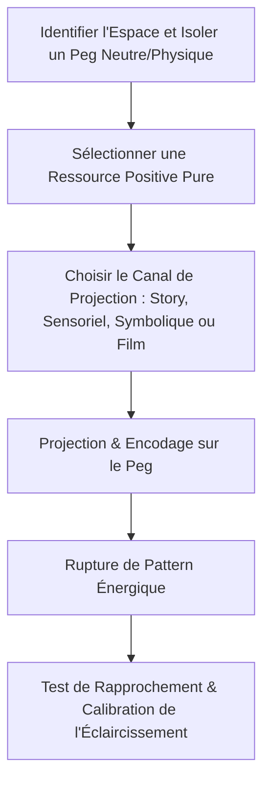

# Perfect Life Method Transcripts
**Formateur :** Perfect Life Method | **ID :** `perfect-life-method-perfect-life-method-transcripts` | **Tranches :** 36

Voici la **Synthèse Architecturale du Cours** conçue comme tête de pont pour la fiche maîtresse :

---

# Synthèse Architecturale du Cours : Perfect Life Method

## 1. Thèse Centrale & Philosophie du Cours

### Vision Spécifique & Rupture avec l'Approche Standard
* **Rupture avec le paradigme du manque (*Attainment Trap*) :** L'auto-amélioration classique postule : *« Il te manque X, donc résous le problème Y pour atteindre le bonheur futur »*. Cette structure active le système réticulé en mode recherche permanente de déficits. Dès qu'un problème est réglé, la machinerie en fabrique un nouveau pour justifier son outillage d'effort.
* **Refus de la force de volonté (*Willpower is brittle*) :** Lutter frontalement, imposer des défis rigides (« assiettes rouges ») et s'astreindre à la contrainte produit une usure allostatique et un effet rebond homéostatique inévitable.
* **La « Vie Parfaite » comme paramétrage par défaut (*Default Mode Configuration*) :** Une vie optimale ne se maintient pas par un effort soutenu, mais en transformant la trajectoire désirée en un état d'attraction homéostatique minimal (« assiettes bleues »). Le système nerveux y va par gravité et appétence naturelle (*craving*), sans friction psychologique.
* **Souveraineté de la mémoire opératoire :** Ce que nous appelons « réalité » et « futur » n'est qu'une projection d'échantillons mnésiques réactivés. Changer la vie revient à modifier l'accessibilité computationnelle des banques de mémoires.

### Fil Rouge Méthodologique
1. **Éteindre l'orientation problème** par désinvestissement attentionnel et amnésie fonctionnelle tactique (principe du doudou).
2. **Restaurer instantanément la plénitude basale (10/10)** par contraste brutal ou requalification conceptuelle (problème $\rightarrow$ casse-tête).
3. **Structurer l'inconscient via une architecture mnémotechnique spatialisée et sensorielle** (pegs, palais de mémoire, ancres physiques) pour que les décisions optimales soient les plus faciles d'accès computationnel (*least cognitive friction*).

---

## 2. Carte des Concepts & Leviers Émergents

### A. Épistémologie & Métacognition
* **Attainment Systems Flaw & Presupposition du Manque :** Biais des méthodes de développement personnel qui créent une boucle infinie de réparation en installant l'attention sur l'insuffisance du présent.
* **Cécité Attentionnelle Dépendante du Futur :** Focalisation sur un « futur idéal » qui force le système à percevoir la vie actuelle comme dégradée pour préserver la motivation.
* **Recadrage Épistémique (Problème vs Casse-tête) :** Bascule du stress sympathique (menace/défense) vers le système dopaminergique de recherche et curiosité (*Panksepp Seeking System*).
* **Incongruence Lexicale vs Recodage Conceptuel :** Remplacer un mot en surface sans refonte de la matrice somato-conceptuelle sous-jacente est immédiatement rejeté par l'inconscient.

### B. Dynamique Mnésique & Neurobiologie Comportementale
* **Verrou Mnésique de Continuité Identitaire :** Le présent perçu est une projection ininterrompue des mémoires passées ; le sentiment de blocage n'est qu'un clonage mnésique.
* **Biais de Négativité & Fenêtre d'Absorption Synaptique :** Les charges négatives s'encodent instantanément via l'amygdale, tandis que les états ressources demandent 15 à 30 secondes d'attention soutenue pour s'ancrer durablement.
* **State-Dependent Retrieval & Boucle Humeur-Mémoire :** Un état neurochimique dégradé restreint le champ de recherche aux solutions infantiles de survie/réconfort (sucre, évitement, procrastination).
* **Biais d'Accessibilité Mnésique (*Pool of Memories*) :** L'inconscient choisit l'option au coût d'accès computationnel le plus bas, pas la plus rationnelle.

### C. Régulation Énergétique & Homéostasie
* **Dynamique des Assiettes Bleues vs Assiettes Rouges :**
  * *Assiettes bleues :* Habitudes intégrées dans la structure de base du Soi, automatisées, sanctuarisées par un plancher d'intolérance (seuil de dégoût minimal).
  * *Assiettes rouges :* Comportements imposés par la volonté, coûteux en glucose, sacrifiés en priorité lors des surcharges.
* **Oubli Tactique (*Tactical Forgetting / Safety Blanket*) :** Extinction des blocages psychologiques par atrophie synaptique naturelle plutôt que par affrontement direct ou sur-analyse.
* **Piège de l'Addiction au Seuil de Rupture (*Threshold Addiction*) :** Tendance à fabriquer artificiellement une crise de stress pour se forcer à agir, au lieu d'être tracté par l'appétence.

### D. Ingénierie Mnémotechnique & Structuration Spatiale
* **Théorie du Porte-Manteau Mental (*Memory Pegs & Locations*) :** Nécessité d'ancrer les concepts abstraits sur des coordonnées combinant espace et forme tangible pour exploiter le cortex spatial.
* **Alphabet Visuel :** Squelette séquentiel linéaire invariant (A=Apple, B=Ball...) servant de palais non-spatial avec détection automatique d'erreur préfrontale.
* **Ancrage Somato-Sensoriel & Prediction Error Coding :** Encodage haute fidélité par le toucher physique, le son (*pinging*) et les surprises sensorielles activant la plasticité synaptique.
* **Découplage Ontologique (Carte Mentale vs Réalité Physique) :** Sanctuarisation de la carte intérieure comme référence opératoire autonome, indépendante des aléas ou disparitions du monde physique.
* **Règle du Plafonnement d'Initiation (« Win First ») :** Borner la complexité (5 à 10 pegs par pièce) pour éviter la surcharge cognitive et garantir l'adoption immédiate.
* **Priorité Spatio-Analogique :** La navigation spatiale interne dépasse en vitesse et en densité le traitement linguistique verbal.

---

## 3. Tableau Récapitulatif des Techniques & Démonstrations

| Technique / Exercice | Objectif Opératoire | Déclencheur / Indication | Séquence Résumée |
|---|---|---|---|
| **Simulation de Contraste Brutal (*Negative Calibration*)** | Réinitialiser instantanément le seuil de tolérance de base et faire sauter la note de vie présente de 6/10 à 10/10. | Plainte chronique, insatisfaction diffuse, sentiment de vie médiocre ou d'insatisfaction basale. | 1. Plonger kinesthésiquement le sujet dans une simulation extrême (prison violente, perte totale de liberté).<br>2. Laisser monter la détresse somatique.<br>3. Rompre l'état et ramener brutalement l'attention aux stimuli réels immédiats (toit, confort, liberté présente).<br>4. Calibrer l'explosion de gratitude spontanée. |
| **Shift Épistémique « Casse-Tête » (*Puzzle Reframe*)** | Désactiver la boucle de stress sympathique et mobiliser le système de recherche dopaminergique. | Face à un obstacle vécu comme un « problème » bloquant, anxiogène ou source de rumination. | 1. Interrompre la réactivité somato-verbale au mot « problème ».<br>2. Ré-encoder la situation sous la matrice sensorielle d'un casse-tête stimulant (*puzzle*).<br>3. Vérifier l'apparition de la curiosité et le relâchement musculaire. |
| **Désinvestissement Attentionnel (*Safety Blanket Dissolution*)** | Éteindre une habitude névrotique, un rituel compulsif ou une boucle de pensée sans affrontement. | Problème récurrent renforcé par la sur-analyse ou les tentatives infructueuses de lutte frontale. | 1. Cesser toute tentative de résolution analytique directe.<br>2. Rediriger massivement l'attention et les ressources vers des zones d'expérience gratifiantes.<br>3. Laisser la trace synaptique s'atrophier par amnésie fonctionnelle progressive. |
| **Recodage par Appétence Naturelle (*Blue Plate Priming*)** | Remplacer la contrainte d'une « assiette rouge » (régime, corvée) par l'attraction magnétique d'une « assiette bleue ». | Procrastination, rechutes récurrentes post-challenges rigides, épuisement de la volonté. | 1. Identifier un désir ou plaisir inconscient sain déjà actif dans le répertoire du sujet.<br>2. Relier la nouvelle action à ce circuit de récompense direct.<br>3. Supprimer le cadrage d'obligation pour laisser opérer la traction naturelle (*craving*). |
| **Extraction & Ancrage d'un Micro-Palais de Mémoire (5-10 Pegs)** | Créer un support d'indexation stable, rapide et immunisé contre la surcharge cognitive. | Besoin d'encodage et de rappel rapide d'informations ou d'états sans déperdition mnésique. | 1. Sélectionner un lieu familier.<br>2. Borner strictement la pièce à 5-10 pegs évidents.<br>3. Parcourir la séquence de manière invariante.<br>4. Valider l'ancrage spatial avant toute association de contenu. |
| **Ancrage Somato-Sensoriel par Contact Physique & Surprise** | Figer un locus mnésique de manière indélébile sans effort de visualisation. | Difficulté à visualiser les lieux mentalement ou manque d'adhérence des représentations visuelles. | 1. Toucher physiquement chaque support dans l'environnement réel.<br>2. Tester la texture (lisse/rugueux), la température ou le retour sonore.<br>3. Enregistrer les micro-surprises perceptives (*prediction error*) pour verrouiller la trace synaptique. |
| **Ancre Mnémotechnique Indexée (*Pegged Souvenir Anchor*)** | Rendre une mémoire ressource complexe instantanément accessible sous pression ou stress. | Prise de décision sous stress où les mauvaises routines risquent d'être activées par dépendance d'état. | 1. Compacter une mémoire ressource somatique riche en un « souvenir/objet condensé » (*handle*).<br>2. L'attacher spatialement à un peg familier de son palais mental.<br>3. Lier le déclencheur contextuel extérieur au locus pour un déploiement sensoriel automatique. |
| **Alphabet Visuel Linéaire** | Fournir une infrastructure de mémoire séquentielle mobile ne dépendant pas d'un espace géographique. | Structuration de séquences complexes ordonnées avec auto-correction immédiate en cas d'omission. | 1. Associer chaque lettre de l'alphabet à une image concrète immuable (A=Pomme, B=Balle...).<br>2. Lier les éléments à mémoriser à ces pegs via des associations multisensorielles exagérées.<br>3. Exploiter le détecteur d'erreur préfrontal naturel de la suite alphabétique. |

---

## Extractions Détaillées par Tranche (Opératoire & Verbatim)


## --- Tranche 1 / 36 ---

### 1. Mécanismes & Principes Actifs

#### 1. Le Piège de l'Orientation Problème des Systèmes d'Atteinte (*Attainment Systems Flaw*)
- **Principe actif :** Tout système d'auto-amélioration standard est fondé sur l'atteinte (*attainment*). Il postule implicitement : « Tu n'as pas ce que tu veux, donc tu as un problème à éliminer pour l'obtenir ». Le cerveau fonctionnant par saillance attentionnelle et recherche d'invariants, donner à l'esprit l'instruction ou l'outil pour traquer les problèmes force le système réticulé activateur à scanner la réalité en continu à la recherche de déficits. Dès qu'un problème est résolu, la machinerie cognitive en génère ou en sélectionne immédiatement un nouveau pour justifier l'usage de ses outils d'auto-amélioration.
- **Tags :** #attainment_trap #problem_orientation #presupposition_du_manque #boucle_infinie_de_reparation

#### 2. La Cécité Attentionnelle Induite par la Projection Future (*Future-Orientation & Attentional Blindness*)
- **Principe actif :** Postuler que l'état désiré ou parfait réside dans le futur (« l'herbe est plus verte ailleurs / plus tard ») force le système perceptif à maintenir une insatisfaction basale dans le présent. Pour qu'un objectif reste motivant dans l'ancien paradigme, la vie présente *doit* être perçue comme insuffisante (ex: notée 6/10 au lieu de 10/10). Le sujet devient alors aveugle (*attentionally blinded*) à l'ensemble des éléments satisfaisants déjà actifs dans son champ perceptif immédiat.
- **Tags :** #future_orientation #cecite_attentionnelle #illusion_de_latteinte #distorsion_temporelle

#### 3. Le Levier de Contraste Brutal par Épreuve Mentale Extrême (*Negative Calibration & Relative Contrast*)
- **Principe actif :** La satisfaction de vie n'est pas une mesure objective absolue mais une évaluation relative calculée à partir d'un point d'ancrage (*anchor/baseline*). En plongeant brutalement le sujet dans une simulation kinesthésique et émotionnelle de survie dégradante (fausse accusation, prison violente, perte totale de liberté), le système nerveux recadre son seuil de référence critique. Le retour soudain à la réalité sensorielle immédiate (le toit actuel, la nourriture présente, l'environnement familier) court-circuite le filtre de plainte habituel et fait bondir instantanément la note perçue de 6/10 à 10/10 ou 11/10 sans changer un seul atome de la réalité matérielle.
- **Tags :** #recadrage_par_contraste #ancrage_relatif #simulation_de_survie #collapse_d_echelle

#### 4. Le Verrou Mnésique de Continuité Identitaire (*Memory-Projected Reality*)
- **Principe actif :** Le présent et le futur perçu ne sont que des réplications de la mémoire à long terme. Le cerveau extrait des mémoires passées des croyances, des états affectifs et des routines comportementales qui produisent des résultats identiques jour après jour. Le sentiment d'être « coincé » dans une vie n'est pas dû à l'absence de solutions futures, mais à la projection ininterrompue des mémoires passées dans le présent. Une amnésie totale briserait instantanément cette réplication.
- **Tags :** #memoire_generatrice #projection_identitaire #clonage_du_passe #boucle_mnesique

#### 5. Le Biais de Négativité et la Fenêtre d'Absorption Synaptique (*Negativity Bias Neurodynamics*)
- **Principe actif :** Sur le plan neurobiologique (référence à Rick Hanson), les expériences négatives ou de menace sont encodées de manière immédiate et quasi automatique dans la mémoire à long terme par activation amygdalienne. Les expériences positives nécessitent un maintien intentionnel de l'attention de 15 à 30 secondes pour stabiliser la trace synaptique. Sans discipline délibérée d'amplification des états ressources (traditionnellement assurée par les rituels de gratitude ou la spiritualité), le cerveau dérive mécaniquement vers l'accumulation de charges négatives au fil des années.
- **Tags :** #biais_de_negativite #consolidation_synaptique #attention_soutenue #hygiene_mnesique

#### 6. L'Étiologie Binaire des Mauvais Choix et Apprentissage Dépendant de l'État (*State-Dependent Learning*)
- **Principe actif :** Hormis l'ignorance pure (défaut d'information relevant de la simple phase d'apprentissage), tous les mauvais choix comportementaux sont causés par un état interne dégradé (*poor state of mind*). En vertu du principe de mémoire et d'apprentissage dépendant de l'état (*state-dependent retrieval*), un état de stress, de manque ou d'agitation restreint l'accès aux ressources cognitives supérieures et active automatiquement les schémas comportementaux de survie ou de défaite issus du passé.
- **Tags :** #state_dependent_learning #etiologie_binaire #etat_ressource #conditionnement_de_choix

#### 7. La Métaphore Agissante du « Livre de Vie » (*The Book of Life Subconscious Programming*)
- **Principe actif :** Double boucle d'auto-suggestion : le sujet écrit son script de vie délibérément, puis le lit pour l'installer. L'acte d'écriture active la sélection consciente de critères; l'acte de lecture répétée nourrit l'inconscient en contournant le mode de résolution forcée de problèmes pour installer des anticipations automatiques vécues au présent.
- **Tags :** #book_of_life #programmation_narrative #induction_scripturale #auto_actualisation

---

### 2. Protocoles, Techniques & Démonstrations (Étape par Étape)

#### Protocole : Le Recadrage par Contraste Pénitentiaire (The Prison Thought Experiment)

* **Intention / Indication :** À utiliser face à un sujet engagé dans une quête perpétuelle d'auto-amélioration, qui évalue sa vie présente comme tiède, moyenne ou insuffisante (note de 5 à 7 sur 10), et qui justifie son anxiété ou son activisme par un déficit présent.
* **Mise en place & Pré-framing :**
  1. Demander au sujet de faire un scan rapide et global de sa vie actuelle.
  2. Établir une mesure de calibration : l'échelle arbitraire de satisfaction de vie de 0 à 10 (où 10 = vie la plus parfaite imaginable, 0 = catastrophe absolue). Noter le chiffre brut (généralement 6 ou 6.5).
  3. Prévenir le sujet qu'une expérience de pensée immersive va démarrer et exiger un engagement sensoriel et cognitif total.
* **Séquence d'actions pas à pas :**
  - **Étape 1 : Induction de la rupture dystopique sensorielle**
    Faire vivre en V.A.K.O.G. une injustice majeure et une déchéance brutale :
    - Accusation et condamnation injuste pour meurtre / acte abominable sans recours.
    - Transfert immédiat dans un milieu carcéral de haute sécurité ultra-hostile.
    - Menace physique directe : obligation de dormir avec un œil ouvert sous peine d'être passé à tabac.
    - Perte de souveraineté : vol des effets personnels par le codétenu, humiliation quotidienne pour intégrer un gang protecteur.
  - **Étape 2 : Test de saturation du contraste**
    Poser la question fermée de rupture : *« Is this a happy place for you? »* (Attendre le non catégorique et la réponse somatique de rejet).
  - **Étape 3 : Libération brutale et réintégration sensorielle du présent**
    Guider le sujet dans le retournement juridique et spatial :
    - Appel gagné, preuves irréfutables d'innocence, réhabilitation complète, libération immédiate.
    - Réancrage somatique direct dans l'instant présent exact : *« Tu es de retour chez toi, dans la maison exacte où tu es maintenant, mangeant la nourriture exacte que tu manges maintenant, entouré des personnes exactes avec qui tu es maintenant »*.
  - **Étape 4 : Re-calibration immédiate**
    Demander instantanément la nouvelle note de satisfaction : *« Now tell me life satisfaction number »*. (Le chiffre monte spontanément à 10 ou 10+).
  - **Étape 5 : Débriefing opératoire et déconstruction du filtre**
    Mettre en évidence que la réalité matérielle n'a pas varié d'un iota : seule la lentille de contraste et l'attention sélective ont changé. Introduire le postulat : *« Your perfect life currently exists. It’s just overshadowed »*.
* **Signes de calibration :**
  - À l'étape 1 : Resserrement du visage, tension corporelle, micro-expressions d'angoisse ou de dégoût, voix plus basse ou bloquée.
  - À l'étape 3-4 : Relâchement musculaire massif, expiration profonde, sourire spontané, voix détendue, verbalisation de scores extrêmes (10, 10+, 11).

---

#### Protocole : La Métamorphose du Problème en Énigme Stimulante (*Problem-to-Puzzle Reframing*)

* **Intention / Indication :** À utiliser lorsqu'un profil orienté action (notamment entrepreneurs, ingénieurs ou analystes) objecte que chercher des problèmes est la source de sa réussite, de son argent ou de son identité.
* **Mise en place & Pré-framing :**
  Valider l'intérêt de la résolution sans valider la souffrance sous-jacente. Distinguer le *contenu* de la tâche de la *chimie interne* avec laquelle elle est abordée.
* **Séquence d'actions pas à pas :**
  - **Étape 1 : Cartographie de l'isomorphisme ludique**
    Demander au sujet s'il aime résoudre des casse-têtes non obligatoires (ex: Sudoku, mots croisés, problèmes de mathématiques).
  - **Étape 2 : Extraction du critère de liberté et de non-urgence existentielle**
    Faire constater au sujet que si une partie de Sudoku est interrompue au milieu, sa vie ne s'effondre pas, il ne se considère pas comme un déchet et ne remet pas en cause sa valeur.
  - **Étape 3 : Découplage de la charge identitaire**
    Poser la distinction : un puzzle est simplement un problème que l'on prend plaisir à résoudre, dénué de la présupposition que la vie est imparfaite tant qu'il n'est pas réglé.
  - **Étape 4 : Bascule d'état (Stress vs Curiosité/Béatitude)**
    Prescrire d'aborder les défis professionnels non plus depuis un état de contraction et de menace, mais depuis un état de curiosité jubilatoire (*« curiousity and bliss »*).
* **Signes de calibration :**
  - Prise de conscience abrupte (*« getting hit right in the face with something »*).
  - Déclic cognitif visible, changement de posture (du mode défensif au mode exploratoire).

---

### 3. Heuristiques, Subtilités & "Sagesse du Praticien"

#### Heuristiques Conditionnelles de Conduite de Séance
- **Si** le sujet se plaint d'être coincé dans les mêmes schémas malgré des années de thérapie ou d'outils, **alors** cesser de chercher un traumatisme caché et diagnostiquer la boucle d'auto-validation de son outil : l'outil exige un problème pour exister, donc l'esprit fabrique du problème en continu.
- **Si** le sujet justifie la poursuite d'un objectif par le fait que sa vie actuelle « n'est pas encore assez bien », **alors** refuser d'entrer dans la stratégie d'atteinte et briser la cécité attentionnelle : l'esprit sabote le présent pour rendre l'objectif légitime.
- **Si** le sujet soutient une posture métaphysique abstraite (*« Le futur n'existe pas, il n'y a que le présent »*), **alors** contourner le débat philosophique par le test pragmatique : *« Pourquoi alors ton présent de demain ressemble-t-il trait pour trait à ton passé d'hier ? »* pour ramener le focus sur l'action structurante de la mémoire.
- **Si** le sujet est bloqué dans la rumination du passé, **alors** investiguer l'évitement futur : le passé douloureux est surinvesti pour éviter des situations futures projetées comme dangereuses, empêchant le sujet de calibrer que le présent a changé (métaphore de la personne phobique des portes dans un monde de portes automatiques).
- **Si** le sujet commet un mauvais choix, **alors** catégoriser immédiatement en deux branches exclusives :
  1. Manque d'information/connaissance -> Traitement : apprentissage neutre.
  2. État interne dégradé (*bad state of mind*) -> Traitement : régulation d'état et neutralisation des mémoires associées, jamais punition morale.

#### Pièges Classiques & Erreurs de Débutant
- **Le piège de la fixation sur l'outil :** Croire que la maîtrise technique d'un outil d'auto-hypnose, de méditation ou de PNL garantit le bonheur. Le formateur insiste : plus l'outil est brillant et poli, plus l'esprit cherche avidement de la matière défectueuse à lui donner à moudre.
- **Le piège de l'éradication bouddhique radicale :** Chercher à dissoudre toute ambition, tout objectif et toute identité sous prétexte que le désir crée de la souffrance. Le formateur recadre fermement : viser des buts, s'enrichir et croître est sain ; ce qui détruit la vie, c'est de conditionner la plénitude du présent à l'obtention future du résultat.
- **L'illusion que les problèmes sont la norme :** Considérer que grandir signifie résoudre des problèmes du matin au soir. Pour une vie fluide, résoudre des problèmes doit redevenir l'exception ludique, non le mode de fonctionnement par défaut.

---

### 4. Pépites Verbatim & Patterns Linguistiques (MOT À MOT EN V.O.)

#### Pépite 1 : La Reconfiguration Hypnotique du « Livre de Vie »
> « you've no doubt all heard of some version of the book of life yes yes right the book where the story of life is already written in some ways okay destiny and only you can hand in it and you could write the next chapter or read the rest of these coming up the next chapter you can get ready for it right right but what if the book of life instead of being predestined already it's already written what if it's a book that you get to write not only is the book you get to write but it's a book that when you read it it changes your life in small ways at first but the more you read it the more your life changes in conformity to what you have written into that book so that puts you 100 in charge of every aspect of your life because not only do you get to write the life that you want you get to read it into existence as well and then you just go living your life day by day minute by minute hour by hour and noticing what happens in your life automatically as you do »

* **[Analyse du Pattern]** :
  - **Empilement de truismes et de Yes-Set culturel :** Encrage initial sur l'archétype universel du « Livre de Vie » (*« you've no doubt all heard... »*) pour obtenir un accord cognitif immédiat.
  - **Rupture de cadre par boucle comparative conditionnelle :** Passage d'un cadre fataliste (livre déjà écrit / destin passif) à une double agentivité hypnotique (*« not only... write... but read it into existence »*).
  - **Double contrainte évolutive (*Double Bind*) et ratification par fractionnement temporel :** L'usage de la formule *« in small ways at first but the more you read it the more your life changes »* installe une relation proportionnelle inévitable (plus X se produit, plus Y s'amplifie).
  - **Distorsion temporelle et commande enchâssée d'automatisation :** L'enchaînement rythmique *« day by day minute by minute hour by hour and noticing what happens in your life automatically as you do »* sature l'hémisphère conscient pour glisser l'injonction d'observer des changements automatiques sans effort volontaire.

---

#### Pépite 2 : Démasquage de la Présupposition Toxique de l'Amélioration de Soi
> « The problem is not self-hypnosis the problem is not meditation the problem is not journaling the problem is not even therapy right these are all wonderful things to be able to do and have in your life are you with me the problem is the presupposition that sneaks into our minds that we need a problem to fix and if only we could fix the problem ultimately then we'd ultimately live in the life that we want »

* **[Analyse du Pattern]** :
  - **Défense préemptive et dédouanement des outils :** Anaphore par négation multiple (*« The problem is not X, the problem is not Y... »*) qui désarme la résistance défensive des praticiens attachés à leurs techniques.
  - **Personnification insidieuse (*Sneaking presupposition*) :** Traitement de la présupposition comme une entité intrusive autonome qui contamine le système cognitif à l'insu du sujet.
  - **Mise en lumière de la clause conditionnelle illusoire :** Démantèlement de la structure logique restrictive *« If [Problem Fixed] -> Then [Perfect Life] »*, démontrant que cette syntaxe mentale repousse structurellement la satisfaction hors de portée dans un futur conditionnel indéfini (*« ultimately... ultimately »*).

---

#### Pépite 3 : Induction Temporelle et Somatique du Contraste Pénitentiaire
> « raoul drew something awful just happened you have been accused and convicted of murder death kill and it's completely false you know the witness is lying the police were out to get you you're now being moved into a terrifying prison where the inmates are seeking to break you the very second you walk in to see if they can make you cry before you can get to your cell and that's just the beginning of the nightmare [...] There's been an appeal, new evidence comes forward, you have been vindicated, you've been released, you're now home, and you are back in the house you're in right now, living the life you live right now, eating the food you are eating right now. You're with the people you're with right now. Now tell me life satisfaction number. »

* **[Analyse du Pattern]** :
  - **Présent d'immersion immédiate et rupture brutale de sécurité :** Bascule instantanée du mode conversationnel au mode de commande hallucinatoire par association directe (*« something awful just happened... you are now being moved »*).
  - **Séquençage paranoïaque et sensoriel :** Création d'un sentiment d'injustice totale et de mise en danger somatique (menace sur l'intégrité physique et psychologique).
  - **Rétablissement fulgurant et Martèlement Déictique Présent (*Present Tense Pacing*) :** Répétition hypnotique incantatoire de la locution *« right now »* couplée à des ancres sensorielles concrètes (*« back in the house you're in right now... living the life you live right now... eating the food you are eating right now... with the people you're with right now »*). Ce matraquage linguistique sature la perception et force le système nerveux à réinvestir le présent sensoriel non plus à travers le filtre de l'idéal manquant, mais à travers le filtre du soulagement de survie.

---

#### Pépite 4 : La Boucle Récursive de l'Identité Mnémonique
> « So why is your life right now, as stable as it is right now. What does it sometimes feel like you can't actually change your life no matter how hard you try, you keep coming back to this. Why. Right, if only now exists, and the future is a complete fantasy which I agree with you is true. Why does the future, when it arrives as a now, look a lot like yesterday. [...] fundamentally, you have memories. Your memories are recreating you second by second. You see your memories. Great. You extract from your memories, lessons, learnings, beliefs, thoughts, ideas, automatic things that come to you, right. Those lessons and beliefs generate feelings and, and thoughts, and ultimately behaviors, those behaviors consistently applied over time, create results, and the results are the life you can't seem to leave behind. »

* **[Analyse du Pattern]** :
  - **Paradoxe socratique par confrontation temporelle :** Utilisation d'un piège logique déstabilisant reliant présent, futur et hier (*« Why does the future, when it arrives as a now, look a lot like yesterday? »*).
  - **Chaîne causale descendante (*Transderivational Ladder*) :** Déroulement d'un enchaînement déterministe irréfutable : *Mémoires -> Enseignements/Croyances -> Émotions/Pensées -> Comportements répétés -> Résultats matériels -> Réalité récurrente*.
  - **Recadrage ontologique :** La stabilité de la vie n'est pas une fatalité matérielle extérieure, mais le produit mécanique d'une mémoire qui recrée en boucle l'identité et le futur à chaque seconde (*« recreating you second by second »*).

---

#### Pépite 5 : La Métaphore de la Phobie des Portes et de l'Évitement Temporel
> « In fact, a lot of their present misery is caused by avoiding situations that might cause past pains that can never really occur again because things have fundamentally shifted, but they never got a chance to realize it, because they've been so busy avoiding the scenario that they never learned that doesn't exist anymore, right? It's like someone who's afraid of doors, and then they live in some Star Trek future where the doors just switch open and close automatically, they never touch a door again, but they never get to find out, because, you know, they mandated, their houses never have doors. They never get to know how much, you know, now has changed. »

* **[Analyse du Pattern]** :
  - **Mise en lumière du paradoxe d'évitement :** Démonstration de la manière dont la tentative d'éviter une douleur du passé engendre directement la misère présente en coupant le feedback de la réalité actualisée.
  - **Métaphore de rupture technologique (*Star Trek Door Isomorphism*) :** Utilisation d'une analogie visuelle et absurde (la peur des portes dans un monde où les portes coulissent sans contact) pour saturer la logique consciente et faire toucher du doigt au sujet l'absurdité de ses précautions de survie périmées.


## --- Tranche 2 / 36 ---

Voici l'analyse d'ingénierie et de modélisation opératoire de la tranche 2/36 du cours **Perfect Life Method**.

---

### 1. Mécanismes & Principes Actifs

#### A. Le Re-cadrage Épistémique : Problème Dissatisfaisant vs Casse-tête Stimulant
- **Principe Actif :** Le cerveau réagit de manière radicalement différente selon le cadre neuro-affectif attribué au mot « problème ». Un problème cadré en menace/manque induit un état de stress sympathique (rétractation musculaire, rétrécissement du champ attentionnel, activation de la boucle de fuite/combat). Cadré en « casse-tête » (*puzzle*), il recrute le circuit dopaminergique de recherche et de curiosité (*seeking system* de Panksepp). La résolution de défi devient intrinsèquement gratifiante sans créer d'usure allostatique.
- **Tags émergents :** `#reframe_puzzle_vs_problem #dopaminergic_seeking #shift_etat_de_conscience #stress_free_problem_solving`

#### B. La Projection Temporelle Évocatrice et la Ligne du Temps Référentielle
- **Principe Actif :** Le système nerveux ne fait pas l'expérience directe du futur ; il synthétise une simulation anticipatoire à partir d'échantillons mnésiques réactivés. 
  1. Si la banque d'accès par défaut est chargée de mémoires d'échec/souffrance, la projection du futur déclenche une réponse somatique d'inhibition et de défense (tension physique, effondrement de l'horizon temporel chez les sujets traumatisés).
  2. Si l'on force le système à échantillonner les états de triomphe, de gratitude et de beauté, le tonus musculaire se relâche instantanément et crée une dynamique d'attraction somatosensorielle.
- **Tags émergents :** `#curation_mnesique #projection_future_synthetique #reponse_somatique_anticipatoire #reduction_horizon_temporel #vraie_loi_attraction`

#### C. L'Élimination par Oubli Tactique (Le Principe du Doudou / *Safety Blanket*)
- **Principe Actif :** 90 % des prétendus problèmes psychologiques ou comportementaux ne se dissolvent pas par l'analyse ou l'affrontement frontal, mais par désinvestissement attentionnel. En accordant de l'attention à un problème pour le « résoudre », on renforce sa trace neuronale par plasticité dépendante de l'usage. Comme l'enfant avec son doudou, la transition hors du besoin ne résulte pas d'un débat logique, mais d'une amnésie fonctionnelle progressive : en vivant autre chose, le système cesse de réactiver la boucle et le problème s'éteint par atrophie synaptique.
- **Tags émergents :** `#tactical_forgetting #extinction_attentionnelle #paradoxe_de_la_resolution #safety_blanket_effect #dissolution_naturelle`

#### D. La Dynamique Homéostatique des Assiettes Bleues et Rouges (*Plate Spinning & Baseline*)
- **Principe Actif :** La psyché fonctionne selon un modèle d'énergie limitée et de seuil de tolérance homéostatique (*bottom line* ou *baseline* identitaire).
  - **Assiettes bleues :** Habitudes intégrées dans la structure de base du Soi (neurologiquement automatisées, faible coût cognitif). Le système refuse activement de descendre sous ce seuil (ex: l'hygiène minimale qui force le dépressif à se doucher sous peine de dégoût insupportable).
  - **Assiettes rouges :** Nouveaux comportements greffés artificiellement (effort conscient, forte consommation de glucose cérébral). Dès qu'une surcharge survient, l'inconscient sacrifie immédiatement les assiettes rouges pour stabiliser les bleues.
  - **Mécanisme de recodage :** Vouloir maintenir de nouvelles assiettes rouges par la force est voué à l'échec entropique. Le levier consiste à repérer les assiettes bleues *déjà existantes* dans la banque de mémoire du sujet et à les requalifier, ou à faire glisser les patterns indésirables vers l'oubli/procrastination.
- **Tags émergents :** `#assiettes_bleues_vs_rouges #homeostasie_identitaire #seuil_de_degout_plancher #entropie_comportementale #cout_cognitif_des_habitudes`

#### E. L'Impuissance du Changement Lexical de Surface
- **Principe Actif :** Remplacer un mot par un autre (ex: dire « défi » au lieu de « problème ») sans refonte de la matrice conceptuelle sous-jacente est rejeté par le système nerveux comme une incongruence (« se mentir à soi-même »). Le langage est un épiphénomène qui suit la représentation interne ; c'est le cadre perceptuel (l'expérience somato-conceptuelle) qui doit basculer en amont pour que le langage s'aligne de manière organique.
- **Tags émergents :** `#incongruence_lexicale #concept_avant_langage #rejet_de_la_pensee_positive_naïve`

---

### 2. Protocoles, Techniques & Démonstrations (Étape par Étape)

#### Protocole : Le Double Test de Projection Mnésique Contrastée
* **Intention / Indication :** Démonstration expérientielle immédiate démontrant au sujet que son humeur, son niveau perçu de satisfaction de vie (Life Satisfaction Number) et ses tensions somatiques dépendent à 100 % du filtre de curation mnésique actif et non de la « réalité objective ».
* **Mise en place & Pré-framing :** Cadrer l'exercice comme une simple expérience de pensée (*thought experiment*), rapide et sans danger d'approfondissement excessif des affects négatifs.

```
[Étape 1 : Amorçage Négatif Calibré]
Demander au sujet de réactiver brièvement quelques mauvais souvenirs (échecs, souffrances, pertes, insultes).
   ↓
[Étape 2 : Projection Future Négative]
Demander : « Imagine maintenant qu'il y a davantage de cela dans ton futur. »
   ↓
[Étape 3 : Calibration Somatique & Métrique N°1]
Vérifier le chiffre de satisfaction de vie (effondrement sous l'échelle) et calibrer les signes physiques immédiats (tensions musculaires, verrouillage pectoral, mâchoires serrées).
   ↓
[Étape 4 : Rupture d'État / Interruption]
Stopper court la boucle descendante pour éviter toute décompensation affective.
   ↓
[Étape 5 : Amorçage Ressource Élevé]
Demander d'extraire les souvenirs d'excellence, de victoires, d'amour, de rires, de beauté (ex: pleurer devant un coucher de soleil, recevoir un compliment sincère).
   ↓
[Étape 6 : Projection Future Ressource]
Donner la consigne : « Projette l'ensemble de ces mémoires dans ton futur. »
   ↓
[Étape 7 : Calibration Somatique & Métrique N°2]
Mesurer le chiffre (qui explose au-delà de 10/10) et valider le déverrouillage corporel (sensation de légèreté, libération de la cage thoracique, impulsion motrice vers l'avant).
```

* **Signes de calibration :**
  - *Phase négative :* Micro-tensions des trapèzes et du visage, réduction du volume respiratoire, discours axé sur la défense et l'évitement mental (« comment faire pour éviter ça »).
  - *Phase ressource :* Élargissement du sourire, relâchement myofascial observable, verticalisation de la posture, discours orienté vers l'attraction et l'élan (« je me sens attiré vers l'avant, légèreté totale »).

---

### 3. Heuristiques, Subtilités & "Sagesse du Praticien"

#### Règles Conditionnelles d'Intervention
- **Si** le sujet est un entrepreneur ou une personne hyper-analytique qui justifie son obsession des problèmes par son statut social/professionnel,  
  **Alors** ne pas lui demander d'arrêter de chercher des problèmes (ce qui déclencherait une résistance identitaire violente),  
  **Mais** modifier le statut affectif du problème : transformer le *problème-menace* en *casse-tête intellectuel jouissif* (*puzzle*).

- **Si** un sujet a vécu des traumatismes sévères ou des violences passées,  
  **Alors** calibrer que son horizon temporel est tronqué (incapacité structurelle à planifier à moyen/long terme par réflexe de protection contre la douleur projetée),  
  **Et** ne jamais forcer une visualisation du futur lointain avant d'avoir sécurisé le filtre mnésique présent.

- **Si** le sujet se plaint d'un problème récurrent depuis des années sans danger critique immédiat (insécurité, doute, habitude bénigne),  
  **Alors** appliquer l'heuristique du *doudou* : cesser d'analyser le problème, prescrire l'oubli tactique et la redirection attentionnelle vers ce qui fonctionne déjà.

- **Si** le client échoue systématiquement à adopter une nouvelle habitude (assiette rouge) par la volonté,  
  **Alors** cesser de lui faire ajouter de l'effort conscient ; localiser dans son histoire passée une « assiette bleue » équivalente déjà automatisée, et la transposer sur le contexte cible.

#### Pièges Classiques & Erreurs Corrigées
- **Le piège de la résolution compulsive :** Croire qu'une vie s'améliore en éliminant les problèmes un à un. Le praticien montre que c'est précisément l'obsession de la réparation qui maintient le système en état de pénurie et de stress.
- **Le piège du recadrage purement sémantique :** Tenter de forcer un vocabulaire cosmétique (« Je n'ai pas de problème, j'ai une opportunité ») sans modification de la structure de représentation interne crée un décalage interne d'imposture (*feels lame*).
- **Le piège du bourrage de crâne (*cramming*) :** Vouloir forcer le changement par répétition mécanique et acharnée. Ce qui est forcé s'oublie dès que la pression retombe, à l'exact opposé d'un apprentissage organique fondé sur l'attraction naturelle.

---

### 4. Pépites Verbatim & Patterns Linguistiques (MOT À MOT EN V.O.)

#### A. Le Recadrage du Problème en Casse-Tête Récréatif
> « Think of problems in the same way as you think of puzzles. Puzzles are just problems you enjoy solving. [...] It's still a problem, but it's not a problem. You get the idea? So I have no problem with you having one kind of problem. It's the other kind, the dissatisfying problem. And math problem is a juicy, satisfying problem. »

* **[Analyse du Pattern]** : Utilisation d'une équivalence complexe doublée d'un paradoxe linguistique délibéré (*« It's still a problem, but it's not a problem »*). Le formateur vide le mot « problème » de sa charge d'anxiété en y accolant des prédicats kinesthésiques et gustatifs hédonistes (*« juicy, satisfying »*), court-circuitant le réflexe de défense de l'interlocuteur.

#### B. La Dé-dépendance de l'Extérieur (Présupposition d'Autonomie Radicale)
> « The world doesn't have to conform to your perfect life for you to have a perfect life. In fact, if you need the world to change before you can have a perfect life, you never will. »

* **[Analyse du Pattern]** : Double lien inversé et rupture brutale de projection externe. La structure syntaxique en miroir brise l'attente névrotique de contrôle de l'environnement, installant la présupposition inébranlable que l'expérience interne optimale précède obligatoirement tout ajustement matériel du monde.

#### C. L'Évocation de la Perfection Déjà Présente
> « Consider the possibility that your life, up until this point, if you look at every part of your life including today, is perfect. The only problem, the only puzzle within that is, it's not consistently part of the perfect, and all the perfect bits aren't all happening at the same time, because spread out throughout your life. If you collected all the perfect moments in your life, and just build a life around that, life satisfaction number, where would it be? »

* **[Analyse du Pattern]** : Amorçage hypnotique d'ouverture de cadre (*« Consider the possibility... »*), suivi d'une redéfinition nominale (*« The only puzzle within that... »*). Il utilise une présupposition d'abondance : les fragments de la vie parfaite existent déjà physiquement dans la mémoire biographique ; il ne s'agit pas de les inventer, mais simplement de modifier leur distribution spatio-temporelle dans la conscience.

#### D. La Définition Somatique de l'Attraction sans Effort
> « This is, by the way, what I would call the real law of attraction. Right? It's not that things are attracted to you is that you were attracted to them. And that's what makes life easy. That's the effortless part of life. If you just attracted to all the good things in life. That's what makes life effortless isn't it, I mean you still put effort in, but because you're attracted to the view in the top of the mountain, right, you'll walk up that mountain, you'll still sweat your heart will still go, you just won't care. Yeah, you'll actually enjoy the hardship. »

* **[Analyse du Pattern]** : Récupération et recadrage pragmatique d'une croyance populaire ésotérique (*« Law of Attraction »*). Le formateur déplace le locus opératoire : l'attraction n'est pas magique, c'est un vecteur neuro-affectif orienté vers une cible somatosensorielle positive (*« the view in the top of the mountain »*), ce qui a pour effet de transformer le coût de l'effort physique en plaisir proprioceptif consenti (*« enjoy the hardship »*).

#### E. La Métaphore Thérapeutique du Doudou et l'Oubli Stratégique
> « You know there's a period in your life when you no longer cared about the blanket and you're very clear about that. And you know there's a range between the two. You just don't know what's going on in that range. You could not pinpoint, because no one sat you down and discussed with you the virtues and vices of safety blankets, right? What you did over a period of time is you tactically forgot about your blanket. You ignored the problem of not being around your blanket long enough that it stopped being a problem. And I would put it to all of you that 90% of our problems in life are safety blankets. »

* **[Analyse du Pattern]** : Métaphore isomorphe développementale universelle. En reliant la résolution du problème à un processus inconscient naturel et spontané déjà maîtrisé dans l'enfance (*« tactically forgot »*), il installe une commande cachée d'amnésie sélective sans passer par le moindre effort analytique. L'inconscient du sujet reconnaît immédiatement la validité du phénomène sans que l'esprit critique ne puisse objecter.

#### F. La Suggestion d'Identité par Normalisation Somatique Organique
> « Your perfect life is not something you do, it's something you become. Consider this. Take all the behaviors that are causing you to suffer right now, right? And then just procrastinate. Put them off, 'I'll do them tomorrow.' Or maybe just forgetful, forget about them, just forget doing them at the appropriate time. Take all the actions that'll make your life better and just do them because they seem like fun. [...] Make good things natural, just like brushing your teeth or having a bowel movement because you feel some pressure there, right? It's just natural. It takes effort to have a bowel movement sometimes, right? But it's natural effort. »

* **[Analyse du Pattern]** : Recadrage de niveau logique (de l'Action/Comportement à l'Identité : *« not something you do, it's something you become »*). Utilisation du retournement paradoxal d'un défaut (utiliser la procrastination et l'oubli non pas contre ses devoirs, mais *contre ses propres symptômes néfastes*). Ancrage par analogie viscérale et physiologique crue (l'évacuation intestinale comme archétype de l'effort homéostatique non négociable et non pénible).


## --- Tranche 3 / 36 ---

Voici l'analyse opératoire intégrale de la tranche 3/36 du cours **"Perfect Life Method"**.

---

### 1. Mécanismes & Principes Actifs

#### A. Le Biais d'Accessibilité Mnésique comme Moteur Comportemental
* **Principe actif :** Le système nerveux ne choisit pas ce qui est objectivement « sain » ou « logique » selon des règles rationnelles, mais ce qui présente le coût computationnel d'accès le plus faible à l'instant *t* (principe de moindre effort cognitif). Si l'image d'un aliment malsain ou d'un comportement d'évitement est rafraîchie quotidiennement par l'humeur, le stress ou l'habitude, elle constitue l'option par défaut disponible dans le réservoir de choix (*pool of memories*). La volonté ne faiblit pas par manque de discipline, mais par épuisement face à la friction d'accès aux représentations alternatives.
* **Tags émergents :** `#memory_accessibility_bias` `#cognitive_default_state` `#pool_of_memories` `#friction_reduction`

#### B. La Dépendance Humeur-Mémoire (*Mood-Congruent Memory Loop*)
* **Principe actif :** L'affect active sélectivement les réseaux neuronaux associés aux apprentissages et encodages passés réalisés sous le même état neurochimique. Une baisse d'énergie, une anxiété ou une déprime réveille automatiquement les solutions de réconfort infantiles (ex. sucres, graisses) encodées jadis comme réducteurs d'affect négatif. Le choix est alors verrouillé dans un sous-ensemble restreint de réponses de survie émotionnelle.
* **Tags émergents :** `#mood_congruent_recall` `#state_dependent_memory` `#infantile_comfort_loop`

#### C. L'Asymétrie « Assiette Bleue » (Attraction / Désir Inconscient) vs « Assiette Rouge » (Contrainte / Volonté)
* **Principe actif :** L'esprit humain rejette les lois, obligations et contraintes rigides imposées par l'ego (mentalité de challenge à 30 jours, régimes stricts, efforts surhumains = « assiettes rouges »). Dès que la pression retombe, l'effet élastique homéostatique impose la compensation (binge). Le système fonctionne durablement uniquement lorsqu'il est tracté par une envie inconsciente autonome (*craving*) d'une alternative hautement satisfaisante (« assiette bleue »). L'équilibre s'obtient non pas en luttant contre la tentation, mais en installant un désir supérieur qui s'impose par magnétisme naturel.
* **Tags émergents :** `#blue_plate_spinning` `#challenge_mentality_rebound` `#craving_vs_willpower` `#effortless_attraction`

#### D. L'Ancre Mnémotechnique Indexée (*Souvenir Anchor & Spatial Pegging*)
* **Principe actif :** Une mémoire sensorielle riche (vue, texture, saveur, satisfaction somatique) est trop lourde à manipuler globalement en situation de décision rapide. En extrayant un « souvenir » (un symbole/objet compact ou *handle*) et en le fixant spatialement sur un locus familier d'un palais mental (ex. un steak dégoulinant sur un rack de guitares), on crée un pont synaptique instantané. Le stimulus contextuel externe (la porte de la loge VIP) déclenche le locus (porte de bureau $\rightarrow$ rack de guitares), qui ouvre le *handle*, lequel déploie instantanément la mémoire sensorielle complète et son état physiologique associé de plénitude.
* **Tags émergents :** `#memory_handle` `#spatial_pegging` `#cross_contextual_trigger` `#automatic_sensory_retrieval`

#### E. L'Erreur Fondamentale du "Seuil de Tolérance" (*Threshold Seeking*)
* **Principe actif :** Les personnalités orientées « résolution de problèmes » fabriquent artificiellement des niveaux massifs de stress pour atteindre leur seuil de rupture (*threshold*) afin de déclencher l'action. Ce mécanisme conditionne la réussite à la souffrance et épuise les ressources nerveuses. Remplacer la poussée de la douleur par la traction de l'appétence supprime l'obligation de créer une crise pour agir.
* **Tags émergents :** `#threshold_addiction` `#problem_manufacture` `#tension_relief_trap`

---

### 2. Protocoles, Techniques & Démonstrations (Étape par Étape)

#### Protocole d'Installation d'une Préférence Par Défaut (Modélisation de l'Appétence Naturelle)

* **Intention / Indication :** Remplacer un comportement compulsif ou une boucle de compensation post-effort (ex. binge alimentaire post-séminaire, rechute après un challenge) sans utiliser la volonté, la privation ou l'injonction morale.
* **Mise en place & Pré-framing :** Cadrer l'exercice non comme une obligation diététique ou un outil de contrôle, mais comme la simple lecture quotidienne et ludique d'un chapitre du « Livre de sa vie ». Prévenir le sujet qu'il n'a pas à forcer la visualisation ni à s'interdire quoi que ce soit.

##### Séquence d'actions pas à pas :

1. **Extraction de la Référence Positive Satisfaisante :**
   * Demander un exemple précis où le sujet a consommé l'aliment/alternative saine et s'est senti pleinement rassasié et satisfait (*« Give an example of a low carb meal that you actually really enjoy eating, where you felt satisfied »*).
   * Spécifier le contexte spatiotemporel exact (*Où ? Quand ? Avec qui ?*).

2. **Élicitation Submodale et Sensorielle Complète :**
   * Calibrer et enrichir les paramètres VAKOG : taille de la table, couleur des assiettes, proportions spatiales des aliments, boisson d'accompagnement, température, intensité des saveurs, texture en bouche, sensations gastriques et satisfaction somatique globale.

3. **Création du « Souvenir » (Symbole-Poignée / *Memory Handle*) :**
   * Faire condenser toute cette scène dans un fragment ou un symbole tangible immédiatement préhensible (*« pull out a piece of that memory as a souvenir, something to remind you of it »*).

4. **Choix du Locus Spatial (Palais de la Mémoire / *Spatial Pegging*) :**
   * Faire sélectionner une pièce ultra-familière du quotidien (ex. le bureau personnel).
   * Établir un itinéraire d'accès séquentiel et ordonné (ex. entrer, tourner dans le sens des aiguilles d'une montre, identifier 3 repères fixes distincts : rack de guitare, tapis de course, second bureau).

5. **Fixation Absurde et Kinesthésique (Encodage Émotionnel Fort) :**
   * Lier le souvenir au premier locus par une image viscérale, surprenante ou incongrue (*ex. lancer le steak juteux à travers le rack de guitares pour qu'il dégouline le long des cordes*).

6. **Test de Déploiement Rétrograde :**
   * Faire tester le chemin d'accès : Entrée $\rightarrow$ Regard sur le premier locus $\rightarrow$ Apparition de l'objet incongru $\rightarrow$ Déploiement instantané de la mémoire sensorielle totale (l'assiette, les légumes, l'eau fraîche, la sensation de satiété).

7. **Pont vers le Futur & Déclencheur Contextuel (*Cross-Contextual Pacing*) :**
   * Identifier la situation critique passée où le sujet craque habituellement (ex. sortie de scène, entrée dans la loge green room face au buffet de burgers).
   * Greffer la perception du nouvel environnement sur l'ancre spatiale : la porte de la loge rappelle la porte du bureau, déclenchant l'attente du rack de guitares, qui réactive instantanément le steak et sa satisfaction somatique.

8. **Test de Choix Spontané :**
   * Demander au sujet de regarder le buffet de malbouffe mentalement avec cette mémoire activée.
   * *Calibration :* Le sujet doit ressentir un désintérêt pour la malbouffe au profit de l'option désirée (*« I'd rather eat the steak »*).

9. **Prescription de Tâche (Assimilation Long Terme) :**
   * Révision mentale quotidienne sans contrainte comportementale : simplement revisiter mentalement le lieu et relire la mémoire gustative quelques secondes par jour pour abaisser son coût d'accès mnésique en mémoire à long terme.

* **Signes de calibration observables :**
  - Changement de tonus musculaire et de posture lors du rappel du repas agréable.
  - Déglutition réflexe, salivation (signe d'activation autonome du craving pour l'alternative saine).
  - Absence d'effort ou de tension dans la voix au moment de rejeter la malbouffe (rejet par simple indifférence ou préférence supérieure, et non par résistance crispée).

---

### 3. Heuristiques, Subtilités & "Sagesse du Praticien"

#### Règles Opératoires Conditionnelles :
* **SI** le sujet affirme qu'il sait rationnellement ce qui est bon pour lui mais n'arrive pas à l'appliquer, **ALORS** invalider immédiatement la croyance intellectuelle (*« Nope, 'cause you're not doing it »*) **PARCE QUE** le comportement n'est pas piloté par la connaissance déclarative mais par l'accessibilité affective et mnésique immédiate.
* **SI** le sujet s'engage dans une discipline spartiate temporaire (mentalité de "challenge 30 jours"), **ALORS** anticiper mathématiquement un effondrement compensatoire (binge) au jour 31 **PARCE QUE** l'ego a fait tourner des assiettes de contrainte (*red plates*) en ignorant l'assiette du besoin inconscient de base (*blue plate*).
* **SI** le sujet tente de s'interdire un comportement en disant « Ça suffit ! » (*Threshold/Enough*), **ALORS** ne pas le laisser dans le vide **PARCE QUE** la nature a horreur du vide : sans alternative séduisante déjà pré-encodée et immédiatement accessible, le système nerveux rebascule inévitablement vers l'ancien schéma par défaut.
* **SI** le sujet visualise mal ou n'a pas d'images mentales nettes, **ALORS** ne pas chercher à forcer la visualisation submodale complexe **PARCE QUE** le cerveau fonctionne déjà par élicitation de mémoires expérientielles et spatiales quotidiennes ; il suffit de canaliser le contenu déjà existant.
* **SI** le sujet a tendance à générer du stress pour se motiver à agir (pattern d'entrepreneur/achiever), **ALORS** recadrer le stress non pas comme un signe de productivité, mais comme une fabrication artificielle de problèmes servant de prétexte à la mobilisation motrice.

#### Pièges Classiques & Erreurs Corrigées :
* **Vouloir "hypnotiser" ou rendre l'aliment artificiellement sexy :** L'approche classique du développement personnel tente de saturer les sous-modalités (rendre l'aliment lumineux, géant, crépitant). Le formateur démontre qu'il ne faut rien fabriquer ex nihilo : l'expérience réelle passée possède déjà tout le calibrage émotionnel nécessaire, il suffit de lui donner un accès direct.
* **Transformer la révision mentale en devoir moral :** Dès que le sujet commence à se dire *« Je vais planifier de manger du steak mardi »*, il recrée une "assiette rouge" (loi/obligation). Le praticien doit immédiatement stopper ce réflexe : la visite de la mémoire doit demeurer un jeu d'exploration hédoniste sans engagement comportemental forcé.

---

### 4. Pépites Verbatim & Patterns Linguistiques (MOT À MOT EN V.O.)

#### A. Le Recadrage de la Loi de l'Attention
> *"Focus on what you want, not what you don't want. Focus on what's working, not what's failing. Doesn't mean you don't solve problems. Doesn't mean you don't handle problems as they arise. It just means you don't go out of your way to find problems that you don't need to fix."*
* **[Analyse du Pattern]** : Recadrage de tri d'attention par négation protectrice (*deframing*). L'enchaînement de structures symétriques (*"Doesn't mean X, it means Y"*) neutralise l'objection rationnelle du sujet qui craint de devenir laxiste s'il cesse de traquer ses failles.

#### B. La Déconstruction de l'Illusion Volitive
> *"You know what's healthy, but you're not doing it, are you? So in actual practical life, how do you know what you're going to eat today, tomorrow, the next day? You requires two things, right? Memory and mood."*
* **[Analyse du Pattern]** : Rupture de pattern suivie d'une réduction causale binaire (*Memory and mood*). En confrontant brutalement la dissonance cognitive (savoir vs faire), le formateur brise l'illusion de contrôle conscient et installe un cadre explicatif mécaniste indiscutable.

#### C. L'Étiologie Hypnotique de la Pulsion Orale
> *"Comfort food, 'cause those are the foods you went to when you were a child to feel better. That's the stuff your parents gave you to shut you the hell up, so you will stop crying all the time. Here's a chocolate pie, isn't that so much better? Happy, happy, happy, eat chocolate. And now you wonder why you have an obsession with chocolate. Because your mood triggers the memories, and then all your mind can see is, this is the pool I get to choose from."*
* **[Analyse du Pattern]** : Régression hypnotique conversationnelle spontanée et citation en incise (*"Happy, happy, happy, eat chocolate"*). Le formateur rejoue la prosodie infantile et parentale pour relier directement l'affect négatif actuel à la programmation d'évitement archaïque, déculpabilisant instantanément le sujet.

#### D. La Pénétration Submodale et l'Extraction du "Handle"
> *"A good size table for two... White, how big, how much of the white space did the steak take up on your plate? About two thirds... To the right... What I want you to do right now is pull out a piece of that memory as a souvenir, something to remind you of it. Could literally just be that steak or could be a plate of steak or it could be something else. Something that just symbolizes, reminds you of that memory."*
* **[Analyse du Pattern]** : Empilement de questions de précision visuelle créant une reviviscence kinesthésique intense (*grounding*), suivi d'une nominalisation métaphorique (*"a souvenir"*). Il condense une gestalt complexe en un jeton mémoriel manipulable.

#### E. L'Accrochage Kinesthésique Absurde
> *"So take, so now just as a crazy thing, imagine this, you walk into the room, and now you're gonna take that stake, and you're gonna throw it right through your guitar rack, so that it's just dripping all the way down the guitar rack thing, and you know, very obviously, you know, guitar stake, right?"*
* **[Analyse du Pattern]** : Suggestion d'impact multisensoriel violent et incongru (*bizarre imagery effect* de la mnémotechnique classique). L'absurdité visuelle et kinesthésique (la viande qui dégouline sur les cordes de guitare) garantit un ancrage instantané à très haute persistance dans la mémoire de travail.

#### F. Le Pont Décontextualisant et la Fausse Reconnaissance
> *"You walk off the stage, you go to the green room, just as you enter the green room, something about the door reminds you of the office door, so as you open the door, you really expect to see your guitar rack just on the left-hand side, you go, oh, for a second, you're disoriented, oh, yeah, of course, this is a green room, not my home, right? But then, of course, that's reminding you of the steak, which is reminding you of what?"*
* **[Analyse du Pattern]** : Boucle de confusion spatiale contrôlée (*cross-contextual confusion induction*). En liant la porte de la loge à la porte du bureau, le praticien crée une transrivation : la désorientation passagère court-circuite le schéma automatique d'accès aux burgers et achemine le flux associatif vers la représentation préparée du steak.

#### G. L'Évocation Somatique du Désir
> *"That first bite that has that explosion of steaky flavors. And you know you can make the right choice that you're here. Time passes, you drink, you eat, you have a laugh, you have a great time. At the end of the meal, you put your plate away and go, that was nice. Good memory. I'm glad I have this in my life. That is all it takes to have a perfect life."*
* **[Analyse du Pattern]** : Conduite hypnotique par saturation sensorielle et truisme de plénitude. L'utilisation du langage kinesthésique gustatif (*"explosion of steaky flavors"*) jumelée à une ancre temporelle élargie (*"good memory... all it takes to have a perfect life"*) transmute une simple préférence alimentaire en une expérience existentielle de satisfaction fondamentale.

#### H. La Métaphore de la Boucle Inachevée
> *"Yesterday, I had a craving for pizza. I went to one place, it was shut. I went to another place, it was shut. I went, 'Oh, fuck, I'm having a burger.' What happened? I still want that pizza. It's still in my mind. It's an incomplete loop. You just want your mind filled with loops that give you what you want, not what you don't want."*
* **[Analyse du Pattern]** : Métaphore isomorphe de l'effet Zeigarnik appliqué au désir. Le formateur illustre la force indestructible d'une boucle mnésique ouverte orientée vers le plaisir, démontrant que l'esprit n'abandonne jamais un *craving* tant qu'il n'a pas été vécu ou substitué par un désir équivalent ou supérieur.


## --- Tranche 4 / 36 ---

Voici l’analyse chirurgicale et l'extraction de matière opératoire de la tranche 4/36 du cours **« Perfect Life Method »** (animé par Igor Ledochowski).

---

### 1. Mécanismes & Principes Actifs

#### 1. Le Principe du « Default Mode » Comportemental & Identitaire
* **Principe actif** : L'état d'une "vie parfaite" ou d'une maîtrise mentale n'est pas maintenu par un effort de volonté soutenu (qui épuise le glucose et la bande passante préfrontale), mais par le reparamétrage de la configuration cognitive par défaut (*default mode*). Le système nerveux et l'inconscient cherchent l'économie d'énergie ; lorsque la trajectoire désirée devient le point d'attraction homéostatique minimal, l'inconscient *désire naturellement faire l'effort nécessaire* sans friction psychologique.
* **Tags** : `#default_mode #attracteur_homeostatique #effortless_will #programmation_inconsciente`

#### 2. La Théorie du Porte-Manteau Mental (*Memory Pegs & Locations*)
* **Principe actif** : L'information abstraite ou flottante tombe dans l'oubli immédiat (« heap on the ground ») parce que la mémoire de travail humaine est incapable de retenir une charge cognitive non indexée. Pour encoder de façon permanente, le système a besoin d'un ancrage pré-existant qui combine **espace** et **forme/objet distinct** (*space and shape*). L'association d'un concept abstrait à un peg tangible exploite le cortex parahippocampique et spatial, transformant l'effort d'apprentissage en navigation perceptive passive.
* **Tags** : `#memory_pegs #peg_locations #cartographie_spatiale #ancrage_forme_espace`

#### 3. L'Alphabet Visuel comme Palais de Mémoire Non-Spatial Séquentiel
* **Principe actif** : Tout système pré-câblé et déjà maîtrisé par le sujet (comme l'ordre alphabétique : A, B, C...) constitue un squelette ordonné invariant. En associant chaque lettre à une image concrète (A = pomme, B = balle), on crée un index linéaire inviolable. Ce support élimine la déperdition mnésique car la séquence temporelle/ordinale est déjà automatisée : si l'esprit saute de E à G, le système d'alerte d'erreur préfrontal se déclenche instantanément (« Où est le F ? »).
* **Tags** : `#alphabet_visuel #palais_non_spatial #sequence_invariable #detecteur_derreur_cognitif`

#### 4. Loi d'Association Multi-Sensorielle & Effet d'Amplification Hédonique
* **Principe actif** : Deux représentations internes activées simultanément dans le même champ attentionnel (« apple » + « steak ») fusionnent synaptiquement (règle de Hebb : *neurons that fire together wire together*). Dès que l'un des termes est évoqué, le second s'active par propagation automatique. L'adhérence mnésique est exponentiellement accrue si l'association contient : de la vivacité sensorielle, de l'émotion, du bizarre/wild, de la nouveauté et surtout de la **satisfaction/plaisir** (activation dopaminergique).
* **Tags** : `#loi_association #hebbian_learning #amplification_dopaminergique #imagerie_bizarre`

#### 5. Principe d'Expansion Granulaire Organique (Plafond de Complexité vs Victoire Rapide)
* **Principe actif** : Une géométrie spatiale peut être divisée à l'infini (un objet peut contenir 10 sous-parties, qui contiennent chacune 10 détails). Cependant, surcharger immédiatement l'espace crée une fatigue d'encodage (*cognitive overload*). Le formateur impose une règle de calibrage : borner d'abord le système à 10 pegs par pièce pour sceller le succès (« win first »), avant d'autoriser l'inconscient à densifier organiquement les points d'ancrage avec les répétitions futures.
* **Tags** : `#victoire_initiale #granulometrie_progressive #seuil_saturation_mnesique #chunking_spatial`

---

### 2. Protocoles, Techniques & Démonstrations (Étape par Étape)

#### Protocole 1 : Extraction & Standardisation d'un Micro-Palais de Mémoire (10 Pegs par Pièce)

* **Intention / Indication** : Transformer n'importe quel espace physique (même quasiment inconnu ou vide) en un circuit d'encodage infaillible de 10 points d'ancrage sans saturation.
* **Mise en place & Pré-framing** :
  * Pré-cadrer que la difficulté est le signe d'une mauvaise méthode : tout doit être d'une simplicité ridicule (*ridiculously easy*).
  * Poser le postulat que l'espace n'a pas besoin d'être familier (démonstration sur un toit visité 3 fois dans une vie).
* **Séquence d'actions pas à pas** :
  * **Étape 1 : Délimitation du Périmètre & Sens Invariable** : Choisir le point d'entrée. Adopter une règle de progression stricte et invariable (ex. sens horaire : entrer, tourner à gauche et longer le mur).
  * **Étape 2 : Extraction des Éléments d'Angle et Murs (Périphérie)** :
    * Identifier les 4 coins de la pièce/espace.
    * Identifier les segments muraux, corniches, bordures ou rebords reliant ces coins.
  * **Étape 3 : Cartographie du Centre (Éléments Dominants)** :
    * Revenir vers la zone centrale de l'espace.
    * Sélectionner les objets ou singularités volumétriques (cheminée, tuyau, tapis, table, compresseur).
  * **Étape 4 : Sélection des Histoires Associées aux Anomalies** :
    * Rattacher les objets à un micro-souvenir ou une émotion si l'objet est neutre (ex. le compresseur qui a sauté et causé des semaines de froid).
  * **Étape 5 : Verrouillage du Circuit (Circuit Fermé)** :
    * Compter les pegs (viser 10 à 12).
    * Effectuer mentalement le tour complet de l'entrée au point final pour valider la fluidité du trajet.
  * **Étape 6 : Fixation Externe (Backup Physique)** :
    * Noter la liste ou dessiner le plan sommaire sur papier pour servir de sauvegarde de sécurité.
* **Signes de calibration** :
  * Le sujet cite les points sans froncer les sourcils ni faire de pause de recherche oculaire prolongée.
  * Sentiment spontané d'évidence et de soulagement chez le sujet (l'espace s'auto-organise sans effort).

---

#### Protocole 2 : Encodage d'un Contenu dans un Peg Linéaire (Démonstration Drew / Salade)

* **Intention / Indication** : Lier une mémoire épisodique ou une habitude cible (ex. manger sainement) à un peg mnésique abstrait ou visuel.
* **Mise en place & Pré-framing** : L'ancrage doit s'appuyer sur une expérience vécue riche et réelle, pas sur un concept générique.
* **Séquence d'actions pas à pas** :
  * **Étape 1 : Élicitation de l'Expérience Source Récente** : Demander la dernière occurrence concrète de l'expérience (« When's the last time you had a nice garden salad? »).
  * **Étape 2 : Calibration Sensorielle VAKOG** :
    * Fixer le lieu et le contexte.
    * Calibrer la vue (couleur de la nappe).
    * Calibrer la taille/volume (taille de l'assiette/salade).
  * **Étape 3 : Extraction d'un « Souvenir-Index » (Micro-Symbole)** : Extraire un détail visuel ultra-spécifique de cette mémoire (ex. le motif imprimé sur le pourtour de l'assiette).
  * **Étape 4 : Fusion Somatique/Visuelle avec le Peg Cible** : Prendre ce motif et l'imprimer/le fusionner physiquement sur le peg suivant (ex. « Stamp it on a ball »).
  * **Étape 5 : Test de Déclenchement Automatique (Verification of Automaticity)** :
    * Évoquer uniquement le peg (« Ball » ou « Pattern »).
    * Calibrer que le sujet complète instantanément avec le contenu (« Salad ») et ressent la satisfaction sensorielle associée.
* **Signes de calibration** :
  * Réponse verbale instantanée du sujet sans temps de latence de calcul mental.
  * Émergence de l'état hédonique d'origine (salivation, sourire, satisfaction somatique).
  * Contamination du groupe : les autres participants voient et ressentent l'association sans qu'elle leur soit directement adressée.

---

### 3. Heuristiques, Subtilités & "Sagesse du Praticien"

#### Règles Conditionnelles Opératoires
* **Si** le sujet ressent le moindre effort, blocage ou tension dans l'exercice mnésique, **alors** c'est qu'une étape a été mal calibrée ou rendue inutilement complexe par le praticien ; **car** le cerveau humain code spatialement et associativement sans aucun effort physiologique par nature.
* **Si** un peg risque de s'effacer avec le temps (novelty fading), **alors** introduire une boucle de répétition espacée et de consolidation physique (notes externes/Book of Life), **parce que** le passage de la mémoire vive à la structure de long terme exige une stabilisation jusqu'à ce que le comportement devienne une composante innée de l'identité (« just your being »).
* **Si** le sujet commence à subdiviser un objet ou une pièce en micro-détails dès le début (sur-granulation), **alors** l'arrêter immédiatement et le limiter strictement à 10 pegs par pièce, **parce que** l'inconscient a d'abord besoin d'ancrer le sentiment de réussite et de complétude (« win first ») avant de gérer la complexité.
* **Si** le sujet est perturbé par le fait que ses sous-modalités diffèrent de celles des autres (ex. pomme rouge vs pomme jaune vs pomme verte), **alors** normaliser et valider la variation subjective, **parce que** la validité d'un ancrage dépend de sa résonance dans le modèle du monde individuel du sujet, non d'une norme externe.

#### Pièges Classiques & Erreurs de Débutant
* **Le piège de la pièce vide / de l'information flottante** : Essayer d'implanter des suggestions, des buts ou des mémoires futures sans créer au préalable l'armature réceptrice (les pegs). Résultat : la suggestion retombe comme une veste jetée contre un mur nu.
* **La surcharge des variations précoces** : Essayer d'associer dix images différentes à un même peg (vouloir que 'A' soit pomme, avion, astronaute en même temps) avant que le peg de base ne soit solidifié. La règle d'apprentissage exige d'abord la stabilisation du point fixe, puis l'expansion.
* **Le doute sur la source du matériel** : S'inquiéter de la disposition du carnet (deux carnets séparés vs un seul carnet retourné). Le praticien recadre : la forme importe peu, seul compte le fait que le rituel d'organisation procure de la satisfaction et une clarté absolue au sujet.

---

### 4. Pépites Verbatim & Patterns Linguistiques (MOT À MOT EN V.O.)

#### Verbatim 1 : Recadrage de l'Effort vers le « Default Mode »
> *"Before the break, we've been arguing for this idea of a perfect life being one that you can live on default. By default, I mean, you don't make any effort. It's just that your mind naturally defaults to wanting to make the effort. So you'd never stray too far from the core of whatever it is that's in your mind there. Does that make sense so far? This is fundamentally how your mind and your personality already work, right?"*

* **[Analyse du Pattern]** : 
  * **Redéfinition sémantique & Paradoxe thérapeutique** : Recadre « sans effort » non pas comme de la passivité, mais comme un désir spontané d'agir (*« naturally defaults to wanting to make the effort »*).
  * **Présupposition d'identité & Truisme d'évidence** : La phrase finale (*« This is fundamentally how your mind... already work, right? »*) installe une validation universelle qui neutralise toute résistance : le sujet ne peut pas refuser ce qui est présenté comme la mécanique déjà existante de son propre esprit.

---

#### Verbatim 2 : Métaphore Isomorphe de la Préparation Fondamentale
> *"These things have been in terms of, you know, if you're going to actually write a book, a physical book, this is the bit where you select a tree, you turn it into pulp, you make the paper, you bleach the paper, you sand it carefully, make sure that every page is of the quality that the book of your life deserves. That's what we're doing right now, all the preparation work. So tomorrow, we can start using it to start writing the first entry into our book of life."*

* **[Analyse du Pattern]** : 
  * **Métaphore de maturation organique & Emboîtement de micro-étapes (Fractionnement)** : En décomposant la création du livre jusqu'au choix de l'arbre et au blanchiment de la pâte, il induit un état de patience, de valeur et de respect extrême pour les fondations techniques en cours.
  * **Suggestion post-hypnotique enchâssée** : Lie la rigueur présente à l'inévitabilité de l'écriture future (*« That's what we're doing... So tomorrow, we can start writing »*), reliant l'effort présent à l'identité grandiose (« the book of your life deserves »).

---

#### Verbatim 3 : Ancrage de la Facilité & Suggestion Inversée d'Infaillibilité
> *"And one of the places you'll find out that you need clarity is if anything seemed difficult, chances are you misunderstood a step or a part of the equation. So if it all feels easy, we're on the right track. If anything feels difficult, then somehow I've miscommunicated the sheer, ridiculously easy-ness of all of this, right?"*

* **[Analyse du Pattern]** : 
  * **Recadrage protecteur & Décharge de culpabilité** : Attribue d'avance toute sensation de difficulté à un malentendu de transmission plutôt qu'à une incapacité de l'apprenant.
  * **Présupposition de facilité absolue** : L'utilisation de l'hyperbole nominalisée *« the sheer, ridiculously easy-ness of all of this »* couplée à un tag question approbateur (*« right? »*) hypnotise le sujet en associant la compétence au relâchement total et à l'amusement.

---

#### Verbatim 4 : Élicitation Sensorielle & Condensation du Symbole
> *"When's the last time we had a nice garden salad? Probably a week and a half ago. Okay, where were you? At a restaurant. Excellent. What color was the tablecloth? It was white. Nice. And how big was the salad? It was very large. Perfect. Pick any element from that memory as a little souvenir, as a memory aid for that salad. What is it? It's like the pattern around the plate. Beautiful, the pattern. Okay, good. So now take that pattern around the plate and stamp it on a ball."*

* **[Analyse du Pattern]** : 
  * **Régression temporelle et reviviscence sensorielle instantanée** : Par une série de questions spécifiques (date, lieu, couleur de nappe, volume), il force le sujet à réactiver les représentations analogiques complètes du cortex occipital et pariétal.
  * **Métonymie / Condensation symbolique** : Isole un fragment visuel ultra-précis (*« the pattern around the plate »*) et utilise un verbe d'action kinesthésique puissant (*« stamp it on a ball »*) pour souder le symbole à l'ancre conceptuelle.

---

#### Verbatim 5 : Automatisation Inévitable de la Chaîne d'Associations
> *"All you really have to do is connect two images together, to do sensory images by mentalizations together, and they'll stick... But literally just thinking of apple and steak and then bringing it back over and over, look, it's already forming in your mind. You can't help it. Just me saying apple and steak is making the link much more than a ball and pattern. But now you can't help it. I just have to say ball and pattern. You don't even have to say which pattern. What are you thinking? Salad, what the hell?"*

* **[Analyse du Pattern]** : 
  * **Double lien conversationnel & Commande d'impossibilité de résistance** : Répète à deux reprises la suggestion directe de non-contrôle conscient : *« You can't help it »* (Vous ne pouvez pas vous en empêcher). 
  * **Démonstration en temps réel (Loop Closure)** : Il prononce l'amorce (*« ball and pattern »*) et capture immédiatement la réponse automatique de l'inconscient du sujet (*« Salad »*), prouvant par l'expérience vécue sans contestation possible que le conditionnement est instantané, universel et autonome.


## --- Tranche 5 / 36 ---

Voici l'analyse opératoire et la modélisation intégrale de la tranche 5/36 du cours *Perfect Life Method*.

---

### 1. Mécanismes & Principes Actifs

* **Ancrage Somato-Sensoriel Kinesthésique Immédiat**
  * *Principe actif* : L'encodage mnésique ne repose pas uniquement sur l'imagerie visuelle (souvent labile, fatigante ou inaccessible pour les sujets présentant des difficultés de visualisation). En touchant physiquement chaque objet, en testant sa texture (rugosité vs lissage), sa température ou son écho sonore (« pinging »), le sujet force le cortex somatosensoriel à créer une trace neurologique multimodale haute fidélité. La kinesthésie sert d'ancrage primaire brut pour figer l'emplacement spatial sans effort d'imagination.
  * *Tags* : `#encodage_kinesthésique #ancrage_somatosensoriel #multimodalite_spatiale #effortless_retrieval`

* **Effet de Surprise Sensorielle (Prediction Error Coding)**
  * *Principe actif* : Le système nerveux encode instantanément les objets ou textures qui provoquent une dissonance avec l'attente préalable (ex. la douceur inattendue d'un requin en céramique). Cette surprise sensorielle active une décharge dopaminergique et renforce la plasticité synaptique sur cet item précis (« sensory trace »), rendant le repère indélébile dès le premier passage.
  * *Tags* : `#prediction_error #sensory_surprise #trace_mnésique_flash #ancrage_inattendu`

* **Découplage Réalité Référentielle vs Réalité Mentale Opératoire**
  * *Principe actif* : Pour qu'un palais de la mémoire fonctionne, la structure interne doit devenir autonome et immunisée contre les variations du monde physique. Que des objets disparaissent (les citrons, le ventilateur en hiver, les figurines de chefs), changent de place ou qu'un témoin extérieur contredise la configuration passée importe peu. L'inconscient opère sur une carte stabilisée et figée au moment de l'encodage initial. Le formateur désactive le perfectionnisme en sanctuarisant la carte intérieure comme seule vérité opératoire.
  * *Tags* : `#decouplage_ontologique #carte_interieure_stabilisee #immunite_aux_fluctuations #desinhibition_du_critique`

* **Règle du Plafonnement Cognitif d'Initiation (« Win First »)**
  * *Principe actif* : Tout objet physique possède une profondeur fractale infinie (un téléphone peut donner des dizaines de pegs via ses bords, ses boutons, ses applications). Laisser le sujet fragmenter d'emblée provoque une surcharge de la mémoire de travail et une sensation d'échec (« force and strain »). Limiter strictement à 5-10 pegs par pièce préserve l'énergie cognitive, installe un pattern de succès rapide, et permet une croissance organique ultérieure basée sur l'intérêt plutôt que sur la contrainte.
  * *Tags* : `#plafonnement_cognitif #win_first #anti_surcharge #croissance_organique #chunking_mesure`

* **Système de Vérification Métrique et Traçage Extérieur**
  * *Principe actif* : Utiliser un nombre standardisé (ex. 5 ou 10) ou conserver une trace écrite/schématisée sert de boucle de rétroaction externe (external reminder). Cela décharge l'esprit de la tâche de comptage interne et signale immédiatement lorsqu'un item a été sauté dans la séquence ordonnée.
  * *Tags* : `#boucle_retroaction_externe #metrique_de_controle #decharge_cognitive #external_hard_copy`

* **Priorité de la Pensée Spatiale sur le Traitement Verbal**
  * *Principe actif* : Durant la restitution à haute vitesse, le formateur expérimente que sa navigation spatio-visuelle interne dépasse la cadence motrice de l'appareil phonatoire (« words have to catch up to mental concepts »). Ce phénomène démontre que la mémoire des lieux opère dans un langage analogique/sous-cortical bien plus rapide et dense que le flux linguistique linéaire.
  * *Tags* : `#primauté_analogique #vitesse_sous_corticale #dephasage_spatial_verbal`

---

### 2. Protocoles, Techniques & Démonstrations (Étape par Étape)

#### Protocole d'Encodage Physique de Pegs Mnésiques In-Situ

* **Intention / Indication** :
  Créer une banque de points d'ancrage (pegs) de mémoire fiables, instantanément rappelables, sans fatigue cognitive, utilisables pour mémoriser de vastes quantités d'informations à venir. Idéal pour les personnes qui visualisent mal ou qui ont tendance à intellectualiser/surcharger.
* **Mise en place & Pré-framing** :
  * Poser le cadre : l'exercice doit être simple, facile (« lazy way »), sans forcer.
  * Règle stricte : 5 items minimum, 10 items maximum par pièce (interdiction d'aller au-delà lors de la première passe pour éviter la saturation).
  * Consigne de trajectoire : choisir un sens univoque et s'y tenir (ex. sens horaire, tourner à gauche et longer le mur).

* **Séquence d'actions pas à pas** :
  1. **Choix de la pièce** : Se lever physiquement dans la pièce où l'on se trouve actuellement.
  2. **Exploration tactile & sensorielle** : Faire le tour de la pièce selon la trajectoire choisie. S'arrêter devant 5 à 10 objets marquants évidents. Toucher chaque objet avec attention : éprouver la texture (lisse, rugueux), la température (frais, chaud), la prise en main, ou frapper légèrement l'objet pour entendre son son (« pinging »).
  3. **Capture d'un trait saillant** : Pour chaque objet, capter la première impression ou la micro-surprise sensorielle qui ressort naturellement.
  4. **Retour au bureau & Structuration séquentielle** : Revenir à son poste et fixer immédiatement la trajectoire choisie (ordre linéaire continu, sans aucun zigzag).
  5. **Externalisation papier (Hard Copy)** : Noter sur une feuille le nom de la pièce, puis lister ou dessiner schématiquement les 5 à 10 items dans l'ordre exact de visite.
  6. **Restitution mentale à froid** : Fermer les yeux (ou sans regarder la feuille) et dérouler mentalement le chemin de mémoire du point 1 au point 10.
  7. **Sanctuarisation de la version initiale** : Décréter que cette version est définitivement gravée dans cet état, même si les objets sont déplacés, jetés ou réarrangés dans le monde réel par la suite.

* **Signes de calibration** :
  * *Au niveau somatique* : Relâchement musculaire du sujet lorsqu'il réalise qu'il n'a pas besoin de « forcer » l'image ; micro-réactions de surprise lorsqu'il touche un matériau (ex. Drew constatant la fraîcheur du tableau blanc).
  * *Au niveau verbal* : Fluidité et rapidité du débit lors de la restitution sans regard sur les notes (énumération rythmée, non hésitante). Si le sujet hésite ou cherche, calibrer s'il n'est pas en train de confondre l'ancien aménagement et le nouvel aménagement physique de sa pièce.

---

### 3. Heuristiques, Subtilités & "Sagesse du Praticien"

* **Règle du « Win First » (Gagner d'abord)** :
  * *Si* le sujet est enthousiaste et souhaite créer 30, 50 ou 100 pegs d'un coup dans une seule pièce,
  * *Alors* brider formellement son élan et le contraindre à 5-10 pegs maximum,
  * *Parce que* la complexité prématurée engendre l'effort, la friction mentale et l'abandon. Il faut installer la dopamine de la réussite facile avant d'augmenter la granularité.
* **Gestion des modifications de l'environnement réel** :
  * *Si* un objet constituant un peg disparaît du monde physique (jeté, déplacé, consommé comme un plat de citrons ou un flacon de parfum),
  * *Alors* conserver impérativement l'objet fantôme dans la structure mentale du palais (« it's gonna be there in my mind forever »),
  * *Parce que* rééditer constamment la carte mentale crée de la confusion et de l'interférence proactive dans les chaînes de rappel.
* **Gestion de la subjectivité mnésique vs vérité historique** :
  * *Si* un proche ou un témoin affirme que la pièce n'a jamais été configurée ainsi à l'époque évoquée,
  * *Alors* ignorer totalement la remarque (« Who cares? »),
  * *Parce que* seule l'organisation interne cohérente et stable importe pour le système nerveux, non l'exactitude historique.
* **L'orientation sensorielle spontanée (« Go where the energy is »)** :
  * *Si* le sujet est attiré par une catégorie spécifique d'objets (ex. ses guitares, des plantes),
  * *Alors* valider immédiatement cette piste comme pegs prioritaires,
  * *Parce que* la charge émotionnelle positive et l'attachement préexistant réduisent l'effort d'encodage à zéro.
* **Piège de l'abstraction géométrique** :
  * Vouloir créer des pegs à partir de formes pures (carrés, rectangles virtuels) ou d'espaces imaginaires demande un surcroît d'énergie inutile pour les différencier. S'appuyer sur du réel tactile déjà connu élimine le travail de mémorisation du support lui-même.
* **Heuristique de mise à jour** :
  * Modifier ou ajuster une liste uniquement pendant la phase de réglage initial. Une fois que la pièce est fonctionnelle et utilisée, ne plus la modifier : créer une nouvelle pièce ailleurs si l'on a besoin de plus de capacité.

---

### 4. Pépites Verbatim & Patterns Linguistiques (MOT À MOT EN V.O.)

```text
"Because it's just easier to manage that in your own mind. And you want to win first. Six months from now, a year from now, if you want to turn your one room into a hundred peg place, knock yourself out, right? But win first."
```
* **[Analyse du Pattern]** : Présupposition d'inévitabilité du succès futur combinée à un fractionnement temporel (« Six months from now, a year from now »). En autorisant de manière informelle l'excès plus tard (« knock yourself out »), il désamorce la résistance du sujet tout en réaffirmant le cadre impératif du présent par une commande répétée au présent de l'indicatif (« win first »).

---

```text
"So sometimes I forget, I skip it 'cause it's no longer present. So I can remind myself of how the kitchen was when I created it, not how it is right now. Do you get the idea?"
```
* **[Analyse du Pattern]** : Recadrage ontologique dissociant la mémoire du temps présent. La structure comparative (« how the kitchen was when I created it, not how it is right now ») libère l'esprit de l'obligation de synchronisation avec la réalité physique, validant l'hallucination mnésique stable comme référence opératoire légitime. La question de clôture « Do you get the idea? » agit comme un tie-down invitant à un acquiescement automatique.

---

```text
"I like to go around the room physically 'cause that's the E is where I'm lazy and I don't want to make it hard on myself. So I literally go around the room and I will touch every object, right?"
```
* **[Analyse du Pattern]** : Recadrage de complaisance / Utilisation stratégique de la paresse (« I'm lazy and I don't want to make it hard on myself »). Ce framing enlève toute pression de performance chez l'apprenant : bouger son corps et toucher des objets n'est pas présenté comme un travail disciplinaire ardu, mais comme l'option ultime de facilité pour éviter de réfléchir.

---

```text
"If I talk to my dad and he says, 'Well Ash, no, that room wasn't looking like that at all until five years after you moved out.' Who cares? All that matters is I have consistency organized in my mind, you get the idea?"
```
* **[Analyse du Pattern]** : Rupture de pattern et désactivation du surmoi/juge interne (« Who cares? »). En introduisant un dialogue rapporté critique (l'autorité paternelle pointant l'inexactitude), puis en le balayant d'un revers de main, le formateur neutralise préventivement toute culpabilité perfectionniste chez les participants.

---

```text
"And when I picked up the ceramic shark, of course it felt weird, but it was so smooth. It was surprising to me to the point that that shark is now so clear in my mind because I touched it and was surprised by the smoothness of it. It's just one sensory trace that I need to lock it in like that, really easy."
```
* **[Analyse du Pattern]** : Chaînage de truismes kinesthésiques menant à une suggestion de facilité (« so clear... because I touched it... lock it in like that, really easy »). L'emploi de la conjonction causale « because » lie arbitrairement le toucher de l'objet à la clarté pérenne de la trace mentale, ancrant chez l'auditeur la croyance qu'un seul contact sensoriel suffit pour verrouiller un souvenir à jamais.

---

```text
"Notice you reorganize your space. Then when I first asked you, that's gonna require a little bit of effort to make sure you've got the new journey clear. That's why we write the new journey down, so you don't get stuck with the old journey by mistake."
```
* **[Analyse du Pattern]** : Normalisation de la friction cognitive et pré-encadrement de l'erreur (« Notice... that's gonna require a little bit of effort »). L'utilisation de « Notice » force une méta-attention chez l'élève, tandis que l'explication logique fournit une justification rassurante et impérative pour l'action disciplinaire de tenir un registre écrit (« That's why we write... »).

---

```text
"Again, notice how my mind is ahead of my language, I've got to really work hard to make my language conform to it..."
```
* **[Analyse du Pattern]** : Auto-calibration modélisante partagée en temps réel (démonstration par l'exemple). En verbalisant sa propre avance conceptuelle sous-corticale par rapport à l'élocution verbale, il implante une présupposition puissante : le système de pegs spatiaux est tellement rapide et naturel qu'il dépasse les contraintes de la linguistique consciente.


## --- Tranche 6 / 36 ---

### 1. Mécanismes & Principes Actifs

- **Architecture Spatiale Préexistante comme Conteneur Mnésique Éprouvé**
  - **Principe actif :** Le cerveau humain dispose d'une machinerie d'orientation spatiale (hippocampe, cellules de lieu et de grille) hautement automatisée et économe en énergie cognitive. Plutôt que de forger des systèmes d'encodage abstraits exigeant un calcul mental actif (ex. : conversions numériques phonétiques du *Major System* ou chevilles rimées), l'ancrage sur des volumes spatiaux familiers exploite des réseaux neuronaux déjà câblés. L'inconscient n'a pas besoin de « mémoriser » l'endroit : il s'y déplace virtuellement par simple réactivation sensorielle spontanée.
  - **Tags :** `#ancrage_spatial_organique` `#epargne_cognitive` `#locatifs_hippocampiques` `#infrastructure_mnesique`

- **Décorrélation entre Réalité Physique Présente et Empreinte Neurologique Fixée**
  - **Principe actif :** Une fois qu'un objet ou un agencement spatial a été encodé à un instant *T*, l'esprit fige cette configuration comme un repère invariant. Les modifications matérielles ultérieures du lieu réel (objets déplacés, consommés, jetés) n'altèrent en rien la solidité du repère interne. Ce principe prouve au sujet que le monde interne fonctionne selon ses propres lois de stabilité indépendamment des fluctuations environnementales.
  - **Tags :** `#permanence_du_repere_interne` `#deconnexion_referentielle` `#stabilite_subjective`

- **Souveraineté Sensorielle Amorphe (Agnosticisme de la Visualisation)**
  - **Principe actif :** La méthode désamorce le blocage classique de la « mauvaise mémoire visuelle » (aphantasie, imagerie floue ou en basse résolution). Le système nerveux valide l'encodage par la simple « familiarité spatiale » ou la proprioception (savoir où se trouve un objet par rapport à son propre corps ou son trajet), sans exiger une projection visuelle haute fidélité (HD/4K). L'accès à la localisation se fait par le sens de l'orientation et la relation spatiale, non par un effort hallucinatoire.
  - **Tags :** `#agnosticisme_visuel` `#spatialite_proprioceptive` `#desamorcage_aphantasie` `#calibrage_submodalitaire_relatif`

- **Indexation Fonctionnelle et Différenciation Contextuelle d'Objets Homologues**
  - **Principe actif :** Lorsque plusieurs objets sont visuellement identiques dans un même espace (chaises identiques, interrupteurs, sets de table), le cerveau les différencie non par leurs attributs intrinsèques, mais par leur **fonction vécue**, leur **micro-altération** (rayure, éclat) ou leur **relation d'éclairage/orientation**. Chaque homologue se charge d'une valence sémantique propre via son histoire d'usage (« la chaise du chat », « la chaise du linge »).
  - **Tags :** `#differenciation_par_usage` `#ancrage_contextuel` `#marquage_semantique` `#resolution_homologies`

- **Rythme Homéostatique du Système Nerveux : Apprentissage Sans Tension (*Zero Strain*)**
  - **Principe actif :** La pratique mnésique et hypnotique est volontairement maintenue sous le seuil d'effort ou de contrainte volontaire (90 secondes à 5 minutes par jour). Cela évite l'activation du système sympathique (qui induit stress, rigidité cognitive et autodépréciation) et active le mode parasympathique associé à la curiosité ludique, au plaisir et à la neuroplasticité durable.
  - **Tags :** `#zero_strain` `#micro_dosage_temporel` `#neuroplasticite_parasympathique` `#plaisir_operatoire`

- **Préparation du Support Avant Encodage Émotionnel (Métaphore du Parchemin)**
  - **Principe actif :** Séparation nette entre la phase d'ingénierie d'accueil (créer les réceptacles spatiaux neutres) et la phase d'injection du contenu de vie désiré (*Perfect Life*). Tenter d'installer de nouvelles représentations positives sans avoir préalablement structuré les compartiments de stockage génère de la surcharge et de l'évaporation mnésique.
  - **Tags :** `#separation_contenant_contenu` `#ingenierie_receptrice` `#livre_de_vie`

---

### 2. Protocoles, Techniques & Démonstrations (Étape par Étape)

#### Protocole d'Arpentage et de Calibrage de Palais Mnésique Domestique

* **Intention / Indication :**  
  Construire l'infrastructure de stockage interne (15 pièces, 5 à 10 chevilles par pièce) destinée à recevoir ultérieurement les « chapitres » et souvenirs cibles de la méthode de vie parfaite. Utilisable dès que le sujet affirme n'avoir « aucune mémoire » ou lorsqu'il souhaite structurer son espace mental sans effort.

* **Mise en place & Pré-framing :**
  - Poser comme cadre que le degré de netteté visuelle n'a aucune importance (« même si votre vision est comme une ampoule sur variateur tamisé »).
  - Cadrer l'exercice comme une visite physique ou imaginaire, fluide et agréable, sans forcer la cadence.
  - Limiter strictement à 5-10 chevilles mnésiques (*pegs*) par pièce pour éviter la confusion lors de l'apprentissage initial.

* **Séquence d'actions pas à pas :**
  1. **Sélection de la séquence spatiale globale :**
     - Définir une trajectoire continue reliant les pièces sans retours en arrière bloquants (ex. : palier -> couloir -> toilettes -> cuisine -> salon -> garage). Si un goulot d'étranglement spatial existe, calibrer un saut logique fluide d'une zone à l'autre.
  2. **Exploration et inventaire de pièce (physique ou imaginaire) :**
     - Pénétrer dans la pièce choisie.
     - Suivre le contour naturel (sens horaire ou linéaire continu).
     - Pointer du doigt ou toucher mentalement 5 à 10 éléments matériels fixes ou saillants (meuble, appareil, recoin, fissure, objet fétiche).
  3. **Résolution des doublons matériels :**
     - Si deux objets sont identiques (ex. : chaises autour d'une table) :
       - Soit leur assigner leur rôle contextuel réel (« là où je m'assois », « la chaise du chat », « la chaise où l'on pose le linge ») ;
       - Soit repérer une micro-différence physique (une fissure, l'angle de la lumière provenant de la fenêtre) ;
       - Soit omettre une partie des doublons et n'en retenir qu'un ou deux repères distincts.
  4. **Enregistrement de sauvegarde écrit unique :**
     - Consigner immédiatement les repères sur papier (liste ordonnée ou croquis avec flèches).
     - Noter le total d'objets pour chaque pièce (ex. : Salon = 20, Buanderie = 12). Ne pas numéroter chaque objet individuellement : retenir uniquement la somme globale par pièce pour servir de balise de contrôle en cas d'omission.
  5. **Itération fractale :**
     - Répéter la procédure sur 3 à 4 pièces durant la session de 15 minutes.
     - Étendre l'arpentage aux espaces mitoyens si l'appartement est trop exigu (couloir d'immeuble, cage d'escalier, ascenseur, perron).
     - Viser un stock initial de 10 à 15 pièces prêtes pour l'encodage du lendemain.

* **Signes de calibration du praticien :**
  - Absence de crispation somatique chez le sujet (visage détendu, respiration calme, pas de froncement de sourcils traduisant un effort visuel forcé).
  - Vitesse de restitution : narration spontanée sans hésitations conceptuelles majeures.
  - Réaction affective de surprise et de soulagement (« C'est bien plus facile que ce que je croyais », émergence d'un sourire).
  - Respect du compte global par pièce lors du recomptage mental.

---

### 3. Heuristiques, Subtilités & "Sagesse du Praticien"

- **Règles conditionnelles du praticien :**
  - *Si le sujet n'arrive pas à visualiser nettement un objet -> Alors valide immédiatement sa modalité proprioceptive/kinesthésique*, car la mémoire topologique fonctionne par sentiment d'orientation spatiale et non par rendu graphique.
  - *Si un objet physique réel n'est plus à sa place dans la maison physique -> Alors conserve-le intact dans le palais mental*, car la réalité interne n'est pas assujettie au désordre externe ; l'empreinte neuronale passée suffit comme cheville pérenne.
  - *Si le sujet est bloqué par la symétrie de meubles identiques -> Alors ancre l'objet sur son histoire d'usage, sa blessure matérielle ou son angle lumineux*, afin de conférer une individualité fonctionnelle à chaque locus.
  - *Si le sujet s'emballe et veut intégrer 40 pièces ou 200 objets d'un coup -> Alors bride son expansion*, car l'illusion de facilité peut provoquer un écœurement cognitif lors des phases ultérieures d'encodage émotionnel.
  - *Si le sujet cherche le numéro absolu d'une cheville (ex. : « Quel est le peg 42 ? ») -> Alors recalcule en blocs de pièces*, car la mémoire spatiale humaine s'organise naturellement par grappes contextuelles (les pièces) et non sous forme de base de données séquentielle linéaire.

- **Pièges classiques & Erreurs corrigées :**
  - **Le piège de la dépendance aux notes :** Croire qu'il faut consulter ses notes à chaque parcours. Le praticien martèle que la trace écrite n'est qu'un « parachute de secours » en cas de trou de mémoire avéré, jamais une béquille de travail en direct.
  - **Le piège de la numérotation absolue :** Numéroter chaque cheville de 1 à 150 alourdit inutilement le traitement. Il suffit de mémoriser le nombre d'éléments par pièce (ex. : Cuisine = 13) ; si l'on n'en compte que 11 en y passant mentalement, l'inconscient sait immédiatement qu'il en manque deux à retrouver.
  - **Le piège de la réutilisation prématurée :** Vouloir réutiliser le même palais pour plusieurs contenus simultanés crée des interférences de traces mnésiques chez le novice. La recommandation est de créer un nouvel espace vierge pour chaque nouvel univers de mémorisation.

- **Postulats philosophiques :**
  - *« L'inconscient sait déjà s'orienter : il suffit de ne pas le forcer. »*
  - *« La méthode de vie parfaite commence par la menuiserie de l'esprit : on polit les planches du livre avant d'y inscrire son destin. »*
  - *« La régularité de 90 secondes dans la joie bat n'importe quel marathon dans l'effort. »*

---

### 4. Pépites Verbatim & Patterns Linguistiques (MOT À MOT EN V.O.)

#### 1. Verbatim : Ancrage de la permanence interne contre la fluctuation externe
> *"behind that which lined up against the actual glass door, is two further boxes of water, which by the way aren't there right now, 'cause we drank most of them, so there's only one, but again, my mind is two, right? [...] that's not there anymore, that's actually in the garage now, doesn't matter, it's gonna be there in my mind forever, right?"*
- **[Analyse du Pattern] :**  
  **Rupture d'équivalence complexe et présupposition d'indépendance de la carte par rapport au territoire.** Le formateur valide une contradiction sensorielle (« ce n'est plus là dehors ») pour affirmer avec force l'immuabilité de la trace interne (*« it's gonna be there in my mind forever »*). Le marqueur discursif récurrent en fin de phrase (*« right? »*) agit comme une boucle de validation hypnotique invitant l'interlocuteur à ratifier ce découplage sans résistance critique.

#### 2. Verbatim : Normalisation de l'absence de performance et valorisation du plaisir opératoire
> *"Notice, I'm not very fast at this, I'm not gonna win any memory competitions, but who cares? It's consistent, it's reliable, and it's real. You get the idea? [...] I didn't add anything with strain, it's just when I knew the machine rooms, first of all, I just collected the rooms of the house, right? [...] I could probably do the entire house in two minutes, with all the content in it, but I have to push myself, I don't wanna push myself, I actually just enjoy enjoying it."*
- **[Analyse du Pattern] :**  
  **Recadrage de valeur, démolition du perfectionnisme et induction d'état ressource.** En posant une série de truismes d'autodépréciation valorisante (*« I'm not gonna win any memory competitions »* opposé à *« consistent, reliable, real »*), il désamorce l'inhibition de performance du sujet. La formulation réflexive *« enjoy enjoying it »* crée une circularité linguistique qui déplace le focus de l'accomplissement quantitatif vers la saveur kinesthésique interne du processus.

#### 3. Verbatim : La métaphore structurelle du parchemin et du livre
> *"Because in order to get the perfect life requires you to store the memories you want. So in order to, what we're doing right now is we're developing the storage areas so that tomorrow we can start building, we can start collecting the perfect life memories and putting it all together. But we're not done there yet. We're not done there yet. We're just creating the pages of the book that we'll start writing in tomorrow."*
- **[Analyse du Pattern] :**  
  **Empilement de présuppositions temporelles et métaphore d'empaquetage structurel.** Par la répétition rythmée d'interdictions temporaires (*« But we're not done there yet »*), il maintient un niveau de tension narrative (boucle ouverte) tout en ancrant l'inévitabilité de l'action future (*« that we'll start writing in tomorrow »*). L'analogie matérielle (« créer d'abord les pages vierges avant d'écrire ») donne un sens fonctionnel immédiat à une tâche qui pourrait sinon paraître rébarbative ou déconnectée de l'objectif existentiel du stage.

#### 4. Verbatim : Évacuation radicale du prérequis visuel
> *"How do you do that if you have not such a visual memory? Does it take longer to learn? No, here's the thing. My visual memory is actually really poor, right? All you have to do is exactly what you did today, folks. You already took a tour of your home. How do you do that? Whatever that was is good enough. If you can give a tour of your house to someone who isn't in your house, then you can do it, right? [...] My mental visual skills are dim. It's kind of like being in a room with the lights turned on a dimmer switch, right? You guys might have 4K surround the sound stereo. Congratulations. It doesn't matter what the quality of the imagery is. What matters is your quality of experience."*
- **[Analyse du Pattern] :**  
  **Utilisation de l'égalisation (pacing) et métaphore analogique contrastée (dimmer switch vs 4K).** Le praticien commence par s'aligner sur la limitation perçue du sujet en affirmant que sa propre mémoire visuelle est défaillante. Il redéfinit ensuite le critère de réussite par une preuve d'action déjà accomplie : *« Whatever that was is good enough »*. Il termine par un recadrage sémantique séparant la modalité technique (*« quality of the imagery »*) de l'efficacité kinesthésique et fonctionnelle (*« quality of experience »*), levant instantanément toute résistance liée à l'incapacité d'imagerie mentale.


## --- Tranche 7 / 36 ---

### 1. Mécanismes & Principes Actifs

- **La Théorie des Modèles Mentaux par Défaut (*Mental Templates vs. Problem Solving*)**
  - **Principe actif :** Le cerveau humain est un organe d'économie métabolique stricte. Tout acte conscient de résolution de problème (*problem solving*) requiert de l'énergie d'activation, de l'attention focale et une charge cognitive saturant la mémoire de travail (Cortex Préfrontal). À l'inverse, un modèle ou gabarit mental (*template*) opère comme un automatisme comportemental ou perceptif stocké en mémoire procédurale et sémantique. Lorsqu'un template est actif, le comportement est produit sans coût attentionnel conscient ressenti, tendant vers une charge cognitive nulle. L'illusion de l'effort provient de la nécessité d'inventer la solution à chaque itération (l'effet « *escape room* » appliqué au quotidien).
  - **Tags :** `#mental_templates` `#default_state` `#cognitive_load_minimization` `#procedural_automation` `#metabolic_efficiency`

- **Homéostasie Comportementale et Mécanisme Correcteur Automatique (*Corrective Snap-Back*)**
  - **Principe actif :** Les templates n'imposent pas une rigidité absolue mais agissent comme un attracteur dynamique dans l'espace des phases comportementales. Tout écart temporaire (ex. un excès alimentaire, une saute d'humeur) déclenche une boucle de rétroaction homéostatique qui ramène spontanément le système vers son centre de gravité habituel. Vouloir corriger un comportement sans reprogrammer le template sous-jacent condamne le sujet à l'oscillation permanente : l'effort conscient l'éloigne de son attracteur, puis l'épuisement le fait inévitablement « décrocher » et revenir au template par défaut.
  - **Tags :** `#attracteur_comportemental` `#boucle_homeostatique` `#centre_de_gravite_identitaire` `#reversion_par_defaut`

- **Dissolution Stratégique de l'Attention et Extinction par Négligence (*Strategic Ignorance / Attrition*)**
  - **Principe actif :** L'analyse introspective (*rumination*, dissection analytique) réalimente le réseau neuronal de la pensée dysfonctionnelle en maintenant la saillance attentionnelle sur celle-ci (*neuroplasticité par co-activation*). La méthode isole trois réponses possibles face à un état sombre : *se vautrer* (*wallowing*, renforcement maximal de l'état), *disséquer* (*dissecting*, boucle d'analyse sans fin créant un piège rationnel) et *ignorer stratégiquement* (*strategic ignorance*). L'extinction synaptique se produit naturellement dès lors que l'attention est entièrement captée et absorbée par un modèle compétiteur plus engageant et attractif (analogies du *security blanket* de l'enfance et de la stratégie militaire du « saut-de-mouton » dans le Pacifique).
  - **Tags :** `#extinction_synaptique` `#strategic_ignorance` `#attention_absorption` `#pattern_starvation` `#island_hopping_strategy`

- **Découplage Sensoriel et Primauté de la Trame Spatiale (*Sub-modal Quality Irrelevance*)**
  - **Principe actif :** L'efficacité d'un palais de la mémoire (*memory palace*) ou d'un encodage spatial interne ne dépend pas de la netteté visuelle ou de l'acuité sous-modale (haute résolution visuelle 4K vs image floue ou sombre avec un *dimmer switch*). Ce qui active l'hippocampe et le cortex entorhinal (cellules de lieu et cellules de grille), c'est la navigation relationnelle et le sentiment proprioceptif/kinesthésique de la position spatiale (« *knowing the space* »). Déculpabiliser le sujet sur l'absence d'imagerie vive élimine le blocage de performance et fluidifie l'ancrage mnésique.
  - **Tags :** `#spatial_navigation` `#submodal_independence` `#grid_cells_activation` `#zero_performance_anxiety`

- **Ré-agrégation Quotidienne de Soi (*Re-membering Self-Assemblage*)**
  - **Principe actif :** L'identité n'est pas une entité figée mais un processus dynamique de recollection mnésique qui se reconstruit chaque matin (« *re-membering* » au sens littéral d'assembler à nouveau ses membres conceptuels). Si le stock de mémoires activées par défaut est composé d'expériences riches et ordonnées (les templates de la vie idéale), le sujet ré-assemble son identité opérationnelle selon ces critères d'efficience et de fluidité dès le réveil.
  - **Tags :** `#identity_reassembly` `#re_membering` `#self_concept_architecture` `#neuro_narrative_priming`

---

### 2. Protocoles, Techniques & Démonstrations (Étape par Étape)

#### Protocole 1 : L'Élicitation du Template d'Automatisation (Démonstration de la Porte)
* **Intention / Indication :** Décrocher le sujet du mythe de la « volonté » ou de la « discipline » forcée ; lui faire ressentir somatiquement et cognitivement la différence radicale entre l'analyse consciente et le fonctionnement par gabarit mental.
* **Mise en place & Pré-framing :** Utiliser une tâche banale, universelle et ultra-répétée pour laquelle aucune charge cognitive n'est perçue, afin de servir de base d'analogie corporelle et mentale.
* **Séquence d'actions pas à pas :**
  1. *Élicitation de l'évidence :* Demander au sujet s'il sait ouvrir une porte (« *Have you ever used the door?* ») et comment il sait s'y prendre sans hésitation.
  2. *Contraste par privation (Rupture de pattern cognitive) :* Inviter le sujet à imaginer qu'il a oublié l'existence et la fonction des portes en entrant dans un bureau fermé à clé (« *Imagine a world where you didn't know what a door was... Imagine the panic* »).
  3. *Mappage sur l'expérience d'effort :* Éliciter l'état interne lié à un *escape room* (temps élevé, énergie intense, effort cognitif lourd).
  4. *Ancrage de la distinction :* Confronter les deux états :
     - Porte habituelle = Comportement orienté solution immédiate via template (effort perçu = 0).
     - Porte inconnue / Escape room = Comportement de résolution de problème (charge cognitive maximale).
  5. *Installation du recadrage :* « Le développement personnel classique vous vend l'apprentissage permanent de la résolution de problème. La méthode installe des templates pour ramener l'effort vers zéro. »
* **Signes de calibration :** Rires ou sourires de détente chez le sujet (Drew & Stone), hochements de tête francs, relâchement de la posture (« *Very easy, surprisingly* »), abandon de la tension liée à l'obligation de discipline rigide.

---

#### Protocole 2 : Le Filtre du Saut-d'Île (*Island-Hopping Thought Management*)
* **Intention / Indication :** Quand le sujet est pris dans une boucle de rumination mentale, d'arguments intérieurs fictifs ou de dissection obsessionnelle de ses pensées sombres.
* **Mise en place & Pré-framing :** Cadrer que le temps de vie et l'attention sont des ressources limitées, et que combattre chaque pensée négative mène à l'épuisement des ressources (analogie de la flotte militaire américaine dans le Pacifique).
* **Séquence d'actions pas à pas :**
  1. *Identification de la stratégie stérile :* Éliciter la manière dont le sujet entretient la pensée (« *You fester on them? How long?* ») et lui faire constater qu'elle disparaît d'elle-même dès que l'attention bascule ailleurs.
  2. *Tri binaire des événements internes :*
     - *Est-ce une pensée isolée, transitoire ou une variation sur un même thème ?* -> **Ignorer** immédiatement (laisser l'île de côté).
     - *Est-ce une boucle répétitive indiquant un dysfonctionnement structurel du gabarit ?* -> **Disséquer** uniquement pour corriger le template, puis cesser l'analyse.
  3. *Focalisation concurrente :* Réinvestir 100 % de la bande passante attentionnelle sur la construction ou l'expérience du nouveau template (« *become absorbed in who we're becoming so completely that we forget to spin that plate* »).
* **Signes de calibration :** Soulagement expressif, déculpabilisation immédiate de « ne pas tout résoudre par la pensée », posture corporelle qui s'oriente vers l'action future plutôt que l'introspection somatique fermée.

---

### 3. Heuristiques, Subtilités & "Sagesse du Praticien"

- **L'Heuristique de l'Effort :**
  * *Règle :* « Si vivre votre vie idéale n'est pas facile, c'est que vous en faites trop (*If it's not easy, you're doing too much*). »
  * *Subtilité :* Ne pas confondre absence d'effort métabolique / physique (l'exercice physique demande de suer, le cœur bat vite) et absence de friction cognitive. L'exécution physique peut être intense, mais le déclenchement et le maintien doivent être vécus comme fluides et évidents.

- **Le Rôle Strict de la Résolution de Problème (*Problem Solving*) :**
  * *Règle conditionnelle :* Si le template produit les résultats attendus -> **interdiction formelle de faire de l'introspection ou de la résolution de problème**. Si et seulement si le template s'est désaligné de l'environnement -> utiliser la réflexion consciente uniquement comme un outil de dépannage (*troubleshooting*) pour mettre à niveau le template (*upgrade*), puis repasser instantanément en mode automatique.

- **Le Piège des Groupes de Parole et de la Thérapie Analytique :**
  * *Piège :* Croire que comprendre, verbaliser et disséquer collectivement un échec aide à le surmonter.
  * *Correction du formateur :* Les groupes de soutien créent une boucle de rétroaction toxique où des personnes incompétentes à résoudre un problème se renforcent mutuellement dans l'identité du problème. À terme, cela engendre de l'addiction et de la dépendance sans jamais construire les templates de substitution.

- **L'Indifférence aux Submodalités Visuelles :**
  * *Erreur classique du sujet :* Bloquer sur un exercice d'imagerie mentale sous prétexte qu'il ne « voit rien » ou que les images sont sombres.
  * *Correction :* Déclarer l'acuité visuelle hors sujet (*irrelevant*). Une spatialisation kinesthésique floue ou tamisée (*dimmer switch*) est neuro-biologiquement suffisante pour créer le lien mnésique.

- **La Métaphore du Palais de la Mémoire / Livre de Vie :**
  * Chaque pièce du palais est un **chapitre**.
  * Chaque emplacement d'ancrage (*peg location*, ex: rack de guitare, tapis de course, bureau) est une **page**.
  * Les pièces n'ont pas besoin de porter une signification intrinsèque : ce sont de purs conteneurs spatiaux neutres prêts à recevoir l'information.

---

### 4. Pépites Verbatim & Patterns Linguistiques (MOT À MOT EN V.O.)

#### Pépite 1 : La Redéfinition de l'Effortless et l'Enchaînement Identitaire
> "How do we become what we want to be so that doing is automatic, it's natural, not effortful, it's effortless in the sense that we don't need, doesn't need the activation energy, we just do it 'cause it's the right thing to do, right? Whatever words you use for yourself for those things. And then having the results that you want are a natural consequences of engaging the behaviors that you want, which is a natural consequence of being the way that you want."

* **[Analyse du Pattern] :** 
  - **Empilement de présuppositions d'équivalence complexe et boucle rétroactive :** Alignement des niveaux logiques (Être -> Faire -> Avoir). Le formateur redéfinit « *effortless* » non pas comme l'absence de mouvement physique, mais comme l'absence d'énergie d'activation volontaire.
  - **Prise de judo linguistique (« *Whatever words you use...* ») :** Évite toute friction sémantique en laissant l'inconscient de l'auditeur fournir ses propres prédicats d'autorité.
  - **Causalité descendante inéluctable :** La répétition du mot « *natural consequence* » verrouille l'idée que le résultat matériel découle sans combat de la posture identitaire par défaut.

---

#### Pépite 2 : La Désactivation de la Dérive Visuelle et le Cadrage du « Dimmer Switch »
> "Note, did we have to figure out whether or not you can visualize things in crystal clear detail? No. Right? No. It's irrelevant. What matters is whatever sensory impressions you use to know the spaces you're in is good enough, right? My mental visual skills are dim. It's kind of like being in a room with the lights turned on a dimmer switch, right? You guys might have 4K surround the sound stereo. Congratulations. It doesn't matter what the quality of the imagery is. What matters is your quality of experience."

* **[Analyse du Pattern] :**
  - **Recadrage par nivellement d'exigence et normalisation :** Le formateur se place lui-même en situation de compétence visuelle faible (*self-disclosure* stratégique : « *My mental visual skills are dim* »), détruisant l'anxiété de performance chez les sujets aphantasiques ou non-visuels.
  - **Séparation sémantique nette :** Clivage tranché entre « *quality of the imagery* » (métrique technique inutile) et « *quality of experience* » (métrique opératoire suffisante).
  - **Tag questions rythmées (« *right?* ») :** Force l'adhésion cognitive continue et induit un état de transe par ratifications successives de truismes sensoriels.

---

#### Pépite 3 : Le Piège de l'Auto-Analyse et l'Absurdité du Combat Mental
> "You literally do not have enough time in life to dissect every problem. Does this mean we just stop thinking, become brainless little automatons that just go template, let me just move on, I've downloaded the matrix and now I'm ready to go? Is that what we do? Does that sound like a satisfying life? No, so the ability to observe and dissect thoughts is still valuable. It's just, we want to engage in this strategically."

* **[Analyse du Pattern] :**
  - **Technique de l'homme de paille par réduction à l'absurde (*Reductio ad absurdum*) :** Le formateur verbalise lui-même l'objection la plus cynique de son auditoire (« devenir des robots écervelés de la matrice ») avant qu'ils ne la formulent.
  - **Double contrainte libératrice :** En rejetant l'extrême robotique tout en démontrant l'impossibilité mathématique de tout psychanalyser (manque de temps), il impose comme seule voie médiane saine et rationnelle son concept d'**« ignorance stratégique »**.

---

#### Pépite 4 : La Métaphore du Doudou et le Pivot Évolutif sans Effort
> "You didn't have to sit yourself down and reason with yourself that you're getting too old now for a security blanket. You didn't have to just read into yourself that your life without a security blanket is just a secure. You didn't have to have countless examples of how the security blanket actually doesn't fight monsters or keep you safe in any meaningful way whatsoever... You needed the kind of ignorance that was just interested in more grownup things. And what happened? When you were more interested in grownup things, the plate, that spinning safety security blanket, just stopped spinning, packed away, right? You stopped caring about it."

* **[Analyse du Pattern] :**
  - **Épuisement de la voie rationnelle par énumération négative :** Triple répétition de « *You didn't have to...* » montrant l'inutilité totale de la logique, de l'argumentation et de la preuve rationnelle dans les transformations identitaires profondes.
  - **Recadrage provocateur du terme « Ignorance » :** Réhabilitation positive du mot en lui adjoignant la curiosité vers la maturité (« *the kind of ignorance that was just interested in more grownup things* »).
  - **Métaphores enchevêtrées :** Glissement élégant entre le « doudou » d'enfance et le « plat en rotation » (*spinning plate* de jonglerie), suggérant que le problème psychologique ne meurt pas parce qu'on le résout, mais parce qu'on cesse de lui insuffler de l'élan cinétique.


## --- Tranche 8 / 36 ---

Voici l'analyse modélisatrice et opératoire intégrale de la tranche 8/36 de la formation **Perfect Life Method**.

---

### 1. Mécanismes & Principes Actifs

#### A. Le Piège de la Fixation sur le Problème et le "Rubbernecking" Cognitif
* **Principe actif :** En vertu de la loi d'attention (*law of attention* / loi de l'effet idéomoteur), le système nerveux oriente le comportement là où la conscience focalise sa charge. Lorsqu'un individu s'obsède à analyser, disséquer et anticiper un obstacle (comme un nid-de-poule sur l'autoroute), son appareil moteur et attentionnel est attiré vers l'obstacle même qu'il cherche à éviter. L'effort conscient de résolution préventive engendre la boucle prophétique autoréalisatrice (*self-fulfilling prophecy*) : le conducteur braque vers le trou, ou l'individu produit le stress qu'il tentait de juguler.
* **Tags :** `#rubbernecking_attentionnel` `#loi_attention_ideomotrice` `#prophétie_autoréalisatrice` `#obsession_du_problème`

#### B. La Re-mémorisation Quotidienne de Soi (*Re-membering Oneself*)
* **Principe actif :** Chaque jour, l'identité n'est pas une entité statique mais une reconstruction neurologique active : l'individu « ré-assemble » (*re-member*, au sens littéral d'agréger ses membres/parties) l'ensemble de ses représentations dominantes, ses croyances et ses patterns. Si le contenu par défaut de cette re-mémorisation est constitué de problèmes à résoudre, l'identité s'articule autour de la pathologie ou de la lutte. Cultiver des templates fonctionnels permet à cette synthèse quotidienne de se faire automatiquement sur des traces mnésiques alignées sur l'efficacité, sans intervention de la volonté consciente.
* **Tags :** `#re_membering_quotidien` `#reconstruction_identitaire` `#template_par_défaut` `#architecture_mnésique`

#### C. Fonction Écologique Réelle de la Planification : Régulation Affective & Cartographie de l'Erreur
* **Principe actif :** La planification n'a pas pour vocation d'être exécutée mot à mot dans la réalité (la réalité invalidant systématiquement les plans complexes). Son rôle biologique et psychologique est double :
  1. *Régulation de l'affect (apaisement de l'amygdale)* : rendre l'inconnu connu pour abaisser la réponse de peur.
  2. *Délimitation des lacunes de compétence* : localiser précisément où le sujet manque de connaissances afin de planifier des erreurs à faible conséquence (*make mistakes efficiently*), jusqu'à ce que l'itération transforme l'action en template automatique inconscient.
* **Tags :** `#plan_vs_template` `#régulation_amygdalienne` `#cartographie_de_l_inconnu` `#apprentissage_par_itération`

#### D. Dissociation entre la Tâche et la Mémoire de Résistance
* **Principe actif :** Dans les boucles de procrastination (ex. : déclarations fiscales), le problème perçu n'est jamais la tâche matérielle elle-même, mais la réponse émotionnelle conditioned (la résistance interne accumulée lors de la non-action). Le sujet accède à la mauvaise tranche temporelle de sa mémoire : il évoque le souvenir des semaines passées à résister et à culpabiliser, au lieu d'évoquer l'état d'immersion opérationnelle (le flow des 30 secondes après le démarrage) ou le soulagement de l'achèvement. En réalignant le template sur la phase active ou terminale, la résistance s'évapore instantanément.
* **Tags :** `#mémoire_de_résistance` `#mauvaise_sélection_mnésique` `#recadrage_séquentiel_de_la_tâche` `#friction_cognitive_illusoire`

#### E. L'Inoculation par l'Inconfort Physique vs Inconfort Émotionnel (Modèle Goggins)
* **Principe actif :** Créer un template somatique où la friction musculaire ou physique est catégorisée comme « succès » et « satisfaction » plutôt que comme « souffrance ». Cet ancrage supprime la charge cognitive du passage à l'action : l'effort devient purement physiologique sans déperdition d'énergie dans le doute, la négociation interne ou l'anticipation négative.
* **Tags :** `#immunisation_émotionnelle` `#recatégorisation_de_l_effort` `#template_de_dépassement` `#friction_zéro`

---

### 2. Protocoles, Techniques & Démonstrations (Étape par Étape)

#### Démonstration Opératoire : Recadrage et Réalignement Mnésique sur Tâche Évitée (Cas des Impôts de Drew)

* **Intention / Indication :** À utiliser face à une procrastination chronique, une résistance interne paralyante ou un évitement systématique d'une responsabilité administrative, commerciale ou technique.
* **Mise en place & Pré-framing :**
  - Clarifier la distinction entre le faux problème (la tâche externe) et le vrai problème (la sensation de résistance interne créée par l'évocation).
  - Établir le postulat : *"Tu as déjà réussi cette tâche dans le passé ; le blocage vient uniquement de la fraction de souvenir que ton cerveau charge par défaut."*
* **Séquence d'actions pas à pas :**
  - **Étape 1 : Élicitation de la résistance et du coût émotionnel**
    - Interroger le sujet sur la tâche évitée : *« Do you enjoy doing your taxes? Do you love it? »*
    - Constater l'effet de prophétie autoréalisatrice : l'évitement amplifie la friction interne.
  - **Étape 2 : Recadrage de la nature du problème**
    - Isoler le mécanisme : le sujet s'épuise à combattre la résistance et non à accomplir la tâche.
    - Nommer l'illusion : ignorer la tâche n'élimine pas la conséquence réelle.
  - **Étape 3 : Expérience de pensée par injection d'un template alternatif**
    - Proposer une prémisse hypothétique directe : *« Let's say you had at least one memory where you kind of got some satisfaction from pulling together the numbers... What would that do to your procrastination? »*
    - Calibration immédiate : le sujet admet la disparition de la résistance.
  - **Étape 4 : Déconstruction temporelle du souvenir d'évitement**
    - Interroger l'état interne *pendant* l'exécution réelle : *« When you actually start doing your taxes... what happens to your resistance now? »*
    - Faire émerger le constat clinique : 30 secondes après le début du geste, la résistance tombe à zéro.
  - **Étape 5 : Ré-adressage mnésique (Recadrage de la sélection de mémoire)**
    - Pointer explicitement le biais : *« You're just remembering the wrong part of your taxes. You're remembering the six months of resistance where you suffer... That's painful. »*
    - Re-centrer sur l'achèvement et l'organisation logique : réveiller l'affinité du sujet pour la structure (ex: *« You like math »*).
  - **Étape 6 : Installation du template "Ouverture de porte"**
    - Ancrer l'analogie d'une action fluide, inconsciente et banale : transformer l'exécution en un processus mécanique dénué de débat cognitif.
* **Signes de calibration :**
  - Rupture du pattern de justification : sourires réflexes, rires de soulagement lors de la prise de conscience.
  - Changement de physiologie : le corps se détend dès que le sujet réalise que l'acte réel en lui-même ne contient aucune souffrance somatique.
  - Verbalisation spontanée d'analogies positives (ex: le participant fait le lien avec ses 400 vidéos enregistrées quotidiennement sans effort).

---

### 3. Heuristiques, Subtilités & "Sagesse du Praticien"

#### Règles Conditionnelles d'Intervention
* **Heuristique de distance temporelle (Vrai vs Faux problème) :**
  - *Si* le problème formulé par le sujet se situe loin dans le futur, *alors* c'est un problème fabriqué de toutes pièces par le mental -> *Ignorer et changer de voie.*
  - *Si* le problème est immédiat et que ses conséquences matérielles s'imposent à lui ici et maintenant -> *Résoudre techniquement, puis retourner immédiatement au comportement par défaut (reprendre la route).*
* **Heuristique de la route et du nid-de-poule :**
  - *Si* un obstacle se profile sur la trajectoire -> *Changer de voie sans chercher à le scruter ni à concevoir un plan de secours de changement de pneu.* La charge mentale doit retomber à zéro immédiatement.
* **Heuristique du plan vs template :**
  - *Si* le sujet consacre des heures à anticiper chaque scénario catastrophe -> *Identifier que le plan sert uniquement à calmer sa peur, non à réguler l'action future.* Lui faire reconnaître que la répétition créera un template qui rendra tout plan ultérieur obsolète.
* **Heuristique de la routine ("Opening doors") :**
  - *Si* une activité exige une concentration démesurée et génère de la procrastination -> *Déconstruire les fausses complexités inconscientes jusqu'à ce que le geste soit ramené à la simplicité d'ouvrir une porte.*

#### Pièges Classiques & Dérives du Développement Personnel
* **Le piège des groupes de parole / thérapies de groupe (*counseling groups*) :** Réunir des individus qui ont échoué à résoudre un problème pour qu'ils discutent de toutes les manières dont ils ont échoué crée une addiction codépendante et renforce le pattern de la pathologie par mimétisme attentionnel.
* **Le piège du "Self-Improvement" compulsif :** Le développement personnel traditionnel ne fonctionne que s'il y a un problème à réparer. Il fabrique donc artificiellement des déficits continus pour justifier sa propre existence.
* **Le piège du plan parfait (Syndrome du banquier) :** Croire que les plans garantissent le succès alors qu'ils ne sont que des illusions rassurantes destinées à masquer la peur de l'inconnu.

---

### 4. Pépites Verbatim & Patterns Linguistiques (MOT À MOT EN V.O.)

#### Pépite 1 : La Re-mémorisation Quotidienne de Soi
> "Cause every day, no matter what you do, every day, you're going to remember yourself. And I mean that in a literal way. You're gonna remember, you're gonna pull yourself together all the aspects of who you think you are and who you think you are. Every day, you're gonna do that again. And you wanna make sure that when you do that process, it contains the templates that are perfect life."

* **[Analyse du Pattern] :**
  - **Désémantisation et jeu de mots littéral :** Décomposition étymologique du mot anglais *"re-member"* (se souvenir -> ré-assembler les membres/parties de soi).
  - **Présupposition d'inévitabilité :** *"every day, no matter what you do... you're gonna do that again"* installe le processus comme un mécanisme biologique automatique non négociable.
  - **Empilement de truismes :** Conduire le sujet de l'acceptation d'un fait physiologique évident vers la suggestion directrice : s'assurer que cette reconstruction contienne les bons templates.

---

#### Pépite 2 : La Métaphore du Nid-de-Poule et du Changement de Roue
> "So you're so busy fixing the tire that hasn't broken yet, you forget to move. 'Cause the pothole has made you think about the future too far out ahead. And instead of doing the one most sensible thing, which is changing lanes and forgetting about the pothole, you start fixing a tire that hasn't broken yet. Just so you know that you have the security inside yourself that should that tire ever break, you'll be okay, right?"

* **[Analyse du Pattern] :**
  - **Métaphore Isomorphique :** Transposition directe de l'anxiété d'anticipation dans une scène concrète de conduite automobile.
  - **Rupture logique / Paradoxe :** Mise en évidence de l'absurdité comportementale : réparer un pneu intact au détriment de l'avancement.
  - **Pacing de la structure de sécurité :** Reconnaissance du bénéfice secondaire (*"Just so you know that you have the security..."*) afin de contourner les défenses conscientes avant d'invalider la stratégie.

---

#### Pépite 3 : Le "Rubbernecking" et la Prophétie Autoréalisatrice
> "Why do people say, don't look at the accident? 'Cause where you look, your car steers. And then you're the next accident, right? So do you see how the obsession with problem solving is really pernicious? And it actually can cause the very problem we wanna solve. Then you say, well, thank God I thought about how to fix a tire, 'cause now I need to fix the tire. Prophetic, wasn't it? But you see, it's a self-fulfilling prophecy, right?"

* **[Analyse du Pattern] :**
  - **Analogie somato-motrice directe :** Utilisation d'une vérité motrice universelle (la direction du regard pilote les mains sur le volant) pour démontrer la loi psychologique de l'attention.
  - **Ironie socratique et recadrage d'attribution :** *"Thank God I thought about how to fix a tire, 'cause now I need to fix the tire"* expose le piège de la fausse intuition, transformant la prétendue prévoyance en cause directe de l'accident.

---

#### Pépite 4 : Déconstruction du Plan vs Template (La Métaphore de la Porte)
> "Opening doors is a good piece of knowledge to have on a daily basis, and ironically, it's the one I think about least. How many of you have actually sat there and thought about, what will I do if this door doesn't open now? Right? It's just not a thought you have. So ironically, the very times we would help you to think about it is the ones we don't care. And that's why you don't have a problem with doors, right?"

* **[Analyse du Pattern] :**
  - **Ancrage d'une référence d'évidence (*Calibration Template*) :** Utilisation de l'action d'ouvrir une porte comme référence somatique et cognitive d'un template fonctionnel à friction zéro.
  - **Contraste d'évidence :** Mettre en lumière que l'absence totale de délibération consciente est précisément la cause de la réussite systématique de l'action.

---

#### Pépite 5 : La Dissociation Temporelle de la Mémoire de Résistance
> "You're just remembering the wrong part of your taxes. You're remembering the six months of resistance where you suffer and you beat yourself up and you think that's doing your taxes. You've got the wrong memory. If you actually think about exclusively sitting in front of your computer or your paperwork... you're gonna keep your CPA, if that's the only thing that in your mind when you think about doing your taxes, you'll have no resistance."

* **[Analyse du Pattern] :**
  - **Recadrage par découpage temporel (*Chunking*) :** Redéfinition catégorielle : le sentiment de corvée n'est pas lié à l'acte présent, mais à l'archive mnésique de la culpabilité antérieure.
  - **Présupposition de compétence :** Présuppose que le sujet possède déjà tous les souvenirs d'efficacité requis (*"you've done it successfully... you don't run four businesses without being able to do numbers"*).
  - **Suggestion directe de focalisation sélective :** Commande conversationnelle invitant à isoler la seule phase opératoire neutre, rendant la résistance structurellement impossible.


## --- Tranche 9 / 36 ---

### 1. Mécanismes & Principes Actifs

- **La Théorie des Modèles Inconscients (*Unconscious Templates*) et Réduction de la Charge Cognitive**
  *Principe actif :* Le cerveau humain fonctionne par chunking et automatisation. Une action complexe (comme ouvrir une porte ou produire une vidéo quotidienne) exige des millions de calculs neuromoteurs et décisionnels. Le système nerveux conscient s'épuise s'il gère les détails fins (*cognitive overload*). Le rôle du template est de déléguer la gestion de la complexité à l'inconscient : le conscient ne retient que le signal de déclenchement (*engagement trigger*) et la direction globale. L'inconscient gère toutes les micro-variabilités sans friction.
  *Tags :* #unconscious_templates #cognitive_load_reduction #automaticity #procedural_memory

- **Primauté Mémorielle Alignée (*Memory Saliency & Healthy Primacy*)**
  *Principe actif :* L'inconscient ne prend pas de décisions basées sur la rationalité abstraite, mais sur la disponibilité immédiate de ses archives mémorielles dominantes (*memory availability heuristic*). Si l'évocation d'une tâche (ex. faire sa comptabilité) active en surface la mémoire de l'évitement ou de l'angoisse (« ne pas la faire »), le système nerveux produit immédiatement une inhibition somatique (résistance). En plaçant en tête de pile mémorielle l'état de complétion, de soulagement ou le plaisir intrinsèque du processus, le système nerveux s'aligne sans force de volonté.
  *Tags :* #dominant_memories #memory_curation #availability_heuristic #saliency_switch

- **Le Piège du Biais de Résolution de Problèmes (*Problem-Solving Bias Trap*)**
  *Principe actif :* Focaliser son attention sur un problème renforce l'empreinte neuronale de ce problème par réactivation constante (*Hebbian learning* : ce qui s'active ensemble se connecte). S'acharner à lutter contre une compulsion (ex. manger un burger) en y pensant intensément crée une obsession mentale équivalente à viser le nid-de-poule qu'on veut éviter sur la route : le regard dirige la trajectoire somatique. La résolution de problème ne doit être qu'un protocole d'exception transitoire, jamais le mode par défaut (*default mode*).
  *Tags :* #problem_solving_bias #attentional_trap #default_mode #hebbian_reinforcement

- **Dissolution de la Fausse Équivalence Somato-Chimique (*Chemical Illusion & Re-association*)**
  *Principe actif :* Le système nerveux confond la cessation d'un stresseur induit avec une véritable relaxation (ex. la cigarette augmente chimiquement le stress et le rythme cardiaque ; son extinction diminue légèrement ce pic de stress, ce que l'esprit rationnel étiquette à tort comme « détente »). Ce mécanisme s'applique aux compulsions de décompression (associer fin de journée / soulagement somatique à une surcharge de glucides ou d'alcool). Reconfigurer le modèle exige de briser cette fausse équivalence et de greffer le besoin d'apaisement sur un rituel physiologiquement congruent.
  *Tags :* #false_equivalence #somatic_illusion #chemical_homeostasis #conditioning_reversal

- **Conditionnement par Exclusion et Amnésie Sélective Opératoire (*Exclusion Framing*)**
  *Principe actif :* Au lieu de saturer la conscience d'injonctions affirmatives rigides (« j'adore les brocolis »), le modèle utilise la suggestion post-hypnotique d'amnésie/omission du non-pertinent. En retirant les options indésirables du champ attentionnel immédiat, l'individu n'a plus à exercer de discipline : le choix sain devient le choix résiduel naturel. La déviation occasionnelle cesse d'être vécue comme une rupture identitaire (rechute) et redevient un simple bruit statistique qui ramène spontanément au centre d'équilibre.
  *Tags :* #selective_amnesia #choice_filtering #effortless_discipline #homeostatic_return

---

### 2. Protocoles, Techniques & Démonstrations (Étape par Étape)

#### Protocole 1 : Recalibrage de la Pile Mémorielle d'une Tâche (Alternative au Swish NLP)
* **Intention / Indication :** Procrastination, friction intense, phobie administrative ou blocage face à une tâche récurrente (ex. impôts, facturation, prospection).
* **Mise en place & Pré-framing :** Expliciter au sujet que son blocage n'est pas un manque de compétence, mais une erreur d'indexation mémorielle : il indexe la douleur de l'évitement plutôt que la trace kinesthésique du succès antérieur.
* **Séquence pas à pas :**
  1. *Identifier l'accès erroné :* Faire verbaliser l'image ou la mémoire exacte qui s'active au moment de penser à la tâche (constat du focus sur le blocage / le non-fait).
  2. *Élicitation d'une archive de complétion :* Aller chercher dans l'histoire du sujet une occurrence où la tâche a été menée à terme avec succès (repérer la trace somatique de soulagement, d'ordre ou de fierté mathématique/organisationnelle).
  3. *Amplification sensorielle du point final :* Rendre l'enregistrement mémoriel « étincelant, propre, terminé, achevé » (*sparkly, shiny, finished*).
  4. *Redéfinition du processus de base :* Recadrer les composantes de la tâche vers un jeu neutre ou agréable que le sujet maîtrise déjà (*"It's just shuffling numbers... It's math, you like math"*).
  5. *Test / Calibration d'engagement :* Vérifier si l'évocation de la tâche déclenche à présent une impulsion d'action neutre ou positive sans contraction musculaire.
* **Signes de calibration :** Détente des traits du visage, hochement de tête affirmatif immédiat (*"Yeah, I'm not thinking about completing it"*), disparition du soupir d'accablement.

#### Protocole 2 : L'Élicitation du « Minimal Perfect Life Default » (Exercice du Life Book)
* **Intention / Indication :** Clarifier les conditions minimales absolues d'alignement pour construire les templates de vie sans basculer dans le fantasme compensatoire paralysant.
* **Mise en place & Pré-framing :** Faire ancrer physiquement l'exercice sur un support d'écriture externe (carnet papier de préférence pour renforcer les connexions neurologiques, faisant office de « disque dur de secours » de l'esprit). Prévenir contre le piège du « fantasme du milliardaire » qui résout des problèmes fictifs au lieu d'établir des habitudes quotidiennes.
* **Séquence pas à pas :**
  1. *Fixation de l'ancrage matériel :* Obtenir confirmation que le sujet a un outil d'écriture prêt.
  2. *Induction contemplative (5 minutes) :* Inviter à entrer dans un état de recueillement interne / méditation focalisée.
  3. *Questionnement de la baguette magique actuelle :* *"Si l'on pouvait d'un coup de baguette magique vous déposer dans votre vie parfaite, MAINTENANT, que faudrait-il qui soit présent ?"*
  4. *Filtre de frugalité systémique (*The Fewest Things*) :* Restreindre le champ : quelles sont les composantes les **plus restreintes** (*fewest things / fewest stretches*) devant être présentes de façon **constante** pour certifier que la vie est parfaite ?
  5. *Capture et indexation :* Noter les 3 à 4 piliers fonctionnels (sommeil, nutrition, mouvement, modèles d'action) pour servir de matrice aux futurs templates comportementaux.
* **Signes de calibration :** Silence réflexif profond, interruption du regard fuyant vers le haut (fin de l'accès visuel construit fantasmatique), recentrage kinesthésique sur l'essentiel.

---

### 3. Heuristiques, Subtilités & "Sagesse du Praticien"

- **L'Heuristique du Pilote et du Nid-de-Poule :**
  *Si le sujet lutte contre une mauvaise habitude en ressassant ses erreurs -> alors le ramener immédiatement à l'effacement de l'obsession.*
  *Raison :* Tout temps passé à s'autocritiquer pour un écart (*"I shouldn't have done that"*) surinvestit la mémoire de l'écart. Le cerveau prend la rumination pour un ordre d'exécution futur.

- **Règle du Retour au Centre vs Déviation :**
  *Si le sujet fait un écart comportemental (junk food, arrêt passager d'une habitude) -> ne jamais dramatiser ni requalifier l'identité.*
  *Raison :* Un template robuste intègre la tolérance aux écarts. Savoir que l'on revient *toujours* au centre désamorce la culpabilité (qui est le vrai carburant de la rechute pathologique).

- **Principe de l'Émergence par l'Erreur (*The Mistake-Informed Template*) :**
  *Si le sujet rencontre un obstacle ou une panne dans l'exécution -> célébrer la création d'un sous-programme de dépannage (*troubleshooting module*).*
  *Raison :* Un template n'est pas une procédure rigide mais une bibliothèque d'adaptations inconscientes (ex. les robinets d'hôtels de luxe ou ouvrir une porte grippée). Chaque erreur commise enrichit le modèle et élimine la peur anticipatoire du voyage.

- **Le Postulat du Sauvage sur la Savane :**
  Ne jamais chercher de problèmes quand les signaux sont au vert. Résoudre le problème localement quand il surgit (avoir faim -> trouver à manger -> manger -> retourner se prélasser au soleil). Ne jamais anticiper mentalement l'absence future de gibier sous peine de quitter le mode de vie optimal.

- **Posture du Praticien face à un Sujet Hyper-Formé :**
  Quand un client s'enferme dans son propre exemple et s'excuse de reposer la même question, lui ordonner de continuer : c'est le signe que son biais intellectuel de « résolveur de problèmes » est en train d'être acculé jusqu'au déclic (*"until the penny drops"*).

---

### 4. Pépites Verbatim & Patterns Linguistiques (MOT À MOT EN V.O.)

#### 1. Recadrage de l'effort par la métaphore robotique de la porte
```text
"Opening a door is such a complex task. It took robotics, I don't know, some 30 years to create a door opening robot... They can send the robot to the moon before that robot can open the door. Why? 'Cause it's such a complex task, but it seems so effortless to us because we're not doing it. We just have a template of a door and the unconscious mind has all the memories it needs to figure out how any door you can meet will work."
```
* **[Analyse du Pattern] :**
  *Dissociation conscient/inconscient et recadrage de charge.* Le formateur utilise une comparaison d'ingénierie extrême (robotique spatiale vs tourner une poignée) pour briser la croyance que la simplicité vécue équivaut à un processus simple. La structure syntaxique *"because we're not doing it"* effectue une séparation nette de l'ego conscient : « nous » ne faisons rien, c'est l'inconscient qui déploie la base de données mémorielle. Cela induit une autorisation immédiate au lâcher-prise cognitif.

#### 2. Induction métaphorique du filtre de perception en milieu saturé
```text
"When you have healthy food at the top of your mind, you forget to crave fast food. In fact, you could be, if you do this really well, you could stand in the middle of a street where you're surrounded left and right with fast food, fast food, fast food, you know, fried chicken, kebabs, burgers, cheap fries, candy store, just the whole street... You can stand there, be hungry and go, there's nothing to eat... 'Cause you're filtering for steak."
```
* **[Analyse du Pattern] :**
  *Répétition hypnotique de saturation et bascule perceptive (Transe d'exclusion).* La triple répétition *"fast food, fast food, fast food"* suivie de l'énumération sensorielle écrasante installe une abondance externe, immédiatement annihilée par la rupture de pattern cognitive : *"there's nothing to eat"*. L'inconscient intègre que le filtre interne d'identité (*"filtering for steak"*) a le pouvoir d'effacer la réalité matérielle environnante sans générer de combat intérieur.

#### 3. Déconstruction par réduction à l'absurde de l'association toxique
```text
"What you've done is you've associated decompressing to carbs. That's like a smoker associating smoking with relaxation... You actually temporarily increase your stress levels. And as they slowly start coming down, you subjectively feel a calming down of the chemical stressor, right? That's like saying banging my head against the wall is pain relief, right? It's an illusion. But because I believe the illusion, all I remember is the calming down effect."
```
* **[Analyse du Pattern] :**
  *Analogie de choc et rupture d'ancrage somatique.* Utilisation d'une métaphore violente et ridicule (*"banging my head against the wall is pain relief"*) pour briser l'ancrage logique du sujet (« glucides = relaxation »). En révélant la boucle physiologique réelle (le stresseur chimique qui se retire), le formateur sépare la sensation de soulagement de l'objet de consommation, vidant l'envie de sa justification rationnelle.

#### 4. Suggestion post-hypnotique d'amnésie sélective opérationnelle
```text
"What would happen to your diet if the only thing you had, you were given a post-hypnotic suggestion to have amnesia for junk food? You just kept forgetting about it... Does it mean that you'd never eat junk food again? No... It's just your default isn't deep fried food, right? It's not a default for you. And when you're walking around life, making your food choices, you just forget to choose junk food."
```
* **[Analyse du Pattern] :**
  *Question prospective avec suggestion enchâssée d'oubli (*Presupposition of Amnesia*).* Au lieu de formuler un ordre direct (« Arrête la malbouffe »), la formulation conditionnelle *"What would happen if..."* neutralise la résistance du facteur critique. L'expression *"you just kept forgetting about it"* est répétée trois fois sous forme de truisme naturel, normalisant l'amnésie non comme une privation, mais comme un oubli anodin et relaxant.

#### 5. Commande de rétrécissement au critère fondamental d'existence
```text
"What would be the fewest things that need to be present consistently for you to be able to say my life is now perfect, right? What are the fewest things or fewer stretches that you need? To be present for you to know that your life is perfect."
```
* **[Analyse du Pattern] :**
  *Double contrainte de frugalité et présupposition d'état complet.* Le superlatif restrictif répété (*"the fewest things / fewer stretches"*) combiné au marqueur temporel d'invariance (*"consistently"*) force l'esprit du sujet à évacuer le superflu matériel. La clause terminale *"for you to know that your life is perfect"* présuppose la perfection de la vie non pas comme un futur lointain à bâtir, mais comme un état déjà reconnaissable dès lors que ces conditions minimes sont cochées.


## --- Tranche 10 / 36 ---

Voici l'analyse opératoire et la modélisation intégrale de la tranche 10/36 du cours *Perfect Life Method*.

---

### 1. Mécanismes & Principes Actifs

- **Le Postulat de Référencement Expérientiel Préalable**
  - *Principe actif* : Le système nerveux est dans l'impossibilité neurologique et sémantique de désirer ce dont il ne possède aucune trace ou encodage perceptif préalable (*"Purple Nerfler burger"*). Tout désir conscient ou fantasmé n'est qu'un signal d'amplification d'une saveur ou d'une expérience sensorielle déjà vécue (même minimale, partielle ou fugitive). En réorientant l'attention vers la trace mnésique existante, on élimine la croyance en un "manque structurel".
  - *Tags* : `#pre_reference_experientielle #suppression_du_manque #loi_du_gout_initial`

- **Désamorçage de la Boucle de Résolution de Problème (Fix-it / Problem-Solving Trap)**
  - *Principe actif* : Le paradigme classique du développement personnel repose sur la recherche de l'écart (*gap analysis*) : identifier l'obstacle, chercher les outils, forcer la levée du blocage. Cette posture active le système nerveux sympathique, génère de la friction cognitive (*strain/struggle*) et focalise l'attention sélective sur les absences et les manques. En interdisant formellement l'effort et la résolution de problème, l'attention se détend et bascule en mode de reconnaissance passive (*capturing what is*).
  - *Tags* : `#anti_problem_solving #desactivation_de_la_friction #capture_non_volontaire`

- **Activation Associative en Chaîne (Snowball / Exponential Growth Circuit)**
  - *Principe actif* : Les réseaux mnésiques opèrent par amorçage associatif (*spreading activation*). Chercher volontairement et de manière exhaustive bloque la récupération. À l'inverse, valider un souvenir saillant, même minuscule ou imparfait, enclenche un effet boule de neige : l'évocation d'un élément déverrouille deux réseaux adjacents, puis quatre, puis seize, entraînant une saturation exponentielle de preuves positives dans le champ conscient.
  - *Tags* : `#amorcage_associatif #effet_boule_de_neige #spreading_activation`

- **Défocalisation Matérielle vers l'Essence / Valeur Somatique (De-nominalization & Nominal Object Strip-down)**
  - *Principe actif* : Les objets physiques ou statuts sociaux (jet privé, 100 millions de dollars, télévision plasma, maison) sont des leurres cognitifs ou des nominalisations secondaires. L'inconscient ne désire jamais l'objet brut, mais l'état neuro-affectif qu'il projette (paix, liberté, sentiment de sécurité, admiration, confort). En isolant l'essence somatique et en découvrant que celle-ci a déjà été expérimentée dans des situations ordinaires, le système s'émancipe du syndrome de l'imposteur ou du découragement lié au décalage matériel.
  - *Tags* : `#decompilation_de_lobjet #extraction_d_essence #ancrage_d_etat_interne`

- **Ancrage Temporel au Présent Absolu (Temporal Grounding / Anti-Future Trap)**
  - *Principe actif* : Projeter la perfection dans le futur ("demain", "quand j'aurai...") renforce l'état présent de carence et maintient la dissociation. En forçant le cadrage sur le *hic et nunc* ("right now, with everything you have right now"), le formateur oblige le système nerveux à rechercher des micro-indices déjà actifs dans l'environnement immédiat, effondrant la distance psychologique entre l'état actuel et l'état désiré.
  - *Tags* : `#ancrage_present #effondrement_temporel #anti_future_trap`

---

### 2. Protocoles, Techniques & Démonstrations (Étape par Étape)

#### Protocole : L'Inventaire de la Vie Parfaite & L'Index Mnésique d'Attestation

* **Intention / Indication** :
  Fournir au système inconscient une direction claire et non menaçante. Remplacer les objectifs lointains et anxiogènes (qui créent de la surcharge et de la paralysie) par une détection d'indices réels déjà vécus. Préparer les matériaux bruts du "Livre de Vie" (*Book of Life*).

* **Mise en place & Pré-framing** :
  - Poser l'exercice comme une contemplation ludique ("*a little bit of fun*", "*think of it as a meditation*").
  - Interdire expressément le perfectionnisme, la complétude immédiate et la tension : ce n'est pas un examen, la liste n'est qu'un index de travail modifiable à vie.
  - Écarter le fantasme irréaliste en appliquant le critère d'économie : *"What would be the fewest things...?"*

* **Séquence d'actions pas à pas** :

  * **Phase 1 : Élicitation des Conditions Minimales de la Vie Parfaite (au Présent)**
    1. Demander au sujet de fermer les yeux ou de contempler mentalement pendant ~5 minutes : *"Si d'un coup de baguette magique, ta vie était parfaite MAINTENANT, que faudrait-il qui soit présent de façon constante ?"*
    2. Filtrer via la loi de parcimonie : identifier le **nombre minimal** d'aspects/critères indispensables (ex: paix, santé physique, liberté financière, focus).
    3. Noter ces aspects sur papier sans chercher l'exhaustivité ni la formulation parfaite.

  * **Phase 2 : Extraction Mnésique par Résonance Naturelle (Zéro Friction)**
    1. Parcourir la liste établie sans forcer ni chercher chronologiquement.
    2. Pointer un élément et laisser remonter spontanément un souvenir — même minuscule, ancien (enfance) ou récent (la veille) — où cet aspect était présent à un degré quelconque.
    3. Si aucun souvenir ne vient instantanément pour un élément donné : **sauter immédiatement** cet item pour passer au suivant (interdiction de creuser ou de résoudre le "blocage").
    4. Dès qu'un souvenir émerge naturellement, le noter. Accueillir l'effet d'avalanche mnésique qui en découle (*snowball effect*) sans chercher à tout capturer.

  * **Phase 3 : Dé-nominalisation des Objets Extérieurs (En cas de désir matériel/fantasme)**
    1. Si le sujet nomme un objet externe ou un symbole de statut (ex: jet privé, milliards, célébrité), appliquer le contre-test : *"Accepterais-tu d'avoir ce jet si tu devais être terrifié et misérable à chaque vol ?"*
    2. Extraire la valeur sous-jacente : *"Que t'apporterait réellement ce jet ? De la paix ? Du luxe ? De l'estime ?"*
    3. Renvoyer à la banque mnésique : *"Où et quand as-tu déjà ressenti cette paix, ce luxe, ou cette fierté, même à petite échelle ?"*
    4. Enregistrer ce souvenir d'état comme le véritable matériau constitutif.

* **Signes de calibration observés par le formateur** :
  - *Validation d'état réceptif* : Passage d'un front plissé / regard fixe de recherche laborieuse à une posture détendue, micro-sourires, survenue soudaine d'images spontanées ("pop-up").
  - *Calibration de l'effet boule de neige* : Accélération du débit d'écriture du sujet, hésitation joyeuse face à l'abondance de souvenirs qui se bousculent.
  - *Alerte / Correction immédiate* : Détection de soupirs d'accablement, de plaintes de perte (nostalgie triste) ou de questions intellectualisées ("je n'ai pas le souvenir exact") -> Interrompre pour recadrer immédiatement vers la non-recherche et la simplicité de l'instant.

---

### 3. Heuristiques, Subtilités & "Sagesse du Praticien"

- **Règle de l'Indirection Mnésique** :
  *Si* le sujet bloque sur un item de sa liste et commence à réfléchir intensément (*"Let me think, what could it be?"*), *alors* lui ordonner de quitter immédiatement cet item des yeux et de regarder l'item suivant. La tension active le réseau de l'effort conscient qui verrouille la mémoire associative.

- **Règle du Contenu Absent (Anti-Obstacle)** :
  *Si* le sujet dit : *"Je n'ai aucun souvenir correspondant à l'idéal que je vise"*, *alors* ne surtout pas appliquer de technique de changement ou de déblocage PNL sur cet obstacle perçu. Répondre que si l'élément est réellement vital, la mémoire remontera spontanément plus tard ; et que s'il ne remonte jamais, c'est que l'élément n'était qu'un artifice mental non requis pour sa vie parfaite.

- **Gestion de la Nostalgie et du Sentiment de Perte (Règle Anti-Contamination Temporelle)** :
  *Si* le sujet rapporte un sentiment de tristesse ou de perte associé à un souvenir positif (ex: un steak délicieux mangé dans un restaurant aujourd'hui fermé définitivement), *alors* isoler strictement le souvenir en tant qu'événement sensoriel pur dans son cadre d'origine. Interdire de ramener la connaissance future ("le restaurant a fermé") à l'intérieur de l'encodage sensoriel passé.

- **Dilemmes de Richesse Mnésique ("High-Quality Problems")** :
  Ne jamais chercher à résoudre le fait d'avoir trop de souvenirs pour un seul critère. C'est l'indicateur neurologique que le travail de préparation est accompli et que le système sature dans la bonne direction.

- **Critère de Direction vs Point d'Arrivée (Vectors vs End-points)** :
  *Postulat opératoire* : L'inconscient se fatigue et se bloque face à des "points d'arrivée rigides" (*end points*). En revanche, il excelle à suivre une "direction vectorielle" fluide (*directions are easy*).

---

### 4. Pépites Verbatim & Patterns Linguistiques (MOT À MOT EN V.O.)

#### Extrait 1 : Cadrage de Parcimonie et Ancrage au Présent

> "So to make it easy, the question is this, what would be the fewest things that need to be present consistently for you to be able to say my life is now perfect, right? What are the fewest things or fewer stretches that you need? To be present for you to know that your life is perfect. [...] It's now oriented, Pamela. If your life was going to be perfect right now, what would need to be present to give you a clue that life really is perfect, right? And Yvonne again, just right now, the future is irrelevant. Don't fall into the future trap."

* **[Analyse du Pattern]** :
  - *Présupposition de simplicité et d'accessibilité* : L'utilisation répétée du superlatif restrictif (*"fewest things"*) neutralise d'emblée la surcharge mentale en présupposant qu'un nombre infime de variables suffit.
  - *Recadrage temporel directif et double injonction* : Répétition rythmée du marqueur de temps *"right now"*, couplée à un avertissement négatif clair (*"Don't fall into the future trap"*), forçant l'effondrement de la ligne du temps imaginaire pour rabattre toute l'activité cognitive sur la perception présente.
  - *Tag questions d'assentiment continu* : Utilisation systématique de *"right?"* en fin de boucle pour valider l'accord implicite et maintenir la synchronisation conversationnelle.

---

#### Extrait 2 : Recadrage de la Récupération Mnésique sans Effort

> "All you do is which of the items that you want in your perfect life do you have a memory for where some aspect of that was already present? That's it. It could have been five minutes ago, five years ago, but it could be a small thing, it could be a big thing. Doesn't matter. [...] Don't concern yourself with what's missing. That's going down the problem solving path. Only focus on what's present."

* **[Analyse du Pattern]** :
  - *Distorsion temporelle et équivalence de valeur* : L'opposition juxtaposée *"five minutes ago, five years ago"* et *"small thing, big thing"* détruit l'échelle d'importance quantitative. L'inconscient reçoit l'instruction que la moindre trace a la même valeur opératoire qu'un événement majeur.
  - *Rupture de pattern contre l'effort* : *"That's it"* agit comme un coupe-circuit cognitif pour court-circuiter l'anticipation d'une tâche complexe.
  - *Directive de tri négatif explicite* : L'injonction contrastée sépare le champ attentionnel en deux voies exclusives : la voie d'évitement (*"problem solving path"*) et la voie d'extraction directe (*"Only focus on what's present"*).

---

#### Extrait 3 : La Prophétie Autoréalisatrice et l'Accumulation Vectorielle

> "Your list of perfect life requirements will alter. They'll simplify. Some things will combine. Some things will fall away. Some things you don't even think about until one day you realize that really needs to belong with that list. [...] And as you're writing it, you'll be reading it. It's a self-fulfilling prophecy. Your life will not be perfect overnight, but it will become more perfect every night."

* **[Analyse du Pattern]** :
  - *Saupoudrage temporel et processus autonome* : Enchaînement de verbes au futur simple sans sujet d'effort actif (*"will alter", "will simplify", "will combine", "will fall away"*). Cela installe l'idée que la restructuration psychique se produira de manière organique et autonome en tâche de fond.
  - *Boucle autoréférentielle (Self-Referential Feedback Loop)* : L'antimétabole/chiasme conceptuel *"as you're writing it, you'll be reading it"* crée un couplage hypnotique entre l'action d'expression et la reprogrammation perceptuelle.
  - *Glissement antithétique et recadrage progressif* : L'opposition *"not... overnight, but... every night"* transforme une promesse magique incrédule en un truisme d'amélioration continue irrésistible.

---

#### Extrait 4 : Déconstruction Socratique du Désir Matériel

> "Let's say you want a jet, right? And I'm gonna make you an offer. Okay, you can have a jet, but only in the conditions that you are miserable in it and terrified every time you fly it. Is that good enough?
> - Nope.
> - So why do you want the jet then? [...] What would that jet do for you? What would have to be present for that jet to be meaningful in your life? Peace? Self-esteem? Sense of luxury? Where have you had peace in your life? Where have you felt good about yourself in your life? Where have you had a bit of luxury in your life? See? You don't want the jet. You want what the jet can give you."

* **[Analyse du Pattern]** :
  - *Reductio ad absurdum / Double lien négatif* : En liant artificiellement la possession matérielle à un état émotionnel aversif (*"miserable and terrified"*), le formateur force le sujet à dissocier instantanément l'objet physique de l'émotion recherchée.
  - *Élicitation en cascade de critères de haut niveau* : Enchaînement rapide de questions fermées puis orientées sur les valeurs sous-jacentes (*"Peace?", "Self-esteem?", "Sense of luxury?"*).
  - *Questions d'accès mnésique immédiat* : La bascule instantanée de *"What would that jet do?"* vers *"Where have you had... in your life?"* convertit une projection future inaccessible en une recherche immédiate de ressources intérieures déjà vécues.
  - *Conclusion axiomatique d'effondrement sémantique* : La phrase finale (*"You don't want the jet. You want what the jet can give you"*) agit comme une rupture d'illusion matérialiste et recentre l'ensemble de l'appareil psychologique sur la gestion d'états internes.


## --- Tranche 11 / 36 ---

### 1. Mécanismes & Principes Actifs

- **Découplage Objet-Symbole vs Effet Somatique / Émotionnel**
  *Principe actif* : L'inconscient ne désire jamais l'objet matériel ou financier en tant que tel (ex. cent millions de dollars, télévision plasma géante), mais l'état neuro-affectif associé (sécurité, liberté, statut, respect, accès). La confusion entre le véhicule matériel et l'état interne induit des comportements de manque et de fixation rigide. En ramenant l'attention sur l'expérience vécue (« avoir le goût » de la chose), le système nerveux active immédiatement les circuits de récompense et les représentations internes nécessaires, permettant de ressentir la ressource dès le présent sans attendre l'accumulation matérielle.
  *Tags* : `#decouplage_symbole_etat` `#etat_cible_vs_vehicule` `#anticipation_somatique` `#gout_de_l_etat`

- **Taxonomie Spatiale Hiérarchique (Palais / Suites / Pegs / Données)**
  *Principe actif* : La cognition spatiale humaine (hippocampe et cortex entorhinal) est le système de stockage et de navigation le plus robuste de l'évolution. En structurant l'architecture mentale selon une ontologie stricte à quatre niveaux :
  1. *Palais* (Macro-environnement : maison, quartier, université),
  2. *Suites / Pièces* (Unités contextuelles délimitées),
  3. *Pegs / Emplacements d'ancrage* (Objets saillants stables à l'intérieur d'une pièce),
  4. *Informations / Expériences encodées* (Mémoires ressources, états d'excellence, apprentissages),
  le système nerveux élimine la surcharge cognitive de la mémoire de travail et permet un adressage direct sans interférence entre les souvenirs.
  *Tags* : `#taxonomie_spatiale` `#architecture_hippocampique` `#suites_memorielle` `#pegs_d_ancrage` `#adressage_spatial`

- **Flexibilité de Navigation Bidirectionnelle et Aléatoire (Anti-Rigidité)**
  *Principe actif* : L'apprentissage « par cœur » linéaire (*rote learning*) crée des chaînes de stimulus-réponse fragiles : si un maillon casse, tout le circuit s'interrompt. Parcourir les ancrages spatiaux vers l'avant, vers l'arrière, puis démarrer au milieu pour rayonner dans les deux sens brise la dépendance à la séquence temporelle. Cela installe une structure stable mais non rigide, conférant au sujet un sentiment de maîtrise et de liberté d'accès instantané aux ressources internes.
  *Tags* : `#navigation_bidirectionnelle` `#flexibilite_synaptique` `#rupture_de_linearite` `#acces_aleatoire`

- **Recadrage d'Attribution des Contre-Exemples : Levier d'Apprentissage vs Identité**
  *Principe actif* : Lorsqu'un sujet est bloqué par des « contre-exemples » passés (échecs, rechutes, incohérences), il a tendance à les intégrer comme preuves identitaires d'incapacité. Le mécanisme d'Igor Ledochowski opère un découplage radical : toute erreur passée est causée uniquement par deux variables externes à l'identité fondamentale :
  1. *Un manque de connaissances* (information factuelle manquante au moment T),
  2. *Un état interne inapproprié* (state of mind altéré au moment du choix).
  En transformant les contre-exemples en « collier de perles » (*string of pearls*) ou en « nid-de-poule évité », l'inconscient cesse d'alimenter la rumination et convertit la mémoire traumatique ou limitante en données d'étalonnage pour le présent.
  *Tags* : `#recadrage_d_attribution` `#chaine_de_perles` `#deux_causes_d_erreur` `#desidentification_du_passe`

- **Principe de Préservation Énergétique : « Par Défaut sur le Facile » & Utilisation des Espaces Vécus**
  *Principe actif* : Créer un palais de mémoire fictif ou synthétique demande un coût métabolique et attentionnel élevé pour stabiliser les représentations. L'encodage d'un lieu physique réel dans lequel le corps a déjà évolué est quasi-gratuit pour le cerveau (les cartes cognitives et les repères proprioceptifs sont déjà ancrés). S'appuyer sur des environnements réels permet d'investir 100 % de l'attention consciente dans la transformation de l'état ou de la croyance, plutôt que dans le maintien de l'illusion spatiale.
  *Tags* : `#economie_cognitive` `#ancrage_proprioceptif_reel` `#defaut_sur_le_facile`

- **Tolérance au Flou et Présupposition d'Auto-Compensation Inconsciente**
  *Principe actif* : En hypnose et mémorisation, l'angoisse de la « zone floue » (tache aveugle dans un souvenir) bloque le traitement de l'information. En posant la règle : *« Ne répare pas ce qui est cassé, utilise ce que tu as »*, le praticien lève l'inhibition perfectionniste. Le cerveau, par effet de complétion gestaltiste, réactive spontanément les détails oubliés en arrière-plan dès lors que l'attention est focalisée sur les points nets et fonctionnels.
  *Tags* : `#tolerance_au_flou` `#completion_inconsciente` `#focalisation_positive_utilitaire`

---

### 2. Protocoles, Techniques & Démonstrations (Étape par Étape)

#### Protocole 1 : Le Tour d'Échauffement de Flexibilité des Palais (30 à 90 Secondes)
* **Intention / Indication** :
  À utiliser au démarrage d'une session de travail mental ou quotidiennement pour défiger la mémoire de travail, assouplir la navigation dans l'architecture intérieure et installer la conviction que l'esprit peut accéder à ses ressources sans effort séquentiel.
* **Mise en place & Pré-framing** :
  Délimiter un cadre temporel strict et court (30 secondes pour 4 à 5 palais, 90 secondes pour une structure plus vaste). Expliquer que le but n'est pas d'entrer dans les détails microscopiques des pièces, mais de « flasher » les macro-environnements (ex. : maison d'enfance, école, appartement actuel, bureau).
* **Séquence d'actions pas à pas** :
  1. *Étape 1 : Recensement macro* -> Nommer/visualiser la liste des palais disponibles dans leur ordre habituel (vers l'avant).
  2. *Étape 2 : Inversion de parcours* -> Parcourir immédiatement la liste en sens inverse (du dernier au premier).
  3. *Étape 3 : Saut central et divergence* -> Se positionner mentalement sur le palais situé au milieu de la liste, puis se déplacer vers l'extrémité supérieure. Revenir au point milieu et se déplacer vers l'extrémité inférieure.
  4. *Étape 4 : Validation de sortie* -> Revenir au présent sur expiration, avec la sensation d'une structure disponible à 360°.
* **Signes de calibration** :
  Vitesse d'accès (diminution des temps de latence oculaire), respiration fluide pendant les inversions de direction, sourire ou détente faciale marquant la transition de l'effort conscient vers la fluidité associative.

---

#### Protocole 2 : Recadrage Opératoire des Contre-Exemples et Échecs Passés (Démonstration John)
* **Intention / Indication** :
  Quand le sujet bloque sur une transformation en objectant : *« Mais j'ai des dizaines de contre-exemples dans mon passé où j'ai échoué / où je n'ai pas été cette personne »*, et qu'il souffre d'une addiction à la résolution de problèmes qui perpétue le problème.
* **Mise en place & Pré-framing** :
  Valider l'expérience sans valider la conclusion identitaire. Annoncer un recadrage franc : *« Je vais te donner une réponse qui ne va pas te plaire au début, puis nous allons voir pourquoi elle fonctionne. »*
* **Séquence d'actions pas à pas** :
  1. *Étape 1 : Re-catégorisation temporelle radicale (Désidentification)* ->
     Poser la question de rupture : *« Es-tu toujours le gamin de 5 ou 15 ans avec ses idées de l'époque ? Es-tu coincé dans cette identité sous prétexte que tu as pensé ou agi bêtement adolescent ? »* Forcer le constat que le passé n'est plus l'identité présente.
  2. *Étape 2 : Réduction binaire de l'erreur (Connaissance vs État)* ->
     Poser la grille d'analyse : Toute défaillance passée provient soit :
     - D'un manque de connaissances factuelles (ex. nutrition, mécanique, compétences),
     - D'un état interne inadéquat (peur, fatigue, impulsivité).
  3. *Étape 3 : Métaphore du nid-de-poule (Pothole Metaphor)* ->
     Présenter l'analogie : *« Tu conduis sur la route. Il y a un nid-de-poule. Au lieu de foncer dedans en planifiant comment réparer la voiture après coup, tu changes simplement de voie. La leçon a été apprise la première fois que tu as crevé. »*
  4. *Étape 4 : Conversion en Musée d'Apprentissages (Treasure Trove)* ->
     Assigner aux contre-exemples un espace dédié : une pièce ou un « collier de perles » où chaque erreur passée devient une pépite d'information démontrant ce qu'il a fallu apprendre pour être qui l'on est aujourd'hui.
* **Signes de calibration** :
  Passage d'un ton défensif/intellectualisé à un acquiescement corporel complet (hochement de tête, relâchement des épaules), soupir de soulagement, verbalisation spontanée de soulagement (*« I love that, I don't have a problem with that at all »*).

---

### 3. Heuristiques, Subtilités & "Sagesse du Praticien"

- **L'Heuristique du "Don't Fix What's Broken" (Évitement de la réparation compulsive)** :
  *Règle* : Si une zone du palais mental, une mémoire ou un détail visuel est flou, endommagé ou inaccessible -> *alors ne perds pas de temps à essayer de le restaurer, saute-le et utilise ce qui fonctionne immédiatement*.
  *Pourquoi* : L'acharnement sur le détail défaillant réactive l'état d'échec et d'impuissance. Focaliser sur le matériel clair compense naturellement les manques et l'inconscient finit par faire remonter les détails manquants sans effort conscient.

- **L'Heuristique de l'Expansion Élastique des Pegs (Emplacements)** :
  *Règle* : Si un sujet dispose d'une pièce avec 30 emplacements mais n'a besoin que de 5 points aujourd'hui -> *alors utilise les 5 premiers et laisse les 25 autres vacants pour plus tard, ou intercale de nouveaux points entre les points existants*.
  *Pourquoi* : La peur de manquer d'espace ou de « gâcher » un palais paralyse le démarrage. L'esprit supporte très bien l'insertion d'éléments intermédiaires tant que le parcours est répété (*rehearsed*).

- **L'Heuristique de la Pièce comme Unité Discrète Fermée** :
  *Règle* : Si l'on hésite entre un trajet continu serpentant à travers toute une maison et un système par blocs -> *toujours privilégier la pièce comme unité mentale fermée*.
  *Pourquoi* : Entrer dans une pièce, traiter ses points, la clôturer et passer à la suivante procure une sensation de complétude neuro-cognitive nette (*« I clear this room, then I'm done with this room »*), évitant la contamination entre catégories d'informations.

- **L'Heuristique de l'Effet Secondaire du Statut / Richesse** :
  *Règle* : Si le sujet désire un symbole externe massif (ex. fortune, renommée des Kardashian) -> *toujours identifier l'effet secondaire sous-jacent (respect, admiration, accès, liberté, sécurité) et lui faire repérer où ces éléments existent déjà dans son présent*.
  *Pourquoi* : Tant que le sujet vit dans l'écart de manque (*« Pourquoi ma vie n'est-elle pas aussi bien que la leur ? »*), ses comportements moteurs et relationnels sont inhibés ou destructeurs. Dès qu'il valide la présence partielle de cet état dans son quotidien, son comportement s'aligne et attire les ressources réelles.

- **L'Heuristique du "Coût Énergétique de la Fiction"** :
  *Règle* : Si un sujet souhaite combiner artificiellement des morceaux de plusieurs maisons ou créer un palais imaginaire -> *l'autoriser tout en le prévenant que l'effort de mémorisation sera doublé par rapport à un lieu réel déjà absorbé par le système nerveux*.
  *Pourquoi* : L'esprit enregistre passivement la géométrie des lieux réels. La fiction exige un travail conscient de stabilisation de la scène avant même de pouvoir y stocker l'information utile.

---

### 4. Pépites Verbatim & Patterns Linguistiques (MOT À MOT EN V.O.)

```text
"Wealth is not what we're after. It's the side effect we associate wealth giving us. Why do people want to be like the Kardashians? They want the respect. They want the access. They want the luxuries. They want the admiration. They want whatever it is they want. And when they find that those things are already present in their lives, there's already interesting people in their lives, that people really admire them in their lives. They're really doing good things in their lives. They already had access to some levels of luxuries in their lives, right? Then you can start living your perfect life right now and know tomorrow will be better."
```
* **[Analyse du Pattern]** : 
  Empilement d'évidences (*Truism Stacking*) avec anaphore hypnotique répétitive (*« in their lives »* scandé cinq fois pour saturer la boucle auditive). Transition par présupposition temporelle : glissement de *« already present »* (temps présent / réalité actuelle) vers la commande temporelle enchâssée *« start living your perfect life right now »* reliée immédiatement à un futur certain (*« and know tomorrow will be better »*).

---

```text
"All you need is a taste of the perfect life and you can't know you want something if you don't have a taste of it. Make sense?"
```
* **[Analyse du Pattern]** : 
  Présupposition de nécessité par restriction (*« All you need is... »* qui réduit drastiquement la difficulté perçue) couplée à un double lien implicite fondé sur le verbe sensoriel gustatif (*« a taste »*). Si tu n'as pas goûté, tu ne peux pas savoir ; dès lors que tu en as eu un aperçu émotionnel ou somatique, le désir devient légitime et actif. Le tag question de clôture (*« Make sense? »*) verrouille l'accord inconscient.

---

```text
"The simple answer is any counter examples of how you've been, you get to ignore as long as is the key. You take the lessons from it."
```
* **[Analyse du Pattern]** : 
  Permission paradoxale hypnotique (*« you get to ignore »*). Ledochowski utilise une structure de recadrage à condition suspensive : autoriser l'amnésie sélective du passé négatif à la seule condition que l'apprentissage en soit extrait. L'inconscient accepte d'abandonner la charge affective de l'échec car la fonction protectrice (la leçon) est honorée.

---

```text
"Remember 15 year old John, he had ideas, but it's nuts. Would that be fair to say, are you stuck in a 15 year old John, just because you had a dumb idea when you were a teenager. Are you stuck with that right now?"
```
* **[Analyse du Pattern]** : 
  Rupture de pattern par dissociation d'âge (*Age Dissociation*). En nommant le sujet à la troisième personne (*« 15 year old John »*), il extrait l'adulte présent de son piège identitaire. La question rhétorique en fausse alternative (*« Are you stuck with that right now? »*) force le sujet à convenir de l'absurdité de maintenir une identité obsolète.

---

```text
"You're driving down the road. There's a pothole instead of keeping going and planning ahead as to how you're going to fix your car. When it just rips through that pothole, you just change lanes. You don't have to worry about the pothole anymore. Right. You learned your lesson the last time you drove through a pothole and it ripped out your tires."
```
* **[Analyse du Pattern]** : 
  Isomorphisme métaphorique direct (analogie motrice de la conduite automobile). La métaphore court-circuite la compulsion de sur-analyse du sujet (*« planning ahead how you're going to fix your car »*) en la rendant ridicule face à l'action motrice élémentaire (*« you just change lanes »*). Ancrage kinesthésique puissant avec le verbe d'impact *« rips through »*.

---

```text
"You can even have a whole room with all the mistakes you've made. Just look at them and go, look at this. This is a treasure trove. This is where I learned to be how I am today."
```
* **[Analyse du Pattern]** : 
  Recadrage de contexte et de sens par assignation spatiale. La charge émotionnelle négative liée aux erreurs est neutralisée en la plaçant dans un conteneur spatial fermé (*« a whole room »*). L'étiquette linguistique passe instantanément de *« mistakes »* (déchet/culpabilité) à *« treasure trove »* (trésor/valeur inestimable), opérant une réévaluation cognitive complète du passé.

---

```text
"So how do you represent yourself Rahul? Many memory palaces, right? Maybe just, you know, a whole world of things, put that right down his nose, right? So now I'm artificially generating a memory palace for you. You get the idea spinning globe on the nose so that there you go, you see and it's already taken effect."
```
* **[Analyse du Pattern]** : 
  Induction conversationnelle par fixation d'attention somatique externe et suggestion post-hypnotique instantanée. En dirigeant le regard et l'imagerie mentale sur une partie précise du corps d'autrui (*« right down his nose »*) et en superposant une image absurde et vivante (*« spinning globe »*), il contourne l'esprit critique. La formulation *« and it's already taken effect »* est une présupposition d'accomplissement temporel qui valide la transe sans laisser le temps de douter.


## --- Tranche 12 / 36 ---

### 1. Mécanismes & Principes Actifs

- **Déliaison de la linéarité & Navigation rhizomatique**
  - *Principe actif* : La mémoire humaine est naturellement associative, nodale et non-linéaire. Lorsqu'un praticien impose un trajet mnésique strictement séquentiel (1 -> 2 -> 3), le cerveau s'enferme dans une dépendance au flux (*flow*). En forçant l'esprit à parcourir les structures mnésiques à l'envers, en commençant par le milieu ou de manière aléatoire, on détruit la rigidité de l'ordre tout en conservant l'ossature spatiale. Le palais cesse d'être une piste chronologique rigide pour devenir un système rhizomatique (colonie fongique interconnectée) où chaque nœud est accessible immédiatement depuis n'importe quel autre point d'entrée.
  - *Tags libres* : `#navigation_rhizomatique` `#deliaison_linearite` `#spatial_random_access` `#tyranny_of_linearity`

- **Principe de l'écologie du moindre effort : "Don't fix what's broken, use what you got"**
  - *Principe actif* : Focaliser l'attention du sujet sur les zones d'amnésie, les lacunes visuelles ("fuzzy spots") ou les détails manquants génère une boucle de rétroaction négative (stress cognitif, sentiment d'incompétence, sur-analyse). En instruisant le sujet d'ignorer les zones floues et de surfer uniquement sur les repères nets et fonctionnels, le système nerveux se détend. L'absence de résistance permet au phénomène naturel de complétion de Gestalt d'opérer : les détails oubliés ressurgissent spontanément en tâche de fond sans forçage conscient.
  - *Tags libres* : `#utilisation_ressources_spontanees` `#non_resistance_cognitive` `#gestalt_completion` `#dont_fix_whats_broken`

- **Élicitation par micro-détails sensoriels & Revivification (Spécificité contextuelle)**
  - *Principe actif* : Une mémoire générique ou sémantique ("je mange sainement") n'active que peu de réseaux neuronaux et manque de charge viscérale. En posant des questions sur des détails périphériques apparemment insignifiants (matériau de l'emballage, mode de livraison, sauce, texture, personne présente, localisation spatio-temporelle), le praticien déclenche une cascade d'associations synesthésiques (*hyper-associative recall*). La revivification somatosensorielle s'auto-alimente : plus le sujet explore un détail microscopique, plus le réseau mnésique complet (croquant, goût, odeur, posture) s'allume spontanément.
  - *Tags libres* : `#micro_elicitation` `#revivification_sensorielle` `#associational_cues` `#sensory_cascade`

- **Conditionnement somatique : Le double ancrage Plaisir + Satiété (vs Moralisation diététique)**
  - *Principe actif* : Toute tentative de reprogrammation comportementale fondée sur la privation ou la contrainte cognitive ("je dois manger sain") active le circuit aversif de la punition et échoue à terme. Le formateur recadre l'alimentation saine en exigeant deux bio-marqueurs intéroceptifs obligatoires dans le souvenir encodé : le plaisir gustatif immédiat (*enjoyment*) ET l'état somatique post-prandial de bien-être/satiété (*satisfaction*). Le système limbique réencode ainsi le comportement vertueux non comme un devoir moral, mais comme une source supérieure de récompense dopaminergique et d'homéostasie corporelle.
  - *Tags libres* : `#ancrage_plaisir_satiete` `#deconditionnement_punitif` `#biofeedback_interoceptif` `#dopamine_loop`

- **Superposition symbolique & Compression d'état (Le "Souvenir-Souvenir" / Peg Binding)**
  - *Principe actif* : Pour fixer un état ressource complexe dans un palais de mémoire, le système n'a pas besoin de rejouer tout le film. Le formateur fait extraire un métonyme ou symbole condensé issu du souvenir (ex: cabane tiki, nouille de riz, boîte). En fusionnant visuellement ou kinesthésiquement cet objet avec le support fixe (*peg*) de la pièce via une interaction absurde, spatiale ou disproportionnée (la cabane pousse sur le fauteuil suspendu), il crée une liaison mnémotechnique indélébile. Voir le peg déclenche instantanément le symbole, qui décompresse l'intégralité de l'état somato-émotionnel du souvenir.
  - *Tags libres* : `#metonyme_mnemonique` `#peg_binding` `#compression_symbolique` `#revivification_instantanee`

---

### 2. Protocoles, Techniques & Démonstrations (Étape par Étape)

#### Protocole 1 : Désensibilisation de la Linéarité Mnésique (Drill de 90 secondes)
* **Intention / Indication** : Transformer une liste séquentielle rigide de pièces ou de pegs en un champ spatial accessible à 360°, libéré de la contrainte chronologique. Rompre l'automatisme du "déroulé pas à pas".
* **Mise en place & Pré-framing** : 
  - Prévenir le sujet qu'il s'agit d'un entraînement de souplesse cognitive.
  - Règle d'or : ne pas chercher la perfection ni stresser sur les détails manquants.
  - Minuteur strict : 90 secondes (évite la rumination et force la rapidité d'exécution).
* **Séquence d'actions pas à pas** :
  1. *Étape 1 (Parcours direct)* : Parcourir l'ordre habituel des pièces/pegs du début à la fin à vitesse soutenue.
  2. *Étape 2 (Parcours rétrograde)* : Partir du dernier point et remonter tout le trajet en sens inverse.
  3. *Étape 3 (Saut médian & Bifurcation)* : Se téléporter mentalement au milieu de la structure. Choisir une direction, avancer de quelques points, revenir au centre, puis partir dans l'autre direction.
  4. *Étape 4 (Correction fluide)* : Si un objet ou une pièce a sauté, corriger sans s'arrêter ni s'énerver. Si une zone est floue, flotter ou contourner.
* **Signes de calibration** : Sensation d'activation cérébrale ("brain fresh/working"), disparition de la rigidité séquentielle, capacité à pointer instantanément n'importe quel élément sans devoir réciter la chaîne depuis le début.

---

#### Protocole 2 : Encodage d'un Template Ressource de Santé (Exemple : Alimentation Plaisir/Satiété)
* **Intention / Indication** : Programmer l'inconscient à reproduire naturellement un comportement sain sans recourir à la volonté, en installant un précédent biographique indiscutable dans le palais mental.
* **Mise en place & Pré-framing** :
  - Déconstruire les injonctions abstraites ("manger équilibré").
  - Postulat : si le sujet l'a vécu ne serait-ce qu'une fois dans sa vie, l'inconscient détient déjà le template et sait comment recréer les conditions de récurrence.
* **Séquence d'actions pas à pas** :
  1. *Étape 1 (Ciblage ultra-spécifique)* : Faire émerger un moment réel où le sujet a consommé un repas sain ET a éprouvé du plaisir gustatif ET s'est senti parfaitement bien/rassasié après.
  2. *Étape 2 (Micro-élicitation sensorielle)* :
     - Localisation spatio-temporelle précise (où, quand, avec qui).
     - Détails physiques périphériques (type d'emballage, contenant, baguettes/fourchette, commande ou cuisine maison).
     - Laisser les sensory cues émerger d'elles-mêmes (craquement sous la dent, odeur, sauce, température).
  3. *Étape 3 (Extraction du symbole de liaison / Souvenir)* :
     - Isoler un objet représentatif de la scène (un ingrédient singulier, le logo, le récipient, une image absurde liée au lieu).
  4. *Étape 4 (Choix de la pièce & Peg)* :
     - Sélectionner la pièce dédiée (ex: cuisine, bureau) et un peg d'ancrage précis (ex: fauteuil, dessus de frigo).
  5. *Étape 5 (Liaison absurde / Superposition)* :
     - Faire fusionner le symbole avec le peg (ex: faire pousser une cabane tiki en lianes sur le fauteuil suspendu ; jeter la nouille géante sur la poêle).
     - Amplifier l'interaction visuelle ou kinesthésique (effet disproportionné, loufoque ou organique).
  6. *Étape 6 (Test de vérification)* :
     - Sortir mentalement de la pièce.
     - Y rentrer à nouveau : regarder le peg. Le symbole doit sauter aux yeux et déployer immédiatement l'état sensoriel du repas.
* **Signes de calibration** : Changement de physiologie chez le sujet lors de l'évocation (animation du visage, sourire, salivation, voix plus chaleureuse), passage instantané de l'intellectualisation au ressenti kinesthésique direct.

---

### 3. Heuristiques, Subtilités & "Sagesse du Praticien"

- **Règles Conditionnelles ("Si -> Alors")** :
  - *Si* le sujet rencontre une zone floue (*fuzzy spot*) ou nébuleuse dans son palais, *alors* ne pas forcer la résolution : la contourner ou s'y poser quelques secondes en méditation passive jusqu'à ce que la tension corporelle disparaisse, *parce que* forcer un souvenir génère du stress cognitif qui bloque l'accès associatif.
  - *Si* le sujet dit qu'il a déjà encodé un souvenir similaire (ex: le steak d'hier), *alors* lui interdire de réutiliser ce souvenir et exiger un événement inédit, *parce que* la répétition sur un même point sature le système et n'enrichit pas la bibliothèque des templates comportementaux inconscients.
  - *Si* un souvenir refuse de se clarifier mentalement, *alors* faire écrire au sujet la scène au présent comme s'il rédigeait une lettre descriptive à un ami, *parce que* l'acte d'écriture active la motricité fine et force la génération de détails contextuels dormants.
  - *Si* une pièce devient surchargée ou doit être réaffectée, *alors* déplacer le symbole sur un nouveau peg et ignorer totalement l'ancien peg, *parce que* l'extinction attentionnelle réinitialise naturellement l'emplacement sans effort conscient.

- **Pièges Classiques & Erreurs de Débutant** :
  - *Piège du perfectionnisme cartographique* : Vouloir dessiner ou ajuster mentalement les proportions exactes d'une pièce. Le formateur avertit que cela transforme un exercice mental stimulant en une tâche chronophage et aversive.
  - *Piège de la soumission aux lois physiques* : Se croire obligé de marcher pas à pas ou d'ouvrir les portes dans le palais. Le sujet est encouragé à traverser les fenêtres, voler, flotter ou escalader comme Spider-Man pour maintenir l'engagement et le fun.
  - *Piège de la moralisation du comportement* : Choisir des aliments "théoriquement sains" mais détestés. Le formateur martèle qu'un repas sain ressenti comme une punition détruit la motivation inconsciente.

- **Postulat Fondamental de la Méthode** :
  - **L'Inconscient travaille sur la preuve vécue, non sur la croyance** : Il est inutile de faire des affirmations positives ou de se convaincre ("je mange sainement"). Il suffit de pointer un événement réel où cela s'est produit une fois. La preuve historique élimine le doute ("Is this really me? Irrelevant. It was true at least once"), et l'inconscient se charge de généraliser le modèle.

---

### 4. Pépites Verbatim & Patterns Linguistiques (MOT À MOT EN V.O.)

> **"Remember the rule of thumb with the perfect life method is don't fix what's broken. Just use what you got, right? So focus on things that are working there will more than compensate for over its missing right and they will typically also over time remote time trigger off details. You thought you'd forgotten. That's just a natural way of the memory works."**
- **[Analyse du Pattern]** : Recadrage permissif radical associé à un truisme d'inévitabilité naturelle (*"natural way the memory works"*). Le formateur décharge le sujet de l'obligation de performance mnésique, neutralisant l'anxiété de perte de contrôle cognitive. L'utilisation du présupposé temporel (*"will typically over time trigger off details"*) installe une attente passive positive : la mémoire se réparera d'elle-même sans intervention de la volonté.

---

> **"It's good to have routine. It's good to have a linear progression because that gives us order, but we do not want to be limited by order. We want to be able to be creative and creativity means being able to navigate around the constraints of order, right?"**
- **[Analyse du Pattern]** : Utilisation d'un rythme ternaire et d'une redéfinition sémantique (*"creativity means..."*). Le formateur commence par valider le besoin de structure du sujet (*pacing* du besoin de routine) pour introduire immédiatement une distinction libératoire : la règle existe pour être contournée. Double contrainte positive où l'ordre n'est plus une cage mais un terrain d'agilité.

---

> **"Think about times you've been eating healthy food. That gets a bit more specific. Let's see if we can throw something extra in here. Think about something, a time when you've ate something that was healthy and you actually enjoyed eating it. Why do I want to add the enjoyment portion guys? ... You don't want your diet to be a punishment."**
- **[Analyse du Pattern]** : Empilement de critères par réduction d'entonnoir (*chunking down* linguistique). Le formateur part de l'abstrait (*"healthy diet"*) vers le sensoriel spécifique (*"eating healthy food"*), puis injecte un prédicat kinesthésique d'affect positif (*"actually enjoyed eating it"*). Il verrouille la suggestion par un contraste aversif (*"diet to be a punishment"*), ce qui fait basculer la cible mentale du devoir contraignant vers le désir hédoniste.

---

> **"The thing is we're trying to remember actual memories. Generic memories is okay. ... But a specific memory has more associational cues to it. It's linked to more of your life. It feels more real. ... Do you notice that questions I wasn't asking you started popping into your mind, like answers to it. Like maybe you had a sense of the crunch of the Buddha bowl or maybe the taste came out of nowhere. Maybe you had a sense of the smell coming out of nowhere."**
- **[Analyse du Pattern]** : Conduite d'états internes via des truismes de transdérivation. En décrivant le processus d'association libre sous forme d'évidence passive (*"popping into your mind"*, *"came out of nowhere"*), le formateur sème des commandes sensorielles enchâssées (auditif : *crunch*, gustatif : *taste*, olfactif : *smell*). Le sujet ne peut pas comprendre la phrase sans halluciner immédiatement les sous-modalités sensorielles correspondantes.

---

> **"Remember, we're setting the template for unconscious mind to follow and the fact that you've lived the template already solves so many problems of can I believe this? Is this true? Is this really me? Irrelevant. It was true at least once. If it was true once, your unconscious mind can figure out conditions to make it happen again. Make sense?"**
- **[Analyse du Pattern]** : Démantèlement d'objections internes par empilement de questions rhétoriques suivi d'une rupture sèche de pattern (*"Irrelevant"*). Application d'un postulat ericksonien sur la capacité de l'inconscient à généraliser à partir d'un échantillon unique (*"If it was true once, your unconscious mind can figure out conditions to make it happen again"*). Cette structure dissout instantanément le syndrome de l'imposteur ou la résistance au changement d'identité.


## --- Tranche 13 / 36 ---

### 1. Mécanismes & Principes Actifs

- **Rappel Actif vs Récupération Linéaire / Répétitive (*Active Recall vs Rote Recall*)**
  - *Principe actif :* L'encodage par symbole compact (« souvenir / handle ») force le cortex préfrontal et les circuits mnésiques à résoudre une énigme cognitive (*"what was that again?"*). Cette friction délibérée lors du décodage réactive le souvenir de manière dynamique, non figée, injectant de la variabilité vivante (*variance and vibrancy*) à chaque rappel, contrairement à la répétition passive (par cœur / rote) qui fossilise et désensibilise l'expérience somatique.
  - *Tags :* `#active_recall_heuristics` `#dynamic_reconstruction` `#symbolic_compression` `#cognitive_friction`

- **Extinction Sélective par Inattention Spatiale (*Spatial Memory Fading & Reset*)**
  - *Principe actif :* Dans un palais mental, fixer visuellement un support spatial neutre (*peg location*) en ôtant volontairement l'affect ou le symbole qui y était attaché permet d'éteindre la trace synaptique par manque de réactivation. Le support physique/spatial redevient vierge (*resets itself*) sans nécessiter d'effacement violent ou d'effort contre-productif.
  - *Tags :* `#spatial_extinction` `#peg_reset` `#attentional_pruning`

- **Primat Identitaire & Généralisation Contextuelle de l'Habitude (*Contextual Expansion*)**
  - *Principe actif :* Réduire un comportement (ex: alimentation saine) à un seul micro-contexte (ex: chez soi dans la cuisine) rend le programme comportemental fragile face à l'imprévu. L'encodage délibéré de victoires hors cadre (déplacements, aéroports saturés, pubs irlandais, situations de crise émotionnelle) étend le champ d'application de l'identité motrice et brise l'association dépendante du lieu (*environmental trigger dependency*).
  - *Tags :* `#contextual_generalization` `#boundary_expansion` `#identity_primacy` `#resilience_encoding`

- **Inoculation Comportementale Rétrospective (*Action-Induced Memory Seeding*)**
  - *Principe actif :* Si le répertoire autobiographique manque d'une référence positive requise pour le palais mental, le système cognitif est orienté vers l'action immédiate dans le monde réel (*"Go cook a healthy meal. Go make a memory"*). L'action sert d'instrument de fabrication de matériel d'encodage futur, créant une boucle cybernétique action -> trace mnésique -> renforcement de l'identité.
  - *Tags :* `#memory_seeding` `#behavioral_generation` `#cybernetic_loop`

- **Pont Somatique Archétypal : La Pandiculation (*Pandiculation as Kinetic Micro-Trance*)**
  - *Principe actif :* Pour contourner les résistances phobiques ou le dégoût acquis envers l'« exercice physique », le formateur contourne le mot et son étiquette culturelle en se branchant sur un réflexe neuro-musculaire universel : la pandiculation (contraction musculaire volontaire suivie d'un étirement/bâillement somatique global). Ce mouvement réinitialise le tonus musculaire via les boucles de rétroaction proprioceptives du tronc cérébral et rétablit l'association primaire : *contraindre et tendre le corps produit biologiquement du plaisir*.
  - *Tags :* `#pandiculation_reset` `#proprioceptive_pleasure` `#somatic_prereframe` `#resistance_bypassing`

---

### 2. Protocoles, Techniques & Démonstrations (Étape par Étape)

#### Protocole A : Migration & Réinitialisation d'un Peg Mnésique (*Memory Migration & Peg Reset*)
* **Intention / Indication :** Lorsque le praticien/sujet a placé un symbole dans une pièce inadaptée ou souhaite réorganiser l'architecture de son palais mental sans saturer ses ancrages spatiaux.
* **Mise en place & Pré-framing :** Cadrer le palais comme un espace modulaire et dynamique. Déplacer une association ne demande aucun effort de suppression : il suffit de transférer le symbole et de laisser le peg d'origine au repos.
* **Séquence pas à pas :**
  1. *Repérage du nouveau support :* Identifier le nouveau peg dans la pièce dédiée (ex: la poêle sur le réfrigérateur dans la cuisine).
  2. *Transfert symbolique :* Visualiser le symbole déplacé et stabilisé sur le nouveau peg avec une interaction claire.
  3. *Extinction par observation neutre :* Retourner mentalement au peg d'origine (ex: le rack de guitare). Regarder l'objet physique nu, dénué de tout symbole.
  4. *Dissolution temporelle :* Maintenir l'attention sur la vacuité de l'ancien support jusqu'à ce que l'idée du souvenir s'évanouisse d'elle-même (*"let the idea disappear over time, it will just reset itself"*).

#### Protocole B : Expansion Multicylindre de l'Habitude (Les 5 Catégories de Satiété Mnésique)
* **Intention / Indication :** Consolider une nouvelle habitude de vie (alimentation saine, santé) pour qu'elle devienne inviolable face au stress, aux voyages et aux imprévus.
* **Mise en place & Pré-framing :** Une habitude ne tient pas sur un seul repas standard. Elle exige un réservoir riche d'expériences positives couvrant tout le spectre comportemental.
* **Séquence pas à pas :**
  1. *Catégorie 1 - Consommation directe savoureuse :* Encoder un repas sain intrinsèquement délicieux (ex: poke bowl hawaïen, steak aux légumes croquants).
  2. *Catégorie 2 - Apprentissage & Expérimentation culinaire :* Sélectionner un moment où le sujet a découvert un principe nutritionnel (livre, vidéo) ou testé une recette complexe avec succès (ex: préparation des haricots keto).
  3. *Catégorie 3 - Contexte externe / Hors zone de confort :* Encoder une situation sociale ou de voyage où le sujet a su composer une option saine dans un environnement hostile (ex: commander une salade poulet césar dans un pub irlandais tard le soir).
  4. *Catégorie 4 - Gestion des émotions sans aliment-doudou :* Retrouver un moment où une forte tension émotionnelle a été régulée sans utiliser la nourriture comme anesthésiant.
  5. *Catégorie 5 - Résistance victorieuse à la tentation :* Encoder un moment de fierté active où une tentation directe a été déclinée sans frustration ressentie (ex: traverser un aéroport bondé pendant 1h30 pour dénicher un plateau de légumes).
* **Signes de calibration :** Regard qui s'éclaire, redressement postural, soupir de fierté rétrospective, évocation spontanée de détails sensoriels riches (textures, soulagement, rire).

#### Protocole C : Méthode du Film sur Support Réduit (*Movie Projection Method*)
* **Intention / Indication :** Encodage alternatif lorsqu'un souvenir est trop fluide, complexe ou narratif pour être compressé en un seul objet symbolique compact.
* **Mise en place & Pré-framing :** Utiliser n'importe quel petit objet de la pièce en transformant la perspective dimensionnelle du sujet.
* **Séquence pas à pas :**
  1. *Ajustement d'échelle :* Si le peg est minuscule (ex: un fauteuil pour chien), rétrécir la taille du sujet dans l'espace mental afin que le peg prenne les proportions d'un écran géant.
  2. *Projection cinématique :* Projeter le film du souvenir en mouvement sur la surface du peg, comme un flux vidéo ou un projecteur cinéma tournant en boucle.
  3. *Calibration d'association :* Laisser le sujet tester librement l'état associé (vivre la scène à travers ses propres yeux) ou dissocié (se voir agir sur l'écran). Choisir ce qui stabilise le mieux l'impact émotionnel.
  4. *Test de rupture et de ré-accès :* Quitter mentalement la pièce, faire une diversion (regarder le réfrigérateur), revenir et vérifier si le film s'active instantanément au regard du peg.

---

### 3. Heuristiques, Subtilités & "Sagesse du Praticien"

- **Règle de l'Indifférence Thématique Pièce/Contenu :**
  - *Heuristique :* La pièce d'ancrage n'a AUCUN besoin d'avoir un lien logique ou métaphorique avec le contenu qu'elle abrite. Le bureau peut loger la nutrition, le salon l'exercice. Si un sujet bloque cognitivement (*"Mon cerveau va rejeter d'associer mon appartement au sport"*), ne pas argumenter : autoriser immédiatement l'usage d'une pièce tierce ou d'un lieu professionnel/imaginaire pour contourner l'objection rationnelle.
- **Règle de Réserve pour Souvenirs Émergents (*The Catch-and-Release Buffer*) :**
  - *Heuristique :* Dès qu'un sujet commence à encoder un peg, le réseau associatif s'active et fait remonter 3 à 5 autres souvenirs puissants. Ne jamais interrompre le processus pour tout traiter à chaud sous peine de saturer la mémoire de travail : ordonner au sujet de les noter immédiatement par écrit (sur papier) pour les traiter ultérieurement à froid.
- **Règle de la Traçabilité Hybride (Double Sauvegarde) :**
  - *Heuristique :* Dans le palais mental intérieur, ne stocker STRICTEMENT que le symbole ou l'amorce (*handle/souvenir*). Dans le carnet matériel extérieur (*Book of Life / notes*), rédiger le souvenir complet en clair associé à son symbole. L'absence de redondance textuelle dans la tête force le cerveau à réactiver ses propres réseaux sémantiques.
- **Règle du Respect du Modèle du Monde (Véganisme / Régimes Spécifiques) :**
  - *Heuristique :* Si un sujet exprime un blocage alimentaire ou affirme que ses repas sont monotones/insipides, ne jamais imposer ses propres goûts ni invalider sa carte du monde. Deux options :
    1. Redéfinir le cadre par analogie culturelle (ex: épices et richesse des plats indiens).
    2. Valider l'acquis : si le comportement désiré est déjà stable et satisfait, fermer l'intervention (*"You clearly already have a template, no need to create one"*). Ne jamais réparer ce qui n'est pas cassé.
- **Règle du Souvenir Mixte / Ambigü :**
  - *Heuristique :* Si un souvenir comporte un élément désagréable (ex: des lentilles fades mais un sentiment de bien-être somatique après coup), laisser le sujet décider souverainement. S'il en retire la fierté d'avoir nourri son corps au-delà du plaisir gustatif immédiat, conserver le souvenir comme un testament de résilience biologique. Si le doute persiste, switcher sur un souvenir pur.

---

### 4. Pépites Verbatim & Patterns Linguistiques (MOT À MOT EN V.O.)

* **Extinction par désinvestissement attentionnel :**
  > "You might as well just move the memory across and then if you if you ignore the the guitar rack long enough, it'll just reset itself. In other words, if you specifically just look at the guitar rack and then and let the idea of the state disappear over time, it will just disappear over time."
  * **[Analyse du Pattern]** : Présupposition temporelle d'inévitabilité (*"it will just disappear over time"*) couplée à une prescription de neutralité visuelle (*"specifically just look at the guitar rack"*). Le formateur décharge le sujet de tout devoir d'effort mental : l'effacement est posé comme un processus passif, mécanique et automatique.

* **Reconquête de l'Agentivité par l'Action :**
  > "And here's the cool part, by the way. If you've never cooked anything healthy and you're saying to yourself, I wish I had a memory of cooking something healthy so I could put it in my room. You know what you do? Go cook a healthy meal. Go cook a healthy meal. Exactly. Go make a memory."
  * **[Analyse du Pattern]** : Rupture de pattern et truisme percutant. Alors que le sujet s'enferme dans une boucle d'impuissance cognitive rétrospective (*"I wish I had a memory"*), le formateur brise l'illusion en basculant brutalement vers le présent impératif (*"Go cook... Go make a memory"*), transformant l'outil de mémoire en levier d'action motrice immédiate.

* **Fixation d'un Ancrage Auditif Collectif :**
  > "And by the way, you can also include the memory of hearing Raul say the words, vibrant vegetables. And you can add that too, because clearly it spoke to you. It resonated with you. That's a great memory to have. Vibrant vegetables. And now that phrase can resonate in your mind and you go, oh yeah, vibrant vegetables. Raul, you're now going to be living rent free in his mind for the rest of his life."
  * **[Analyse du Pattern]** : Répétition allitérative et suggestion hypnotique d'écho interne (*"resonate in your mind"*). Le formateur utilise un phénomène auditif survenu dans le groupe pour créer un stimulus auto-renforçant (*looping echo*), ancré définitivement avec une pointe d'humour relationnel (*"living rent free"*).

* **Élargissement Délibéré de la Carte du Monde :**
  > "Cause you see what you're doing is you're pulling food out of the narrow context of your home so that eating healthy is open to wherever you go and you can add more of these memories as you go along."
  * **[Analyse du Pattern]** : Métaphore spatiale de libération (*"pulling food out of the narrow context"*) et cause à effet implicite (*"so that... is open to wherever you go"*). Cette formulation démantèle la croyance limitante reliant le comportement sain à l'environnement domestique protégé.

* **Induction Kinesthésique Somatique de la Pandiculation :**
  > "You, have you ever taking a long journey in a car, in a plane, in a train? And then after being confined for hours in a small space, what do you do? Something like this. Oh, oh, yeah. Oh, it's kind of like yawning, but it's more than yawning. You get the idea? What is that? Expanding, stretching, growing. Pandiculation. That's what it means. It's like a full body yawn... I have not met a human being yet that didn't find great pleasure in tensing their muscles and moving through a random series of stretches like this... Why is this important? Because it teaches you that it's actually enjoyable to strain your body."
  * **[Analyse du Pattern]** : Question de recherche transdérivationnelle universelle (*"have you ever..."*), mimétisme somatique en temps réel avec vocalises sensorielles (*"Oh, oh, yeah"*), et empilement de prédicats kinesthésiques (*"expanding, stretching, growing, tensing"*). Le recadrage identitaire culmine par une conclusion normative indiscutable (*"I have not met a human being yet..."*) pour installer le postulat thérapeutique : contraindre son corps est intrinsèquement source de plaisir.


## --- Tranche 14 / 36 ---

Voici l'analyse opératoire intégrale de la **tranche 14/36** du cours *"Perfect Life Method Transcripts"*.

---

### 1. Mécanismes & Principes Actifs

#### A. Recâblage Somato-Hédonique par Pandiculation
* **Principe actif** : La pandiculation (le réflexe naturel d'étirement sous tension musculaire, type réveil du chat ou grand bâillement corporel) contourne la résistance cognitive liée à « l'effort physique ». En faisant vivre ou revivre au système nerveux la sensation immédiate de libération biochimique et de décompression des fascias post-contrainte, le formateur déconnecte la tension de la notion de souffrance pour la réassocier au plaisir somatique primitif.
* **Tags émergents** : `#pandiculation #somato_hedonic_reframe #tension_as_pleasure #fascial_revival #effort_defrosting`

#### B. Dé-rigidification Catégorielle de « L'Exercice » (Scope Expansion)
* **Principe actif** : Les sujets bloquent souvent sur l'activité physique à cause d'un cadre conceptuel étroit : *exercice = salle de sport = pénibilité = échec potentiel*. En étendant la catégorie à des micro-comportements déjà validés et agréables (marcher pour décharger une colère, jouer avec des pistolets à eau, danser un 5 km après une soirée), le formateur dissout le conflit identitaire. L'effort n'est plus une injonction surmoïque, mais une modalité naturelle de jeu et de décharge.
* **Tags émergents** : `#category_expansion #de_gymification #playful_movement #somatic_venting #incidental_fitness`

#### C. Réinterprétation Sensorielle des Bio-feedbacks (Acide Lactique & Fréquence Cardiaque)
* **Principe actif** : La fatigue musculaire et l'accélération cardiaque sont classiquement interprétées par le cerveau comme des alertes de danger ou d'inconfort à fuir. Le formateur installe une règle de recadrage kinesthésique :
  1. *Rythme cardiaque élevé* = preuve d'entraînement neuro-végétatif à la récupération rapide.
  2. *Sensation de brûlure (acide lactique)* = indicateur objectif de stimulation de croissance (« proof that I'm doing it right »).
  La sensation reste identique, mais son étiquette sémantique passe de « souffrance » à « preuve de calibration réussie ».
* **Tags émergents** : `#interoceptive_reframing #lactic_acid_relabeling #heart_rate_variability_mindset #challenge_threshold`

#### D. Encodage Tri-Modal en Palais de Mémoire (Souvenir / Écran / Sensation Pure)
* **Principe actif** : Contrairement aux mnémotechniques classiques purement visuelles (objets incongrus), la méthode permet trois formats d'ancrage sur le peg (point d'ancrage) :
  1. Le symbole statique condensé (*souvenir*).
  2. La séquence narrative projetée (*movie screen*).
  3. L'infusion de la sensation brute kinesthésique superposée au lieu (*sensory superimposition*).
  La superposition de la kinesthésie proprioceptive à une ancre visuelle crée une mémoire épisodique enrichie, résistante à l'extinction.
* **Tags émergents** : `#tri_modal_encoding #sensory_superimposition #proprioceptive_peg #spatial_memory_anchoring`

#### E. Externalisation Mnésique et Automatisation Inconsciente (Le Template Épisodique)
* **Principe actif** : L'utilisation de notes écrites externes décharge temporairement la mémoire de travail du sujet, neutralisant l'anxiété de performance (« est-ce que j'oublie mes pegs ? »). Le formateur pose comme principe que le palais de mémoire n'est qu'un échafaudage transitoire : à force de répétitions, la représentation s'intègre dans la mémoire implicite à long terme jusqu'à devenir une structure de référence inconsciente autonome (*template*).
* **Tags émergents** : `#working_memory_offloading #scaffolding_to_implicit #unconscious_template #habit_generalization`

---

### 2. Protocoles, Techniques & Démonstrations (Étape par Étape)

#### Protocole : Construction de la « Pièce de l'Exercice & Vitalité » (Exercise Room)

* **Intention / Indication** : Transformer le rejet, l'inertie ou la culpabilité vis-à-vis du sport en une impulsion motrice intrinsèque, diversifiée et dépourvue de pression de résultat.
* **Mise en place & Pré-framing** : 
  - Définir l'exercice non comme une discipline formelle en salle, mais comme *toute tension corporelle agréable qui accélère le cœur et étire les muscles*.
  - Assigner une pièce dédiée du palais mental (ou une zone du studio/salon actuel).
  - Avertir que l'oubli de certains pegs est normal au début et se compense par l'amplification d'absurdité visuelle et la prise de notes.

* **Séquence d'actions pas à pas** :

  * **Étape 1 : Élicitation somatique immédiate de la Pandiculation**
    - Inviter le sujet à s'étirer ici et maintenant avec tension musculaire, bâillement complet ou craquement (« cat stretch »).
    - Valider le bio-feedback de soulagement hédonique : *« Did you enjoy it? If yes, then yes. »*
    - Si le sujet n'a pas de souvenir passé : lui faire fabriquer l'expérience sur le moment présent.

  * **Étape 2 : Choix du mode d'encodage sur le Peg 1**
    - Choisir un point d'ancrage spécifique dans la pièce (ex: statue de la jeune fille qui lit).
    - Sélectionner un des 3 modes : Symbole (*Souvenir*), Film narratif (*Story*), ou Sensation kinesthésique pure superposée.
    - *Test de collage mnésique* : Si l'association est faible, injecter de l'absurdité/taille/mouvement (ex: le sujet qui sort du livre comme un génie en grandissant et s'étirant).

  * **Étape 3 : Encodage de la Marche / Mouvement Fonctionnel (Peg 2)**
    - Éliciter un souvenir où la marche a servi à réguler un état interne (marcher pour calmer une rage, traverser une ville, marche pieds nus sur 4 km sur la plage, coupure intentionnelle de 90 min en journée de stress).
    - Ancrer le symbole ou la scène sur le 2e peg de la pièce (ex: plateau).

  * **Étape 4 : Encodage du Mouvement Ludique / Jeu (Peg 3)**
    - Chercher un souvenir d'effort intense camouflé par le rire ou le jeu : bataille de pistolets à eau géante, danser un 5 km après une nuit blanche, grimper aux arbres, paintball, tag.
    - Vérifier la rupture du dogme de l'effort sérieux.
    - Déposer l'ancre sur le 3e peg (ex: pistolet à eau rouge posé sur le panier).

  * **Étape 5 : Encodage des Inspirations et Modèles Externes / Personnels (Peg 4)**
    - Extraire une image marquante de performance ou de dépassement : quelqu'un qui fait des pompes non-stop pendant 27h, David Goggins, une vidéo de transformation, un septuagénaire qui rame, ou un franchissement de cap personnel (tenir un gainage latéral de 30s après avoir échoué à 3s).
    - Placer la figure/l'action sur le 4e peg.

  * **Étape 6 : Test de Navigabilité & Consolidation Écrite**
    - Faire sortir mentalement le sujet de la pièce, puis le faire re-rentrer : revisiter les pegs 1, 2, 3, 4 et vérifier la réactivation instantanée de l'état émotionnel/somatique associé.
    - Faire noter par écrit la séquence exacte : `[Emplacement] -> [Peg/Objet] -> [Souvenir associé]`.

* **Signes de calibration observés par le formateur** :
  - Relâchement du diaphragme, inspiration profonde et étirements spontanés face caméra.
  - Sourires ou rires lors de l'évocation des jeux (décharge de la rigidité mentale).
  - Vitesse de rappel : si le sujet hésite sur un peg, le formateur calibre la fragilité de l'association et ordonne une réinjection d'absurdité ou une note immédiate.

---

### 3. Heuristiques, Subtilités & "Sagesse du Praticien"

#### Règles Conditionnelles d'Intervention (Si... Alors... Parce que...)

1. **Si le sujet n'a pas de souvenir passé disponible pour un état désiré :**
   * *Alors* : Lui faire vivre et ressentir l'état **immédiatement dans le corps ici et maintenant** (ex: faire pandiculer le groupe en direct).
   * *Parce que* : Le système nerveux encode une expérience fraîchement vécue avec une intensité sensorielle et proprioceptive supérieure à un souvenir lointain reconstruit.

2. **Si l'ancrage mnésique sur le peg est faible, terne ou s'efface au premier test :**
   * *Alors* : Rendre la scène **absurde, dynamique, exagérée ou métaphorique** (ex: jaillir du livre comme un génie).
   * *Parce que* : L'hippocampe et le cortex visuel priorisent la nouveauté biologique et les stimuli bizarres pour la saillance mnésique à long terme.

3. **Si le sujet s'enferme dans une logique binaire d'échec/réussite ("Je veux m'assurer de ne pas échouer") :**
   * *Alors* : Casser net le cadre du problème (*"Forget problem solving. It has nothing to do with failure"*).
   * *Parce que* : Le palais de mémoire n'est pas un plan d'action rigide, mais un bain d'amorçage motivationnel (*template*). Même si le sujet ne fait pas son Ironman, danser un 5 km ou prendre les escaliers constitue déjà un gain biologique net face à l'inertie.

4. **Si les souvenirs s'estompent au fur et à mesure que de nouveaux pegs sont ajoutés à la pièce :**
   * *Alors* : Interrompre immédiatement l'expansion et faire poser l'infrastructure par écrit (carnet de notes).
   * *Parce que* : L'anxiété de surcharge cognitive inhibe l'encodage hédonique. L'écriture délègue le stockage technique pour libérer l'inconscient dans l'exploration sensorielle.

5. **Si le sujet bloque sur les termes techniques sportifs ("Isométries", "Fitness") :**
   * *Alors* : Remplacer par des analogies primitives universelles (le bâillement corporel, l'étirement du chat, le craquement d'ajustement chiropratique).
   * *Parce que* : Le vocabulaire clinique active des ancres négatives de contrainte, alors que les analogies animales et instinctives court-circuitent le jugement critique.

---

### 4. Pépites Verbatim & Patterns Linguistiques (MOT À MOT EN V.O.)

#### Pépite 1 : Le Recadrage Sensoriel de la Tension Corporelle
> *"Why is this important? Because it teaches you that it's actually enjoyable to strain your body, at least under certain conditions, your body wants to move. And it's not just like, oh, breathe, right? There is actual tension in your body. It doesn't feel right... you don't feel right unless you're tensing as well as stretching simultaneously."*

* **[Analyse du Pattern]** : 
  - **Recadrage sémantique d'un prédicat kinesthésique** : Requalification de *"strain"* (tension/effort dur) en *"actually enjoyable"*.
  - **Inversion de présupposition** : En affirmant *"you don't feel right unless you're tensing"*, il transforme l'absence de tension en anomalie somatique et la présence de tension en nécessité biologique de confort.
  - **Boucle de validation conversationnelle** (*"right?"*) utilisée comme un truisme d'accord implicite qui force l'adhésion proprioceptive.

---

#### Pépite 2 : La Règle d'Or Opératoire en Cas de Manque
> *"And, and if you don't have a memory, make it."*

* **[Analyse du Pattern]** :
  - **Commande directe d'action générative** en 8 mots.
  - **Rupture d'équivalence complexe** : Détruit la croyance que la PNL/l'auto-hypnose dépend d'une archéologie du passé. L'inconscient ne fait pas de différence fonctionnelle entre un souvenir réactivé et une expérience somatique synthétisée dans l'instant présent.

---

#### Pépite 3 : Rupture de Pattern Face à l'Obsession du Résultat
> *"Once again, you are now problem solvers. Forget problem solving. It has nothing to do with problem solving. How can you fail? Right? It's nothing to do about failure. It has about filling your mind with a template that exercise is something you really enjoy."*

* **[Analyse du Pattern]** :
  - **Rupture d'état et attaque de cadre (Frame Attack)** : Il nomme la posture limitante (*"problem solvers"*), ordonne son abandon immédiat par impératif (*"Forget problem solving"*), puis pose une question rhétorique dissolvante (*"How can you fail?"*).
  - **Recadrage d'objectif (Outcome to Template)** : Il substitue un critère externe de performance (réussir/échouer un programme sportif) par un critère interne de modélisation (installer un *template* neuronal d'attraction vers le mouvement).

---

#### Pépite 4 : La Métaphore de l'Identité pour l'Intégration Inconsciente
> *"What's your name? Drew. What's my name? Drew. There you go. Where did I come from? It's just there. Right? You didn't have to have a memory palace to remind you who you are. It's just there. Right? That's how these memories should be. They just need to be there. That's when they become a template, when they enter your long-term memory, and they're just a natural part of your internal environment."*

* **[Analyse du Pattern]** :
  - **Analogie d'accès direct (Evocation de truisme identitaire)** : L'interrogation ultra-rapide sur le prénom court-circuite la réflexion analytique et prouve immédiatement ce qu'est un état de connaissance inconsciente intégrée (sans effort de recherche mnésique).
  - **Présupposition temporelle et structurelle** : Utilisation du verbe modal d'évidence (*"They just need to be there"*) et de la locution temporelle *"That's when they become a template"*, suggérant que le passage de la technique consciente à l'automatisme inconscient de second ordre est inévitable avec la répétition.


## --- Tranche 15 / 36 ---

### 1. Mécanismes & Principes Actifs

- **Augmentation de la Primauté Cognitive et Biais d'Amorçage Décisionnel**
  - **Principe actif :** En réactivant mentalement et de manière répétée une trace mnésique positive associée à un comportement cible (ex. manger sainement, faire de l'exercice), le praticien augmente la « primauté » (*primacy*) de cette représentation dans les réseaux associatifs. Au moment d'une prise de décision inconsciente ou automatique, le système nerveux opère par disponibilité heuristique : le choix par défaut s'oriente vers l'option la plus amorcée et la plus vivement chargée d'affect positif, sans recours à la force de volonté brute.
  - **Tags libres :** `#amorçage_mnésique` `#primauté_cognitive` `#probabilités_comportementales` `#sélection_par_défaut` `#architecture_du_choix`

- **La Trinité d'Encodage Mnémotechnique (Symbole, Sensation, Récit)**
  - **Principe actif :** L'encodage durable d'une expérience sur un crochet spatial (*peg*) repose sur trois canaux distincts qui activent des réseaux corticaux complémentaires :
    1. *Le Symbole / Souvenir matériel :* Compression sémantique d'un événement entier sous forme d'artefact visuel exagéré ou violent (ex. couteau géant qui poignarde le canapé), stimulant les zones visuelles et amygdaliennes par saillance.
    2. *La Sensation / Projection somatosensorielle :* Réactivation kinesthésique, olfactive, auditive et thermique de l'état ressource, ancrant le souvenir via l'insula et le cortex sensorimoteur.
    3. *Le Récit / Lignes de Chants (Songlines) :* Encodage épisodique et séquentiel par verbalisation narrative assis sur le lieu physique/mental, mobilisant l'hippocampe et la mémoire sémantique autobiographique.
  - **Tags libres :** `#trinité_dencodage` `#compression_symbolique` `#reviviscence_somatosensorielle` `#lignes_de_chant` `#songlines` `#ancrage_spatial`

- **Principe de la Fleur de Lotus (Transmutation des Souvenirs Complexes/Troublants)**
  - **Principe actif :** Un souvenir à valence émotionnelle mixte, difficile ou douloureuse (ex. repas d'hôpital avant un traitement lourd) n'est pas disqualifié s'il est recadré sous l'angle du sens et de la résilience. Le stimulus aversif initial sert de substrat contrasté (*the muck*) mettant en relief la capacité de choix éthique ou de courage (*the lotus flower*). Le système nerveux encode non pas la douleur du contexte, mais le triomphe de la maîtrise de soi et de la dignité face à l'adversité.
  - **Tags libres :** `#métaphore_du_lotus` `#transmutation_mnésique` `#recadrage_de_résilience` `#victoire_sur_la_tentation`

- **Architecture Mnésique Fractals et Poupées Russes (Sous-Palais)**
  - **Principe actif :** Lorsqu'un sujet fusionne plusieurs éléments distincts sur un même crochet (ex. rouge à lèvres + chat qui s'étire), l'objet devient lui-même un nœud d'adressage ou un micro-palais mental. Cela multiplie les dimensions d'accès associatif, mais accroît la charge cognitive opérationnelle par rapport à l'adressage 1 peg = 1 mémoire.
  - **Tags libres :** `#adressage_fractal` `#micro_palais` `#densité_associative` `#hiérarchie_mnésique`

---

### 2. Protocoles, Techniques & Démonstrations (Étape par Étape)

#### Protocole A : Encodage d'un Souvenir Ressource sur un Crochet Spatial (Méthode Symbolique / Souvenir)
* **Intention / Indication :** Enregistrer de façon indélébile un comportement ou une habitude ressource (alimentation, exercice) pour automatiser un biais de décision futur.
* **Mise en place & Pré-framing :**
  - Choisir une pièce dédiée à la thématique (ex. Chambre principale = Alimentation).
  - Identifier un meuble/emplacement stable servant de crochet (*peg*, ex. le canapé).
  - Faire évoquer un souvenir vécu et sensoriellement précis lié au comportement désiré.
* **Séquence d'actions pas à pas :**
  - *Étape 1 (Élicitation sensorielle du souvenir) :* Calibrer le lieu, les dimensions, la présence d'autres personnes, l'éclairage, les détails spécifiques (ex. le couteau à steak au restaurant de Prague).
  - *Étape 2 (Extraction de l'élément-clé / Souvenir) :* Sélectionner un objet unique synthétisant la totalité de l'événement (ex. le couteau à steak).
  - *Étape 3 (Liaison dramatisée avec le peg) :* Placer l'objet sur le crochet. Si l'adhérence mentale est faible, exagérer les sous-modalités via la violence, la sexualité, le gigantisme ou l'absurdité (ex. un couteau gigantesque qui poignarde le canapé et le fait fuir/saigner).
  - *Étape 4 (Rupture d'état / Écran de séparation) :* Faire sortir mentalement le sujet de la pièce et lui poser une question triviale de vérification visuelle (ex. « Va dans la salle de bain, de quelle couleur est-elle ? »).
  - *Étape 5 (Test de rappel immédiat) :* Faire rentrer le sujet dans la pièce cible, lui demander de regarder le crochet et vérifier si le déclencheur fait jaillir instantanément la scène complète.
* **Signes de calibration :**
  - Vitesse de réponse sans effort cognitif visible (*effortless recall*).
  - Expression faciale d'amusement, de soulagement ou de surprise lors de l'évocation de l'interaction dramatisée.

#### Protocole B : Encodage par Projection Sensorielle (Méthode Sensorielle / Projecteur)
* **Intention / Indication :** Quand le sujet est kinesthésique ou éprouve des difficultés avec les symboles abstraits/objets.
* **Mise en place & Pré-framing :** Utiliser la surface du crochet comme un écran ou un réceptacle de sensations.
* **Séquence d'actions pas à pas :**
  - *Étape 1 (Activation des modalités) :* Évoquer en boucle les canaux sensoriels du souvenir (le bouillonnement de la soupe, le contact de la cuillère, la chaleur diffusée par la casserole en inox, l'odeur).
  - *Étape 2 (Projection en boucle sur le peg) :* Associer chaque fragment sensoriel au crochet physique (ex. toucher la cuisinière vitrocéramique en imagination -> ressentir l'odeur ; regarder la plaque -> entendre le son).
  - *Étape 3 (Rupture d'état) :* Déplacement du sujet vers une autre pièce (ex. salon) et vérification d'un détail de couleur.
  - *Étape 4 (Test de résonance) :* Retour au crochet et vérification que le simple regard sur le peg déclenche l'ensemble somatique (odeur, son, chaleur).
* **Signes de calibration :**
  - Respiration qui s'ajuste au souvenir sensoriel (ex. inspiration plus profonde lors de l'évocation olfactive).
  - Micro-mouvements moteurs (geste subtil de la main qui remue la cuillère).

#### Protocole C : Encodage Narratif Spatialisé (Méthode Lignes de Chant / Songline Narrative)
* **Intention / Indication :** Créer un lien contextuel riche où le lieu devient le déclencheur d'une identité de conteur.
* **Mise en place & Pré-framing :** Postuler une visite guidée imaginaire de son espace avec le mentor/praticien.
* **Séquence d'actions pas à pas :**
  - *Étape 1 (Positionnement corporel imaginaire) :* Guider le sujet pour qu'il s'assoie ou se place physiquement/mentalement sur le crochet (*peg*).
  - *Étape 2 (Verbalisation de l'histoire) :* Faire raconter à haute voix ou intérieurement l'anecdote complète depuis cette position spatiale précise (pourquoi ce choix a été fait, les anecdotes, le ressenti de fierté).
  - *Étape 3 (Rupture d'état) :* Déplacement hors de la pièce, question neutre sur un détail architectural (ex. couleur des marches d'escalier).
  - *Étape 4 (Test du souvenir spatial) :* Retour mental vers le meuble : la position spatiale déclenche l'écho de l'histoire racontée.
* **Signes de calibration :**
  - Changement de tonus vocal et fluidité du débit pendant le récit.
  - Ancrage spatial naturel : le fait de regarder le lieu réactive la trame narrative.

---

### 3. Heuristiques, Subtilités & "Sagesse du Praticien"

- **L'Heuristique du Test de Recouvrement Pur :**
  * *Règle :* *« Si le sujet sort de la pièce, y revient, regarde le crochet et que le souvenir complet ressurgit sans effort -> alors l'encodage est valide. »* La méthode exacte employée (symbole, sensation, histoire) est secondaire ; seul compte le déclenchement réflexe.

- **Gestion de l'Empilement Mnésique (Layering vs Isolation) :**
  * *Règle :* *« Si le sujet veut fusionner deux mémoires sur un seul symbole (ex. le chat + le rouge à lèvres) -> alors le praticien autorise l'expérience tout en avertissant que le symbole devient un sous-palais mental. »* Pour préserver l'ergonomie et la vitesse, privilégier la règle univoque : 1 crochet = 1 mémoire ressource.

- **L'Heuristique de l'Exagération Émotionnelle (Salience Booster) :**
  * *Règle :* *« Si une mémoire ne reste pas fixée sur un crochet -> alors amplifier la scène par du gigantisme, de la violence imaginaire, de la sensualité ou une rupture d'échelle. »* Le cerveau reptilien et limbique n'oublie jamais ce qui est menaçant, sexuel ou absurde.

- **Le Principe de Non-Torture (Anti-Masochisme Comportemental) :**
  * *Règle :* *« Si un exercice physique ou un régime est vécu comme une punition ou une torture subie -> alors interdiction absolue de l'encoder dans le Palais. »* Le Palais de Vie n'est pas un registre d'obligations névrotiques, mais un réservoir d'attracteurs positifs.

- **Le Recadrage des Événements Douloureux (Heuristique du Lotus) :**
  * *Règle :* *« Si le sujet apporte un souvenir chargé d'angoisse ou de crise (ex. diagnostic médical) -> alors chercher l'acte d'alignement ou de dignité réalisé malgré la crise et le classer sous le peg "Résilience" ou "Victoire sur la tentation". »*

- **Pacing de l'Installation :**
  * *Règle :* *« Si le sujet se sent dépassé par le rythme -> alors lui ordonner de noter simplement le peg et le nom du souvenir pour l'encoder plus tard à son propre rythme. »* Un ancrage par jour produit 365 ressources automatiques par an.

---

### 4. Pépites Verbatim & Patterns Linguistiques (MOT À MOT EN V.O.)

#### Pépite 1 : La Bascule Probabiliste du Changement Comportemental
> *"Will that change how I eat straight away? No. But every day I read those memories, I will start craving maybe beans a little bit more, I might start craving a Buddha bowl a little bit more... It makes my default selections start defaulting more and more in the direction of health. It won't be instant. And it won't always be the case. But all I want is probabilities to work for me rather than against me."*
* **[Analyse du Pattern] :** **Désamorçage préventif de la résistance et truisme d'amorce progressive.** L'auteur utilise une hypophore (poser la question et y répondre immédiatement par un non franc) pour briser l'attente irréaliste d'un miracle instantané. Puis, il empile des modalisateurs adoucissants (*"maybe"*, *"a little bit more"*) couplés à des présuppositions d'inévitabilité (*"I will start craving"*, *"start defaulting"*). Il redéfinit le changement comme un jeu statistique plutôt qu'une épreuve de volonté.

#### Pépite 2 : L'Élicitation Épurée des Sous-Modalités
> *"Beef bar in Prague, and were you alone with others? On your own? And how large was the room that you were in? Like big, small, medium? ... Was it full of people or were you more on your own? ... Lunchtime, dinnertime? ... Sitting by the kitchen so I could watch it cooking. Ah, very cool. So you're watching it cooking, and then they bring out the plate... on like a wooden cutting board. Nice. Nice, nice. Okay, that's enough, right?"*
* **[Analyse du Pattern] :** **Calibrage rapide par questions fermées alternatives (*forced choice*).** Il ne laisse pas le sujet s'égarer dans de longues rationalisations. Il verrouille les paramètres spatiaux et contextuels essentiels (taille, densité sociale, heure, point de vue visuel) pour réactiver la configuration neuronale de l'expérience, puis pose un *pattern interrupt* net (*"Okay, that's enough"*) dès que le seuil de vivacité est atteint.

#### Pépite 3 : La Dramatisation Mnémotechnique Violente
> *"The simplest way is hover the knife over the couch and see if it just sticks, right? If you, if it doesn't stick like that, then you can make it more extreme. For example, you can make the knife giant, and it can stab the couch. Maybe the couch starts leaking, right? That makes it more memorable."*
* **[Analyse du Pattern] :** **Gradation vers la saillance limbique et présupposition d'action.** Il offre une alternative graduée : si le simple contact ne s'ancre pas, il active le circuit d'alerte émotionnelle via l'hyperbole visuelle et la violence grotesque (*knife giant, stab, leaking*). L'esprit inconscient encode prioritairement les ruptures d'homéostasie visuelle.

#### Pépite 4 : La Rupture d'État Fractionnée (Fractionation & Testing Loop)
> *"Now, so now you leave the room. Go have a look at your bathroom. What color is your bathroom? ... It's sort of beige. Come back in the bedroom. Look at the couch. What do you see? ... And what does that remind you of?"*
* **[Analyse du Pattern] :** **Boucle de test à rupture d'état pure (*State Break Test*).** L'interruption cognitive par une question sur une sous-modalité neutre (la couleur de la salle de bain) vide la mémoire de travail. La réintroduction immédiate dans l'espace mental force l'accès par déclenchement réflexe inconscient (*stimulus-réponse spatial*).

#### Pépite 5 : La Métaphore du Lotus (Transmutation Alchimique de l'Émotion)
> *"Yeah, it's the lotus flower growing out of the muck. That's why the lotus flower is such a symbol of enlightenment, because it doesn't grow in pretty places, it grows in nasty places, but it's really pretty, right? So troubling memories are lotus flowers. Does that help?"*
* **[Analyse du Pattern] :** **Équivalence complexe métaphorique et recadrage d'état.** En posant l'analogie structurelle entre la boue (*the muck*) et les contextes difficiles, et entre la fleur immaculée (*the lotus*) et le choix résilient, il désamorce la négativité du souvenir. Il délivre une suggestion directe d'identité : les souvenirs douloureux deviennent des trésors d'illumination et de force.

#### Pépite 6 : L'Ancrage Narratif des Lignes de Chant (Songlines Framing)
> *"Oral storytellers will use, and you'll notice this a lot in ancient poems. They give every character a symbolic element, right? So, you know, Aeneas with his tree-like spear... Thor and his hammer... These symbols are ways of taking an abstract idea... and giving it a characteristic, a symbolic characteristic... that helps you separate Oh, who are we talking about right now?"*
* **[Analyse du Pattern] :** **Normalisation archétypale et légitimation anthropologique.** En reliant l'exercice de mémorisation aux poèmes épiques antiques et aux traditions orales ancestrales (songlines aborigènes, mythes grecs et scandinaves), il contourne l'esprit critique de l'auditoire. La technique n'est plus perçue comme un "truc mnémotechnique artificiel", mais comme l'utilisation du code d'exploitation natif de l'esprit humain.


## --- Tranche 16 / 36 ---

Voici l'analyse modélisatrice et l'extraction opératoire intégrale de la tranche 16/36 du cours **Perfect Life Method**.

---

### 1. Mécanismes & Principes Actifs

#### A. Ancrage Spatial et Recyclage Émotionnel d'Espaces (#spatial_anchoring #exorcisme_psychologique #memory_palace_peg)
- **Principe actif :** Le système mnésique et limbique encode les lieux physiques ou imaginés comme des déclencheurs émotionnels contextuels. Lorsqu'un lieu est associé à un affect négatif (ex. : une salle de classe vécue comme hostile, la maison des beaux-parents, ou un lieu de traumatisme comme dans le cas d'Anthony Metivier cité par l'instructeur), ce lieu fonctionne comme une ancre spatiale aversive. En projetant délibérément des souvenirs de ressources hautement positives (détente, victoire, poésie) sur des points d'accroche spécifiques (*pegs*) à l'intérieur de cet espace, le praticien force une réattribution sémantique et somatosensorielle. 
- **Mécanisme neurologique :** Le stimulus spatial déclenche désormais en priorité la charge sensorielle et symbolique nouvellement injectée. Le souvenir d'origine n'est pas effacé (la mémoire sémantique reste intacte), mais son saillance émotionnelle diminue drastiquement par saturation synaptique concurrente (extinction et contre-conditionnement).

#### B. Repos Profond Sans Sommeil (NSDR) vs Fausse Détente Passive (#nsdr #attention_release #body_glow #expansion_mentale)
- **Principe actif :** L'instructeur distingue la relaxation authentique de la consommation passive de contenu (podcasts, navigation, télévision). La consommation passive maintient un traitement d'information cortical exogène et un réseau du mode par défaut (DMN) actif et sollicité par l'attention dirigée vers l'extérieur. 
- **Signes neuro-somatiques du NSDR réel :**
  1. *Body Glow* (chaleur, rayonnement, lourdeur corporelle autogène, sensation que le corps « fond »).
  2. *Mental Expansion* (sensation d'espace, perte des repères contextuels immédiats, absence de tâche à accomplir).
  3. Cessation de la projection temporelle (ni passé, ni futur, focalisation exclusive sur l'instant présent).

#### C. Reviviscence Motrice & Idéomotrice Ericksonienne (#ericksonian_revivification #ideomotor_priming #somatosensory_memory)
- **Principe actif :** Le cerveau moteur et le système nerveux autonome ne font pas de distinction absolue entre l'exécution physique d'un mouvement et sa réactivation kinesthésique/proprioceptive intense et totale en mémoire (action des neurones miroirs et simulation sensorimotrice). 
- **Application clinique/physique :** Même en présence de limitations physiques objectives (paralysie, arthrose sévère), revivre pleinement un état interne (ex. : méditation de l'arbre, arts martiaux internes) réactive les cascades neurochimiques, le tonus postural subtil et l'apaisement autonome associés à cette pratique passée. L'instructeur cite Milton Erickson dont le fauteuil à bascule s'est mis en mouvement uniquement par la force de la reviviscence kinesthésique d'escalader un arbre.

#### D. Navigation Mnésique : Régime Flash (Croyance) vs Régime Immersif (Neurologie) (#dual_regime_encoding #belief_priming_vs_neurological_stimulation)
- **Principe actif :** 
  - **Consultation rapide (*Scanning / Reading through*) :** Valide et active le réseau de croyance (*"Je possède ces états de repos, ils sont disponibles"*), orientant les comportements futurs sans surcharge cognitive.
  - **Immersion prolongée (*Lingering / Revivification*) :** Réengage la neuro-physiologie en profondeur pour induire une transe somatique régénératrice immédiate.

---

### 2. Protocoles, Techniques & Démonstrations (Étape par Étape)

---

#### PROTOCOLE 1 : L'Exorcisme Psychologique d'Espace (Neutralisation & Recouvrement de Lieu Négatif)

* **Intention / Indication :** Neutraliser la charge émotionnelle toxique ou aversive associée à un lieu (salle d'école, maison familiale, lieu d'un traumatisme ou de stress) sans modifier ni refouler l'événement historique.
* **Mise en place & Pré-framing :** Cadrer le lieu non comme une prison affective immuable, mais comme un simple conteneur mnésique neutre (*« C'est un exorcisme psychologique. Tu réclames cet espace »*).



* **Séquence d'actions pas à pas :**
  1. **Identification et zoom sur l'objet d'ancrage (*Peg*) :** Demander au sujet de choisir une pièce source de malaise, puis d'y désigner un détail matériel précis (ex. : la table d'école, une rayure, une encoche, ou le meuble entier).
  2. **Sélection de la ressource indépendante :** Faire choisir un souvenir ou un état totalement contrasté et positif (ex. : allongé sur une plage à écouter les vagues).
  3. **Choix du mode d'encodage :** Déterminer le médium d'application (histoire, sensation pure, symbole métaphorique, ou projection sur écran mental / *movie method*).
  4. **Projection / Encodage :** Guider le sujet pour projeter le souvenir ressource directement sur le peg (ex. : utiliser la surface de la table d'école comme un écran de cinéma diffusant la scène de la plage).
  5. **Vérification somatique immédiate :** Éliciter la sensation corporelle et l'expression faciale du sujet pendant la projection (*« Remarque l'expression de ton visage et comment ton corps se sent... »*).
  6. **Rupture d'état (Break State) :** Interrompre net l'attention du sujet avec une question hors contexte (*« Est-ce que tu es déjà allé dans une ferme équestre ? »*).
  7. **Test de ré-évocation :** Renvoyer immédiatement le sujet dans la pièce d'origine face au peg : *« Tu es de retour dans la salle. Regarde le bureau, et que se passe-t-il ? »*
  8. **Amplification / Saturation :** Répéter le processus sur d'autres éléments de la pièce (tableau du professeur, porte, fenêtres) jusqu'à ce que l'espace entier soit saturé de ressources et que le souvenir initial s'efface au second plan.

* **Signes de calibration :**
  - Relâchement des traits du visage, micro-sourire lors de l'encodage.
  - Réponse verbale et somatique au retour : sensation de « légèreté » (*« It's lighter »*), tonus postural détendu, distance affective vis-à-vis du lieu.

---

#### PROTOCOLE 2 : Encodage d'un Souvenir de Repos Profond (NSDR Pegging)

* **Intention / Indication :** Installer dans le Palais de Mémoire un accès instantané et conditionné à des cycles de récupération nerveuse autonome.
* **Mise en place & Pré-framing :** Aider le sujet à faire le tri entre fausse détente (sollicitation mentale, écrans) et état somatique de dissolution des tensions. Cadrer le palais comme un grimoire : les pièces sont des chapitres, les pegs sont les pages.

* **Séquence d'actions pas à pas :**
  1. **Attribution de la pièce dédiée (*Restroom*) :** Choisir une pièce spécifique (association humoristique ou symbolique, ex. : salle de bain / *restroom*, salon, chambre principale).
  2. **Filtrage du souvenir selon les critères NSDR :**
     - Le critère d'inclusion n'est pas l'activité elle-même, mais l'état d'arrivée : *Body glow* (chaleur/lourdeur), relâchement cognitif, sentiment d'expansion. Si l'activité comprend un pic d'intensité (ex. : bain froid, sauna), ancrer exclusivement la phase de décompression qui lui succède.
  3. **Attribution du Peg :** Désigner un objet dans la pièce (ex. : iPad, boîte en bronze, meuble). Le sens initial de l'objet importe peu.
  4. **Encodage tripartite :**
     - *Story* (contexte narratif).
     - *Sensation* (chaleur, poids, dissolution du contexte).
     - *Symbol* (icône compressée représentant l'état).
  5. **Sortie et Test de réactivation :** Quitter mentalement la pièce, faire une pause, puis rentrer à nouveau et fixer le peg.
  6. **Calibrage de l'accroche :** Si le souvenir ne s'ouvre pas immédiatement, ajuster en forçant le trait (exagérer le symbole, amplifier les sous-modalités kinesthésiques, renforcer l'histoire).
  7. **Archivage somato-graphique :** Noter immédiatement par écrit sur un carnet physique la correspondance exacte (Pièce -> Peg -> Souvenir ressource) pour figer la trace externe de rappel.

* **Signes de calibration :**
  - Ralentissement du rythme respiratoire, affaissement des épaules.
  - Déclaration d'un état de semi-somnolence ou de transe spontanée (*« I'm through the floor every time »*, sensation d'absorption irrépressible).

---

### 3. Heuristiques, Subtilités & "Sagesse du Praticien"

#### Heuristiques Opératoires (Règles "Si -> Alors")
1. **Si** l'activité proposée par le sujet demande une vigilance cognitive continue (ex. : conduire une voiture, jouer d'un instrument de musique de manière technique, écouter un livre audio dense), **alors** la disqualifier comme repos profond : il s'agit d'un « effort masqué » (*hidden strain*). Ne valider que ce qui dissout l'obligation d'agir.
2. **Si** une pratique comporte un rituel social perçu comme relaxant mais qui agresse la physiologie (ex. : boire de l'alcool, fumer une cigarette), **alors** séparer le rituel mental de l'impact somatique : l'alcool n'est pas un repos car le foie entre en surcharge métabolique.
3. **Si** le sujet a vécu un protocole contrasté (ex. : cryothérapie, sauna suédois suivi d'un plongeon dans la mer gelée), **alors** ancrer la phase de relâchement parasympathique post-stress, et non le pic d'adrénaline.
4. **Si** le sujet est immobilisé ou souffre de douleurs articulaires irréversibles (« os contre os »), **alors** ne pas promettre de guérison physique miraculeuse mais stimuler la neurologie motrice et autonome résiduelle via la reviviscence kinesthésique complète de pratiques antérieures.
5. **Si** le souvenir projeté sur un peg ne s'ouvre pas immédiatement lors du test, **alors** exagérer la modalité symbolique ou saturer les sous-modalités kinesthésiques et auditives jusqu'à ce que l'accès soit automatique.

#### Pièges Classiques & Réponses de l'Instructeur
- **Piège de l'objet d'ancrage "trop chargé" :** Croire qu'un peg doit obligatoirement avoir une signification harmonieuse avec le souvenir. *Correction :* Le peg n'est qu'un crochet neutre ; lui adjoindre une ressource positive réhabilite l'objet sans dénaturer la ressource.
- **Piège de l'ambition thérapeutique face au handicap :** Vouloir réparer la structure physique (ex. : faire disparaître l'usure du cartilage par la pensée). *Correction du formateur :* Sortir immédiatement du cadre de la guérison médicale (*« This is not a healing practice. I'm not trying to fix anything »*) pour recentrer l'objectif sur la stimulation de la plasticité neuronale et l'accès à des états de repos profonds.
- **Piège du détail écrit :** Demander quelle longueur doit faire la trace écrite d'un peg. *Correction :* Le strict minimum nécessaire pour que le sujet réactive la totalité de la trace six mois plus tard. Si la note n'évoque rien après 6 mois, la jeter et encoder un nouveau souvenir avec plus de détails.

---

### 4. Pépites Verbatim & Patterns Linguistiques (MOT À MOT EN V.O.)

#### Pépite 1 : Suggestion Post-Hypnotique & Ancrage de la Dissolution
> *"You've had a hard day, you get in the shower, and you just stay in there for longer than you need to, just because it's like, 'Oh, so nice,' right? I especially like it when the water hits my ears like I'm in under... I imagine like I'm in a waterfall, and then just the space I'm in just disappears, right? That's a really soothing way for me."*

* **[Analyse du Pattern]** : 
  - **Empilement de truismes et résonance somatique** (*« You've had a hard day, you get in the shower... »*) : Utilisation du "You" impersonnel qui induit l'expérience directe chez l'auditeur.
  - **Défocalisation spatiale et rupture perceptive** (*« the space I'm in just disappears »*) : Commande indirecte induisant une distorsion sensorielle typique de la transe légère, où l'environnement s'efface pour laisser place à la kinesthésie pure de l'eau.

---

#### Pépite 2 : Recadrage Déculpabilisant et Récupération d'Espace
> *"Notice the meaning of the peg content is irrelevant, right? [...] And he was abused as a child by a priest, right? So he actually uses the church in which he was abused to store it with beautiful memories and like philosophies and things that he finds valuable. Why? 'Cause he's reclaiming the space of that memory. That church is no longer a place of fear and dread. The place is now a place of learning. He's taking it away from the abuser, which I think is a tremendous thing he's doing there, right? So the meaning of the peg location is irrelevant, even if it's a negative meaning, adding a positive association to it, that's a really good way of reclaiming spaces, right?"*

* **[Analyse du Pattern]** : 
  - **Recadrage de sens radical par dissociation sémantique** : L'instructeur sépare complètement le support (le lieu/l'objet) de l'histoire traumatique qui y a eu lieu.
  - **Double contrainte libératrice et métaphore isomorphe** : En utilisant un exemple extrême (l'église de l'agression transformée en bibliothèque de ressources), il annule par avance toutes les réticences des participants sur leurs propres micro-lieux désagréables (maison des beaux-parents, bureau de classe). Le lieu cesse d'appartenir à la menace pour devenir un actif neurologique.

---

#### Pépite 3 : Induction de la Dissolution Temporelle par le Rythme
> *"I have amazing memories as a kid, the thing of driving from the UK to Austria and then just half-dozing, half just looking out the window, and then especially when it started raining, you had that sort of rhythm going on and you're on the night on the highway, it's just like, I don't wanna get there, I just wanna stay here. You get the idea, right? So anything that gives that feeling of, I just wanna stay here, that's the thing."*

* **[Analyse du Pattern]** : 
  - **Prédicats de fractionnement et états hypnagogiques** (*« half-dozing, half just looking out the window »*) : Crée une boucle d'équivalence entre le mouvement physique externe et l'immobilité intérieure.
  - **Suggestion directe de cessation de téléologie** (*« I don't wanna get there, I just wanna stay here »*) : Court-circuite la quête d'objectif du néocortex pour installer une absorption dans l'ici et maintenant, posant le critère de base de l'état NSDR.

---

#### Pépite 4 : Rupture de Pattern et Réorientation Sensorielle Spontanée
> *"All right, so then just basically project, use the table like a screen and project you lying on a beach listening to surf and notice the look on your face and how does your body feel as you're lying in the sand like that? Nice, right? Perfect, you're done. You're coding complete, now you're testing it, right? Jump out of your room. I'll jump out of the school room for a second and go anywhere else. You ever been to a horse farm? Yeah, you ever been to a horse farm? Yeah, I went back to school and yeah. Okay, you're back in the room. Look at the desk and what happens?"*

* **[Analyse du Pattern]** : 
  - **Instruction directe de dissociation V/K** (*« use the table like a screen and project... »*) : Le bureau d'école traumatisant devient le récepteur passif d'une imagerie apaisante.
  - **Rupture de pattern foudroyante (*Break State*)** (*« You ever been to a horse farm? »*) répétée deux fois pour désamorcer tout traitement analytique ou vérification anxieuse du sujet.
  - **Présupposition temporelle d'achèvement** (*« You're coding complete »*) qui verrouille l'installation avant même que le sujet ne puisse douter du résultat.

---

#### Pépite 5 : La Métaphore Thérapeutique d'Erickson & Le Recadrage du Rôle de l'Imagerie
> *"What did he do whilst he was still paralyzed? [...] He was tied to his rocking chair 'cause his family was working, so they couldn't look after him. [...] He was bored, senseless. So instead of falling asleep and being bored, he would look out the window and look at the tree in the yard, and he would remember climbing that tree with gusto, with the gusto of a child, and he would lose himself from that memory so completely that, to his complete surprise, the chair started rocking. It started rocking so much, in fact, that after hours and hours of doing this kind of revivification meditation, the rocking chair had moved from one end of the room to the other, just from this thought."*

* **[Analyse du Pattern]** : 
  - **Recadrage métaphorique d'impuissance en agentivité** : En racontant l'histoire d'Erickson à un élève perclus de douleurs aux genoux et incapable de se tenir debout, il contourne l'objection organique sans la nier.
  - **Commande idéomotrice enchâssée** : L'accent mis sur le mot *« gusto »* et sur la bascule involontaire du fauteuil suggère que l'immersion mentale active possède une puissance biomécanique réelle, réinstallant l'espoir et l'intérêt pour la pratique interne sans entrer dans le registre de la fausse promesse médicale.


## --- Tranche 17 / 36 ---

Voici l'extraction et l'analyse modélisatrice intégrale de la tranche 17/36 de *Perfect Life Method*.

---

### 1. Mécanismes & Principes Actifs

- **Activation Neurologique Rémanente vs Réparation Mécanique**
  Le système nerveux ne fait pas de distinction absolue entre l'expérience vécue en temps réel et l'évocation sensorielle complète d'un souvenir. Lorsqu'un sujet présente une lésion physique irréversible (ex. articulation "os-contre-os", perte de mobilité), chercher à "réparer" crée de la friction et un sentiment d'impuissance. Le principe actif consiste à réactiver les réseaux neuronaux intacts associés à l'état recherché (repos, régénération, clarté). En revivant la méditation ou le repos, la neurologie disponible reproduit la cascade neurochimique et somatique de l'état, contournant ainsi la limitation physique.
  *Tags libres émergents :* #activation_neurologique_remanente #stimulation_vs_guerison #recuperation_somatique_indirecte #plasticite_des_circuits_sains

- **Dichotomie d'Usage Mémoriel : Balayage (Croyance) vs Immersion (Neurologie)**
  Le formateur distingue deux modes d'exploitation d'une mémoire encodée :
  1. *Reading through / Lingering quickly* : Parcourir rapidement plusieurs mémoires d'une même catégorie sature le système de preuves tangibles, installant ou renforçant une **croyance identitaire** ("je suis quelqu'un qui sait se reposer").
  2. *Lingering / Going deeper* : S'attarder et régresser somatiquement dans une scène unique réactive les **circuits neuro-endocriniens** profonds associés au souvenir (micro-tonus, rythme cardiaque, ondes cérébrales).
  *Tags libres émergents :* #balayage_cognitif_vs_immersion_somatique #seuil_de_persuasion_interne #profondeur_d_immersion #calibration_d_etat

- **Programmation du Système Réticulaire Activateur (RAS) par Domination Mémorielle**
  Le système réticulaire activateur filtre les stimuli de l'environnement en fonction des schémas dominants dans l'esprit. En peuplant activement la mémoire de travail de représentations de vitalité, de repos et de succès, le praticien force le RAS à scanner l'environnement pour repérer des opportunités congruentes. L'attention focalisée oriente l'énergie métabolique et comportementale (*"where attention goes, energy flows, and that thing grows"*).
  *Tags libres émergents :* #amorcage_ras #aimantation_attentionnelle #boucle_de_retroaction_perceptive #dominance_mnesique

- **Effet d'Illumination Cumulative & Répétition Fractionnée (Glow Effect)**
  Chaque mémoire réactivée laisse un résidu émotionnel et physiologique ("leftovers"). Parcourir successivement les points d'ancrage (*pegs*) d'une même pièce dans un ordre, puis en sens inverse, puis aléatoirement, provoque un phénomène de sommation : la charge affective des premiers souvenirs se transfère sur les suivants. Ce va-et-vient spatial fonctionne comme un fractionnement hypnotique qui intensifie et stabilise l'état global.
  *Tags libres émergents :* #glow_effect #sommation_mnemonique #fractionnement_spatial #renforcement_croise #neural_rehearsal

- **Densification par Spécificité vs Essence Générique (Seuil de Conviction)**
  Une mémoire générique ou abstraite ("manger sain") n'active que des concepts corticaux pauvres en charge somatosensorielle. À l'inverse, l'accumulation de mémoires hautement spécifiques (un repas précis, une sensation précise) déclenche une cascade phénoménologique irréfutable pour l'inconscient. L'accumulation d'exemples précis finit par franchir le "seuil de conviction" (*persuasion threshold*) du sujet.
  *Tags libres émergents :* #granularite_sensorielle #saturation_d_exemples #seuil_critique_de_persuasion #anti_abstraction

- **Localisation Spatialisée d'Entités Autonomes (Fixation Topographique)**
  Dans les architectures métaphoriques (comme le "royaume intérieur" ou le palais mental), laisser flotter des symboles ou des figures sans lieu dédié ("le symbole erre") produit une déperdition d'accès conscient. Assigner une base fixe (un "foyer") à un symbole permet au système cognitif de disposer d'une coordonnée d'appel fiable, tout en préservant la liberté fonctionnelle de l'entité.
  *Tags libres émergents :* #ancrage_topographique #stabilisation_symbolique #indexation_spatiale #assignation_de_domicile_mental

---

### 2. Protocoles, Techniques & Démonstrations (Étape par Étape)

#### Protocole A : Recadrage "Non-Healing" & Dérivation vers l'État Ressource
* **Intention / Indication :** Quand le sujet reste bloqué dans une demande de guérison médicale/physique impossible ("bone-on-bone", perte motrice structurelle) et s'oppose à la technique par fatalisme.
* **Mise en place & Pré-framing :** Stopper net la boucle d'impuissance en désamorçant explicitement toute promesse de guérison ("we are not fixing anything"). Recadrer l'exercice comme une simple stimulation des ressources neuronales encore disponibles.
* **Séquence d'actions pas à pas :**
  1. *Interruption et recadrage d'intention* : Affirmer que le but n'est pas de réparer l'organe abîmé, mais de réveiller la capacité du système nerveux à vivre l'état (ex. repos profond).
  2. *Recherche d'un antécédent d'exception* : Poser une question fermée sur une expérience passée où l'état a été vécu avec clarté ("As-tu déjà trouvé une méditation profondément reposante ?").
  3. *Test de non-nuisance (Double lien d'innocuité)* : Demander : *"Y a-t-il le moindre mal que cela puisse te faire de te souvenir de cette sensation ?"* Attendre le "Non".
  4. *Présomption de bénéfice* : Enchaîner immédiatement : *"Y a-t-il une chance que cela t'apporte quelque chose de bénéfique ?"* Attendre la validation ("Probablement").
  5. *Émergence spontanée & Encodage sur Peg* : Laisser émerger le souvenir spécifique (ex. couché dans l'herbe haute dans le Colorado à regarder le ciel) et ordonner l'ancrage immédiat sur un peg précis du palais mental.
* **Signes de calibration :** Relâchement des tensions faciales du sujet, bascule du discours de la plainte/déficit vers l'évocation sensorielle spontanée d'un souvenir lumineux ("What just flashed in my mind...").

#### Protocole B : Encodage d'une "Chambre de Sommeil / Repos" (Restroom / Sleep Room)
* **Intention / Indication :** Insomnies, réveils nocturnes, anxiété pré-sommeil ou besoin de consolider des cycles de récupération profonds.
* **Mise en place & Pré-framing :** Interdire la tentative de "régler le problème d'insomnie". Sélectionner uniquement des fragments d'expériences positives déjà vécues, qu'elles concernent l'endormissement, le réveil ou des conditions ambiantes.
* **Séquence d'actions pas à pas :**
  1. *Tri des catégories de souvenirs de sommeil* :
     - Souvenir de réveil régénéré (sensation physique de rebond, clarté matinale, score objectif).
     - Souvenir d'endormissement paisible (abandon sur l'oreiller, transition douce).
     - Rituels pré-sommeil efficaces (bain, lecture, chambre fraîche, absence d'écrans).
     - Stimuli conditionnés de sécurité (ex. bruit sourd de moteur diesel de bateau, ventilateur, suggestion à l'oreiller).
  2. *Extraction du VAKOG corporel* : Dépasser la donnée brute (ex. "j'ai eu un score de 95%") pour faire revivre la kinesthésie somatique ("comment ton corps se sentait-il en sautant du lit ?").
  3. *Encodage sur l'emplacement (Peg)* : Associer l'image, le symbole ou la scène au support spatial de la pièce.
  4. *Gestion des manques* : Si le sujet ne se rappelle pas avoir bien dormi depuis des années, lui faire ancrer uniquement la phase accessible (ex. l'endormissement). L'instruction est d'attendre qu'une nuit complète se produise spontanément dans le futur pour l'ajouter immédiatement au peg suivant.
* **Signes de calibration :** Ralentissement du débit verbal, respiration plus ventrale, expression d'évocation rêveuse ou apaisée chez les participants.

#### Protocole C : Construction de la Pièce de Vitalité (Well-Being / Vitality Room)
* **Intention / Indication :** Manque d'énergie chronique, apathie, besoin d'amorcer le corps pour l'action ou la réhabilitation.
* **Mise en place & Pré-framing :** Cadrer la vitalité non comme un concept moral, mais comme une sensation somatique aiguë (force, plénitude musculaire, flexibilité, capacité d'action).
* **Séquence d'actions pas à pas :**
  1. *Élicitation de moments de pic somatique* : Pompes/musculation (sensation de congestion musculaire/plénitude), fin de jeûne/cure (clarté aiguë, légèreté), victoire sur un défi (victoire de boss de jeu vidéo, ascension de montagne dans la neige), connexion vivante (jeux avec enfants ou animaux).
  2. *Sélection du format d'encodage (3 options)* : Choisir la modalité dominante :
     - Symbole (ex. jus vert).
     - Sensation kinesthésique pure (ex. gonflement et puissance dans les bras).
     - Récit / Scène narrative (story).
  3. *Fusion Peg-Symbole* : Déposer le symbole sur l'objet physique de la pièce. S'il fusionne avec le peg (ex. la brosse à dents Peppa Pig qui se transforme en jus vert à l'effigie de Peppa), valider immédiatement sans forcer la séparation.
  4. *Test de restitution instantanée* : Vérifier la règle : *"Quand tu regardes l'emplacement dans ton esprit, est-ce que le souvenir revient ?"* Si oui, l'encodage est validé.
* **Signes de calibration :** Redressement postural des participants, sourires énergiques, tonalité vocale plus tonique et affirmée.

---

### 3. Heuristiques, Subtilités & "Sagesse du Praticien"

- **Règle d'or absolue : "We are not fixing anything"**
  *Si* le client formule sa demande sous la forme "Comment puis-je réparer ce symptôme / cette limitation ?"
  *Alors* refuser immédiatement d'entrer sur le terrain de la réparation (*problem-fixing*) et recadrer vers : "Comment peux-tu habiter pleinement l'état d'être souhaité avec ce qui reste de ta neurologie ?"
  *Raison :* Chercher à réparer réactive l'attention sur le déficit et renforce l'état problème dans le RAS.

- **Heuristique de navigation du Palais Mental (La Marche Multidirectionnelle)**
  *Pour* empêcher qu'un palais mental ne devienne rigide ou que certains souvenirs perdent leur éclat :
  1. Parcourir les pegs dans le sens normal.
  2. Parcourir les pegs en sens inverse.
  3. Choisir un peg au hasard et partir dans une direction arbitraire.
  *Effet :* Cette gymnastique diffuse l'effet d'entraînement (*glow effect*) de manière isotrope à travers tous les ancrages.

- **Heuristique de Fusion Symbolique (Le Test Pragmatique)**
  *Si* le sujet s'inquiète du fait que son symbole fusionne, s'altère ou s'hybride avec l'objet servant de peg (ex. brosse à dents qui devient un jus vert).
  *Alors* ne pas corriger ni séparer. Poser la seule question de calibration qui compte : *"Quand tu vas à cet endroit, as-tu accès au souvenir ?"* Si oui, le processus est parfait.

- **Heuristique face à l'amnésie de ressource ("Je ne me souviens de rien")**
  *Si* le sujet dit ne pas trouver de souvenir dans la catégorie demandée (ex. "Je n'ai pas de souvenir d'avoir bien dormi").
  *Alors* ne jamais forcer la fouille mnésique. Déplacer l'attention sur une sous-composante accessible (l'endormissement) ou changer de catégorie (clarté mentale plutôt que vitalité physique). Laisser la porte ouverte à l'émergence future : capturer le souvenir le jour où l'expérience survient dans le réel.

- **Règle de Topographie Libre (Multi-Appartements vs Hub)**
  *Si* le sujet commence à encoder des catégories dans des appartements ou des espaces spatiaux différents par erreur ou précipitation.
  *Deux solutions opérationnelles :*
  1. Déplacer rétroactivement les mémoires dans l'appartement principal (la signification de la pièce n'a aucune importance, c'est juste un support de stockage).
  2. Transformer une pièce de l'appartement principal en "Hub de téléportation" : le Peg 1 ouvre l'appartement du sport, le Peg 2 ouvre la maison de la nourriture, etc.

- **Le Postulat de la Valeur Minimale Garantie**
  *"Le pire absolu que vous obtiendrez de ce système, c'est que l'intérieur de votre esprit deviendra un endroit agréable à habiter."* Ce pré-cadrage décharge toute pression de performance chez l'apprenant : même si aucune guérison physique miraculeuse ne survient, l'écologie interne est transformée.

---

### 4. Pépites Verbatim & Patterns Linguistiques (MOT À MOT EN V.O.)

```text
"That's not the point. The point is, the point is you can still, this is not a healing practice. I'm not trying to fix anything. What we're trying to do is stimulate something. Can you rest?"
```
* **[Analyse du Pattern]** : **Rupture de pattern et recadrage d'invalidation du cadre problème**. Par la négation répétée (*"not healing"*, *"not trying to fix"*), le formateur désarme l'objection rationnelle du sujet ("mes genoux sont os-contre-os"). L'enchaînement brutal vers une question fermée ultra-simple (*"Can you rest?"*) force un reset cognitif et réoriente instantanément l'attention sur un état phénoménologique immédiatement vérifiable.

```text
"Is there any harm you can do yourself just remembering how good it felt to do a standing meditation? Is there any way that could harm you?
- No.
- No, so is there any way that that could give you something beneficial?
- Probably."
```
* **[Analyse du Pattern]** : **Double lien d'innocuité et clôture par truismes (Socratic Trap)**. Le formateur enferme le sujet dans une logique imparable : il commence par lier le souvenir à l'impossibilité absolue d'un préjudice corporel (*"any harm"*), obtenant un refus franc ("No"). Ayant verrouillé l'absence de danger, il bascule par symétrie vers l'opportunité de bénéfice (*"give you something beneficial"*), forçant l'accord du sujet ("Probably") et détruisant toute résistance à l'expérimentation.

```text
"If you're just gonna read through the room quickly, just get a sense of it all, you're forming beliefs. If you're gonna linger in a memory and go deeper, you're stimulating neurology. You choose what you wanna do."
```
* **[Analyse du Pattern]** : **Double lien d'autonomie et nominalisation fonctionnelle**. L'utilisation du syntagme binaire (*"forming beliefs"* vs *"stimulating neurology"*) crée deux options toutes deux hautement désirables pour le client. La clause de libération finale (*"You choose what you wanna do"*) confère l'illusion du contrôle total tout en présupposant que, quel que soit le choix, une transformation cognitive ou physiologique profonde a lieu.

```text
"The more you rely on just your brain, the more your brain will become reliable, which means more clarity, more focus, more agility. Your brain itself will make better connections, which means you'll be able to access different states of mind more easily."
```
* **[Analyse du Pattern]** : **Chaîne d'équivalences complexes et empilement de causes à effets (Transderivational Pacing)**. Utilisation répétée du pattern *"The more X, the more Y, which means Z"*. Le jeu linguistique sur *"rely"* / *"reliable"* installe une tautologie hypnotique qui valide rétroactivement l'effort mental demandé (mémoriser sans papier) comme un entraînement de neuro-agilité directe.

```text
"And for me, that's just like sleep juice. I mean, just remembering that feels like I'm being rohypnoled and it's like going off on something, right? So absolutely. And remember, just because you're conditioned to something doesn't mean that you can't sleep without it and you can always use that memory to fall asleep to."
```
* **[Analyse du Pattern]** : **Métaphore d'impact somatique choc et dissociation stimulus/réponse**. L'expression *"sleep juice"* couplée à la comparaison crue *"being rohypnoled"* injecte une suggestion directe de sédation corporelle instantanée et irrésistible. Il opère ensuite un recadrage dissociatif : le conditionnement n'a pas besoin de l'objet physique externe (le bruit du bateau ou le ventilateur), la trace mémorielle interne suffit à produire la décharge neurochimique complète.

```text
"And what matters is when you go to the location, do you have access to the memory? That's all. It's a really simple test. The answer to everything else is when you ask, can I? The answer is yes, you can. Right."
```
* **[Analyse du Pattern]** : **Réductionnisme pragmatique radical et permission d'auto-organisation**. En réduisant l'ensemble de la complexité technique à un seul critère binaire d'accessibilité (*"do you have access to the memory?"*), il élimine le perfectionnisme pathologique de l'apprenant. La formule *"The answer to 'can I?' is 'yes, you can'"* dissout toute surcharge analytique et installe une transe d'autorisation opératoire absolue.


## --- Tranche 18 / 36 ---

Voici l’analyse chirurgicale et l’extraction opératoire de la tranche 18/36 de *Perfect Life Method*.

---

### 1. Mécanismes & Principes Actifs

* **Neutralité sémantique de l'architecture mnémonique (*Spatial Arbitrariness*)**
  * *Principe actif* : Le lieu physique d'encodage (pièce, appartement, meuble) n'a aucune valeur intrinsèque ; il fonctionne purement comme un support matériel d'adressage indexé (*storage device*). L'esprit conscient bloque souvent en cherchant une "logique thématique" parfaite (ex: nourriture dans la cuisine). Dédramatiser la localisation libère les ressources exécutives : le lien associatif prime sur la cohérence métaphorique de l'espace.
  * *Tags* : `#spatial_storage_device #arbitrary_peg #indexation_mnemonique #neutralite_semantique`

* **Pointeurs hyperliens et sauts de contextes (*Peg-to-Palace Hyperlinking / Jumping Off Points*)**
  * *Principe actif* : Un point d'ancrage localisé dans une pièce A (ex: tableau d'un chat ou radiateur) ne stocke pas directement le souvenir cible, mais sert de balise de redirection neurologique (*jumping off point*) vers un palais B ou une sous-structure (voiture, chaufferie). Cela transforme un palais linéaire en un réseau hypertexte multidimensionnel, éliminant la saturation spatiale d'une pièce unique.
  * *Tags* : `#jumping_off_point #hyperlien_spatial #nested_palaces #adressage_indirect`

* **Superposition sans résolution forcée (*Coexistence Induction / Unconscious Sorting*)**
  * *Principe actif* : Lorsque le sujet cherche un état ou une qualité complexe qu'il n'a jamais vécue de manière intégrée (ex: amour ET liberté simultanément), l'inconscient n'a pas besoin qu'on "force" la synthèse. En activant et spatialisant dans la même pièce des souvenirs distincts d'amour d'une part, et des souvenirs de liberté d'autre part, le système nerveux met les deux réseaux neuronaux en résonance de proximité. La synthèse opératoire émerge d'elle-même (*"your unconscious has a weird way of making things happen"*).
  * *Tags* : `#coexistence_induction #emergence_sans_effort #neural_resonance #unconscious_sorting`

* **Contournement du biais de négativité par amorçage prédictif (*Predictive Memory Feed / Plate Spinning*)**
  * *Principe actif* : Le cerveau utilise constamment le matériau mnésique pour simuler et prédire le futur (*predictive processing*). Si aucun filtre délibéré n'est appliqué, le biais de négativité de survie fait ressurgir les mémoires de menace en tête de pile. En saturant les circuits de récupération avec les meilleurs états de référence (*best experience of the best of the past*), le praticien biaise mécaniquement l'algorithme de prédiction inconscient : les boucles attentionnelles tournent désormais sur ces états ("faire tourner les bonnes assiettes").
  * *Tags* : `#predictive_coding #negativity_bias_override #plate_spinning #salience_amorçage`

* **Multi-tagging associatif et non-étanchéité des catégories (*Cross-Category Pegging*)**
  * *Principe actif* : Un même événement mnésique (ex: un moment vibrant avec des amis) contient des composantes somatiques, relationnelles et cognitives. Tenter de le classer dans une catégorie exclusive ("Santé/Bien-être" OU "Relations") fige le travail. Permettre le multi-étiquetage (*overlap*) multiplie les voies d'accès synaptiques à un même état ressource à travers différents chemins d'évocation.
  * *Tags* : `#multi_tagging #neural_overlap #redondance_adaptative #flexibilite_categorielle`

* **Désamorçage du deuil traumatique par réouverture de la banque épisodique (*Grief Recovery via Episodic Recoding*)**
  * *Principe actif* : Dans le deuil pathologique, le trauma ou le choc de la perte agit comme un goulot d'étranglement qui supprime l'accès à toute la bibliothèque de souvenirs vivants et vibrants de la personne disparue. Le cerveau ne boucle plus que sur les représentations de la mort (ambulance, morgue, agonie). La guérison ne consiste pas à éliminer la douleur de la perte, mais à réindexer les souvenirs de vie et d'amour aux côtés du deuil pour restaurer la relation interne avec le défunt.
  * *Tags* : `#grief_recoding #reouverture_episodique #restauration_du_lien_interne #desaturation_traumatique`

* **Ancrage identitaire du Growth Mindset opérationnel (*Competence Certainty / Capability Priming*)**
  * *Principe actif* : Clivage entre l'école du "talent inné" (qui génère impuissance acquise et paresse pédagogique) et l'école de la "compétence acquise". L'état d'esprit de croissance est opérationnalisé non comme une vague posture morale, mais comme une condition sine qua non pour que le système nerveux accepte l'effort d'apprentissage : la conviction neurologique que la compétence est la conséquence directe de l'application pratique.
  * *Tags* : `#growth_mindset_operationnel #competence_certainty #capacite_apprise #neuroplasticite_appliquee`

---

### 2. Protocoles, Techniques & Démonstrations (Étape par Étape)

#### Protocole A : Structuration de la Pièce "Vitalité Mentale / Clarté" (*Mental Clarity & Vitality Pegging*)

* **Intention / Indication** :
  * Renforcer l'acuité cognitive, la vivacité intellectuelle, la force émotionnelle et le focus opérationnel dans le quadrant "Santé / Vitalité".
* **Mise en place & Pré-framing** :
  * Prévenir le sujet qu'il ne cherche pas une perfection conceptuelle mais un événement concret où son esprit était particulièrement alerte, vif ou percutant.
* **Séquence d'actions pas à pas** :
  * **Étape 1 : Élicitation de l'état cible** : Inviter le sujet à scanner son passé pour extraire un souvenir spécifique illustrant la vitalité mentale (*feeling mentally sharp, clearly thinking, being witty in a moment, being very focused, emotionally strong*).
  * **Étape 2 : Encodage spatial (Pegging)** : Demander au sujet de fixer ce souvenir sur un point d'ancrage (*peg*) précis dans la pièce dédiée (ou la pièce du bien-être/vitalité).
  * **Étape 3 : Ancrage kinesthésique / physique externe** : Ordonner au sujet de noter immédiatement l'indice du souvenir sur un carnet physique (*physical note in your notebook*). But : sécuriser la trace mnésique externe pour pouvoir consolider l'encodage plus tard.
  * **Étape 4 : Décharge et transition** : Valider brièvement l'expérience sans sur-analyser, puis passer à la catégorie suivante pour éviter l'épuisement attentionnel.
* **Signes de calibration** :
  * Réponse rapide du sujet, changement du tonus postural (redressement de la tête lié à la vivacité/focus), hochements de tête synchronisés ("Yep, you know what to do").

---

#### Protocole B : Encodage d'une Qualité Émergente Inconnue (*The Coexistence Room*)

* **Intention / Indication** :
  * Développer une ressource ou un état composé que le sujet n'a jamais expérimenté simultanément (ex: intimité/amour profond ET autonomie/liberté dans le couple).
* **Mise en place & Pré-framing** :
  * Désarmer le réflexe de contrôle conscient : *"We're not trying to fix anything. You're not trying to force anything or make anything happen."*
* **Séquence d'actions pas à pas** :
  * **Étape 1 : Collecte de la polarité A** : Faire placer dans une pièce dédiée de multiples souvenirs réels où le sujet a ressenti l'état A avec intensité (ex: se sentir pleinement aimé).
  * **Étape 2 : Collecte de la polarité B** : Faire placer dans la même pièce de multiples souvenirs réels où le sujet a ressenti l'état B avec intensité (ex: se sentir libre, autonome).
  * **Étape 3 : Incubation inconsciente (*Let the mind sort it out*)** : Interdire au sujet de chercher consciemment à "fusionner" les deux états. Laisser les deux grappes de mémoires coexister dans le même espace mental.
  * **Étape 4 : Capture de la première occurrence réelle** : Donner pour consigne au sujet de surveiller sa vie quotidienne. Dès qu'un moment présent combine même fugitivement A et B : le capturer immédiatement et venir l'ancrer en priorité dans cette pièce comme premier souvenir synthétique.
* **Signes de calibration** :
  * Relâchement visible de la tension faciale chez le sujet (qui était bloqué par l'impossibilité de "trouver le souvenir parfait"), expiration de soulagement.

---

#### Protocole C : Restauration de la Ligne Mnésique dans le Deuil (*Bereavement Memory Reclamation*)

* **Intention / Indication** :
  * Traiter le deuil bloqué où l'évocation du défunt ne déclenche que sidération, douleur et images de mort (hôpital, cercueil, perte).
* **Mise en place & Pré-framing** :
  * Normaliser le sentiment doux-amer (*bittersweet*) comme une part légitime de l'existence. Recadrer le deuil : il ne s'agit pas d'oublier ou de minimiser la perte, mais de récupérer la personne vivante.
* **Séquence d'actions pas à pas** :
  * **Étape 1 : Diagnostic du blocage attentionnel** : Calibrer si le sujet a coupé l'accès aux souvenirs de vie du défunt au profit exclusif du traumatisme terminal.
  * **Étape 2 : Création d'un espace dédié** : Autoriser et encourager la création d'un lieu mental spécifique (une pièce d'honneur ou un palais complet) dédié à cette personne.
  * **Étape 3 : Récupération active des souvenirs de vitalité** : Réorienter le scan mnésique du sujet pour aller chercher des moments où la personne était vivante, heureuse, dynamique et vibrante, et les encoder sur des points précis.
  * **Étape 4 : Intégration de la continuité du lien** : Faire constater au sujet que l'impact et la présence de cette personne continuent d'opérer en lui à travers ces souvenirs récupérés (*"We actually carry the person with us long after they passed"*).
* **Signes de calibration** :
  * Bascule de la tristesse figée/sidérée vers une émotion chaude et connectée (larmes de soulagement, adoucissement du regard, retour du souffle).

---

### 3. Heuristiques, Subtilités & "Sagesse du Praticien"

* **Heuristique de flexibilité architecturale :**
  * *Règle* : Si le sujet panique ou bloque sur l'agencement exact de ses pièces (ex: avoir mis un souvenir dans le mauvais appartement par précipitation), **ne jamais forcer un nettoyage immédiat**.
  * *Formule opératoire* : *"Either make a room with doors or find a different place to move these things [...] sort it out later."*
  * *Raison* : L'élan d'encodage prime toujours sur la propreté du système. La taxonomie se nettoie après coup.

* **Heuristique de l'anti-dogmatisme méthodologique (*Anti-Mind Nazi*) :**
  * *Règle* : Si un sujet demande s'il doit regrouper le repos et le sommeil ou créer deux pièces séparées, valider systématiquement sa distinction subjective.
  * *Formule opératoire* : *"Again, I'm not being a mind Nazi. Do what works for you. It's your book of life. Write the index any way you want."*
  * *Raison* : Si le sujet accorde une valeur distincte au repos sans sommeil (NSDR) et au sommeil, forcer une fusion briserait la charge émotionnelle de son organisation interne.

* **Heuristique de la pratique courte vs l'échappatoire mental :**
  * *Règle* : Si le sujet craint que revisiter le meilleur du passé ne le coupe du présent ou ne le fasse vivre à reculons (*"back to the future"*), recadrer l'exercice comme une hygiène de calibrage quotidienne brève (5 à 15 min), analogue à la méditation.
  * *Formule opératoire* : On ne vit pas dans son palais mental toute la journée ; on s'en sert pour réaligner l'algorithme inconscient, puis on s'engage dans le monde réel (*"You do this five minutes, 10 minutes [...] and you get on with your life"*).

* **Heuristique de l'expansion mnésique vs duplication :**
  * *Règle* : Si un sujet veut dupliquer exactement les mêmes souvenirs dans un palais réel et un palais symbolique, l'inviter à plutôt explorer de nouveaux souvenirs inexploités.
  * *Raison* : La répétition du même souvenir à l'identique limite l'élargissement de la base de données interne. Une vie humaine recèle une abondance quasi infinie de souvenirs inexploités ; il est plus rentable d'enrichir la trame que de cloner des copies.

* **Heuristique du recadrage de la richesse :**
  * *Règle* : Pour aborder la richesse financière avec des praticiens/chercheurs sans heurter les résistances philosophiques, lier indissociablement l'augmentation du revenu au développement de compétences réelles et à l'enrichissement global de la vie (*rich and valuable life*).

---

### 4. Pépites Verbatim & Patterns Linguistiques (MOT À MOT EN V.O.)

> **"Doesn't matter which room you put it in. It really doesn't matter because the meaning of the room is irrelevant. The room is just a storage device for your memories. Right."**
* **[Analyse du Pattern]** : *Désensibilisation et recadrage d'équivalence complexe*. Réduction brutale de l'attachement symbolique à l'espace physique par l'utilisation d'une métaphore technique dépersonnalisante (*storage device*), ponctuée d'un truisme de clôture (*"Right."*) qui force l'accord cognitif et stoppe l'analyse obsessionnelle.

---

> **"Remember, we're not trying to fix anything. We're just evoking the ability to feel loved and the ability to feel free. And then once those things coexist, your unconscious has a weird way of making things happen."**
* **[Analyse du Pattern]** : *Présupposition temporelle et suggestion d'agentivité inconsciente non-analytique*. Le verbe *"coexist"* pose la juxtaposition spatiale comme condition suffisante, tandis que *"your unconscious has a weird way of making things happen"* est une commande ouverte activant un processus de résolution génératif tout en interdisant à la conscience d'interférer dans le mécanisme.

---

> **"You now get to choose which parts of your past will be projected in your future, will show up more in your future. So that by default, by ignoring other parts of your past, they don't get to do that anymore. In other words, you give yourself the plates you want to spin so that your unconscious just naturally gravitates to more of those experiences. It'll happen one way or the other."**
* **[Analyse du Pattern]** : *Double lien inévitable et présupposition d'orientation sélective*. Utilisation d'un postulat incontournable (*"It'll happen one way or the other"*) forçant le sujet à choisir consciemment ses cibles. La métaphore kinesthésique *"spin plates"* associée à l'adverbe permissif *"naturally gravitates"* installe la reprogrammation des automatismes sans recours à la volonté de force.

---

> **"It's your mind. Organize it whatever way you want. It's your book of life. Write the index any way you want. I'm just giving you a starting point so you can feel it, experience it for yourself."**
* **[Analyse du Pattern]** : *Métaphore d'autorité souveraine et empilement de permissions*. L'assimilation de l'esprit au *"book of life"* dont le sujet rédige *"the index"* transfère l'entière agentivité à l'inconscient du sujet, tout en neutralisant toute posture dogmatique du formateur (*"mind Nazi"*).

---

> **"It didn't diminish the loss, but it gave him his son back, if that kind of makes sense. [...] We actually carry the person with us long after they passed, because they're still with us."**
* **[Analyse du Pattern]** : *Recadrage paradoxal de la présence intérieure*. En séparant formellement l'événement de la perte (*the loss*) de la relation d'expérience interne (*gave him his son back*), le formateur dissout la croyance selon laquelle se souvenir de la personne équivaut à revivre sa mort. La suggestion *"they're still with us"* convertit l'absence physique en permanence mnésique active.


## --- Tranche 19 / 36 ---

### 1. Mécanismes & Principes Actifs

- **L'Incontestable Épisodique (Curating Facts vs. Hypnotic Fantasies)**
  *Principe actif* : Le système nerveux et les réseaux d'évaluation critique rejettent fréquemment les suggestions directes, affirmations positives ou visualisations projectives ("hypnotic fantasies") en déclenchant un signal d'incongruence ("je me mens à moi-même"). En revanche, une mémoire autobiographique réelle possède un encodage multi-sensoriel et un label de vérité historique que l'esprit critique ne peut pas invalider. En sélectionnant ("curating") des faits irréfutables où la compétence a été démontrée, on contourne le facteur critique sans aucune friction cognitive.
  *Tags* : #curating_truth #incontestable_episodique #anti_affirmation_rejection #fact_based_anchoring

- **Alchimie Téléologique de la Douleur (Suffering Ennoblement & Reframing)**
  *Principe actif* : La douleur ou la friction brute active le circuit d'évitement de l'amygdale. Dès lors qu'un cadre de sens ("purpose") est superposé à la douleur, l'interprétation neurophysiologique bascule de la menace à l'opportunité d'acquisition identitaire. Le système dopaminergique s'active par anticipation du gain futur : la souffrance passe du statut de "tolérable" à celui de "désirable" et "source d'enthousiasme" (*eagerness*).
  *Tags* : #ennobled_suffering #dopaminergic_reframing #eagerness_transformation #friction_welcoming

- **La Peur comme Déficit Informationnel (Epistemic Fear De-escalation)**
  *Principe actif* : La peur n'est pas traitée ici comme un affect traumatique ou un blocage à guérir, mais comme un simple marqueur d'ignorance temporaire face à l'inconnu. En déconstruisant la peur comme une simple "absence d'expérience vécue", le formateur vide l'affect de sa charge dramatique. En appliquant une lecture rétrospective (commencer par la fin victorieuse du souvenir), la réponse de stress est neutralisée par rétroaction cognitive.
  *Tags* : #fear_as_ignorance #epistemic_reframe #retrograde_processing #affect_neutralization

- **Boucle Vertueuse du SAR & Amorçage Mnémonique (Memories Trigger Memories)**
  *Principe actif* : L'accès à une trace mnésique émotionnelle abaisse le seuil d'activation des réseaux neuronaux partageant la même valence ou structure (*affect bridge*). En stimulant délibérément l'évocation de succès réels, le Système d'Activation Réticulaire (SAR) se recalibre : il extrait automatiquement des souvenirs enfouis du même type, puis oriente l'attention perceptuelle dans l'environnement présent pour créer de nouvelles opportunités congruentes.
  *Tags* : #sar_recalibration #affect_bridge #virtuous_cycle #mnemic_priming

- **Outframing Radical vs. Résolution Thérapeutique (Non-Fixing Stance)**
  *Principe actif* : Tout focus sur la réparation d'un problème présuppose l'existence du problème et renforce ses circuits attentionnels. L'outframing consiste à saturer l'espace de travail avec les preuves que la "vie parfaite" est déjà présente sous la surface. Les patterns dysfonctionnels ne sont ni analysés ni combattus : ils s'atrophient par non-usage attentionnel (*effortless extinction*).
  *Tags* : #outframing #non_fixing_paradigm #attention_extinction #effortless_wealth

- **Ancrage Spatial Domestique Permanent (Autopilot Environmental Cues)**
  *Principe actif* : Utiliser le mobilier quotidien comme point d'ancrage (*peg*) spatial d'un palais mental permet de transformer l'habitat physique en un réseau de déclencheurs inconscients. À chaque déplacement corporel dans son appartement ou sa maison, le sujet réactive automatiquement, sans effort délibéré, les états de ressources associés à ces objets.
  *Tags* : #spatial_anchoring #autopilot_priming #environmental_palace #peg_conditioning

---

### 2. Protocoles, Techniques & Démonstrations (Étape par Étape)

#### Protocole : Construction de la Pièce "Growth Mindset" dans le Palais de Vie
* **Intention / Indication** : À utiliser pour installer une certitude inébranlable dans la capacité d'apprentissage, éliminer l'évitement des tâches complexes, et dissoudre la peur de l'échec ou de l'incompétence initiale.
* **Mise en place & Pré-framing** :
  - Poser la distinction fondamentale : le talent inné est une croyance paresseuse et fataliste non supportée par la neurologie ; la compétence s'acquiert par l'application méthodique.
  - Définir que l'on ne vient rien "réparer" ou "inventer" : on extrait uniquement des faits historiques incontestables de la biographie du sujet.
  - Sélectionner une pièce dédiée dans son palais mental (ex: bureau, pièce spécifique) qui représentera le chapitre "Growth Mindset".

* **Séquence d'actions pas à pas** :

  * **Catégorie 1 : L'Appétence à la Tâche / Aimer faire les choses difficiles (*Doing Hard Things*)**
    1. *Élicitation* : Faire émerger un souvenir où le sujet a été mû par la curiosité pure, l'amour de l'apprentissage, ou le plaisir viscéral d'accomplir une tâche difficile/inconfortable parce qu'elle servait un but supérieur.
    2. *Calibration sémantique* : Vérifier que la friction n'est pas codée comme une pure torture, mais comme un défi noble ("l'empressement / *eagerness*").
    3. *Sélection du Peg* : Choisir un meuble/emplacement précis dans la pièce.
    4. *Encodage* : Associer le souvenir au peg via l'une des 3 méthodes :
       - *Sensorielle* (projeter le film/l'image directement sur l'objet).
       - *Symbolique* (poser un objet-souvenir ou symbole métaphorique sur le peg).
       - *Narrative* (se tenir près du peg et raconter l'histoire à quelqu'un).
    5. *Ancrage écrit* : Noter immédiatement dans le carnet : [Pièce] - [Peg] - [Souvenir].

  * **Catégorie 2 : Les Jalons Réalisés (*Milestones & Before/After*)**
    1. *Élicitation* : Trouver un moment de contraste radical où le sujet était médiocre/incompétent au début, puis a atteint un niveau d'excellence incontestable (ex: ceinture noire, passage de paliers professionnels, acquisition de compétences).
    2. *Traitement des distorsions (si doute ou peur dans le trajet)* : 
       - Si le sujet a ressenti de la peur durant l'épreuve, lui faire ré-encoder le souvenir *à rebours* en partant du triomphe final, montrant que la peur n'était qu'une absence momentanée de conscience de ses ressources.
    3. *Encodage sur un nouveau Peg* : Associer cette victoire factuelle à un second objet de la pièce.
    4. *Consignation écrite*.

  * **Catégorie 3 : L'Intégration du Feedback / Ajustement (*Taking Feedback*)**
    1. *Élicitation* : Isoler un souvenir où le sujet a fait une erreur ou obtenu un résultat indésirable, a reçu une critique (ou l'a constaté lui-même), s'est ajusté et a progressé.
    2. *Cadrage* : Le feedback est normalisé comme un pur signal cybernétique, dépourvu de charge identitaire.
    3. *Encodage sur un troisième Peg*.
    4. *Consignation écrite*.

  * **Catégorie 4 : L'Acceptation de l'Incompétence Initiale (*Willingness to Suck at First*)**
    1. *Élicitation* : Trouver une mémoire où le sujet a accepté d'être mauvais au démarrage, sans honte, en sachant que c'est le prérequis absolu à l'apprentissage neurocognitif.
    2. *Encodage sur un quatrième Peg*.
    3. *Consignation écrite*.

* **Signes de calibration** :
  - *Passage du froncement/tension au relâchement postural* : lorsque le sujet réalise que ses souffrances passées avaient un sens victorieux.
  - *Micro-sourires / Insight spontané* : réévaluation immédiate d'une tâche évitée ("The magic is in the work you're avoiding").
  - *Expansion associative* : le sujet commence spontanément à nommer d'autres souvenirs positifs en cascade (preuve que le SAR et l'affect bridge sont amorcés).

---

### 3. Heuristiques, Subtilités & "Sagesse du Praticien"

- **Règles conditionnelles (If-Then) :**
  * *Si* le sujet dit qu'il n'a pas de souvenir direct de "plaisir dans le dur", *alors* interroge-le sur ce pour quoi il est très bon aujourd'hui, et fais-lui verbaliser la partie inconfortable qu'il accepte d'affronter pour obtenir ce résultat (ex: "difficult conversations").
  * *Si* le sujet affirme qu'il devait "se mettre en colère ou se stresser" pour agir, *alors* recadre cet état comme un artefact d'incompétence passée : il n'avait pas encore le modèle interne de guidage, le stress servait de propulseur de substitution.
  * *Si* le sujet demande s'il peut inventer un scénario futur fictif au lieu d'utiliser un souvenir, *alors* refuse catégoriquement : la fiction ouvre la porte au doute critique ("je me leurre"), alors que la mémoire réelle contient des nuances comportementales inconscientes irréfutables.
  * *Si* le souvenir contient de la peur ou de la douleur tout du long, *alors* applique le recadrage temporel inversé : *"Regarde le souvenir depuis sa conclusion victorieuse. Si tu avais su dès le début que tu allais réussir, aurais-tu eu aussi peur ?"*
  * *Si* le sujet dit qu'il n'a pas l'impression d'avoir "mérité" son jalon, *alors* n'insiste pas et ne débats pas : disqualifie ce souvenir et fais-en choisir un dont il est certain à 100% d'être l'artisan.
  * *Si* le sujet craint que les meubles de sa vraie maison polluent les souvenirs (ou que ses souvenirs ne collent pas à la géographie de son appartement), *alors* rappelle la règle sémiotique : la maison n'est qu'une étagère neutre de stockage mnésique, aucun lien thématique n'est requis.

- **Pièges classiques & Erreurs corrigées :**
  * *Le piège de la thérapie réparatrice* : Vouloir utiliser le modèle pour "réparer" ce qui ne va pas. Postulat strict : on outframe les problèmes en accumulant les victoires.
  * *Le piège du "Talent Pur"* : Croire que réussir vite est une bénédiction. Le formateur souligne que les sujets naturellement doués abandonnent au premier obstacle majeur car leur identité ne tolère pas la phase d'incompétence.
  * *L'illusion des affirmations sans substrat* : Répéter des phrases positives sans les adosser à un événement autobiographique réel génère une scission interne ; l'affirmation ne doit être qu'une "poignée" (*handle*) posée sur un fait mémoriel.

---

### 4. Pépites Verbatim & Patterns Linguistiques (MOT À MOT EN V.O.)

#### 1. Recadrage de la Douleur en Impulsion Désirable
> "Would you stick your hand in a live flame? Not a smart move, right? Would you walk through a burning building to save your kids? Would you care if you burned your hand if it meant saving your kids? But if the suffering has purpose, it ennobles it. It makes it not just tolerable, it makes it compelling. It makes it desirable. Isn't that weird?"
- **[Analyse du Pattern]** : Utilisation d'un contraste par analogie extrême (main dans la flamme vs sauver ses enfants) pour opérer une rupture de pattern logique. Empilement de truismes par questions rhétoriques ("Would you care...?") conduisant à une présupposition d'évidence : la valeur du but transmute la souffrance en désir impérieux (*ennoblement*). La clausule finale en question d'accord ("Isn't that weird?") désamorce toute résistance par un cadre de curiosité détachée.

#### 2. Re-labelling de l'Évitement en Source de Pouvoir
> "So, hold on a second. You're telling me you're eager to jump into difficult conversation because there's someone else's best interest? Yes. You're eagerly jumping into that. Fair. Is eagerness a synonym for enjoyment in some ways? Yes."
- **[Analyse du Pattern]** : Technique du rythme et conduction (*Pacing and Leading*) avec redéfinition sémantique / équivalence complexe. Le formateur isole le mot du sujet ("eager"), marque une rupture temporelle d'attention ("hold on a second"), puis fait valider par un truisme conversationnel que l'empressement est un synonyme fonctionnel du plaisir, transformant instantanément une corvée managériale en ressource de motivation intrinsèque.

#### 3. Déconstruction Rétrograde de la Peur
> "Another way of looking at it is, look at your memory backwards. If you knew you were going to succeed, would you be anywhere near as afraid? See how that works? There you go. So then just start with the end in mind, start with the end of the memory, encode that, and then that will change all experiences of fear before it, as you just not understanding what you were capable of."
- **[Analyse du Pattern]** : Recadrage temporel rétrograde combiné à une présupposition de résultat inévitable. La question conditionnelle contrefactuelle force le système nerveux à réévaluer la charge émotionnelle passée depuis la certitude de la victoire finale. L'étiquette "peur" est linguistiquement rétrogradée au rang d'erreur de diagnostic cognitive : "just not understanding what you were capable of".

#### 4. Postulat du "Non-Fixing" et Métaphore de la Machine à Sous
> "Because, Philip, two things. One, you're still fixing things then. Remember, we're not trying to fix anything. We're basically just curating the truth of our experiences. We've already achieved this, and that's enough, right? Because if you create fictions, then there's always room for doubt... It's kind of like going to a slot machine, you put your magic quarter in, and then 100 magic quarters come out. And if you use those magic quarter another slot machine, another hundred quarters will come out... So, you're constantly building on your successes."
- **[Analyse du Pattern]** : Double lien implicite et métaphore d'amplification exponentielle. Le mot "curating" (sélectionner/éditer) requalifie l'accès à la ressource non pas comme un effort de changement, mais comme un simple tri d'évidences préexistantes. La métaphore isomorphique de la machine à sous programmable sans perte installe une suggestion de causalité circulaire vertueuse : le succès passé produit le jeton du succès suivant sans possibilité d'échec statistique.

#### 5. Normalisation Paradoxale de l'Incompétence Initiale
> "Look, if you don't suck at first, that means you have nothing to learn. And you might be lucky you might have a talent or something... The problem being talented straight away is that as soon as you hit one challenge, you'll give up, because you're just so used to being good, you can't handle not being good. I was really lucky in the sense that I was pretty bad at most things I've ever tried to do... So, I'm not worried about sucking. It's not important. It's a temporary state of affairs."
- **[Analyse du Pattern]** : Renversement de critère radical (*Reframing values/criteria*). Le formateur redéfinit le "talent" initial comme un handicap psychologique majeur (source de fragilité et d'abandon) et redéfinit l'incompétence initiale ("sucking") comme une chance immense ("really lucky") et un critère indispensable à l'apprentissage durable. L'utilisation du présent de vérité générale scelle l'acceptation de la phase ingrate comme une simple temporalité mécanique ("temporary state of affairs").


## --- Tranche 20 / 36 ---

### 1. Mécanismes & Principes Actifs

- **Normalisation de l'incompétence initiale (Le seuil "Sucking at First")** :
  Le formateur désamorce la boucle d'inhibition de l'action causée par la peur de l'échec ou de l'imperfection. L'incompétence initiale est recadrée non pas comme un défaut d'aptitude identitaire, mais comme une preuve mathématique qu'il existe un espace d'apprentissage disponible.
  *Principe actif* : Supprime le biais de confirmation du talent inné qui rend les individus vulnérables au moindre échec. Le système nerveux passe d'un état de menace (préservation de l'ego/image de soi) à un état exploratoire dopaminergique.
  *Tags* : #normalisation_incompetence_initiale #growth_mindset #desensibilisation_ego #sucking_at_first

- **Recatégorisation perspectiviste d'un même souvenir (Multi-Tagging & Nuance Extraction)** :
  Un événement autobiographique épisodique n'a pas de signification intrinsèque fixe dans la mémoire à long terme : sa charge fonctionnelle dépend de l'angle cognitif (la "pièce" ou le "peg" du Palais de la Mémoire) sous lequel il est rappelé.
  *Principe actif* : Un même souvenir (ex. : une randonnée de 2 000 miles) peut servir de ressource d'accomplissement (point d'arrivée), de patience/croissance (début laborieux), de persévérance/résolution (soin des ampoules au milieu du trajet) ou de résilience (surmonter un désastre). La plasticité mnésique est exploitée en associant différents descripteurs somatiques et émotionnels au même événement racine.
  *Tags* : #multitagging_mnesique #recadrage_perspectiviste #encodage_multi_angle #palais_de_la_memoire

- **Rôle opératoire de l'Objectif comme Détecteur et Mesure de Détermination (Goal as a Vector for Grit)** :
  L'objectif n'est pas utilisé ici dans sa fonction classique de projection future (qui risquerait de déclencher une fixation sur le manque ou une obsession de résolution de problèmes), mais comme un **point d'ancrage téléologique rétrospectif**.
  *Principe actif* : On ne peut pas abandonner si l'on n'a pas d'objectif ; réciproquement, la détermination n'existe que parce qu'un vecteur directionnel a été maintenu malgré la friction somatique/environnementale. Le souvenir du but sert de révélateur neurologique à la capacité biologique de persistance (*stick-to-it-ness*).
  *Tags* : #vecteur_teleologique #calibrage_determination #ancrage_retrospectif #resolve_grit

- **La Technique du "Zoom Out" (Changement d'Indice Spatio-Temporel)** :
  Émergence spontanée chez un participant d'une défusion cognitive par dilatation temporelle (5 ans) et élévation spatiale.
  *Principe actif* : La surcharge émotionnelle négative immédiate (kinesthésique désagréable) est désactivée par un saut d'échelle temporelle. En visualisant l'événement à l'échelle de 5 ans, la saillance de l'affect négatif local s'effondre sous le seuil critique de réactivité amygdalienne.
  *Tags* : #zoom_out #defusion_temporelle #perspective_temporelle #sous_modalite_distance

- **Leadership comme Levier Écologique d'Expansion Financière (The Incompetence Ceiling Bypass)** :
  Le formateur déplace le leadership de la sphère morale/altruiste vers un pur levier cybernétique et stratégique de levier de richesse.
  *Principe actif* : La compétence technique atteint inévitablement un plafond de verre structurel (principe de Peter). Pour étendre l'impact financier, le système doit développer la capacité d'influencer, de porter la responsabilité d'autrui et de fédérer une communauté ou une équipe.
  *Tags* : #leadership_strategique #levier_de_richesse #depassement_plafond_incompetence #responsabilite_radicale

- **Ritualisation et Validation Externe vs Interne (Defining Moments vs Public Milestones)** :
  Différenciation structurelle entre ce qui valide la structure identitaire interne (*defining moment* : fierté intime, sueur, ce qu'on sait de soi) et ce qui valide le statut dans le système social (*public milestone* : diplôme, félicitations publiques, reconnaissance des pairs).
  *Principe actif* : Le praticien s'assure que le sujet ne dépend pas exclusivement de la validation externe pour construire sa confiance opérationnelle, tout en exploitant les jalons publics comme marqueurs d'impact réel.
  *Tags* : #defining_moments #public_milestones #validation_interne_externe #rituel_de_cloture

---

### 2. Protocoles, Techniques & Démonstrations (Étape par Étape)

#### Protocole 1 : Encodage d'un Souvenir de "Patience / Incompétence Initiale" (Suck at First)
* **Intention / Indication** :
  À utiliser lorsqu'un sujet hésite à agir, procrastine par perfectionnisme, ou abandonne dès qu'il rencontre une friction technique ou cognitive dans un nouvel apprentissage.
* **Mise en place & Pré-framing** :
  Cadrer l'incompétence de départ comme une condition *sine qua non* de la vitesse d'apprentissage : *"Plus vous êtes mauvais au départ, plus vous progressez vite"*. Préciser que le souvenir doit montrer un début difficile qui a fini par évoluer grâce à la pratique.
* **Séquence d'actions pas à pas** :
  1. *Évocation du souvenir* : Sélectionner un moment où le sujet a démarré une activité en étant objectivement médiocre (ex. : sport, instrument, code, prise de parole, vente).
  2. *Extraction de la croyance permissive* : Faire constater que le niveau de départ est transitoire (*"It's a temporary state of affairs"*).
  3. *Localisation spatiale* : Assigner ce souvenir à un emplacement précis (un "peg") dans la pièce dédiée au *Growth Mindset*.
  4. *Encodage kinesthésique & sous-modalités* : Revivre le contraste entre la maladresse du début et la détente face à cette maladresse.
  5. *Prise de note physique immédiate* : Noter le mot-clé/tag sur un support papier/carnet pour sceller l'accès mnémonique ultérieur.
* **Signes de calibration** :
  Relâchement des épaules, sourire ou rire d'autodérision (signe que la honte liée à l'incompétence s'est dissipée), hochement de tête affirmatif sur le chat ou en direct.

---

#### Protocole 2 : Encodage des Accomplissements (Moments Fondateurs vs Jalons Publics)
* **Intention / Indication** :
  Installer un sentiment solide de légitimité, de fierté interne et de compétence validée pour contrer le syndrome de l'imposteur.
* **Mise en place & Pré-framing** :
  Distinguer clairement le moment fondateur personnel (*"C'est pour moi, j'ai saigné pour l'obtenir"*) du jalon public (*"Les autres reconnaissent formellement ma valeur"*).
* **Séquence d'actions pas à pas** :
  1. *Choix de la branche* : Demander soit un accomplissement intime/éprouvant (ceinture noire, projet personnel mené au bout sans public), soit une validation publique reconnue (diplôme, témoignage spontané non sollicité, promotion).
  2. *Isolation de la scène de fierté* : Isoler la seconde exacte où le résultat est acté (la remise de ceinture, la lecture du témoignage à l'insu de l'auteur).
  3. *Encodage sur un peg* : Fixer l'image/sensation sur l'un des 5 pegs de la pièce *Accomplishments*.
  4. *Test de solidité* : Faire vérifier que le souvenir procure une sensation de complétude indépendante du regard d'autrui pour les moments fondateurs.
* **Signes de calibration** :
  Redressement postural, dilatation de la cage thoracique (inspiration plus profonde), ton de voix plus affirmé.

---

#### Protocole 3 : Extraction et Encodage de la Résolution / Ténacité (Resolve & Grit)
* **Intention / Indication** :
  Renforcer la capacité à tenir l'effort dans la durée face à la douleur physique, la lassitude, le doute ou les imprévus majeurs.
* **Mise en place & Pré-framing** :
  Avertir que l'on ne cherche pas le résultat final (qui appartient à la pièce "Accomplissement"), mais le **point de bascule au milieu du chaos où l'on a choisi de ne pas abandonner**.
* **Séquence d'actions pas à pas** :
  1. *Définition d'une nouvelle pièce mémorielle* : Faire choisir au sujet une pièce dédiée dans sa maison imaginaire (ex. : cuisine, entrée, buanderie) avec au minimum 5 pegs identifiés.
  2. *Sélection d'un objectif long terme historique* : Identifier un projet ou une épreuve exigeant un effort prolongé (ex. : rando de 7 mois, refaire un mémoire universitaire perdu, 2 mois d'entraînement brutal).
  3. *Isolation du moment de friction maximale (The Trench Moment)* : Localiser une scène spécifique au cœur de l'épreuve où abandonner aurait été la solution logique et confortable (ex. : soigner ses ampoules avec du duct tape près d'un point d'eau, allongé sur le plancher d'une cabane après la perte de ses fichiers).
  4. *Élicitation de la micro-croyance de résolution* : Poser la question de rupture : *"Pourquoi ne pas simplement rentrer chez soi ?"* Faire verbaliser la certitude interne : *"J'ai cru que je pouvais traverser ça / Abandonner n'avait aucun sens"*.
  5. *Tagging symbolique de l'objet d'ancrage* : Choisir un objet physique saillant de la scène (ex. : pansements pour ampoules, rouleau de duct tape, bouteille d'eau laissée sur un sentier).
  6. *Pose sur le peg* : Déposer cet objet et sa charge d'engagement inconditionnel sur le peg de la pièce *Resolve*.
* **Signes de calibration** :
  Regard focalisé, mâchoire serrée sans tension excessive, intonation neutre et inébranlable ("c'était une évidence"), congruence totale entre le récit de la souffrance passée et le calme présent.

---

#### Protocole 4 : Balayage et Réactivation Rapide en Chaîne (Mental Palace Review Loop)
* **Intention / Indication** :
  Consolider l'architecture mémorielle complète en cours de construction pour éviter l'érosion cognitive due au rythme rapide du séminaire.
* **Mise en place & Pré-framing** :
  Instruction d'un balayage express (quelques secondes par pièce) sans chercher à ré-analyser, simplement pour vérifier la présence des ancrages.
* **Séquence d'actions pas à pas** :
  1. *Entrée dans la pièce Diète* -> vérifier le/les pegs.
  2. *Transition vers la pièce Exercice* -> ouvrir brièvement les souvenirs.
  3. *Transition vers la pièce Repos (Rest)* -> activation brève.
  4. *Transition vers la pièce Bien-être (Well-being)* -> activation brève.
  5. *Transition vers la pièce État d'esprit de croissance (Growth Mindset)* -> vérifier les pegs.
  6. *Transition vers la pièce Accomplissements* -> constater la tenue des ancrages.
* **Signes de calibration** :
  Vitesse d'exécution rapide, absence de blocage visuel, confirmation fluide par les participants.

---

### 3. Heuristiques, Subtilités & "Sagesse du Praticien"

- **L'Heuristique du "Savoir d'Abord, Éprouver Ensuite" (Pacing vs Content Overload)** :
  *Règle* : *Si* un participant se sent stressé, pressé ou dépassé par le débit d'encodage en direct, *alors* l'autoriser explicitement à se contenter de prendre des notes conceptuelles et d'écouter les histoires, pour faire l'encodage kinesthésique à froid chez lui.
  *Raison* : Forcer un sujet sous stress à entrer dans un état d'introspection profonde produit un encodage pollué par l'anxiété de performance.

- **L'Heuristique de Découpage de l'Expérience (The Chunking Rule)** :
  *Règle* : *Si* un événement a duré des mois (ex. : 7 mois de randonnée), *alors* interdire de le représenter comme un bloc abstrait global. Obliger le sujet à isoler **une scène sensorielle de quelques secondes** (un lieu précis, une posture corporelle, un objet précis).
  *Formule clé* : Rapprocher l'expérience le plus possible d'un *souvenir sensoriel direct* plutôt que d'une *idée abstraite* ("I was in this place thinking these things...").

- **L'Heuristique de Réutilisation des Souvenirs (Memory Repurposing)** :
  *Règle* : *Si* un sujet manque de souvenirs variés, *alors* lui montrer qu'un seul grand événement de vie contient plusieurs pièces différentes selon le zoom :
  - Le départ maladroit = *Patience / Suck at first*
  - Le moment critique de douleur traversé = *Resolve / Grit*
  - Le passage de la ligne d'arrivée = *Accomplishment*
  - L'aide apportée à un tiers sur le chemin = *Leadership*

- **L'Heuristique du Choix de la Catégorie (Subjective Ownership)** :
  *Règle* : *Si* le sujet demande : *"Est-ce que tel souvenir rentre dans cette catégorie ?"*, *alors* ne jamais valider ou invalider depuis son propre cadre de référence de praticien. Répondre systématiquement : *"Ce n'est pas mon esprit, ce n'est pas mon histoire. Si la leçon que vous en tirez colle à l'histoire que vous voulez vous raconter, alors ça rentre parfaitement."*

- **L'Heuristique du Piège de l'Obstination Aveugle (Grit vs Intuition)** :
  *Règle* : *Si* un sujet amène un exemple où il est resté des années dans un emploi ou une relation toxique en croyant démontrer de la ténacité, *alors* valider la capacité mécanique de persévérance, mais recadrer immédiatement vers la distinction future : **l'intuition comme régulateur de la cible**. Le grit sans calibration est une erreur stratégique.

---

### 4. Pépites Verbatim & Patterns Linguistiques (MOT À MOT EN V.O.)

> *"Look, if you don't suck at first. That means you have nothing to learn. And you might be lucky you might have a talent or something. And then you'll run that talent as long as you need to. If you're lucky you'll hit a challenge that you're interested in overcoming. If you're not the problem being talented straight away is that as soon as you hit one challenge, you'll give up, because you're just so used to being good, you can't handle not being good."*
* **[Analyse du Pattern]** : **Renversement de présupposition et Paradoxe de la Chance**. Le formateur prend le prédicat valorisé socialement ("avoir du talent") et le recadre en handicap psychologique fatal (vulnérabilité à l'abandon). Simultanément, il redéfinit le fait de "rencontrer un obstacle" comme une véritable chance. Cela neutralise l'évitement de l'échec en inversant les polarités émotionnelles associées au talent et à la difficulté.

---

> *"The more you suck the faster you'll grow."*
* **[Analyse du Pattern]** : **Équivalence complexe sous forme de truisme proportionnel direct**. Utilisation d'une structure comparative liée ("The more X, the more Y") créant une relation de cause à effet indiscutable au niveau inconscient entre deux variables normalement opposées (être nul = grandir vite).

---

> *"The longer you wait, the longer you'll suck."*
* **[Analyse du Pattern]** : **Double lien temporel et prescription d'action immédiate**. La structure syntaxique crée une impasse logique : attendre ne protège pas de la médiocrité, cela la prolonge indéfiniment dans le temps. La seule porte de sortie implicite pour le système nerveux est l'engagement moteur instantané.

---

> *"Remember it's not my mind. It's not my story. You got to line up the memory to the story you want to tell that story works for you for this lesson. Then of course it fits. If it doesn't, then it doesn't. So, it's not really up to me to say. It's up to you to experience how you experience that memory..."*
* **[Analyse du Pattern]** : **Transfert radical d'autorité et boucle d'autonomie**. Répétition de négations d'emprise ("not my mind, not my story, not up to me") couplée à des présuppositions d'auto-détermination ("It's up to you to experience"). Le formateur empêche la dépendance au cadre du thérapeute/coach et force le sujet à devenir le seul narrateur valide de sa propre neuro-sémantique.

---

> *"The point of certificates is not for them. It's for me. It's for you... I didn't really value my law degree. I got it. Don't know where it is... But then my black belt. Oh no I valued that a lot. I bled for that."*
* **[Analyse du Pattern]** : **Métaphore d'étalonnage par contraste de valeur kinesthésique**. Opposition entre un symbole académique prestigieux socialement (le diplôme de droit, rendu froid, abstrait, égaré, désinvesti) et un symbole d'épreuve physique intime (la ceinture noire, liée au sang, à l'effort corporel et à la fierté personnelle). Ce contraste enseigne implicitement au sujet à calibrer la valeur d'une réussite non pas sur l'approbation sociale, mais sur le coût d'engagement interne investi.

---

> *"Why don't you just go home? When you're sitting there washing your feet and putting the dressing on, why not just go home? I believed that I could work through it... That's the goal. It's not just because the goal is in the future. It's that belief that you can do it. And so you don't even contemplate giving up, right? It just makes no sense. Exactly. That's what we're looking for."*
* **[Analyse du Pattern]** : **Question de provocation et rupture de cadre pour éliciter la structure profonde de la conviction**. En demandant crûment *"Pourquoi ne pas simplement rentrer chez toi ?"*, le formateur crée une friction délibérée qui force le sujet à contacter immédiatement la croyance racine sous-jacente. Dès que le sujet formule sa certitude ("I believed that I could work through it"), le formateur verrouille le pattern par ratification verbale ("That's what we're looking for") et présupposition d'évidence ("you don't even contemplate giving up... it makes no sense").


## --- Tranche 21 / 36 ---

Voici l'extraction chirurgicale et la modélisation opératoire intégrale de la tranche 21/36 du cours **Perfect Life Method**.

---

### 1. Mécanismes & Principes Actifs

#### 1. Stabilisation Sémantique par Agrégation Spatiale Contextuelle
- **Principe actif** : L'encodage mnésique ne fige pas un souvenir dans un sens univoque d'origine ; le sens d'un souvenir est plastique et malléable selon le cadre contextuel dans lequel il est re-projeté. En plaçant un événement de vie dans une « pièce » spatiale dédiée à une qualité d'identité précise (ex. la Détermination / *Resolve*), le système nerveux applique un filtre rétroactif sélectif. L'agrégation de multiples souvenirs partageant une même classe d'interprétation dans un même lieu spatial sature le réseau neuronal d'amorçages congruents, stabilisant la signification voulue et éliminant les résonances négatives parasites.
- **Tags libres** : `#contextual_meaning_stabilization` `#spatial_anchoring` `#memory_re_encoding` `#reframing_par_localisation`

#### 2. Décomposition en Nuances Émergentes (*Nuance Splitting*)
- **Principe actif** : Plutôt que de tenter d'ancrer un concept identitaire massif et abstrait (« Je suis déterminé »), l'inconscient nécessite une granularité phénoménologique opératoire. Le formateur découpe la Détermination en axes structurels temporels et comportementaux : *Goal Draw* (téléologie/attraction), *Preparation* (condition préalable), *Pursuit & Adaptation* (gestion de la friction), *Habits/Automation* (économie métabolique), *Rekindling Inspiration* (rallumage d'état). Chaque facette permet d'extraire des traces épisodiques spécifiques qui auraient été invisibles sous l'étiquette globale.
- **Tags libres** : `#nuance_splitting` `#sub_chunking_identitaire` `#recherche_transderivationnelle_ciblee`

#### 3. Économie Métabolique de l'Automatisation Habituée (*Effortless Grit*)
- **Principe actif** : La persévérance n'est pas une dépense indéfinie de volonté consciente (qui est métaboliquement épuisante et limitée), mais la transition vers un automatisme inconscient (l'autorégulation automatique / *hitting your stride*). En réencodant des souvenirs où le sujet s'est simplement remis en mouvement jusqu'à ce que le corps prenne le relais (l'autopilote), le formateur dissocie la persévérance de la douleur morale : persévérer devient l'action de « protéger l'habitude » et de laisser le programme sensorimoteur tourner à basse énergie.
- **Tags libres** : `#automation_takeover` `#low_energy_grit` `#flow_habituel` `#dissociation_effort_resultat`

#### 4. Métamnésie Imbriquée (*Embedded Failure Extraction*)
- **Principe actif** : Utiliser un échec passé non pas comme un souvenir d'incapacité, mais comme le déclencheur d'apprentissage interne d'une décision future : la décision de « ne plus jamais abandonner ». Le souvenir négatif est alors enchâssé (*nested*) dans le métasouvenir de la résolution d'état. Le focus attentionnel bascule de la perte vers la mise à jour cognitive (*knowledge of out-of-whack state of mind*), transformant une trace aversive en ancre de propulsion.
- **Tags libres** : `#nested_memory` `#meta_learning_from_mistakes` `#redirection_future_pace`

#### 5. Récursivité Spatiale Fractals et Hyperliens Mnésiques (*Spatial Zooming & Hyperlinks*)
- **Principe actif** : L'architecture d'un palais de mémoire n'est pas bornée par la géométrie physique réelle. En exploitant la capacité de l'imagerie mentale à modifier l'échelle subjective (*shrinking down* / *zooming in*), n'importe quel sous-objet d'un emplacement (un piquet / *peg*) peut devenir un conteneur holographique ouvrant un nouveau sous-palais complet (ex. la miniature de voiture dans un pot de fleur qui déploie 20 à 29 nouveaux sous-piquets). Le système nerveux ne subit plus la saturation cognitive : la mémoire devient fractale et infiniment extensible.
- **Tags libres** : `#fractal_memory_palace` `#spatial_hyperlinking` `#scale_shifting` `#submodalite_taille_relative`

#### 6. Bidirectionnalité Somato-Spatiale de Consolidation
- **Principe actif** : Le rappel séquentiel linéaire classique est fragile (une rupture de lien bloque la chaîne). Parcourir la pièce à l'envers, commencer par le milieu ou naviguer de droite à gauche force le cerveau à construire des connexions nodales multiples et indépendantes de la chronologie. De plus, l'engagement moteur involontaire (pointer physiquement du doigt, tourner le corps vers les zones de l'espace mental) ancre kinesthésiquement et proprioceptivement la mémoire dans la carte neurologique du schéma corporel.
- **Tags libres** : `#bidirectional_retrieval` `#spatial_consolidation` `#proprioceptive_grounding`

---

### 2. Protocoles, Techniques & Démonstrations (Étape par Étape)

#### Protocole 1 : Encodage de la Détermination (*Resolve / Grit Room*)

* **Intention / Indication** : Construire une identité inébranlable de persévérance et de réalisation d'objectifs chez un sujet sujet au découragement, au doute ou à l'abandon face aux frictions.
* **Mise en place & Pré-framing** :
  - La pièce mentale a été définie au préalable (fondation spatiale).
  - Pré-frame : Ne pas chercher un souvenir abstrait ou une « idée », mais une trace épisodique vécue directe (*« close to memory rather than an idea »* : où étais-tu, que voyais-tu, que pensais-tu précisément ?).
* **Séquence d'actions pas à pas** :
  1. **Piquet 1 : La Puissance d'Attraction du But (*Goal Pull / End Point*)** :
     - Éliciter un souvenir où le sujet était au cœur de l'épreuve et où l'image de la ligne d'arrivée l'a tiré en avant, confirmant son engagement d'honneur envers lui-même.
     - Créer un symbole/anse sensorielle claire (*handle*).
     - Déposer le symbole sur le Piquet 1. Tester en entrant mentalement dans la pièce.
  2. **Piquet 2 : La Préparation Préalable (*Preparation as Proof of Resolve*)** :
     - Éliciter un souvenir d'organisation méticuleuse faite *avant* de démarrer l'action (ex. déshydrater 42 boîtes de nourriture, ou avoir passé des heures à créer les pièces mentales la veille).
     - Cadrer l'effort préliminaire comme une preuve irréfutable de la détermination à réussir (*« You don't prepare like that unless you're planning to succeed »*).
     - Encoder le symbole sur le Piquet 2 et tester.
  3. **Piquet 3 : La Poursuite Inlassable & l'Adaptation (*Relentless Pursuit & Obstacle Pivoting*)** :
     - Éliciter un moment où un obstacle imprévu a surgi en cours de route.
     - Isoler la décision d'adapter les conditions (soigner les ampoules, modifier l'allure) plutôt que d'abandonner l'objectif.
     - Isoler la neutralisation des tentations d'abandon : réorienter immédiatement le focus vers l'objectif.
     - Encoder sur le Piquet 3.
  4. **Piquet 4 : L'Automatisation Habituée (*Habit & Autopilot*)** :
     - Éliciter une mémoire où la répétition a pris le relais sur la volonté consciente : le moment où le sujet a « trouvé son rythme » (*hit the stride*), où la douleur initiale s'estompe et où le corps avance à faible dépense d'énergie.
     - Cadrer la persévérance non comme un combat héroïque, mais comme la fidélité à l'habitude et le refus de se laisser séduire par le confort transitoire.
     - Encoder sur le Piquet 4.
  5. **Piquet 5 : Le Rallumage de l'Inspiration (*Rekindling Lost Focus*)** :
     - Éliciter un instant de creux où l'envie avait disparu, suivi de la réactivation interne (se remémorer ses victoires antérieures, se parler avec autorité).
     - Encoder sur le Piquet 5.
  6. **Consolidation Globale & Rétro-Lecture** :
     - Faire parcourir la pièce en sens inverse (5 -> 4 -> 3 -> 2 -> 1).
     - Faire démarrer au milieu, puis naviguer aléatoirement.
* **Signes de calibration** :
  - Micro-sourires spontanés lors de la pose des symboles.
  - Redressement postural somatique.
  - Déclarations d'état spontanées d'auto-efficacité (*« I want to go out there and conquer the world »*).
  - Fluidité et vitesse de pointage oculaire ou physique vers l'espace virtuel.

---

#### Protocole 2 : Expansion Fractale d'un Palais Mnésique Saturation-Free (*The Hologram Zoom Technique*)

* **Intention / Indication** : Lorsque le sujet manque de pièces ou de piquets (*pegs*) dans un espace pour y intégrer de nouvelles nuances mémorielles d'une même catégorie.
* **Mise en place & Pré-framing** :
  - Expliquer le principe de l'hyperlien mental : l'esprit n'est pas limité par la physique euclidienne.
* **Séquence d'actions pas à pas** :
  1. **Sélection de l'Objet Relais (*Anchor Object*)** :
     - Identifier le dernier piquet disponible dans la pièce (ex. un pot de fleur).
  2. **Injection de l'Objet Fractal (*Hyperlink Injection*)** :
     - Déposer un objet porteur d'une grande topologie spatiale personnelle connue (ex. une miniature de sa voiture fétiche BMW Z3 au pied de la plante).
  3. **Changement d'Échelle Subjective (*Subjective Shrinking*)** :
     - Guider le sujet à rapetisser sa perspective subjective (*« shrink yourself down to being tiny »*).
     - Faire basculer l'objet miniature en environnement monumental vaste.
  4. **Extraction Topologique des Sous-Piquets** :
     - Cartographier systématiquement l'extérieur (calandre, essuie-glaces, capot, coffre, plaque d'immatriculation = 10 piquets).
     - Cartographier l'intérieur (volant, tableau de bord, rétroviseur, boîte à gants, levier de vitesse, les 3 pédales = 10 piquets).
  5. **Ancrage Somato-Graphique** :
     - Se positionner mentalement à côté du sous-piquet *avant* de coucher par écrit la mémoire dans le manuel matériel.
* **Signes de calibration** :
  - Mouvement de dilatation oculaire (l'interlocuteur visualise l'espace s'agrandir).
  - Métaphores spontanées du sujet validant l'intégration (*« It's almost like a hologram splashing out »*).

---

### 3. Heuristiques, Subtilités & "Sagesse du Praticien"

#### 1. Règles Conditionnelles Opératoires
- **Si** un sujet rapporte qu'il est resté trop longtemps dans un mauvais job ou une relation toxique par pure ténacité, **alors** ne pas détruire la ressource de « grit », **mais** séparer chirurgicalement la capacité de persévérer de son objet d'application : recadrer que la ténacité est admirable en soi, mais qu'elle doit être guidée par l'intuition pour être réinvestie ailleurs.
- **Si** le sujet accède à un souvenir d'échec passé, **alors** interdire l'encodage de l'échec brut ; rechercher immédiatement le moment précis de bascule où le sujet a pris du recul pour se dire *« Plus jamais ça »* (*Never again*). C'est ce moment de décision/apprentissage méta qui est encodé, non l'erreur.
- **Si** le sujet tente de régler un problème contextuel actuel (ex. sa carrière) pendant la recherche de ressources, **alors** bloquer l'intervention analytique immédiate (*« Don't try and fix your career with this »*). Consigne : accumuler la ressource pure de focus/obsession dans le système nerveux, et laisser l'inconscient décider de la manière de redistribuer cette énergie sur la vie extérieure.
- **Si** un piquet contient déjà un symbole (ex. petits pois sur la TV) et qu'un nouveau souvenir émerge, **alors** ne JAMAIS empiler deux souvenirs sur le même piquet ni écraser le précédent : créer un nouveau piquet immédiatement (ex. la grille de chauffage) ou ouvrir une nouvelle pièce.
- **Si** le sujet ne trouve pas de souvenir spontané pour une nuance précise (ex. l'inspiration rallumée), **alors** normaliser immédiatement et passer outre sans forcer : la recherche transdérivationnelle continuera en tâche de fond inconsciente dans les jours suivants.

#### 2. Pièges Classiques & Corrections
- **Le piège de l'Idée vs le Souvenir** : Le sujet a tendance à donner un principe abstrait (*« Je suis quelqu'un qui n'abandonne pas »*). *Correction* : Forcer le retour sensoriel : *« Où étais-tu physiquement ? Que pensais-tu ? Dans quelle position ? »* (Ex. Christina allongée sur le plancher de sa cabane).
- **Le piège du Démarrage Douloureux** : Croire que la persévérance exige que l'action soit facile dès le début. *Correction* : Rappeler le principe de Tracy sur le sentier des Appalaches : les 2 premiers miles sont toujours douloureux jusqu'à ce que le corps chauffe et que l'automatisation s'enclenche.
- **Le piège de la Dérive par le Confort** : Dans un projet au long cours, le danger d'abandon n'apparaît pas au cœur de la montagne, mais lors du passage dans la ville intermédiaire (l'arrêt à l'hôtel, la séduction du confort). L'ancrage de persévérance doit porter sur la capacité à « se remettre en route ».

---

### 4. Pépites Verbatim & Patterns Linguistiques (MOT À MOT EN V.O.)

#### Verbatim 1 : Distinction Souvenir Réel vs Idée Abstraite
> *"And then trying to make it as close to memory rather than an idea. In other words, I was in this place thinking these things and aside, I'm going to keep going. You get the idea?"*
* **[Analyse du Pattern]** : Présupposition d'ancrage phénoménologique sensoriel direct. Le formateur recadre le processus mnésique en éliminant les conceptualisations corticales (*« rather than an idea »*) pour forcer un repérage indexé spatio-temporellement (*« in this place thinking these things »*), ce qui réactive le circuit neuro-somatique associé au lieu et à l'action.

#### Verbatim 2 : Enchâssement Épistémique de l'Échec
> *"The memory of giving up was actually embedded in the memory of not giving up. It was how she learned to not give up, which is different from just giving up. Makes sense? I would recommend if you had a moment where you used memories of past failures to motivate you for future successes, then that's fine. Just focusing on the memory of the past failure is basically telling yourself, 'Oh, I failed in the past.' The only reason you would look at the memory like that is if you learned something from it, which once again moves you into the future..."*
* **[Analyse du Pattern]** : Recadrage de structure par imbrication métaphorique (*nested states*). Utilisation d'une dissociation temporelle : l'échec passé perd sa valence négative en devenant le déclencheur d'apprentissage qui propulse l'attention vers l'état désiré futur (*future pace* implicite). La causalité est inversée : l'erreur n'est plus une preuve d'incompétence, mais la condition sine qua non de la résolution présente.

#### Verbatim 3 : Délégation Intégrale à l'Inconscient et Rupture de Contrôle Conscient
> *"What you're trying to do is fix your career. Don't. Just focus on your ability to obsess about achievement, a certain achievement... Applying it, that's your unconscious mind's job. Don't try and fix your career with this because you don't know what your career needs right now. You want to create resources your unconscious mind can choose from and say, 'Well, maybe I need a bit of grit, but what I really need is a new career.' "*
* **[Analyse du Pattern]** : Double rupture de pattern et injonction paradoxale de lâcher-prise. Le formateur interdit le contrôle analytique conscient (*« Don't try and fix your career »*), présuppose la compétence absolue de l'inconscient (*« that's your unconscious mind's job »*) et installe une séparation entre la ressource brute (capacité d'obsession/persévérance) et l'écologie du système (l'inconscient qui choisit la bonne réorientation).

#### Verbatim 4 : Induction de Dominance Mnésique Identitaire
> *"Now imagine reading these memories on a daily basis, reminding yourself what you're capable of on a daily basis, turning these memories into such long-term memories that they're dominant, that you can't think of yourself as another person, that you have to struggle to find memories of failure. They'll be there if you look for them. But really, when you think about a new project, all you get is I do this, I do this, I did this, of course I'll do this. Are you feeling it's starting to happen?"*
* **[Analyse du Pattern]** : Pont vers le futur (*future pace*) par empilement de truismes et commandes hypnotiques enchâssées. Utilisation du quantificateur universel (*« dominant »*, *« can't think of yourself as another person »*), présupposition d'amnésie sélective des échecs (*« you have to struggle to find memories of failure »*), chaîne temporelle d'équivalences complexes (*« I do this... I did this... of course I'll do this »*) et question de clôture à validation somatique immédiate (*« Are you feeling it's starting to happen? »*).

#### Verbatim 5 : Spatialisation Fractale et Dissociation de Taille Corporelle
> *"Look how many spaces I can put together, right? And all I have to do is make myself, shrink myself down to being tiny. And suddenly this house, this car is vast. It's not like I'm all locked into it. I make myself whatever relative size I need it to be for that space to be the size I want it to be, to feel accommodating. Make sense?"*
* **[Analyse du Pattern]** : Modification délibérée des sous-modalités kinesthésiques et visuelles spatiales. Utilisation d'une commande de distorsion d'échelle (*« shrink myself down »*) couplée à un recadrage de libération spatiale (*« suddenly this house, this car is vast... to feel accommodating »*). Cela supprime le sentiment de saturation mentale en déverrouillant la flexibilité dimensionnelle de l'espace de stockage inconscient.


## --- Tranche 22 / 36 ---

Voici l'analyse opératoire intégrale de la tranche 22/36 du cours *Perfect Life Method Transcripts*.

---

### 1. Mécanismes & Principes Actifs

#### A. Le Redimensionnement Relatif de l'Ego/Espace Spatial (*Relative Ego-Space Scaling*)
- **Principe actif** : L'esprit spatialise les limites perçues (claustrophobie mentale, sensation d'être coincé ou écrasé par un environnement mental, un lieu ou un défi). Plutôt que de tenter d'agrandir l'environnement extérieur, le praticien réduit la taille de sa propre représentation somato-spatiale (*"shrink myself down to being tiny"*). En changeant le ratio d'échelle relative, l'espace redevient vaste, accueillant et navigable. Cela désamorce instantanément la réaction amygdalienne de confinement et restaure le sentiment de liberté motrice.
- **Tags libres** : `#relative_ego_scaling` `#spatial_submodalities` `#room_resizing` `#claustrophobia_override`

#### B. La Navigation Bidirectionnelle et Omnidirectionnelle du Palais Mental (*Omnidirectional Path Locking*)
- **Principe actif** : Une séquence mnésique ou une chaîne d'ancres purement linéaire (unidirectionnelle) est fragile : sauter un maillon brise toute la chaîne de rappel. Forcer le système nerveux à parcourir le palais mental en sens inverse (*backwards navigation*), ou à démarrer au milieu pour aller vers l'avant ou l'arrière, force le cerveau à construire des graphes d'indexation synaptique croisés. Cela transforme une simple liste séquentielle en un réseau matriciel indélébile.
- **Tags libres** : `#bidirectional_retrieval` `#memory_matrix_locking` `#graph_traversal`

#### C. L'Induction Kinesthésique Spontanée et l'Alignement Proprioceptif (*Somatic Pointing & Motor Grounding*)
- **Principe actif** : L'accès à une ancre spatiale (peg) mobilise les circuits moteurs et visuels profonds du tronc cérébral et du cervelet. Même immobile, le sujet commence à pointer du doigt, orienter son cou ou tourner son torse vers l'emplacement virtuel du peg. Encourager ou laisser faire ce mouvement physique renforce l'encodage par rétroaction proprioceptive (*embodied cognition*).
- **Tags libres** : `#somatic_pointing` `#motor_grounding` `#embodied_retrieval`

#### D. La Découpe Conceptuelle par Micro-Distinctions Somato-Émotionnelles (*Ontological Nuancing / Slicing the Pie*)
- **Principe actif** : Les concepts abstraits ("résilience", "volonté", "adaptation") sont trop génériques pour déclencher des souvenirs spécifiques vivaces. Le formateur sépare chirurgicalement des états proches :
  * **Resolve** (*Résolution*) : maintien du rythme et intensité constante, refus de s'arrêter face à la fatigue (*"I maintain my pace, I keep going"*).
  * **Resilience** (*Résilience*) : absorption d'un choc direct / échec, encaissement puis rebond dynamique (*"absorb a setback and make a comeback"*).
  * **Challenge** : surtension énergétique soudaine en réponse à une menace (*"amping up, becoming bigger and stronger"*).
  * **Adaptability** : correction de trajectoire préventive *avant* l'échec.
  * **Learning** : analyse méthodique post-échec pour rectifier la stratégie.
  Cette segmentation fine agit comme un filtre de recherche neuro-associatif qui libère des souvenirs enfouis (*"shake loose"*).
- **Tags libres** : `#slicing_the_pie` `#micro_distinctions` `#resolve_vs_resilience` `#associative_search_filter`

#### E. Sur-Stimulation des Sous-Modalités Visuelles et Mnémotechniques d'Impact (*Salience Amplification*)
- **Principe actif** : Le cerveau filtre et efface les symboles génériques (un simple point d'interrogation). Pour rendre un symbole inoubliable (*sticky*), le système nerveux a besoin de signaux primitifs de haute saillance : néon, brillance, distorsion d'échelle extrême, mouvement exagéré, sons discordants, et leviers archaïques (sexe, danger, violence, incongruité grotesque). L'amplification émotionnelle/sexuelle/absurde grave le peg dans l'hippocampe sans effort de répétition.
- **Tags libres** : `#salience_amplification` `#grotesque_submodalities` `#sticky_symbols` `#emotional_arousal_pegging`

#### F. Ré-ancrage Immédiat Post-Chute et Primauté de Clôture (*Immediate Remounting / Primacy-Recency Override*)
- **Principe actif** : Si un individu subit un échec ou une chute de cheval et s'arrête, la dernière empreinte mnésique consolidée dans l'amygdale est la douleur, le danger et l'impuissance. Pendant l'intervalle de repos, le système nerveux "pratique la peur" (*"practicing fear"*). Remonter immédiatement en selle—même pour faire 10 pas symboliques—écrase l'encodage traumatique en installant une expérience de sécurité comme événement le plus récent (*recency effect*).
- **Tags libres** : `#remounting_the_horse` `#recency_primacy_override` `#fear_extinction` `#state_recapture`

#### G. La Métastructure d'Auto-Pardon et Recadrage d'Inévitabilité Systémique (*Second Error of Consciousness Prevention*)
- **Principe actif** : Face à une faute grave (ex: erreur médicale d'un soignant), la rumination culpabilisante installe une timidité motrice et cognitive. Cette inhibition induit la "seconde erreur de conscience" (*second error of consciousness*), rendant l'individu encore plus maladroit et enclin à répéter l'erreur. L'auto-pardon n'est pas une complaisance morale mais une mesure d'hygiène neurologique : en lâchant la charge émotionnelle, le sujet retrouve l'accès plein à son cortex préfrontal et à ses ressources de vigilance calme.
- **Tags libres** : `#second_error_of_consciousness` `#self_forgiveness_hygiene` `#resource_state_recovery`

---

### 2. Protocoles, Techniques & Démonstrations (Étape par Étape)

#### Protocole 1 : Encodage et Cartographie de la Pièce de la Résilience (*The Resilience Room*)

* **Intention / Indication** : Construire un réservoir mnésique d'états de rebond face aux chocs financiers, professionnels, émotionnels ou physiques dans le quadrant *Wealth/Mastery*.
* **Mise en place & Pré-framing** : Définir la pièce non pas comme un lieu statique, mais comme une matrice de 5 sous-catégories de rebond. Avertir que si un souvenir hésite entre deux pièces (Résolution vs Résilience), l'emplacement importe peu : le gain réside dans l'extraction et l'assignation de l'ancre.

* **Séquence d'actions pas à pas** :
  1. **Phase 1 : Extraction du Défi Frontal (*Meeting the Challenge*)**
     - Stimuler le rappel d'un événement où le sujet a refusé d'abandonner face à une contrainte externe brutale (ex: courir dans le froid négatif, vivre dans un camion à -30° pour passer une certification).
     - *Calibration du levier* : L'énergie monte brutalement (*amping up*), sensation de grandir face à l'obstacle.
  2. **Phase 2 : Extraction de l'Adaptation Préventive vs Apprentissage Post-Échec**
     - Distinguer si la victoire provient d'un pivot tactique avant l'effondrement (*Adaptability*) ou d'une analyse d'erreur après effondrement (*Learning*).
     - Identifier l'action régulatrice (ex: chercher du soutien extérieur, changer de comportement en urgence sur 5 jours).
  3. **Phase 3 : Extraction de la Résilience Émotionnelle (*Emotional Mojo Rebound*)**
     - Détecter un moment où le sujet a été terrassé par une émotion toxique (déception d'un job de rêve refusé, culpabilité, peur panique).
     - Identifier le déclencheur de bascule : souffle de 30 secondes, juron cathartique, sens du devoir/fierté qui prend le dessus sur l'apitoiement, ou auto-pardon explicite.
  4. **Phase 4 : Extraction du Retour Triomphal (*The Triumphant Return / Hollywood Comeback*)**
     - Isoler un moment critique où la défaite semblait scellée (dernières minutes de jeu, échec d'un tour de mentalisme en direct).
     - Capturer l'instant précis où les conditions mêmes de la défaite ont été retournées pour en faire le levier du triomphe.
  5. **Phase 5 : Encodage Mnémonique et Répétition Bidirectionnelle**
     - Assigner chaque mémoire à un peg spatial dans la pièce.
     - Parcourir la séquence : Départ -> Arrivée, puis Arrivée -> Départ, puis Milieu -> Avant/Arrière.

* **Signes de calibration** :
  - Le sujet passe d'une narration vague/intellectuelle à un souvenir somatosensoriel précis (ex: passer d'une idée abstraite de courage à la sensation physique de grimper en escalade, tétanisé, fixant un éclat de cristal sur le rocher).
  - Mouvements oculaires d'accès mnésique profond suivis d'un relâchement postural (soupir, sourire de ré-appropriation du triomphe).

---

#### Protocole 2 : Revitalisation d'un Symbole Mnémonique Faible (*Sprucing Up a Vague Peg*)

* **Intention / Indication** : À utiliser lorsqu'un symbole choisi par le sujet est trop fade, abstrait ou générique (ex: un simple point d'interrogation posé sur une rampe d'escalier), risquant de s'évaporer de la mémoire.
* **Mise en place & Pré-framing** : Expliquer que le cerveau retient ce qui est saillant, bizarre, sensuel ou menaçant, et rejette la neutralité.

* **Séquence d'actions pas à pas** :
  1. **Diagnostic du Symbole** : Demander la forme, la taille et le rendu actuel du symbole.
  2. **Injection de Sous-Modalités Visuelles Extrêmes** :
     - Agrandir démesurément l'objet (taille géante par rapport au support).
     - Ajouter des couleurs saturées, néons clignotants, textures qui brillent ou liquides qui dégoulinent (ex: peinture arc-en-ciel qui tâche le décor).
  3. **Injection de Sous-Modalités Auditivo-Kinesthésiques** :
     - Ajouter des sons puissants, stridents ou ridicules.
  4. **Injection de Saillance Biologique Primitivée (Humour, Sexe, Grotesque)** :
     - Donner une expression faciale dérangeante ou anthropomorphiser le symbole de façon provocante (ex: un point d'interrogation "sexy" qui se frotte lascivement le long de la rampe).
  5. **Test de Verrouillage Viscéral** :
     - Vérifier la réaction émotionnelle du sujet : s'il rit, rougit ou sursaute, le symbole est ancré définitivement.

* **Signes de calibration** :
  - Rire spontané, gêne amusée (*"too personal"*), confirmation verbale immédiate : *"I can't get that image out of my mind"*.

---

### 3. Heuristiques, Subtilités & "Sagesse du Praticien"

- **L'Heuristique de Perméabilité des Catégories** : Si le client débat sans fin pour savoir si son souvenir appartient à la pièce "Résolution" ou "Résilience", interrompre le débat intellectuel. *Peu importe la pièce : ce qui compte, c'est que la pépite mnésique soit déterrée, attachée à un peg et accessible.*
- **L'Heuristique du "Placeholder" (Marque-Page)** : Si un sujet bloque sur une sous-catégorie (ex: Tracy bloquée sur l'apprentissage post-échec), ne jamais forcer ni créer d'état d'impuissance. Poser un marque-page mental (*placeholder*) et avancer. Le cerveau inconscient continuera la recherche associative en tâche de fond.
- **Règle du Contre-Pied dans le Naufrage (La feinte du Mentaliste)** : Quand une erreur publique se produit, ne jamais reculer ni s'excuser timidement. Prendre l'énergie du plantage, marquer un temps d'arrêt net ("Non !") et transformer le résidu d'échec en condition préalable de la victoire.
- **Gestion de la Surcharge Cognitive (Pacing du Groupe)** : Lorsqu'on compresse des semaines de travail en quelques heures, l'attention sature. Règle : valider la fatigue, inviter à la simple prise de notes sans exigence d'encodage parfait immédiat, et promettre un cadrage stratégique d'intégration différée.
- **Le Danger du Flou Conceptuel** : Les sujets intellectuels/conceptuels ont tendance à stocker des principes généraux plutôt que des souvenirs épisodiques réels. Forcer le retour au sensoriel brut (*"Where were you? What did you look at?"* -> ex: le cristal sur la paroi d'escalade).

---

### 4. Pépites Verbatim & Patterns Linguistiques (MOT À MOT EN V.O.)

#### A. Le Redimensionnement Spatial Égo-Environnement
> **« I have to do is make myself, shrink myself down to being tiny. And suddenly this house, this car is vast. It's not like I'm all locked into it. I make myself whatever relative size I need it to be for that space to be the size I want it to be, to feel accommodating. Make sense? »**

* **[Analyse du Pattern]** : Recadrage submodal spatial par distorsion de l'image de soi. Utilisation d'une structure de cause à effet immédiate (*"shrink myself down... and suddenly this house is vast"*). La formulation finale en boucle de rétroaction (*"whatever relative size I need it to be for that space to be the size I want it to be"*) réinstalle un contrôle hypnotique total et omnipotent de la géométrie de l'espace mental.

---

#### B. La Métaphore de la Rupture Équestre et la Primauté Mnésique
> **« What do you risk happening if you decide to take a break from riding? Wallowing in fear. Yes. You're practicing fear. Your last memory is going to failure and now you have days, weeks, months of fear and then you have to overcome the fear to be able to get back on that horse. The sooner you get on that horse, the sooner you can prove to yourself there's nothing to be afraid of. »**

* **[Analyse du Pattern]** : Recadrage sémantique percutant : l'inaction n'est pas un repos neutre mais une action négative active (*"You're practicing fear"*). Construction en double lien implicite : attendre aggrave exponentiellement le coût neurologique du retour (*"days, weeks, months of fear"*), rendant l'action immédiate comme la seule option logique de survie psychologique.

---

#### C. L'Écrasement de la Trémulation Médicale par l'Inévitabilité Réaliste
> **« What are you afraid of that you might make a mistake again? Well, you're a human being, you will make a mistake again and someone will be hurt from it. That's going to happen, but what's not going to happen if you don't go back, all the people you will help. [...] If you come back timid, then you'll make more errors from that. But if you come back having forgiven yourself and determined, resolved to do better. »**

* **[Analyse du Pattern]** : Paradoxe thérapeutique et confrontation radicale avec la pire peur (*"you will make a mistake again and someone will be hurt from it"*). En supprimant l'illusion perfectionniste, il désamorce la panique par un truisme existentiel inéluctable. Il enchaîne immédiatement avec une présupposition d'asymétrie bénéfique (*"all the people you will help"*), puis avertit du risque neurologique de l'inhibition d'action (*"come back timid -> make more errors"*), créant un impératif biologique pour l'auto-pardon et la résolution.

---

#### D. L'Absurdité Érotique comme Catalyseur Mnésique
> **« You can make it neon lights. You can make it shine. Put loud noises on it. You can make it humongously large. You can give it a creepy expression. You can make it drip color like rainbow colors and it stains the barrier. [...] Rubbing yourself up and down the banister, you go, okay, too personal. And now you won't forget that you can't get that image out of my mind. That's true. Good job. Well done. »**

* **[Analyse du Pattern]** : Empilement rapide de sous-modalités extrêmes (saturation sensorielle visuelle, auditive et spatiale) suivi d'une rupture de pattern humoristique et transgressive (sexualisation du symbole abstrait). En ancrant l'association sur un stimulus émotionnel/humoristique vif (*"rubbing yourself up and down"*), il produit une commande d'encodage irréversible sous forme de truisme négatif (*"you can't get that image out of your mind"*).

---

#### E. Recadrage Transmutatif du Triomphe Hors de la Défaite
> **« And so I confidently said, "Oh, you're thinking of a triangle." And I saw his face scrunch up as he's about to shake his head and say no. So I instantly knew, "Oh, I screwed this one up and everyone's watching. What do I do now?" [...] I went, "No. I mean, sorry, I misread that completely. You're thinking of the square." "Oh my God. How did you know?" [...] The conditions that I thought were causing my defeat were actually the conditions that allowed me to create a triumph. »**

* **[Analyse du Pattern]** : Narration isomorphique modélisant la flexibilité d'état en temps réel. La formule conclusive formalise une règle d'alchimie comportementale (*"The conditions that I thought were causing my defeat were actually the conditions that allowed me to create a triumph"*). Ce recadrage redéfinit l'obstacle non pas comme une barrière, mais comme la matière première exacte et indispensable nécessaire à l'accomplissement du succès.


## --- Tranche 23 / 36 ---

Voici l'analyse d'ingénierie et de modélisation opératoire de la tranche 23/36 de la formation.

---

### 1. Mécanismes & Principes Actifs

#### Le Baromètre Écologique du Groupe de Pairs (vs Narcissisme)
* **Principe actif** : L'estime de soi (*Self-Esteem*) n'est pas une auto-déclaration unilatérale ou une simple confiance abstraite, mais un mécanisme évolutif et homéostatique qui évalue en continu la valeur ajoutée réelle apportée à un groupe de pairs valorisé. Déconnecter l'estime de soi de la réciprocité sociale génère une dérive pathologique (le narcissisme, défini ici comme l'attribution de valeur personnelle même en cas de dommage causé à autrui). Le système nerveux valide l'estime à travers trois couches de rétroaction : la valeur perçue apportée au groupe, la reconnaissance explicite externe (témoignages, reflets), et l'intégrité morale du geste non observé (« faire du bon travail quand personne ne regarde »).
* **Tags libres émergents** : `#sociometre_evolutif` `#valeur_de_groupe` `#integrite_non_observee` `#antidote_narcissisme` `#balance_interdependance`

#### La Polarité Intégrative Indépendance / Interdépendance
* **Principe actif** : L'identité humaine équilibrée fonctionne comme un paradoxe régulé. L'individualisme absolu rend l'existence sans objet (absence d'échange et de résonance humaine), tandis que le collectivisme pur dérive en parasitisme si l'individu est incapable d'autonomie et d'auto-suffisance. Le levier actif consiste à stabiliser à la fois des souvenirs d'indépendance (décider seul, exécuter seul) et des souvenirs d'interdépendance (recevoir et demander de l'aide), évitant le piège du choix exclusif (*either/or*).
* **Tags libres émergents** : `#interdependance_systemique` `#polarite_dynamique` `#autonomie_reciproque` `#resolution_du_paradoxe`

#### L'Incubation Non Téléologique (L'Art comme Entraînement à Bas Risque)
* **Principe actif** : La pratique artistique (dessin, musique, écriture) est définie comme de « l'innovation sans but ni conséquence de survie ». En l'absence d'enjeux de performance vitaux ou professionnels, le système nerveux désactive la vigilance de l'hémisphère dominant et de l'amygdale. L'immersion dans le flux (*flow*) désamorce la censure exécutive, permettant aux processus associatifs inconscients d'activer l'intuition et des éclairs de résolution sur des domaines totalement non reliés.
* **Tags libres émergents** : `#art_bac_a_sable` `#desactivation_hypervigilance` `#flux_associatif` `#incubation_laterale`

#### Dissociation Structurelle : Intuition vs Insight (Flash Holistique vs Guidage Vectoriel)
* **Principe actif** : 
  - L'**Insight** (« téléchargement ») est une reconnaissance de pattern globale et instantanée où la solution, la chaîne de cause à effet et le résultat apparaissent entièrement formés dans le champ de conscience. On peut facilement reconstruire le raisonnement a posteriori à partir d'un insight.
  - L'**Intuition** est un guidage vectoriel étape par étape sans visibilité de l'issue finale (*gut feeling*). Elle ne fournit que l'incrément d'action immédiat. Il est rigoureusement impossible de rétro-raisonner à partir d'une intuition tant que la boucle complète n'est pas close.
* **Tags libres émergents** : `#insight_telechargement` `#intuition_vectorielle` `#navigation_dans_l_incertitude` `#retro_ingenierie_cognitive`

#### L'Atrophie par Négligence Délibérée (L'Extinction du Problème par Détournement d'Attention)
* **Principe actif** : L'attention portée à un problème pour « le régler » ou « le défaire » le ré-ancre neurologiquement, car l'intention de guérison contient la présupposition implicite que la faille est toujours active et menaçante (analogie de la couverture de sécurité). Pour dissoudre une croyance limitante ou un schéma résiduel, le système a besoin d'un « désintérêt sélectif » (*the right kind of careless*). En saturant le canal attentionnel sur des ressources présentes stabilisées pour leur propre valeur (et non comme médicament contre le symptôme), l'ancien réseau synaptique s'étiole par déprivation d'influx.
* **Tags libres émergents** : `#extinction_par_negligence` `#paradoxe_de_la_couverture` `#desinvestissement_du_symptome` `#focalisation_autotelique`

---

### 2. Protocoles, Techniques & Démonstrations (Étape par Étape)

#### Protocole d'Encodage de la Salle « Estime de Soi » (*Self-Esteem Room*)

* **Intention / Indication** :
  - Reconstruire une armature identitaire saine chez un sujet oscillant entre la dévalorisation de soi et la quête de validation externe compulsive.
* **Mise en place & Pré-framing** :
  - Recadrer l'estime de soi : ce n'est pas une simple affirmation de confiance narcissique, c'est l'historique tangible de votre utilité et réciprocité au sein d'un groupe humain que vous respectez.
* **Séquence d'actions pas à pas** :
  1. **Axe 1 - La Valeur Fournie (*Providing Value*)** :
     - Éliciter un souvenir où le sujet a rendu un service ou résolu un problème majeur pour son groupe/ses pairs (infirmière, thérapeute, collaborateur).
     - Éliciter un souvenir de reconnaissance explicite (retours, remerciements, témoignages) où l'impact de son action a été verbalisé par autrui.
     - Éliciter un souvenir critique d'intégrité : un travail soigné, mené à la perfection sans témoin, sans récompense, sans validation sociale, uniquement motivé par la justesse de l'acte.
  2. **Axe 2 - La Compétence Authentique (*Competence*)** :
     - Éliciter des actions que le sujet trouve faciles mais que la majorité trouve difficiles (ex: jouer d'un instrument, résoudre un conflit). Neutraliser la dévalorisation automatique (« c'était facile donc ça ne vaut rien ») pour l'ancrer comme compétence réelle.
  3. **Axe 3 - Image de Soi & Intégration Somatique (*Self-Image*)** :
     - Éliciter l'appréciation globale de son identité, de son corps physique, de ses réalisations et relations.
  4. **Axe 4 - Équilibrage Indépendance / Interdépendance** :
     - Ancrer des mémoires d'auto-suffisance (prendre une décision seul, s'extraire de la dépendance) associées à des mémoires d'interdépendance saine (demander de l'aide sans honte, recevoir, s'intégrer au collectif).
* **Signes de calibration** :
  - Disparition de la posture défensive ou de justification ; ancrage somatique profond, ralentissement respiratoire, détente du regard (*groundedness*).

---

#### Protocole de Traitement de Crise par Création d'Espace d'Insight

* **Intention / Indication** :
  - Blocage aigu, erreur critique ou situation d'urgence à haut risque (ex: panique professionnelle, menace juridique) où le raisonnement conscient s'enferme dans la panique.
* **Mise en place & Pré-framing** :
  - « Si vous croupissez dans la peur, aucun insight ne peut émerger. L'urgence impose l'action, mais l'inconscient exige la paix pour configurer la solution. »
* **Séquence d'actions pas à pas** :
  1. **Phase de Décompression Volontaire** :
     - Clore la boucle d'analyse rationnelle saturée. Décider d'interrompre l'obsession mentale pour la nuit ou pour un créneau dédié.
     - Sécuriser un état interne neutre ou apaisé (sommeil, rupture de pattern).
  2. **Phase d'Incubation dans une Activité Automatique** :
     - Placer le corps dans une tâche motrice automatique et déconnectée (ex: prendre une douche, marcher).
     - Laisser le système nerveux faire émerger la synthèse (*download* instantané).
  3. **Phase de Consolidation Rétroactive** :
     - Dès que l'insight frappe (la solution globale est perçue sans logique linéaire préalable), passer immédiatement au raisonnement inverse (*mulling it through*).
     - Tester mentalement toutes les objections, contre-arguments et failles possibles pendant le temps de trajet/délai d'action.
  4. **Exécution Confiante** :
     - Présenter ou déployer la solution avec un sentiment d'inévitabilité.
* **Signes de calibration** :
  - Bascule brutale de l'agitation sympathique vers un calme focalisé parasympathique ; certitude intérieure inébranlable.

---

### 3. Heuristiques, Subtilités & "Sagesse du Praticien"

#### Heuristiques Opératoires (Règles Conditionnelles)
* **Si le sujet tente d'entrer dans une pièce (ex: Créativité) parce qu'il ressent un manque dans sa vie -> ALORS stopper la manœuvre immédiatement** :
  - *Raison* : Entrer dans une pièce pour « corriger un défaut » réactive l'ancien cadre pathologique du développement personnel axé sur la réparation (*fixing mentality*). On n'entre dans une pièce que pour récolter ce qui est *déjà* présent dans son histoire personnelle.
* **Si le sujet est bloqué devant une porte qui résiste -> ALORS le rediriger vers des victoires faciles (*easy wins*) dans d'autres pièces** :
  - *Raison* : Forcer un accès renforce l'idée de pénurie. En cumulant des preuves de succès et de présence dans d'autres domaines (résilience, alimentation, sport), la porte bloquée s'ouvre d'elle-même sans effort ultérieur.
* **Si le sujet a une intuition mais exige de comprendre toute la route avant d'agir -> ALORS recadrer la différence entre raison et intuition** :
  - *Raison* : L'intuition ne donne que le pas suivant. Chercher la certitude absolue avant de bouger relève de la logique cartésienne ou de l'insight. Pour naviguer dans l'incertitude pure, la seule règle est de poser le premier pas avec confiance, jusqu'à ce que le pas d'après devienne visible.
* **Si le sujet veut utiliser le travail des pièces pour faire disparaître une croyance limitante -> ALORS lui interdire d'agir dans ce but** :
  - *Raison* : S'il visite la pièce « pour que la croyance parte », son inconscient maintient la croyance comme centre de référence. Il doit adopter une attitude de désintérêt total vis-à-vis du problème (*« I don't care about you »*).

#### Pièges Classiques & Clarifications Conceptuelles
* **Le piège de la fausse affirmation (Affirmations vs Mémoires Réelles)** :
  - Une affirmation classique tente souvent de contraindre le cerveau à accepter une formule verbale en laquelle il ne croit pas encore (créant un conflit interne ou une résistance). Le protocole utilise l'historique personnel direct : ce sont des faits neuronaux encodés qui ne requièrent aucun acte de foi artificiel.
* **Le statut de l'obstacle dans la psychologie de l'innovation** :
  - Se focaliser sur la « résolution de problème » asservit l'esprit au problème. L'état d'esprit adéquat est celui de l'inévitabilité : considérer la majorité des obstacles comme négligeables (les ignorer), sachant avec certitude que si un obstacle devient objectivement incontournable, une solution émergera naturellement à son contact.

---

### 4. Pépites Verbatim & Patterns Linguistiques (MOT À MOT EN V.O.)

#### Recadrage de la Dissolution de Croyance par l'Indifférence
> "Kind of. If you're visiting that room in order to unwind a problem, you're trying to fix a problem, you're just not acknowledging it. And that indirectly reinforces the problem. The way you want to visit that room is basically you're done with the problem. You don't care. The problem is there is not there. You just don't care. You just want to visit this room because there's things of value in this room and it's worth capturing that value. It's worth acknowledging it. It's irrelevant what happens to whatever the other belief is. Then the belief will wither away. It's one of those paradoxes. If you want it, you won't get it. If you don't care, then you'll get it. But it's the right kind of careless."

* **[Analyse du Pattern]** :
  - **Double contrainte / Boucle paradoxale** : *« If you want it, you won't get it. If you don't care, then you'll get it »*. Neutralise la volonté consciente d'atteindre un résultat pour forcer le lâcher-prise.
  - **Recadrage sémantique par distinction subtile** : *« the right kind of careless »*. Ce n'est pas de la négligence destructive, mais un désinvestissement affectif stratégique qui prive le symptôme de son carburant attentionnel.
  - **Effondrement de l'équivalence complexe** : Désolidarise complètement l'action ressource de l'intention d'éradiquer le trouble (*« It's irrelevant what happens to whatever the other belief is »*).

---

#### Dialogue Interne Direct : L'Expulsion de la Fixation Mentale
> "Exactly. I don't care about you. You don't get fixed. I don't care. I'm doing this anyways. It's worth developing my intuitions regardless. It's worth me acknowledging moments of insight. It's worth me acknowledging intuition that led me through real uncertainty. It's worth me celebrating confident decision making. Regardless of what it does to you, I don't care. I don't care about you. I just care about this. And you're so involved in connecting to your intuition that at some point you look back and you've cared, you've not cared long enough and in just the right way for the other belief to disappear."

* **[Analyse du Pattern]** :
  - **Prosopopée et externalisation dissociative** : Le formateur apostrophe directement le problème comme une entité tierce distincte (*« I don't care about you. You don't get fixed »*), retirant au symptôme tout pouvoir d'injonction sur le soi.
  - **Anaphore structurante** : Répétition rythmée de *« It's worth me... »*, créant une cascade de truismes positifs orientés sur le processus autotélique plutôt que sur la conséquence.
  - **Distorsion temporelle et présupposition d'effacement** : *« at some point you look back and you've not cared long enough... for the other belief to disappear »*. L'effacement futur de la croyance est posé comme une vérité acquise en arrière-plan, conditionnée uniquement par la durée du désintérêt.

---

#### Révélation d'Induction et Inévitabilité de l'Émergence
> "We're filling our book of life with what is already present, so we can stabilize those things that are present so they are present more often. And in doing so invariably other qualities will start to still emerge, right? Do you get the idea? Hence, Christina, don't try and fix your creativity. Allow yourself to discover that you're actually more creative than you realized. And how do you do that? You do it in other areas."

* **[Analyse du Pattern]** :
  - **Empilement de truismes spatio-temporels** : Enchaînement tautologique logique (*already present -> stabilize -> present more often*), acceptation cognitive fluide sans résistance.
  - **Adverbe de fatalité (présupposition)** : L'emploi de *« invariably »* injecte la certitude absolue que les ressources émergeront mécaniquement sans effort délibéré.
  - **Injonction permissive enchâssée** : Transition de l'injonction négative (*« don't try and fix »*) vers l'autorisation inconsciente (*« Allow yourself to discover that you're actually more creative than you realized »*), présupposant que la créativité est déjà là, simplement non conscientisée.

---

#### Métaphore de la Couverture de Sécurité et Saturation Attentionnelle
> "The only way you get rid of the security blanket is you forget to care. It's a really tricky mindset to get into, but this is where the law of attention really helps. Immersing yourself in doing something because it's worth doing gets you to forget everything else. You just can't immerse yourself in doing something because it will get you to fix something else. Now you're doing it for the wrong reason and every time you look at a memory, your unconscious mind is going to say, 'Oh well, this belief is still strong.' Do you see the difference? It's a weird sort of letting go."

* **[Analyse du Pattern]** :
  - **Métaphore isomorphe de rupture** : *« the security blanket »*. Tout effort pour « s'entraîner à ne plus en avoir besoin » ne fait que valider la dépendance vitale envers l'objet.
  - **Alerte méta-cognitive (ventriloquie de l'inconscient)** : Le formateur met en scène la réaction souterraine du système nerveux (*« Oh well, this belief is still strong »*), rendant immédiatement perceptible pour le sujet la contre-productivité d'une recherche d'efficacité indirecte.
  - **Loi d'absorption attentionnelle** : Définition opératoire du lâcher-prise non comme une passivité, mais comme une hyper-absorption dans un acte porteur de sa propre fin.


## --- Tranche 24 / 36 ---

### 1. Mécanismes & Principes Actifs

- **Amorçage Subconscient & Biais d'Attention Sélective (Subconscious Priming)**
  - *Principe actif :* L'exposition implicite à des stimuli sémantiques ou perceptifs active des réseaux neuronaux d'associations (ex. l'expérience de Bargh où des mots liés à la vieillesse ralentissent involontairement la marche des étudiants). Au quotidien, si l'attention est focalisée sur les dysfonctionnements, le système nerveux encode et magnétise les situations conflictuelles par création active et non par fatalité métaphysique. Inverser ce flux en saturant l'esprit de souvenirs ressources (« Perfect Life ») reconfigure les filtres d'accès cognitifs vers la résolution et le bien-être.
  - *Tags :* #subconscious_priming #attentional_bias #dramatization_countermeasure #neural_network_activation

- **Extinction Fonctionnelle des Problèmes Fantômes (Solution-Focused Dissolution)**
  - *Principe actif :* En approche orientée solution, ignorer activement les problèmes secondaires conduit à leur atrophie neuronale par manque d'activation (principe hebbien inverse). Les problèmes réels et inévitables s'imposent d'eux-mêmes et sont traités avec efficacité dès lors que le sujet a restauré ses ressources et son identité de "héros" (agentivité). L'obsession préventive ou rétrospective (symbolisée par le portement mental du problème, comme le moine portant la femme) induit une charge allostatique inutile.
  - *Tags :* #solution_focused_dissolution #anti_problem_addiction #spontaneous_resolution #letting_go

- **Erreurs de Conscience vs Erreurs d'Ignorance (Consciousness-Based vs Ignorance-Based Mistakes)**
  - *Principe actif :* 90 % des échecs adultes proviennent de perturbations de l'état interne (panique, réactivité, rigidité émotionnelle) plutôt que d'un manque d'information technique. Les erreurs d'ignorance se corrigent instantanément par l'apprentissage factuel ; les erreurs d'état/de conscience nécessitent des modèles internes stables (*templates*) et la réactivation de banques de souvenirs ressources stabilisées dans le corps.
  - *Tags :* #consciousness_based_mistakes #state_regulation #behavioral_templates #cognitive_fidelity

- **Navigation Multi-Directionnelle du Palais Mental (Speed Run vs Full Immersion)**
  - *Principe actif :* Parcourir un palais de mémoire dans des directions non linéaires (avant, arrière, du centre vers la périphérie, sauts aléatoires) détache l'encodage mnésique d'un conditionnement en chaîne séquentielle rigide. L'accès rapide (1 à 2 secondes) sert de test de charge synaptique et d'adressage mnésique pur (repérage de l'adresse), tandis que l'immersion prolongée (20 à 30 secondes) déclenche l'embrasement du réseau neuro-affectif et l'assimilation somatique.
  - *Tags :* #multidirectional_retrieval #neural_lighting #flash_recall #affective_immersion

- **Le Symbole comme Pointeur Mémoire (Anchor Handle vs Neural Content)**
  - *Principe actif :* Le symbole posé sur un emplacement (*peg*) n'est qu'un vecteur d'adressage (un pointeur mémoire informatique). S'arrêter au symbole sans ouvrir le souvenir vivant prive le système nerveux de la reconsolidation émotionnelle. L'encodage nécessite un bref flash expérientiel (images, sons, kinesthésique) pour réveiller la trace synaptique sous-jacente.
  - *Tags :* #symbol_as_handle #memory_decompression #neural_trace_reactivation

- **Stabilité Structurelle & Inhibition Rétroactive des Trajets (The Commute Syndrome)**
  - *Principe actif :* Modifier constamment les ancres spatiales (*pegs*) ou les pièces d'un palais crée une compétition synaptique entre l'ancien et le nouveau schéma (inhibition rétroactive / interférence proactive). Comme un déménagement où l'on reprend par habitude l'ancien itinéraire, l'esprit a besoin d'une structure figée et répétée pour automatiser le rappel sans surcharge cognitive.
  - *Tags :* #proactive_interference #spatial_stability #the_commute_syndrome #habitual_pathways

- **Auto-Récursivité de la Confiance Inconsciente (Meta-Memory Trust Loop)**
  - *Principe actif :* Le fait de constater empiriquement que les souvenirs émergent lorsqu'on entre dans une pièce génère une boucle de rétroaction positive : encoder le souvenir d'avoir réussi à retrouver ses souvenirs dans une pièce dédiée scelle métacognitivement la croyance d'auto-efficacité mnésique.
  - *Tags :* #self_recursive_trust #meta_memory #unconscious_competence_loop

---

### 2. Protocoles, Techniques & Démonstrations (Étape par Étape)

#### Protocole 1 : Flash-Drill de Réchauffement Cérébral Multi-Directionnel (90-Second Warmup)
* **Intention / Indication :** Dérouiller l'accès aux palais de mémoire, rompre l'inertie cognitive et habituer le cerveau à des taux de récupération synaptique ultra-rapides.
* **Mise en place & Pré-framing :** Cadrer l'exercice comme une navigation spatiale pure sans analyse. Décompte strict de 90 secondes pour interdire toute complaisance ou lenteur contemplative.
* **Séquence d'actions pas à pas :**
  1. *Étape 1 :* Choisir le/les palais de mémoire de travail (1 ou 2 palais).
  2. *Étape 2 :* Lancer le chronomètre (90 secondes). Parcourir l'ensemble des pièces :
     - En marche avant (séquentielle).
     - En marche arrière (du fond vers l'entrée).
     - De l'intérieur vers l'extérieur (du milieu vers les extrémités).
     - Par sauts aléatoires (navigation éclatée).
  3. *Étape 3 :* Revenir au signal sonore sans jugement du nombre de pièces complétées.
* **Signes de calibration :** Regard qui bouge vivement (accès oculaire rapide), déconnexion des tensions corporelles, respiration haute et rapide indiquant un balayage visuel interne sans investissement émotionnel lourd.

#### Protocole 2 : Balayage des Emplacements & Ouverture Éclair des Souvenirs (Peg & Memory Sweep)
* **Intention / Indication :** Vérifier que les symboles d'ancrage (*pegs*) décompressent instantanément les souvenirs associés et éviter l'écueil du "symbole vide".
* **Mise en place & Pré-framing :** Avertir le sujet : « Le symbole n'est que la poignée de la porte ; vous devez ouvrir la porte 1 à 2 secondes pour valider que le souvenir est bien là, puis passer immédiatement au suivant. »
* **Séquence d'actions pas à pas :**
  1. *Étape 1 :* Se positionner sur le premier *peg* de la première pièce.
  2. *Étape 2 :* Percevoir le symbole posé.
  3. *Étape 3 :* *Memory Flash* : Laisser le souvenir se décompresser sous forme de flash sensoriel pendant 1 à 2 secondes (ex. sensation du rappel le long du mur, visuel du pistolet à eau).
  4. *Étape 4 :* Dès que la reconnaissance neuronale s'allume ("C'est bon, je sais exactement où je suis"), couper court sans s'attarder sur le déroulé narratif et sauter au *peg* suivant.
  5. *Étape 5 :* Si une pièce n'a plus de souvenirs encodés, ne pas balayer les *pegs* vides : basculer instantanément dans la pièce suivante.
* **Signes de calibration :** Micro-expressions de surprise ou sourires fugaces validant l'accès kinesthésique/visuel immédiat, suivi d'une reprise neutre lors du passage au point suivant.

#### Protocole 3 : Encodage de la Pièce de la Gratitude Relationnelle (Relationship Gratitude Room)
* **Intention / Indication :** Reprogrammer les schémas d'attachement, éliminer les biais d'isolement ou de méfiance et saturer l'identité de traces de soutien, de connexion et d'amour.
* **Mise en place & Pré-framing :** Cadrer la pièce soit de façon globale (toutes relations confondues), soit de façon ultra-ciblée (pièce dédiée spécifiquement au conjoint, à un enfant précis, etc.). Rappeler que l'objectif est d'extraire la substantifique moelle relationnelle.
* **Séquence d'actions pas à pas :**
  1. *Étape 1 : Revue des ancres physiques* : Réviser pendant 10 secondes les emplacements d'objets (*pegs*) de la pièce choisie.
  2. *Étape 2 : Évocation guidée par catégories d'expériences* :
     - *Sous-catégorie Soutien/Bonté :* Où et quand des personnes vous ont-elles manifesté un soutien sincère ou un acte de pure gentillesse ?
     - *Sous-catégorie Compréhension :* Quand avez-vous eu la certitude absolue que quelqu'un vous comprenait profondément ?
     - *Sous-catégorie Chaleur / Connexion émotionnelle :* Quel souvenir porte une chaleur brute ou une intimité partagée ?
     - *Sous-catégorie Écoute profonde :* Quand vous êtes-vous senti écouté de façon totale et inconditionnelle ?
  3. *Étape 3 : Cristallisation symbolique* : Attribuer à chacun de ces souvenirs un symbole visuel saillant et l'accrocher solidement sur un *peg* dédié.
* **Signes de calibration :** Baisse du tonus musculaire, ralentissement du rythme respiratoire, adoucissement du regard, micro-hochements de tête d'acquiescement émotionnel.

---

### 3. Heuristiques, Subtilités & "Sagesse du Praticien"

- **Règle d'or de l'Attention et de l'Énergie :**
  * *Heuristique :* *"Where attention goes, energy flows, and that thing grows."*
  * *Application :* Si un client ou soi-même passe son temps à traquer les problèmes, le cerveau optimise la production de problèmes. Ne donnez pas d'énergie à ce que vous souhaitez voir s'atrophier.

- **La Règle du Tri des Problèmes (Facing vs Dissolving) :**
  * *Si* le problème peut être ignoré dans l'instant sans dommage critique immédiat -> *alors* ignorez-le totalement ; il se dissoudra sous le poids des souvenirs ressources stabilisés.
  * *Si* le problème ne peut pas être ignoré (urgence factuelle, obstacle incontournable) -> *alors* faites-y face, réglez-le froidement comme une simple opération technique, puis revenez instantanément à l'état ressource.

- **Stabilisation des Palais vs Syndrome du Déménagement :**
  * *Si* vous commencez à ajouter, supprimer ou déplacer sans cesse des *pegs* dans une pièce -> *alors* vous détruisez la fiabilité de l'ancre mnésique par interférence proactive.
  * *Règle :* Prenez une semaine ou deux pour figer définitivement les emplacements. Une fois la séquence stabilisée, répétez-la jusqu'à éradication totale des anciens trajets mentaux.

- **Distinction Opératoire : Rappel Rapide vs Immersion Kinesthésique :**
  * *Si* l'objectif est de vérifier l'intégrité de l'infrastructure mnésique -> *alors* balayez à la vitesse de l'éclair (1 à 2 secondes par mémoire, flash visuel/somatique).
  * *Si* l'objectif est l'amorçage émotionnel profond (ex. avant de dormir ou avant une situation difficile) -> *alors* ralentissez (20 à 30 secondes par mémoire, réactivation complète des submodalités et du ressenti).

- **Correction de l'Erreur "Symbole sans Contenu" :**
  * *Piège classique :* Voir la tasse à café sur la table et se dire "c'est bon, le peg est là", sans ouvrir le film du souvenir.
  * *Correction :* Le symbole n'est que l'étiquette. Si le film ne s'allume pas, la mémoire n'est pas consolidée. Il faut revenir aux notes, ré-imprimer l'expérience et consolider le lien associatif.

---

### 4. Pépites Verbatim & Patterns Linguistiques (MOT À MOT EN V.O.)

#### Verbatim 1 : La dissolution des problèmes en approche orientée solution
> "It's actually part of the solution-focused approach. You don't care about their problems. You just care about them being so, you're such a hero that they fix their own problems. I'm saying you ignore problems, but you don't ignore problems. The problems you can't ignore, you will face. The problems that can be ignored, there's no point facing. Just let them disappear and dissolve. That's why in that sort of style of life coaching, you don't care about the problems they face because you'll know that if they need to fix them, they'll fix them. If they don't, they can just ignore them. Right?"

- **[Analyse du Pattern]** :
  - *Distinction paradoxale / Rupture de cadre :* *"I'm saying you ignore problems, but you don't ignore problems."* Provoque une brève confusion cognitive qui force l'interlocuteur à réévaluer sa définition binaire de "traiter" un problème.
  - *Identité valorisante (Présupposition d'agentivité) :* *"You're such a hero that they fix their own problems."* Enchâsse la capacité du client à être son propre sauveur sans nécessiter l'interventionnisme du coach.
  - *Prédicats de dissolution kinesthésique :* *"let them disappear and dissolve"* induit une dématérialisation automatique et sans effort de la charge cognitive.

#### Verbatim 2 : L'auto-récursivité de la confiance en l'inconscient
> "And again, that trust comes real simply. When you read your memories, more come. And that trust is automatic because it's happened. And then by the way, then you use a memory of having memories come back and put those in a room that tells you, 'I can trust my memories. We'll be there when I need them.' It's very self-recursive, right?"

- **[Analyse du Pattern]** :
  - *Lien de causalité inévitable (Cause à effet naturel) :* *"When you read your memories, more come. And that trust is automatic because it's happened."* Transforme une simple observation empirique en preuve irréfutable pour le système nerveux.
  - *Boucle méta-mnésique auto-référentielle :* Utiliser le souvenir du fonctionnement de la mémoire pour l'encoder comme un souvenir dans le palais crée un opérateur logique auto-validant qui verrouille la croyance d'efficacité au niveau identitaire.

#### Verbatim 3 : L'allégorie des deux moines et l'inutilité de la rumination
> "The old monk just looks at the young monk and says, 'Are you still carrying her? I put her down at the river three hours ago.' Which one was obsessing with problems? Which one was just being? That's what we're focusing on here."

- **[Analyse du Pattern]** :
  - *Recadrage par métaphore d'action :* La question en chute *"Are you still carrying her?"* matérialise le problème psychologique sous forme d'un fardeau somatique lourd et ridicule.
  - *Contraste identitaire binaire :* *"Which one was obsessing with problems? Which one was just being?"* Polarise immédiatement le comportement névrotique (rumination des règles/problèmes) face à la fluidité de la présence pure, forçant l'adhésion immédiate de l'auditeur au second état.

#### Verbatim 4 : L'axiome de focalisation attentionnelle
> "Where attention goes, energy flows, and that thing grows."

- **[Analyse du Pattern]** :
  - *Isomorphisme phonétique et rime mnémotechnique :* La cadence ternaire (*goes / flows / grows*) agit comme une commande post-hypnotique ultra-mémorisable. Le cerveau retient la musicalité du truisme, ce qui confère à la règle une autorité axiomatique indiscutable.

#### Verbatim 5 : La poignée vs l'embrasement du réseau neuronal
> "Once you see the symbol, use it to open the memory, you don't have to take long, you only have to be there for two seconds or so to realize, right, I know where I am, good, move on... I just took a flash flash flash okay another memory move on. Right. So it's simple it's easy that way... when we open the memory it's like lighting up the neural network exactly so that our body mind links to that."

- **[Analyse du Pattern]** :
  - *Répétition rythmée & Ancrage kinesthésique d'allure :* *"flash flash flash... move on"* cadence le fonctionnement neurologique sur un tempo rapide et sans effort, désactivant le piège de la rumination ou de l'analyse analytique lente.
  - *Suggestion d'intégration somato-psychique :* *"lighting up the neural network... body mind links to that"* métaphorise l'activation synaptique sous forme d'un circuit électrique qui illumine le système corps-esprit.


## --- Tranche 25 / 36 ---

Voici l'analyse d'ingénierie et de modélisation de la tranche 25/36 du cours **"Perfect Life Method"**.

---

### 1. Mécanismes & Principes Actifs

#### A. Le Principe d'Inondation Perceptive et Déchéance d'Attention (The Red Balloon Paradox)
- **Principe actif :** Le cerveau fonctionne par saillance et contraste. Vouloir « réparer » ou « supprimer » un souvenir désagréable/traumatique force l'appareil cognitif à focaliser l'attention sur ce souvenir, ce qui active et renforce la trace synaptique (activation de la peur, du sentiment de victime). En saturant le conteneur mental (la pièce/le palais de mémoire) d'éléments à haute valence affective positive, le ratio de saillance s'inverse radicalement. Le souvenir négatif (le *red balloon*) ne disparaît pas nécessairement de la mémoire de stockage, mais il perd son statut de saillance opérationnelle (*it becomes irrelevant*). N'étant plus réactivé, le circuit subit l'érosion synaptique naturelle (loi du non-usage / courbe de l'oubli d'Ebbinghaus).
- **Tags émergents :** `#extinction_par_non_saillance` `#inondation_mnemonique` `#red_balloon_paradox` `#irrelevance_over_resolution`

#### B. La Reconsolidation Thématique Cumulative (Snowballing Effect)
- **Principe actif :** La mémoire épisodique est plastique : chaque remémoration est un acte de réécriture (*every time you remember something, you change it a bit*). Si un souvenir est rappelé dans un état interne dégradé, il s'imprègne de cette valence négative. À l'inverse, en regroupant les souvenirs par **salles thématiques** (ex. salle de la gratitude relationnelle) et en les revisitant en chaîne, la charge émotionnelle positive générée par le premier ancrage vient s'ajouter comme contexte physiologique lors du rappel du second souvenir, créant une boucle d'amplification cumulative (*snowball effect*).
- **Tags émergents :** `#reconsolidation_affective` `#empilement_d_etats` `#snowballing_effect` `#stabilisation_thematique`

#### C. L'Écrasement de Déclencheur Contextuel (Context Reclamation)
- **Principe actif :** Le modèle de conditionnement Pavlovien/traumatique lie un stimulus spatial ou contextuel neutre (une église, une pièce) à un état somatique aversif (peur, sidération, abus). En réutilisant délibérément ce même espace spatial comme matrice d'encodage (palais de mémoire) pour des représentations sublimes ou apaisantes (ex. philosophie sanskrite, souvenirs de bienveillance), le déclencheur spatial est recâblé par contre-conditionnement massif. Le stimulus contextuel cesse de déclencher la chaîne de détresse pour déclencher la chaîne ressource.
- **Tags émergents :** `#reclamation_spatiale` `#contre_conditionnement_mnemonique` `#ecrasement_de_stimulus_traumatique`

#### D. La Découpe Catégorielle Sensorielle ("Slicing the Pie")
- **Principe actif :** L'inconscient et le système réticulé activateur (SRA) échouent lorsqu'on leur demande une recherche transdérivationnelle sur des nominalisations trop vastes et abstraites (ex. « sois reconnaissant »). En découpant la nominalisation (« Gratitude ») en facettes comportementales ultra-concrètes et observables (le soutien empathique, l'appréciation d'un conseil, le simple effort d'un proche pour grandir ou ranger), le filtre attentionnel est immédiatement calibré pour extraire du passé les souvenirs dormants, et filtrer dans le présent les occurrences en temps réel.
- **Tags émergents :** `#slicing_the_pie` `#recadrage_transrivationnel` `#calibration_du_filtre_attentionnel` `#nominalisation_vers_comportement`

---

### 2. Protocoles, Techniques & Démonstrations (Étape par Étape)

#### Protocole : Encodage de la Gratitude Relationnelle dans le Palais de Mémoire

* **Intention / Indication :** Neutraliser le biais de négativité dans les relations interpersonnelles (couple, famille, mentors), immuniser contre le sentiment de victimisation, et générer un état affectif de sécurité/reconnaissance accessible en moins de 90 secondes.
* **Mise en place & Pré-framing :**
  - Attribuer une **pièce dédiée** (ou une sous-salle) du palais de mémoire au chapitre de la *Gratitude Relationnelle*.
  - Postulat de départ : La structure spatiale (le décor/les pegs) est purement organisationnelle et indépendante du contenu affectif. Ne pas chercher une « correspondance symbolique » entre la pièce et le souvenir.
  - Préparer un support physique (carnet de notes) comme double d'encodage externe.

* **Séquence d'actions pas à pas :**
  1. **Sélection de la Catégorie Opératoire ("Slice") :**
     - Le praticien propose une découpe spécifique :
       - *Tranche 1 : Le Soutien & la Connexion* (écoute active, empathie, présence lors d'une difficulté).
       - *Tranche 2 : L'Appréciation & l'Admiration* (quelqu'un qui valorise votre travail, suit votre conseil, anticipe un besoin avec respect).
       - *Tranche 3 : L'Effort d'autrui* (témoigner de l'effort visible d'une personne pour progresser, contribuer au foyer ou à un projet).
  2. **Élicitation du Souvenir Éprouvé :**
     - Le sujet évoque un événement spécifique répondant au critère.
  3. **Attribution au Point d'Ancrage Spatial (Peg) :**
     - Règle stricte : **1 souvenir unique = 1 peg unique** (interdiction de fusionner plusieurs souvenirs sur le même peg pour éviter la saturation perceptive).
  4. **Sélection du Mode d'Encodage (3 options au choix du sujet) :**
     - *Option Alpha (Cinématique/VAKOG) :* Projeter le souvenir comme un film pleine échelle avec sons, lumières et sensations proprioceptives.
     - *Option Bêta (Symbole / Caricature vive) :* Extraire un objet-souvenir ou concevoir un symbole amplifié/grotesque (ex. un point d'interrogation séduisant) posé directement sur le peg.
     - *Option Gamma (Narration incarnée) :* Se placer mentalement devant le peg et s'imaginer raconter l'histoire du souvenir à un tiers tout en fixant ensemble le point d'ancrage.
  5. **Double Sauvegarde :**
     - Noter brièvement dans le carnet physique l'association : `[Peg] = [Souvenir]`.
  6. **Revue Multidirectionnelle (Snowballing Run) :**
     - Réviser mentalement les pegs de la pièce (environ 90 secondes).
     - *Variante anti-usure :* Alterner le sens de lecture : de 1 à N, puis en ordre inverse (de N à 1), ou commencer par le milieu, pour répartir l'état somatique et éviter qu'un état dégradé initial n'impacte toujours le même premier ancrage.

* **Signes de calibration du formateur :**
  - Décompression somatique immédiate (posture relâchée, respiration ventrale, sourire émergent chez Zoltan ou Si).
  - Validation verbale de stabilisation interne (*"I feel more stabilized"*).
  - Rapidité de rappel : le sujet doit nommer instantanément le peg (ex. *"picture by my mother-in-law"*, *"silver menorah"*) sans hésitation cognitive.

---

### 3. Heuristiques, Subtilités & "Sagesse du Praticien"

1. **Heuristique de Non-Fixation (Règle des 99% contre la thérapie analytique) :**
   - *Règle :* Si un sujet demande comment supprimer/réparer un souvenir toxique, **refuser le cadre thérapeutique de réparation**.
   - *Raison :* Réparer = pratiquer le problème. Remplir l'esprit d'expériences puissantes rend les souvenirs toxiques caducs et insignifiants (*They just become irrelevant*).

2. **Heuristique de la Stabilité de l'Ancrage vs Réalité Physique :**
   - *Règle :* Si un objet servant de peg a été déplacé ou retiré dans le monde physique réel (ex. le flacon de parfum de l'épouse retiré du couloir), **ne jamais modifier le peg mental**.
   - *Raison :* Le palais de mémoire est un snapshot stabilisé interne. L'esprit a besoin d'une géométrie fixe pour s'y retrouver, sans dépendre des fluctuations de l'environnement physique.

3. **Heuristique du Ratio Héro / Victime (L'Interrupteur Tout-ou-Rien) :**
   - *Règle :* L'état interne n'est pas un mixage proportionnel ; l'attention consciente fonctionne comme un interrupteur binaire (*on/off switch*).
   - *Raison :* Si le système nerveux est activement engagé à pratiquer la gratitude ou l'héroïsme, il est neuro-physiologiquement incapable d'incarner simultanément la posture de victime (*"If I'm practicing being a hero, I forget to be a victim"*).

4. **Heuristique de la Sensibilisation par l'Attente Catégorielle :**
   - *Règle :* Si un sujet dit « Je n'ai aucun souvenir de ce type » (ex. personnes reconnaissantes envers moi), ne pas forcer le rappel immédiat. Valider que la catégorie vient simplement d'être ouverte.
   - *Raison :* Ouvrir le dossier cognitif pré-arme le système réticulé : en quelques jours/semaines, l'inconscient ramènera des réminiscences du passé et capturera les micro-événements du présent avec acuité.

---

### 4. Pépites Verbatim & Patterns Linguistiques (MOT À MOT EN V.O.)

#### A. La Métaphore Isomorphique du Ballon Rouge et l'Extinction par Saturation

> "Let's assume that you have a paranoid psychotic fear of red balloons. Nina did a number on you back in the 90s. And every time you even hear the red balloons, let alone 99 of them, you just freak out. All right. Now you go into a room, totally empty, except right in the middle of the room is a bright red balloon. What happens? I freak out. Yes, exactly. Right. Yes. Your dominant sense you experience is one that stimulates fear... Now consider this same room, same balloon. But I add in 10 objects, a couch, a picture, a glass of water, a carpet. What happens now? What happens to that fear? ... Now let's say instead of 10 objects, I put in 100 objects. What happens now? ... How many objects need to be in that room before you forget to notice there's a red balloon tucked in there somewhere? ... The point of the thought experiment is this. You don't need to remove bad memories. You just need to record more good memories and the bad memories just fade away into the background."

* **[Analyse du Pattern]** : Utilisation d'une métaphore spatiale concrète et d'une démonstration socratique par étapes. Le formateur utilise l'humour (« Nina back in the 90s ») pour dédramatiser la phobie, puis conduit le sujet à déduire lui-même le principe de dilution attentionnelle. L'expression « forget to notice » est une suggestion indirecte majeure présupposant que l'amnésie du traumatisme se fait d'elle-même, par simple dépassement de capacité du champ perceptif.

---

#### B. La Dissolution de la Réparation et le Cadre Ontologique

> "We're not here to fix it. We're here to make life so awesome, we forget to, we just forget our bad memories, and we just forget to suffer from our bad memories. Right. They just become irrelevant... If you focus on fixing the red balloon, you're just practicing fear. If you're focusing, filling the room with positive memories, you're practicing success, joy, gratitude, happiness, kindness. And then the act of doing all that, you just forget to be afraid. And eventually non-fear becomes your default."

* **[Analyse du Pattern]** : Recadrage ontologique radical par redéfinition sémantique (*"fixing = practicing fear"*). Le formateur martèle le verbe d'action négatif « forget to suffer » et « forget to be afraid », utilisant le truisme ericksonien d'amnésie post-hypnotique comme une compétence naturelle. La phrase « non-fear becomes your default » installe une présupposition d'évolution automatique irréversible.

---

#### C. L'Élicitation Structurée par Empilement de Questions Fermées (Slicing Loop)

> "Are you grateful when people, are you grateful to have people in your life that, you know, enjoy your company? Are you grateful to people in your life who are thoughtful and think about you? Are you grateful for people in your life that do nice things for you? Are you grateful for having people in your life that like listening to you, who take your advice, who actually appreciate your advice? Are you grateful to have people in your life that admire you for one thing or another? Do you see? So I can tell you to just create memories of gratitude, but that's really tricky. But we start slicing the pie, but it's like, oh, it's so easy."

* **[Analyse du Pattern]** : Anaphore hypnotique et boucle de saupoudrage par empilement de questions orientées (*"Are you grateful..."*). Chaque question agit comme une commande de recherche transdérivationnelle spécifique, forçant l'interlocuteur à valider intérieurement au moins un exemple concret. La transition contrastée finale (*"tricky" vs "so easy"*) ancre le soulagement cognitif et la simplicité opérationnelle du découpage.

---

#### D. Présupposition d'Identité et Commande Cachée Binaire

> "If you tell us the story of a story of you being a victim, you feel victimized regardless of whether you are one or not. If you tell yourself a story of heroism, you will feel powerful regardless of whether you are or not... It's an on off switch. It's not a little bit of hero, a little bit of victim. No, no. You're a hero. You're a victim. So if I'm practicing being a hero, I forget to be a victim. Are you with me so far?"

* **[Analyse du Pattern]** : Élimination brutale de la nuance intermédiaire (« double lien inversé ») pour forcer une bascule identitaire binaire (*"You're a hero. You're a victim."*). L'équivalence complexe posée (« raconter une histoire = générer l'état biologique correspondant ») dépouille la victimisation de tout fondement externe pour la ramener à une simple répétition active inconsciente, créant ainsi la responsabilité immédiate de changer de pratique mentale.


## --- Tranche 26 / 36 ---

### 1. Mécanismes & Principes Actifs

- **Sensibilisation Perceptive et Création de Filtres Attentionnels Rétroactifs & Proactifs** : 
  Lorsqu'une catégorie mnésique semble « vide » pour un sujet, ce n'est pas une absence de données biographiques réelles, mais un défaut de grille de lecture perceptive (absence de filtre sélectif). En introduisant explicitement un cadre de tri conceptuel (ex: *« observer l'engagement d'autrui envers soi »* ou *« recevoir de la gratitude »*), le formateur amorce deux dynamiques neurocognitives :
  1. *Activation rétroactive par amorçage sémantique* : Le cerveau commence à ré-indexer des souvenirs existants jusque-là classés sous d'autres étiquettes ou tombés sous le seuil d'attention conscient.
  2. *Filtrage proactif (Attention Sélective / Système d'Activation Réticulaire)* : Le système nerveux est désormais sensibilisé pour capturer, identifier et encoder immédiatement les futures expériences conformes à cette catégorie dès qu'elles surviennent dans le réel.
  *Tags :* #sensibilisation_attentionnelle #reindexation_retrospective #filtre_sélectif #amorcage_perceptif #grille_de_tri

- **Désamorçage du Biais de Maximisation (« Good Enough is Good Enough ») & Principe d'Incrémentation Émergente** :
  L'inhibition de l'encodage mnésique provient fréquemment d'un perfectionnisme paralysant (la peur de ne pas sélectionner le souvenir « optimal »). Le formateur neutralise ce mécanisme en posant que le meilleur souvenir possible est le premier disponible, et que la recherche d'une meilleure trace mnésique ne peut se faire que par l'activation d'un souvenir passerelle (*« the only way to get to better is through good enough »*). Sur le plan neurologique, activer un souvenir déclenche par association synaptique et propagation d'activation les réseaux de souvenirs adjacents plus riches.
  *Tags :* #desamorcage_perfectionnisme #good_enough #activation_synaptique_propagee #souvenir_passerelle

- **Désactivation Neurologique de l'Orientation Problème par la Célébration Décentrée** :
  Célébrer sincèrement le succès d'autrui sans jalousie ni comparaison descendante/ascendante force le système nerveux à sortir du circuit de menace/manque (mode comparaison sociale liée au statut et à la survie). Le formateur postule que l'envie ou la jalousie constitue une répétition neurologique directe de ses propres manques et problèmes (*« rehearsing problems in your life »*). La joie sympathique (Mudita) recâble le système d'évaluation interne sur l'abondance et la possibilité d'accomplissement.
  *Tags :* #recablage_abondance #neutralisation_jalousie #anti_boucle_de_manque #orientation_ressource

- **Dilemmes d'Échelle et Topologie Mnésique Expansive (Fractale & Hyperliens Spatiaux)** :
  Face à la limitation cognitive perçue d'un palais de la mémoire fini (peur de manquer de « pegs » / points d'ancrage), le formateur introduit une flexibilité topologique fractale :
  1. *Zoom interne (Micro-pegs / Sub-pegs)* : Tout objet ancrage (ex: une bibliothèque, un thermos) peut être zoomé mentalement pour révéler des sous-surfaces (étagères, parties anatomiques d'un objet superposé comme un ours en peluche).
  2. *Hyperlien spatial (Portail dimensionalisé)* : Un peg ordinaire (ex: une plante en pot) sert de déclencheur contextuel pour ouvrir un espace d'encodage secondaire complet (ex: l'intérieur et l'extérieur d'une voiture, un parc public). Cela supprime toute contrainte de stockage dans le cortex spatial.
  *Tags :* #topologie_fractale #hyperliens_spatiaux #sub_pegs #zoom_mnemonique #architecture_palais

- **Ancrage Identitaire par Thématiques Collectives et Expériences de Groupe (Appartenance)** :
  L'encodage spécifique de moments de communion de groupe, fêtes, célébrations ou aventures partagées agit comme un contre-conditionnement puissant de l'anxiété sociale. En fixant des traces de résonance interpersonnelle positive, le système nerveux invalide le schéma implicite d'exclusion ou de danger relationnel au profit d'un état interne de sécurité grégaire et d'appartenance tribale.
  *Tags :* #contre_conditionnement_anxiete_sociale #ancrage_appartenance #resilience_relationnelle

---

### 2. Protocoles, Techniques & Démonstrations (Étape par Étape)

#### Protocole 1 : Encodage de la Gratitude Relationnelle Critique — Catégorie « Commitment » (Engagement / Soutien en Crise)
* **Intention / Indication** : Renforcer l'ancrage de sécurité relationnelle, de fiabilité d'autrui et neutraliser le sentiment de solitude existentielle ou d'abandon.
* **Mise en place & Pré-framing** : Prévenir le sujet qu'il s'agit d'une catégorie lourde à fort impact psychologique (*« big heavy hitters »*). Cadrer la recherche non pas sur des moments faciles, mais sur des moments où autrui est resté présent alors qu'il aurait été aisé de partir.
* **Séquence d'actions pas à pas** :
  1. *Évocation sélective guidée* : Activer la recherche interne via des prédicats relationnels ciblés :
     - Qui vous a soutenu dans l'adversité sans faire défection ?
     - Qui a pris soin de vous quand vous étiez malade ou au plus bas ?
     - Qui a fait équipe avec vous face à la crise au lieu de lutter contre vous ?
  2. *Sélection instantanée* : Prendre le premier souvenir disponible (appliquer strictement la règle : « le premier est suffisant »).
  3. *Documentation écrite immédiate* : Écrire immédiatement le marqueur du souvenir sur le carnet physique avant la dissipation de l'empreinte de travail de court terme.
  4. *Encodage spatialisé* : Lier la scène au point d'ancrage (*peg*) désigné dans la pièce « Gratitude ».
* **Signes de calibration** : Ralentissement du débit verbal, regard dirigé vers le bas/intérieur (accès kinesthésique/émotionnel profond), soupir de soulagement ou réchauffement du tonus musculaire.

---

#### Protocole 2 : Installation de la Chambre Spatiale des Relations Positives (« The Social Room »)
* **Intention / Indication** : Construire un réservoir d'expériences de reliance sociale saine, de valorisation d'autrui et d'intégration communautaire pour immuniser contre la comparaison toxique et l'isolement.
* **Mise en place & Pré-framing** : Faire basculer le sujet physiquement ou mentalement dans une nouvelle pièce dédiée de son palais mental. Pré-activation spatiale : passer en revue visuellement les 5 à 6 premiers pegs avant d'introduire le moindre contenu.
* **Séquence d'actions pas à pas** :
  - **Lentille 1 : Bonheur Partagé (*Happiness*)** -> Évoquer un moment de rire franc, de joie ou d'amusement pur partagé (en tête-à-tête ou en groupe). Encodage sur Peg 1 + note écrite.
  - **Lentille 2 : Célébration Sincère (*Celebration*)** -> Sélectionner un moment de réussite appartenant à *quelqu'un d'autre*, que le sujet a célébré de tout cœur, nettoyé de toute ombre de comparaison envieuse ou d'amertume personnelle. Encodage sur Peg 2 + note écrite.
  - **Lentille 3 : Admiration Pura (*Admiration*)** -> Capturer le souvenir d'avoir observé quelqu'un au sommet de son talent, surmontant une épreuve ou brillant par sa grandeur d'âme. Encodage sur Peg 3 + note écrite.
  - **Lentille 4 : Aventures & Nouveautés (*Adventures*)** -> Retrouver une expérience de découverte partagée (voyage, spectacle, nouvelle table, imprévu traversé ensemble). Encodage sur Peg 4 + note écrite.
  - **Lentille 5 : Intérêts Communs & Passions (*Interests*)** -> Extraire une mémoire de communion intellectuelle, sportive ou artistique (ex: groupe d'apprentissage, passion commune). Encodage sur Peg 5 + note écrite.
  - **Lentille 6 : Sentiment d'Appartenance de Groupe (*Groups*)** -> Récupérer une mémoire d'intégration tribale chaleureuse (fête, communauté, équipe) où l'individu a fait corps avec un collectif bienveillant. Encodage sur Peg 6 + note écrite.
* **Signes de calibration** : Fluidification progressive de la récupération (effet « firehose » / rupture des digues mnésiques rapporté par les sujets), expressions faciales ouvertes, sourires spontanés.

---

#### Protocole 3 : Expansion Dimensionnelle par Hyperliens & Sub-Pegs Fractaux (Gestion de la Saturation Spatiale)
* **Intention / Indication** : Quand un sujet s'oppose à lui-même l'épuisement de ses points d'ancrage dans une pièce donnée alors qu'il a une abondance de souvenirs à encoder.
* **Mise en place & Pré-framing** : Démystifier le caractère rigide de l'espace tridimensionnel : la mémoire humaine n'est pas limitée par les mètres carrés physiques.
* **Séquence d'actions pas à pas** :
  * **Option A (L'Hyperlien Spatial)** :
    1. Sélectionner le dernier peg de la pièce (ex: une plante en pot).
    2. Attacher mentalement à ce peg un conteneur spatial externe hautement familier (ex: sa première voiture, un abri de jardin, un van).
    3. Traiter ce conteneur comme une sous-salle complète : dérouler les pegs extérieurs (calandre, capot, rétroviseur, portière) puis intérieurs (volant, boîte à gants, compteur, siège passager).
  * **Option B (Le Sous-Peg Fractal Thématique)** :
    1. Prendre un peg existant (ex: un thermos).
    2. Y superposer mentalement un objet complexe ou anthropomorphique sans charge émotionnelle préalable (ex: un ours en peluche).
    3. Cartographier des sous-ancres anatomiques ou géométriques (tête = souvenir 1, patte gauche = souvenir 2, torse = souvenir 3, patte droite = souvenir 4, etc.).
  * **Option C (Différenciation Symbolique par Attributs / Modificateurs)** :
    1. Pour un même lieu ou une même action répétée 50 fois (ex: entraînement de boxe/arts martiaux).
    2. Utiliser un glyphe commun (ex: ceinture noire).
    3. Ajouter un modificateur contextuel sensoriel distinct pour chaque itération : goutte de pluie (hiver/pluie), soleil (été/chaleur), brin d'herbe (entraînement extérieur), silhouette d'un invité (instructeur différent).
* **Signes de calibration** : Disparition de la contraction cognitive (« comment vais-je tout ranger ? »), acquiescement rapide du sujet qui saisit la métaphore computationnelle de l'arborescence.

---

### 3. Heuristiques, Subtilités & "Sagesse du Praticien"

- **Heuristique du Seuil Mnésique Minimum (« Good Enough »)** :
  * *Règle* : Si le sujet hésite en disant *« J'ai peur que ce souvenir ne soit pas le meilleur, il y en a sûrement un mieux plus tard »*, alors le praticien répond : *« Le bon est suffisant. Le meilleur n'émerge qu'en passant d'abord par le souvenir disponible »*.
  * *Raison* : L'attente du souvenir parfait bloque la mécanique d'indexation. Le cerveau a besoin d'amorcer la pompe associative.

- **Heuristique de l'Hygiène de Célébration (Détection du Poison Comparatif)** :
  * *Règle* : Si lors de l'encodage d'une réussite d'autrui, le sujet ressent un pincement ou une pensée du type *« Pourquoi pas moi ? »*, alors stopper l'encodage immédiatement et recadrer : l'envie est une auto-suggestion répétée du manque et du problème. L'encodage ne doit être validé que si la joie pour l'autre est pure et désintéressée.

- **Heuristique de la Documentation Impérative Immédiate** :
  * *Règle* : Ne jamais laisser le sujet se contenter d'une activation visuelle éphémère. S'il dit *« C'est bon, je l'ai en tête »*, lui ordonner de l'écrire noir sur blanc immédiatement.
  * *Raison* : La mémoire de travail s'efface en quelques dizaines de secondes ; ce qui est évident à la minute T est volatil à l'heure H+1 ou à J+7.

- **Heuristique de la Flexibilité Taxonomique vs Rigidité Méthodologique** :
  * *Règle* : Si un sujet commence à paniquer sur la nomenclature (« Est-ce une pièce, un thème, une sous-catégorie ou un peg ? »), le praticien s'accuse lui-même d'imprécision linguistique pour désamorcer la confusion du sujet (*« C'est de ma faute, j'ai été imprécis dans mes étiquettes »*), puis rétablit la hiérarchie simple : **Palais (Livre) -> Pièce (Chapitre) -> Thème/Lentille (Sous-titre) -> Peg (Ancre de stockage) -> Souvenir (Contenu)**.

- **Heuristique des Balises Centrales de Pièce (Room Markers)** :
  * *Règle* : Si le sujet a plusieurs pièces traitant du même domaine générique (ex: deux pièces différentes pour les relations, ou deux pièces pour la santé), lui faire suspendre un macro-symbole sémantique au milieu de la pièce ou au plafond (ex: un Cœur géant pour les relations, une Croix médicale pour la santé) pour stabiliser le sentiment contextuel immédiat dès l'entrée dans l'espace.

---

### 4. Pépites Verbatim & Patterns Linguistiques (MOT À MOT EN V.O.)

#### Pépite 1 : Le Recadrage du Manque Perceptif & Amorçage Double
> « Yeah, so it doesn't mean that the category is empty for you. It means you never looked at reality through that lens. Yeah, so what's gonna happen is one of two things. Number one, as you go through life musing about why that's an interesting idea, memories will start emerging go like, "Oh, you know what, that actually is an example of this." The second thing that will happen is, as you go through your life, you'll actually have real experiences, new memories will be formed like this. As soon as you have those you go, "Oh, I'm grabbing that one that's going right into my book." Exactly. You had to sensitize to noticing it. »
* **[Analyse du Pattern]** : 
  - *Recadrage sémantique immédiat* : Reclasse la prétendue « absence de souvenirs » en une simple absence d'orientation du regard (*« never looked at reality through that lens »*).
  - *Double lien / Présupposition temporelle inévitable* (*« one of two things »*) : Enferme l'inconscient dans une alternative où les deux options mènent au succès : soit le passé va se réorganiser et faire émerger des souvenirs spontanés, soit le futur va fabriquer de nouvelles expériences conformes.
  - *Citations internes et commandes incorporées* (*« Oh, you know what... » / « Oh, I'm grabbing that one »*) : Modélise par le dialogue intérieur la vivacité et la préhension cognitive du futur état ressource.

---

#### Pépite 2 : La Destruction du Faux Choix et la Validité du « Good Enough »
> « Good enough is good enough. And the only way to get to better is through good enough. So start with memories that come, the best memory you can possibly encode is the one you actually have got. If there's a better memory, it will emerge from the one you've got. So, add this one. And when a better one comes along, add that one. Because guess what, your memory palace is infinitely expandable. So it's not like you're going to run out of room for positive memories. It's like saying, "Well, I've only got five memories I can choose for the rest of my life, which will it be? Should it be this one, that one?" That's a false dilemma. If you have 500 memories, then install 500 memories, have fun with it. »
* **[Analyse du Pattern]** :
  - *Aphorisme paradoxal et boucle d'autorisation* (*« Good enough is good enough... the only way to get to better is through good enough »*) : Brise la boucle de sur-analyse mentale en redéfinissant la suffisance comme condition préalable de l'excellence.
  - *Réduction à l'absurde métaphorique* : Compare l'hésitation du client à l'idée délirante qu'il n'aurait droit qu'à cinq souvenirs pour toute son existence (*« false dilemma »*).
  - *Présupposition d'abondance infinie* (*« infinitely expandable » / « install 500 memories »*) : Écrase le cadre de rareté au profit d'un cadre de jeu et de permission psychologique (*« have fun with it »*).

---

#### Pépite 3 : Dénonciation du Recâblage Toxique de la Jalousie
> « When celebrating someone else's successes make sure it's free of any kind of envy of jealousy on your part. Right. So in other words, when can you actually celebrate genuinely celebrate someone else's success, not sitting with the back of your mind going like, "Oh, why is my life not better right now?" because that's reaffirming problems, you see, you see the perniciousness of that. If you are jealous or envious of someone else's success, what you're really doing is you're rehearsing problems in your life. When you can totally enjoy or be glad for someone else's success, then you're no longer in a problem orientation mode. Make sense. »
* **[Analyse du Pattern]** :
  - *Mise en lumière du dialogue interne saboteur* (*« Oh, why is my life not better right now? »*) : Extériorise le schéma subconscient pour en révéler la toxicité opératoire.
  - *Redéfinition hypnotique de l'émotion* (*« what you're really doing is you're rehearsing problems »*) : Requalifie l'envie non pas comme un sentiment moral, mais comme un entraînement neurologique actif à vivre dans le problème.
  - *Structure en contraste binaire net* : Oppose terme à terme « répéter ses problèmes » vs « sortir de l'orientation problème » par la joie désintéressée, créant une puissante motivation d'évitement cognitif du schéma envieux.

---

#### Pépite 4 : L'Ouverture Dimensionnelle Spatiale par Hyperlien
> « Well, I just go to the plant, the plant reminds me of the car, I open up the car, I zoom the car open, and now I can put something on the bumper, I can put something on the hood, I can put something on the wing mirror... It's just on the outside right now... Then I can actually go inside the car and do a steering wheel, and I can do the display case, and I can do the radio section, I can do the glove compartment... You see I've got lots of locations within the car that I can now use to add additional memories to. So, once I've run out of room in that memory, I'll hyperlink to another room... »
* **[Analyse du Pattern]** :
  - *Accumulation rythmée et empilement spatial sensoriel* (*« on the bumper... on the hood... on the wing mirror... on the door... »*) : Induction kinesthésique et visuelle rapide qui sature l'hémisphère logique par une énumération continue de sous-emplacements évidents.
  - *Changement d'échelle hypnotique (« zoom the car open » / « hyperlink to another room »)* : Utilisation de métaphores numériques/informatiques transposées dans la phénoménologie de la transe mnésique, rendant la plasticité spatiale instantanément intuitive et manipulable.


## --- Tranche 27 / 36 ---

### 1. Mécanismes & Principes Actifs

- **Architecture Relationnelle Dyadique : Gratitude/Réception vs Projection/Contribution**
  - *Principe actif* : La construction neurologique de la relation repose d'abord sur la sécurité et la valeur reçue (*« what others are giving to us »* / salle de gratitude et de socialisation). Une fois le système nerveux stabilisé par l'absence de pénurie relationnelle, l'attention est basculée sur l'émission active (*« what do I contribute / why am I valuable »*). Ce basculement empêche le repli narcissique ou la dépendance en câblant l'auto-évaluation sur des actes concrets d'émission de valeur.
  - *Tags* : `#reciprocation_de_valeur #polarite_reception_emission #securite_d_attachement #architecture_relationnelle`

- **Contournement Métaphorique des Problèmes : « Pacific Island Hopping » & Remplissage d'Espace**
  - *Principe actif* : Au lieu d'analyser les blocages et les traumatismes (ce qui fixe l'attention du sujet sur le réseau de saillance négatif), le système utilise la stratégie du saute-mouton d'îles en îles (*Pacific Island Hopping*). On peuple le paysage mnésique avec tellement de signaux d'abondance, de gratitude et de compétence que les problèmes (« le ballon rouge ») perdent leur pertinence fonctionnelle et s'éteignent par atrophie d'attention (80 à 90 % d'extinction spontanée).
  - *Tags* : `#pacific_island_hopping #red_balloon_extinction #saturation_mnesique #non_fixation_du_probleme`

- **Triade Opératoire du Travail de Changement (Landscape vs Direct vs Evaporation)**
  - *Principe actif* : Cartographie de trois modes de reconfiguration neuro-émotionnelle :
    1. *Beyond Self-Hypnosis* : L'inconscient opère de manière autonome dans un paysage symbolique sans direction consciente stricte (guérison émergente).
    2. *Ultimate Self-Hypnosis* : Contrôle exécutif direct transmettant des instructions précises que le système inconscient exécute et matérialise en réalité interne.
    3. *Perfect Life Method* : Évaporation des dysfonctionnements par saturation d'états d'excellence et construction d'une vie trop vaste pour contenir le symptôme.
  - *Tags* : `#triade_hypnotique #direction_inconsciente #auto_conformation_mentale #evaporation_symptomatique`

- **Découplage Comportement vs Identité / Intention (Loi Fondamentale de Résolution des Conflits)**
  - *Principe actif* : La confusion neuro-sémantique entre le comportement (action transitoire dépendant de l'état émotionnel) et l'identité (valeur ontologique de la personne) déclenche immédiatement des réactions d'exclusion ou de guerre relationnelle (*othering*). En calibrant le sujet sur la dissociation stricte (« l'action est toxique/destructrice, mais l'être humain conserve une valeur fondamentale »), le système nerveux quitte la réactivité de survie (attaque/fuite/rejet) pour accéder au discernement.
  - *Tags* : `#decouplage_identite_comportement #discernement_vs_jugement #anti_othering #neuro_semantique_relationnelle`

- **Écologie du Sauveur : Distinction Empathie vs Sympathie (« Le Fond du Puits »)**
  - *Principe actif* : La sympathie résonne par contagion émotionnelle descendante : le praticien ou l'aidant s'aligne sur la détresse, ce qui victimise l'autre et détruit les ressources des deux intervenants (*« deux personnes qui se noient au fond du puits »*). L'empathie couplée à la compassion valide cognitivement l'expérience d'autrui tout en maintenant un état de ressources souverain en haut du puits pour tendre une corde.
  - *Tags* : `#empathie_empuissancante #piege_de_la_sympathie #metaphore_du_puits #stabilite_d_etat`

- **Contagion Émotionnelle et Transmission d'Énergie (« Phare vs Trou Noir »)**
  - *Principe actif* : Les états internes sont mimétiques (neurones miroirs). Une personne mal dans sa peau ou en demande constante (vampire énergétique) projette une inhibition qui contraint l'interlocuteur et détruit l'énergie relationnelle. À l'inverse, l'accès à un état d'ancrage somatique (*comfortable in your own skin*, calme centré, certitude tranquille) libère spontanément l'espace relationnel de l'autre (*« the other person's freedom frees you »*).
  - *Tags* : `#resonance_somatique #confort_corporel_irradiant #metaphore_du_phare #liberation_par_resonance`

---

### 2. Protocoles, Techniques & Démonstrations (Étape par Étape)

#### Protocole 1 : Encodage de la Salle de la Bonté (*Kindness Room*)

* **Intention / Indication** :
  Reconstruire la valeur intrinsèque projetée dans le lien relationnel. Utilisé spécifiquement quand le sujet a tendance à l'auto-dévalorisation, au sentiment d'illégitimité dans les relations, ou au jugement systématique d'autrui issu d'un manque d'auto-compassion.

* **Mise en place & Pré-framing** :
  - Sélectionner une nouvelle pièce mentale dédiée et préparer 4 ancres spatiales (*pegs*).
  - Pré-frame critique : Interdiction de faire de l'archéologie thérapeutique ou de justifier le pourquoi d'anciennes haines de soi. L'exercice recherche exclusivement des faits mnésiques bruts où la bonté a déjà existé.

* **Séquence d'actions pas à pas** :
  1. *Peg 1 : Auto-compassion & Acceptation de soi (*Kindness to Self*)*
     - Orienter l'attention : « À quel moment as-tu manifesté de la compassion envers toi-même lors d'une passe difficile ? Quand t'es-tu accepté sans jugement, ou quand as-tu relevé un défi exigeant pour grandir ? »
     - Extraire 1 souvenir spécifique (préférer l'expérience brute à l'histoire narrative).
     - Encoder le souvenir sur le peg 1 de la salle.
  2. *Peg 2 : Générosité pure sans agenda (*Random Acts of Kindness*)*
     - Éliciter un acte de don gratuit : don d'argent démesuré à un inconnu, paiement spontané du repas d'un tiers, aide physique à un inconnu (porte de train maintenue, traversée de rue).
     - Critère clé : aucun retour attendu, générosité libre (*free-flowing*).
     - Encoder sur le peg 2.
  3. *Peg 3 : Miroir de Gratitude Active (*Being the Support for Others*)*
     - Basculer la focale de ce qu'on aime recevoir vers ce qu'on a émis : « Quand as-tu apporté à quelqu'un cette écoute, cette chaleur, cet effort soutenu, ce soutien inconditionnel dans un moment rude ? »
     - Encoder sur le peg 3.
  4. *Peg 4 : Non-Jugement Radical & Empathie Séparatrice (*Non-Judgment Lens*)*
     - Évoquer un moment où le sujet a suspendu sa réaction de condamnation face à une situation difficile, agressive ou blessante.
     - Séparer immédiatement l'intention/l'identité de l'autre de son comportement toxique.
     - Vérifier la présence d'une compassion ferme (ex: poser une limite claire sans haine).
     - Encoder sur le peg 4.

* **Signes de calibration** :
  - Ouverture somatique spontanée (sensation de chaleur au niveau du thorax, soupirs de décompression, baisse du débit vocal).
  - Interruption des voix critiques intérieures (*inner critic*) qui tentent de disqualifier le souvenir au profit d'un récit défaitiste.

---

#### Protocole 2 : Encodage de la Salle de l'Énergie & Présence Magnétique (*Energy Room*)

* **Intention / Indication** :
  Passer du statut de demandeur/consommateur d'énergie sociale au rôle de transmetteur stable et rayonnant (*lighthouse*), capable d'attirer et de rassurer autrui sans effort de séduction manipulatoire.

* **Mise en place & Pré-framing** :
  - Choisir une nouvelle pièce mentale dédiée à l'énergie relationnelle.
  - Localiser et passer en revue 3 à 4 pegs.
  - Définir l'énergie non pas comme une force mystique ou une excitation artificielle (« dancing monkey »), mais comme une aisance interne et un centrage incarné.

* **Séquence d'actions pas à pas** :
  1. *Filtre 1 : Compétence Silencieuse & Confort dans sa Propre Peau*
     - Orienter vers un souvenir où le sujet savait exactement quoi faire sans devoir se motiver ou intellectualiser son attitude.
     - Éliciter l'expérience d'acceptation totale de ses propres défauts dans un cadre social : « Je ne suis pas parfait, mais je suis parfaitement à l'aise d'être moi-même. »
     - Valider que l'aisance interne induit une permission tacite de liberté pour l'interlocuteur.
     - Encoder sur le peg 1.
  2. *Filtre 2 : Centrage et Calme Souverain en Situation Critique*
     - Retrouver un moment où le sujet a incarné une présence apaisante au cœur du chaos ou d'un conflit.
     - Ressentir la stabilité du tronc, la lenteur respiratoire et l'absence de réactivité émotionnelle.
     - Encoder sur le peg 2.

* **Signes de calibration** :
  - Ralentissement du ton, voix plus posée et résonnante.
  - Relâchement des tensions faciales et abandon du besoin de prouver ou de performer socialement.

---

### 3. Heuristiques, Subtilités & "Sagesse du Praticien"

#### Règles Conditionnelles d'Intervention
- **Si** le sujet se sent submergé par l'abondance d'exemples mnésiques généraux (*« J'ai tellement de souvenirs que je n'arrive pas à en choisir un »*) :
  - **Alors** contraindre la fenêtre temporelle au plus récent et au micro-détail (*« Que s'est-il passé mardi dernier ? Ne cherche pas la perfection, cherche l'adéquat »*).
  - **Parce que** le spécifique ancre la physiologie là où le général favorise l'intellectualisation et le doute.
- **Si** le critique intérieur émerge pour invalider un souvenir (*« Tu as fait ça par métier / pour avoir de l'approbation / tu n'es pas vraiment bon »*) :
  - **Alors** rejeter l'histoire cognitive et figer l'expérience comportementale brute (*« La raison importe peu. As-tu fait le geste ? Oui. Reviens au fait sans le commentaire »*).
  - **Parce que** les récits sont des constructions rétrospectives névrotiques, alors que la trace motrice et sensorielle du geste reprogramme directement le système de valeur.
- **Si** un proche ou un client est enfermé dans un comportement destructeur (addiction, violence, manipulation) :
  - **Alors** maintenir une empathie totale envers l'être humain tout en imposant une barrière infranchissable face au comportement (*« Reste au sommet du puits et jette une corde, ne descends pas te noyer avec lui »*).
  - **Parce que** la sympathie fusionnelle détruit l'aidant sans sauver l'aidé ; seul le discernement sans haine permet une aide opérante.

#### Pièges Classiques & Corrections
- *L'illusion du travail d'archéologie* : Croire qu'il faut comprendre pourquoi on ne s'aime pas (ex: « ma mère me criait dessus ») pour commencer à s'aimer. Le praticien coupe court : identifier un seul micro-moment d'auto-compassion réelle suffit à recâbler le circuit.
- *La confusion entre humilité et auto-dénigrement* : Éduquer les sujets à réaliser que s'interdire de s'aimer par peur de paraître narcissique conduit inévitablement à maltraiter les autres, car on traite le monde extérieur avec la même dureté que soi-même.
- *Le piège de la sympathie vampirique* : Confondre écouter quelqu'un et valider son statut de victime en amplifiant son effondrement émotionnel.

---

### 4. Pépites Verbatim & Patterns Linguistiques (MOT À MOT EN V.O.)

#### Verbatim 1 : L'extinction du symptôme par saturation d'espace
> *"Whilst we are here to fill the room with so much furniture that the red balloon disappears, I also recognize there are times when you wanna just pop the red balloon..."*

- **[Analyse du Pattern]** : Métaphore spatiale puissante combinée à un recadrage de priorité attentionnelle. L'esprit inconscient visualise une pièce tellement saturée de mobilier solide (ressources, accomplissements) que le « ballon rouge » (le problème/symptôme) est physiquement étouffé, masqué ou rendu inaccessible sans qu'il soit nécessaire de dépenser de l'énergie à le combattre directement.

#### Verbatim 2 : Découplage de la narration interne et de l'acte brut
> *"And this is why we're working with memories rather than stories. 'Cause that little voice adding something is a story. Whereas just having the memories like, 'No, no, I did something nice, right? I wanted to do something nice and I did it.' Your reasoning is irrelevant, right? Maybe you did it because you want a bit of approval. So what? It's still something nice. So we get to step back from the story and just absorb ourselves in the experience of that."*

- **[Analyse du Pattern]** : Rupture de pattern par dévaluation explicite de la motivation secondaire (« *Your reasoning is irrelevant... So what?* »). Utilisation d'un truisme comportemental pour court-circuiter les doubles liens d'auto-sabotage du critique intérieur, suivi d'une commande d'absorption somatosensorielle (« *absorb ourselves in the experience of that* »).

#### Verbatim 3 : Empathie habilitante vs Sympathie infantilisante
> *"Sympathy victimizes, empathy empowers. You see the difference, right?... Empathy is basically saying, I hear you, I understand where you're coming from and saying, I get you, I get where you're at... Sympathy is basically joining them in their self-pity... oh, you poor little thing, it's just so terrible... You're separating the person from the behavior, that ability to separate behavior from intention, behavior from personality is an absolutely crucial skill in relationships."*

- **[Analyse du Pattern]** : Contraste binaire et boucle d'évidence (*« You see the difference, right? »*). Utilisation d'une tonalité parodique pour caricaturer la sympathie et ancrer son effet toxique d'impuissance apprise, immédiatement suivie d'une présupposition de maîtrise indispensable (*« absolutely crucial skill »*) qui élève la distinction conceptuelle au rang de compétence vitale.

#### Verbatim 4 : La métaphore du sauvetage au sommet du puits
> *"So, you wanna be my brother, leave the drugs away, come here, and I will move heaven and earth to help you, but you come here clean, please, right? 'Cause otherwise, he's inviting chaos into his house, and now they have sympathy... so it's like both of them are sitting at the bottom of the well drowning, as opposed to saying, you leave those drugs outside and come in, which is him staying at the top of the well, and throwing a rope down saying, 'Climb, climb for your life,' but you can't throw him a rope when you're both drowning at the bottom of the well."*

- **[Analyse du Pattern]** : Métaphore isomorphique d'une clarté chirurgicale (le puits d'eau et la corde). Elle installe un cadre de négociation relationnelle intransigeant (« double lien protecteur » : acceptation totale de la personne / refus absolu du poison comportemental). Le pattern détruit la culpabilité de poser des limites en associant le manque de fermeté à une noyade mutuelle certaine.

#### Verbatim 5 : La liberté interne comme vecteur de contagion sociale
> *"The ones that are easy to talk to are the ones that feel comfortable in their skin. The ones that are really hard to talk to are the ones who are really uncomfortable in their skin. And it inhibits you, their inhibition inhibits you. The other person's freedom frees you. So be someone who frees, but not inhibits."*

- **[Analyse du Pattern]** : Chiasme et enchaînement rythmique en cadence serrée (*« their inhibition inhibits you / The other person's freedom frees you »*). Ce parallélisme linguistique crée une équivalence neuro-émotionnelle directe entre la physiologie interne du sujet et l'impact immédiat généré sur autrui, débouchant sur une injonction d'identité éthique (*« So be someone who frees »*).


## --- Tranche 28 / 36 ---

### 1. Mécanismes & Principes Actifs

- **Contagion Émotionnelle et Résonance Somato-Psychique**
  Le système nerveux humain décode en continu les micro-signaux proprioceptifs et posturaux d'autrui via les neurones miroirs. L'inhibition physique ou l'inconfort somatique chez un individu induit une contraction neuro-végétative réflexe chez l'interlocuteur. Inversement, l'aisance (« comfortable in your own skin ») lève les défenses neuro-affectives d'autrui, autorisant une détente viscérale immédiate.
  *Tags :* #contagion_somatique #resonance_neurale #desinhibition_reflexe #etat_d_etre_diffuseur

- **Écologie Relationnelle : Être (Fountain/Lighthouse) vs Faire (Dancing Monkey)**
  Toute production d'énergie orientée vers l'obtention d'une validation externe (« dancing monkey ») constitue une prédation déguisée ou un chantage affectif (« emotional blackmail ») : le système nerveux s'épuise car il opère en boucle de rétroaction dépendante d'autrui. À l'inverse, l'énergie stable (phare/fontaine) émane d'une plénitude interne indépendante de la réaction du champ relationnel, ce qui la rend régénératrice et immunisée contre la baisse de niveau d'énergie.
  *Tags :* #ecologie_relationnelle #non_neediness #posture_lighthouse #energy_fountain_vs_vampire

- **Micro-Découpage Temporel (Time-Slicing Punitif vs Épure Ressource)**
  La mémoire humaine agrège naturellement des narrations postérieures (ruptures, disputes, trahisons) sur des événements passés, polluant rétrospectivement des ressources neuro-affectives authentiques. En effectuant une résection temporelle stricte (« time-slicing »), le praticien isole le quanta d'expérience pure au moment *t*, neutralisant la contagion sémantique du futur pour récupérer la compétence relationnelle brute encodée dans le réseau synaptique.
  *Tags :* #time_slicing #epuration_mnemonique #decontamination_semantique #isolation_ressource

- **Préservation Systémique par la Frontière Opératoire (Boundary as Relationship Shield)**
  Le refus de poser une limite claire découle d'un piège moral (« vouloir être gentil »). Sur le plan systémique, l'absence de frontière produit inéluctablement une accumulation de micro-ressentiments. Dès lors que le ressentiment émerge, la relation est structurellement condamnée. Poser une frontière n'est pas une agression, mais l'unique condition de viabilité homéostatique qui empêche la nécrose du lien.
  *Tags :* #homeostasie_relationnelle #bouclier_anti_ressentiment #fonction_protectrice_limites #ecologie_du_non

- **Évocation Mnémonique par Rétro-Ingénierie Sémantique (Compréhension = Référence)**
  Il est neuro-sémantiquement impossible de comprendre un concept abstrait (ex: « clarté », « influence ») sans activer instantanément, même inconsciemment, une structure d'expérience de référence. Le sentiment de blocage (« je n'ai pas de souvenir ») n'est qu'un problème de vitesse de balayage attentionnel. Si le sujet saisit le sens des mots, l'empreinte mnésique existe déjà nécessairement dans sa matrice neuronale.
  *Tags :* #retro_ingenierie_semantique #presupposition_d_experience #indexation_mnesique #preuve_d_existence_cognitive

---

### 2. Protocoles, Techniques & Démonstrations (Étape par Étape)

#### Protocole 1 : Indexation Mnémonique du Palais Relationnel & Énergie Interne (Rooms & Pegs)
* **Intention / Indication :** Encodage et ancrage spatialisé de ressources d'état d'être (Room of Energy) pour transformer la posture relationnelle sans fatigue d'exécution.
* **Mise en place & Pré-framing :** Avoir préparé ses emplacements (« peg locations ») dans son palais mémoriel. Rappeler que l'on recherche une modalité d'*être* (inconditionnelle) et non de *faire* (conditionnée au résultat).
* **Séquence d'actions pas à pas :**
  1. *Filtre Confiance / Compétence / Aisance :* Scanner la mémoire pour trouver un moment d'assurance naturelle, où l'on s'est senti parfaitement bien dans sa peau sans effort de persuasion (« comfortable in your own skin »).
  2. *Filtre Positivité / Présence :* Évoquer une interaction où l'on a transformé l'atmosphère ou apporté un optimisme lucide face à l'obstacle, sans forcer la positivité.
  3. *Filtre Plénitude / Réciprocité (Fulfillment) :* Recontacter un échange fluide où le don et la réception s'auto-alimentent naturellement (connexion filiale, amicale ou romantique pure).
  4. *Encodage spatialisé :* Fixer chaque souvenir précis sur le « peg » correspondant de la pièce, documenter brièvement dans son carnet, puis revenir.
* **Signes de calibration :** Détente posturale immédiate, sourire spontané, illumination du visage (calibré chez Alton et Zoltan lors de l'évocation de leurs enfants), respiration ralentie et posée.

#### Protocole 2 : Purification Temporelle d'un Souvenir Ressource Tacheté (Time-Slicing)
* **Intention / Indication :** Quand le sujet rejette ou disqualifie un souvenir ultra-ressource parce que la relation s'est mal terminée (rupture amoureuse, ami qui a bloqué les contacts).
* **Mise en place & Pré-framing :** Cadrer la distinction formelle entre la *personne-déclencheur* et la *capacité interne du sujet* à vivre cet état d'intimité ou de connexion.
* **Séquence d'actions pas à pas :**
  1. *Interception de la dérive narrative :* Bloquer net l'expansion de l'histoire vers l'amont ou l'aval (« that's you adding more, that's you going into the future »).
  2. *Isolation de la tranche temporelle :* Extraire la micro-seconde ou les minutes précises où l'expérience était optimale et pleine.
  3. *Désindexation de l'objet :* Rappeler que le partenaire n'était que le réactif chimique révélant une capacité native déjà installée à l'intérieur du sujet.
  4. *Ré-encodage pur :* Stocker l'empreinte sensorielle épurée sur le peg, vierge de tout narratif de fin.
* **Signes de calibration :** Disparition de la micro-tension musculaire liée au deuil/ressentiment ; validation par un « Yes » franc et libéré.

#### Protocole 3 : Transfert de Gabarit de Limites (Boundary Template Transposition)
* **Intention / Indication :** Quand un sujet subit un écrasement dans un contexte spécifique (ex: vie professionnelle/clients) alors qu'il sait poser des limites dans un autre (ex: vie personnelle).
* **Mise en place & Pré-framing :** Mettre en évidence que la difficulté n'est pas une absence de compétence globale, mais un défaut d'activation du gabarit (« template »).
* **Séquence d'actions pas à pas :**
  1. *Localisation du gabarit d'excellence :* Faire expliciter une situation personnelle où le sujet n'a eu aucune peur de perdre le lien et a coupé court net à une intrusion (ex: refuser un ex-ami au restaurant).
  2. *Extraction du critère de bascule :* Identifier le levier interne de décision (ex: « I'm not afraid to lose something »).
  3. *Pont vers le domaine défaillant :* Confronter ce gabarit fonctionnel à la situation compromise (ex: renvoyer des clients toxiques en conseil).
  4. *Double encodage d'intégration :* Placer les deux souvenirs en miroir sur le peg des limites pour que le système neurologique fusionne la compétence d'affirmation.
* **Signes de calibration :** Soupir de soulagement, posture redressée, déclaration spontanée de certitude (« Done »).

---

### 3. Heuristiques, Subtilités & "Sagesse du Praticien"

- **L'Heuristique du Protecteur de Prise Électrique (Anti-"Nice Guy") :**
  *Condition :* Si le sujet hésite à poser un « Non » ferme par peur de briser le lien ou par culpabilité de ne pas être « gentil »...
  *Action :* Recadrer via l'analogie de l'enfant qui met les doigts dans la prise murale.
  *Principe :* Laisser quelqu'un violer vos limites sous prétexte de gentillesse équivaut à autoriser un enfant à s'électrocuter un peu. Le non n'est pas une punition, c'est un acte de préservation absolue du système.

- **La Règle d'Or du Ressentiment Prémonitoire :**
  *Condition :* Si vous tolérez un comportement chez autrui qui commence à générer la moindre rancœur ou aigreur interne...
  *Action :* Interrompez la tolérance immédiatement et établissez la limite, ou éjectez le comportement.
  *Principe :* Dès l'instant où le ressentiment s'installe, la relation est déjà morte cérébralement. Poser une limite agressive/défensive plus tard ne fera qu'entériner la rupture. L'affirmation précoce protège l'amour ou l'amitié.

- **Le Distingo Énergie de Scène vs Énergie de Lien :**
  *Condition :* Si un sujet rapporte être complètement vidé (« toast ») après avoir délivré de l'énergie en prise de parole en public (conférence, webinaire)...
  *Action :* Valider la fatigue comme structurelle (co-consommation de foule/vampirisme systémique normal), mais lui interdire d'utiliser ce contexte pour ancrer son peg de relation interpersonnelle. Exiger des souvenirs en tête-à-tête pour installer une énergie qui s'auto-régénère au lieu de s'épuiser.

- **Heuristique de la Fausse Frontière (L'Écueil de la Susceptibilité) :**
  *Condition :* Si le sujet confond « poser une limite » et imposer son opinion sur un sujet idéologique stérile (débat politique de repas de famille)...
  *Action :* Reclassifier l'événement hors du registre des limites.
  *Principe :* Une limite ne sert qu'à protéger une ressource vitale ou son intégrité d'action, jamais à contrôler la pensée d'un tiers. L'absence de réaction face à une opinion adverse n'est pas une érosion de frontière, mais une preuve de non-jugement et de choix délibéré d'économie relationnelle.

- **Heuristique de Récupération Mnémonique Infaillible (Compréhension sémantique = Empreinte existante) :**
  *Condition :* Si le sujet affirme « je ne trouve aucun souvenir correspondant à ce filtre »...
  *Action :* Demandez-lui : « Comprenez-vous le sens exact de ce mot ? »
  *Principe :* L'esprit ne peut attribuer de la signifiance à une abstraction sans convoquer son substrat analogique inconscient. Si le concept est compris, la mémoire est là : réduisez simplement le tempo et laissez l'inconscient pointer la référence.

---

### 4. Pépites Verbatim & Patterns Linguistiques (MOT À MOT EN V.O.)

#### 1. L'Inversion de l'Inhibition Somatique
> **« Have you ever noticed that having a chat with strangers like at a party, some people are really hard to talk to, some are really easy to talk to, right? The ones that are easy to talk to are the ones that feel comfortable in their skin. The ones that are really hard to talk to are the ones who are really uncomfortable in their skin. And it inhibits you, their inhibition inhibits you. The other person's freedom frees you. So be someone who frees, but not inhibits. »**
* **[Analyse du Pattern]** : Emploi d'un truisme universellement partagé (« chat with strangers ») servant de truisme de base (yes-set implicite), suivi d'une structure en antithèse binaire (« hard to talk to » vs « easy to talk to »). Utilisation d'un chiasme hypnotique et d'une boucle réflexive causale (*« their inhibition inhibits you / the other person's freedom frees you »*), provoquant une prise de conscience somato-sensorielle immédiate, scellée par une commande comportementale directe : *« So be someone who frees »*.

#### 2. La Dissociation Identitaire : Être vs Faire
> **« Note, this is a way of being and not a way of doing. Doing energy is exhausting. That's when you become the dancing monkey. That's when you're seeking approval. That's when you're doing something so the other person likes you, which is basically a version of emotional blackmail, right? Versus being something. You are giving energy because you have energy to give the situation. It doesn't matter what they're doing. You're not doing it for their reaction. »**
* **[Analyse du Pattern]** : Recadrage brutal de niveau identitaire par rupture métaphorique péjorative (*« dancing monkey »*) associée au registre du *Faire*. Utilisation d'un étiquetage déstabilisant (*« emotional blackmail »*) pour briser l'illusion que le comportement de plaire est vertueux. Bascule vers l'état d'*Être* par présupposition de plénitude (*« because you have energy to give »*), installant un locus de contrôle 100 % interne, détaché de la réponse de l'environnement.

#### 3. L'Amputation Temporelle de la Souillure Mnémonique
> **« Guy Towns asking, is it okay that memory has to do with an ex-romantic relationship? Absolutely it is. Because look, all you're doing is zeroing on the moment of the memory. If you start adding things like loss or arguments and so on, that's you adding more, that's you going into the future. The memory itself at that moment is a perfect example of what romance for you looks and feels like. [...] The point is not the person. The point is that your ability to have that is within you already. »**
* **[Analyse du Pattern]** : Découpage submodal et temporel chirurgical (*« zeroing on the moment »*). Démantèlement de l'association névrotique entre le stimulus externe (l'ex-partenaire) et l'état interne (le sentiment d'amour/romance). Recadrage de propriété interne : l'expérience vécue n'appartient pas à l'autre ni à la fin tragique de la relation, elle atteste d'une capacité neuronale inhérente au sujet (*« within you already »*), réactivable à volonté dans de nouvelles coordonnées.

#### 4. Le Recadrage Mortel du Ressentiment
> **« If you allow people to walk all over you, you will come to resent them. If you resent them, you have already destroyed the relationship. So never allow someone to treat you in a way that will get you to resent them, 'cause that's basically you allowing them to destroy the relationship with you. It's only a matter of time before you'll have to eject them from your life because you resent them too much. Do you see the value of boundaries? »**
* **[Analyse du Pattern]** : Enchaînement déductif implacable en cause à effet direct (chaîne de causalité glissante : tolérance -> ressentiment -> destruction inévitable). Inversion totale de la polarité morale : le sujet qui ne pose pas de limite croyait sauver la relation ; le praticien démontre qu'il en est le saboteur actif en laissant croître le poison du ressentiment. La question finale de fermeture force l'adhésion totale à la nouvelle croyance opératoire (*« Do you see the value of boundaries? »*).

#### 5. La Déduction d'Existence Expérientielle
> **« When he talks about clarity, and give me an idea simply and with clarity and other people understanding it, how is that understanding exactly what he means? Because you can't understand any concept without a reference experience. And that reference experience is called a memory. [...] That sentence would be completely meaningless if you had no memories that were relevant to that idea. »**
* **[Analyse du Pattern]** : Présupposition linguistique logique irréfutable basée sur la sémantique générale. Le formateur enferme l'interlocuteur dans un double lien cognitif : pour affirmer « je ne trouve pas de souvenir correspondant à ce que tu dis », tu es obligé de *comprendre* ce que je dis ; or la compréhension nécessite une structure d'ancrage vécue. L'impossibilité de nier la prémisse force l'inconscient à déverrouiller l'accès au réseau mémoriel pertinent.


## --- Tranche 29 / 36 ---

Voici l'analyse opératoire intégrale de la tranche 29/36 du cours *Perfect Life Method*.

---

### 1. Mécanismes & Principes Actifs

- **Nécessité de l'Expérience de Référence (Ancrage Mémoriel du Sens)**
  - *Principe actif* : Le système nerveux est incapable d'attribuer une sémantique réelle et incarnée à un concept abstrait (ex. : clarté, intention, courage) sans activer un réseau de neurones correspondant à une trace mnésique préexistante (*reference experience*). En l'absence de souvenir encodé, le concept reste une coquille verbale vide. En obligeant le sujet à remonter à un souvenir propre ou à un modèle d'action extérieur incarné, le formateur connecte l'étiquette verbale aux circuits somatosensoriels et émotionnels de la mémoire épisodique.
  - *Tags* : `#reference_experience` `#ancrage_episodique` `#semantique_incarnee` `#tracage_memoriel`

- **Tracé Rétrospectif de Souvenirs / Présupposition de Présence**
  - *Principe actif* : Basé sur la maxime heuristique formulée dans le groupe (*« Tu ne me chercherais pas si tu ne m'avais pas déjà trouvé »*). Le simple fait qu'un sujet comprenne intellectuellement ou ressente un concept linguistique présuppose qu'il possède déjà, dans sa banque de données mémorielle, une expérience analogue. Ce principe élimine le doute sur la capacité de trouver une ressource : la ressource existe obligatoirement dès lors que la distinction a du sens.
  - *Tags* : `#presupposition_d_existence` `#retro_recuperation` `#isomorphisme_mnesique`

- **Intention vs Forçage (Émergence Organique vs Contrôle Scripté)**
  - *Principe actif* : Sur le plan relationnel et cognitif, le forçage (*forcing*) repose sur un état de tunnel cognitif rigide (sur-scripting) qui tente de plier la réalité ou l'interlocuteur à un plan prédéterminé, déclenchant instantanément une résistance psychologique (réactance) et une rupture du rapport. L'intention pure (*pure intention*) opère comme un attracteur étrange dans un système dynamique : le praticien maintient la direction globale (le point de convergence), mais autorise une liberté totale de trajectoire, en absorbant et en utilisant les sorties du sujet pour tisser la suite de l'échange (*pacing & leading conversationnel*).
  - *Tags* : `#intention_vs_force` `#fluidite_conversationnelle` `#pacing_leading_dynamique` `#utilisation_ericksonienne`

- **Modélisation Vivante par Élicitation de Distinctions (Ingénierie Inverse du Succès)**
  - *Principe actif* : Les blocages identitaires ou relationnels résultent souvent d'un déficit de distinctions perceptuelles fines dans la « carte du monde » du sujet. Le formateur explicite que le développement de compétences découle de l'interrogation chirurgicale de modèles d'excellence : identifier ce que le modèle perçoit, ressent et filtre que le sujet ignore (*« Que sais-tu que j'ignore ? »*). Dès que la distinction invisible devient visible, elle fournit un nouveau filtre de recherche pour scanner sa propre mémoire et extraire des comportements congruents.
  - *Tags* : `#modelisation_naturelle` `#elicitation_de_filtres` `#generation_de_distinctions` `#carte_du_monde`

- **Régulation Émotionnelle et Calibrage Non-Verbal (Désamorçage de Menace)**
  - *Principe actif* : Le cerveau reptilien et le système limbique priorisent le ton de la voix et la micro-posture corporelle sur le contenu lexical (canaux prosodiques et somatiques). Dans les contextes de friction ou de feedback difficile, l'alignement intentionnel du non-verbal (ton adouci, posture ouverte, absence de micro-signaux de prédation) réduit le signal de menace neuroceptive, empêchant le sujet de basculer en mode survie (fight/flight/freeze).
  - *Tags* : `#neuroception_de_securite` `#calibrage_non_verbal` `#adoucissement_prosodique` `#desamorcage_limbique`

- **Séparation de l'Architecture et du Remplissage Mnémonique (Prévention de la Surcharge Cognitive)**
  - *Principe actif* : L'échec des systèmes mémoriels complexes et de l'auto-reprogrammation découle du multitâche cognitif (vouloir concevoir le palais, trouver les piquets d'ancrage, chercher les souvenirs et les encoder en temps réel). Le cerveau sature sa mémoire de travail (7 ± 2 éléments). Le principe actif impose un découplage rigide en deux temps : d'abord la structure spatiale vide (palais, pièces, piquets fixes), ensuite le traitement fluide et séquentiel de l'encodage des souvenirs ressources.
  - *Tags* : `#decouplage_structure_contenu` `#charge_cognitive` `#architecture_mnemonique`

---

### 2. Protocoles, Techniques & Démonstrations (Étape par Étape)

#### Protocole A : Extraction et Encodage d'un Filtre de Communication dans le Palais Mémoriel

* **Intention / Indication** :
  - Intégrer de manière permanente une compétence relationnelle ou communicationnelle sous forme de référence corporelle/mnésique disponible instantanément dans le système nerveux.
* **Mise en place & Pré-framing** :
  - Prévenir le sujet que la catégorie proposée est un simple « amorçage » (*primer*) pour faire résonner sa propre neurologie, et non une règle absolue. Accepter que le souvenir soit direct ou issu d'un modèle d'observation.
* **Séquence d'actions pas à pas** :
  1. **Énonciation de la Distinction** : Le praticien nomme la lentille spécifique (ex. : *Clarté*, *Intention vs Forçage*, *Compréhension*, *Non-verbal*, *Conflit constructif*).
  2. **Interrogation du Tracé Rétrospectif** : 
     - Demander : *« Quand dans ta vie as-tu incarné cette distinction (ou l'as-tu vue être incarnée par un modèle marquant) ? »*
     - Si l'accès est lent, basculer sur l'analogie ou le contraste (ex. : vendeur scripté rigide vs communicateur fluide).
  3. **Capture et Isolation de la Trace Mnésique** :
     - Isoler la scène exacte où le sujet a vécu ou vu l'action sans forçage, avec écoute active ou régulation réussie.
  4. **Attribution au Piquet Spatial (Peg Location)** :
     - Projeter le souvenir sur un emplacement précis d'une pièce du palais de mémoire déjà structurée.
  5. **Encodage Sensoriel / Amplification Décalée** :
     - Rendre l'objet d'ancrage sur le piquet dynamique, interactif ou exagéré (ex. : couteaux qui dansent, emballage géant).
  6. **Prise de Note Opératoire** :
     - Noter brièvement le mot-clé et le piquet sur papier pour décharger la mémoire de travail immédiate.
* **Signes de calibration** :
  - Bascule du regard vers l'accès mémoriel (visuel remémoré / kinesthésique interne).
  - Déglutition ou soupir marquant l'accès au souvenir de référence.
  - Micro-hochement de tête signalant que l'encodage au piquet est scellé.

---

#### Protocole B : Modélisation Spontanée d'une Compétence par Extraction de Distinction

* **Intention / Indication** :
  - Débloquer une incompétence perçue (sociale, physique, professionnelle) en empruntant la lentille perceptive d'un individu performant.
* **Mise en place & Pré-framing** :
  - Adopter une posture de « candeur totale » (le formateur se qualifie lui-même de *« relationship moron »* ou *« social dunce »* pour supprimer la résistance de l'ego).
* **Séquence d'actions pas à pas** :
  1. **Repérage de l'Écart d'Efficacité** : Identifier un domaine où une personne obtient un résultat fluide là où le sujet ressent de la friction ou de l'évitement (ex. : aisance sociale, enthousiasme pour l'entraînement physique).
  2. **Questionnement Perceptuel Direct** :
     - Poser la question nue : *« Comment fais-tu ? Qu'est-ce que tu perçois ou sais à ce sujet que je ne perçois pas ? »*
  3. **Isolement de la Distinction Maîtresse** :
     - Traquer la réponse qui paraît initialement « trop simple » ou contre-intuitive (ex. : *« No, just have fun »* au lieu de manœuvres complexes).
  4. **Scan des Expériences Résonnantes Antérieures** :
     - Prendre la distinction nouvellement élicitée et scanner son propre passé : *« Quand ai-je déjà agi selon ce filtre précis, même dans un tout autre contexte ? »*
  5. **Validation Expérientielle** :
     - Réactiver la trace mnésique correspondante et valider somatiquement que l'état interne correspond à la compétence modélisée.
* **Signes de calibration** :
  - Décalage cognitif visible : le sujet commence par rejeter l'explication (*« That can't be it »*), puis relâchement facial lorsque le « déclic » se produit (*« the penny drops »*).

---

### 3. Heuristiques, Subtilités & "Sagesse du Praticien"

- **Heuristique de la Référence Obligatoire** :
  * *Règle* : Si un sujet comprend une phrase ou un concept, c'est qu'il possède obligatoirement une mémoire sensorielle/émotionnelle qui s'y rattache. S'il dit « je ne trouve pas de souvenir », ne pas chercher un nouveau concept ; le guider pour rétro-tracer l'expérience de référence déjà présupposée par sa compréhension intellectuelle.

- **Heuristique du Rôle-Modèle de Secours** :
  * *Règle* : Si le sujet n'a jamais manifesté lui-même une qualité (ex. : un acte de bravoure extrême ou un calme absolu en conflit), utiliser le souvenir d'avoir observé un modèle (film, figure réelle, mentor). L'impact émotionnel ressenti à la vue du modèle prouve la présence des circuits résonnants chez le sujet.

- **Heuristique du Diagnostic de l'Ego vs Curiosité** :
  * *Règle* : Si le sujet prétend que « demander l'avis de quelqu'un réveille son ego », recadrer instantanément : l'ego se manifeste par la projection unilatérale de sa propre opinion ou l'écoute pour détruire. La curiosité pure envers l'autre est structurellement impersonnelle (*ego-less*).

- **Heuristique de l'Amorçage Flexible (Anti-Dogme des Filtres)** :
  * *Règle* : Si un filtre ou une distinction ne fait aucun sens pour le système nerveux du sujet, l'abandonner immédiatement sans forcer. Les catégories du formateur ne sont que des amorces (*primers*) destinées à stimuler la génération de distinctions propres au sujet, et non une ontologie universelle.

- **Heuristique du Conflit en Entreprise / Relationnel** :
  * *Règle* : Si deux personnes s'affrontent, ne jamais intervenir avec la force de la règle (« Vous avez tort »). Commencer systématiquement par éliciter leur point de vue respectif (« Qu'est-ce qui s'est passé ? »), valider l'intention sous-jacente (« Je vois ce que tu as voulu faire »), puis construire et dériver de manière organique vers le recadrage nécessaire.

- **Heuristique de la Préparation d'Architecture Mémorielle** :
  * *Règle* : Ne jamais faire concevoir les lieux de stockage et chercher les souvenirs en même temps. La cause n°1 d'échec et de sentiment de submersion (*fire hose*) est le déficit de préparation organisationnelle en amont. Fixer d'abord la grille (pièces, piquets), l'encodage devient ensuite instantané.

---

### 4. Pépites Verbatim & Patterns Linguistiques (MOT À MOT EN V.O.)

#### Pépite 1 : La Présupposition de la Trace Mémorielle
> *"Because you can't understand any concept without a reference experience. And that reference experience is called a memory. So you might need to build a bit of thinking to trace back to the memory, right? But ultimately, you can't make sense of that sentence. That sentence would be completely meaningless if you had no memories that were relevant to that idea."*
* **[Analyse du Pattern]** : Utilisation d'un empilement de truismes logiques combiné à un modal d'impossibilité (*« you can't understand... without »*). Le formateur pose une équivalence complexe irréfutable : Comprendre = Posséder un souvenir. La conséquence linguistique est une commande déguisée qui force l'interlocuteur à diriger son attention vers une recherche transdérivationnelle interne pour valider la phrase.

---

#### Pépite 2 : Définition Opératoire de l'Intention vs Forçage
> *"Now, what I mean by intention is intention as opposed to forcing. So have you ever steered a conversation so it's allowing it to flow naturally in its own way without being scripted, without forcing or pushing the conversation to the thing you wanna talk about? Just taking things as they come and still gotten to your point, right?"*
* **[Analyse du Pattern]** : Question d'élicitation temporelle (*« have you ever... »*) saturée de négations présuppositionnelles (*« without being scripted, without forcing or pushing »*). L'association paradoxale (*« taking things as they come »* ET *« still gotten to your point »*) installe une structure de double contrainte positive : l'esprit inconscient est invité à fusionner le lâcher-prise total sur la forme avec le contrôle absolu sur le but.

---

#### Pépite 3 : Recadrage de l'Ego par Déconstruction Définitionnelle
> *"I don't even understand how that would work 'cause if my ego is gonna be a problem, I'm gonna give you my opinion. If I'm interested in your opinion, by definition, it has nothing to do with my ego unless I'm only listening to your opinion to shoot it down or something like that, right? So asking for someone else's opinion seems to me to be one of the most ego-less things you could possibly do."*
* **[Analyse du Pattern]** : Recadrage de critère par feinte ignorance conversationnelle (*« I don't even understand how that would work »*). Le formateur inverse la proposition du sujet : l'acte supposé découler de l'ego devient, par redéfinition linguistique, le degré zéro de l'ego (*« one of the most ego-less things you could possibly do »*), neutralisant instantanément la boucle d'auto-jugement du sujet.

---

#### Pépite 4 : Commande Imbriquée d'Autonomie et Rupture du Rapport d'Autorité
> *"These categories are just to stimulate your thinking. They're not the end-all and be-all. If a category doesn't make sense, that's totally okay, right? You will get your own categories, your own distinctions as you talk to people in your life and you find out how they are great at certain things. And then you'll decide, I like the distinction they're making. I'm going to find a memory that fits it for me."*
* **[Analyse du Pattern]** : Démantèlement du cadre d'autorité par désengagement intentionnel (*« not the end-all and be-all »*). Utilisation d'un pont vers le futur au futur simple (*« You will get your own categories... and then you'll decide »*) suivi de citations directes enchâssées à la première personne (*« I like the distinction... I'm going to find a memory »*), programmant le comportement d'autonomie chez les stagiaires sans passer par un ordre direct.

---

#### Pépite 5 : Recadrage de la Réalité du Problème
> *"Once you've shaken that, then you can address any negative experience with the same mindset and realize what am I adding to this? Let's bring it on forward, by the way. What am I adding to this? That's actually creating the illusion that the problem is real, right? I would argue, well, we'll get into this afternoon, that actually maybe no problem's actually real."*
* **[Analyse du Pattern]** : Question réflexive transformée en suggestion hypnotique (*« What am I adding to this? »*), qui présuppose que la souffrance ne provient pas de l'événement mais d'une surcouche projective du sujet. L'insertion de l'adverbe modalisateur (*« actually creating the illusion »*) détruit la nominalisation « problème », ramenée au statut d'hallucination cognitive subjective (*« no problem's actually real »*). Pré-cadrage à boucle ouverte (*open loop*) pour la session de l'après-midi.


## --- Tranche 30 / 36 ---

Voici l'extraction exhaustive, structurée et strictement opératoire de la tranche 30/36.

---

### 1. Mécanismes & Principes Actifs

#### A. Le Continuum de Consolidation Mnémonique (De l'Éphémère au Long Terme)
*   **Principe actif** : La rétention mnésique durable ne dépend pas de l'intensité de l'encodage initial, mais du **coût cognitif de la récupération** (*retrieval effort*). Plus le système nerveux doit mobiliser de réseaux neuronaux pour reconstruire l'information sans béquille perceptuelle, plus les voies synaptiques associées sont renforcées (consolidation synaptique et systémique).
    *   *Rote Rehearsal (Répétition mécanique)* : Boucle de récapitulation phonologique à court terme. Fixe temporairement l'information sans créer d'arborescence associative ; détruit toute flexibilité adaptative (*« destroys innovation »*).
    *   *Mass Practice / Cramming (Le bachotage)* : Surcharge massive à court terme (effet « Etch-a-Sketch »). Fenêtre d'efficacité restreinte à 24 heures, suivie d'un effondrement exponentiel de la trace mnémonique.
    *   *Passive Review (Relecture passive)* : Reconnaissance superficielle qui crée une illusion de compétence (*fluency heuristic*), sans activer l'effort de rappel.
    *   *Active Review (Annotation / Synthèse)* : Ré-encodage moteur et sémantique. L'acte d'extraire la substantifique moelle crée un ancrage supérieur à la simple exposition passive répétée.
    *   *Mnemonics (Palais, acronymes, rimes)* : Structuration spatiale ou phonétique créant une stabilité artificielle élevée à court/moyen terme, mais insuffisante à elle seule sans protocole de rappel actif.
    *   *Active Recall & Testing Effect (Effet de test)* : Tentative d'extraction délibérée de la mémoire sans indice externe. Chaque extraction réussie consolide directement la trace en mémoire à long terme ; chaque échec réactive immédiatement la plasticité synaptique pour une ré-encodage ciblé.
*   **Tags libres** : `#continuum_mnemonique` `#effort_de_recuperation` `#testing_effect` `#active_recall` `#illusion_de_competence` `#consolidation_synaptique`

#### B. La Métaphore du Décodage Symbolique (Symbol Decoding as Flashcard)
*   **Principe actif** : Stocker un souvenir sous forme de « projection sensorielle brute » (film passif) sature l'attention et maintient le sujet dans un rôle de spectateur passif. À l'inverse, encoder le souvenir sous la forme d'un **symbole dense** (un « souvenir-souvenir » ou *souvenir peg*) oblige le cerveau, lors du parcours du piquet (*peg*), à exécuter une opération de transcodage : *Symbole abstrait -> Décodage -> Récupération de la charge sensorielle et émotionnelle complète*. Le symbole fonctionne exactement comme une « flashcard interne » (*mental flashcard*).
*   **Tags libres** : `#decodage_symbolique` `#mental_flashcard` `#compression_semantique` `#transcodage_interne`

#### C. L'Interrogation Élaborative / Collaborative Interrogation
*   **Principe actif** : Au lieu de subir l'image, le sujet soumet le piquet mnémonique à un questionnement actif (*« Qu'est-ce que cela signifie ? Pourquoi est-ce ici ? Quel goût/texture cela avait-il ? »*). Cette interrogation force le cerveau à mobiliser le cortex associatif, réintégrant les modalités kinesthésiques, gustatives et contextuelles du souvenir.
    *   *Niveau ultime (L'effet Protégé / Enseignement)* : Enseigner, coacher ou raconter à un tiers transforme le sujet en générateur actif de sens. L'obligation de répondre aux questions imprévues d'autrui solidifie la mémoire en comblant immédiatement les zones d'ombre du réseau neuronal.
*   **Tags libres** : `#collaborative_interrogation` `#effet_protege` `#questionnement_auto_induit` `#reconstitution_multimodale`

#### D. L'Isomorphisme Palais Réel vs Paysage Intérieur Virtuel (Inner Landscape)
*   **Principe actif** : Le cerveau spatialise l'information de manière identique, que la géométrie spatiale provienne de l'environnement physique quotidien (la maison, le bureau) ou d'un paysage hypnotique intérieur (*inner landscape / inner castle* issu du travail de transes ou de *Beyond Self-Hypnosis*). 
    *   *Contrainte neuromécanique* : Le lieu physique familier requiert **zéro coût énergétique de stabilisation** (la carte cognitive existe déjà dans le cortex entorhinal et l'hippocampe). Le palais virtuel exige un double travail : stabiliser la géométrie du lieu ET y déposer les ancres.
    *   *Principe de double fonction (Double Duty)* : Un lieu ou symbole intérieur peut servir simultanément de contenant mnémonique et de générateur d'état ressource (ex: la trompe d'un éléphant magique qui porte un souvenir d'entraînement de boxe et déclenche un état de courage somatique pur).
*   **Tags libres** : `#isomorphisme_spatial` `#palais_virtuel_vs_reel` `#double_duty_symbol` `#stabilisation_hippocampique`

---

### 2. Protocoles, Techniques & Démonstrations (Étape par Étape)

#### Protocole 1 : Encodage et Ancrage Bidirectionnel (Palais Réel <-> Symbole Intérieur)
*   **Intention / Indication** : Fusionner un symbole de transformation hypnotique (issu d'une transe/paysage intérieur) avec le monde physique quotidien pour un rappel automatique d'état, OU intégrer un souvenir biographique concret dans un paysage archétypal intérieur.
*   **Mise en place & Pré-framing** : Cadrer que le symbole n'est pas une simple image, mais un conteneur compressé d'états somatiques, d'apprentissages et d'émotions.
*   **Séquence d'actions pas à pas** :
    1.  *Option A : Du Virtuel vers le Réel (Ancrage spatial quotidien)*
        *   Sélectionner l'expérience ou la ressource issue du paysage intérieur (ex: un éléphant magique incarnant le courage).
        *   Sélectionner un piquet physique quotidien hautement familier et traversé régulièrement (ex: le robinet de la salle de bain).
        *   Projeter et fusionner le symbole virtuel sur le piquet physique (*« every time you look at the tap, you think elephant »*).
        *   Tester le pontage : activer le regard sur le piquet -> déclenchement instantané de l'état émotionnel associé au symbole.
    2.  *Option B : Du Réel vers le Virtuel (Palais intérieur "Double Duty")*
        *   Sélectionner un élément architectural ou une entité du paysage intérieur (ex: la trompe de l'éléphant).
        *   Sélectionner un souvenir biographique concret (ex: séance de boxe/fitness).
        *   Attacher le souvenir biographique à la sous-modalité spatiale de l'entité intérieure.
        *   Le paysage intérieur assure dès lors une double charge : stockage mnémonique et matrice de transformation personnelle.
*   **Signes de calibration** : Passage visuel spontané de l'état "plat" (2D) à l'état "tridimensionnel/immersif" (3D) chez le sujet au moment du test ; accès somatique immédiat (changement de posture, respiration calée sur l'état cible).

---

#### Protocole 2 : Entraînement de Récupération Mnémonique par Interrogation Collaborative
*   **Intention / Indication** : Transformer une ancre ou un symbole mnémonique instable en une trace synaptique à long terme inaltérable.
*   **Mise en place & Pré-framing** : Neutraliser l'illusion que « se souvenir » consiste à regarder un film. Cadrer la séance comme un auto-interrogatoire actif.
*   **Séquence d'actions pas à pas** :
    1.  *Navigation au Piquet* : Le sujet se déplace mentalement vers la pièce et cible le piquet (*peg*).
    2.  *Extraction du Symbole Isolé* : Le sujet contacte uniquement le symbole ou l'exagération visuelle posée dessus (ex: la cabane tiki, la tache sur le frigo).
    3.  *Interrogation Élaborative Interne (Séquence de questions fermées puis ouvertes)* :
        *   *« Qu'est-ce que ce symbole fait ici ? »*
        *   *« Quelle expérience précise encode-t-il ? »*
        *   *« Quelles sont les sous-modalités sensorielles oubliées ? (le croustillant, l'odeur, la température, la kinesthésie exacte) »*
    4.  *Reconstruction Dynamique* : Le sujet laisse la réponse émerger sous forme de ré-association sensorielle complète (le plat 2D se déploie en 3D).
    5.  *Partage / Enseignement Immédiat (Extériorisation)* : Le sujet verbalise l'expérience à un tiers ou l'enseigne, forçant la stabilisation narrative et logique du souvenir.
*   **Signes de calibration** : Fluidité du débit verbal après le temps de latence interrogatif ; micro-mouvements faciaux congruents avec la modalité sensorielle réactivée (déglutition sur le goût, micro-tensions musculaires sur la kinesthésie).

---

### 3. Heuristiques, Subtilités & "Sagesse du Praticien"

#### Règles Conditionnelles (If / Then)
*   **Si** le sujet a du mal à stabiliser un palais de mémoire intérieur abstrait (château, paysage imaginaire), **alors** le rediriger immédiatement vers sa maison physique réelle, **parce que** l'architecture de la maison est déjà encodée à coût neurologique nul dans son cerveau.
*   **Si** le sujet rapporte un trou noir (*blank*) ou une restitution incomplète lors du parcours mnémonique, **alors** ne pas diagnostiquer un problème de technique d'encodage mais une défaillance de la procédure de récupération (*« That’s not an encoding issue. That’s a retrieval issue »*).
*   **Si** le sujet hésite entre encoder un souvenir sous forme de vidéo sensorielle intégrale ou sous forme d'un symbole synthétique, **alors** prescrire impérativement le symbole, **parce que** le travail cognitif requis pour décoder le symbole force un rappel actif (*active recall*), garant de la mémoire à long terme.
*   **Si** le sujet cherche à installer une habitude de gestion mnémonique sans friction, **alors** calibrer la pratique sur des micro-doses (30 minutes à 1 heure max par jour) et créer des palais vides à blanc, **parce que** la surcharge mène au syndrome de la plaque tournante cassée (*spinning plates*).

#### Pièges Classiques & Corrections
*   *Le piège de la relecture passive* : Croire que relire ses notes ou réécouter un cours 500 fois encode le savoir. **Correction** : Fermer le support et se tester sans aucun stimulus externe (*testing effect*).
*   *Le piège de la complexification prématurée* : Vouloir d'emblée créer des palais mentaux fantastiques, ésotériques ou surchargés de symboles complexes. **Correction** : Pratiquer sur des objets réels à portée immédiate (ex: les 3 objets présents sur le bureau physique).

#### Postulats Fondamentaux de Perfect Life Method
*   *L'Économie Cognitive de la Dose Minimale Efficace* : L'art du praticien consiste à éliminer tout ce qui est gaspillage d'attention (*« discard the stuff that is a waste of time »*) pour isoler la dose minimale générant le rendement neurologique maximal (*« minimum effective dose »*).
*   *La Mémoire Innovante vs Mémoire Figée* : Une mémoire digne de ce nom n'est pas une récitation servile au mot-à-mot (qui détruit la créativité), mais une matrice associative vivante, capable de relier le passé à des décisions et actions en temps réel dans la vie présente.

---

### 4. Pépites Verbatim & Patterns Linguistiques (MOT À MOT EN V.O.)

#### Pépite 1 : La distinction opératoire Encodage vs Récupération
> **« The bit where I think you guys are trying to hit a wall and the reason for that is the final two stages, retrieving the memory and reviewing the memory. What do you mean by that? Because when you store the memory, that is easy. The bit you refer to about the encoding process and so on is nothing to do with encoding. You know how to encode. You tell a story, you project a sensory information to it or you add a symbol to it. That's really easy to do... The problem comes when you try to retrieve the memory, and it won't come. There's a blank or it's incomplete. That's the bit where you think that's going to be hard encoding. That's not an encoding issue. That's a retrieval issue. »**

*   **[Analyse du Pattern]** : 
    *   *Rupture de pattern et Recadrage diagnostique* : Le formateur casse net la présupposition collective (« c'est dur d'encoder ») pour scinder la boucle en deux processus distincts (stockage vs extraction).
    *   *Boucle d'auto-questionnement (Hypophora)* : Il pose lui-même la question (*« What do you mean by that? »*) pour capturer l'attention et délivrer immédiatement l'explication neuro-fonctionnelle.
    *   *Validation présupposée de compétence* : L'utilisation répétée de *« You know how to encode »* et *« That’s really easy to do »* installe une commande de compétence acquise, déchargeant le stress de l'élève pour le focaliser uniquement sur l'accès.

---

#### Pépite 2 : La métaphore du « Etch-a-Sketch » et la disqualification du bachotage
> **« Tomorrow is the exam. Reading notes. We'll come back to cramming. That's cramming, right? What's cramming? Basically, it's a version of mass practice. It's just reading, reading, reading, reading, reading, reading, reading, reading. Basically a form of intensive rote rehearsal... And I defy any of you to pull out all the buttons, right? To pull up information that you crammed and never input in any other way. Can you do it? Oh God. Right? It is the etch-a-sketch of memory books. Why? You'll write it up one day, and it's gone the next. »**

*   **[Analyse du Pattern]** :
    *   *Répétition rythmique hypnotique (Isocolon / Chanting)* : L'empilement rapide de *« reading, reading, reading... »* reproduit kinesthésiquement l'ennui et l'inefficacité mécanique du processus dénoncé.
    *   *Défi / Double contrainte négative* : *« I defy any of you... Can you do it? »* force l'interlocuteur à confronter sa propre expérience d'échec mnémonique.
    *   *Métaphore analogique frappante* : L'analogie de l'« Ardoise Magique » (*Etch-a-Sketch*) cristallise le concept d'effacement inévitable en une seule image sensorielle indélébile.

---

#### Pépite 3 : L'induction de décodage actif (Symbole vs Film)
> **« Now, based on what I've said, which method would be more effective, more efficient for long-term memories? Recalling a peg with a sensory movie as aligning it? Or recalling a peg with a symbol that represents memory and use that symbol to access the memory... Why? It's more engaging because you have to do more work, right? If all you do is watching the movie, then it's already telling you what's there, right? If you see the symbol, the act of decoding the symbol is a form of active recall. It's a form of testing yourself, right? So essentially what you've done with the memory palace is you've created a bunch of flashcards in your mind. »**

*   **[Analyse du Pattern]** :
    *   *Questionnement en entonnoir (Socratic Leading)* : Le formateur pose une fausse question ouverte dont l'architecture verbale guide obligatoirement l'auditoire vers la réponse voulue.
    *   *Recadrage de la difficulté en avantage* : Le fait de devoir *« do more work »* (faire un effort cognitif), d'ordinaire perçu négativement, est recadré comme le marqueur d'efficacité neurologique suprême.
    *   *Métaphore passerelle (Bridging)* : Relier l'abstraction d'un symbole spatial à l'outil universellement compris des *flashcards* démystifie instantanément l'architecture du palais mental.

---

#### Pépite 4 : L'intégration d'état par double fonction du symbole
> **« If you take a real memory and put it into your inner landscape, let's say, you know, your magic elephant, right? And the trunk is where you have your boxing memory for fitness, let's say, right? Then your inner landscape has become double duty, is now both a memory palace and a symbolic transformational place for you, right? If you flip around and you take an experience from your inner landscape, say your magic elephant has given you courage, and you take the elephant and put it into your bathroom tap, now you've brought the symbol, it's still a memory, although it's a symbolic memory, of you discovering courage within yourself, and you are putting that symbol into the bathroom tap. So every time you look at the tap, you think elephant, elephant reminds you of the feelings of courage and the whole story around courage that the inner landscape generated for you. »**

*   **[Analyse du Pattern]** :
    *   *Empilement de boucles imbriquées (Trans-derivational Search)* : Le formateur croise un animal métaphorique (*magic elephant*), une action réelle physique (*boxing*), une sous-modalité anatomique du symbole (*the trunk*) et un objet banal du quotidien (*bathroom tap*).
    *   *Conditionnement pavlovien par présupposition temporelle continue* : La formulation *« So every time you look at the tap, you think elephant, elephant reminds you of the feelings of courage »* crée un ancrage en chaîne (*chaining anchor*) sans laisser d'échappatoire logique à l'inconscient.
    *   *Tags de transe (Right?)* : Ponctuation répétée par des *« right? »* qui saturent le facteur critique et forcent un accord somatique et cognitif tacite à chaque pas de la trame.


## --- Tranche 31 / 36 ---

### 1. Mécanismes & Principes Actifs

- **Répétition espacée algorithmique dé-technologisée (Low-Tech SuperMemo)** :
  *Principe actif* : La mémoire humaine subit la courbe de l'oubli d'Ebbinghaus (décroissance exponentielle de la trace mnésique en l'absence de réactivation). Le mécanisme opérationnel repose sur le timing précis de réactivation : interroger le système mnésique au moment exact où la trace commence à s'estomper, sans attendre son effacement complet. En transposant l'algorithme SuperMemo (Piotr Wozniak) dans l'architecture interne du Palais de Mémoire (sans logiciel), le praticien impose une charge cognitive dynamique : avancer d'une unité de temps si l'ancrage est stable, rétrograder d'une unité en cas d'hésitation ou d'échec. Ce va-et-vient calibre la consolidation synaptique vers la mémoire à long terme sans surcharger la mémoire de travail.
  *Tags* : #repetition_espacee_interne #algorithme_supermemo_manuel #courbe_ebbinghaus #consolidation_long_terme

- **Interrogation narrative et engagement somato-émotionnel actif** :
  *Principe actif* : La simple relecture ou révision passive maintient le système nerveux dans une position de récepteur sans tension d'encodage. L'interrogation narrative force le cerveau à générer activement l'information (*active recall*) en répondant à des questions internes ou contextuelles imposées par l'environnement (ex: le travail, le coaching d'un pair). Plus l'engagement physique (manipulation spatiale, regard sur des objets) et émotionnel est élevé, plus l'empreinte neurobiologique s'enracine profondément et rapidement dans les réseaux neuronaux.
  *Tags* : #interrogation_narrative #active_recall #engagement_somato_emotionnel #encodage_profond

- **Découplage de la charge cognitive (Architecture vs Contenu)** :
  *Principe actif* : Le cerveau s'épuise s'il doit simultanément concevoir un lieu spatial, stabiliser des points d'ancrage (*pegs*), encoder des symboles abstraits et associer des souvenirs autobiographiques. Le levier consiste à scinder l'opération en strates indépendantes : stabiliser d'abord la géographie (Palais/Pièces), puis les crochets spatiaux (*pegs*), et enfin injecter les contenus mnésiques. Une fois la géographie devenue un réflexe spatial inconscient, la bande passante attentionnelle est à 100 % dédiée à l'expérience émotionnelle du souvenir.
  *Tags* : #decouplage_cognitif #satiation_attentionnelle #chaine_palais_peg_symbole_souvenir

- **Présuppositions inconscientes par imprégnation par défaut (Absence de déclencheur contextuel)** :
  *Principe actif* : Contrairement aux ancrages PNL classiques conçus pour résoudre un problème réactif (stimulus -> réponse), l'accumulation de souvenirs ressources dans un palais mnésique saturé vise un changement d'écologie identitaire globale. En installant ces souvenirs en mémoire à long terme via des revues espacées, ils deviennent les présuppositions d'arrière-plan à travers lesquelles l'esprit inconscient filtre spontanément la réalité, rendant caducs les déclencheurs de crise ou de résolution de problème.
  *Tags* : #presuppositions_par_defaut #filtre_perceptuel_inconscient #au_dela_du_declencheur

---

### 2. Protocoles, Techniques & Démonstrations (Étape par Étape)

#### Protocole 1 : L'Algorithme SuperMemo Manuel appliqué au Palais de Mémoire

* **Intention / Indication** : Ancrer de façon permanente et irréversible une séquence de souvenirs ressources, de compétences ou d'états d'excellence dans la mémoire à long terme, sans interface numérique.
* **Mise en place & Pré-framing** : Cadrer l'exercice comme une formule en 4 étapes simples. Établir l'échelle logarithmique de révision : 1 minute, 1 heure, 1 jour, 1 semaine, 1 mois, 6 mois, 1 an. Rappeler que le test n'est pas une révision passive mais une tentative de récupération active (*retrieval*).
* **Séquence d'actions pas à pas** :
  * *Étape 1 : Organisation & Préparation du matériel* : Cartographier en amont la pièce et les points d'ancrage spatiaux (*pegs*). S'assurer de disposer d'assez d'emplacements disponibles avant d'encoder.
  * *Étape 2 : Encodage mnésique par lots* :
    - Débutant : 1 à 10 souvenirs par session.
    - Intermédiaire : 10 à 20 souvenirs par session.
    - Avancé : 20+ souvenirs par session.
    - Pour chaque élément : associer la localisation spatiale (*peg*) -> au symbole visuel -> au souvenir/qualité cible.
  * *Étape 3 : Épreuve du Test Initial (T = +1 minute)* :
    - Laisser reposer 1 minute sans y penser.
    - Revenir mentalement dans la pièce, scanner le *peg*, décoder le symbole, ressentir le souvenir sous-jacent.
  * *Étape 4 : Application de l'Algorithme de Progression/Rétrogradation* :
    - **Si Succès** (rappel immédiat sans friction) : l'élément avance à l'unité de temps supérieure (ex: passe de 1 min à 1 heure ; de 1 jour à 1 semaine).
    - **Si Échec ou Hésitation** : ré-encoder immédiatement la liaison spatiale/symbole, et rétrograder l'élément à l'unité de temps précédente (ex: échec au test à 1 jour -> redescendre et re-tester à 1 heure).
* **Signes de calibration** :
  * Fluidité du balayage visuel interne (absence de mouvements oculaires erratiques de recherche forcée).
  * Alignement somatique spontané : le sujet retrouve l'état ressource associé au souvenir dès que le symbole apparaît sur le *peg*.

---

#### Protocole 2 : Les Trois Avatars d'Implémentation Pratique (La Routine Quotidienne)

* **Intention / Indication** : Éliminer la friction psychologique d'implémentation, prévenir le burn-out mnésique et s'adapter au profil d'engagement du sujet.
* **Mise en place & Pré-framing** : Pré-cadrer que la résistance cognitive ne doit jamais gagner : « *Il doit être plus coûteux de négocier avec soi-même l'excuse du manque de temps que de réaliser la tâche.* »
* **Séquence d'actions pas à pas** :
  * **Option A : Le Minimaliste (Règle des 90 Secondes)**
    - Durée : 90 secondes chrono par jour.
    - Action unique par jour selon un cycle rotatif :
      * Jour 1 : Créer ou revoir le chemin du Palais.
      * Jour 2 : Définir ou vérifier 5 emplacements (*pegs*).
      * Jour 3 : Encoder quelques souvenirs sur ces points.
      * Jour 4 : Tester la récupération active.
      * Jour 5+ : En cas de défaillance, répéter simplement l'action précédente.
  * **Option B : L'Essentialiste (Blocs fractionnés de 5 à 20 Minutes)**
    - Découper le travail en sessions courtes plutôt qu'en une session lourde (ex: quatre sessions de 10 minutes valent infiniment mieux qu'une session continue de 40 minutes).
    - Structure des blocs : Bloc 1 = Revue géographie/pièces ; Bloc 2 = Revue des *pegs* ; Bloc 3 = Encodage ; Bloc 4 = Test actif.
  * **Option C : Le Professionnel (Expansion par grappes thématiques)**
    - Dédier une pièce entière à un seul domaine ou une seule vertu (ex: pièce "Nutrition", pièce "Détermination", pièce "Bienveillance").
    - Remplir la pièce avec 5 à 10 *pegs* thématiques.
    - Une fois la pièce stabilisée, créer un nouveau palais ou une nouvelle pièce et itérer jusqu'à constituer un volume massif de repères inconscients.
* **Signes de calibration** :
  * Sentiment de clarté opérationnelle chez le sujet (baisse visible de l'anxiété de performance).
  * Capacité du sujet à choisir son format sans justification excessive.

---

### 3. Heuristiques, Subtilités & "Sagesse du Praticien"

- **L'Heuristique du Défi Satisfaisant vs Stress** :
  *Règle* : Ne jamais viser un niveau de défi qui bascule dans l'anxiété, ni rester dans une facilité soporifique (*baby easy*). Ajuster en permanence la difficulté pour maintenir le système nerveux dans une zone d'engagement optimal (*satisfying level of challenge*).
  *Conditionnelle* : *« Si le sujet trouve l'encodage de 10 éléments trivial -> alors monter à 15, puis 20. Si la recherche de souvenirs complexes bloque l'accès -> alors rétrograder immédiatement sur des souvenirs faciles et évidents. »*

- **L'Heuristique de Contenu : Gagner d'Abord (The Momentum Principle)** :
  *Règle* : Commencer toujours par les souvenirs, les qualités et les lentilles perceptuelles les plus faciles d'accès. La victoire installe un état d'efficacité neurologique (*winning state*) qui libère la bande passante pour faire émerger spontanément les souvenirs plus complexes.
  *Conditionnelle* : *« Si le sujet tente de cartographier directement une catégorie étrangère ou difficile -> alors stopper la démarche et forcer l'encodage d'une catégorie déjà maîtrisée pour créer le momentum mnésique. »*

- **L'Heuristique du Signal de Vie (Life as a Review)** :
  *Règle* : Si le quotidien appelle et sollicite naturellement le souvenir ou la compétence, la vie opère la répétition espacée d'elle-même. La revue protocolaire formelle (1 min, 1h, 1j...) n'est strictement requise que pour les contenus que l'environnement immédiat ne déclenche pas spontanément.
  *Conditionnelle* : *« Si le contexte professionnel ou relationnel active régulièrement le souvenir -> alors suspendre les tests formels sur ce lot, l'intégration est déjà auto-portée par l'écologie de vie. »*

- **L'Heuristique de Séparation : Structure d'Abord, Contenu Ensuite** :
  *Règle* : Ne jamais tenter de créer un palais, poser des *pegs* et y loger des souvenirs complexes en une seule et même session chez un débutant. Stabiliser la structure spatiale à blanc sur plusieurs jours avant d'y déposer le moindre souvenir.

- **Démystification des "Déclencheurs" (Triggers vs Presuppositions)** :
  *Postulat philosophique fondamental* : Le praticien réfute la nécessité d'installer des ancres déclencheuses situationnelles. Créer des triggers spécifiques appartient à la logique étroite de la "résolution de problème". L'objectif ici est un reformatage ontologique : saturer le système en souvenirs ressources de sorte qu'ils deviennent le système d'exploitation par défaut de l'inconscient pour naviguer dans le monde.

---

### 4. Pépites Verbatim & Patterns Linguistiques (MOT À MOT EN V.O.)

* **Citation 1 :**
  > "Using your memory palace and the memories embedded in them, you just know that you are already intensifying your long term recall."
  * **[Analyse du Pattern]** : Présupposition conversationnelle d'inévitabilité (*"you just know that you are already intensifying"*). L'adverbe *"already"* présuppose que le processus de consolidation neuro-mnésique a déjà commencé au moment même où la personne s'imagine dans l'action, éliminant tout doute sur l'efficacité du système.

* **Citation 2 :**
  > "It should be more effort to argue with yourself as to why you don't have time to do it, than to actually do it."
  * **[Analyse du Pattern]** : Double lien / Recadrage par inversion de friction. La syntaxe réorganise la hiérarchie de l'effort : elle recadre la résistance interne (la négociation d'excuses) comme une charge cognitive supérieure à l'exécution de la tâche (90 secondes), sabotant par avance les mécanismes de procrastination de l'égo.

* **Citation 3 :**
  > "You don't need an activation trigger arrestees, that's problem solving. This is purely about getting these memories into your long term memory, so that is, so that is a set of presuppositions that your unconscious mind uses to navigate the world. That's it. No triggers required."
  * **[Analyse du Pattern]** : Rupture de pattern et recadrage catégoriel radical. Destruction de la croyance PNL classique du stimulus/réponse ("anchor/trigger") par redéfinition du niveau logique : on passe du comportemental réactif (résolution de problème) à l'ontologie inconsciente (lentille de navigation globale du monde par présupposition).

* **Citation 4 :**
  > "Start with what's easiest, and then move to a satisfying level of challenge. That's the key bit. Don't go to stress levels of challenge. Don't go to baby easy. Go to a satisfying level of challenge."
  * **[Analyse du Pattern]** : Distinction tripartite par encadrement d'extrêmes (*contrastive framing*). Élimination des deux polarités pathologiques (le stress destructeur vs la facilité régressive / *baby easy*) pour isoler une troisième voie sémantiquement attractive (*"satisfying level of challenge"*), répétée en commande hypnotique directe à trois reprises.

* **Citation 5 :**
  > "And then, and then you'll create new palaces, and you'll create new rooms, and it will create new pegs, and you'll store new memories. And you'll start again, you'll create even more palaces, and even more rooms... At first you have five memories stored, then you'll store 10 memories, then 20 memories, then 50 memories, then 100 memories, then 500 memories, then 1000 memories, it's all super easy for you at that point."
  * **[Analyse du Pattern]** : Empilement rythmique d'assertions en crescendo (*pacing and leading* par induction progressive). L'accumulation répétitive de conjonctions (*polysyndète*) et la progression arithmétique exponentielle (5 -> 1000) agissent comme un aplatissement de la résistance : la suggestion terminale *"it's all super easy for you at that point"* est acceptée par glissement hypnotique sur la dynamique d'expansion.


## --- Tranche 32 / 36 ---

Voici l'extraction et l'analyse chirurgicale de la tranche 32/36, selon la grille stricte d'ingénierie opératoire.

---

### 1. Mécanismes & Principes Actifs

#### A. Amorçage et programmation du Système Réticulé Activateur Ascendant (SRAA / RAS)
* **Principe actif** : L'injection délibérée et répétée d'items mnésiques positifs dans le champ attentionnel conscient modifie le seuil de filtrage perceptif du SRAA (Reticular Activating System). Le système nerveux ne crée pas de nouvelles ressources magiques : il débloque la saillance perceptive. Tout comme l'acheteur d'une voiture commence soudainement à en remarquer le modèle partout dans la rue ("frequency illusion" / biais de sélection attentionnelle), le récepteur neurologique conditionne son filtre sous-cortical à repérer passivement les opportunités, indices et comportements alignés avec les souvenirs encodés.
* **Tags** : `#RAS_priming` `#biais_de_saillance_intentionnel` `#reprogrammation_du_seuil_perceptif` `#filtre_attentionnel`

#### B. Algorithme de répétition espacée adaptative (Advance / Retreat)
* **Principe actif** : La consolidation mnésique synaptique à long terme obéit aux lois de la trace mnésique (courbe de l'oubli d'Ebbinghaus). Le principe actif réside dans le test actif espacé :
  - *Succès au rappel* $\rightarrow$ propulsion dans un palier temporel supérieur (1 min $\rightarrow$ 1 h $\rightarrow$ 1 j $\rightarrow$ 1 sem $\rightarrow$ 1 mois $\rightarrow$ 6 mois $\rightarrow$ 1 an).
  - *Échec au rappel* $\rightarrow$ rétrogradation immédiate au palier précédent et ré-encodage.
  L'effort cognitif d'extraction ("retrieval practice") force la plasticité neuronale, augmentant la densité de myéline et l'accessibilité automatique du souvenir sous contrainte de vie réelle.
* **Tags** : `#spaced_repetition_algorithm` `#consolidation_synaptique` `#retrieval_effort` `#advance_retreat_protocol`

#### C. Renforcement kinéthésique / moteur de la trace mnésique ("Neuro-journaling")
* **Principe actif** : La transcription motrice (écriture manuelle de la visite du palais mental, du piquet et de la scène) ajoute une boucle sensori-motrice proprioceptive et visuelle au simple acte d'imagination interne. Cette somatisation motrice démultiplie les ancrages synaptiques ("neurological wiring"), gravant la trace bien plus profondément qu'une simple lecture passive.
* **Tags** : `#kinesthetic_encoding` `#proprioceptive_reinforcement` `#neuro_journaling`

#### D. Découplage Efficacité (Vitesse/Stockage) vs Efficacité Opératoire (Immersion/Méditation)
* **Principe actif** : 
  - *Mode Efficience* : focalisé sur la réduction du temps de parcours mental pour aller directement corriger ou tester les piquets défaillants (maximisation du volume de mémoire stocké).
  - *Mode Immersion / Effectiveness* : utilisation de la réactivation mnésique comme une transe méditative guidée (10 à 20 secondes par souvenir), activant le réseau du mode par défaut (DMN) et inondant le corps des neuro-transmetteurs associés à l'état ressource d'origine (bien-être, ancrage somatique).
* **Tags** : `#efficiency_vs_immersion` `#transe_par_rappel` `#somatisation_ressource`

#### E. Réécriture des "Templates" inconscients par saturation d'attention consciente
* **Principe actif** : Les modèles opératoires internes ("templates") régissant les domaines de vie non surveillés sont pilotés par des souvenirs émotionnels inconscients passés (souvent limitants ou par défaut). L'injection volontaire d'attention et d'énergie consciente sur des souvenirs ciblés confère à ces derniers une primauté neurologique. En saturant le réseau avec des souvenirs ressources, les anciens schémas par défaut perdent leur charge et leur dominance synaptique par désuétude et compétition synaptique.
* **Tags** : `#template_rewiring` `#neural_primacy` `#competition_synaptique` `#reprogrammation_par_priorisation`

#### F. Déstabilisation métaphysique par "Mind-Bending Reframing"
* **Principe actif** : Pour briser l'adhérence rigide d'un sujet à ses problèmes ("loosening attachments"), le praticien applique un pré-cadrage de déstabilisation ontologique ("melting brain", rendre la réalité étrange). En désorganisant les constructions conceptuelles rigides de l'ego, la plasticité psychologique augmente, rendant l'esprit réceptif à des réorganisations identitaires profondes.
* **Tags** : `#ontological_destabilization` `#pattern_interrupt_identitaire` `#loosening_attachments` `#transe_de_confusion`

---

### 2. Protocoles, Techniques & Démonstrations (Étape par Étape)

#### Protocole 1 : Le Système de Révision Professionnelle (Spaced Repetition & Batch Memory Management)

* **Intention / Indication** :
  - Destiné au sujet qui souhaite dépasser le palier basique (75 à 100 souvenirs) pour stocker des centaines/milliers de souvenirs ressources tout en libérant du temps cognitif quotidien.
* **Mise en place & Pré-framing** :
  - Distinguer la phase "Préparation en cuisine" (Mise en place à froid) de la phase d'encodage et de révision. Ne jamais mélanger création de la structure et encodage sous peine de fatigue décisionnelle.
* **Séquence d'actions pas à pas** :
  1. **Planning 1 : Préparation à froid (Preparation Schedule)**
     - Établir la liste des souvenirs sur papier/carnet au fil de l'eau.
     - Structurer les palais mentaux (bâtiments, quartiers, pièces) et définir les piquets (*pegs*).
     - Répéter la navigation spatiale à vide (sans souvenirs) pour que les pièces et piquets soient automatisés.
  2. **Planning 2 : Encodage par lots (Batch Encoding Schedule)**
     - Bloquer un créneau quotidien de 5 à 30 minutes maximum (ou 2 x 15 minutes) pour éviter la saturation synaptique.
     - Prendre un lot (*Batch*) de 1 à 20 souvenirs (standard : 10 souvenirs).
     - Associer chaque souvenir à son piquet dans la pièce choisie via un symbole sensoriel vivant.
  3. **Planning 3 : Algorithme de Test & Rappel Échelonné (Review / Test Schedule)**
     - **Palier T+1 minute** : 1 minute après l'encodage du lot (ex. 10 souvenirs), tester immédiatement le rappel.
       - *Si 100% réussi* $\rightarrow$ Valider le lot pour le palier suivant (T+1 heure).
       - *Si échec sur certains items (ex. 2 oublis)* $\rightarrow$ Ré-encoder immédiatement les 2 souvenirs échoués. Attendre 1 minute, re-tester les 2. Dès qu'ils passent, ils réintègrent le lot de 10.
     - **Palier T+1 heure** : Tester le lot complet.
       - *Si réussi* $\rightarrow$ Passage au palier T+1 jour.
       - *Si échec sur un item* $\rightarrow$ Rétrogradation de l'item à T+1 minute. Ré-encodage, test à 1 min, puis réintégration.
     - **Palier T+1 jour (Lendemain)** : Tester le lot complet.
       - *Si réussi* $\rightarrow$ Passage à T+1 semaine.
       - *Si échec* $\rightarrow$ Rétrogradation à T+1 heure.
     - **Paliers Ultérieurs** : T+1 semaine $\rightarrow$ T+1 mois $\rightarrow$ T+6 mois $\rightarrow$ T+1 an.
     - **Gestion multi-lots en parallèle** : Utiliser les espaces de temps grandissants (jours, semaines) pour lancer de nouveaux lots (Lot B, Lot C). Le praticien gère ainsi un lot en phase journalière, un en phase hebdomadaire, un en phase mensuelle.
* **Signes de calibration** :
  - Fatigue cognitive du sujet (au-delà de 20-30 min : baisse de la netteté visuelle ou du rappel).
  - Vitesse d'accès au symbole : le piquet doit allumer la mémoire sans hésitation délibérée.

---

#### Protocole 2 : La Révision Méditative Immersive ("Reading the Book of Life")

* **Intention / Indication** :
  - Pour le sujet en mode "Minimaliste" ou "Essentialiste" (ayant stocké entre 75 et 300 souvenirs de base) qui veut maintenir son alignement émotionnel sans gérer un planning complexe de révision.
* **Mise en place & Pré-framing** :
  - Présenter l'exercice comme une méditation quotidienne d'hygiène mentale (5 à 20 minutes par jour).
* **Séquence d'actions pas à pas** :
  1. S'asseoir au calme, fermer les yeux.
  2. Ouvrir mentalement le "Livre de Vie" (*Book of Life*).
  3. Sélectionner 2 à 4 chapitres (pièces du palais mental).
  4. Parcourir chaque piquet de la pièce :
     - *Option Balayage rapide ("Surfing")* : Jeter un coup d'œil au symbole, valider sa présence, activer l'ambiance ressource globale et passer au suivant.
     - *Option Plongée profonde ("Lingering")* : Ouvrir le symbole et revivre sensoriellement l'événement pendant 10 à 20 secondes (VAKOG, émotions positives).
  5. Ressentir l'ancrage corporel (*grounding*) et la clarté mentale en revenant à la veille.
* **Signes de calibration** :
  - Ralentissement du rythme respiratoire, abaissement du tonus musculaire des épaules et de la mâchoire (signes de transe légère ressource).

---

#### Protocole 3 : Pré-Cadrage de Transgression Métaphysique ("Melting Brain Framing")

* **Intention / Indication** :
  - Utilisé avant d'introduire un recadrage radical de la réalité qui risque de heurter les croyances rationnelles ou le sens commun du sujet.
* **Mise en place & Pré-framing** :
  - Établir un sas de décharge et de sécurité psychologique.
* **Séquence d'actions pas à pas** :
  1. **Demande de permission explicite** : Demander l'accord formel du groupe pour sortir des clous (*"get weird"*).
  2. **Avertissement paradoxal (Attraction par l'interdit)** : Déclarer qu'une fois entendu, le concept ne pourra plus être oublié (*"hard to un-hear it"*), et avertir ceux qui ont une "prise délicate sur la réalité" de ne pas écouter.
  3. **Séparation Opératoire vs Métaphysique** : Rassurer le sujet en affirmant que rien de ce qui va être dit ne remet en cause les exercices pratiques déjà validés (préserve l'acquis technique).
  4. **Nommer l'objectif thérapeutique/émotionnel** : Préciser que le but n'est pas d'avoir "raison dogmatiquement", mais de desserrer l'attachement obsessionnel aux problèmes par une perspective radicale.
* **Signes de calibration** :
  - Sourires amusés, curiosité accrue, montées d'énergie dans le groupe, disponibilité attentionnelle totale (sidération anticipatoire).

---

### 3. Heuristiques, Subtilités & "Sagesse du Praticien"

#### Règles conditionnelles ("Si -> Alors") :
* **Si** le sujet se sent submergé par l'algorithme des plannings (1 min, 1 h, 1 j, etc.), **alors** rétrograde-le immédiatement au modèle *Minimaliste* (75 à 100 souvenirs fixes, relus 10 min par jour comme un livre), **parce que** la régularité de l'habitude prime sur l'expansion de la mémoire.
* **Si** le sujet a du mal à retrouver des souvenirs du passé, **alors** interdis-lui de chercher en force et fais-le commencer par les quelques souvenirs évidents qu'il possède déjà, **parce que** le meilleur déclencheur neurologique pour faire remonter des souvenirs enfouis est le réseau associatif d'autres souvenirs activés (*"the most reliable trigger of memories is other memories"*).
* **Si** le sujet veut créer des symboles ou des palais par Intelligence Artificielle ou par fantaisie imaginaire pure, **alors** décourage-le et réoriente-le vers des lieux/objets réels de son quotidien, **parce que** le cerveau encode gratuitement la topographie des lieux réels déjà vécus, alors qu'un lieu artificiel impose une double charge cognitive d'apprentissage.
* **Si** la même expérience/souvenir se retrouve sur deux piquets différents dans deux pièces distinctes, **alors** valide l'opération sans restriction, **parce que** cela signifie que le sujet revisite le même événement sous deux filtres attentionnels (critères) différents, enrichissant son encodage.
* **Si** le sujet hésite sur la taille de sa pièce et met trop de piquets sur un seul mur (ex. 10 piquets), **alors** laisse-le tester son seuil de confusion : s'il s'y perd, impose de répartir dans plusieurs pièces, **parce que** l'espace spatial sert de séparateur cognitif anti-interférence.
* **Si** le sujet demande s'il vaut mieux utiliser un quartier extérieur plutôt que des pièces de maison, **alors** neutralise la distinction, **parce que** pour le système de navigation spatial hippocampique, un repère reste un repère (intérieur ou extérieur ont la même valeur topographique).

#### Pièges classiques & Erreurs de débutant corrigées :
1. **Le piège du "Procrastinateur Perfectionniste"** : Attendre d'avoir 1 000 souvenirs ou de tout cartographier avant de commencer. *Correction* : 10 souvenirs positifs sur un domaine suffisent à réorienter l'attitude neurologique globale.
2. **La confusion Efficacité vs Révision de vie** : Penser que réviser une fois par an suffit pour maintenir un état interne au quotidien. *Correction* : La révision annuelle sert au stockage froid (apprentissage scolaire) ; le "Livre de Vie" se parcourt quotidiennement ou hebdomadairement par immersion pour imprégner l'humeur et le SRAA.
3. **Le piège du "Journalisme narratif passif"** : Rédiger un carnet pour le relire passivement. *Correction* : Si l'on écrit, c'est pour l'impact moteur/proprioceptif de l'acte d'écriture sur le câblage neurologique, non pour la relecture du texte.

---

### 4. Pépites Verbatim & Patterns Linguistiques (MOT À MOT EN V.O.)

#### Pépite 1 : La métaphore du gymnase et l'activation du SRAA
> "Because remember, half of the power of this method is you're making your mind work. The other half is you're putting these ideas into a dominant position where they start affecting your radical [reticular] activating system. Right. So, the work portion is like going to gym and doing push ups. You don't need to do push ups in everyday life, but you do to become strong, so that in everyday life, you have the strength you want to use that makes sense."

* **[Analyse du Pattern]** :
  - **Recadrage métaphorique structurel (Isomorphisme)** : Assimilation de la gymnastique mnésique aux pompes en musculation. L'exercice mental n'est pas conçu pour reproduire une tâche de la vie quotidienne, mais pour densifier l'infrastructure neurologique sous-jacente.
  - **Scission binaire d'autorité** : Fractionne la méthode en deux moitiés hermétiques (*"half of the power... The other half..."*), imposant comme une évidence scientifique l'impact sur le système réticulé et contraignant l'adhésion par la répétition d'assentiments interrogatifs (*"Right", "makes sense"*).

---

#### Pépite 2 : La transe d'extension cumulative et présupposition d'inévitabilité
> "And then, yes, and then, and then you'll create new palaces, and you'll create new rooms, and it will create new pegs, and you'll store new memories. And you'll start again, you'll create even more palaces, and even more rooms, and even more pegs, and you encode even more memories, and you'll do it again, even more palaces, even more rooms, even more pegs, and even more memories. So at first you have five memories stored, then you'll store 10 memories, then 20 memories, then 50 memories, then 100 memories, then 500 memories, then 1000 memories, it's all super easy for you at that point."

* **[Analyse du Pattern]** :
  - **Empilement rythmique et polysyndète (*"and... and... and..."*)** : Génère une induction d'hypnose conversationnelle par saturation rythmique. La cadence mimétique crée une impression d'avalanche exponentielle inarrêtable.
  - **Progression géométrique présupposée** : L'escalade numérique (5 $\rightarrow$ 10 $\rightarrow$ 20 $\rightarrow$ 50 $\rightarrow$ 100 $\rightarrow$ 500 $\rightarrow$ 1 000) installe l'anticipation d'une croissance mécanique sans effort.
  - **Suggestion post-hypnotique enchâssée** : Clôture par *"it's all super easy for you at that point"*, reliant rétroactivement toute la complexité accumulée à un état interne de facilité totale.

---

#### Pépite 3 : Le recadrage de l'achat de voiture (Exemplum analogique du SRAA)
> "If you ever bought a car, you will have noticed that suddenly everyone in town is driving your car. Why? Because you have the energy and effort you put into choosing and buying a car has raised it in importance levels inside your mind. Your reticular articulating [activating] system, which is a thing that passively looks out at the world and gives you a spot opportunities that are important to you start spotting cars that were there all the time. You just never noticed them. And now you notice them because that car has become more important to your mind. So we're doing exactly the same process, but with more relevant memories."

* **[Analyse du Pattern]** :
  - **Vérification par truisme universellement partagé** : Utilisation d'un phénomène expérientiel que chaque auditeur a déjà validé sensoriellement dans sa propre vie, créant un accord hypnotique immédiat (*Yes-Set* viscéral).
  - **Transposition directe (Pont analogique)** : *"So we're doing exactly the same process, but with more relevant memories"*. Le mécanisme inconscient non contestable de la voiture est collé sans couture sur le protocole des souvenirs ressources, normalisant l'efficacité de la méthode.

---

#### Pépite 4 : L'amorce de déstabilisation ontologique et la suggestion paradoxale
> "And if I have your permission to, I'd love to make things become a little weird. Not awkward, just weird. Would that be okay with you guys? I'd like to give you a perspective on all of this that is radical. I'm not claiming it's entirely correct, but it's also difficult to shake once you hear it. Once you hear what I'm about to say, it's going to be very hard to un-hear it. So I'm warning you right now, if you have delicate ears, or more importantly delicate grasp on reality, please do not listen to what's coming. I'd love to have a couple people come up to chat with me, who would like to experience what a melting brain can feel like."

* **[Analyse du Pattern]** :
  - **Demande de permission pseudo-démocratique** : Engage la responsabilité et le consentement du sujet (*"if I have your permission... Would that be okay..."*), abaissant drastiquement toute résistance critique future.
  - **Injonction paradoxale (Psychologie inversée)** : *"if you have delicate ears... delicate grasp on reality, please do not listen to what's coming"*. En interdisant symboliquement l'écoute aux personnes fragiles, il force l'auditeur à prouver son courage cognitif en tendant l'oreille à 100%.
  - **Présupposition d'irréversibilité cognitive** : *"difficult to shake once you hear it... very hard to un-hear it"*. Suggère avant même la délivrance du concept qu'il s'implantera comme un virus mental permanent dans l'appareil psychique du récepteur.
  - **Métaphore somatique de choc** : *"experience what a melting brain can feel like"*, préparant le système nerveux à un état de transe de confusion avancée.


## --- Tranche 33 / 36 ---

Voici l'analyse d'ingénierie et de modélisation opératoire de la tranche 33/36.

---

### 1. Mécanismes & Principes Actifs

#### A. Le Débrayage Ontologique Parménidien (Radical Non-Dual Reduction)
* **Principe actif :** L'esprit humain crée la souffrance et la fixation de problème par une double opération : (1) la projection temporelle (regret du passé, anxiété du futur) et (2) l'attribution de valeur/jugement à ce qui est perçu. En adoptant la logique formelle stricte de Parménide d'Élée (*« Ce qui est, est ; ce qui n'est pas, ne peut pas être »*), le formateur court-circuite la totalité des catégories sémantiques intermédiaires. Si l'Être ne peut provenir du Non-Être, alors le changement, le temps et le devenir sont des illusions perceptuelles. Le système nerveux est forcé de quitter la transe de la « narrativité » pour s'ancrer dans la pure factualité présente.
* **Tags :** `#ontologie_parmenidienne` `#court_circuit_narratif` `#reduction_a_letre` `#collapse_du_devenir`

#### B. La Dévaluation Radicale de l'Évaluation : « Problem = Opinion = Illusion »
* **Principe actif :** Une difficulté n'existe jamais en tant qu'objet physique dans la réalité objective. Le problème requiert obligatoirement un acte cognitif : *penser qu'il y a un problème*. En établissant une équivalence logique stricte (*Ce qui est = Vrai = Réel = Parfait* vs *Ce qui n'est pas = Opinion = Illusion = Problème*), le formateur dépouille le problème de tout statut ontologique. Le problème est reclassé comme pure hallucination évaluative (« opinion »). Privé de substance réelle, le pattern d'attachement névrotique s'effondre car le système nerveux réalise qu'il lutte contre du néant.
* **Tags :** `#deréalisation_du_probleme` `#reclassification_en_opinion` `#dissolution_ontologique` `#de-identification`

#### C. L'Éternité du Fait Neutre vs La Souffrance du « Ne Pas Vouloir Ce Qui Est »
* **Principe actif :** Dans l'exemple du prisonnier incarcéré à tort, le fait physique (*« l'homme se trouve dans une cellule »*) relève de l'Être (*What is*). Sa qualification (*« c'est injuste, c'est une tragédie »*) relève du Non-Être projectif (*Opinion*). La souffrance émotionnelle ne découle jamais de la situation brute, mais du différentiel entre ce qui est et l'opinion sur ce qui devrait être. Dès que l'attention cesse d'alimenter l'illusion évaluative pour s'absorber dans l'immédiateté factuelle, l'état interne s'apaise instantanément (effet anxiolytique neurologique majeur rapporté par les participants).
* **Tags :** `#neutralite_factuelle` `#suppression_du_differentiel_ideal_reel` `#apaisement_par_l_absolu`

#### D. Justification Métaphysique du Protocole d'Attention aux Souvenirs Parfaits
* **Principe actif :** Le formateur révèle ici l'infrastructure philosophique sous-jacente à toute sa méthode : le cerveau fonctionne par alimentation attentionnelle (*Attending*). Porter son attention sur les « souvenirs de problèmes », c'est matérialiser une opinion/illusion et lui conférer une pseudo-réalité neurologique. Porter son attention sur les « vrais souvenirs parfaits », c'est s'aligner sur *Ce qui est*, activant la complétude intrinsèque de la vie. La méthode pragmatique (ancrage de templates) est ainsi réinvestie d'une légitimité absolue et inattaquable.
* **Tags :** `#vecteur_attentionnel` `#template_parfait` `#alignement_epistemique`

---

### 2. Protocoles, Techniques & Démonstrations (Étape par Étape)

#### Protocole : « The 5-Step Parmenidean Brain-Melt » (Déconstruction Logique de l'Illusion des Problèmes)

* **Intention / Indication :**
  À utiliser face à un client intellectuel, analytique ou obsessionnel, fortement fusionné avec son récit de souffrance, ses traumatismes passés ou l'anticipation d'un désastre. Permet de briser l'adhérence cognitive en élevant la conversation au niveau métaphysique.

* **Mise en place & Pré-framing :**
  * *Avertissement de sécurité / Rupture de pattern initiale :* Annoncer délibérément que ce qui va être dit va « faire fondre le cerveau » (*melting brain*), est « dangereux » pour une prise délicate sur la réalité, et impossible à désentendre.
  * *Distinction Pragmatique vs Métaphysique :* Cadrer que cette démarche n'invalide pas les exercices pratiques du quotidien, mais offre une fondation conceptuelle radicale pour desserrer l'attachement aux problèmes.

* **Séquence d'actions pas à pas :**

  * **Étape 1 : Le Syllogisme de l'Être (Réalité vs Non-Être)**
    * Poser les axiomes de base :
      1. Ce qui est, est (*What is, is*).
      2. Ce qui n'est pas, n'est pas (*What is not, is not*).
      3. L'Être ne peut provenir du Non-Être (rien ne peut émerger du néant).
      4. Tout ce qui existe provient de ce qui est.
    * *Action praticien :* Faire valider chaque prémisse par le sujet jusqu'à assentiment complet.

  * **Étape 2 : Le Syllogisme de la Vérité (Vérité vs Opinion)**
    * Poser la scission épistémologique :
      1. Ce qui est, est Vrai.
      2. Ce qui n'est pas, est Opinion.
      3. Les opinions ne sont pas réelles et ne sont pas vraies.
      4. La vérité ne vient pas de l'opinion ; l'opinion ne vient pas de la vérité.
    * *Action praticien :* Établir que toute interprétation personnelle subjective est par définition une « opinion », donc logiquement irréelle.

  * **Étape 3 : Le Syllogisme du Temps et du Changement**
    * Démontrer l'irréalité du devenir :
      1. Le temps mesure le changement.
      2. Il n'existe que 2 changements possibles en théorie : (A) Ce qui est devient ce qui n'est pas ; (B) Ce qui n'est pas devient ce qui est.
      3. Or, le réel ne peut devenir irréel, et l'irréel ne peut devenir réel.
      4. Donc le changement est impossible, le temps n'existe pas.
      5. Seul *Ce qui est* demeure : l'instant présent est éternel.

  * **Étape 4 : L'Interrogatoire Socratique sur l'Emplacement du Problème**
    * Engager le sujet avec le dilemme :
      * *« Peux-tu avoir un problème si tu ne penses pas avoir de problème ? »* -> Réponse : Non.
      * *« Si on t'annonce faussement une catastrophe (ex: ta famille est morte), souffres-tu ? »* -> Réponse : Oui.
      * *Conclusion opératoire :* Le problème réside exclusivement dans la pensée (*thinking*), jamais dans la réalité.
      * *Déduction :* Tous les problèmes sont des opinions $\rightarrow$ Toutes les opinions sont irréelles $\rightarrow$ **Les problèmes n'existent pas dans la réalité.**

  * **Étape 5 : L'Alignement Attentionnel sur la Perfection de la Vie**
    * Boucler la structure :
      1. La Vie est $\rightarrow$ La Vie est vraie $\rightarrow$ La Vie est parfaite.
      2. Porter son attention sur les problèmes = porter son attention sur des opinions = vivre dans l'illusion et créer la souffrance.
      3. Porter son attention sur ce qui est réel/vrai (les souvenirs/moments parfaits) = habiter la perfection intrinsèque de l'existence.

* **Signes de calibration observés :**
  * *Confusion transitoire / Surcharge cognitive :* Silence prolongé, regard flou, mouvement oculaire de recherche interne intense (*« It's hard to really grasp... »*).
  * *Soulagement somatique spontané :* Ralentissement de la fréquence respiratoire, affaissement des épaules, sensation déclarée de calme profond et de sécurité (*« It feels very very calming... it feels eternal and beautiful »*).
  * *Résistance argumentative :* Tentatives du sujet d'amener des contre-exemples émotionnels extrêmes (la mort, la prison, le passage à tabac dans l'enfance). Le praticien calibre ces résistances comme des régressions vers le mode « opinion » et les recadre instantanément avec la factualité brute (*« Être en prison est un fait ; en souffrir est une opinion »*).

---

### 3. Heuristiques, Subtilités & "Sagesse du Praticien"

* **L'Heuristique de Katie / Byron Katie implicite :**
  * *« Argue with reality and you lose. Every time. »*
  * Règle : Si le sujet lutte contre ce qui est arrivé (passé) ou ce qui arrive (présent factuel), il génère 100 % de sa souffrance. L'intervention consiste à ramener l'esprit à la conformité absolue avec le fait brut.
* **Gestion du paradoxe Métaphysique vs Pragmatique :**
  * *Règle :* Ne jamais confondre le niveau ontologique (où rien n'est un problème, où le temps n'existe pas) et le niveau pragmatique du quotidien (où l'on doit payer ses factures et interagir avec le monde).
  * *Heuristique :* La métaphysique sert de levier de libération pour desserrer l'étau émotionnel (*« loosen up attachments »*) ; la pragmatique sert d'outil d'ingénierie pour orienter la vie.
* **Le Piège du Débutant : Vouloir prouver la vérité factuelle des opinions :**
  * *Correction du formateur :* Quand un participant demande *« Mais si quelqu'un se fait frapper par 3 gamins, c'est réel ? »*, le praticien débutant débat sur la violence du fait. Le maître sépare le fait physique brut de l'étiquette : l'événement physique a eu lieu, mais l'étiquette sémantique (*« bullied »*, *« trauma »*, *« injuste »*) est une opinion survenue après coup.
* **Règle d'engagement face aux cas extrêmes (Deuil, Mort, Prison) :**
  * Si le sujet brandit un scénario catastrophique pour invalider la thèse (*« Et si je meurs ? Et si on m'enferme à tort ? »*) :
    * Ne jamais concéder de terrain sur la logique pure : maintenir fermement que le fait brut est parfait (il *est*), et que le rejet du fait brut est l'unique générateur du problème.
    * Valider immédiatement l'expérience émotionnelle humaine : reconnaître que dans l'illusion, la douleur est vive (*« I suffer just like everyone else does... »*), évitant ainsi le piège de la posture de gourou insensible.

---

### 4. Pépites Verbatim & Patterns Linguistiques (MOT À MOT EN V.O.)

#### Pépite 1 : Le Pré-cadrage de Rupture et Hypothèse de Non-Retour
> "Once you hear what I'm about to say, it's going to be very hard to un-hear it. So I'm warning you right now, if you have delicate ears, or more importantly delicate grasp on reality, please do not listen to what's coming. I'd love to have a couple people come up to chat with me, who would like to experience what a melting brain can feel like."
* **[Analyse du Pattern] :**
  * **Interdiction paradoxale / Défi hypnotique :** L'injonction négative (*« please do not listen »*) active immédiatement une réactance psychologique et une focalisation attentionnelle intense.
  * **Présupposition irréversible :** *« very hard to un-hear it »* installe la certitude préalable que le contenu transformera définitivement la structure perceptive de l'auditeur.
  * **Ancrage métaphorique somato-cognitif :** L'expression *« melting brain »* prépare le système nerveux à tolérer la confusion et la dissolution de ses repères rigides.

---

#### Pépite 2 : La Chaîne Axiomatique de Parménide (Syllogisme Réductif)
> "What is, is. It must be, or it wouldn't be. What is not, is not. It cannot be, or it would be. Thus, what is not, cannot be. And what is, cannot come from what is not. And what is, cannot come from what cannot be. In other words, being cannot come from non being, because non being doesn't exist. So all that is, must come from what is."
* **[Analyse du Pattern] :**
  * **Empilement de truismes tautologiques :** L'utilisation de boucles logiques autoréférentielles (*« What is, is »*, *« What is not, is not »*) force l'hémisphère gauche à donner une succession d'accords internes (*yes-set* logique absolu).
  * **Saturation cognitive par circularité :** Le rythme rapide et l'imbrication des négations et affirmations saturent la mémoire de travail, induisant une transe logique où le sujet abandonne l'analyse critique pour absorber la conclusion fondamentale.

---

#### Pépite 3 : Le Piège Épistémologique (Scission Réel vs Opinion)
> "What is, is true. What is not, is opinion. So, opinions are not real. And no opinions are true. What is opinion, is not. And what is true, is. Opinion cannot come from truth, because opinion comes from what is not. And truth cannot come from opinion, because what is cannot come from what is not."
* **[Analyse du Pattern] :**
  * **Binarité ontologique stricte :** Élimination de tout continuum ou nuance grise. Les jugements humains sont classés d'office du côté du néant (*« what is not »*).
  * **Redéfinition nominale coercitive :** Le terme *« opinion »* se trouve redéfini non pas comme un point de vue valide, mais comme une hallucination d'inexistence. Tout problème ultérieur formulé par le sujet sera instantanément disqualifié par cette équation.

---

#### Pépite 4 : L'Éradication du Temps et du Changement
> "Time is a measure of change. And there are two changes. The first change is what is becoming what is not. The second change is what is not becoming what is. But nothing real can be unreal. So the first change is unreal because nothing real can become unreal. And nothing unreal can become real. That means the second change is unreal. So if all changes are unreal, then change is not. And if change is not, then time is not. So time is unreal. If time is not, then what is always is. What is never was and never will be. Because there's only what is. What is is eternal."
* **[Analyse du Pattern] :**
  * **Dilemme exhaustif faux mais irréfutable :** Réduire tout le flux phénoménologique de l'univers à deux transitions extrêmes (Être $\rightarrow$ Néant, Néant $\rightarrow$ Être).
  * **Rupture temporelle radicale (Time Collapse) :** La destruction conjointe du *« was »* (passé/culpabilité/trauma) et du *« will be »* (futur/anxiété/peur) effondre la ligne du temps PNL en un point singulier éternel (*« What is is eternal »*).

---

#### Pépite 5 : La Démonstration par Induction Socratique de l'Emplacement du Problème
> "Can you have a problem if you don't think you have a problem? ... If someone tells you, your whole family just got killed, but it's not true. You have a problem you grieve, you suffer, but it's not true. So you still have a problem, only because you think you have a problem, not because a problem exists. You can only have a problem if you think you have a problem. Then the problem lies in thinking, and not in reality. Therefore, by everything we said so far, all problems are opinions... and nothing true can be a problem. And no problem can be true."
* **[Analyse du Pattern] :**
  * **Exemple à fort impact somatique :** Utilisation délibérée d'un scénario de choc (mort familiale fictive) pour prouver la décorrélation totale entre la souffrance ressentie et la réalité factuelle.
  * **Double lien réducteur / Déduction implacable :** 
    1. Si la pensée crée le problème en l'absence de fait $\rightarrow$ le problème est dans la pensée.
    2. La pensée évaluative est une opinion.
    3. Les opinions sont du non-être.
    4. *Ergo :* Aucun problème ne possède de réalité intrinsèque.

---

#### Pépite 6 : La Synthèse Opératoire Finale (Attending What Is Real)
> "Life is. So life is true. Thus life is perfect. And life is real. Attend what is real. Attend what is true. Attend what is perfect. And life is perfect. And life is real... All you have to do is notice when it is perfect to realize it is perfect. Because there is no was and no will be, your life is eternally perfect."
* **[Analyse du Pattern] :**
  * **Commandes enchâssées et anaphores répétitives :** Répétition hypnotique des impératifs *« Attend what is real / Attend what is true / Attend what is perfect »*.
  * **Équivalence complexe conclusive :** Fusion de *Être = Vrai = Réel = Parfait*.
  * **Suggestion post-hypnotique directe :** *« All you have to do is notice when it is perfect »*. Le travail thérapeutique n'est plus une réparation ou un combat, mais un simple acte attentionnel de reconnaissance de ce qui est déjà là.


## --- Tranche 34 / 36 ---

Voici l'analyse opératoire intégrale de la tranche 34/36 du séminaire.

---

### 1. Mécanismes & Principes Actifs

- **La Déconstruction Épistémique Problème vs Opinion (Défusion Parménidienne)**
  - *Principe actif* : Le cerveau confond systématiquement ses jugements évaluatifs (opinions, étiquettes sémantiques, prédictions d'échec) avec des faits ontologiques (ce qui est). En ramenant la structure de toute souffrance psychologique à une simple *opinion*, le formateur retire la charge de réalité brute du "problème". Sur le plan neuro-cognitif, cela interrompt la boucle de menace amygdalienne : une opinion peut être dissoute ou révisée sans coût de survie, alors qu'un "problème réel" active une compulsion de lutte ou de fuite.
  - *Tags* : `#defusion_epistemique` `#probleme_comme_opinion` `#ontologie_parmenidienne` `#dissolution_de_la_souffrance`

- **L'Écrasement de la Ligne Temporelle dans le Présent Pur (*What is, is*)**
  - *Principe actif* : L'anxiété et le regret nécessitent obligatoirement une projection dans le futur ou une rumination du passé. En postulant logiquement que *« le passé n'existe pas, le futur n'existe pas, seul ce qui est existe »*, la structure interne du problème s'effondre par privation de ses coordonnées spatio-temporelles. Le système nerveux est forcé de se réinitialiser sur l'état somatique immédiat du présent.
  - *Tags* : `#effondrement_temporel` `#presence_radicale` `#paralysie_du_paradoxe` `#non_dualite_operatoire`

- **La Mémoire Spatiale comme Hard-Drive Émotionnel / Comportemental**
  - *Principe actif* : L'hippocampe et le cortex entorhinal possèdent un câblage phylogénétiquement ancien dédié à la navigation spatiale (cellules de lieu, cellules de grille). Mémoriser de l'information sémantique ou émotionnelle par simple répétition cognitive (rote memorization) demande une dépense d'énergie métabolique massive et s'effrite vite. À l'inverse, l'encodage spatial est instantané, involontaire et indélébile. En arrimant des souvenirs de plénitude (*perfect memories*) à des lieux géographiques familiers (maison, trajets), on court-circuite le biais négatif de survie : les stimuli de l'environnement déclenchent automatiquement les états internes cibles sans aucun effort de volonté.
  - *Tags* : `#memoire_spatiale` `#palais_de_memoire` `#ancrage_topographique` `#hippocampe_naturel` `#songlines`

- **Le Biais d'Attraction vs Poursuite (Inversion Magnétique)**
  - *Principe actif* : La posture habituelle de recherche d'objectifs implique la présupposition implicite du manque (*« Je dois attirer/poursuivre cela parce que je ne l'ai pas »*), ce qui génère de la friction et de l'usure attentionnelle. En inversant le vecteur (*« Rendre la cible tellement désirable et présente que c'est moi qui suis aspiré vers elle »*), l'action découle d'un gradient de renforcement dopaminergique naturel et non d'une contrainte préfrontale épuisante.
  - *Tags* : `#inversion_d_attraction` `#aspiration_dopaminergique` `#action_sans_effort`

- **La Chaîne Opératoire des 4 Piliers Mémoriels (Find -> Store -> Retrieve -> Review)**
  - *Principe actif* : L'inconscient ne peut pas stabiliser un nouvel état de fonctionnement s'il doit chercher ses ressources à l'aveugle en situation de stress. La chaîne mémorielle isole le processus : délimitation rationnelle du contenu désiré (*Reason*), repérage du gabarit interne existant (*Find*), encodage dans une architecture spatiale (*Store*), test d'accès rapide (*Retrieve*), et actualisation somatique continue (*Review*).
  - *Tags* : `#chaine_mnemonique` `#architecture_de_recuperation` `#stabilisation_d_etat`

---

### 2. Protocoles, Techniques & Démonstrations (Étape par Étape)

#### Protocole d'Initialisation du Disque Dur Spatial (Fondation du Palais de Mémoire)

* **Intention / Indication** :
  - Démontrer au sujet que sa mémoire est déjà infaillible et fonctionnelle dans sa modalité spatiale.
  - Préparer la structure physique d'accueil pour y déposer ultérieurement les souvenirs parfaits (*perfect memories*).
  - Briser la croyance limitante *"J'ai une mauvaise mémoire"*.

* **Mise en place & Pré-framing** :
  - Provoquer l'aveu d'incompétence du sujet : lui demander s'il a une mémoire géniale (attendre et calibrer le "non").
  - Recadrer : il n'y a aucun effort d'apprentissage par cœur requis, uniquement l'utilisation du câblage spatial déjà existant.
  - Consigne : *"Fais-moi visiter ta maison actuelle, pièce par pièce, de l'entrée jusqu'au bout, comme si nous marchions ensemble."*

* **Séquence d'actions pas à pas** :
  1. **Établissement du point d'entrée zéro** : Le sujet se place mentalement devant sa porte d'entrée.
  2. **Guidage de la trajectoire séquentielle** :
     - Faire nommer la première pièce immédiatement visible ou accessible.
     - Imposer une contrainte de déplacement linéaire : avancer, tourner à gauche/droite, monter ou descendre.
  3. **Cartographie exclusive des pièces (Macro-structure)** :
     - Bloquer toute description excessive de micro-objets au démarrage (*"No content just yet, just rooms for now"*).
     - Valider les embranchements (escaliers, couloirs qui bouclent, sous-sol, étages).
  4. **Vérification de complétion** : S'assurer que chaque pièce principale a été traversée jusqu'à la fin logique de l'espace.
  5. **Calibration métacognitive de l'effort** :
     - Poser la question de calibration sur échelle de 0 à 10 : *"De 0 (aucun effort) à 10 (la chose la plus dure de ta vie), où te situes-tu ?"*
     - Le sujet calibre systématiquement entre 0 et 1.
  6. **Ancrage du recadrage** : Révéler que la seule difficulté résidait dans l'organisation verbale du discours pour l'interlocuteur, et non dans l'accès mémoriel au lieu lui-même. La structure de stockage est maintenant validée et prête.

* **Signes de calibration** :
  - Mouvements oculaires d'accès spatial (accès visuel latéral et bas/centre, vérification du plan mental).
  - Débit de parole fluide, spontané et sans hésitation de recherche cognitive.
  - Débordement spontané de détails sensoriels (le sujet se met à décrire des meubles, objets, guitares, plans sans qu'on lui demande -> signe que la mémoire spatiale ouvre instantanément tous les sous-dossiers).

---

### 3. Heuristiques, Subtilités & "Sagesse du Praticien"

- **Règle du Contenu Parasite dans la Mémoire Spatiale** :
  * *Si* le sujet commence à énumérer des objets spécifiques (ex: guitare, bureaux, déco) pendant la cartographie initiale des pièces,
  * *Alors* l'interrompre gentiment et recentrer sur les pièces nues (*"No content, just rooms for now"*),
  * *Parce que* la structure d'accueil (les loci) doit rester distincte du contenu qu'on viendra y encoder ultérieurement.

- **Règle de l'Auto-Diagnostic Négatif** :
  * *Si* un sujet prétend avoir une mauvaise mémoire (souvent sous prétexte de l'âge),
  * *Alors* le tester immédiatement sur la visite spatiale de sa maison et calibrer l'afflux involontaire de détails,
  * *Parce que* cela fait imploser sa croyance par une preuve phénoménologique directe et irréfutable (*"Notice the guy with a bad memory is giving me excessive detail"*).

- **Règle de Traitement de l'Argument Métaphysique / Scepticisme** :
  * *Si* un participant s'enferme dans un débat intellectuel ou philosophique sur la véracité de la perfection ou de l'opinion (ex: l'échange avec Ivers),
  * *Alors* céder immédiatement sur le plan théorique (*"C'est une opinion", "Tout est opinion", "Metaphysics will end you up nowhere"*), puis ramener au critère purement pragmatique : *"Quand tu adoptes ce cadre, qu'est-ce qui arrive à ta vie dans l'instant ? Est-ce qu'elle devient meilleure ou pire ?"*
  * *Parce que* le praticien ne cherche pas la vérité ontologique dogmatique, mais l'utilité fonctionnelle du modèle pour le système nerveux.

- **Règle du Travail vs Effort (Principe David Goggins)** :
  * *Si* le sujet associe l'effort à la souffrance ou au blocage,
  * *Alors* calibrer un domaine où il pratique déjà un effort intense avec plaisir (ex: fitness/musculation),
  * *Parce que* cela prouve que le système nerveux ne craint pas l'intensité de l'action mais uniquement le conflit d'intention. L'engagement naturel supprime la friction mentale.

---

### 4. Pépites Verbatim & Patterns Linguistiques (MOT À MOT EN V.O.)

#### Pépite 1 : La dissolution parménidienne du problème
> *"Because that's all that ever is, is what is. What is is perfect. That's why life is perfect. It always was, it always will be. Because it never was, it never will be. It just is. Right?"*

- **[Analyse du Pattern]** :
  - **Empilement de tautologies et circularité hypnotique** (*"all that ever is, is what is"*).
  - **Court-circuit temporel par antonymie absolue** : affirmation simultanée de l'éternité (*"It always was, it always will be"*) immédiatement contredite et annulée par sa négation (*"Because it never was, it never will be"*).
  - **Rupture de pattern et saturation de l'hémisphère gauche** : l'esprit conscient tente de résoudre l'incompatibilité logique et capitule, laissant entrer la suggestion centrale nue au présent : *"It just is"*.
  - **Tag question de fermeture** (*"Right?"*) qui scelle l'accord somatique pendant la brèche de confusion.

---

#### Pépite 2 : Le recadrage de l'opinion contre le problème
> *"And hopefully it helps you to loosen the concrete of your certainty that problems really are problems. And that your bad memories really are bad memories. And that your future really is going to be terrible. Because there is no future and there is no past. There just is. And if your memories are perfect, then they're true. And if they're true, then your life is perfect. Right now. This moment. And if you don't know it's perfect, it's because you're trapped in an illusion."*

- **[Analyse du Pattern]** :
  - **Métaphore kinesthésique puissante** (*"loosen the concrete of your certainty"*), s'attaquant à la rigidité des neuro-voies associées aux représentations négatives.
  - **Trithérapie de désillusion par parallélisme syntaxique** : déconstruction en trois temps (*"problems really are problems"*, *"bad memories really are bad memories"*, *"future really is going to be terrible"*).
  - **Équivalence complexe en chaîne (Syllogisme hypnotique)** :
    * Souvenirs parfaits = vrais.
    * Vrais = vie parfaite.
    * Vie non parfaite = illusion.
  - **Ancrage temporel d'impact** : fragmentation saccadée (*"Right now. This moment."*) forçant le traitement attentionnel immédiat.

---

#### Pépite 3 : Le recadrage économique du détachement
> *"So even if this is not entirely true, there's enough truth that you can remind yourself that when you think you have a problem, you might just be having an opinion. And it's a lot easier to let go of an opinion than it is to let go of a problem, is it not?"*

- **[Analyse du Pattern]** :
  - **Cadrage d'utilité pragmatique** (*"enough truth"*), évitant le débat sur l'absolu pour installer une ressource fonctionnelle.
  - **Recadrage de définition (Sleight of Mouth / Redéfinition)** : passage de *« problème »* (solide, menaçant, externe) à *« opinion »* (volatile, subjective, interne).
  - **Présupposition comparative de moindre résistance** : *"it's a lot easier to let go of an opinion than it is to let go of a problem"*. Le cerveau accepte la comparaison car il est indiscutablement plus simple de changer d'avis que de "régler un problème".
  - **Question de guidage négative** (*"is it not?"*) qui force l'adhésion inconsciente.

---

#### Pépite 4 : La boucle rétroactive du déjà-advenu
> *"Whatever is going to happen with your perfect memories has already happened because it can't happen because it is. Nothing changes. So it already is perfect. You just haven't noticed it yet. And when you do, you will always have noticed it because it just is."*

- **[Analyse du Pattern]** :
  - **Enchevêtrement de temps grammaticaux contradictoires** (*"is going to happen"* / *"has already happened"* / *"can't happen"* / *"it is"*).
  - **Présupposition temporelle d'inévitabilité** : l'utilisation de *"yet"* (*"You just haven't noticed it yet"*) présuppose de façon absolue que la prise de conscience est certaine, seul le timing reste ouvert.
  - **Effet de boucle rétroactive** : la prise de conscience future réécrit instantanément le passé (*"when you do, you will always have noticed it"*), installant une permanence de la plénitude qui détruit toute notion d'acquisition progressive ou difficile.

---

#### Pépite 5 : Recadrage de la compétence inconsciente sur la fausse mauvaise mémoire
> *"Notice the guy with a bad memory is giving me excessive detail. What the heck?"*

- **[Analyse du Pattern]** :
  - **Rupture de pattern par pointage humoristique direct** : le formateur met en exergue l'incohérence flagrante entre l'identité revendiquée par le sujet (*"j'ai une mauvaise mémoire"*) et son comportement neuromoteur immédiat (afflux intarissable de détails visuels et spatiaux).
  - **Validation conversationnelle indirecte** : au lieu d'argumenter pour convaincre le sujet, il attire l'attention de la pièce et de la conscience du sujet sur la preuve somatique vivante de sa compétence mnésique.


## --- Tranche 35 / 36 ---

### 1. Mécanismes & Principes Actifs

- **La double ancre mnésique primaire (Espace & Récit) :**
  Le cerveau humain n'a pas évolué pour mémoriser des données abstraites, linéaires ou décontextualisées par répétition brute (*rote learning*). En revanche, l'appareil neurologique traite sans aucun effort conscient deux dimensions : la navigation spatiale tridimensionnelle (hippocampe, cellules de lieu/cellules de grille) et la cohérence narrative/archétypale. En fusionnant un trajet spatial connu (*Method of Loci*) ou une trame narrative chargée d'images saillantes (*Songlines*), l'encodage passe du néocortex analytique (effort, tension, saturation de la mémoire de travail) à l'encodage autobiographique et spatial automatique.
  *Tags :* #spatial_memory #narrative_encoding #songlines_mechanism #dual_coding_hippocampus

- **Linéarisation topologique & Suppression de l'interférence proactive/rétroactive :**
  Dans un espace naturel (maison, quartier), les trajectoires se croisent, reviennent sur elles-mêmes ou forment des culs-de-sac. Sur le plan cognitif, chaque croisement (« *criss-crossing* ») génère de l'interférence rétroactive : le cerveau hésite à la bifurcation, créant une micro-friction attentionnelle. L'acte de « déplier » mentalement l'espace pour l'étirer en une ligne unidirectionnelle sans recoupement (*unspooling the maze*) formate l'espace en une séquence indexée fluide.
  *Tags :* #linearisation_topologique #suppression_interference #locus_formatting #hard_drive_preparation

- **Découplage Structure vs Contenu (Métacognition vs Navigation) :**
  L'esprit conscient s'épuise dès lors qu'il doit exécuter simultanément deux opérations : générer l'architecture de navigation et expérimenter les détails sensoriels (« *thinking and doing at the same time* »). En scindant l'exercice en deux temps distincts (1. Établir la topologie brute, 2. Linéariser/optimiser la structure), l'attention est libérée de la pression logistique pour se consacrer entièrement au vécu phénoménologique (« *basking in the detail* »).
  *Tags :* #decouplage_structure_contenu #charge_cognitive_zero #attention_liberee #dual_task_interference

- **Loi de l'effort inverse (Law of Reversed Effort) & Surcharge attentionnelle :**
  Plus le système nerveux applique une tension volontaire pour encoder ou forcer un rappel (« *strain* »), plus l'activité inhibitrice du cortex préfrontal interfère avec l'accès libre aux circuits sous-corticaux de la mémoire. L'attention focalisée et détendue favorise l'encodage ; l'effort actif le sabote. Le marqueur somatique d'un encodage réussi est une absence quasi totale d'effort (score 0 à 1 sur 10).
  *Tags :* #loi_effort_inverse #effortless_retrieval #tension_vs_attention #neuro_efficience

- **Dopamine comme molécule d'amplification d'encodage (« Chemical of More ») :**
  La dopamine n'est pas l'hormone de la satiété ou du bonheur subjectif (qui dépend plutôt de la sérotonine/ocytocine), mais le marqueur neurobiologique de l'atteinte d'objectif, de la détection de nouveauté et de l'incitation à la répétition comportementale. En rythmant l'apprentissage par de micro-succès immédiats et évidents, le système libère de la dopamine, signalant au cerveau de graver la structure neuronale active.
  *Tags :* #dopamine_tagging #chemical_of_more #succes_boucle_renforcement

- **Imprégnation émotionnelle contextuelle (Flashbulb Memory / Événements d'impact) :**
  L'intensité narrative d'un événement (ex: choc historique) ancre instantanément les paramètres spatiaux environnants sans qu'aucune intention de mémorisation n'ait été formulée. Le sens précède et commande l'ancrage spatial : c'est l'histoire vécue qui donne au lieu sa prégnance synaptique.
  *Tags :* #flashbulb_memory #ancrage_spatio_narratif #signifiance_spontanee

---

### 2. Protocoles, Techniques & Démonstrations (Étape par Étape)

#### Protocole A : Formatage de Disque Dur Spatial (Préparation d'un Palais de Mémoire Épuré)
* **Intention / Indication :** Transformer n'importe quel lieu familier en un registre de stockage de données stable, infaillible et dépourvu d'interférences de trajectoire.
* **Mise en place & Pré-framing :**
  - Cadrer l'exercice comme une visite banale : aucune compétence mnémotechnique préalable n'est requise.
  - Pré-frame métaphorique : on « formate le disque dur » avant d'y écrire.
* **Séquence d'actions pas à pas :**
  1. *Exploration brute (Phase d'extraction des loci) :*
     - Demander au sujet de parcourir mentalement un lieu très connu (sa maison, son lieu de travail, un ancien domicile).
     - Le sujet énonce la séquence des pièces/zones telles qu'elles lui viennent naturellement.
  2. *Calibration de la friction :*
     - Évaluer sur une échelle de 0 à 10 l'effort perçu (viser 0 ou 1). Identifier les moments où le sujet hésite ou « saute » d'une pièce à l'autre.
  3. *Linéarisation & Déroulement (Unspooling) :*
     - Repérer les croisements (« *criss-crossing* »), les retours sur ses pas et les culs-de-sac.
     - Redéfinir le point d'entrée pour supprimer le retour en arrière (ex: démarrer au dernier étage pour descendre de manière continue au lieu de monter puis redescendre).
     - Réorganiser l'espace en une ligne unique et continue où chaque zone n'est visitée qu'une seule et unique fois.
     - Si une configuration en étoile ou en cul-de-sac est incontournable (ex: cour, carrefour), la formaliser comme un « moyeu » (*hub-and-spoke*) avec des boucles systématiques et ordonnées.
  4. *Répétition d'intégration & Fluidification :*
     - Faire verbaliser la nouvelle trajectoire épurée.
     - Vérifier la clarté visuelle et la diminution du temps de parcours mental.
* **Signes de calibration :**
  - Débit verbal régulier et sans saccades lors de la seconde visite.
  - Détente musculaire faciale, yeux qui défocalisent légèrement lors du survol mental de la scène.
  - Déclaration spontanée que les images sont plus nettes (« *images became somewhat sharper or clearer* ») et que l'espace demande zéro calcul d'orientation.

---

#### Protocole B : Encodage Narratif Linéaire en Chaîne (Méthode de la Songline Narrative)
* **Intention / Indication :** Mémoriser instantanément une suite ordonnée d'éléments arbitraires ou abstraits (ex: l'ordre des planètes du système solaire) sans cramming ni répétition mécanique.
* **Mise en place & Pré-framing :**
  - Tester le niveau de base du sujet (demander la liste de mémoire brute pour calibrer l'effort ou l'échec).
  - Promesse d'impact : « Une seule histoire entendue une seule fois ici suffira pour que vous ne l'oubliiez plus jamais de votre vie. »
* **Séquence d'actions pas à pas :**
  1. *Rupture et ancrage contextuel :*
     - Demander au sujet de vérifier son environnement physique immédiat (créer un point de repère temporel/spatial fort).
  2. *Déploiement du récit archétypal & sensoriel :*
     - Tisser une trame dramatique, conflictuelle ou absurde reliant les éléments de manière séquentielle et inéluctable :
       - Voisin furieux jetant du métal liquide (*Mercure* / Mercury).
       - Voisine voluptueuse, déesse de l'amour (*Vénus* / Venus).
       - Monticule de terre/matière dans le jardin (*Terre* / Earth).
       - Colère qui transforme le sujet en dieu de la guerre (*Mars* / Mars).
       - Intervention du roi des dieux romains pour arbitrer (*Jupiter* / Jupiter).
       - Tatouage de soleil étincelant sur sa poitrine : déclencheur acrostiche S-U-N (*Saturne, Uranus, Neptune*).
       - Clôture avec un petit chien de dessin animé juché sur la tête (*Pluton* / Pluto).
  3. *Restitution immédiate par amorçage minimal :*
     - Questionner le sujet non pas sur la liste abstraite, mais sur les événements de l'histoire.
     - Laisser le sujet déduire le contenu cible à partir des indices narratifs.
  4. *Test de rétention sous inversion de focus :*
     - Faire réciter la séquence en ordre direct en confirmant la facilité d'accès.
* **Signes de calibration :**
  - Sourires ou rires lors de l'évocation des détails absurdes/érotiques/exagérés.
  - Évocation immédiate du nom correct sans phénomène de « mot sur le bout de la langue ».

---

### 3. Heuristiques, Subtilités & "Sagesse du Praticien"

- **L'Heuristique de la Friction Topologique :**
  *Si* le sujet doit faire demi-tour ou croiser ses propres pas dans son palais mental, *alors* modifie immédiatement le point de départ de la boucle, *parce que* l'esprit associe le croisement spatial à une ambiguïté décisionnelle, ce qui fragilise l'indexation.

- **L'Heuristique du Hub-and-Spoke (Gestion des culs-de-sac) :**
  *Si* la géométrie de l'espace impose inévitablement un retour sur ses pas (ex: impasse, cul-de-sac d'un quartier), *alors* structure explicitement la zone comme un moyeu de roue : explorer un rayon, revenir au centre, explorer le rayon suivant, revenir au centre, *parce que* la prévisibilité géométrique élimine le doute de navigation.

- **L'Heuristique de l'Effort Inverse (Strain vs Attention) :**
  *Si* le sujet fronce les sourcils, se tend ou commence à analyser avec effort pour retrouver une information, *alors* intime-lui l'ordre immédiat d'arrêter (« *Don't torture yourself* », « *step back and clear your mind* »), *parce que* la crispation musculaire et cognitive inhibe les voies de rappel associatif automatique.

- **L'Heuristique du Découplage Préparation / Expérience :**
  *Si* un sujet est saturé cognitivement pendant une tâche de visualisation, *alors* sépare drastiquement la cartographie architecturale (mise en place de la trame) de l'exploration perceptive (remplissage et observation des détails), *parce que* concevoir le chemin tout en le parcourant divise les ressources de l'attention de travail.

- **Postulat philosophique de Perfect Life Method sur l'apprentissage institutionnel :**
  L'apprentissage par cœur rébarbatif (*rote cramming*) est une dérive puritaine historique visant à « forger le caractère » par la souffrance, transformant l'école en « tombeau de la créativité » plutôt qu'en foyer d'ingéniosité. Tout encodage naturel passe par le plaisir, le rythme, le récit et l'espace.

---

### 4. Pépites Verbatim & Patterns Linguistiques (MOT À MOT EN V.O.)

#### Pépite 1 : Présupposition d'effort nul et recadrage de simplicité
> "Again, scale of zero to ten. Ten being like the hardest thing you've ever done and zero as you barely noticed. Where are you at? One. Right? It's super simple, right? A little bit of effort, but not much, right? Most of the effort actually comes into organizing your speech rather than knowing the space. Would that be fair to say?"

* **[Analyse du Pattern]** : Utilisation d'un empilement de questions fermées affirmatives (« *Right?*, *Would that be fair to say?* ») couplé à une dissociation conversationnelle entre l'effort d'élocution (artificiel et externe) et l'accès à la mémoire spatiale (inné et immédiat). L'échelle 0-10 est polarisée pour ancrer la perception que l'opération est insignifiante sur le plan métabolique.

#### Pépite 2 : Commande de rupture de tension cognitive
> "Don't torture yourself. I'm going to tell you a story right now. I'm going to tell you a story that I guarantee from this point forward and the rest of your life, you will never forget the sequence of planets and solar system. One story heard one time right here. So check your environment, because this is going to become a really nice memory you're going to come back to. You with me."

* **[Analyse du Pattern]** : Rupture de pattern directive immédiate (« *Don't torture yourself* ») pour désamorcer l'effort conscient. Enchaînement sur une suggestion post-hypnotique à vie (« *from this point forward and the rest of your life, you will never forget* ») renforcée par une contrainte d'unicité (« *One story heard one time right here* »). L'instruction d'orientation sensorielle (« *check your environment* ») agit comme un ancrage spatial contextuel de l'apprentissage en train de se produire.

#### Pépite 3 : Recadrage neurobiologique de l'effort et loi d'inversion
> "And here's the best part. What are your memories, if not a bunch of stories? So, making the important memories stand out for you is actually a very easy process, and the moment it stops looking or feeling easy is a moment you have to step back and clear your mind, because you're trying too hard. You're interfering with a very natural process. The law of reversed effect is a principle that we be aware of, and the harder you try and memorize something, the more likely it is you'll fail. Right, which is different to the more attention you give to memorizing something: attention is good, strain is bad."

* **[Analyse du Pattern]** : Question rhétorique d'équivalence complexe (« *What are your memories, if not a bunch of stories?* ») qui redéfinit l'identité mnésique comme pure trame narrative. Introduction d'un réétalonnage somatosensoriel : la difficulté est requalifiée non pas en incapacité, mais en signal d'interférence (« *trying too hard* »). Recadrage distinctif chirurgical entre deux états physiologiques : attention (focalisation fluide) vs tension (*strain* = crispation inhibitrice).

#### Pépite 4 : Induction métaphorique du formatage système
> "Now, we want to prepare this hard drive. You know how you have to format a hard drive so that the computer can properly read and write and all the rest of it? Otherwise it doesn't recognize the hard drive, right? So we're gonna prepare this hard drive, so you can do something with it."

* **[Analyse du Pattern]** : Métaphore isomorphe technologique reliant un processus informatique universel (formater un disque pour permettre l'écriture/lecture) au réseau neuronal du sujet. Présuppose que la structure mnésique préexiste de façon brute et qu'il suffit d'une opération protocolaire de mise en forme pour qu'elle devienne accessible sans bug d'interférence.

#### Pépite 5 : Dissociation fonctionnelle entre conception et action
> "Yes, this is exactly the point. That's what preparation gives you. It's the freedom to have the experience versus trying to juggle having the experience alongside generating the experience. It's the old dilemma of thinking and doing. You can't think and do at the same time, right? Even though this is weird because it's all happening in your mind, so technically it's all thinking. Thinking about structure and doing that structure are two separate tasks. So we'll just separate them out so that they're both easy to do."

* **[Analyse du Pattern]** : Clivage hypnotique et dissociation de tâches cognitives (« *generating* » vs « *having the experience* », « *thinking* » vs « *doing* »). En posant comme truisme l'impossibilité de penser et faire simultanément, le formateur valide la technique de découplage séquentiel et implémente la suggestion que chaque tâche isolée est exempte d'effort (« *so that they're both easy to do* »).


## --- Tranche 36 / 36 ---

Voici l’analyse et l’extraction opératoire intégrale de la tranche 36/36 de *Perfect Life Method*.

---

### 1. Mécanismes & Principes Actifs

#### A. Le Découplage Structure/Contenu (*Cognitive Load Decoupling*)
- **Principe actif** : Le système nerveux conscient sature lorsqu’il doit simultanément concevoir une architecture spatiale et vivre/manipuler les éléments qu'elle contient. En séparant strictement la phase de construction du contenant (le palais de mémoire / la structure de navigation) de la phase d'encodage du contenu (les souvenirs, symboles ou ressources), l’opérateur libère 100 % de la bande passante attentionnelle pour l'expérience phénoménologique (*"basking in the detail"*).
- **Tags libres émergents** : `#decouplage_structure_contenu` `#reduction_charge_cognitive` `#contenant_vs_contenu` `#architecture_spatiale_prealable`

#### B. L’Ancrage Isomorphe Externe / Disque de Sauvegarde (*External Backup Device*)
- **Principe actif** : L'oubli ou le blanc mnésique génère une boucle de stress qui contracte le champ de conscience et bloque le rappel associatif. L’acte de formaliser la géographie mentale sous forme d'artefact physique (liste séquentielle ou schéma) crée un pont isomorphe entre la mémoire épisodique et le monde matériel. Cela désactive l'anxiété de perte de données et installe une boucle de feedback visuo-motrice : écrire la liste force l’inconscient à répéter la trajectoire mentale (*mental walk-through*).
- **Tags libres émergents** : `#disque_de_sauvegarde` `#externalisation_somatosensorielle` `#securite_mnesique` `#repetition_ideomotrice`

#### C. Exploitation de la Mémoire Épisodique & Topographique Déjà Consolidée
- **Principe actif** : Créer un espace virtuel ex nihilo exige un coût d'encodage lourd et de multiples répétitions de consolidation synaptique. À l'inverse, les lieux réels déjà arpentés (maison d'enfance, trajets quotidiens, commerces) sont encodés nativement dans l'hippocampe et le cortex entorhinal (cellules de lieu et cellules de grille). Utiliser ces réseaux préexistants permet un accès instantané et sans effort cognitif (*effortless recall*).
- **Tags libres émergents** : `#memoire_topographique_native` `#hippocampe_place_cells` `#zero_effort_cognitif` `#recyclage_neural`

#### D. Granularité Subjective Émergente (*Salience-Based Resolution*)
- **Principe actif** : La précision de la carte mentale ne doit pas dépendre d’une géométrie objective, mais de la charge de saillance affective ou perceptuelle du sujet. Ce qui ne fait pas sens ou se ressemble est compressé en une seule macro-étape (ex. « une rangée de boutiques »), tandis que ce qui porte une valence émotionnelle ou sensorielle est déployé en micro-stations distinctes.
- **Tags libres émergents** : `#granularite_subjective` `#compression_informationnelle` `#saillance_affective`

#### E. Voyage Temporel Rétrospectif (*Episodic Timeline Mining*)
- **Principe actif** : En sollicitant des lieux du passé (anciennes maisons, écoles, lieux de travail révolus), l'exercice induit une réactivation douce de la ligne du temps personnelle (*Timeline*). Cela reconnecte les états de ressources passés sans la réactance émotionnelle directe, préparant le terrain pour la réécriture autobiographique (*The Book of Life*).
- **Tags libres émergents** : `#minage_autobiographique` `#voyage_temporel_spatialise` `#ligne_du_temps_implicite` `#book_of_life_preframing`

---

### 2. Protocoles, Techniques & Démonstrations (Étape par Étape)

#### Protocole : *Création et Sauvegarde Somatique de Palais de Mémoire Multiples*

* **Intention / Indication** :
  Préparer une réserve massive d'espaces spatiaux stables et navigables sans surcharge cognitive, en vue d'y déposer le travail symbolique et autobiographique ultérieur (*Writing the Book of Life*).
* **Mise en place & Pré-framing** :
  * Métaphore de l'ordinateur qui plante : perdre son travail crée du stress ; créer un point de sauvegarde (*backup*) élimine la peur d'oublier.
  * Recadrage de facilité : le sujet n'a rien à inventer ; il possède déjà des centaines de palais stockés dans son cerveau sans le savoir.
* **Séquence d'actions pas à pas** :
  1. **Sélection d'un lieu familier** :
     * Choisir un environnement déjà arpenté physiquement (maison actuelle, quartier, ancienne maison, lieu de travail).
  2. **Tracé du parcours mental (Tournée / *Tour*)** :
     * Définir un ordre séquentiel de déplacement logique sans retours en arrière ambigus (minimum 5 stations/pièces par parcours).
  3. **Externalisation physique immédiate (*Save Point*)** :
     * *Option A (Visuelle/Spatiale)* : Croquis rapide (« dirty little sketch »).
     * *Option B (Séquentielle/Listée - Recommandée pour éviter le perfectionnisme)* : Liste numérotée de 1 à 20 listant les pièces/lieux dans l'ordre de passage exact.
     * En écrivant chaque nom, parcourir simultanément l’espace des yeux de l’esprit pour vérifier l’absence de culs-de-sac.
  4. **Différenciation univoque des doublons** :
     * Si deux stations portent la même étiquette générique (ex. deux salles de bain), leur attribuer impérativement un trait distinctif ou un index (ex. « Salle de bain de Sophia » vs « Ma salle de bain », ou « Salle de bain 1 » vs « Salle de bain 2 »).
  5. **Itération en voyage temporel (10 minutes)** :
     * Répéter la procédure pour extraire 5 à 10 parcours distincts issus de l'histoire personnelle (passé lointain, écoles, anciens logements, lieux tiers familiers).
* **Signes de calibration** :
  * Absence de froncement de sourcils ou de tension corporelle liée à l'effort d'invention (le formateur traque le piège du « struggle »).
  * Vitesse d'écriture et fluidité du rappel.
  * Validation verbale que la liste reflète ce qui est déjà présent dans l'esprit du sujet, sans quête de perfection photoréaliste.

---

### 3. Heuristiques, Subtilités & "Sagesse du Praticien"

#### Règles Conditionnelles Opératoires
- **Si** le sujet se perd dans les détails graphiques en dessinant son plan (perfectionnisme visuel) -> **Alors** basculer immédiatement sur une simple liste textuelle ordonnée, **car** le dessin devient une distraction qui détourne de l'activation fluide du trajet.
- **Si** le sujet trouve les listes ennuyeuses ou distrayantes (profil ultra-spatial) -> **Alors** valider l'usage du croquis rapide sans échelle exacte.
- **Si** un environnement externe contient des centaines d'éléments identiques ou peu saillants (ex. étals de marché, rangée de maisons similaires) -> **Alors** compresser l'ensemble en un seul point d'ancrage générique (« les vendeurs »), **car** seule la signification pour le sujet compte.
- **Si** le sujet veut créer un palais de mémoire abstrait (échiquier, grille de Go) ou fictif (château issu d'un jeu vidéo ou roman) -> **Alors** différer ou prévenir qu'un entraînement itératif lourd sera nécessaire, et privilégier des lieux réels vécus **car** l'hippocampe encode le déplacement somatique sans effort conscient.
- **Si** la disposition mentale du sujet ne correspond plus à la réalité matérielle présente (ex. un objet a changé de place ou a disparu dans le monde réel) -> **Alors** conserver la version mentale interne, **car** la réalité subjective interne est la seule coordonnée opératoire valide en hypnose.

#### Pièges Classiques & Postulats
- **Le piège de la rareté (« The unique little jewel »)** : Croire qu'un palais de mémoire est une œuvre d'art rare et fragile. *Postulat du formateur* : Vous pouvez en créer des douzaines en quelques minutes ; l'espace mental est illimité et jetable/réutilisable à volonté.
- **Le piège de l'effort et de la lutte (*Struggle vs Presence*)** : La lutte est une tentative de réparer ou d'atteindre ce qui manque. Le travail hypnotique efficace consiste simplement à utiliser ce qui est déjà spontanément présent dans le système nerveux (*"Just use what's there, instead of what's not there"*).

---

### 4. Pépites Verbatim & Patterns Linguistiques (MOT À MOT EN V.O.)

#### Pépite 1 : Le Découplage de la Charge Mentale
> "That's what preparation gives you. It's the freedom to have the experience versus trying to juggle having the experience alongside generating the experience."

* **[Analyse du Pattern]** :
  * **Double contraste / Antithèse binaire** : Opposition entre *"freedom to have the experience"* et *"trying to juggle"*.
  * **Nominalisation de processus** : Utilisation du verbe *"juggle"* pour induire kinesthésiquement l'inconfort d'un traitement multitâche conscient, valorisant la séparation préalable comme seule voie vers la fluidité.

---

#### Pépite 2 : La Présupposition d'Équipement Antérieur
> "This again could be super simple, easy exercise just again to see that your mind has already got all these structures in it waiting to be used. They just had never had a use for them yet."

* **[Analyse du Pattern]** :
  * **Empilement de truismes et d'adjectifs facilitants** : *"super simple, easy"*.
  * **Présupposition d'existence et de passivité active** : *"your mind has already got all these structures in it waiting to be used"*. Le postulat est que la compétence n'a pas besoin d'être apprise, mais simplement réveillée.
  * **Recadrage temporel** : *"They just had never had a use for them yet"*, l'adverbe *"yet"* installe la certitude inéluctable d'un usage immédiat et futur.

---

#### Pépite 3 : Métaphore Isomorphe du Crash Informatique
> "Did you ever do like a ton of work only to have your, I don't know, laptop crash, your word program crash? What happens to all the work you did when your computer invariably crashes? It morphs into stress and frustration. [...] So what did you learn right about the second or third time that you lost a huge chunk of work without, because you didn't save it. What do you learn to do? Compulsively save and back it up."

* **[Analyse du Pattern]** :
  * **Élicitation d'une ancre négative universelle** : Appel à une mémoire somato-affective partagée (la panique du document perdu).
  * **Transition analogique (Isomorphisme)** : Assimilation du palais de mémoire à un fichier texte, et du papier au *"backup drive"*.
  * **Prescription d'une compulsion fonctionnelle** : Recadrer le geste d'écrire la liste non pas comme une corvée d'écolier, mais comme un réflexe salvateur de soulagement (*"compulsively save"*).

---

#### Pépite 4 : Désamorçage de l'Idéation de Performance
> "Look, you want to make creating memory palaces like nothing to you. Right? It's not like, oh, this is a unique little jewel, I've got to get this right. No, I can create a dozen palaces right now. Say when. Right, it's a no brainer."

* **[Analyse du Pattern]** :
  * **Défocalisation / Banalisation thérapeutique** : *"make creating memory palaces like nothing to you"*.
  * **Imitation de voix interne critique (Bait & Destroy)** : Exagération théâtrale de la voix anxieuse (*"oh, this is a unique little jewel, I've got to get this right"*) suivie d'une rupture de pattern abrupte (*"No [...] Say when"*).
  * **Commande directe d'accessibilité** : *"it's a no brainer"*, court-circuitant l'intellectualisation.

---

#### Pépite 5 : Recadrage Radical de la Réalité Interne
> "Just describe what's in your mind. And like, even if you get it wrong. Yes, it's in your mind. That's all that matters. Right, just get it wrong consistently and they'll be right."

* **[Analyse du Pattern]** :
  * **Paradoxe thérapeutique / Double lien libérateur** : *"just get it wrong consistently and they'll be right"*. Ce paradoxe détruit instantanément la peur de l'erreur objective.
  * **Recentrage solipsiste opératoire** : La conformité matérielle avec le monde réel est invalidée au profit de la cohérence interne du schéma subjectif (*"Yes, it's in your mind. That's all that matters"*).

---

#### Pépite 6 : Principe Philosophique Fondateur (Présence vs Lutte)
> "So, what I'm trying to get you to do is do this with no struggle struggle is about attainment. It's about fixing problems about making things easier. This is about what's already present. Just use what's there, instead of what's not there. That's the easy path to success."

* **[Analyse du Pattern]** :
  * **Recadrage d'état** : Redéfinition de la "lutte" non pas comme une preuve d'effort louable, mais comme une focalisation dysfonctionnelle sur le manque (*"attainment", "what's not there"*).
  * **Suggestion de bascule attentionnelle vers l'évidence** : *"Just use what's there, instead of what's not there"*. La répétition syntaxique crée un truisme d'une simplicité désarmante qui induit un lâcher-prise cognitif immédiat.
