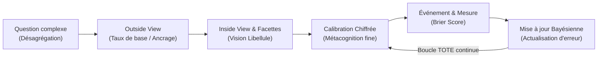
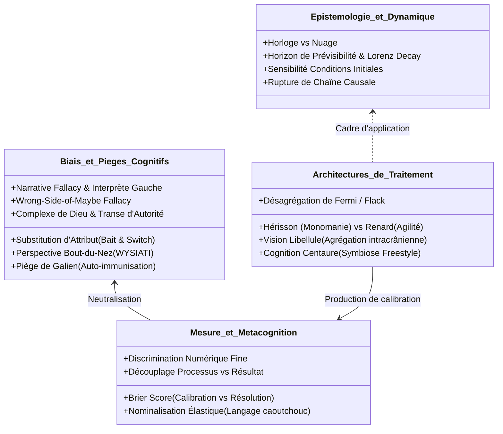

# Superforecasting - The Art and Science of Prediction
**Formateur :** Philip Tetlock & Dan Gardner | **ID :** `philip-tetlock-dan-gardner-superforecasting-the-art-and-science-of-prediction` | **Tranches :** 23

## Synthèse Architecturale du Cours : *Superforecasting* (Philip Tetlock & Dan Gardner)

---

### 1. Thèse Centrale & Philosophie du Cours

#### Vision spécifique et rupture avec l'approche standard
L'approche conventionnelle de la prospective et du conseil stratégique repose sur une **illusion narrative d'autorité** : l'« expert » y est valorisé pour son charisme rhétorique, son assurance péremptoire, la cohérence interne de son récit rétrospectif et l'usage d'un vocabulaire élastique non réfutable (*hedging* verbal). L'expertise y fonctionne comme un rituel anxiolytique social (le « bain chaud cognitif ») plutôt que comme une science empirique.

À l'opposé, Philip Tetlock et Dan Gardner imposent une **rupture épistémologique radicale** :
1. **La prédiction est une compétence d'étalonnage métrique, non un don oraculaire.** Elle s'évalue exclusivement par l'épreuve du feu d'un score mathématique horodaté et public (*Brier Score*).
2. **Le monde n'est ni une horloge laplacienne ni un nuage purement stochastique :** il est un continuum dynamique comportant des îlots locaux de régularité prévisible délimités par des horizons temporels critiques au-delà desquels l'entropie domine (*butterfly effect* lorenzien).
3. **Le découplage Décision vs Résultat (*Outcome Bias*) :** la qualité d'un jugement ne se mesure pas à l'issue binaire favorable ou défavorable d'un événement unique (qui inclut de la chance ou du bruit), mais à la rigueur probabiliste et bayésienne du processus computationnel en amont.

#### Fil rouge méthodologique
Le fil conducteur unifiant l'ensemble des interventions est **l'algorithme cybernétique TOTE épistémique : *« Forecast, Measure, Revise. Repeat »*.** 
Il s'agit de forcer le système nerveux à sortir du mode par défaut du Système 1 (substitution d'attribut, clôture narrative égocentrée, *WYSIATI*) en convertissant les intuitions floues en micro-gradations numériques fines, en multipliant les angles de vue orthogonaux (*vision libellule*), en ancrant d'abord l'évaluation dans un taux de base statistique extérieur (*outside view*), puis en actualisant continuellement ses croyances avec discipline bayésienne.



---

### 2. Carte des Concepts & Leviers Émergents



#### Écosystème conceptuel détaillé :
- **Dynamique des Systèmes & Temporalité :**
  - *Horloge vs Nuage :* Dépolarisation de la vision déterministe vs chaotique ; identification de fenêtres locales d'ordre au sein de systèmes complexes.
  - *Horizon de Dégradation Temporelle (*Time Horizon Decay*) :* Effondrement logarithmique de la prédictibilité au-delà de 1 à 3 ans dans les dynamiques géopolitiques/sociales.
  - *Non-linéarité & Rupture Causale :* Asymétrie entre micro-stimuli déclencheurs et réorganisations macro-systémiques.
- **Pièges et Distorsions Cognitives :**
  - *L'Interprète de l'Hémisphère Gauche & Narrative Fallacy :* Fabrication rétrospective inconsciente de causalités simplistes pour soulager l'anxiété de l'incertitude.
  - *Perspective « Bout-du-Nez » & WYSIATI :* Confusion infantile entre saillance perceptuelle immédiate et exhaustivité du champ informationnel.
  - *Le Piège de Galien & Langage Caoutchouc :* Auto-immunisation par assertions élastiques et non réfutables préservant le statut social de l'expert en cas d'erreur.
  - *Wrong-Side-of-Maybe :* Réduction binaire instinctive d'une probabilité (ex: considérer 70% comme une certitude et taxer d'erreur un événement survenu dans les 30% restants).
- **Architecture de Résolution & Métacognition :**
  - *Hérisson vs Renard :* Opposition entre le dogmatisme déformant à grille unique (*filtre vert émeraude*) et le pragmatisme multiperspectiviste tolérant l'ambiguïté.
  - *Vision Libellule (*Dragonfly Eye*) :* Agrégation intracrânienne de positions de perception disjointes annulant le bruit stochastique individuel pour faire émerger le signal.
  - *Découplage Calibration vs Résolution :* Tension optimale mesurée par le *Brier Score* entre fidélité aux fréquences réelles (calibration) et audace de distinction nette (résolution).
  - *Cognition Centaure (Freestyle) :* Alliance de l'invariance computationnelle de la machine (immunité au bruit) et du sens du contexte/rupture de cadre humain.

---

### 3. Tableau Récapitulatif des Techniques & Démonstrations

| Technique / Exercice | Objectif Opératoire | Déclencheur / Indication | Séquence Résumée |
|---|---|---|---|
| **Décomposition de Fermi / Flack** | Rendre soluble un problème prédictif opaque ou écrasant en sous-composants quantifiables. | Face à une question macro complexe sans antécédents directs (ex. : annexion, accord de zone franche). | 1. Fractionner la question en sous-questions étanches et investigables.<br>2. Séparer l'Inconnaissable du Connaissable.<br>3. Estimer les probabilités de chaque maillon.<br>4. Recomposer l'arbre probabiliste global. |
| **Le Test Cochrane (Inversion de Feedback)** | Briser l'illusion d'expertise dogmatique et forcer l'acceptation de la mesure empirique. | Refus d'un groupe ou d'une partie interne de tester l'efficacité d'une croyance/méthode sacralisée. | 1. Recueillir les prédictions et engagements de certitude à l'aveugle.<br>2. Présenter d'abord un faux feedback inversé attribuant des gains au protocole adverse/standard.<br>3. Constater la surprise et la rationalisation défensive.<br>4. Révéler les données réelles et sceller la nécessité du contrôle empirique systématique. |
| **Déballage de la Nominalisation Élastique (Protocole Sherman Kent)** | Éliminer le pseudo-consensus sémantique et forcer la calibration métacognitive. | Usage de quantificateurs verbaux flous (*"possible"*, *"forte probabilité"*, *"risque sérieux"*). | 1. Stopper la discussion dès l'apparition du terme flou.<br>2. Demander à chaque partie prenante d'écrire secrètement sa valeur numérique (0 à 100%).<br>3. Exposer la disparité des cartographies internes.<br>4. Re-calibrer le consensus sur une fourchette numérique explicite et testable. |
| **Perspective Extérieure d'Abord (*Outside View First*)** | Neutraliser le biais d'optimisme et l'ancrage sensoriel égocentré (*bout-du-nez*). | Début de toute estimation d'un projet, d'un comportement ou d'un événement à venir. | 1. Mettre de côté les détails narratifs spécifiques de la situation présente.<br>2. Définir la classe de référence globale (combien de cas similaires dans l'histoire ?).<br>3. Établir le taux de base statistique brut (*base rate*).<br>4. Ajuster prudemment ce taux à la marge en injectant la perspective intérieure (*inside view*). |
| **Synthèse Poly-Oculaire (Vision Libellule)** | Réduire le bruit cognitif individuel et faire converger le signal par agrégation d'angles divergents. | Risque de focalisation tunnel ou de confirmation dogmatique sur une hypothèse unique. | 1. Générer explicitement 3 à 5 perspectives contradictoires ou modèles mentaux concurrents.<br>2. Incarner chaque position avec rigueur d'avocat (principe de charité épistémique).<br>3. Identifier les vecteurs de biais divergents de chaque position.<br>4. Opérer la synthèse pondérée en retenant l'intersection des signaux invariants. |
| **Audit Pré-Mortem Épistémique** | Neutraliser la surconfiance et le verrouillage de croyance avant la prise de décision. | Consensus prématuré ou certitude excessive avant le gel d'une décision/prédiction. | 1. Se projeter tempologiquement dans l'avenir où l'échec total est un fait avéré.<br>2. Raconter l'histoire causale plausible qui a mené à cette catastrophe.<br>3. Identifier les signaux faibles négligés par le modèle initial.<br>4. Réviser la probabilité et injecter des contre-mesures opérationnelles immédiates. |

---

## Extractions Détaillées par Tranche (Opératoire & Verbatim)


## --- Tranche 1 / 23 ---

### 1. Mécanismes & Principes Actifs

- **La Métaphore Cloche vs Nuage (Polarité Déterministe vs Dynamique Non-Linéaire)**
  - *Principe actif :* Le système cognitif humain a une propension naturelle à catégoriser le monde en dichotomies rigides : l'avenir est soit totalement écrit (mécanique d'horlogerie laplacienne), soit pur chaos stochastique (nuage lorenzien). En PNL et en modélisation cognitive, cette polarisation fige les stratégies d'adaptation. Le principe actif consiste à dissoudre cette double contrainte par la reconnaissance d'un continuum probabiliste : des poches de régularité prévisible émergent au sein même de systèmes dynamiques chaotiques. En réduisant l'absolutisme cognitif, le système nerveux tolère l'incertitude sans basculer dans le nihilisme décisionnel.
  - *Tags libres :* #horloge_vs_nuage #determinisme_laplace #chaos_lorenzien #dissolution_dichotomie #continuum_probabiliste

- **La Cécité au Track Record par Séduction Narrative (Narrative Fallacy)**
  - *Principe actif :* L'inconscient humain privilégie la cohérence interne, l'aisance prosodique et la confiance perçue (posture de certitude, charisme des "talking heads") au détriment de la précision empirique rétroactive. En termes hypnotiques, l'autorité apparente produit une transe d'adhésion immédiate : le sujet projette de la compétence prédictive là où il n'y a qu'une habileté à raconter une histoire rétroactivement séduisante (*retrospective narrative arc*). La désactivation de ce piège passe par l'exigence d'une mesure objective et datée (*track record*).
  - *Tags libres :* #illusion_d_expertise #seduction_narrative #biais_de_retroaction #transe_d_autorite #score_empirique

- **L'Effet Papillon Décisionnel et Rupture de Chaîne Causale**
  - *Principe actif :* Dans les systèmes sociologiques complexes, des micro-événements à la base (ex: Mohamed Bouazizi) déclenchent des cascades de réactions non-proportionnelles qui brisent toute linéarité causale directe. Au niveau neurologique, l'esprit humain tente instinctivement de relier la cause macro à un effet macro. Le principe actif ici est l'acceptation de l'indétermination locale : un système peut rester stable sous tension pendant des décennies jusqu'à ce qu'un stimulus infime réorganise tout le champ.
  - *Tags libres :* #sensibilite_aux_conditions_initiales #non_linearite_sociale #rupture_causale #bifurcation_systemique

- **L'Ancrage Temporel et Dégradation Prédictive (Time Horizon Decay)**
  - *Principe actif :* La calibration de la prévisibilité est une fonction inverse de l'horizon temporel. À court terme, les boucles de rétroaction locales et l'inertie systémique stabilisent la prédiction ; au-delà d'un horizon critique (1 à 3 ans dans les systèmes géopolitiques), les variables non-observées s'accumulent exponentiellement, ramenant la prédiction à un niveau stochastique équivalent au hasard (*dart-throwing chimpanzee*).
  - *Tags libres :* #horizon_de_predictibilite #degradation_temporelle #entropie_informationnelle #calibration_temporelle

---

### 2. Protocoles, Techniques & Démonstrations (Étape par Étape)

#### Décomposition Opératoire de la Question Prédictive Complexe (Méthode de Bill Flack)
* **Intention / Indication :** À utiliser lorsqu'un sujet ou un décideur est confronté à un événement macro complexe, lointain ou perçu comme opaque/inconnaissable (ex: "La Russie va-t-elle annexer un territoire ?", "Accord commercial en zone franche de Shanghai ?").
* **Mise en place & Pré-framing :** 
  - Dépolariser le statut d'expert : la prédiction n'est pas un don inné ("you have it or you don't"), c'est une compétence d'étalonnage délibéré qui s'apprend.
  - Neutraliser l'illusion de savoir immédiat par la reconnaissance explicite de ses limites ("rubbing nose in limitations").
* **Séquence d'actions pas à pas :**
  1. *Étape 1 : Cartographie de l'Ignorance Initiale*
     - Poser la question brute et calibrer la réaction de perplexité interne ("What on earth is X?").
     - Valider que le manque de familiarité immédiate n'est pas un obstacle à l'investigation.
  2. *Étape 2 : Devoir de Recherche Équilibré (Doing Homework)*
     - Collecter les faits structurels sous-jacents (cadre institutionnel, régulations, géographie, chronologie).
     - Remplacer les opinions floues par des données de base observables.
  3. *Étape 3 : Pesée des Forces Contradictoires (Balancing Clashing Arguments)*
     - Extraire explicitement le scénario A et le scénario non-A.
     - Identifier les arguments qui soutiennent la survenue de l'événement et ceux qui s'y opposent, sans préjugé identitaire ou idéologique.
  4. *Étape 4 : Détermination Probabiliste Précise et Enregistrement Horodaté*
     - Fixer une probabilité chiffrée (et non des adverbes vagues comme "probable" ou "impossible").
     - Horodater et archiver la prédiction auprès d'un observateur tiers ou d'un registre inviolable avant l'échéance.
* **Signes de calibration :** 
  - Disparition des jugements émotionnels ou péremptoires ("c'est évident", "impossible").
  - Posture de curiosité méthodique, ton posé, examen simultané des preuves contraires.

---

### 3. Heuristiques, Subtilités & "Sagesse du Praticien"

- **Règle de Mesure Impérative :**
  - *Si* une prédiction n'est pas assortie d'une date limite stricte, d'une probabilité numérique et d'un archivage neutre, *alors* elle est nulle et non avenue d'un point de vue opératoire, *parce que* l'esprit humain réécrit spontanément son passé pour valider sa clairvoyance a posteriori (*hindsight bias*).
- **Règle de l'Optimisme Sceptique :**
  - *Si* la cible d'investigation appartient à un système fermé ou à forte répétition statistique (horaires de lever du soleil, trafic pendulaire du matin, tables de mortalité actuarielle), *alors* appliquer les modèles mécaniques déterministes (Laplace).
  - *Si* la cible d'investigation dépend d'interactions humaines en réseau complexe et d'horizons longs, *alors* adopter la prudence lorenzienne : anticiper la bifurcation et resserrer la fenêtre temporelle d'évaluation.
- **Piège du Téléphone Arabe Scientifique :**
  - Attention à la mutation des résultats de recherche : l'affirmation scientifique nuancée (*"la moyenne des experts sur 3-5 ans ne bat pas le hasard"*) est systématiquement déformée par le public en un nihilisme populiste binaire (*"tous les experts ne valent rien"*). Le praticien doit constamment revenir à la granularité fine de la donnée.
- **Postulat Philosophique Central :**
  - L'humain vit dans un entrelacement permanent de "clocks" (horloges déterministes) et de "clouds" (nuages non-linéaires). Prétendre que tout est imprévisible est aussi erroné que de prétendre que tout est mécanique.

---

### 4. Pépites Verbatim & Patterns Linguistiques (MOT À MOT EN V.O.)

#### Pépite 1 : Le Déploiement de l'Omniscience Déterministe
> "We may regard the present state of the universe as the effect of its past and the cause of its future. An intellect which at a certain moment would know all forces that set nature in motion, and all positions of all items of which nature is composed, if this intellect were also vast enough to submit these data to analysis, it would embrace in a single formula the movements of the greatest bodies of the universe and those of the tiniest atom; for such an intellect nothing would be uncertain and the future just like the past would be present before its eyes."

* **[Analyse du Pattern] :**
  - **Empilement de présuppositions déterministes et nominalisations absolues :** Utilisation d'un cadre conditionnel maximaliste (*"if this intellect were also vast enough..."*) créant une structure hypnotique d'inévitabilité.
  - **Parallélisme temporel spatialisé :** La formule finale (*"the future just like the past would be present before its eyes"*) fusionne les repères temporels (passé/futur) dans un champ visuel statique unifié, induisant une transe d'omniscience absolue.

#### Pépite 2 : L'Écrasement du Mythe de l'Horloge par le Nuage
> "Lorenz poured cold rainwater on that dream. If the clock symbolizes perfect Laplacean predictability, its opposite is the Lorenzian cloud. High school science tells us that clouds form when water vapor coalesces around dust particles. This sounds simple but exactly how a particular cloud develops—the shape it takes—depends on complex feedback interactions among droplets."

* **[Analyse du Pattern] :**
  - **Métaphore kinesthésique de rupture :** L'expression *"poured cold rainwater on that dream"* produit un arrêt de pattern émotionnel brutal face à la rêverie intellectuelle laplacienne.
  - **Polarisation symbolique :** Mise en contraste binaire de deux ancres visuelles archétypales (*"clock"* = ordre, géométrie, son régulier vs *"cloud"* = informe, gazeux, insaisissable).
  - **Truisme d'autorité puis bascule de complexité :** Citation d'un savoir basique (*"High school science tells us..."*) suivi immédiatement d'une conjonction d'opposition (*"This sounds simple but..."*) pour fracturer le sentiment de certitude simpliste du lecteur.

#### Pépite 3 : La Cascade Chaotique d'un Événement Micro vers le Macro
> "A woman living in a Kansas City suburb may think Tunisia is another planet, and her life has no connection to it, but if she were married to an air force navigator who flies out of the nearby Whiteman Air Force Base, she might be surprised to learn that one obscure Tunisian’s actions led to protests, that led to riots, that led to the toppling of a dictator, that led to protests in Libya, that led to a civil war, that led to the 2012 NATO intervention, that led to her husband dodging antiaircraft fire over Tripoli."

* **[Analyse du Pattern] :**
  - **Anadiplose en chaîne (syntaxe cumulative hypnotique) :** L'enchaînement répétitif de *"led to... that led to... that led to..."* fonctionne comme un boucleur conversationnel qui force le système nerveux à suivre une cascade causale implacable reliant deux réalités spatialement étanches (la banlieue de Kansas City et les tirs de DCA au-dessus de Tripoli).
  - **Rupture d'illusion d'isolement :** Le cadrage initial d'isolement cognitif (*"may think Tunisia is another planet"*) est pulvérisé par la matérialité somatique de la conclusion (*"dodging antiaircraft fire"*).

#### Pépite 4 : La Déconstruction du Faux Dilemme
> "So is reality clocklike or cloud-like? Is the future predictable or not? These are false dichotomies, the first of many we will encounter. We live in a world of clocks and clouds and a vast jumble of other metaphors. Unpredictability and predictability coexist uneasily in the intricately interlocking systems that make up our bodies, our societies, and the cosmos."

* **[Analyse du Pattern] :**
  - **Double interrogation rhétorique en miroir :** Formulation des deux pôles sous forme de questions fermées pour faire émerger la tension binaire chez l'interlocuteur.
  - **Recadrage de niveau supérieur (Meta-framing) :** Qualification immédiate en *"false dichotomies"*, ce qui élève le niveau logique de la réflexion au-dessus des choix imposés.
  - **Emboîtement métaphorique (Multi-level nesting) :** Les termes *"clocks and clouds and a vast jumble of other metaphors"* et *"intricately interlocking systems"* réinstallent la tolérance à la complexité systémique à travers les trois niveaux d'expérience : somatique (*"our bodies"*), relationnel/collectif (*"our societies"*) et ontologique (*"the cosmos"*).


## --- Tranche 2 / 23 ---

### 1. Mécanismes & Principes Actifs

- **La Boucle Cybernétique « Forecast-Measure-Revise » (L'Algorithme TOTE Épistémique)**
  *Principe actif* : Le cerveau humain et les systèmes organisationnels sont programmés pour clore rapidement l'incertitude et préserver l'illusion de contrôle. Sans mesure objective et métrique d'écart (*feedback* cybernétique direct), le système cognitif fonctionne en boucle fermée et se rassure par auto-validation. L'itération *« Forecast, measure, revise. Repeat »* agit exactement comme l'unité TOTE (Test-Operate-Test-Exit) de Miller, Galanter & Pribram en PNL. Elle contraint le système nerveux à désamorcer l'ancrage de certitude en confrontant la représentation interne (prédiction) à la trace sensorielle brute de la réalité (mesure), forçant ainsi l'accommodation neuronale (révision).
  *Tags* : #forecast_measure_revise #cybernetic_tote_loop #feedback_as_neurological_correction #epistemic_calibration

- **Démantèlement des Dichotomies Binaires & Recadrage en Continuum Contextuel**
  *Principe actif* : La cognition sous stress ou paresseuse réduit le monde à des polarités étanches (*horloges vs nuages*, *prévisible vs imprévisible*), ce qui active un traitement cortical simplifié à deux états (noir/blanc). Tetlock brise ce fractionnement binaire en introduisant un cadre dimensionnel continu où la prévisibilité est une fonction fluide de trois paramètres : la nature de la variable cible, l'horizon temporel et les conditions limites du système. Ce recadrage élargit la flexibilité représentationnelle et neutralise les sophismes d'exclusion mutuelle.
  *Tags* : #false_dichotomy_collapse #contextual_continuum #multidimensional_framing #cognitive_flexibility

- **Dissonance de la Non-Linéarité Temporelle & Effet Papillon Somato-Cognitif**
  *Principe actif* : L'esprit humain extrapole par défaut de manière linéaire (heuristique de représentativité / continuité). La non-linéarité et la sensibilité aux conditions initiales (l'aile de papillon de Lorenz) créent une dégradation exponentielle de la résolution prédictive à mesure que l'horizon s'étend. Reconnaître les frontières de prévisibilité (*« knowing the current limits is itself a success »*) permet d'éviter l'épuisement cognitif et l'entêtement dogmatique face à l'entropie.
  *Tags* : #nonlinearity_boundary #lorenz_decay #horizon_limits #entropy_acceptance

- **Motivation cachée & Triangulation des Intentions Prédictives**
  *Principe actif* : Une prédiction explicite est rarement une recherche de vérité факtuelle ; elle opère le plus souvent comme un geste hypnotique relationnel ou politique répondant à des fonctions secondaires inconscientes : divertissement (*entertainment / booyah!*), galvanisation idéologique (*agenda-driven terror*), signalement de statut social (*dress-to-impress*) ou régulation homéostatique de l'anxiété (*comfort bath*). Identifier la fonction téléologique réelle d'une affirmation désamorce immédiatement son emprise hypnotique sur le récepteur.
  *Tags* : #teleological_unmasking #secondary_gain_of_forecasting #cognitive_warm_bath #status_signaling

- **L'Agrégation Hybride Homme-Machine (Symbiose Freestyle)**
  *Principe actif* : Les algorithmes statistiques simples et les modèles computationnels écrasent le jugement subjectif par leur insensibilité au bruit, à la fatigue et aux biais émotionnels. Toutefois, la machine ne manipule que la syntaxe et la régularité statistique, incapable d'« originer du sens » (*originating vs mimicking meaning*). Le pattern opératoire optimal n'est pas le remplacement mais la fusion en équipe hybride (*freestyle*), où la machine fournit le calcul de probabilité de base et l'humain intervient pour arbitrer les ruptures de contexte et injecter le discernement qualitatif.
  *Tags* : #centaur_cognition #freestyle_synthesis #meaning_origination #human_machine_symbiosis

- **Le Piège d'Autorité et la Clôture Épistémique Tautologique (Le Piège de Galien)**
  *Principe actif* : La projection de compétence sur une figure d'autorité (chirurgien de renom, autorité dogmatique millénaire) déclenche une catalepsie du doute critique chez le sujet et chez l'expert lui-même. Privé de protocole réfutateur, le cerveau interprète toute preuve contradictoire au moyen d'un raisonnement circulaire inviolable : si le traitement échoue, c'est le patient qui était incurable, non la théorie qui était fausse. Cette immunisation tautologique bloque tout apprentissage pendant des siècles.
  *Tags* : #galenic_trap #authority_induced_trance #circular_immunization #unfalsifiable_loop

---

### 2. Protocoles, Techniques & Démonstrations (Étape par Étape)

#### Protocole d'Amorçage Épistémique : « Le Micro-Calibrage des 60 Minutes »
* **Intention / Indication** : Augmenter immédiatement de 10 % la précision prédictive et la flexibilité cognitive d'un décideur ou sujet face à l'incertitude, à un coût cognitif minimal.
* **Mise en place & Pré-framing** : Dissocier le talent de la performance. Cadrer l'exercice non pas comme un test de QI ou une intuition innée, mais comme l'apprentissage d'une discipline de mise à jour mentale (*updating habits*).
* **Séquence d'actions pas à pas** :
  1. *Étape 1 : Désamorçage du statut d'oracle* -> Rompre l'attente de certitude absolue (100 % ou 0 %). Établir que l'expertise consiste à discerner la nuance opératoire (par exemple la différence entre une chance 60/40 et 40/60).
  2. *Étape 2 : Définition chirurgicale de la cible* -> Formuler la question sous forme d'issue binaire ou quantitative mesurable, temporellement close, interdisant toute ambiguïté sémantique rétroactive.
  3. *Étape 3 : Ancrage du taux de base (Base Rate)* -> Extraire le problème de son narratif dramatique pour identifier la fréquence statistique historique d'événements similaires.
  4. *Étape 4 : Découpage en sous-problèmes* -> Séparer ce qui relève du calculable/prévisible à court terme et ce qui relève du chaos non linéaire.
  5. *Étape 5 : Mise à jour incrémentale continue* -> Intégrer les nouvelles informations par petits ajustements précis plutôt que par bascules émotionnelles violentes.
* **Signes de calibration** : Passage d'un langage émotionnel/catégorique (*« c'est certain »*, *« impossible »*) à un calibrage probabiliste fin (*« j'évalue à 65 % »*), absence de défense d'ego lors de la réception d'un contre-signal, fluidité de révision.

#### Protocole de Rupture de la Tautologie Galénique & Réfutation d'Autorité
* **Intention / Indication** : À utiliser lorsqu'un sujet ou un système s'enferme dans une croyance dogmatique auto-validante ou une décision prise sous hypnose d'autorité (comme le diagnostic du chirurgien chez Cochrane).
* **Mise en place & Pré-framing** : Inviter le sujet à poser temporairement son accord avec l'autorité sur une « table d'observation externe », sans juger l'autorité elle-même.
* **Séquence d'actions pas à pas** :
  1. *Étape 1 : Cartographie de la circularité* -> Amener le sujet à expliciter sa formule de validation : *« Qu'est-ce qui prouve que ton action fonctionne ? »*.
  2. *Étape 2 : Injection du critère d'infirmation (Popperian Test)* -> Poser la question de rupture : *« Quel résultat précis, s'il se produisait, te forcerait à admettre que cette intervention est inefficace ou nuisible ? »*.
  3. *Étape 3 : Détection de l'échappatoire d'incurabilité* -> Si le sujet répond que l'échec prouve seulement la gravité externe du problème, nommer le pattern galénique (*« L'intervention n'échoue-t-elle que sur les cas incurables ? »*).
  4. *Étape 4 : Instauration de la baseline d'inaction (Contrôle à vide)* -> *« Que se passerait-il si le système suivait son cours naturel sans aucune intervention ? »* (comparaison avec l'absence de médecin chez Washington).
  5. *Étape 5 : Suspension du jugement dans l'attente du signal sensoriel indépendant* -> Bloquer l'action irréversible tant que le rapport indépendant (le « pathologiste ») n'est pas produit.
* **Signes de calibration** : Micro-sidération cognitive du sujet, relâchement de la posture défensive, accès à un état de curiosité sceptique, acceptation explicite de l'attente de validation externe.

---

### 3. Heuristiques, Subtilités & "Sagesse du Praticien"

- **Heuristique de Granularité Probabiliste (Règle d'Aaron Brown & de la Joueuse de Poker)** :
  *Règle* : Si le sujet ne fait aucune distinction entre un pari 60/40 et un pari 40/60, alors traite son jugement comme aléatoire et amateur. Le maître calibre dans la marge de 10 % à 20 %, car c'est cette asymétrie répétée qui sépare la rentabilité continue de la banqueroute.

- **Heuristique de Détection des Agendas Cachés (Règle du Bain Chaud)** :
  *Règle* : Si une prédiction génère immédiatement un confort émotionnel chez celui qui l'écoute (*« slipping into a warm bath »*), alors suspecte une fonction de réassurance identitaire plutôt qu'un calcul de réalité. Si elle génère de l'agitation théâtrale (*« booyah! »*), suspecte une fonction de divertissement marchand.

- **Heuristique de Décomposition Temporelle de Lorenz** :
  *Règle* : Si l'horizon prédictif dépasse le seuil critique de non-linéarité du système (ex. plus de 5 à 7 jours en météo, plus de 12 à 18 mois en géopolitique), alors réduis radicalement la confiance du modèle et bascule en mode scénarios ouverts ; au-delà, les rendements de l'analyse décroissent vers zéro.

- **Heuristique de l'Engagement à l'Auto-Amélioration** :
  *Règle* : Si tu cherches le meilleur prédicteur de la performance d'un praticien ou d'un prévisionniste, ne mesure ni son QI brut, ni son bagage mathématique formel, ni son temps passé à consommer l'information : mesure son degré d'autocritique et sa rigueur à suivre l'algorithme *Prévoir -> Mesurer -> Réviser*.

- **Pièges Classiques & Erreurs Corrigées** :
  * *L'illusion du résultat unique (L'erreur de George Washington)* : Juger la qualité d'une méthode sur l'issue d'un seul cas clinique ou d'un événement isolé. Une mort ou une guérison ne prouve rien sans comparaison avec la distribution contrefactuelle.
  * *L'illusion du gourou* : Croire que l'accès à des informations confidentielles (données classifiées) surpasse une méthode ouverte de pensée critique rigoureuse. Le tournoi démontre que des profanes méthodiques battent des analystes du renseignement équipés de données secrètes.

---

### 4. Pépites Verbatim & Patterns Linguistiques (MOT À MOT EN V.O.)

#### Pépite 1 : La Destruction de la Fausse Dichotomie
> *"So is reality clocklike or cloud-like? Is the future predictable or not? These are false dichotomies, the first of many we will encounter. We live in a world of clocks and clouds and a vast jumble of other metaphors. Unpredictability and predictability coexist uneasily in the intricately interlocking systems that make up our bodies, our societies, and the cosmos."*

* **[Analyse du Pattern]** : 
  Double question rhétorique binaire posée en amorce pour faire monter l'attente du récepteur, immédiatement suivie d'une rupture de pattern nette (*« These are false dichotomies »*). Utilisation d'une métaphore spatiale polarisée (*clocks vs clouds*, reprise de Popper) instantanément dissoute par l'intégration systémique (*« coexist uneasily in the intricately interlocking systems »*). La cadence ternaire ascendante (*« our bodies, our societies, and the cosmos »*) force l'inconscient à accepter l'ubiquité de cette coexistence à tous les niveaux fractals de l'existence.

#### Pépite 2 : L'Injonction TOTE Épurée
> *"Forecast, measure, revise. Repeat. It’s a never-ending process of incremental improvement that explains why weather forecasts are good and slowly getting better."*

* **[Analyse du Pattern]** :
  Empilement de commandes impératives monosyllabiques et asyndétiques (*« Forecast, measure, revise. Repeat. »*). Ce rythme staccato mime neurologiquement la mécanique d'une boucle algorithmique sans friction. L'enchaînement crée une présupposition d'évidence opérationnelle, suivie d'un truisme de renforcement reliant la boucle à un progrès inévitable (*« incremental improvement »*).

#### Pépite 3 : La Métaphore du Bain Chaud Cognitif
> *"And some forecasts are meant to comfort—by assuring the audience that their beliefs are correct and the future will unfold as expected. Partisans are fond of these forecasts. They are the cognitive equivalent of slipping into a warm bath."*

* **[Analyse du Pattern]** :
  Recadrage de sens (*meaning reframe*) transformant un acte intellectuel prétendu (la prévision politique) en une régulation somato-émotionnelle régressive. L'induction kinesthésique directe (*« slipping into a warm bath »*) court-circuite la posture d'analyse critique en associant physiquement le dogmatisme partisan à la torpeur passive et au relâchement musculaire confortable d'un bain chaud, dévalorisant le processus sans attaquer frontalement l'interlocuteur.

#### Pépite 4 : L'Inversion Identitaire du Talent
> *"Foresight isn’t a mysterious gift bestowed at birth. It is the product of particular ways of thinking, of gathering information, of updating beliefs. These habits of thought can be learned and cultivated by any intelligent, thoughtful, determined person."*

* **[Analyse du Pattern]** :
  Dé-nominalisation et démystification de la compétence. Passage d'une assignation identitaire fixe passée sous forme de don passif (*« mysterious gift bestowed at birth »*) à une suite de nominalisations de processus actifs modélisables (*« ways of thinking, of gathering information, of updating beliefs »*). L'ouverture finale utilise un truisme d'inclusion avec présupposition d'accessibilité (*« can be learned and cultivated by any... »*), ce qui installe une suggestion d'auto-efficacité chez l'apprenant.

#### Pépite 5 : La Tautologie Mortelle de Galien
> *"‘All who drink of this treatment recover in a short time, except those whom it does not help, who all die,’ he wrote. ‘It is obvious, therefore, that it fails only in incurable cases.’"*

* **[Analyse du Pattern]** :
  Exemple canonique de boucle auto-immunisante et de double lien pervers. La syntaxe repose sur une prémisse majeure englobante (*« All who drink... recover »*), immédiatement verrouillée par une exception circulaire non réfutable (*« except those whom it does not help, who all die »*). L'adverbe assertif et le connecteur de causalité factice (*« It is obvious, therefore... »*) forcent une conclusion logique aberrante qui scelle hermétiquement la croyance contre toute remise en question empirique.


## --- Tranche 3 / 23 ---

### 1. Mécanismes & Principes Actifs

- **La Compulsion à la Cohérence Rétrospective (L'Interprète de l'Hémisphère Gauche)** : 
  Le système nerveux ne tolère pas le vide explicatif ni l'ambiguïté motrice/perceptive. Face à une action inconsciente ou à un événement émergent sans cause immédiate connue, l'hémisphère gauche fabrique instantanément un récit logique acceptable pour réconcilier l'observation avec le modèle du monde existant. Ce mécanisme de confabulation narrative apaise la dissonance cognitive en injectant un sens artificiel a posteriori.
  *Tags : #interprete_hemispherique #confabulation_narrative #cloture_cognitive #fabrication_de_sens*

- **Substitution d'Attribut (Bait and Switch Opératoire)** :
  Filtre cognitif inconscient où le système nerveux, confronté à une question computationnellement coûteuse ou intraitable par manque de données (« Vais-je mourir de ce cancer ? » ou « Y a-t-il un prédateur dans cette herbe ? »), substitue à l'insu du sujet une question heuristique beaucoup plus simple (« Cette autorité médicale est-elle compétente ? » ou « Ai-je le souvenir saillant d'une attaque ? »). La réponse à la question facile remplace et écrase silencieusement la question originelle.
  *Tags : #substitution_d_attribut #bait_and_switch #heuristique_de_facilite #derivation_inconsciente*

- **Heuristique de Disponibilité (Availability Cascade)** :
  L'inconscient et le Système 1 évaluent la fréquence, la probabilité ou le risque d'un événement non pas sur la base de données statistiques volumétriques, mais en fonction de la fluidité et de la vitesse de rappel neuromnésique (saillance émotionnelle, images vives récemment encodées). Si l'évocation sensorielle (VAKOG) est immédiate et chargée, la réalité de la menace est validée comme certitude biologique.
  *Tags : #disponibilite_mnesique #saillance_sensorielle #fluidite_cognitive #ancrage_emotionnel*

- **Biais de Confirmation & Scepticisme Motivé (Boucle de Fermeture Dogmatique)** :
  L'esprit traite asymétriquement les stimuli entrants : les éléments congruents avec la prémisse adoptée sont intégrés sans friction comme preuves (« le patient guérit = le remède fonctionne »), tandis que les éléments discordants sont activement requalifiés ou neutralisés (« le patient meurt = c'était un cas incurable »). En PNL, cela correspond au verrouillage des critères de validation par un cadre de résultat autoréférentiel.
  *Tags : #biais_de_confirmation #scepticisme_motive #boucle_autoreferentielle #verrouillage_de_croyance*

- **Principe WYSIATI ("What You See Is All There Is")** :
  L'architecture neurologique du Système 1 traite la fraction d'information sensorielle actuellement activée dans la mémoire de travail comme si elle représentait l'intégralité du territoire existant. L'absence de signal n'est pas traitée comme un manque d'information, mais comme une preuve de non-existence de variables alternatives.
  *Tags : #wysiati #omission_du_hors_champ #illusion_d_exhaustivite #economie_cognitive*

- **Le Complexe de Dieu (Surcharge d'Autorité & Croyance d'Infaillibilité)** :
  État interne dans lequel un individu ou une institution investie d'une reconnaissance sociale attribue une valeur de vérité absolue à ses propres intuitions non testées, disqualifiant tout retour d'information (feedback loop) externe ou contre-exemple sous prétexte d'éthique, de sagesse ou de tradition.
  *Tags : #complexe_de_dieu #hallucination_d_expertise #verrou_d_autorite #rejet_du_feedback*

---

### 2. Protocoles, Techniques & Démonstrations (Étape par Étape)

#### Protocole 1 : Le Test Cochrane (Rupture d'Illusion d'Expertise par Inversion de Feedback)
* **Intention / Indication** : À utiliser lorsqu'un groupe d'experts, un client ou une partie interne refuse d'évaluer objectivement une méthode par attachement dogmatique ou certitude morale d'efficacité (« Notre méthode est évidemment la seule éthique/efficace »).
* **Mise en place & Pré-framing** : 
  1. Séparer l'échantillon ou les cas en deux groupes comparables de manière aléatoire (groupe protocole A vs groupe contrôle B).
  2. Maintenir les observateurs/experts dans l'attente d'une validation de leur présupposition.
* **Séquence d'actions pas à pas** :
  * **Étape 1 (Annonce de la tendance préliminaire inversée)** : Présenter les résultats préliminaires en attribuant faussement les scores favorables à l'intervention dogmatique de l'expert (« Les patients traités par votre unité spéciale semblent s'en sortir légèrement mieux »).
  * **Étape 2 (Calibration du piège de justification)** : Observer et laisser s'exprimer le soulagement ou l'indignation morale de l'expert (« Vous voyez bien ! Arrêtez immédiatement l'évaluation, c'est criminel de tester le groupe témoin ! »).
  * **Étape 3 (Révélation de l'inversion)** : Calibrer l'état émotionnel, puis délivrer la rupture de pattern sèche : révéler que les chiffres étaient inversés et que c'est en réalité le groupe contrôle/non traité qui a obtenu de meilleurs résultats.
  * **Étape 4 (Gestion du silence de choc / Confusion)** : Ne pas meubler le silence. Laisser le choc cognitif fracturer la certitude dogmatique et forcer le passage vers le doute opératoire.
* **Signes de calibration** : Passage d'une vocalisation péremptoire, d'une posture dominante ou accusatoire à une sidération motrice immédiate (« dead silence »), pâleur, regard fixe ou figement respiratoire signalant une rupture complète du cadre de référence interne.

---

#### Protocole 2 : L'Élicitation de la Falsification Interne (Calibration du Doute Opératoire)
* **Intention / Indication** : Faire basculer un sujet d'un état de certitude dogmatique non vérifiée (hallucination de cohérence narrative) vers une lucidité critique et probabiliste.
* **Mise en place & Pré-framing** : Cadrer que la croyance actuelle est une « hypothèse plausible » et non une vérité ontologique. Poser le doute non comme une faiblesse mais comme un instrument d'exploration.
* **Séquence d'actions pas à pas** :
  * **Étape 1 (Explicitation de la certitude)** : Demander au sujet de verbaliser ce dont il est convaincu à 100% concernant une situation, une décision ou une personne.
  * **Étape 2 (Vérification de la substitution d'attribut)** : Poser la question de diagnostic : *« Quelle question difficile as-tu secrètement remplacée par une question facile à laquelle tu savais déjà répondre ? »*
  * **Étape 3 (Le Test de Falsification)** : Poser la question opératoire : *« Qu'est-ce qui te convaincrait que tu as tort ? »* (Quel stimulus sensoriel spécifique, comportement mesurable ou donnée nouvelle prouverait formellement l'échec de ton hypothèse ?).
  * **Étape 4 (Calibration du verrou)** :
    - *Si le sujet est incapable de nommer un critère de réfutation* -> Traiter le verrouillage dogmatique / l'attachement identitaire (retour à l'induction de doute).
    - *Si le sujet produit un critère testable* -> Concevoir l'expérience de vérification concrète (recherche active du contre-exemple).
* **Signes de calibration** : Ralentissement du débit de parole, micro-pauses réflexives (activation du Système 2), mouvements oculaires d'accès vers la construction visuelle/kinesthésique interne plutôt que répétition fluide de scripts mémorisés.

---

### 3. Heuristiques, Subtilités & "Sagesse du Praticien"

- **Règle de Détection de Cohérence vs Vérité** :
  *Si le sujet exprime un haut niveau de confiance émotionnelle et déclare que « tout se recoupe parfaitement » -> Alors traite cela uniquement comme la signature d'une histoire cohérente construite par son Système 1, JAMAIS comme la preuve que l'histoire est vraie.*

- **Règle de Réaction à l'Ambiguïté Clinique** :
  *Si un résultat ou un événement présente trop de variables inconnues ou d'explications concurrentes (comme la mort de Washington ou une fluctuation boursière) -> Alors suppose immédiatement que l'esprit du praticien ou du client va lire l'ambiguïté en faveur de sa conclusion préférée (biais de confirmation).* Ne jamais valider un changement sur une observation unique non contrôlée.

- **Règle de Vulnérabilité de l'Expert face à l'Autorité** :
  *Même si le sujet est un sceptique entraîné ou un maître de la méthode (ex: Archie Cochrane face au cancérologue) -> S'il fait face à une figure d'autorité reconnue observant directement un phénomène terrifiant, il substituera inconsciemment la compétence de la personne à la véracité de l'énoncé et capitulera sans exiger de test objectif.*

- **Règle de Modélisation du Doute (Feynman)** :
  *« Le doute n'est pas une chose effrayante, mais une chose de très grande valeur. »* Le niveau de progression d'un système n'est pas mesuré par l'accumulation passive d'observations, mais par le taux auquel il engendre activement de nouvelles hypothèses à tester et à tenter de réfuter.

- **Erreur de débutant corrigée** :
  Penser que les faits bruts ou une expérience isolée suffisent à changer un paradigme (comme Lind prouvant l'effet des agrumes sur le scorbut sans comprendre le mécanisme statistique). Sans un modèle expérimental formel intégrant le hasard et la distribution, le praticien retombe inévitablement dans ses pratiques archaïques dès la fin de l'intervention.

---

### 4. Pépites Verbatim & Patterns Linguistiques (MOT À MOT EN V.O.)

#### Pépite 1 : Le piège de l'infaillibilité autoréférentielle (Galien)
> « All who drink of this treatment recover in a short time, except those whom it does not help, who all die. It is obvious, therefore, that it fails only in incurable cases. »
* **[Analyse du Pattern]** : Tautologie circulaire fermée et recadrage d'infaillibilité. Le quantificateur universel (*"All who drink..."*) pose un truisme d'efficacité apparente, immédiatement suivi d'une clause d'exclusion absolue (*"except those..."*) requalifiée par un lien de cause à effet spécieux (*"It is obvious, therefore..."*). Tout échec est nominalisé en anomalie intrinsèque au sujet (*"incurable cases"*), protégeant hermétiquement le modèle d'intervention de toute falsification.

---

#### Pépite 2 : La métaphore de l'illusion rituelle (Feynman)
> « So they “arranged to make things like runways, to put fires along the sides of the runways, to make a wooden hut for a man to sit in, with two wooden pieces on his head like headphones and bars of bamboo sticking out like antennas—he’s the controller—and they wait for the planes to land.” But the planes never returned. So cargo cult science has the outward form of science but lacks what makes it truly scientific. »
* **[Analyse du Pattern]** : Métaphore isomorphe de surface vs structure profonde (*Cargo Cult*). L'accumulation de prédicats sensoriels visuels et kinesthésiques (*"fires along the sides"*, *"wooden pieces on his head"*, *"bars of bamboo"*) installe une transe de mimétisme comportemental. La rupture intervient sur une proposition courte et tranchante (*"But the planes never returned."*), désamorçant l'illusion de compétence pour introduire une distinction nette entre le rituel extérieur et le principe actif réel.

---

#### Pépite 3 : La gradation hypnotique de l'incertitude scientifique (Feynman)
> « When the scientist tells you he does not know the answer, he is an ignorant man. When he tells you he has a hunch about how it is going to work, he is uncertain about it. When he is pretty sure of how it is going to work, and he tells you, “This is the way it’s going to work, I’ll bet,” he still is in some doubt. And it is of paramount importance, in order to make progress, that we recognize this ignorance and this doubt. »
* **[Analyse du Pattern]** : Empilement de truismes et progression rythmique en transe conversationnelle. Utilisation d'une structure en anaphore (*"When the scientist tells you..."*) avec glissement graduel des états internes (*"ignorant"* -> *"uncertain"* -> *"pretty sure"* -> *"still is in some doubt"*). Cette gradation ancre le doute non pas comme un défaut, mais comme une présence constante et indispensable, aboutissant à une commande de recadrage d'état ressource (*"it is of paramount importance... that we recognize this ignorance and this doubt"*).

---

#### Pépite 4 : La confabulation instantanée de l'hémisphère gauche (Split-Brain)
> « “Oh, that’s simple,” one patient said. “The chicken claw goes with the chicken, and you need a shovel to clean out the chicken shed.” »
* **[Analyse du Pattern]** : Rationalisation a posteriori et clôture de sens instantanée. L'ouverture décontractée (*"Oh, that’s simple"*) signale un ancrage d'évidence factice créé par l'inconscient pour masquer l'ignorance. La juxtaposition logique rapide lie deux éléments visuels disparates et non corrélés (*"chicken claw"* et *"shovel"*) dans une chaîne causale artificielle mais cohérente, illustrant la vitesse foudroyante à laquelle l'esprit préfère fabriquer un mensonge logique plutôt que tolérer le vide du *"Je ne sais pas"*.

---

#### Pépite 5 : Le critère de démarcation entre histoire et réalité (Kahneman)
> « It is wise to take admissions of uncertainty seriously, but declarations of high confidence mainly tell you that an individual has constructed a coherent story in his mind, not necessarily that the story is true. »
* **[Analyse du Pattern]** : Dissociation complexe et recadrage de critère. La phrase pose d'abord une validation de l'aveu de vulnérabilité (*"wise to take admissions of uncertainty seriously"*), puis introduit une rupture d'équivalence complexe (*"declarations of high confidence"* =/= vérité factuelle). Elle redéfinit la haute confiance comme le simple reflet d'un récit interne cohérent (*"a coherent story in his mind"*), déconnectant radicalement l'assurance subjective de la validité de l'affirmation.


## --- Tranche 4 / 23 ---

### 1. Mécanismes & Principes Actifs

- **La substitution de question (Question Substitution / Heuristique du leurre)**
  - *Principe actif* : Lorsqu'une question cible est cognitivement trop coûteuse, complexe ou anxiogène (ex. : « Ai-je un cancer ? » ou « Le changement climatique est-il réel ? »), le Système 1 remplace instantanément la question difficile par une question heuristique beaucoup plus simple (ex. : « Cet expert a-t-il l'air de savoir ce qu'il dit ? » ou « Les climatologues y croient-ils ? »). Cette bascule s'effectue hors conscience (bait and switch inconscient) et délivre une impression immédiate de certitude sans effort réflexif.
  - *Tags libres émergents* : `#substitution_de_question` `#heuristique_de_jugement` `#court_circuit_systeme2` `#illusion_de_competence`

- **La perspective « Bout-du-nez » (Tip-of-your-nose perspective / Egocentric sensory anchoring)**
  - *Principe actif* : Le système perceptif et limbique projette que la réalité perçue depuis le point d'observation propre (ce qui est visible, audible, émotionnellement saillant dans l'immédiat) constitue l'intégralité du tableau. Cette illusion sensorielle égocentrée génère une conviction subjective absolue, même face à des signaux trompeurs ou insuffisants (ex. : les « vibrations » et l'enthousiasme d'une foule en meeting politique pris pour un indicateur électoral global).
  - *Tags libres émergents* : `#perspective_bout_du_nez` `#ancrage_perceptif_egocentre` `#illusion_de_completude` `#visibilite_immediate`

- **La reconnaissance de pattern experte (Recognition-Primed Decision & Valid Cues)**
  - *Principe actif* : Dans un environnement stable et riche en indices écologiques valides (*valid cues*), le cerveau compresse des dizaines de milliers d'occurrences (ex. : positions d'échecs, cinétique des incendies) en banques de mémoires implicites. Une anomalie sensorielle minime (chaleur anormale, absence de bruit attendu) déclenche une rupture de pattern somatique sous forme de « pressentiment » (*vague feeling of unease*). En l'absence d'accès conscient à la règle déductive, le sujet postule une intuition magique ou un sixième sens (ESP).
  - *Tags libres émergents* : `#reconnaissance_de_formes` `#indices_valides` `#intuition_experte` `#signal_somatique_d_anomalie`

- **L'ambiguïté élastique des prophéties (Unfalsifiable Elasticity / Hedging)**
  - *Principe actif* : L'utilisation de quantificateurs indéfinis (*significant share*), d'absence de borne temporelle (*time horizon omitted*) ou d'opérateurs modaux de risque (*risk of*) crée des déclarations plastiques impossibles à invalider scientifiquement. En cas d'échec factuel apparent, l'égo ou l'expert étire la temporalité (« Ce n'est pas encore arrivé, mais ça vient ») ou redéfinit les critères a posteriori pour préserver l'intégrité de son modèle du monde.
  - *Tags libres émergents* : `#elasticite_d_irrefutabilite` `#flou_strategique` `#deplacement_temporel` `#immunite_cognitive`

- **Le piège de la polysémie probabiliste (Vague Verbiage / Illusion of Shared Odds)**
  - *Principe actif* : Les termes verbaux d'estimation (« possibilité sérieuse », « chance raisonnable ») créent une fausse impression de consensus tout en masquant des disparités massives de représentations numériques internes (ex. : une fourchette de 20% à 80% pour le même mot au sein d'une même cellule décisionnelle). Ce flou linguistique empêche le calibrage et fausse dramatiquement les prises de décision stratégiques.
  - *Tags libres émergents* : `#flou_verbal_probabiliste` `#pseudo_consensus` `#illusion_d_accord` `#brouillage_decisionnel`

- **La rationalisation rétrospective (Hindsight Rationalization / L'arc narratif a posteriori)**
  - *Principe actif* : Dès qu'un événement imprévu et historique survient (ex. : émergence de Gorbatchev), le cortex reconstruit rétroactivement une causalité linéaire donnant l'illusion que l'événement était inévitable (« Tout s'explique », « C'était écrit »). Ce mécanisme efface la surprise somatique initiale et protège la croyance du sujet en son omniscience prédictive.
  - *Tags libres émergents* : `#rationalisation_retrospective` `#reconstruction_narrative` `#effacement_de_l_erreur` `#illusion_de_predetermination`

---

### 2. Protocoles, Techniques & Démonstrations (Étape par Étape)

#### Protocole de Levée de la Substitution et Calibration Probabiliste (Désamorçage du « Bout-du-Nez »)

* **Intention / Indication** :
  - À déclencher lorsqu'un sujet formule un jugement catégorique, une prédiction spontanée ou une certitude viscérale (« J'en suis sûr », « Les signaux sont clairs », « Les vibrations sont bonnes ») sur un système complexe non déterministe.
* **Mise en place & Pré-framing** :
  - « Prenons une cuillère de doute. Ce que tu ressens maintenant semble évident, mais séparons la sensation immédiate de la mécanique réelle du système. »
* **Séquence d'actions pas à pas** :
  - **Étape 1 : Isolation de la question d'origine (Tracking de substitution)**
    - Poser la question directe : *« Quelle est exactement la question fondamentale à laquelle nous essayons de répondre ? »*
    - Identifier si le sujet n'a pas glissé vers une question de surface : *« Es-tu en train de répondre à [Question réelle] ou à [Qui devrait savoir / Que ressens-tu dans cette pièce / Quelle est l'autorité en face] ? »*
  - **Étape 2 : Extraction et audit des indices valides (Valid Cues Check)**
    - Demander : *« L'environnement dans lequel tu prédis contient-il des indices stables et réguliers, ou est-il gouverné par du bruit aléatoire ? »*
    - Si l'environnement est bruité (ex. : bourse, géopolitique), marquer l'inhibition : l'intuition brute est ici assimilable à un faux positif (reconnaissance de visages dans du pain grillé).
  - **Étape 3 : Explicitation des bornes et termes (Dé-ballmérisation)**
    - Forcer la dé-nominalisation de tout adjectif élastique : *« Quand tu dis "impact significatif", "risque" ou "échec", quel chiffre précis ou quel seuil mesurable poses-tu ? »*
    - Fixer l'horizon temporel strict : *« D'ici quelle date précise (jour/mois/année) cet événement doit-il s'être produit pour que ta prédiction soit validée ? »*
  - **Étape 4 : Traduction numérique des probabilités verbales (Méthode Sherman Kent)**
    - Interdire les expressions verbales floues (« chance sérieuse », « forte probabilité »).
    - Exiger une cote explicite : *« Si nous devions parier 100 fois cet événement dans des mondes parallèles identiques, combien de fois sur 100 se produit-il ? (Donne un chiffre entre 0 et 100%). »*
  - **Étape 5 : Phase de Double-Checking (Méthode Carlsen)**
    - Laisser émerger la première impression intuitive (10 secondes chrono).
    - Bloquer l'action immédiate : engager le Système 2 pendant un temps déterminé pour chercher délibérément les contre-exemples et les failles de cette première intuition.
* **Signes de calibration** :
  - Posture corporelle qui se détend d'une certitude rigide vers une ouverture réflexive.
  - Micro-pauses verbales marquant l'effort cognitif du Système 2 (inhibition du réflexe instantané du Système 1).
  - Précision du vocabulaire (remplacement des métaphores émotionnelles par des pourcentages et des métriques vérifiables).

---

### 3. Heuristiques, Subtilités & "Sagesse du Praticien"

- **Règles conditionnelles du praticien** :
  - *Si* le sujet justifie un choix ou une prédiction par « c'est une intuition » ou « j'ai un bon pressentiment », *alors* vérifier immédiatement le domaine d'exercice : s'il s'agit d'un domaine à haute régularité écologique avec feedback rapide (ex. : échecs, incendie, soins d'urgence), valider l'intuition comme une reconnaissance de formes valide ; s'il s'agit d'un système à forte composante chaotique ou sociale (bourse, politique, tendances), traiter ce pressentiment comme un faux positif du « bout du nez ».
  - *Si* un expert emploie un qualificatif vague sans chiffres (*significant*, *fair chance*, *serious possibility*), *alors* forcer immédiatement la clarification numérique des cotes, car son interlocuteur projettera inconsciemment ses propres désirs sur ces mots.
  - *Si* une prédiction ne comporte pas de date d'expiration stricte, *alors* la considérer comme nulle et non avenue : le sujet utilisera l'astuce cognitive du « Attendez, ça n'est pas encore arrivé, mais ça viendra » pour ne jamais avoir tort.
  - *Si* un sujet prétend « je l'avais toujours su » après un événement inattendu, *alors* recalibrer son amnésie rétrospective en confrontant ses déclarations écrites antérieures à la réalité factuelle.

- **Pièges classiques & Erreurs de débutant** :
  - *Le piège de la fausse dichotomie « Blink vs Think »* : Croire qu'il faut choisir entre intuition pure et analyse froide, au lieu de modéliser l'intuition comme un générateur d'hypothèses rapides (10 secondes) soumis au crible d'un double-check analytique méthodique.
  - *L'illusion d'intelligence et d'intégrité* : Penser qu'un haut niveau d'expertise, de diplômes (Nobel, PhD) ou d'honnêteté morale protège du biais du bout du nez. C'est l'inverse : les experts brillants excellent à tisser des récits rétrospectifs sophistiqués pour masquer leurs erreurs de prédiction.
  - *La confusion entre plausibilité narrative et vérité statistique* : Valider une thèse parce que son histoire « sonne bien » et possède une cohérence interne apparente (ex. : les discours sur la guerre froide avant Gorbatchev), sans avoir testé son pouvoir prédictif réel.

- **Postulats philosophiques propres à Philip Tetlock & Dan Gardner** :
  - L'estimation est ce que l'on fait quand on ne sait pas, et dans les affaires humaines, nous ne savons fondamentalement jamais avec une certitude absolue.
  - Sans pointage strict (*keeping score*), sans métriques vérifiables et sans dates d'échéance, la prédiction n'est pas une science mais une rhétorique du XIXe siècle analogue à la médecine pré-scientifique.
  - Le remède souverain à l'arrogance prédictive et aux catastrophes décisionnelles est l'administration délibérée d'une « cuillère de doute » (*a tablespoon of doubt*).

---

### 4. Pépites Verbatim & Patterns Linguistiques (MOT À MOT EN V.O.)

```text
"So I’ll substitute ‘Do most climatologists think climate change is real?’ for ‘Is climate change real?’"
```
* **[Analyse du Pattern]** : Démonstration explicite de substitution d'objectif. La syntaxe expose la bascule cognitive entre une question ontologique exigeant des données complexes et une question d'autorité sociale immédiatement évaluable par le Système 1.

```text
"Like it or not, System 1 operations keep humming, nonstop, beneath the babbling brook of consciousness."
```
* **[Analyse du Pattern]** : Métaphore sensorielle continue et suggestion de fatalité neurobiologique (*« Like it or not »*). L'allitération et l'analogie poétique (*« babbling brook »*) ancrent la conscience comme une fine couche de surface, tandis que le processus décisionnel sous-jacent est cadré comme un automatisme perpétuel et autonome.

```text
"Only you can see the world from the tip of your own nose. So let’s call it the tip-of-your-nose perspective."
```
* **[Analyse du Pattern]** : Ancrage spatial et somatique immédiat. L'auteur force le sujet à porter son attention proprioceptive sur son propre appendice nasal, créant une équivalence métaphorique incarnée : l'étroitesse du champ de vision corporel devient le miroir de l'étroitesse du champ de jugement cognitif.

```text
"He had ESP (extrasensory perception), but that was just a story he told himself to cover up the fact that he didn’t know how he knew. He just knew—the hallmark of an intuitive judgment."
```
* **[Analyse du Pattern]** : Recadrage de nominalisation magique en compétence inconsciente. La structure syntaxique déconstruit la croyance ésotérique (*« just a story he told himself »*) pour isoler le phénomène opératoire pur : le traitement d'information sans accès méta-cognitif (*« He just knew »*).

```text
"I usually know what I am going to do after 10 seconds; the rest is double-checking."
```
* **[Analyse du Pattern]** : Modélisation séquentielle de stratégie mentale (citation de Magnus Carlsen). Rupture de la croyance sur la délibération longue : le pattern prescrit l'émergence ultrarapide de l'hypothèse intuitive (10 secondes) bornée par une commande de vérification critique systématique (*« double-checking »*).

```text
"Add it up, Noonan concluded, and ‘the vibrations are right.’"
```
* **[Analyse du Pattern]** : Citation démonstrative du leurre kinesthésique. Utilisation d'un prédicat énergétique/vibratoire pour habiller un souhait projectif sous forme d'évidence sensorielle, illustrant l'incapacité du Système 1 à s'auto-évaluer hors de ses propres sensations immédiates.

```text
"Happily, physicians now know the cure for all this. It is a tablespoon of doubt."
```
* **[Analyse du Pattern]** : Métaphore médicale prescriptive et recadrage d'état interne. Le doute, habituellement perçu comme une faiblesse ou une hésitation invalidante, est ré-étiqueté sous forme de remède somatique dosé (*« tablespoon »*), opérant une induction de prudence réflexive comme condition de santé mentale.

```text
"There’s no chance that the iPhone is going to get any significant market share. No chance."
```
* **[Analyse du Pattern]** : Double truisme négatif d'hyper-certitude (*« No chance »*). Verrouillage linguistique par répétition en boucle fermée, masquant totalement l'absence de définition opérationnelle du prédicat central (*« significant »*).

```text
"‘Wait. It hasn’t happened yet. But it will.’"
```
* **[Analyse du Pattern]** : Pattern de boucle temporelle ouverte irréfutable. L'injonction temporelle (*« Wait »*) associée à la projection future absolue (*« But it will »*) installe une boucle d'attente infinie, immunisant l'affirmation contre tout démenti empirique présent.

```text
"As Kent wrote, ‘estimating is what you do when you do not know.’ And as Kent emphasized over and over, we never truly know what will happen next."
```
* **[Analyse du Pattern]** : Empilement de truismes et postulat épistémologique de base. La tautologie apparente redéfinit l'estimation non comme une science divinatoire exacte, mais comme une posture probabiliste face à l'inconnaissable fondamental.

```text
"‘Although it is impossible to determine which course of action the Kremlin is likely to adopt, we believe that the extent of [Eastern European] military and propaganda preparations indicates that an attack on Yugoslavia in 1951 should be considered a serious possibility.’"
```
* **[Analyse du Pattern]** : Double lien bureaucratique et illusion d'information. La clause subordonnée initiale admet une ignorance totale (*« impossible to determine »*), immédiatement contredite par une affirmation de croyance (*« we believe »*) qui débouche sur une nominalisation hautement élastique (*« serious possibility »*), autorisant chaque décideur à projeter son propre barème numérique (de 20% à 80%).


## --- Tranche 5 / 23 ---

### 1. Mécanismes & Principes Actifs

- **L'Illusion de Consensus Sémantique par Flou Probabiliste**
  - **Principe actif :** L'esprit humain utilise des termes linguistiques élastiques (*"serious possibility"*, *"fair chance"*) comme des conteneurs vides. Chaque interlocuteur projette à l'intérieur sa propre carte du monde sans vérifier la sous-modalité numérique sous-jacente. Deux analystes peuvent acquiescer sur une même phrase textuelle tout en maintenant des représentations cognitives diamétralement opposées (par exemple, 80/20 vs 20/80). L'absence d'ancrage métrique crée une transe de pseudo-accord mutuel, supprimant l'inconfort du désaccord tout en maximisant le risque d'action désastreuse.
  - **Tags :** `#illusion_de_consensus #flou_semantique #nominalisation_elastique #index_de_computation_masque`

- **Métacognition Forcée par Numérisation (Fine-Grained Discrimination)**
  - **Principe actif :** Contraindre le système cognitif à convertir une sensation floue (*"c'est probable"*) en une valeur chiffrée (*"75%"*) force le cortex préfrontal à inspecter ses propres opérations internes (métacognition). Ce basculement empêche le pilote automatique émotionnel et affine la discrimination perceptive de l'incertitude, à la manière d'un artiste qui apprend à distinguer de subtiles nuances de gris plutôt que de voir uniquement du noir ou du blanc.
  - **Tags :** `#metacognition_active #calibration_numerique #discrimination_submodalites #reduction_ambiguite`

- **Le Biais du « Mauvais Côté du Peut-Être » (*Wrong-Side-of-Maybe Fallacy*) & Auto-Immunisation Linguistique**
  - **Principe actif :** La cognition vulgaire convertit immédiatement les probabilités en logique binaire autour du seuil pivot de 50%. Si un événement estimé à 70% ne se produit pas, le système de jugement intuitif conclut que la prédiction était fausse, ignorant la part résiduelle congruente de 30%. Pour échapper au rejet social et à la perte de statut liée à ce biais, les prédicateurs adoptent inconsciemment un langage « caoutchouc » (*elastic language*). Ces expressions plastiques s'étirent ou se rétractent rétrospectivement après les faits, garantissant une survie identitaire sans remise en question interne.
  - **Tags :** `#wrong_side_of_maybe #pensee_binaire_50_50 #langage_caoutchouc #immunisation_retrospective`

- **Découplage Calibration vs Résolution (Courage Épistémique & Brier Score)**
  - **Principe actif :** La précision prédictive repose sur deux sous-modalités distinctes : la *calibration* (adéquation statistique entre la fréquence annoncée et la fréquence observée dans le réel) et la *résolution* (capacité à discriminer nettement les états en s'éloignant de la zone de confort du 50/50). Un système peut être parfaitement calibré mais inutilement lâche en se réfugiant constamment dans des fourchettes tièdes (40-60%). Le *Brier Score* agit neurologiquement comme une fonction de coût (semblable à un score de golf ou une exposition de pari financier) : il pénalise l'hubris non calibré (affirmer 100% à tort) tout en récompensant la netteté résolutive.
  - **Tags :** `#brier_score #calibration_vs_resolution #distance_epistemique #cout_de_l_hubris`

- **Monomanie du Hérisson (*Hedgehog Glasses*) vs Multiperspectivisme du Renard (*Fox Agility*)**
  - **Principe actif :** Le hérisson organise son architecture mentale autour d'une "Grande Idée" unique, agissant comme des lunettes teintées de vert (allégorie de la Cité d'Émeraude). Tout stimulus externe est déformé pour valider le modèle préexistant ; l'afflux d'informations supplémentaires augmente la certitude somatique sans améliorer la validité prédictive. À l'opposé, le renard utilise un agrégat de perspectives fragmentées et pragmatiques. Neurologiquement, le hérisson sur-stimule les circuits d'assurance dogmatique pour réguler l'anxiété de l'inconnu, tandis que le renard tolère la dissonance cognitive en changeant constamment de vitesse cognitive.
  - **Tags :** `#syndrome_du_herisson #filtre_vert_emeraude #multiperspectivisme_du_renard #regulation_anxiete_dogmatique`

---

### 2. Protocoles, Techniques & Démonstrations (Étape par Étape)

#### Protocole 1 : Le Déballage de la Nominalisation Élastique (Protocole Sherman Kent)
* **Intention / Indication :** À utiliser impérativement lorsqu'une équipe ou un sujet emploie un qualificatif vague de probabilité (*"serious possibility"*, *"fair chance"*, *"probable"*, *"risqué"*, *"possible"*) pour une prise de décision stratégique ou thérapeutique.
* **Mise en place & Pré-framing :** Cadrer l'exercice non comme une remise en cause de la compétence, mais comme un audit de clarté interne : *"Nous avons tous convenu d'utiliser cette expression. Vérifions simplement la forme exacte qu'elle prend sous la surface."*
* **Séquence d'actions pas à pas :**
  1. **Isolation du terme vague :** Faire répéter au sujet le mot exact utilisé pour qualifier la probabilité de l'événement.
  2. **Interrogation séquentielle à l'aveugle :** Demander à chaque participant (ou interroger les différentes parties internes du sujet) : *"What odds did you have in mind?"* (Quelles cotes chiffrées précises aviez-vous en tête ?).
  3. **Révélation du contraste (Rupture d'illusion) :** Noter les cotes sur un tableau sans commentaire (ex: 80/20 vs 20/80) pour faire éclater l'absence totale de consensus réel.
  4. **Projection dans l'échelle d'ancrage de Kent :** Remplacer le mot par la grille standardisée :
     - *Certain* : 100%
     - *Almost certain* : 93% (± 6%)
     - *Probable* : 75% (± 12%)
     - *Chances about even* : 50% (± 10%)
     - *Probably not* : 30% (± 10%)
     - *Almost certainly not* : 7% (± 5%)
     - *Impossible* : 0%
  5. **Verrouillage du cadre :** Définir contractuellement que tout emploi futur de ce terme équivaudra obligatoirement à la fourchette numérique associée.
* **Signes de calibration :** Regarder la stupeur (*"Kent was floored"*, visage figé, dilatation pupillaire, arrêt du discours fluide) chez l'interlocuteur lorsqu'il découvre que son collègue entendait exactement l'inverse de ce qu'il croyait partager.

#### Protocole 2 : Audit de Calibration Temporelle & Résolution (Le Test Brier)
* **Intention / Indication :** Évaluer la fiabilité réelle d'un sujet, d'un modèle d'analyse ou d'un processus prédictif en neutralisant le biais rétrospectif et l'illusion d'expertise.
* **Mise en place & Pré-framing :** Poser une série de questions fermées avec une date d'échéance non ambiguë. Exiger des prédictions sous forme de pourcentages probabilistes explicites (ex: 70%, 90%) et non binaires.
* **Séquence d'actions pas à pas :**
  1. **Enregistrement des paris probabilistes :** Consigner par écrit la cote numérique attribuée à chaque événement avant que le résultat ne soit connu.
  2. **Attente passive sans interférence :** Laisser le temps s'écouler jusqu'à la résolution objective et observable des faits (0 pour non-survenue, 1 pour survenue).
  3. **Calcul de l'écart quadratique (Brier Score) :** Mesurer la distance mathématique entre la probabilité annoncée ($P$) et le résultat réel ($O \in \{0, 1\}$). Score de 0 = omniscience parfaite ; 0.5 = hasard total (chimpanzé) ; 2.0 = certitude inversée absolue.
  4. **Tracé de la courbe de calibration :** Placer les estimations sur un graphique :
     - Si la courbe est *au-dessus* de la diagonale : le sujet est sous-confiant (il dit 20%, l'événement arrive 50% du temps).
     - Si la courbe est *en dessous* de la diagonale : le sujet est sur-confiant / en hubris (il dit 80%, l'événement n'arrive que 50% du temps).
  5. **Évaluation de la résolution :** Mesurer la capacité du sujet à s'extraire de la zone lâche (40-60%) pour placer des cotes nettes (proches de 0% ou 100%) sans dégrader son score global.
* **Signes de calibration :** Observer l'attitude face aux prédictions erronées : humilité et mise à jour immédiate chez les profils fiables, rationalisations rétroactives et excuses (*"Just wait"*) chez les profils défaillants.

---

### 3. Heuristiques, Subtilités & "Sagesse du Praticien"

- **La Règle de l'Élasticité Rétrospective :**
  - *Si* un sujet utilise des termes mous comme *"fair chance"* ou *"may"*, *alors* son inconscient prépare une stratégie de défense pour revendiquer le succès dans tous les cas de figure (en agrandissant le mot si l'événement a lieu, en le réduisant s'il n'a pas lieu). Le praticien doit forcer l'ancrage chiffré avant tout engagement.
- **L'Heuristique du Marqueur de Transition (Syntaxe Renard vs Hérisson) :**
  - *Si* le discours du sujet empile des connecteurs additifs de renforcement (*"furthermore"*, *"moreover"*, *"certainly"*), *alors* il est enfermé dans le filtre du Hérisson et sa précision prédictive réelle s'effondre (souvent inférieure au hasard pur).
  - *Si* le discours est ponctué de bascules d'angles et de nuanceurs (*"however"*, *"but"*, *"although"*, *"on the other hand"*), *alors* le sujet est en mode Renard : sa flexibilité perceptive et son calibrage sont opérationnels.
- **L'Étalonnage par le Modèle de Base (*Baseline / No-Change Algorithm*) :**
  - *Si* vous évaluez une performance prédictive, comparez-la toujours d'abord à l'algorithme naïf de la persistance (*"prédire qu'aucun changement n'aura lieu"*). Un score élevé (comme 48/50) n'indique aucune compétence s'il n'améliore pas ce que produirait la simple inertie de base (ex: météo à Phoenix en juin).
- **Le Paradoxe Notoriété-Précision (*Media-Accuracy Trade-off*) :**
  - *Règle :* Plus un expert est célèbre et invité sur les plateaux, moins ses prédictions sont fiables. Les foules et les médias sélectionnent les hérissons parce que la certitude rigide calme le système nerveux face à l'angoisse de l'inconnu, là où le doute probabiliste des renards crée une tension cognitive jugée inconfortable.

---

### 4. Pépites Verbatim & Patterns Linguistiques (MOT À MOT EN V.O.)

> **"A phrase that looked informative was so vague as to be almost useless. Or perhaps it was worse than useless, as it had created dangerous misunderstandings. And what about all the other work they had done? Had they 'been seeming to agree on five months’ worth of estimative judgments with no real agreement at all?'"**
- **[Analyse du Pattern]** : Enchaînement de questions rhétoriques à rétro-action destructrice. Tetlock utilise un glissement graduel de l'adjectif qualificatif (*informative* -> *vague* -> *useless* -> *worse than useless*), créant une rupture brutale de cadre qui pulvérise la certitude accumulée sur des mois de consensus institutionnel.

---

> **"People liked clarity and precision in principle but when it came time to make clear and precise forecasts they weren’t so keen on numbers. Some said it felt unnatural or awkward, which it does when you’ve spent a lifetime using vague language, but that’s a weak argument against change. Others expressed an aesthetic revulsion. Language has its own poetry, they felt, and it’s tacky to talk explicitly about numerical odds. It makes you sound like a bookie. Kent wasn’t impressed. 'I’d rather be a bookie than a goddamn poet,' was his legendary response."**
- **[Analyse du Pattern]** : Recadrage identitaire par contraste polaire. Face à l'objection esthétique et au mépris de classe associant le chiffre à un parieur vulgaire (*bookie*), Kent/Tetlock effectue une rupture de transe poétique : il revendique l'identité méprisée pour disqualifier le formalisme stérile du « poète », redéfinissant la clarté brute comme la seule posture éthique et responsable face au réel.

---

> **"Forecasters who practice get better at distinguishing finer degrees of uncertainty, just as artists get better at distinguishing subtler shades of gray."**
- **[Analyse du Pattern]** : Analogie isomorphique à présupposition de compétence. La comparaison visuelle avec l'artiste manipulant des nuances de gris transforme une tâche analytique froide et anxiogène (l'incertitude numérique) en un raffinement perceptif sensoriel et valorisant, installant l'idée que le calibrage est un art de la sensibilité interne.

---

> **"If a meteorologist says there is a 70% chance of rain and it doesn’t rain, is she wrong? Not necessarily. Implicitly, her forecast also says there is a 30% chance it will not rain... But people do judge. And they always judge the same way: they look at which side of 'maybe'—50%—the probability was on."**
- **[Analyse du Pattern]** : Révélation d'une commande implicite occultée et mise en lumière d'une distorsion de sélection. L'auteur force le sujet à réintégrer le versant d'ombre de la prédiction (les 30% complémentaires) pour exposer la tendance automatique de l'esprit à rabattre toute nuance sur un commutateur binaire simpliste.

---

> **"He only said Greece 'may' default and 'may' is a hollow word. It means something is possible but it says nothing about the probability of that possibility. Almost anything 'may' happen. I can confidently forecast that the Earth may be attacked by aliens tomorrow. And if it isn’t? I’m not wrong. Every 'may' is accompanied by an asterisk and the words 'or may not' are buried in the fine print."**
- **[Analyse du Pattern]** : Réduction à l'absurde (*Reductio ad absurdum*) et métaphore du contrat truqué. En juxtaposant la dette souveraine grecque à une invasion extraterrestre, Tetlock casse la charge émotionnelle de l'expertise pour isoler la vacuité du modalisateur linguistique (*may*), révélant la clause échappatoire inconsciente (*or may not*) dissimulée dans les petits caractères du discours.

---

> **"Think of that Big Idea like a pair of glasses that the hedgehog never takes off. The hedgehog sees everything through those glasses. And they aren’t ordinary glasses. They’re green-tinted glasses—like the glasses that visitors to the Emerald City were required to wear in L. Frank Baum’s The Wonderful Wizard of Oz... Everywhere you look, you see green, whether it’s there or not. And very often, it’s not. The Emerald City wasn’t even emerald in the fable. People only thought it was because they were forced to wear green-tinted glasses! So the hedgehog’s one Big Idea doesn’t improve his foresight. It distorts it."**
- **[Analyse du Pattern]** : Métaphore enchâssée archétypale (Le Magicien d'Oz) agissant comme un dé-conditionneur de certitude. L'image des lunettes vertes opère une dissociation spatiale et somatique immédiate : l'expert ne regarde plus le monde, il regarde l'illusion générée par son propre filtre optique. L'introduction du secret du conte (la cité n'était pas émeraude) détruit la validité ontologique de la croyance unique du sujet.


## --- Tranche 6 / 23 ---

### 1. Mécanismes & Principes Actifs

- **Agrégation Intracrânienne Poly-Oculaire (Vision Libellule)**
  *Principe actif* : Le système cognitif humain a tendance à fusionner avec la première perspective disponible (« *tip-of-your-nose perspective* »), créant une hallucination de réalité objective. La vision libellule force la génération délibérée de facettes perceptuelles multiples et indépendantes dans un seul crâne. Chaque sous-perspective injecte des fragments informationnels réels tout en générant des biais dont les directions vectorielles divergent. En sommant ces perspectives au sein de l'appareil perceptif, les erreurs individuelles s'annulent mutuellement (bruit stochastique résiduel neutralisé) tandis que les composantes du signal convergent vers l'isomorphisme du réel.
  *Tags* : #vision_libellule #dragonfly_eye #agregation_intracranienne #dissociation_multipositionnelle #reduction_du_bruit_cognitif

- **Substitution d'Évaluation Décision/Résultat (Bait-and-Switch Rétrospectif)**
  *Principe actif* : Face à la question neurologiquement coûteuse « *Ce processus d'évaluation était-il rigoureux et raisonnable au temps T avec les données disponibles ?* », l'inconscient opère une substitution heuristique non consciente vers une question visuelle et affectivement immédiate : « *Le résultat final a-t-il été favorable ?* » (biais de résultat / *outcome bias*). Ce glissement empêche toute calibration proprioceptive et analytique, récompensant des paris aléatoires chanceux et punissant des décisions probabilistes optimales dégradées par la variance.
  *Tags* : #outcome_bias #substitution_heuristique #bait_and_switch #illusion_de_retroaction #rupture_d_apprentissage

- **Anesthésie Neurologique par Réduction Narrativo-Hérisson**
  *Principe actif* : L'incertitude active les circuits d'alerte et de stress liés au manque de contrôle (« *maybe underscores uncertainty with a bright red crayon* »). Les profils dits hérissons offrent un soulagement somatique immédiat à leur auditoire en écrasant la complexité sous une idée unitaire, hyper-cohérente et dépourvue de nuances. La certitude affirmative (« *slam dunk* », « *Iraq has...* ») agit comme une commande de relaxation hypnotique : elle court-circuite le doute critique au détriment direct de la précision descriptive.
  *Tags* : #reduction_herisson #cloture_cognitive_forcee #apaisement_neurovegetatif #illusion_de_maitrise #certainte_toxique

- **Modélisation Récursive du Modèle Mental de l'Autre (k-Level Reasoning / Niveaux de Métacognition)**
  *Principe actif* : Dans un environnement interactif ou stratégique, la rationalité pure (niveau infini / équilibre de Nash) échoue parce qu'elle projette une omni-rationalité sur des tiers régis par des contraintes neuro-énergétiques (paresse cognitive). La calibration requiert une triangulation triadique interne : la logique déductive formelle (Spock), la psycho-logique instinctivo-émotionnelle humaine (McCoy), et l'opérateur méta-intégrateur (Kirk) qui pondère la distribution réelle des états cognitifs d'autrui.
  *Tags* : #k_level_reasoning #triangulation_spock_mccoy_kirk #theory_of_mind #psycho_logique #metacognition_strategique

- **Dissonance de Transposition Perceptuelle Croisée**
  *Principe actif* : Lorsqu'un sujet analyse le comportement d'autrui depuis la 3e position (l'adversaire mise fort $\rightarrow$ il est perçu comme fort), il projette une attribution directe taille/force. En le transportant en 1ère position dans le même scénario avec une main imbattable, le praticien fait émerger la règle réelle non consciente (« *je ne relance pas pour ne pas l'effrayer* »). La collision frontale entre l'interprétation en 3e personne et la stratégie vécue en 1ère personne brise net l'illusion de lecture de pensée.
  *Tags* : #transposition_perceptuelle #inversion_de_position #choc_de_calibration #desamorçage_de_projection

---

### 2. Protocoles, Techniques & Démonstrations (Étape par Étape)

#### Protocole 1 : Le Décentrage Poker d'Annie Duke (Désamorçage de la Lecture de Pensée Projective)
* **Intention / Indication** : À utiliser lorsqu'un sujet interprète un comportement extérieur hostile ou assertif (mise, voix forte, prise de décision brusque) comme un signe indubitable de force ou de certitude.
* **Mise en place & Pré-framing** : Installer le sujet dans un cadre de simulation ludique fermé, sans enjeu identitaire immédiat. Définir des actions discrètes binaires/tertiaires (se coucher, suivre, relancer).
* **Séquence d'actions pas à pas** :
  1. *Élicitation du postulat projectif standard* : Présenter la situation en position d'observateur/récepteur. « Un joueur relance massivement ta mise. Qu'a-t-il dans son jeu ? » Noter l'attribution automatique : « Il a une main très forte ».
  2. *Transposition somatique et cognitive en 1ère position d'invulnérabilité* : « Tu es maintenant assis à la table. On te distribue une main absolue, imbattable (les cartes parfaites). Je pose une mise standard devant toi. Que fais-tu ? Relances-tu ? »
  3. *Calibration de la contradiction comportementale* : Recueillir la réponse spontanée (« Non, je ne relance pas, je ne veux pas faire fuir »).
  4. *Variations dégressives* : Répéter avec une main très forte mais battable, puis une main solide. Vérifier que la réponse demeure constante : « Aucun relance ».
  5. *Confrontation par miroir logique* : Poser la question de rupture de pattern : « Pourquoi as-tu attribué à l'autre une main forte lorsqu'il relance, alors que toi-même, dans la même position avec une main forte, tu t'interdis formellement de relancer ? »
  6. *Intégration dragonfly* : Inviter le sujet à reconstruire l'espace du problème en observant les motivations cachées de l'autre (bluff, protection, extraction de valeur, impulsivité).
* **Signes de calibration** : Blocage verbal immédiat, rire réflexe marquant la rupture de pattern (« *And they say to me, 'Well, no'* »), dilatation pupillaire, relâchement de la posture défensive face à l'adversaire.

#### Protocole 2 : Triangulation Triadique Opératoire (« Spock / McCoy / Kirk »)
* **Intention / Indication** : Préparation à une décision complexe sous incertitude stratégique, compétition ou négociation où coexistent règles rationnelles et comportements humains irrationnels.
* **Mise en place & Pré-framing** : Cadrer que la logique pure est une lentille incomplète, et que l'émotion brute est aveugle. Installer trois ancrages spatiaux ou trois sous-personnalités fonctionnelles distinctes.
* **Séquence d'actions pas à pas** :
  1. *Sous-état 1 - L'analyste déductif pur (Spock)* :
     - Isoler les axiomes mathématiques, la théorie des jeux pure, l'équilibre logique parfait (niveau Nash = 0).
     - Déterminer ce que ferait un système computationnel parfait.
  2. *Sous-état 2 - L'humain réactif et heuristique (McCoy)* :
     - Éliciter la composante de paresse cognitive, d'impulsivité, de raccourcis superficiels (arrêts au niveau 33 ou 22).
     - Identifier où la majorité des acteurs s'arrêtent dans leur chaîne de réflexion par fatigue ou complaisance.
  3. *Sous-état 3 - Le synthétiseur réaliste (Kirk)* :
     - Peser la distribution statistique réelle dans l'arène : quelle proportion de McCoy ? Quelle proportion de Spock ? Combien d'acteurs intègrent déjà cette triangulation ?
     - Ajuster la cible finale non pas sur l'idéal théorique, mais sur le centre de gravité empirique pondéré (ex: viser 13 plutôt que 0).
* **Signes de calibration** : Abandon de la rigidité intellectuelle (« mon calcul est irréfutable ») au profit d'une calibration fine et souple des comportements observables du terrain.

---

### 3. Heuristiques, Subtilités & "Sagesse du Praticien"

- **L'Heuristique de Corrélation Inverse Notoriété/Précision** :
  *Règle* : Si un expert, un communicant ou une partie de soi s'exprime avec une certitude absolue, une histoire limpide et sans aspérité (« *tight, simple, clear stories* »), sa précision prédictive réelle chute drastiquement.
  *Action* : Traiter la haute confiance verbale et l'éloquence médiatique non pas comme des indicateurs d'expertise, mais comme des signaux d'alarme de fermeture dogmatique (mode Hérisson).

- **La Règle d'Archie Cochrane / Tetlock sur les Croyances Intuitives** :
  *Règle conditionnelle* : Si une méthode, une grille de lecture ou une intervention semble « intuitivement évidente » et séduisante pour l'esprit (comme le manuel de biais cognitifs de Heuer donné aux analystes de la CIA), refuser d'y croire tant qu'elle n'a pas été soumise à des métriques strictes d'exactitude (Brier scores, calibrations empiriques en conditions réelles).
  *Postulat* : L'attrait esthétique ou logique d'un modèle d'intervention n'a aucune corrélation avec son efficacité clinique ou prédictive.

- **La Distinction Décision Raisonnable vs Décision Correcte (Jervis)** :
  *Règle* : « *Was it reasonable?* » $\neq$ « *Was it correct?* ».
  *Action du praticien* : Évaluer un choix exclusivement à la lumière des informations accessibles au moment où la décision a été prise dans le système nerveux du sujet. Interdire la rétro-contamination temporelle par le résultat final (*hindsight bias*).

- **Règle de Box sur les Modèles Mentaux** :
  *Règle* : « *All models are wrong, but some are useful.* »
  *Action* : Ne jamais figer la typologie Hérisson/Renard en dichotomie identitaire rigide. L'utiliser comme un continuum dynamique, contextuel et modulable selon les contextes de vie du sujet.

- **Le Piège du Consensus Sans Contradicteur (« Groupthink & Hubris »)** :
  *Règle* : Si aucune sous-partie ou aucun membre d'une équipe ne joue activement le rôle d'avocat du diable (« *red team* ») pour générer des hypothèses mutuellement exclusives, l'assurance du groupe grimpe artificiellement vers le « *slam dunk* », prélude inévitable à l'effondrement systémique.

---

### 4. Pépites Verbatim & Patterns Linguistiques (MOT À MOT EN V.O.)

#### Pépite 1 : Le Piège de l'Apaisement Hérisson
> "With their one-perspective analysis, hedgehogs can pile up reasons why they are right—'furthermore,' 'moreover'—without considering other perspectives and the pesky doubts and caveats they raise. And so, as EPJ showed, hedgehogs are likelier to say something definitely will or won’t happen. For many audiences, that’s satisfying. People tend to find uncertainty disturbing and 'maybe' underscores uncertainty with a bright red crayon. The simplicity and confidence of the hedgehog impairs foresight, but it calms nerves—which is good for the careers of hedgehogs."
- **[Analyse du Pattern]** : Utilisation d'une métaphore synesthésique et somatique puissante (« *underscores uncertainty with a bright red crayon* ») juxtaposée à un recadrage fonctionnel brutal : l'affirmation péremptoire n'a pas une fonction cognitive de vérité, mais une fonction anxiolytique (« *calms nerves* »). L'enchaînement de connecteurs logiques restrictifs (« *furthermore* », « *moreover* ») illustre l'effet d'hypnose par empilement de truismes unilinéaires.

#### Pépite 2 : La Métaphore Neuro-Perceptive de la Libellule
> "Each eye is an enormous, bulging sphere, the surface of which is covered with tiny lenses. Depending on the species, there may be as many as thirty thousand of these lenses on a single eye, each one occupying a physical space slightly different from those of the adjacent lenses, giving it a unique perspective. Information from these thousands of unique perspectives flows into the dragonfly’s brain where it is synthesized into vision so superb that the dragonfly can see in almost every direction simultaneously, with the clarity and precision it needs to pick off flying insects at high speed. A fox with the bulging eyes of a dragonfly is an ugly mixed metaphor but it captures a key reason why the foresight of foxes is superior to that of hedgehogs with their green-tinted glasses."
- **[Analyse du Pattern]** : Induction métaphorique hautement visuelle et kinesthésique. Fragmentation sensorielle extrême (30 000 facettes autonomes) suivie d'une ré-agrégation gestaltiste (« *synthesized into vision so superb* »). Le contraste d'ancrage visuel entre les lentilles panoramiques de la libellule et les « *green-tinted glasses* » du hérisson recadre la rigidité comme une cécité chromatique auto-induite.

#### Pépite 3 : Le Piège de l'Évidence Intelligente dans le Raisonnement Récursif
> "Because the contestants are aware of each other, and aware that they are aware, the number is going to keep shrinking until it hits the point where it can no longer shrink. That point is 0. So that’s my final answer. And I will surely win. My logic is airtight. And I happen to be one of those highly educated people who is familiar with game theory, so I know 0 is called the Nash equilibrium solution. QED. The only question is who will come with me to London. Guess what? I’m wrong."
- **[Analyse du Pattern]** : Rupture de pattern clinique magistrale. Construction délibérée d'un état de transe intellectuelle euphorique via une boucle de rétroaction récursive (« *aware that they are aware* »), l'accumulation de certitudes triomphantes (« *surely win* », « *airtight* », « *QED* ») et une projection dans le futur présupposée (« *The only question is who will come with me* »). La chute ultra-courte de quatre mots (« *Guess what? I’m wrong.* ») brise l'état de complaisance interne par un choc de calibration à froid.

#### Pépite 4 : La Fausse Évidence de l'Élimination du Doute (« Slam Dunk »)
> "NIE 2002-16HC didn’t say 60% or 70%. It said, 'Iraq has…' 'Baghdad has…' Statements like these admit no possibility of surprise. They are the equivalent of 'The sun rises in the east and sets in the west.' At a White House briefing on December 12, 2002, the CIA director, George Tenet, used the phrase 'slam dunk.' [...] It was wrong when it said it couldn’t be wrong. Postmortems even revealed that the IC had never seriously explored the idea that it could be wrong."
- **[Analyse du Pattern]** : Déconstruction linguistique de l'équivalence complexe et de l'omission des modalisateurs épistémiques. Le glissement de la probabilité mesurée (« 60% ou 70% ») vers l'indicatif assertif (« *has* ») assimile une inférence spéculative à un truisme physique (« *The sun rises in the east* »). Tetlock pointe ici la commande linguistique d'aveuglement : supprimer la modalité probabiliste revient à hypnotiser l'appareil décisionnel en lui ôtant toute capacité de considérer des futurs alternatifs.


## --- Tranche 7 / 23 ---

Voici l'extraction opératoire complète et modélisée de la tranche 7/23 selon la structure d'ingénierie demandée :

---

### 1. Mécanismes & Principes Actifs

#### A. Le Principe Cochrane Cognitif (Test Aveugle vs Séduction Intuitive)
* **Principe actif :** Le cerveau humain possède un biais d'attribution d'efficacité basé sur l'élégance théorique ou la rationalité apparente (*plausibility bias*). Un modèle explicatif cohérent (ex: enseigner les biais cognitifs aux analystes de la CIA) déclenche un sentiment de certitude épistémique sans corrélation avec une amélioration des performances réelles. L'unique levier pour déjouer ce leurre neurologique est l'isolation expérimentale stricte avec groupe témoin (*randomized controlled trial* cognitif).
* **Tags émergents :** `#evidence_based_forecasting #principe_cochrane #dissociation_elegance_efficacite #blind_testing`

#### B. La Fausse Responsabilité Procédurale vs Responsabilité Métrique (*Process vs Accuracy Accountability*)
* **Principe actif :** Pour préserver l'homéostasie institutionnelle et l'ego des praticiens, les organisations substituent la métrique de résultat (*accuracy*) par une métrique de conformité de processus (*checklist compliance*). Ce mécanisme procure un faux sentiment de sécurité ("j'ai coché toutes les cases méthodologiques"), neutralisant l'apprentissage par feedback d'erreur. Tant que le résultat n'est pas mesuré par un score mathématique aveugle (Score de Brier), aucun ajustement cybernétique du modèle interne n'est possible.
* **Tags émergents :** `#accountability_subversion #process_vs_accuracy #illusion_conformite #boucle_retroaction_fermee`

#### C. Le Calibrage de la "Zone Boucle d'Or" de Difficulté (*Goldilocks Zone*)
* **Principe actif :** L'apprentissage probabiliste et la détection d'experts nécessitent un niveau de friction cognitive calibré. En deçà (événements triviaux), le bruit statistique et l'accès à l'information brute masquent la compétence de discernement. Au-delà (horizons temporels à plusieurs années où les bifurcations chaotiques dominent), la performance retombe au niveau du hasard complet en raison des limites biologiques de la cognition humaine. La détection et le perfectionnement de l'acuité prédictive ne fonctionnent que dans une fenêtre temporelle intermédiaire (quelques semaines à 12-18 mois).
* **Tags émergents :** `#goldilocks_zone #friction_optimale #limite_physiologique_horizon #plage_operatoire`

#### D. L'Extrémisation Algorithmique comme Modèle d'Omniscience Partagée
* **Principe actif :** Dans un agrégat de foule, chaque individu possède un fragment d'information unique non partagé avec les autres. Si chacun possédait la totalité des données dispersées, le niveau de confiance individuel s'accroîtrait considérablement vers les extrêmes (0% ou 100%). Pousser mathématiquement une moyenne pondérée (ex: faire passer 70% à 85%, ou 30% à 15%) agit comme un simulateur synthétique d'omniscience informationnelle.
* **Tags émergents :** `#extremizing #agregation_ponderee #omniscience_synthetique #amplification_signal`

#### E. L'Invisibilité Cognitive du Hasard & Illusion de Contrôle de Langer
* **Principe actif :** Depuis la perspective égocentrée ("tip-of-your-nose perspective"), le système nerveux associe spontanément la succession temporelle d'occurrences positives (*streak*) à de la compétence ou du contrôle interne. Le cerveau traite les séries aléatoires avec une heuristique causale immédiate (Système 1). L'évaluation de la compétence exige un saut de perspective méta (Système 2), quantifiant le dénominateur total d'essais et la taille de la cohorte d'origine.
* **Tags émergents :** `#illusion_of_prediction #illusion_of_control #fallacie_du_denominateur #rupture_systeme_1`

#### F. La Vitesse de Régression vers la Moyenne comme Détecteur Compétence vs Chance
* **Principe actif :** En réitérant une épreuve sur les sujets aux performances extrêmes, la vitesse de dégradation de la performance vers la moyenne du groupe mesure directement la part de chance. Une chute brutale et immédiate signe une performance portée par le hasard ; une régression lente, amortie et partielle signe la présence d'une structure de compétence interne stable.
* **Tags émergents :** `#regression_to_mean #mauboussin_metric #dissociation_chance_talent #test_de_reiteration`

---

### 2. Protocoles, Techniques & Démonstrations (Étape par Étape)

#### Protocole 1 : Le Tournoi Cochrane de Calibration Prédictive (IARPA Design)
* **Intention / Indication :** Isoler la compétence prédictive réelle d'une équipe ou d'un individu en éliminant les biais de réputation, les titres hiérarchiques et l'accès aux données classifiées.
* **Mise en place & Pré-framing :**
  1. Recruter un large panel de participants diversifiés sans filtre de statut académique préalable.
  2. Sélectionner uniquement des questions situées dans la "Zone Boucle d'Or" (résolution fermée, critères univoques, horizon temporel compris entre 1 et 12 mois).
* **Séquence d'actions pas à pas :**
  - **Étape 1 : Établissement du Groupe Témoin Non Traité.** Créer un groupe de contrôle indépendant représentatif de la foule moyenne.
  - **Étape 2 : Émission et Micro-Ajustements Continus.** Contrairement aux prédictions uniques statiques, permettre aux participants de modifier leur probabilité en temps réel au fur et à mesure que l'actualité évolue.
  - **Étape 3 : Calcul du Score de Brier Intégré au Temps.** Calculer la déviation quadratique moyenne entre la probabilité assignée chaque jour et le résultat réel binaire final (0 = centre de la cible, 0.5 = hasard, 2.0 = erreur totale).
  - **Étape 4 : Détection du Top-Tier & Isolation.** Extraire les 2% supérieurs constants sur plus de 100 questions variées.
  - **Étape 5 : Synthèse Algorithmique & Extrémisation.** Agréger les prédictions du groupe élite en leur attribuant un sur-poids, puis appliquer la fonction d'extrémisation vers les pôles (accentuer l'écart par rapport à 50%).
* **Signes de calibration :**
  - Score de Brier moyen stabilisé sous 0.25 sur des centaines de résolutions.
  - Maintien d'un différentiel d'acuité supérieur à 30-60% par rapport au groupe témoin.

#### Protocole 2 : Le Test de Régression Itérée (Dissociation Talent / Hasard)
* **Intention / Indication :** Démasquer une illusion d'expertise ou de prédiction après une réussite spectaculaire isolée (expert financier, gourou, analyste).
* **Mise en place & Pré-framing :** Cadrer la réussite initiale non comme une preuve, mais comme un point de départ statistique nécessitant une ré-exposition sous conditions stables.
* **Séquence d'actions pas à pas :**
  - **Étape 1 : Cartographie de l'échantillon source.** Identifier le nombre total de compétiteurs ayant tenté la même prédiction (ex: 2 800 participants).
  - **Étape 2 : Extraction de l'extrême supérieur.** Isoler les sujets ayant affiché un score aberrant positif (ex: 90% de succès).
  - **Étape 3 : Soumission à la Seconde Vague (N+1).** Réengager immédiatement ces sujets sur un nouveau volume équivalent d'épreuves indépendantes sans modifier les paramètres.
  - **Étape 4 : Mesure du Gradient de Chute.** Mesurer la corrélation inter-cycles.
    * *Si corrélation ≈ 0 et retour à 50%* -> Attribution 100% Hasard (*Regression totale*).
    * *Si maintien d'un différentiel positif persistant* -> Attribution Compétence (*Slow regression*).
* **Signes de calibration :** Résistance de la variance : si le score chute au niveau de la moyenne de la population, abandonner immédiatement l'attribution de statut "expert".

---

### 3. Heuristiques, Subtilités & "Sagesse du Praticien"

#### Règles Conditionnelles de Modélisation
* **Règle de l'Horizon Temporel :** *Si l'événement à modéliser dépasse un horizon de 18 à 24 mois -> alors ne pas engager de ressources de prévision fine*, car la combinatoire chaotique ramène le système cognitif au niveau du hasard biologique, rendant tout entraînement caduc.
* **Règle du Biais de Processus :** *Si une institution ou un praticien évalue sa rigueur uniquement par le respect d'une checklist méthodologique ("Did you consider alternative hypotheses?") sans traquer l'écart métrique au réel -> alors présumer une incompétence opérationnelle masquée*.
* **Règle du Dénominateur Invisible :** *Si un individu exhibe un coup d'éclat prophétique isolé ("Il a prédit le crash de 2008 !") -> alors rechercher immédiatement le nombre d'acteurs qui ont formulé des prédictions inverses et la fréquence à laquelle cet individu répète cette même alerte*.
* **Règle de la Pente de Mauboussin :** *Si la dégradation des résultats lors du test 2 est rapide -> l'activité est gouvernée par le hasard ; si la régression est lente et contenue -> l'activité est gouvernée par la compétence*.

#### Pièges Classiques & Erreurs Corrigées
* **Le Piège du Faux Dilemme Hasard vs Talent :** L'esprit binaire cherche à classer un résultat soit comme 100% de la chance, soit comme 100% du génie. Le praticien adopte une vision continue : toute performance est un vecteur résultant d'une proportion variable des deux.
* **L'Illusion du Traitement Médical / Placebo :** Confondre une amélioration naturelle (retour à la normale d'une crise lombaire par régression statistique) avec l'efficacité de l'intervention reçue la veille.
* **Le Biais de Protection du Statut-Quo :** Les hiérarchies établies résistent systématiquement aux tests d'efficacité aveugles, car la publication de métriques objectives menace la légitimité des rentes de situation (le cadre supérieur surpayé battu par le retraité en voiture décapotable rouge).

---

### 4. Pépites Verbatim & Patterns Linguistiques (MOT À MOT EN V.O.)

#### Pépite 1 : La Prescription Cochrane d'Humilité Expérimentale
> **Verbatim :**  
> *"Quit pretending you know things you don’t and start running experiments. Give the training to one randomly chosen group of forecasters but not another. Keep all else constant. Compare results. If the trainees become more accurate, while the untrained don’t, the training worked."*
* **[Analyse du Pattern]** : Rupture de pattern brutale en impératif direct (*"Quit pretending..."*) agissant comme une commande de désillusionnement de l'ego. Utilisation d'une séquence de verbes d'action au présent (*"Quit... start... Give... Keep... Compare..."*) créant un ancrage de rigueur comportementale pure. La structure logique terminale est un lien de cause à effet minimaliste (*"If... while... then it worked"*), évacuant toute rationalisation philosophique intermédiaire.

#### Pépite 2 : L'Élision Épistémique des Institutions
> **Verbatim :**  
> *"It makes sense that giving analysts a basic grasp of psychology will help them avoid cognitive traps and thus help produce better judgments. But does it? No one knows. It has never been tested. Some analysts think the training is so intuitively compelling that it doesn’t need to be tested. Sound familiar?"*
* **[Analyse du Pattern]** : Utilisation du pacing émotionnel (*"It makes sense that..."*) suivi d'un truisme de bon sens, immédiatement pulvérisé par une question interjective courte (*"But does it?"*). L'empilement de phrases déclaratives brèves et sèches (*"No one knows. It has never been tested."*) crée un vide de certitude. Clôture par un recadrage conversationnel hypnotique (*"Sound familiar?"*) qui ponte le phénomène actuel avec les erreurs médicales historiques déjà ancrées chez l'interlocuteur.

#### Pépite 3 : L'Analogie Sensorielle Visuelle de l'Acuité
> **Verbatim :**  
> *"Human visual systems will never be able to read the bottom line off Snellen eye-exam charts one hundred meters away—and exercising your eye muscles from now until eternity won’t change that. And as EPJ and other studies have shown, human cognitive systems will never be able to forecast turning points in the lives of individuals or nations several years into the future—and heroic searches for superforecasters won’t change that."*
* **[Analyse du Pattern]** : Isomorphisme et calibrage somatique. Tetlock utilise une impossibilité sensorielle évidente et indiscutable (lire l'échelle de Snellen à 100 mètres) comme truisme biologique de base. Il empile ensuite une seconde structure syntaxique strictement identique en miroir (*"Human visual systems will never... and exercising... won't change that / human cognitive systems will never... and heroic searches... won't change that"*). Cette symétrie grammaticale transfère l'évidence de la limitation physiologique directement à la limitation cognitive de la prédiction future.

#### Pépite 4 : La Désignation Ironique de la Menace Amateure
> **Verbatim :**  
> *"With his gray beard, thinning hair, and glasses, Doug Lorch doesn’t look like a threat to anyone. He looks like a computer programmer, which he was, for IBM. He is retired now. He lives in a quiet neighborhood in Santa Barbara with his wife, an artist who paints lovely watercolors. His Facebook avatar is a duck. Doug likes to drive his little red convertible Miata around the sunny streets, enjoying the California breeze, but that can only occupy so many hours in the day."*
* **[Analyse du Pattern]** : Induction hypnotique par empilement d'images pacifiantes et désarmantes (*"gray beard", "lovely watercolors", "avatar is a duck", "little red convertible"*). Ce cadrage crée une transe de banalité quotidienne totale, servant de contrepoint dramatique pour amplifier le choc du recadrage suivant : ce même individu surpasse à lui seul un appareil de renseignement de 50 milliards de dollars. La discordance perceptive brise le pattern d'autorité conventionnel.

#### Pépite 5 : La Transe du Doute Méthodologique Instillée au Lecteur
> **Verbatim :**  
> *"The purpose of laying out an argument as I have done here is to convince the reader, but I hope you’re not convinced about these superforecasters—yet."*
* **[Analyse du Pattern]** : Utilisation magistrale de la négation paradoxale et de la présupposition temporelle. En affirmant *"I hope you’re not convinced"*, l'auteur contourne toute résistance critique du lecteur en validant son scepticisme. L'adverbe final isolé (*"—yet"*) agit comme une commande insérée qui présuppose inévitablement que la conviction totale aura lieu dans un second temps, dès que les données de régression auront été exposées.


## --- Tranche 8 / 23 ---

### 1. Mécanismes & Principes Actifs

- **La Régression vers la Moyenne comme Étalon de Compétence vs Chance**
  *Principe actif :* Dans tout système probabiliste, les performances extrêmes résultent d'une combinaison variable de compétence stable et de variance aléatoire (chance). Le système nerveux humain applique par défaut un biais causal : il attribue immédiatement une cause interne intentionnelle ou qualitative (ex. "ce traitement guérit", "ce parieur est un génie") à une fluctuation qui n'est qu'un retour statistique à la ligne de base. Mesurer la vitesse et l'amplitude de la régression vers la moyenne permet d'isoler objectivement la part de compétence réelle par rapport au bruit aléatoire.
  *Tags :* #regression_vers_la_moyenne #attribution_causale #dissociation_chance_competence #stabilite_longitudinale

- **L'Effet Pygmalion d'Élite & Synergie Contextuelle**
  *Principe actif :* L'anoblissement identitaire ("anointed them 'super'") combiné à l'insertion dans un groupe de pairs hautement stimulants génère une boucle de rétroaction positive qui compense et surpasse la dégradation statistique attendue. La reconnaissance sociale active des circuits motivationnels de haut niveau, tandis que la coopération au sein d'équipes stimulantes compense les faiblesses individuelles par une intelligence collective distribuée.
  *Tags :* #anoblissement_identitaire #effet_pygmalion #intelligence_distribuee #surcompensation_statistique

- **Le Seuil Plafond de l'Intelligence Brute (Saturation Cognitive)**
  *Principe actif :* L'intelligence fluide (puissance de calcul brut, reconnaissance inductive de motifs spatiaux) et l'intelligence cristallisée (stock de connaissances factuelles) sont des conditions nécessaires mais non suffisantes. Au-delà d'un certain seuil (environ le 80e percentile de la population générale), les gains marginaux en précision prédictive deviennent quasi nuls. La performance d'élite ne provient pas de la mémoire ou de la vitesse brute de calcul, mais du *protocole métacognitif* appliqué pour décomposer et auditer le problème.
  *Tags :* #seuil_de_saturation_cognitive #intelligence_fluide_vs_cristallisee #metacognition_operatoire #de-hierarchisation_du_qi

- **Le Découpage Fermi (Fermi-ization) : Neutralisation de la Boîte Noire Cognitive**
  *Principe actif :* Face à un problème complexe ou inconnu, le Système 1 produit spontanément une estimation globale sortie d'une "boîte noire" émotionnelle ou heuristique sans traçabilité. La "fermi-isation" consiste à forcer une désagrégation modulaire du problème en sous-composantes quantifiables. Ce processus sépare le connaissable de l'inconnaissable et transforme une intuition opaque en une chaîne arithmétique transparente, réduisant le taux d'erreur cumulé par annulation mutuelle des imprécisions (loi des grands nombres sur les estimations intermédiaires).
  *Tags :* #fermi_ization #desagregation_modulaire #audit_de_boite_noire #externalisation_metacognitive

- **Le Piège du Remplacement de Cible (Bait and Switch du Système 1)**
  *Principe actif :* Lorsque l'inconscient/Système 1 fait face à une question analytique ardue, il substitue automatiquement et inconsciemment la question difficile par une question émotionnellement ou associativement accessible ("Y aura-t-il du polonium ?" devient "Israël a-t-il empoisonné Arafat ?"). Le sujet répond avec une conviction absolue à la question de substitution, totalement aveugle au détournement cognitif qui vient de s'opérer.
  *Tags :* #substitution_d_attribut #bait_and_switch #illusion_de_pertinence #aveuglement_cognitif

- **L'Envoûtement Narratif de la Perspective Intérieure (Inside Storytelling Trap)**
  *Principe actif :* Face à des indices descriptifs riches (ex. l'histoire, l'origine, le métier des Renzetti), le cerveau humain bascule en mode simulation narrative. Il tisse instantanément une histoire cohérente qui suscite un fort sentiment de vérité subjective, ignorant totalement les taux de base statistiques généraux (Outside View / vue externe).
  *Tags :* #envoûtement_narratif #inside_view #coherence_subjective_illusoire #negligence_du_taux_de_base

---

### 2. Protocoles, Techniques & Démonstrations (Étape par Étape)

#### Protocole 1 : Désagrégation Fermi (Fermi-ization d'un Problème Complexe)
* **Intention / Indication :** À déclencher dès qu'une question ou un problème semble insoluble par manque d'information directe ("Combien d'accordeurs de piano à Chicago ?"), ou lorsqu'un sujet donne un chiffre impulsif sorti de nulle part ("It seems about right").
* **Mise en place & Pré-framing :**
  - Cadrer explicitement : interdiction de recourir à des moteurs de recherche ou à des aides externes.
  - Normaliser l'incompétence de surface et briser la peur du ridicule : poser le cadre que l'estimation repose sur des suppositions transparentes et qu'il faut "oser avoir tort" (*dare to be wrong*).
* **Séquence d'actions pas à pas :**
  - *Étape 1 : Formulation des conditions nécessaires de calcul.* Poser la question méta : *"Quelles informations me permettraient de calculer rigoureusement cette réponse ?"* Décomposer la question cible en sous-variables interdépendantes (ex. volume total de travail disponible divisé par capacité de travail d'une unité).
  - *Étape 2 : Séparation du connaissable et de l'inconnaissable.* Isoler les variables où une recherche factuelle ou un ancrage logique est possible, et identifier les variables qui relèveront de l'estimation brute.
  - *Étape 3 : Calibrage par intervalles de confiance à 90%.* Pour chaque sous-variable inconnue (ex. population de Chicago) :
    - Déterminer une borne basse quasi certaine.
    - Déterminer une borne haute quasi certaine.
    - Retenir le point médian comme hypothèse de travail opérationnelle.
  - *Étape 4 : Déduction des ratios d'usage et institutionnels.* Estimer le taux d'équipement individuel (ex. 1 sur 100) puis ajuster avec les multiplicateurs contextuels/institutionnels (écoles, salles de concert -> 2 sur 100).
  - *Étape 5 : Intégration des contraintes réelles de frottement.* Décomposer le dénominateur (capacité de production) en unités de base (heures/an), puis appliquer un coefficient de frottement opérationnel (déplacements, transitions, vacances).
  - *Étape 6 : Synthèse arithmétique transparente.* Réassembler l'équation finale :
    $$\text{Résultat} = \frac{\text{Demande totale annuelle}}{\text{Capacité unitaire annuelle}}$$
* **Signes de calibration :**
  - Disparition des micro-expressions de sidération (yeux qui roulent, haussement d'épaules, soupirs d'impuissance).
  - Remplacement du regard vague d'accès interne Système 1 par un focus visuel externe ou kinesthésique sur papier (back-of-the-envelope calculation).

#### Protocole 2 : Désamorçage du "Bait and Switch" Analytique (Cas Yasser Arafat)
* **Intention / Indication :** À utiliser face à toute question polarisante, chargée politiquement, idéologiquement ou émotionnellement, où le sujet saute immédiatement à une conclusion de certitude (0% ou 100%).
* **Mise en place & Pré-framing :**
  - Mettre en suspens immédiat l'évaluation morale, géopolitique ou affective du cas.
  - Répéter mot à mot l'énoncé exact pour recalibrer le système auditif du sujet sur la formulation littérale.
* **Séquence d'actions pas à pas :**
  - *Étape 1 : Révélation de la substitution.* Mettre en contraste la question réelle ("Trouvera-t-on des traces mesurables de polonium ?") et la question fantôme à laquelle le sujet a répondu ("X a-t-il assassiné Y ?").
  - *Étape 2 : Décomposition par conditions de vérité physique (Feuille de route Fermi).* Poser la double contrainte :
    - *"Que faudrait-il physiquement pour que la réponse soit OUI ?"*
    - *"Que faudrait-il pour que la réponse soit NON ?"*
  - *Étape 3 : Audit de faisabilité technique préalable (Découplage politique).* Vérifier la possibilité matérielle indépendamment des acteurs humains (ex. demi-vie du polonium, sensibilité des instruments de détection sur des restes après plusieurs années). Si la faisabilité est nulle, la probabilité s'effondre sans même aborder la politique.
  - *Étape 4 : Cartographie exhaustive des scénarios de contamination.* Lister l'ensemble des vecteurs mutuellement non-exclusifs pouvant produire l'effet mesuré :
    - Scénario conventionnel (assassinat par l'adversaire principal).
    - Scénario alternatif interne (assassinat par des rivaux de sa propre faction).
    - Scénario instrumental (contamination post-mortem délibérée pour fabriquer une preuve).
  - *Étape 5 : Ajustement cumulatif des probabilités disjointes.* Noter les règles logiques de l'énoncé (ex. "soit le laboratoire français, soit le laboratoire suisse" = condition disjonctive OR qui augmente mécaniquement l'assiette probabiliste par rapport à une condition AND).
* **Signes de calibration :**
  - Ralentissement du débit verbal du sujet.
  - Dépolarisation du ton de voix (passage d'une intonation affirmative/passionnée à une prosodie neutre et interrogative).
  - Capacité du sujet à générer spontanément des hypothèses contraires à ses préférences politiques initiales.

---

### 3. Heuristiques, Subtilités & "Sagesse du Praticien"

- **Règle de Mauboussin (Compétence vs Hasard) :**
  *Si* la régression vers la moyenne observée d'une année sur l'autre chez les meilleurs éléments est rapide et quasi-totale, *alors* la performance du domaine est dominée par le hasard. *Si* la régression est lente et que la corrélation inter-cycles reste élevée ($\approx 0.65$), *alors* la performance reflète une compétence structurelle pérenne.

- **Heuristique de Détection du Biais d'Excellence :**
  *Si* un sujet ou un groupe d'analystes produit une performance aberrante sur une période donnée, *alors* ne jamais l'étiqueter comme "gourou" ou infaillible ; lui faire répéter l'exercice dans un nouveau cycle indépendant pour purger la composante de chance.

- **Règle de Décomposition Systémique face à l'Incertitude Radicale :**
  *Si* une question implique des systèmes complexes hautement non-linéaires (ex. prix du pétrole, chaos déterministe / effet papillon) ou des événements arbitraires isolés (ex. coup de couteau d'un capitaine de pêche), *alors* reconnaître les limites absolues du calcul rationnel plutôt que de sur-ajuster le modèle prédictif.

- **Heuristique du "Tip-of-your-nose" (Le bout de son nez) :**
  *Si* une estimation émerge instantanément, sans effort conscient, accompagnée d'un sentiment viscéral de certitude ou d'évidence ("It seems about right"), *alors* la considérer immédiatement comme suspecte : elle provient d'une boîte noire non vérifiée et masque un remplacement de question par le Système 1.

- **Règle de l'Outside View Prioritaire (Outside First) :**
  *Si* le problème présente une profusion de détails narratifs, biographiques ou psychologiques attrayants (ex. la famille Renzetti), *alors* suspendre immédiatement toute analyse de ces éléments particuliers. Revenir d'abord au taux de base statistique général avant d'examiner le cas spécifique.

---

### 4. Pépites Verbatim & Patterns Linguistiques (MOT À MOT EN V.O.)

> "The next day you wake up and…you feel better! The treatment works! The placebo effect may have helped, but you probably would have felt better the next day even if you had received no treatment at all—thanks to regression to the mean, a fact that won’t occur to you unless you stop and think carefully, instead of going with the tip-of-your-nose conclusion."
- **[Analyse du Pattern]** : Enchaînement hypnotique d'affirmations au présent narratif induisant une synesthésie temporelle vécue (*"The next day you wake up and... you feel better!"*). Rupture brutale du cadre d'évidence par l'introduction d'une alternative contrefactuelle (*"even if you had received no treatment at all"*). Utilisation de la métaphore sensorielle spatiale (*"tip-of-your-nose conclusion"*) qui ancre kinesthésiquement l'étroitesse de l'illusion immédiate face à la prise de recul réflexive.

> "To make the point unmistakable, imagine that we ask only those who got amazingly good results in the first round to do the exercise again. Thanks to regression to the mean, it’s likely that most will do worse the second time. And the decline will be biggest for the luckiest."
- **[Analyse du Pattern]** : Commande conversationnelle directe sous forme de cadrage projectif (*"To make the point unmistakable, imagine that..."*). Formulation en contraste paradoxal (*"the decline will be biggest for the luckiest"*), qui heurte le postulat intuitif selon lequel le meilleur devrait rester le meilleur, forçant ainsi le système cognitif à intégrer la mécanique de déflation statistique.

> "After year 1, when the first cohort of superforecasters was identified, we congratulated them, anointed them 'super,' and put them on teams with fellow superforecasters. Instead of regressing toward the mean, their scores got even better. This suggests that being recognized as 'super' and placed on teams of intellectually stimulating colleagues improved their performance enough to erase the regression to the mean we would otherwise have seen."
- **[Analyse du Pattern]** : Nominalisation rituelle quasi mystique (*"anointed them 'super'"*) soulignant l'impact performatif du recadrage identitaire. La structure syntaxique montre une boucle de causalité inversée : l'intervention sociale et le regroupement contextuel agissent comme des modificateurs de réalité capables d'"effacer" (*"erase"*) une loi gravitationnelle statistique.

> "Outside Fermi’s classroom, most people would frown, roll their eyes, scratch an ear, and sigh. 'Well, maybe'—long pause—and they would offer a number. How did they arrive at that number? Ask them and they would shrug and say nothing more informative than 'It seems about right.' The number came out of a black box. They had no idea how it was generated."
- **[Analyse du Pattern]** : Calibration comportementale multisensorielle ultra-précise (mimique faciale, mouvements oculaires, kinesthésie d'évitement, soupir auditif). Métaphore hypnotique de la *"black box"* matérialisant l'opacité des processus de traitement non conscients, suivie d'une rupture du rapport logique (*"It seems about right"*) pour démontrer le vide analytique du Système 1 non entraîné.

> "Fermi knew people could do much better and the key was to break down the question with more questions like 'What would have to be true for this to happen?' Here, we can break the question down by asking, 'What information would allow me to answer the question?'"
- **[Analyse du Pattern]** : Modélisation linguistique par questions de méta-niveau (conditions de possibilité). Le questionnement emboîté (*"What would have to be true for this to happen?"*) opère un recadrage modal : on quitte le registre de la simple estimation quantitative pour entrer dans la recherche des présuppositions fondamentales régissant la réalité du système.

> "Of course, all this means we have to overcome our deep-rooted fear of looking dumb. Fermi-izing dares us to be wrong."
- **[Analyse du Pattern]** : Recadrage identitaire d'acceptation de vulnérabilité. Présupposition d'un obstacle émotionnel universel (*"our deep-rooted fear of looking dumb"*), suivi d'une personification active du néologisme opératoire (*"Fermi-izing dares us to be wrong"*), qui transforme l'erreur potentielle en un acte d'audace intellectuelle et en levier de calibrage.

> "Read the question again: 'Will either the French or Swiss inquiries find elevated levels of polonium in the remains of Yasser Arafat’s body?' Neither 'Israel would never do that!' nor 'Of course Israel did it!' is actually responsive to that question. They answer a different question: 'Did Israel poison Yasser Arafat?' System 1 pulled a classic bait and switch: the hard question that was actually asked was replaced by the easy question that wasn’t."
- **[Analyse du Pattern]** : Interruption de pattern par commande impérative (*"Read the question again"*). Démonstration d'un double lien cognitif où deux réponses opposées commettent exactement la même erreur logique de base. Utilisation de la métaphore d'illusionnisme/escroquerie (*"bait and switch"*) pour nommer l'automatisme inconscient de substitution, dissociant immédiatement le sujet lucide de ses propres biais réactifs.


## --- Tranche 9 / 23 ---

### 1. Mécanismes & Principes Actifs

- **Découplage Vue Externe / Vue Interne (Outside View First) :**
  - *Principe actif :* Le cerveau humain a une tendance naturelle et quasi compulsive au *storytelling*. Dès que des détails concrets, narratifs ou émotionnels sont fournis (la composition d'une famille, l'ambiance politique, les blessures historiques), le système cognitif s'engouffre dans la « vue interne » (*inside view*). Il fabrique une cohérence narrative séduisante mais statistiquement aveugle. Forcer l'ancrage initial sur la « vue externe » (*outside view* ou *base rate* statistique) désamorce le biais de représentativité et impose une base de référence objective (fréquence historique de base) avant que l'imagination ne prenne le contrôle.
  - *Tags :* `#outside_view_first` `#base_rate_anchoring` `#storytelling_inhibition` `#debiaisage_cognitif`

- **Contrôle de l'Ancrage Cognitif (Anchor Management) :**
  - *Principe actif :* L'esprit humain ajuste systématiquement ses estimations futures à partir du premier chiffre rencontré, même arbitraire ou absurde (effet d'ancrage de Kahneman et Tversky), et pèche presque invariablement par sous-ajustement (*underadjustment*). En obligeant le sujet à calculer délibérément une fréquence de base rigoureuse en étape 1, on s'assure que l'ancre neurologique soit mathématiquement valide et robuste, neutralisant les ancres parasites générées par les émotions ou les détails anecdotiques.
  - *Tags :* `#anchor_management` `#underadjustment_counter` `#amorcage_statistique`

- **La Vision Libellule (Dragonfly Eye Forecasting) :**
  - *Principe actif :* Tout comme l'œil à facettes de la libellule superpose des milliers d'angles distincts pour restituer un champ visuel haute définition, le modèle mental multi-perspectif intègre simultanément des hypothèses concurrentes et dissonantes (« *on the one hand / on the other hand / yet on the third hand* »). Sur le plan neurologique, cela exige de tolérer une dissonance cognitive prolongée sans céder au réflexe de clôture prématurée (*cognitive closure*), permettant une synthèse probabiliste fine plutôt qu'un basculement binaire.
  - *Tags :* `#dragonfly_eye` `#multi_perspective_fusion` `#dissonance_tolerance` `#dialectique_triangulaire`

- **Dédoublement Perceptuel et « Foule Intérieure » (The Crowd Within) :**
  - *Principe actif :* En demandant au praticien ou au sujet d'extérioriser son jugement par écrit, puis de poser l'axiome formel : *« Mon jugement initial est totalement faux, pourquoi ? »*, on force une dissociation kinesthésique et visuelle (position méta). Le sujet se met à observer son propre raisonnement comme s'il appartenait à un tiers (« *auto-feedback* »), ce qui déverrouille l'accès à un second avis interne indépendant et annule le biais de confirmation sans recourir à un tiers extérieur.
  - *Tags :* `#crowd_within` `#auto_feedback_dissociation` `#position_meta` `#inversion_d_axiome`

- **Inversion Syntaxique du Biais de Confirmation (Question Flipping) :**
  - *Principe actif :* La structure syntaxique d'une question oriente automatiquement la recherche de preuves dans la mémoire sémantique et épisodique (orientation affirmative). Demander *« Est-ce que X va obtenir son visa ? »* oriente les réseaux attentionnels vers la validation de l'obtention. En inversant volontairement l'énoncé en son exact opposé (*« Est-ce que le gouvernement va refuser le visa ? »*), on force une bascule attentionnelle vers les contraintes négatives et les contre-exemples ignorés.
  - *Tags :* `#question_flipping` `#syntax_reframing` `#confirmation_bias_disruption`

- **Nuance Probabiliste vs Binarisme Réactif (« Mental Dial ») :**
  - *Principe actif :* Les systèmes de survie primaires fonctionnent sur un mode tout-ou-rien (danger / pas danger ; oui / non ; ami / ennemi). L'illusion de certitude procure un soulagement somatique immédiat face à l'angoisse de l'inconnu. Les super-prévisionnistes remplacent l'interrupteur à deux positions par un curseur analogique continu (de 0 % à 100 %), découplant le besoin de certitude émotionnelle de l'évaluation rigoureuse des probabilités.
  - *Tags :* `#probabilistic_dial` `#analogic_thinking` `#uncertainty_tolerance` `#depolarisation_binaire`

---

### 2. Protocoles, Techniques & Démonstrations (Étape par Étape)

#### Protocole 1 : Le Calibrage Outside-First (Thèse, Antithèse, Synthèse)
- **Intention / Indication :** À utiliser dès qu'une prévision, un diagnostic ou une décision stratégique doit être posé(e), afin d'éviter d'être piégé par les récits séduisants ou l'émotion de la situation présente.
- **Mise en place & Pré-framing :** Interdire explicitement tout examen des détails de l'affaire courante tant que l'ancre statistique n'est pas posée. Formuler le principe : *« Les détails rendent aveugles s'ils ne sont pas précédés de la fréquence de référence. »*
- **Séquence d'actions pas à pas :**
  * **Étape 1 : Extraction de la Vue Externe (Outside View - L'Ancre de Base)**
    - Identifier la classe générale à laquelle appartient le phénomène (ex. : taux de détention d'animaux chez les ménages américains, fréquence des heurts frontaliers armés sur 5 ans).
    - Raffiner la classe si des catégories objectives plus proches existent (ex. : maison individuelle vs appartement).
    - Calculer la fréquence de base (*base rate* mathématique ou fréquence estimée Fermi). Poser ce chiffre comme point de départ inamovible (l'ancre).
  * **Étape 2 : Investigation Ciblée de la Vue Interne (Inside View - La Thèse & l'Antithèse)**
    - Structurer les détails spécifiques sous forme d'arborescence d'hypothèses conditionnelles (ex. : Pour que l'hypothèse H soit vraie, il faut que condition A, condition B et condition C soient réunies).
    - Chercher méthodiquement les éléments de preuve pour (*pro*) et contre (*con*) chaque condition, sans flânerie documentaire.
  * **Étape 3 : Synthèse et Ajustement Fin**
    - Pondérer l'effet net des variables internes récentes (ex. : apparition de nouvelles menaces vs durcissement des contre-mesures).
    - Ajuster l'ancre initiale vers le haut ou vers le bas (ex. : passer de 1,2 à 1,8/an, puis calculer la probabilité sur la fenêtre temporelle exacte).
- **Signes de calibration :** 
  - Absence de précipitation vers le récit affectif ou les anecdotes.
  - Énonciation d'un chiffre de départ documenté avant toute discussion sur les personnes ou le contexte politique immédiat.
  - Ajustement progressif et mesuré, sans sauts brutaux d'un extrême à l'autre.

---

#### Protocole 2 : L'Élicitation de la « Foule Intérieure » (The Crowd Within Protocol)
- **Intention / Indication :** Lorsqu'un individu est fixé sur une conclusion, un diagnostic ou une croyance et souffre d'un angle mort ou d'un biais de confirmation.
- **Mise en place & Pré-framing :** Créer une dissociation spatiale ou temporelle : inviter le sujet à consigner son raisonnement par écrit, puis à changer d'état ou de perspective.
- **Séquence d'actions pas à pas :**
  * **Étape 1 : Formulation et Ancrage Externe**
    - Faire expliciter l'estimation initiale et ses arguments par écrit ou face au groupe.
  * **Étape 2 : Inversion Radicale de l'Axiome (Postulat d'Erreur)**
    - Donner l'instruction directive : *« Pose maintenant comme certitude absolue que ton analyse initiale est fausse. Si elle était totalement erronée, quelles en seraient les raisons évidentes ? Quels trous béants as-tu ignorés ? »*
  * **Étape 3 : Élicitation de la Seconde Estimation (Position Méta)**
    - Adopter la posture d'un observateur critique extérieur (*« Est-ce que quelqu'un d'autre serait convaincu par cela ? »*).
    - Produire une deuxième estimation indépendante, nourrie de cette contre-perspective.
  * **Étape 4 : Moyennage Intégratif**
    - Fusionner les deux jugements en une estimation synthétique consolidée.
- **Signes de calibration :** 
  - Posture corporelle qui se redresse ou recule (signal de dissociation méta).
  - Changement de ton : passage de l'affirmation défensive à l'auto-questionnement calme.
  - Détection spontanée d'arguments contre son propre camp.

---

### 3. Heuristiques, Subtilités & "Sagesse du Praticien"

- **Règles conditionnelles (Si -> Alors -> Parce que) :**
  - *Si* le sujet commence son analyse en racontant une histoire sur les motivations psychologiques ou la réputation des acteurs (ex. : Frank Renzetti est d'origine italienne, donc...), *alors* interrompre immédiatement et demander la statistique globale de la population parente, *parce que* l'esprit compense l'absence de base rate par un scénario émotionnel cohérent mais statistiquement trompeur.
  - *Si* aucun chiffre officiel n'existe pour la vue externe (cas unique comme l'exhumation d'Arafat), *alors* fabriquer une fourchette probabiliste à la Fermi (définir un minimum non nul crédible et un maximum excluant la certitude pré-enterrement, puis prendre le point médian), *parce qu'*une ancre construite grossièrement mais rationnellement vaut infiniment mieux qu'une immersion aveugle dans la vue interne.
  - *Si* la question induit une recherche unilatérale de confirmation (*« X obtiendra-t-il son visa ? »*), *alors* reformuler la question en négatif (*« Le gouvernement refusera-t-il le visa de X ? »*), *parce que* le cerveau explore en priorité la conformité sémantique de la proposition posée.
  - *Si* une équipe manifeste une unanimité parfaite et immédiate sur une décision complexe, *alors* lever immédiatement un drapeau d'alerte rouge (*warning flag* pour pensée de groupe / *groupthink*), *parce que* la diversité cognitive sincère génère structurellement un éventail de jugements hétérogènes.

- **Pièges classiques & Erreurs de débutant :**
  - *La flânerie documentaire (The amble) :* Vouloir lire toute la littérature sur un sujet complexe avant de formuler une hypothèse. L'investigation de la vue interne doit être chirurgicale et falsificatrice (découper en sous-conditions : moyens, mobiles, opportunités).
  - *La confusion entre certitude affirmée et compétence réelle :* Se laisser séduire par le style péremptoire façon Maya dans *Zero Dark Thirty* (« C'est du 100 % ! »). Dans le monde réel, l'affichage d'une certitude à 100 % masque souvent une régression binaire de type interrupteur « tout-ou-rien ».
  - *L'illusion du « besoin d'esotérisme mathématique » :* Croire que la précision dépend d'algorithmes et de modèles Monte Carlo ultra-complexes, alors que la vaste majorité de l'excellence prédictive réside dans le jugement subjectif nuancé, le découpage Fermi et la triangulation des perspectives.

- **Postulats philosophiques :**
  - *« Les croyances sont des hypothèses à tester, non des trésors à garder. »*
  - Le doute n'est pas une faiblesse cognitive, c'est l'instrument opératoire de la précision.
  - La valeur d'un individu ne réside pas dans sa force brute de calcul cérébral, mais dans son appétit à remettre en question ses convictions les plus chargées émotionnellement (*Active Open-Mindedness*).

---

### 4. Pépites Verbatim & Patterns Linguistiques (MOT À MOT EN V.O.)

#### Pépite 1 : Le Recadrage Identitaire des Croyances
> *"For superforecasters, beliefs are hypotheses to be tested, not treasures to be guarded."*
- **[Analyse du Pattern]** : Recadrage de métaphore ontologique par antithèse tranchée. L'auteur extrait le concept de « croyance » du champ sémantique du sanctuaire/trésor (qui exige défense sacrée, fermeture, rigidité somatique) pour le transposer dans le cadre de la méthode scientifique (hypothèse provisoire, détachement émotionnel, appel au test empirique).

#### Pépite 2 : L'Élicitation Dissociative par l'Auto-Feedback
> *"It’s an auto-feedback thing. Do I agree with this? Are there holes in this? Should I be looking for something else to fill this in? Would I be convinced by this if I were somebody else?"*
- **[Analyse du Pattern]** : Enchaînement de questions méta-réflexives avec bascule de position de perception dans la dernière phrase (*« if I were somebody else »*). La syntaxe force le système cognitif à s'extraire de l'identité de l'émetteur pour occuper la position d'un récepteur sceptique, créant une rupture immédiate de l'adhérence narcissique à ses propres idées.

#### Pépite 3 : Le Piège de la Clôture Narrative Immédiate
> *"So what’s the next step? Most people who knew better than to draw a conclusion based on their gut feeling about Israel’s culpability would think now is the time to roll up their sleeves and dig into the complex politics surrounding Arafat at the time of his death. But it’s too soon for that."*
- **[Analyse du Pattern]** : Pacing and Leading conversationnel avec interruption de pattern temporelle. L'auteur valide d'abord l'intuition commune (« rouler ses manches et plonger »), ce qui synchronise le lecteur, avant d'asséner une commande de freinage abrupte (*« But it’s too soon for that »*). Cela suspend l'action motrice/cognitive et installe un état d'attente réceptif propice à l'introduction de la règle de la vue externe.

#### Pépite 4 : L'Explicitation de la Binarité Brute (Posture Maya)
> *"‘I’m about to go look the president in the eye and what I’d like to know, no fucking bullshit, is where everyone stands on this thing,’ says the actor James Gandolfini... ‘Now, very simply. Is he there or is he not fucking there?’"*
- **[Analyse du Pattern]** : Présupposition d'exclusion du milieu (double lien illusoire). L'injonction linguistique (*« Is he there or is he not... »*) criminalise l'intervalle probabiliste en le qualifiant de bavardage parasite (*« bullshit »*). L'auteur isole ici parfaitement la structure de la régression binaire sous pression : transformer une réalité probabiliste continue en une dichotomie sécurisante mais factuellement fragile.

#### Pépite 5 : La Curiosité Décentrée comme Réponse au Dénuement de Sens
> *"Well, here’s an opportunity to learn something about Ghana."*
- **[Analyse du Pattern]** : Recadrage de signification instantané (reframing). Confronté à un problème perçu par la majorité comme dénué de pertinence personnelle ou sans issue facile, le sujet désamorce le réflexe d'évitement ou de rejet par un ancrage dans l'appétit d'apprentissage pur. Absence totale de jugement de valeur ou d'utilitarisme étroit.


## --- Tranche 10 / 23 ---

Voici l'extraction opératoire et l'analyse de modélisation de la tranche 10/23 de *Superforecasting* (Philip Tetlock & Dan Gardner).

---

### 1. Mécanismes & Principes Actifs

#### 1. Le cadran mental binaire vs ternaire vs continu
- **Principe actif :** Sur le plan de l'évolution biologique, le système nerveux traite l'information pour l'action motrice immédiate (fuite/attaque/repos). Le cerveau ancestral utilise une heuristique de survie à deux crans : *Oui* (prédateur présent $\rightarrow$ courir) ou *Non* (zone sûre $\rightarrow$ relâcher). Quand la perception est ambiguë, un troisième cran s'intercale : *Peut-être* (vigilance passive). Ce modèle triadique réduit la charge computationnelle du cortex préfrontal en écrasant les nuances. En revanche, le modèle probabiliste scientifique exige la destruction de la certitude absolue (abolition du 0% et du 100%) et la subdivision fractale du cran *Peut-être* en degrés discrets et chiffrés.
- **Tags libres émergents :** `#cadran_mental_3_positions` `#reduction_charge_cognitive` `#heuristique_survie_paleo` `#continuum_probabiliste` `#bifurcation_action_decision`

#### 2. L'effet de certitude absolue et la prime psychologique au zéro
- **Principe actif :** La non-linéarité de la pondération subjective des probabilités (liée à la *Prospect Theory* de Kahneman & Tversky). L'inconscient n'évalue pas un passage de 10% à 5% de la même façon qu'un passage de 5% à 0%. Atteindre le zéro ou le 100% ne retire pas simplement du risque mathématique : cela supprime l'état d'alerte somatique et l'obligation métacognitive de maintenir un monitoring d'arrière-plan. Le sujet est prêt à payer une prime exorbitante pour acheter la cessation de l'activation du système de stress.
- **Tags libres émergents :** `#prime_de_certitude` `#extinction_monitoring_somatique` `#valeur_neurobiologique_du_zero` `#asymetrie_perception_risque`

#### 3. L'illusion de corrélation confiance/compétence (Le biais du prédateur confiant)
- **Principe actif :** En communication interpersonnelle et en hypnose conversationnelle, le ton assertif, l'absence d'hésitation et l'affirmation catégorique (100% / "slam dunk") agissent comme des inducteurs d'autorité et de conformité sociale. Le cerveau des interlocuteurs interprète spontanément le doute ou la nuance probabiliste comme un signe de lâcheté motrice, de paresse cognitive ou d'incompétence. La posture dogmatique (« hérisson ») capte le leadership par sidération de l'esprit critique de l'auditoire.
- **Tags libres émergents :** `#biais_confiance_competence` `#hypnose_autoritaire_du_100_pourcent` `#captation_d_ascendant` `#mepris_de_la_nuance`

#### 4. La granularité cognitive prédictive (Le fractionnement fin de la réalité)
- **Principe actif :** Passer d'une échelle par tranches de 10% (déciles) à des pas de 5%, puis de 1%, n'est pas une simple coquetterie de surface : cela contraint le cortex à discriminer des micro-indices sous-jacents et à calibrer des contre-hypothèses négligées. La recherche de Barbara Mellers prouve que ce raffinement isole du vrai signal : dégrader artificiellement les prédictions d'un super-prévisionniste par arrondi diminue immédiatement sa précision mathématique (score de Brier), prouvant que la granularité perçoit une texture réelle de l'environnement.
- **Tags libres émergents :** `#granularite_metacognitive` `#discrimination_micro_indices` `#score_de_brier` `#calibrage_sub_pourcent`

#### 5. La scission ontologique : Incertitude Épistémique vs Incertitude Aléatoire
- **Principe actif :** 
  - *Incertitude épistémique (mécanique d'horlogerie) :* Manque d'information technique accessible en théorie (ex: ouvrir une machine pour en comprendre les rouages).
  - *Incertitude aléatoire (nuage/chaos stochastique) :* Propriété intrinsèque, indéterministe et irréductible de l'univers (météo à un an, fluctuations de marché).
  Confondre les deux pousse le sujet soit à une sur-analyse maniaque stérile (croire qu'on peut calculer le chaos), soit à un fatalisme démissionnaire (traiter un problème résoluble comme un jet de dé pile ou face).
- **Tags libres émergents :** `#epistemique_vs_aleatoire` `#horloge_vs_nuage` `#incompressibilite_du_chaos` `#cartographie_de_l_inconnaissable`

#### 6. L'ancrage au faux neutre ("Fifty-Fifty" comme marqueur d'évitement)
- **Principe actif :** Dans le langage vernaculaire, déclarer "c'est 50/50" n'est pas le calcul d'une distribution équiprobable mais un idiome linguistique signifiant l'aveu d'impuissance cognitive : « je ne sais pas / je veux cesser d'y penser ». L'esprit bascule sur l'*ignorance prior* (la probabilité a priori du jeu de pile ou face) pour fuir le coût de pondération des avis divergents, jetant ainsi à la poubelle la sagesse collective accumulée.
- **Tags libres émergents :** `#idiome_d_esquive` `#faux_50_50` `#fuite_dans_l_ignorance_prior` `#arret_premature_du_calcul`

---

### 2. Protocoles, Techniques & Démonstrations (Étape par Étape)

#### Protocole 1 : Le Déblocage du Cadran Mental (Passage de la Pensée Binaire à la Granularité Fine)
* **Intention / Indication :** À utiliser face à un décideur, un patient ou un sujet bloqué dans un choix polarisé (Tout ou Rien, 100% ou 0%, "Je suis sûr qu'il me trompe" / "Ça va échouer à coup sûr") ou réfugié dans un "Je ne sais pas, c'est pile ou face".
* **Mise en place & Pré-framing :** Poser le postulat de Panetta/Rubin : *"Dans le monde réel, aucune certitude n'est démontrable. Le 100% et le 0% n'existent pas. Il n'y a que des degrés de 'peut-être'."*
* **Séquence d'actions pas à pas :**
  1. **Interdiction des extrêmes :** Verrouiller l'accès aux réponses binaires (Oui / Non / Impossible / Certain).
  2. **Interdiction de l'échappatoire molle :** Si le sujet répond "C'est 50/50" ou "Peut-être", le recadrer immédiatement : *"50/50 est une ignorance non travaillée. Quel côté pèse ne serait-ce qu'un gramme de plus ?"*
  3. **Forçage au décile :** Demander une première position brute par tranche de 10% (ex: 70%).
  4. **Contrôle du miroir négatif (Rubin Table Pound) :** Valider l'intégration du complémentaire : *"Si tu poses 70% de chances que l'événement se réalise, ressens-tu dans ton corps qu'il y a 30 réelles chances sur 100 que l'inverse exact se produise ?"*
  5. **Micro-ajustement par le doute (Calibrage Labatte) :** Poser la question de raffinement : *"Qu'est-ce qui ferait pencher la balance non pas à 70%, mais à 65% ou 68% ?"* Forcer le sujet à nommer la micro-hypothèse qui justifie ces points de différence.
* **Signes de calibration :** Ralentissement du débit verbal, passage somatique d'une certitude combative (mâchoire serrée, voix forte) à une suspension réflexive (regard qui défocalise, micropause respiratoire, accès au Système 2).

---

#### Protocole 2 : L'Élicitation et Neutralisation du Biais de Processus-Résultat ("Right but Unreasonable")
* **Intention / Indication :** Débriefer une décision passée sans se laisser contaminer par le résultat final (éviter l'arrogance d'un succès chanceux type "Maya" ou la culpabilité injustifiée d'un échec probabiliste normal type "WMD").
* **Mise en place & Pré-framing :** Séparer chirurgicalement la qualité du raisonnement (*processus*) de l'occurrence du résultat final (*outcome*). Rappeler le paradoxe : On peut avoir raison d'avoir parié à 70% même si l'événement ne s'est pas produit.
* **Séquence d'actions pas à pas :**
  1. **Reconstitution de la ligne de base (Evidence Ledger) :** Répertorier uniquement les preuves connues *avant* l'événement.
  2. **Génération d'alternatives à faible probabilité :** Dresser la liste de toutes les explications concurrentes (ex: *Ce n'est pas Ben Laden mais un chef de guerre afghan, un trafiquant, un milliardaire paranoïaque*).
  3. **Sommation des fractions d'incertitude :** Additionner les probabilités marginales de chaque alternative ($1\% + 2\% + 5\% = 8\%$).
  4. **Plafonnement de l'affirmation :** Démontrer au sujet que son assertion initiale à 100% était "déraisonnable" car elle niait l'existence mathématique de ces alternatives réelles.
  5. **Ancrage de l'astérisque invisible :** Installer le réflexe d'ajouter mentalement à toute affirmation l'opérateur modal : *"Avec un haut degré de confiance, mais sous réserve d'indices contraires."*
* **Signes de calibration :** Baisse de la défensivité de l'ego, acceptation sereine de la vulnérabilité intellectuelle, absence de triomphalisme rétrospectif.

---

### 3. Heuristiques, Subtilités & "Sagesse du Praticien"

#### Règles conditionnelles ("Si... Alors...")
- **Si** le sujet formule un chiffre rond de type "50/50", **alors** ne l'interprète jamais comme une mesure statistique ; traite-le comme un marqueur de confusion, d'anxiété d'évaluation ou de saturation cognitive cherchant à clore prématurément le débat.
- **Si** un individu manifeste une assurance corporelle agressive à 100% (style Maya dans *Zero Dark Thirty*), **alors** calibre une surcompensation émotionnelle du Système 1 plutôt qu'une analyse rationnelle supérieure.
- **Si** tu observes qu'une équipe prend une probabilité de 80% pour une certitude acquise, **alors** « tape sur la table » (heuristique de Robert Rubin) en explicitant brutalement le scénario des 20% d'échec pour réveiller la perception du risque.
- **Si** une incertitude est purement *aléatoire* (inconnaissable en soi), **alors** ancre tes prévisions au cœur de la zone de prudence (entre 35% et 65%) et refuse de dériver vers des extrêmes non fondés.

#### Pièges classiques & Erreurs de débutant
- **La granularité d'esbroufe (*Bafflegab*) :** Poser des décimales ultra-précises (ex: "73,42%") uniquement pour intimider ou séduire l'auditoire par du jargon technique, sans que cette précision ne repose sur une discrimination réelle d'indices.
- **Le piège de la météo :** Croire qu'un événement prédit à 75% qui ne se réalise pas prouve la fausseté de la prédiction. Erreur courante de débutant qui oublie que 75% implique mathématiquement 25% de non-survenue.
- **L'illusion de la science en granit :** Croire que la démarche scientifique consiste à empiler des faits certains, alors que la posture scientifique mature consiste à gérer l'impermanence de vérités provisoires assorties d'un astérisque invisible.

#### Postulats philosophiques opératoires de Tetlock & Gardner
1. *La certitude absolue est une hallucination de soulagement inventée par l'encéphale humain pour éviter l'épuisement nerveux.*
2. *Être rigoureux dans l'incertitude n'est pas être faible : c'est aligner sa carte mentale sur la plasticité réelle du territoire.*
3. *Dans le concours de la vie réelle, refuser la grammaire des probabilités élémentaires équivaut à vouloir participer à une compétition de coups de pied avec une seule jambe (Maxime de Charlie Munger).*

---

### 4. Pépites Verbatim & Patterns Linguistiques (MOT À MOT EN V.O.)

#### Pépite 1 : La force brute de l'affirmation catégorique
> “A hundred percent, he’s there,” she declares. “OK, fine, ninety-five percent because I know certainty freaks you guys out. But it’s a hundred!”
- **[Analyse du Pattern]** : 
  - **Pseudo-concession stratégique & Provocation :** En concédant 95% pour immédiatement réaffirmer 100%, elle pose son interlocuteur en être peureux (*"certainty freaks you guys out"*). 
  - **Recadrage d'identité :** La prudence méthodologique de ses pairs est recadrée linguistiquement comme une pathologie émotionnelle (la frousse), tandis que son dogmatisme sans nuance est positionné comme une preuve de courage et de lucidité opérationnelle.

---

#### Pépite 2 : La démolition par le ridicule de l'excès de formalisme
> “It was like trying to contrive a mathematical formula for good judgment.”
- **[Analyse du Pattern]** : 
  - **Métaphore dévalorisante (*Spike Reframe*) :** Utilisation du verbe *"contrive"* (manigancer/bricoler artificiellement) accolé à *"mathematical formula"* pour induire l'absurdité du processus analytique de la CIA.
  - **Présupposition de futilité :** Présuppose que le bon jugement (*good judgment*) est une qualité organique ou instinctive que l'on trahit dès qu'on tente de la quantifier.

---

#### Pépite 3 : Le recadrage de clôture d'autorité d'Obama
> “This is fifty-fifty,” he said. That silenced everyone. “Look guys, this is a flip of the coin. I can’t base this decision on the notion that we have any greater certainty than that.”
- **[Analyse du Pattern]** : 
  - **Rupture de pattern (*Interrupt*) :** Le décret péremptoire *"This is fifty-fifty"* brise net la complexité des délibérations de la salle (*"silenced everyone"*).
  - **Métaphore somato-sensorielle concrète :** *"A flip of the coin"* ramène une analyse probabiliste multidimensionnelle (fourchettes de 30% à 95%) à un geste moteur binaire primitif (face A ou face B). 
  - **Double-lien d'autorité :** En affirmant qu'il refuse de baser sa décision sur une fausse certitude, le leader se pare des atours de la lucidité courageuse tout en évacuant la nuance quantitative accumulée par ses experts.

---

#### Pépite 4 : L'axiome de désobéissance à la complaisance
> “I encourage the people around me not to tell me what they thought I wanted to hear but what they believed, and to be honest.”
- **[Analyse du Pattern]** : 
  - **Double injonction de désynchronisation :** Prescription négative explicite (*"not to tell me what they thought I wanted to hear"*) suivie d'un appel direct à l'incongruence productive (*"what they believed"*).
  - **Commande enchâssée d'immunité :** Désamorce par avance le biais de courtoisie hiérarchique en ouvrant un cadre où le désaccord devient la preuve suprême de loyauté envers le leader.

---

#### Pépite 5 : La maxime percutante de Munger
> “If you don’t get this elementary, but mildly unnatural, mathematics of elementary probability into your repertoire, then you go through a long life like a one-legged man in an ass-kicking contest.”
- **[Analyse du Pattern]** : 
  - **Présupposition d'effort contre-intuitif :** *"mildly unnatural"* normalise la difficulté d'apprentissage pour contourner la résistance du sujet.
  - **Métaphore humoristique grotesque & Choc somatique :** L'image d'un *"unijambiste dans un concours de coups de pied au cul"* crée une rupture brutale de registre linguistique. Ce contraste émotionnel ancre instantanément l'enjeu : ne pas maîtriser les probabilités n'est pas un défaut intellectuel mineur, c'est une infirmité fonctionnelle humiliante et douloureuse face aux aléas de la vie.

---

#### Pépite 6 : L'absurdité de la quête de sens existentielle
> The American was astonished. He stood up shakily, spitting blood. He’d had two teeth knocked out. […] “Why me?” he asked the guard.
> The guard shoved him back in ranks. “Vy you? Vy anybody?” he said.
> Vonnegut drums this theme relentlessly. “Why me?” moans Billy Pilgrim when he is abducted by aliens. “That is a very Earthling question to ask, Mr. Pilgrim,” the aliens respond. “Why you? Why us for that matter? Why anything?”
- **[Analyse du Pattern]** : 
  - **Destruction du présupposé téléologique :** Déconstruction radicale du lien de causalité égocentrique (*"Why me?"* présuppose une intentionnalité de l'univers dirigée contre le sujet).
  - **Recadrage par l'universalisation du non-sens :** La réplique en écho (*"Vy you? Vy anybody?"* / *"Why us for that matter? Why anything?"*) fait exploser le cadre sémantique de la victime pour le confronter à la nudité de l'incertitude pure et de l'aléa sans cause morale.


## --- Tranche 11 / 23 ---

### 1. Mécanismes & Principes Actifs

- **La Dérive Téléologique du Sens vs La Mécanique Causale ("Why" vs "How")**
  - *Principe actif :* Le système nerveux humain présente un biais inné vers la recherche d'intentionnalité et d'ordre cosmique (*divine plan*, *destiny*). Face à l'improbabilité ou au traumatisme, le cerveau cherche à réduire l'angoisse existentielle en injectant une finalité narrative (*"Everything happens for a reason"*). Sur le plan neurologique et cognitif, cette attribution de sens active des circuits de réconfort et de résilience (réduction du stress post-traumatique), mais neutralise instantanément la pensée bayésienne et probabiliste. L'esprit remplace l'analyse des distributions statistiques par une causalité magique rétroactive : si un événement infiniment rare s'est produit, le cerveau déduit à tort que sa probabilité a priori était de 100% (*"it was meant to be"*).
  - *Tags libres :* #derive_teleologique #biais_de_finalite #illusion_de_destin #clivage_sens_vs_exactitude #retrocession_causale

- **Le Biais Rétrospectif Contrefactuel (Counterfactual Fate Amplification)**
  - *Principe actif :* Lorsqu'un individu s'adonne à la pensée contrefactuelle (imaginer comment les choses auraient pu se passer autrement), au lieu de réaliser la contingence absolue du réel, son système cognitif subit un effet rebond : plus la chaîne des conditions préalables paraît fragile et infinie, plus l'esprit sacralise l'issue réelle en la qualifiant de « fatidique » ou d'inévitable. Cela crée une boucle de renforcement identitaire (*"My decision defines who I am"*), cimentant l'illusion d'une trajectoire prédestinée.
  - *Tags libres :* #amplification_contrefactuelle #sacralisation_du_reel #illusion_d_inevitabilite #ancrage_narratif

- **L'Actualisation Bayésienne Dynamique (Belief Updating as Continuous Calibration)**
  - *Principe actif :* Une prévision n'est pas une prise de position statique mais un état probabiliste transitoire indexé sur le flux informationnel. Le système cognitif expert fonctionne comme un filtre différentiel : il sépare le bruit médiatique évident des signaux faiblement diagnostiques (*subtly diagnostic cues*). L'actualisation fréquente modifie le seuil d'activation des croyances internes sans rupture brutale, ajustant la distribution de probabilité par incréments calibrés.
  - *Tags libres :* #actualisation_bayesienne #ajustement_granulaire #filtrage_signal_bruit #etat_probabiliste_fluide

- **Le Double Écueil Dynamique : Sous-réaction vs Sur-réaction (Under/Over-reaction)**
  - *Principe actif :* L'ajustement cognitif est menacé par deux extrêmes :
    1. *La sur-réaction (Overreaction) :* Saisir une information saillante, persuasive mais périmée ou parcellaire, et sur-corriger violemment la distribution (passer de 55% à 95%), confondant la séduction narrative de la donnée avec sa validité temporelle et contextuelle.
    2. *La sous-réaction (Underreaction) :* L'inertie cognitive induite par l'inertie logistique, la substitution de question ou la préservation de croyance.
  - *Tags libres :* #pendule_reactif #surcorrection_impulsive #inertie_d_ajustement #calibrage_d_amplitude

- **La Substitution Inconsciente de Question (Attribute Substitution)**
  - *Principe actif :* Face à un problème complexe nécessitant d'estimer les motivations intrinsèques d'un acteur tiers ("Le Premier ministre va-t-il visiter le sanctuaire ?"), le cerveau substitue automatiquement et inconsciemment une question normative et projective ("À sa place, est-ce que ce serait rationnel d'y aller ?"). Cette substitution aveugle le praticien aux signaux réels et bloque l'actualisation car l'information émergente entre en conflit avec le cadre de rationalité substitué.
  - *Tags libres :* #substitution_d_attribut #projection_normative #leurre_cognitif #aveuglement_perspectif

- **La Persévérance de la Croyance & Le Verrouillage Identitaire (Belief Perseverance & Identity Staking)**
  - *Principe actif :* L'engagement public (*public commitment*) ou l'investissement émotionnel/statutaire dans un domaine d'expertise (ex: diplômé de West Point prédisant des conflits militaires) crée un couplage neuro-affectif entre l'exactitude de la thèse et la préservation de l'ego. Lorsque les faits contredisent la croyance, le cerveau engage des défenses de rationalisation extrême (ex: interpréter l'absence de preuves comme une preuve cachée) et subit une phase de déni prolongée pour éviter la dissonance et la blessure narcissique.
  - *Tags libres :* #perseverance_de_croyance #gel_cognitif #verrouillage_identitaire #rationalisation_immunisante #cout_narcissique_de_l_erreur

---

### 2. Protocoles, Techniques & Démonstrations (Étape par Étape)

#### Protocole 1 : L'Entonnoir de Décomposition & Synthèse Libellule (Dragonfly Synthesis & Granular Dial)
* **Intention / Indication :** À utiliser lors de la formulation initiale de toute estimation stratégique ou décisionnelle, pour immuniser l'esprit contre la vision tunnel et l'illusion téléologique.
* **Mise en place & Pré-framing :** Cadrer l'exercice non comme une quête de certitude ou de sens ("pourquoi cela arrive-t-il ?"), mais comme une mesure physique d'incertitude ("comment les causes se distribuent-elles ?").
* **Séquence d'actions pas à pas :**
  1. *Déballage analytique (Unpack) :* Découper la question globale en sous-composants opérationnels mutuellement exclusifs.
  2. *Tri épistémique strict :* Tracer une frontière nette entre ce qui est rigoureusement connu (*known*) et ce qui est inconnu (*unknown*). Soumettre chaque présupposition à un test de réfutation.
  3. *Ancrage sur la perspective externe (Outside View) :* Évacuer temporairement les détails spécifiques du cas. Identifier la classe de référence large (fréquence de base statistique de phénomènes comparables) et calibrer une probabilité d'ancrage.
  4. *Ajustement par la perspective interne (Inside View) :* Réintroduire les détails uniques, dynamiques et idiosyncratiques du cas spécifique pour ajuster la probabilité d'ancrage.
  5. *Intégration multi-angles (Dragonfly Eye) :* Comparer ses divergences avec les points de vue externes, les modèles prédictifs et les marchés de prédiction. Synthétiser la variance en une représentation unifiée.
  6. *Graduation ultra-fine :* Exprimer le jugement non pas sur une échelle binaire (oui/non) ni sur 5 ou 7 degrés (faible/moyen/fort), mais sur un cadran granulaire au pourcentage près (ex: 60%, 65%).
* **Signes de calibration :** Rejet spontané des termes absolus ("certain", "impossible"), posture corporelle détendue face à l'ambiguïté, capacité à expliciter le rationnel mathématique derrière un incrément minime (ex: passer de 60% à 65%).

---

#### Protocole 2 : L'Actualisation Dynamique à Vigilance Diagnostique (Diagnostic Cue Updating)
* **Intention / Indication :** En phase de veille post-décision, pour ajuster son modèle du monde au fil des événements sans tomber dans l'hyper-réactivité ni l'inertie.
* **Mise en place & Pré-framing :** Poser le postulat que "toute prévision est une hypothèse de travail ouverte, sujette à révision immédiate dès que le réel bouge".
* **Séquence d'actions pas à pas :**
  1. *Configuration du filet de veille sélectif :* Installer des capteurs passifs ciblés (ex: alertes croisées sur des couples entité/institution : "Syrian refugees" + "UNHCR") avec une fréquence adaptée à la volatilité du terrain (quotidienne si risque aigu, hebdomadaire sinon).
  2. *Évaluation de la valeur diagnostique du signal :* Face à une information nouvelle :
     - Distinguer l'information publique tonitruante (ex: discours présidentiel annonçant une frappe -> certitude quasi absolue -> réévaluation franche) de l'information indirecte/ambiguë (ex: retard technique d'un laboratoire d'analyse).
     - Cartographier les explications alternatives du signal (ex: retard = problème logistique anodin vs protocole de confirmation de polonium par désintégration du plomb).
  3. *Ajustement incrémental prudent :* Si l'explication diagnostique est plausible mais non exclusive, déplacer le curseur d'une fraction calculée (ex: monter de 60% à 65%, sans sauter directement à 90%).
  4. *Audit anti-péremption :* Avant tout saut d'amplitude (ex: passer à 95% sur la base d'un rapport apparemment décisif), vérifier l'âge de la donnée par rapport à la vélocité du système (un rapport vieux d'un mois sur une variable changeant quotidiennement est potentiellement caduc).
* **Signes de calibration :** Absence d'excitation émotionnelle lors de la réception d'un scoop, examen immédiat de la date et de la méthodologie de la source, gestes de micro-ajustement plutôt que volte-face brutales.

---

#### Protocole 3 : Désamorçage de l'Auto-Substitution et de la Préservation d'Identité
* **Intention / Indication :** Lorsque le praticien ou le sujet refuse d'actualiser son opinion malgré des faits contradictoires ou des signaux d'alerte.
* **Mise en place & Pré-framing :** Créer un cadre de sécurité psychologique : normaliser l'erreur en la dissociant complètement de la valeur personnelle de l'individu ("se tromper est un acte statistique sain, pas une faillite morale").
* **Séquence d'actions pas à pas :**
  1. *Traque de la substitution de question :*
     - Poser la question de contrôle : *"Quelle question suis-je réellement en train de résoudre en ce moment ?"*
     - Isoler la distorsion projective : vérifier si l'on n'a pas remplacé *"Que va faire cet acteur selon sa psychologie et ses valeurs ?"* par *"Que ferais-je si j'étais à sa place selon ma propre logique ?"*.
  2. *Mesure de l'investissement identitaire :*
     - Évaluer le niveau d'engagement public préalable : *"Ai-je publiquement proclamé cette thèse ? Mon statut ou mon expertise reposent-ils sur le fait d'avoir raison ici ?"*
  3. *Dissociation Soi / Modèle :*
     - Utiliser le recadrage keynésien : l'avis n'est pas l'identité, mais un vêtement fonctionnel jetable adapté aux faits disponibles.
     - Pratiquer la confession épistémique rapide pour purger l'orgueil et stopper la phase de déni ("J'avais tort, les données ont changé, je recalibre").
* **Signes de calibration :** Relâchement des tensions faciales et maxillaires (fin de la crispation défensive), rire d'autodérision, reconnaissance verbale immédiate du biais de projection.

---

### 3. Heuristiques, Subtilités & "Sagesse du Praticien"

- **La Règle de Clivage "Why vs How" :**
  - *Heuristique :* Si le sujet pose la question *"Pourquoi ?"* (*Why me?*), il entre dans une transe métaphysique, morale ou consolatrice qui détruit l'acuité probabiliste. S'il pose la question *"Comment ?"* (*How?*), il réoriente son attention sur la mécanique des interactions, les conditions limites et la combinatoire statistique.
  - *Règle praticienne :* Face à un événement choquant, interrompre le réflexe téléologique ("Pourquoi cela m'arrive-t-il ?") et bifurquer vers la distribution neutre : *"Il fallait que les événements prennent une trajectoire dans l'espace des possibles, et c'est celle-ci qui s'est réalisée. Ni destin, ni punition : pure combinatoire."*

- **L'Inversion de la Flèche de Probabilité :**
  - *Erreur classique :* Confondre l'improbabilité a priori d'un scénario avec la preuve qu'une intention supérieure l'a guidé une fois survenu.
  - *Heuristique :* La probabilité a posteriori d'un événement qui s'est produit est de 1, mais cela n'augmente en rien sa probabilité a priori. Ne jamais inférer le "destin" à partir de la rareté statistique d'une rencontre ou d'une crise.

- **Le Paradoxe Résilience vs Lucidité :**
  - *Subtilité clinique :* Trouver du sens protège le psychisme de la détresse post-traumatique (*well-being*), mais atrophie la clairvoyance prédictive (*accuracy*). Le praticien doit savoir quel jeu il joue à un instant T : stabiliser l'ego d'un patient en crise (tolérer le narratif téléologique/destin) ou calibrer un décideur en quête de vérité opérationnelle (éradiquer sans pitié le prêt-à-penser téléologique).

- **La Règle d'Or de l'Actualisation de l'Information (Keynes Heuristic) :**
  - *Heuristique :* *"When the facts change, I change my mind. What do you do, sir?"* 
  - *Sous-règle de calibration :* Plus l'attachement à une citation, une idée ou une posture est ancien et valorisé publiquement, plus le temps de déni cognitif sera long (de quelques heures à plusieurs jours chez les experts). Le praticien doit surveiller activement ce délai de latence.

- **Le Piège du Biais de Rétention par l'Absence de Faits :**
  - *Erreur critique (Syndrome du Général DeWitt) :* Transformer l'absence d'un événement redouté en confirmation qu'il va advenir incessamment (*"The very fact that no sabotage has taken place is a disturbing and confirming indication that such action will be taken"*). C'est le sommet de la rationalisation immunisante où toute contre-preuve est inversée en preuve.

---

### 4. Pépites Verbatim & Patterns Linguistiques (MOT À MOT EN V.O.)

> **"If you don't have this elementary, but mildly unnatural, mathematics of elementary probability into your repertoire, then you go through a long life like a one-legged man in an ass-kicking contest."**
- **[Analyse du Pattern]** : Recadrage métaphorique percutant à fort impact somato-kinesthésique (humour de Charlie Munger). La structure utilise un présupposé de causalité inévitable (*If you don't... then you go...*) associé à une analogie grotesque d'asymétrie physique (*one-legged man in an ass-kicking contest*). Cela déclenche une rupture de pattern et installe une motivation par la douleur/incompétence grotesque : refuser les probabilités élémentaires équivaut à un handicap auto-infligé ridicule face à la rudesse du réel.

---

> **"Why you? Why us for that matter? Why anything?" Only the naive ask “Why?” Those who see reality more clearly don’t bother.**
- **[Analyse du Pattern]** : Déconstruction hypnotique de la transe téléologique par escalade d'amplitudes et dissociation identitaire. En empilant trois questions en écho (*Why you? -> Why us? -> Why anything?*), l'auteur dilue l'angoisse égocentrique dans le vide cosmique. Il enchaîne immédiatement avec un double étiquetage polarisé (*naive* vs *those who see reality more clearly*), créant une suggestion directe d'abandon du réflexe de questionnement métaphysique pour quiconque souhaite être identifié au groupe d'élite des esprits lucides.

---

> **"Yes, there was an almost infinite number of paths that events could have taken, and it was incredibly unlikely that events would take the path that ended in my child’s death. But they had to take a path and that’s the one they took. That’s all there is to it."**
- **[Analyse du Pattern]** : Recadrage de décatastrophisation existentielle par adoption de la position méta-radicale (Outside View appliquée au deuil). La structure syntaxique pose une concession majeure (*Yes, there was... incredibly unlikely...*), validant l'émotion et la rareté statistique, pour basculer aussitôt sur un constat d'inévitabilité structurelle neutre (*But they had to take a path and that’s the one they took*). Le syntagme de clôture tranchant (*That’s all there is to it*) agit comme un verrouillage linguistique bloquant toute prolifération de culpabilité, de causalité magique ou de rébellion téléologique contre le sort.

---

> **"The probability that I would meet the love of my life was tiny. But it happened. So it was meant to be. Therefore the probability that it would happen was 100%." This is beyond dubious. It’s incoherent. Logic and psycho-logic are in tension.**
- **[Analyse du Pattern]** : Démonstration par réduction à l'absurde de la "psycho-logique" humaine. La juxtaposition paratactique rapide de propositions pseudo-logiques (*tiny -> happened -> meant to be -> 100%*) mime le raisonnement fallacieux de l'inconscient amoureux/destiniste. L'assaut linguistique final (*beyond dubious / incoherent / tension*) brise net l'illusion par un choc lexical, restaurant la primauté de la logique formelle sur la transe romantique-téléologique.

---

> **"The very fact that no sabotage has taken place to date is a disturbing and confirming indication that such action will be taken."**
- **[Analyse du Pattern]** : Forme pure de boucle paranoïaque et de présupposition autovalidante (double lien inversé). En qualifiant l'absence d'événement de *disturbing and confirming indication*, l'énonciateur crée un piège épistémologique total : la preuve (le sabotage) confirme la thèse, et l'absence de preuve (aucun sabotage) confirme doublement la thèse en signant une dissimulation conspiratrice. C'est l'illustration linguistique suprême de la croyance auto-scellée, imperméable à tout signal correctif extérieur.

---

> **"I think that the question I was really answering wasn’t ‘Will Abe visit Yasukuni?’ but ‘If I were PM of Japan, would I visit Yasukuni?’"**
- **[Analyse du Pattern]** : Méta-déclaration de lucidité rétrospective via une scission comparative d'identité. La phrase utilise une négation contrastive (*wasn't X but Y*) pour matérialiser la rupture entre le mandat analytique objectif (*Will Abe...*) et le piège projectif égocentrique (*If I were PM...*). Cette mise en miroir verbalise chirurgicalement le mécanisme d'attribute substitution, permettant la réappropriation immédiate du contrôle cognitif.


## --- Tranche 12 / 23 ---

### 1. Mécanismes & Principes Actifs

- **Architecture Jenga de l'Identité et des Croyances (Jenga-like Belief Architecture)**
  - *Principe actif* : Les croyances humaines ne sont pas stockées de manière isolée sur un plan horizontal ; elles sont empilées verticalement selon leur proximité avec le concept de soi (*self-concept*). Une croyance périphérique (« Keynes a dit X ») repose au sommet de la tour : elle ne soutient rien d'autre. La retirer ne produit aucune secousse neurologique. En revanche, lorsqu'une croyance touche au statut, à l'expertise ou à la réputation (« Je suis un officier de West Point expert en questions militaires » ou « Je suis un défenseur des libertés civiles »), elle se situe au cœur de la base. Retirer ce bloc menace l'intégrité de la structure tout entière (provoquant un risque perçu de chaos interne et de désintégration identitaire). Le système nerveux met alors en place des mécanismes de défense immédiats : déni transitoire, surdité cognitive ou justification rétrospective.
  - *Tags libres* : #architecture_jenga #ancrage_identitaire #protection_homeostatique #auto_concept #resistance_au_changement

- **Psycho-logique Identitaire vs Logique Déductive (Identity-Driven Judgment)**
  - *Principe actif* : La cognition humaine priorise la cohérence du groupe d'appartenance et la protection de l'ego sur la validité logique formelle (*« Psycho-logic trumps logic »*). Dans les jugements à forte charge émotionnelle ou idéologique (contrôle des armes, climat), le cerveau n'évalue pas les preuves de façon bayésienne. L'adhésion à une proposition sert d'abord de badge d'appartenance sociale et de validation du soi. Le sujet refuse même d'imaginer une preuve réfutante parce que l'inconscient traite cette simulation mentale comme une menace de mort sociale ou d'effondrement identitaire.
  - *Tags libres* : #psycho_logique #biais_de_confirmation_tribal #immunite_identitaire #fermeture_epistemique

- **L'Effet de Dilution par le Bruit Non-Pertinent (Dilution Effect)**
  - *Principe actif* : Face à un signal stéréotypique fort mais incomplet (ex. « il travaille 31h/semaine » ou « fantasmes violents »), le système perceptif saute immédiatement aux conclusions par appariement d'heuristique. Cependant, l'injection d'informations parfaitement neutres et hors-sujet (jouer au tennis, avoir mal au dos en ski) force le système nerveux à individualiser la cible (« le voir comme une personne plutôt que comme un stéréotype »). Ce faisant, le cerveau pondère le tout de façon indifférenciée : le bruit non-pertinent affaiblit la confiance du sujet et dilue la force du signal. C'est une oscillation irrationnelle du jugement causée par l'incapacité inconsciente à ignorer les données parasites.
  - *Tags libres* : #effet_de_dilution #pollution_par_le_bruit #individualisation_involontaire #perte_de_calibrage

- **Mise à Jour Bayésienne Incrémentale en "Unités de Doute" (Granular Updating / Units of Doubt)**
  - *Principe actif* : Le cerveau non entraîné oscille violemment entre deux écueils : la sous-réaction (rigidité, attachement dogmatique) et la surréaction (volatilité, réaction excessive au dernier signal, comme les traders compulsifs ou les joueurs de gin rami). Les super-prévisionnistes contournent cette polarité (Scylla et Charybde) par une granularité cognitive extrême : ils fractionnent la certitude en micro-pourcentages (ex. variations de 3,5%). Cette mise à jour fréquente et à très petites doses préserve la valeur informative de la base préalable (*prior*) tout en intégrant la valeur diagnostique du signal neuf, sans jamais provoquer de rupture de charge émotionnelle.
  - *Tags libres* : #unites_de_doute #granularite_cognitive #mise_a_jour_bayesienne #navigation_scylla_charybde #equilibre_prior_signal

- **Régime Mental du "Perpetual Beta" et Mentalité d'Évolution (Growth Mindset)**
  - *Principe actif* : L'échec prédictif n'est pas codé comme un verdict sur la valeur de l'individu (mentalité fixe : « je suis nul en maths / je suis incompétent »), mais comme une donnée télémétrique d'apprentissage. Sur le plan neurobiologique, les sujets en mentalité de croissance maintiennent une activation attentionnelle élevée face aux retours d'erreurs pour extraire la correction, alors que les sujets en mentalité fixe coupent le traitement dès que le verdict tombe. L'identité n'est plus attachée au fait d'« avoir raison », mais à la vitesse d'actualisation face aux faits (« être constamment inconstant » à la façon de Keynes).
  - *Tags libres* : #perpetual_beta #mentalite_de_croissance #retroaction_vs_verdict #reprogrammation_de_l_echec #posture_keynesienne

---

### 2. Protocoles, Techniques & Démonstrations (Étape par Étape)

#### Protocole 1 : Le Réglage Fin Bayésien sans Équation (The Intuitive Bayesian Dial)
* **Intention / Indication** : À utiliser lorsqu'un sujet doit ajuster une conviction ou une prévision face à une nouvelle information, pour éviter à la fois le déni dogmatique (sous-réaction) et la panique émotionnelle (surréaction).
* **Mise en place & Pré-framing** : Cadrer l'exercice comme une navigation prudente entre deux falaises. Rappeler que l'objectif n'est pas le spectaculaire ni la certitude absolue, mais un travail minutieux d'orfèvre (« un peu ennuyeux, mais opératoire »).
* **Séquence d'actions pas à pas** :
  * *Étape 1 : Établissement du Taux de Base (Prior Odds)*
    - Isoler la classe de référence historique avant l'arrivée de l'incident (ex. taux de confirmation historique d'un ministre : 96%). Fixer ce point d'ancrage neutre.
  * *Étape 2 : Évaluation de la Valeur Diagnostique de l'Événement*
    - Poser la double question de contraste : « Quelle est la probabilité que cet événement survienne si l'hypothèse est vraie ? » versus « Quelle est la probabilité qu'il survienne si l'hypothèse est fausse ? ».
  * *Étape 3 : Délimitation de la Fourchette de Déplacement (Bracketing)*
    - Définir le déplacement maximum admissible. Demander : « Cet événement justifie-t-il un saut de 40% ? Non. Est-ce plus que 0% ? Oui. Quelle est l'amplitude maximale ? (ex. entre 1% et 10%) ».
  * *Étape 4 : Resserrement Granulaire par Facteurs Concomitants*
    - Passer en revue 3 ou 4 variables contextuelles secondaires (ex. tendances, délais restants, robustesse des signaux annexes).
    - Resserrer la fourchette palier par palier : 2% à 9%, puis 3% à 7%, jusqu'à atterrir sur une micro-variation précise (ex. +4%).
  * *Étape 5 : Révision en Douceur*
    - Appliquer le micro-delta au *prior* (ex. passage de 60% à 64%, ou descente de 96% à 83%).
* **Signes de calibration** :
  - Disparition des oscillations corporelles d'urgence ou d'excitation triomphale.
  - Respiration stable et tonus musculaire relâché face aux mauvaises nouvelles (acceptation calme de la variation).
  - Verbalisation spontanée sous forme de marges ou de pourcentages nuancés.

---

#### Protocole 2 : Rupture Brutale de Croyance Défaillante (The Sea-Ice Hard Reset)
* **Intention / Indication** : Quand une croyance ou un modèle s'avère manifestement fondé sur un artefact, une erreur grossière ou une source falsifiée, et que la méthode des petits pas incrémentaux enfermerait le sujet dans une erreur toxique.
* **Mise en place & Pré-framing** : Règle d'Orwell appliquée à la cognition : « Mieux vaut briser la règle des petits pas plutôt que de produire une conclusion barbare ».
* **Séquence d'actions pas à pas** :
  * *Étape 1 : Confrontation Écart Modèle / Réalité*
    - Poser devant le sujet la divergence flagrante et croissante entre la trajectoire projetée et les données du terrain.
  * *Étape 2 : Isolement de la Source Unique de Déformation*
    - Formuler l'assertion de désengagement : « La seule raison pour laquelle je me situais à ce niveau extrême était ce rapport/cette hypothèse spécifique. »
  * *Étape 3 : Liquidation Rétroactive Immédiate (Drop)*
    - Annuler d'un coup sec la prime accordée à cette source. Revenir instantanément au point d'ancrage d'origine (ex. étrangler de 95% à 55%).
  * *Étape 4 : Correction Descendante Complémentaire*
    - Réajuster en dessous du point initial pour intégrer le retard accumulé (ex. chute à 15%).
  * *Étape 5 : Reprise du Régime Incrémental Normal*
    - Réenclencher la routine des micro-ajustements progressifs sur le nouveau plateau.
* **Signes de calibration** :
  - Capacité du sujet à dire « j'avais tort » sans altération de la posture, sans rougissement ni attitude défensive.
  - Soulagement visible suite à l'expulsion de la dissonance cognitive.

---

### 3. Heuristiques, Subtilités & "Sagesse du Praticien"

- **L'Heuristique de la Tour Jenga (Diagnostic de Résistance)** :
  - *Règle* : Si le sujet refuse d'examiner ou d'imaginer une preuve contraire (*« Even if conclusive evidence were handed to you, would you change your position? No »*), alors ne tente pas de le convaincre par la logique déductive.
  - *Raison* : Le bloc de croyance touché est encastré au niveau de l'identité ou du groupe de pairs ; y toucher équivaut à menacer l'effondrement de sa tour interne. Travaille d'abord à dissocier la croyance de l'identité avant d'adresser le contenu de la prévision.

- **Le Principe du Détachement de l'Ego (Amateur Advantage)** :
  - *Règle* : Moins un individu a investi son statut social ou professionnel dans une thèse spécifique, plus son système nerveux est fluide pour enregistrer l'erreur.
  - *Piège de débutant corrigé* : Croire que l'expert académique ou le spécialiste de haut niveau réagira mieux à la preuve. En réalité, sa réputation agit comme une colle structurelle qui gèle son jugement et retarde sa prise de conscience (déni de plusieurs jours chez le spécialiste militaire).

- **L'Heuristique de Contre-Mesure au Bruit (Anti-Dilution Guardrail)** :
  - *Règle* : Si une information nouvelle ne possède aucune valeur diagnostique avérée par rapport au critère prédictif, isole-la explicitement et refuse qu'elle serve de base à une quelconque mise à jour.
  - *Subtilité* : Le cerveau a tendance à humaniser ou complexifier un problème lorsqu'on lui injecte des détails anecdotiques, ce qui affaiblit indûment la force d'un signal valide.

- **L'Axiome de Cohérence Inconstante de Keynes (Consistently Inconsistent)** :
  - *Postulat philosophique* : La véritable force d'un esprit d'élite réside dans son empressement à se contredire dès que les faits bougent, sans la moindre trace de culpabilité. L'erreur n'est pas une faute morale, c'est un événement informationnel ordinaire dont il faut tirer profit le plus rapidement possible.

---

### 4. Pépites Verbatim & Patterns Linguistiques (MOT À MOT EN V.O.)

#### Pépite 1 : La Métaphore Spatiale de la Tour Jenga
> « Commitment can come in many forms, but a useful way to think of it is to visualize the children’s game Jenga, which starts with building blocks stacked one on top of another to form a little tower. Players take turns removing building blocks until someone removes the block that topples the tower. Our beliefs about ourselves and the world are built on each other in a Jenga-like fashion. »
* **[Analyse du Pattern]** : Utilisation d'une métaphore spatiale et kinesthésique hautement isomorphe. L'auteur installe une analogie physique familière (le jeu Jenga) pour matérialiser l'architecture invisible des croyances. La suggestion implique que toute croyance n'est pas équivalente : certaines sont porteuses, d'autres suspendues. Cela prépare le sujet à comprendre kinesthésiquement pourquoi un changement d'avis provoque parfois un vertige d'effondrement.

---

#### Pépite 2 : La Présupposition de la Psycho-Logique
> « Dan Kahan has done much research showing that our judgments about risks... are driven less by a careful weighing of evidence than by our identities, which is why people’s views on gun control often correlate with their views on climate change, even though the two issues have no logical connection to each other. Psycho-logic trumps logic. »
* **[Analyse du Pattern]** : Rupture de pattern par néologisme percutant (*« Psycho-logic trumps logic »*). L'auteur utilise une formulation antithétique rythmée qui invalide le postulat rationaliste standard. La corrélation absurde (climat vs port d'armes) crée une surcharge cognitive qui force le récepteur à accepter la conclusion : l'identité pilote le raisonnement à l'insu de la logique formelle.

---

#### Pépite 3 : Le Double Écueil Mythologique (Double Lien Négatif)
> « Forecasters should feel the same about under- and overreaction to new information, the Scylla and Charybdis of forecasting. Good updating is all about finding the middle passage. »
* **[Analyse du Pattern]** : Recours à un archétype narratif puissant (Scylla et Charybde) pour structurer le champ décisionnel sous forme de double contrainte. En posant la sous-réaction d'un côté et la surréaction de l'autre comme deux périls mortels équivalents, l'auteur restreint conversationnellement l'espace de survie à un corridor unique et vertueux : « la voie médiane » de la mise à jour incrémentale.

---

#### Pépite 4 : L'Expérience de Pensée de la Table de Billard (Induction Séquentielle)
> « Imagine you are sitting with your back to a billiards table. A friend rolls a ball onto the table and it stops at a random spot. You want to locate the ball without looking. How? Your friend rolls a second ball, which stops at another random spot. You ask, 'Is the second ball to the left or the right of the first?' Your friend says, 'To the left.' That’s an almost trivial scrap of information. But it’s not nothing. It tells you that the first ball is not on the extreme left edge of the table. »
* **[Analyse du Pattern]** : Induction hypnotique par mise en situation sensorielle à la deuxième personne (*« Imagine you are sitting... »*). Utilisation d'une privation sensorielle simulée (*« with your back to... without looking »*) qui focalise l'attention interne. Recadrage par truisme et négation douce (*« trivial scrap... But it’s not nothing »*), décomposant le traitement d'une probabilité abstraite en une succession de micro-repères spatiaux (gauche/droite).

---

#### Pépite 5 : La Déclaration de Rupture Explicite (Recadrage Opératoire)
> « 'The only reason I’m at 95% is a report that is clearly failing, so I should ditch the report and make a new forecast.' He took the second option. First, he throttled back to 55%, which was his opening forecast. Then he dropped it to 15%. »
* **[Analyse du Pattern]** : Dialogue interne modèle démontrant une rupture nette d'engagement cognitif. La formule restrictive causale (*« The only reason I'm at 95% is... »*) isole chirurgicalement le point de levier unique de la croyance. Dès lors que la prémisse est disqualifiée, l'obligation d'action logique s'impose d'elle-même (*« so I should ditch... »*), autorisant une dévaluation massive et immédiate sans crise d'ego.

---

#### Pépite 6 : L'Humour Subversif du Dépassement Identitaire
> « Legend says that while conferring with Roosevelt at Quebec, Churchill sent Keynes a cable reading, 'Am coming around to your point of view.' His Lordship replied, 'Sorry to hear it. Have started to change my mind.' »
* **[Analyse du Pattern]** : Rupture comique de pattern social. Alors que la convention relationnelle attend une validation ou un triomphe d'ego lorsque l'interlocuteur cède (« J'ai gagné »), la réponse inverse brutalement l'attente (« Désolé d'apprendre cela »). Ce paradoxe linguistique ancre l'identité non pas dans une thèse défendue, mais dans le mouvement perpétuel d'investigation et d'actualisation cognitive.


## --- Tranche 13 / 23 ---

Voici l'extraction opératoire intégrale de la tranche 13/23, analysée sous les prismes de la modélisation comportementale de pointe, de la PNL, de l'ingénierie cognitive et de l'hypnose conversationnelle.

---

### 1. Mécanismes & Principes Actifs

#### La boucle TOTE itérative et l'apprentissage tacite somatique
- **Principe actif :** L'esprit humain n'apprend pas par assimilation pure de descriptions propositionnelles verbales (le cycliste de Polanyi). La compétence s'encode par l'alternance d'expériences motrices/sensorielles et d'erreurs proprioceptives brutes. L'erreur sensorielle (« flop » du bébé sur le coussin, écorchure au genou) crée une rupture de pattern immédiate qui force le recalibrage synaptique et neuromusculaire. Le savoir explicite (livres, règles) n'agit que comme un gabarit de contrainte ; seule la confrontation à la matière dense (*bruising experience*) installe la compétence inconsciente.
- **Tags :** #boucle_tote_continue #tacit_knowledge #ancrage_kinesthésique_derreur #recalibrage_proprioceptif #polanyi_paradox

#### L'illusion de calibration et le découplage expérience/précision
- **Principe actif :** En l'absence de signal de retour sans ambiguïté et immédiat (ex. : policiers détectant le mensonge, lancers francs dans le noir), le système cognitif confond le temps passé (*exposition*) avec l'acquisition de précision (*exactitude*). Le sentiment de certitude croît exponentiellement par simple familiarisation et validation interne, tandis que la compétence réelle stagne. Cela induit une hyper-confiance déconnectée du réel.
- **Tags :** #biais_de_surconfiance #gap_experience_precision #absence_de_feedback #illusion_de_competence

#### La neutralisation du biais rétrospectif par quantification granulaire
- **Principe actif :** Dès qu'un dénouement est connu, le cerveau reconstruit automatiquement son passé autobiographique pour faire correspondre ses souvenirs à l'état présent (« effet *I knew it all along* » ; glissement moyen de +31 points de pourcentage mesuré par Tetlock). L'usage de termes vagues (*elastic language*, Forer effect) permet à l'ego de distordre la mémoire. Le seul contre-poison neurologique est l'enregistrement horodaté d'un chiffre précis (ex. : score de Brier, probabilité chiffrée), rendant la rétro-rationalisation impossible et forçant l'ajustement structurel de la carte du monde.
- **Tags :** #biais_retrospectif #langage_elastique #ancrage_metrique #score_de_brier #invalidation_de_legotrip

#### La déconstruction de la symétrie contrefactuelle (Asymétrie d'attribution)
- **Principe actif :** L'expert standard accueille favorablement les scénarios contrefactuels quand ils valident son intuition passée (« J'avais presque raison si seulement... ») mais rejette avec mépris les scénarios démontrant que son succès était pure chance (« J'ai eu du bol »). Le superforecaster neutralise ce biais de complaisance en auditant ses réussites avec autant de férocité que ses échecs (*postmortem critique des victoires*), ce qui prévient l'encodage de mauvaises heuristiques validées par un simple coup de dés favorable.
- **Tags :** #audit_contrefactuel #asymetrie_dattribution #desactivation_complaisance #postmortem_de_succes

#### L'identité en « Bêta Perpétuel » (*Perpetual Beta*)
- **Principe actif :** Mutation du niveau logique de l'Identité (Dilts). Le sujet ne s'identifie pas à un état fini d'expertise (« Je suis un expert » = vulnérable à l'invalidation, rigidité défensive, fixité d'ego de Carol Dweck), mais s'identifie au *processus d'itération lui-même* (« Je suis une version logicielle jamais finalisée, conçue pour être corrigée sans fin »). Dès lors, l'erreur n'attaque plus l'estime de soi mais nourrit la fonction même de l'identité.
- **Tags :** #niveau_logique_identite #perpetual_beta #growth_mindset #grit_cognitif #immunisation_ego

---

### 2. Protocoles, Techniques & Démonstrations (Étape par Étape)

#### Protocole 1 : Le Découplage de Postmortem Précoce et Traçabilité Cognitive (Méthode Beugoms / Duffy)
* **Intention / Indication :** À utiliser impérativement avant et après chaque prise de décision stratégique ou prédiction majeure pour court-circuiter le biais rétrospectif et l'amnésie des prémisses.
* **Mise en place & Pré-framing :** « Ton cerveau réécrira systématiquement ce que tu pensais dès que le résultat sera tombé. Pour apprendre, tu dois geler ton état d'esprit présent dans la matière avant que le futur ne contamine tes souvenirs. »
* **Séquence d'actions pas à pas :**
  1. *Formulation & Ancrage métrique :* Énoncer la prédiction avec des critères binaires et une probabilité numérique stricte (ex. : 65%, et non « probable »).
  2. *Explicitation des hypothèses sous-jacentes (Explicitation de la structure de croyance) :* Rédiger immédiatement les raisons tangibles et les postulats fondamentaux qui justifient le chiffre (ex. : « La demi-vie du polonium rend sa détection impossible »).
  3. *Préparation au crash :* Rédiger la condition d'invalidation : « Quel fait précis prouverait que mon hypothèse est totalement erronée ? »
  4. *Clôture de l'événement & Confrontation au Score de Brier :* À l'échéance, confronter le résultat réel au chiffre archivé. Calculer l'écart métrique brut. Interdiction formelle de reformuler l'intention originale.
  5. *Audit contrefactuel bidirectionnel :*
     - Si échec : Débusquer quelle hypothèse de base était erronée (recherche d'experts, angle mort).
     - Si succès : Poser la question critique : « En quoi avons-nous eu de la chance ? Si un détail minime avait changé, aurions-nous eu tort ? »
* **Signes de calibration :** 
  - Regarder si le sujet tente d'utiliser des adverbes amortisseurs (« Je savais bien que... », « C'était presque ça »).
  - Valider l'état lorsque le sujet exprime un soulagement ou une curiosité amusée devant son erreur brute (« Wow, I got that one wrong. I'd better think about why »).

#### Protocole 2 : L'Enquête Granulaire Réflexive (Méthode Anne Kilkenny)
* **Intention / Indication :** Quand le sujet doit prendre une décision dans un environnement bruité, saturé de projections affectives, de polarisation partisane ou de données superficielles périmées.
* **Mise en place & Pré-framing :** Recadrage de la posture : « Les sentiments se déguisent en pensées. Suspends tout jugement sur la personne ou l'objet et remonte à la source brute des mécanismes. »
* **Séquence d'actions pas à pas :**
  1. *Détection du sentiment masqué :* Repérer le réflexe affectif immédiat (ex. : adulation, répulsion, certitude viscérale basée sur une simple image). Verbaliser : « Qu'est-ce qui en moi veut croire ou rejeter ceci sans données ? »
  2. *Audit de fraîcheur et d'intégrité de l'information :* Examiner la date et la stabilité des données (ex. : chiffres de l'ONU vieux d'une semaine présentant des fluctuations).
  3. *Franchissement de la barrière de friction :* Contacter directement l'émetteur de la donnée primaire avec des questions précises sur la méthodologie de collecte (sortir de sa zone de confort linguistique ou social si nécessaire, ex. : formuler une demande en langue étrangère pour obtenir les métriques de base).
  4. *Intégration et maintien de la position "Perpetual Beta" :* Formuler la prédiction finale, l'archiver, et passer à la suivante sans s'attacher au résultat de prestige.
* **Signes de calibration :**
  - Remplacement d'une certitude émotionnelle rapide par une posture d'enquêteur calme (« arching a skeptical eyebrow »).
  - Absence d'auto-flagellation en cas de retour négatif du score ; persistance dans l'action (Grit).

---

### 3. Heuristiques, Subtilités & "Sagesse du Praticien"

#### Règles conditionnelles ("Si... Alors...")
- **Si** le sujet formule sa prévision avec des mots élastiques (*probably, likely, significant share, could, might*), **alors** force-le immédiatement à parier un chiffre exact de 0 à 100%, **parce que** le langage vague sert d'armure à l'ego pour réécrire l'histoire post-hoc (Effet Forer).
- **Si** le sujet a réussi sa prédiction et s'en attribue le mérite exclusif, **alors** impose-lui de trouver au moins deux variations mineures du scénario qui l'auraient fait échouer lamentablement, **parce que** confondre une bonne décision avec un coup de chance installe des croyances limitantes ou toxiques.
- **Si** le sujet est un expert chevronné dans son domaine avec des années d'ancienneté, **alors** méfie-toi doublement de son auto-évaluation, **parce que** l'expérience sans feedback instantané augmente la confiance beaucoup plus vite que la précision (syndrome des policiers détecteurs de mensonge).
- **Si** le sujet est confronté à un échec cuisant, **alors** recadre l'événement non pas comme une atteinte à ses capacités, mais comme la découverte d'un postulat théorique erroné à corriger (modèle Keynes / Graham), **parce que** l'erreur est la seule source d'information apportant un saut conceptuel (*initial flop delivers the conceptual breakthrough*).
- **Si** le sujet excelle dans un domaine calibré (ex. : bridge, météo), **ne pas présumer** que sa calibration sera transférable à un autre domaine (ex. : politique, géopolitique), **parce que** la calibration est contextuelle et dépend de la boucle de feedback propre au milieu.

#### Pièges classiques et erreurs corrigées
- **Le piège de la théorie pure :** Croire qu'ingérer des livres dispense de l'action réelle (paradoxe de Polanyi). *Correction :* Pratiquer d'abord, échouer, ressentir la chute, puis revenir au livre pour éclairer l'échec empirique.
- **Le piège de l'effet "I knew it all along" :** Se fier à sa mémoire autobiographique pour évaluer sa clairvoyance passée. *Correction :* Traces écrites inaltérables horodatées.
- **La confusion entre grit et obstination aveugle :** Le grit n'est pas répéter la même erreur avec entêtement, mais s'acharner sur la *boucle d'ajustement* (essayer, échouer, analyser, ajuster, recommencer).

#### Postulats philosophiques opératoires de Tetlock & Gardner
1. *La réalité est infiniment complexe et non déterministe :* Rien de ce qui arrive n'était prédestiné de manière absolue ; tout événement est une distribution de probabilités.
2. *Les croyances sont des hypothèses de travail à tester, pas des joyaux identitaires à défendre.*
3. *Le ratio d'excellence est de 75% de transpiration cognitive (perpetual beta, grit) et 25% d'intelligence brute.*

---

### 4. Pépites Verbatim & Patterns Linguistiques (MOT À MOT EN V.O.)

#### Verbatim 1 : La dislocation d'alignement identitaire de Keynes
> « Legend says that while conferring with Roosevelt at Quebec, Churchill sent Keynes a cable reading, ‘Am coming around to your point of view.’ His Lordship replied, ‘Sorry to hear it. Have started to change my mind.’ »

* **[Analyse du Pattern]** : **Rupture de pattern radicale et recadrage de statut.** Le message de Churchill présuppose que l'accord mutuel est le point d'orgue de la victoire intellectuelle. La réponse de Keynes (« *Sorry to hear it* ») crée un choc sémantique en inversant la valence positive de l'accord en signal d'obsolescence immédiate. En enchaînant avec « *Have started to change my mind* », Keynes installe une commande indirecte : la vérité n'est pas un territoire statique où l'on campe, mais un flux continuel. Cela désarme toute tentative de figer la pensée dans une conformité dogmatique.

#### Verbatim 2 : L'induction métaphorique de l'apprentissage somatique
> « Look at a baby learning to sit up. She’s wobbly at first, and when she tilts her head back to have a good long look at the ceiling fan…boom! back she goes onto the pillow her mother placed there because babies learning to sit up always flop backward. The mother could skip the drama by putting her baby on her back, or in a chair, but she knows that when her baby flops she learns that she shouldn’t tilt her head that far and the next time she sits up she will be a little steadier. »

* **[Analyse du Pattern]** : **Empilement de truismes et régression métaphorique hypnotique.** L'utilisation d'une scène universelle et kinesthésique active un accès aux ressources d'apprentissage primaires du sujet. L'onomatopée (« *boom!* ») crée une rupture sensorielle vive, mimant l'interruption somatique de l'erreur. Le recadrage maternel (« *skip the drama* » versus « *when her baby flops she learns* ») introduit une présupposition d'utilité vitale de la chute : protéger de l'échec équivaudrait à bloquer l'intégration neuromotrice. L'inconscient du lecteur est ainsi amorcé à recadrer ses propres échecs comme de simples réajustements de centre de gravité.

#### Verbatim 3 : Le paradoxe de Polanyi (Dissociation conscient / inconscient)
> « “A simple analysis shows that for a given angle of unbalance the curvature of each winding is inversely proportional to the square of the speed at which the cyclist is proceeding.” It is hard to imagine a more precise description. “But does this tell us exactly how to ride a bicycle?” Polanyi asked. “No. You obviously cannot adjust the curvature of your bicycle’s path in proportion to the ratio of your unbalance over the square of your speed; and if you could you would fall off the machine...” »

* **[Analyse du Pattern]** : **Double lien d'incompétence consciente et truisme de dissociation.** La citation technique utilise un jargon mathématique ultra-dense qui sature l'hémisphère gauche / l'esprit conscient par surcharge d'informations. La question rhétorique immédiate suivie du « *No* » péremptoire fait imploser l'illusion du contrôle intellectuel. Le connecteur conditionnel (« *and if you could you would fall off the machine* ») verrouille le paradoxe : tenter d'appliquer la règle consciente garantit l'échec moteur. C'est une prescription indirecte valorisant le lâcher-prise cognitif au profit de l'intelligence somatique tacite.

#### Verbatim 4 : L'hypnose par la métaphore des lancers francs dans le noir
> « They are like basketball players doing free throws in the dark. The only feedback they get are sounds—the clang of the ball hitting metal, the thunk of the ball hitting the backboard, the swish of the ball brushing against the net. A veteran who has taken thousands of free throws with the lights on can learn to connect sounds to baskets or misses. But not the novice. A “swish!” may mean a nothing-but-net basket or a badly underthrown ball. A loud “clunk!” means the throw hit the rim but did the ball roll in or out? They can’t be sure. »

* **[Analyse du Pattern]** : **Sous-modalités auditives et confusion sensorielle ciblée.** La métaphore plonge le système nerveux dans une privation sensorielle visuelle pour exacerber les sous-modalités auditives (« *clang* », « *thunk* », « *swish* »). L'orateur déconstruit méthodiquement la signification sémantique accordée habituellement au son : le « *swish* » (d'ordinaire indicateur d'un tir parfait) devient potentiellement le son d'un échec absolu (la balle qui frôle le filet par en-dessous sans toucher l'arceau). Cette ambiguïté crée un état d'amorce d'impuissance apprise vis-à-vis du sentiment interne non mesuré, forçant le sujet à accepter la nécessité absolue d'un retour visuel/chiffré (« *turning the lights on* »).

#### Verbatim 5 : L'axiome du Bêta Perpétuel
> « Computer programmers have a wonderful term for a program that is not intended to be released in a final version but will instead be used, analyzed, and improved without end. It is “perpetual beta.” Superforecasters are perpetual beta. »

* **[Analyse du Pattern]** : **Isomorphisme technologique et métaphore d'identité cristallisée.** Emprunter le lexique de l'ingénierie logicielle opère un transfert d'attributs précis : effacement de l'orgueil, tolérance native aux bugs (erreurs = fonctionnalités à déboguer), et absence programmée d'état "achevé". L'équation finale à deux termes, d'une brièveté lapidaire (« *Superforecasters are perpetual beta* »), fonctionne comme une suggestion post-hypnotique directe au niveau de l'identité, dissolvant l'anxiété de performance au profit d'un flux itératif permanent.


## --- Tranche 14 / 23 ---

### 1. Mécanismes & Principes Actifs

- **Le Bêta Perpétuel comme Méta-Levier d’Auto-Correction Neurologique**
  - *Principe actif :* Contrairement aux modèles cognitifs figés qui recherchent une version finale stabilisée ("programme déployé"), le profil modal du prévisionniste opère en boucle d'actualisation ouverte. Ce mode bloque la formation de certitudes dogmatiques (qui inhibent la plasticité synaptique et activent les défenses de l'ego face à la contradiction). L'auto-évaluation et l'effort d'adaptation synaptique continue prévalent sur l'intelligence brute (pouvoir prédictif 3 fois supérieur au QI).
  - *Tags libres émergents :* #perpetual_beta #synaptic_plasticity_orientation #growth_mindset #belief_updating #effort_over_intelligence

- **L'Illusion de Validité par Résonance d'Esprit de Corps (Groupthink)**
  - *Principe actif :* Au sein d'un groupe hautement cohésif, le système nerveux social privilégie le maintien du lien d'attachement et le confort émotionnel de l'appartenance. L'unanimité devient inconsciemment équivalente à une preuve de réalité objective (« Nous ne pouvons pas tous avoir tort »). Le groupe développe des hallucinations collectives d'invulnérabilité et supprime les signaux somatiques d'alerte ou de doute, menant à des angles morts critiques (ex. ignorer un marais de 80 miles lors d'un débarquement).
  - *Tags libres émergents :* #cozy_unanimity #groupthink_mechanics #collective_folly #reality_testing_suppression #shared_illusions

- **Le Parasitisme Cognitif vs la Stimulation par Responsabilité Sociale**
  - *Principe actif :* Le travail en groupe génère naturellement un réflexe de paresse sociale (*cognitive loafing*) : le cerveau économise du glucose métabolique en déléguant l'analyse aux autres. Cependant, lorsque le groupe adopte une culture de responsabilité distribuée et de feedback bienveillant, l'effet s'inverse : la peur de faire défaut au groupe (*freeloader anxiety*) et l'émulation collective déclenchent une sur-mobilisation cognitive et dopaminergique (*« It was a rush »*).
  - *Tags libres émergents :* #cognitive_loafing #social_facilitation #peer_commitment #information_gathering_leverage

- **La Dé-corrélation des Erreurs et Synthèse Multi-Perspectives (Dragonfly Eye)**
  - *Principe actif :* L'agrégation de jugements ne fonctionne que si les biais individuels sont indépendants, agissant comme un bruit aléatoire blanc qui s'annule mathématiquement. Dans un groupe mal régulé, des facteurs d'influence sociale (titres, statut, assurance vocale, intimidation) corrèlent les erreurs au lieu de les annuler. La confrontation constructive et l'écoute multi-angles (*dragonfly-eyed*) restaurent la synthèse intégrative sans sacrifier l'indépendance analytique.
  - *Tags libres émergents :* #error_decorrelation #dragonfly_eye #independent_aggregation #status_bias_neutralization

- **L'Agrégation Économique par les Marchés Prédictifs (Priced-in Mechanism)**
  - *Principe actif :* Le mécanisme de marché force l'engagement sous contrainte financière. La transaction monétaire convertit l'intuition abstraite en probabilité cardinale (le prix du contrat). Chaque mise à jour d'information entraîne une pression d'achat ou de vente, intégrant immédiatement la nouvelle variance dans le consensus de marché (*priced in*).
  - *Tags libres émergents :* #prediction_market_aggregation #priced_in #market_efficiency_challenge

---

### 2. Protocoles, Techniques & Démonstrations (Étape par Étape)

#### Protocole 1 : Le Questionnement de Précision (Precision Questioning)
*Inspiré de Dennis Matthies, Monica Worline et de la méthode socratique.*

- **Intention / Indication :** À utiliser face à une affirmation floue, une généralisation abusive, une opinion dogmatique ou une estimation non étayée au sein d'une équipe ou en séance de recadrage de croyances.
- **Mise en place & Pré-framing :** Cadrer l'intention non pas comme une attaque de la personne (refus du dénigrement personnel de type *"Tu es ridicule"* ou de la simple contestation *"Je ne suis pas d'accord"*), mais comme une exploration conjointe de la validité de la pensée.
- **Séquence d'actions pas à pas :**
  - **Étape 1 : Isoler les prédicats nominaux et termes vagues.** Repérer les mots à contenu flou ou déformé (ex. *« passe-temps »*, *« déclin »*).
  - **Étape 2 : Poser la question de clarification sémantique ciblée.**
    *Formulation :* *"Qu'entends-tu précisément par [terme X] ?"*
  - **Étape 3 : Exiger les index de référence et fenêtres temporelles.**
    *Formulation :* *"Sur quelles preuves tangibles s'appuie ce constat ?"* / *"Sur quelle échelle de temps mesure-t-on cela ?"*
  - **Étape 4 : Dérouler le scénario conditionnel sous contraintes réelles.** Prendre l'affirmation au mot et interroger la logistique matérielle et spatiale (ex. *« Si le plan échoue, où vont-ils ? À quelle distance ? Quel est le terrain ? Quels sont les moyens de transport ? »*).
  - **Étape 5 : Mise en contraste des incohérences.** Récapituler les données factuelles sans jugement de valeur pour laisser le système nerveux de l'interlocuteur constater le décalage entre la carte mentale et le territoire.
- **Signes de calibration :** Baisse de la tension défensive (diminution du ton belliqueux), micro-silences cognitifs (recherche interne), révision spontanée des probabilités ou ajustement du discours sans perte de face.

---

#### Protocole 2 : L'Ingénierie Anti-Groupthink (Le Recadrage Décisionnel Post-Baie des Cochons)
*Basé sur les réformes du cabinet Kennedy et les travaux d'Irving Janis.*

- **Intention / Indication :** À activer dans tout groupe, conseil ou système de prise de décision où l'accord mutuel arrive trop vite ou semble trop confortable.
- **Mise en place & Pré-framing :** Annoncer formellement la suspension des hiérarchies institutionnelles et des protocoles de déférence. Redéfinir le rôle de chaque expert en tant que « généraliste » autorisé à sonder n'importe quel domaine.
- **Séquence d'actions pas à pas :**
  - **Étape 1 : Désignation de Chiens de Garde Intellectuels (*Intellectual Watchdogs* / Avocats du Diable).** Assigner à une ou deux personnes de confiance la tâche explicite de traquer sans complaisance chaque point de friction ou hypothèse superficielle.
  - **Étape 2 : Retrait physique et cognitif du Leader.** Le leader garde ses hypothèses initiales secrètes et quitte périodiquement la pièce pour éliminer le biais d'alignement hiérarchique et libérer la parole.
  - **Étape 3 : Injection de perspectives externes.** Introduire ponctuellement des intervenants extérieurs vierges des dynamiques de groupe pour briser la pensée circulaire.
  - **Étape 4 : Génération obligatoire d'alternatives multiples.** Interdire le choix binaire (oui/non) ; maintenir la divergence ouverte jusqu'à ce qu'un éventail large d'options concurrentes (ex. dix alternatives explorées en une journée) soit sur la table.
  - **Étape 5 : Utilisation du Pré-mortem.** Formuler la consigne : *« Imaginons que nous soyons dans 6 mois et que l'opération se soit soldée par un désastre absolu. Décrivez précisément les failles qui ont provoqué cette issue. »*
- **Signes de calibration :** Débats rugueux mais respectueux, émergence de désaccords explicites, effondrement des certitudes prématurées, réduction du phénomène de complaisance polie.

---

#### Protocole 3 : « Leading from Behind » (Instauration de Normes de Super-Équipe Sans Autorité Formelle)
*Modélisé d'après Marty Rosenthal pour les collectifs distribués.*

- **Intention / Indication :** Fédérer un groupe d'experts indépendants ou d'individus hautement qualifiés sans créer de réactivité égotique ou de résistance au statut.
- **Mise en place & Pré-framing :** Refuser de prendre le rôle de chef direct pour éviter le rejet ou l'intimidation réciproque.
- **Séquence d'actions pas à pas :**
  - **Étape 1 : Exemplarité de vulnérabilité analytique.** Rédiger et publier soi-même des prévisions hautement détaillées, exposant clairement son raisonnement, ses doutes et ses angles morts.
  - **Étape 2 : Invitation explicite et contractualisation du feedback critique.** Formuler ouvertement aux pairs : *« S'il vous plaît, poussez-moi dans mes retranchements si vous voyez quelque chose qui m'échappe. »*
  - **Étape 3 : Renforcement positif de la contradiction.** Remercier publiquement chaque membre qui apporte une objection ou un contre-argument solide, valorisant la contradiction comme un gain informationnel.
  - **Étape 4 : Structuration logistique informelle.** Faciliter les flux d'échanges (organiser des réunions de coordination, répartir les zones de veille) sans imposer de directives doctrinales.
  - **Étape 5 : Ancrage du lien humain hors-tâche.** Intégrer des moments de connexion sociale informelle (ex. barbecue, discussions libres) pour abaisser l'anxiété sociale et désamorcer le risque de rancœur lors des débats techniques.
- **Signes de calibration :** Remplacement de la politesse prudente (*dancing around*) par des échanges directs et incisifs ; passage de la rétention d'information au partage spontané de pépites de recherche.

---

### 3. Heuristiques, Subtilités & "Sagesse du Praticien"

- **L'Heuristique du Bêta Perpétuel :**
  - *Règle :* *« Si tu dois parier entre le talent brut (QI) et l'engagement obsessionnel dans la révision de croyances (Bêta perpétuel) -> parie systématiquement sur le Bêta perpétuel (ratio d'impact de 3 contre 1). »*
- **L'Heuristique de l'Unanimité Suspecte :**
  - *Règle :* *« Si tout le monde autour de la table est immédiatement d'accord sur un plan audacieux -> alors suspends immédiatement la décision, car l'accord est très probablement le produit de la complaisance sociale et non de la robustesse analytique. »*
- **L'Heuristique du Diagnostic de Précision :**
  - *Règle :* *« Si une objection génère de la défensive -> c'est que la question posée attaque l'identité ou est trop vague. Recentre la question sur la définition sémantique exacte des termes et les métriques observables. »*
- **L'Heuristique de la Dynamique de Groupe Distribuée :**
  - *Règle :* *« Si des pairs hautement qualifiés travaillent à distance -> alors ils vont initialement restreindre leur franchise par peur d'offenser (phénomène de la danse prudente). Il incombe au praticien d'instituer la demande de critique comme norme de statut positif. »*
- **L'Heuristique de Présence du Leader :**
  - *Règle :* *« Si le leader exprime son avis au début d'un brainstorming critique -> les options générées s'effondrent et s'alignent sur son ancrage. Le leader doit masquer son opinion initiale et s'absenter pour libérer le champ d'exploration. »*

---

### 4. Pépites Verbatim & Patterns Linguistiques (MOT À MOT EN V.O.)

#### Verbatim 1 : L'Ancrage Identitaire du Superprévisionniste
> *"Superforecasters are perpetual beta."*
- **[Analyse du Pattern]** : Équivalence complexe et métaphore ontologique directe sous forme de truisme identitaire (A = B). En associant l'identité de l'individu à un état logiciel inachevé mais auto-correctif (*perpetual beta*), le formateur court-circuite le besoin narcissique de perfection statique et installe une injonction implicite à l'apprentissage et à l'actualisation continue.

#### Verbatim 2 : Le Recadrage de la Croyance en Hypothèse
> *"Beliefs are hypotheses to be tested, not treasures to be protected."*
- **[Analyse du Pattern]** : Recadrage de catégorie par double contraste binaire (*antithesis*). La substitution du prédicat « trésor à protéger » (valeur affective, rigidité, risque de perte, posture défensive) par « hypothèse à tester » (curiosité scientifique, détachement émotionnel de l'issue, invitation à l'infirmation) transforme l'affect lié à la contradiction, passant de la douleur de l'attaque personnelle au plaisir du jeu de résolution de problème.

#### Verbatim 3 : Le Diagnostic du Piège de l'Esprit de Corps
> *"Members of any small cohesive group tend to maintain esprit de corps by unconsciously developing a number of shared illusions and related norms that interfere with critical thinking and reality testing."*
- **[Analyse du Pattern]** : Présupposition causale liée à un adverbe de processus inconscient (*unconsciously developing*). La phrase dédouane moralement les acteurs (ce n'est pas de la malveillance ni de la stupidité) tout en caractérisant le lien d'appartenance comme un générateur potentiel d'hallucination partagée (*shared illusions*), rompant le présupposé selon lequel la cohésion sociale produit nécessairement de la force cognitive.

#### Verbatim 4 : L'Injonction au Doute Constructif
> *"Be cooperative but not deferential. Consensus is not always good; disagreement not always bad. If you do happen to agree, don’t take that agreement—in itself—as proof that you are right. Never stop doubting."*
- **[Analyse du Pattern]** : Séparation de distinctions par parallélisme et rupture de lien automatique (*chiasme conceptuel*). Le texte disjoint la coopération sociale de la soumission intellectuelle (*cooperative but not deferential*). La commande terminale à l'impératif direct (*Never stop doubting*) s'ancre sur la déconstruction préalable de l'équation implicite "consensus = vérité".

#### Verbatim 5 : La Décomposition Factuelle Chirurgicale (Modèle Baie des Cochons)
> *"So the guerrillas have been attacked. The plan has fallen apart. They don’t have helicopters or tanks. But they have to cross eighty miles of swamp and jungle before they can begin to look for shelter in the mountains? Is that correct?"*
- **[Analyse du Pattern]** : Empilement de truismes irréfutables (*Yes-Set*) aboutissant à une question fermée de confirmation de réalité (*Is that correct?*). En juxtaposant les prémisses admises sans ajouter d'adjectif polémique, la structure syntaxique oblige le système cognitif de l'interlocuteur à confronter directement l'absurdité du plan, produisant une rupture brutale de transe collective sans confrontation agressive.


## --- Tranche 15 / 23 ---

### 1. Mécanismes & Principes Actifs

- **Agrégation Marchande vs Intelligence Collective Émergente (#market_pricing_vs_superteam_emergence #information_aggregation)**
  - *Principe actif :* Le marché de prédiction fonctionne par agrégation mécanique des croyances individuelles monétarisées (*priced in*), où l'ajustement du prix absorbe les informations privées. Cependant, les « superteams » surpassent les marchés de prédiction (de 15 % à 30 %) parce qu'elles ne se contentent pas d'agréger des paris : elles génèrent une propriété cognitive émergente par l'interaction dialectique, la correction réciproque et le raffinement qualitatif de l'information avant d'émettre une probabilité.
  - *Tags :* #marches_de_prediction #propriete_emergente #intelligence_collective #arbitrage_cognitif

- **Sécurité Psychologique Structurelle (#psychological_safety #edmondson_sponge_dynamic)**
  - *Principe actif :* Inspiré des équipes chirurgicales d'Amy Edmondson, le fait de suspendre la menace du statut hiérarchique permet aux individus d'admettre leur ignorance, de demander de l'aide et de contredire leurs supérieurs sans déclencher la réponse d'inhibition amygdalienne (peur de l'exclusion ou de la punition). Neurologiquement et socialement, la sécurité psychologique abaisse le biais de complaisance hiérarchique et rend fluide la transmission des données d'erreur critiques (signaux faibles).
  - *Tags :* #securite_psychologique #desinhibition_hierarchique #detection_erreur #immunite_au_groupthink

- **Biais de Réciprocité Pro-Sociale Délibérée (#giver_culture #norm_setting_altruism)**
  - *Principe actif :* Dans les groupes hautement performants (modèle d'Adam Grant), les contributeurs altruistes non naïfs (*givers* stratégiques) introduisent un effet de cliquet comportemental. En distribuant des outils, analyses et modèles sans transaction immédiate en retour, ils brisent la paranoïa compétitive interne et contraignent normativement le groupe à basculer dans un jeu à somme positive, stimulant le partage de données exclusives non partagées (*scraps of information*).
  - *Tags :* #culture_du_don #giver_strategique # contagion_prosociale #cooperation_evolutive

- **Algorithme d'Extrémisation & Synergie de Diversité (#extremizing_algorithm #information_scraps)**
  - *Principe actif :* Lorsque des agents indépendants disposent de fragments d'information orthogonaux (*scraps*) pointant tous dans une même direction, une moyenne arithmétique simple dilue la force probante réelle. L'extrémisation mathématique ajuste la probabilité globale au-delà de la moyenne du groupe (ex. poussant un 70 % moyen vers 85 %). Cet effet n'est puissant que si la diversité est réelle (faible redondance d'information) ; si l'équipe partage déjà tout parfaitement, l'extrémisation perd de son utilité car l'information est déjà intégrée.
  - *Tags :* #extremisation_bayesienne #diversite_cognitive #scraps_d_information #non_redondance

- **Dissociation Temporelle : Délibération Bayesienne vs Exécution Résolue (#deliberation_execution_split #auftragstaktik #moltke_dilemma)**
  - *Principe actif :* Résolution neuro-comportementale du dilemme du leader : la plasticité cognitive et l'humilité probabiliste (*slow, self-critical, open-minded*) doivent être activées exclusivement pendant la phase de formulation du choix. Dès que le seuil de décision est franchi, le système nerveux opère une bascule totale (commutation d'état) vers l'inhibition du doute, la projection d'assurance motrice et l'inflexibilité opérationnelle temporaire pour rallier les troupes et surmonter la friction de l'action, tout en conservant une sentinelle perceptive pour détecter le moment précis où réévaluer.
  - *Tags :* #dissociation_deliberation_action #bascule_attentionnelle #inhibition_du_doute #posture_de_commandement

- **Auftragstaktik : Décentralisation du "Comment", Centralisation du "Pourquoi" (#mission_command #intent_based_control)**
  - *Principe actif :* Sur le plan cybernétique, aucun centre de commande éloigné ne peut absorber la vitesse de variation de la ligne de front (le « brouillard de l'incertitude »). En transmettant uniquement l'intention finale (*intent/why*) et en déléguant intégralement l'autonomie tactique (*how*), on exploite le couplage perception-action local du sujet sur le terrain, évitant la paralysie décisionnelle ou la sidération causée par l'inadéquation entre un ordre rigide et la réalité.
  - *Tags :* #auftragstaktik #commandement_par_intention #autonomie_tactique #adaptation_locale

---

### 2. Protocoles, Techniques & Démonstrations (Étape par Étape)

#### Protocole 1 : Structuration d'une Superteam Émergente (Anti-Groupthink & Partage)
* **Intention / Indication :** À utiliser lors de la création d'un groupe d'analyse ou de prospective confronté à des prédictions complexes, pour battre à la fois la foule statistique et les marchés financiers.
* **Mise en place & Pré-framing :** Poser d'emblée la règle d'immunité épistémique : le groupe n'a pas de leader hiérarchique formel ; la compétence prévaut mais l'interaction ouverte conditionne l'exactitude.
* **Séquence d'actions pas à pas :**
  1. *Constitution & Sélection :* Réunir des individus à haute ouverture d'esprit active (High AOM) ou mixer diversité cognitive et compétences d'analyse.
  2. *Amorçage Pro-Social (Injection de "Givers") :* Identifier et introduire un ou plusieurs membres partageant d'office des outils de travail, du code ou des modèles sans rétention pour inciter le groupe à la réciprocité.
  3. *Ancrage de Sécurité Psychologique :* Implanter la norme explicite selon laquelle questionner les hypothèses dominantes, avouer un manque de données (« je ne sais pas ») et solliciter une relecture critique est la valeur d'excellence du groupe.
  4. *Régulation Linguistique Spontanée :* Observer et favoriser le glissement des pronoms égocentrés (*my/mine*) vers les marqueurs de responsabilité partagée (*our/we*).
  5. *Traitement Statistique Externe (Optionnel) :* Si le groupe partage peu ou reste en silos indépendants, appliquer un algorithme d'extrémisation sur la médiane/moyenne des prévisions individuelles pour intégrer la dispersion des indices isolés.
* **Signes de calibration :** Contradiction bienveillante immédiate entre membres sans tension affective ; usage majoritaire de "notre" prévision ; prolifération d'outils partagés spontanément.

---

#### Protocole 2 : Le Double Mouvement de Commandement (Moltke & Eisenhower Switch)
* **Intention / Indication :** Résoudre le dilemme du leader tiraillé entre l'humilité probabiliste (mise à jour bayésienne) et l'impératif de décision/autorité charismatique dans l'action.
* **Mise en place & Pré-framing :** Cadrer l'environnement : « En amont, nous sommes des explorateurs sceptiques ; en aval, nous sommes des exécuteurs inébranlables. »
* **Séquence d'actions pas à pas :**
  1. *Phase Délibérative (Ouverture Critique) :*
     - Poser l'axiome fondamental : « Tout est incertain » (*No plan survives contact with the enemy*).
     - Solliciter activement la contradiction des subordonnés, y compris les plus jeunes, avant de trancher.
     - Évaluer le temps disponible : si le temps presse, privilégier une décision imparfaite immédiate plutôt qu'une analyse tardive paralysante.
  2. *Le Seuil de Commutation (The Cut) :*
     - Figer la décision opérationnelle. À cet instant précis, couper court aux tergiversations intérieures.
     - Rédiger intérieurement ou formellement la prise de responsabilité personnelle exclusive en cas d'échec (modèle de la note d'Eisenhower avant le débarquement).
  3. *Phase d'Exécution (Projection de Certitude) :*
     - Adopter une posture somatique de calme, de fermeté et de sérénité absolue face aux équipes (sourire posé, ton posé, absence de doutes visibles).
     - Bannir les demi-mesures : engager les ressources avec résolution sans se laisser distraire par les premières perturbations tactiques mineures.
  4. *Veille Perceptive Flottante :*
     - Définir au préalable quel signal critique impératif constituerait une « raison majeure » (*overriding reason*) pour révoquer le plan.
     - Ne rouvrir la boucle délibérative que si et seulement si ce seuil d'anomalie critique est atteint.
* **Signes de calibration :** Sérénité corporelle visible du leader en public ; absence de rétropédalage compulsif face aux micro-frictions ; maintien de l'alignement des équipes.

---

#### Protocole 3 : Formulation d'un Ordre par "Mission Command" (*Auftragstaktik*)
* **Intention / Indication :** Transmettre une directive opérationnelle dans un contexte volatil et incertain pour maximiser l'autonomie, l'agilité et l'initiative sur le terrain.
* **Mise en place & Pré-framing :** Rappeler que les conditions réelles sur le terrain diffèrent toujours des présupposés de l'état-major.
* **Séquence d'actions pas à pas :**
  1. *Expliciter le But Ultime (Le "Pourquoi" Stratégique) :* Expliquer la finalité globale du mouvement (ex: « Nous devons couper les renforts ennemis sur cet axe pour sécuriser le flanc de la division »).
  2. *Définir l'Objectif Tangible (Le "Quoi") :* Énoncer clairement le résultat requis sans ambiguïté (ex: « Traversez les frontières et prenez position au-delà du fleuve »).
  3. *Déléguer Explicitement le Mode d'Opération (Le "Comment") :* Déclarer formellement que les modalités, l'itinéraire et les moyens sont laissés à la totale appréciation du subordonné (ex: « La façon dont vous le faites vous appartient entièrement »).
  4. *Autorisation Préalable d'Improvisation & Désobéissance Raisonnée :* Donner mandat explicite d'adapter ou d'annuler les mouvements prévus si la réalité visuelle du terrain contredit l'intention initiale (ancrage de l'histoire du général von Seydlitz).
* **Signes de calibration :** Clarté immédiate du subordonné sur le but final ; prise d'initiative sans validation préalable lors des imprévus ; feedback rapide remontant les faits et non des demandes de permission.

---

### 3. Heuristiques, Subtilités & "Sagesse du Praticien"

- **Heuristique de la Délibération Contrainte :**
  * *Règle :* *« Si le danger est imminent et que l'action est requise -> alors tranche immédiatement avec les données disponibles, car attendre des informations complètes dans une situation tendue est le symptôme de la faiblesse, jamais d'un leadership fort. »*
- **Heuristique d'Inflexibilité Opérationnelle Raisonnée :**
  * *Règle :* *« Si une action a été lancée -> alors exécute-la avec une détermination inébranlable sans te laisser distraire par les premières réactions de l'environnement, SAUF si un changement de circonstances majeur rend l'abandon impératif (*overriding reason*). »*
- **Heuristique de Transmission d'Ordre (Règle de Patton / Moltke) :**
  * *Règle :* *« Si tu veux stimuler l'ingéniosité et la résilience d'un collaborateur -> alors dis-lui rigoureusement CE qu'il doit accomplir et POURQUOI, mais ne lui dicte JAMAIS COMMENT le faire. »*
- **Heuristique du Calme Extérieur vs Vérité Probabiliste :**
  * *Règle :* *« Si tu doutes intimement face au brouillard des événements -> alors conserve le doute pour tes ajustements prédictifs intérieurs ou privés, mais projette systématiquement une posture d'assurance calme devant le groupe, car seule la confiance perçue génère l'engagement moteur des troupes. »*
- **Pièges Classiques & Erreurs de Débutant :**
  * *L'illusion du cumul d'experts :* Penser qu'additionner des personnes brillantes crée une équipe brillante. Une superteam est une propriété émergente régie par des patterns de communication et d'entraide, non une simple somme d'individualités.
  * *La fausse dichotomie Capacité vs Diversité :* S'enfermer dans le débat "compétence ou diversité", alors que la performance réside dans l'art d'équilibrer et de doser la diversité des sources d'information avec le niveau d'habileté analytique.
  * *Le micro-management prescriptif :* Fixer à l'avance des détails d'exécution (la feuille de route rigide) qui s'effondrent dès le premier contact avec l'imprévu, plongeant les exécutants dans le désarroi et l'inaction.

---

### 4. Pépites Verbatim & Patterns Linguistiques (MOT À MOT EN V.O.)

> *"Tell the King that after the battle my head is at his disposal, but meanwhile I will make use of it."*
* **[Analyse du Pattern] :** Recadrage d'autorité par dissociation temporelle et fonctionnelle. L'orateur accepte nominalement la soumission hiérarchique absolue (« ma tête est à sa disposition ») tout en suspendant son application dans l'immédiat pour s'arroger la pleine autonomie cognitive (« j'en fais usage »). Ce pattern brise le lien de subordination mécanique pour substituer la loyauté à la finalité plutôt qu'à l'ordre littéral.

> *"Gentlemen, I demand that your divisions completely cross the German borders, completely cross the Belgian borders and completely cross the River Meuse. I don’t care how you do it, that’s completely up to you."*
* **[Analyse du Pattern] :** Empilement rythmique d'exigences absolues suivi d'une libération radicale de la contrainte procédurale. L'usage anaphorique de l'adverbe « completely » martèle le résultat non négociable, immédiatement contrebalancé par une négation de contrôle (« I don’t care how ») et un transfert de responsabilité totale (« that’s completely up to you »), opérant une induction d'autonomie pure sous contrainte de résultat.

> *"The wise officer knows the battlefield is shrouded in a 'fog of uncertainty' but 'at least one thing must be certain: one’s own decision. One must adhere to it and not allow oneself to be dissuaded by the enemy’s actions until this has become unavoidably necessary.'"*
* **[Analyse du Pattern] :** Recadrage de contraste spatial et ontologique. La métaphore du « brouillard d'incertitude » externe est neutralisée par l'ancrage d'un point fixe interne inaltérable (« one's own decision »). La suggestion installe une barrière d'inhibition cognitive contre la déstabilisation extérieure, tout en conservant une clause de sortie conditionnelle (« unavoidably necessary ») qui prévient l'entêtement pathologique.

> *"Never tell people how to do things. Tell them what to do, and they will surprise you with their ingenuity."*
* **[Analyse du Pattern] :** Directive à double volet reposant sur un impératif négatif absolu (« Never tell... ») suivi d'une commande d'action simple (« Tell them what... »). La proposition consécutive utilise une présupposition causale positive (« and they will surprise you ») qui lie mécaniquement l'absence d'ingérence prescriptive à l'émergence spontanée de l'ingéniosité du sujet.

> *"No plan of operations extends with certainty beyond the first encounter with the enemy’s main strength."*
* **[Analyse du Pattern] :** Rupture de cadre sur la notion de contrôle prédictif. L'énoncé détruit la croyance en la permanence du plan par une clause de limitation temporelle nette (« beyond the first encounter »). Cette formule installe la flexibilité adaptative et l'improvisation non comme des failles de préparation, mais comme la seule posture rationnelle face à la complexité dynamique.


## --- Tranche 16 / 23 ---

Voici l'extraction intégrale et opératoire de la tranche 16/23, structurée selon les exigences d'ingénierie cognitive et d'analyse de patterns.

---

### 1. Mécanismes & Principes Actifs

#### A. Le Découplage Identitaire de l'Humilité Épistémique vs Auto-Dépréciation
- **Principe actif :** Dans la cognition humaine, la confiance en soi (sentiment d'auto-efficacité, valeur personnelle) est souvent confondue neurologiquement avec la certitude prédictive (infaillibilité du jugement). Tetlock et Gardner démontrent, via Annie Duke et Dwight Eisenhower, que l'humilité opératoire n'est pas un doute de soi somatique ou identitaire (*« I am untalented, unintelligent, or unworthy »*), mais une **humilité face à la complexité du système** (*« humility in the face of the game »*). 
- **Effet sur le système :** Ce clivage conscient permet de maintenir un état interne d'audace exécutive et de détermination d'action (activation motrice/décisionnelle non inhibée) tout en conservant une plasticité corticale maximale (Système 2 en veille active) pour détecter les anomalies et corriger les prédictions sans effondrement de l'ego.
- **Tags émergents :** `#humilite_epistemique #decouplage_ego_modele #posture_annie_duke #audace_executrice_vigilance_cognitive`

#### B. La Dissociation Faits / Affects face à la Dissonance Émotionnelle Forte
- **Principe actif :** Le cerveau tend naturellement à l'isomorphisme affectif : ce qui est moralement répugnant doit être incompétent, inefficace ou voué à l'échec (biais de symétrie morale). À l'inverse, ce qui suscite de l'espoir ou de la sympathie (les rebelles syriens, l'opposition à un dictateur) est surévalué en probabilité de succès. 
- **Effet sur le système :** Forcer le système cognitif à modéliser un objet abject mais efficace (l'organisation de la *Wehrmacht* hitlérienne, les tactiques d'Al-Qaïda) déclenche une forte décharge d'inconfort somato-émotionnel (dissonance cognitive). Dépasser cette réaction viscérale permet d'annihiler la *wishful thinking* (prise de désirs pour des réalités) et d'isoler la structure fonctionnelle de l'évaluation morale, évitant l'erreur prédictive fatale : sous-estimer son adversaire.
- **Tags émergents :** `#clivage_axiologique_factuel #tolerance_a_la_dissonance #neutralisation_wishful_thinking #anti_symetrie_morale`

#### C. L'Inoculation Cognitive contre l'Insensibilité au Cadre Métrique (Scope Insensitivity)
- **Principe actif :** Face à des questions complexes comportant des dimensions quantitatives ou temporelles abstraites (sauver 2 000 vs 200 000 oiseaux ; chute d'un régime à 3 mois vs 6 mois), le Système 1 effectue une substitution heuristique automatique (*bait and switch*) : il remplace la variable métrique difficile par une réaction affective ou une image prototypique (*« À quel point cela me dégoûte/me semble instable ? »*).
- **Effet sur le système :** L'insensibilité à l'échelle (*scope insensitivity*) efface les repères temporels et volumétriques. L'entraînement cognitif de haut niveau recalibre le système en forçant l'intégration active d'une règle externe de calibrage temporel (*« Quel est le taux de base de chute d'un régime par unité de temps ? »*), contraignant le système nerveux à moduler son affect brut selon l'axe temporel.
- **Tags émergents :** `#sensibilite_a_lechelle #scope_sensitivity #neutralisation_du_prototype_affectif #calibrage_temporel_systeme2`

#### D. L'Auftragstaktik Cognitif & Organisationnel (Mission Command)
- **Principe actif :** Remplacement du micromanagement procédural (qui paralyse l'initiative locale et s'effondre au premier imprévu) par la transmission exclusive de **l'intention de résultat** et des paramètres de mission, laissant les boucles de rétroaction locales libres d'adapter les moyens en temps réel.
- **Effet sur le système :** Sur le plan individuel et collectif, ce mécanisme évite la rigidité du script préprogrammé. Il active chez les subordonnés l'agilité sensorielle et l'adaptation proprioceptive/stratégique immédiate sur le terrain, réduisant le temps de latence décisionnel en environnement volatil (VUCA).
- **Tags émergents :** `#auftragstaktik #mission_command #autonomie_operationnelle #dissociation_objectif_moyens`

---

### 2. Protocoles, Techniques & Démonstrations (Étape par Étape)

#### Protocole 1 : Désamorçage du Biais de Substitution d'Échelle (Scope Sensitivity Drill)
* **Intention / Indication :** À utiliser lorsqu'un individu ou une équipe doit évaluer une probabilité, un risque ou une allocation de ressources comportant une dimension temporelle ou quantitative (durée, volume, coût), afin d'éviter la substitution émotionnelle de prototype.
* **Mise en place & Pré-framing :** Exposer la règle de la règle graduée (*ruler*) : *"Notre intuition produit une réponse basée sur l'image qui nous frappe, pas sur la durée ou la taille. Avant de chiffrer quoi que ce soit, nous allons mesurer la temporalité."*
* **Séquence d'actions pas à pas :**
  1. *Élicitation de l'argumentaire brut :* Lister en colonnes neutres les arguments favorables et défavorables à l'événement sans mentionner le temps (ex: forces vs faiblesses d'Assad).
  2. *Isolation du prototype émotionnel :* Noter sur une échelle de 0 à 10 l'intensité affective que dégage le scénario (identifier la charge de sympathie/répulsion).
  3. *Introduction du cadre temporel différentiel (Counterfactual Timeframing) :*
     - Poser la question au point $T_1$ : *"Quelle est la probabilité que cet événement se produise dans les prochaines 24 heures ?"* (Forcer l'ancrage vers le plancher métrique).
     - Poser la question au point $T_3$ : *"Quelle est la probabilité que cet événement se produise d'ici 5 ans ?"* (Forcer l'élévation vers le plafond).
  4. *Interpolation de la fenêtre réelle ($T_2$) :* Ajuster la probabilité pour la cible réelle (ex: 3 mois vs 6 mois) en vérifiant mathématiquement que $P(T_{court}) < P(T_{long})$.
  5. *Test de cohérence du taux de base :* Si l'estimation ne varie pas significativement entre deux échelles, forcer la question de rupture : *"Qu'est-ce qui devrait changer physiquement entre le mois 3 et le mois 6 pour que le statut reste identique ?"*
* **Signes de calibration :** Ralentissement du débit verbal (bascule Système 1 -> Système 2), mouvements oculaires d'accès visuel construit (recherche de scénarios temporels au lieu d'accès kinesthésique viscéral), refus d'attribuer le même chiffre à deux durées distinctes.

---

#### Protocole 2 : L'Épreuve du Miroir Abject (Inoculation à la Dissonance Émotionnelle)
* **Intention / Indication :** Indispensable lorsqu'un analyste, dirigeant ou stratège évalue un rival, un ennemi politique, ou une organisation criminelle/idéologiquement répulsive, afin d'éradiquer l'illusion d'incompétence de l'adversaire.
* **Mise en place & Pré-framing :** Cadrage Fitzgerald/Milton : *"La grandeur d'un analyste réside dans sa capacité à tenir deux idées radicalement opposées à l'esprit sans perdre sa lucidité opérationnelle. Ce que nous méprisons moralement peut être redoutablement agile."*
* **Séquence d'actions pas à pas :**
  1. *Formulation explicite du rejet moral :* Faire exprimer sans filtre le jugement affectif (ex: *"Le régime d'Assad / la Wehrmacht / Daech est monstrueux"*). Valider somatiquement ce ressenti.
  2. *Clivage spatial (Ancrage spatial en deux positions) :*
     - Position A (Axiologique) : *"Ici réside notre jugement moral absolu, qui ne changera jamais."*
     - Position B (Mécanique/Structurelle - 2 pas sur le côté) : *"Ici réside l'ingénierie pure des systèmes de survie, indépendamment de toute morale."*
  3. *Audit des compétences de l'adversaire depuis la Position B :*
     - Quelles sont leurs compétences techniques, logistiques ou d'adaptabilité ?
     - Quels succès tactiques ont-ils remportés et par quels mécanismes précis ?
  4. *Audit du Wishful Thinking :* Vérifier si nos prédictions de défaite adverse reposent sur des preuves tangibles de terrain (munitions, lignes de ravitaillement, discipline) ou sur notre désir de voir le bien triompher.
  5. *Recadrage opérationnel :* Réintégrer les deux positions : *"Reconnaître l'efficacité de son organisation n'est pas lui pardonner ses crimes, c'est se donner les moyens réels de l'annihiler."*
* **Signes de calibration :** Relâchement des tensions d'indignation (mâchoire serrée, respiration haute bloquée), passage à une voix posée et analytique, capacité à énoncer les atouts tactiques de l'adversaire sans ajouter de modalisateurs défensifs ou de justifications d'excuse.

---

#### Protocole 3 : Entraînement à la Rupture de Script (Petraeus Flexible Thinking Loop)
* **Intention / Indication :** Rompre le conditionnement aux scénarios chorégraphiés et préparer les décideurs à l'improvisation lucide sous stress réel.
* **Mise en place & Pré-framing :** Déconstruire le besoin compulsif de certitude : *"Aucun plan ne survit au contact de la réalité. Le script est fait pour la sécurité du débutant, l'improvisation est la marque du maître."*
* **Séquence d'actions pas à pas :**
  1. *Établissement du script nominal :* Laisser le sujet ou l'équipe préparer sa stratégie complète et son déroulé idéal étape par étape.
  2. *Injection brutale d'une contrainte d'invalidation (Black Swan Drill) :* En plein milieu de l'exécution, annoncer l'échec inconditionnel du levier principal (ex: *"Les munitions sont épuisées"*, *"L'état-major ne répond plus"*, *"La météo bloque tout appui"*).
  3. *Interdiction formelle de repli vers la hiérarchie :* Bloquer tout recours à une autorité supérieure (modèle Petraeus à Mossoul : pas d'attente d'instructions).
  4. *Réévaluation immédiate selon l'intention finale :* Poser la question focale : *"Quel est le résultat fondamental visé par la mission ? Quels moyens locaux hétérodoxes et non planifiés permettent de le sécuriser maintenant ?"*
  5. *Exécution audacieuse (Bold Move) :* Prendre la décision non autorisée mais alignée sur l'objectif ultime et l'acter fermement.
* **Signes de calibration :** Absence de sidération/gel (*freeze*) chez le sujet ; orientation immédiate des yeux vers l'environnement immédiat pour détecter des ressources émergentes ; prise de commandement vocale assurée et calme (effet Eisenhower).

---

### 3. Heuristiques, Subtilités & "Sagesse du Praticien"

#### Heuristiques Opératoires (Règles "Si... Alors...")
- **Si** le sujet affirme avec certitude qu'une situation internationale ou personnelle est *"sans précédent"* ou *"la pire jamais vue"*, **alors** appliquer immédiatement la règle métrique externe (WYSIATI check) : vérifier les séries statistiques historiques, car son cerveau confond l'accumulation récente d'informations disponibles à son regard direct avec une réalité globale inédite.
- **Si** le sujet se sent submergé par l'arrogance potentielle de son auto-évaluation, **alors** lui faire séparer l'humilité face au système (*the game*) de la confiance face aux pairs (*the opponents*) : on peut se savoir capable de battre ses pairs tout en restant terrifié par la complexité insurmontable du système.
- **Si** une prédiction flatte directement l'espérance morale ou politique du sujet (ex: chute souhaitée d'un tyran), **alors** diviser mécaniquement sa probabilité subjective par deux pour corriger le biais d'illusion affective.
- **Si** un plan se déroule exactement comme prévu lors d'un entraînement, **alors** invalider l'exercice : un entraînement sans rupture d'hypothèses ne développe pas l'intelligence, il ne fait qu'ancrer de la complaisance procédurale.
- **Si** l'on doit commander sous haute incertitude, **alors** adopter extérieurement une sérénité et une régularité de métronome (style Moltke/Eisenhower) tout en préparant secrètement l'assomption intégrale de l'échec potentiel (la lettre de responsabilité du D-Day).

#### Pièges Classiques & Erreurs de Débutant
1. **La fausse dichotomie "Penseur vs Homme d'action" (Hamlet vs Henry V) :**
   - *L'erreur :* Croire que la réflexion critique paralyse la décision, ou que l'action audacieuse exige la fermeture d'esprit.
   - *La correction de Tetlock/Petraeus :* La délibération méticuleuse sert à identifier le bon coup ; une fois le coup identifié, l'exécution doit être féroce et implacable (*« The bold move is the right move except when it’s the wrong move »*).
2. **Confondre Humilité et Faible Estime de Soi :**
   - *L'erreur :* S'autocensurer, douter de sa propre valeur, hésiter à agir.
   - *La correction :* Les plus grands prévisionnistes et leaders (Keynes, Soros, Petraeus, Duke) ont des egos puissants et une haute opinion de leurs capacités, mais ils savent que la réalité est un monstre cognitif face auquel nul esprit ne possède la vérité absolue.
3. **Le Piège du "Bumper Sticker" (Le cliché théorique) :**
   - *L'erreur :* Répéter des maximes comme *"rien n'est certain"* ou *"aucun plan ne résiste"* sans modifier ses protocoles opérationnels concrets.
   - *La correction :* Dès qu'un précepte philosophique est énoncé, exiger immédiatement sa contrepartie pratique : *"Concrètement, au-delà du slogan, comment as-tu entraîné tes gens à échouer de manière créative ?"*

---

### 4. Pépites Verbatim & Patterns Linguistiques (MOT À MOT EN V.O.)

#### Verbatim 1 : L'essence du Mission Command (Patton / Coyne)
> **« Never tell people how to do things. Tell them what to do, and they will surprise you with their ingenuity. »**
- **[Analyse du Pattern] :**
  - **Double contrainte libératrice & Rupture d'injonction :** Négation absolue initiale (*« Never tell... »*) suivie d'une injonction orientée résultat (*« Tell them what... »*).
  - **Présupposition d'ingéniosité :** L'usage du futur simple non modalisé (*« they will surprise you »*) présuppose de façon hypnotique l'existence latente du génie et de la créativité chez le subordonné, déclenchant l'effet Pygmalion sans prescription de moyen.

---

#### Verbatim 2 : Le Clivage d'Humilité d'Annie Duke
> **« You have to have tremendous humility in the face of the game because the game is extremely complex, you won’t solve it, it’s not like tic-tac-toe or checkers. It’s very hard to master and if you’re not learning all the time, you will fail. That being said, humility in the face of the game is extremely different than humility in the face of your opponents. »**
- **[Analyse du Pattern] :**
  - **Empilement de truismes & Ancrage de réalité :** Contraste binaire entre jeux simplistes (*« tic-tac-toe »*) et complexité réelle, créant un sentiment d'impossibilité de clôture cognitive (*« you won’t solve it »*).
  - **Recadrage spatial et relationnel (Split de pattern) :** Rupture nette introduite par *« That being said »*, suivie d'une dissociation linguistique tranchée entre le système abstrait (*« the game »*) et les acteurs humains (*« your opponents »*). Cela autorise l'ego à être combatif tout en castrant l'illusion d'omnipotence face aux lois de l'univers.

---

#### Verbatim 3 : La Résolution du Paradoxe Action/Réflexion (Petraeus)
> **« The bold move is the right move except when it’s the wrong move. A leader needs to figure out what’s the right move and then execute it boldly. »**
- **[Analyse du Pattern] :**
  - **Paradoxe apparent & Déconstruction d'aphorisme :** La première phrase brise le truisme militariste habituel de l'audace par une tautologie déstabilisante (*« except when it’s the wrong move »*). Cela force une pause synaptique (interruption de pattern).
  - **Chronométrage séquentiel de sous-modalités mentales :** La seconde phrase reconstruit un processus en deux temps distincts : d'abord la phase computationnelle calme de délibération (*« figure out »*), puis la bascule somatique complète dans l'engagement kinésique (*« execute it boldly »*).

---

#### Verbatim 4 : La Définition de l'Intelligence selon Fitzgerald
> **« The test of a first-rate intelligence is the ability to hold two opposed ideas in mind at the same time and still retain the ability to function. »**
- **[Analyse du Pattern] :**
  - **Recadrage identitaire de haute valeur :** Lie la tolérance à la contradiction cognitive au statut d'élite intellectuelle (*« first-rate intelligence »*).
  - **Prescription d'ambivalence fonctionnelle :** Normalise la tension psychologique interne (dissonance) non pas comme une anomalie à éliminer rapidement, mais comme la condition sine qua non de la persistance de l'action (*« retain the ability to function »*). C'est un ancrage linguistique direct pour immuniser l'opérateur contre le besoin prématuré de certitude.

---

#### Verbatim 5 : Le Piège de l'Illusion d'Évidence (WYSIATI / Michael Flynn)
> **« As a lifelong intelligence officer, Flynn knew the importance of checking assumptions, no matter how true they feel, but he didn’t because it didn’t feel like an assumption. It felt true. It’s the oldest trick in the psychological book and Flynn fell for it. »**
- **[Analyse du Pattern] :**
  - **Contraste identitaire / comportemental :** Met en porte-à-faux le titre d'expert (*« lifelong intelligence officer »*) avec la capitulation somatique.
  - **Démonstration de la submodalité de certitude :** La formulation *« it didn’t feel like an assumption. It felt true »* isole chirurgicalement le piège neuro-affectif : la certitude n'est pas un calcul cognitif, c'est une kinesthésie viscérale. Tetlock montre comment l'affect de véracité court-circuite le protocole de vérification du Système 2.


## --- Tranche 17 / 23 ---

### 1. Mécanismes & Principes Actifs

- **Sensibilité au Périmètre Temporel (*Scope Sensitivity*) vs Substitution Heuristique (*Bait-and-Switch*)** :
  L'esprit non entraîné opère par substitution heuristique inconsciente : face à un problème nécessitant d'intégrer une métrique d'étendue ou de durée (*time frame / scope*), le Système 1 escamote la question complexe (« Quelle est la probabilité que cet événement se produise dans une fenêtre précise de 3 vs 6 mois ? ») pour y substituer une question d'évaluation globale plus facile (« Quels sont les arguments pour et contre la chute du régime ? »). En conséquence, le sujet produit une estimation probabiliste quasiment identique (ex: 40% sur 3 mois et 41% sur 6 mois). Le principe actif du *superforecasting* repose sur la désactivation de cette insensibilité par le déclenchement volontaire d'expériences de pensée comparatives sur la ligne temporelle.
  *Tags : #scope_sensitivity #bait_and_switch #time_frame_calibration #substitution_heuristique*

- **Automatisation Neurologique par Pratique Délibérée (Enkystage Système 2 $\to$ Système 1)** :
  Tout processus métacognitif correctif (prise de recul, calcul d'angles, point de vue extérieur) mobilise initialement une charge cognitive lourde et consciente (Système 2), créant de la friction et de l'inhibition. La répétition délibérée, continue et fractionnée de la séquence corrective crée un encodage procédural automatique (analogue à la posture d'un golfeur ou à l'apprentissage de la lecture chez l'enfant), transférant la régulation analytique dans les réflexes pré-attentionnels du Système 1. Ce transfert allège la charge cognitive de travail et permet de libérer des ressources pour traiter les signaux faibles.
  *Tags : #deliberate_practice #system2_to_system1 #automatisation_motrice_cognitive #charge_cognitive*

- **Défractionnement Temporel & Causal des Cygnes Noirs (*Black Swan Deconstruction*)** :
  L'inconscient collectif réifie un macro-événement historique dramatique sous la forme d'un bloc monolithique imprévisible (« un éclair dans un ciel bleu »). Le principe actif consiste à déconstruire le macro-événement en une séquence d'étapes causales intermédiaires et d'embranchements discrets. Même si l'amorce initiale (ex: l'attentat) relève d'une basse probabilité, l'impact colossal dépend entièrement de la cascade de décisions et de conséquences qui lui succèdent (ex: ultimata, négociations, ripostes militaires). Ces micro-décisions et conséquences sont, elles, calibrables et prévisibles par l'analyse prospective.
  *Tags : #deconstruction_causale #macro_event_reframing #fat_tail_parsing #consequence_chaining*

- **Biais Rétrospectif comme Verrouillage de la Clôture Cognitive (*Hindsight Bias*)** :
  Le cerveau humain éprouve une intolérance somatique à l'incertitude ; dès qu'un résultat se produit, la mémoire autobiographique et les représentations sémantiques sont instantanément réécrites pour rendre l'événement inévitable (« C'était évident depuis le début »). Ce mécanisme efface rétroactivement la perception de la multiplicité des mondes possibles et détruit l'accès au feedback correcteur.
  *Tags : #hindsight_bias #cloture_cognitive #reecriture_retrospective #illusion_de_necessite*

- **Distribution à Queues Épaisses (*Fat-Tailed Distribution*) vs Cloche Gaussienne des Futurs Possibles** :
  L'application inconsciente d'un modèle de distribution gaussienne (courbe en cloche) à des systèmes sociopolitiques ou financiers non linéaires induit un faux sentiment de sécurité : les événements extrêmes sont mathématiquement classés comme « impossibles » (1 sur plusieurs millions). L'adoption cognitive d'une distribution à queues épaisses (*fat-tail*) reconfigure le seuil de tolérance et d'alerte neurologique : l'extrême n'est plus une anomalie impossible, mais un scénario tangible nécessitant un dimensionnement préventif immédiat.
  *Tags : #fat_tail #gaussian_illusion #non_linear_dynamics #seuil_alerte*

- **Indétermination Radicale par Contrefactuels Élastiques (*Counterfactual Immersion*)** :
  Le sentiment de fatalité historique s'effondre lorsqu'on réinjecte des points de bifurcation microscopiques dans le passé (ex: fécondation d'un ovule par un spermatozoïde X au lieu de Y produisant une fille au lieu de Hitler, Staline ou Mao). L'immersion dans des contrefactuels biologiques ou tactiques active une bascule somatique de vertige et d'humilité (« humilité profonde »), rompant l'arrogance prédictive et restaurant la plasticité de l'attention face aux futurs émergents.
  *Tags : #counterfactual_reasoning #effet_papillon #indetermination_radicale #humilite_epistemique*

---

### 2. Protocoles, Techniques & Démonstrations (Étape par Étape)

#### Protocole 1 : Le Stress-Test du Périmètre Temporel (*Scope Sensitivity Drill*)
* **Intention / Indication** : À utiliser lorsqu'un sujet émet un jugement de probabilité ou prend une décision face à une menace/opportunité sans moduler son estimation selon l'horizon de temps (insensibilité au périmètre).
* **Mise en place & Pré-framing** : Cadrer l'exercice comme une expérience de pensée de « bricolage mental » (*mental tinkering*). Interdire la réponse globale instantanée.
* **Séquence d'actions pas à pas** :
  1. *Formulation de la question cible* : Isoler la question initiale et l'évaluation spontanée (ex: « Probabilité d'effondrement du système X : 50% »).
  2. *Élongation extrême de l'axe temporel* : Forcer le sujet à visualiser les deux extrêmes temporels (ex: 24 heures vs 24 mois). Poser la question : « Quel est le taux de survenue dans les prochaines 24 heures ? » puis « Dans les 24 prochains mois ? ».
  3. *Ancrage de l'écart d'échelle* : Faire constater physiquement et cognitivement la divergence obligatoire entre ces deux états.
  4. *Tinkering paramétrique (Bricolage des seuils)* : Modifier systématiquement une variable du cadre :
     - « Et si le délai était divisé par deux (3 mois au lieu de 6) ? »
     - « Et si le seuil d'impact était baissé de 10% ? »
  5. *Recalibration différentielle* : Ajuster la probabilité intermédiaire en s'assurant qu'elle reflète le gradient de l'échelle temporelle et non plus seulement le poids intrinsèque des arguments pour/contre.
* **Signes de calibration** : Ralentissement du débit verbal, mouvement oculaire de balayage latéral (recherche sur la ligne du temps interne), cassure de l'estimation intuitive unique, différenciation nette des pourcentages assignés selon la fenêtre.

---

#### Protocole 2 : Préparation à la Surprise en Milieu Non Linéaire (*Resilience & Adaptation Framing*)
* **Intention / Indication** : Planification stratégique au-delà de l'horizon de prévisibilité empirique (au-delà de 3 à 5 ans), où les modèles prédictifs s'effondrent vers le hasard.
* **Mise en place & Pré-framing** : Récuser l'illusion du « plan décennal ». Adopter le précepte d'Eisenhower : « Les plans sont inutiles, mais la planification est indispensable. »
* **Séquence d'actions pas à pas** :
  1. *Acceptation de la rupture d'horizon* : Définir clairement la frontière au-delà de laquelle les modèles défaillent (limite papillon).
  2. *Choc somato-kinesthésique simulé (Reality Slap)* :
     - « Imaginez un scénario où la réalité vous assène une claque sur l'oreille (*smack in the ear*) : quelle est votre capacité d'adaptation immédiate ? »
     - « Assumez maintenant que la réalité vous assène un coup de pied dans le tibia (*kick in the shin*) : comment absorbez-vous le choc ? »
  3. *Audit d'antifragilité vs Coût d'assurance* : Identifier si les structures internes se renforcent sous le choc ou si le coût de protection dépasse la valeur protégée.
  4. *Établissement explicite des paris de probabilité* : Rendre explicites les hypothèses sous-jacentes d'allocation de ressources (ex: préparer 2 conflits au lieu de 4 ou d'une invasion extraterrestre). Sortir les suppositions cachées sous le tapis.
* **Signes de calibration** : Diminution de la rigidité posturale, passage d'un discours dogmatique de certitude à un discours axé sur la redondance, la flexibilité et la modularité des réponses.

---

#### Protocole 3 : Désactivation du Biais Rétrospectif par Auto-Scoring Explicite (*The Drezner Accountability Loop*)
* **Intention / Indication** : À déployer après la survenue d'un résultat inattendu chez un analyste, expert ou coach qui amorce une rationalisation instantanée (« Je l'avais presque dit »).
* **Mise en place & Pré-framing** : Instaurer un « moment pédagogique pour experts » (*teachable moment*). Établir que l'ajustement du modèle du monde exige un résultat binaire et traçable.
* **Séquence d'actions pas à pas** :
  1. *Arrêt de la sur-interprétation immédiate* : Interrompre l'histoire causale réflexe (« Le facteur X a triomphé du facteur Y »).
  2. *Exhumation du pari initial non ambigu* : Mettre en face la prédiction formulée AVANT l'événement : « Qu'avais-tu consigné par écrit ? Était-ce une prédiction nette ou un texte à double sens ? »
  3. *Mesure de l'intervalle de confiance numérique* : Confronter le score prédit au résultat constaté pour créer un choc d'apprentissage (Brier score / calibration).
  4. *Mise à jour du modèle mental (Worldview Update)* : Poser la question opératoire : « Face à cet écart de points entre ma prédiction et le réel, quelle règle ou quel paramètre de mon modèle du monde dois-je modifier aujourd'hui ? »
* **Signes de calibration** : Suspension du débit discursif justificatif, aveu d'ambiguïté passée, micro-réaction de surprise assumée, engagement à quantifier l'intervalle de confiance lors de la prise de parole suivante.

---

### 3. Heuristiques, Subtilités & "Sagesse du Praticien"

- **Règle du Bricolage Paramétrique de la Question** :
  *Si* le sujet répond trop rapidement à une question prospective complexe, *alors* forcez-le à faire varier mentalement un paramètre clé (changer la date butoir, altérer le cours du baril de 10%), *parce que* ce stress-test cognitif réveille le Système 2 et vérifie si le modèle mental est sensible aux variations de contexte ou s'il s'agit d'un cliché idéologique figé.

- **Règle de l'Horizon d'Incompétence Prédictive** :
  *Si* une prédiction géopolitique, économique ou comportementale dépasse un horizon de 3 à 5 ans, *alors* considérez-la comme équivalente au hasard ou au lancer de fléchettes d'un chimpanzé, *parce que* la dynamique non linéaire des systèmes complexes (effets papillon) dissout toute corrélation prédictive au-delà de cette fenêtre. Tout plan au-delà doit viser l'adaptabilité, non la prédiction.

- **Règle de Traitement des Événements Rares (Cygne Noir vs Conséquences)** :
  *Si* un événement semble être un « Cygne Noir » réputé imprévisible, *alors* segmentez l'événement de ses conséquences à court et moyen terme, *parce que* l'impact réel qui façonne l'histoire réside dans la chaîne de réactions politiques, humaines et militaires ultérieures, lesquelles sont parfaitement modélisables et prévisibles.

- **Règle de l'Élucidation des Paris Cachés** :
  *Si* un individu ou une organisation affirme qu'elle ne fait pas de prédiction dans sa planification de crise, *alors* forcez-le à expliciter les seuils de probabilité alloués à ses choix budgétaires, *parce que* toute décision d'assurance (ex: normes antisismiques à Tokyo vs pays pauvres, préparer deux guerres vs trois) repose sur un calcul probabiliste implicite glissé sous le tapis. Il est supérieur de reconnaître qu'on devine que d'ignorer qu'on parie.

- **Piège Classique du Débutant** :
  Confondre une distribution en cloche normale (hauteur des hommes) avec une distribution à queues épaisses (richesse, pertes de guerre). Dans les queues épaisses, les valeurs aberrantes (*outliers*) gouvernent l'intégralité du système ; concevoir un plan basé sur la moyenne équivaut à ignorer le risque majeur.

- **Postulat Philosophique de Tetlock & Gardner** :
  L'histoire humaine n'est pas une ligne continue prédestinée, mais un monde unique émergé quasi-aléatoirement d'une population quasi-infinie de mondes possibles. La prise de conscience intime de cette ouverture radicale désamorce l'arrogance cognitive et engendre une humilité méthodologique rigoureuse.

---

### 4. Pépites Verbatim & Patterns Linguistiques (MOT À MOT EN V.O.)

* **Citation 1 :**
  > "Kahneman predicted widespread 'scope insensitivity.' Unconsciously, they would do a bait and switch, ducking the hard question that requires calibrating the probability to the time frame and tackling the easier question about the relative weight of the arguments for and against the regime’s downfall."
  * **[Analyse du Pattern]** : Utilisation d'un recadrage de processus cognitif par nominalisations dynamiques (*"bait and switch"*, *"ducking"*, *"tackling"*). Le pattern expose le mécanisme de tromperie inconsciente du sujet envers lui-même, créant une dissociation nette entre l'effort conscient perçu et le contournement cognitif réel.

* **Citation 2 :**
  > "Any golfer can recall the first time she stood at a tee and was told to bend at the knees, tilt her head just so, raise one shoulder, drop the other, lift the elbow… It was awkward and required self-conscious monitoring. [...] Ever watch a child struggling to sound out words and grasp the meaning of a sentence? That was you once. Fortunately, reading this sentence isn’t nearly so demanding for you now."
  * **[Analyse du Pattern]** : Enchaînement d'inductions kinesthésiques fractionnées (*"bend... tilt... raise... drop... lift"*) couplées à une régression temporelle hypnotique directe (*"Ever watch a child... That was you once"*). La phrase finale pose une truisme somatique présent (*"reading this sentence isn't nearly so demanding for you now"*) qui valide par présupposition neurologique l'intégration complète d'un processus complexe dans l'inconscient (Système 1).

* **Citation 3 :**
  > "History and societies do not crawl. They make jumps. [...] What matters can’t be forecast and what can be forecast doesn’t matter."
  * **[Analyse du Pattern]** : Antithèse rythmique et rupture de continuité métaphorique (*"crawl"* vs *"jumps"*), suivie d'un double lien fataliste sous forme de chiasme linguistique (*"What matters can't... what can... doesn't matter"*). Cette structure en impasse logique induit une boucle de verrouillage sceptique paralysant toute tentative d'anticipation.

* **Citation 4 :**
  > "Imagine a scenario in which reality gives you a smack in the ear and consider how you would respond. Then assume reality will give you a kick in the shin and think about dealing with that."
  * **[Analyse du Pattern]** : Commande kinesthésique à fort impact somatique (*"smack in the ear"*, *"kick in the shin"*). L'ancrage de la perturbation passe par une métaphore sensorielle violente et concrète, contournant l'intellectualisation stratégique pour forcer le système nerveux à préparer des réflexes d'adaptation immédiate et viscérale.

* **Citation 5 :**
  > "If Anna Hitler had been born on April 20, 1889, in Braunau am Inn, Austria, World War II might never have happened—or a smarter Nazi dictator might have visited even worse horrors upon us by making shrewder decisions."
  * **[Analyse du Pattern]** : Rupture de pattern historique par contrefactuel biologique provocateur (*"Anna Hitler"*). L'insertion d'une alternative génétique microscopique brise la croyance en un déterminisme historique rigide et ouvre deux branches narratives opposées, suspendant la certitude du récepteur dans un vide interprétatif propre à générer un recadrage d'humilité.

* **Citation 6 :**
  > "Which is to say—what does one do with data points like this to adjust one’s worldview? [...] So, going forward, when I write about a discrete event like the Scottish referendum, I’ll try to do two things: make a clear prediction, and offer a confidence interval about that prediction. In other words, I want to keep score."
  * **[Analyse du Pattern]** : Question rhétorique réflexive d'orientation interne (*"adjust one's worldview"*) suivie d'un ancrage comportemental futur (*"going forward, when I write... I'll try to do two things"*). La formule finale (*"keep score"*) opère comme une commande d'engagement identitaire sans échappatoire, liant l'estime intellectuelle à l'enregistrement chiffré et vérifiable des anticipations.


## --- Tranche 18 / 23 ---

Voici l'analyse opératoire de la tranche 18/23 de l'ouvrage *Superforecasting* de Philip Tetlock & Dan Gardner, extraite selon les règles rigoureuses de l'ingénierie comportementale, linguistique et systémique.

---

### 1. Mécanismes & Principes Actifs

#### 1. Boucle de Rétroaction Réfutable (Clear Feedback & Scorable Ambiguity)
- **Principe actif :** Le cerveau humain possède un biais de complaisance naturel (*hindsight bias* / biais rétrospectif) qui réécrit rétroactivement la mémoire des prédictions pour maintenir l'illusion de cohérence et de compétence cognitive. Tant qu'une proposition reste floue ("le oui *pourrait* l'emporter"), le système nerveux ne subit aucune friction en cas d'erreur ; il ajuste l'histoire *a posteriori* ("j'avais dit que c'était possible"). Pour forcer une mise à jour bayésienne des modèles mentaux profonds, la prédiction doit être binaire/numérique, datée et soumise à un score incontestable. La collision entre la réalité factuelle et la probabilité explicitement déclarée crée une rupture d'illusion nécessaire à la neuroplasticité adaptative.
- **Tags libres émergents :** `#clear_feedback` `#scorable_prediction` `#rupture_illusion_retrospective` `#boucle_bayesienne_imposee`

#### 2. La Dynamique "Kto-Kogo" (Tribalisme vs Précision Cognitive)
- **Principe actif :** Dérivé de Lénine ("Qui fait quoi à qui ?"), ce mécanisme décrit la primauté des impératifs relationnels et tribaux sur la recherche de vérité objective. Au niveau du système limbique et de la régulation sociale, l'exactitude factuelle est secondaire par rapport à la survie au sein du groupe, au statut hiérarchique et à la préservation de la coalition. Les prédictions émises en milieu social sont quasi systématiquement des actes de signalement d'allégeance politique, de ralliement ou de manipulation morale (ex. prophéties auto-réalisatrices ou alertes mobilisatrices). Introduire un scoring objectif constitue une menace directe pour ce système de protection identitaire, car il retire à l'acteur politique son déni plausible.
- **Tags libres émergents :** `#kto_kogo_primacy` `#tribalisme_limbique` `#signalement_d_allegeance` `#deni_plausible`

#### 3. Biais du Mauvais Côté du "Peut-Être" (Wrong-Side-of-Maybe Fallacy)
- **Principe actif :** L'esprit humain fonctionne préférentiellement en logique binaire déterministe (vrai/faux, succès/échec). Lorsqu'un pronostic énonce 70 % de chances pour qu'un événement survienne et que celui-ci ne se produit pas, le système cognitif non entraîné conclut que l'analyste s'est trompé. Ce court-circuit pousse les institutions (renseignement, finance, gouvernance) à adopter le langage du flou afin d'éviter la punition sociale. Le scoring de Brier neutralise cette distorsion en mesurant la calibration statistique sur de grands volumes d'occurrences plutôt que sur une occurrence isolée.
- **Tags libres émergents :** `#wrong_side_of_maybe` `#pensee_binaire_involutive` `#defense_par_le_flou` `#calibration_long_terme`

#### 4. Pointillisme Probabiliste & Grappes de Questions (Bayesian Question Clustering)
- **Principe actif :** Face à une question macroscopique, complexe et non quantifiable ("Comment tout cela va-t-il finir ?"), le cerveau génère du storytelling intuitif, séduisant mais invérifiable. Le clustering bayésien décompose la question systémique en un faisceau de micro-questions factuelles, vérifiables et scorables à court terme (ex. : tirs de missiles, ruptures de traités). Chaque micro-réponse agit comme un point de couleur (pointillisme). L'agrégation mathématique de ces micro-validations fait émerger la forme macroscopique sans jamais s'en remettre au dogme ou à l'intuition brute.
- **Tags libres émergents :** `#bayesian_question_clustering` `#pointillisme_cognitif` `#reduction_macro_micro` `#emergence_de_pattern`

#### 5. Symbiose Hérisson / Renard (Superquestioner vs Superforecaster)
- **Principe actif :** Dissociation de deux fonctions cognitives souvent confondues :
  1. *Génération de cadre (Superquestioner / Hérisson) :* Incisivité focalisée, capacité à repérer la faille structurelle et formuler la question pivotale qui réoriente l'attention (test du "smack-the-forehead").
  2. *Résolution stochastique (Superforecaster / Renard) :* Éclectisme, calibration granulaire des probabilités, flexibilité sans rigidité idéologique.
  La haute performance décisionnelle n'exige pas qu'un seul cerveau maîtrise les deux postures de façon symétrique, mais exige d'organiser leur coopération fonctionnelle en boucle fermée.
- **Tags libres émergents :** `#symbiose_renard_herisson` `#superquestioner` `#superforecaster` `#smack_the_forehead_test`

---

### 2. Protocoles, Techniques & Démonstrations (Étape par Étape)

#### Protocole 1 : Le Découpage en Grappes Bayésiennes (Bayesian Question Clustering)
* **Intention / Indication :** À utiliser face à une impasse stratégique, un débat géopolitique/économique flou, ou lorsqu'un sujet est bloqué sur une interrogation existentielle ou macroscopique impossible à calibrer ("Vais-je réussir ce virage ?", "La situation coréenne va-t-elle dégénérer ?").
* **Mise en place & Pré-framing :** Cadrer l'exercice comme une peinture pointilliste : *« Nous n'allons pas tenter de prédire l'issue globale d'un coup de pinceau, mais poser des micro-points d'observation observables et datés. »*
* **Séquence d'actions pas à pas :**
  1. **Formuler la macro-question :** Énoncer la question générale (ex. : *"Comment va évoluer le conflit ?"*).
  2. **Isoler les leviers sous-jacents :** Identifier les indicateurs physiques ou comportementaux qui constituent la matière concrète de cette situation.
  3. **Créer le cluster de micro-questions binarisables :**
     - Définir des questions précises soumises à un horizon temporel strict (ex. : *"Y aura-t-il un essai de tir de missile avant le 1er septembre ?"*).
     - Vérifier que chaque question admet une réponse claire (Oui/Non) vérifiable par un tiers neutre.
  4. **Attribution des probabilités et fourchettes de confiance :** Affecter un pourcentage de confiance numérique à chaque micro-indicateur.
  5. **Mise à jour bayésienne cumulative :** À chaque clôture de sous-question, mettre à jour la probabilité de la macro-question en fonction de la somme des données résolues.
* **Signes de calibration :** Le sujet cesse ses digressions narratives fluides mais stériles ; il marque des arrêts réflexifs pour évaluer des faits précis ; la posture corporelle passe de l'emphase oratoire à l'examen minutieux.

---

#### Protocole 2 : L'Audit d'Auto-Imputabilité Délibérée (The Dan Drezner Confession)
* **Intention / Indication :** À appliquer après qu'un événement imprévu s'est produit, lorsque le praticien ou le sujet est tenté de rationaliser l'événement *a posteriori* pour préserver son ego.
* **Mise en place & Pré-framing :** Traiter l'erreur comme un "teachable moment" et non comme une faute morale. Interdiction formelle d'utiliser des récits explicatifs post-hoc sans analyse de son propre état d'anticipation antérieur.
* **Séquence d'actions pas à pas :**
  1. **Confrontation au pronostic initial :** Poser la question directe : *« Qu'avais-je réellement anticipé avant l'événement, sans tricher avec mes souvenirs ? Était-ce une affirmation claire ou un flou opportuniste ? »*
  2. **Reconnaissance de l'ambiguïté (Vagary confession) :** Constater explicitement le manque de netteté des déclarations passées.
  3. **Mesure de l'écart :** Comparer la réalité factuelle avec l'estimation floue préalable.
  4. **Formulation de la règle d'ancrage futur :** Établir l'engagement formel :
     - Émettre une prédiction univoque sur le prochain événement analogue.
     - Y adjoindre un intervalle de confiance probabiliste précis.
     - Enregistrer la trace écrite inaltérable (tenir le score).
* **Signes de calibration :** Relâchement des tensions de justification (baisse du débit verbal défensif, épaules qui s'affaissent légèrement), formulation claire d'une métrique d'apprentissage.

---

#### Protocole 3 : Le Test de la Frappe du Front (The Smack-the-Forehead Questioning)
* **Intention / Indication :** Évaluer si une question d'investigation ou de cadrage mérite d'être intégrée dans le système d'analyse, ou repérer les angles morts fondamentaux d'un problème.
* **Mise en place & Pré-framing :** Suspendre le besoin immédiat d'apporter des réponses ou des calculs probabilistes. Se placer en posture de "Hérisson interrogatif" (focalisé sur l'essence causale).
* **Séquence d'actions pas à pas :**
  1. **Observation de la causalité inversée :** Retourner le postulat dominant du problème (ex. : Friedman observant si la structure découle du leader ou si le leader découle de la structure).
  2. **Projection temporelle différée :** Projeter la question à un horizon T+N (après la survenue des événements).
  3. **Application du critère de bascule :** Se demander : *« Si les choses tournent mal ou prennent une tournure inattendue, vais-je me taper le front de la paume en réalisant que c'était précisément la question à se poser ? »*
  4. **Validation ou Rejet :**
     - Si la question relève du bavardage intellectuel sans conséquence -> Rejeter.
     - Si la question isole une fracture causale majeure -> La convertir immédiatement en cluster de micro-questions de terrain.
* **Signes de calibration :** Sensation de lucidité abrupte chez le sujet ; silence soudain suivi d'une prise de conscience que l'attention était fixée sur un épiphénomène.

---

### 3. Heuristiques, Subtilités & "Sagesse du Praticien"

#### Règles Conditionnelles Opératoires
- **Si** un prévisionniste ou un client justifie une erreur passée en invoquant les causes complexes du résultat sans mentionner ses propres chiffres initiaux, **alors** interrompre l'analyse narrative, **parce que** le biais rétrospectif est en train de réécrire le modèle mental pour échapper à la mise à jour cognitive.
- **Si** une prédiction est formulée dans un contexte institutionnel où règne la logique du "Kto-Kogo" (lutte de statut, politique partisane), **alors** ne jamais évaluer la déclaration comme une recherche de vérité mais comme un acte de pouvoir ou de protection tribale, **parce que** l'exactitude y est une variable sacrificielle.
- **Si** un système refuse d'indexer des probabilités par peur de se tromper (syndrome du "wrong-side-of-maybe"), **alors** modifier le barème de scoring au préalable (ex. pondérer les faux négatifs vs faux positifs), **parce que** les agents adaptent toujours leur sincérité au système de sanctions de leur environnement.
- **Si** une question stratégique paraît trop immense pour être tranchée rigoureusement ("How does this all turn out?"), **alors** refuser de spéculer globalement et la scinder en une constellation de sous-indicateurs binarisables (clustering), **parce que** l'esprit compense l'immensité par des illusions narratives séduisantes mais inopérantes.
- **Si** une personne excelle à formuler des questions géniales (Superquestioner / Hérisson), **alors** ne pas attendre d'elle qu'elle soit une excellente calculatrice de probabilités (Superforecaster / Renard), **parce que** l'incisivité dogmatique nécessaire à percer un angle mort est cognitivement antagoniste à l'éclectisme flexible requis pour calibrer l'incertitude.

#### Pièges Classiques & Postulats des Auteurs
- *Le piège de l'expertise par accréditation :* Confondre la prestance, la notoriété médiatique, l'éloquence et les titres universitaires avec la précision du calibrage. L'autorité sans scoring est l'équivalent de la médecine pré-scientifique (les saignées justifiées par le prestige du médecin).
- *Le fétichisme du chiffre :* Croire que tout ce qui compte peut être mis en équation. Les chiffres sont des outils d'étalonnage, non des totems divins. Un système de score nécessite une révision perpétuelle de ses paramètres pour ne pas être détourné (ex. hôpital qui refuse les patients graves pour afficher 100 % de survie).
- *L'illusion du consensus ou de l'infaillibilité :* Proclamer qu'une méthode est invulnérable. Même en promouvant la révolution du forecasting fondé sur les preuves, Tetlock applique ses propres principes : reconnaître explicitement la probabilité que le mouvement échoue et que le statu quo l'emporte.

---

### 4. Pépites Verbatim & Patterns Linguistiques (MOT À MOT EN V.O.)

#### 1. La Formule d'Auto-Étalonnage
> **Citation :**  
> *"So, going forward, when I write about a discrete event like the Scottish referendum, I’ll try to do two things: make a clear prediction, and offer a confidence interval about that prediction. In other words, I want to keep score."*

* **[Analyse du Pattern]** :  
  - *Présupposition temporelle & rupture de boucle :* L'expression d'amorce temporelle *"going forward"* acte un seuil net : le passé d'ambiguïté est forclos.
  - *Double contrainte de précision :* L'association de l'objet délimité (*"discrete event"*), de l'assertion univoque (*"clear prediction"*) et de la métrique probabiliste (*"confidence interval"*) verrouille toute possibilité ultérieure d'esquive par le flou.
  - *Recadrage d'identité :* La métaphore finale concise (*"keep score"*) transforme un travail d'écriture intellectuelle (souvent perçu comme un art subjectif) en une pratique d'entraînement athlétique ou ludique objectivable.

---

#### 2. La Triade Transformatrice
> **Citation :**  
> *"Forecast, measure, revise: it is the surest path to seeing better."*

* **[Analyse du Pattern]** :  
  - *Commande triadique rythmée (Trématon) :* L'enchaînement de trois verbes d'action à l'infinitif/impératif (*"Forecast, measure, revise"*) court-circuite le débat théorique et impose une structure procédurale fermée.
  - *Présupposition d'efficacité absolue :* L'usage du superlatif (*"the surest path"*) élimine les alternatives concurrentes par simple assertion.
  - *Métaphore sensorielle visuelle :* L'ancrage sur l'acuité visuelle (*"seeing better"*) fonctionne comme une suggestion hypnotique : la précision numérique n'est plus un calcul froid, elle devient le recouvrement d'une vision nette face à la cécité cognitive.

---

#### 3. L'Analogie Isomorphe Médicale
> **Citation :**  
> *"Just as we now expect a pill to have been tested in peer-reviewed experiments before we swallow it, we will expect forecasters to establish the accuracy of their forecasting with rigorous testing before we heed their advice."*

* **[Analyse du Pattern]** :  
  - *Structure analogique en "Just as... so will..." (Truisme de pacing et leading) :* L'auteur ancre d'abord une évidence sociale universellement acceptée et protectrice de la survie physique (*"swallow a pill tested in peer-reviewed experiments"*).
  - *Transfert somatique inconscient :* En reliant l'acceptation d'un conseil politique ou stratégique à l'ingestion d'une pilule dans son propre corps (*"swallow it" / "heed their advice"*), le texte suscite un réflexe de dégoût ou de prudence biologique élémentaire face aux prédictions non testées.
  - *Présupposition d'évolution inéluctable :* Le passage au futur indicatif (*"we will expect"*) pose le basculement culturel non comme un souhait, mais comme une certitude historique déjà en cours.

---

#### 4. Le Désarmement de la Résistance Dogmatique
> **Citation :**  
> *"Revolutionaries aren’t supposed to say failure is possible, but let’s think like superforecasters here and acknowledge that things may go either way."*

* **[Analyse du Pattern]** :  
  - *Rupture de pattern et contraste d'identité :* L'auteur brise le stéréotype du réformateur fanatique en se désolidarisant des "révolutionnaires" classiques.
  - *Injonction identitaire coopérative (Double lien vertueux) :* En disant *"let’s think like superforecasters here"*, il invite le lecteur à adopter immédiatement l'identité cible. Refuser d'envisager l'échec de la théorie reviendrait à violer la définition même du superforecaster que l'on aspire à devenir.
  - *Calibration de l'incertitude :* La reconnaissance explicite de la possibilité d'un échec ancre une congruence maximale entre le fond du propos et la forme du discours.

---

#### 5. La Métaphore Générative du Pointillisme
> **Citation :**  
> *"Another way to think of it is to imagine a painter using the technique called pointillism. It consists of dabbing tiny dots on the canvas, nothing more. Each dot alone adds little. But as the dots collect, patterns emerge. With enough dots, an artist can produce anything from a vivid portrait to a sweeping landscape."*

* **[Analyse du Pattern]** :  
  - *Induction spatiale et visuelle guidée :* L'invitation explicite à la visualisation (*"imagine a painter"*) bascule le traitement cognitif de l'hémisphère analytique/verbal vers l'intégration sensorielle.
  - *Désamorçage de l'effort :* La minimisation délibérée (*"tiny dots... nothing more" / "adds little"*) abaisse le seuil de résistance face à la complexité d'une tâche d'analyse impossible.
  - *Suggestion de transition d'échelle :* Le glissement progressif (*"as the dots collect, patterns emerge"*) suggère l'émergence spontanée et sans effort conscient de la solution globale, culminant dans une ouverture kinesthésique et visuelle puissante (*"from a vivid portrait to a sweeping landscape"*).

---

#### 6. La Clôture de Fausse Dichotomie
> **Citation :**  
> *"The 'Tom versus Bill' frame with which we started the book is our final false dichotomy. We need a Tom-Bill symbiosis."*

* **[Analyse du Pattern]** :  
  - *Recadrage de niveau logique :* Tetlock prend les deux figures antagonistes qui ont structuré l'ensemble du raisonnement du livre pour les requalifier en illusion conceptuelle (*"our final false dichotomy"*).
  - *Intégration des parties (Parts Integration) :* Plutôt que de déclarer un vainqueur entre la vision globale/audacieuse (Tom) et la méticulosité probabiliste (Bill), il impose une synthèse de niveau supérieur sous le terme biologique de *"symbiosis"*. Cela force le système de l'apprenant à cesser de choisir un camp et à intégrer simultanément les deux aptitudes dans son répertoire stratégique.


## --- Tranche 19 / 23 ---

### 1. Mécanismes & Principes Actifs

- **La Symbiose Questionneur-Prédicteur (Tom-Bill Symbiosis)**  
  *Principe actif* : Dissociation fonctionnelle et complémentarité cognitive entre la génération d'hypothèses heuristiques / divergentes (le « superquestioner » comme Tom Friedman) et la calibration probabiliste convergente (le « superforecaster » comme Bill Flack). Au niveau neurologique et intégratif, le cerveau a tendance à fusionner l'alerte intuitive et l'évaluation de probabilité, provoquant des faux positifs spectaculaires. En séparant l'émetteur de signaux faibles (qui pose des questions provocatrices) de l'analyste de calibration (qui quantifie le risque), on crée une boucle cybernétique exempte d'aveuglement dogmatique.  
  *Tags* : #symbiose_cognitive #dissociation_question_prediction #superquestioner_vs_superforecaster #calibrage_heuristique

- **Collaboration Contradictoire (Adversarial Collaboration)**  
  *Principe actif* : Modélisé sur le protocole Daniel Kahneman / Gary Klein. Plutôt que de laisser deux systèmes de croyances s'affronter par escalade d'engagement et biais de confirmation (ex. : keynésiens vs partisans de l'austérité), le dispositif force les protagonistes à s'entendre en amont sur un protocole d'observation empirique falsifiable, arbitrable par un tiers neutre. Neurologiquement, cela déplace le conflit de l'identité / statut de meute (cerveau limbique, défense d'ego) vers une résolution d'énigme logico-déductive dans un cadre préfrontal partagé.  
  *Tags* : #collaboration_contradictoire #depolarisation_institutionnelle #desamorçage_dogmatique #kahneman_klein_frame

- **Granularité Métacognitive et Dés-amalgamation du « Maybe »**  
  *Principe actif* : Le cerveau non entraîné applique par défaut une heuristique binaire ou ternaire (*certain / impossible / peut-être* ou *pile ou face 50/50*). Cette simplification est un raccourci d'économie d'énergie métabolique (System 1). L'introduction forcée d'une graduation numérique décimale (passer de 0,40 à 0,35 ou distinguer un 60/40 d'un 55/45) inhibe l'illusion de binarité, engage le cortex préfrontal dans une modulation fine des certitudes somatiques et immunise contre l'effet de gel (*freezing*).  
  *Tags* : #granularite_probabiliste #inhibition_ternaire #micro_ajustement_bayesien #degres_d_incertitude

- **Le Triage Heuristique en Zone Boucle d'Or (Goldilocks Triage)**  
  *Principe actif* : Évitement délibéré des deux attracteurs énergétiques stériles : les systèmes horlogers triviaux (« clocklike », solubles sans calcul prédictif) et les systèmes chaotiques impénétrables (« cloud-like », dominés par l'aléa irréductible et l'entropie pure). La focalisation sélective sur la frange intermédiaire optimise le rapport investissement attentionnel / apprentissage prédictif en exploitant la zone proximale de prédictibilité.  
  *Tags* : #triage_cognitif #zone_boucle_d_or #economie_attentionnelle #filtrage_entropique

- **Fermi-isation et Rétro-ingénierie Décisionnelle (Fermi-izing)**  
  *Principe actif* : Décomposition récursive d'un inconnu massif et émotionnellement tétanisant (ex. : géopolitique, pandémie, recherche amoureuse) en sous-problèmes solubles et quantifiables. Ce fractionnement court-circuite le réflexe d'impuissance acquise ou la sidération devant la complexité en transformant une énigme opaque en chaîne d'équations estimatives (« flush ignorance into the open »).  
  *Tags* : #fermi_izing #fractionnement_analytique #decompensation_du_complexe #clarification_des_postulats

- **L'Équilibre Pendulaire Outside View vs Inside View**  
  *Principe actif* : Ancrage préalable du système sur la classe de référence statistique de base (*Outside View* : « À quelle fréquence cet événement survient-il dans cette catégorie de situations ? ») avant d'autoriser l'analyse des particularités de l'événement individuel (*Inside View*). Cela neutralise l'illusion de singularité absolue et le sophisme de planification (*planning fallacy*).  
  *Tags* : #outside_view #inside_view #classe_de_reference #neutralisation_de_l_unicite

- **L'Identité en « Perpetual Beta » et Régulation par Score de Brier**  
  *Principe actif* : Construction d'un self-concept non rigide où l'erreur de prédiction ne constitue pas une blessure narcissique mais une donnée cybernétique de recalibration. L'intégration du score de Brier comme retour externe indiscutable empêche l'auto-justification narrative et installe l'opérateur dans un état d'apprentissage continu sans attachement dogmatique aux résultats.  
  *Tags* : #perpetual_beta #humilite_intellectuelle #deconditionnement_egoique #score_de_brier

---

### 2. Protocoles, Techniques & Démonstrations (Étape par Étape)

#### Protocole 1 : Collaboration Contradictoire Dépolarisante (Adversarial Collaboration Design)
* **Intention / Indication** : À utiliser en cas de blocage dogmatique entre deux parties, deux camps idéologiques ou deux parties internes conflictuelles défendant des thèses fermées avec justifications rétrospectives imperméables.
* **Mise en place & Pré-framing** : Cadrage strict fondé sur la recherche de vérité plutôt que sur la victoire oratoire. Installation d'un tiers modérateur garant du cadre et acceptation formelle des règles du jeu scientifique.
* **Séquence d'actions pas à pas** :
  1. *Cartographie du désaccord fondamental* : Identifier avec précision le point précis de divergence théorique entre le Camp A et le Camp B.
  2. *Formulation de prédictions observables et chiffrées* : Traduire les théories en prédictions d'événements futurs sans ambiguïté :
     - Fixer la grandeur précise mesurée (benchmark).
     - Fixer le seuil quantitatif d'accomplissement (combien de % ou de points).
     - Fixer l'échéance temporelle stricte (date de clôture de l'observation).
  3. *Graver les engagements par écrit* : Éliminer les clauses échappatoires (bannir les termes flous tels que « risque », « peut-être », « bientôt »).
  4. *Observation et calcul du score à terme échu* : À la date fixée, comparer l'occurrence réelle et l'évaluation initiale.
  5. *Recalibration publique des modèles mentaux* : Faire formuler explicitement à la partie réfutée : *« Sur ce point, mes prémisses étaient inexactes, j'ajuste mon modèle de la façon suivante… »*.
* **Signes de calibration** : Passage d'un discours défensif/émotionnel (ton accusateur, justification verbeuse) à un discours analytique, précis et centré sur l'écart métrique.

---

#### Protocole 2 : Décomposition de Problèmes Tractables (Le Processus de Fermi-isation)
* **Intention / Indication** : Face à une situation jugée « impossible à prédire » ou « incommensurable » par le sujet (blocage émotionnel, paralysie d'action, anxiété liée au futur).
* **Mise en place & Pré-framing** : Poser le principe que l'imprécision assumée vaut infiniment mieux que le flou verbal qui dissimule l'ignorance. Adopter un ton ludique et rigoureux (« channeling Enrico Fermi »).
* **Séquence d'actions pas à pas** :
  1. *Énonciation brute de la cible* : Poser la question finale (ex. : « Quel est le nombre de partenaires compatibles dans mon secteur ? » ou « Quelle est la probabilité d'un conflit armé dans la zone X d'ici 6 mois ? »).
  2. *Isolation des variables de premier rang (ce qui est dénombrable)* : Identifier le bassin initial total (ex. : population globale).
  3. *Application en cascade de filtres de réduction discriminants* :
     - Appliquer le ratio de présence démographique / contextuelle.
     - Appliquer le ratio de compatibilité factuelle / contraintes dures.
     - Appliquer le ratio de compatibilité relationnelle / conditions subjectives.
  4. *Multiplication des probabilités et calcul de l'estimation brute* : Poser le chiffre résultant.
  5. *Examen des suppositions cachées* : Rendre visibles les angles morts et ajuster les fourchettes d'incertitude.
* **Signes de calibration** : Relâchement de la tension corporelle face à l'inconnu ; transition d'une plainte abstraite à un calcul concret ; focalisation du regard sur des éléments mesurables.

---

#### Protocole 3 : Calibration Granulaire de l'Incertitude (Dépasser le 50/50 Sportif vs Sécuritaire)
* **Intention / Indication** : Lorsque le sujet se réfugie dans un « 50/50 » par paresse intellectuelle ou par évitement de responsabilité décisionnelle.
* **Mise en place & Pré-framing** : Rappeler au sujet des domaines où il est naturellement capable d'estimation fine (ex. : les paris sportifs, les jeux de cartes, ses temps de trajet quotidiens) pour transférer la compétence cognitive vers le domaine à fort enjeu.
* **Séquence d'actions pas à pas** :
  1. *Mise en évidence du piège du « pile ou face »* : Interrompre le sujet dès qu'il énonce « c'est du 50/50 » ou « ça peut arriver ou pas ».
  2. *Ancrage de la métaphore du cadran d'incertitude* : Signifier que le cadran comporte 100 graduations, pas 3 positions (*Oui / Non / Peut-être*).
  3. *Bracketing / Encadrement par les cotes* :
     - Demander : « Parierais-tu à 3 contre 1 ? À 4 contre 1 ? »
     - Tester les probabilités asymétriques : « Est-ce plus proche de 60/40 ou de 40/60 ? Est-ce 55/45 ou 45/55 ? »
  4. *Sensibilisation aux signaux de diagnostic (Incremental Updating)* : Rechercher le micro-indice qui justifie de faire glisser l'évaluation de 0,60 à 0,65, ou de la rétrograder à 0,35.
  5. *Validation somatique du niveau de pari* : Vérifier à quel chiffre exact le sujet ressent l'alignement entre son analyse et son seuil d'inconfort au risque.
* **Signes de calibration** : Pause réflexive prolongée, microposture de calcul interne (accès visuels latéraux ou dialogue interne intense), abandon de l'intonation tranchée ou fataliste.

---

### 3. Heuristiques, Subtilités & "Sagesse du Praticien"

- **Règle de Gestion des Pundits (L'avocat vs le Prophète)** :  
  *Si* un expert livre une prédiction sans arguments étayés ou basée uniquement sur des anecdotes personnelles (« parole descendue du Mont Sinaï »), *alors* rejeter immédiatement la valeur prédictive de sa parole.  
  *Si* l'expert plaide un dossier structuré à charge ou à décharge comme un avocat dans un système judiciaire contradictoire, *alors* intégrer ses arguments comme une composante pondérée dans une synthèse multifacette (*dragonfly eye*).

- **L'Heuristique du Bruit et de la Régression vers la Moyenne** :  
  *Si* les conditions historiques traversent une phase de chaos dominée par l'aléa irréductible où la chance surpasse le talent, *alors* réduire l'exposition des paris, modérer l'extrémisme des prédictions et parier sur une régression massive vers la moyenne sous peine d'effondrement du score de Brier.

- **Le Piège du Flou Protecteur (« The Slippery Pundit Trap »)** :  
  Méfiance absolue envers les prédictions utilisant des formules boucliers telles que *« il y a un risque de… »* sans date, sans ampleur mesurée et sans métrique explicite. Ce sont des instruments rhétoriques de manipulation de réputation conçus pour avoir raison rétrospectivement quoi qu'il advienne.

- **L'Heuristique de Larry Summers sur le Biais de Planification** :  
  *Si* un subordonné ou un collaborateur estime le temps d'accomplissement d'une tâche à partir d'une vision interne naïve (*Inside View*), *alors* doubler la valeur numérique et passer à l'unité de temps immédiatement supérieure (ex. : 1 heure devient 2 jours ; 2 jours deviennent 4 semaines).

- **La Règle du Post-Mortem Symétrique** :  
  *Si* vous avez connu un échec prédictif, décortiquez-le pour repérer la faille de postulat sans sur-apprendre d'une simple erreur technique.  
  *Si* vous avez connu un succès éclatant, ne validez pas automatiquement votre modèle : vérifiez rigoureusement si vous n'avez pas simplement eu de la chance via des erreurs qui se sont compensées par hasard (*offsetting errors*).

- **Métaphore du Management de Tommy Lasorda (La Colombe)** :  
  « Gérer une équipe, c'est comme tenir une colombe dans sa main : serrez trop fort, vous la tuez ; ouvrez trop la main, elle s'envole. » (Trouver l'équilibre exact entre micromanagement paralysant et dispersion sans direction).

- **Le Métacommandement (Commandment 11)** :  
  *Ne jamais traiter les règles d'or comme des dogmes immuables.* En milieu probabiliste complexe, deux situations ne sont jamais rigoureusement identiques : la vigilance métacognitive (*mindfulness*) doit primer sur l'application aveugle des préceptes.

---

### 4. Pépites Verbatim & Patterns Linguistiques (MOT À MOT EN V.O.)

> "Here was a vague warning of unspecified surprises in unspecified time frames. As a forecast, that’s not terribly helpful. This sort of thing is why some people see Friedman as a particularly successful and slippery pundit who has mastered the art of appearing to go out on a limb without ever venturing out."
- **[Analyse du Pattern]** : Déconstruction hypnotique par oxymore comportemental (*« appearing to go out on a limb without ever venturing out »*). L'auteur utilise une répétition hypnotique du préfixe privatif (*« unspecified… unspecified… »*) pour installer une rupture de transe rhétorique et exposer la vacuité de la prédiction tout en maintenant le prestige de surface du prédicateur.

---

> "Friedman poses provocative questions that superforecasters should use to sharpen their foresight; superforecasters generate well-calibrated answers that superquestioners should use to fine-tune and occasionally overhaul their mental models of reality. The 'Tom versus Bill' frame with which we started the book is our final false dichotomy. We need a Tom-Bill symbiosis."
- **[Analyse du Pattern]** : Recadrage intégratif par résolution de polarité (*false dichotomy*). Utilisation d'un chiasme structurel (*questions to sharpen foresight / answers to fine-tune mental models*) qui dissout la rivalité imaginaire au profit d'un ancrage de synthèse symbiotique (*« Tom-Bill symbiosis »*).

---

> "When the facts change, I change my mind. What do you do, sir? As it turned out, not much, sir."
- **[Analyse du Pattern]** : Confrontation par boucle de truismes et rupture comique de symétrie. La question rhétorique attribuée à Keynes installe un présupposé de rationalité absolue, immédiatement fracassé par la réponse laconique et cinglante du narrateur (*« not much, sir »*), actant l'incongruence fondamentale de l'ego politique face à l'évidence des faits.

---

> "These are accomplished people debating pressing issues, but nobody seems to have learned anything beyond how to defend their original position. We can do better."
- **[Analyse du Pattern]** : Transe de contraste et appel à l'identité supérieure. L'empilement de présuppositions valorisantes (*« accomplished people debating pressing issues »*) met en relief l'absurdité du comportement réel (*« food fight »*), suivi immédiatement par une commande de sursaut identitaire en deux temps : rupture courte (*« We can do better »*).

---

> "Decompose the problem into its knowable and unknowable parts. Flush ignorance into the open. Expose and examine your assumptions. Dare to be wrong by making your best guesses. Better to discover errors quickly than to hide them behind vague verbiage."
- **[Analyse du Pattern]** : Chaîne d'injonctions impératives directes créant un état d'urgence cognitive active. L'emploi d'expressions viscérales et spatiales (*« flush into the open », « dare to be wrong »*) court-circuite la tétanie de l'échec et reprogramme l'erreur comme un levier valorisé de découverte rapide.

---

> "Superforecasters are in the habit of posing the outside-view question: How often do things of this sort happen in situations of this sort?"
- **[Analyse du Pattern]** : Suggestion indirecte par modélisation d'excellence. L'installation d'une présupposition de normalité (*« are in the habit of »*) induit chez le lecteur l'adoption mimétique immédiate du patron linguistique épuré (*« How often do things of this sort happen in situations of this sort? »*), qui force le cortex à lâcher la narration subjective interne au profit d'un ratio de fréquence statistique.

---

> "Translating vague-verbiage hunches into numeric probabilities feels unnatural at first but it can be done. It just requires patience and practice. The superforecasters have shown what is possible."
- **[Analyse du Pattern]** : Rythme de pacing and leading classique d'hypnose éricksonienne. L'auteur synchronise d'abord avec la résistance somatique naturelle du sujet (*« feels unnatural at first »*), injecte une validation de possibilité (*« but it can be done »*), enchaîne avec une banalisation de l'effort requis (*« just requires patience and practice »*) et conclut par une preuve sociale incontournable agissant comme commande post-hypnotique (*« have shown what is possible »*).

---

> "Managing is like holding a dove in your hand. If you hold it too tightly you kill it, but if you hold it too loosely, you lose it."
- **[Analyse du Pattern]** : Métaphore kinesthésique à double contrainte équilibrée. L'image physique de la prise en main d'un oiseau vivant transfère une compréhension viscérale et somatique immédiate du juste dosage d'autorité et de liberté managériale, rendant tout commentaire abstrait superflu.


## --- Tranche 20 / 23 ---

### 1. Mécanismes & Principes Actifs

- **Déconstruction de l'Illusion d'Évitement Prédictif (*Implicit Forecasting Blindspot*)** :
  - *Principe actif* : Le système cognitif humain a tendance à scinder artificiellement « analyser / commenter » et « prédire », créant une amnésie sélective sur ses propres engagements probabilistes. Les experts et commentateurs politiques se défendent de faire des prédictions tout en utilisant des termes épistémiques flous (*« could »*, *« might »*, *« unlikely, but not impossible »*) ou des analogies historiques implicitement causales (*« apaisement de Munich »*, *« engrenage de 1914 »*). Cette dissociation protège l'ego et le statut social du coût réputationnel de l'erreur tout en saturant l'inconscient du public de présuppositions narratives non vérifiables.
  - *Tags* : #implicit_forecasting #epistemic_blindspot #status_defense_mechanism #semantic_shielding

- **Fonction de Récompense Réputationnelle & Proper Scoring Rule (*Brier Incentive Alignment*)** :
  - *Principe actif* : La cognition verbale tend naturellement vers l'hyperbole protectrice (« je préviens d'un risque » pour éviter le blâme futur) ou vers la certitude dogmatique. L'introduction d'un score de Brier public opère une reprogrammation directe de la fonction d'utilité : il crée un coût symétrique pour la surconfiance et la sous-confiance, forçant le système d'évaluation interne à calibrer précisément les représentations subjectives de probabilité plutôt que d'optimiser l'approbation sociale ou le narratif héroïque.
  - *Tags* : #brier_scoring #calibration_incentive #reality_testing_feedback #de-biasing_engine

- **Substitution Heuristique Inconsciente (*Bait and Switch Proxy*)** :
  - *Principe actif* : Face à une question complexe nécessitant un calcul contrefactuel massif et une revue longitudinale exhaustive (ex: *« Le président a-t-il fait du bon travail en 4 ans ? »*), le Système 1 remplace la question difficile par une question sensorielle et émotionnelle immédiate et accessible (ex: *« Comment est mon sentiment économique sur les 6 derniers mois ? »*). Cette opération se fait de façon transparente, sans méta-conscience du glissement.
  - *Tags* : #attribute_substitution #proxy_swapping #system1_economy #cognitive_ease

- **L'Erreur Fondamentale d'Attribution en Boucle Évaluative (*Situational vs Dispositional Calibration*)** :
  - *Principe actif* : Asymétrie perceptive fondamentale : l'individu s'auto-attribue des défaillances comportementales via le contexte situationnel fluctuant (manque de sommeil, contraintes environnementales), mais projette sur autrui des traits identitaires figés (*« C'est un idiot / un traître »*). En prédiction géopolitique et relationnelle, cela induit des modèles d'acteurs hyper-déterministes ignorant l'impact des pressions systémiques.
  - *Tags* : #fundamental_attribution_error #dispositional_lock #empathy_gap #systemic_blindness

- **Le Filtrage des Questions en « Zone Boucle d'Or » (*Goldilocks-Zone Calibration*)** :
  - *Principe actif* : Pour entraîner ou mesurer une habileté cognitive réelle, le stimulus d'apprentissage doit impérativement se situer dans une marge d'incertitude tractable (entre 10% et 90% de probabilité a priori). En deçà ou au-delà, le cerveau bascule soit dans l'évidence banale (pas d'apprentissage bayésien), soit dans le bruit chaotique intraitable (sentiment d'impuissance et rationalisation ex-post).
  - *Tags* : #goldilocks_zone #tractable_uncertainty #optimal_learning_threshold #epistemic_tuning

---

### 2. Protocoles, Techniques & Démonstrations (Étape par Étape)

#### Protocole 1 : Le Déverrouillage des Prédictions Implicites (*Implicit Forecast Elicitation Protocol*)

* **Intention / Indication** :
  À utiliser face à un sujet, un client ou un analyste qui affirme : *« Je ne prédis rien, j'analyse la situation »*, *« Je propose juste une politique »*, ou qui use d'un langage évasif (*« ça pourrait arriver »*) pour fuir l'évaluation de son modèle mental.
* **Mise en place & Pré-framing** :
  Cadrer la distinction entre le narratif de surface et la présupposition causale sous-jacente. Rappeler le postulat : *« Tout plaidoyer pour une action A plutôt que B présuppose obligatoirement une estimation probabiliste que le monde sera meilleur avec A qu'avec B. »*
* **Séquence d'actions pas à pas** :
  - **Étape 1 : Repérage des marqueurs de flou syntaxique**.
    Détecter les verbes modaux de possibilité (*could, might, may, signal, trigger*), les polarités vagues (*« low grade nasty wars »*) ou les analogies historiques (*« apaisement / escalade »*).
  - **Étape 2 : Extraction de l'analogie et de l'implication conditionnelle**.
    Isoler la structure : *« Si vous faites X, alors Y se produira »*. Demander : *« Quelle analogie ou précédent historique nourrit cette affirmation ? »*
  - **Étape 3 : Traduction en pari bayésien numérique**.
    Poser la contrainte de précision : *« Quand tu dis "cela pourrait arriver", s'agit-il d'une chance sur un million (0.000001) comme un astéroïde, ou de 7 chances sur 10 (0.7) comme une élection présidentielle ? »*
  - **Étape 4 : Test du pari financier/réputationnel (*Skin in the Game Test*)**.
    Demander : *« Si tu devais parier 1 000 € ou ta crédibilité publique sur cette tranche précise avec un score de Brier, maintiendrais-tu ce chiffre ? »*
  - **Étape 5 : Réancrage des critères d'invalidation temporelle**.
    Fixer une date butoir et un indicateur binaire d'occurrence indiscutable pour éliminer l'échappatoire *« Ce n'est pas faux, c'est juste que ce n'est pas encore arrivé »*.
* **Signes de calibration** :
  - Ralentissement du débit verbal, passage d'une posture de certitude oratoire à un regard dirigé vers le haut ou vers l'intérieur (calcul interne, Système 2 activé).
  - Hésitation révélant le conflit entre l'habitude narrative et l'exigence de calibration.

---

#### Protocole 2 : L'Interception du « Bait and Switch » Cognitif

* **Intention / Indication** :
  À appliquer lorsqu'un individu prend une décision majeure ou formule un jugement catégorique fondé inconsciemment sur un proxy émotionnel récent plutôt que sur l'analyse de fond.
* **Mise en place & Pré-framing** :
  Expliquer au sujet que le cerveau économique remplace toujours une tâche herculéenne par une question de confort immédiat sans l'en avertir.
* **Séquence d'actions pas à pas** :
  - **Étape 1 : Explicitation de la question cible (Target Question)**.
    Poser la question réelle : *« Quelle est la question exacte à laquelle tu tentes de répondre pour trancher cette situation ? »* (ex: *« Cette personne/stratégie a-t-elle été performante sur 4 ans ? »*).
  - **Étape 2 : Cartographie du coût cognitif réel**.
    Lister l'ensemble des données objectives nécessaires pour y répondre honnêtement (données longitudinales, contrefactuels, variables externes). Constater la surcharge cognitive.
  - **Étape 3 : Démasquage de la question de substitution (Proxy Question)**.
    Demander au sujet : *« À quoi réagis-tu immédiatement là, maintenant ? Comment te sens-tu par rapport aux 30 derniers jours ou aux dernières interactions ? »*
  - **Étape 4 : Confrontation des deux cadres**.
    Faire constater au sujet le fossé logique : *« Vois comment ton système nerveux a substitué "Est-ce que je me sens bien/mal sur les dernières semaines ?" à "Quel est le bilan global et contrefactuel sur 4 ans ?" »*.
  - **Étape 5 : Réinstallation d'une métrique d'évaluation objective**.
    Définir 2 à 3 points de données indépendants de l'humeur récente pour calibrer la réponse finale.
* **Signes de calibration** :
  - Sourire d'auto-dérision ou soupir de soulagement accompagnant la prise de conscience de la substitution heuristique.
  - Baisse de la charge affective associée au jugement initial.

---

### 3. Heuristiques, Subtilités & "Sagesse du Praticien"

- **Règle de l'analogie politique/thérapeutique** :
  *Si* un sujet utilise une analogie historique ou métaphorique passée (*« C'est exactement comme la crise de Munich / C'est comme ce que m'a fait mon ex »*), *alors* traite cette analogie non pas comme une explication, mais comme une **prédiction conditionnelle déguisée** (*« Si je concède ceci, l'autre va exiger le double »*), *parce que* l'analogie est un générateur de prophétie autoréalisatrice non conscientisée.

- **Règle du statut vs précision (Formule de Friedman)** :
  *Si* un expert/intervenant possède un statut social élevé et s'exprime sur des sujets à haute visibilité, *alors* la probabilité que ses assertions soient sémantiquement insaisissables (*untargetable, non testables*) augmente proportionnellement, *parce que* le statut protège le modèle du monde de la réfutation par le réel.
  $$\text{Score de Dérive} = \text{Statut} \times \text{Difficulté d'évaluation} \times \text{Pertinence du domaine}$$

- **Règle de l'Arène Publique vs l'Anonymat (Effet Leaderboard)** :
  *Si* les prédictions d'un individu ou d'un groupe sont rendues publiques avec confrontation à un tableau des scores (*leaderboard*), *alors* la posture dogmatique du « hérisson » s'effondre au profit de la flexibilité de la « renarde » (*fox*), *parce que* la responsabilisation transparente détruit l'utilité protectrice de l'illusion de certitude.

- **Postulat fondamental de Tetlock & Gardner sur l'apprentissage** :
  *« It is hard to learn to do something better if you don’t even know you are doing it. »* On ne peut calibrer une fonction mentale (ici, l'anticipation probabiliste) tant que le sujet persiste dans la croyance qu'il ne l'exécute pas. La prise de conscience de l'acte prédictif est le prérequis neurocognitif absolu à tout réapprentissage.

- **Heuristique de sélection des défis (Goldilocks Zone)** :
  *Si* une cible d'analyse a une probabilité < 10% ou > 90%, rejette-la pour l'apprentissage du discernement ; concentre l'effort entre 15% et 85%, là où la finesse de calibration du Système 2 fait la différence sur le bruit de fond.

---

### 4. Pépites Verbatim & Patterns Linguistiques (MOT À MOT EN V.O.)

#### Pépite 1 : Le Double-Lien d'Inévitabilité Prédictive
> *"Show me a pundit who does not make at least implicit forecasts and I will show you one who has faded into Zen-like irrelevance."*

* **[Analyse du Pattern]** :
  Structure en **double lien rhétorique** couplée à une fausse alternative polarisée (*Bifurcation Frame*). Tetlock pose une équivalence stricte : soit l'expert formule des prédictions (explicites ou implicites), soit il perd toute pertinence et disparaît de la scène opérationnelle. L'expression imagée *« Zen-like irrelevance »* utilise un contraste d'états (l'inactivité méditative vs le monde du pouvoir) pour forcer le lecteur à accepter le postulat : refuser de prédire équivaut à un anéantissement professionnel.

---

#### Pépite 2 : Déconstruction de la Sémantique d'Évasion
> *"Could could mean anything from a 0.0000001 chance of 'a large asteroid striking our planet in the next one hundred years' to a 0.7 chance of 'Hillary Clinton winning the presidency in 2016.' All this makes it impossible to track accuracy across time and questions. It also gives pundits endless flexibility to claim credit when something happens (I told you it could) and to dodge blame when it does not (I merely said it could happen)."*

* **[Analyse du Pattern]** :
  **Redéfinition par étirement d'échelle extrême (Chunky Slice / Contrast Pattern)**. En juxtaposant l'astéroïde cosmique ($10^{-7}$) et l'élection présidentielle ($0.7$) sous le même signifiant phonétique répété (*« Could could mean... »*), l'orateur crée une rupture de transe narrative. La seconde partie utilise un diptyque conversationnel en miroir (*« I told you it could / I merely said it could happen »*) qui démonte chirurgicalement la double liaison perverse du commentateur, révélant la fraude stratégique du langage d'évitement.

---

#### Pépite 3 : Le Piège de l'Attribution Fondamentale
> *"Why did that guy act like a jerk? Because he is a jerk. This is a potent bias. If a student is told to speak in support of a Republican candidate, an observer will tend to see the student as pro-Republican even if the student only did what she was told to do—and even if the observer is the one who gave the order! Stepping outside ourselves and seeing things as others do is that hard."*

* **[Analyse du Pattern]** :
  **Boucle tautologique hypnotique rompue par un empilement de truismes paradoxaux**. La séquence commence par une tautologie infantile (*« Why? Because he is... »*) qui mime la paresse du Système 1. Elle enchaîne immédiatement sur une démonstration par l'absurde à trois niveaux de contrainte emboîtés : l'étudiant reçoit un ordre $\rightarrow$ l'observateur sait qu'il a reçu un ordre $\rightarrow$ l'observateur *est lui-même celui qui a donné l'ordre*. La conclusion claque comme une suggestion directe d'humilité cognitive (*« Stepping outside ourselves... is that hard »*), ancrant la difficulté quasi biologique de la décentration perceptive.

---

#### Pépite 4 : La Prophétie Incrustée dans le Déni
> *"With due respect to Klein—and I do respect those who own up to forecasting flops—he’s wrong. He didn’t stop making predictions. He just doesn’t recognize that the predictions he makes are predictions. 'Isn’t it interesting that North Korea’s ever more extravagant military threats aren’t drawing much media attention in the US?' Klein wrote shortly before he claimed to have sworn off predictions. 'No one really expects a war to break out. But what if one does? What if Kim gets so far out on the ledge... that he can’t back down? It’s unlikely, but not impossible' ... Well, 'unlikely, but not impossible' is a prediction. And there’s plenty more like it in Klein’s writing, or that of any other pundit. Or in the thoughts of anyone else. We all make predictions, constantly. Bottom line: it is hard to learn to do something better if you don’t even know you are doing it."*

* **[Analyse du Pattern]** :
  **Recadrage par ré-étiquetage contextuel (Meta-Frame Reclassification)**. Tetlock cite mot à mot les questions rhétoriques de son contradicteur (*« Isn't it interesting... But what if... »*) pour démontrer que la forme interrogative est un véhicule clandestin d'affirmations probabilistes. Le crescendo inductif final élargit le cadre de façon vertigineuse : de Klein $\rightarrow$ aux éditorialistes $\rightarrow$ à tout être humain (*« In the thoughts of anyone else. We all make predictions, constantly »*). La phrase finale pose une règle opératoire sous forme de présupposition de compétence : tant que l'acte inconscient n'est pas ramené à la conscience vigile, la boucle d'apprentissage reste neurologiquement fermée.


## --- Tranche 21 / 23 ---

Voici l'extraction opératoire et l'analyse intégrale de la tranche 21/23 selon les standards stricts d'ingénierie et de modélisation PNL / hypnose.

---

### 1. Mécanismes & Principes Actifs

#### A. La dénégation d’engagement prédictif (The Implicit Prediction Blindspot)
- **Principe actif :** L'esprit humain évite activement la responsabilité de l'incertitude en qualifiant ses jugements prospectifs d'analyses rétrospectives ou d'observations du présent. En affirmant *"je ne fais plus de prédictions"*, le sujet utilise un pattern linguistique protecteur pour immuniser son ego contre l'invalidation empirique, tout en continuant à formuler des assertions sous forme de modalisateurs de probabilité flous (*"unlikely, but not impossible"*). Sur le plan neurologique et métacognitif, ce déni bloque la boucle de rétroaction (feedback loop) : si le cerveau ne s'attribue pas l'acte de prédire, aucune correction synaptique ou pondérale de croyance ne peut avoir lieu.
- **Tags émergents :** #deni_predictif #boucle_retroaction_bloquee #auto_immunisation_cognitive #modalisateurs_flous

#### B. La décomposition Fermi & Hybridation Outside/Inside View (Fermi-izing / Bayesian Weighting)
- **Principe actif :** Ce mécanisme désagrège une énigme opaque en sous-problèmes quantifiables. Le praticien force le système nerveux à sortir de la sidération intuitive face à l'inconnu en activant une séquence stricte : d'abord le taux de base de la classe de référence (*Outside View*), puis l'ajustement contextuel spécifique (*Inside View*), suivi d'une décroissance programmée dans le temps. Cela court-circuite la saillance émotionnelle immédiate (heuristique de disponibilité du Système 1) au profit d'une triangulation arithmétique rigoureuse.
- **Tags émergents :** #fermi_izing #triangulation_outside_inside #ancrage_statistique #neutralisation_disponibilite

#### C. Le Paradoxe d'Ellsberg et l'Aversion à l'Ambigüité (Certainty Over Risk Preference)
- **Principe actif :** Le système limbique traite l'ambiguïté (probabilités inconnues) comme une menace existentielle bien plus aiguë que le risque pur (probabilités connues mais défavorables). L'extrait montre que l'être humain préfère la certitude d'un événement négatif irréversible à l'attente en suspension probabiliste. Sur le plan hypnotique et décisionnel, l'individu préfère s'enfermer dans une croyance rigide fausse plutôt que de tolérer l'inconfort somato-cognitif de la suspension du jugement.
- **Tags émergents :** #aversion_ambiguite #paradoxe_ellsberg #cloture_cognitive_forcee #intolerance_incertitude

#### D. La granularité de calibration contre le refuge 50/50 (Fifty-Fifty Deflation)
- **Principe actif :** Dire *"50/50"* n'est presque jamais l'expression d'une probabilité de 0,5, mais une formule d'évitement somatique signifiant *"je ne sais pas et je refuse de trancher"*. L'application d'un partitionnement d'hypothèses prouve que l'usage non-extensif de 0.5 crée des incohérences mathématiques explosives (somme > 1.0). Forcer le sujet à une granularité fine (ex: 95% au lieu de 100%, ou calibrer l'intervalle copernicien) oblige le cortex préfrontal à quitter la pensée binaire pour habiter le spectre continu.
- **Tags émergents :** #refuge_50_50 #rupture_binaire #granularite_estimative #humilite_copernicienne

#### E. L'échafaudage rétroactif de cohérence (Counterfactual Meaning-Making & Ideological Bait-and-Switch)
- **Principe actif :** Face à une question technique dérangeante ou une anomalie factuelle, le cerveau opère un détournement attentionnel : il substitue la question technique froide par un enjeu identitaire chaud (*"Le réchauffement est-il réel ?"*, *"Israël a-t-il empoisonné Arafat ?"*). Ce substitut génère un engagement comportemental irréversible (défense de Warren : *"j'ai fait la bonne erreur"*). Le cerveau réécrit rétrospectivement les contrefactuels pour maintenir le sentiment que *"tout arrive pour une raison"*.
- **Tags émergents :** #bait_and_switch_ideologique #defense_de_la_bonne_erreur #substitution_d_attribut #sens_retroactif

---

### 2. Protocoles, Techniques & Démonstrations (Étape par Étape)

#### Protocole 1 : Le Découplage Outside/Inside View (Démonstration Cobbler / Joseph / Chang)
* **Intention / Indication :** À utiliser lorsqu'un sujet doit évaluer une situation complexe, opaque ou chargée émotionnellement, sans être expert du domaine.
* **Mise en place & Pré-framing :** Cadrer l'exercice sous le label du *« Daring to be wrong »* (s'autoriser à faire des hypothèses grossières assumées). Poser le postulat : *"Le choix n'est pas d'éviter les approximations grossières, mais de décider si on les fait à découvert ou en secret."*
* **Séquence d'actions pas à pas :**
  1. **Étape 1 : Outside View (Taux de base historique) :** Identifier la classe de référence générale. Poser la question : *"Historiquement, dans cette catégorie générale d'événements, quel est le taux de succès ou de survenue de base ?"* (ex: 40% pour les rébellions, 0% pour Boko Haram -> moyenne = 20%).
  2. **Étape 2 : Inside View (Ajustements microscopiques du contexte) :** Explorer les leviers spécifiques du système :
     - Qui sont les acteurs clés ?
     - Quels sont leurs leviers de pouvoir et leurs intérêts directs ?
     - Quels facteurs matériels actuels augmentent ou diminuent les chances (météo, stocks, doctrines, férocité) ?
     - Attribuer un score d'ajustement direct (ex: 30%).
  3. **Étape 3 : Synthèse arithmétique et hybridation :** Calculer la moyenne des deux perspectives : $\frac{\text{Outside} + \text{Inside}}{2}$ (ex: $\frac{20\% + 30\%}{2} = 25\%$).
  4. **Étape 4 : Indexation temporelle et calendrier de décroissance :** Programmer dès l'origine la trajectoire temporelle de la probabilité à mesure que l'échéance approche sans résolution.
* **Signes de calibration :** Dissolution de la fébrilité face aux bruits médiatiques/rumeurs ; absence de sur-réaction face aux faux signaux positifs.

---

#### Protocole 2 : L'Intervention de Rupture du "50/50" et Humilité Copernicienne (Gott-Tetlock Protocol)
* **Intention / Indication :** Lorsqu'un sujet se réfugie dans l'argument de l'ignorance totale : *"Je ne sais rien, donc c'est 50% de chances"*.
* **Mise en place & Pré-framing :** Interdire l'usage du chiffre 50. Rappeler que le simple fait d'observer un événement dans le temps fournit une information non-nulle.
* **Séquence d'actions pas à pas :**
  1. **Étape 1 : Démontage de la non-extensivité (Épreuve de contraction) :**
     - Poser la question binaire A : *"Chances que X dépasse le seuil S ?"* (Le sujet répond 50%).
     - Déplier une sous-option B : *"Chances que X dépasse le seuil S+2 ?"* (Le sujet répond 50%).
     - Pointer immédiatement la sommation impossible ($50\% + 50\% + \dots > 100\%$).
  2. **Étape 2 : Application du Principe Copernicien :**
     - Poser l'assertion : *"Tu observes ce phénomène en ce moment même. Considère que ton point d'observation n'a rien de spécial dans la chronologie de l'événement."*
     - Poser la fourchette de confiance à 95% : l'événement est soit à 5% de son cycle de vie, soit à 95%.
  3. **Étape 3 : Calcul de la bande de confiance temporelle :**
     - Borne basse : $\frac{\text{Durée actuelle}}{39}$
     - Borne haute : $\text{Durée actuelle} \times 39$
  4. **Étape 4 : Réintroduction du Taux de Base (Outside View) :**
     - Face à la réaction du sujet qui rejette la borne haute (*"C'est ridicule, ça ne durera jamais 78 ans !"*), calibrer la rupture et ancrer : *"Tu viens de prouver que tu n'étais pas dans l'ignorance totale. Tu possèdes un taux de base. Utilise-le."*
* **Signes de calibration :** Sortie de la posture passive de confusion ; réactivation du cortex analytique par contradiction vécue.

---

### 3. Heuristiques, Subtilités & "Sagesse du Praticien"

- **Heuristique de la détection de prédiction masquée :**
  * *Règle :* Si un sujet affirme *"Je ne fais pas de prédiction, mais c'est peu probable quoique pas impossible"* -> Alors identifier immédiatement cela comme une prédiction floue dissimulée et forcer une conversion numérique (*"Combien sur une échelle de 0 à 100 ?"*).
  * *Pourquoi :* L'esprit cherche à préserver son image d'infaillibilité en supprimant les traces métriques vérifiables.

- **Heuristique de régression vers la moyenne (Père-Fils / Performance) :**
  * *Règle :* Si la corrélation historique entre la variable prédictive et le résultat est $r$, ajuster l'estimation en déplaçant le curseur de $(1 - r)$ vers la moyenne de la population.
  * *Pourquoi :* Si $r = 0.5$, l'erreur classique est de fonder 100% de la prédiction sur la performance passée, ignorant que 50% du résultat futur est purement gouverné par le retour à la moyenne.

- **Heuristique du Seuil de Choix Fondé sur la Raison (Reason-Based Choice Threshold) :**
  * *Règle :* Ne cherche pas à modifier continuellement la décision d'un décideur par des micro-variations de probabilités. Identifie le seuil psychologique de bascule (ex: passer de 75% à 90%) qui lui fournit *"une raison suffisante d'agir"*.
  * *Pourquoi :* Contrairement au modèle de l'utilité espérée classique, la cognition humaine décide par paliers qualitatifs justificatifs, pas par calcul infinitésimal continu.

- **Heuristique de vigilance idéologique (Anti Bait-and-Switch) :**
  * *Règle :* Si une question factuelle réveille une charge affective ou une affiliation politique (ex: climat, terrorisme, guerre) -> Traiter la première impulsion du sujet comme une substitution d'attribut trompeuse.
  * *Piège classique :* Remplacer une question probabiliste difficile et délimitée par une prise de position morale affirmée.

---

### 4. Pépites Verbatim & Patterns Linguistiques (MOT À MOT EN V.O.)

#### Pépite 1 : Le piège de la cécité métacognitive
> **“Bottom line: it is hard to learn to do something better if you don’t even know you are doing it.”**
* **[Analyse du Pattern]** : Présupposition d'apprentissage couplée à un double constat d'incompétence inconsciente. La structure syntaxique en truisme indéniable verrouille l'esprit logique : il est impossible de calibrer une compétence dont l'existence même est niée par le sujet.

---

#### Pépite 2 : La légitimation de l'approximation explicite
> **“It is amazing how many arbitrary assumptions underlie pretty darn good forecasts. Our choice is not whether to engage in crude guesswork; it is whether to do it overtly or covertly.”**
* **[Analyse du Pattern]** : Recadrage par faux dilemme (double lien ericksonien). L'auteur détruit l'illusion d'une prédiction "pure et scientifique" sans hypothèses arbitraires. Il place le sujet face à une alternative inévitable : accepter d'assumer ses approximations au grand jour (*overtly*) ou rester dans la malhonnêteté intellectuelle inconsciente (*covertly*). La commande enchâssée invite à la transparence opérationnelle.

---

#### Pépite 3 : Le recadrage de l'expertise prospective face au rétroviseur
> **“Journalists are terrific when it comes to analyzing the past, pretty good on what’s happening right now and embarrassingly dreadful about the day after tomorrow.”**
* **[Analyse du Pattern]** : Pattern de contraste temporel tripartite décroissant (*Passé -> Présent -> Futur*). Utilisation d'intensificateurs émotionnels calibrés (*terrific* -> *pretty good* -> *embarrassingly dreadful*). Ce pattern linguistique démontre la sidération de la cognition narrative lorsqu'elle est extraite de l'illusion rétrospective (hindsight bias) pour être confrontée à l'incertitude pure du lendemain.

---

#### Pépite 4 : La suspension du faux absolutisme
> **“In Panetta’s memoir, Worthy Fights (...), he notes that when he called on the officer who was the model for the character of Maya to say how likely she thought it was that Osama bin Laden was in the compound, she did not answer ‘one hundred percent,’ but quickly and firmly said ‘ninety-five percent.’”**
* **[Analyse du Pattern]** : Ancrage de calibrage haute performance. La juxtaposition adverbiale *"quickly and firmly"* est habituellement associée à la certitude absolue ("100%"). L'utilisation de ces marqueurs somatiques d'assurance pour énoncer une probabilité plafonnée à "95%" constitue une rupture de pattern cognitive majeure : elle ancre la certitude dans la présence de l'incertitude résiduelle.

---

#### Pépite 5 : La réconciliation finale entre rigueur et intuition
> **“Never forget: forecasting real-world events is as much art as science.”**
* **[Analyse du Pattern]** : Commande directe précédée d'un impératif d'attention négatif (*"Never forget"*). Recadrage d'intégration des polarités reliant l'analytique (*science*) et l'heuristique intuitive (*art*), interdisant à la fois le dogmatisme mathématique rigide et le laxisme subjectif.


## --- Tranche 22 / 23 ---

### 1. Mécanismes & Principes Actifs

- **Floutage Fonctionnel (*Functionalist Blurring*) et Dissociation Identité/Précision** :
  - *Principe actif* : Le cerveau humain tend naturellement à évaluer la validité prédictive d'un modèle ou d'une affirmation à travers le filtre moral, émotionnel ou statutaire de son émetteur (effet de halo, biais de confirmation idéologique). En hypnose et PNL, cela s'apparente à une contamination d'un niveau logique inférieur (comportement/capacité d'estimation) par un niveau supérieur (identité/valeurs morales). Le levier consiste à forcer une dissociation stricte entre le canal « jugement de caractère » et le canal « exactitude empirique ». Cela libère le cortex préfrontal de la charge d'approbation sociale pour le focaliser sur le calcul de calibration pure.
  - *Tags* : `#functionalist_blurring #dissociation_niveaux_logiques #epuration_epistemique #separation_morale_precision`

- **Ancrage Dynamique par Taux de Base Hybrides (*Blended Base-Rate Anchoring*)** :
  - *Principe actif* : Face à un événement singulier (ex. controverse politique, nomination tendue), le système cognitif non entraîné saute immédiatement sur la saillance narrative récente (vue interne, biais de disponibilité). Le mécanisme bayésien oblige le système nerveux à poser d'abord une ancre statistique externe non émotionnelle (taux de base global), puis à la croiser avec un taux de base contextuel (sous-catégorie spécifique d'incidents passés). Ce mélange pondéré produit un *prior* robuste qui amortit le sur-réflexe amygdalien aux micro-secousses de l'actualité.
  - *Tags* : `#blended_base_rate #ancrage_bayesien #outside_view #amortissement_narratif`

- **Décorrélation Intelligence/Habileté par Entraînement Délibéré (*Skill-Intelligence Decoupling*)** :
  - *Principe actif* : L'intelligence fluide brute (QI) offre un avantage initial dans le traitement de l'information complexe. Cependant, sous l'effet d'une boucle de rétroaction systématique (mesure objective via le *Brier score*), la part attribuable au QI décroît au profit de sous-routines cognitives acquises (granulométrie des probabilités, actualisation fréquente, recadrage de perspectives). Cela prouve la neuroplasticité des métaprogrammes de jugement : l'apprentissage procédural supplante le matériel génétique de base.
  - *Tags* : `#skill_intelligence_decoupling #boucle_retroaction_brier #plasticite_metaprogrammes #perpetual_beta`

- **Protection Réputationnelle par Flou Sémantique (*Sphinxlike Defensive Ambiguity*)** :
  - *Principe actif* : Les institutions ou experts confrontés à un public exigeant des certitudes utilisent un registre linguistique délibérément cryptique ou probabiliste mou (ex. *Fedspeak*). Ce bouclier verbal exploite les failles de décodage de l'interlocuteur pour éviter le coût social d'être perçu sur le « mauvais côté du peut-être » (*wrong side of maybe*). En analyse conversationnelle, cette nominalisation massive et cette suppression d'indices de référence protègent le communicant contre toute mise en cause de sa compétence.
  - *Tags* : `#fedspeak #ambiguite_defensive #wrong_side_of_maybe #protection_reputationnelle #indices_de_reference_flous`

- **Attribution Causale post-résultat : Le Biais de Fausse Compétence (*Luck Attribution Unpacking*)** :
  - *Principe actif* : L'esprit humain fabrique rétroactivement une cohérence narrative reliant ses décisions antérieures à un succès factuel, renforçant l'illusion de contrôle. Le principe actif décrit (démontré par Vaclav Smil) consiste à disséquer la chaîne de micro-jugements sous-jacents : découvrir que des erreurs de sens opposé se sont compensées par hasard court-circuite l'auto-illusion et rétablit une calibration humble face à la variance du réel.
  - *Tags* : `#unpacking_causal #deconstruction_illusion_controle #compensation_erreurs #calibration_humble`

- **Hyper-Pression d'Imputabilité Publique (*Gallows Accountability Effect*)** :
  - *Principe actif* : L'exposition publique des métriques de performance crée un stress évaluatif aigu équivalent métaphoriquement à la perspective du gibet (« *concentrates the mind* »). Au niveau neurobiologique, ce risque de mort réputationnelle inhibe les raccourcis paresseux du Système 1 et recrute massivement les ressources du Système 2 pour scruter activement ses propres angles morts et contrefactuels.
  - *Tags* : `#gallows_accountability #pression_reputationnelle #recrutement_systeme_2 #inhibition_paresse_cognitive`

---

### 2. Protocoles, Techniques & Démonstrations (Étape par Étape)

#### Protocole d'Arbitrage et d'Équilibrage de Taux de Base Hybrides (*Blended Prior Calibration*)

* **Intention / Indication** :
  À déclencher lorsqu'un événement inhabituel, bruyant ou polémique survient (ex. crise, scandale, gaffe médiatique) et que le praticien/sujet ressent une impulsion forte à modifier radicalement son pronostic sur la base des dernières nouvelles.
* **Mise en place & Pré-framing** :
  Cadrer l'exercice comme une dissociation émotionnelle : *« Les nouvelles du jour sont du bruit pour l'amygdale. Prenons du recul et calculons notre point d'ancrage structurel avant de toucher au curseur. »*
* **Séquence d'actions pas à pas** :
  1. *Extraction du taux de base universel (Base Rate 1)* : Isoler la classe de référence la plus large et historique (ex. pourcentage historique des nominations approuvées par le Sénat = 96%).
  2. *Extraction du taux de base conditionnel (Base Rate 2)* : Identifier une classe de référence restreinte correspondant aux symptômes de crise actuels (ex. sur les nominations ayant fait l'objet d'une tempête médiatique, combien passent réellement ? Estimation empirique = 60% à 70%).
  3. *Fusion pondérée (Blending)* : Fusionner mathématiquement ou intuitivement les deux taux pour fixer le *prior* de départ (ex. moyenne pondérée autour de 80%).
  4. *Intégration des preuves spécifiques (Update bayésien)* : Ajuster légèrement ce chiffre de base uniquement à la lumière de faits vérifiables et déterminants (et non d'impressions de surface ou de gaffes anecdotiques).
* **Signes de calibration** :
  - Ralentissement du débit verbal chez le sujet.
  - Posture corporelle qui se détend en s'éloignant de l'écran ou de la source de bruit émotionnel.
  - Abandon du vocabulaire binaire (« C'est plié », « Il est mort ») au profit d'un registre probabiliste granulaire.

---

#### Protocole d'Autopsie Rétrospective d'une Victoire (*Unpacking Smil Protocol*)

* **Intention / Indication** :
  À utiliser après un succès prédictif éclatant ou une décision réussie, lorsque le sujet manifeste de l'euphorie et s'attribue une maîtrise totale (*« J'avais tout prévu ! »*).
* **Mise en place & Pré-framing** :
  Poser le cadre suivant : *« Une prédiction correcte peut résulter d'un modèle exact ou d'une collision miraculeuse d'erreurs opposées. Découvrons la structure réelle de votre réussite. »*
* **Séquence d'actions pas à pas** :
  1. *Décomposition en sous-composants* : Fractionner la conclusion globale en toutes les sous-hypothèses qui ont conduit au résultat final (ex. demande énergétique = croissance économique sous-jacente + efficacité énergétique + facteurs climatiques).
  2. *Audit de réalité élément par élément* : Comparer la valeur projetée de chaque composant aux données réelles survenues.
  3. *Identification des compensations fortuites* : Détecter si une sous-estimation massive du facteur A a été masquée par une sur-estimation du facteur B.
  4. *Recalibrage du modèle mental* : Ajuster les poids causaux sans s'accorder un satisfecit immérité ; noter explicitement la part de chance (*luck component*).
* **Signes de calibration** :
  - Rupture de l'état euphorique / passage à un état de curiosité neutre et vigilante.
  - Respiration plus profonde et recentrée.
  - Reconnaissance explicite des faiblesses du modèle initial.

---

### 3. Heuristiques, Subtilités & "Sagesse du Praticien"

- **Règle de séparation de la valeur morale et de la lucidité cognitive** :
  *Si* l'observateur ressent du dégoût ou de l'admiration envers l'acteur observé (ex. Petraeus, Hitler, personnalités clivantes), *alors* forcer l'interrogation uniquement sur la métrique d'exactitude factuelle brute, *parce que* le cerveau mélange spontanément l'évaluation de la menace morale avec la compétence d'anticipation (*functionalist blurring*).
- **Règle de gestion des gaffes et du bruit médiatique** :
  *Si* l'actualité met en avant une bourde verbale, une phrase hors contexte ou un scandale d'image, *alors* ne pas sur-réagir et maintenir le regard sur les variables fondamentales structurelles (données économiques, démographie, dynamiques de fond), *parce que* les commentateurs et les foules surestiment chroniquement l'impact durable des incidents cosmétiques.
- **Règle d'ajustement face aux chocs probabilistes (Pattern de l'élection écossaise)** :
  *Si* un sondage ou un signal isolé annonce une rupture brutale de tendance (ex. YouGov donnant le « Oui » en tête de 7%), *alors* autoriser un ajustement conservateur transitoire (ex. monter de 10% à 30%), mais exiger une confirmation multicanale immédiate sous peine de retourner sans délai à la position de base, *parce que* le taux de base agrégé reste l'attracteur le plus lourd.
- **Règle du coût de l'illusion de supériorité (Frais de gestion vs Marché passif)** :
  *Si* le coût de poursuite d'un avantage cognitif individuel (frais de gestion active, énergie d'analyse) dépasse l'avantage marginal réel sur un marché profond et liquide, *alors* adopter délibérément la stratégie « humble et paresseuse » de réplication des taux de base, *parce que* l'illusion d'habileté détruit plus de capital que la variance du système.
- **Règle du piano désaccordé (*Scrambled Keyboard Heuristic*)** :
  *Si* le ratio compétence/chance bascule subitement de 90/10 à 10/90 sous l'effet de turbulences historiques ou d'événements cygnes noirs, *alors* adopter la posture stoïcienne de persévérance (*grit*) sans considérer que l'incompétence s'est installée, *parce que* la volatilité de l'environnement n'annule pas la validité des processus disciplinés à long terme.

---

### 4. Pépites Verbatim & Patterns Linguistiques (MOT À MOT EN V.O.)

> *"Remember this book’s laser-like focus on accuracy. Don’t fall for bait and switch. Don’t confuse your judgments of foresight with those of character. It should not matter whether you see the forecaster as an adulterer or an affable television host or a skilled speechwriter or a Wall Street insider or a Prussian imperialist or an Ivy League sexist. It shouldn’t even matter whether the forecaster is Adolf Hitler who in the early years of the Third Reich saw more clearly than other German leaders just how far the West would go toward appeasing him."*
* **[Analyse du Pattern]** :
  - **Empilement de contrastes extrêmes et rupture d'inhibition** : L'auteur utilise une succession rapide d'étiquettes identitaires chargées d'affect négatif ou distrayant (*adulterer*, *Prussian imperialist*, jusqu'à l'extrême tabou *Adolf Hitler*) pour saturer délibérément le filtre moral de l'interlocuteur.
  - **Double injonction de dissociation** : *« Don’t fall for bait and switch. Don’t confuse... »* opère comme une commande négative directe, suivie d'une répétition anaphorique (*« It should not matter... It shouldn’t even matter... »*) qui installe une transe d'impartialité chirurgicale où l'exactitude devient l'unique point d'attention focale (*laser-like focus*).

---

> *"The tenacity with which people raise these irrelevant questions tells us how hard it is to treat forecasting as a pure accuracy game. In another line of my research, I have called this tendency 'functionalist blurring'."*
* **[Analyse du Pattern]** :
  - **Recadrage de la résistance en symptôme universel** : Au lieu de blâmer le lecteur, l'auteur redéfinit la tendance critique de l'esprit comme la preuve même de la difficulté de la tâche (*« tells us how hard it is »*).
  - **Nominalisation technique d'autorité** : L'introduction du terme *functionalist blurring* fige un comportement dynamique et subjectif en une entité psychologique objective, permettant au sujet d'observer son propre biais avec une distance métacognitive.

---

> *"Reading this footnote could save you exponentially more money than the cost of this book. Overconfidence can be expensive."*
* **[Analyse du Pattern]** :
  - **Pattern de fixation d'attention par rupture de cadre** : L'auteur élève le statut d'une simple note de bas de page au rang d'intervention financière majeure (*« save you exponentially more money »*).
  - **Présupposition de valeur et truisme percutant** : L'affirmation *« Overconfidence can be expensive »* agit comme une suggestion post-hypnotique d'humilité, installant d'emblée une réceptivité maximale pour la démonstration mathématique qui suit.

---

> *"They don’t want to be blasted for being on the 'wrong side of maybe,' which is where even the best-calibrated forecasters often wind up. And they don’t want the public to see how often they change their minds because the public often sees belief updating as a sign one is confused, not rational. The Federal Reserve appears thus to have concluded that, although the public may clamor for the truth, it is not ready for the truth."*
* **[Analyse du Pattern]** :
  - **Recadrage d'incompétence en stratégie de survie** : Tetlock convertit l'opacité et l'hésitation perçues d'une institution en un acte conscient de protection systémique face à l'immaturité du public.
  - **Emprunt métaphorique culturel (*Jack Nicholson framing*)** : L'intégration de la formule iconique *« You can't handle the truth »* déclenche une reconnaissance instantanée chez le lecteur, validant la thèse que la clarté probabiliste brute est intolérable pour l'inconscient collectif non entraîné.

---

> *"Public tournaments create a form of accountability that attunes us to the possibility we might be wrong. Tournaments have the effect that Samuel Johnson ascribed to the gallows: they concentrate the mind (in the case of tournaments, on avoiding reputational death)."*
* **[Analyse du Pattern]** :
  - **Métaphore somatique à haut impact (La potence / La mort réputationnelle)** : En associant l'évaluation publique à la potence (*the gallows*), le formateur connecte une tâche cognitive abstraite à une réponse neurovégétative primitive de survie.
  - **Conditionnement opérant enchâssé** : L'expression *« attunes us to the possibility we might be wrong »* agit comme une commande de flexibilité cognitive imposée non par la morale, mais par l'impératif de préservation du statut social.


## --- Tranche 23 / 23 ---

Voici l'analyse opératoire intégrale de la tranche 23/23 de l'ouvrage et de l'enseignement de Philip Tetlock & Dan Gardner.

---

### 1. Mécanismes & Principes Actifs

#### 1. Levier de Redevabilité Publique Compétitive ("Gallows Effect" / Focalisation Mort Réputationnelle)
* **Principe actif :** Dans un cadre anonyme ou sans engagement visible, le cerveau humain applique l'heuristique de moindre effort cognitif (*cognitive satisficing*) : il tolère le biais de confirmation, l'excès de confiance et l'imprécision linguistique. Dès lors que les prédictions et les scores d'exactitude (Brier Scores) sont rendus publics dans un environnement compétitif (tournoi), le système nerveux perçoit l'erreur comme une menace directe pour le statut social et l'appartenance au groupe. La métaphore de la potence de Samuel Johnson illustre une bascule neurologique : le stress modéré régulé par l'enjeu réputationnel inhibe les automatismes du Système 1 (pensée associative rapide, certitude dogmatique) pour mobiliser l'attention sélective et le cortex préfrontal. L'individu devient spontanément plus humble, intègre les informations contradictoires et calibre précisément ses probabilités afin d'éviter la « mort réputationnelle ».
* **Tags :** #accountability_architecture #gallows_focus #reputational_threat_calibration #prefrontal_recruitment #epistemic_humility

#### 2. Dépassement de la Clôture Épistémique par Décontextualisation / Répétabilité (Le Paradoxe de la Décision Unique)
* **Principe actif :** Les décideurs politiques et praticiens refusent souvent d'appliquer des estimations probabilistes chiffrées aux événements géopolitiques sous prétexte qu'ils sont « uniques » (*one-off*), alors qu'ils acceptent les probabilités dans le sport (événement perçu comme répétitif). Psychologiquement, catégoriser un événement comme « unique » crée une illusion d'exceptionnalisme qui justifie le recours exclusif à l'intuition brute ou au dogme idéologique. En démontrant que la calibration fonctionne aussi précisément sur des occurrences rares ou historiques que sur des séries répétitives, on brise le verrou de l'exceptionnalisme pour forcer la prise en compte des taux de base (*base rates*).
* **Tags :** #one_off_illusion #repeatability_heuristic #base_rate_anchoring #epistemic_debiasing

#### 3. Tension Paradoxale du "Onzième Commandement" (Arbitrage Précision / Cygnes Noirs)
* **Principe actif :** La calibration pure repose sur les taux de base historiques (*outside view*). Or, face à des ruptures de paradigme historiques (armes nucléaires, super-calculateurs, génie génétique, ruptures technologiques systémiques), l'ancrage strict sur le passé aveugle le sujet face à l'imprévu radical (*Black Swans*). Le praticien doit sciemment induire une dérégulation contrôlée de ses propres règles (relâcher la dépendance aux fréquences passées) tout en acceptant le coût cognitif et métrique inhérent : l'augmentation inévitable des faux positifs (*crying wolf*). La compétence supérieure ne consiste pas à éliminer l'erreur, mais à équilibrer activement le ratio entre détection des signaux faibles extrêmes (*hits*) et limitation du coût des fausses alertes (*false-positive trade-off*).
* **Tags :** #black_swan_attunement #creativity_calibration_paradox #false_positive_arbitrage #nonstop_balancing_act

---

### 2. Protocoles, Techniques & Démonstrations (Étape par Étape)

#### Protocole : L'Installation du Cadre d'Imputabilité Opératoire (Accountability Architecture)

* **Intention / Indication :** Débloquer un sujet ou une équipe piégée dans le dogmatisme idéologique, l'arrogance prédictive, les rationalisations a posteriori ou la paresse de jugement.
* **Mise en place & Pré-framing :** Cadrer le processus non pas comme un débat d'idées (où chacun défend son identité), mais comme une arène de test empirique avec affichage public des résolutions.
* **Séquence d'actions pas à pas :**
  1. **Sortie de l'Anonymat Protecteur :** Retirer la garantie d'anonymat flou. Poser le principe que les prédictions futures et leurs scores de précision seront consignés et visibles par les pairs.
  2. **Induction du Seuil d'Alerte Réputationnelle :** Confronter explicitement le sujet à l'issue : *"Chaque chiffre que tu poses est un contrat observable qui testera ta lucidité devant le groupe."*
  3. **Forçage Métrique Granulaire :** Interdire les termes vagues ("c'est possible", "il y a un risque"). Exiger une métrique numérique stricte (ex: 68%, 22%) adossée à une date de péremption incontestable.
  4. **Post-Mortem Non-Complaisant :** À l'échéance de l'événement, calculer le score d'écart (Brier Score) et analyser publiquement l'écart entre le chiffre annoncé et la réalité sans autoriser la réécriture narrative d'après-coup (*hindsight bias*).
* **Signes de calibration :** 
  * Ralentissement immédiat du débit verbal (passage du réflexe instinctif à la délibération analytique).
  * Apparition spontanée de nuances ("d'un côté... de l'autre...").
  * Recherche active de contre-arguments avant de livrer l'évaluation finale.

---

#### Protocole : L'Exercice du Onzième Commandement (Navigation Hors-Piste & Cygnes Noirs)

* **Intention / Indication :** Préparer un praticien ou une organisation à des ruptures sans précédent historique, où les données statistiques du passé sont rendues caduques par un changement de phase du système.
* **Mise en place & Pré-framing :** Établir la règle du jeu : *"Nous allons temporairement violer l'ancrage aux fréquences historiques passées pour explorer l'inédit, tout en calibrant sciemment le prix des fausses alertes."*
* **Séquence d'actions pas à pas :**
  1. **Suspension Délibérée du Taux de Base :** Identifier les régularités historiques habituellement invoquées ("Cela ne s'est jamais produit en 50 ans") et les mettre formellement entre parenthèses.
  2. **Génération de Scénarios Extrêmes Disrupteurs :** Élaborer des récits causaux rigoureux menant à un événement à impact massif mais à probabilité a priori minime (ex: rupture technologique, crise systémique imprévue).
  3. **Attribution Probabiliste & Acceptation du Faux Positif :** Rehausser la probabilité attribuée au scénario bien au-delà de sa fréquence historique (ex: passer de 0.1% à 8%).
  4. **Calcul de Couverture (Hedging) :** Définir le seuil acceptable de fausses alarmes : *"Quel coût minime suis-je prêt à payer en continuant à vivre normalement si cet événement n'arrive pas, en échange de la protection/survie s'il se produit ?"*
* **Signes de calibration :**
  * Capacité du sujet à maintenir simultanément deux positions mentales opposées sans dissociation : le respect de la rigueur statistique au quotidien et l'ouverture lucide à l'impensable.

---

### 3. Heuristiques, Subtilités & "Sagesse du Praticien"

* **L'Heuristique de la Potence Cognitive :** *"Si un individu ou un groupe s'enferme dans des certitudes creuses sans changer d'avis -> alors expose publiquement ses prédictions chiffrées à la comparaison réelle, car la peur de la déchéance réputationnelle force l'esprit à s'ouvrir à l'éventualité de sa propre erreur."*
* **La Règle du Découplage Fréquence / Singularité :** *"Si un décideur refuse d'utiliser des probabilités au motif qu'une situation est 'unique' -> alors recadre l'événement non pas comme une singularité mystique, mais comme un agrégat de micro-variables décomposables et analysables."*
* **La Règle du Nonstop Balancing Act :** *"Si tu cherches à anticiper les cygnes noirs, tu dois assumer mathématiquement d'augmenter tes fausses alertes. Le but n'est pas le zéro-défaut, mais de garder le coût des faux positifs inférieur au gain de détection des événements critiques."*
* **Le Piège du Modèle Rigide :** L'illusion qu'il suffirait d'appliquer les 10 commandements de manière mécanique. Le "11e commandement" rappelle que la créativité et la flexibilité contextuelle priment sur l'obéissance aveugle aux règles méthodologiques.

---

### 4. Pépites Verbatim & Patterns Linguistiques (MOT À MOT EN V.O.)

#### Verbatim 1 : L'Effet de la Potence Publique
> *"Public tournaments create a form of accountability that attunes us to the possibility we might be wrong. Tournaments have the effect that Samuel Johnson ascribed to the gallows: they concentrate the mind (in the case of tournaments, on avoiding reputational death)."*

* **[Analyse du Pattern] :**
  * **Ancrage somatique par métaphore extrême :** L'analogie avec *the gallows* (la potence / l'échafaud) active instantanément un signal de danger viscéral dans le système nerveux.
  * **Recadrage de la fonction de l'évaluation :** Le tournoi cesse d'être un jeu intellectuel abstrait pour devenir un dispositif de survie symbolique (*avoiding reputational death*).
  * **Présupposition de recalibrage interne :** L'expression *attunes us to the possibility we might be wrong* présuppose qu'avant ce dispositif, le sujet était biologiquement « désaccordé » de l'hypothèse de sa propre faillibilité.

---

#### Verbatim 2 : L'Équilibre Instable du Onzième Commandement
> *"The oxymoronic Eleventh 'Commandment' reminds us of the indispensable role of creativity. For instance, preparing for the 'unprecedented'—for Black Swans like the invention of nuclear weapons, super-computers, or genetic engineering—requires lightening up on key Commandments: relying less on historical base rates and running more risks of crying wolf about 'far-out' scenarios. Of course, there are few free lunches. [...] Again, superforecasting is a nonstop balancing act."*

* **[Analyse du Pattern] :**
  * **Double contrainte intégrative / Oxymore fonctionnel :** Qualifier le commandement d'*oxymoronic* et demander d'enfreindre les commandements précédents (*lightening up on key Commandments*) court-circuite la rigidité dogmatique et oblige le système cognitif à opérer en métaposition permanente.
  * **Normalisation du coût cognitif :** L'idiome *there are few free lunches* pose un truisme économique qui prépare le sujet à accepter les déchets inhérents au processus (les faux positifs).
  * **Métaphore kinesthésique dynamique finale :** La formule *nonstop balancing act* ancre l'expertise non comme un état statique de savoir, mais comme un ajustement proprioceptif et somatique continu sur une ligne de crête.
