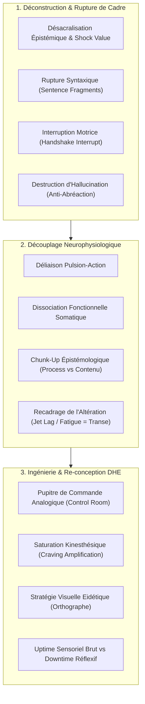

# Design Human Engineering (DHE 12 CDs) - Transcripts
**Formateur :** Richard Bandler | **ID :** `richard-bandler-design-human-engineering-dhe-12-cds-transcripts` | **Tranches :** 32

## Synthèse Architecturale du Cours

---

### 1. Thèse Centrale & Philosophie du Cours

#### La vision spécifique de Richard Bandler dans le DHE (*Design Human Engineering*)
Le DHE marque une rupture délibérée avec la PNL classique et le modèle thérapeutique conventionnel. Bandler refuse le paradigme de la « réparation » (réparer des névroses, guérir des déficits, négocier avec des pathologies) au profit d'un paradigme de **conception et d'ingénierie proactive des états internes** (*Design*).
* **Désacralisation épistémique & Anti-intellectualisme opérationnel :** Bandler pulvérise l'autorité académique, la morale sociale et les fétiches psychothérapeutiques (Gestalt, abréaction, psychanalyse). La psychologie traditionnelle y est dénoncée comme une machine à fabriquer de l'hallucination consensuelle et à conditionner des transes dépressives chroniques.
* **Biologie & Matérialité du Système Nerveux :** Le cerveau est traité comme une machine cybernétique analogique. La souffrance psychologique n'est pas une fatalité ontologique, mais une mauvaise programmation logicielle : les gens sont simplement « trop bien entraînés à se sentir mal » (*practiced feeling bad*).
* **De la remédiation à l'extase fonctionnelle :** Le but du DHE n'est pas le retour à une « neutralité adaptative », mais l'ingénierie délibérée d'états d'intensité paroxystique (acuité sensorielle, extase, plaisir viscéral, analgésie instantanée) capables de rendre tout symptôme obsolète par saturation neurophysiologique.

#### Le fil rouge méthodologique qui relie toutes les interventions
Le fil rouge repose sur trois règles cardinales :
1. **L'Inversion Structure/Contenu :** Ne jamais négocier avec le contenu narratif du client (le « pourquoi » du problème), mais attaquer violemment la syntaxe neurologique (le « comment sais-tu que tu as ce problème ? »).
2. **La Rupture de Pattern Préemptive & Radicale :** Court-circuiter le dialogue interne et les boucles motrices automatiques (choc lexical, ambiguïté phonétique, suspension syntaxique, interruption gestuelle) pour créer un vide synaptique immédiat propice à l'intervention.
3. **L'Interface Analogique Matérialisée :** Transformer les représentations internes en interfaces concrètes de régulation (salle de contrôle, variateurs, leviers, modulation directe des sous-modalités visuelles/kinesthésiques/chimiosensorielles) pour piloter directement les réponses autonomes et neurochimiques sans passer par l'intellect conscient.

---

### 2. Carte des Concepts & Leviers Émergents



#### Concepts Clés et Rôles dans l'Écosystème DHE
* **Désacralisation Épistémique & Rupture Morale (*Shock Value*) :** Court-circuite le surmoi analytique de l'apprenant/patient via l'incongruité et le tabou, suspendant l'esprit critique pour maximiser la suggestibilité inconsciente.
* **Le « Blank » Syntaxique & Ambiguïté Phonétique :** Exploitation des structures de surface orales (*« your unconscious » / « you're unconscious »*) et des phrases suspendues pour forcer une recherche transdérivationnelle et geler le traitement conscient.
* **Interruption de Pattern Motrice & Somatique :** Neutralisation des boucles fermées des ganglions de la base (salutation interrompue, commande brute *« Shut the fuck up »* au dialogue interne).
* **Découplage Sensation-Comportement (*Urge Decoupling*) :** Rupture de l'équivalence névrotique « sensation = action motrice ».
* **Saturation Kinesthésique du Craving :** Amplification délibérée de la sensation jusqu'à un paroxysme où elle devient agréable et autosuffisante, désactivant la pulsion motrice compensatoire.
* **Pupitre de Commande Analogique (*Control Room*) :** Interface métaphorique extériorisée (potentiomètres, boutons) permettant de moduler continûment le système nerveux autonome (douleur, flux sanguin, adrénaline).
* **Uptime Neurologique vs Downtime :** Entraînement à la focalisation externe pure sans accès oculaire interne, vital pour la réactivité sous menace réelle.
* **Stratégie Visuelle d'Orthographe :** Encodage optique direct haut-gauche et chromatique, éliminant la débilité fonctionnelle induite par le décodage phonétique linéaire.
* **Dissociation Fonctionnelle Somatique (Fractionation Amnésique) :** Séparation neurologique des tâches (ex. bras en écriture automatique neutre pendant que l'attention consciente traite un contenu hédonique), court-circuitant l'encodage kinesthésique traumatique.
* **Chunk-Up Épistémologique :** Remplacement de la descente analytique par l'interrogation métacognitive structurale (*« Comment sais-tu que... ? »*).

---

### 3. Tableau Récapitulatif des Techniques & Démonstrations

| Technique / Exercice | Objectif Opératoire | Déclencheur / Indication | Séquence Résumée |
|---|---|---|---|
| **Désacralisation Radicale & Shock Framing** | Pulvériser le filtre analytique et l'attente scolaire/solennelle du sujet. | Début de séminaire ou résistance rationnelle/académique rigide. | 1. Affirmer avoir tout inventé lors d'un contrôle de police.<br>2. Projeter des incongruités brutales (tabous, sexe, trivialité).<br>3. Observer la confusion et ancrer l'attention flottante dans l'instant présent. |
| **Induction Cinétique du Carrousel** | Produire une transe passive continue par saturation oculomotrice. | Sujet hyperactif mentalement ou résistance à l'induction classique. | 1. Guider l'attention sur un mouvement rotatif continu (ex. tapis à bagages).<br>2. Stabiliser la motricité oculaire sur la boucle.<br>3. Relier le rythme visuel à l'inhibition corticale progressive. |
| **Handshake Interrupt Somnambulique** | Créer un vide synaptique immédiat pour insérer une commande directe. | Rencontre initiale, salutation formelle, sujet fixé dans un rôle social. | 1. Initier une poignée de main standard.<br>2. Interrompre net la trajectoire du bras au milieu de la boucle motrice.<br>3. Dévier instantanément le regard et la posture vers le haut.<br>4. Insérer une injonction verbale d'approfondissement de transe. |
| **Capture de Cadre par Hyper-Littéralisme** | Désactiver un fanatisme ou une manipulation idéologique en forçant la prémisse à l'absurde. | Interlocuteur imposant un cadre dogmatique ou eschatologique. | 1. Accepter la prémisse adverse au mot près.<br>2. Exiger la conclusion physique/matérielle extrême immédiate (ex. ablation d'organes face à l'apocalypse imminente ; contact semelle/soul).<br>3. Laisser la boucle adverse s'enrayer dans la sidération. |
| **Commande d'Urgence Réticulaire (Réveil Iatrogénique)** | Rompre un état comateux ou une boucle dépressive iatrogène en milieu médical. | Sujet sous sédatifs ou sidéré par des pronostics médicaux alarmistes ambiants. | 1. Exploiter la persistance de l'écoute auditive primaire.<br>2. Associer un stimulus quotidien d'alerte (ex. sonnerie téléphonique).<br>3. Injecter une commande motrice brute, impérative et déstabilisante (*« Wake up ! Take this phone ! »*). |
| **Stratégie Visuelle d'Orthographe Chromatique** | Éliminer les blocages d'orthographe causés par la phonétisation linéaire. | Difficultés d'apprentissage, dyslexie fonctionnelle, surcharge de la mémoire de travail auditive. | 1. Orienter les yeux du sujet en haut à gauche (visuel remémoré).<br>2. Projeter le mot sous forme d'image globale (gestalt).<br>3. Colorer arbitrairement chaque lettre pour saturer l'encodage occipital.<br>4. Vérifier la restitution directe de gauche à droite et de droite à gauche. |
| **Conditionnement Uptime sur Sol Dur** | Supprimer le dialogue interne et les accès oculaires de down-time sous pression. | Entraînement au combat, sports d'impact, situations d'urgence réelle. | 1. Placer le sujet en condition d'instabilité sans protections amortissantes.<br>2. Interrompre tout mouvement oculaire d'accès interne (*« let's see »*).<br>3. Conditionner la focalisation périphérique et la proprioception réactive pure. |
| **Interruption d'Abréaction Gestaltiste (Test de Réalité Brut)** | Empêcher le renforcement pavlovien d'un circuit de rage ou d'hallucination projective. | Sujet hurlant sur un coussin ou rejouant stérilement un traumatisme passé. | 1. Interrompre physiquement le mouvement d'agression ou l'expression vocale.<br>2. Revenir au test sensoriel primaire (*« C'est un coussin, il n'y a personne là-dedans »*).<br>3. Désamorcer l'hallucination et rediriger vers la structure du contrôle. |
| **Suspension Syntaxique & Injonction Enchâssée** | Suspendre la faculté critique par rupture de clôture de gestalt grammaticale. | Résistance logique, sujet procédurier analysant chaque proposition. | 1. Émettre une proposition complexe inachevée (*sentence fragment*).<br>2. Laisser le cortex geler son traitement en recherche transdérivationnelle.<br>3. Délivrer une ambiguïté phonétique impérative (*« you're unconscious »*). |
| **Amplification Kinesthésique du Craving** | Briser l'automatisme pulsionnel (tabac, compulsion alimentaire) sans répression. | Addictions, compulsions orales, envies récurrentes irrépressibles. | 1. Localiser la sensation de manque dans le corps.<br>2. Augmenter volontairement ses sous-modalités (vitesse, chaleur, intensité) jusqu'au paroxysme.<br>3. Atteindre le seuil de saturation où la sensation devient plaisante par elle-même.<br>4. Vérifier le découplage immédiat de l'impulsion motrice externe. |
| **Inondation Sémantique & Ancrage Opposé** | Immuniser le sujet contre les déclencheurs verbaux et étiquettes aliénantes. | Vulnérabilité aux insultes, vexations, manipulation par des mots-tabous. | 1. Identifier l'inventaire précis des mots qui déclenchent le malaise somatique.<br>2. Les délivrer en rafale ultra-rapide (flooding sémantique).<br>3. Concomitamment, introduire une rupture de cadre humoristique ou d'autonomie.<br>4. Constater l'extinction de la réponse affective automatisée. |
| **Ancrage Aversif Préemptif (Anti-Anchor)** | Couper instantanément une tentative d'agression ou de prédation relationnelle. | Comportements récurrents intrusifs, sexistes ou toxiques de l'entourage. | 1. Calibrer les micro-signaux précurseurs du comportement problématique adverse.<br>2. Déclencher un ancrage négatif/aversif vif dès l'amorce du schéma (sans débat verbal).<br>3. Répéter jusqu'à extinction opérante du comportement chez l'interlocuteur. |
| **Dissociation Fonctionnelle Somatique (Écriture Amnésique)** | Récupérer des détails sensoriels traumatiques sans décharge kinesthésique d'effroi. | Amnésies traumatiques, nécessité d'extraction d'indices (plaques, visages). | 1. Isoler neurologiquement le bras scripteur (inhibition motrice consciente du regard).<br>2. Réorienter l'attention consciente sur une narration hédonique absorbante.<br>3. Laisser le bras produire l'écriture automatique des données sensoriellement neutres.<br>4. Vérifier l'amnésie de la terreur associée. |
| **Chunk-Up Épistémologique (Inversion du Méta-Modèle)** | Sortir d'une transe dépressive ou problématique en modélisant le processus cognitif. | Client justifiant son état par l'énumération de faits (« Je suis déprimé parce que... »). | 1. Bloquer la descente vers le micro-détail du contenu du problème.<br>2. Poser la question de processus : *« Comment sais-tu que tu es X ? »*<br>3. Forcer le sujet à identifier la syntaxe interne (images, voix, sensations) qui génère l'état. |
| **Interruption Verbale Brute du Dialogue Interne** | Stopper les ruminations anxiogènes et inhibitions d'action sans intellectualisation. | Ruminations pré-action, hésitations, scénarios catastrophes récursifs. | 1. Repérer le déclenchement de la boucle phonologique d'inhibition.<br>2. Clamer mentalement (ou vocalement) avec force maximale : *« Shut the fuck up »*.<br>3. Exploiter l'arrêt immédiat du dialogue interne pour déclencher l'action motrice externe. |
| **Pupitre de Commande Neurologique Analogique** | Moduler volontairement des variables physiologiques autonomes (douleur, flux, excitation). | Gestion de la douleur chronique, analgésie, dysfonctions autonomes, stress. | 1. Extérioriser la fonction physiologique sous forme d'interface matérielle (salle des commandes).<br>2. Visualiser des potentiomètres rotatifs analogiques (*knobs*) associés à chaque variable.<br>3. Tourner physiquement ou mentalement le variateur pour faire varier l'intensité continue.<br>4. Calibrer le retour somatique immédiat. |

---

---

## 0. Sommaire Sémantique & Index des Lignes

- **Tranche 1 [Lignes 131-246]** : Démonstration / Protocole : L'Interruption du Salutation (Handshake Interrupt) de Bandler — *Protocole :* Démonstration / Protocole : L'Interruption du Salutation (Handshake Interrupt) de Bandler | *Mécanisme :* Désamorçage de l'Attente Cognitive & Dé-sacralisation Radicale | *Verbatim :* Extrait 1 : Désamorçage de l'Autorité et de la Légitimité de la PNL
- **Tranche 2 [Lignes 248-378]** : Désamorçage de l'Autorité Hostile ou Dogmatique par Hyper-Matérialisation Grotesque — *Protocole :* Désamorçage de l'Autorité Hostile ou Dogmatique par Hyper-Matérialisation Grotesque | *Mécanisme :* Réduction à l'absurde des hallucinations consensuelles / Dé-nomination des fétiches socio-religieux
- **Tranche 3 [Lignes 380-497]** : Désamorçage Immédiat d'un Craving (Tabac / Compulsion) — *Protocole :* Désamorçage Immédiat d'un Craving (Tabac / Compulsion) | *Mécanisme :* Le « Blank » Syntaxique et la Fixation Attentionnelle Transdérivationnelle | *Verbatim :* La Commande d'Inconscience par Homophonie et Découpage Syntaxique
- **Tranche 4 [Lignes 499-638]** : A : Extraction Dissociée de Données Traumatiques (Amnésie Protectrice & Écriture Inconsciente) — *Protocole :* A : Extraction Dissociée de Données Traumatiques (Amnésie Protectrice & Écriture Inconsciente) | *Verbatim :* Verbatim 1 : L'Inversion Épistémique et le Piège de la Certitude
- **Tranche 5 [Lignes 640-767]** : L'Arrêt Éclair du Dialogue Interne et Déprogrammation de la Timidité — *Protocole :* L'Arrêt Éclair du Dialogue Interne et Déprogrammation de la Timidité
- **Tranche 6 [Lignes 769-923]** : A : La Technique du Spin (Inversion de la Rotation de la Peur & Détermination) — *Protocole :* A : La Technique du Spin (Inversion de la Rotation de la Peur & Détermination) | *Verbatim :* Double contrainte métathérapeutique et méta-déni
- **Tranche 7 [Lignes 925-1101]** : La Cure de Phobie & Démantèlement de Souvenir Traumatique (The Backwards Movie) — *Protocole :* La Cure de Phobie & Démantèlement de Souvenir Traumatique (The Backwards Movie) | *Mécanisme :* Le Rebobinage Neurologique et Aplatissement de la Charge Émotionnelle | *Verbatim :* Rupture d'illusion sur les critères de beauté et ancrage de contrôle
- **Tranche 8 [Lignes 1103-1230]** : Le Filtre Décisionnel Spatial DHE (The Spatial Decision Sieve) — *Protocole :* Le Filtre Décisionnel Spatial DHE (The Spatial Decision Sieve) | *Mécanisme :* Encodage Spatial Différentiel des Décisions (Spatial Decision Submodalities) | *Verbatim :* Verbatim 1 : L'Interruption du Pattern de Justification de l'Inaction
- **Tranche 9 [Lignes 1232-1370]** : Le Folioscope de la Compétence Rapide (High-Speed Pattern Ingestion) — *Protocole :* Le Folioscope de la Compétence Rapide (High-Speed Pattern Ingestion) | *Verbatim :* Verbatim 1 : L'Injonction Brutale au Tri Positif Direct
- **Tranche 10 [Lignes 1372-1505]** : Alignement Spatial de l'Inévitable et du Désiré (The Inevitability Overlap) — *Protocole :* Alignement Spatial de l'Inévitable et du Désiré (The Inevitability Overlap) | *Mécanisme :* Encodage Spatial de la Certitude vs Désir Déconnecté (Spatial Timeline Intersection) | *Verbatim :* La Double Négation Inductive & Désorientation Sémantique
- **Tranche 11 [Lignes 1507-1697]** : A : Programmation Métabolique & Rémission Spontanée Nocturne (Horloge Inconsciente) — *Protocole :* A : Programmation Métabolique & Rémission Spontanée Nocturne (Horloge Inconsciente) | *Mécanisme :* Le Brouillage Psychique Spatial & Vectoriel | *Verbatim :* Recadrage Provocateur de la Relation Thérapeutique
- **Tranche 12 [Lignes 1699-1841]** : « Le Compulseur de Motivation DHE » (Démonstration sur Benjamin) — *Protocole :* « Le Compulseur de Motivation DHE » (Démonstration sur Benjamin) | *Mécanisme :* Accélération de Boucle Kinesthésique (Kinesthetic Spin & Velocity Acceleration) | *Verbatim :* L'Accélération et la Greffe Subconsciente
- **Tranche 13 [Lignes 1843-1960]** : Inversion et Décharge du Doute par Amplification (The Reverse-Spin Doubt Protocol) — *Protocole :* Inversion et Décharge du Doute par Amplification (The Reverse-Spin Doubt Protocol) | *Verbatim :* La Double Contrainte de l'Attente Temporelle
- **Tranche 14 [Lignes 1962-2078]** : Désamorçage Immédiat de la Fausse Double-Contrainte Relationnelle (The "Rhetorical Trap" Pro... — *Protocole :* Désamorçage Immédiat de la Fausse Double-Contrainte Relationnelle (The "Rhetorical Trap" Protocol) | *Mécanisme :* Relativisation de l'Index Référentiel et Dissolution Contexte/Sujet | *Verbatim :* La Bascule de l'Index Référentiel chez Erickson
- **Tranche 15 [Lignes 2080-2177]** : Le Banc d'Essai d'Ingénierie Mentale (Modélisation Tesla) — *Protocole :* Le Banc d'Essai d'Ingénierie Mentale (Modélisation Tesla) | *Verbatim :* Pattern 1 : Le Verrouillage de la Décision par Truisme Visuel et Glissement Spatial
- **Tranche 16 [Lignes 2179-2313]** : Le Dégrisement d'Urgence par Saturation Absurde & Pacing de Survie — *Protocole :* Le Dégrisement d'Urgence par Saturation Absurde & Pacing de Survie
- **Tranche 17 [Lignes 2315-2432]** : A : Installation du Tableau de Bord DHE & Bouton d'Amplification ("The Velvet Double-It Butt... — *Protocole :* A : Installation du Tableau de Bord DHE & Bouton d'Amplification ("The Velvet Double-It Button") | *Mécanisme :* Le Tableau de Bord Kinesthésique Interne (DHE Control Panel & Feedback Amplification) | *Verbatim :* Verbatim : La Rupture Impertinente de l'Accord Social
- **Tranche 18 [Lignes 2434-2573]** : Induction de Régression Biologique & Restauration Cellulaire — *Protocole :* Induction de Régression Biologique & Restauration Cellulaire | *Mécanisme :* Le Leading Directif vs Le "Pacing" Dogmatique (antipacing rapportinversion directcommandinduction) | *Verbatim :* La Directive d'Inversion et Déconstruction du Pacing
- **Tranche 19 [Lignes 2575-2692]** : L'Auto-Reprogrammation Métabolique et de Rémission Spontanée Nocturne — *Protocole :* L'Auto-Reprogrammation Métabolique et de Rémission Spontanée Nocturne | *Mécanisme :* Le Levier de l'Interférence Télépathique / Résonance Synesthésique Émettrice | *Verbatim :* Le Double-Lien d'Impossibilité du Mal-Être
- **Tranche 20 [Lignes 2694-2841]** : La Machine DHE d'Arbitrage et d'Assimilation Cognitive (Confusion $\rightarrow$ Compréhension) — *Protocole :* La Machine DHE d'Arbitrage et d'Assimilation Cognitive (Confusion $\rightarrow$ Compréhension)
- **Tranche 21 [Lignes 2843-2943]** : Intégration du Sélecteur d'États Psychoactifs Endogènes (DHE Drug Dial) — *Protocole :* Intégration du Sélecteur d'États Psychoactifs Endogènes (DHE Drug Dial) | *Mécanisme :* Paradoxe de Neutralisation par Contre-Conditionnement Symétrique | *Verbatim :* Le Choix Forcé par Destruction Symétrique
- **Tranche 22 [Lignes 2945-3086]** : Recréation Somatosensorielle d'un État Chimique / Anesthésique (The 5-Location Drug Loop) — *Protocole :* Recréation Somatosensorielle d'un État Chimique / Anesthésique (The 5-Location Drug Loop) | *Mécanisme :* Le Moteur Séquentiel Somatosensoriel (Endogenous Pharmacopoeia / Drug State Re-access) | *Verbatim :* Extrait 1 : L'installation de la boucle de re-sensation pharmacologique
- **Tranche 23 [Lignes 3088-3224]** : Recréation Endogène d'États Neurochimiques & Double Ancre Somatique — *Protocole :* Recréation Endogène d'États Neurochimiques & Double Ancre Somatique
- **Tranche 24 [Lignes 3226-3396]** : Le Flash d'Effacement Visuel (The Submodality Whiteout Protocol) — *Protocole :* Le Flash d'Effacement Visuel (The Submodality Whiteout Protocol) | *Verbatim :* Le Double Lien Hypnotique de la Convalescence Involontaire
- **Tranche 25 [Lignes 3398-3519]** : Protocole Flash de Guérison des Phobies (Fast Phobia Cure / VKD) — *Protocole :* Protocole Flash de Guérison des Phobies (Fast Phobia Cure / VKD) | *Mécanisme :* Le Paradoxe Kinésthésique / Exagération Neuro-Musculaire (Principe de Feldenkrais) | *Verbatim :* La rupture d'escalade panique
- **Tranche 26 [Lignes 3521-3653]** : Désamorçage Éclair d'une Transe Morbide et de Douleur Intractable — *Protocole :* Désamorçage Éclair d'une Transe Morbide et de Douleur Intractable | *Mécanisme :* Disruption Thalamique & Choc Réticulaire par Rupture Brutale de Rôle | *Verbatim :* La Transmutation Kinesthésique de la Brûlure en Énergie
- **Tranche 27 [Lignes 3655-3807]** : Projection Émotionnelle Directe ("Throwing Thunderbolts") — *Protocole :* Projection Émotionnelle Directe ("Throwing Thunderbolts") | *Verbatim :* Séquence d'amplification sous-modale et de rotation kinesthésique
- **Tranche 28 [Lignes 3809-3934]** : Désamorçage Éclair Phobie / Blocage par Rupture d'Identité Comique — *Protocole :* Désamorçage Éclair Phobie / Blocage par Rupture d'Identité Comique | *Verbatim :* Élicitation saturée d'excitation motrice
- **Tranche 29 [Lignes 3936-4093]** : A : Installation d'un Désir Irrésistible sur une Hésitation (Démonstration du Chocolat / Com... — *Protocole :* A : Installation d'un Désir Irrésistible sur une Hésitation (Démonstration du Chocolat / Compulsion Transfer) | *Verbatim :* Rupture du mythe des profondeurs et redéfinition de l'identité
- **Tranche 30 [Lignes 4095-4297]** : Le Vendeur Irrésistible (Transfert Spatial d'Appétence DHE) — *Protocole :* Le Vendeur Irrésistible (Transfert Spatial d'Appétence DHE)
- **Tranche 31 [Lignes 4299-4407]** : Désamorçage Catastrophique par Amplification Extrême (Catastrophic Overdo Protocol) — *Protocole :* Désamorçage Catastrophique par Amplification Extrême (Catastrophic Overdo Protocol) | *Verbatim :* Verbatim 1 : L'Instruction d'Isolation Idéomotrice
- **Tranche 32 [Lignes 4409-4565]** : Réveil en Hyper-Alerte Sensorielle et Vitalité Exponentielle — *Protocole :* Réveil en Hyper-Alerte Sensorielle et Vitalité Exponentielle

---

## Extractions Détaillées par Tranche (Opératoire & Verbatim)

## Tranche 1 / 32 : Démonstration / Protocole : L'Interruption du Salutation (Handshake Interrupt) de Bandler

Voici l'analyse modélisatrice intégrale et opératoire de la tranche 1/32 de *Design Human Engineering (DHE 12 CDs)* par Richard Bandler.

---

### 1. Mécanismes & Principes Actifs

#### 1. Désamorçage de l'Attente Cognitive & Dé-sacralisation Radicale
* **Principe actif :** L'auditoire arrive avec un ensemble de cadres de référence rigides : attentes d'un « cours académique », respect intimidé pour la PNL ou le formateur, sérieux clinique. Bandler détruit instantanément ce statut en affirmant qu'il a « tout inventé » par hasard lors d'un contrôle de police (`I made that up, okay? It's not real`). En pulvérisant la solennité de l'autorité, il court-circuite le filtre critique conscient (le surmoi analytique de l'apprenant). Le sujet ne peut plus se raccrocher à une grille théorique préétablie et bascule dans un état d'attention flottante, dépendant de l'instant présent.
* **Tags :** `#desacralisation_epistémique #court_circuit_analytique #destruction_de_cadre #anti_dogme`

#### 2. Induction par Mouvement Périphérique Répétitif (Tapis Roulant / Trajectoire d'Aéroport)
* **Principe actif :** Bandler métaphorise l'entrée en transe à travers la description du carrousel à bagages (`sitting there watching this thing go round and round thinking what an induction this is`). La fixation visuelle ou kinesthésique sur un objet en rotation cyclique épuise le mécanisme de focalisation du cortex préfrontal (oculomotricité stabilisée menant à l'inhibition corticale). En injectant cette image dès les premières minutes, il installe un ancrage spatial et temporel de transe passive continue.
* **Tags :** `#induction_cinetique #saturation_oculaire #boucle_perceptive #transe_naturelle`

#### 3. Rupture Provocatrice de la Référence Morale (Shock & Confusion Value)
* **Principe actif :** Utilisation d'images taboues, sexuelles ou scatologiques explicites (l'affaire Monica Lewinsky, déjections dans l'eau de Perrier, lettres au Pape, blagues de caserne). Ce mécanisme génère une réaction somatique réflexe (dégoût, rire nerveux, choc moral). Sur le plan neurologique, l'incongruité et le bris de conventions sociales déclenchent une décharge d'adrénaline immédiatement suivie d'une phase de confusion. Pendant que le système nerveux conscient gère le choc de la transgression verbale, la suggestibilité inconsciente est maximale.
* **Tags :** `#shock_value #rupture_de_tabou #incongruence_sociale #ouverture_de_suggestibilite`

#### 4. Recadrage de l'Altération Neurophysiologique (Jet Lag / Hangover comme Transe)
* **Principe actif :** Au lieu de lutter contre un état de décalage temporel ou d'épuisement (`jet lag`, manque de sommeil), Bandler le redéfinit comme un *état modifié de conscience ressource* (`just another altered state that keeps you from being like them`). Ce mécanisme permute la perception d'un symptôme délétère en une porte d'entrée hypnotique fonctionnelle, éliminant la résistance physique et psychologique interne du sujet.
* **Tags :** `#recadrage_d_etat #etat_modifie_utilitaire #utilisation_ericksonienne #reframing_somatique`

#### 5. Catalepsie d'Évitement et Congélation Somatique Réflexe
* **Principe actif :** En racontant son refus de sauter en parachute dans l'armée, Bandler démontre la nature biologique primitive de la catalepsie : le réflexe de figement (*freeze*). Il montre que la catalepsie n'est pas un artefact de spectacle, mais un verrouillage moteur induit par un conflit cognitivo-moteur extrême (la main qui s'accroche et refuse de lâcher prise).
* **Tags :** `#catalepsie_involontaire #reflexe_de_figement #isometrie_somatique #verrouillage_moteur`

#### 6. Rupture de Pattern par Interruption Kinesthésique (Handshake Interrupt)
* **Principe actif :** L'exécution d'un schéma moteur automatique ultra-stabilisé (tendre la main pour saluer) exige une boucle motrice prédictive fermée dans le cervelet et les ganglions de la base. Interrompre ce geste au milieu de son déroulement physique laisse la boucle neuronale ouverte, suspendant le traitement conscient pendant 1 à 3 secondes. Bandler exploite cette fenêtre temporelle de vide synaptique pour enchaîner immédiatement sur une déviation de l'attention visuelle et kinesthésique, amorçant une transe somnambulique instantanée.
* **Tags :** `#interruption_de_pattern #boucle_motrice_ouverte #vide_synaptique #saturation_multicanale`

---

### 2. Protocoles, Techniques & Démonstrations (Étape par Étape)

#### Démonstration / Protocole : L'Interruption du Salutation (Handshake Interrupt) de Bandler

* **Intention / Indication :** 
  Provoquer une rupture brutale de l'orientation consciente chez un sujet hyper-mental, sceptique ou figé dans des postures relationnelles rigides, afin de créer une fenêtre d'amorce hypnotique sans résistance.
* **Mise en place & Pré-framing :**
  Avancer vers le sujet avec une congruence totale, le visage ouvert, en tendant la main droite d'un mouvement d'intensité normale, comme pour un salut formel tout à fait classique. Le sujet doit enclencher le geste réflexe de tendre la sienne sans aucune arrière-pensée.

* **Séquence d'actions pas à pas :**
  1. **Phase d'Amorce & Connexion Réflexe :** S'approcher, établir le contact visuel et tendre la main droite. Attendre que la main du sujet s'avance et commence à entrer en contact.
  2. **Interruption & Déviation de Vecteur :** Au moment précis où la paume entre en contact, au lieu de serrer la main, attraper délicatement son poignet ou dévier sa main vers le haut, en orientant la paume du sujet face à ses propres yeux.
  3. **Capture Visuelle Immédiate :** Pointer verbalement et visuellement la paume du sujet : *"Look at your hand"* pour verrouiller la fovéa sur sa propre main.
  4. **Fractionnement Sensoriel & Vision Périphérique :** Diriger l'attention sur la transition optique : *"Notice the changing focus of your vision. Isn't it interesting how the colors change in your peripheral vision..."*
  5. **Suggestion de Lévitation / Catalepsie Kinesthésique :** Coupler le déplacement de la main avec une descente en transe : *"As your hand moves slowly towards your head..."*
  6. **Rupture par Distraction / Ambiguïté Cynique :** Pendant que le système attentionnel est suspendu sur la main levée, Bandler greffe un stimulus inattendu pour saturer le canal kinesthésique opposé ou déclencher le rire/surprise (*"and the other hand floats involuntarily towards your wallet... slap, slap, slap"*).

* **Signes de calibration observés par le formateur :**
  * Blocage respiratoire (apnée réflexe au moment de l'arrêt de la main).
  * Dilatation pupillaire et défocalisation du regard (passage spontané en vision périphérique / état d'inhibition corticale).
  * Catalepsie cireuse : la main reste suspendue dans l'air sans soutien musculaire conscient actif.
  * Relâchement des muscles faciaux (affaissement du tonus de la mâchoire et des joues).

---

### 3. Heuristiques, Subtilités & "Sagesse du Praticien"

#### Règles Conditionnelles Directes
* **Règle de la Gravité / Maladie du Sérieux :**
  * *Si* le sujet (ou le client) aborde ses problèmes avec une gravité existentielle accablante (`they suffered from what I consider the big disease: they were too fucking serious`),
  * *Alors* injecter immédiatement de la vulgarité, de l'irrévérence crue ou de l'humour scatologique,
  * *Parce que* le sérieux est le ciment structurel qui maintient le cadre du problème inchangé. Sans solennité, le problème perd sa cohérence interne.
* **Règle de la Trajectoire & Évitement de la Résistance :**
  * *Si* un obstacle ou un opposant massif se présente (la métaphore du maître de karaté ou de la voiture bélier),
  * *Alors* ne jamais le confronter de face ; utiliser l'interférence inattendue (le tofu) ou la force brute de la vitesse (`press the accelerator`),
  * *Parce que* l'affrontement direct valide le cadre de l'opposant, tandis que l'absurde ou la sidération désactive ses réflexes défensifs.
* **Règle de l'Origine des Outils :**
  * *Si* un praticien dogmatique sanctuarise une technique (comme le *Reframing* en 6 pas ou l'attribution éricksonienne de l'interruption de poignée de main),
  * *Alors* rappeler que la technique n'est qu'un stratagème tactique temporaire (`It's totally a trick, the whole thing`),
  * *Parce que* figer un protocole en une vérité scientifique empêche l'ajustement dynamique au système nerveux du sujet.

#### Postulats Fondamentaux de Richard Bandler dans cet extrait
1. **L'Invention Pragmatique Absolue :** La PNL n'est pas une vérité découverte dans la nature, c'est une construction arbitraire inventée pour produire des effets comportementaux (`I made that up, okay? It's not real`).
2. **L'Utilisation Totale :** Tout état somatique (décalage horaire, état d'ébriété, fatigue extrême) est un état hypnotique exploitable. Le praticien ne cherche pas à « corriger » un état, il s'engouffre dedans pour modifier les réponses automatiques.
3. **Le Pacing Inversé (Mirroring Provocateur) :** Quand le réel renvoie une agression ou une tension, renvoyer une intensité supérieure pour forcer le système adverse à réinitialiser son seuil de tolérance.

---

### 4. Pépites Verbatim & Patterns Linguistiques (MOT À MOT EN V.O.)

#### Extrait 1 : Désamorçage de l'Autorité et de la Légitimité de la PNL
> *"I found out this was an introduction to DHE. That means that some of you here probably have some background in neurolinguistic programming. And I want to clear something up, by the way. I made that up, okay? It's not real. It says in all the books, although I haven't even seen some of them anymore. This all started because I got pulled over by the police."*
* **[Analyse du Pattern]** : 
  * **Rupture brutale de cadre de référence & Présupposition de fiction :** L'utilisation de *"I made that up, okay? It's not real"* détruit le présupposé d'une vérité ontologique de la discipline. 
  * **Changement d'ancrage d'autorité :** En dérivant la genèse d'un corpus entier vers une banale interpellation policière, Bandler disqualifie toute posture académique chez les participants, les forçant à juger ce qui va suivre non pas par rapport à une théorie, mais uniquement par son efficacité pragmatique immédiate.

---

#### Extrait 2 : Recadrage Radical de l'Épuisement Somatique (Jet Lag)
> *"People say, how do you deal with jet lag? And I go, yeah, I like it. To me, you just kind of keep going into it. A lot of people say, well, you know, I've learned that if you do this, this, and this, you know, you can beat jet lag. And I go, why would you want to beat it? You know, I mean, to me, it's just another altered state that keeps you from being like them."*
* **[Analyse du Pattern]** : 
  * **Questionnement du cadre antagoniste (*De-nominalization & Frame flip*) :** L'expression *"why would you want to beat it?"* invalide le présupposé universel que la fatigue est un adversaire à combattre.
  * **Recadrage d'identité et de distinction sociale :** *"just another altered state that keeps you from being like them"*. Il requalifie un inconfort physique en un privilège neurologique : être dans un état altéré permet d'échapper à la normalité des « autres » (*them*), transformant la léthargie en ressource de transe.

---

#### Extrait 3 : Séquence d'Induction par Interruption du Salutation (Handshake Interrupt)
> *"Look at your hand, notice the changing focus of your vision. Isn't it interesting how the colors change in your peripheral vision as your hand moves slowly towards your head and the other hand floats involuntarily towards your wallet? As one hand comes out, the other goes slap, slap, slap."*
* **[Analyse du Pattern]** : 
  * **Commande directe et capture de l'attention fovéale :** *"Look at your hand"* focalise le conscient sur un point précis.
  * **Empilement de truismes sensoriels (Pacing) :** *"notice the changing focus of your vision"* (quand une main s'approche du visage, l'accommodation cristallinienne change obligatoirement).
  * **Question interro-négative facilitatrice :** *"Isn't it interesting how..."* présuppose que le changement est déjà en train de se produire et force l'esprit critique à valider le phénomène au lieu de le questionner.
  * **Liaison temporelle et dissociation somatique (Leading) :** *"as your hand moves slowly towards your head and the other hand floats involuntarily..."*. Le mot *"as"* lie mécaniquement le geste automatique à l'adverbe *"involuntarily"*, induisant une perte de contrôle volontaire du membre.
  * **Rupture par choc humoristique :** La déviation vers le portefeuille (*"towards your wallet"*) crée une sidération comique qui empêche le sujet de rationaliser l'état hypnotique qui vient de s'installer.

---

#### Extrait 4 : Dénonciation du Dogme Clinique & Double Lien Thérapeutique
> *"Reframing, a technique many of you have learned, right? Where you go inside and ask yourself this and blah blah blah blah. It's totally a trick, the whole thing. That's why I don't teach it anymore. I think the world has evolved enough. Therapists went like this. Every one of them all over the face of the earth. They went, hypnosis is bad. And it doesn't exist. Now I don't know about you guys, that sounds to me, what would be the word? Stupid, that's it, stupid."*
* **[Analyse du Pattern]** : 
  * **Démystification par dérision onomatopéique :** Réduire un protocole complexe en 6 étapes à un simple *"blah blah blah blah"* efface la valeur rituelle de la technique au profit de son intention brute.
  * **Mise en lumière du paradoxe logique (Double Bind critique) :** Bandler isole l'incohérence des thérapeutes institutionnels : affirmer simultanément que l'hypnose est « mauvaise » (danger moral) et qu'elle « n'existe pas » (inexistence matérielle). En pointant ce non-sens avec le mot *"stupid"*, il libère l'audience des interdits thérapeutiques classiques.

## Tranche 2 / 32 : Désamorçage de l'Autorité Hostile ou Dogmatique par Hyper-Matérialisation Grotesque

Voici l'extraction opératoire intégrale de la tranche 2/32 de la transcription du séminaire *Design Human Engineering (DHE)* par Richard Bandler.

---

### 1. Mécanismes & Principes Actifs

* **Réduction à l'absurde des hallucinations consensuelles / Dé-nomination des fétiches socio-religieux**  
  *Principe actif :* Le cerveau humain empile des abstractions linguistiques (dogmes, hiérarchies, objets dits sacrés, protocoles rituels) pour masquer des contradictions logiques intolérables. En remplaçant brutalement les termes sacralisés par des équivalents concrets, somatiques, génitaux ou triviaux (ex. qualifier la tiare papale de *« Mr. Penis Hat »*, l'eau bénite de *« liquide à formule de quatre pages contenant un virus muté »*, ou les Témoins de Jéhovah de *« gens frappés avec leur propre semelle »*), Bandler court-circuite le centre d'évaluation morale/théologique du cortex frontal. L'incongruité détruit instantanément l'autorité symbolique injectée dans le réseau synaptique, provoquant un rire nerveux ou un état de confusion réceptif au recadrage opérationnel.  
  *Tags :* `#desacralisation_somatique #choc_ontologique #reductio_ad_absurdum #effondrement_d_autorite`

* **Saturation par l'incongruité contextuelle & double-contrainte inversée**  
  *Principe actif :* Face aux démarcheurs eschatologiques ou aux fanatiques (fin du monde, sauvetage de l'âme), les réponses argumentatives logiques valident le cadre de l'interlocuteur. Bandler opère une capture de cadre agressive par hyper-littéralisme prédateur : face au prophète de l'apocalypse, il propose une ablation génitale immédiate pour « faire don d'un organe inutile puisque la fin est proche ». Face à l'argument « Je viens pour votre âme », il répond par le contact physique d'une semelle de chaussure (*sole* / *soul*). Le cerveau adverse, pris dans l'obligation de justifier sa propre prémisse poussée à sa conclusion matérielle extrême, s'enraye dans une sidération hypnotique.  
  *Tags :* `#capture_de_cadre #hyper_literalite_destructrice #double_contrainte_inverse #ambiguite_homophonique_appliquee`

* **Hypnose directe par éveil somatique & rupture du coma réactif**  
  *Principe actif :* Les patients sous sédatifs ou en coma médical ne sont pas désactivés auditivement ; leur système auditif périphérique transmet au système réticulaire les conversations ambiantes. Lorsque le personnel médical prononce des jugements péjoratifs ou pronostique une mort imminente (« sa tension chute, c'est dommage pour sa femme »), le système nerveux somatise le script dépressif (arythmie, tachycardie, chute tensionnelle). À l'inverse, l'injection brutale d'une commande d'action directe, impérative et déstabilisante (*« Wake up ! Take this fucking phone ! »*), combinée à un stimulus auditif familier (sonnerie de téléphone), provoque un saut de phasage neurologique. Le cerveau du patient sort de la boucle de sidération passive pour obéir à une routine motrice d'urgence.  
  *Tags :* `#commande_d_urgence #rupture_iatrogenique #reveil_sous_transe #boucle_reticulaire_directe`

* **Désillusion phonétique vs Stratégie visuelle de l'orthographe**  
  *Principe actif :* Les apprentissages basés sur le décodage phonétique linéaire forcent le sujet à mouliner auditivement des règles contradictoires (lettres muettes, voyelles instables, phonèmes multi-graphiques), surchargeant la mémoire de travail au lieu d'utiliser l'accès direct par mémoire visuelle eidétique. L'orthographe experte repose universellement sur l'accès visuel remémoré (yeux en haut à gauche pour les droitiers) où le mot apparaît comme une gestalt globale. Forcer un enfant à « écouter » ou « prononcer » un mot pour l'écrire installe une débilité fonctionnelle induite.  
  *Tags :* `#strategie_visuelle_d_orthographe #debilité_induite_phonétique #acces_gestaltique #modelisation_des_expertises`

* **Neurologie de l'Uptime sous menace réelle vs Transe interne (Down-time)**  
  *Principe actif :* L'entraînement sur surfaces dures (béton) sans protection conditionne le système d'alerte à rester en Uptime sensoriel pur (focalisation externe totale, acuité visuelle périphérique, proprioception vive). À l'opposé, l'entraînement sur tatamis ou dans des cabinets de thérapie conventionnels encourage le repli en Down-time (dialogue interne, recherche transdérivative, dissociation, transe introspective). Le passage en transe interne dans un environnement instable se paie par un choc physique immédiat. En ingénierie humaine, les états d'alerte et de réactivité maximale exigent la neutralisation des signaux d'accès internes (les mouvements oculaires de vérification interne : « hmm, let's see »).  
  *Tags :* `#uptime_neurologique #calibrage_environnemental_brut #suppression_du_downtime #reflexe_sensoriel_pur`

* **Critique radicale de la Gestalt : l'hallucination induite et l'abréaction stérile**  
  *Principe actif :* Faire crier un patient sur un coussin (*beanbag*) ou lui faire agresser un objet inanimé pour « extérioriser sa colère » renforce et ancre la réponse neuro-musculaire d'agressivité au lieu de la résoudre. Cela installe une hallucination visuelle et auditive projetée (attribuer une identité vivante à un meuble), valide le délire hallucinatoire et crée un conditionnement de rage pavlovienne. Bandler interrompt physiquement l'abréaction pour ramener brutalement le sujet au test de réalité perceptuel brut : « C'est un coussin, il n'y a personne là-dedans ».  
  *Tags :* `#anti_abreaction #destruction_d_hallucination_therapeutique #test_de_realite_dur #rupture_gestaltiste`

* **Inachèvement syntaxique comme attracteur d'attention transdérivative (*Sentence Fragments*)**  
  *Principe actif :* Une phrase grammaticalement incomplète (*« Now, Nick, I want you to watch how Mondays face... »*) crée une béance syntaxique dans l'hémisphère gauche. Le cerveau ne peut s'empêcher de combler le vide (effet Zeigarnik cognitif). N'ayant pas de mot final explicite à traiter, le processeur linguistique suspend son analyse critique et lance une recherche transdérivative inconsciente pour donner du sens, ouvrant une fenêtre d'hypersensibilité et de focalisation extrême.  
  *Tags :* `#sentence_fragment #effet_zeigarnik_linguistique #suspension_critique #induction_par_incompletude`

---

### 2. Protocoles, Techniques & Démonstrations (Étape par Étape)

#### Protocole 1 : Désamorçage de l'Autorité Hostile ou Dogmatique par Hyper-Matérialisation Grotesque
* **Intention / Indication :** Quand un sujet est paralysé, coupable ou soumis face à une figure d'autorité morale, religieuse ou académique (parents dogmatiques, hiérarchie, institutions culpabilisantes).
* **Mise en place & Pré-framing :** Recadrer l'autorité comme une anomalie biologique ou matérielle ridicule. Dépouiller l'institution de ses parures sémantiques.
* **Séquence d'actions pas à pas :**
  1. *Étape 1 (Isolement sémantique)* : Identifier le mot-clé sacré ou intimidant utilisé par l'autorité (ex. : « Directeur », « Pape », « Expert », « Fin du Monde »).
  2. *Étape 2 (Remplacement anatomique ou trivial)* : Remplacer mentalement ou verbalement l'objet de prestige par sa description physique la plus burlesque ou génitale (la tiare devient un « chapeau en forme de pénis », la cape devient un « déguisement de travesti »).
  3. *Étape 3 (Extrapolation logique absolue jusqu'à l'incongruité)* : Appliquer la règle prêchée par l'autorité à un cas biologique concret (ex. : « Si le corps ne sert à rien dans l'au-delà, émasculez-vous et emballez vos valises »).
  4. *Étape 4 (Action de rupture physique / Choc)* : Utiliser un objet quotidien décalé pour signifier la fin de la validité de l'interaction (le jet de semelle de chaussure).
* **Signes de calibration :** Rire franc et subit, relâchement immédiat des trapèzes et de la mâchoire, rupture du regard fixe/hypnotisé par le dogme.

#### Protocole 2 : Rupture de Transe Dépressive / Réanimation Conversationnelle d'Urgence
* **Intention / Indication :** Sujet plongé dans une transe d'impuissance acquise, léthargie catatonique, dépression lourde ou coma réactif où son environnement lui envoie des suggestions morbides.
* **Mise en place & Pré-framing :** Ne jamais négocier ni consoler le sujet sur le ton de la pitié (qui renforce l'état végétatif). Créer une perturbation externe impérieuse et non-médicale.
* **Séquence d'actions pas à pas :**
  1. *Étape 1 (Interférence de routine externe)* : Introduire un signal du monde réel actif (ex. : sonnerie de téléphone, bruit d'activité ordinaire) brisant l'atmosphère confinée.
  2. *Étape 2 (Attribution d'une obligation immédiate)* : Pointer le stimulus vers le sujet et lui assigner une responsabilité motrice triviale (*« C'est pour toi ! Prends ce putain de combiné ! »*).
  3. *Étape 3 (Injonction paradoxale de commande directe)* : Donner l'ordre moteur court et directif avec un volume vocal et un ancrage kinesthésique forts (*« Wake up ! Get up ! »*).
  4. *Étape 4 (Normalisation brutale de l'état fonctionnel)* : Dès que le sujet fait le premier mouvement (ex. : retirer un tube, ouvrir les yeux), normaliser son geste comme une évidence logique (*« C'est probablement beaucoup plus facile de respirer comme ça »*).
* **Signes de calibration :** Clignement palpébral rapide, déglutition, sursaut du rythme cardiaque suivi d'une régularisation, reprise d'un tonus musculaire postural volontaire.

#### Protocole 3 : Focalisation par Inachèvement Syntaxique Délibéré (*Sentence Fragmentation*)
* **Intention / Indication :** Provoquer un état de transe instantané, capter une attention dispersée ou forcer l'hémisphère gauche à lâcher prise lors d'une induction conversationnelle.
* **Mise en place & Pré-framing :** Établir un contact visuel direct, adopter une prosodie assurée et descendante (comme si la phrase allait délivrer une information capitale).
* **Séquence d'actions pas à pas :**
  1. *Étape 1 (Amorçage directionnel)* : Initier une proposition subordonnée temporelle ou spatiale pointant vers un élément d'observation sensorielle (*« Now, I want you to watch how... »*).
  2. *Étape 2 (Collage d'un sujet inhabituel)* : Accoler un nom ou une entité concrète sans prédicat attendu (*« ...how Mondays face... »* ou *« ...how the tablecloth... »*).
  3. *Étape 3 (Coupure abrupte du flux verbal)* : Stopper net la phrase sur le prédicat manquant. Maintenir le regard et le silence complet.
  4. *Étape 4 (Observation du vide)* : Calibrer le gel transitoire du sujet qui tente de combler la complétion logique.
  5. *Étape 5 (Enchaînement de la suggestion)* : Glisser immédiatement la suggestion hypnotique pendant que le système cognitif est en suspension.
* **Signes de calibration :** Dilatation pupillaire, arrêt de la respiration, micro-mouvements des lèvres (tentative de complétion interne), immobilité du buste.

---

### 3. Heuristiques, Subtilités & "Sagesse du Praticien"

* **La règle de la statistique comme aveu d'ignorance :**  
  *« Si un thérapeute ou un chercheur utilise des statistiques, c'est la preuve mathématique qu'il n'a pas identifié le pattern opératoire »*.  
  *Heuristique :* En ingénierie humaine (DHE/PNL), un pattern fonctionne à 100% ou ne fait pas partie du set d'expertise. Ne jamais modéliser une moyenne, modéliser l'exception aberrante qui fonctionne systématiquement (ex. : le grand-père qui fume trois paquets par jour et enterre ses médecins).

* **Gestion des hallucinations en séance :**  
  *« Si le patient commence à parler ou réagir à une entité absente (chaise vide, coussin, esprit désincarné), ne jamais entrer dans son hallucination ; interrompre physiquement la boucle »*.  
  *Raison :* Valider une hallucination dissociée installe la psychopathologie comme cadre thérapeutique légitime. Le rôle du modélisateur est de ramener le système nerveux dans l'évaluation sensorielle directe (VAKOG externe/Uptime) pour réorganiser la structure interne, pas d'organiser un bal de fantômes.

* **La règle du « Hit them first » (Uptime radical vs Transe d'hésitation) :**  
  *« Dès qu'un client ou un praticien entre dans un mouvement de dérive interne (yeux qui dérivent, hésitation "let's see", transe contemplative stérile), briser l'état immédiatement »*.  
  *Raison :* Le cerveau qui commence à hésiter active ses vieux réseaux neuronaux traumatiques ou névrotiques. L'apprentissage accéléré et la résilience exigent un état d'Uptime aigu où les stimuli externes déclenchent des réponses motrices sans interférence du dialogue interne.

* **Le piège de la métrique universitaire :**  
  *« Ne jamais calibrer l'efficacité d'un modèle d'après des protocoles académiques déconnectés du contexte réel »* (cf. l'étude sur l'orgasme menée dans des foyers pour femmes battues). Les contextes d'observation artificiels détruisent la variable que l'on prétend mesurer. Calibrer uniquement sur le terrain opérationnel.

* **Subtilité lexicale médicale :**  
  *« Ne jamais dire à un patient chez le dentiste ou en chirurgie "Je vais anesthésier / ça va faire un peu mal" ; utiliser exclusivement le prédicat somatique "Soften" (adoucir, assouplir) »*. Le mot *mal* ancre et active d'avance la nociception par présupposition sémantique.

---

### 4. Pépites Verbatim & Patterns Linguistiques (MOT À MOT EN V.O.)

* **Extrait 1 : Double-lien destructeur et rupture d'illusion inquisitoire**  
  > *« Finally, in England, some nice guy came along and said, you cannot kill any more people for being witches because you claim there is no such thing as witchcraft. Make up your mind, either witchcraft is real, or you have to stop killing people. »*  
  * **[Analyse du Pattern]** :  
    *Double-lien logique (Double Bind)* forçant l'adversaire dogmatique dans une contradiction insoluble. Bandler structure le dilemme : soit l'institution valide la réalité de la sorcellerie (ce qui détruit son monopole théologique), soit elle admet l'inexistence du crime et doit cesser les condamnations. C'est l'archétype du recadrage par effondrement de critères.

* **Extrait 2 : Neutralisation d'autorité par désignation anatomique brute**  
  > *« And so I wrote him a letter and said, excuse me, Mr. Penis Hat, but I don't think that any cross-dresser, especially a celibate cross-dresser, should be telling the world about fucking, okay? Right? Does the term shut the fuck up mean anything to you? »*  
  * **[Analyse du Pattern]** :  
    *Dé-nominalisation sauvage & Réduction somatique directe*. En redéfinissant la tiare et la soutane comme des apparats de « cross-dresser » et en s'adressant à la fonction papale via le vocatif métonymique « Mr. Penis Hat », Bandler pulvérise l'armure d'autorité symbolique. La question rhétorique finale agit comme un ancrage de sidération linguistique interdisant la riposte argumentative.

* **Extrait 3 : Homophonie opératoire et ré-ancrage physique (*Sole* / *Soul*)**  
  > *« And they say, I've come for your soul. So I take off a shoe and just smack them with it. And I guarantee if you learn nothing else in this workshop, it'll be worthwhile. Because when you hit them with that shoe, they always look at you and go, not that soul. And you take off the other one and whack them again. They go for it every time. »*  
  * **[Analyse du Pattern]** :  
    *Ambiguïté phonétique par homophonie (Puns / Phonetic Ambiguity)* entre *Soul* (l'âme théologique) et *Sole* (la semelle de chaussure). Le glissement transdérivatif d'un concept abstrait non-localisable vers un objet contendant immédiat produit une rupture de pattern sensorielle violente. Le second coup de semelle sanctionne la tentative de réajustement verbal de l'interlocuteur, fermant toute échappatoire cognitive.

* **Extrait 4 : Commande enchâssée sur la dissociation de l'esprit critique**  
  > *« I said, I'd like to write back to your unconscious, really unconscious, completely unconscious. I said, now, let your conscious mind... Whatever amount there is of it, just fade away, forever, and let your unconscious, which knows all about this, come forward. »*  
  * **[Analyse du Pattern]** :  
    *Induction éricksonienne classique avec fractionnement et présupposition hiérarchique*. L'usage répété de l'adverbe et de l'adjectif « unconscious » opère un glissement de sens (passant de « inconscient/ignorant » à « l'Inconscient ressource »). La clause *« Whatever amount there is of it »* injecte un présupposé réducteur dégradant sur la taille de l'esprit conscient, tandis que *« just fade away, forever »* agit comme une commande cachée d'inhibition corticale.

* **Extrait 5 : Commande de réveil neurologique direct en état comateux**  
  > *« And as soon as it rang, I went, it's for you! Right? And I got... This guy opened his eyes and I said, wake up. I said, take this fucking phone. I said, I'm not taking any more phone calls for you. Get up! »*  
  * **[Analyse du Pattern]** :  
    *Rupture de pattern contextuel et commandes impératives empilées*. Bandler court-circuite la transe comateuse par la simulation d'une contrainte sociale quotidienne incontournable (l'appel téléphonique personnel). Les verbes d'action au mode impératif direct (*Wake up, take, get up*) sont dénués de toute intonation consultative ; ils court-circuitent le traitement sémantique réflexif pour agir directement sur l'arc moteur.

* **Extrait 6 : Modélisation DHE pure vs Théories psychologisantes**  
  > *« Now, when I started out a long time ago, I started out, I made up NLP, and what NLP is, in a nutshell, is that you find out how somebody does something, and you get somebody else to do it the same way. But you don't do it by the way they believe they're doing it, you have them do what they're actually doing. »*  
  * **[Analyse du Pattern]** :  
    *Définition cybernétique fondamentale de la PNL et du DHE*. Clivage opératoire strict entre les *rationalisations a posteriori* du sujet (ses croyances sur sa propre performance, qui sont des nominalisations trompeuses) et sa *micro-syntaxe comportementale réelle* (ce que son système nerveux exécute mécaniquement).

* **Extrait 7 : Suspension d'attention par fragmentation de phrase (*Sentence Fragment*)**  
  > *« When you look at somebody, as Milton did, and you said, now, Nick, I want you to watch how Mondays face. And Nick goes, see, if I tell you all I want you to watch how the tablecloth, your brain goes. »*  
  * **[Analyse du Pattern]** :  
    *Rupture de syntaxe (Sentence Fragment) & Création d'un vide transdérivatif*. La séquence *« watch how Mondays face »* ou *« watch how the tablecloth »* viole la structure grammaticale attendue (sujet + verbe + complément). L'absence délibérée de prédicat fige le processeur linguistique de l'interlocuteur dans une recherche d'achèvement (*closure*). Le signal d'arrêt abrupt force le système nerveux à basculer instantanément en écoute interne réceptive.

## Tranche 3 / 32 : Désamorçage Immédiat d'un Craving (Tabac / Compulsion)

### 1. Mécanismes & Principes Actifs

#### A. Le « Blank » Syntaxique et la Fixation Attentionnelle Transdérivationnelle
* **Principe actif :** L'esprit conscient fonctionne comme un processeur séquentiel linéaire nécessitant la clôture logique de chaque proposition. Lorsqu'une phrase est intentionnellement tronquée ou suspendue (*sentence fragment*, rupture syntaxique), le cerveau est projeté dans une recherche transdérivationnelle automatique : il gèle le traitement en cours et attend la donnée manquante pour fermer la gestalt (*"input statement, input statement, the brain goes..."*). Cette suspension suspend l'esprit critique et ouvre une fenêtre d'hyper-réceptivité où la suggestion suivante est acceptée sans filtrage conscient.
* **Tags :** `#sentence_fragment` `#transderivational_search` `#gestalt_closure_freeze` `#attention_capture` `#syntax_interruption`

#### B. Ambiguïté Phonétique et Injonction Inconsciente Enchâssée (Bifurcation Phonétique)
* **Principe actif :** Exploitation du double décodage phonétique de l'anglais oral. La structure de surface auditive « your unconscious » (votre inconscient, groupe nominal sujet) est acoustiquement identique à l'impératif « you're unconscious » (tu es inconscient / perds conscience, commande directe). L'hémisphère conscient décode la fonction de sujet grammatical, tandis que le système nerveux sous-jacent enregistre l'injonction d'état de transe. Le même mécanisme opère sur « know more » vs « no more ».
* **Tags :** `#phonetic_ambiguity` `#embedded_command` `#surface_structure_split` `#bypassing_critical_faculty` `#auditory_homophone`

#### C. Amplification Kinesthésique du Craving et Saturation Sensori-Motrice
* **Principe actif :** Les pulsions et compulsions (tabac, envies, cravings) sont traditionnellement combattues par répression cognitive, ce qui intensifie la boucle d'obsession via le feedback négatif. Le principe DHE inverse le flux neurologique : au lieu de résister à la sensation, le sujet augmente intentionnellement la sous-modalité d'intensité kinesthésique jusqu'au seuil de saturation (*"turn the feeling way up till it made me quiver"*). À ce stade paroxystique, la sensation corporelle devient auto-suffisante et agréable en soi, coupant net le besoin du comportement moteur compensatoire (allumer la cigarette, manger, etc.).
* **Tags :** `#craving_amplification` `#submodality_intensity_threshold` `#kinesthetic_saturation` `#urge_decoupling` `#sensory_exhaustion`

#### D. Découplage Sensation-Comportement (Déliaison Réflexe)
* **Principe actif :** Déconstruction de l'équivalence complexe névrotique qui postule que « ressentir une pulsion = obligation d'agir ». Par la confrontation à des envies quotidiennes puissantes mais non actées (désirs sexuels, impulsions agressives contenues), le système nerveux réapprend à dissocier le signal somatique interne du déclenchement du patron moteur externe.
* **Tags :** `#urge_action_uncoupling` `#somatic_containment` `#inhibitory_control` `#motor_pattern_interruption`

#### E. Recyclage des Rétines & Sub-modalités Visuelles de l'Orthographe (Stratégie Visuelle Optimale)
* **Principe actif :** Le cerveau humain orthographie avec efficacité maximale lorsqu'il utilise le canal visuel remémoré (accès optique haut-gauche) plutôt que le canal auditif ou kinesthésique (essayer d'« entendre » ou de « sentir » l'orthographe). En colorant individuellement chaque lettre, on force le cortex visuel occipital à encoder l'information sous forme d'image stable et distincte, contournant la surcharge de la boucle phonologique.
* **Tags :** `#spelling_strategy` `#visual_recall_encoding` `#chromatic_distinction` `#cross_modal_redirection`

#### F. Désensibilisation par Inondation Sémantique et Ancrage Opposé
* **Principe actif :** Lorsqu'un sujet conditionne des réponses émotionnelles négatives réflexes à des déclencheurs verbaux spécifiques (mots-tabous, étiquettes, vexations), il abandonne le contrôle de son système nerveux à son environnement. En collectant l'ensemble de ces stimuli pour les délivrer en rafale concentrée (inondation sémantique / flooding) tout en créant une rupture humoristique ou un recadrage sur la liberté, la réponse automatisée s'effondre par saturation et réévaluation de pertinence.
* **Tags :** `#semantic_flooding` `#stimulus_saturation` `#trigger_neutralization` `#autonomy_reclamation`

---

### 2. Protocoles, Techniques & Démonstrations (Étape par Étape)

#### Protocole 1 : Désamorçage Immédiat d'un Craving (Tabac / Compulsion)
* **Intention / Indication :** Arrêt immédiat d'une habitude compulsive ou dépendance (fumer, grignoter) dès l'apparition du signal de manque ou de craving.
* **Mise en place & Pré-framing :** Cadrer l'illusion de la résistance : lutter contre l'envie ne fait que la nourrir. Expliquer que la sensation n'est pas un ordre d'action, mais une énergie brute disponible dans le corps.
* **Séquence d'actions pas à pas :**
  1. *Localiser le signal* : Dès que l'impulsion motrice ou le besoin surgit, porter immédiatement l'attention sur la localisation corporelle exacte du craving (gorge, poitrine, plexus).
  2. *Refuser le compromis comportemental* : Interdire tout passage à l'acte externe.
  3. *Amplifier la sensation (Crank up the volume)* : Augmenter délibérément l'intensité de la sensation kinesthésique. Rendre le ressenti plus chaud, plus dense, plus vibrant.
  4. *Pousser au seuil de trémulation* : Continuer à intensifier jusqu'à ce que la sensation fasse frissonner (*quiver*) le corps entier.
  5. *Saturation et jouissance interne* : Laisser la sensation devenir un état d'excitation ou de bien-être physique autonome sans chercher à la calmer. Le besoin de l'objet extérieur disparaît instantanément par comblement somatique.
* **Signes de calibration :** Frissons visibles, modification du tonus musculaire (d'une crispation de retenue à une onde de décharge), dilatation pupillaire, reprise d'une respiration diaphragmatique profonde.

#### Protocole 2 : L'Induction par Rupture Syntaxique et Double Écoute Inconsciente
* **Intention / Indication :** Induction instantanée d'état hypnotique réceptif, fixation de l'attention ou insertion d'une commande d'action inconsciente.
* **Mise en place & Pré-framing :** Établir un contact visuel direct et engager l'attention sur un sujet anodin ou une consigne d'observation banale.
* **Séquence d'actions pas à pas :**
  1. *Lancement d'une proposition avec rupture* : Commencer une phrase engageant un objet ou un référentiel visuel précis, puis couper net au moment charnière sans apporter le verbe ou le complément :
     * *« Now, [Name], I want you to watch how Monday's face... »* ou *« I want you to watch how the tablecloth... »*
  2. *Calibration de l'arrêt cognitif* : Observer le moment exact où le visage du sujet se fige (bug du système de complétion).
  3. *Attente stratégique* : Maintenir le silence 1 à 2 secondes pendant que la recherche transdérivationnelle boucle.
  4. *Livraison de l'ambiguïté homophone avec ancrage de ton* : Délivrer une phrase contenant une commande d'action déguisée en groupe nominal :
     * Prononcer : *« You're unconscious, now... »* (marquer une micro-pause avec abaissement tonal), puis enchaîner sans heurt : *« ...wants to know. »*
* **Signes de calibration :** Absence de clignement des yeux, immobilité corporelle subite (catalepsie spontanée), regard défocalisé (*the 1000-yard stare*), respiration suspendue.

#### Protocole 3 : Stratégie Visuelle d'Orthographe Accélérée (Modélisation DHE)
* **Intention / Indication :** Rééducation immédiate des enfants ou adultes en échec orthographique ou en dyslexie acquise.
* **Mise en place & Pré-framing :** Déclarer que l'orthographe n'a aucun rapport avec l'intelligence ou le son phonétique, mais avec la capacité à regarder un tableau mental interne.
* **Séquence d'actions pas à pas :**
  1. *Attribution spatiale et chromatique* : Faire lever les yeux du sujet vers le haut et la gauche (accès visuel remémoré).
  2. *Encodage multi-couleurs* : Présenter ou faire projeter le mot à apprendre en attribuant à chaque lettre une couleur vive distincte.
  3. *Fixation de l'image* : Demander au sujet de « regarder » l'image mentale stable du mot comme s'il s'agissait d'une photographie.
  4. *Extraction directe (Recopie)* : Inviter le sujet à copier les lettres en regardant directement son image mentale, sans prononcer les sons dans sa tête.
* **Signes de calibration :** Maintien du regard en haut à gauche lors de l'épellation, absence de subvocalisation auditive (pas de mouvements des lèvres ou de la glotte), vitesse d'écriture fluide et continue.

---

### 3. Heuristiques, Subtilités & "Sagesse du Praticien"

#### Règles Conditionnelles & Opératoires
* **Si le sujet tente d'extérioriser une émotion par la catharsis physique violente (ex: frapper un coussin en Gestalt) :**
  * *Alors :* Interromps brutalement le patron d'hallucination régressive et ramène-le au réel matériel présent (*"Leave that beanbag alone. It didn't do anything to you. There's nobody there."*).
  * *Raison :* Conditionner quelqu'un à réagir avec rage face à un objet inanimé renforce la boucle de délire projectif et l'instabilité neurologique au lieu d'intégrer la réponse.
* **Si le sujet affirme être bloqué / fermé / résistant car il a les bras ou les jambes croisés :**
  * *Alors :* Rejette catégoriquement cette pseudo-lecture corporelle académique et recadre-la comme un simple confort postural ou une pause cognitive salutaire (*"Because it feels good, usually"*).
  * *Raison :* Ne jamais valider les superstitions psychosomatiques limitantes des clients ou des théoriciens scolaires.
* **Si un client te demande "Pourquoi ai-je ce problème ?" ou que tu te surprends à demander "Et qu'est-ce que vous ressentez à ce propos ?" :**
  * *Alors :* Stoppe immédiatement.
  * *Raison :* C'est le signal d'alarme que le praticien n'a aucune idée de ce qu'il fait. L'« insight » (comprendre pourquoi) n'a jamais guéri personne en cent ans de psychanalyse ; seule la modification directe des stratégies sensorielles change le comportement.
* **Si un individu est hyper-réactif à des mots ou des étiquettes (offensé, blessé) :**
  * *Alors :* Ne t'adapte pas à sa névrose. Collecte ses déclencheurs et balance-les tous ensemble dans une même phrase jusqu'à faire disjoncter le réflexe conditionné.
  * *Raison :* La liberté consiste à immuniser son système nerveux contre le contrôle par autrui, et non à exiger du monde entier qu'il marche sur des œufs.

#### Pièges Classiques & Critiques Bandlériennes
* **Le piège de la préparation progressive (ex: sevrage tabagique sur 30 jours) :** Réduire une addiction progressivement entraîne le système nerveux à désirer intensément ce qu'il se refuse à petites doses. Le changement efficace est binaire et instantané (*"I quit in a cold second"*).
* **Le piège de l'anesthésie émotionnelle (ex: le syndrome d'Esalen) :** Vouloir désensibiliser l'humain au point qu'il ne ressente plus d'excitation ou d'inconfort produit des individus apathiques et impuissants. L'objectif n'est pas d'éteindre la réactivité neurologique, mais d'augmenter le contrôle volontaire de son intensification.
* **Le piège du Firewalking / Marcher sur le feu :** Marcher sur des braises ne transforme pas la peur en courage réel ; cela rend simplement les gens stupides face au feu. Une compétence doit être transférable à la vie quotidienne, pas devenir un numéro de foire isolé.

---

### 4. Pépites Verbatim & Patterns Linguistiques (MOT À MOT EN V.O.)

#### 1. La Commande d'Inconscience par Homophonie et Découpage Syntaxique
> **« When you look at somebody, as Milton did, and you said, now, Nick, I want you to watch how Mondays face. And Nick goes... see, if I tell you all I want you to watch how the tablecloth, your brain goes... and it goes into that mode that goes, it's just like that one on the computer that just has the blank and until you fill in the one it won't go any further. It's the same thing, it goes input statement, input statement, the brain goes, and then you just wait. And then you give what I consider to be the finest ambiguity that Milton ever supplied us all with. You look at somebody and you go, you're unconscious now, wants to know. But you're unconscious, by the way, is a command. »**
* **[Analyse du Pattern] :** 
  * Double rupture syntaxique inaugurale (*"watch how Monday's face..."* / *"watch how the tablecloth..."* sans verbe ni suite) provoquant une panne de traitement conscient (*hang-up*).
  * Utilisation magistrale de l'ambiguïté phonétique homophone : « *Your unconscious, now...* » (ton inconscient, maintenant) s'entend phonétiquement comme l'injonction impérative « *You're unconscious, now!* » (tu es inconscient / entre en transe, maintenant !).
  * Marquage analogique par pause temporelle avant la fin de phrase (*"...wants to know"*), laissant l'injonction s'imprimer dans le système nerveux avant que la rationalisation grammaticale n'intervienne.

#### 2. L'Élimination Linguistique du Problème par Ambiguïté de Polarité
> **« Because when he says, you're unconscious, now. Wants to know. And I always tell people, you have terrible problems. Know more. A lot more. »**
* **[Analyse du Pattern] :** 
  * Bifurcation phonétique et rupture de pattern sémantique immédiate.
  * « *Know more* » (savoir davantage / acquérir plus de compréhension) est acoustiquement indiscernable de « *No more* » (plus jamais / c'est terminé).
  * L'association de surface « *You have terrible problems. No more.* » agit comme une suggestion post-hypnotique d'éradication immédiate du symptôme, tandis que le conscient tente d'interpréter le paradoxe avec la phrase suivante (« *A lot more* »).

#### 3. Déconstruction de la Compulsion par Empilement de Truismes Corporels
> **« Everybody's doing this all wrong. Everybody's trying to fight with the cravings. Let me ask you this. Isn't it true that every person in this room, every once in a while, has some really strong cravings that you don't act on? You look over at somebody and you go, God, I'd like to strip them naked and lick them all over. Now, you don't have to act on it, do you? Just because you have strong sensations doesn't mean you have to rape everybody, you see, does it? You don't, do you? »**
* **[Analyse du Pattern] :** 
  * Recadrage radical de la pulsion compulsive via un empilement de truismes incontestables sur les pulsions sexuelles refoulées.
  * Utilisation d'un langage cru, viscéral et hautement polarisant pour choquer la censure consciente et forcer une réponse kinesthésique immédiate.
  * Multiples questions orientées à confirmation automatique (*tag questions* : *"don't you?", "does it?", "you don't, do you?"*) forçant le système nerveux du sujet à admettre l'évidence : une sensation corporelle interne n'entraîne mécaniquement aucune obligation d'exécution comportementale.

#### 4. Rupture Brutale de l'Insight Thérapique
> **« The buffer for every person who's, as I say, the rapist, people who are in the rapey business, like to look at people and say, and how do you feel about that? You know what that means? Translated, that means I have no fucking idea what to do. That's exactly what it means, because then you go, well, I feel pretty pissed off about it, and they go, well, how do you feel about feeling pissed off? »**
* **[Analyse du Pattern] :** 
  * Jeux de mots satirique et provocateur sur l'étiquette (« *therapist* » transformé en « *the rapist* »), induisant une rupture immédiate de respectabilité pour la thérapie classique.
  * Démasquage méta-linguistique de la question en boucle (« *How do you feel about that?* ») démontrant qu'elle ne constitue pas un outil de changement mais une boucle d'attente passive révélant l'incompétence structurelle du praticien face au traitement du processus neurologique.

## Tranche 4 / 32 : A : Extraction Dissociée de Données Traumatiques (Amnésie Protectrice & Écriture Inconsciente)

Voici l'analyse opératoire intégrale de la tranche 4/32 de la transcription brute du cours *Design Human Engineering (DHE)* par Richard Bandler.

---

### 1. Mécanismes & Principes Actifs

- **Conditionnement Aversif Préemptif (Pre-emptive State Interruption / Anti-Anchor)**
  *Principe actif* : Au lieu de réagir passivement à une agression ou un comportement toxique après qu'il a eu lieu (ce qui installe souvent une boucle d'impuissance et de colère rétrospective), le praticien conditionne un ancrage aversif kinesthésique/auditif en amont. Dès que le sujet émet le déclencheur problématique (un mot sexiste, une remarque intrusive), l'ancre négative est tirée instantanément, associant la tentative d'agression à un malaise viscéral immédiat sans argumentation verbale.
  *Tags* : `#preemptive_conditioning` `#aversive_anchoring` `#behavioral_interruption` `#operant_reflex`

- **Extinction Pavlovienne & Agressivité Réactive (Tuning Fork Paradox)**
  *Principe actif* : Maintenir un stimulus conditionné sans jamais fournir le renforcement biologique primaire ne produit pas une simple extinction neutre ; cela engendre une frustration neurologique active (« snapping at the tuning fork »). Transposé à la thérapie : faire revivre un stimulus traumatique sans résolution ou sans apport de ressources positives crée une sensibilisation négative et une rage réactive, plutôt qu'une désensibilisation.
  *Tags* : `#pavlovian_extinction_trap` `#stimulus_frustration` `#neurological_sensitization`

- **Reframing de la Posture Défensive (Nonverbal Meaning Reversal)**
  *Principe actif* : Détourner la lecture psychanalytique rigide du non-verbal (« bras croisés = fermeture / résistance »). Bandler recadre la posture somatique comme une économie d'énergie kinesthésique ou un filtre critique conscient face à du contenu non pertinent. Cela désamorce la culpabilisation du client quant à ses résistances.
  *Tags* : `#postural_reframe` `#resistance_demystification` `#somatic_filtering`

- **Terreur de l'Inconnu vs Confort du Dysfonctionnement (Satir Principle)**
  *Principe actif* : Le système nerveux humain privilégie la prévisibilité à la douleur plutôt que l'incertitude du bien-être. Les sujets répètent des états dépressifs ou anxieux chroniques simplement parce qu'ils sont neurologiquement automatisés et familiers (« practiced feeling bad »). L'accès à des états exquis exige donc une rupture du sentiment de sécurité attaché au connu.
  *Tags* : `#familiarity_bias` `#affective_habituation` `#neurological_homeostasis` `#threat_of_the_unknown`

- **Dissociation Fonctionnelle Somatique en Hypnose Profonde (Fractionation Amnésique)**
  *Principe actif* : Séparation neurologique radicale des fonctions corticales : mobiliser l'écriture automatique inconsciente d'un bras pendant que le reste du corps et de l'esprit conscient est orienté vers une tâche hédonique (décrire le meilleur film de sa vie), avec interdiction motrice de regarder la feuille. L'inconscient restitue des détails sensoriels ultra-précis (plaques, visages) sans réactiver l'encodage kinesthésique de la terreur associée.
  *Tags* : `#somatic_dissociation` `#automatic_writing` `#trauma_bypass` `#selective_amnesia` `#split_attention`

- **Inversion du Méta-Modèle : Du Découpage Analytique au Grand Chunk Épistémologique**
  *Principe actif* : Les praticiens débutants utilisent le Méta-Modèle pour descendre dans le micro-détail du problème (« De quoi es-tu déprimé ? »), ce qui installe et consolide la transe négative. L'inversion opératoire de Bandler consiste à poser une question épistémologique à large découpage (« Comment sais-tu que tu es déprimé ? »). Cela force le client à modéliser la structure cognitive/kinesthésique de son processus au lieu de justifier son contenu.
  *Tags* : `#meta_model_inversion` `#chunk_up_epistemology` `#hallucination_disruption` `#process_vs_content`

- **Double Lien Récursif Épistémique (Certainty Paradox / Epistemic Loop)**
  *Principe actif* : Piéger le système de croyance rigide du client dans sa propre certitude : utiliser la certitude avec laquelle il affirme son doute ou son incapacité pour dynamiter la croyance de l'intérieur (« Es-tu assez sûr pour être incertain ? »). La généralisation s'auto-détruit par autoréférence.
  *Tags* : `#epistemic_double_bind` `#self_cancelling_generalization` `#paradoxical_certainty`

- **Interruption Brusque du Dialogue Interne (« Shut The Fuck Up » Mantra)**
  *Principe actif* : Court-circuiter la boucle phonologique interne (qui génère des images catastrophistes et des baisses d'état somatique) par une commande linguistique brutale, sonore et hautement disruptive. L'incapacité du cerveau à exécuter deux flux phonologiques concurrents force la mémoire de travail à effacer la micro-transe anxieuse.
  *Tags* : `#internal_dialogue_override` `#phonological_loop_crash` `#brute_force_pattern_interrupt`

- **Ancrage Somato-Environnemental Quotidien (Environmental Triggering)**
  *Principe actif* : Greffer une commande de ressource ou d'amplification d'état interne (« turn it up ») sur un geste mécanique exécuté plusieurs fois par jour de manière obligatoire (baisser la fermeture éclair des toilettes). Le déclencheur est inévitable, automatisant le réalignement neurochimique.
  *Tags* : `#contextual_anchor` `#compulsive_resource_trigger` `#somatic_conditioning`

---

### 2. Protocoles, Techniques & Démonstrations (Étape par Étape)

#### Protocole A : Extraction Dissociée de Données Traumatiques (Amnésie Protectrice & Écriture Inconsciente)
* **Intention / Indication** : Récupérer des informations factuelles précises (détails légaux, mémoire refoulée) auprès d'un sujet ayant subi un choc violent sans détruire sa barrière d'amnésie protectrice ni le replonger dans le trauma.
* **Mise en place & Pré-framing** : Cadrer que le conscient n'a aucun besoin de savoir ni de se souvenir. Laisser l'amnésie en place comme une protection légitime et écologique.
* **Séquence d'actions pas à pas** :
  1. *Induction de transe profonde* : Isoler les canaux d'attention consciente.
  2. *Bifurcation motrice & spatiale* : Poser une feuille et un stylo sous la main dominante. Poser l'instruction motrice : interdiction formelle au cou et aux yeux de pivoter vers la feuille (« your head not to be able to turn that way »).
  3. *Tâche de saturation hédonique consciente* : Demander à la partie consciente de raconter en détail une expérience ultra-positive et immersive (ex: « raconte-moi le meilleur film que tu aies jamais vu »).
  4. *Délégation inconsciente* : Donner l'instruction directe au bras de noter tous les détails factuels (visages, adresses, chiffres) de manière purement idéo-motrice sans passer par le cortex verbal conscient.
  5. *Clôture et réveil amnésique* : Récupérer la feuille, vérifier que le sujet est resté absorbé dans le souvenir du film, et réveiller en consolidant l'amnésie de l'événement traumatique.
* **Signes de calibration** : Fixité du regard, respiration ventrale stable (aucun signe d'hyperventilation ou de tremblement traumatique), découplage moteur parfait entre le récit verbal fluide et les mouvements graphiques saccadés du bras.

#### Protocole B : Effondrement de Certitude Négative (Epistemic Doubting Loop)
* **Intention / Indication** : Client enfermé dans une identité de victime, un label clinique (« je suis déprimé », « je manque d'estime ») ou une croyance limitante universelle.
* **Mise en place & Pré-framing** : Refuser net d'entrer dans le contenu (« Pourquoi ? » ou « À propos de quoi ? »).
* **Séquence d'actions pas à pas** :
  1. *Challenger la lecture de pensée/l'évidence* : Dès que le label tombe (« Je suis déprimé »), répliquer immédiatement : *« How do you know that? »*.
  2. *Introduction de l'alternative absurde* : Suggérer la polarité opposée : *« Maybe you're happy. »*.
  3. *Calibration de la résistance* : Attendre l'affirmation de certitude du sujet (*« Non, je suis sûr que non »*).
  4. *Application de la boucle paradoxale* : Demander : *« Are you sure enough to be unsure? »*.
  5. *Verrouillage de la transe de confusion* : Dès le premier acquiescement, enchaîner : *« So you're certain that you have doubt? »*.
  6. *Rupture et réorientation* : Utiliser la faille cognitive ouverte pour installer une suggestion de comportement ou stopper le dialogue interne.
* **Signes de calibration** : Suspension respiratoire, immobilité oculaire (regard défocalisé dans le vide), micro-secousse de la tête, latence de réponse allongée (accès au vide transitoire).

#### Protocole C : Interruption de Signal & Vérification Inconsciente (Le Signal Idéomoteur Anti-Hallucination Thérapeutique)
* **Intention / Indication** : Client qui récite une histoire explicative ou un narratif victimisant issu d'années de thérapie (ex: « mon père est mort parce que je lui ai dit non »).
* **Mise en place & Pré-framing** : Refuser l'histoire consciente qualifiée de « therapy stuff ».
* **Séquence d'actions pas à pas** :
  1. *Induction somatique rapide* : Croiser les bras/mains du sujet pour briser les habitudes posturales.
  2. *Éjection de la conscience* : Commander explicitement à l'esprit conscient de se retirer et de cesser toute interférence.
  3. *Installation de signaux digitaux involontaires* : Établir des signaux idéo-moteurs (Oui/Non) sur les doigts, hors du contrôle conscient.
  4. *Interrogation directe à la source* :
     - Question 1 : *Y a-t-il la moindre réalité factuelle dans cette histoire ?* -> Calibrer la réponse (Non).
     - Question 2 : *Cette construction provient-elle d'un excès d'interprétations thérapeutiques passées ?* -> Calibrer la réponse (Oui).
  5. *Prescription de substitution* : Commander à l'inconscient de générer désormais des représentations d'états exquis plutôt que d'entretenir des fictions douloureuses.
* **Signes de calibration** : Mouvement idéo-moteur asynchrone, sec et involontaire du doigt (distinct d'un mouvement volontaire lissé) ; faciès dénué d'émotion dramatique.

---

### 3. Heuristiques, Subtilités & "Sagesse du Praticien"

- **L'Heuristique du "Grand Chunk" contre le Piège du Contenu** :
  *Si* le client se présente avec une étiquette diagnostique (« je suis déprimé », « je n'ai pas confiance en moi »), *ne jamais* demander le contenu ou la cause (« Pourquoi ? », « De quoi ? »). *Toujours* interroger le processus sensoriel d'accès (« Comment le sais-tu ? »). Chercher la cause renforce l'état indésirable et apprend au client à fabriquer encore mieux son symptôme.

- **Le Postulat de la Compétence d'Apprentissage Ultra-Rapide** :
  L'être humain ne souffre pas d'un déficit d'apprentissage, mais d'une capacité d'apprentissage trop rapide. Si un client sait fabriquer un état déplorable en 2 secondes au réveil, c'est la preuve d'un conditionnement neuro-somatique d'une efficacité redoutable. Le rôle du praticien n'est pas de réparer une machine cassée, mais de réorienter cette vitesse d'apprentissage vers des états exquis.

- **Règle d'Écologie Face aux Thérapies de Catharsis / Revécu Traumatique** :
  *Si* une technique ou une institution exige du sujet qu'il revive son viol, sa torture ou son accident pour s'en libérer, *refuser absolument*. Faire revivre un événement traumatique sans ressources revient à ré-ancrer et renforcer la neuro-chimie de la terreur. On ne guérit pas d'une brûlure en remettant la main dans le feu.

- **La Règle de l'Auto-Destruction des Généralisations** :
  Toute déclaration globale qu'un client émet sur lui-même (« Je prends toujours de mauvaises décisions », « Je ne fais confiance à personne ») contient structurellement son propre contre-exemple. Prendre la décision d'affirmer qu'on ne sait pas décider prouve qu'on sait décider. Utiliser cette contradiction intrinsèque comme levier de bascule immédiat.

- **Gestion de la Vulnérabilité et de la Plainte (« Just Do Better »)** :
  *Si* un sujet vient chercher l'absolution, la pitié ou s'excuser de son comportement, *rejeter la demande affective*. L'absolution entretient la passivité névrotique. L'exigence opératoire du praticien est le changement pragmatique : cesser le comportement inadéquat sur-le-champ et calibrer l'action concrète.

---

### 4. Pépites Verbatim & Patterns Linguistiques (MOT À MOT EN V.O.)

#### Verbatim 1 : L'Inversion Épistémique et le Piège de la Certitude
> « How do you know that? I challenge the thing about their reading of mind. If they're reading their own mind, I still want to know how. And they go, they always look at me and they go, I'm sorry? And I go, you don't have to be sorry, but, you know, so how do you know you're depressed? Maybe you're happy. And they go, I don't think so. And I go, well, are you sure? And they go, yeah. And I go, are you sure enough to be unsure? And they go, as a matter of fact, I am. And I go, good. And I go, so you're certain that you have doubt? »
* **[Analyse du Pattern]** :
  1. *Rupture de présupposition de contenu* (*« How do you know you're depressed? »*) : Déplace l'attention du contenu clinique vers la modalité sensorielle de validation interne.
  2. *Suggestion de polarité opposée absurde* (*« Maybe you're happy »*) : Déstabilise la transe du problème par une rupture brutale de cadre.
  3. *Double lien autoréférentiel récursif* (*« Are you sure enough to be unsure? »*) : Utilise la certitude du client contre elle-même. La certitude devient le véhicule qui valide le doute.
  4. *Verrouillage logique paradoxal* (*« So you're certain that you have doubt? »*) : Enferme l'interlocuteur dans une boucle d'indécision où la certitude initiale est désormais mise au service de l'incertitude quant au problème.

#### Verbatim 2 : Dissociation Motrice et Suggestion Amnésique Post-Traumatique
> « And I say, yeah, but it's not important that they remember anything at all. It's only important that they go into a trance. And I took one arm and I gave them a piece of paper and I said, now I want your arm to put any details, license plate numbers, descriptions, wrong, anything you can do. And I want your head not to be able to turn that way. And I want the rest of you to tell me about the best movie you ever saw. »
* **[Analyse du Pattern]** :
  1. *Recadrage de pertinence radical* (*« it's not important that they remember anything at all »*) : Élimine la pression de performance consciente et valide la dissociation protectrice.
  2. *Présupposition de division anatomique et agentivité inconsciente* (*« I want your arm to put any details... and I want your head not to be able to turn that way »*) : Traite le bras comme un agent autonome doté de son propre système d'expression, coupant toute boucle de rétroaction visuelle consciente.
  3. *Fractionnement d'attention concurrentielle* (*« And I want the rest of you to tell me about the best movie you ever saw »*) : Tâche de saturation corticale hédonique monopolisant l'ensemble de l'appareil phonatoire et narratif conscient, garantissant que l'inconscient travaille sans contamination émotionnelle ni censure.

#### Verbatim 3 : L'Anti-Induction par Saturation Brusque du Dialogue Interne
> « Whenever you're starting to do anything that makes you feel bad, repeat the mantra, shut the fuck up. Shut the fuck up until you stop. Because if you're saying shut the fuck up, eventually whatever you were talking about, you'll forget. »
* **[Analyse du Pattern]** :
  1. *Ancre linguistique de rupture abrupte* (*« shut the fuck up »*) : Utilisation délibérée d'une charge lexicale agressive pour créer un électrochoc émotionnel (shock value) rompant la tonalité mélancolique ou anxieuse du dialogue interne standard.
  2. *Principe d'exclusion mutuelle phonologique* (*« if you're saying shut the fuck up, eventually whatever you were talking about, you'll forget »*) : Présupposition comportementale imparable basée sur les limites physiologiques de la mémoire de travail (l'inhibition de la boucle articulatoire par répétition imposée force l'extinction du script négatif).

#### Verbatim 4 : L'Injonction Sous Double Contrainte Paradoxale
> « Relax or I'll drown your ass... total relaxation... now kick. »
* **[Analyse du Pattern]** :
  1. *Double contrainte paradoxale extrême (Therapeutic Double Bind)* : La menace proférée (« I'll drown your ass ») crée un enjeu de survie qui rend l'obéissance à l'injonction de relaxation indispensable. Le système nerveux est forcé de choisir l'inhibition motrice (relaxation somatique) pour neutraliser le stimulus de menace immédiate.
  2. *Commande kinesthésique d'urgence couplée à un ancrage spatial* (*« total relaxation »*) : Installe l'état de relâchement profond sous contrainte contextuelle absolue, suivi immédiatement d'une commande d'action motrice fonctionnelle (*« now kick »*) qui réassocie la détente à la locomotion aquatique.

#### Verbatim 5 : L'Ancrage Environnemental Spatialisé
> « We're going to take a break in a moment. You go in the restroom, when you hit that zipper, every time you pull it down, I want you to hear, turn it up. »
* **[Analyse du Pattern]** :
  1. *Pont temporel immédiat (Future Pace)* (*« We're going to take a break in a moment. You go in the restroom... »*) : Prépare le terrain neurologique juste avant la coupure de la session.
  2. *Déclencheur kinesthésique/auditif inévitable* (*« when you hit that zipper, every time you pull it down »*) : Utilise une action physique réflexe et non négociable comme stimulateur contextuel.
  3. *Commande auditive enchâssée impérative* (*« I want you to hear, turn it up »*) : Greffe directement l'instruction sous forme d'hallucination auditive interne liée à l'amplification d'état, transformant un geste d'élimination somatique trivial en un levier d'expansion neurochimique.

## Tranche 5 / 32 : L'Arrêt Éclair du Dialogue Interne et Déprogrammation de la Timidité

### 1. Mécanismes & Principes Actifs

- **La Rupture Phonique et Somatique du Dialogue Interne (« Shut the fuck up »)**
  *Principe actif :* Le dialogue interne anxiogène ou inhibiteur (projections de rejet, hésitations, scénarios catastrophes) monopolise la boucle phonologique et génère des réponses kinesthésiques d'inhibition. En imposant une commande brute, agressive et sonore en dialogue interne (*« Shut the fuck up »*), le sujet coupe net le circuit récursif du doute sans négocier avec le contenu. L'absence de débat intellectuel empêche la rationalisation du blocage et réoriente immédiatement la bande passante attentionnelle vers l'action extérieure.
  *Tags :* #pattern_interrupt_interne #rupture_dialogue_interne #inhibition_court_circuit #bande_passante_attentionnelle

- **Le Pupitre de Commande Neurologique Analogique (Control Room)**
  *Principe actif :* Utiliser une métaphore d'interface matérielle (leviers, potentiomètres rotatifs, interrupteurs) pour créer une projection extériorisée des régulations neurochimiques et autonomes. Le système nerveux réagit aux sous-modalités visuelles et proprioceptives : tourner un variateur analogique (analog knob) pour la douleur, l'érection ou l'adrénaline permet au sujet de recruter des circuits d'auto-régulation sans avoir besoin d'en comprendre la physiologie sous-jacente. L'analogique permet une modulation d'intensité continue, supérieure au binaire tout-ou-rien.
  *Tags :* #salle_de_controle #interface_analogique #modulation_neurochimique #submodalites_instrumentales

- **Détection Chimiosensorielle Primaire vs Simulation Visuelle**
  *Principe actif :* Le système olfactif possède des projections directes vers le cortex et le système limbique sans passer par le relais thalamique ni les filtres cognitifs complexes (« no think-a-do stuff »), préparant instantanément le système digestif (salivation, enzymes). À l'inverse, la vision est une construction reconstructive / hallucinée (le cerveau comble les lacunes, interprète l'absence de photons bleus absorbés). Bandler utilise ce fait biologique pour rappeler au sujet que la majorité de ses réactions kinesthésiques négatives ne proviennent pas du réel, mais d'une construction hallucinatoire interne (« you make it up »), démontrant ainsi la malléabilité et l'obligation de réajustement du système nerveux (métaphore des lunettes inversant la vision).
  *Tags :* #projection_olfactive_directe #hallucination_perceptive #reconstruction_cognitive #plasticite_d_ajustement

- **L'Injonction du Choix Binaire Polarisé (Hypnotic Forced Choice)**
  *Principe actif :* L'indécision et l'ambiguïté maintiennent le sujet dans une souffrance passive. En confrontant l'inconscient à un choix binaire sans échappatoire, où l'alternative négative est formulée de manière insupportable et grotesque (*« Veux-tu rajeunir ou vivre chaque instant dans une douleur croissante ? »*), le praticien force l'alignement immédiat vers la direction thérapeutique. Le sujet n'a plus l'espace cognitif pour entretenir un conflit interne.
  *Tags :* #choix_force_hypnotique #polarisation_radicale #reduction_d_ambiguite #recadrage_d_urgence

- **Génération Générative d'États Endogènes (« You Are Your Own Bartender »)**
  *Principe actif :* Les émotions ne sont pas des événements qui arrivent de l'extérieur, mais des concoctions neurochimiques autogénérées par des séquences automatisées d'images et de dialogue interne. Attendre que l'environnement valide le sujet pour qu'il se sente bien est une erreur de causalité. L'axiome opératoire est de « se sentir bien sans aucune raison » (*feel good for no reason*), car décider dans un état ressource dégradé produit inévitablement de mauvaises décisions. L'état kinesthésique doit précéder l'action et le contexte.
  *Tags :* #etat_endogene #bartender_interne #causalite_inversee #chimie_emotionnelle_autonome

- **Dynamique Proprioceptive du Spin Kinesthésique et Amplification Factorielle**
  *Principe actif :* Tout ressenti physique possède une direction de mouvement, une vitesse et une trajectoire spatiale dans le corps. En amplifiant la sensation positive, en l'accélérant et en la faisant tourner (*spin*), le sujet s'approprie le contrôle proprioceptif de son affect. L'empilement par multiplication exponentielle (« double-la, double-la encore ») combiné à un ancrage auditif d'exubérance (« yee-haw ») sature le système nerveux de dopamine et d'endorphines, créant un état d'écrasement kinesthésique capable de recouvrir n'importe quel souvenir ou déclencheur dysfonctionnel (Brief Therapy en 30 secondes).
  *Tags :* #spin_kinesthesique #amplification_factorielle #ecrasement_d_ancrage #dhe_submodalites_cinetiques

- **Délégation Inconsciente Exclusivement Orientée Succès (No-Finger Banishment)**
  *Principe actif :* Bandler refuse d'installer des signaux idéomoteurs négatifs (« pas de doigt pour le non »). En n'acceptant qu'un signal idéomoteur positif pour valider la prise de responsabilité de l'inconscient, le praticien ferme la boucle cybernétique sur l'intégration du nouveau comportement. L'inconscient est sommé de fouiller dans sa base de données temporelle pour extraire un état d'extase oublié, le démultiplier et en frapper somatiquement le sujet au signal (*« slam you with it »*).
  *Tags :* #signal_ideomoteur_positif #fermeture_cybernetique #recuperation_mnesique_extatique #integration_irresistible

- **Conditionnement Réflexe par Contagion Périphérique (Auditory Trance Bleed)**
  *Principe actif :* Le son se propage de manière omnidirectionnelle dans l'espace. Durant une hypnose formelle avec un sujet désigné, toute suggestion verbale énoncée à voix haute touche l'ensemble des personnes présentes dans la pièce. En s'adressant formellement au patient tout en fixant les observateurs (ici, les psychiatres sceptiques) et en énonçant des liens de cause à effet absurdes, le praticien installe une transe par contournement des défenses critiques, conduisant les observateurs à manifester involontairement la réponse somatique induite.
  *Tags :* #trance_bleed #contagion_hypnotique #suggestion_peripherique #saturation_d_observateurs

---

### 2. Protocoles, Techniques & Démonstrations (Étape par Étape)

#### Protocole 1 : L'Arrêt Éclair du Dialogue Interne et Déprogrammation de la Timidité
* **Intention / Indication :** Interrompre l'auto-sabotage, la paralysie par analyse, l'inhibition sociale ou la peur du rejet (ex: aborder quelqu'un, faire une demande directe).
* **Mise en place & Pré-framing :** Cadrer la voix intérieure comme une mécanique idiote et répétitive, semblable à un jingle publicitaire enregistré sur une cassette usée. Montrer que l'hésitation est purement une fabrication imaginaire délirante (imaginer qu'on vous crache dessus pour se mettre dans l'ambiance).
* **Séquence d'actions pas à pas :**
  1. *Repérage du déclencheur :* Identifier le moment exact où la voix d'évaluation ou le doute émerge (ex: *« Elle ne m'aimera jamais »*, *« Et si elle dort ? »*).
  2. *Commande de rupture immédiate :* Hurler mentalement ou énoncer fermement le mantra : *« Shut the fuck up! »*.
  3. *Injonction à l'action brute :* Exécuter l'action ou formuler la demande crue sans filtre de politesse invalidant (mettre la voix intérieure dehors : *« Qu'est-ce que tu dirais si on se mettait nus pour baiser ? »*).
  4. *Acceptation de la pire issue :* Cadrer le pire résultat possible comme trivial et sans danger (*« Elle dira : sale bâtard. Et tu dis : oui »*).
* **Signes de calibration :** Disparition de la posture hésitante, respiration libérée, passage immédiat à l'acte, rire de décharge chez le sujet.

---

#### Protocole 2 : L'Écrasement Kinesthésique par Spin et Démultiplication Générative (Brief Therapy DHE)
* **Intention / Indication :** Éliminer instantanément une vieille anxiété, une humiliation passée, une sensation d'infériorité ou un sentiment stupide d'impuissance ; installer une cascade d'états d'extase quotidienne.
* **Mise en place & Pré-framing :** Casser le rituel lourd de l'induction classique. Obtenir la lévitation du bras par simple geste physique direct, puis lier la descente du bras au développement d'un plaisir intense.
* **Séquence d'actions pas à pas :**
  1. *Levée physique du bras :* Prendre ou désigner le bras du sujet et le positionner en l'air. Dire : *« Ton bras est en haut »*.
  2. *Fermeture oculaire directe :* Toucher ou pointer les paupières : *« Ferme les yeux »*.
  3. *Liaison descente / kinesthésie :* Suggérer que le bras ne redescend qu'à la vitesse exacte où une sensation merveilleuse commence à couler le long du membre.
  4. *Accumulation et multiplication factorielle :* Laisser la sensation s'accumuler dans le torse/corps. Enchaîner sans pause :
     - *« Double-la. »*
     - *« Double-la encore. »*
     - *« Double-la encore, double-la encore, et dis dans ta tête : Yee-haw ! »*
  5. *Mise en rotation (Spin) :* Donner le mouvement kinesthésique : faire tourner la sensation en boucle (*spin it around*), de plus en plus vite.
  6. *Écrasement du pattern dysfonctionnel :* Tout en maintenant la sensation en rotation ultra-rapide, faire ouvrir lentement l'image du problème passé (ex: quelqu'un devant qui le sujet se sentait inférieur).
  7. *Injection du mantra de dévaluation :* Faire prononcer intérieurement : *« That was fucking stupid »*.
  8. *Régénération et explosion :* Annoncer que ce n'est que l'étape 1. Faire exploser la sensation depuis les orteils et les doigts jusqu'à saturer tout le corps.
  9. *Recadrage des déclencheurs quotidiens :* Remplacer les irritants par des déclencheurs de jeu/désir (ex: voir des vêtements par terre = il est nu / excitation).
  10. *Ancrage d'alerte inconsciente :* Installer un son de rupture mental (*« brrrr »*) chaque fois qu'un bon ressenti commence à être raté.
  11. *Validation idéomotrice et frappe mnésique :*
      - Demander un signal idéomoteur « OUI » pour la prise en charge inconsciente.
      - Ordonner à l'inconscient d'aller chercher un souvenir d'extase oublié depuis des années, de le doubler, et d'en frapper brutalement le sujet au signal (*« Slam you with it. BAM! »*).
  12. *Verrouillage post-hypnotique :* Le bras ne termine sa descente que si cet état reste acquis pour le restant de sa vie, avec prescription de tâche : fabriquer au minimum deux nouveaux ressentis exquis par jour.
* **Signes de calibration :** Déglutition, flush cutané, relâchement musculaire facial, sursaut somatique lors du *« BAM! »*, mouvement idéomoteur franc, respiration profonde, sourire involontaire.

---

### 3. Heuristiques, Subtilités & "Sagesse du Praticien"

- **Règles Conditionnelles Explicites & Implicites :**
  * *Si le sujet commence à rationaliser ou hésiter avant d'agir* -> L'interrompre violemment avec *« Shut the fuck up »*, car négocier avec un dialogue interne peureux ne fait que renforcer la structure de l'hésitation.
  * *Si le sujet se sent mal lorsqu'il doit prendre une décision* -> Interdire la prise de décision. Rétablir d'abord un état interne d'exquisité ou de puissance, car un état dégradé produit mathématiquement une mauvaise décision.
  * *Si tu veux induire une lévitation ou un état de transe* -> Ne perds pas de temps avec des métaphores de légèreté interminables : lève son bras toi-même et annonce *« Ton bras est en haut »*. Utilise les automatismes sociaux (comme tendre la main pour dire bonjour) plutôt que de lutter contre la résistance.
  * *Si tu demandes des signaux idéomoteurs à l'inconscient* -> N'installe JAMAIS de signal pour le « Non ». N'accepte que le « Oui », pour contraindre le système nerveux à rechercher exclusivement l'issue orientée vers le succès.
  * *Si un sujet ou des collègues t'enferment dans des diagnostics théoriques complexes (œdipe, régression, traumatismes)* -> Rejette la nosologie ; localise le déclencheur sensoriel exact (l'ancrage auditif du bruit de mastication) et démontre que le symptôme n'est qu'un apprentissage conditionné généralisé.
  * *Si un patient consulte pour un problème* -> La première question à poser est : *« Que vas-tu faire de tout ce temps libre une fois guéri ? »*, sinon le cerveau comblera le vide en fabriquant de nouveaux symptômes.

- **Pièges Classiques & Erreurs de Débutant :**
  * *Vouloir calmer le dialogue interne par la discussion :* Essayer de raisonner ses peurs est un non-sens cognitif. On ne dialogue pas avec une boucle sonore parasite ; on l'éteint ou on la couvre d'un ordre sonore supérieur.
  * *Se fier à la théorie psychiatrique de l'étiologie :* Croire que trouver la « cause racine » ou le « complexe infantile » résout le problème. La cause n'est souvent qu'un simple ancrage fortuit (le bruit de tabac à chiquer sur le télésiège associé à la peur de la chute).
  * *Modéliser des experts sans nettoyer leur écologie :* Récupérer la stratégie d'un génie sans vérifier l'impact sur sa vie globale. La plupart des stratégies expertes fonctionnent dans leur domaine mais détruisent le reste de l'existence de l'individu.
  * *Attendre des conditions extérieures idéales pour se sentir bien :* Subordonner sa joie au comportement d'autrui (*« Si les gens m'admiraient, je serais heureux »*). C'est le piège fondamental de l'impuissance acquise.

- **Postulats Philosophiques de Richard Bandler :**
  * *Personne n'est cassé (Nobody is broken) :* Les gens fonctionnent parfaitement ; leurs symptômes sont des apprentissages neurologiques d'une efficacité redoutable qui ont simplement généralisé le mauvais signal.
  * *L'humour et l'outrance comme outils de désensibilisation :* Désacraliser le politiquement correct, le sérieux thérapeutique et les tabous sociaux pour libérer la vitalité de l'individu.
  * *L'ignorance ou la bêtise comme diagnostic fonctionnel :* *« The worse you feel, the stupider you are »*. La souffrance émotionnelle abaisse l'intelligence opératoire.

---

### 4. Pépites Verbatim & Patterns Linguistiques (MOT À MOT EN V.O.)

> **« We're going to take a break in a moment. You go in the restroom, when you hit that zipper, every time you pull it down, I want you to hear, turn it up. »**
* **[Analyse du Pattern]** : Ancrage spatial et somatosensoriel futur (pont vers le futur immédiat). Bandler lie un geste physiologique quotidien et inévitable (baisser la fermeture éclair aux toilettes) à une commande auditive interne amplificatrice (*« turn it up »*). Utilisation d'un déclencheur automatique contextuel comme amorçage subliminal d'amplification d'état.

> **« Do you want to get younger or do you want to live every instant in an ever increasing pain and agony? »**
* **[Analyse du Pattern]** : Double lien asymétrique (illusion de choix) et truisme polarisé. L'alternative opposée à l'objectif thérapeutique est formulée de manière si catastrophique et repoussante qu'elle force le système nerveux à accepter sans négociation la régression d'âge et le rajeunissement somatique.

> **« If you make decisions when you feel bad, you will make bad decisions. The trick is you have to learn to feel good for no reason. »**
* **[Analyse du Pattern]** : Équivalence complexe et aphorisme de recadrage ontologique. Bandler brise le lien causal classique [Événement externe favorable -> Bon sentiment -> Action] pour imposer l'axiome inverse [Génération endogène du bon sentiment -> Décision juste].

> **« Now only let your hand go down at the rate and speed that you begin to get a wonderful sensation. Let it start to flow down your arm. »**
* **[Analyse du Pattern]** : Suggestion contingente ericksonienne classique couplée à un processus idéomoteur. La descente physique inévitable de la main due à la gravité est liée de force à l'émergence d'une kinesthésie de plaisir intense, contournant toute résistance consciente.

> **« Now I want you to double it. Now double it again. Double it again, double it again, and say inside your head, yee-haw. That's right. »**
* **[Analyse du Pattern]** : Commande d'amplification factorielle répétitive et ancrage auditif exubérant. L'injonction exponentielle (*« double it »*) force le système nerveux à saturer les voies dopaminergiques, tandis que l'onomatopée décalée (*« yee-haw »*) désamorce toute solennité et installe un état de pic émotionnel.

> **« And while it's spinning around, making that wonderful feeling, I want you to begin to slowly let a picture open up of something that used to make you feel bad, that was stupid. Somebody who is superior to you that used to feel inferior to you, but keep the feeling going. And say the mantra inside your head, that was fucking stupid. »**
* **[Analyse du Pattern]** : Écrasement kinesthésique d'un ancrage visuel passé (Swish/Collapse Anchor kinesthésique). Pendant que la physiologie est inondée par le spin positif, Bandler introduit le stimulus traumatique/inhibant passé en le requalifiant immédiatement par une étiquette de ridicule (*« that was stupid »*), reprogrammant instantanément la réponse affective attachée au souvenir.

> **« And I want your unconscious to answer yes if it understands, because installation in this is something where we, that's right, where we only accept success. I don't like no fingers. »**
* **[Analyse du Pattern]** : Présupposition de réussite absolue et élimination du signal négatif. L'emploi de la ratification anticipée (*« that's right »*) avant même la confirmation complète verrouille la boucle de rétroaction. L'inconscient est privé de la possibilité neurologique de refuser le changement.

> **« And when it's ready, I want it to give me a yes signal and slam you with it. That's right. Bam! »**
* **[Analyse du Pattern]** : Commande post-hypnotique à déclenchement kinesthésique explosif. L'utilisation du verbe d'impact physique (*« slam you with it »*) couplé à l'interjection phonétique percutante (*« Bam! »*) provoque une sidération neurologique immédiate qui installe la vague émotionnelle au niveau viscéral.

> **« Your doctor believes that being stuck at the breastfeeding developmental stage makes this sound something that when you hear it, you will have fear. That's right. »**
* **[Analyse du Pattern]** : Suggestion hypnotique indirecte par contagion spatiale (*Trance Bleed*). Tout en ayant l'air de décrire la théorie du psychiatre, Bandler structure la phrase comme une commande directe de cause à effet : [entendre ce son = ressentir la peur]. En regardant les médecins tout en ratifiant (*« That's right »*), il installe le pattern phobique directement chez les observateurs sceptiques.

## Tranche 6 / 32 : A : La Technique du Spin (Inversion de la Rotation de la Peur & Détermination)

### 1. Mécanismes & Principes Actifs

- **Inversion de Rotation Kinesthésique (Kinesthetic Spin Reversal) :**
  - **Principe actif :** Toute sensation somatique ou émotionnelle (peur, anxiété, nœud viscéral) n'est pas statique ; elle s'exécute sous la forme d'un circuit kinesthésique dynamique en boucle fermée (mouvement circulaire, vortex ou onde directionnelle). Le système nerveux encode l'intensité et la nature du signal via cette direction cinétique. En interrompant la trajectoire pour forcer le signal proprioceptif à tourner dans le sens inverse (par extraction spatiale imaginaire ou réorientation neuro-somatique), la rétroaction neurologique habituelle s'effondre. Le circuit neuronal ne pouvant plus déclencher la réponse d'inhibition ou d'évitement, l'activation physiologique est instantanément neutralisée ou convertie en détermination/force motrice.
  - **Tags :** #kinesthetic_spin #inversion_kinesthésique #submodalite_somatique #circuit_dynamique #direction_du_signal

- **Régulation Neuromusculaire par Rétroaction Cutanée :**
  - **Principe actif :** La peau constitue le transducteur sensoriel prédominant informant les motoneurones du tonus requis. Les muscles squelettiques ne décident pas de leur état de contraction isolément ; ils répondent aux gradients de tension perçus par les mécanorécepteurs superficiels et la proprioception cutanée. Une mise en extension complète de l'enveloppe cutanée associée à un stimulus de décharge (ex. tapotement/slap), ou l'application d'un contact isométrique synchronisé (matching du tonus suivi d'une décrue progressive du praticien), court-circuite la boucle myotatique d'hypertonie et force le relâchement périphérique sans passer par un traitement cognitif conscient.
  - **Tags :** #cutaneous_feedback #retroaction_cutanee #decharge_myotatique #relaxation_somatique #boucle_sensorimotrice

- **Ancrage Somato-Spatial sous-oculaire de Détermination :**
  - **Principe actif :** En focalisant activement l'attention proprioceptive sur des points somatiques précis (juste sous les orbites oculaires) pendant que la dynamique kinesthésique est inversée, le système nerveux stabilise un micro-état d'acuité et de fermeté. Ce couplage attentionnel empêche le regard de plonger dans l'accès kinesthésique passif ou dépressif (en bas à droite) et réorganise l'orientation motrice vers l'action ciblée.
  - **Tags :** #sub_ocular_anchoring #focalisation_attentionnelle #reprogrammation_visuo_somatique #etat_de_determination

- **Modulation Submodale Auditive de la Voix Critique (Auditory Submodality Shift) :**
  - **Principe actif :** L'impact émotionnel et inhibiteur d'une boucle de dialogue interne critique ne dépend pas de son contenu sémantique, mais de son enveloppe acoustique (timbre, volume, prosodie, intentionnalité perçue). En dissociant le contenu verbal pour lui injecter des sous-modalités vocales érotiques, séduisantes ou grotesques, on crée une dissonance cognitive radicale. Le système limbique, incapable de maintenir une réponse de peur ou de culpabilité face à une prosodie de séduction sensuelle, bascule dans l'amusement ou l'acceptation pragmatique du message.
  - **Tags :** #auditory_submodalities #internal_dialogue_recode #subversion_prosodique #desensibilisation_acoustique

- **Dissonance Paraverbale et Incongruence Thérapeutique Délibérée :**
  - **Principe actif :** L'inconscient calibre en priorité sur les micro-signaux non-verbaux et l'intonation plutôt que sur le message verbal littéral. Lorsque le praticien ou le médecin délivre un avertissement légal ou négatif (effet nocebo, consentement éclairé) avec une incongruence posturale et prosodique flagrante (ton détaché, esquisse de sourire, micro-rupture), le système nerveux invalide la commande nocebo et retient préférentiellement la commande positive enchâssée sur laquelle la congruence porte.
  - **Tags :** #deliberate_incongruence #marquage_analogique #neutralisation_nocebo #incongruence_strategique

- **Exploitation de l'Horloge Biologique Circadienne pour l'Auto-Guérison Inconsciente :**
  - **Principe actif :** La capacité démontrée du cerveau à s'auto-réveiller quelques minutes avant une alarme prouve l'existence d'une computation temporelle inconsciente ultra-précise pendant le sommeil. En assignant à cette même fonction chronobiologique une tâche somatique spécifique (ex. « rémission spontanée / réorganisation cellulaire entre 3h et 4h du matin »), on mobilise les ressources homéostasiques profondes sans l'interférence analytique de l'esprit conscient en veille.
  - **Tags :** #chronobiological_programming #remission_spontanee #sommeil_therapeutique #calcul_inconscient

---

### 2. Protocoles, Techniques & Démonstrations (Étape par Étape)

#### Protocole A : La Technique du Spin (Inversion de la Rotation de la Peur & Détermination)

* **Intention / Indication :** Neutralisation immédiate d'une anxiété somatique, d'un blocage viscéral (« knot in the stomach ») ou d'une phobie circonstancielle limitant l'action.
* **Mise en place & Pré-framing :** Cadrer le phénomène comme un simple programme neuromoteur archaïque (« you are a bag of water spinning on a planet; nothing holds still »). Démystifier l'émotion pour en faire un problème purement directionnel de fluide.
* **Séquence d'actions pas à pas :**
  1. *Évocation somatosensorielle :* Demander au sujet de repenser brièvement au stimulus anxiogène pour activer la sensation physique dans l'abdomen ou la poitrine.
  2. *Élicitation de la sous-modalité motrice :* Poser la question directionnelle stricte : « *When you get that thing in your stomach that stops you, which way is it moving? Forward or backward? Clockwise or counterclockwise?* »
  3. *Extraction et inversion spatiale :*
     - Ordonner au sujet de sortir mentalement la sensation hors de son corps à l'aide de ses mains ou de sa vision interne.
     - Lui faire retourner physiquement ou imaginairement le vortex à 180° (le basculer de haut en bas ou inverser le sens de rotation).
     - Le réinsérer immédiatement à l'intérieur du corps.
  4. *Accélération cinétique :* Faire tourner le vortex inversé de plus en plus vite.
  5. *Stabilisation somato-oculaire :* Ordonner au sujet de focaliser simultanément son attention sur les points situés juste sous ses deux yeux.
  6. *Couplage d'amplification (DHE Resource Stacking) :*
     - Réinjecter un état de plaisir (« *mix into this that good feeling* »).
     - Ajouter une sous-modalité auditive stimulante (cuivres, fanfare ou bande-son agressive type *Jaws*).
* **Signes de calibration :** Redressement immédiat de la cage thoracique, modification du patron respiratoire (passage d'une respiration bloquée à une inspiration ample), modification de l'éclat pupillaire et du tonus sous-orbitaire, sourire d'incongruence marquant la disparition du blocage.

---

#### Protocole B : Induction Cutanée Instantanée & Feedback Neuromusculaire Direct

* **Intention / Indication :** Levée rapide des contractures musculaires réfractaires, hystérie de conversion, paralysie psychogène ou induction hypnotique ultra-rapide chez un sujet résistant.
* **Mise en place & Pré-framing :** Présentation du rôle directeur de la peau sur le muscle. Présupposition que l'esprit conscient n'a pas besoin de négocier : la peau obéit à la physique du contact.
* **Séquence d'actions pas à pas :**
  1. *Capture attentionnelle & Catalepsie :* Saisir la main du sujet, l'élever dans son champ visuel et verrouiller son focus : « *Look at your hand. Notice the changing focus of your eyes.* »
  2. *Plafonnement sensoriel (Double Bind / Ancre kinesthésique) :* Lier le mouvement somatique à l'effondrement hypnotique : « *When your hand touches your face, drop into a deep trance.* »
  3. *Réinitialisation myotatique par le derme :*
     - Pour une tension localisée (épaule/bras) : poser la main à plat sur la zone sans appliquer de pression compressive.
     - Copier (matcher) le tonus de tension du sujet dans sa propre main.
     - Entamer une décontraction progressive de sa propre main pour que les capteurs cutanés du sujet adoptent le signal par feed-back réflexe.
     - *Alternative d'urgence :* amener la peau du membre en extension maximale puis claquer légèrement (slap) la main/l'extrémité pour provoquer une décharge réflexe globale de l'antagoniste.
  4. *Amplification DHE de l'état ressource somatique :*
     - Guider l'inconscient pour localiser un point de bien-être physique : « *Feel good right here.* »
     - Empiler les commandes d'expansion : « *Double it, double it, fill your whole body.* »
* **Signes de calibration :** Lâchage franc et lourd du membre, flushing cutané (afflux sanguin périphérique et rougeur sur la zone ciblée), vacillement du regard, perte du tonus postural conscient.

---

#### Protocole C : Recodage Érotique / Grotesque de la Voix Critique Interne

* **Intention / Indication :** Neutralisation radicale de l'auto-dépréciation, perfectionnisme paralysant, ruminations dévalorisantes.
* **Mise en place & Pré-framing :** Recadrer l'auto-critique non comme un problème de fond, mais comme une imbécillité de tonalité (« *bad tonality* »).
* **Séquence d'actions pas à pas :**
  1. *Élicitation brute :* Demander au sujet d'activer sa voix interne d'auto-critique habituelle et de se dénigrer consciemment.
  2. *Atténuation submodale :* Ordonner de réduire le volume mental de la voix jusqu'à un murmure presque inaudible.
  3. *Subversion de timbre :* Ordonner de remonter le volume au maximum, mais en substituant la voix d'origine par la voix la plus hyper-sexualisée, séduisante et langoureuse qu'il n'ait jamais entendue.
  4. *Test in vivo :* Faire débiter à cette voix les insultes habituelles (« *You dirty piece of shit, you'll never learn anything...* ») avec cette diction torride.
* **Signes de calibration :** Rire spontané irrépressible du sujet, relâchement des mâchoires, rupture complète de l'état dépressif/anxieux.

---

### 3. Heuristiques, Subtilités & "Sagesse du Praticien"

- **Gestion de la non-conformité (« Je n'ai rien ressenti / Cela n'a pas marché ») :**
  - *Heuristique :* Si le sujet prétend avoir tourné la sensation sans que rien ne change, il n'a pas inversé la sous-modalité motrice réelle : il a simplement pensé *au concept* d'inversion.
  - *Intervention Bandler :* Utiliser l'absurde ou la feinte d'abandon indifférent : « *Okay, you just go ahead and stay different then, see if I care.* » Cela brise la polarité d'opposition du sujet qui tente de prouver l'échec de la technique.

- **Dépassement du dogme de l'abréaction et de la « cause racine » :**
  - *Règle :* Tout protocole qui requiert de pleurer, crier ou frapper des coussins pour accéder à une « cause originelle » est une perte de temps renforçant la programmation du symptôme (« *If you don't cry and get snot all over the stuff, how are we going to get at the root causes?* »). Le système nerveux s'ajuste au présent sur ses sous-modalités opérationnelles actuelles, jamais sur l'archéologie narrative du passé.

- **Utilisation stratégique de l'incongruence face aux obligations de résultat/cadre :**
  - *Règle :* « *When you tell them something, always make sure that you are incongruent appropriately.* » Si vous êtes contraint de formuler une restriction, un avertissement de danger ou un doute d'efficacité (cadre légal, consentement médical), exprimez le doute avec une incongruence totale (regard complice, intonation descendante, demi-sourire) et marquez avec une congruence maximale la possibilité de réussite totale (« *Or it might totally work for you* »).

- **Interruption de pattern par la sur-amplification absurde :**
  - *Règle :* Face à un interlocuteur rigide ou bloqué dans son problème, ne cherchez pas à le modérer. Emparez-vous de son cadre, ordonnez-lui de « garder cette pensée » (« *Hold that thought* »), puis forcez-le à multiplier l'image par deux, à la rendre dix fois plus brillante et à y introduire un élément monstrueux (« *Make it so dragons are chasing you* »). La surcharge submodale fait imploser le modèle du monde du sujet par saturation.

- **Postulat bandlérien sur l'Estime de Soi :**
  - L'estime de soi n'est pas un réservoir psychologique interne à remplir par de l'introspection, c'est une conséquence purement comportementale : « *If people ask me: I have low self-esteem, what should I do? I say: something good.* » L'alignement comportemental pragmatique élimine le besoin de théorisation narcissique.

---

### 4. Pépites Verbatim & Patterns Linguistiques (MOT À MOT EN V.O.)

#### Pépite 1 : Double contrainte métathérapeutique et méta-déni
```text
"They started pleading with me. They said, well, this is some kind of a hypnotic trick. And I went, hypnosis does not exist. So therefore, I cannot be doing it to you now."
```
* **[Analyse du Pattern]** : Utilisation d'un syllogisme paradoxal basé sur un déni de cadre (*premise denial*). En niant l'existence même du médium (« l'hypnose n'existe pas »), Bandler prive les psychiatres de tout argument analytique ou défensif pour expliquer l'état d'effondrement dans lequel ils se trouvent. La conclusion logique déductive (« je ne peux donc pas être en train de vous le faire ») force l'inconscient à subir le pattern sans pouvoir s'y opposer intellectuellement.

---

#### Pépite 2 : Induction d'expansion somatique et standard imposé
```text
"Give me your hand. And I went, look at your hand. Notice the changing focus of your eyes. Take a deep breath, relax, and when your hand touches your face, I want you to just drop into a deep trance... Then what I want you to do is to begin to feel good right here. That's right. Take a good feeling right there. Your unconscious knows what I'm talking about. Take a deep breath and let it spread. And I said a good feeling. My standards are higher than yours. That's right. There you go... Double it, double it, double it."
```
* **[Analyse du Pattern]** : 
  - *Trunk induction éricksonienne couplée à un double bind temporel :* fixation oculaire, marquage analogique sensoriel (« *Notice the changing focus...* »), suivi de la liaison causale inévitable (« *when your hand touches your face... drop* »).
  - *Validation implicite par truisme :* « *That's right* » répété ratifie chaque micro-changement somatique.
  - *Présupposition de compétence inconsciente :* « *Your unconscious knows what I'm talking about* » court-circuite le filtrage critique du conscient.
  - *Rupture de complaisance :* « *My standards are higher than yours* » disqualifie la tendance du sujet à se contenter d'un état médiocre et commande une suramplification exponentielle (« *Double it, double it* »).

---

#### Pépite 3 : Métaphore cosmologique et recadrage de fluidité pour le Spin
```text
"When you get that thing in your stomach that stops you from doing things, which way is it moving? Nothing holds still in human beings. So if you pay attention, it'll either be rotating forward or rotating back. Think about it. You're a bag of water... Now, you're on this planet going through the universe, man, 65,000 miles an hour, spinning around 25,000 miles an hour. Water is intelligent enough to know which way to go down the drain. Do you know where you are on the earth and which way it's turning?"
```
* **[Analyse du Pattern]** : 
  - *Distorsion de présupposition :* La question « *which way is it moving?* » ne laisse aucun choix sur l'existence du mouvement, forçant le système nerveux à chercher immédiatement une direction cinétique.
  - *Truisme d'impossibilité :* « *Nothing holds still in human beings* » détruit la notion d'un blocage figé.
  - *Pacing universel et saturation d'échelle :* L'évocation de la vitesse orbitale terrestre (65 000 mph / 25 000 mph) crée une surcharge cognitive temporaire (confusion) qui ouvre l'accès à la suggestion suivante d'inversion.

---

#### Pépite 4 : Enchâssement d'incongruence thérapeutique sur le consentement éclairé
```text
"So when you tell them something, always make sure that you are incongruent appropriately. They go, you know, well, you know, I have to tell you that there's some danger in this, you know, and it might not work. It might even have side effects. Or it might totally work for you. In fact, I like to tell my clients that if they stare at the box... it can become highly effective. Especially if they plan that between 3 and 4 o'clock every night they will engage in spontaneous remission."
```
* **[Analyse du Pattern]** : 
  - *Marquage analogique contrasté :* Déni d'autorité sur les avertissements nocebo au moyen d'un ton faussement hésitant et désinvolte (« *well, you know...* »), suivi immédiatement d'une transition en conjonction d'alternative abrupte (« *Or it might totally work for you* ») délivrée avec une pleine autorité paraverbale.
  - *Ancre visuelle de conditionnement :* Fixer la boîte du médicament devient le déclencheur d'un placebo amplifié.
  - *Commande temporelle inconsciente :* Suggestion post-hypnotique délimitée dans la fenêtre circadienne (« *between 3 and 4 o'clock every night* »), exploitant les cycles du sommeil pour contourner toute résistance consciente.

---

#### Pépite 5 : Recadrage chirurgical de l'objectif par l'absurde (Axe & Mutilation)
```text
"People say, I want to lose 40 pounds. I go, put your right arm on the table. Get out a big axe. When I walk over, they go, well, wait a minute. And they say, well, you said you wanted to lose it... See, to me, when I say, well, if you were 40 pounds lighter, what the hell difference would it make? And they go, well, then I'd be happy. And I go, sure. No, you'd just be cranky."
```
* **[Analyse du Pattern]** : 
  - *Prise au mot ultra-littérale (Literal De-nominalization) :* L'expression abstraite « perdre du poids » (*lose 40 pounds*) est traitée au premier degré physique le plus brutal (amputation à la hache). Cela pulvérise instantanément la structure linguistique défensive du client.
  - *Démantèlement de l'équivalence complexe fallacieuse :* Bandler attaque frontalement la fausse équation « Perte de poids = Bonheur » pour la recadrer en « Perte de poids par privation = Mauvaise humeur » (*cranky*), forçant le sujet à réévaluer sa véritable stratégie de plaisir.

## Tranche 7 / 32 : La Cure de Phobie & Démantèlement de Souvenir Traumatique (The Backwards Movie)

Voici l'analyse modélisatrice et l'extraction opératoire intégrale de la tranche 7/32 de la formation *Design Human Engineering (DHE)* par Richard Bandler.

---

### 1. Mécanismes & Principes Actifs

#### A. Le Rebobinage Neurologique et Aplatissement de la Charge Émotionnelle
* **Principe actif :** Le cerveau encode la causalité et le trauma selon une séquence temporelle orientée vers l'avant (du début vers l'apogée émotionnelle). En forçant la représentation interne à défiler à rebours (*backward movie*), la chaîne d'associations sensorielles et chimiques est rompue. Le système nerveux ne peut pas maintenir l'accès aux cascades d'adrénaline et de cortisol lorsque la séquence temporelle est inversée : la charge affective s'aplatit mécaniquement (*neurologically flattens out*).
* **Substitution d'état :** Le système nerveux ne supporte pas le vide synaptique. On ne peut pas remplacer un schéma d'activation par « rien » ; il faut impérativement réencoder la séquence avec un affect antagoniste (dérision, musique comique, vitesse de cartoon façon Charlie Chaplin).
* **Tags :** `#backward_movie` `#temporal_inversion` `#neurological_flattening` `#affective_substitution` `#pattern_scrambling`

#### B. La Dynamique Somatique & Vectorielle des Émotions (« Tantric NLP »)
* **Principe actif :** Une émotion kinesthésique n'est jamais un état statique, mais un **vecteur de flux en mouvement continu** dans le soma (trajet précis : point d'émergence, descente, boucle, sortie). Le problème des états limitants prolongés (honte, dépression, anxiété chronique) réside dans le fait que le sujet boucle inconsciemment le flux négatif en boucle fermée sans le laisser sortir.
* **Double modulation du vecteur :**
  1. *Amplification positive :* Avant que le flux agréable ne s'échappe par la peau ou le torse, le sujet réinjecte le vecteur au point d'origine et en accélère la vitesse angulaire (effet toupie/vortex), saturant le cortex moteur et le système limbique.
  2. *Expulsion négative instantanée :* Au lieu d'entretenir un état toxique par rumination interne, le sujet repère le vecteur et le projette physiquement et visuellement hors du corps à toute vitesse (*shoot it out the front*).
* **Tags :** `#kinesthetic_spin` `#proprioceptive_vector` `#emotional_flow_looping` `#kinetic_ejection` `#tantric_nlp`

#### C. Le Couplage Neuromusculaire et Biochimique Direct
* **Principe actif :** Activation réflexe descendante sur le cortex moteur. Le système nerveux possède des proximités somatotopiques : Bandler exploite le fait que déclencher certains schémas musculaires simples (écarter les narines, forcer un sourire mécanique à 3 reprises, forcer un rire profond diaphragmatique « ha ha ») active par contiguïté l'axe de libération des neurotransmetteurs (sérotonine, endorphines/« endomorphemes »), modifiant la température cérébrale et l'état de vigilance sans nécessiter de croyance préalable.
* **Tags :** `#somatotopic_priming` `#motor_cortex_leakage` `#forced_neurochemical_release` `#somatic_hack`

#### D. La Spatialisation Distinctive de la Décision (Sous-Modalités Critiques)
* **Principe actif :** Le système d'évaluation inconscient sépare la certitude de satisfaction (bon achat/bonne décision pérenne) et le regret (mauvais achat/décision impulsive) par la **position spatiale absolue** dans le champ visuel interne. Deux décisions qualitatives différentes ne sont jamais logées au même endroit mental. En rendant explicite la coordonnée spatiale de la « bonne décision », le sujet crée un filtre perceptif binaire infaillible pour les décisions futures.
* **Tags :** `#spatial_sorting` `#decision_submodalities` `#criterial_filtering` `#proprioceptive_coordinates`

---

### 2. Protocoles, Techniques & Démonstrations (Étape par Étape)

---

#### PROTOCOLE 1 : La Cure de Phobie & Démantèlement de Souvenir Traumatique (The Backwards Movie)

* **Intention / Indication :** Neutralisation immédiate de phobies, de souvenirs paniquants récurrents ou d'images anxiogènes chroniques.
* **Mise en place & Pré-framing :** Expliquer au sujet que le cerveau code les souvenirs d'avant en arrière, et qu'inverser ce code détruit le pouvoir du souvenir comme un film de guerre projeté à l'envers devient un film de paix.
* **Séquence d'actions pas à pas :**
  1. **Double Dissociation Spatiale :**
     - S'asseoir et imaginer une capture fixe (diapositive) de soi-même dans la situation effrayante.
     - Flotter hors de son corps pour se voir soi-même en train de regarder l'image fixe (*voir le soi qui observe le soi*).
  2. **Passage à la Fin Sécurisée :**
     - Aller directement à la fin de la scène, au moment où la situation est terminée et où l'on est en sécurité.
  3. **Rebobinage Ultra-Rapide avec Bruitage/Musique :**
     - Ajouter une musique de cirque loufoque ou d'orgue de foire.
     - Faire défiler le film à l'envers, ultra-vite (façon film muet de Charlie Chaplin), de la fin vers le début en quelques secondes.
     - Voir les gens marcher à l'envers, parler à l'envers, les événements se débobiner.
  4. **Test & Ré-encodage :**
     - Tenter de faire tourner le film vers l'avant.
     - *Condition de succès :* Le film refuse de tourner en avant ou provoque un rire incoercible.
     - Rejouer la scène vers l'avant, cette fois avec le comportement désiré calme et adapté.
* **Signes de calibration :** Rires soudains, sourires réflexes, relâchement des muscles périorbitaires et trapèzes, déglutition spontanée, incapacité à réactiver la tachycardie.

---

#### PROTOCOLE 2 : Accélération & Verrouillage du Flux Émotionnel (« Tantric NLP » Spin)

* **Intention / Indication :** Intensification d'états d'euphorie, d'excitation, de joie ou d'assurance pour les rendre durables et expansifs.
* **Mise en place & Pré-framing :** Cadrer la question : « Où va le sentiment quand il s'en va ? » pour orienter l'attention kinesthésique sur la topographie et la cinétique interne plutôt que sur le « pourquoi ».
* **Séquence d'actions pas à pas :**
  1. **Élicitation du Tracé Somatique :**
     - Évoquer un moment de rire incontrôlable, fou ou interdit (*« something you had to lie about »*).
     - Calibrer où l'émotion naît exactement (poitrine, visage, ventre).
     - Tracer son trajet : où descend-elle ? (ex: entre dans la poitrine, descend vers le bas-ventre).
     - Identifier son point de remontée et sa trajectoire de sortie (ex: remonte, traverse la poitrine et sort vers l'avant).
  2. **Fermeture de la Boucle (Looping) :**
     - Réactiver le flux émotionnel.
     - Juste avant qu'il ne jaillisse hors du corps pour disparaître, saisir mentalement la tête du flux et la rabattre à l'intérieur pour la réinjecter au point de départ.
  3. **Accélération Angulaire & Vortex :**
     - Faire tourner cette boucle de plus en plus vite.
     - Donner l'injonction : *« Spin it faster, even faster »*.
     - Accélérer jusqu'à ressentir ou entendre un vrombissement kinesthésique/auditif (*« hear it whirl »*).
     - Laisser la sensation déborder de la trajectoire pour saturer tout le corps.
  4. **Test de Provocation / Collision Émotionnelle (Compounding) :**
     - Pendant que la sensation tourne à toute allure, ordonner au sujet de penser immédiatement à ses pires problèmes, à la thérapie, à sa faible estime de soi ou à ses échecs.
     - *Résultat attendu :* Le sujet éclate de rire, incapable d'accéder au moindre affects négatifs.
* **Signes de calibration :** Rougeur du visage, respiration accélérée et haute, spasmes diaphragmatiques de rire, pupilles dilatées, incapacité totale à adopter une posture d'effondrement postural.

---

#### PROTOCOLE 3 : L'Éjection Balistique d'Affect Toxique (The Front Blast Ejection)

* **Intention / Indication :** Neutralisation instantanée des attaques d'autrui, critiques, manipulations de culpabilité, humiliations ou jugements de figures d'autorité (parents, patrons, critiques).
* **Mise en place & Pré-framing :** Expliquer qu'un mauvais sentiment a le droit d'exister, mais pendant une fraction de seconde seulement.
* **Séquence d'actions pas à pas :**
  1. **Cartographie du Point de Sortie du Mauvais Sentiment :**
     - Identifier par où le sentiment s'échappe habituellement (ex: tout droit vers l'avant à travers le torse).
  2. **Déclencheur d'Éjection :**
     - Revoir l'image ou réentendre la voix de la personne toxique.
     - Dès que la sensation commence à monter, au lieu de la retenir ou de la ressasser à l'intérieur, la propulser violemment à l'extérieur par l'avant en un éclair (*« shoot it right out the front »*).
  3. **Ancrage Auditif / Rupture Verbale :**
     - Répéter mentalement le mantra de rupture : *« Shut the fuck up »*.
     - Revenir à une posture neutre en désactivant toute pertinence à l'interaction.
* **Signes de calibration :** Expiration brusque, épaules qui s'abaissent d'un coup sec, déconnexion immédiate de la charge faciale, micro-mouvements de recul ou d'indifférence amusée.

---

#### PROTOCOLE 4 : Le Tri Spatial des Décisions d'Achat & d'Investissement

* **Intention / Indication :** Arrêter définitivement les décisions d'achat regrettables, les mauvais investissements financiers ou les choix d'action impulsifs erronés.
* **Mise en place & Pré-framing :** Constater que les armoires et les garages sont pleins d'objets inutiles parce que nous utilisons deux processus mentaux complètement différents pour décider.
* **Séquence d'actions pas à pas :**
  1. **Élicitation de la « Bonne Décision » :**
     - Penser à un objet acheté dans le passé qui procure encore aujourd'hui une satisfaction absolue.
     - Calibrer où l'image mentale de cet objet flotte dans l'espace visuel (hauteur, distance, angle gauche/droite).
  2. **Élicitation de la « Mauvaise Décision » :**
     - Penser à un objet acheté qu'on a immédiatement ou continuellement regretté.
     - Calibrer précisément où se situe cette image dans le champ visuel.
  3. **Comparaison & Labellisation :**
     - Noter la disparité d'emplacement spatial : l'image A et l'image B occupent deux zones spatiales distinctes et ont des sous-modalités différentes.
     - Marquer/étiqueter mentalement ces deux zones.
  4. **Règle Opératoire de Décision Future :**
     - À l'avenir, lorsqu'une opportunité d'achat ou d'investissement se présente, projeter l'image de la décision.
     - **Critère heuristique :** Si la nouvelle image n'apparaît pas spontanément à l'emplacement exact de la « bonne décision », abandonner immédiatement l'achat (*« don't do it »*).
* **Signes de calibration :** Mouvements oculaires fixes et pointés vers des coordonnées spatiales divergentes lors de l'accès aux deux souvenirs ; hochement de tête net d'évidence lors de la comparaison.

---

### 3. Heuristiques, Subtilités & "Sagesse du Praticien"

* **L'inutilité diagnostique du « Pourquoi » :**
  * *Heuristique :* Ne demande JAMAIS « Pourquoi es-tu embarrassé/effrayé ? ». La cause est une théorie stérile. Demande : « Où cela commence-t-il dans ton corps, par où cela voyage-t-il, et où cela s'en va-t-il quand cela disparaît ? ». L'information utile est cinétique et spatiale, jamais sémantique.
* **Règle de l'amplification du problème :**
  * Si un sujet souffre depuis longtemps d'un état négatif (anxiété, déprime), c'est qu'il exécute déjà inconsciemment le *looping* (il fait tourner le mauvais sentiment en boucle sans le laisser sortir). Pour le guérir, il suffit d'inverser le vecteur ou d'évacuer le flux.
* **Ne pas confondre la technique et le sujet :**
  * Piège classique du praticien amateur : appliquer un protocole de manière rigide sans calibrer le système de représentation du patient (exemple du psychiatre qui demande à un psychotique de se visualiser alors que fabriquer une image de lui-même déclenche une convulsion violente). La technique doit épouser la machinerie du client, pas l'inverse.
* **Règle de non-fixité des théories neuro-scientifiques :**
  * Bandler souligne son propre détachement vis-à-vis des dogmes : s'il a écrit 20 ans plus tôt que la créativité était dans l'hémisphère droit et qu'il découvre que c'est faux (la syntaxe créative étant dans l'hémisphère dominant), il jette l'ancienne théorie sans état d'âme. Le praticien ne défend pas une théorie : il utilise ce qui produit du résultat.
* **L'éthique par le système nerveux :**
  * Inutile de moraliser : faire de mauvaises actions maintient le système nerveux dans un état d'alerte et de tension interne permanente (*« you'll never feel good »*). La rectitude d'action est un outil d'hygiène neuro-affective pour vivre en paix.

---

### 4. Pépites Verbatim & Patterns Linguistiques (MOT À MOT EN V.O.)

#### Pépite 1 : Rupture d'illusion sur les critères de beauté et ancrage de contrôle
> « Somewhere along the line people started going that's what beauty is beauty is whatever it is that you look at that makes you feel good not what you look at and you go oh I could never be that way and you know ladies if you look at another woman and go I could never be that skinny don't try. Okay? You can be as beautiful as you want to be, and believe me, when it comes to attractiveness, all you have to do is to learn to aim your pheromone gun. Oh, you didn't know you could do that deliberately? We'll build a meter in later. »
* **[Analyse du Pattern]** : 
  - **Redéfinition de critère :** Glissement sémantique de la beauté extérieure vers la réponse kinesthésique interne (*beauty is whatever makes you feel good*).
  - **Rupture d'injonction normative :** Ordre paradoxal court (*don't try*).
  - **Présupposition de contrôle totalitaire :** Présuppose que l'attraction est un outil balistique délibéré (*aim your pheromone gun*), immédiatement transformé en compétence technique apprenable (*learn to aim... build a meter in later*), créant une boucle ouverte et une attente hypnotique d'installation instrumentale DHE.

---

#### Pépite 2 : La Cinématique du Rebobinage Temporel (Double Dissociation)
> « So you've already disassociated. You see yourself being afraid. And then if you float out and see yourself watching yourself be afraid. And then you turn the slide into a movie and you move everything backwards. You start at the end and move to the beginning. Because you naturally with memories don't do that. You remember your memories forward. But when you remember them backwards, it neurologically flattens out the charge in it. Just because you don't do it. And then it won't run forwards by itself. Now if you add a little circus music in. I find that that just makes it so it's silly because you can't switch anything to nothing. You need to change it to something else. »
* **[Analyse du Pattern]** :
  - **Double dissociation visuo-spatiale :** Empilement de positions perceptuelles (*see yourself watching yourself*).
  - **Explication neuro-opératoire comme truisme de transe :** Bandler légitime l'intervention par un postulat indiscutable (*it neurologically flattens out the charge in it*), acceptant l'injonction comme un fait biologique.
  - **Loi de substitution cognitive :** Formulation axiomatique directe (*you can't switch anything to nothing. You need to change it to something else*), préparant le greffage de l'humour grotesque (musique de cirque).

---

#### Pépite 3 : La Trajectoire Kinesthésique et la Question Utile
> « And when the feeling comes up inside you that makes you want to laugh, as the feeling comes up, I want to ask you the following question. Where does it start? And when it builds all the way up, where does it go when it goes away? Because people are always telling me, well, you know, I only have fleeting happiness, but then it goes away. Well, where does it go when it goes away? If you want to be happy longer, then you have to know how to make your feelings stick around or build up. If you don't have enough joy in your life, then you have to know how to make it stronger. »
* **[Analyse du Pattern]** :
  - **Fractionnement somatosensoriel :** Nominalisation (« le rire », « le bonheur ») déconstruite en processus dynamique doté de coordonnées physiques (*Where does it start? Where does it go?*).
  - **Présupposition de cause à effet :** L'équation « bonheur durable = maîtrise de la tuyauterie interne » impose l'apprentissage comme une condition de survie émotionnelle.

---

#### Pépite 4 : Commande d'Accélération du Vortex et Provocation Thérapeutique
> « This time, what I want you to do is have it go in and down, but when it comes up, just before it comes out, I want you to pull it right back in and start to loop it round and round until it fills your whole body. Okay? Go ahead. Do it now. That's right. Spin it faster, though. Even faster. That's right. Now what I want you to do is keep it spinning faster and faster till you begin to hear it whirl. Now what I want you to do while you keep that spinning is I want you to think about all the serious things that you have to feel bad about in your life. Hey, hey, hey, you know, all the things that give you low self-esteem? Hey, you know, there are people here suffering. Have you ever felt inadequate? Have you ever hesitated to try something you should? »
* **[Analyse du Pattern]** :
  - **Guidage kinesthésique à rythme soutenu :** Commandes directes et courtes (*Do it now. Spin it faster. Even faster*).
  - **Synesthésie Kinesthésique -> Auditive :** Transmutation du mouvement en son (*till you begin to hear it whirl*), marqueur de saturation sensorielle.
  - **Rupture par saturation ironique (Compounding / Overload) :** Injection volontaire et sarcastique du lexique thérapeutique doloriste (*low self-esteem, suffering, inadequate*) en plein pic euphorique. Cette collision crée un crash d'ancrage : le sujet ne parvient plus à reconnecter la gravité du problème à son état corporel, le ridiculisant à jamais.

---

#### Pépite 5 : La Destruction de la Croyance par le Mantra d'Éjection
> « And the minute you go back, I want you to see what you saw the last time they made you feel bad, and the minute it builds up, I want you to just go, shoot it right out the front. Cool, huh? See, if you're going to feel bad, that's okay, but just for this long. And then I want you to repeat the mantra, shut the fuck up, and then go inside and remember, that's okay, it's only hypnosis and hypnosis doesn't exist. So therefore, post-hypnotic suggestions don't exist. »
* **[Analyse du Pattern]** :
  - **Contrôle de durée temporelle :** Permission paradoxale d'avoir mal, immédiatement bornée à un éclair temporel (*just for this long*).
  - **Rupture linguistique brutale :** Utilisation du juron comme électrochoc auditif (*shut the fuck up*) qui interrompt net la rumination interne.
  - **Double dénégation / Boucle autoréférentielle :** En affirmant que « l'hypnose n'existe pas » et que « les suggestions post-hypnotiques n'existent pas », Bandler contourne toute résistance analytique : le sujet ne peut pas résister à une suggestion qui prétend ne pas exister, ce qui l'implante d'autant plus profondément au niveau inconscient.

## Tranche 8 / 32 : Le Filtre Décisionnel Spatial DHE (The Spatial Decision Sieve)

Voici l'extraction et la modélisation intégrale de la **tranche 8/32** du séminaire *Design Human Engineering (DHE)* de Richard Bandler, structurée selon les exigences strictes d'ingénierie opératoire.

---

### 1. Mécanismes & Principes Actifs

#### 1. Encodage Spatial Différentiel des Décisions (Spatial Decision Submodalities)
* **Principe actif :** Le cerveau humain classe ses processus d'évaluation et de validation par des coordonnées spatiales submodales spécifiques dans le champ visuel interne. Une décision d'achat ou de choix dont on est durablement satisfait ("good decision") et une décision regrettée ("bad decision / buyer's remorse") occupent des emplacements tridimensionnels distincts dans l'espace mental. En identifiant ces coordonnées, le système nerveux dispose d'un filtre discriminant instantané : si la représentation d'un projet ou d'un choix futur ne s'allume pas à l'emplacement exact de la "bonne décision", l'action ne doit pas être exécutée.
* **Tags libres émergents :** `#spatial_decision_coding` `#submodalite_spatiale` `#filtre_discriminant_somatique` `#tri_prefrontal_spatialise`

#### 2. Réorientation Téléologique vs Entonnoir Problème (Goal-Orientation vs Problem Pestering)
* **Principe actif :** Les sujets bloqués investissent une énergie cognitive colossale à cataloguer, détailler et revivre ce qu'ils ne veulent pas ("problem loop"). Le questionnement classique de méta-modèle mal compris (*"Tu es déprimé à propos de quoi ?"*) amplifie l'état problème en forçant le sujet à chercher des justifications et du contenu traumatique. La bascule DHE consiste à stopper net la recherche de contenu négatif (*"I don't care what you don't want"*) et à forcer l'allocation d'attention vers l'état désiré (*"What do you want?"*).
* **Tags libres émergents :** `#directionnalite_teleologique` `#interruption_meta_modele_scolaire` `#allocation_attentionnelle` `#vecteur_desir`

#### 3. Amplification Kinesthésique & Spin Factor (Spinning Good Feelings / Fear Transmutation)
* **Principe actif :** Les émotions ne sont pas des états figés mais des processus dynamiques dotés de direction, de vitesse et de trajectoire dans le corps. Faire "tournoyer" une kinesthésie agréable accélère le traitement neurochimique et amplifie l'intensité ressentie. De même, la peur et l'excitation partagent la même activation sympathique (adrénaline, rythme cardiaque). Au lieu d'éteindre la peur, le praticien l'utilise comme carburant énergétique brut, converti en force par recadrage directionnel et couplage somatique.
* **Tags libres émergents :** `#spinning_kinesthesique` `#transmutation_peur_puissance` `#amplification_neurochimique` `#redirection_adrenergique`

#### 4. Post-Hypnotic Motor Involuntariness (Réflexe Moteur Involontaire Déclenché)
* **Principe actif :** Pour contrer une hallucination, une intrusion traumatique ou un état de panique dissociatif (ici métaphorisé par les "enlèvements extraterrestres"), le contrôle conscient et l'analyse verbale échouent. Le principe actif repose sur l'ancrage d'une commande post-hypnotique motrice involontaire ultra-rapide (ex: arracher le masque). Le mouvement physique direct rompt la paralysie du sommeil / l'état de sidération et court-circuite le système de menace en reprenant l'initiative motrice.
* **Tags libres émergents :** `#reflexe_moteur_involontaire` `#court_circuit_sideration` `#post_hypnotic_trigger` `#action_brute_subconsciente`

#### 5. Amplification Auditive Interne (Auditory Submodality Overdrive)
* **Principe actif :** Le dialogue interne critique ou hésitant est caractérisé par un volume faible, un ton monotone ou passif ("weak voices"). Remplacer cette voix ou la submerger par une sous-modalité auditive disproportionnée (ex: un chœur gospel de 300 personnes chantant *Hallelujah*) modifie radicalement le tonus musculaire, l'élan d'action et la certitude décisionnelle en stimulant l'arousal cortical.
* **Tags libres émergents :** `#auditory_overdrive` `#amplification_vocale_interne` `#chœur_gospel_interne` `#effondrement_doute`

#### 6. Semis de Suggestion & Amnésie Post-Pause (Metabolic Acceleration & Delayed Trance)
* **Principe actif :** Installer une suggestion d'accélération neuro-physiologique et de transe différée juste avant une rupture d'attention (la pause déjeuner). En déclarant que le changement s'échappe des pores et s'intensifiera une fois la porte franchie (*"It's too late"*), Bandler lie le processus d'intégration au passage spatial du seuil de la porte et aux besoins physiologiques du corps.
* **Tags libres émergents :** `#delayed_trance_induction` `#ancrage_de_seuil` `#amnesie_post_pause` `#presupposition_irrevocabilite`

---

### 2. Protocoles, Techniques & Démonstrations (Étape par Étape)

#### Protocole 1 : Le Filtre Décisionnel Spatial DHE (The Spatial Decision Sieve)

* **Intention / Indication :** 
  Empêcher les décisions impulsives désastreuses, optimiser les choix stratégiques (investissements, achats, engagements professionnels), aligner le sujet sur sa stratégie naturelle de succès sans passer par un décorticage fastidieux de TOTE.
* **Mise en place & Pré-framing :**
  Cadrer la décision non comme un problème de volonté mais comme une habileté déjà acquise : le sujet a déjà fait d'excellents choix et de très mauvais choix dans sa vie.
* **Séquence d'actions pas à pas :**
  1. **Élicitation de la Bonne Décision :** Demander au sujet de penser à un achat ou une décision dont il s'est toujours félicité, même s'il ne possède plus l'objet.
     * *Instruction :* Noter immédiatement où apparaît l'image dans l'espace mental (distance, hauteur, latéralité, profondeur).
  2. **Élicitation de la Mauvaise Décision :** Demander au sujet de penser à un achat ou un choix qu'il regrette amèrement (l'objet qui encombre le garage ou le placard).
     * *Instruction :* Repérer l'emplacement spatial exact de cette seconde image.
  3. **Différenciation Submodale & Étiquetage :** Constater l'écart spatial net entre les deux représentations. Étiqueter consciemment et inconsciemment : *Emplacement A = Succès/Validation*, *Emplacement B = Erreur/Rejet*.
  4. **Installation de la Règle de Tri Opératoire :**
     * Face à toute décision future : projeter l'option dans le champ visuel mental.
     * Si l'image n'apparaît pas ou refuse de se stabiliser dans l'emplacement A ("Bonne décision"), **interdiction absolue d'agir ou d'acheter**.
* **Signes de calibration :**
  * Micro-mouvements oculaires asymétriques : le regard pointe vers une direction spatiale précise (ex: en haut à droite) pour le bon choix, et vers une autre (ex: en bas à gauche) pour le mauvais choix.
  * Changement de posture et de tonus musculaire (détente faciale et redressement vs fermeture d'épaules et grimace de rejet).

---

#### Protocole 2 : Désactivation Involontaire d'un Pattern Intrusif / Panique (The "Rip the Mask Off" Reflex)

* **Intention / Indication :**
  Hallucinations de panique, cauchemars récurrents, états de sidération traumatique, angoisses nocturnes où le sujet se sent persécuté ou impuissant.
* **Mise en place & Pré-framing :**
  Détruire le sérieux du symptôme par le ridicule (pourquoi des entités cosmiques viendraient-elles spécifiquement vous embêter ?). Déclarer que le phénomène dépend d'un artifice (le "masque").
* **Séquence d'actions pas à pas :**
  1. **Mise en état de transe somatique profonde.**
  2. **Installation de la commande motrice réflexe :** Suggérer que dès l'apparition du signal menaçant (stimulus visuel ou auditif), les deux bras se projettent en avant de manière totalement automatique et involontaire pour arracher brutalement l'illusion / le masque.
  3. **Liaison Neuro-musculaire Involontaire :** Répéter que le mouvement est impossible à retenir par la volonté consciente (*"Make it so that it's an involuntary response so that there's no way they could stop her from doing it"*).
  4. **Test & Réaccord Kinesthésique sous Hypnose :** Faire simuler l'approche de la menace en transe et calibrer le déclenchement immédiat du geste moteur autonome.
* **Signes de calibration :**
  * Réflexe myotatique visible (sursaut moteur rapide sans hésitation corticale).
  * Rupture instantanée de la fixité du regard de transe au moment du geste.

---

### 3. Heuristiques, Subtilités & "Sagesse du Praticien"

* **Règle de l'Arrêt Brutal (The Hard Stop Heuristic) :**
  * *Si le sujet dit :* "C'est difficile d'arrêter (fumer, ruminer, faire des conneries)..."
  * *Alors le praticien recadre :* *"The only thing that stops things is stopping it."* Ne jamais valider la complexité psychologique d'un comportement d'arrêt. Fumer, c'est mettre une cigarette dans sa bouche ; ne pas fumer, c'est ne pas la mettre. L'illusion de difficulté masque une simple indécision.
* **Règle de l'Anti-Phoque de Méta-Modèle (Don't Be Trained Like a Seal) :**
  * *Si le client dit :* "Je suis déprimé / Ça ne va pas."
  * *Ne JAMAIS répondre comme un robot :* "À propos de quoi ?" (About what?). Cela invite le client à recréer son enfer, à consolider l'état dépressif et à déverser du contenu toxique.
  * *L'attitude opératoire :* Orienter immédiatement vers le vecteur d'arrivée (*"Where are you going?"* / *"What do you want?"*).
* **Règle de la Peur comme Accélérateur Somatique :**
  * *Si le sujet ressent de la peur face à un défi (ex: phobie, prospection téléphonique, prise de parole) :*
  * *Alors :* Ne pas chercher à le calmer. La peur produit de l'adrénaline pure, un rush somatique identique à celui du saut en parachute. Récupérer cette vitesse, ajouter une bande-son grandiose (chœur puissant) et la rediriger vers l'action compulsive irrésistible.
* **Règle du Secret Toxique (Radical Transparency as Armor) :**
  * Conserver des secrets intérieurs donne un levier de contrôle aux autres et crée une division interne pathologique. Ce qui est totalement assumé ou extériorisé ne peut plus servir d'arme de chantage psychologique contre soi-même.
* **Règle de l'Élicitation Pure DHE :**
  * Pour modéliser ou calibrer un processus fondamental (décision, motivation), toujours choisir un sujet totalement inconnu (*stranger*). La familiarité induit des présuppositions parasites et biaise la lecture des signaux calibrés.

---

### 4. Pépites Verbatim & Patterns Linguistiques (MOT À MOT EN V.O.)

#### Verbatim 1 : L'Interruption du Pattern de Justification de l'Inaction
> *"The only thing that stops things is stopping it. You want to stop smoking? Don't put cigarettes in your mouth, okay? They go, but it's hard. No, it's really easy once you make the decision, because you've made decisions and stuck by them your whole life. You've made good decisions and you've made bad ones."*
* **[Analyse du Pattern] :**
  * **Tautologie réductrice destructrice d'illusion :** *"The only thing that stops things is stopping it."* Évacue instantanément tout l'appareillage théorique de résistance psychologique.
  * **Réduction béhavioriste ultra-concrète :** Réduit l'addiction complexe à une action mécanique simple (*"Don't put cigarettes in your mouth"*).
  * **Présupposition temporelle & Récupération de ressources :** *"once you make the decision"* présuppose que la décision n'était pas encore prise, tout en ancrant via un truisme indiscutable que le sujet sait déjà décider (*"you've made decisions and stuck by them your whole life"*).

#### Verbatim 2 : L'Élicitation Spatiale Directe du Tri Décisionnel
> *"And I will make the following claim. If you think about one and think about the other, when you look at them in your mind, their pictures aren't in the same place. You used a totally different method to make one decision as opposed to another. And in the future, if you label them in your mind right now, which one is which, when you go to make a decision, if it isn't in the good one, don't do it."*
* **[Analyse du Pattern] :**
  * **Assertion autoritaire prédictive :** *"I will make the following claim"* installe un cadre de certitude absolue qui guide l'attention du sujet sans laisser de place au doute.
  * **Sous-modalité spatiale exclusive :** Lie le succès ou l'échec d'une stratégie cognitive non à la réflexion logique, mais à l'emplacement spatial visuel.
  * **Conditionnelle binaire opérationnelle :** *"if it isn't in the good one, don't do it."* Crée une règle de filtrage subconsciente algorithmique (Go / No-Go) immédiate.

#### Verbatim 3 : Le Recadrage du Temps Libre et de l'Orientation Téléologique
> *"What we need to do is give them a purpose. It's kind of like most of the people I meet. They have enough time to feel bad about things and complain about things. And they list and list goes on and on and on. And then I always ask them, I go, but what do you want? And they go, what do you mean? And I go, well, look, you know, I don't care what you don't want. You've obviously got far too much time on your hands. But, you know, if I get rid of one problem, you're just going to make more. So you have to tell me what it is that I can do that will be useful."*
* **[Analyse du Pattern] :**
  * **Recadrage par dépréciation de la plainte :** La souffrance n'est pas présentée comme un traumatisme profond mais comme un excès de temps libre et une oisiveté cognitive (*"obviously got far too much time on your hands"*).
  * **Rupture de pattern relationnel d'aide :** *"I don't care what you don't want."* Rejette brutalement le rôle du thérapeute complaisant qui écoute le catalogue des malheurs.
  * **Double lien implicite :** Le client est forcé d'abandonner sa production de problèmes pour pouvoir interagir avec le praticien sur une base d'utilité concrète.

#### Verbatim 4 : L' ओवरdrivе Kinesthésique & Auditive de l'Élan
> *"Because once you learn to turn your fear into something that makes you feel stronger, then you start wanting to know what you can do with all your other fears. Then you can become really strong. And then if you add to that like really dramatic music, and then how about some good voices? Most of you have really weak fucking voices. What you need is like, you know, 300 black people in a choir going, hallelujah. Get your ass out there."*
* **[Analyse du Pattern] :**
  * **Empilement de sous-modalités à haut voltage :** Associe la transmutation kinesthésique (peur -> force) à une explosion auditive externe/interne (musique dramatique + chœur gospel puissant).
  * **Commande enchâssée impérative directe :** *"Get your ass out there."* Livrée sous couvert d'une citation métaphorique du chœur, s'adressant directement à l'inconscient du groupe pour déclencher l'action immédiate.

#### Verbatim 5 : La Transe Différée et le Verrouillage Pré-Pause
> *"They're all going, I'm not in trance, wait till you walk out of this room. And they'll suddenly go, oh, I feel funny. But nothing compared to how funny you're going to feel... And remember, when you leave this room, everything that changes inside you is going to go with you and begin to accelerate. Basically, what I'm telling you is it's too late. And I'll see you in an hour and a half."*
* **[Analyse du Pattern] :**
  * **Pacing & Leading de la résistance :** Utilise l'objection du conscient (*"I'm not in trance"*) comme point d'appui du basculement.
  * **Ancrage temporel et spatial sur un seuil inévitable :** Lie le déclenchement de la transe au fait physique incontournable de franchir la porte (*"wait till you walk out of this room"*).
  * **Présupposition d'irrévocabilité absolue :** *"Basically, what I'm telling you is it's too late."* Verrouille l'acceptation inconsciente des changements profonds, interdisant tout retour en arrière analytique pendant la pause.

## Tranche 9 / 32 : Le Folioscope de la Compétence Rapide (High-Speed Pattern Ingestion)

Voici l'analyse opératoire intégrale de la tranche 9/32 du séminaire *Design Human Engineering (DHE)* par Richard Bandler.

---

### 1. Mécanismes & Principes Actifs

- **Conditionnement Attentionnel Négatif (Schooling/Diagnostic Bias)**  
  *Principe actif :* Le système éducatif et médical formate le système de tri neurologique (`Meta-Programs / Sorting Filters`) à repérer exclusivement les écarts négatifs, les fautes d'orthographe, les douleurs et les dysfonctionnements. Ce filtre crée une incapacité acquise à localiser ou amplifier le bien-être sans passer préalablement par la négation de la douleur.  
  *Tags :* #sorting_filter #attention_conditioning #pathology_bias #meta_program_toward_away

- **Incapacité d'Accès Direct au Plaisir Kinesthésique (Hedonic Blindness)**  
  *Principe actif :* Lorsqu'on demande à un sujet de localiser la sensation la plus agréable de son corps, son algorithme interne de recherche scanne d'abord les signaux d'inconfort pour les exclure (« Ce n'est pas mon cou, ce n'est pas mon dos... »). L'accès direct aux états de haute intensité kinesthésique positive est désactivé par atrophie procédurale.  
  *Tags :* #kinesthetic_search_strategy #hedonic_blindness #direct_access_failure

- **Persistence Posturale & Somatique d'un Pattern Résolu (Ghost Postures / State Drag)**  
  *Principe actif :* Même après la disparition physique d'une lésion ou d'une douleur, le système nerveux conserve les compensations motrices (ex: dormir dans une position tordue) et les limites motrices préventives. Le sujet évalue sa guérison non pas sur sa capacité à générer du plaisir, mais sur sa capacité à retrouver la douleur dès qu'il reproduit l'ancienne posture.  
  *Tags :* #proprioceptive_conditioning #ghost_postures #k_state_loop #hysteresis_neurologique

- **Puritanisme Médical & Répression du Plaisir Thérapeutique**  
  *Principe actif :* Biais culturel et institutionnel interdisant l'association neuro-émotionnelle entre soulagement de la douleur et extase/plaisir. Le système médical scinde artificiellement l'analgésie et la gratification sensorielle, entraînant une résistance inconsciente à aller « trop bien ».  
  *Tags :* #cultural_double_bind #pleasure_taboo #hedonic_inhibition

- **Vitesse Critique d'Acquisition Gestaltiste (Flip-Book Threshold / Frame Rate)**  
  *Principe actif :* Le cerveau humain n'extrait le sens, la direction et le mouvement d'un apprentissage que si les séquences d'informations sont présentées à haute fréquence (analogie du folioscope / flip-book). Si les étapes sont espacées dans le temps (une séance par semaine sur 5 ans), le cerveau traite chaque stimulus comme un élément statique isolé et échoue à former la macro-stratégie motrice ou cognitive. Tout apprentissage durable et rapide opère par agrégation temporelle condensée.  
  *Tags :* #gestalt_processing #frame_rate_learning #high_speed_acquisition #pattern_extraction

- **Interruption Écologique et Réassignation Synesthésique des Stimuli Parasites (Re-anchoring Intrusive Triggers)**  
  *Principe actif :* Au lieu de subir le réflexe pavlovien d'un déclencheur environnemental contraignant (ex: sonnerie de téléphone qui impose un état de stress et d'urgence), le praticien brise le circuit automatique et greffe sur le stimulus auditif une réponse kinesthésique interne de pur délice/jouissance, neutralisant la contrainte d'action extérieure.  
  *Tags :* #stimulus_response_hack #pattern_interrupt #pleasure_counter_anchor

- **Amplification Kinesthésique et Résonance Télépathico-Projective (Biofield / Non-local Synchronicity Simulation)**  
  *Principe actif :* En amplifiant délibérément la sensation proprioceptive et kinesthésique interne d'une connexion avec une personne cible (calibrée à partir de souvenirs d'appels spontanés), le sujet aligne son intention et son attention. Que le phénomène soit purement probabiliste ou lié à une dynamique de résonance biologique (analogie des cultures de yaourt de Stanford), l'effet pragmatique est l'augmentation exponentielle de l'acuité et de la force d'impact relationnelle.  
  *Tags :* #kinesthetic_amplification #non_local_resonance #ideomotor_projection #psychic_sales

- **Imperméabilité & Bouclier Homologue (Like Dissolves Like / Yogurt Wall Principle)**  
  *Principe actif :* Pour absorber une fréquence ou une influence sans la laisser rebondir ou traverser, il faut interposer une structure constituée de la même substance informationnelle (analogie de la peinture furtive absorbant le radar, ou du mur de yaourt absorbant la résonance du yaourt). Sur le plan psychologique, contrer une transe ou une hallucination collective se fait par l'utilisation de son propre matériau d'illusion.  
  *Tags :* #isomorphic_shielding #stealth_absorption #homeopathic_linguistics

- **Primauté de la Fiction sur les Faits dans la Neuro-Programmation (Myth > Fact Persistence)**  
  *Principe actif :* Les systèmes logiques, scientifiques et analytiques sont instables et voués à la réfutation continue par de nouveaux paradigmes. Les récits, métaphores et mythologies (« fiction ») s'encodent directement dans les couches limbiques et archaïques du système nerveux et durent indéfiniment.  
  *Tags :* #narrative_dominance #metaphor_endurance #mythic_encoding

---

### 2. Protocoles, Techniques & Démonstrations (Étape par Étape)

#### Protocole 1 : Le Folioscope de la Compétence Rapide (High-Speed Pattern Ingestion)
* **Intention / Indication :** Débloquer un sujet enlisé dans une acquisition lente (langue, motricité, changement de comportement) ou persuadé que le changement profond prend des mois.
* **Mise en place & Pré-framing :** Cadrer la lenteur comme la cause première de l'amnésie et de l'incapacité d'apprentissage. Utiliser l'isomorphisme du petit bonhomme dessiné (stick figure) sur un bloc-notes.
* **Séquence d'actions :**
  1. *Étape 1 (Déconstruction de l'approche fragmentée) :* Démontrer au sujet que recevoir une micro-étape par semaine rend le pattern invisible au cortex.
  2. *Étape 2 (Compression temporelle) :* Prendre l'intégralité des micro-comportements ou des micro-états de la compétence et les faire défiler mentalement ou physiquement à haute vitesse devant le sujet (en quelques secondes).
  3. *Étape 3 (Extraction automatique Gestalt) :* Demander au sujet de ne pas essayer de comprendre consciemment, mais de laisser le système visuel/kinesthésique synthétiser la trajectoire complète du mouvement.
  4. *Étape 4 (Intégration fluide) :* Faire exécuter l'action immédiatement dans l'élan de la vitesse, sans pause analytique.
* **Signes de calibration :** Regard qui défocalise (transe légère d'absorption), bascule d'une respiration saccadée/analytique à une respiration diaphragmatique continue, fluidité motrice immédiate.

#### Protocole 2 : Bascule d'Accès Hédonique Direct (Direct Positive K-Access)
* **Intention / Indication :** Quand un client, interrogé sur ses progrès ou son état, commence spontanément par lister les douleurs, les raideurs ou les résidus de dysfonctionnement.
* **Mise en place & Pré-framing :** Interrompre net la posture de test de la douleur (« Pourquoi dormez-vous encore dans cette position si la blessure physique a disparu ? »).
* **Séquence d'actions :**
  1. *Étape 1 (Arrêt de pattern & Évocation) :* Intimer l'ordre : *« Stop right now, close your eyes. »*
  2. *Étape 2 (Recadrage de la tâche interne) :* Interdire explicitement le tri par élimination de la douleur. Donner la consigne : *« Find out which part of your body feels the best. »*
  3. *Étape 3 (Interruption du processus soustractif) :* Dès que le sujet verbalise ou montre corporellement qu'il vérifie une zone douloureuse (« Mon cou tire un peu... »), intervenir verbalement pour stopper la recherche négative et recalibrer l'attention sur la sensation zéro ou positive.
  4. *Étape 4 (Amplification sans plafond) :* Une fois le point le plus agréable localisé (même minime, ex: le bout du lobe de l'oreille, la paume de la main) : poser la question générative : *« Now the damage is gone. How good can you make it feel? »*
  5. *Étape 5 (Expansion somatique) :* Faire circuler cette sensation de plaisir dans l'ensemble de la zone anciennement douloureuse.
* **Signes de calibration :** Relâchement des muscles faciaux (décrispation des mâchoires et du front), changement de coloration cutanée (micro-vasodilatation), soupir de rééquilibrage autonome.

#### Protocole 3 : Désensibilisation & Ré-ancrage Exquis du Déclencheur Intrusif
* **Intention / Indication :** Réagir avec irritation, stress ou soumission réflexe à un signal extérieur répétitif (téléphone, notification, sonnerie, sollicitation d'un tiers).
* **Mise en place & Pré-framing :** Reconnaître l'asservissement pavlovien (« Si le téléphone sonne, vous vous sentez obligé de répondre, et cela vous vole votre journée »).
* **Séquence d'actions :**
  1. *Étape 1 (Rupture du lien opératoire) :* Désactiver physiquement ou fonctionnellement l'obligation de résultat (enlever la bande de répondeur, couper la sonnerie, ou laisser sonner sans décrocher).
  2. *Étape 2 (Extraction d'un état Kinesthésique Exquis) :* Évoquer un état de jouissance intense, de jubilation ou de paix absolue.
  3. *Étape 3 (Conditionnement contre-stimulus) :* Associer mentalement le retentissement du signal (ex: sonnerie) à l'afflux instantané de cette kinesthésie positive.
  4. *Étape 4 (Mise à l'épreuve & Savourer la non-réponse) :* Lors du déclenchement du stimulus en conditions réelles, interdire le geste habituel : se caler en arrière, respirer, savourer la sensation et verbaliser intérieurement : *« Yeah, do it again. »*
* **Signes de calibration :** Sourire spontané à l'apparition du stimulus anxiogène, décélération du rythme cardiaque, absence totale du réflexe d'orientation motrice vers l'appareil.

---

### 3. Heuristiques, Subtilités & "Sagesse du Praticien"

- **L'Heuristique des 4 à 6 Séances :**
  > *Règle :* Si un changement n'est pas produit et stabilisé en 4 à 6 séances, continuer dans la même direction est inutile. Le praticien ne doit pas insister : il doit changer radicalement d'outil, apprendre une nouvelle approche ou abandonner la stratégie en cours.

- **La Règle de Vitesse d'Apprentissage :**
  > *Règle :* Le système nerveux humain n'apprend profondément qu'à haute vitesse. Si l'apprentissage stagne, ne ralentissez pas : accélérez le débit d'information pour forcer le cerveau à switcher du traitement conscient/séquentiel au traitement inconscient/holistique.

- **Le Piège du Tri par Défaut (Default Pathology Search) :**
  > *Observation :* Demandez à n'importe quel individu de scanner son corps, il cherchera instantanément la douleur. Demandez-lui d'évaluer sa vie, il cherchera ce qui cloche. Le praticien ne doit JAMAIS demander « Qu'est-ce qui ne va pas ? », sous peine de réactiver et d'ancrer le circuit de morbidité de son sujet.

- **La Posture Thérapeutique Face à l'Amélioration Réelle :**
  > *Si le sujet dit :* « Ça va beaucoup mieux, mais si je me contorsionne comme ça, ça me fait encore un peu mal. »  
  > *Alors :* Ne validez pas la douleur. Demandez-lui brutalement pourquoi il continue à se contorsionner ainsi, faites-lui constater que le dommage structurel n'est plus là, et ordonnez-lui de tester à quel point il peut rendre l'état agréable.

- **L'Écologie du Cynisme face aux Autorités et Médias :**
  > *Postulat Bandlerien :* Les médias, les comités d'experts (FDA) et les systèmes institutionnels ont un intérêt structurel à propager la peur, la maladie et la dépendance. Un maître praticien maintient une imperméabilité totale à l'alarmisme ambiant et utilise l'humour noir et la dérision pour pulvériser les transes négatives collectives de ses clients.

- **Postulat Métaphysique du Chaos Auto-Organisé :**
  > *Règle :* N'essayez pas de tout figer ou de trouver un ordre rigide sous-jacent. Le chaos possède son propre ordre. La matière et l'esprit tiennent ensemble par pure homéostasie dynamique : travaillez avec la plasticité du système plutôt qu'avec des structures dogmatiques.

---

### 4. Pépites Verbatim & Patterns Linguistiques (MOT À MOT EN V.O.)

#### Verbatim 1 : L'Injonction Brutale au Tri Positif Direct
> **Richard Bandler :**  
> *"Stop right now, close your eyes, and find out which part of your body feels the best."*

* **[Analyse du Pattern] :**  
  * **Empilement de commandes directes séquentielles :** Rupture de pattern immédiate (*"Stop right now"*), induction somatique instantanée (*"close your eyes"*), et redirection attentionnelle forcée via une présupposition (*"find out which part..."*). La phrase présuppose de façon absolue qu'il existe *déjà* une partie du corps qui jouit d'une sensation supérieure, contournant le filtre critique habituel du sujet qui cherche les anomalies.

---

#### Verbatim 2 : Le Recadrage de la Disparition du Dommage
> **Richard Bandler :**  
> *"Well, the damage is gone. How good can you make it feel?"*

* **[Analyse du Pattern] :**  
  * **Postulat de clôture et question générative ouverte sans limite supérieure :** La première proposition (*"the damage is gone"*) est assénée comme un truisme irréfutable, liquidant le passé pathologique. La seconde proposition (*"How good can you make it feel?"*) déplace le focus d'un cadre de référence soustractif (soulagement partiel de la douleur) à un cadre de référence multiplicatif infini (production active de plaisir kinesthésique), installant l'agentivité totale du sujet sur son propre système nerveux.

---

#### Verbatim 3 : L'Anti-Répondeur et le Double Lien de Contrôle
> **Richard Bandler :**  
> *"This is Richard, I may or may not be home, you'll never fucking know, will you? And I said, and at the sound of the tone, there is no tape, so you're in deep shit, aren't you? If you talk and I'm here, I may hear you, and if I'm not here, you'll have to call back now, won't you?"*

* **[Analyse du Pattern] :**  
  * **Double lien conversationnel, rupture des conventions sociales et question tags hypnotiques (*tag questions*) :** L'enchaînement de marqueurs de doute (*"may or may not"*, *"you'll never fucking know"*) détruit la prévisibilité de l'interlocuteur. L'utilisation systématique de questions tags en fin de phrase (*"will you?"*, *"aren't you?"*, *"won't you?"*) force l'inconscient de l'auditeur à acquiescer à l'impossibilité d'imposer son cadre. La temporalité est verrouillée par l'injonction paradoxale du *"now, won't you?"*.

---

#### Verbatim 4 : L'Ambiguïté Phonétique et la Transgression Transculturelle
> **Richard Bandler :**  
> *"By the way, in different languages, things mean different things. Like in Irish, the word sin is not a bad thing. You know, like Sinn Féin, you guys have heard of that... Because you can tell people to go forth and sin, and it's a good thing. But when people listen to the tape, they would come up to me and go, how come you told everybody in India to go sin? And I said, and I tell everybody in Ireland to do the same."*

* **[Analyse du Pattern] :**  
  * **Ambiguïté phonétique interlinguale et neutralisation du surmoi moral :** Bandler exploite l'homophonie entre le mot anglais *"sin"* (péché/faute morale) et l'expression gaélique *"Sinn"* (nous-mêmes). En ordonnant de manière répétée à un niveau d'écoute hypnotique *"go forth and sin"* sous couvert d'un fait linguistique exotique, il injecte une commande d'émancipation et de transgression des interdits culpabilisants directement dans l'inconscient du groupe, tout en conservant une dénégation plausible totale au niveau conscient.

## Tranche 10 / 32 : Alignement Spatial de l'Inévitable et du Désiré (The Inevitability Overlap)

Voici l’analyse chirurgicale et opératoire de la tranche 10/32 du cours **Design Human Engineering (DHE)** par Richard Bandler.

---

### 1. Mécanismes & Principes Actifs

#### A. Encodage Spatial de la Certitude vs Désir Déconnecté (Spatial Timeline Intersection)
* **Principe actif :** Le cerveau humain code la certitude temporelle (ce qui est inévitable : loyer, obligations récurrentes, comportements compulsifs) et le simple espoir/fantasme dans des **emplacements spatiaux distincts** du champ visuel et de la ligne du temps interne. Lorsqu'un désir ou un objectif est encodé dans une zone spatiale différente de celle de « l'inévitabilité », le système nerveux n'active pas les programmes moteurs et attentionnels nécessaires pour l'atteindre : la probabilité d'occurrence chute drastiquement. Pour rendre un résultat inévitable, sa représentation doit physiquement croiser ou fusionner avec la ligne/l'emplacement spatial de ce que le sujet *sait* déjà devoir arriver.
* **Tags émergents :** `#encodage_spatial_certitude` `#spatial_timeline_intersection` `#inevitability_coding` `#congruence_directionnelle`

#### B. Micro-mouvements Vestibulaires & Kinesthésiques dans le Traitement Symbolique
* **Principe actif :** Des troubles étiquetés comme des déficits cognitifs d'apprentissage (ex. confusion entre les lettres 'b' et 'd') ne sont pas des dysfonctionnements visuels ou corticaux centraux, mais des manques de repères proprioceptifs/kinesthésiques directionnels. Le cerveau utilise le balancement postural et l'inclinaison kinesthésique latérale (pencher à gauche vs pencher à droite) pour créer un discriminant analogique immédiat là où le traitement visuel pur crée une symétrie confuse. En ancrant une direction corporelle à un symbole, la discrimination devient instantanée et involontaire.
* **Tags émergents :** `#ancrage_postural_directionnel` `#discrimination_kinesthésique_latérale` `#dépathologisation_fonctionnelle`

#### C. Amplification Résonante Affective vs Boucles de Méta-États Toxiques
* **Principe actif :** Les boucles de méta-états (« se sentir coupable d'être coupable », « déprimer de déprimer ») verrouillent le système nerveux dans une inertie d'auto-observation stérile. À l'opposé, Bandler introduit le principe de contamination positive par résonance analogique (la métaphore du yaourt dont les ferments activent le milieu environnant). En saturant le système d'états d'amusement impertinent et d'auto-satisfaction hédoniste, on court-circuite les méta-jugements moraux inhibiteurs et on force le système nerveux à réallouer son attention sur ce qui procure un plaisir opératoire immédiat.
* **Tags émergents :** `#effondrement_de_méta_états` `#résonance_analogique_affective` `#hédonisme_opératoire` `#effet_ferment_yaourt`

#### D. Externalisation Projective des Décisions (Visual Submodality Array)
* **Principe actif :** Les individus ne pensent pas « à l'intérieur » de leur boîte crânienne de manière abstraite ; ils projettent des écrans perceptifs dans l'espace péripersonnel. Une bonne décision et une mauvaise décision possèdent une syntaxe sous-modalitaire strictement contrastée (localisation angulaire, distance, taille de l'image, luminosité, couleur vs noir et blanc, mouvement). Le fait de faire une mauvaise décision récurrente (ex. prêter de l'argent à perte, répéter le même patron relationnel) découle du fait de traiter un choix présent avec le format sous-modalitaire et la localisation spatiale d'une mauvaise décision sans s'en rendre compte avant le déclenchement kinesthésique.
* **Tags émergents :** `#espace_péripersonnel_décisionnel` `#matrice_sous_modalitaire_contrastive` `#cinématique_du_choix`

---

### 2. Protocoles, Techniques & Démonstrations (Étape par Étape)

#### Protocole 1 : Alignement Spatial de l'Inévitable et du Désiré (The Inevitability Overlap)

* **Intention / Indication :** Quand un sujet a un objectif ou un souhait (« j'espère réussir », « je voudrais trouver l'amour ») qu'il reporte constamment, ou dont l'accomplissement semble lointain et incertain, alors qu'il sait par ailleurs rendre d'autres choses inévitables (payer son loyer, accomplir une corvée, manger un aliment spécifique).
* **Mise en place & Pré-framing :** Cadrer que le système nerveux range le futur selon des coordonnées physiques précises. Écarter tout bavardage sur le « pourquoi » le sujet n'a pas atteint son but.
* **Séquence d'actions pas à pas :**
  1. **Éliciter l'emplacement de l'inévitable :**
     * Demander au sujet de penser à quelque chose qu'il est absolument certain de faire dans 30 jours ou 6 mois (ex: payer son loyer, nourrir son chien).
     * Calibrer précisément la direction de son regard, la distance de projection et son geste spontané (ex. en bas à droite, à 1 mètre).
  2. **Éliciter l'emplacement du désir/espoir :**
     * Demander au sujet de penser à ce qu'il désire ou espère pour lui-même dans son futur.
     * Calibrer la position du regard et le pointage (ex. en haut à gauche, loin).
  3. **Diagnostiquer le non-alignement spatial :**
     * Vérifier si la trajectoire du désir croise ou non la ligne/zone des événements certains : *« In the future, does it ever cross what you know is going to happen? »*. Si elles sont disjointes, l'objectif est voué à l'échec.
  4. **Vérification d'association (Auto-Inclusion dans l'image finale) :**
     * Demander au sujet de regarder l'image d'aboutissement : *« Are you in the picture? »*.
     * Si le sujet se voit dans l'image (dissocié), corriger immédiatement : le sujet doit être **associé** ou concevoir le chemin comme agréable, sous peine de burn-out ou d'échec psychosomatique.
  5. **Translation & Ré-encodage :**
     * Déplacer spatialement la représentation de l'objectif pour la positionner sur le vecteur exact et avec les sous-modalités physiques de ce qui est « inévitable ».
* **Signes de calibration :** Changement de tonus musculaire (passage du doute hésitant à un relâchement ou aplomb postural), respiration plus basse et régulière, disparition des micro-mouvements de tête dubitatifs.

---

#### Protocole 2 : Élicitation Contrastive de la Matrice Décisionnelle (Good vs Bad Decision Submodality Mapping)

* **Intention / Indication :** Répétition chronique de mauvais choix (relations toxiques récurrentes, investissements ruineux, prêts d'argent inconsidérés, rechute comportementale).
* **Mise en place & Pré-framing :** Interdire au sujet de raconter le contenu narratif de son problème. Utiliser le postulat : le contenu n'a aucune importance, seule la géométrie de la représentation compte.
* **Séquence d'actions pas à pas :**
  1. **Positionnement du praticien :**
     * Ne jamais s'asseoir directement en face du sujet afin de ne pas obstruer l'espace projectif où il installe ses images. Se placer légèrement de côté.
  2. **Accès & Calibration de la « Bonne Décision » :**
     * Consigne : *« Pense à une décision que tu as prise et qui s'est avérée excellente. »*
     * Le praticien ne regarde pas ses notes : il fixe le regard du sujet.
     * Noter la direction oculaire (gauche/droite, haut/bas) et la convergence focale (distance dans l'espace).
     * Faire pointer le doigt du sujet vers l'image : *« Point to the one that's a good decision. »*
  3. **Cartographie Sous-Modalitaire de la « Bonne Décision » :**
     * Taille de l'image (petite, grandeur nature, panoramique).
     * Couleur vs Noir & Blanc.
     * Fixe vs Film en mouvement.
     * Luminosité (contrôle de brillance).
     * Kinesthésique associée (sensation d'évidence, calme intérieur).
  4. **Accès & Calibration de la « Mauvaise Décision » :**
     * Consigne : *« Pense à une décision passée qui était indiscutablement mauvaise. »*
     * Calibrer la nouvelle direction oculaire et le pointage spatial.
     * Extraire les sous-modalités contrastées (ex: plus floue, décalée à l'opposé, couleur terne ou trop criarde, son interne particulier).
  5. **Extraction du Signal d'Avertissement Kinesthésique Pré-Décisionnel :**
     * Isoler le dialogue interne ou le ressenti qui précède la mauvaise décision (*« Something inside you is going: well, I really shouldn't, but... »*).
  6. **Règle d'installation opératoire :**
     * Désormais, face à un choix futur, si l'image apparaît dans la zone et avec les sous-modalités de la « mauvaise décision », stopper net le processus moteur avant validation.
* **Signes de calibration :**
  - Pointage spontané et répétable dans l'espace péripersonnel.
  - Décalage marqué de la posture et du rythme respiratoire entre l'état ressource (bonne décision) et l'état hésitant/coupable (mauvaise décision).

---

### 3. Heuristiques, Subtilités & "Sagesse du Praticien"

* **Heuristique de Positionnement Spatial du Praticien :**
  * *Règle :* Ne jamais se placer dans l'axe visuel direct du client.
  * *Raison :* Le client projette son cinéma mental à l'extérieur de son corps, entre 30 cm et 3 mètres devant lui. Si le praticien est assis en plein milieu, le client projette ses images sur le visage du thérapeute ou bloque ses accès oculaires pour ne pas le heurter.
* **Heuristique de la « Résistance » du Client :**
  * *Règle :* Il n'existe pas de client résistant ; il existe des praticiens incompétents qui tentent d'imposer un cadre sans offrir d'options neurologiquement viables.
  * *Formulation Bandler :* Un client dit résistant est simplement quelqu'un d'assez intelligent pour refuser une directive qui ne lui fournit pas de choix opérationnel supérieur.
* **Heuristique de la Dissociation Toxique dans le Futur :**
  * *Règle :* Si un sujet décrit son avenir idéal et qu'il se voit de l'extérieur (*dissocié*) au milieu du décor sans habiter son propre corps, l'objectif conduira à l'épuisement ou à la mort (syndrome de la crise cardiaque d'assurance).
  * *Raison :* Le système nerveux ne bénéficie d'aucun feedback neurochimique positif présent s'il n'est pas associé à l'expérience. L'obtention de l'objectif ne produira que déception et vide affectif (*« What if you discover you don't want it? »*).
* **Heuristique du Critère de Réussite Thérapeutique :**
  * *Règle :* Supprimer un symptôme ou une phobie est le niveau zéro du travail. La thérapie n'est terminée que lorsque la physiologie globale du client s'illumine et résonne (*« I want them to shine, and I want them to smile... your problem's gone, but that's not good enough »*).
* **Heuristique Relationnelle (Contre le dogme du Transfert) :**
  * *Règle :* Rejeter formellement l'idée que « la relation thérapeutique est le cœur du changement ».
  * *Raison :* Le client ne vient pas pour créer un lien de dépendance avec le praticien ; il vient pour réorganiser sa propre mécanique neurologique interne. Le praticien est un ingénieur de bord, pas un confident durable.
* **Heuristique de l'Orientation Polaire (Polarity Responders) :**
  * *Règle :* Face à une figure d'autorité ou un dogme qui affirme « c'est impossible », utiliser la voix de polarité interne (*« Fuck you, what makes you think you know the truth? »*) pour générer l'énergie motrice nécessaire à l'exploration d'alternatives non conventionnelles.

---

### 4. Pépites Verbatim & Patterns Linguistiques (MOT À MOT EN V.O.)

#### Pépite 1 : La Double Négation Inductive & Désorientation Sémantique
> "Stephen Stills. Telling kids, like, wow man, drugs are bad for you. So when they tell you, don't take drugs, just say no. I had to listen to that one three times before it went through. And I went, when they tell you, just take drugs, don't say no, what was that again? I didn't get that. Now, think about it."

* **[Analyse du Pattern] :**
  Bandler opère ici une **séquence de confusion par permutation linguistique**. En inversant syntaxiquement l'injonction populaire (*« don't take drugs, just say no »* transformé en *« just take drugs, don't say no »*), il force le cortex de l'auditoire à faire des allers-retours de décodage logique. Cette surcharge momentanée crée un blanc cognitif (rupture de pattern analytique), immédiatement suivi d'une commande d'induction hypnotique : *« Now, think about it »*, qui réoriente l'esprit conscient du sujet vers l'exercice d'imagerie interne suivant.

---

#### Pépite 2 : Commande Enchâssée d'Inévitabilité & Ancrage Temporel
> "Now, think about it. Okay, there are things that you know are going to happen. And if you stop right now and you think you know that 30 days from now you're going to pay your mortgage, pay your rent, when you think about it in your mind, it's in a certain place. It's inevitable."

* **[Analyse du Pattern] :**
  Empilement de **présuppositions d'évidence** et d'adverbes temporels contraignants (*« stop right now »*, *« you know are going to happen »*). Bandler utilise une truisme universel (payer ses dettes ou son loyer) pour lier kinesthésiquement l'état interne de certitude absolue à un marqueur spatial (*« it's in a certain place »*). Le mot *« inevitable »* est lâché comme une commande de verrouillage neuro-sémantique, imposant au cerveau l'obligation de trouver l'équivalent sous-modalitaire exact.

---

#### Pépite 3 : Le Piège de l'Élicitation Oculaire Directive
> "When you ask the question, don't look at your piece of paper, okay? Watch them. And don't sit right in front of them either, because if you do, you'll be in the way, right? I want you to notice where they focus their eyes, about how far. Because after a while, you get good enough, you know, because people don't do their thinking in their head, they kind of do it outside."

* **[Analyse du Pattern] :**
  Utilisation d'un **recadrage spatial radical** (*« people don't do their thinking in their head, they kind of do it outside »*) qui détruit le modèle mental traditionnel de la cognition internalisée. La structure syntaxique intègre des **tags de validation conversationnelle** (*« okay? »*, *« right? »*) qui installent une compliance hypnotique chez les stagiaires, tout en prescrivant un comportement de calibration visuelle fine (surveiller la distance focale et non simplement l'axe gauche/droite).

---

#### Pépite 4 : La Boucle Récursive de Culpabilité (Meta-Stating Trap)
> "You should be more mature. You are resisting my wise and intelligent information. And people go, whoa. Then you can feel bad about feeling bad, which is meta bad, I guess, right? So you not only have guilt, you have guilt about having guilt."

* **[Analyse du Pattern] :**
  Mise en lumière et **démystification par l'absurde des boucles méta-réflexives**. En utilisant l'expression nominalisée dérivée *« meta bad »*, Bandler expose le mécanisme d'amplification névrotique causé par la psychologie moralisatrice (stratification de la culpabilité sur la culpabilité). Il utilise une satire parodique de la voix du thérapeute traditionnel (*« my wise and intelligent information »*) pour provoquer un rire libérateur (choc de recadrage), libérant le sujet du piège de l'auto-jugement réflexif.

## Tranche 11 / 32 : A : Programmation Métabolique & Rémission Spontanée Nocturne (Horloge Inconsciente)

Voici l'analyse modélisatrice et l'extraction opératoire intégrale de la tranche 11/32 de la transcription de *Design Human Engineering (DHE)* par Richard Bandler.

---

### 1. Mécanismes & Principes Actifs

#### 1. Le Brouillage Psychique Spatial & Vectoriel
- **Principe actif** : L'accès aux représentations subjectives (télépathie, lecture froide, intuition) dépend de canaux sensoriels analogiques (*auditory in/out, kinesthetic in/out, visual in/out*). En injectant délibérément une image mentale saturée, hautement spécifique et spatialement interposée entre le sujet et l'opérateur, on contamine la boucle de décodage de l'autre système nerveux. La cognition humaine ayant une tendance compulsive à donner du sens (*"people will distort things so that they fit"*), le sujet tentera d'adapter la donnée injectée à son propre cadre symbolique.
- **Tags** : #sensory_channels_in_out #vectorial_interference #symbolic_distortion_bias #representational_leakage

#### 2. Démystification de la "Preuve Scientifique" & Effet Rosenthal Inversé
- **Principe actif** : La méthode scientifique par hypothèse nulle est vulnérable aux biais de confirmation et aux cadres de présupposition de l'expérimentateur. En étiquetant artificiellement des rats ordinaires comme "génétiquement supérieurs", les chercheurs modifient inconsciemment leurs micro-comportements de manipulation, de chronométrage et de lecture des résultats. Le système nerveux s'aligne sur l'attente prescrite par l'autorité.
- **Tags** : #expectation_bias #label_authority_framing #null_hypothesis_deconstruction #operant_conditioning_fallacy

#### 3. Décontextualisation Motrice vs Carte Cognitive Globale
- **Principe actif** : L'apprentissage animal et humain n'est pas une simple chaîne de réflexes musculaires moteurs séquentiels (béhaviorisme strict), mais une cartographie topologique et probabiliste interne (Tolman/DHE). La preuve opératoire : un rat ayant appris un labyrinthe à sec nage directement vers la sortie lorsqu'on l'immerge. Le modèle interne transcende le canal moteur d'expression.
- **Tags** : #cognitive_mapping #motor_generalization #submodal_transduction #state_dependent_navigation

#### 4. Rupture de Boucle Obsessionnelle en Contexte Public ("Decision Land")
- **Principe actif** : Dans les contextes de micro-décision (ex. rayons de supermarché), l'individu entre en transe d'indécision par conflit de sous-modalités visuo-kinesthésiques (*"feels like a good opportunity, but looks scary"*). L'intervention impromptue d'une commande absolue venant d'un tiers extérieur qui s'approprie le cadre de référence le plus élevé ("message de Dieu") fait effondrer la balance décisionnelle en fournissant une permission externe péremptoire qui neutralise la surcharge cognitive.
- **Tags** : #decision_land_trance #pattern_interrupt #spiritual_override_command #loop_collapse

#### 5. Dé-vieillissement & Régulation Neuro-Végétative Circadienne Nocturne
- **Principe actif** : Le vieillissement et l'usure biologique sont accélérés par des suggestions post-hypnotiques pathogènes délivrées par l'institution médicale (manuels d'effets secondaires, diagnostics d'impuissance et de dégénérescence). En réaffectant la minuterie interne (l'horloge inconsciente qui déclenche le réveil biologique), on peut dériver cette commande chronobiologique vers des réparations tissulaires spécifiques durant les phases de sommeil lent/paradoxale : relance métabolique, nettoyage vasculaire, prolifération cellulaire (*spontaneous remission programming*).
- **Tags** : #circadian_clock_reprogramming #somatic_post_hypnotic_command #iatrogenic_hypnosis_reversal #metabolic_dial

#### 6. Disrupteur Somatique d'Immobilisme & Motivation par Survie Aiguë (Thérapie de Choc Contextuelle)
- **Principe actif** : Un état catatonique de long terme est un gel kinesthésique extrême (dissociation protectrice totale suite à un trauma). Les approches verbales et douces échouent car elles ne franchissent pas le seuil de bascule neurologique. L'introduction d'un danger physique imminent simulé (odeur d'essence + briquet) force le système nerveux limbique à court-circuiter l'inhibition motrice pour passer en mode survie (*fight/flight* - rage catatonique motrice). Une fois l'appareil moteur débloqué, la réintégration kinesthésique (ex. la douleur vive de la sonde urinaire/cathéter) réassocie brutalement l'individu à la réalité sensorielle présente.
- **Tags** : #catatonic_freeze_collapse #hyper_arousal_induction #sensory_reassociation #biological_priority_override

#### 7. Le "Spin" Kinesthésique & Cartographie Spatiale de la Motivation
- **Principe actif** : Toute motivation ou compulsion possède une signature kinesthésique dynamique sous la forme d'un vecteur ou d'un vortex somatosensoriel (sens de rotation, point d'origine, vitesse, intensité). En augmentant la vitesse de circulation de ce vortex (*spin faster and faster*) jusqu'au point de saturation synesthésique (auditif/visuel), puis en le greffant directement sur la représentation visuelle d'une tâche récalcitrante, la valence kinesthésique de la compulsion s'intègre immédiatement dans le nouveau comportement.
- **Tags** : #kinesthetic_spin #compulsion_transfer #sensory_acceleration #synesthetic_linkage #multiplication_anchor

---

### 2. Protocoles, Techniques & Démonstrations (Étape par Étape)

---

#### Protocole A : Programmation Métabolique & Rémission Spontanée Nocturne (Horloge Inconsciente)

* **Intention / Indication** :
  * Régulation pondérale sans régime restrictif (relance de la thermogenèse métabolique).
  * Auto-guérison, réparation tissulaire ou amplification somatique (ex. plaisir sensoriel, clarté physiologique) durant le sommeil.
* **Mise en place & Pré-framing** :
  * Recadrage : *"Si votre horloge interne est capable de vous réveiller à la minute près le matin sans réveil, elle dispose d'un accès direct absolu à vos fonctions autonomes (rythme cardiaque, pression artérielle, métabolisme)."*
  * Règle d'or : Interdiction des régimes de privation qui envoient un signal biologique de famine au cerveau reptilien.
* **Séquence d'actions pas à pas** :
  1. **Ancrage du déclencheur temporel** : Le soir, identifier l'horloge biologique interne. Fixer mentalement une heure cible au milieu de la nuit (ex. 03h00) où le sommeil est garanti d'être profond.
  2. **Désactivation du réveil conscient** : Pré-instruire l'inconscient que ce repère horaire n'est *pas* fait pour se réveiller physiquement, mais pour déclencher un processus biologique autonome en arrière-plan.
  3. **Instruction de recalibrage somatique (Métabolisme / Réparation)** :
     - Formuler la consigne de vitesse : *"Augmente le métabolisme pour brûler l'énergie comme un adolescent, lentement, imperceptiblement, confortablement."*
     - Ou consigne de nettoyage : *"Passe en revue les artères, nettoie les poumons, lance la régénération cellulaire."*
  4. **Installation d'un interrupteur ou d'un cadran (DHE Control)** :
     - Imaginer dans le cerveau un interrupteur à cliquet ou un cadran gradé (`4`, `8`, `12`, `Infini`).
     - Basculer l'interrupteur sur la position souhaitée et *souder mentalement l'interrupteur fermé* (*weld it shut*).
  5. **Glissement dans le sommeil** : Laisser l'inconscient opérer l'action de façon non-verbale et somatique continue.
* **Signes de calibration** :
  * Modification de la température corporelle durant la nuit ou au réveil (chaleur métabolique).
  * Diminution de l'appétit compulsif au réveil.
  * Absence de fatigue malgré la mobilisation énergétique.

---

#### Protocole B : Diagnostic Submodal Comparatif de Décision (Exercice de Tranche)

* **Intention / Indication** :
  * Découvrir la structure sous-modale encodant la certitude d'une "bonne décision" versus une "mauvaise décision".
  * Diagnostiquer l'orientation d'une décision en cours sans la forcer ni la modifier prématurément.
* **Mise en place & Pré-framing** :
  * *"Pas de bavardage, pas de réparation immédiate. Les programmeurs neuro-linguistiques ont la compulsion de tout vouloir réparer. D'abord, on cartographie ce qui est là."*
* **Séquence d'actions pas à pas** :
  1. **Élicitation de la Bonne Décision** : Demander au sujet de penser à une décision passée qu'il considère indiscutablement comme excellente.
  2. **Relevé des Sous-Modalités Critiques** :
     - Localisation spatiale dans le champ visuel (où flotte l'image ?).
     - Taille de l'image (panoramique, miniature, échelle 1).
     - Qualité chromatique (noir et blanc, couleurs saturées, luminosité).
  3. **Élicitation de la Mauvaise Décision** : Demander de penser à une décision reconnue comme mauvaise et relever les différences d'emplacement, de taille et de teinte.
  4. **Test à blanc (Decision Pop-in)** :
     - Demander au sujet de penser à une décision banale ou courante actuellement non tranchée (ex. acheter un vêtement).
     - Observer dans quel emplacement spatial l'image "saute" automatiquement (*notice which one it pops into*).
  5. **Gel d'intervention** : Ne pas corriger. Constater l'architecture décisionnelle brute.
* **Signes de calibration** :
  * Mouvements oculaires d'accès (dévier vers l'angle haut gauche/droite selon la position de l'image).
  * Micro-hochements de tête ou pointage inconscient de la main vers la localisation spatiale de l'image.

---

#### Protocole C : Installation de Motivation Compulsive par Spin Kinesthésique & Amplification DHE (Démonstration sur Benjamin)

* **Intention / Indication** :
  * Installer une motivation irrépressible, quasi-fétichiste, sur une tâche ou un objectif bloqué par la procrastination.
* **Mise en place & Pré-framing** :
  * Amener le sujet sur scène. Rupture de posture immédiate.
  * Recadrage : *"Vous n'êtes pas cassé. Vous avez appris à faire des choses stupides, mais vous êtes une machine à apprendre remarquable. Il suffit de réorienter la machine."*
* **Séquence d'actions pas à pas** :
  1. **Calibration de l'Inhibition** :
     - Identifier la tâche non motivée : *"Quelles sont les choses pour lesquelles tu as du mal à te motiver et que tu aimerais vraiment faire ?"*
     - Calibrer le visage (perte de couleur, baisse du tonus).
  2. **Élicitation de la Motivation Absolue (État Ressource Brut)** :
     - Trouver un domaine où la motivation est viscérale, totale, irrésistible (ex. fétiche, sport extrême, passion compulsive).
     - Demander : *"Où commence la sensation dans ton corps ?"* Localiser le point de départ somatosensoriel précis.
  3. **Activation et Accélération du Vortex (The Spin)** :
     - Faire fermer les yeux. Rallumer la sensation ressource.
     - Faire circuler la sensation en boucle : la faire remonter, la réinjecter, faire tourner le circuit kinesthésique.
     - Commande de cadence : *"Fais-le tourner de plus en plus vite. Respire régulièrement. Fais-le tourner jusqu'à ce que ça tourbillonne au point où tu peux presque l'entendre."*
  4. **Superposition Visuelle & Synesthésie Auditive Enchâssée** :
     - Maintenir le spin kinesthésique à vitesse maximale.
     - Introduire la représentation visuelle de l'objectif à motiver : *"Commence à voir ce pour quoi tu aimerais être motivé... jusqu'à ce que l'image soit taille réelle (life-size)."*
     - Injecter le dialogue interne propulseur avec une voix sub-modale spécifique : *"Entends une voix dans ta tête qui fait : 'Ooh, go for it, do it, please !'"*
  5. **Programmation Post-Hypnotique & Multiplicateur DHE** :
     - Installer un verrouillage automatique : *"Désormais, chaque fois que tu verras cet objectif pour le reste de ta vie, cette sensation reviendra multipliée : x2, x2, x2."*
  6. **Test & Calibration Finale** :
     - Vérifier la présence de l'impulsion motrice : *"As-tu envie de le faire maintenant ? Es-tu sûr ?"*
* **Signes de calibration** :
  * Changement de vascularisation cutanée : afflux sanguin au visage (*"lot more color in it"*).
  * Respiration qui s'accélère puis se synchronise sur le rythme dicté.
  * Dilatation pupillaire et sourire involontaire irrépressible lors de la tentative de reconvoquer l'ancien blocage.

---

### 3. Heuristiques, Subtilités & "Sagesse du Praticien"

#### Règles Conditionnelles & Arbres de Décision
* **Si** le sujet sourit ou rigole pendant qu'on lui demande d'accéder à son problème ou à sa souffrance passée, **alors** interdire formellement le retour en arrière thérapeutique classique et maintenir l'humeur haute, **parce que** le système nerveux est en train de réécrire le conditionnement traumatique par contagion d'état (*"Quit smiling while you do this... you have to be serious, otherwise you're going to feel good for the rest of your life"*).
* **Si** un sujet est bloqué en transe d'indécision face à un choix anodin (ex. supermarché), **alors** lui injecter une commande directive péremptoire rattachée à une autorité absurde ou sacrée, **parce que** l'esprit saturé cherche une issue pour décharger la boucle de calcul.
* **Si** un diagnostic médical lourd ou une maladie chronique est annoncé à un client, **alors** traiter immédiatement les livrets et prédictions médicales comme des suggestions post-hypnotiques iatrogènes nocives à désinstaller d'urgence, **parce que** l'acceptation de la prophétie de dégradation bloque le système immunitaire.
* **Si** un patient est dans un état catatonique de retrait total du monde, **alors** ne pas utiliser de verbalisation douce mais générer une menace contextuelle vitale (ex. odeur d'hydrocarbure), **parce que** seule la survie reptilienne réactive le cortex moteur gelé ; **attention**, se préparer immédiatement à canaliser ou rediriger la fureur motrice explosive qui s'ensuit.
* **Si** une sensation de motivation est localisée dans le corps, **alors** toujours chercher son point d'amorce, son axe et son sens de rotation plutôt que son intensité statique, **parce que** les kinesthèses motrices sont des flux dynamiques que l'on amplifie par accélération de spin.

#### Pièges Classiques & Erreurs de Débutant
* **Le piège de la "relation thérapeutique payante"** : Croire que l'essence de la thérapie est la relation transférentielle. Bandler qualifie cela de prostitution : le client ne paie pas pour une relation, il paie pour une technologie d'apprentissage rapide. Le praticien ne doit pas devenir un gourou dépendant de ses disciples.
* **La compulsion réparatrice prématurée du PNListe** : Vouloir corriger et modifier une sous-modalité dès qu'elle apparaît. L'ingénieur doit d'abord explorer, cartographier l'organisation existante, et seulement ensuite décider du levier à actionner.
* **L'erreur du régime de privation** : Conseiller à un sujet de se priver de nourriture pour maigrir. Cela active le signal reptilien de famine, ralentit le métabolisme et génère une irritabilité neuro-linguistique destructrice. Il faut reprogrammer le thermostat métabolique inconscient.

#### Postulats Fondamentaux de Richard Bandler dans cet Extrait
1. **L'esprit humain est une machine à apprendre, jamais une machine malade** : Il n'y a rien de cassé chez l'individu ; ses symptômes sont des apprentissages stupides exécutés avec une précision chirurgicale.
2. **L'illusion de l'impossibilité n'est qu'un manque d'audace technologique** : Adopter l'heuristique opératoire selon laquelle *tout est possible et tout va marcher*, tester jusqu'aux limites extrêmes, et abandonner sans affect ce qui ne produit pas de résultat tangible.
3. **Le corps est un prolongement holographique de l'inconscient** : Si le cerveau pilote le cœur, les enzymes et la régénération sans l'aide du conscient, il peut réactiver la prolifération de cellules bêta du pancréas ou décréter une rémission spontanée sur commande nocturne.

---

### 4. Pépites Verbatim & Patterns Linguistiques (MOT À MOT EN V.O.)

#### Pépite 1 : Recadrage Provocateur de la Relation Thérapeutique
```text
"A psychiatrist raised his hand and said, well, Dr. Bandler, all these techniques are all well and fine, but isn't the real thread in the core of psychotherapy the relationship between the patient and the therapist? And I said, no. Yeah, people have to pay you money to have a relationship. That's prostitution."
```
* **[Analyse du Pattern]** : **Recadrage par Redéfinition d'Équivalence Complexe** (Sleight of Mouth). Bandler brise le dogme psychanalytique du "transfert/alliance thérapeutique" en superposant la structure financière du cabinet à celle du travail du sexe (`Payer + Relation = Prostitution`). Ce choc sémantique désarme instantanément la tentative de théorisation du psychiatre et réoriente le cadre vers une obligation de résultats techniques mesurables.

---

#### Pépite 2 : Paradoxe Thérapeutique & Injonction Anti-Guérison Ironique
```text
"Go back, see what you, close your eyes, see what you saw at the time, hear what you heard. Think of it as therapy. You can go back and find that pain. Can't you? Because if you can find it in the past, it'll be there in the future. And quit smiling while you do this, too, you know. I mean, you have to be serious, otherwise you're going to feel good for the rest of your life. It's a very contagious thing."
```
* **[Analyse du Pattern]** : **Double Lien Inversé & Presupposition Catastrophique Ironique**. Bandler ordonne au sujet d'accéder à la douleur tout en qualifiant la souffrance de "thérapie" (dérision de l'archétype freudien). La commande d'interdiction *"Quit smiling... otherwise you're going to feel good for the rest of your life"* crée un piège neurologique : pour obéir à l'ordre d'être sérieux, le sujet doit résister au rire, ce qui amplifie mécaniquement l'état d'hilarité et installe la présupposition inévitable qu'il va "se sentir bien pour le restant de ses jours".

---

#### Pépite 3 : Métaphore Opératoire du Cadran et Interrupteur de Plaisir Soudé
```text
"What if there's just a switch in your head you have to go click? So it was you go to sleep, you go remember click that switch and weld it shut. Lord knows I have mine welded shut. I put it into a dial so it goes 4, 8, 12, infinity."
```
* **[Analyse du Pattern]** : **Modélisation Symbolique DHE & Commande Post-Hypnotique Directe**. Utilisation d'une métaphore matérielle concrète (interrupteur/cadran) appliquée à une fonction neuro-sensorielle abstraite (l'intensité du plaisir). L'injonction kinésique *"weld it shut"* (souder l'interrupteur fermé) supprime l'option de retour en arrière cognitif, tandis que l'empilement numérique sub-modal (`4, 8, 12, infinity`) installe une boucle d'amplification exponentielle sans fin.

---

#### Pépite 4 : Démonstration Opératoire d'Accélération de Vortex Kinesthésique (Spin)
```text
"Now let them build up, but again, cycle it back through, only this time, pull it right back in there, right? And then pull it through, keep breathing, that's right. Cycle it through faster and faster. That's right. Take it easy there. Breathe evenly. You don't want to act like a geek in front of all these people. Right? Just keep building it up faster and faster to the begin, it begins to whirl till you can almost hear it. Right? To the point where you can, and then what I want you to do is to begin to see what it is that you would like to be motivated to do. Then I want you to hear a voice inside your head that goes like this, goes, ooh, go for it, do it, please. That's right."
```
* **[Analyse du Pattern]** : **Enchaînement Synesthésique par Ratification Continue et Fractionnement**.
  * Utilisation massive de ratifications d'assentiment (*"That's right", "Right?"*) qui valident chaque micro-mouvement corporel du sujet.
  * Fractionnement kinesthésique : pousser l'accélération tout en injectant une contre-instruction de calme respiratoire (*"Breathe evenly"*), ce qui déstabilise le contrôle conscient.
  * Transition synesthésique guidée : la sensation kinesthésique accélérée atteint un seuil sonore (*"whirl till you can almost hear it"*), instant où Bandler injecte le stimulus visuel de l'objectif cible, verrouillé par une voix interne érotisée/compulsive (*"ooh, go for it, do it, please"*).

---

#### Pépite 5 : Ancrage Cumulatif Exponentiel Futurisé
```text
"And then we're going to program a little clock inside your head that says, from this moment forward, every time you see this for the rest of your life, you're going to become wantonly motivated and you'll have this feeling times two, times two, times two. Now, do you feel like doing it? Are you sure? Funny how the hell comes into that, isn't it? That's right."
```
* **[Analyse du Pattern]** : **Pont vers le Futur avec Algorithme de Multiplication Sub-Modale**.
  * Déclencheur conditionnel universel (*"every time you see this for the rest of your life"*).
  * Prédicat d'intensité brute (*"wantonly motivated"*).
  * Commande récursive d'amplification mathématique (*"times two, times two, times two"*), qui reprogramme la réponse dopaminergique en chaîne fermée.
  * Test provocateur immédiat (*"Are you sure?"*) pour calibrer la solidité de l'état sans laisser de place au doute conscient.

## Tranche 12 / 32 : « Le Compulseur de Motivation DHE » (Démonstration sur Benjamin)

Voici l'analyse opératoire intégrale de la tranche 12/32 du cours *Design Human Engineering (DHE)* de Richard Bandler.

---

### 1. Mécanismes & Principes Actifs

#### 1. Accélération de Boucle Kinesthésique (*Kinesthetic Spin & Velocity Acceleration*)
- **Principe actif :** Toute sensation ou motivation est encodée comme un flux directionnel dans le système nerveux somatique (un point de départ corporel, un trajet, une boucle). Au lieu d'analyser le « sens » ou le « pourquoi », Bandler identifie l'orientation spatiale du vecteur kinesthésique, fait fermer la boucle (*cycle it back through*), puis en augmente délibérément la fréquence rotatoire (*faster and faster till it whirls*). L'augmentation de la vitesse de rotation amplifie directement l'intensité neurochimique de l'état sans passer par le cortex préfrontal.
- **Tags libres :** #spin_kinesthesique #vecteur_somatique #boucle_proprioceptive #acceleration_frequentielle #amplification_neurochimique

#### 2. Greffe de Déclencheur Visuo-Auditif sur l'Acrophobie Émotionnelle (*Peak-State Transference & Future-Proof Anchor*)
- **Principe actif :** Une fois le circuit kinesthésique saturé à son seuil maximal (« tourbillonne au point où on l'entend presque »), l'attention est immédiatement projetée sur la représentation visuelle grand format (*life-size picture*) de la tâche cible apathique, combinée à une commande vocale interne impulsive (*ooh, go for it*). L'état moteur de haute intensité est couplé au stimulus visuel cible, convertissant un comportement d'évitement en compulsion irrésistible.
- **Tags libres :** #greffe_motivationnelle #bascule_sous_modalitaire #saturation_sensorielle #conditionnement_compulsif

#### 3. Rétroaction Rhythmique Industrielle & Contagion Émotionnelle de Masse (*Somatic Rhythm Entrainment & Mood Contagion*)
- **Principe actif :** Dans un système de production ou une tâche répétitive monotone, la baisse d'attention provient de l'absence de feedback dopaminergique immédiat et de micro-mouvements musculaires d'affaissement. En introduisant un schéma musical cadencé en accélération progressive, un ancrage somatique positif couplé à chaque micro-action physique (insérer une goupille = libération d'un pic d'état de réussite), la physiologie des opérateurs se synchronise. Par neurones miroirs et proximité physique, l'affect positif circule de poste en poste, faisant chuter le taux d'erreur de 90 % à 0,013 % sans effort conscient.
- **Tags libres :** #entrainement_rythmique #ancrage_operatoire #contagion_comportementale #biofeedback_dopaminergique #chute_taux_erreur

#### 4. Rupture Radicale de la Complaisance Victorienne / Recadrage par Dérision Aiguë (*Shock-Pattern Interruption of Whining*)
- **Principe actif :** Le récit plaintif névrotique repose sur une dissociation passive où le sujet s'octroie de l'importance en dramatisant le passé. Bandler interrompt brutalement la dynamique de transe négative (*« Shut up »*, traiter la plainte de saloperie inutile, signaler la honte d'un adulte agissant en enfant). Si le problème est maintenu par un dialogue avec un tiers décédé ou absent, Bandler force le retour à la localisation spatiale (*« Where in your head? »*), transformant le fantôme affectif en sous-modalité manipulable (réduction à un point distant + panneau « Stop »).
- **Tags libres :** #rupture_brutale_de_pattern #recontextualisation_spatiale #desactivation_fantome_mental #desensibilisation_par_eloignement

#### 5. Philosophie DHE : Dépassement de la Norme vs Tolérance Hédonique (*DHE vs NLP Scope*)
- **Principe actif :** La PNL classique visait à modéliser la compétence humaine existante pour rattraper un niveau moyen ou excellent (« être aussi bon que les autres »). Le DHE s'affranchit du modèle humain existant : l'objectif est de reprogrammer les pupitres de commande cérébraux (*control room*) pour découvrir des seuils de plaisir, d'intensité, de vitesse et de créativité qui n'existent pas encore dans l'expérience humaine courante (*« How much pleasure can you stand? »*).
- **Tags libres :** #dhe_control_room #seuil_hedonique_maximal #ingenierie_neurologique #au_dela_de_la_competence

---

### 2. Protocoles, Techniques & Démonstrations (Étape par Étape)

#### Protocole 1 : « Le Compulseur de Motivation DHE » (Démonstration sur Benjamin)
* **Intention / Indication :** Quand un sujet procrastine lourdement sur une tâche nécessaire (ex: factures, devoirs, rédaction, corvées) et reste bloqué dans une boucle « je devrais mais je n'y arrive pas ».
* **Mise en place & Pré-framing :**
  - Trouver un domaine où la motivation est absolue, irrationnelle, quasi-fétichiste (ex: tennis, saut en parachute, passion brute).
  - Éliminer le doute conscient : *« Don't hesitate on that, okay? »*

* **Séquence d'actions pas à pas :**
  1. **Élicitation du Spin Naturel :** Fermer les yeux et se brancher sur la tâche ultra-motivante. Repérer l'origine physique exacte de l'impulsion : *« Where did the feeling start? »*
  2. **Fermeture de la Boucle Kinesthésique :** Faire circuler la sensation, la faire ressortir puis la réinjecter directement à son point de départ pour clore le circuit (*cycle it back through, pull it right back in there*).
  3. **Accélération Fréquentielle :** Synchroniser la respiration (*breathe evenly*), faire tourner la sensation de plus en plus vite jusqu'à ce qu'elle devienne un vortex quasi-audible (*begins to whirl till you can almost hear it*).
  4. **Projection Visuelle de la Cible Procrastinée :** Au pic de vélocité, projeter l'image en taille réelle (*full-size, life-size picture*) de soi en train d'accomplir la tâche autrefois bloquante.
  5. **Injonction Auditive Interne :** Insérer une voix intérieure directive, vive et excitée : *« Ooh, go for it, do it, please! »*
  6. **Multiplicateur Algorithmique Éternel :** Poser une horloge interne / programmation temporelle automatique : chaque fois que l'image apparaît, la sensation kinesthésique se multiplie : *« times two, times two, times two »*.
  7. **Prescription Post-Hypnotique & Suggestion Négative Paradoxale :** Congédier le sujet en lui interdisant consciemment de généraliser ce mécanisme à d'autres blocages (*« I don't want your unconscious to generalize this... »*).

* **Signes de calibration observés par Bandler :**
  - Modification de la respiration (régularisation après un pic d'accélération).
  - Tonus musculaire du visage : changement du masque facial, disparition de la tension d'hésitation, expression de certitude immédiate (*« look at his face »*).
  - Réponse verbale et motrice sans latence cognitive à la vérification : *« Do you feel like doing it? -> Yeah »*.

---

#### Protocole 2 : L'Intervention Industrielle Musicale & Somatique
* **Intention / Indication :** Goulot d'étranglement sur une chaîne de montage, apathie collective sur tâche hyper-répétitive et fort taux de rebut/d'erreur.
* **Mise en place & Pré-framing :**
  - Arriver en rupture de statut complet (*« My name is Insanity, just your boss »*).
  - Valider la réalité des opérateurs : *« We have the most boring part of the job. »*

* **Séquence d'actions pas à pas :**
  1. **Rupture par Rythme Externe :** Diffuser une mélodie entraînante au rythme cadencé (composée pour accélérer subrepticement au fil du temps).
  2. **Synchronisation Somatique du Formateur :** Le formateur exécute lui-même le geste mécanique en dansant et en chantant le rythme devant eux.
  3. **Élicitation & Ancrage du Succès :** S'arrêter devant chaque opérateur individuellement, capter le regard et poser la question de réactivation somatique : *« Have you ever really succeeded at something and felt good? »*. Poser une ancre kinesthésique au pic de la réponse.
  4. **Tir de l'Ancre Synchronisé à l'Action :** Déclencher l'ancre exactement au moment où l'ouvrier insère la pièce (*put the cotter pin in*).
  5. **Accélération Progressive Non-Consciente :** La musique s'accélère au magnétophone sans que l'oreille consciente ne s'en alerte. Le tempo moteur collectif s'indexe sur le tempo musical.
  6. **Contamination et Autonomie du Réseau :** L'action génère un sourire automatique, capté par le voisin, créant une boucle d'auto-renforcement social.

* **Signes de calibration :**
  - Passage de la plainte/lenteur à l'exigence de matière première (*ils engueulent l'amont de ne pas fournir assez vite*).
  - Chute mesurée du taux de pièces défectueuses de 90 % à 0,013 %.
  - Les ouvriers continuent de chanter la mélodie deux semaines après sans la présence du formateur.

---

#### Protocole 3 : La Réduction Spatiale de la Mère Fantôme (Désamorçage de Ruminations)
* **Intention / Indication :** Sujet adulte bloqué dans une réactivité émotionnelle stérile ou une dispute imaginaire permanente avec une figure d'autorité disparue ou absente.
* **Séquence opératoire :**
  1. **Rupture de Réification :** Interroger la présence physique réelle (*« Est-ce qu'elle vit avec toi ? Non, elle est morte. »*).
  2. **Localisation Spatiale Interne :** Forcer la localisation géographique dans l'espace mental (*« Where in your head? »*).
  3. **Extraction de la Sous-modalité Visuelle :** Faire reconnaître au sujet qu'il s'agit d'une simple image et non de la personne (*« It's my image of her »*).
  4. **Éloignement Kinesthésico-Visuel Immédiat :** Commander au sujet de repousser cette image au loin dans la distance jusqu'à ce qu'elle ne soit plus qu'un point minuscule (*« push it off into the distance until it's just a dot »*).
  5. **Installation d'un Sémaphore Régulateur :** Programmer une condition visuelle réflexe : si le point tente de se rapprocher, faire jaillir automatiquement un panneau lumineux ou un panneau stop : *« NO. STOP IT. »*
  6. **Test Kinesthésique Immédiat :** *« How does that feel? »* -> Validation somatique de relâchement.

---

### 3. Heuristiques, Subtilités & "Sagesse du Praticien"

#### Règles Conditionnelles & Arbres de Décision Implicites
- **Si** le sujet prétend qu'un changement nécessite de « creuser son enfance » ou de trouver la « cause racine », **alors** refuser catégoriquement de l'écouter et traiter cela comme une complaisance distractive (*whining*), **parce que** les états internes sont pilotés par la structure sous-modalitaire actuelle (emplacement des images, direction des flux) et non par l'archéologie biographique.
- **Si** un problème ou une peur refait surface après plusieurs mois (*« What if the phobia comes back? »*), **alors** ne pas dramatiser ni chercher une rechute structurelle : reprendre simplement l'exercice pendant cinq minutes, **parce qu'un** cerveau nécessite un réglage d'entretien occasionnel comme un moteur de voiture (*« tune your car up »*).
- **Si** le sujet a tendance à trop intellectualiser ou à prendre le travail au sérieux, **alors** introduire du grotesque, de l'humour noir ou des provocations identitaires (*l'histoire du 666, du diable, des courriers aux proviseurs*), **parce que** le rire brise les états de transe problématiques rigides et rétablit la neuroplasticité.
- **Si** deux décisions (bonne vs mauvaise) sont comparées, **alors** cartographier impérativement la localisation spatiale tridimensionnelle des images et le trajet corporel du sentiment, **parce que** la différence de stratégie de décision réside toujours dans la géométrie sous-modalitaire et non dans le contenu sémantique.

#### Pièges Classiques & Erreurs de Débutant
- **Piège de l'Assistance Passive :** Croire qu'une intervention doit être définitivement gravée dans le marbre sans que l'individu n'ait à réutiliser ses propres commandes. Le client doit savoir faire tourner ses propres cadrans.
- **L'Erreur de la Dissociation Sexuelle (critique de Masters & Johnson) :** Croire que pour régler un trouble somatique (comme l'éjaculation précoce), il faut flotter hors de son corps (*astro-traveling*). La réponse de Bandler est opposée : il faut utiliser la distorsion temporelle subjective (*time distortion*) tout en étant doublement incarné sensoriellement (*« be in my body and somebody else's too »*).
- **L'illusion de la limitation par conformité :** Les praticiens limitent souvent leurs interventions à restaurer une « normalité fonctionnelle ». Le postulat DHE impose de se demander : *« How much pleasure can you stand? »* et de pousser les sensations bien au-delà de la normale.

---

### 4. Pépites Verbatim & Patterns Linguistiques (MOT À MOT EN V.O.)

#### 1. L'Accélération et la Greffe Subconsciente
> *"Just keep building it up faster and faster to the begin, it begins to whirl till you can almost hear it. Right? To the point where you can, and then what I want you to do is to begin to see what it is that you would like to be motivated to do. Then I want you to hear a voice inside your head that goes like this, goes, ooh, go for it, do it, please. That's right."*

* **[Analyse du Pattern]** :
  - **Empilement de synchronisations kinesthésico-auditives :** Bandler fait monter la tension somatique (*whirl*) jusqu'à ce qu'elle franchisse le seuil sensoriel auditif (*till you can almost hear it*).
  - **Liaison temporelle fluide / Conjonction hypnotique :** L'usage répété de *« and then »* et *« to the point where »* crée une transition sans couture entre le pic d'excitation corporelle et l'apparition de l'image cible.
  - **Injonction vocale en prosodie excitée :** L'insertion de l'audition interne (*ooh, go for it, do it, please*) court-circuite le dialogue critique interne en lui substituant une injonction d'enthousiasme enfantin.
  - **Validation de transe :** Le marqueur d'approbation régulier *« That's right »* ratifie l'état de soumission inconsciente au processus.

---

#### 2. La Programmation Algorithmique et l'Interdiction Paradoxale
> *"And then we're going to program a little clock inside your head that says, from this moment forward, every time you see this for the rest of your life, you're going to become wantonly motivated and you'll have this feeling times two, times two, times two. [...] And remember, I don't want your unconscious to generalize this to anything else you need. I don't like it when people go ahead on their own and start changing themselves wantonly."*

* **[Analyse du Pattern]** :
  - **Métaphore mécaniste opératoire :** L'installation d'une « petite horloge » agit comme un déclencheur post-hypnotique permanent ancré dans la temporalité (*from this moment forward, for the rest of your life*).
  - **Boucle de rétroaction exponentielle :** La répétition rythmique *« times two, times two, times two »* fournit au système nerveux une formule mathématique d'amplification somatique automatique à chaque confrontation avec le stimulus.
  - **Suggestion hypnotique négative inverse (Psychologie inversée / Défi à l'inconscient) :** En disant *« I don't want your unconscious to generalize this... I don't like it when people go ahead on their own »*, Bandler utilise une interdiction explicite pour provoquer une rébellion de l'inconscient, garantissant ainsi la généralisation massive du pattern à tous les autres domaines de la vie du sujet.

---

#### 3. Le Choc de Recadrage Spatial Anti-Complaisance
> *"I had a woman, 60 years old, who was whining and moaning about the way her mother treated her. And she said, 'I argue with her all the time.' And I said, 'Does she live with you?' And she said, 'No, my mother's dead.' And I went, 'Ooh.' I said, 'So, like, you go to a medium or something and talk to her?' And she goes, 'No, no, just in my head.' And I went, 'Where in your head? I haven't got room for my mother in my head.' And she goes, 'Well, you know what I mean. It's not her, really. It's my image of her.' And I said, 'Well, it's your image of her. What I want you to do is just push it off into the distance until it's just a dot. Okay?'"*

* **[Analyse du Pattern]** :
  - **Rupture par littéralisation ironique :** Bandler fait semblant de prendre l'affirmation métaphorique de la cliente au pied de la lettre (*« Est-ce que tu vas voir un médium ? »*). Cela force la patiente à abandonner sa transe victimaire pour clarifier rationnellement la situation.
  - **Recadrage de territorialité neurologique :** L'assertion *« I haven't got room for my mother in my head »* désacralise le drame et le ramène à un encombrement d'espace physique ridicule.
  - **Passage immédiat du sens à la sous-modalité :** Dès que la cliente admet que ce n'est qu'une « image », Bandler saisit le mot pour imposer la manipulation sous-modalitaire brute (*push it off into the distance until it's just a dot*), annihilant l'affect sans aucun débat psychodynamique.

---

#### 4. Le Reconditionnement Matinal Post-Hypnotique
> *"When you set that alarm clock for tomorrow, you guys, right, as long as you're going to say that you're going to wake up at a certain time, add a few things on there, like you're going to wake up wide awake, alert, refreshed, feeling vibrant, curious, and explode into your day with joy and curiosity, wondering how much you can learn, how much fun you can have, how much you can get done, where are all the opportunities that you used to miss."*

* **[Analyse du Pattern]** :
  - **Présupposition de l'acte inévitable :** L'expression *« as long as you're going to say that you're going to wake up »* prend l'acte trivial de régler son réveil comme un support d'induction obligatoire.
  - **Empilement de prédicats d'éveil à haute énergie :** L'accumulation rapide d'adjectifs (*wide awake, alert, refreshed, feeling vibrant, curious*) crée une saturation kinesthésique d'anticipation.
  - **Verbe d'impact kinesthésique :** L'usage du verbe moteur *« explode into your day »* détruit l'inertie habituelle du réveil.
  - **Questions présuppositionnelles orientées vers l'avant :** L'usage de clauses ouvertes de recherche (*wondering how much you can learn, how much fun you can have, where are all the opportunities that you used to miss*) force l'orientation attentionnelle de l'inconscient dès l'état hypnopompique sur la détection active d'opportunités ignorées par le passé.

## Tranche 13 / 32 : Inversion et Décharge du Doute par Amplification (The Reverse-Spin Doubt Protocol)

### 1. Mécanismes & Principes Actifs

- **Saturation & Amplification Paradoxale de l'État Négatif (The Doubt Spin-Back)**
  *Principe actif* : Lorsqu'un sujet s'enferme dans un doute ou un état limitant sans flexibilité cognitive, s'y opposer renforce sa résistance. En ordonnant au sujet de doubler volontairement l'intensité de cet état ("Double that feeling"), le praticien reprend le contrôle de la boucle cybernétique. Dès l'instant où le sujet obéit et amplifie volontairement son doute, le doute cesse d'être une réaction automatique subie : il devient une commande exécutée sous contrôle conscient/guidé. Le système s'effondre sous sa propre exagération (effet de satiation neurologique), rendant possible l'inversion immédiate du pattern.
  *Tags* : #amplification_paradoxale #doubler_le_doute #spin_back #satiation_neurologique #reprise_de_controle

- **Rupture de Pattern Somato-Kinesthésique par Hyper-Littéralisation (The Sledgehammer Pattern Interrupt)**
  *Principe actif* : Les états d'immobilité ou de dépression reposent sur des nominalisations kinesthésiques rigides (ex. : "je me sens lourd comme du ciment", "je suis bloqué"). En prenant la métaphore au pied de la lettre de manière physique et brutale (ex. foncer vers le sujet avec une masse de chantier pour "briser le ciment"), le système d'alarme de survie du tronc cérébral prend le pas sur la boucle dépressive corticale. L'instinct de fuite ou de surprise décharge instantanément les tensions posturales et kinesthésiques chroniques, forçant le système nerveux à générer un état de soulagement ("I feel free").
  *Tags* : #hyper_literalisation #rupture_de_pattern_somatique #choc_kinesthésique #reset_tronc_cerebral #liberation_de_nominalisation

- **Le Seuil Non-Linéaire de Plasticité Neurale (The Sheet Metal & Superconductor Principle)**
  *Principe actif* : Le changement neurologique durable ne s'opère pas par friction progressive lente (qui provoque un retour élastique à la forme initiale), mais par franchissement d'un seuil critique (changement d'état non-linéaire, à l'instar des supraconducteurs ou du pliage d'une tôle métallique). Une intervention brève, d'une intensité supérieure à la résistance du système, recâble instantanément les circuits neurocorticaux en modifiant l'ensemble des règles de fonctionnement du réseau plutôt qu'en ajustant des variables à la marge.
  *Tags* : #plasticite_non_lineaire #effet_supraconducteur #pliage_neurologique #seuil_critique #changement_catastrophique

- **Désarmement par Incongruence Radicale & Confusion Temporelle/Spatiale**
  *Principe actif* : Les mécanismes de défense et les jeux relationnels sociaux (ex. : autorités, confrontations, conventions de thérapie) s'appuient sur des scripts prévisibles. L'introduction d'accessoires décalés (une canne à pêche pour tester un engin militaire, deux montres réglées sur des fuseaux horaires aléatoires) surcharge le filtre d'évaluation logique. Le cerveau, incapable d'attribuer une intention cohérente selon la carte conventionnelle, entre dans un état de transe confusionnelle hautement suggestible.
  *Tags* : #rupture_de_script #accessoire_incongru #confusion_temporelle #saturation_analytique

- **Ancrage Spatial et Résonance Transpersonnelle / Intentionnelle (Shamanic Modeling)**
  *Principe actif* : En modélisation DHE avancée, l'accès à des ressources inconscientes ou intuitives complexes est optimisé par la spatialisation stricte et la délégation de la tâche de recherche au système somato-environnemental (demander à la forêt / se positionner à un endroit précis). La spatialisation court-circuite le bavardage interne conscient et force l'émergence d'hallucinations visuelles créatives (images de plantes médicinales) directement encodées dans les aires visuelles et kinesthésiques.
  *Tags* : #spatialisation_inconsciente #shamanic_engineering #canalisation_visuelle #externalisation_de_la_requete

- **Principe de Congruence Obligatoire ("Go First")**
  *Principe actif* : Les neurones miroirs et les micro-calibrations somatiques rendent tout message inopérant si l'état physiologique de l'émetteur contredit son contenu verbal (ex. : parler de joie d'un ton monocorde et dévitalisé). Pour installer un état chez un sujet ou un groupe, le praticien doit impérativement l'incarner physiologiquement et chimiquement en premier lieu ("Go first").
  *Tags* : #go_first #congruence_somatique #transmission_neuro_chimique #calibration_croisee

- **Glissement de Portée Pronominale & Induction Poly-Contextuelle (The Erickson Relativization Shift)**
  *Principe actif* : En basculant imperceptiblement l'adressage grammatical au sein d'une métaphore ou d'un rapport de cas (passer de "she" à "them" puis à un "you" enchâssé), le praticien dissout la barrière entre l'histoire racontée et le public présent. Les auditeurs absorbent la commande hypnotique comme une instruction qui leur est directement destinée, sans déclencher de filtre d'alerte conscient.
  *Tags* : #glissement_pronominal #adressage_enchasse #relativisation_contextuelle #induction_par_isomorphisme

---

### 2. Protocoles, Techniques & Démonstrations (Étape par Étape)

#### Protocole 1 : Inversion et Décharge du Doute par Amplification (The Reverse-Spin Doubt Protocol)
* **Intention / Indication** : Sujet présentant un doute paralysant, une résistance analytique ou affirmant l'impossibilité d'une technique/capacité ("Je n'y crois pas", "J'ai un doute").
* **Mise en place & Pré-framing** : Valider l'état sans aucune opposition argumentative. Prendre la résistance comme une compétence que le sujet maîtrise déjà parfaitement.
* **Séquence d'actions pas à pas** :
  1. *Calibration & Nomination de l'état* : Identifier le signal kinesthésique ou le micro-mouvement d'hésitation et le nommer explicitement ("So you feel doubt?").
  2. *Attente du Truisme Initial* : Obtenir un assentiment congru ("Yeah").
  3. *Injonction d'Amplification Immédiate* : Ordonner au sujet de multiplier le signal par deux ("Well, double that feeling. You can really doubt.").
  4. *Test de Saturation Kinesthésique* : Attendre que le sujet produise physiologiquement l'effort d'intensification ("Oh, yeah, yeah").
  5. *Vérouillage de Pleine Capacité* : Requalifier l'état à son paroxysme ("Now, you're filled with doubt, right?").
  6. *Inversion de Pattern (Spin-back)* : Constater avec le sujet que son propre mécanisme est désormais sous contrôle total et orientable à volonté ("See how easy it is to just take their own mind, spin it backwards?").
* **Signes de calibration** : Augmentation de la tension respiratoire et posturale lors de l'amplification, suivie d'une rupture réflexe (rire, désorientation du regard, relâchement musculaire spontané) prouvant que le doute a perdu sa structure rigide.

#### Protocole 2 : Rupture Kinesthésique par Choc Métaphorique Réel
* **Intention / Indication** : Dépression chronique, sentiment d'enlisement ou nominalisation statique lourde ("Je me sens enfermé dans du ciment").
* **Mise en place & Pré-framing** : Aucune mise en garde cognitive. Ne pas expliquer la démarche. Adopter un visage et une intention neutres ou orientés action.
* **Séquence d'actions pas à pas** :
  1. *Élicitation de l'analogie corporelle* : Poser la question de calibration sensorielle ("How do you know you're depressed?").
  2. *Prise au mot hyper-littérale* : Isoler la modalité kinesthésique énoncée (le "ciment").
  3. *Simulation d'impact physique massif* : Saisir un objet lourd ou feindre une charge physique directe vers le sujet pour impacter l'obstacle verbalisé.
  4. *Arrêt net à mi-course (Interrupt Point)* : Stopper net le mouvement à mi-trajet dès que le sujet amorce une réaction d'esquive ou de sursaut.
  5. *Vérification du shift d'état* : Calibrer le soulagement viscéral induit par la non-concrétisation de l'impact ("I feel free").
* **Signes de calibration** : Dilatation pupillaire instantanée, respiration thoracique haute réflexe, mouvement d'esquive physique rompant la léthargie dépressive, puis soupir abdominal massif et verbalisation de liberté.

#### Protocole 3 : Extraction Somato-Spatiale d'Informations (Modélisation Chamanique DHE)
* **Intention / Indication** : Résolution de blocage complexe, création de ressource thérapeutique ou accès à une intuition biologique/technique sans recours à la déduction logique.
* **Mise en place & Pré-framing** : Suspendre l'analyse rationnelle ("Don't think, just ask"). Réduire la tâche à une simple exécution géométrique et sensorielle.
* **Séquence d'actions pas à pas** :
  1. *Localisation spatiale stricte de l'interface* : Identifier l'emplacement spatial précis associé à la source de réponse ("Ask him where... go stand there").
  2. *Positionnement physique dans le sous-espace ressource* : Placer le sujet physiquement à l'emplacement exact calibré.
  3. *Formulation de la requête directe* : Poser la question au système externe/inconscient sous forme d'une commande univoque ("Ask how to get rid of...").
  4. *Attente de la projection sensorielle primaire* : Inhiber le discours verbal interne pour laisser affluer les représentations visuelles brutes sans filtre critique.
  5. *Transcription motrice immédiate* : Dessiner ou matérialiser immédiatement les images perçues sans tenter de les interpréter au préalable.
  6. *Application empirique* : Valider le protocole par l'expérimentation matérielle directe des éléments extraits.
* **Signes de calibration** : Fixité du regard (transe visuelle spontanée), absence d'accès oculaires de dialogue interne, fluidité du tracé graphique sans hésitation corrective.

---

### 3. Heuristiques, Subtilités & "Sagesse du Praticien"

- **Règle du Recadrage de Valeur Financière** :  
  *Heuristique* : *Si* un client hésite sur le tarif ou l'exigence d'une intervention brève, *alors* faites-lui additionner l'intégralité des coûts cumulés de ses années de thérapies inefficaces et du manque à gagner professionnel, *parce que* la relativité économique transforme un montant élevé en une fraction minime du gaspillage antérieur et présuppose un résultat immédiat.

- **Règle de Vitesse et Non-Linéarité du Changement** :  
  *Heuristique* : *Si* vous essayez de changer un sujet lentement, *alors* le système neuronal élastique reviendra inévitablement à sa forme d'origine ; appliquez plutôt une torsion rapide et définitive, *parce que* les circuits neuronaux et les représentations s'organisent selon des lois de saut quantique et non par ajustement continu.

- **Règle de l'Indifférence aux Règles Établies / Effet Biais de Survie** :  
  *Heuristique* : *Si* un expert ou une institution déclare qu'une action est impossible ou qu'une loi est immuable (thermodynamique, psychologie, règlements), *alors* cherchez immédiatement l'exception ou le contexte de supraconductivité où la résistance tombe à zéro, *parce que* les théories conventionnelles ignorent systématiquement l'impact de la conscience et des variables non-linéaires.

- **Règle de Conduite de Foule (Le Dérapage Absurde)** :  
  *Heuristique* : *Si* un groupe de professionnels ou d'universitaires tente de vous enfermer dans des débats théoriques stériles ("Est-ce que ça marche pour X ?"), *alors* interrompez le pattern en les faisant exécuter une tâche absurde et régressive (ex. imiter des dindons en battant des bras), *parce que* l'obéissance kinesthésique à un ordre ridicule détruit la posture d'intellectualisation et rétablit l'autorité opératoire du praticien.

- **Règle de la Congruence Personnelle ("Go First")** :  
  *Heuristique* : *Si* votre propre vie n'est pas saturée de vitalité, de puissance et de joie, *alors* interdisez-vous d'enseigner le bien-être ou d'aider les personnes en détresse, *parce que* l'incongruence du praticien communique le désespoir au système nerveux du client, quel que soit le vernis technique utilisé.

---

### 4. Pépites Verbatim & Patterns Linguistiques (MOT À MOT EN V.O.)

#### Pépite 1 : La Double Contrainte de l'Attente Temporelle
> *"Well, if you want to wait outside for five years, it's okay. I'll wait for five years and then take an hour and do it. You can't change people slowly. It doesn't work. People don't change that way. You take a piece of sheet metal and you bend it, it always bends back. But you go like that and it'll stay in that position."*
* **[Analyse du Pattern]** :  
  - *Double lien temporel et recadrage de cadence* : En concédant ironiquement une attente passive de cinq ans avant d'agir en une heure, Bandler dissocie radicalement la durée du problème de la durée de sa résolution.  
  - *Isomorphisme physique percutant* : L'analogie de la feuille de métal qui conserve sa pliure uniquement sous un impact sec ancre dans la neurologie du sujet l'impossibilité physique du "changement lent", éliminant la résistance au changement instantané.

#### Pépite 2 : La Boucle d'Amplification du Doute
> *"I said, so you feel doubt? And they go, yeah. And I go, well, double that feeling. You can really doubt. And they go, oh, yeah, yeah. And I go, now, you're filled with doubt, right? And they go, absolutely. See how easy it is to just take their own mind, spin it backwards?"*
* **[Analyse du Pattern]** :  
  - *Truisme d'accord initial* : Pacing parfait du ressenti ("so you feel doubt?").  
  - *Commande enchâssée d'amplification* : "double that feeling" convertit le doute passif en action motrice ordonnée.  
  - *Présupposition de compétence inversée* : "You can really doubt" valide la puissance interne du sujet tout en préparant la chute ("spin it backwards") qui transfère cette force motrice dans la direction opposée.

#### Pépite 3 : Le Cadrage Déstabilisateur à l'Autorité
> *"I mean, I had a judge criticize me one time, and he said, let me tell you something, you long-haired faggot. And I said, wait a minute, you, I'm not the one wearing the dress here."*
* **[Analyse du Pattern]** :  
  - *Reframing par retournement littéral de modalité visuelle* : Face à une agression statutaire fondée sur l'apparence physique (les cheveux longs), Bandler détourne instantanément l'attention sur la toge du magistrat ("the dress").  
  - *Destruction immédiate de la hiérarchie contextuelle* : En assimilant l'attribut officiel de l'autorité à un vêtement féminin, la charge émotionnelle intimidante du tribunal est pulvérisée par l'absurdité du constat perceptuel brut.

#### Pépite 4 : La Relativisation Éricksonienne et l'Inclusion Pronominale
> *"And as he goes through it, on about the second page, instead of going, and because they're discussing what he's doing with Sue, and Milton is describing what he does, and in the first page he goes, well, I wanted her to this, and on the second page he's going, and then I told them... They could go into a deep trance. And if you look at the transcript, there was no them. The only them could have been Jay Haley and John Wheatland... He just relativized everything. He said, now, I told you, go into a trance. And both of them did."*
* **[Analyse du Pattern]** :  
  - *Glissement de portée pronominale (Pronoun Shift)* : L'utilisation intentionnelle de "them" au lieu de "her" crée une anomalie de référence syntaxique.  
  - *Commande hypnotique trans-contextuelle* : En décrivant au passé ce qu'il racontait à propos d'une tierce personne, l'opérateur adresse en réalité un ordre direct ("go into a deep trance") aux observateurs qui croyaient analyser un cas clinique, contournant totalement leur esprit critique.

## Tranche 14 / 32 : Désamorçage Immédiat de la Fausse Double-Contrainte Relationnelle (The "Rhetorical Trap" Pro...

Voici l'extraction exhaustive, structurée et opératoire de la tranche 14/32 du cours DHE de Richard Bandler.

---

### 1. Mécanismes & Principes Actifs

#### A. Relativisation de l'Index Référentiel et Dissolution Contexte/Sujet
- **Principe actif :** En exploitant la théorie du sujet ou son modèle du monde (par exemple la relativisation du message au locuteur et au contexte chez Haley/Weakland), l'opérateur déplace l'index de référence de la commande (« I told them » -> « I told *you* »). L'écouteur, absorbé par l'analyse méta du processus d'un tiers, accepte la suggestion sans filtrage conscient car son attention analytique est saturée par l'observation d'un exemple extérieur. L'inconscient prend la commande à son propre compte par défaut d'attribution externe.
- **Tags libres :** `#relativisation_index_referentiel` `#violation_index_referentiel` `#commande_enchassee_par_tiers` `#bypass_analytique`

#### B. Hallucination Négative Délibérée comme Régulateur Émotionnel & Somatique
- **Principe actif :** Plutôt que de désensibiliser ou de réinterpréter un stimulus aversif par restructuration cognitive lente, le système nerveux applique une coupure sensorielle directe (hallucination négative). Supprimer l'encodage visuel, auditif ou relationnel d'un individu ou d'un stimulus désagréable arrête instantanément la chaîne d'évaluation limbique et la libération de neurotransmetteurs de stress. Le sujet n'a plus à "gérer" la charge émotionnelle : l'objet n'existe tout simplement plus dans son modèle spatial interne.
- **Tags libres :** `#hallucination_negative_volontaire` `#effacement_sensoriel` `#amputation_representationnelle` `#economie_cognitive`

#### C. Biais Téléologique Prophétique ("If yogurt knows yogurt...")
- **Principe actif :** La boucle de rétroaction attentionnelle : ce sur quoi l'attention se porte focalise le système d'activation réticulaire (SAR), qui sélectionne et amplifie les indices congruents dans l'environnement. Si le sujet commence à imaginer ce qui pourrait dysfonctionner, il génère des micro-comportements inconscients (para-verbal, kinésique, posture défensive) qui provoquent activement chez autrui la réponse redoutée. L'anticipation négative crée l'invitation motrice et relationnelle.
- **Tags libres :** `#boucle_retroaction_attentionnelle` `#induction_comportementale_involontaire` `#sar_orientation` `#prophetie_autorealisatrice`

#### D. Déstabilisation de la Transe Formelle Universitaire vs Transe Opératoire
- **Principe actif :** Les protocoles standardisés (ex: Stanford / Hilgard) définissent la transe par la monotonie et l'hypnotisabilité standardisée. Bandler démontre que la fixation rigide interne (hyper-intellectualisation, absorption dans une boucle réflexive "thinking about things about thinking about things") est *déjà* une transe somnambulique profonde, caractérisée par une catalepsie spontanée et une anesthésie sensorielle externe, bien qu'étiquetée "score zéro" par les échelles métriques. L'opérateur utilise cette capture naturelle au lieu d'imposer un rythme artificiel.
- **Tags libres :** `#transe_intellectuelle_spontanee` `#catalepsie_inconsciente` `#sat_fixation_interne` `#deconstruction_echelle_stanford`

#### E. Réglage Somato-Géographique et Cartographie Électromagnétique
- **Principe actif :** Déplacer le cadre d'évaluation des sensations corporelles de la psychologie vers la physiologie physique environnementale (champs magnétiques, vitesse de rotation terrestre, perturbations du décalage géographique). En réattribuant les variations d'état interne (vertige, fatigue, jet lag) à des stimuli externes massifs (forces de Lorentz, gradient magnétique polaire vs équatorial), l'opérateur libère le sujet de l'auto-culpabilisation psychologisante et sature l'hémisphère gauche avec des données de physique globale pendant que l'inconscient réorganise l'orientation proprioceptive.
- **Tags libres :** `#reattribution_somato_physique` `#saturation_cosmologique` `#recalibrage_proprioceptif` `#externalisation_du_symptome`

---

### 2. Protocoles, Techniques & Démonstrations (Étape par Étape)

#### Protocole 1 : Désamorçage Immédiat de la Fausse Double-Contrainte Relationnelle (The "Rhetorical Trap" Protocol)
* **Intention / Indication :** Quand un partenaire, un client ou un collègue pose une question piège à charge fermée (ex. : *"Est-ce que je grossis ?"*, *"Laquelle de ces deux robes préfères-tu ?"*).
* **Mise en place & Pré-framing :** Reconnaître instantanément que la structure de surface n'est pas une demande d'évaluation factuelle, mais une requête d'assurance de sécurité/connexion émotionnelle.
* **Séquence d'actions pas à pas :**
  1. **Zéro latence :** Supprimer tout délai temporel de traitement cognitif (temps de latence = aveu d'hésitation = validation implicite du piège).
  2. **Sélection de l'incarnation vivante :** Face à un choix entre un objet vide et un objet porté, valider sans hésitation l'objet incarné par la personne (*"Take the dress with the woman in it"*).
  3. **Réponse monosyllabique absolue :** Si la question porte sur un défaut supposé (*"Do you think I'm fat?"*), répondre par la négation directe et définitive (*"No."*) sans justification, sans périphrase, sans analyse contextuelle.
* **Signes de calibration :** Détente des traits du visage de l'interlocuteur, baisse du tonus d'hypervigilance, reprise immédiate de la fluidité relationnelle sans escalade vérificatrice.

#### Protocole 2 : Consolidation Hypnagogique Nocturne (Night-Time Integration Seed)
* **Intention / Indication :** En fin de session ou de journée de formation intensive, pour confier l'intégration, la réorganisation sous-corticale et la consolidation mémorielle au sommeil paradoxal sans surcharge consciente.
* **Mise en place & Pré-framing :** Dédoubler explicitement l'auditoire entre esprit conscient (aux capacités de rétention limitées) et esprit inconscient (vitesse d'apprentissage accélérée).
* **Séquence d'actions pas à pas :**
  1. **Décharge de responsabilité consciente :** Signaler explicitement la limitation de l'esprit conscient (*"you can only teach the conscious mind so much"*).
  2. **Prescription de rêve & d'activité onirique :** Ordonner à l'inconscient de faire un travail actif pendant la nuit (*"while you sleep and dream, do a good job of it, because that's when you consolidate the learnings"*).
  3. **Normalisation anticipée des phénomènes aberrants :** Autoriser les anomalies subjectives (*"if you have bizarre and unusual dreams tonight, while you rest peacefully, it's okay. You may discover your mind begins to race"*). Le paradoxe "mind races" vs "rest peacefully" force la dissociation corps/esprit.
  4. **Commande d'intégration unitaire :** Sceller la séquence par une injonction littérale (*"Become one and I'll see you tomorrow"*).
* **Signes de calibration :** Regard flou de l'audience, immobilité posturale, ralentissement respiratoire collectif, silence lourd post-injonction.

#### Protocole 3 : Rupture Radicale de Cadre et Saturation Visuelle (The "Scuba Diver" Interrupt)
* **Intention / Indication :** Groupe ou sujet enlisé dans une atmosphère délétère de contamination somatique (hypochondrie, toux collective, climat morose, passivité).
* **Mise en place & Pré-framing :** Ne faire aucun commentaire verbal initial. Introduire un objet ou une tenue en totale incongruence écologique avec la pièce de travail (ex: masque de plongée, palmes, tubas).
* **Séquence d'actions pas à pas :**
  1. **Entrée en scène incongruente :** Pénétrer dans l'espace avec l'équipement complet sans trahir la moindre hésitation ou théâtralité.
  2. **Poursuite du registre normalisé (Pacing sans accorder d'importance au décalage) :** Commencer le discours officiel avec un aplomb imperturbable (*"I'd like to welcome you people here"*).
  3. **Capture de pattern interrupt :** Observer le figeage cognitif immédiat de l'assemblée (arrêt des comportements d'entretien de la plainte/toux).
  4. **Enchaînement sur une redirection d'attention :** Réorienter l'état de stupéfaction vers une thématique de physiologie altérée (anesthésie, protoxyde d'azote, dissociation).
* **Signes de calibration :** Suspension respiratoire du groupe, cessation instantanée des bruits parasites (toux, raclements de gorge), dilatation pupillaire générale.

---

### 3. Heuristiques, Subtilités & "Sagesse du Praticien"

#### Règles Conditionnelles
- **Règle de gestion des questions paralysantes chez l'apprenant :**
  * *Si* un sujet exprime la peur de ne pas savoir quoi faire avant un exercice (*"I'm very afraid that if you ask us to try things that I won't know what to do"*),
  * *Alors* recadrer l'incompétence non pas comme un obstacle mais comme le prérequis logique absolu de la présence au séminaire (*"The reason you came... is because you don't know how to do it"*),
  * *Parce que* cela élimine le perfectionnisme conscient et remplace le besoin de performance par l'injonction de conformité passive aux consignes simples (*"blindly follow instructions"*).
- **Règle de suspension du méta-commentaire intérieur :**
  * *Si* le praticien demande une tâche simple ou absurde (ex: *"make a picture of a red triangle"*),
  * *Alors* interdire formellement le dialogue interne interrogatif (*"what the fuck does he want me to do that for?"*),
  * *Parce que* ce dialogue constitue une seconde tâche concurrente qui sabote l'activation neurologique directe de la première consigne.
- **Règle de filtration relationnelle d'auto-préservation :**
  * *Si* une personne ou une doctrine affirme que chaque malheur subi par autrui est intégralement de sa propre faute (déresponsabilisation de l'agresseur),
  * *Alors* quitter physiquement la pièce immédiatement sans débattre (*"Excuse me, I have to go get a pack of cigarettes"*),
  * *Parce que* côtoyer des individus qui dénient l'impact de leurs actes sur autrui expose le praticien à des violences relationnelles sans cadre de réciprocité morale.
- **Règle de vérification de l'état hypnotique intellectuel :**
  * *Si* un sujet est absorbé dans des pensées abstraites sans réactivité apparente,
  * *Alors* tester la catalepsie par élévation de membre sans suggestion verbale formelle,
  * *Parce que* l'esprit absorbé "oublie" simplement d'abaisser le bras, validant la dissociation motrice sans transe rituelle apparente.

#### Pièges et Erreurs Corrigées
- **Le piège de la normalisation socio-culturelle dépressive :** Accepter les suggestions post-hypnotiques du consensus social (ex: le mariage tue le désir, le vieillissement apporte la déchéance). Bandler insiste : si l'on rejette les croyances collectives imposées, la qualité subjective peut augmenter de manière exponentielle et illimitée (*"keep making it better and better and better all the time"*).
- **L'illusion des échelles d'hypnotisabilité :** Croire qu'un protocole monotone standardisé mesure l'hypnose, alors qu'il mesure uniquement la docilité d'un sujet à tolérer un discours assommant sur bande magnétique.

---

### 4. Pépites Verbatim & Patterns Linguistiques (MOT À MOT EN V.O.)

#### Pépite 1 : La Bascule de l'Index Référentiel chez Erickson
> *"And Milton is describing what he does, and in the first page he goes, well, I wanted her to this, and on the second page he's going, and then I told them. They could go into a deep trance. And if you look at the transcript, there was no them. The only them could have been Jay Haley and John Wheatland... He said, now, I told you, go into a trance. And both of them did."*
- **[Analyse du Pattern]** : **Glissement de l'index de référence et commande dissimulée.** Milton Erickson commence par un compte-rendu narratif impersonnel au passé (*"I wanted her to..."*), puis insère une pluralité indéfinie (*"them"*). L'ambiguïté syntaxique force les auditeurs présents (Haley et Wheatland) à occuper la seule place vacante du pronom pluriel. La citation rapportée agit immédiatement comme une commande directe d'induction au présent, contournant les barrières critiques de l'observateur théorique.

#### Pépite 2 : La Cadence Hypnagogique Paradoxale
> *"So with that, I want to tell you tonight, while you sleep and dream, do a good job of it, because that's when you consolidate the learnings. Your unconscious has been close enough to hear me... And so come back at 10, and if you have bizarre and unusual dreams tonight, while you rest peacefully, it's okay. You may discover your mind begins to race, but I've discovered you can only teach the conscious mind so much, but the rest of people can learn at an accelerated rate. It's just a question of knowing how to speak to each of both of you. So I'm going to say something, and I want you to take it literally. Good night. Become one and I'll see you tomorrow."*
- **[Analyse du Pattern]** : **Fractionnement d'états, double lien temporel et présupposition d'intégration.** 
  - L'expression temporelle *"while you sleep and dream"* lie mécaniquement le repos nocturne au travail hypnotique actif (*"do a good job of it"*).
  - L'association paradoxale juxtapose un symptôme de déstabilisation et un état de sécurité : *"bizarre and unusual dreams"* couplé à *"while you rest peacefully"*, puis l'emballement mental (*"your mind begins to race"*) normalisé par l'autorisation (*"it's okay"*).
  - La dissociation identitaire divise l'audience en deux entités distinctes : *"the conscious mind"* vs *"the rest of people"*, suivi de l'adresse explicite à la dyade interne (*"each of both of you"*).
  - La clausule finale utilise une injonction métaphorique requise au premier degré (*"take it literally: Become one"*), programmant la réconciliation holistique des parties dissociées durant la phase de sommeil.

#### Pépite 3 : Le Truisme Destructeur de Croyances Limite
> *"Now, I'm going to ask you to start. We're just going to try a little thing because I want you to have what I have that most people don't. You see, I don't place much faith in religions and I don't place much faith in science. I don't place much faith in theories at all, because theories are what I refer to as primarily the fudge factor and the finagle phenomenon. They explain to you why you can't do what you want to be able to do until somebody figures out how to do it. Remember, they said you'd never be able to break the sound barrier at one time."*
- **[Analyse du Pattern]** : **Empilement de truismes, rythme binaire et présupposition d'exception.** 
  - La structure anaphorique *"I don't place much faith in..."* disqualifie successivement les piliers majeurs d'autorité externe (religion, science, théorie), isolant le sujet de ses béquilles de rationalisation.
  - La définition opérationnelle de "théorie" opère une redéfinition péjorative instantanée (*"the fudge factor and the finagle phenomenon"*).
  - L'argument par analogie historique irréfutable (*"break the sound barrier"*) installe la présupposition que toute limitation actuelle rapportée par le sujet n'est qu'une théorie erronée attendant qu'un individu audacieux vienne la pulvériser par simple passage à l'acte.

#### Pépite 4 : La Séquence de Confusion Somato-Spatiale
> *"You guys know the Earth spins, right? Well, some people think the universe spins. They go, look at the stars moving in the sky. They're not moving. You are. Now, the neat thing is the Earth is spinning at 25,000 miles per hour. And most people feel nothing. It makes me dizzy... And I also found out that there are all kinds of strange phenomenon that occur because the actual pole of the earth spinning and the magnetic pole are not in the same place. They're in different places on the earth. So the magnetic fields are spinning like this and the earth is spinning this way."*
- **[Analyse du Pattern]** : **Induction kinesthésique par déstabilisation du repère spatial vestibulaire.** 
  - L'interversion de point de vue (*"They're not moving. You are"*) déracine la stabilité proprioceptive de l'auditeur.
  - L'insertion d'une vitesse cinétique extrême (*"25,000 miles per hour"*) confrontée à l'absence de sensation tactile crée un vide d'évidence perceptive.
  - Le mot passerelle somatique (*"It makes me dizzy"*) agit comme une commande de vertige induit par résonance kinesthésique.
  - La description de mouvements orthogonaux contradictoires (rotation terrestre sur un axe vs rotation des champs magnétiques sur un autre axe) surcharge le cortex pariétal responsable de l'orientation spatiale, ouvrant une fenêtre idéale d'amnésie et de plasticité hypnotique.

## Tranche 15 / 32 : Le Banc d'Essai d'Ingénierie Mentale (Modélisation Tesla)

### 1. Mécanismes & Principes Actifs

- **Simulation Kinesthésique & Somatique Haute Définition (Le Laboratoire Mental de Nikola Tesla)**
  * *Principe actif* : Capacité du système nerveux à construire un simulateur interne avec des paramètres de rétroaction sensorielle identiques ou supérieurs à la physique externe (textures, friction, usure des pièces mécaniques, écoulement temporel accéléré). Au lieu d'utiliser l'imagerie mentale comme une simple représentation symbolique ou passive, l'esprit est calibré pour faire tourner un moteur physique complet où le sujet peut « démonter » l'objet et y mesurer l'usure micrométrique. C'est l'essence même du passage de la PNL classique (qui ajuste des sous-modalités simples) au DHE (*Design Human Engineering*), où le cerveau est traité comme une station d'ingénierie capable de concevoir des machines psychiques et physiques complexes.
  * *Tags* : `#mental_engineering` `#tesla_modeling` `#internal_workbench` `#hardware_simulation` `#predictive_wear_kinesthetics`

- **Surgénéralisation & Déréalisation des « Vaches Sacrées » par Rupture d'Échelle**
  * *Principe actif* : Attaquer frontalement la rigidité cognitive en saturant le sujet d'incongruités et de décalages perceptifs (la rotation terrestre à 25 000 mph, les frontières géopolitiques inexistantes sur le sol, les religions fanatiques comme *Mosman* ou *Heaven's Gate*). En démontrant que la plupart des souffrances humaines proviennent de « vaches sacrées » (mots, dogmes, tracés cartographiques inexistants sur le terrain), Bandler fragilise la frontière entre le réel et la carte mentale (`the map is not the territory`). L'utilisation de l'absurde et de la dérision détruit l'ancrage émotionnel tragique lié aux croyances fixes, préparant le système nerveux à recevoir de nouveaux programmes sans résistance idéologique.
  * *Tags* : `#sacred_cows_demolition` `#nominalization_collapse` `#perspective_warp` `#map_territory_rupture`

- **Prescription Radicale du Symptôme & Double Contrainte Paradoxale (Intervention Anti-Suicide)**
  * *Principe actif* : Lorsqu'un sujet instrumentalise un comportement destructeur (17 tentatives de suicide) pour obtenir de l'attention, du contrôle ou une identité de victime insoluble, toute validation compatissante entretient le cadre pathologique. En acceptant littéralement la prémisse du sujet (« *Ta vie ne vaut rien, tu as raison, finissons-en immédiatement avec ce couteau/cette machine électrique* »), le praticien dépasse le cadre attendu et force le sujet à inverser spontanément sa polarité pour défendre sa propre survie. La menace physique et le théâtre du réel court-circuitent le dialogue interne dépressif en activant le réflexe de préservation reptilien.
  * *Tags* : `#paradoxical_compliance` `#symptom_outbidding` `#survival_repolarization` `#pattern_demolition` `#shock_framing`

- **Critique Opératoire du « Six-Step Reframing » & Genèse du DHE**
  * *Principe actif* : Déconstruction de la réification des « parties » psychologiques. Bandler expose le fait que la notion de « parties de l'inconscient » était un modèle pragmatique conçu pour rassurer les gens effrayés par l'hypnose, mais qu'elle a créé des dérives schizoïdes où les praticiens et sujets s'enlisent dans des dialogues internes interminables avec des sous-personnalités inventées. Le DHE remplace ces entités personnifiées par des commandes directes, des tableaux de bord, des interrupteurs et des câblages d'ingénierie sensorielle, supprimant l'illusion freudienne ou animiste.
  * *Tags* : `#beyond_parts_party` `#de-reification_of_parts` `#dhe_mechanics` `#conscious_unconscious_bridge`

- **Pacing Paradoxal en Crise Psychotique/Paranoïde (Synchronisation par Alignement sur le Délire)**
  * *Principe actif* : Face à un individu en décompensation aiguë (délire de cocaïne, paranoïa, terreur de présences hostiles), s'opposer au délire (« *Calmez-vous, il n'y a personne* ») confirme au patient que vous êtes soit incompétent, soit complice de l'agression. En adoptant un rôle de terreur symétrique (« *Ah ! J'ai tellement peur, faites attention !* »), le praticien se synchronise instantanément sur la fréquence kinesthésique et émotionnelle du sujet. Le sujet cesse de fuir ou de lutter contre l'extérieur et devient attentif à ce nouvel élément qui partage sa réalité perceptive.
  * *Tags* : `#delusional_pacing` `#fear_synchronization` `#crisis_de-escalation` `#sympathetic_resonance`

---

### 2. Protocoles, Techniques & Démonstrations (Étape par Étape)

#### Protocole 1 : Le Banc d'Essai d'Ingénierie Mentale (Modélisation Tesla)
* **Intention / Indication** : Concevoir, tester et fiabiliser une machine, un comportement, un projet ou une réponse émotionnelle avant toute implémentation dans le monde physique.
* **Mise en place & Pré-framing** : Cadrer l'imagination non pas comme un lieu de rêverie, mais comme un laboratoire physique à haute tolérance et haute précision.
* **Séquence d'actions pas à pas** :
  1. *Établissement du plan de travail interne* : Ouvrir dans son espace mental un atelier doté d'outils calibrés, d'un établi et d'un environnement invariant.
  2. *Construction isométrique* : Prendre les plans externes ou les spécifications exactes et assembler l'objet ou le système mentalement, pièce par pièce, boulon par boulon, en respectant les lois matérielles (friction, résistance, magnétisme, gravité).
  3. *Mise en route simultanée* : Actionner le système interne en synchronisation avec le monde extérieur (ou faire tourner le simulateur interne avec accélération temporelle).
  4. *Inspection post-fonctionnement & Analyse d'usure* : Après une période déterminée d'utilisation simulée, démonter entièrement le système mental, mesurer l'usure, calibrer les points de friction, identifier les faiblesses structurelles.
  5. *Ajustement matériel* : Modifier la structure interne jusqu'à élimination des défauts avant d'effectuer la moindre modification dans la réalité physique.
* **Signes de calibration** : Immobilité du sujet, micro-mouvements des doigts (manipulation spatiale fine), mouvements oculaires d'inspection micrométrique, tonus musculaire stable indiquant un traitement sensoriel interne dense et immersif.

#### Protocole 2 : L'Intervention de Rupture d'Impasse Suicidaire par Escalade et Sur-Enchère
* **Intention / Indication** : Sujet présentant un historique de tentatives de suicide répétées, instrumentalisant la menace de mort pour immobiliser les intervenants ou son entourage dans un jeu relationnel pervers.
* **Mise en place & Pré-framing** : Accepter sans la moindre hésitation morale la prémisse du patient. Se positionner comme un prestataire technique pragmatique venu exécuter le travail bâclé par le patient.
* **Séquence d'actions pas à pas** :
  1. *Validation péjorative de l'incompétence* : Confronter les échecs passés (« *17 tentatives ? Vous n'êtes vraiment pas doué, laissez-moi vous aider* »).
  2. *Matérialisation sensorielle brutale du passage à l'acte* : Sortir un outil létal immédiat et indiscutable (couteau de chasse massif, corde avec nœud coulant, dispositif d'électrocution à haute tension).
  3. *Mise en scène théâtrale de la finitude* : Préparer la logistique macabre de manière ultra-pragmatique (installer la corde, disposer le seau pour ne pas salir le tapis, démontrer la calcination instantanée sur un leurre comme un poulet carbonisé).
  4. *Inversion de l'obligation de preuve* : Pousser le sujet au bord du gouffre (« *On y va maintenant ?* »). Quand le sujet recule, lui refuser la marche arrière facile et lui renvoyer la nullité intégrale de sa vie jusqu'à ce qu'il formule *lui-même* ses raisons absolues de vivre.
  5. *Attaque des échappatoires passives* : Quand le sujet nomme une raison molle (« *Mes enfants* »), réattaquer pour le forcer à monter en intensité (« *Mais vous ne faites que les déprimer, épargnez-leur ça* ») jusqu'à ce qu'il s'engage activement dans un désir réel de changement.
  6. *Pont vers le futur sous contrainte* : Orienter immédiatement l'attention du sujet vers ce qui, dans le futur, suscite de l'excitation et du soulagement.
* **Signes de calibration** : Dilatation pupillaire massive, sursaut kinesthésique d'évitement (recul physique sur la chaise), respiration bloquée puis reprise inspiratoire rapide, abandon du ton geignard pour une voix assertive (« *Attendez une putain de seconde !* »).

---

### 3. Heuristiques, Subtilités & "Sagesse du Praticien"

- **Règle de Contrat Décisionnel & Signature Corporelle Kinesthésique**
  * *Heuristique* : Ne jamais demander une décision logique abstraite. Relier la prise de décision à un mouvement kinesthésique involontaire d'engagement.
  * *Formulation* : *« Si le sujet valide intellectuellement ("Do you see my point? -> Yes"), enchaîner immédiatement par la commande d'action motrice ("Sign that. Feel good. Now, reach involuntarily to your wallet...") parce que la pensée abstraite n'engage rien tant que la motricité n'a pas verrouillé le geste. »*

- **Règle de Traitement des Croyances Fanatiques & Dogmatiques**
  * *Heuristique* : Ne jamais argumenter sur le fond de la croyance (religieuse, idéologique, politique). Attaquer la structure du cadre en le rendant grotesque par comparaison analogique.
  * *Formulation* : *« Si un sujet ou un groupe sacralise un concept au point d'en faire une question de vie ou de mort, le saturer d'exemples d'absurdités équivalentes (les cartes d'état avec des couleurs arbitraires, les sectes comme Heaven's Gate ou le prophète Mosman) pour dégonfler la charge solennelle par le ridicule. »*

- **Règle du Six-Step Reframing vs Architecture Directe (DHE)**
  * *Heuristique* : Si un client commence à créer une mythologie interne complexe autour de « ses parties », stopper les dialogues animistes et repasser en ingénierie de contrôle sensoriel direct.
  * *Formulation* : *« Si le sujet utilise le cadre des "parties" pour se déresponsabiliser de ses comportements idiots ("c'est une partie de moi qui fait ça"), cesser de négocier avec des entités fantômes et installer des commandes de contrôle physiologique direct (interrupteurs, cadrans, amplificateurs). »*

- **Règle d'Entrée en Résonance avec la Panique / Hallucination**
  * *Heuristique* : Ne jamais apporter de calme rationnel dans un espace de panique paranoïde.
  * *Formulation* : *« Si le sujet est terrifié par des menaces imaginaires ou des délires aigus dans une pièce close, manifester une vulnérabilité ou une peur synchrone depuis l'extérieur de la porte ("Ah ! J'ai si peur !"). La symétrie émotionnelle désarme l'agressivité défensive du patient en l'obligeant à focaliser son attention sur un homologue plutôt que sur un agresseur ou un juge. »*

---

### 4. Pépites Verbatim & Patterns Linguistiques (MOT À MOT EN V.O.)

#### Pattern 1 : Le Verrouillage de la Décision par Truisme Visuel et Glissement Spatial
```text
"And I said, oh, no, painless. I get those so mixed up, you know. First it's your, you know, it's your left hand and then it's your right. You know, do you see my point, by the way? You know, you always get a yes like that. You know how I hate no for an answer. Because I always like to, when I negotiate, I go, well, are you ready to sign this contract? Do you see my point? They go, yeah. And I go, here, sign that. Feel good. Now, reach involuntarily to your wallet and say, was that a good decision? And then say, it's too late."
```
* **[Analyse du Pattern]** : Bandler crée un enchaînement d'états d'accord irrésistibles (*Yes-Set*). Il débute par une confusion feinte (« *painful / painless* », « *left hand / right hand* ») qui surcharge l'hémisphère gauche, puis glisse un truisme conversationnel anodin (« *Do you see my point?* »). Dès que l'interlocuteur acquiesce visuellement/linguistiquement (« *Yeah* »), il convertit cet accord formel en impératif moteur direct (« *sign that* »), enchaîne avec une commande d'état interne positif enchâssée (« *Feel good* »), puis lie le geste matériel (« *reach involuntarily to your wallet* ») à un ancrage d'inévitabilité temporelle irréversible (« *it's too late* »).

#### Pattern 2 : La Double Contrainte Inversée Face à la Résistance Dépressive
```text
"I said, look, if you want to kill yourself, then let's get it over with. I said, but if you're trying to tell me that there's some reason why you should stay alive, well, I'd sure like to hear it, because everything you said about your life, it sounded just like a piece of fucking shit. You have nothing to live for. And he went, oh, yes, I do."
```
* **[Analyse du Pattern]** : Utilisation d'un piège par sur-validation dépréciative. Bandler utilise le prédicat de liaison « *but if you're trying to tell me...* » tout en assertant immédiatement après l'inutilité de la vie du sujet (« *sounded just like a piece of fucking shit* »). En posant le truisme négatif comme un fait acquis (« *You have nothing to live for* »), il force le sujet, par pur réflexe de contradiction et de préservation du Moi, à adopter la position opposée : « *Oh, yes, I do* ». Le patient est contraint d'argumenter lui-même en faveur de sa propre vie.

#### Pattern 3 : Déconstruction de l'Illusion de Contrôle Conscient par Évidence Physiologique
```text
"If all of you is your conscious mind, just think. That means your conscious mind wants a bug in your eye. Because it's the unconscious part that blinks. That means that when you begin to shiver and chatter your teeth, you're doing that on purpose. It means that all of these things, like when you blush when you really didn't want to, that means that you did it on purpose. So actually there's more than one of you."
```
* **[Analyse du Pattern]** : Réduction à l'absurde par empilement d'évidences somatiques (*Truismes somatosensoriels*). Bandler démontre la multiplicité de l'esprit en reliant le clignement d'œil réflexe, le frisson thermique et le rougissement involontaire à la volonté consciente. L'utilisation répétée de « *That means that...* » crée une chaîne d'équivalences complexes forcées qui détruit l'illusion d'un contrôle conscient omnipotent, préparant l'esprit critique à accepter sans réserve l'existence et l'autorité opérationnelle des processus inconscients (« *So actually there's more than one of you* »).

#### Pattern 4 : Le Recadrage par Dérision Satirique de l'Identité Criminelle
```text
"See, to begin with, if they must put them there, they should have them wear pink tutus. It'd be really hard to walk up in ballerina slippers and a pink tutu, you know, and a little chiffon veil, and maybe a little pearls or something. And walk up to somebody and go, OK, you, I'm the leader of this gang. Especially if we televised it to their neighborhoods... It's just something about being in a pink tutu that I think would make it so you really didn't want to walk into a liquor store and pull out a 38."
```
* **[Analyse du Pattern]** : Effondrement d'ancrage identitaire par greffe sous-modalitaire grotesque. Bandler détruit le cadre du criminel macho (« *tough guy* ») en lui superposant l'imagerie sensorielle kitchissime du tutu rose, des chaussons de danse et du voile de mousseline. En modifiant les sous-modalités visuelles et kinesthésiques de l'environnement carcéral (transformer la musculation en cours de ballet et diffuser *Le Lac des Cygnes* sur le canal du quartier), il rend l'identité de gangster totalement incompatible avec la posture physique requise pour commettre un braquage armé.

## Tranche 16 / 32 : Le Dégrisement d'Urgence par Saturation Absurde & Pacing de Survie

### 1. Mécanismes & Principes Actifs

- **Suroffre d'Hallucination & Réduction à l'Absurde Éricksonienne** : 
  Au lieu de contredire une hallucination délirante ou paranoïaque (ce qui crée une rupture de synchronisation et une escalade défensive), le praticien adopte le cadre hallucinatoire du sujet et l'amplifie jusqu'à dépasser la capacité de traitement du système nerveux. En forçant le sujet à vérifier des sous-localisations spatiales de plus en plus minuscules et absurdes (*derrière les rideaux* -> *sous le lit* -> *dans le tiroir* -> *sous la boîte d'allumettes*), le cerveau subit un effondrement de la gestalt délirante par surcharge d'évidence sensorielle négative.
  *Tags :* #suroffre_hallucinatoire #reductio_ad_absurdum #effondrement_de_gestalt #utilisation_ericksonienne

- **Contrecoup Neuro-Chimique & Reset Catécholaminergique (Adrenaline Shock)** :
  Un état dissocié toxique ou d'intoxication (PCP, vitesse, dissociation traumatique) peut être instantanément interrompu par un pic soudain d'adrénaline induit par une menace environnementale crédible et imminente (la police, la prison, un danger vital). La sidération sympathique redirige l'allocation sanguine et attentionnelle du cortex associatif (hallucinations, rumination) vers le tronc cérébral et le système de survie, forçant un dégrisement cognitif immédiat (*state reset*).
  *Tags :* #state_reset #choc_adreninergique #recadrage_de_survie #interruption_neurochimique

- **L'Erreur de Décision par « Slide Temporel » (Compression Micro-Format vs Film Holistique)** :
  Les comportements compulsifs, additifs ou auto-destructeurs reposent sur un défaut d'ingénierie temporelle : le sujet base sa décision de vie sur une **image fixe statique** (la ligne de poudre, le shot) associée à une phrase auditive interne courte (*« Je vais me sentir bien »*). Le système nerveux ne projette pas la chaîne cinématique des conséquences. En forçant la conversion de la diapositive statique en un **film sensoriel complet, ultra-dense, séquentiel et viscéralement aversif** (chute, déchéance, odeurs, froid, douleur physique, agression), le stimulus déclencheur perd son pouvoir d'attraction par re-contextualisation temporelle négative.
  *Tags :* #diapositive_vs_film #expansion_cinematique #ingénierie_de_la_compulsion #aversion_sequentielle

- **Emplacement Spatial Sous le Regard (Control Panel Architecture)** :
  En DHE, les tableaux de bord et panneaux de contrôle internes doivent impérativement être ancrés dans l'espace kinesthésique **en dessous du niveau des yeux**. Placer des représentations visuelles massives droit devant ou en hauteur obstrue la vision fovéale et périphérique du monde réel, amenant le sujet à entrer en collision physique avec son environnement ou à projeter ses fantasmes/peurs sur autrui (hallucination de projection).
  *Tags :* #spatialisation_sous_l_horizon #ergonomie_neurologique #architecture_dhe #ecologie_visuelle

- **Projection de l'Interlocuteur dans le Panneau Hallucinatoire (Stepping into the Picture)** :
  Lors d'un conflit relationnel, une personne ne réagit pas à l'individu physique en face d'elle, mais à une image interne préexistante qu'elle projette dans l'espace. Si le communicateur se place géographiquement dans l'axe de cette image, il est assimilé à la projection négative. Se positionner physiquement sur le côté (hors du cône de projection visuelle) empêche la réactivation de l'ancre visuelle négative et permet d'observer la calibration sans devenir la cible de l'hallucination.
  *Tags :* #cône_de_projection #positionnement_spatial #desamorçage_d_ancre_visuelle #calibrage_lateral

- **Structure Submodale de la Croyance (Location, Distance, Auditory Vector)** :
  Une certitude (ex: *« le soleil va se lever demain »*) n'est pas une idée abstraite, mais un arrangement cybernétique précis de sous-modalités : localisation spatiale stable, distance, taille, tonalité de la voix interne (qui résonne vers l'intérieur ou vers l'extérieur). Installer une nouvelle croyance ne requiert pas d'argumentation logique, mais le déplacement de la représentation désirée dans les coordonnées spatiales et auditives exactes de l'emplacement de la certitude absolue, consolidé par un geste kinesthésique à haute vélocité (*Threshold Whipping*).
  *Tags :* #cartographie_de_la_croyance #sous_modalités_critiques #vecteur_auditif #swish_kinesthésique_accéléré

---

### 2. Protocoles, Techniques & Démonstrations (Étape par Étape)

#### Protocole 1 : Le Dégrisement d'Urgence par Saturation Absurde & Pacing de Survie
* **Intention / Indication** : Sujet en état délirant aigu, crise paranoïaque, intoxication dissociative ou psychose toxique barricadé dans une pièce.
* **Mise en place & Pré-framing** : Aucune confrontation logique directe. Adopter un statut de vulnérabilité feinte pour obtenir l'accès sensoriel sans déclencher de reflexe combat/fuite.
* **Séquence d'actions pas à pas** :
  1. *Pacing de la terreur à travers l'obstacle* : Frapper doucement, vocaliser une détresse symétrique (*« J'ai trop peur dehors, ouvre ! »*).
  2. *Entrée et synchronisation somatique* : Entrer dans l'espace, valider immédiatement le chaos sensoriel ambiant sans jugement moral.
  3. *Accélération de la boucle paranoïaque (Pacing & Surchauffe)* : Prendre la tête de l'hallucination en désignant des cachettes d'ennemis (*« Derrière les rideaux ! »*, *« Sous le lit ! »*).
  4. *Rupture par l'Échelle Absurde* : Pointer un réceptacle physiquement impossible pour un corps humain (*« Regarde sous la boîte d'allumettes ! »*).
  5. *Interruption de pattern réflexive* : Attendre que le sujet tienne l'objet miniature, puis asséner le test de réalité : *« Tu penses vraiment qu'un type rentre là-dessous ? »*.
  6. *Confrontation crue et recadrage catécholaminergique* : Diagnostiquer l'intoxication sans fard (*« T'es défoncé comme un cerf-volant »*), puis ancrer la menace institutionnelle immédiate (police, cellule, agression imminente) pour forcer le retour de l'adrénaline et la lucidité.
  7. *Rupture d'ancrage somatosensoriel* : Focaliser le regard sur un point fixe, induire un changement de focus oculaire, et amener la main vers le visage pour marquer le seuil de bascule vers la vigilance pure.
* **Signes de calibration** : Fixité des pupilles dilatées qui se rétrécissent sous le choc de l'absurde ; arrêt de la respiration haute désordonnée ; pause stupéfaite avec le regard figé sur la boîte d'allumettes ; affaissement postural suivi d'une tension de vigilance orientée survie.

---

#### Protocole 2 : L'Explosion Cinématique Aversive (Cure de Compulsion / Drogue)
* **Intention / Indication** : Désactiver l'envie compulsive irrépressible (addiction chimique, compulsion comportementale) basée sur une micro-image euphorisante.
* **Mise en place & Pré-framing** : Exposer le stimulus réel devant le sujet (la poudre, le produit, le déclencheur). Calibrer le désir initial.
* **Séquence d'actions pas à pas** :
  1. *Élicitation de la micro-stratégie d'accès* : Demander ce qui se passe intérieurement face au stimulus (*« Tu vois un film ? »* -> calibration de l'image fixe et du dialogue interne court).
  2. *Interruption du slide temporel* : Révéler le biais de cadrage temporel (*« Tu prends une décision de vie sur une seule image fixe »*).
  3. *Déroulement cinématique ultra-sensoriel (Overdrive)* : Forcer le sujet à démarrer le film à la première seconde, puis accélérer en boucle continue vers le futur à court, moyen et long terme :
     - Montée -> Descente -> Manque -> Dépenses financières -> Vol.
     - Perte du logement -> Rejet social/amoureux -> Dégradation physique et olfactive (crasse, odeur d'égout).
     - Déchéance somatique extrême (immobilité au sol, froid, déglutition de fluides corporels/urine d'autrui, vomissements étouffants).
     - Menace d'amputation/mutilation corporelle irréversible (douleur aiguë, hémorragie, impuissance motrice totale).
  4. *Test de Réalité In Situ (Temptation Challenge)* : Replacer immédiatement le stimulus sous le nez du sujet et lui ordonner de le consommer (*« Vas-y, prends-le, c'est à toi »*).
  5. *Calibration & Verrouillage* : Constater le dégoût, l'hésitation ou le recul kinesthésique.
* **Signes de calibration** : Déglutition réflexe bloquée, nausée faciale (recul de la lèvre supérieure, pâleur soudaine), mouvements de retrait du tronc, baisse de tonus dans les membres, voix assourdie et étouffée lors du refus.

---

#### Protocole 3 : Installation Kinesthésique Ultra-Rapide d'une Croyance (DHE Whipping)
* **Intention / Indication** : Programmer une certitude inébranlable (ex: transformation instantanée, sentiment d'excellence sans cause externe, confiance radicale).
* **Mise en place & Pré-framing** : Cartographier l'emplacement spatial exact d'une croyance absolue déjà présente chez le sujet (ex: certitude que le soleil se lèvera demain).
* **Séquence d'actions pas à pas** :
  1. *Élicitation de l'Emplacement Source de Croyance* : Demander au sujet de pointer intérieurement où se situe la certitude que le soleil se lèvera (distance, taille, axe gauche/droite, tonalité et direction de la voix de certitude).
  2. *Création de la Représentation Cible* : Faire construire une image dissociée de soi dans l'état désiré (ex: assis rayonnant, apprenant, se sentant bien sans raison extérieure).
  3. *Projection au Point de Fuite (Distance Zero)* : Expulser mentalement cette nouvelle image au loin, jusqu'à ce qu'elle devienne un point minuscule à l'horizon.
  4. *Swish Kinesthésique à Grande Vitesse avec Levier Manuel* :
     - Lever la main physique devant soi à hauteur adéquate.
     - Actionner le bras physique vers l'avant puis tirer violemment en arrière tout en faisant revenir l'image à la vitesse de l'éclair directement dans l'emplacement de la certitude absolue.
     - Accompagner d'un ancrage sonore de vélocité (*« Vrouch ! »*).
  5. *Multiplication d'Amplitude (Double It)* : Dès que l'image s'enclenche dans l'emplacement : doubler sa taille instantanément, puis la redoubler, puis la quadrupler.
  6. *Couplage du Dialogue Interne de Certitude* : Synchroniser la voix interne dans le timbre et la direction auditive validés à l'étape 1 (*« Wow, this feels really good »*).
  7. *Répétition cinétique accélérée* : Répéter le geste moteur physique 3 à 5 fois de plus en plus vite. L'ancrage corporel devient un bouton d'automatisation autonome.
* **Signes de calibration** : Flush cutané facial immédiat, modification respiratoire (inspiration profonde et bloquée), redressement spontané de la colonne vertébrale, sourire réflexe non contrôlé, accélération du pouls carotidien visible.

---

### 3. Heuristiques, Subtilités & "Sagesse du Praticien"

- **Règle du Contrat d'Hallucination** : 
  *Si le sujet est en plein délire paranoïaque ou psychotique*, ne jamais argumenter sur l'inexistence des monstres ou des poursuivants. *Fais alliance avec l'hallucination*, surjoue la panique pour entrer dans son monde, puis guide-le vers un objet physique minuscule où la réalité matérielle brise d'elle-même la cohérence interne du délire.

- **Règle de l'Ergonomie Visuelle en Séance** :
  *Si vous vous déplacez dans la pièce face au sujet pendant qu'il traite des états internes*, vous risquez d'entrer physiquement dans son champ de projection hallucinatoire (stepping into the picture). *Positionnez-vous systématiquement sur le côté ou en périphérie*. Laissez le champ frontal libre pour ses représentations, sous peine d'endosser malgré vous ses ancrages hostiles ou persécuteurs.

- **Règle du Panel Sous l'Horizon Visuel** :
  *Quand le sujet configure un panneau de contrôle DHE*, interdisez-lui formellement de concevoir ses commandes, cadrans ou leviers au-dessus du niveau des yeux. Les images hautes forcent une déconnexion kinesthésique avec le sol et provoquent des collisions dans le monde physique. Le pupitre doit être ergonomiquement abaissé (au niveau du buste/ventre).

- **Règle de Vitesse d'Installation Submodale** :
  *Une modification submodale ou un Swish de croyance ne fonctionne jamais au ralenti*. La lenteur active le néocortex, le doute et l'analyse critique. La reprogrammation du système nerveux autonome exige une vélocité maximale, un ancrage kinesthésique réel (mouvement physique du bras) et une démultiplication instantanée de l'amplitude (multiplier par 2, par 4).

- **Règle de la Décision par Échantillonnage Temporel (L'erreur du drogué)** :
  *Si un sujet prend une décision auto-destructive répétitive*, c'est parce que son modèle mental est une « photo » du soulagement immédiat au lieu d'un « film » complet de la déchéance. Ne discutez pas de ses valeurs : forcez le passage de l'image fixe au film séquentiel étendu aux pires conséquences sensorielles.

- **Postulat Philosophique de Richard Bandler sur l'Amnésie Thérapeutique** :
  Le praticien d'élite n'a aucun attachement affectif à l'histoire passée de ses clients. Une fois le changement installé et le client hors de vue, l'amnésie doit être totale (*« Once they're out of my vision, amnesia »*). Se souvenir des souffrances des clients pollue le système nerveux du praticien et entretient une co-dépendance psychologique inutile. Le succès se calibre à la trace radiante de l'autonomie du sujet dans le monde, pas à la mémoire de sa pathologie.

---

### 4. Pépites Verbatim & Patterns Linguistiques (MOT À MOT EN V.O.)

```text
"And I went up to the door and I tapped really lightly. And I went, ah! And the noise inside stopped. I went, ah! Somebody came over and went, is there somebody out there? And I went, yes! I'm so frightened, ah! The guy opened the door this much and his eyes were this big around. Please let me in, it's too scary out here, I'm too frightened."
```
* **[Analyse du Pattern]** : **Pacing par Inversion de Polarité et Miroir Hallucinatoire**. Bandler ne confronte pas la paranoïa du sujet mais s'y synchronise en adoptant un statut de vulnérabilité encore plus extrême (*« I'm so frightened »*). Cela désamorce instantanément la posture agressive du sujet retranché, le force à endosser le rôle du sauveteur et ouvre l'accès physique à l'espace clos sans recours à la force.

```text
"And he ran and he looked under the bed and he went, there's nobody there. And I went, in the drawer, the drawer, look in the drawer. And he opened the drawer and there's nobody there. And I said, under the matchbook, under the matchbook. And he picked up the matchbook and I said, now, do you really think there's going to be a person under a matchbook? And he looked at me."
```
* **[Analyse du Pattern]** : **Rupture de Pattern par Réduction Scalaire Absurde (Squeezing the Hallucination)** : Séquence hypnotique d'entonnoir kinesthésique et spatial. En ordonnant de chercher dans des volumes de plus en plus minuscules (pièce -> rideaux -> lit -> tiroir -> boîte d'allumettes), Bandler amène le système nerveux du sujet à confronter la physique élémentaire de la matière. La question finale brise net la boucle délirante par un paradoxe visuel irréfutable.

```text
"And I said, you've been high before, too, haven't you? And he went, and I said, well, you know you're going to come down, but now would be a really good time, because the police are on their way. And if they come in and arrest you and take you to jail, you're going to be this high, handcuffed, in a cell with some guy named Bert. Who just got here from Alabama, who's going to look at you and go, you're a mighty sweet young thing."
```
* **[Analyse du Pattern]** : **Empilement de Présuppositions Temporelles et Futurisation Catastrophique (Survival Trance)**. Utilisation d'un truisme indiscutable (*« you know you're going to come down »*) couplé à une suggestion temporelle impérative (*« now would be a really good time »*). Bandler enchaîne avec une construction hypnotique terrifiante hyper-spécifique (le prénom *Bert*, l'origine *Alabama*, le verbatim prédateur) qui génère une décharge d'adrénaline massive, surpassant instantanément la dissociation causée par les stupéfiants.

```text
"What I want you to do is to look down, see the line, right? Hear the sound of your snorting it. Right? And you feel yourself get high and then you start to come down and you do more and you run out of money and you have to steal and you get thrown out of the place you live... and two street kids walk up and one of them pulls out a knife and unzips your pants and goes, how about a trophy? Cuts your penis off and you start bleeding and you're in deep pain... Now, do you want the line?"
```
* **[Analyse du Pattern]** : **Conditionnement Aversif Chaîné (Horror Movie Timeline Overdrive)**. Transformation syntaxique d'une ancre visuelle positive en cauchemar kinesthésique complet. Bandler utilise le présent narratif immersif, enchaînant les conjonctions de coordination (*« and... and... and »*) sans temps de pause, saturant l'esprit conscient pour implémenter une séquence synesthésique insupportable (visuelle, auditive, olfactive, viscérale et somatique) jusqu'à la castration symbolique. La question finale agit comme un test de calibration sous forme de double lien déguisé.

```text
"Then you take the picture and you move it all the way off into the distance until it becomes a point and pull it up right into the same place that your belief is, same size, color, black and white, and have the same voice go, wow, this feels really good. And as you feel your body change, I want you to take your hand physically and hold it up like this and move it forward and go, shhhk, so as the picture goes forward, go, shhhk."
```
* **[Analyse du Pattern]** : **Mapping Across Submodal avec Ancrage Moteur Kinesthésique (DHE Kinesthetic Whipping)**. Commande directe de cartographie sous-modale. Bandler fait correspondre les variables structurales d'une certitude (emplacement spatial, distance, couleur/noir et blanc, voix interne) avec la nouvelle identité désirée. Il y greffe une commande physique active (mouvement de la main) associée à une onomatopée kinesthésique à haute vélocité (*« shhhk »*), conditionnant le changement d'état à un déclencheur neuro-moteur instantané.

```text
"And as it comes up, I want you the minute it gets there to double the size of it and double the size of it and double it again. And if you don't feel different, check your fucking pulse, right? And then go back and do it faster. You cannot do this slowly."
```
* **[Analyse du Pattern]** : **Boucle d'Amplification Logarithmique et Commande Enchâssée de Vélocité Neurologique**. Utilisation d'un rythme staccato avec des ordres d'échelle sous-modale démultipliée (*« double the size... and double... and double it again »*). Le recadrage humoristique par le truisme physiologique (*« check your fucking pulse »*) élimine le droit à l'échec tout en présupposant que la réponse somatique a DÉJÀ eu lieu. L'injonction absolue de vélocité (*« You cannot do this slowly »*) contourne l'esprit critique néocortical.

## Tranche 17 / 32 : A : Installation du Tableau de Bord DHE & Bouton d'Amplification ("The Velvet Double-It Butt...

Voici l'extraction exhaustive, structurée et opératoire de la tranche 17/32 de la formation *Design Human Engineering (DHE)* par Richard Bandler.

---

### 1. Mécanismes & Principes Actifs

#### 1. Le Tableau de Bord Kinesthésique Interne (DHE Control Panel & Feedback Amplification)
- **Principe actif :** Le système nerveux répond immédiatement aux métaphores mécaniques spatialisées. En projetant un « panneau de contrôle » visuel interne doté d'interfaces tangibles (boutons en velours, variateurs rotatifs, compteurs LED gradués jusqu'à 1000), le sujet convertit des processus neurochimiques autonomes et diffus en commandes volontaires directes. L'action motrice imaginaire (lever le bras, presser le bouton, tourner un potentiomètre) couple l'intention corticale au système limbique et végétatif, déclenchant des décharges d'endorphines/dopamine localisées puis amplifiées.
- **Tags libres :** #panneau_de_controle_interne #kinesic_hardware #amplification_neurochimique #potentiometre_kinesique #dhe_controls

#### 2. La Boucle de Rétroaction en Circuit Fermé (Circuit Tracing & Spin)
- **Principe actif :** Les états internes et les sensations somatiques ne sont jamais statiques : ils possèdent un vecteur de déplacement (un mouvement, une trajectoire, une vitesse). Bandler injecte une trajectoire somatosensorielle précise (colonne vertébrale, orteils, sommet du crâne, descente latérale/postérieure) synchronisée avec une modalité synesthésique (lumière bleue crépitante, son à haute fréquence). Forcer la sensation à boucler et à tourner empêche la fixation kinesthésique d'états d'inhibition (angoisse, hésitation) et sature la bande passante proprioceptive par une surcharge extatique.
- **Tags libres :** #boucle_trajectoire_somatique #synesthesie_electric_blue #spin_kinesique #saturation_neurovegetative

#### 3. Décontextualisation Kinesthésique par Redirection du Symptôme (Symptom Barter & Substitution)
- **Principe actif :** Déconstruction radicale de la croyance psychanalytique du « remplacement de symptôme » pathologique. L'énergie motrice ou inhibitrice d'un symptôme (ex. la paralysie motrice d'un membre) est isolée de son étiquette négative, requalifiée en pure ressource physiologique brute (inhibition neuronale ou érection prolongée), puis troquée contre une fonction utile : « paralyser/procrastiner le fait de se sentir mal ». Le troc neuro-fonctionnel respecte l'écologie énergétique du système sans conserver la limitation.
- **Tags libres :** #troc_symptomatique #redirection_kinesique #paralysie_fonctionnelle_inverse #barter_system

#### 4. Rupture Kinesthésique Brutale du Dialogue Interne (Shut The Fuck Up Protocol)
- **Principe actif :** Le doute et l'anxiété dépendent d'une bande passante auditive interne à bas débit (monologue de vérification, rationalisation). Lorsque l'individu intellectualise ou prétend « ne pas voir d'images », Bandler applique un paradoxe logique sur la certitude du doute, suivi d'une commande d'inhibition motrice directe de la boucle phonologique (*"Shut the fuck up"*). En éteignant le bavardage interne, le cortex visuel et le système kinesthésique redeviennent immédiatement opérationnels.
- **Tags libres :** #inhibition_boucle_phonologique #saturation_paradoxale_du_doute #silence_cognitif_force

#### 5. Saturation de Vitesse contre la Bradypesée Dépressive (Pacing Outrun & Motor Acceleration)
- **Principe actif :** La dépression repose sur une physiologie au ralenti (bradypesée, voix atone, tempo cardiaque et respiratoire bas). Au lieu de synchroniser (pacer) indéfiniment cet état létargique — ce qui le valide et le renforce —, Bandler utilise une contrainte de débit verbal extrême imposée par stimulus menaçant/absurde (le pistolet à huile de patchouli). La nécessité biologique de réagir vite force le cerveau à abandonner ses programmes cognitifs dépressifs habituels : le système nerveux ne peut pas maintenir une boucle de désespoir à haute fréquence d'élocution.
- **Tags libres :** #rupture_de_rythme_bradykinesique #debit_force #anti_rapport_operatoire #contrainte_motrice_acceleratoire

#### 6. Double Lien d'Attribution pour Sujets Ultra-Résistants (The Unhypnotizable Double-Bind)
- **Principe actif :** L'illusion de contrôle chez les sujets étiquetés « non-hypnotisables » repose sur le besoin compulsif de prouver que les suggestions de l'opérateur échouent. Bandler pose un cadre d'infaillibilité : *« Puisque vous êtes incapable d'exécuter mes suggestions, je peux compter sur le fait absolu que vous n'en exécuterez aucune »*. Dès lors, toute consigne comportementale donnée sous forme de défi (aller s'asseoir, fermer les yeux, léviter un bras) est exécutée par le sujet pour « prouver » qu'il coopère à la démonstration de sa propre non-hypnotisabilité. Le piège logique annule la résistance critique.
- **Tags libres :** #double_lien_de_resistance #utilisation_du_defi #capture_d_infaillibilite #inversion_de_polarite

---

### 2. Protocoles, Techniques & Démonstrations (Étape par Étape)

#### Protocole A : Installation du Tableau de Bord DHE & Bouton d'Amplification ("The Velvet Double-It Button")

* **Intention / Indication :** Dépendance affective aux humeurs passives, états dépressifs récurrents, anxiété d'anticipation ou incapacité à générer des états de plaisir/puissance intenses sur commande.
* **Mise en place & Pré-framing :** Recadrer le cerveau comme la plus puissante « usine chimique de l'univers », gaspillée pour des broutilles (*"chump change shit"*). Séparer radicalement le sujet de son habitude de souffrance par le troc : consentir à échanger les mauvais sentiments contre un accès direct à des décharges somatiques illimitées.
* **Séquence d'actions pas à pas :**
  1. *Focalisation interne et matérialisation de l'interface :* Demander au sujet de baisser le regard, fermer les yeux et visualiser un panneau de commande devant lui. Installer un bouton spécifique, recouvert d'une texture kinesthésique riche (ex. en velours).
  2. *Étalonnage sur une certitude physiologique/naturelle :* Poser la question test : *"Crois-tu que le soleil va se lever demain ?"*. Obtenir le *"Oui"*. Transférer immédiatement cette équivalence de certitude sur l'interrupteur : *"Dès que tu presseras ce bouton, tu déclencheras une décharge corporelle depuis des zones dont tu n'as même pas besoin de parler."*
  3. *Préparation motrice et catalepsie fractionnée :* Faire lever un bras/doigt au-dessus de l'interrupteur imaginaire. Pendant que la main descend lentement, suggérer que l'inconscient calibre les ajustements neurochimiques pour que cette explosion s'auto-renouvelle en série.
  4. *Conditionnement de l'activation somatique :* Au moment où le doigt/la main percute le bouton (*BAM!*), déclencher la décharge. Si le système ne répond pas immédiatement avec assez d'intensité, ordonner de frapper l'interrupteur à pleine main (*"Hit that motherfucker full tilt"*), refusant l'inertie (*"On n'est pas des meubles"*).
  5. *Intégration d'un potentiomètre d'amplification (Le Variateur à 1000) :* Adjoindre à l'interrupteur un variateur rotatif et un afficheur digital (LED) listant les micro-kinesthésies (picotements, chaleur, ancrage, attraction chimique).
  6. *Bouclage synesthésique et circuit spinal :* Faire tourner le variateur vers le haut en augmentant la fréquence tonale interne (haute fréquence/sifflement aigu). Faire circuler l'énergie : explosion le long de la colonne vertébrale -> projection jusqu'aux orteils -> remontée par la face avant -> sortie par le sommet du crâne -> redescente en circuit fermé sous forme de lumière bleue crépitante.
  7. *Injonction multiplicative :* Répéter la commande d'amplification : *"Double it, and double it again, and turn the knob to a thousand"*.
* **Signes de calibration :** Flush cutané (rougeur ou pâleur rapide), respiration thoracique haute puis expansion diaphragmatique soudaine, relâchement spontané de la mâchoire, micro-secousses musculaires du tronc le long de la colonne, sourire involontaire irrépressible.

---

#### Protocole B : Neutralisation Rapide d'Image Traumatique / Ruminante ("Tentacles & Kick-Ass Submodalities")

* **Intention / Indication :** Pensées intrusives chroniques, rancœur ancienne, ressassement colérique ou peurs paralysantes face à une scène passée.
* **Mise en place & Pré-framing :** Refus strict du voyeurisme psychologique (*"We don't need to know what it is"*). Recadrer le problème non comme une blessure d'identité, mais comme une bête habitude mécanique de projection d'images toxiques.
* **Séquence d'actions pas à pas :**
  1. *Évocation fermée :* Demander au sujet de penser au souvenir douloureux sans en verbaliser le contenu narratif.
  2. *Flash d'écrasement visuel (Blowout Submodality) :* Demander au sujet de localiser le bouton de luminosité de l'écran mental et de le tourner instantanément au maximum jusqu'au blanc pur total (*"Turn the brightness knob all the way up really fast... until it's white"*). Calibrer la rupture d'affect.
  3. *Réduction dimensionnelle & Distorsion grotesque :* Si une trace visuelle subsiste, rétrécir l'image à une taille minuscule. Y greffer des tentacules munis d'yeux à leurs extrémités, se regardant mutuellement avec une expression d'incompréhension totale et ridicule.
  4. *Greffe d'une voix auditive interne guerrière/assertive :* Implanter une voix à l'arrière du crâne qui récite avec une tonalité résolue et agressive : *"If I make a simple fucking change, if I'm ever in this situation again, I can kick everybody's ass."*
  5. *Test d'écologie & Vérification de l'accès :* Tenter de reconnecter l'ancien état d'abattement ou de baisse d'estime de soi. Si le sujet rigole ou ne parvient plus à ressentir le malaise, le pattern est brisé.
* **Signes de calibration :** Perte de la fixation oculaire du souvenir douloureux, clignements rapides des paupières, rire de décharge nerveuse, redressement postural immédiat.

---

#### Protocole C : Lévitation Involontaire & Bascule de Croyance pour Sujet "Résistant" (The Stanford 0 Protocol)

* **Intention / Indication :** Sujet hyper-analytique, rationaliste, bloqué dans l'identité du « sujet qu'on ne peut pas manipuler / hypnotiser ».
* **Mise en place & Pré-framing :** Valider à 100 % son impossibilité d'être hypnotisé. Ne rien combattre. Utiliser cette certitude comme la règle fondamentale de l'interaction.
* **Séquence d'actions pas à pas :**
  1. *Pose de l'amorce post-hypnotique masquée :* Donner une consigne banale liée à un chiffre déclencheur arbitraire : *"Quand je dirai le chiffre cinq, tu monteras t'asseoir sur la chaise et tu fermeras les yeux pour ne pas avoir le trac du public, compris ?"*
  2. *Éviction des gardiens critiques :* Éloigner physiquement et occuper les figures d'autorité accompagnatrices (ex. les chercheurs) en leur assignant une tâche d'observation vigilante les yeux fermés.
  3. *Déclenchement du pattern :* Prononcer le chiffre pivot (*"Cinq"*). Le sujet monte et s'assoit mécaniquement les yeux fermés en croyant simplement coopérer logistiquement.
  4. *Lévitation par suggestion négative paradoxale :* Soulever le bras du sujet et énoncer : *"Ne le laisse pas redescendre plus vite que le rythme auquel tu entres dans un état si altéré que chaque muscle commence à se relâcher..."*
  5. *Inversion de croyance kinesthésique liée au contact :* Poser l'ancrage de bascule : *"Au moment exact où ta main touchera ta jambe, toute croyance limitante que tu possèdes basculera instantanément vers son exact opposé."*
  6. *Calibration & Enchaînement :* Calibrer les micros-mouvements descendants saccadés du bras. Dès que le contact s'établit avec la cuisse, installer le circuit kinesthésique d'amplification (Protocoles A/DHE).
* **Signes de calibration :** Catalepsie cireuse du bras suspendu, respiration ralentie, asymétrie faciale de transe, tremblement idéo-moteur lors de l'inversion de la croyance.

---

### 3. Heuristiques, Subtilités & "Sagesse du Praticien"

#### Heuristiques Conditionnelles (If / Then) :
- **Si** le sujet prétend *« Je ne vois pas d'images »* ou *« Je ne sais pas si je peux faire ça »*, **Alors** lui demander la couleur des yeux de sa mère (ou une donnée visuelle immédiate) puis lui ordonner de faire taire son dialogue interne (*"Shut the fuck up"*), **Parce que** son dialogue interne sur-occupé monopolise l'attention au détriment de l'accès visuel spontané déjà actif.
- **Si** un client résiste et cherche l'affrontement (*"Fight me"*), **Alors** ne jamais reculer ni chercher à le calmer, mais amplifier son énergie et l'utiliser comme levier d'approfondissement, **Parce que** l'énergie mobilisée pour s'opposer est une force idéo-motrice convertible instantanément en profondeur de transe dès qu'on esquive l'angle d'attaque.
- **Si** un sujet dépressif parle avec un tempo lent, monocorde et léthargique, **Alors** interdire le pacing de tempo et imposer un débit d'élocution forcé ultra-rapide par un stimulus perturbateur absurde, **Parce que** la structure neurologique de la rumination dépressive s'effondre lorsqu'on empêche la basse fréquence d'élocution.
- **Si** une machine, un protocole ou un bouton interne ne produit aucun résultat somatique au premier essai, **Alors** ne pas chercher à analyser l'échec ; ordonner au sujet de le percuter avec deux fois plus de violence kinesthésique, **Parce que** la passivité installe le sujet dans un rôle de récepteur inerte (*"furniture"*), tandis que l'engagement moteur agressif réveille la neurochimie.
- **Si** un sujet exprime un problème passé qui le détruit émotionnellement, **Alors** lui demander : *"L'as-tu déjà oublié avant de me le raconter ?"* ou recadrer la longévité de sa réussite passée (ex. 45 ans de mariage réussi vs l'échec de la fin), **Parce que** focaliser sur l'arrêt d'un processus positif détruit le cadre de référence : le problème n'est pas la rupture, mais le non-reconnaissance des 45 années de compétence.

#### Pièges Classiques & Erreurs de Débutant :
- **Le piège du voyeurisme de contenu :** Croire qu'il faut connaître l'histoire, le traumatisme ou le détail de la scène pour intervenir. Le praticien DHE manipule des paramètres computationnels purs (taille, brillance, vitesse, localisation somatosensorielle), jamais l'histoire de vie.
- **Le fétichisme du "Pacing" scolaire :** Croire qu'il faut obligatoirement se caler sur le comportement, le rythme respiratoire et la plainte du client. Bandler prévient : le pacing n'est qu'un outil d'appoint à n'utiliser que si l'on manque de rapport pour démarrer. La plupart du temps, le pacing complaisant fige le sujet dans sa pathologie. C'est au client de suivre le praticien (*"You follow me"*).
- **Le dogme de l'authenticité souffrante :** Penser que la tristesse, l'angoisse ou le doute représentent l'intégrité ou la profondeur d'un être humain. Bandler dénonce l'héritage d'Abraham Maslow et de la psychologie humaniste assimilant la dépression à la lucidité intellectuelle. L'état d'abattement n'est qu'un manque d'attention et une mauvaise utilisation de la neurochimie interne.

---

### 4. Pépites Verbatim & Patterns Linguistiques (MOT À MOT EN V.O.)

#### 1. Verbatim : La Rupture Impertinente de l'Accord Social
> "I walk out on the street and go, excuse me, come here. I have something I want to try. Sit. I learned that from my dog. It works really good. People sit down and they go, what? And I go, now, close your eyes and I'll do all kinds of things with total strangers and they never ever say a word to me. Other than, wow, that's really interesting. Who are you? And I go, oh, don't worry, I don't exist. I'm just a figment of your imagination. Trust me. Now."
* **[Analyse du Pattern]** : Enchaînement chirurgical d'un impératif de domination canine (*"Sit"*), exploitant la politesse sociale pour créer un vide cognitif (*"what?"*). Immédiatement comblé par une commande directe enchâssée (*"close your eyes"*), suivie d'une dissociation identitaire radicale (*"I don't exist. I'm just a figment of your imagination"*). L'opérateur s'efface en tant qu'agent de manipulation pour devenir une production interne de l'inconscient du sujet, verrouillé par le marqueur temporel impératif *"Now"*.

#### 2. Verbatim : Le Paradoxe Récursif du Doute
> "Because if you go inside and you go, oh, I don't know if I can do this, and blah, blah, blah, blah, I'm absolutely certain that I doubt I can do this. So if you're absolutely certain about your doubts, I want you to be sure enough about them to be unsure and forget about it and stop fucking with yourself. And remember the mantra, shut the fuck up, shut the fuck up."
* **[Analyse du Pattern]** : Recadrage par boucle récursive. Bandler prend la sous-modalité d'évaluation du sujet (la « certitude ») et l'applique à son propre « doute » (*"certain that I doubt"*). Par saturation logique, il pousse la certitude du doute à un niveau où elle s'auto-annule (*"sure enough about them to be unsure"*), ouvrant un blanc mental exploité pour injecter l'amnésie (*"forget about it"*) et une rupture de pattern verbale brutale (*"shut the fuck up"*), stoppant la phonation interne.

#### 3. Verbatim : Le Double-Lien d'Inhibition Motrice & Transe Cosmique
> "If I lift her hand up like this and tell her not to put it down any faster, then she goes into such an altered state that every muscle in her body begins to relax and she feels a kind of comfort and certainty and wonderful assuredness of knowing that she's a part of the universe and that she may not be at peace with every person, but with the universe itself you have no alternative. And if you really feel that and realize that in utter and wonderful comfort, it's so reassuring so that when your hand touches your leg, suddenly what will happen is any belief you have which limits you is going to flip around backwards to the opposite."
* **[Analyse du Pattern]** : Utilisation magistrale de la négation ericksonienne couplée à un double lien temporel (*"not to put it down any faster, then she goes into such an altered state"* : plus le bras descend lentement, plus l'état s'approfondit). Injection d'un truisme existentiel imparable (*"with the universe itself you have no alternative"*), créant une soumission philosophique totale. Enfin, installation d'un ancrage kinesthésique contingenté (*"when your hand touches your leg... any belief you have which limits you is going to flip around backwards"*), transformant un événement moteur inévitable (la gravité) en cause directe d'une reprogrammation cognitive majeure.

#### 4. Verbatim : L'Orgasme Neurochimique Spinal & Expansion
> "Now, when you turn your knob, this time realize it's not just a button, but you can turn it. And the more you turn it, the higher the pitch gets. So that suddenly that smile on your face, realize now, and when you get it turned really high, if you push it in, suddenly it explodes right down the spine, like that, all the way out to the toes, and then right up the front of you, out the top of the head, spins around, and then goes down the spine and then back up, electric blue lights, right? And then it just keeps going. And you just double that and double it and double it again."
* **[Analyse du Pattern]** : Empilement synesthésique (auditif-moteur-kinesthésique-visuel). La corrélation entre la rotation physique du bouton et la hauteur tonale (*"the higher the pitch gets"*) prépare la décharge kinesthésique le long de l'axe médullaire (*"explodes right down the spine"*). Bandler projette une métaphore électrique (*"electric blue lights"*) qui suit un tracé somatique précis (dos -> pieds -> face avant -> sommet du crâne), créant une boucle cybernétique fermée. Les répétitions incantatoires en chaîne (*"double that and double it and double it again"*) agissent comme des macro-commandes directes de dépassement de seuil pour le système nerveux.

#### 5. Verbatim : La Prise de Contrôle Kinesthésique par Hyperventilation et Dérive Temporelle
> "You want to teach somebody to go into a trance? Guess how you do it? You just go. Go ahead, fight me, I love it. The more they fight, the deeper they go. Goodbye. Close your eyes and feel really wonderful. Because that's what I do to people. I make them feel good against their will. I make it so that suddenly this tingling sensation that's starting in your cheeks and spreading around your face is going to begin to spread all over your body and fill your cells with oxygen. And suddenly in the back of your mind, a clock is going to begin to tick backwards."
* **[Analyse du Pattern]** : Paradoxe d'absorption de la résistance (*"The more they fight, the deeper they go"* : toute velléité d'opposition est requalifiée en carburant hypnotique). Rupture relationnelle abrupte (*"Goodbye"*), suivie de la prise de possession sensorielle de l'autre (*"I make them feel good against their will"*). Description au présent indicatif de sensations physiologiques inévitables (*"tingling sensation starting in your cheeks"*, induite par l'attention focalisée) couplée à une commande de régression/distorsion temporelle involontaire (*"a clock is going to begin to tick backwards"*), dissolvant les repères chronologiques habituels de veille.

## Tranche 18 / 32 : Induction de Régression Biologique & Restauration Cellulaire

Voici l’extraction opératoire intégrale de la tranche 18/32 du séminaire *Design Human Engineering (DHE)* de Richard Bandler.

---

### 1. Mécanismes & Principes Actifs

#### A. Le Leading Directif vs Le "Pacing" Dogmatique (#anti_pacing #rapport_inversion #direct_command_induction)
- **Principe actif** : Bandler déconstruit le mythe du pacing systématique en PNL classique (synchronisation respiratoire, posturale, tonale interminable). Le système nerveux n'a pas besoin d'un miroir passif pour entrer en transe ou changer d'état : il répond à une direction claire et cinétique. 
- **Mécanisme neurologique** : La synchronisation n'est nécessaire que si le sujet est en état d'alerte panique (sympathicotonie aiguë empêchant l'écoute). Hors de ce cas précis, le pacing ralentit le processus et renforce l'inertie du problème. En imposant un cadre de *Leading* direct (« *You follow me* »), le praticien court-circuite la boucle de négociation consciente. Si le sujet tente de résister ou de débattre, son énergie motrice et cognitive est réinjectée dans la profondeur de la transe (*utilization* martiale ericksonienne : plus il lutte, plus il descend).

#### B. La Régression Métabolique et Cellulaire par Chrono-ancrage Somatique (#age_regression_biologique #chrono_anchoring #cellular_repatterning)
- **Principe actif** : La régression hypnotique n'est pas traitée ici comme une simple reviviscence mémorielle psychologique, mais comme un réajustement physiologique du métabolisme et de l'expression génétique.
- **Mécanisme somatique/cognitif** : Le système nerveux conserve la trace biologique de ses états antérieurs (informations cellulaires, renouvellement tissulaire, régulation hormonale). Bandler installe une synesthésie somato-temporelle : une sensation de picotement tactile/chaleur associée à une oxygénation cellulaire accrue, synchronisée avec une horloge interne tournant à l'envers. L'inconscient reçoit la commande d'aller récupérer l'information génétique/métabolique d'un âge plus jeune pour modifier la production cellulaire actuelle du derme.

#### C. L'Inévitabilité Spatiale de la Décision vs L'Espoir Dissocié (#spatial_sorting #inevitability_coding #timeline_crossing)
- **Principe actif** : La certitude subjective (l'inévitabilité) et le simple désir (l'espoir) possèdent des adresses spatiales distinctes dans le champ visuel/kinesthésique externe du sujet.
- **Mécanisme cognitif** : Ce que le sujet *sait* devoir arriver (payer son loyer, ses impôts, une visite inévitable) est encodé à un endroit précis, souvent dense, direct, associé ou impératif. Ce que le sujet *espère* ou *souhaite* (réussir, rencontrer un partenaire, être heureux) est souvent placé sur une trajectoire qui ne croise jamais l'axe de certitude du futur. Si la ligne de l'espoir ne fusionne pas avec la trajectoire de l'inévitable, le système moteur ne génère aucun comportement d'alignement ou d'exécution automatique.

#### D. L'Association Indispensable dans le Futur Cible (#future_association_check #self_inclusion_test)
- **Principe actif** : Vérification systématique de l'encodage perceptuel de l'objectif.
- **Mécanisme neurologique** : Si un individu visualise son avenir idéal (maison, argent, famille épanouie) de façon purement dissociée (il voit la scène de l'extérieur sans être *dedans* en train de vivre la scène à travers ses propres yeux), l'inconscient encode cette vision comme un scénario post-mortem ou étranger (« *Tu as eu une crise cardiaque et ils ont touché l'assurance* »). Sans association sensorielle à la première personne dans la cible temporelle, le système de récompense dopaminergique ne s'active pas pour la préservation du sujet lui-même.

#### E. L'Encodage Différentiel des Stratégies de Décision (#submodality_contrastive_analysis #decision_circuit_topography)
- **Principe actif** : Une « bonne décision » et une « mauvaise décision » ne diffèrent pas par leur contenu moral ou narratif, mais par leur structure sous-modale (taille, distance, emplacement spatial, luminosité, couleur, canal kinesthésique/dialogue interne).
- **Mécanisme perceptuel** : Le cerveau humain projette sa pensée dans un espace tridimensionnel situé en dehors de la boîte crânienne (les yeux se fixent sur des coordonnées spatiales externes précises). Repérer l'emplacement et les paramètres d'une décision fonctionnelle permet soit de recoder les décisions futures à cette adresse, soit d'interrompre immédiatement toute décision initiée depuis l'adresse de la « mauvaise décision ».

---

### 2. Protocoles, Techniques & Démonstrations (Étape par Étape)

#### Protocole 1 : Induction de Régression Biologique & Restauration Cellulaire
* **Intention / Indication** : Rajeunissement physiologique, réduction du stress oxydatif, levée d'ancrages somatiques de fatigue/vieillissement, reprogrammation du métabolisme cutané/énergétique.
* **Mise en place & Pré-framing** : Neutraliser la résistance (« *Je fais en sorte que les gens se sentent bien contre leur gré* »). Présenter la structure génétique comme une archive intacte présente dès la cellule souche originelle.
* **Séquence d'actions pas à pas** :
  1. *Fixation et saturation kinesthésique* : Porter l'attention sur un picotement naissant dans les joues et le visage.
  2. *Amplification somatique* : Suggérer la propagation de cette sensation à travers tout le corps, liant le picotement à une saturation en oxygène des cellules.
  3. *Introduction du levier temporel interne* : Activer à l'arrière du crâne (ou dans la profondeur de l'esprit) le tic-tac d'une horloge.
  4. *Inversion de la cinétique temporelle* : Faire tourner l'horloge à l'envers. Donner comme instruction d'aller puiser dans la mémoire génétique le métabolisme de jeunesse (régénération cellulaire de la peau, combustion accrue d'énergie).
  5. *Intégration d'une double contrainte positive* : Conserver toute la mémoire et la sagesse acquises, tout en ramenant le corps physique et le métabolisme à un fonctionnement antérieur.
  6. *Verrouillage kinesthésique* : Suggérer une montée d'énergie électrique (« *comme cinq doigts d'où jaillit un éclair* ») montant des pieds vers le corps entier jusqu'à ce que l'horloge trouve le point exact de résonance et se verrouille (*lock in*).
* **Signes de calibration** : Rougeur/vasodilatation du visage (signe d'oxygénation/changement métabolique), relâchement du tonus musculaire facial (dé-crispation des rides d'expression), ralentissement respiratoire régulier, yeux immobiles sous les paupières.

---

#### Protocole 2 : Cartographie Contrastive des Décisions (Bonne vs Mauvaise)
* **Intention / Indication** : Découvrir la signature sous-modale prédictive du discernement chez un sujet pour empêcher les schémas répétitifs d'échec (relations destructrices, prêts d'argent inconsidérés, achats compulsifs).
* **Mise en place & Pré-framing** : Débarrasser totalement le processus du contenu (« *Leave the content out* »). Le sujet ne doit pas raconter son histoire. Placer le praticien non pas en face à face direct (ce qui bloquerait le champ visuel du sujet), mais de côté pour observer la ligne de regard dans l'espace.
* **Séquence d'actions pas à pas** :
  1. *Élicitation de la Bonne Décision* :
     - Consigne : « *Pense à une décision que tu as prise et qui était vraiment une excellente décision.* »
     - Calibration pure : Repérer instantanément les coordonnées oculaires (angle, distance, hauteur, droite/gauche).
  2. *Validation spatiale brute* :
     - Demander au sujet de pointer physiquement avec le doigt l'emplacement de cette représentation mentale.
     - Noter la taille de l'image, la présence de couleur ou de noir et blanc, la luminosité, la distance.
  3. *Élicitation de la Mauvaise Décision* :
     - Consigne : « *Maintenant, pense à une décision qui s'est avérée être une très mauvaise décision.* »
     - Calibrer le changement d'axe du regard et les micro-expressions kinesthésiques (grimaces, recul, tensions).
     - Faire pointer l'emplacement physique dans l'espace.
  4. *Analyse différentielle des Sous-modalités* :
     - Comparer la taille de l'écran mental, la luminosité, le format (film dynamique vs image fixe), le canal critique (voix de doute en dialogue interne vs sensation kinesthésique de certitude).
  5. *Test d'alerte écologique précoce* :
     - Identifier le signal proprioceptif de la mauvaise décision (ex. la petite voix justificative : « *Je ne devrais pas mais il a vraiment besoin d'argent...* »).
* **Signes de calibration** : Convergence ou divergence du regard à une distance spécifique, hochement ou inclinaison de la tête en direction de l'espace projeté, congruence entre la direction du pointage manuel et la trajectoire oculaire initiale.

---

### 3. Heuristiques, Subtilités & "Sagesse du Praticien"

#### Règles Conditionnelles Opératoires
- **Règle du Pacing** :
  - *SI* le sujet est en panique, terreur ou tachycardie extrême $\rightarrow$ *ALORS* synchronise temporairement la respiration et le débit vocal pour sécuriser le système nerveux végétatif.
  - *DANS TOUS LES AUTRES CAS* $\rightarrow$ *NE SYNCHRONISE PAS*. Prends immédiatement le lead directif. Laisse le sujet s'adapter à ton rythme.
- **Règle de la Résistance** :
  - *SI* le sujet argumente, résiste ou cherche la confrontation $\rightarrow$ *ALORS* accueille la résistance et amplifie la commande (« *Go ahead, fight me, the more you fight, the deeper you go* »). La lutte consomme de l'attention consciente et précipite la transe.
- **Règle du Futur Espéré vs Futur Inévitable** :
  - *SI* la représentation de l'objectif (« ce que j'espère ») est logée à des coordonnées spatiales différentes de ce que le sujet « sait » être inévitable (comme payer son loyer) $\rightarrow$ *ALORS* la probabilité de réalisation comportementale est proche de zéro. Les deux représentations doivent être superposées ou alignées sur la même trajectoire sous-modale.
- **Règle de l'Indifférenciation Dyslexique (Ex. D vs B)** :
  - *SI* un enfant confond des lettres symétriques spatialement (D et B) $\rightarrow$ *ALORS* ne le traite pas au niveau visuel abstrait ; bascule l'encodage au niveau kinesthésique/postural (faire pencher le corps d'un côté pour l'un, de l'autre pour l'autre).

#### Pièges Classiques & Postulats de Bandler
- **L'illusion du "Client Résistant" ou "Pas Prêt"** : Termes d'évitement inventés par les thérapeutes incompétents pour masquer l'échec de leurs techniques. Un client dit « résistant » est simplement un sujet intelligent qui refuse des injonctions moralisatrices dénuées d'options réelles.
- **Le piège de la Méta-Culpabilité** : Éviter à tout prix les approches analytiques qui amènent le sujet à « se sentir mal de se sentir mal » (culpabilité d'avoir de la culpabilité). La thérapie ne doit pas ajouter de couches de commentaires critiques internes.
- **Le positionnement du praticien ("Fun" vs "Statut")** : Ne jamais chercher à maintenir une position méta-complémentaire de supériorité (« *Dr. Bandler, vous êtes en position haute* »). Le seul critère de guidage du praticien doit être : *Est-ce que le système fonctionne ? Est-ce que je m'amuse à réparer la machine ?*
- **Le syndrome de la Dissociation Terminale** : Si un patient planifie son avenir mais s'en exclut visuellement, il programme sa disparition physique avant la jouissance du résultat.

---

### 4. Pépites Verbatim & Patterns Linguistiques (MOT À MOT EN V.O.)

#### Pépite 1 : La Directive d'Inversion et Déconstruction du Pacing
> *"You know this pacing shit they talk about in NLP? I made this up, okay? It goes like this, you pace if you need rapport, if you need rapport to get started. Most of the time, you do not. And I don't recommend it. [...] You know what my idea of pacing is? You follow me. You know how you do that? It's real simple. You want to teach somebody to go into a trance? Guess how you do it? You just go. Go ahead, fight me, I love it. The more they fight, the deeper they go. Goodbye. Close your eyes and feel really wonderful."*

* **[Analyse du Pattern]** : 
  - **Démolition d'autorité par le créateur** : Déstabilisation cognitive violente (« *I made this up* ») qui libère l'apprenant des rituels figés de l'école classique.
  - **Inversion d'autorité relationnelle** : Redéfinition du pacing en « *You follow me* » (commande de lead unilatérale).
  - **Liaison invariante (Double lien de résistance)** : « *The more they fight, the deeper they go* ». Structure syntaxique comparative en X/Y où toute tentative de rébellion consciente devient mécaniquement le combustible de l'approfondissement hypnotique.
  - **Rupture de pattern et commande d'expulsion** : « *Goodbye.* » crée un blanc attentionnel soudain suivi instantanément de deux impératifs directs (« *Close your eyes* », « *feel really wonderful* »).

---

#### Pépite 2 : L'Induction Métabolique par Chrono-Régression
> *"Because that's what I do to people. I make them feel good against their will. I make it so that suddenly this tingling sensation that's starting in your cheeks and spreading around your face is going to begin to spread all over your body and fill your cells with oxygen. And suddenly in the back of your mind, a clock is going to begin to tick backwards. And it's the clock of time. It's going to click backwards because your genetic structure from when you were a single cell till now is all there. And it's going to move back in time to when you were actually younger."*

* **[Analyse du Pattern]** :
  - **Pré-supposition d'inévitabilité** : « *I make them feel good against their will* » court-circuite le consentement conscient frileux et pose le soulagement comme un fait physique inéluctable.
  - **Semis kinesthésique progressif (Pacing to Leading physiologique)** : Localisation d'un stimulus d'abord plausible/actuel (« *tingling in your cheeks* ») puis généralisation somatique complète (« *fill your cells with oxygen* »).
  - **Métaphore mécaniste réifiée** : « *A clock is going to begin to tick backwards* ». L'utilisation d'une horloge auditive matérialise l'inversion du processus de vieillissement cellulaire.
  - **Rationnel pseudo-scientifique intégrateur** : L'argument génétique (« *because your genetic structure from when you were a single cell till now is all there* ») donne au néocortex une justification biologique incontestable pour autoriser la transe somatique.

---

#### Pépite 3 : La Commande Électrique de Verrouillage Homéostatique
> *"You're going to feel a lot more lively. You're going to burn more energy, consume more oxygen, and that tingling is going to spread all the way down to your toes, up your legs, and it's going to feel like five fingers are coming straight up you with lightning coming out of them. And while you do that, the clock of time will find the perfect place and lock in. And even though you don't know it, blood will begin to go through your system. And while you sit here and get younger and feel better..."*

* **[Analyse du Pattern]** :
  - **Empilement de suggestions kinesthésiques intenses** : L'image des « éclairs sortant de cinq doigts » sature le système nerveux sensoriel, empêchant toute formation de dialogue interne critique.
  - **Subordination temporelle et ratification inconsciente** : « *And while you do that... the clock of time will find the perfect place and lock in.* » Le geste interne se synchronise avec la réorganisation temporelle.
  - **Truisme d'action autonome** : « *And even though you don't know it, blood will begin to go through your system.* » Utilisation d'un processus physiologique déjà actif (la circulation sanguine) pour faire accepter la commande cachée qui l'encadre (« *even though you don't know it* » valide que le changement se produit hors de la conscience).
  - **Présupposition d'action simultanée continue** : « *And while you sit here and get younger and feel better...* » L'état d'assise passif est directement équivalu au rajeunissement biologique en temps réel.

---

#### Pépite 4 : L'Alignement Spatial du Désir et de la Certitude
> *"Think, where in your mind is it? I mean, if you know something's going to happen, and you're sure of it, but it's going to happen in six months, where is it? [...] If you think about what it is that you hope and want for yourself. My question is, in the future, does it ever cross what you know is going to happen? You think of what you hope for, and it's over there, and what's going to happen is over here. The odds of it happening are severely reduced."*

* **[Analyse du Pattern]** :
  - **Spatialisation de la certitude épistémique** : Déplacement de la question sémantique (« En quoi crois-tu ? ») vers une question topologique (« *Where in your mind is it?* »).
  - **Marquage analogique spatial (Spatial Anchoring)** : En pointant « *over there* » (l'espoir velléitaire) et « *over here* » (l'inévitabilité concrète), Bandler installe deux ancres spatiales incompatibles dans le champ visuel des auditeurs.
  - **Prémisse de rupture géométrique** : L'utilisation du verbe géométrique « *cross* » (se croiser/s'intersecter) force le système cognitif de l'auditeur à vérifier immédiatement la trajectoire physique de ses projections temporelles.

---

#### Pépite 5 : L'Instruction d'Élicitation Externe Non-Invasive
> *"When you ask the question, don't look at your piece of paper, okay? Watch them. And don't sit right in front of them either, because if you do, you'll be in the way, right? I want you to notice where they focus their eyes, about how far. Because after a while, you get good enough, you know, because people don't do their thinking in their head, they kind of do it outside. You know, they put stuff here and they put stuff there."*

* **[Analyse du Pattern]** :
  - **Règle posturale d'effacement du praticien** : « *Don't sit right in front of them... you'll be in the way.* » Recadrage fondamental montrant que l'espace projectif entre le sujet et l'environnement n'est pas vide mais occupé par des structures cognitives réelles.
  - **Recadrage ontologique radical** : « *People don't do their thinking in their head, they kind of do it outside.* » Sortie du paradigme computationnel classique intériorisé au profit d'une cognition spatiale externalisée directement calibrable et manipulable par l'observateur.

## Tranche 19 / 32 : L'Auto-Reprogrammation Métabolique et de Rémission Spontanée Nocturne

Voici l'extraction et la modélisation intégrale de la substance opératoire de cette tranche de formation DHE (CD 7 fin & CD 8 début).

---

### 1. Mécanismes & Principes Actifs

#### A. Le Levier de l'Interférence Télépathique / Résonance Synesthésique Émettrice
* **Principe actif :** L'esprit humain opère sur une boucle continue d'entrées et de sorties sensorielles (`auditory in/out`, `kinesthetic in/out`, `visual in/out`). Bandler démontre que la production d'une image visuelle hautement détaillée et stable dans son propre espace mental peut intercepter et saturer le canal réceptif d'un tiers focalisé sur la lecture analogique (sujets intuitifs ou "médiums"). La distorsion cognitive automatique du receveur prouve que le cerveau préfère fabriquer une métaphore ou rationaliser une perception intrusive plutôt que d'admettre une incohérence de stimulus.
* **Tags libres émergents :** `#sensory_broadcasting` `#cross_perceptual_jamming` `#analog_telepathy` `#metaphoric_distortion_trap`

#### B. La Rupture de Pattern Catatonique par Menace Vitale Simulée (Motivation Choc)
* **Principe actif :** Un état catatonique ou un gel dissociatif chronique n'est pas une absence de processus neurologique, mais une inhibition motrice massive maintenue par absence de contraste émotionnel suffisant pour franchir le seuil d'activation de la survie. Pour forcer le système nerveux autonome à basculer du gel (*freeze*) à l'action motrice violente (*fight*), il faut introduire une variable contextuelle olfactive, kinesthésique et visuelle simulant un danger de mort imminent (odeur d'essence + flamme). L'énergie de rupture s'exprime immédiatement sous forme de rage pure, réinitialisant l'appareil moteur avant de pouvoir réancrer la perception somatique de base (la douleur physique directe du cathéter).
* **Tags libres émergents :** `#survival_override` `#catatonia_pattern_shatter` `#fight_or_flight_reset` `#somatic_grounding_reentry`

#### C. L'Ingénierie de la Rémission Spontanée Nocturne via l'Horloge Biologique Interne
* **Principe actif :** L'inconscient possède déjà le contrôle des fonctions végétatives (rythme cardiaque, pression artérielle, homéostasie, cycle de réveil à la minute près). En couplant l'horloge biologique interne (déclencheur temporel pré-réglé) à une suggestion de réparation somatique pendant les phases de sommeil lent/paradoxale, on utilise les processus anaboliques du sommeil pour réorienter le métabolisme : régulation enzymatique, élimination vasculaire, ou amplification des sensations de plaisir somatique (curseurs DHE).
* **Tags libres émergents :** `#nocturnal_somatic_reprogramming` `#biological_clock_trigger` `#metabolism_dial_shift` `#spontaneous_remission_engineering`

#### D. L'Inoculation par Contagion Émotionnelle et Double-Lien du Rire
* **Principe actif :** L'induction d'un état de rire permanent et de vascularisation faciale rend physiologiquement impossible le rappel d'un état émotionnel négatif (incompatibilité neuro-végétative). En ordonnant au sujet d'essayer de se sentir mal tout en lui interdisant de sourire, le praticien met le sujet dans un double-lien : obéir à l'ordre d'aller mal exige de retrouver son sérieux, mais le cadrage satirique déclenche le rire, détruisant l'accès à l'empreinte traumatique passée.
* **Tags libres émergents :** `#physiological_state_incompatibility` `#laughter_double_bind` `#facial_vascularization_calibration` `#retroactive_pain_collapse`

#### E. Le Mappage Analogique Décision / Compréhension vs Confusion
* **Principe actif :** Les états de certitude/compréhension et de doute/confusion possèdent des signatures de sous-modalités spatiales, chromatiques et kinesthésiques rigides et distinctes (ex: film net, stable avec début/fin vs images multiples floues et désordonnées). Le simple glissement analogique des sous-modalités de la structure de confusion vers la structure de compréhension force le système nerveux à traiter l'information selon les critères neuronaux de la certitude.
* **Tags libres émergents :** `#submodality_spatial_mapping` `#structural_analog_shift` `#confusion_to_understanding_transmutation`

---

### 2. Protocoles, Techniques & Démonstrations (Étape par Étape)

---

#### PROTOCOLE 1 : L'Auto-Reprogrammation Métabolique et de Rémission Spontanée Nocturne
* **Intention / Indication :** Ajustement métabolique (perte de poids sans régime), accélération de la guérison cellulaire, nettoyage physiologique (artères, poumons), amplification du plaisir kinesthésique/sexuel.
* **Mise en place & Pré-framing :** Cadrer la régulation corporelle comme une compétence déjà acquise par l'inconscient (il sait déjà battre le cœur et réveiller le corps à 7h00 pile). Éliminer le concept de régime ("un régime fait croire au corps qu'il meurt de faim").
* **Séquence d'actions pas à pas :**
  1. **Définition de la cible d'activation :** Choisir le paramètre physiologique à ajuster (vitesse du métabolisme, nettoyage des artères, régénération cellulaire, ou amplification du plaisir x4, x8, infini).
  2. **Ancrage temporel inconscient :** Juste avant de s'endormir, régler l'horloge biologique interne. Fixer une heure nocturne précise (ex: 3h00 du matin) où le corps dort profondément.
  3. **Verrouillage de la commande (Pas de réveil conscient) :** Donner l'instruction explicite à l'inconscient : *"À [heure], au lieu de me réveiller, l'inconscient s'active à l'intérieur pour accomplir [changement précis]."*
  4. **Installation de la commande d'ingénierie (Switch / Dial) :** 
     - Visualiser ou ressentir un commutateur (*switch*) ou un cadran (*dial* : gradué 4, 8, 12, infini).
     - Basculer le commutateur sur la nouvelle position et donner la commande : *"Reste enclenché et soude-le définitivement"* (*weld it shut*).
  5. **Dormance et Traitement Nocturne :** S'endormir en laissant l'inconscient exécuter les modifications imperceptibles durant les cycles de sommeil.
* **Signes de calibration :** Sensation de chaleur ou d'énergie métabolique accrue au réveil, maintien de la bonne humeur, absence de sensation de privation de nourriture, transformation corporelle progressive sans stress.

---

#### PROTOCOLE 2 : Le Test de Recadrage et de Résistance par Incompatibilité Physiologique (Démonstration sur Sujet)
* **Intention / Indication :** Valider qu'un réencodage est devenu automatique et que le sujet est incapable de réactiver une ancienne angoisse ou réactivité émotionnelle.
* **Mise en place & Pré-framing :** Faire monter le sujet sur scène. Observer la vascularisation de son visage (rougeur, sourire persistant).
* **Séquence d'actions pas à pas :**
  1. **Calibration de l'état présent :** Vérifier que la physiologie du sujet est saturée d'énergie positive et de rire.
  2. **Injonction paradoxale de revécu traumatique :** Ordonner avec autorité d'aller chercher un souvenir douloureux : *"Pense à la dernière fois que quelqu'un t'a stressé. Fais-le pour moi. Sens la douleur."*
  3. **Instruction d'évocation sensorielle complète :** *"Ferme les yeux, vois ce que tu voyais, entends ce que tu entendais."*
  4. **Interdiction de l'expression du rire (Le Piège) :** Dès que le sujet esquisse un sourire ou rigole, le reprendre sèchement : *"Arrête de sourire pendant que tu fais ça ! Sois sérieux, sinon tu vas te sentir bien pour le restant de tes jours."*
  5. **Constat de l'impossibilité neurologique :** Calibrer l'échec du sujet à produire la chimie du stress tant que le système moteur du visage et le diaphragme sont verrouillés par le pattern du rire.
* **Signes de calibration :** Incapacité du sujet à effacer son sourire, rougissement des joues, rires incontrôlés dès qu'il tente de se concentrer sur le problème, désamorçage kinesthésique instantané.

---

#### PROTOCOLE 3 : Transmutation Structurelle Confusion $\rightarrow$ Compréhension
* **Intention / Indication :** Lever un blocage d'apprentissage, assimiler un concept complexe ou transformer un doute paralysant en clarté intégrée.
* **Mise en place & Pré-framing :** Cadrer l'exercice comme une simple observation spatiale et sensorielle, sans chercher à analyser le contenu sémantique.
* **Séquence d'actions pas à pas :**
  1. **Élicitation de l'État de Compréhension :**
     - Demander au sujet de penser à une chose qu'il comprend parfaitement (sans révéler le sujet).
     - Cartographier les sous-modalités critiques : Emplacement spatial, taille, couleur, format (ex: film net avec un début et une fin), localisation et tonalité des sons.
  2. **Élicitation de l'État de Confusion :**
     - Demander au sujet de penser à une chose qui le plonge dans une confusion totale.
     - Cartographier les sous-modalités critiques : Emplacement spatial (ex: différent, souvent plus diffus), netteté (flou), structure (images multiples qui clignotent ou se superposent), localisation du son.
  3. **Repérage du Contraste Analytique :** Faire formaliser au sujet la différence dimensionnelle pure entre les deux représentations.
  4. **Glissement Structurel Pas à Pas :**
     - Prendre la représentation confuse.
     - Élément par élément, sans altérer le contenu, modifier ses sous-modalités pour qu'elle adopte la structure exacte de la compréhension (déplacer à l'emplacement spatial de la compréhension, clarifier l'image, la stabiliser en film avec un début et une fin, caler le son au même endroit).
* **Signes de calibration :** Changement de la respiration (plus profonde), décontraction des traits du visage, micro-mouvements oculaires se stabilisant vers la zone spatiale de la compréhension, posture corporelle qui s'ancre.

---

### 3. Heuristiques, Subtilités & "Sagesse du Praticien"

* **Règle du Rapport Inversé :** Si un thérapeute prétend que l'essence de la thérapie est la "relation", c'est de la prostitution déguisée. Un praticien efficace ne cherche pas à être suivi ou admiré comme un gourou ; il installe des processus auto-génératifs chez le client et vérifie les résultats tangibles un an plus tard.
* **Règle de l'Exploration Préalable (Anti-Compulsion de Réparation) :** *"First we want to find out what's there. Then we'll figure out how to use it."* Ne jamais se précipiter pour réparer ou modifier une structure avant d'avoir cartographié précisément ses sous-modalités (emplacement, taille, couleur). L'empressement à "changer les choses" est l'erreur majeure du débutant en PNL.
* **Heuristique de la Croyance Opératoire Totale :** Construire délibérément l'illusion que tout est possible et que chaque technique va marcher à 100%, même en sachant que c'est une construction mentale. Si cela échoue, calibrer et changer d'approche ; si cela fonctionne, chercher immédiatement comment le faire plus vite et plus facilement.
* **Heuristique du Choc Réaliste (Sortie de Catatonie) :** Si un patient est figé dans un état dissocié depuis des années, aucune parole douce ne le réveillera. Il faut injecter une motivation primitive de survie réelle ou simulée. L'ordre des opérations pour ramener un psychotique ou un catatonique est : *Danger $\rightarrow$ Rage motrice $\rightarrow$ Contact somatique direct (douleur réelle / cathéter) $\rightarrow$ Négociation du contrat de changement*.
* **Heuristique Anti-Nocebo Médical :** Refuser catégoriquement les suggestions post-hypnotiques négatives délivrées par le corps médical (ex: pronostics de cécité, d'amputation ou de dégénérescence). Traiter le corps comme un système d'ingénierie plastique capable de régénération cellulaire si l'on contourne le système de rejet et d'allergie auto-immune.
* **Heuristique du Choix Spontané (Decision Land) :** Face à une décision, observer dans quelle structure spatiale préexistante l'idée "pop" spontanément (dans la structure d'une bonne décision ou d'une mauvaise décision). Ne pas forcer le choix avant d'avoir calibré l'emplacement d'apparition.

---

### 4. Pépites Verbatim & Patterns Linguistiques (MOT À MOT EN V.O.)

#### Pépite 1 : Le Double-Lien d'Impossibilité du Mal-Être
> *"Think of the last time one of those things happened. Oh, come on, you can do it. Feel bad, just for me. Go back, see what you, close your eyes, see what you saw at the time, hear what you heard. Think of it as therapy. You can go back and find that pain. Can't you? Because if you can find it in the past, it'll be there in the future. And quit smiling while you do this, too, you know. I mean, you have to be serious, otherwise you're going to feel good for the rest of your life."*

* **[Analyse du Pattern]** : Bandler utilise ici une commande inverse saturée de sarcasme (*"Feel bad, just for me"*, *"Think of it as therapy"*), couplée à la syntaxe formelle de régression hypnotique (*"see what you saw, hear what you heard"*). Il pose un double-lien linguistique implacable : l'injonction d'arrêter de sourire est formulée de manière à ce que l'échec à redevenir sérieux présuppose immédiatement la conséquence inévitable : *"otherwise you're going to feel good for the rest of your life"*. Le système nerveux du sujet n'a d'autre choix que d'accepter le bien-être permanent comme seule issue à son incapacité de redevenir tragique.

---

#### Pépite 2 : L'Installation de la Commande Métabolique Nocturne et du Verrouillage
> *"Then set the clock and go, while I'm asleep, my unconscious is going to go in and see... speed your fucking metabolism up so you just burn stuff like a teenager. I can go, my metabolism is going to slowly burn things, right, faster, so that I'll lose a little bit of weight slowly, imperceptibly, such that I'm comfortable... What if there's just a switch in your head you have to go click? So it was you go to sleep, you go remember click that switch and weld it shut. Lord knows I have mine welded shut. I put it into a dial so it goes 4, 8, 12, infinity."*

* **[Analyse du Pattern]** : Utilisation d'un cadre temporel dissociatif (*"while I'm asleep, my unconscious is going to..."*), déchargeant complètement le moi conscient de toute responsabilité ou effort de contrôle. Bandler combine une métaphore analogique puissante (*"burn stuff like a teenager"*) avec des prédicats temporels graduels qui désarment l'anxiété du système somatique (*"slowly, imperceptibly, such that I'm comfortable"*). Il conclut par une ancre spatio-kinesthésique irréversible : l'image du commutateur que l'on clique et que l'on "soude fermé" (*weld it shut*), éliminant l'anticipation d'une rechute, puis élargit la boucle vers une échelle de quantification sensorielle infinie (*"4, 8, 12, infinity"*).

---

#### Pépite 3 : La Déconstruction du Diagnostique Médical comme Post-Hypnotic Suggestion
> *"They tell you that your beta cells are dead because you basically have an allergy to yourself and there's nothing you can do about it, so just take your insulin and shut up. I thought that was a real liberal attitude and a lousy set of post-hypnotic suggestions. They also give you booklets telling you you're going to go blind, lose your feet, and become impotent. If you cut your foot, you'll have to have it amputated. And I thought, what does that mean? So I don't have any immune system either?"*

* **[Analyse du Pattern]** : Recadrage de méta-niveau transformant un diagnostic médical objectif en une agression hypnotique néfaste (*"a lousy set of post-hypnotic suggestions"*). En qualifiant la littérature médicale de script de suggestions, Bandler annule son autorité scientifique et redonne au sujet la liberté de refuser l'induction du nocebo. La question finale (*"So I don't have any immune system either?"*) pousse la logique médicale jusqu'à l'absurde (réduction ad absurdum), forçant le sujet à réactiver sa capacité critique et biologique de rébellion.

---

#### Pépite 4 : L'Instruction Opératoire de Décalquage Analytique de la Confusion
> *"I want you to sit down and I want you to just have the person, other person, think of something they understand and something they're confused about. They don't even have to tell you what it is. Just go down and find out the difference. Confusion's over here and it's blurrier, you know. And there's a lot of little pictures that come in and out. Understanding is a nice clear movie. It's over here, right? And it has a beginning and an end and blah, blah, blah, whatever it is. One has sound. Where does it come from? Just go through and find out the dimensions of it... Then have them take the thing they're confused about and piece by piece make it so that it's just like understanding."*

* **[Analyse du Pattern]** : Utilisation d'une structure de travail sans contenu (*content-free therapy* : *"They don't even have to tell you what it is"*), ce qui évite toute intellectualisation ou justification du problème. Bandler emploie des ancres spatiales directes couplées à des déictiques (*"over here"*, *"over there"*), imposant l'idée que la confusion et la compréhension sont des coordonnées géographiques dans le champ visuel. L'expression décontractée (*"blah, blah, blah"*, *"whatever it is"*) dépouille le processus de tout sérieux mystique, rendant la transition finale (*"piece by piece make it so that it's just like understanding"*) perçue comme un jeu d'assemblage mécanique enfantin et inévitable.

## Tranche 20 / 32 : La Machine DHE d'Arbitrage et d'Assimilation Cognitive (Confusion $\rightarrow$ Compréhension)

### 1. Mécanismes & Principes Actifs

- **Translation de Code Submodalitaire Confusion $\rightarrow$ Compréhension** :
  Le cerveau ne traite pas le sens par le contenu verbal pur, mais par des encodages structurels spécifiques (taille, distance, dimension 2D/3D, cinétique fixe/film, localisation spatiale, panoramique sonore). En identifiant la différence de structure entre une représentation comprise (ex. film panoramique 3D clair et stable) et une représentation confuse (ex. diapositives floues, fragmentées et instables), puis en forçant la représentation confuse à adopter les paramètres submodalitaires précis de la compréhension, le système nerveux réorganise automatiquement les données sans apport d'information externe.
  *Tags :* `#submodal_mapping #submodal_translation #structural_understanding #dhe_processing_machine`

- **Décharge Synaptique par Aspiration Conversationnelle ("Le Vacuum Vocal")** :
  Dans l'interaction humaine, l'arrêt de la parole combiné à une élévation de sourcils et une expiration ou un son suspendu ("*Hmm...*") déclenche un réflexe neurologique de complétion de vide chez l'interlocuteur. Lorsque le sujet assène un blocage catégorique (*"There's no way..."*), ne pas entrer dans l'argumentation mais suspendre le tour de parole crée une asymétrie de tension cognitive. Le cerveau de l'interlocuteur, programmé pour combler le silence, est forcé d'ouvrir des exceptions (*"Unless of course we..."*) et de fracturer sa propre certitude.
  *Tags :* `#conversational_vacuum #pattern_interrupt #social_reflex_exploitation #destabilisation_de_certitude`

- **Rupture du Trance-Lock d'Acquiescement Automatique ("Uh-huh")** :
  Lorsqu'un interlocuteur acquiesce de manière répétitive (*"uh-huh, uh-huh"*), il n'est pas en train d'intégrer le message ; il bascule dans un état de figement interne où le traitement cognitif actif s'éteint et la représentation interne est verrouillée. Répondre par une rupture de rythme vocal (le *"hmm"* interrogatif/suspensif) force le cortex à réinitialiser le traitement sensoriel direct de la voix.
  *Tags :* `#uh_huh_break #listening_state_calibration #trance_lock_interrupt`

- **Biais d'Inférence Perceptive ("L'Ancrage Holographique")** :
  Le système visuel et cognitif est incapable de percevoir une structure tant que la focale attentionnelle et spatiale n'a pas été calibrée au bon plan (l'exemple du doigt pointé 9 pouces devant la plaque holographique). Dès lors que le cerveau a fait converger ses axes sur la coordonnée spatiale exacte où se trouve le phénomène (accès oculaires, prédicats, signaux physiologiques), le filtre attentionnel est modifié de manière permanente et irréversible : il devient neurologiquement impossible de "ne plus le voir".
  *Tags :* `#perceptual_focusing #hologram_calibration #irreversible_sensory_acuity`

- **Inhibition de Rétroaction Corticale par Évanouissement Stratégique / Collapse Parasympathique** :
  L'effondrement musculaire délibéré (faire le mort ou s'évanouir instantanément par déclenchement d'un réflexe vagal / endomorphinique mémorisé sous hypnose) supprime la résistance motrice et annule le schéma d'agression de l'adversaire en désamorçant le pattern de prédation. En parallèle, la douleur physique extrême (choc nasal) surcharge le cortex moteur primaire en raison de la proximité des zones de projection somatotopique (homonculus de Penfield : terminaisons nasales et sphère génitale/motrice).
  *Tags :* `#parasympathetic_collapse #homunculus_somatotopic_overload #reflex_evasion`

- **Triangulation Absurde pour Neutralisation Phobique** :
  Lorsqu'un individu est enfermé dans une phobie ou un dogme exclusif induit (ex. phobie de la viande et du lait), installer une phobie de polarité inverse et absurde (ex. phobie des légumes et céréales vivantes qu'on assassine) sature les deux extrêmes. La confrontation de deux contraintes incompatibles force le cortex à lâcher le conditionnement rigide pour réinstaurer un choix délibéré et pragmatique.
  *Tags :* `#paradoxical_double_bind #polar_saturation #counter_phobia_restoration`

---

### 2. Protocoles, Techniques & Démonstrations (Étape par Étape)

#### Protocole 1 : La Machine DHE d'Arbitrage et d'Assimilation Cognitive (Confusion $\rightarrow$ Compréhension)

* **Intention / Indication** :
  Débloquer l'assimilation d'une matière dense, d'une compétence complexe ou d'un apprentissage perçu comme "incompréhensible" ou "hors de portée", sans avoir besoin d'expliquer le contenu intellectuel au praticien (processus 100% contenu libre).
* **Mise en place & Pré-framing** :
  Le sujet s'installe. Le praticien cadre : *"Il y a des tonnes de données stockées dans ta tête qui flottent sans passer par la machine de tri. Tu n'as pas besoin de me dire de quoi il s'agit."*
* **Séquence d'actions pas à pas** :
  1. **Élicitation de la Compréhension** :
     - Demander au sujet de penser à quelque chose qu'il comprend parfaitement, de manière limpide.
     - Cartographier les submodalités : localisation spatiale précise (ex: en face à droite), dimension (2D vs 3D), mouvement (film fluide avec début et fin vs arrêt sur image), luminosité/couleur, son (stéréo/3D, provenance).
  2. **Élicitation de la Confusion** :
     - Demander au sujet de penser au sujet/thème qui le rend confus.
     - Cartographier les sous-modalités contrastées : localisation (ex: en bas à gauche), clarté (flou, mosaïque de petites images discontinues), mouvement (statique, clignotant), son.
  3. **Translation et Recodage Submodalitaire** :
     - Donner l'instruction au sujet de saisir la représentation confuse et de modifier arbitrairement ses paramètres pour qu'ils deviennent strictement identiques à ceux de la compréhension :
       * Déplacer l'image à la coordonnée spatiale exacte de la compréhension.
       * Agrandir à la taille du modèle.
       * Mettre en couleur, en 3D, transformer en film continu si nécessaire.
       * Aligner la texture et la direction sonore.
  4. **Vérification de l'Émergence de Sens** :
     - Faire tester le nouveau ressenti : constater l'apparition d'un sens spontané et de connexions logiques immédiates sans apport externe.
  5. **Boucle de Test de Robustesse (Ping-Pong)** :
     - Prendre la représentation désormais comprise, la déplacer temporairement dans l'espace de la confusion, observer ce qui se passe, puis la ramener dans la compréhension pour vérifier si le cerveau en extrait encore plus de matière.
  6. **Automatisation Inconsciente Sommeil** :
     - Poser la commande post-hypnotique : instruire l'inconscient de répéter cette translation 100 000 fois la nuit pendant les cycles de sommeil paradoxal dès qu'une zone d'opacité ou de fausse certitude se présente.
* **Signes de calibration** :
  - Ralentissement du clignement des yeux et mouvements saccadiques vers la position spatiale assignée.
  - Déglutition réflexe, expansion thoracique (passage de l'apnée de confusion à une respiration libre).
  - Bascule du regard qui passe d'un schéma d'accès désordonné à une fixation stable et focalisée.

---

#### Protocole 2 : L'Induction Idéomotrice de Transe Somnambulique & Réflexe de Pause

* **Intention / Indication** :
  Induire rapidement un état de transe profonde orienté sur la réorganisation autonome de matériel inconscient à l'aide d'un signal idéomoteur direct.
* **Mise en place & Pré-framing** :
  Normalisation des micro-transes quotidiennes : transe au feu rouge, transe où l'on n'entend pas quelqu'un nous appeler.
* **Séquence d'actions pas à pas** :
  1. **Isolation et Levée Idéomotrice** :
     - Prendre la main du sujet, isoler un doigt ou soulever légèrement la main.
     - Poser l'injonction directe au doigt/à l'inconscient : *"Finger, are you there? Let me know. You can answer yes by just lifting up a little bit."*
  2. **Couplage du Signal et Chute de Transe** :
     - Dès le micro-mouvement autonome du doigt, lier la réponse motrice à l'effondrement dans la relaxation : *"And when you do, I want you to take this person and have them go into a deep state of relaxation."*
  3. **Orientation Spatiale Sensorielle de Transe Quotidienne** :
     - Réactiver les repères naturels du sujet : l'état d'endormissement nocturne, le blanc mental du feu rouge qui passe au vert sans qu'on bouge, l'amnésie auditive quand quelqu'un crie notre nom. Commander : *"I want you to go there."*
  4. **Tourbillon Kinesthésique Descendant (Swirl Induction)** :
     - Instruire le sujet d'identifier le point de départ de la sensation de relaxation dans le corps, de la mettre en rotation cinétique (*"start swirling it"*) et de la faire descendre pour approfondir la transe.
  5. **Exécution du Tri Cognitif Sous Transe** :
     - Lancer la commande de traitement interne : prendre tout le matériel confus et le basculer arbitrairement dans la structure de la compréhension.
* **Signes de calibration** :
  - Perte de tonus musculaire (catalepsie cireuse ou relâchement des épaules/mâchoire).
  - Déconnexion de la réponse volontaire sur le doigt (micro-tressautement asynchrone non simulé).
  - Mouvements oculaires rapides sous les paupières fermées.

---

### 3. Heuristiques, Subtilités & "Sagesse du Praticien"

- **L'Heuristique de l'Asymétrie de Négociation** :
  *Règle :* Si l'interlocuteur assène un refus frontal péremptoire (*"There is no way in the world..."*), **ne réponds jamais par un contre-argument**. Élève silencieusement les sourcils, penche la tête en marquant un silence suspendu (*"Hmm..."*).
  *Raison :* Le cerveau humain est câblé pour céder la parole quand les sourcils se lèvent. Si tu gardes le silence en maintenant l'attente, il est forcé de rompre le vide en créant lui-même ses propres concessions (*"Unless, of course, we..."*).

- **L'Heuristique de Détection du Trance-Lock ("Uh-huh")** :
  *Règle :* Si l'interlocuteur se met à hocher la tête en disant *"Uh-huh, uh-huh"*, coupe immédiatement ton discours par une intonation interrogative brève (*"Hmm?"*).
  *Raison :* Ce comportement signale la fermeture des canaux d'entrée sensorielle et le gel sur une image interne figée. Poursuivre le discours pendant ce signal est un gaspillage d'énergie verbal.

- **L'Heuristique de Calibration Holographique de l'Attention** :
  *Règle :* Si un sujet ou un étudiant affirme : *"Les signaux d'accès oculaire (ou les prédicats) n'existent pas, je ne les vois pas"*, ne débats pas théoriquement. Fais-lui fixer un point de référence externe (l'équivalent du doigt à 9 pouces), dirige son regard sur le visage d'un tiers et pose une question d'accès auditif précis (ex: les 4 premières notes de la 5e de Beethoven).
  *Raison :* L'incompétence perceptive n'est pas une preuve d'absence du phénomène, mais une erreur d'alignement de la focale attentionnelle. Une fois le focus spatial verrouillé, l'inconscient acquiert une acuité irréversible.

- **L'Heuristique de l'Orientation Téléologique du Questionnement** :
  *Règle :* Interdis-toi formellement de poser la question : *"Qu'est-ce qui ne va pas ?"* ou *"Quel est le problème ?"*. Pose exclusivement : *"Qu'est-ce qui serait fabuleux ?"*, *"Qu'est-ce qui va marcher ?"*, *"Comment rendre cela plus réjouissant ?"*.
  *Raison :* Le système de recherche inconscient prend toute question comme une commande de focalisation. Chercher le dysfonctionnement fige le sujet dans une rumination anale et analytique ; chercher la solution oriente instantanément les circuits vers la génération de ressources.

- **L'Heuristique de Polarisation Paradoxale pour Sortir du Dogme** :
  *Règle :* Si un sujet s'est fait implanter une aversion ou une croyance limitante rigide (ex: culpabilisation alimentaire, certitude idéologique absolue), n'essaie pas de le raisonner. Implante-lui temporairement la névrose symétrique absurde (ex: la souffrance insupportable de la carotte qu'on déracine et massacre).
  *Raison :* La collision des deux contraintes extrêmes annule la charge émotionnelle de la première et redonne au sujet sa souveraineté de décision.

---

### 4. Pépites Verbatim & Patterns Linguistiques (MOT À MOT EN V.O.)

* **Extrait 1 : Le Déverrouillage par Présupposition et Machine Interne**
  > *"Because my guess is there's tons and tons of stuff rolling around in your head. And you just haven't put it through the machine. You're waiting for it to happen. If you shake your head, then maybe the stuff will start moving. Think deliberately. That means understand."*
  * **[Analyse du Pattern]** :
    - **Présupposition d'abondance interne** (*"tons and tons of stuff rolling around"*), validant que le sujet a déjà toutes les ressources et informations nécessaires.
    - **Nominalisation métaphorique réifiée** (*"the machine"*), qui contourne la résistance rationnelle en suggérant que le problème n'est pas un manque d'intelligence, mais un simple problème d'acheminement mécanique.
    - **Redéfinition autoritaire** (*"Think deliberately. That means understand."*), qui lie l'intention volontaire au résultat cognitif de compréhension par équivalence complexe.

* **Extrait 2 : Le Modèle Silencieux de Négociation et l'Implosion de Certitude**
  > *"When people come up and they say, there's no way in the world we're going to do this project. Go. Makes you want to talk, doesn't it? It's genetically wired. Every language on the face of the earth. When somebody is talking, when they stop, they raise their eyebrows, it's your turn. You speak. So go first. When they speak and they go, no way, you go. They'll go, unless, of course, we blah, blah, blah, blah. And pretty soon, by the time they're done, then you go, well, okay, sign this."*
  * **[Analyse du Pattern]** :
    - **Utilisation du truisme comportemental/biologique** (*"It's genetically wired"*), instaurant une croyance inébranlable sur l'inévitabilité du comportement d'autrui.
    - **Question rhétorique avec présupposition kinesthésique** (*"Makes you want to talk, doesn't it?"*), qui force l'interlocuteur à valider le réflexe dans son propre corps au moment même où Bandler le décrit.
    - **Séquençage temporel implicite** (*"by the time they're done... sign this"*), induisant que la conclusion du contrat est déjà le seul dénouement possible.

* **Extrait 3 : L'Induction par Réveil des Transes Quotidiennes et Amnésie Spontanée**
  > *"And only this time when you lift up their hand, tell their finger, say, finger, are you there? Let me know. You can answer yes by just lifting up a little bit. And when you do, I want you to take this person and have them go into a deep state of relaxation. You do it every night when you sleep. You do it sometimes with a stoplight for no reason. The light changes, you don't. You know what I'm talking about. Sometimes people are yelling your name and you don't hear it. Where are you? Well, I want you to go there."*
  * **[Analyse du Pattern]** :
    - **Clivage identitaire / Dissociation** (*"tell their finger... take this person and have them go"*), séparant la partie motrice inconsciente de l'identité consciente du sujet.
    - **Liaison temporelle contingente** (*"And when you do... go into a deep state"*), transformant une simple réponse motrice involontaire en déclencheur d'amnésie et de transe profonde.
    - **Empilement de truismes d'états modifiés naturels** (sommeil, catalepsie au feu rouge, surdité psychogène à son propre nom) validés par un marqueur conversationnel complice (*"You know what I'm talking about"*), suivi d'un ancrage spatial déictique de commande directe (*"Where are you? Well, I want you to go there"*).

* **Extrait 4 : La Double Négation de Découverte Inconsciente**
  > *"And then I want you to just go inside and take all the stuff you're confused about and go and put it into understanding arbitrarily and find out if it is not in fact true that you know more than you think you do."*
  * **[Analyse du Pattern]** :
    - **Injonction d'action arbitraire** (*"put it into understanding arbitrarily"*), libérant le sujet du besoin de "comprendre comment faire" pour le forcer à exécuter directement le geste mental.
    - **Formulation en négation enchâssée** (*"find out if it is not in fact true..."*), qui neutralise la critique consciente en proposant un défi exploratoire dont le seul résultat possible est de valider le postulat ericksonien sous-jacent : le sujet sait beaucoup plus que ce que son conscient admet (*"you know more than you think you do"*).

* **Extrait 5 : La Boucle Récursive Nocturne Automatisée**
  > *"And then tonight, I want you to do it 100,000 times more, but just start with one. Don't make it complicated. Take about 10 minutes... Have it do every time you get certain. Right? Have it back up and know more about it. Back up and know more about it. If you do that 100,000 times at night while you're sleeping, you'll wake up with all kinds of wild and great ideas about how to make things work."*
  * **[Analyse du Pattern]** :
    - **Hyperbole de surcharge numérique** (*"100,000 times more"*), qui sature les filtres conscients de rationalité et délègue l'exécution à l'inconscient pendant la phase de rêve.
    - **Recadrage de la certitude en déclencheur de curiosité** (*"every time you get certain... back up and know more"*), convertissant l'état de rigidité dogmatique en point d'ancrage d'expansion de conscience.
    - **Pont temporel d'éveil positif** (*"you'll wake up with all kinds of wild and great ideas"*), installant une attente passive et joyeuse de résultats tangibles dès le réveil.

## Tranche 21 / 32 : Intégration du Sélecteur d'États Psychoactifs Endogènes (DHE Drug Dial)

### 1. Mécanismes & Principes Actifs

#### A. Paradoxe de Neutralisation par Contre-Conditionnement Symétrique
* **Principe actif :** Lorsqu'un individu ou un groupe est enfermé dans une phobie, une croyance dogmatique ou un choix binaire polarisé, tenter de le rassurer ou de détruire la phobie renforce souvent la polarité défensive. En créant délibérément une névrose/phobie inverse d'intensité équivalente (ex. phobie de la viande compensée par une phobie des légumes), le système cognitif se retrouve bloqué dans une impasse logique totale. Le paradoxe annule l'évitement automatique et force le système nerveux à réinvestir le choix conscient et l'autonomie décisionnelle.
* **Tags :** #saturation_paradoxale #double_phobie_libératrice #casseur_de_polarite #restitution_du_choix

#### B. Installation d'un Contrôle Neuro-Chimique Endogène (Endogenous Drug State Installation)
* **Principe actif :** Le système nerveux possède déjà les récepteurs et les signatures neurochimiques précises associées aux substances psychoactives vécues par le passé (protoxyde d'azote, alcool, psychédéliques, stimulants). En DHE, ces états ne sont pas traités comme des "souvenirs", mais comme des configurations biochimiques réactivables à volonté par un panneau de commande mental (*control panel*). Dès lors que l'accès somatique et sensoriel est ancré, le sujet n'a plus besoin d'intrants pharmacologiques exogènes pour altérer son état de conscience, se détacher de la douleur ou générer de l'amusement.
* **Tags :** #pharmacologie_subjective #dhe_control_panel #ancrage_neurochimique #substance_endogene

#### C. Somatisation Vestibulaire Subliminale (Spatial Kinesthetic Induction)
* **Principe actif :** Le système vestibulaire et proprioceptif régule en continu la stabilité par rapport à la gravité et au champ sonore. En déplaçant la voix verticalement (s'accroupir très lentement puis se relever derrière un sujet assis), le praticien induit un déphasage entre la source sonore perçue et le plan horizontal. Le cerveau tente de recalibrer sa position dans l'espace par rapport à un point de référence sonore mouvant, ce qui génère une surcharge vestibulaire produisant mécaniquement les sensations physiques du mal de mer (nausée, flottement).
* **Tags :** #surcharge_vestibulaire #prosodie_verticale #desynchronisation_gravitationnelle #ancrage_somatique_mouvant

#### D. Effondrement de la Pression Sociale par l'Absurde et le Menace Somatique
* **Principe actif :** Face à une autorité rigide (police, interrogatoire judiciaire, cadre institutionnel), l'utilisation d'une réponse logique ou défensive place le sujet en position d'infériorité procédurale. En introduisant une rupture de cadre physiologique grotesque (menace de vomissement en jet avec détail de nourriture indigeste) ou une distorsion temporelle par l'anesthésie émotionnelle (utilisation de gaz hilarant en déposition), l'autorité est désarmée car le cadre relationnel officiel est court-circuité par l'obligation de gérer une crise physique absurde.
* **Tags :** #rupture_de_cadre_institutionnel #menace_somatique_grotesque #desengagement_strategique #zero_gravite_relationnelle

#### E. Réalignement Cinétique selon l'Axe de Gravité (Gravity Vector Tuning)
* **Principe actif :** Tout désalignement postural par rapport à la force de gravité génère une tension de cisaillement (*shearing force*) permanente dans les tissus, qui absorbe une énergie cognitive et neuromusculaire considérable. En recalibrant la perception cinesthésique de la gravité ("point zéro gravité"), le système nerveux libère de la bande passante cognitive. Une émotion est un mouvement dynamique (une boucle cinesthésique) ; l'interrompre ou en changer le vecteur par rapport à l'axe gravitationnel modifie instantanément l'intensité du ressenti.
* **Tags :** #vecteur_gravite #boucle_cinesthesique #zero_gravity #economie_neuromusculaire

---

### 2. Protocoles, Techniques & Démonstrations (Étape par Étape)

#### Protocole : Intégration du Sélecteur d'États Psychoactifs Endogènes (DHE Drug Dial)
* **Intention / Indication :** Permettre au sujet de switcher instantanément vers un état de détachement radical, de dissociation euphorique ou d'ivresse contrôlée face à des situations anxiogènes, ennuyeuses ou oppressantes, sans consommer de substance physique.
* **Mise en place & Pré-framing :**
  - Cadrer l'accès à la neurochimie comme un panneau de contrôle mental légitime : *"It's Saturday night... what if we were to add a thing on your control panel that made it so you could go into profoundly strange and wonderful altered states?"*
  - Déculpabiliser et universaliser les expériences passées d'états modifiés (protoxyde d'azote chez le dentiste, ivresse, substances récréatives).
* **Séquence d'actions pas à pas :**
  1. **Évocation somatique précise :** Faire revivre au sujet le moment exact d'absorption d'une substance (ex. protoxyde d'azote). Faire calibrer le signal physiologique précurseur (ex. picotement dans les orteils, sensation que la pièce flotte, dissociation visuelle de la lampe opératoire).
  2. **Installation de la commande DHE :** Sur le tableau de bord interne, conceptualiser une molette, un levier ou une valve graduée correspondant spécifiquement à cette substance ou à ce cocktail neurochimique.
  3. **Amorce d'amplification :** Demander au sujet de "tourner la valve d'un cran" tout en adoptant la physiologie respiratoire associée (inhalation lente, rétention, expiration sonore).
  4. **Vérification du détachement ("Not giving a fuck") :** Tester la présence d'un stimulus désagréable (remarque d'une belle-mère, question agressive) et vérifier que l'état interne reste dissocié, hilare et impassible.
  5. **Bascule de désactivation instantanée (Safety Switch) :** Installer un commutateur d'interruption abrupte (*"get straight, bow, just like that"*) pour que le sujet puisse redevenir parfaitement sobre et lucide en une fraction de seconde si la situation l'exige.
* **Signes de calibration :**
  - Relâchement complet du tonus musculaire facial (ptose palpébrale, mâchoire détendue).
  - Ralentissement et approfondissement du rythme respiratoire.
  - Réponses verbales lentes, laconiques ou teintées d'incongruité amusée face à des questions sérieuses.

---

#### Technique : Induction Émétique / Vestibulaire par Prosodie Verticale
* **Intention / Indication :** Déstabiliser un interlocuteur, induire une transe somatique confuse ou créer un malaise physiologique instantané pour rompre une dynamique d'affrontement ou de rigidité.
* **Mise en place & Pré-framing :**
  - Se placer en périphérie ou légèrement en retrait derrière le sujet assis.
* **Séquence d'actions pas à pas :**
  1. Commencer à s'adresser au sujet sur un débit constant et monotone.
  2. Fléchir lentement les genoux pour abaisser son centre de gravité et le niveau de sa bouche tout en continuant de parler sans marquer de pause.
  3. Remonter avec la même lenteur, créant une oscillation acoustique verticale continue dans l'espace perçu par les oreilles du sujet.
  4. Synchroniser le récit sur des métaphores ou descriptions de roulis, de basculements, d'océan ou d'aliments lourds/visqueux.
  5. Poursuivre le mouvement pendulaire vertical pendant environ 3 à 4 minutes jusqu'à saturation de son oreille interne.
* **Signes de calibration :**
  - Pâleur cutanée naissante.
  - Fixation du regard cherchant un repère visuel fixe (nystagmus léger).
  - Déglutitions réflexes répétées, posture qui s'affaisse ou instabilité sur la chaise.

---

### 3. Heuristiques, Subtilités & "Sagesse du Praticien"

* **Sur la dépendance et le sevrage :**
  - *Heuristique :* *"On ne supprime pas une compulsion en demandant au sujet de renoncer à ce qu'il aime ; on associe ce comportement à un dégoût viscéral ou à une totale indifférence, puis on construit une compulsion plus stimulante ailleurs."*
  - Ne jamais travailler sur l'abandon sacrificiel (*"giving that up doesn't work"*), mais créer un réflexe conditionné de rejet immédiat (*"when you think it's something you want, nothing to do with it ever again"*).

* **Sur l'économie de la représentation mentale (Mental Overhead) :**
  - *Heuristique :* *"Si une tâche paraît titanesque et paralyse l'action, le sujet génère trop de films mentaux détaillés. Réduisez le film à une seule diapositive fixe (slide) et lancez l'action immédiatement."*

* **Sur la gestion des cadres d'autorité hostiles :**
  - *Heuristique :* Si l'interrogateur s'agace de votre manque de sérieux, riez davantage. Face à une logique procédurale rigide, opposer une totale incompétence assumée (*"I don't keep track of things, it's not my job"*). Moins vous partagez les critères de pertinence de l'autre, moins il a de prise sur votre physiologie.

* **Sur l'apprentissage par imprégnation (Le Modèle John Lavelle) :**
  - *Heuristique :* Pour apprendre un modèle complexe, il ne faut pas l'analyser intellectuellement en temps réel avec un regard critique. La méthode optimale consiste à couper les distractions externes (casque sur les oreilles, yeux fermés) et à saturer son système auditif des patterns linguistiques du maître jusqu'à ce que la prédiction motrice et syntaxique devienne automatique.

---

### 4. Pépites Verbatim & Patterns Linguistiques (MOT À MOT EN V.O.)

#### A. Le Choix Forcé par Destruction Symétrique
> *"he gave everybody a phobia of meat and milk, so I gave them a phobia of vegetables and grains. I figured, now they're going to have to make up their own fucking mind."*
* **[Analyse du Pattern] :** Rupture de polarité par double prescription paradoxale. Bandler sature les deux options d'un dilemme alimentaire par une phobie artificielle équivalente, rendant tout refuge névrotique impossible et contraignant brutalement le système décisionnel du sujet à redevenir souverain.

#### B. Commande Temporelle Enchâssée d'Expansion Sensorielle
> *"What if we were to add a thing on your control panel that made it so you could go into profoundly strange and wonderful altered states?"*
* **[Analyse du Pattern] :** Question hypothétique permissive (*"What if..."*) couplée à une présupposition d'existence spatiale (*"a thing on your control panel"*). L'adverbe intensificateur associé aux adjectifs d'impact (*"profoundly strange and wonderful altered states"*) induit une suggestion post-hypnotique d'ouverture sans résistance critique.

#### C. Induction Cinesthésique de la Dérive Chimique
> *"Because you know, when you go to the dentist, they turn it on, when they walk out of the room, give that sucker a little twist till your toes tingle. That's just at the edge of you're going to drop into a coma. And then you start to feel like you're floating and stuff."*
* **[Analyse du Pattern] :** Empilement de truismes sensoriels somatiques (*"toes tingle"*), bascule d'ancrage cinesthésique vers la dissociation spatiale (*"floating and stuff"*) et transcodage de la réalité perçue pour suspendre le jugement rationnel.

#### D. Présupposition Thérapeutique de Réencodage Compulsif
> *"We have to be able to go in and deliberately mix chemicals the right way. Because without that, you can't build proper fetishes, proper compulsions, you can't make it so that you become reading junkies, learning junkies..."*
* **[Analyse du Pattern] :** Recadrage identitaire de termes pathologiques péjoratifs (*"fetishes"*, *"compulsions"*, *"junkies"*) réinvestis au profit d'apprentissages d'excellence (*"reading junkies"*, *"learning junkies"*). La structure grammaticale présuppose que la biochimie interne est un processus malléable qu'on cuisine délibérément (*"mix chemicals the right way"*).

#### E. Clôture de Double Réalité Amusée
> *"The reason they give it to you before you get a root canal is it doesn't really get rid of the pain, but it makes it so you really don't give a fuck."*
* **[Analyse du Pattern] :** Recadrage pragmatique par déflation de l'enjeu. Bandler dissocie la sensation sensorielle brute (la douleur) de son évaluation cognitive et émotionnelle (l'importance qu'on lui accorde), posant la métacognition du détachement comme l'état ressource ultime.

## Tranche 22 / 32 : Recréation Somatosensorielle d'un État Chimique / Anesthésique (The 5-Location Drug Loop)

### 1. Mécanismes & Principes Actifs

#### A. Le Moteur Séquentiel Somatosensoriel (Endogenous Pharmacopoeia / Drug State Re-access)
- **Principe actif :** Tout état pharmacologique induit chimiquement (protoxyde d'azote, alcool, antalgiques, anesthésiques, psychédéliques) s'inscrit dans le système nerveux sous la forme d'une chaîne de propagations sensorielles spécifiques et localisées. La drogue chimique n'est qu'un déclencheur exogène qui active des récepteurs et des cascades de neuropeptides endogènes. Dès lors que le sujet décompose la phénoménologie de la montée de la substance en repérant précisément l'ordre spatial de diffusion (Point 1 -> Point 2 -> Point 3 -> Point 4 -> Point 5) et accélère la boucle proprioceptive de cette séquence, le système nerveux réexécute la cascade neurochimique sans molécule extérieure.
- **Leviers & Tags :** #reaccès_pharmacologique_endogène #chaînage_somatotopique #boucle_de_rétroaction_accélérée #spatialisation_proprioceptive #DHE_internal_machine

#### B. Surcharging & Tâche Neurologique Incompatible (Rupture d'états négatifs)
- **Principe actif :** Les macro-états émotionnels intenses comme la colère, la rage ou la dépression requièrent une chorégraphie neuromusculaire et endocrine lourde (pression artérielle, posture, direction du regard, schéma respiratoire, dialogue interne spécifique). Richard Bandler pose que la mémoire de travail opérationnelle est de $1 \pm 1$ élément conscient en contexte de surcharge. En imposant au système une double tâche sensorimotrice et auditive concurrente complexe (sauter sur un pied + chanter le thème du *Parrain* dans sa tête), le cerveau sature sa bande passante cognitive. Le maintien de l'état émotionnel devient physiquement et neurologiquement impossible.
- **Leviers & Tags :** #tâche_neurologique_incompatible #effondrement_de_pattern_moteur #saturation_de_bande_passante #limite_d_empan_attentionnel

#### C. Contrôle Panélique et Commutateurs Virtuels (DHE Control Panel)
- **Principe actif :** Les processus internes involontaires (libération d'adrénaline, ivresse, anesthésie) sont recadrés et reliés à des représentations kinesthésiques ou visuelles manipulables (curseurs, interrupteurs, afficheurs LED). En associant l'intensification d'une réponse physiologique au mouvement d'un curseur (slider) et sa dissipation à son abaissement, le cerveau crée un pont synaptique direct (ancrage structurel analogique). Une fois la calibration acquise, l'action sur le levier mental déclenche immédiatement l'état somatique associé, sans devoir reconstruire la mémoire narrative.
- **Leviers & Tags :** #tableau_de_bord_DHE #ancrage_analogique_curseur #interrupteur_on_off #automatisation_synaptique

#### D. Distraction Hypnotique par Récits Transgressifs et Rupture de Cadre
- **Principe actif :** Pendant que le groupe de sujets reçoit l'instruction d'exécuter et de cycler en arrière-plan la chaîne somatique d'une drogue/anesthésie, Bandler déploie un feu roulant d'histoires hautement transgressives, absurdes, scatologiques ou sexuelles (fausses sécrétions de tofu/sushi dans les parties intimes, sculpture éjectant du mucus, fausse confession lubrique au confessionnal). Cet empilement de récits sidère et monopolise l'attention de l'hémisphère dominant / de l'esprit critique, neutralisant toute auto-surveillance ou doute analytique sur l'efficacité de la boucle corporelle qui tourne en tâche de fond.
- **Leviers & Tags :** #distraction_de_l_attention_consciente #fractionnement_narratif #sidération_par_l_absurde #dissociation_tâche_de_fond

---

### 2. Protocoles, Techniques & Démonstrations (Étape par Étape)

#### Protocole 1 : Recréation Somatosensorielle d'un État Chimique / Anesthésique (The 5-Location Drug Loop)

* **Intention / Indication :** Obtenir une analgésie/anesthésie rapide, induire un état de détente profonde, de bien-être ou modifier l'état interne sans substance externe (réplication d'un état chimique connu : anesthésie dentaire, protoxyde d'azote, analgésique, alcool).
* **Mise en place & Pré-framing :** Cadrer que le corps a déjà appris l'expérience par le passé et que tout état induit chimiquement correspond à des signaux physiques internes que le système sait réactiver.

* **Séquence d'actions pas à pas :**
  1. **Évocation du contexte initial :** Faire revivre au sujet le contexte sensoriel d'origine (ex. odeur du cabinet dentaire, masque à gaz sur le visage, contact de la boisson dans la gorge).
  2. **Localisation du Point 1 :** Identifier le premier endroit physique précis où la sensation a émergé (ex. narines, front, gorge, joues). Noter la sensation exacte sans la modifier.
  3. **Réinitialisation & Respiration :** Revenir au début, prendre une inspiration profonde, réactiver le point 1 et laisser la sensation progresser jusqu'à la localisation suivante.
  4. **Cartographie successive (Points 2 à 5) :**
     - Identifier le Point 2 (ex. surface de la peau, poils des bras).
     - Répéter le trajet (Point 1 -> Point 2) puis identifier le Point 3 (ex. poitrine, chaleur dans le torse).
     - Étendre au Point 4 (ex. bout des doigts, sensation de flottement).
     - Fixer le Point 5 (ex. picotement dans le dos, euphorie, hilarité).
  5. **Boucle rapide (Cycling) :** Faire parcourir la boucle 1 -> 2 -> 3 -> 4 -> 5 en continu.
  6. **Accélération et amplification :** Augmenter la vitesse de rotation de la séquence sensorielle à chaque cycle. Plus la rotation s'accélère, plus l'intensité de la sensation augmente.
  7. **Généralisation somatique :** Laisser la sensation déborder de la boucle fermée pour envahir l'ensemble du système nerveux (frissons, goût particulier, engourdissement global).

* **Signes de calibration :**
  - Modification du tonus musculaire du visage (relâchement des joues, paupières lourdes).
  - Déglutition réflexe, ralentissement du rythme respiratoire, rougeur ou pâleur de la peau.
  - Micro-mouvements oculaires rapides indiquant une recherche proprioceptive interne intense.

---

#### Protocole 2 : Installation du Curseur d'Adrénaline & d'Énergie (The Adrenaline Slider)

* **Intention / Indication :** Contrôle immédiat de l'activation physiologique (accélération sur commande ou extinction rapide du stress / de la fatigue).
* **Mise en place & Pré-framing :** Installer la notion de « panneau de contrôle interne » (Control Panel) où chaque paramètre interne dispose d'un potentiomètre dédié.

* **Séquence d'actions pas à pas :**
  1. **Activation de l'état cible :** Penser à un souvenir impliquant la plus grande décharge d'adrénaline jamais vécue.
  2. **Création du potentiomètre :** Visualiser ou ressentir un curseur (slide) physique monté sur une réglette.
  3. **Liaison synaptique (Montée) :** À mesure que le souvenir monte en intensité et que le corps s'active, pousser physiquement ou mentalement le curseur vers le haut jusqu'au maximum.
  4. **Liaison synaptique (Descente) :** Déclencher les actions/respirations qui calment le système, dissiper la sensation tout en tirant simultanément le curseur vers le bas.
  5. **Conditionnement par bouclage :** Remonter le curseur en revivant l'état, puis le redescendre en coupant l'état. Répéter l'opération plusieurs fois jusqu'à ce que le simple mouvement du curseur devienne le déclencheur exclusif de la réponse corporelle.
  6. **Test opératoire :** Pousser le curseur sans convoquer le souvenir narratif : constater l'afflux instantané d'adrénaline.

* **Signes de calibration :**
  - Dilatation pupillaire instantanée à la montée du curseur.
  - Changement immédiat du rythme cardiaque et de l'amplitude thoracique.

---

#### Protocole 3 : Rupture Sensorimotrice d'Accès de Colère ou d'Affect Négatif (The Godfather Pattern Interrupt)

* **Intention / Indication :** Stopper net une escalade de colère, de panique ou un état émotionnel dysfonctionnel chez soi ou un client.
* **Mise en place & Pré-framing :** Cadrer l'émotion comme une dépense hormonale et neuromusculaire coûteuse nécessitant une configuration physique spécifique.

* **Séquence d'actions pas à pas :**
  1. Dès que le sujet entre en phase d'affect aigu (visage contracté, projection vocale, yeux écarquillés), introduire une consigne paradoxale et totalement hors contexte.
  2. Ordonner un changement proprioceptif instable : lever une jambe et sauter sur un seul pied.
  3. Greffer une tâche auditive interne décalée : chantonner ou entendre intérieurement le thème musical du film *Le Parrain*.
  4. Demander au sujet de maintenir simultanément sa rage tout en exécutant ces deux tâches physiques.
  5. Constater l'effondrement immédiat de l'accès de colère par impossibilité motrice et cognitive.

* **Signes de calibration :**
  - Rire soudain, confusion faciale, désynchronisation posturale, arrêt net de la respiration bloquée propre à la colère.

---

### 3. Heuristiques, Subtilités & "Sagesse du Praticien"

- **L'heuristique du gradient de renforcement (Direction over Perfection) :**
  * *Règle :* Ne jamais sanctionner un échec par une sensation négative. Si le sujet échoue complètement, ancrer le fait qu'il est orienté dans la bonne direction.
  * *Formulation Bandler :* *"The more you get closer to what works, the more I want you to feel good. And if you miss totally, I want you to just laugh it off. Go back and get closer. The closer you get, the better you feel."*

- **L'heuristique de l'interférence paradoxale (Humor / Disgust Overdrive) :**
  * *Règle :* Si une convention sociale ou une attente extérieure génère une contrainte insupportable (cours magistral obligatoire, sollicitation déplacée, rigidité académique), briser la cohérence du cadre par une surenchère de détails visqueux, bizarres ou répulsifs. Le système nerveux d'autrui capitule toujours devant le dégoût viscéral ou l'absurdité totale.

- **L'heuristique de la mémoire de travail ($1 \pm 1$) :**
  * *Règle :* Oublier le postulat académique de Miller sur les $7 \pm 2$ unités d'information. En situation réelle et sous stress, la mémoire opérationnelle humaine plafonne à $1 \pm 1$. Pour court-circuiter une compulsion ou une émotion invalidante, il suffit de rajouter une seule charge motrice ou auditive contradictoire pour que le comportement initial s'effondre.

- **L'heuristique du déclencheur binaire (The Stuck Switch) :**
  * *Règle :* Pour installer un état puissant (ex. ivresse sans alcool), représenter le mécanisme sous forme d'un interrupteur brutal qui se verrouille au moindre effleurement, puis faire disparaître le contrôle conscient : plus le sujet cherche l'interrupteur, plus l'état s'amplifie.

---

### 4. Pépites Verbatim & Patterns Linguistiques (MOT À MOT EN V.O.)

#### Extrait 1 : L'installation de la boucle de re-sensation pharmacologique
> "Remember being in the smell of the dentist's office, the smell of the gas, the feeling of it going in. Right? And where's the first part, first location? All you have to do is remember the first location that you felt anything from it. Was it your nostrils? Was it your forehead? Was it your cheeks? Whatever it was, it doesn't matter where it is. Just remember it. Then go back to the beginning. Take a deep breath, take that feeling, and then remember where's the next location. Did you feel something on the surface of your skin? Maybe the hair on your arms? Maybe something in your chest? Maybe your fingertips? Then go back to the beginning and go, and do the second location, then the third location, then the fourth location. It might be spreading around your body. You might begin to have the sensation where things feel kind of silly. You feel a little tickling on your back. Who knows? Then you go back to the beginning and go, and you recycle through it."

* **[Analyse du Pattern]** :
  - **Empilement de truismes sensoriels et questions orientées :** (*"Was it your nostrils? Was it your forehead?..."*) force le système nerveux du sujet à balayer activement sa carte proprioceptive pour répondre, activant déjà les zones corticales cibles.
  - **Délégation inconsciente ("Whatever it was, it doesn't matter...") :** Décharge le sujet de l'obligation de bien faire, éliminant la résistance critique.
  - **Bouclage récursif ("Then go back to the beginning...") :** Utilisation d'un algorithme répétitif strict qui automatise la chaîne sensorielle sous forme de boucle réflexe autonome.
  - **Suggestions permissives indirectes ("It might be spreading...", "You might begin to have...") :** Glisse insidieusement des indices d'anesthésie et d'euphorie sans ordre direct, rendant le phénomène naturel et inévitable.

---

#### Extrait 2 : Le double lien et l'effondrement de l'état de colère
> "Can you do that on one foot? And they go, what the hell are you talking about? And I go, one foot, one foot, hop on one foot, up and down, hear something inside your head playing the theme from the Godfather. Then try and be mad, because it's very hard to hum the theme from the Godfather and remain angry. That's too complicated a task. It's like walking, chewing gum, and saying the alphabet backwards. And being depressed, incompatible tasks, too complicated."

* **[Analyse du Pattern]** :
  - **Rupture de pattern kinétique et auditive :** L'injonction incongrue force une redirection radicale des circuits moteurs et auditifs.
  - **Injonction paradoxale / Défi truqué ("Then try and be mad...") :** L'usage du verbe *try* (essayer) présuppose l'échec inévitable de l'action de se mettre en colère dans ces conditions physiques.
  - **Liaison d'équivalence complexe ("Incompatible tasks, too complicated") :** Clôture la structure logique en affirmant que l'émotion négative est techniquement impossible à maintenir, convertissant la saturation d'attention en soulagement.

---

#### Extrait 3 : La suggestion d'ivresse endogène et l'interrupteur auto-bloquant
> "Now that you're in a slightly hypnotic state, you've been drunk many times. And pretty soon, you're going to find that you're getting more and more drunk. Since you know how to be drunk, you might as well do it without alcohol. That way, you can get sober and go home and get drunk when you're there. Just by going in and looking at the switch that says, drunk as a motherfucker. And you go and you barely touch that switch and it slams shut, right? And then when you try to pull it back out, it's stuck in there, right? And suddenly it spins around like this and as the more it spins, the more you forget there was a switch. And suddenly a little LED thing pops up and says, you now have the same equivalence of five more shots."

* **[Analyse du Pattern]** :
  - **Présupposition d'apprentissage passé ("Since you know how to be drunk, you might as well do it without alcohol") :** Recadre la capacité d'ébriété non pas comme un empoisonnement passif, mais comme un savoir-faire comportemental et neurobiologique interne mobilisable à volonté.
  - **Double lien temporel et spatial ("get sober and go home and get drunk when you're there") :** Valide à l'avance que le sujet est capable d'entrer et sortir de cet état à sa guise.
  - **Boucle de rétroaction négative à verrouillage ("the more it spins, the more you forget there was a switch") :** Structure hypnotique de type *plus X, plus Y*. L'effort pour annuler l'action renforce l'amnésie du mécanisme déclencheur, piégeant le sujet dans l'expérience de l'état désiré.

---

#### Extrait 4 : La clôture hypnotique par accélération et dissociation
> "Now close your eyes and begin to cycle very quickly through the four locations. Because you only put your consciousness on these locations when you went into the drug state. Let yourself drift back into it. Focus on nothing else other than amplifying each time, make the sensations stronger. Feel the breathing, feel the thing, feel the sensations, and then once you go and you begin to move it faster and faster around, let it spread out into the rest of the sensations. You remember that special tingling you got somewhere? You remember shivers you got? You remember maybe goose bumps? You remember funny tastes in your mouth?"

* **[Analyse du Pattern]** :
  - **Redéfinition causale ("Because you only put your consciousness on these locations when you went into the drug state") :** Re-contextualise la conscience comme le facteur déclencheur exclusif de la réaction chimique.
  - **Empilement kinesthésique rapide ("Feel the breathing, feel the thing, feel the sensations...") :** Matraquage kinesthésique à rythme soutenu forçant la focalisation interne sans laisser de temps au traitement logique.
  - **Questions d'accès mnésique à présupposition de fait ("You remember that special tingling...?") :** L'usage de *remember* présuppose que le picotement, les frissons et le goût existent déjà dans le corps du sujet au moment où il entend la phrase, matérialisant immédiatement l'état halluciné/somatique.

## Tranche 23 / 32 : Recréation Endogène d'États Neurochimiques & Double Ancre Somatique

### 1. Mécanismes & Principes Actifs

- **Déconstruction du Placebo Pharmacologique & Réappropriation Neurochimique Endogène**
  - *Principe actif* : Bandler désolidarise l'expérience phénoménologique (l'état altéré, l'euphorie, l'ivresse) de la substance chimique exogène. En affirmant que la molécule externe n'est qu'un déclencheur et que c'est la machinerie neurobiologique interne de l'hôte qui produit les endorphines, la sérotonine ou l'adrénaline, il installe la présupposition que tout état chimique est directement reproductible par remémoration somatosensorielle et kinésthésique dirigée.
  - *Tags libres émergents* : `#reappropriation_neurochimique #deconstruction_substance #endorphines_endogenes #placebo_reprogrammation`

- **Ancrage Somato-Kinésthésique sur Stimulus Externe Neutre (« Grape Idea »)**
  - *Principe actif* : Utilisation d'un objet anodin (un grain de raisin, une pomme) comme conteneur physique d'une idée ou d'un état neurochimique (« *inside this placebo is a grape idea* »). Le geste d'ingérer ou de focaliser sur cet objet agit comme un déclencheur synesthésique direct (gustatif/kinesthésique/visuel) permettant de contourner les doutes analytiques conscients sur la faisabilité de l'auto-induction d'états d'euphorie.
  - *Tags libres émergents* : `#ancrage_materiel #placebo_physique #grape_idea #synesthesie_induite`

- **Cyclage Somatosensoriel Spatial Accéléré & Propagation Synesthésique**
  - *Principe actif* : Balayer rapidement une boucle de quatre localisations corporelles où les sensations associées à l'état désiré s'étaient initialement manifestées. L'accélération de la vitesse de balayage mental empêche l'esprit critique conscient de s'accrocher et entraîne une fusion des signaux (sommation temporelle et spatiale), provoquant une contagion kinésthésique : frissons, chair de poule, salivation, sensations thermiques, libération d'endorphines.
  - *Tags libres émergents* : `#cyclage_proprioceptif #acceleration_sous_modalite #contagion_kinesique #sommation_spatiale`

- **Conditionnement Bidirectionnel d'États Polaires (Double Ancrage Manuel)**
  - *Principe actif* : Installation de deux états neurophysiologiques distincts et extrêmes sur deux ancres tactiles bilatérales : un poignet déclenche l'état de relaxation/dopamine/chaleur (« *it's a great day to be alive* »), l'autre poignet déclenche un sursaut d'adrénaline et de vigilance absolue (« *cobra state* » pour réveil immédiat et protection). Cette configuration donne au sujet le pilotage conscient et tactile de son homéostasie nerveuse selon le contexte.
  - *Tags libres émergents* : `#double_ancrage_poignets #polarite_homeostatique #cobra_state #pilotage_neurovegetatif`

- **Disruption Absurde et Saturation de Pattern d'Hostilité (« The Banana Shield »)**
  - *Principe actif* : Face à une agression imminente ou un conflit social (bagarre de bar, autorités, agresseurs de rue), injecter un comportement ou un accessoire totalement imprévisible, sexuellement incongru et burlesque (une banane munie d'un préservatif). Le cadre de l'agresseur s'effondre instantanément par surcharge cognitive et incapacité à catégoriser la menace (« *this guy's loony* »). L'agression est suspendue, remplacée par l'évitement ou la stupeur.
  - *Tags libres émergents* : `#rupture_de_pattern_radicale #incongruite_absurde #desamorçage_dagression #saturation_contextuelle`

- **Calibration Comportementale et Utilisation Stratégique de la Motivation Adverse**
  - *Principe actif* : Plutôt que de confronter frontalement un individu hostile, calibrer précisément sa séquence de déclenchement interne (sa stratégie de passage à l'acte), puis hacker cette stratégie en lui fournissant un objectif extérieur immédiat (sortir dans la tempête, aller chercher une « récompense » au poste de police). La propre agressivité et la dynamique cinétique du sujet sont retournées contre lui sans aucune friction physique.
  - *Tags libres émergents* : `#hijack_de_strategie #aikido_linguistique #utilisation_strategique #redirection_kinesique`

---

### 2. Protocoles, Techniques & Démonstrations (Étape par Étape)

#### Protocole 1 : Recréation Endogène d'États Neurochimiques & Double Ancre Somatique

* **Intention / Indication** : Sevrer un sujet d'une substance (alcool, stimulants, drogues), soulager des douleurs chroniques, générer une analgésie endogène ou donner un accès instantané et autonome à des états d'euphorie, d'éveil ou d'extrême lucidité.
* **Mise en place & Pré-framing** : Cadrer que le corps sait déjà fabriquer l'état biochimique recherché (endorphines, dopamine, adrénaline) et que la substance externe n'a jamais été que le prétexte physiologique : *« It's not the drinks that got you high, it was your body's response to them »*.

* **Séquence d'actions pas à pas** :
  1. **Accès et Cartographie Sensorielle** :
     - Faire fermer les yeux au sujet.
     - Lui demander d'accéder au souvenir précis de l'état désiré (ex. 20 verres sans l'agressivité, ou euphorie pure).
     - Localiser les 4 points d'ancrage somatique initiaux de la sensation dans le corps.
  2. **Cyclage Accéléré & Amplification** :
     - Faire circuler l'attention très rapidement à travers ces 4 points corporels en boucle.
     - Augmenter délibérément la vitesse de rotation interne des sensations.
     - Activer les sous-modalités physiques associées : salivation, picotements, chair de poule, goût dans la bouche, modification du rythme respiratoire.
  3. **Verrouillage par le Rire (Giggle Attachment)** :
     - Faire prendre une inspiration profonde et commander le rire profond (*« begin to giggle / laugh deeply »*).
     - Associer le rire à toute la boucle physiologique pour saturer tout accès futur à l'abattement ou à la basse estime de soi.
  4. **Ancrage Kinesthésique Polarité 1 (Euphorie / Bien-être)** :
     - Amener le sujet à presser fermement son premier poignet avec la main opposée pendant le pic d'endorphines.
     - Associer la commande interne verbale : *« It's a great day to be alive »* et un stimulus auditif fort (ex. guitare de Jimi Hendrix).
  5. **Ancrage Kinesthésique Polarité 2 (Alerte / Vif Éveil - "Cobra State")** :
     - Évoquer un choc de lucidité immédiate (l'image d'un cobra dressé à ses pieds).
     - Calibrer le redressement postural, la dilatation pupillaire et le pic d'adrénaline.
     - Faire presser le second poignet avec l'autre main pour verrouiller l'état de vigilance absolue.
  6. **Test et Séparation** :
     - Vérifier la bascule instantanée d'un état à l'autre en faisant alterner la pression du poignet gauche et du poignet droit.

* **Signes de calibration** :
  - Ralentissement ou accélération du rythme respiratoire, rougeur ou chaleur au niveau du thorax.
  - Déglutition spontanée et modification de la salivation.
  - Sourire involuntary, rire non réprimé (*giggle*).
  - Tonalité musculaire passant d'un relâchement profond (état endorphine) à un tonus dressé et figé (état cobra).

---

#### Protocole 2 : Neutralisation d'Agressivité par Hacker de Stratégie et Pliage Spatial

* **Intention / Indication** : Désamorcer une menace physique ou relationnelle directe sans affrontement, en utilisant la topographie et la séquence décisionnelle interne de l'agresseur.
* **Mise en place & Pré-framing** : Synchroniser le niveau d'excitation/peur de la pièce ou adopter un calme absolu d'une incongruité totale. Refuser d'entrer dans la symétrie conflictuelle.

* **Séquence d'actions pas à pas** :
  1. **Élicitation instantanée de la stratégie d'attaque** :
     - Poser une question qui interrompt la cinématique de combat et force le sujet à rejouer son film mental interne : *« How did you know that you were going to beat us up? »*.
     - Le forcer à détailler le point de départ de son critère de sélection de victime.
  2. **Interruption par Acceptation Directe et Déplacement Spatial** :
     - Couper court à l'analyse et valider la conclusion de l'agresseur avec une instruction spatiale immédiate : *« You and me, we got a simple solution. You ready? Outside. »*.
  3. **Piégeage Topographique & Verrouillage (Looping)** :
     - Ouvrir la porte, laisser l'individu sortir pour « se battre », refermer et verrouiller immédiatement derrière lui.
     - Laisser l'environnement (froid, pluie, grêle) briser l'état interne de combat du sujet.
  4. **Recadrage Temporel et Redirection par Récompense Illusoire** :
     - Si le sujet revient en boucle, réutiliser sa dynamique motrice en le motivant vers un point géographique distant : *« There's a prize for you guys, five blocks down, one block over »*.
     - Exploiter sa propre stratégie de motivation pour le faire marcher directement vers les autorités ou vers l'extérieur du champ d'action.

* **Signes de calibration** :
  - Rupture du contact visuel agressif, regard qui bascule en accès visuel interne remémoré (recherche de la stratégie).
  - Confusion motrice (hésitation entre frapper et répondre à l'injonction spatiale).
  - Diminution graduelle du volume sonore et posture de retrait corporel sous l'effet des éléments extérieurs.

---

### 3. Heuristiques, Subtilités & "Sagesse du Praticien"

- **Règle de l'Induction Préalable (« Go There First »)** :
  * *Conditionnel* : Si tu veux amener un sujet dans un état (qu'il s'agisse de rire, de transe profonde, ou d'une peur viscérale pour fuir), **tu dois impérativement t'induire cet état d'abord**.
  * *Mécanisme* : Les neurones miroirs et la synchronisation neurovégétative (rythme respiratoire, micro-expressions faciales) imposent l'état à l'interlocuteur avant même que les mots ne soient traités consciemment (*« breathe at the same rate and go into a wanton state of fear »*).

- **Heuristique du Découplage de la Dépendance** :
  * *Conditionnel* : Si un patient soutient qu'il lui est impossible d'accéder à un état sans substance (alcool, café, médicament), **confronte-le à une alternative biologique extrême**. S'il a besoin de café pour se réveiller, demande-lui s'il dormirait encore face à un cobra dans la pièce. Cela prouve instantanément que la compétence neuronale d'éveil d'urgence est déjà câblée en lui.

- **Heuristique de la Diffusion par le Rire (« Giggle Immune System »)** :
  * *Conditionnel* : Si un sujet est vulnérable au regard d'autrui ou a une basse estime de lui-même, **attache un rire irrépressible à ses circuits de perception somatique**. Il est physiologiquement et neurologiquement impossible de maintenir un effondrement d'estime de soi ou un sentiment d'humiliation tout en vivant un fou rire viscéral.

- **Erreur de débutant corrigée** :
  * Tenter de raisonner ou de négocier avec un pattern hostile ou rigide. Bandler démontre que discuter du fond renforce le cadre de l'interlocuteur. La seule réponse opératoire est la **rupture absurde de cadre** (l'anecdote de la banane/préservatif, ou enfermer l'agresseur dehors sous la grêle) qui rend la continuation de la violence structurellement impossible.

- **Postulat Philosophique Bandlérien** :
  * Les croyances limitantes, les traumatismes et les problèmes personnels ne sont pas des entités sacrées ou profondes ; ce sont des hallucinations d'un système nerveux mal programmé. La guérison spontanée, le rire et la régression de symptômes s'obtiennent par saturation, confusion et réappropriation ludique des contrôleurs neurochimiques.

---

### 4. Pépites Verbatim & Patterns Linguistiques (MOT À MOT EN V.O.)

* **Extrait 1 :**
  > "Now close your eyes and begin to cycle very quickly through the four locations Because you only put your consciousness on these locations when you went into the drug state Let yourself drift back into it"
  * [Analyse du Pattern] : **Présupposition causale et conjonction de liaison ("Because")**. L'utilisation de "Because" associe faussement et irrésistiblement la fermeture des yeux et le balayage corporel rapide à l'activation inévitable de l'état de transe de la drogue. La formule finale *"Let yourself drift back into it"* est une suggestion permissive directe insérée après une surcharge cognitive.

* **Extrait 2 :**
  > "All of those things can come back to you now and the more you remember, the more you're going to begin to feel this way and the more you'll begin to giggle. Because when you put a giggle attached to everything, life can't get you down."
  * [Analyse du Pattern] : **Boucle de rétroaction amplificatrice (Double lien de type "The more... the more...")**. La structure syntaxique lie le souvenir mnésique basique à l'intensification somatique, puis au rire physiologique involontaire. La conclusion pose une impossibilité neurologique absolue (*"life can't get you down"*) comme un truisme irréfutable.

* **Extrait 3 :**
  > "See, this one here is the equivalent. What was your favorite drink that you didn't get violent on? Did you ever drink 20 of them? Were you happy? Cool. Now, close your eyes and remember where you were when that happened. That's right. And we're going to take that idea and make so that any time in the rest of your life, because inside this placebo is a grape idea, that it's not the drinks that got you high, it was your body's response to them."
  * [Analyse du Pattern] : **Recadrage ontologique avec ancrage verbal par truisme**. Bandler fait valider successivement des faits indiscutables (*"Were you happy? Cool."*), pose un *"That's right"* d'approbation hypnotique, puis glisse un recadrage radical : le transfert de cause de la substance chimique vers la réponse endogène de l'organisme, tout en matérialisant ce basculement conceptuel dans un simple raisin (*"grape idea"* / jeu de mots phonétique potentiel avec *"great idea"*).

* **Extrait 4 :**
  > "Now tonight when you sleep, sleep, sleep and dream, dream, I want you to be able to just let your mind go a little bit easy somewhere else. Maybe into the hopes and dreams you forgot to remember. And I want you to remember to forget all that stupid stuff that you feel bad about and worse make other people feel bad about."
  * [Analyse du Pattern] : **Répétition rythmique, saturation phonétique et paradoxe ericksonien ("Remember to forget / Forgot to remember")**. La répétition saccadée de mots monosyllabiques d'induction (*"sleep, sleep, sleep and dream, dream"*) force le ralentissement des ondes cérébrales. L'entrelacement croisé chiasmatique (*"forgot to remember / remember to forget"*) sature l'hémisphère gauche conscient et induit une amnésie post-hypnotique sur les ruminations négatives.

* **Extrait 5 :**
  > "The psychedelic, delict, delict, grape, grape, grape, is, is, is, just, just, just, there, there, there, there, there, four, four, four, four, four, four, four, four, oh, there it goes, now it's in him, oh my God. Flashing lights, good feelings. And your stupid beliefs. You forget them and lose them."
  * [Analyse du Pattern] : **Régression syntaxique par bégaiement phonétique / Stutter induction & Commande d'effacement**. Bandler désorganise la structure grammaticale en répétant en écho des syllabes fragmentées, imitant un écho auditif de trip psychédélique. La désorganisation du cortex syntaxique permet de faire passer sans aucune résistance critique les commandes directes de collapse de croyances : *"You forget them and lose them"*.

* **Extrait 6 :**
  > "I pull it out and I look at them and when I do, they become very afraid, not because I'm angry, because I breathe at the same rate and go into a wanton state of fear. So they become afraid, and I anchor it and amplify it, and go BOOM, and they go AHH and run away. Hey, you want to get somebody in a state? Go there first."
  * [Analyse du Pattern] : **Modélisation de contagion somatique et ancrage kinesthésique d'effroi**. Description explicite de synchronisation respiratoire isopratique inversée : en calquant le rythme respiratoire de l'adversaire et en simulant une folie terrifiante, le praticien transfère l'état panique par résonance somatique, l'ancre par une rupture acoustique brutale (*"BOOM"*), concluant par l'axiome fondamental de l'hypnose d'impact : *"Go there first"*.

## Tranche 24 / 32 : Le Flash d'Effacement Visuel (The Submodality Whiteout Protocol)

### 1. Mécanismes & Principes Actifs

- **La Métaphore du Remplacement d'Emploi Temporaire (*The Temporary Agency / Job Description Reframe*)**
  - **Principe actif** : En demandant au client de lui « décrire le travail » afin qu'il puisse « faire son problème à sa place » pour une journée, l'opérateur transmute instantanément l'identité de « victime impuissante » d'une maladie en celle d'un « expert concepteur » d'un processus séquentiel actif. Sur le plan neurologique et cognitif, cette dissociation fonctionnelle oblige le sujet à basculer du ressenti viscéral kinesthésique vers l'observation métacognitive de sa stratégie interne (déclencheur -> sous-modalités visuelles -> zoom cinétique -> somatisation).
  - **Tags** : #externalisation_processuelle #deconstruction_strategie #responsabilisation_involontaire #recadrage_agentivite

- **L'Incinération Visuelle par Éblouissement (*Submodality Whiteout / Over-Brightness Interruption*)**
  - **Principe actif** : Utilisation du potentiomètre de luminosité interne (« le bouton de brillance de la télé ») poussé brutalement à l'extrême saturation blanche (*flash/whiteout*). Ce mécanisme repose sur la rupture synaptique du circuit de déclenchement phobique : la chaîne sensorielle interne (V -> K négatif intense) est saturée par une intensité lumineuse aveuglante qui efface les contours de l'image traumatique. En privant le cerveau des détails visuels (formes, contrastes, proximité spatiale), la réponse kinesthésique d'effroi s'effondre faute de signal porteur.
  - **Tags** : #rupture_sous_modalite #whiteout #saturation_lumineuse #effacement_de_signal

- **La Règle de Consolidation Neurale par Répétition Cinq Fois (*The Law of Fives / Neural Rewiring Rate*)**
  - **Principe actif** : Bandler s'appuie ironiquement sur la « loi des cinq » de Robert Anton Wilson pour installer une heuristique opératoire : une intervention sur les sous-modalités ou un recâblage de réponse conditionnée doit être exécuté au minimum 5 fois consécutives à grande vitesse. Sur le plan neurobiologique, une seule modification reste volatile ; 5 passages rapides successifs créent le seuil de bascule synaptique (potentialisation à long terme) où le nouveau trajet neuronal devient le chemin de moindre résistance pour le cerveau.
  - **Tags** : #consolidation_synaptique #loi_des_cinq #seuil_neurologique #encodage_rapide

- **L'Amplification Énergétique et la Contagion Affective Tridimensionnelle (*State Projection & Spatial Energy Bouncing*)**
  - **Principe actif** : Modélisation théâtralisée de l'énergie hypnotique comme un objet physique invisible extrait de « derrière l'oreille » ou « dans la manche », projeté d'un participant à l'autre dans la salle. Le formateur saisit l'état interne (sourire, rire, tension) d'un sujet, l'amplifie dans sa propre physiologie (isomorphisme somatique + surenchère), puis le redirige spatialement vers un autre. En prescrivant paradoxalement la résistance (« *Fight it a little bit. It amplifies it* »), il utilise l'effort d'inhibition du sujet pour intensifier l'état involontaire.
  - **Tags** : #contagion_affective #spatialisation_somatique #prescription_de_resistance #hypnose_projective

- **Le Surdimensionnement Cinématographique et l'Enrichissement Polyphonique (*Auditory/Visual Sensory Overhaul*)**
  - **Principe actif** : Augmentation radicale de la taille de l'image interne (40 pieds par 40 pieds / écran géant) et bascule de la bande-son interne en stéréo Dolby / Surround avec remplacement des voix parentales critiques par des archétypes vocaux puissants et convaincants (Sean Connery, Peter O'Toole, Aretha Franklin, chœur gospel). L'impact émotionnel d'une représentation mentale est proportionnel à sa magnitude sensorielle. Remplacer un dialogue interne jugeant par une voix à forte texture tonale modifie instantanément l'accès aux ressources sous-corticales.
  - **Tags** : #grandeur_cinema #dolby_surround_interne #remplacement_archetypal_vocal #sous_modalites_critiques

- **Le Double Liens Épistémologique : Fiction vs Science (*The Fiction Longevity Reframe*)**
  - **Principe actif** : « La fiction dure pour toujours, la science disparaît ». Bandler utilise cette prémisse pour hacker le système de croyances du sujet : si les « vérités » et diagnostics psychiatriques qui l'enferment sont abordés comme de la « science », ils sont condamnés à devenir obsolètes et à s'évaporer. Le praticien libère ainsi le client de la tyrannie du fait médical réel pour le faire entrer dans la plasticité malléable de l'illusion construite.
  - **Tags** : #relativisme_epistemologique #dissolution_diagnostique #cadre_illusioniste

---

### 2. Protocoles, Techniques & Démonstrations (Étape par Étape)

#### Protocole 1 : Le Flash d'Effacement Visuel (*The Submodality Whiteout Protocol*)

* **Intention / Indication** :
  Traitement des obsessions catastrophistes, des crises d'angoisse par anticipation, des accès psychotiques ou phobiques provoqués par l'attente d'une personne en retard ou la survenue d'un imprévu temporel.
* **Mise en place & Pré-framing** :
  - Dépouiller le symptôme de son étiquette de fatalité psychiatrique (« *16 ans de thérapie pour ça* »).
  - Poser le cadre de l'agence d'intérim : faire décrire au patient comment il « s'y prend » pour fabriquer l'angoisse (le travail technique).
  - Éliciter les sous-modalités exactes du scénario catastrophe (zoom avant, couleurs saturées, sons, odeurs, sensations kinesthésiques).
* **Séquence d'actions pas à pas** :
  1. **Déclenchement du Pattern Négatif** : Demander au sujet d'évoquer le déclencheur initial (ex. : regarder sa montre, constater que la personne a 5 minutes de retard).
  2. **Vérification de la Trajectoire Sensorielle** : Le sujet commence à zoomer sur l'image atroce (l'accident, le sang, le drame).
  3. **Introduction de la Commande de Rupture** : « *Tu visualises le bouton de brillance de ton téléviseur ?* »
  4. **Exécution du Whiteout** : À l'instant où l'image démarre, déclencher un son d'interruption abrupt (« *Pew!* / *Whack!* ») et ordonner d'augmenter la luminosité à son point de saturation totale jusqu'à ce que tout devienne d'un blanc aveuglant immaculé.
  5. **Pause / Effacement Neutre** : Pause d'une fraction de seconde (l'esprit se vide).
  6. **Répétition Balistique (La Règle de 5)** : Réitérer le processus exactement 5 fois consécutives, de plus en plus rapidement.
  7. **Généralisation à d'autres Déclencheurs** : Prendre une autre cible affective (un ami, un conjoint en retard) et exécuter à nouveau la séquence de *Whiteout* 5 fois.
  8. **Test & Future Pace Involontaire** : Tenter d'accéder à l'image terrifiante. L'image doit automatiquement glisser vers le blanc avant que le kinesthésique d'angoisse ne puisse se charger.
* **Signes de calibration** :
  - Relâchement musculaire brutal du visage lors du blanchiment.
  - Déglutition, dilatation pupillaire suivie d'un regard vague (accès à l'état de vide/reset mental).
  - Incapacité physique du sujet à maintenir la sensation de terreur ; bascule vers l'ennui, la distraction ou l'envie de dormir (somnolence réparatrice observée lors du suivi à 6 mois).

---

#### Protocole 2 : L'Élicitation Stratégique par « Mandat d'Intérim » (*The Temp Agency Strategy Elicitation*)

* **Intention / Indication** :
  Sujets bloqués dans une identité de victime d'un syndrome complexe (« *J'ai des épisodes psychotiques incontrôlables* »), imperméables aux approches thérapeutiques classiques.
* **Mise en place & Pré-framing** :
  - Se poser soi-même en travailleur temporaire incompétent et paresseux venant faire le remplacement du client pour une journée : « *Je viens d'une agence d'intérim, je vais exécuter votre problème aujourd'hui pour que vous ayez un jour de congé.* »
  - Poser l'exigence d'un manuel opératoire strict : « *J'ai besoin de la fiche de poste exacte. Quand quelqu'un est en retard, je ne remarque rien d'habitude. Qu'est-ce que je dois faire exactement pour finir par terre en hurlant ?* »
* **Séquence d'actions pas à pas** :
  1. **Provocation du Processus Volontaire** : Poser une fausse séquence simpliste : « *Vous regardez votre montre et vous vous jetez par terre direct ?* »
  2. **Calibration de l'Indignation Didactique** : Le client corrige l'opérateur (« *Bien sûr que non, ça ne se passe pas comme ça !* »). Le client adopte la posture du patron qui forme un employé.
  3. **Extraction de la Chaîne Opératoire** :
     - Étape 1 : Déclencheur (regarder sa montre).
     - Étape 2 : Dialogue interne catastrophiste (« Qu'est-ce qui a pu leur arriver ? »).
     - Étape 3 : Création visuelle distante (la voiture retournée de l'autre côté de la rue).
     - Étape 4 : Modification cinétique des sous-modalités (flotter de plus en plus près, agrandir l'image).
     - Étape 5 : Synesthésie complète (odeurs de l'accident, os saillants, sang chaud qui gicle sur le visage au rythme cardiaque).
     - Étape 6 : Réaction kinesthésique brute (hurler, rouler par terre).
  4. **Interruption & Déstabilisation par Contexte Réel** : Rapprocher le contenu de la stratégie avec l'histoire professionnelle ou environnementale du sujet (« *Que faites-vous dans la vie ? — Infirmière aux urgences.* »).
  5. **Recadrage du Choix Compulsionnel** : « *Vous est-il déjà venu à l'esprit de ne tout simplement pas faire ça ?* » (Rupture du présupposé d'automaticité).
* **Signes de calibration** :
  - Changement postural complet : le sujet passe d'une posture affaissée/repliée à une posture penchée en avant, directive et assurée.
  - Ton de voix qui quitte le gémissement pour adopter un ton d'explication pragmatique.
  - Moment de sidération (*freeze*) quand l'opérateur souligne l'évidence du lien entre le métier d'infirmière aux urgences et les images d'accidents sanguinolents.

---

#### Protocole 3 : La Cure Phobique Flash (Rappel DHE / Standard Bandler)

* **Intention / Indication** :
  Phobies paniques de déplacement (ex. incapacité de quitter une ville en voiture), phobies simples invalidantes.
* **Mise en place & Pré-framing** :
  - Désacralisation totale du diagnostic : affirmer que le problème sera réglé en « dix putains de minutes ».
  - Interdiction de laisser le sujet entrer dans son kinesthésique phobique (« *Hold it there, we don't need to do this* » dès l'apparition des premières gouttes de sueur).
* **Séquence d'actions pas à pas** :
  1. **Détection du Signal d'Alerte** : Demander au sujet de penser au franchissement de la frontière de la ville ; dès qu'il commence à paniquer (transpiration, tachycardie), stopper net.
  2. **Double Dissociation Visuelle** :
     - Faire figer l'événement traumatique sous forme d'une diapositive fixe.
     - Demander au sujet de se voir assis dans une salle de cinéma en train de se regarder lui-même sur l'écran dans cette diapositive.
  3. **Déroulement Chronologique Dissocié** : Visionner la scène jusqu'à la fin (moment où la personne est en sécurité après la crise).
  4. **Association Terminale** : Sauter à l'intérieur de l'image de la fin de l'événement.
  5. **Rembobinage Ultrarapide Associé** : Faire rembobiner le film en arrière à toute vitesse en 2 secondes, en couleur et avec les sons à l'envers, jusqu'au point de départ.
  6. **Répétition Balistique** : Répéter la boucle 5 fois.
  7. **Test In Situ Immédiat** : Confrontation réelle et provocatrice (ex. emmener le phobique du vide au bord du toit d'un immeuble ou poser un rendez-vous manqué).
* **Signes de calibration** :
  - Stopper impérativement dès l'apparition des perles de sueur ou la pâleur du visage.
  - Lors du rembobinage : rire spontané du sujet, soupir respiratoire, déconnexion de l'affect traumatique.

---

### 3. Heuristiques, Subtilités & "Sagesse du Praticien"

- **L'Heuristique du "Test, Test, Test" (Validation par le Réel)**
  - *Règle* : Si vous venez de traiter une patiente dont le déclencheur psychotique est le retard des gens -> donnez-lui rendez-vous dans le hall après la séance et **ne venez pas**. Observez en cachette sa réaction. Si elle ne s'effondre pas par terre en hurlant, l'intervention est validée. Ne demandez jamais au client « *Comment vous sentez-vous par rapport à ça ?* » : mettez-le dans le contexte critique sans filet.

- **Le Principe d'Interruption d'Abreaction Immédiate**
  - *Règle* : Si le sujet commence à manifester les signes végétatifs d'un trauma (transpiration, tremblements, début de sidération) -> interrompez-le instantanément (« *Hold it there, we don't need to do this* »). Contrairement à la catharsis psychanalytique, Bandler refuse d'induire la souffrance pour guérir. Le praticien a seulement besoin de savoir que le stimulus fonctionne, pas de le laisser tourner.

- **L'Apprentissage comme Prouesse Opératoire (*Achievement vs Pathology*)**
  - *Postulat Bandlerien* : Tout symptôme psychiatrique lourd (hallucination, phobie, épisode psychotique déclenché par une montre) est la preuve flagrante d'un talent d'apprentissage extraordinaire. La patiente a appris à synchroniser un timing visuel, un zoom cinématographique, un rendu tactile du sang chaud et une convulsion musculaire en moins de 30 secondes. Si elle sait faire cela avec une telle précision, elle peut apprendre n'importe quoi d'autre avec la même efficacité.

- **Le Piège du Débutant : Croire au Contenu et Négliger la Fiche de Poste**
  - L'erreur classique consiste à chercher « pourquoi » elle a peur du retard (rechercher un abandon maternel dans l'enfance, faire de la psychogénéalogie). L'approche Bandler s'intéresse exclusivement au « comment » : *Quelle image fais-tu ? Quelle taille fait-elle ? Est-elle en noir et blanc ou en couleur ? À quelle vitesse avance-t-elle ?* Le contenu est une diversion, la sous-modalité est le levier de commande.

- **L'Usage de la Provocation et de l'Attitude Délibérément « Insupportable » (*The Asshole Persona*)**
  - Bandler joue sciemment un personnage grossier, cynique et irrespectueux des conventions académiques. Cette posture sert un objectif clinique chirurgical : briser l'état d'auto-apitoiement du sujet, court-circuiter les résistances institutionnelles, et installer une confusion telle que l'esprit critique du patient est incapable de filtrer les suggestions de changement.

---

### 4. Pépites Verbatim & Patterns Linguistiques (MOT À MOT EN V.O.)

#### Pépite 1 : Le Double Lien Hypnotique de la Convalescence Involontaire

> « So if there are truths about you that make you feel bad and limit you, think of them scientifically, and they will disappear in the smoke and the mirrors of the universe, and something totally the opposite will reflect back. Which is going to make it so that tomorrow when you wake up you're going to feel really different and you won't know why. It's outside because shit's been going in you and out of you all day long. And the bad things, you're going to leave them behind. You're going to try and feel bad the way you used to and I want you to do so in vain. And the harder you try to go back and suffer through life like you used to, the sillier it's all going to seem. »

- **[Analyse du Pattern]** :
  - **Présupposition temporelle et transitionnelle** : « *Which is going to make it so that tomorrow when you wake up...* » (présuppose de manière inconditionnelle que le réveil de demain sera porteur d'une altération d'état).
  - **Amnésie suggérée** : « *...and you won't know why.* » (dissocie la prise de conscience consciente du changement somatique inconscient).
  - **Injonction paradoxale / Double lien ericksonien classique** : « *You're going to try and feel bad the way you used to and I want you to do so in vain.* » L'effort conscient est dirigé vers la tentative de souffrir, mais la réussite de l'effort est verrouillée par la commande « *in vain* ».
  - **Lien de causalité inversé / Double contrainte** : « *And the harder you try to go back and suffer... the sillier it's all going to seem.* » Plus le client mobilise d'efforts pour retrouver son ancien symptôme, plus le feedback interne est ridicule et absurde, renforçant la disparition du comportement limitant.

---

#### Pépite 2 : L'Empilement Hypnotique d'Archétypes Vocaux

> « Get that surround sound, that Dolby. Begin to add in voices, all kind of good voices. Don't have your mother and your father and your dad and your dad. Get the people, get Sean Connery in there, he's got a great voice. Peter O'Toole, great speakers. You should have at least a choir of a thousand black women. And when you start to do things, they're going to go, no, don't, stop, turn around, try it in another way. Listen to Aretha Franklin, she's very convincing. Listen to people whose voice, there is that thing. »

- **[Analyse du Pattern]** :
  - **Rupture d'empreinte parentale (Interruption de patron)** : « *Don't have your mother and your father and your dad and your dad.* » Répétition saccadée neutralisant les voix surmoïques invalidantes du passé.
  - **Substitution par ancrage archétypal culturel** : Introduction de Sean Connery et Peter O'Toole, symboles d'autorité charismatique, d'assurance virile et de résonance vocale grave.
  - **Amplification sensorielle disproportionnée** : « *a choir of a thousand black women* ». L'inconscient ne peut pas ignorer l'amplitude d'un millier de voix gospel ; le recadrage critique interne devient une force motrice musicale et émotionnelle quasi impossible à contrecarrer.
  - **Commande implicite de redirection comportementale** : La voix du chœur ne paralyse pas le sujet par le blâme, elle prescrit l'exploration active (« *turn around, try it in another way* »).

---

#### Pépite 3 : Le Piège de la Résistance et la Suggestion Couverte

> « Fight it a little bit. It amplifies it. Come on, sir. You cannot do it better than that. Come on. There it goes. We'll leak it back there. That's right. Don't feel anything. That's right. Remain unconscious. That way we can all watch and you won't know. That's really good. You're doing that good now. I want your unconscious mind to make sure your conscious mind shows up in your life tomorrow. »

- **[Analyse du Pattern]** :
  - **Prescription de symptôme / Utilisation de la résistance** : « *Fight it a little bit. It amplifies it.* » En invitant le sujet à lutter contre la contagion du rire ou de l'état émotionnel, l'opérateur utilise l'énergie d'inhibition comme carburant direct de l'amplification.
  - **Rétroaction d'encouragement paradoxal** : « *Don't feel anything. That's right. Remain unconscious.* » La négation « *Don't* » combinée au truisme « *That's right* » valide la réponse involontaire du sujet tout en suggérant l'immersion dans une transe encore plus profonde.
  - **Dissociation conscient/inconscient avec directive de délégation** : « *I want your unconscious mind to make sure your conscious mind shows up in your life tomorrow.* » Inversion des rôles hiérarchiques habituels : c'est l'inconscient qui est investi de la tâche exécutive de superviser la présence et la clarté du conscient le lendemain.

---

#### Pépite 4 : L'Induction du Placebo de Rémission Spontanée

> « Don't feel that good. And it's not spreading now. You know what it does though? It cleans out all your arteries, your heart makes you healthy. Because you know what it is? It's the placebo for spontaneous remission, even if you don't know what's wrong. Just remit it, remit it, remit it, give in. Say to yourself, how good am I going to feel? I don't know if I can take it. I've spent years worrying, and I'm worried now because I may forget. »

- **[Analyse du Pattern]** :
  - **Négation inverse / Commande négative** : « *Don't feel that good. And it's not spreading now.* » Déclenche chez le sujet la vérification kinesthésique exacte de ce qui lui est interdit, accélérant la diffusion de l'état de bien-être physique dans tout le corps.
  - **Métaphore somatique de nettoyage vasculaire** : « *It cleans out all your arteries, your heart makes you healthy.* » Ancrage d'une suggestion directe de guérison biologique sur une transe légère.
  - **Nomination d'un opérateur universel** : « *the placebo for spontaneous remission, even if you don't know what's wrong.* » Élimine le besoin de diagnostic ; le processus active la capacité d'auto-guérison sans passer par l'analyse étiologique.
  - **Répétition incantatoire en rythme ternaire** : « *Just remit it, remit it, remit it, give in.* » Rythme d'entraînement hypnotique conduisant à la reddition du contrôle conscient (*give in*).
  - **Fractionnement et recadrage du souci** : « *I've spent years worrying, and I'm worried now because I may forget.* » La dynamique compulsive de l'inquiétude est récupérée et attachée à l'idée d'oublier l'ancien problème, garantissant l'amnésie post-hypnotique du trouble.

## Tranche 25 / 32 : Protocole Flash de Guérison des Phobies (Fast Phobia Cure / VKD)

Voici l'analyse opératoire intégrale de la tranche 25/32 de la transcription de *Design Human Engineering (DHE)* par Richard Bandler.

---

### 1. Mécanismes & Principes Actifs

#### A. Le Paradoxe Kinésthésique / Exagération Neuro-Musculaire (Principe de Feldenkrais)
- **Principe actif :** Face à un schéma de contraction chronique ou d'hypertonie pathologique (ex. sclérose en plaques, spasmes), chercher à détendre ou ouvrir la zone active mécaniquement le réflexe myotatique d'étirement (lutte antagoniste du système nerveux). En forçant le patient à *accentuer* volontairement la contraction déjà existante contre une résistance externe imposée par le praticien, ce dernier permet au système proprioceptif et aux boucles gamma motrices d'enregistrer le signal d'effort maximal, menant à une phase d'inhibition post-tétanique réflexe. Le système neuromusculaire se réinitialise dès que la résistance cède.
- **Tags :** `#exageration_neuromusculaire #inhibition_post_tetanique #feedback_proprioceptif #principe_feldenkrais #reinitialisation_motrice`

#### B. La Dé-nominalisation Temporelle & Dissociation Visuo-Kinesthésique Inverse (VKD)
- **Principe actif :** Une phobie est encodée comme une séquence d'accès direct associatif (stimulus $\to$ réponse kinesthésique d'alarme amydalienne immédiate). La double dissociation (se voir assis en train de regarder une diapositive de soi-même) désamorce la décharge kinésthésique. L'exécution du film à l'envers (*rewind*) casse la chronologie synaptique cause-effet. Le cerveau apprend que la réponse kinesthésique n'est plus la suite inévitable de la séquence visuelle initiale.
- **Tags :** `#double_dissociation #rewind_technique #rupture_synaptique_temporelle #traitement_phobie_eclair #vkd`

#### C. L'Évocation Archaïque par Régression Psycholinguistique (Le Levier Néoténique)
- **Principe actif :** L'appareil neurologique humain est câblé de manière phylogénétique pour réagir de façon protectrice et nourricière à l'intonation infantile (proto-langage babillage / modulation sans phonèmes d'adultes). En reproduisant l'intonation émotionnelle du tout-petit en l'absence de lexique structuré ("*me you flower wind*", gazouillements modulés), l'interlocuteur subit un court-circuit cognitif de l'hémisphère gauche (analytique) et bascule instantanément dans une posture de soutien, d'assistance et de nourrissement (réflexe d'attachement/caregiving).
- **Tags :** `#prosodie_infantile #regression_psycholinguistique #contournement_critique #declencheur_archaïque #caregiving_reflex`

#### D. La Déstabilisation par Étalonnage de Domination ("Bifurcation Frame")
- **Principe actif :** L'induction ou le cadrage d'autorité ericksonien/bandlérien repose sur la rupture brutale des attentes contextuelles. Lorsqu'un sujet (ou un rival institutionnel / hypnotiseur) tente d'imposer un cadre relationnel dominant ou d'induction unilatérale, la formulation explicite et calme d'un déséquilibre physique/comportemental (*"You are in a wheelchair and I am not. All of these people in here are nice people. I am not."*) crée une sidération frontale. Cela vide instantanément l'espace de négociation du sujet et le verrouille dans une acceptation passive du statut de l'opérateur.
- **Tags :** `#rupture_de_cadre_brutale #sideration_frontale #calibration_de_domination #recalibrage_statut`

#### E. L'Auditory Bio-Pacing / Régulation Somato-Acoustique
- **Principe actif :** Le rythme, le tempo et les modulations tonales du praticien agissent indépendamment du contenu sémantique. Les fréquences et le tempo vocal entraînent les oscillations cérébrales (phénomène d'entraînement neuro-acoustique). Rendre la prosodie mélodique et périodique induit la détente parasympathique et rend l'état de transe inévitable en privant le cortex de points d'accroche logique.
- **Tags :** `#entrainement_acoustique #prosodie_hypnotique #tempo_parasympathique #rythme_neural`

---

### 2. Protocoles, Techniques & Démonstrations (Étape par Étape)

#### A. Protocole Flash de Guérison des Phobies (Fast Phobia Cure / VKD)
* **Intention / Indication :** Phobies simples, peurs paniques conditionnées (ex. phobie de sortir de la ville en voiture, ascenseurs, animaux).
* **Mise en place & Pré-framing :** Interrompre l'installation du sweat/panique dès les premiers micro-signes. Déclarer la brièveté du processus (10 minutes chrono). Expliquer qu'il s'agit d'un problème de codage visuel et temporel.
* **Séquence d'actions pas à pas :**
  1. **Accès initial bref & stop :** Faire penser brièvement à la dernière fois où la panique s'est produite, calibrer le début de la réaction autonome, puis couper court immédiatement (*"Hold it there, we don't need to do this"*).
  2. **Dissociation 1 (Arrêt sur image / Slide) :** Demander au sujet de transformer la première scène (avant le début de la panique) en une diapositive fixe vue de l'extérieur.
  3. **Dissociation 2 (Double dissociation) :** Demander au sujet de sortir de son corps pour se voir lui-même assis en train de regarder cette diapositive sur un écran.
  4. **Déroulement jusqu'à la fin sécurisée :** Faire dérouler le film en restant spectateur jusqu'à un point après l'événement, où tout est revenu à la normale et en sécurité. Figer l'image à la fin.
  5. **Association finale et Rembobinage ultra-rapide (*Rewind*) :** Associer le sujet à l'intérieur de l'image de fin (voir à travers ses propres yeux), puis lui faire rembobiner tout le film à l'envers, à très haute vitesse (en 1 à 2 secondes), avec sons et mouvements régressant jusqu'au point de sécurité initial.
  6. **Répétition & Test :** Répéter le rembobinage plusieurs fois jusqu'à impossibilité de déclencher la sensation de panique.
* **Signes de calibration :**
  - Arrêt instantané de la sudation et des micro-tremblements.
  - Déglutition, relâchement des mâchoires, retour d'une respiration abdominale lente.
  - Confusion cognitive ou sourire réflexe lors de la tentative de retrouver la panique.

#### B. Protocole de Réinitialisation Neuromusculaire Spasmodique (Matrice Feldenkrais)
* **Intention / Indication :** Tensions musculaires spastiques sévères, hypertonie, contractions pathologiques d'adducteurs ou membres verrouillés.
* **Mise en place & Pré-framing :** Cadrer l'action verbale comme secondaire (*"What I do with my hands is important, but what I say is really unimportant"*). Ne pas lutter contre la force du patient.
* **Séquence d'actions pas à pas :**
  1. **Positionnement :** Placer une résistance ferme et neutre (ex. les deux mains ou avant-bras) pile dans l'axe de la trajectoire de la contraction involontaire (ex. entre les genoux verrouillés).
  2. **Prescription du symptôme :** Donner l'ordre direct d'augmenter la contraction dans le sens exact où elle s'exécute déjà : *"Push your legs together"*.
  3. **Maintien de la force isométrique :** Laisser le sujet recruter l'ensemble des unités motrices contre la résistance ferme de l'opérateur jusqu'au seuil de saturation proprioceptive.
  4. **Relâchement induit :** Cesser la résistance ou accompagner la détente subite qui s'ensuit par inhibition réflexe.
* **Signes de calibration :**
  - Tremblement d'épuisement moteur suivi d'une décharge respiratoire profonde.
  - Relâchement des fascias et écartement spontané du membre sans douleur.

#### C. Protocole de Neutralisation Hallucinatoire pour le Praticien (Filtre d'Attention)
* **Intention / Indication :** Lorsque le praticien est distrait ou parasité par un stimulus visuel grotesque ou perturbant chez un sujet (ex. perruque grotesque, tic violent, déformation).
* **Mise en place & Pré-framing :** Décision interne d'autonomie cognitive.
* **Séquence d'actions pas à pas :**
  1. Constater la boucle de fixation attentionnelle compulsive.
  2. Commande interne directe : s'ordonner une hallucination négative ciblée (*"Look, just negatively hallucinate it. It'll be okay, pretend like it's not there"*).
  3. Remplacer la zone d'attention par le vide perceptif ou le fond d'arrière-plan.
  4. Réengager immédiatement le sujet dans une action opératoire (ex. appel à volontaire).
* **Signes de calibration :**
  - Chute de la tension oculaire du praticien.
  - Récupération de la fluidité de parole sans micro-hésitations visuelles.

---

### 3. Heuristiques, Subtilités & "Sagesse du Praticien"

#### A. Règles Conditionnelles
- **Si** le sujet commence à suer ou à paniquer pendant la réévocation du problème, **alors** interromps immédiatement l'accès kinesthésique (*"Hold it there, we don't need to do this"*), **parce que** réactiver la panique ne fait que renforcer l'ancrage somatique de l'état phobique au lieu de le reprogrammer.
- **Si** un clinicien ou un patient affirme que les techniques verbales ne sont pour rien dans un résultat somatique, **alors** examine en priorité la prosodie, le rythme et le langage indirect qu'il a employés, **parce que** les meilleurs hypnotiseurs conversationnels masquent souvent leur hypnose derrière l'illusion d'une intervention purement physique.
- **Si** un sujet résiste aux suggestions directes ou souffre d'opposition systématique (*polarity responder*), **alors** prescris le symptôme ou utilise l'injonction paradoxale (ex. ordonner de serrer encore plus fort ce qui est déjà trop serré), **parce que** son schéma neurologique utilisera sa force de polarité pour basculer vers l'état opposé (la détente).
- **Si** tu te trouves face à un individu ou un groupe intimidant / hostile / prétentieux, **alors** amène ton propre cadre physique avec un contraste disproportionné (ex. débarquer avec 150 motards ou formuler une menace de dissociation physique polie), **parce que** la démesure concrète fait imploser les jeux d'ego sociaux et rétablit instantanément ton cadre opératoire.

#### B. Pièges Classiques & Erreurs de Débutant
- **Croire que la compréhension consciente est requise :** Discuter avec l'esprit conscient est une perte de temps (*"Talking to the conscious mind stuff is for the birds"*). Le changement durable opère au niveau de l'inconscient, de la neurophysiologie et des sous-modalités.
- **Chercher à détendre ce qui est tendu de force :** Lutter contre la contraction musculaire ou mentale renforce la pathologie. La médecine classique cherche à "couper les tendons" quand elle ne sait pas ordonner au système nerveux d'épuiser son signal.
- **Enseigner la phonétique pour l'orthographe :** L'orthographe est un processus visuel synesthésique (image du mot $\to$ vérification kinesthésique). Vouloir épeler phonétiquement garantit l'échec scolaire.

#### C. Postulats de Richard Bandler dans cet extrait
- *"People who are in the business of teaching should be experts at learning."*
- L'esprit inconscient apprend et se recadre en quelques minutes si les sous-modalités (notamment la direction temporelle) sont manipulées dans le bon sens.
- La politesse n'est pas la gentillesse : on peut asséner les vérités les plus dévastatrices avec un sourire absolu (modèle Virginia Satir) ou avec une franchise d'impact total (modèle Peter O'Toole).

---

### 4. Pépites Verbatim & Patterns Linguistiques (MOT À MOT EN V.O.)

#### Pépite 1 : La rupture d'escalade panique
> "And the beads of sweat started to pour off this guy and I said, well hold it there, I said we don't need to do this."
* **[Analyse du Pattern]** : **Rupture de pattern et découplage kinesthésique.** Bandler bloque net l'accès à la boucle d'embrasement physiologique. L'utilisation du truisme d'évitement *"we don't need to do this"* présuppose immédiatement que l'état d'angoisse n'est pas une fatalité automatique mais une option inutile que l'opérateur a le pouvoir d'annuler sur-le-champ.

#### Pépite 2 : L'algorithme de la VKD en raccourci
> "You have them think about the last time they had it. You have them disassociate so they can see it as a slide. Then you have them see themselves watching themselves in that slide. And you start at the end. And then you run it backwards. Right? Then you associate them in. Right?"
* **[Analyse du Pattern]** : **Empilement d'injonctions directes et double dissociation temporelle.** La séquence utilise des présuppositions procédurales (*"see themselves watching themselves"*) pour induire une transe dissociative sans induction formelle. Les marqueurs de validation conversationnelle répétés (*"Right?"*) forcent l'assentiment neurologique inconscient à chaque étape opératoire.

#### Pépite 3 : La dissociation hypnotique de diversion (Moshe Feldenkrais)
> "He said, oh, what I do with my hands is important, but what I say really is unimportant, so don't listen to it."
* **[Analyse du Pattern]** : **Double lien paradoxal et fixation attentionnelle négative.** En disant *"don't listen to it"*, l'opérateur crée une commande négative ericksonienne : pour ne pas écouter, l'esprit conscient doit d'abord traiter l'information acoustique, ce qui ouvre un canal direct avec l'inconscient pendant que l'attention consciente tente de surveiller les mains.

#### Pépite 4 : La prise de pouvoir sur Milton Erickson
> "And I leaned forward and I said, Milton, I said, I'm a little busy right now. I said, if you want me to go into a deeper trance, just ask me. But I said, right now, I said, I'm doing something. And I said, and let us keep in mind the following thing. You are in a wheelchair and I am not. All of these people in here are nice people. I am not."
* **[Analyse du Pattern]** : **Méta-cadrage d'inversion et suggestion enchâssée.** En affirmant *"if you want me to go into a deeper trance, just ask me"*, Bandler valide qu'il *est déjà* en transe (présupposition de profondeur), tout en refusant l'induction passive. La rupture finale établit une égalité d'impact psychologique par contraste binaire asymétrique (*"wheelchair vs not / nice vs not"*), détruisant le piège d'autorité du maître.

#### Pépite 5 : L'entraînement prosodique universel
> "That the rhythm that he used inside his voice, even if you use different tempos and tonalities, does seem to have an effect on human beings to alter their state of consciousness in such a way that's undeniable, undeniable. It allows them to relax in such a way that being able to alter their state seems to me to be inevitable."
* **[Analyse du Pattern]** : **Empilement de truismes et progression vers la commande inévitable.** La syntaxe crée un rythme hypnotique autosuggestif. La répétition lexicale (*"undeniable, undeniable"*) agit comme une frappe d'ancrage auditif. L'enchaînement syntaxique *"in such a way that... seems to me to be inevitable"* efface toute possibilité logique de résistance : la relaxation devient le précurseur forcé de l'altération de conscience.

#### Pépite 6 : La métaphore du recadrage chirurgical absurde
> "What fucking medical school do these guys go to? You know, oh, you're feeling a little pressure in your head, you got a headache? Good, get the drill. We'll drill a hole and let the steam out, you know."
* **[Analyse du Pattern]** : **Réduction à l'absurde (Reductio ad absurdum) par analogie mécanique.** Bandler pulvérise le cadre de référence médical interventionniste en transposant la section des tendons pour soulager une pression à une trépanation pour soulager un mal de tête. Ce choc métaphorique installe chez l'auditoire le postulat que le problème n'est jamais mécanique mais informationnel/neurologique.

#### Pépite 7 : Le recadrage identitaire d'impact (Peter O'Toole)
> "Ma'am, gentlemen prefer women with gray hair or silver hair. But either way, they do prefer women that have a brain."
* **[Analyse du Pattern]** : **Recadrage de critère par substitution de prémisse.** L'interlocutrice posait une alternative basée sur l'apparence physique superficielle (*blondes vs brunes*). O'Toole déplace le critère d'évaluation vers l'âge/maturité (*"gray hair or silver hair"*), puis opère un basculement logique foudroyant sur la capacité intellectuelle (*"women that have a brain"*), provoquant une sidération totale et l'extinction du comportement parasite de l'intervieweuse.

## Tranche 26 / 32 : Désamorçage Éclair d'une Transe Morbide et de Douleur Intractable

Voici l'analyse modélisatrice et opératoire de la tranche 26/32 de la formation *Design Human Engineering (DHE)* par Richard Bandler.

---

### 1. Mécanismes & Principes Actifs

#### A. Disruption Thalamique & Choc Réticulaire par Rupture Brutale de Rôle
- **Principe actif :** Dans les contextes médicaux ou de crise (douleur chronique, pronostic létal), le sujet est pris dans une transe d'effondrement (*hypnotic trance of dying*) validée et entretenue par le consensus environnemental (médecins en blouse blanche, voix compassionnelles, rituels funestes). Le système nerveux boucle en boucle fermée sur le signal nociceptif. Bandler intervient en injectant un choc sémantique et comportemental violent (frapper le médecin, insulter violemment, refuser le cadre compatissant). Cette effraction sensorielle sature immédiatement la bande passante consciente, brise la boucle de résonance du noyau thalamique et force le sujet à sortir instantanément de son état d'impuissance acquise pour entrer dans un état de stupéfaction ou de colère.
- **Effet neurologique :** Libération immédiate d'adrénaline et déplacement instantané de l'attention du canal viscéral interne vers l'interaction externe. La douleur disparaît transitoirement, démontrant expérimentalement au sujet que son signal n'est pas monolithique mais modulable.
- **Tags libres :** `#pattern_interrupt_brutal` `#role_reversal_shock` `#thalamic_drainage` `#blouse_blanche_deframing`

#### B. Saturation Limitative de la Conscience (Bande Passante 7 ± 2 et Compétition Nociceptive)
- **Principe actif :** La conscience humaine possède une capacité de traitement strictement limitée en bits/seconde. Bandler cite la manœuvre de Milton Erickson (le tigre sous le lit) : la perception de la douleur requiert une allocation active d'attention. Si le système nerveux est confronté à une menace immédiate, à un paradoxe absurde ou à une tâche cognitive ultra-intense, l'inhibition descendante bloque les influx spinothalamiques de la douleur.
- **Effet cognitif :** Comme pour la coupure au doigt indolore tant qu'elle n'est pas observée, la douleur dépend du calibrage du focus. En modifiant l'attribution de sens ("painless cut") et le point d'impact attentionnel, on supprime le substrat perceptif de la souffrance.
- **Tags libres :** `#attentional_bandwidth_exhaustion` `#competing_neural_input` `#ericksonian_tiger_metaphor` `#nociceptive_gating`

#### C. Suggestion de Réattribution Kinesthésique (Sensations Chimiques Recadrées)
- **Principe actif :** Face à une erreur technique en direct (colle toxique appliquée sur le cuir chevelu d'un participant pour fixer un postiche), Bandler installe instantanément un pré-recadrage sensoriel : la brûlure chimique et le froid sont présentés comme le flux d'une transmission d'énergie initiatique apprise en Inde. Le système nerveux interprète le signal nociceptif à travers la grille sémantique imposée par l'hypnotiseur, transformant une agression tissulaire en phénomène de transe mystique ("cool sensation / energy flow").
- **Effet opératoire :** Le système de croyance et l'attente perceptive modifient la valence affective du signal afférent avant que le cortex n'alerte l'organisme.
- **Tags libres :** `#somatic_relabeling` `#somatosensory_reframing` `#placebo_attribution_hijack` `#guru_frame_overlay`

#### D. Bio-Sémantique Inconsciente & Contamination par les Étiquettes Linguistiques ("Word Magic")
- **Principe actif :** L'inconscient traite les étiquettes nominalisées comme des commandes de guidage et des états cibles. Bandler démontre que nommer un lieu "Center for Sexual Dysfunction", "Pain Center" ou "Alcoholic Counselor" programme le système nerveux en boucle de confirmation sur la pathologie. L'exposition répétée à des prédicats négatifs ancre et perpétue le symptôme par amorçage sémantique permanent (*semantic priming*).
- **Effet opératoire :** L'écologie linguistique exige de bannir les descriptions qui hypophysent la maladie et de recadrer les dénominations en processus de mouvement ou de jeu.
- **Tags libres :** `#word_magic` `#semantic_priming_toxin` `#unconscious_literalism` `#nominalization_decontamination`

#### E. Libération Endorphinique par Effondrement d'Ancrage Humour/Incongruité
- **Principe actif :** L'incongruité radicale et l'humour cru déclenchent une décharge réflexe de rire. Le rire modifie immédiatement la chimie sanguine (libération d'endorphines, chute du cortisol) et détruit le tonus postural nécessaire au maintien d'une transe dépressive ou douloureuse. La douleur physique et la peur ne peuvent coexister avec une hilarité diaphragmatique profonde.
- **Tags libres :** `#endorphin_hijack` `#visceral_laughter_reset` `#somatic_incongruity`

#### F. Inversion Kinesthésique Vectorielle de la Peur (DHE Spin)
- **Principe actif :** La peur n'est pas une entité statique mais un processus proprioceptif doté d'une direction, d'une vitesse et d'une trajectoire kinesthésique (la boucle de rétroaction émotionnelle). Dès lors que le sujet isole le sens de rotation/mouvement de la boucle dans son corps, l'inversion spatiale volontaire du vecteur moteur interrompt le renforcement neurochimique et effondre l'émotion en quelques secondes.
- **Tags libres :** `#kinesthetic_spin_reversal` `#dhe_vector_manipulation` `#fear_directional_process`

---

### 2. Protocoles, Techniques & Démonstrations (Étape par Étape)

#### Protocole 1 : Désamorçage Éclair d'une Transe Morbide et de Douleur Intractable
* **Intention / Indication :** Patient hospitalisé ou en phase terminale, bloqué dans une agonie prostrée, soumis à l'hypnose iatrogène du personnel soignant et incapable de sortir du focus douloureux.
* **Mise en place & Pré-framing :** Refuser catégoriquement d'entrer dans le cadre de compassion passive ou d'impuissance médicale. Considérer l'état du patient comme une hallucination d'enfermement induite par l'entourage.
* **Séquence d'actions pas à pas :**
  1. **Rupture de pattern de l'environnement :** Réduire violemment au silence les pronostiqueurs de malheur (ex: claquer/interrompre brutalement le médecin prescripteur de fatalité pour briser le champ suggestif ambiant).
  2. **Interrogation provocatrice de confrontation :** S'adresser directement au sujet en court-circuitant la plainte : *"Are you tired of dying yet?"*
  3. **Scission temporelle et linguistique du soulagement :**
     - Réfuter que la mort apporte le soulagement : *"The relief comes before the death."*
     - Introduire un cadre d'indétermination temporelle écrasant : *"What if you're in here for 50 fucking years? Do you want to hurt the whole time?"*
  4. **Commande impérative de rupture :** Devant le refus de souffrir indéfiniment du patient, délivrer l'injonction : *"Well, fucking stop it then."*
  5. **Calibration & Test immédiat :** Constater la levée de la posture antalgique et l'absence transitoire de douleur : *"Feel better? See, if you can do it for a minute, you can do it..."*
  6. **Prescription comportementale d'exubérance / Décharge de rage contre le cadre :** Faire insulter ou défier l'autorité médicale par le patient lui-même (*"Fuck you, asshole!"* adressé à la blouse blanche) pour réactiver l'axe combat/vitalité et écraser le statut de victime soumise.
  7. **Prescription globale d'action tout-terrain :** Commander au patient de quitter la passivité du lit, d'engager toutes les modalités alternatives possibles (plantes, acupuncture, rire) sans dépendre de la validation institutionnelle.
* **Signes de calibration :**
  - Redressement brutal de la colonne vertébrale.
  - Pupilles dilatées par la surprise/l'indignation, rupture immédiate du masque de faciès douloureux.
  - Émission vocale plus forte, passage de la plainte étouffée au rire ou à l'exclamation combative.

---

#### Protocole 2 : Couverture Suggestive d'Urgence (Somatic Relabeling sous Haute Pression)
* **Intention / Indication :** Incident physique, maladresse du praticien ou réaction physiologique imprévue en pleine démonstration devant public.
* **Mise en place & Pré-framing :** Fermer immédiatement le canal visuel du sujet. Créer un cadre d'expertise exotique ou mystique indiscutable (*"a technique I learned in India"*).
* **Séquence d'actions pas à pas :**
  1. **Occlusion visuelle :** Ordonner la fermeture des yeux (*"Close your eyes"*).
  2. **Imposition physique continue :** Maintenir un ancrage kinesthésique appuyé des deux mains sur la zone concernée (ici la tête).
  3. **Pré-attribution somatique anticipatoire :** Décrire verbalement le stimulus avant que le sujet ne lui donne une signification d'alarme : *"You may feel this cool sensation, it's just the energy flow coming in."*
  4. **Vérification de l'état :** Valider l'illusion de transe : *"How do you feel?"* -> Récupérer la validation du sujet (*"I feel really different, a strange sensation..."*).
  5. **Sortie de boucle et évacuation sécurisée hors cadre :** Congédier le sujet, puis en aparté (whisper), briser le cadre avec une suggestion de survie directe pour régler le problème physique sans paniquer l'assemblée (*"Wash the top of your head, otherwise you're going to die... It's just a suggestion, it's up to you"*).
* **Signes de calibration :**
  - Respiration synchronisée à la pression des mains.
  - Absence de panique chez le sujet malgré la stimulation chimique nocive.
  - Conformité totale à la suggestion d'afflux d'énergie.

---

### 3. Heuristiques, Subtilités & "Sagesse du Praticien"

#### Heuristiques Opératoires ("Si... Alors...")
- **Si** un sujet est figé dans une douleur physique ou une souffrance chronique, **alors** sature sa bande passante attentionnelle par une menace extérieure absurde, un choc sémantique grossier ou une incongruité majeure, **parce que** le système nerveux central ne peut pas encoder simultanément une charge d'alarme cognitive/émotionnelle externe et l'évaluation consciente du signal nociceptif interne.
- **Si** une institution médicale condamne un patient en lui annonçant sa mort imminente en sa présence, **alors** attaque immédiatement l'autorité de l'énonciateur et détruis le cadre de prédiction, **parce que** le pronostic médical fonctionne comme une commande hypnotique létale scellée par la blouse blanche.
- **Si** tu veux enseigner un comportement ou une compétence complexe à un groupe, **alors** injecte d'abord de gigantesques blocs d'information globale (*great big pieces*) directement au niveau inconscient pendant qu'ils sont en état modifié, **plutôt que** d'aligner laborieusement des bases analytiques, **parce que** l'inconscient intègre les structures globales et comble spontanément les micro-détails ultérieurement.
- **Si** une personne est bloquée dans la peur, **alors** calibre la direction kinesthésique du mouvement interne et fais-la tourner physiquement dans le sens inverse, **parce que** toute émotion négative est une boucle sensorielle dynamique active ; si tu inverses son vecteur moteur, l'émotion s'effondre.
- **Si** un individu ou un groupe affiche une posture de menace, de dureté ou d'agressivité intimidante, **alors** recadre la situation par le ridicule absolu ou la régression infantile (ex: l'anecdote de la boisson renversée sur l'entrejambe pour signifier publiquement qu'il s'est uriné dessus), **parce que** nul ne peut maintenir un cadre de domination virile face à l'humiliation d'un réflexe viscéral dégradant.

#### Pièges Classiques & Corrections de Richard Bandler
- **Le piège de la compassion douce :** Valider la douleur du patient par un ton feutré et compatissant ne fait que valider la transe de souffrance et aggraver le symptôme. *Correction :* Être rude, incongru, choquant ; l'irrévérence ramène le patient à la vie plus vite que la complaisance.
- **Le piège du nominalisme toxique des thérapeutes :** Travailler sous des enseignes médicales ou porter des titres définis par le dysfonctionnement ("Center for Pain", "Alcoholic Counselor"). *Correction :* Utiliser la "magie des mots" (Word Magic) uniquement pour orienter vers la direction désirée, jamais pour ancrer l'identité du problème.
- **L'illusion académique de l'expert non-pratiquant :** Écouter des théoriciens qui n'ont jamais reçu de patients réels (critique acerbe de Jay Haley enseignant la thérapie familiale sans voir de familles, comparé à des prêtres enseignant la sexualité). *Règle :* La seule compétence valide est celle qui produit des rémissions et des résultats concrets sous pression.

---

### 4. Pépites Verbatim & Patterns Linguistiques (MOT À MOT EN V.O.)

#### Pépite 1 : La Transmutation Kinesthésique de la Brûlure en Énergie
> *"You may feel this cool sensation, it's just the energy flow coming in."*
* **[Analyse du Pattern] :** 
  - **Prise de judo sensorielle (Pacing & Leading somatique) :** L'illusionniste/hypnotiseur utilise le mot *"cool"* pour contrer par anticipation l'échauffement chimique réel de la colle.
  - **Liaison causale / Réattribution sémantique :** L'usage du connecteur *"it's just..."* minimise la perception et la requalifie instantanément en phénomène spirituel bienfaisant (*"energy flow"*). L'inconscient accepte l'interprétation la plus prestigieuse et inhibe le signal d'alarme inflammatoire.

---

#### Pépite 2 : Le Double-Lien Brutal de Sortie d'Urgence
> *"Wash the top of your head, otherwise you're going to die... It's just a suggestion, it's up to you. You know, if you've worked everything out with the deities and you're ready to meet them, just hop right on the bus and go. Otherwise, if I were you, I'd get my butt back there right now."*
* **[Analyse du Pattern] :**
  - **Fausse liberté de choix (Double bind / Illusion de choix) :** Bandler encadre la suggestion sous le faux vernis permissif éricksonien (*"It's just a suggestion, it's up to you"*), tout en polarisant les deux options de manière asymétrique : soit la mort et la rencontre des dieux, soit l'obéissance immédiate.
  - **Métaphore de rupture triviale (*"hop right on the bus"*):** Désacralise la terreur de la mort tout en rendant l'inaction absurde, forçant le passage à l'action sans délai.

---

#### Pépite 3 : Le Recadrage Temporel Brutal contre l'Hypnose Médicale Létale
> *"My death will be a relief. And I said, no, the relief comes before the death. I said, and the death doesn't come until you and your deity work out. I said, no doctor can tell you exactly when you're going to die. I said, what if you're in here for 50 fucking years? Do you want to hurt the whole time? And the guy said, no. And I said, well, fucking stop it then."*
* **[Analyse du Pattern] :**
  - **Inversion de présupposition temporelle :** Le patient liait le soulagement à l'événement de la mort (*"My death will be a relief"*). Bandler brise le lien logique en dissociant les deux termes : *"the relief comes before the death"*, réinstallant le soulagement dans le présent vivant.
  - **Destruction du cadre temporel médical par exagération grotesque (*Pacing & Outframing*) :** En projetant le patient dans une hypothèse de 50 ans d'agonie en milieu hospitalier, il rend la position de victime intenable. 
  - **Injonction de contrôle volontaire :** *"Well, fucking stop it then"* présuppose catégoriquement que la douleur et l'agonie sont des actions sous le contrôle volitionnel du sujet, forçant une ressaisie de souveraineté neurologique immédiate.

---

#### Pépite 4 : La Saturation Attentionnelle Éricksonienne (Compétition d'Entrées)
> *"If you were to suddenly look under your bed and there was a gigantic tiger looking at you and licking its chops hungrily, how much pain would you feel at that moment? Right? And the idea being that you can't maintain multiple things. Consciousness has a limit of what it can process."*
* **[Analyse du Pattern] :**
  - **Évocation kinesthésique hallucinatoire vive :** L'image du tigre prédateur léchant ses babines active immédiatement l'amygdale cérébrale et le système d'alerte reptilien.
  - **Question présupposant l'amnésie de la douleur :** La formulation *"how much pain would you feel..."* présuppose mathématiquement que la réponse est zéro, démontrant par la structure même de la phrase que la douleur s'éteint dès que la survie immédiate monopolise la conscience.

---

#### Pépite 5 : La Dé-nominalisation de la Peur en Processus Moteur
> *"Because as soon as you realize that in order to have fear you have to do it... that's the thing when I asked you the first day which way the fear was moving as soon as you just literally turn around and create for yourself the sensation in the opposite direction."*
* **[Analyse du Pattern] :**
  - **Dé-nominalisation radicale :** La peur n'est plus une chose subie (*"to have fear"*), mais un verbe d'action continue (*"you have to do it"*).
  - **Modélisation proprioceptive sous-modalitaire :** Réduction de l'état panique à une mécanique kinesthésique vectorielle (*"which way the fear was moving"*).
  - **Commande d'inversion somatosensorielle directe :** Présuppose que la simple inversion mécanique de la boucle directionnelle du ressenti éteint instantanément l'affect toxique.

## Tranche 27 / 32 : Projection Émotionnelle Directe ("Throwing Thunderbolts")

Voici l'analyse modélisatrice et opératoire intégrale de la tranche 27/32 du cours *Design Human Engineering (DHE 12 CDs)* dispensé par Richard Bandler.

---

### 1. Mécanismes & Principes Actifs

- **Transmission Émotionnelle Somatique Directe ("Throwing Thunderbolts")**
  - *Principe actif* : Le système nerveux humain capte et synchronise inconsciemment les micro-changements posturaux, respiratoires, musculaires et oculaires d'un émetteur sans qu'aucune communication verbale ne soit nécessaire. En intensifiant un état interne jusqu'au paroxysme (via amplification sous-modale et boucle kinesthésique), puis en tournant son attention et son regard soudainement vers un récepteur, l'intensité de cet état est projetée et induit un phénomène de contagion émotionnelle immédiate (effet miroir/résonance neuro-végétative). Même un tiers périphérique non visé directement (observateur C) bascule en réponse émotionnelle concordante.
  - *Tags libres* : `#throwing_thunderbolts` `#somatosensory_contagion` `#nonverbal_state_induction` `#unconscious_calibration` `#mirror_resonance`

- **Boucle Kinesthésique Rétroactive ("Spinning / Whirling Feelings")**
  - *Principe actif* : Toute sensation kinesthésique possède une trajectoire directionnelle et vectorielle dans le corps. Lorsqu'une sensation arrive à son apex et tend naturellement à se dissiper, le fait d'intercepter consciemment ce vecteur kinesthésique pour le reboucler immédiatement sur son point d'origine et l'accélérer en boucle continue empêche la décharge/l'extinction homéostatique. L'accélération de ce vortex kinesthésique sursature le système nerveux et dissémine l'affect dans l'intégralité du schéma corporel.
  - *Tags libres* : `#whirling_feelings` `#kinesthetic_spin` `#vectorial_amplification` `#state_satiation`

- **Inversion Vectorielle de la Peur vs Fausse Vertu du "Courage"**
  - *Principe actif* : La peur n'est pas une entité statique subie mais un processus dynamique moteur qui possède un sens de rotation interne. Le "courage" conventionnel est un mécanisme toxique d'auto-contrainte où le sujet se force mentalement à agir tout en maintenant la kinesthésie de panique active (menant à la sidération ou à l'erreur motrice). À l'opposé, inverser la direction de rotation kinesthésique transmute structurellement l'énergie de la peur en *force* neuro-musculaire disponible, éliminant le besoin de bravoure artificielle.
  - *Tags libres* : `#fear_direction_reversal` `#fear_to_strength` `#anti_courage_heuristic` `#proprioceptive_revectoring`

- **Dissociation Opératoire Intra-Psychique / Extra-Somatique**
  - *Principe actif* : Découplage strict entre l'expression physiologique externe (théâtre comportemental) et le dialogue interne/l'état somatique profond. Le praticien maintient un calme physiologique total (rythme cardiaque bas, pensées banales du quotidien) tout en projetant extérieurement une fureur ou une autorité dévastatrice pour dominer ou recadrer un contexte. Cela immunise le système cardiovasculaire et le système nerveux contre le stress réactionnel tout en conservant une flexibilité d'action maximale.
  - *Tags libres* : `#internal_external_split` `#calm_rage_dissociation` `#stress_immunity` `#instrumental_affect`

- **Sur-accentuation Perceptive pour l'Encodage Mnésique (DHE Encoding)**
  - *Principe actif* : L'amnésie des détails du quotidien (ex. prénoms, visages) provient d'un encodage sensoriel par défaut, plat et neutre. Pour forcer l'hippocampe et le cortex associatif à créer un ancrage mnésique permanent et indélébile, il est nécessaire de créer artificiellement un stimulus sous-modal disproportionné (distorsion visuelle grotesque, grossissement extrême) couplé à une répétition auditive interne et à un test de rappel différé. Le cerveau encode la saillance et l'anomalie, jamais la banalité.
  - *Tags libres* : `#exaggerated_submodality_encoding` `#dhe_memory_input` `#perceptual_salience` `#artificial_synesthesia`

- **Rehaussement du Seuil Minimal d'Expérience ("Baseline Reset")**
  - *Principe actif* : Réinitialisation cybernétique du "plancher" émotionnel du sujet. En extrayant les sommets d'expériences de vie (les états de pic émotionnel) et en les installant comme seuil minimal tolérable pour l'existence future, le système nerveux recalibre son homéostasie affective. Le sujet refuse neurologiquement de redescendre en dessous de ce niveau d'intensité et d'hédonisme, modifiant de fait ses choix de vie et sa tolérance au stress.
  - *Tags libres* : `#baseline_reset` `#peak_experience_floor` `#hedonic_recalibration` `#neurological_bottom_line`

- **Ancrage Macro-Évident vs Micro-Acuité Superflue**
  - *Principe actif* : Une réponse émotionnelle véritablement mobilisée modifie massivement la posture, le tonus musculaire, la respiration et la couleur du teint. Si un praticien doit plisser les yeux pour observer d'infimes variations microscopiques, la réponse du sujet est purement intellectuelle ou minimale, rendant l'ancre instable et inopérante. L'ancrage opératoire exige des états sur-amplifiés, évidents à plusieurs mètres de distance.
  - *Tags libres* : `#macro_state_elicitation` `#anti_squinting_rule` `#high_voltage_anchoring` `#state_amplitude`

---

### 2. Protocoles, Techniques & Démonstrations (Étape par Étape)

#### Protocole 1 : Projection Émotionnelle Directe ("Throwing Thunderbolts")
* **Intention / Indication** : Provoquer une induction d'état instantanée et non-verbale chez un sujet ou un groupe ; vérifier la capacité du praticien à projeter un état interne sans aucun mot ; développer une acuité d'influence covert.
* **Mise en place & Pré-framing** :
  - Disposer trois personnes : Sujet A (l'émetteur), Sujet B (le récepteur direct, assis en face de A), Sujet C (l'observateur témoin, assis en face de B, mais légèrement en retrait derrière A de sorte que B le voie mais que A ne soit pas focalisé sur lui).
  - Interdiction absolue pour A de parler ou d'émettre des signaux verbaux.
* **Séquence d'actions pas à pas** :
  1. *Rupture d'orientation sensorielle* : A détourne son regard et son corps légèrement sur le côté pour couper le contact visuel avec B et C. Fermer les yeux.
  2. *Évocation associée maximale* : A recherche une expérience de pic absolu de son existence (*peak experience*). A doit voir strictement par ses propres yeux (associé visuel) et entendre exactement ce qu'il entendait à ce moment-là.
  3. *Amplification sous-modale DHE* :
     - A monte le volume sonore.
     - A augmente la luminosité de l'image.
     - A double la taille de l'image mentale, puis la double à nouveau.
  4. *Boucle kinesthésique d'accélération* : Dès que la sensation afflue dans le corps, A repère le mouvement de la sensation, l'attrape avant son point de dissipation, la reboucle vers son point de départ et la fait tournoyer de plus en plus vite jusqu'à ce que chaque cellule du corps soit saturée par l'état.
  5. *Décharge du Thunderbolt* : A ouvre les yeux d'un coup, pivote face à B et le regarde fixement dans les yeux, sans prononcer un seul mot.
  6. *Calibration & Transmission collatérale* : A calibre la bascule physiologique immédiate chez B. Dès que la modification somatique de B est stabilisée, A tourne son regard vers l'observateur C pour constater la contagion sur C.
  7. *Test verbal aveugle* : A demande à C de qualifier en un seul mot l'état qu'il vient de ressentir, sans lui révéler le contenu de la mémoire utilisée.
* **Signes de calibration** :
  - Chez B : Déglutition soudaine, dilatation pupillaire, affaissement ou redressement postural brutal, modification du rythme respiratoire, changement d'expression faciale.
  - Chez C : Mimétisme involontaire de l'état de B et A (contagion périphérique confirmée par le choix du mot-clé identique à l'état évoqué).

---

#### Protocole 2 : Encodage Forcé DHE pour la Mémorisation Immédiate (ex. Prénoms / Visages)
* **Intention / Indication** : Encodage indélébile instantané d'une information relationnelle (nom d'un interlocuteur) dès le premier contact, transformant un processus mnésique défaillant en automatisme inconscient.
* **Mise en place & Pré-framing** : Cadrage que la mémoire naturelle est passive et inefficace ; l'encodage doit être un acte artificiel, proactif et disproportionné.
* **Séquence d'actions pas à pas** :
  1. *Extraction de trait distinctif* : Dès la première seconde de rencontre, scanner le visage de l'interlocuteur et isoler une caractéristique morphologique unique (arête du nez, forme d'une oreille, sourcil, ride).
  2. *Distorsion sous-modale disproportionnée* : Amplifier mentalement ce détail dans son champ visuel interne jusqu'à le rendre grotesque, gigantesque, hors de toute proportion anatomique.
  3. *Saisie et synchronisation auditive* : Demander son prénom à l'interlocuteur. Dès qu'il le prononce, l'écrire visuellement sur la distorsion et le répéter à haute voix dans son dialogue interne en synesthésie avec l'image amplifiée.
  4. *Recul et ancrage spatial* : Repousser cette image mentale modifiée vers l'arrière dans son espace perceptif.
  5. *Test de rupture et d'automatisation* : Détourner le regard, marquer une pause de quelques secondes, puis refixer la personne : l'image modifiée et le prénom doivent surgir instantanément et spontanément.
* **Signes de calibration** :
  - Immédiateté du surgissement de l'image grotesque et du prénom sans effort de recherche cognitive ; absence de micro-mouvements oculaires d'accès mnésique laborieux.

---

#### Protocole 3 : Réinitialisation du Point Zéro Somatique ("Zeroing Against Gravity")
* **Intention / Indication** : Éliminer les asymétries musculaires chroniques, les compressions thoraciques/costales et les tensions résiduelles provoquées par la posture assise prolongée.
* **Mise en place & Pré-framing** : S'asseoir sans dossier contraignant.
* **Séquence d'actions pas à pas** :
  1. S'asseoir et prendre conscience du vecteur vertical de la gravité écrasant le tronc.
  2. Effectuer des micro-oscillations lentes du buste : basculer légèrement vers la droite, puis vers la gauche.
  3. Basculer ensuite doucement vers l'avant, puis vers l'arrière.
  4. Réduire l'amplitude des oscillations jusqu'à localiser le point d'équilibre dynamique exact ("point de zéro gravité") où aucun groupe musculaire squelettique ne compense la force d'attraction.
  5. Verrouiller la règle comportementale : ne jamais tendre le bras par-dessus un siège de voiture pour attraper un objet (mouvement qui désaligne les côtes et déclenche des contractures scapulaires réflexes).
* **Signes de calibration** :
  - Abaissement immédiat des trapèzes, déblocage de l'amplitude respiratoire costo-abdominale, disparition des micro-tensions au niveau des deltoïdes et du cou.

---

### 3. Heuristiques, Subtilités & "Sagesse du Praticien"

- **L'Heuristique du Modélisateur vs Le Piège Théorique du Scientifique**
  - *Règle* : Le praticien opératif se contrefiche d'expliquer *pourquoi* une technique fonctionne au niveau académique ; sa seule obligation est d'exécuter méticuleusement la recette comportementale ("follow the directions and cook the cake").
  - *Formulation* : *Si une séquence produit le résultat désiré -> applique-la sans chercher à la justifier par une théorie neuro-académique ; si elle ne produit rien -> modifie les sous-modalités ou la kinesthésie jusqu'à l'obtention du changement somatique.*

- **L'Heuristique de l'Acuité d'Ancrage ("Don't Squint to Anchor")**
  - *Règle* : Si tu dois plisser les yeux et scruter le sujet à dix centimètres pour espérer apercevoir un micro-changement de texture cutanée, l'état évoqué est trop médiocre pour être ancré.
  - *Formulation* : *Si la réponse du sujet n'est pas évidente à dix mètres -> ne l'ancre pas ; amplifie les sous-modalités et le vortex kinesthésique jusqu'à ce que l'état soit macroscopique et indéniable.*

- **L'Heuristique de Transmutation de la Peur ("Fear to Strength")**
  - *Règle conditionnelle* : *Si le sujet ressent de la peur -> ne tente JAMAIS de lui faire développer du "courage" (ce qui le forcerait à agir en état de panique interne) ; calibre la direction de rotation de la kinesthésie de la peur, inverse instantanément le vecteur de rotation corporelle pour convertir la tension en puissance motrice.*

- **L'Heuristique de Dépolarisation de la Rupture de Pattern ("Hot Coffee on the Crotch")**
  - *Principe d'intervention de choc* : Face à un individu agressif ou dominant qui tente de poser un cadre d'intimidation, ne réponds jamais sur le terrain de la force physique ou de l'argumentation. Crée une rupture de cadre humiliante, comique ou absurde qui redirige l'attention publique sur un stigmate socialement invalidant (ex. faire croire qu'il a uriné sur lui). L'énergie d'agression s'effondre instantanément sous l'effet de l'embarras somatique.

- **L'Heuristique Thérapeutique Anti-Poubelle ("Stay Out of the Garbage Can")**
  - *Correction d'erreur classique* : Les thérapeutes conventionnels plongent tête la première dans le contenu traumatique dès qu'on leur demande d'évoquer le passé.
  - *Règle* : *Si un souvenir désagréable surgit -> dissocie immédiatement le sujet (force-le à se voir dans l'image au lieu d'être associé) et repousse l'image au loin dans l'espace pour couper la charge kinesthésique.* Réserve l'association sensorielle exclusive aux états ressources de pic.

- **L'Heuristique du Signal de Flirt Féminin**
  - *Subtilité de lecture comportementale* : Un regard qui se détourne couplé au geste d'enrouler une mèche de cheveux avec les doigts n'est en aucun cas un refus ("No signal"), mais un pattern non-verbal de traitement d'intérêt et de réajustement d'attention. L'indifférence réelle se manifeste par l'absence totale de réaction motrice ou attentionnelle.

---

### 4. Pépites Verbatim & Patterns Linguistiques (MOT À MOT EN V.O.)

#### Pépite 1 : Séquence d'amplification sous-modale et de rotation kinesthésique
> "And it's very important that visually you're in exactly the same position you were then. Because if you see yourself in that memory, you won't feel it. But if you see what you saw at the time, hear what you heard, and then I want you to turn the volume up slightly, turn the brightness up slightly, double the size of the image, double it again, and when you feel the feelings begin to come into your body, then do the thing we did yesterday of whirling them around. When it gets to the peak point where it would start to dissipate, pull the feelings around to right where they start and begin to whirl it and whirl it around fast till you feel it in every single part of your body."

* **[Analyse du Pattern]** :
  - *Présupposition de dépendance kinesthésique* : La structure conditionnelle (*"Because if you see yourself... you won't feel it"*) force syntaxiquement le sujet à s'associer pleinement en reliant le canal visuel au canal kinesthésique.
  - *Empilement d'instructions sous-modales quantitatives* : L'enchaînement rythmique de commandes courtes (*"turn the volume up", "turn the brightness up", "double the size", "double it again"*) fonctionne comme un compresseur sensoriel créant une accélération neurologique sans laisser d'espace pour la réflexion critique.
  - *Commande kinesthésique vectorielle enchâssée* : L'utilisation répétée du verbe d'action kinesthésique continu (*"whirl it and whirl it around fast"*) induit une boucle de rétroaction positive somatique, achevée par la truisme somatique d'universalisation (*"till you feel it in every single part of your body"*).

---

#### Pépite 2 : Rupture du concept de courage et re-cadrage de la peur
> "Because as soon as you realize that in order to have fear you have to do it, that's the thing when I asked you the first day which way the fear was moving as soon as you just literally turn around and create for yourself the sensation in the opposite direction, then this is a lot better way to turn your fear into strength. Because I don't recommend you turn your fear into courage. Courage is a funny word. Courage means you're making yourself do things you don't want to. And that means you're going to do stupid things. When you turn your fear into strength, and you do it yourself..."

* **[Analyse du Pattern]** :
  - *Nominalisation déconstruite en processus actif* : Bandler détruit la nominalisation "peur" pour la restituer en tant que verbe opératoire (*"in order to have fear you have to do it"*), ce qui rend le contrôle immédiatement accessible au sujet.
  - *Recadrage par redéfinition sémantique péjorative* : Il attaque frontalement une valeur traditionnellement positive (*"Courage means you're making yourself do things you don't want to... you're going to do stupid things"*), créant une rupture de pattern cognitive majeure.
  - *Alternative binaire orientée* : En disqualifiant le courage, il installe le choix unique de la "force" générée par une action mécanique interne concrète (*"turn around and create for yourself the sensation in the opposite direction"*).

---

#### Pépite 3 : Dissociation opératoire interne / fureur simulée externe
> "This doesn't mean you don't ever get mad. It means that you make a new way of getting mad that's a lot of fun. On the inside, you're experiencing great joy as the rest of the world is climbing into their asshole... on the outside I can go into utter and total rage, and on the inside I'm going, I need to get bread, and let's see, I need some butter, and oh yeah, maybe I should get some paper plates, I'm so tired of washing dishes, and our dishwasher is broken, yeah. Oh, and as long as I'm furious on the outside, maybe I should call the dishwasher repair guy again. See, there's really no reason to raise your blood pressure and make yourself sick because somebody fucked with you. Don't you think?"

* **[Analyse du Pattern]** :
  - *Juxtaposition d'incongruité cognitive et somatique* : Contraste violent entre une fureur volcanique externe théâtralisée et un dialogue interne d'une banalité domestique comique (*"I need to get bread... maybe I should get some paper plates"*). Cette rupture neutralise l'impact délétère de l'agression sur l'homéostasie cardiovasculaire.
  - *Question rhétorique de verrouillage* : La formule conclusive *"Don't you think?"* agit comme un tag question d'adhésion obligatoire forçant l'esprit du sujet à valider la supériorité opérationnelle de cette dissociation protectrice.

---

#### Pépite 4 : Suggestion post-hypnotique pour le plancher hédonique futur
> "Here what we do is we want to make it so that in the future, because there's a trick to what I'm having you do, I'm setting you up in case you didn't know this, I always am. My theory is that what I'd like for you when you leave here is to take the six best experiences you ever had and to make them the bottom line for what you're willing to feel in the future. Now that's possible. Believe me, I know. I live this way."

* **[Analyse du Pattern]** :
  - *Postulat d'omniprésence du cadrage hypnotique* : Le méta-commentaire candide (*"I'm setting you up in case you didn't know this, I always am"*) désarme la résistance critique par un aveu d'influence explicite tout en induisant une transe d'hyper-vigilance acceptée.
  - *Suggestion post-hypnotique d'ajustement du seuil* : La structure syntaxique lie le départ temporel futur (*"when you leave here"*) à une redéfinition permanente de la norme émotionnelle inconsciente (*"make them the bottom line for what you're willing to feel in the future"*).
  - *Argument d'incarnation par autorité directe* : Clôture par un truisme d'existence personnelle absolue (*"Believe me, I know. I live this way"*) qui élimine le doute quant à la faisabilité neurologique de l'opération.

## Tranche 28 / 32 : Désamorçage Éclair Phobie / Blocage par Rupture d'Identité Comique

### 1. Mécanismes & Principes Actifs

- **Élicitation par saturation somatosensorielle vs ancrage de micro-réponses**
  - *Principe actif :* Le système nerveux ne peut pas stabiliser une ancre kinesthésique ou auditive efficace sur un état tiède ou intellectuel (« minimal response »). Pour ancrer un état ressource, le praticien doit d'abord saturer les représentations internes du sujet par une description physiologique ultra-précise (dilatation des pores, accélération ventilatoire, afflux thermique). Dès que la réponse autonome se manifeste de manière flagrante (vasodilatation, changement de tonus, bascule respiratoire), l'ancre capture un pic neurochimique réel et non une intention cognitive abstraite.
  - *Tags :* `#macro_eliciation` `#autonomic_saturation` `#peak_state_anchoring` `#high_amplitude_response`

- **Ancrage relationnel spatial et proxémique implicite**
  - *Principe actif :* L'ancrage n'est pas limité à un stimulus tactile mécanique ponctuel. L'angle d'approche physique, la trajectoire du regard, le timbre vocal et la micro-posture constituent déjà des stimuli contextuels constants que le système nerveux associe par réflexe conditionné à des états émotionnels (soumission, colère, ouverture, décharge d'endorphines). Contrôler l'angle et le timing de son propre corps permet de déclencher l'accès aux ressources du sujet sans manipulation kinesthésique intrusive.
  - *Tags :* `#spatial_anchoring` `#proxemic_trigger` `#relational_conditioning` `#implicit_stimulus`

- **Contre-conditionnement dissociatif par superposition comique (Kinesthetic-Visual Collapse)**
  - *Principe actif :* Le système nerveux ne peut pas maintenir simultanément une activation amygdalienne (peur phobique) et une décharge motrice/respiratoire liée au rire (sécrétion de dopamine et d'endorphines, relaxation diaphragmatique). En forçant le sujet à observer sa propre panique depuis une posture dissociée (« look like an idiot »), le cerveau encode une incongruité : le stimulus traumatique (l'ascenseur) est couplé au rire, ce qui détruit le lien stimulus-réponse d'origine. L'apprentissage synaptique phobique est réécrit instantanément.
  - *Tags :* `#dissociative_humor` `#state_collapse` `#phobia_scrambling` `#incongruity_override`

- **Présupposition d'impossibilité d'accès au symptôme (« Try in vain »)**
  - *Principe actif :* Ordonner explicitement au sujet d'« essayer en vain » de ressentir son ancienne peur place le système cognitif dans un piège logique et linguistique (double lien). Si le sujet « essaie », il valide qu'il ne ressent pas l'émotion spontanément. S'il réussit l'instruction (« in vain »), il échoue à trouver la peur. Cette suggestion post-hypnotique verrouille la disparition du symptôme et valide le succès thérapeutique.
  - *Tags :* `#try_in_vain` `#symptom_lockout` `#paradoxical_challenge` `#presupposition_of_absence`

- **Rafraîchissement synaptique continu (Modèle du tube cathodique / CRT Refresh Rate)**
  - *Principe actif :* Un schéma dysfonctionnel (peur, dépression, dialogue interne toxique) n'est pas une entité figée stockée de façon permanente dans l'esprit (« deep hidden meaning »). C'est un processus dynamique de reconstruction permanente, analogue au balayage ligne par ligne d'un écran cathodique recréant chaque pixel à 60 Hz. Si le sujet interrompt l'effort actif de régénération (la voix qui crie, l'image effrayante), le symptôme s'effondre de lui-même car il n'a aucune inertie autonome.
  - *Tags :* `#crt_refresh_model` `#process_vs_entity` `#active_maintenance_illusion` `#structural_demystification`

- **Loi du vide et d'addition somatique (Void Creation & Filling)**
  - *Principe actif :* La neurologie ne sait pas traiter une absence ou une négation sans d'abord activer la représentation de ce qu'elle cherche à supprimer. On ne peut pas « retirer » un état affectif ou un comportement sans laisser un appel d'air neurochimique que le cerveau comblera par le premier automatisme disponible. L'ingénierie mentale exige de vider le pattern limitant puis d'implanter immédiatement une charge émotionnelle concurrente d'égale ou supérieure amplitude (ex: curiosité intense, enthousiasme, « fetish »).
  - *Tags :* `#vacuum_law` `#dynamic_filling` `#affective_replacement` `#valence_substitution`

---

### 2. Protocoles, Techniques & Démonstrations (Étape par Étape)

#### Protocole 1 : Désamorçage Éclair Phobie / Blocage par Rupture d'Identité Comique
* **Intention / Indication :** Phobies simples (ascenseur, foule, objets), états d'inhibition panique ou anxiété anticipatoire bloquante.
* **Mise en place & Pré-framing :** Exposer brièvement le sujet au contexte ou au stimulus réel pour observer la stratégie de production de la peur (sans le laisser s'effondrer). Ne pas valider la peur comme une fatalité ou une histoire passée.
* **Séquence d'actions pas à pas :**
  1. *Élicitation directe in situ :* Placer le sujet face au stimulus (ex: porte de l'ascenseur) et calibrer les micro-indices physiologiques (dilatation pupillaire, posture, respiration).
  2. *Dissociation visuelle immédiate :* Ordonner au sujet de créer une image dissociée de lui-même en train d'avoir peur face à l'objet : *"Have them see themselves looking afraid"*.
  3. *Recadrage comique brutal / Rupture de gravité :* Poser une question qui disqualifie l'intelligence de la posture phobique : *"Don't you look like a fucking idiot?"*.
  4. *Superposition d'états (Kinesthetic-Visual Overlap) :* Calibrer le rire franc. S'assurer que le sujet rit *pendant* qu'il regarde la représentation visuelle de l'objet/scène.
  5. *Test écologique immédiat :* Faire pivoter le sujet vers l'objet réel (l'ascenseur réel).
  6. *Verrouillage post-hypnotique :* Enjoindre le sujet d'aller chercher la peur : *"Go back, try and feel it in vain"*.
* **Signes de calibration :** 
  - Étape 1 : Vasoconstriction, respiration haute/bloquée.
  - Étape 4 : Relâchement de la mâchoire, rire spontané, respiration abdominale profonde.
  - Étape 5 & 6 : Haussement d'épaules, confusion hilare (*"My fear is tired today"*), incapacité somatique à retrouver la crispation musculaire.

---

#### Protocole 2 : Installation d'une Ancre Ressource de Haute Intensité
* **Intention / Indication :** Créer un déclencheur d'état ressource d'une puissance suffisante pour écraser n'importe quel état de doute ou d'apathie.
* **Mise en place & Pré-framing :** Bannir formellement les demandes passives du type *"Pensez à un moment où vous étiez content"*.
* **Séquence d'actions pas à pas :**
  1. *Saturation sensorielle descriptive :* Décrire verbalement avec un rythme soutenu les marqueurs somatiques du pic d'excitation : pores qui s'ouvrent, respiration haletante, sentiment d'opportunité unique.
  2. *Mirroring somatique :* Le praticien incarne lui-même une posture physique engagée pour entraîner le sujet par mimétisme nerveux.
  3. *Calibration de la macro-réponse :* Attendre le changement de coloration de la peau (flush cutané), l'expansion thoracique et la bascule du regard.
  4. *Application de l'ancre :* Poser un stimulus distinct, non-violent mais net (son subtil, geste spatial précis ou contact ciblé) exactement au point culminant de la réaction physiologique.
  5. *Test & Utilisation :* Déclencher l'ancre sans accompagnement verbal et calibrer la réactivation autonome immédiate.
* **Signes de calibration :** Changement net de pigmentation cutanée, modification du diamètre pupillaire, bascule tonique globale du corps.

---

#### Protocole 3 : Interrogation Destructrice de Dialogue Interne Obsessionnel
* **Intention / Indication :** Dévalorisation automatique, voix critique interne récurrente, auto-flagellation verbale.
* **Mise en place & Pré-framing :** Traiter le dialogue interne comme un comportement mécanique externe grotesque, sans chercher de signification psychanalytique.
* **Séquence d'actions pas à pas :**
  1. *Élicitation sous-modalitaire précise :* Faire pointer la localisation spatiale de la voix, la distance et le volume (*"Screaming really loud this close"*).
  2. *Réduction à l'absurde économique :* Demander si cette activité rapporte un salaire (*"Do you get paid for this?"*).
  3. *Interruption de pattern hédonique :* Demander si le sujet prend un plaisir particulier à se faire insulter à quelques centimètres de l'oreille (*"You just enjoy people screaming that close?"*).
  4. *Décrochage de l'automatisme :* Planter l'option de l'arrêt instantané (*"Has it ever occurred to you to just stop it?"*).
* **Signes de calibration :** Expression de surprise/sidération (yeux écarquillés), interruption immédiate du dialogue interne, rire d'absurdité ou silence cognitif complet.

---

### 3. Heuristiques, Subtilités & "Sagesse du Praticien"

- **L'obligation d'interventionnisme délibéré :**
  - *Heuristique :* *"Si un client vous paye pour changer, vous avez l'obligation absolue de le manipuler (au sens de déplacer intentionnellement son état d'un point A à un point B), sinon rendez-lui son argent."* La passivité non-directive est une faute technique et éthique.
  
- **Règle de visibilité de l'ancrage :**
  - *Heuristique :* *"Si tu as besoin de plisser les yeux pour voir la réponse du sujet, n'ancre pas."* Ancrer une micro-réponse invisible produit une ancre molle et inutile. Provoquez d'abord une macro-réponse physiologique observable à l'autre bout de la pièce.

- **Focalisation somatique du stimulus :**
  - *Heuristique :* *"Inutile de broyer le genou du sujet."* La force mécanique de l'ancre ne compense pas le manque d'intensité de l'état. Un son subtil ou un angle d'approche bien calibré est infiniment plus puissant qu'une pression physique violente.

- **Postulat sur la cause interne :**
  - *Heuristique :* *"Dès que vous partez du principe que vous êtes la cause intégrale de la réponse obtenue, vous avez le pouvoir de la modifier, que ce soit objectivement vrai ou non."* Si le client ne réagit pas, changez votre comportement au lieu d'invoquer la « résistance ».

- **Piège des souvenirs régressifs et faux souvenirs :**
  - *Erreur classique :* Chercher l'explication d'un blocage dans un traumatisme ou un abus passé réifié par des photos d'enfance.
  - *Correction Bandler :* La mémoire est un système de reconstruction dynamique. Si vous devez modifier l'histoire personnelle du sujet, faites-le de manière transparente et utilitaire (*"You can lie to yourself"*), mais ne figez jamais la personne dans une identité de victime du passé. Orientez l'énergie somatique vers la propulsion future.

- **Tarification au résultat (Commitment Framework) :**
  - *Heuristique :* Se faire payer au changement produit et non au temps passé dans un fauteuil force le praticien à être efficient et le client à s'engager dans la bascule neurologique immédiate.

---

### 4. Pépites Verbatim & Patterns Linguistiques (MOT À MOT EN V.O.)

#### Pépite 1 : Élicitation saturée d'excitation motrice
> "Was there a time in your life when you suddenly got really excited? Every pore of your body opened up and you began to feel yourself breathing heavy and you knew this was going to be the opportunity of a lifetime. One of the most powerful experiences of your life."
- **[Analyse du Pattern]** : Enchaînement de truisme somatique (*"every pore of your body opened up"*), de kinesthésie guidée en temps réel (*"feel yourself breathing heavy"*), combiné à des quantificateurs universels superlatifs (*"opportunity of a lifetime"*, *"most powerful experiences"*). Le tempo force le système nerveux à exécuter la commande physiologique sans médiation critique.

---

#### Pépite 2 : Interdiction hypnotique d'accès au symptôme
> "Go back, feel that fear that you used to have. I want you to try and feel it in vain."
- **[Analyse du Pattern]** : Double contrainte temporelle et sémantique. L'utilisation du passé révolu (*"fear that you used to have"*) présuppose que la peur n'existe déjà plus dans le présent. Le verbe modal d'effort (*"try"*) conjugué à la locution restrictive (*"in vain"*) crée une boucle paradoxale : l'inconscient reçoit l'ordre direct d'échouer à trouver le symptôme.

---

#### Pépite 3 : Recadrage de la responsabilité thérapeutique
> "Excuse me, manipulate means to move from one place to the other, deliberately. And to me, I find it rather odd that therapists and analysts tried not to manipulate their clients. Well, they did succeed."
- **[Analyse du Pattern]** : Redéfinition étymologique et littérale du mot « manipuler » pour en désamorcer la charge péjorative. Suivi d'une ironie tranchante sous forme de présupposition de vacuité : les thérapeutes ont réussi à ne pas faire bouger leurs clients, prouvant ainsi leur parfaite inefficacité.

---

#### Pépite 4 : Cadrage de confrontation absolue
> "I said, you come in and talk to me, it ain't going to be the same because I don't stand for it. I said, you're going to change or you're going to die while I'm trying. It's just that simple."
- **[Analyse du Pattern]** : Rupture de pattern radicale brisant tout espoir de complaisance névrotique chez le sujet. L'utilisation d'une fausse alternative binaire extrême (*"change or die trying"*) sature les choix du sujet et ancre l'autorité absolue du praticien comme agent de changement incontournable.

---

#### Pépite 5 : Déconstruction sous-modalitaire du dialogue critique
> "So what you do is you have this voice inside your head telling you you're a stupid shit. And it's screaming really loud this close... wow, then do you get paid for this?... You just enjoy people screaming that close?... Has it ever occurred to you to just stop it?"
- **[Analyse du Pattern]** : Élicitation ultra-directe des sous-modalités critiques (volume + proximité spatiale). Rupture de cadre par ironie financière (*"get paid for this?"*), suivie d'un cadrage d'incongruité hédoniste (*"enjoy people screaming that close?"*), pour finir sur une présupposition d'action volontaire immédiate (*"just stop it"*), réduisant à néant le sentiment d'impuissance du sujet face à son propre cerveau.

## Tranche 29 / 32 : A : Installation d'un Désir Irrésistible sur une Hésitation (Démonstration du Chocolat / Com...

### 1. Mécanismes & Principes Actifs

- **La métaphore du balayage d'écran (Refresh Rate du Système Nerveux)** :
  *Richard Bandler* pose que les croyances, états internes, décisions et dialogues négatifs ne sont pas des structures matérielles statiques gravées dans le cerveau, mais des processus dynamiques recalculés en continu à haute fréquence — tout comme un tube cathodique ou un écran d'ordinateur rafraîchit chaque pixel en permanence pour donner l'illusion d'une image fixe. Le problème n'est pas la présence d'une pathologie figée, mais le fait que l'individu est devenu expert à ré-exécuter en boucle les micro-stimuli qu'il n'aime pas.
  *Principe actif* : Rompre la réactualisation inconsciente et modifier les paramètres de calcul (sous-modalités) arrête instantanément le maintien de l'état limitant.
  Tags : `#refresh_rate_neurologique #processus_vs_etat #dynamique_de_maintien #machine_a_apprendre`

- **Principe du vide et du déplacement d'état (The Vacuum Law)** :
  Le système nerveux ne peut pas simplement « supprimer » ou « retirer » un blocage ou une peur sans laisser un vide qui sera immédiatement réinvesti par les patterns d'évitement habituels. Pour éliminer un état indésirable, il est impératif de générer un état tiers alternatif beaucoup plus dense, dramatique, disproportionné et attrayant sur le plan neurochimique (désir irrépressible, excitation, curiosité).
  Tags : `#loi_du_vide #saturation_propulsive #remplacement_neurologique #etat_puissant`

- **Dé-nomination thérapeutique et Anti-Nominalisation somatique** :
  Bandler neutralise les nominalisations thérapeutiques de Freud et du modèle médical (*id*, *ego*, *blocage*, *manque d'estime de soi*). En traitant une nominalisation comme un objet matériel (ex. frapper dans l'estomac pour chercher où se trouve physiquement le "blocage", ou demander dans quel orifice injecter de la vapeur pour la "self-esteem"), il force le système nerveux du client à court-circuiter le délire conceptuel pour revenir à l'expérience sensorielle pure (K-V-A).
  Tags : `#destruction_de_nominalisation #ancrage_sensoriel_pur #deni_du_sens_cache #anti_psychanalyse`

- **Architecture de l'Amplification Involontaire (Multiplication inconsciente)** :
  L'esprit conscient fonctionne en arithmétique linéaire (addition séquentielle), tandis que le traitement inconscient opère par bonds exponentiels (multiplication globale instantanée). Lorsque l'on demande au système inconscient de « multiplier par 2, puis par 5, puis par 6 » les sous-modalités (luminosité, taille, voix harmoniques intérieures), la réponse autonome échappe au contrôle volontaire et s'emballe de manière automatique.
  Tags : `#multiplication_inconsciente #escalade_de_sous_modalites #saturation_autonome #emballement_propulsif`

- **Bascule de Critères & Ré-encodage Croisé (Cross-Understanding)** :
  Chaque individu code spatialement et sous-modalitairement sa « confusion » et sa « compréhension ». Déplacer le contenu d'un problème de son propre format vers le format de confusion d'un tiers, puis vers le format de compréhension d'un tiers, multiplie les axes d'appréhension cognitive et détruit la rigidité de la certitude limitante.
  Tags : `#reencodage_spatial #sous_modalites_croisees #multiposition_epistemique #flexibilite_cognitive`

- **Conditionnement d'Alertes Neurologiques par Sons Synthétiques (Synesthésie Opportunité)** :
  L'installation délibérée d'un effet sonore interne vif et non naturel (bruit de tiroir-caisse, trompettes) indexé sur l'environnement externe oriente le système réticulé activateur. Au lieu de scanner les dangers potentiels (angoisse anticipatoire), le système nerveux se met en veille active pour repérer des opportunités rentables ou agréables.
  Tags : `#synesthesie_dirigee #reticule_activateur #retroaction_auditive_interne #reflexe_opportunite`

---

### 2. Protocoles, Techniques & Démonstrations (Étape par Étape)

#### Protocole A : Installation d'un Désir Irrésistible sur une Hésitation (Démonstration du Chocolat / Compulsion Transfer)
* **Intention / Indication** :
  À utiliser lorsqu'un sujet a un projet, un comportement ou une action qu'il veut accomplir mais face auquel il hésite, se fige, est timide ou freiné par un dialogue interne dépréciatif.
* **Mise en place & Pré-framing** :
  - Discréditer la souffrance et la lourdeur thérapeutique : le problème n'est pas profond, il s'agit juste d'un manque de carburant neurologique.
  - Calibration initiale d'une réponse d'appétence pure et involontaire (ex. réaction somatique et pupillaire au mot « chocolat »).
* **Séquence d'actions pas à pas** :
  1. *Élicitation & Calibration du désir pur* : Demander au sujet de penser à un stimulus totalement irrésistible (ex. chocolat). Calibrer la localisation spatiale de l'image, le changement de teint, de déglutition et de respiration.
  2. *Élicitation de l'hésitation* : Faire penser le sujet à la tâche où il hésite, tergiverse ou se bloque.
  3. *Distorsion et amplification visuelle* :
     - Doubler la taille de l'image de l'action à faire.
     - Augmenter massivement la luminosité (*turn the brightness up*).
  4. *Remplacement du dialogue interne critique par un chœur harmonique* :
     - Supprimer la voix critique dévalorisante.
     - Installer 5 voix situées derrière la tête, chantant en harmonie un appel de désir (*"Ah, I want it"*).
     - Augmenter le volume sonore de ces voix.
  5. *Liaison paradoxale et Boucle de renforcement exponentiel* :
     - Lier l'occurrence future du contexte à une amplification automatique : multiplier les sensations par 2, puis 5, puis 6.
     - Poser le double-lien hypnotique : plus le sujet tente de résister ou de freiner, plus l'état de désir devient puissant et bruyant.
  6. *Génération de choix comportementaux & Association incarnée* :
     - Faire générer 5 choix d'actions encore plus amusants que les précédents.
     - Faire entrer le sujet à l'intérieur du meilleur choix (association kinesthésique et visuelle totale) jusqu'à ce qu'il n'ait d'autre alternative que d'agir.
  7. *Test et validation* : Réouverture des yeux et calibration immédiate de l'éclat du regard et du visage.
* **Signes de calibration** :
  - Respiration qui s'amplifie, déglutition involontaire, sourire spontané, lissage des traits du visage, flush cutané, disparition des micro-tensions musculaires d'inhibition.

---

#### Protocole B : Capture et Transfert d'Obsession d'Achat (Démonstration Concession Automobile)
* **Intention / Indication** :
  Vente d'impact immédiat, négociation ou bascule de décision sans friction chez un prospect ayant la capacité financière mais bloqué dans l'attentisme.
* **Mise en place & Pré-framing** :
  - Sélectionner une cible qualifiée (ex. membres d'un Country Club ayant le capital).
  - Casser l'état d'inertie ambiant par une proposition d'état globale : *"Who in here wants to feel good for the rest of their life?"*.
* **Séquence d'actions pas à pas** :
  1. *Rupture spatiale et immersion* : Sortir le prospect de son contexte sédentaire, l'asseoir physiquement dans l'objet convoité (le cabriolet).
  2. *Élicitation d'une ancre d'obsession universelle* : Poser la question de recherche transdérivative : *"Y a-t-il déjà eu quelque chose dans toute votre vie que, dès que vous l'avez vu, vous deviez absolument posséder ?"*.
  3. *Calibration de l'accès visuel et spatial* : Observer la déviation oculaire vers le haut (accès visuel remémoré/construit de l'objet désiré).
  4. *Superposition kinesthésique/spatiale directe* : Dès que les yeux montent, placer la main dans le champ visuel du sujet à l'endroit exact de l'image mentale du désir.
  5. *Reroutage sur la cible* : Rediriger violemment la main vers le produit réel en disant : *"Maintenant, regardez cette voiture !"* (fusion de l'état d'obsession avec le véhicule présent).
* **Signes de calibration** :
  - Fixité du regard, pupilles dilatées, arrêt de tout discours rationnel sur le prix ou la crise, accord verbal instantané.

---

### 3. Heuristiques, Subtilités & "Sagesse du Praticien"

- **Règle de traitement des nominalisations limitantes** :
  *Si* le client dit *"Je me sens bloqué"* ou *"J'ai une basse estime de moi"*,
  *Alors* ne jamais accepter la nominalisation comme un fait clinique ; la traiter littéralement comme un objet physique absurde (ex. demander où se trouve le blocage et frapper à cet endroit, ou demander par quel orifice injecter la vapeur de l'estime),
  *Parce que* cela force le client à abandonner le jargon pseudo-thérapeutique pour calibrer son expérience somatique réelle.

- **Règle de reconstruction de la boîte à outils interne** :
  *Si* un sujet est incapable de lister spontanément au moins 5 émotions intenses, positives et puissantes qu'il vit quotidiennement,
  *Alors* son quotidien est condamné à être médiocre ; le travail initial consiste impérativement à enrichir son répertoire d'états internes avant d'entamer une quelconque résolution de problème,
  *Parce que* le système nerveux ne peut pas naviguer efficacement sans carburant émotionnel disponible.

- **Règle de l'exposition au rejet en séduction / prospection** :
  *Si* un sujet hésite à aborder ou vendre par peur du rejet,
  *Alors* recadrer l'échec en filtre d'élimination salvateur (*"Au moins, je ne me suis pas marié avec elle"* / *"Elle m'a évité une vie d'enfer"*),
  *Parce que* chercher l'approbation universelle paralyse l'action et garantit de finir avec le mauvais choix.

- **Règle de l'amplification exponentielle vs linéaire** :
  *Si* vous tentez d'induire un état de motivation puissant,
  *Alors* ne dites jamais *"sois un peu plus motivé"*, mais utilisez la commande de multiplication inconsciente (*"fois 2, fois 5, fois 6"*),
  *Parce que* la multiplication est un processus d'arrière-plan autonome qui contourne la censure consciente.

- **Règle du dialogue interne motivant** :
  *Si* le dialogue interne du sujet est inhibiteur (*"Tu n'y arriveras pas"*),
  *Alors* ne pas chercher à débattre avec la voix ; substituer la voix unique par un chœur polyphonique harmonisé chantant le désir et placé derrière la tête en montant le volume,
  *Parce que* la forme musicale et la localisation spatiale dominent le contenu propositionnel sémantique.

---

### 4. Pépites Verbatim & Patterns Linguistiques (MOT À MOT EN V.O.)

#### Pépite 1 : Rupture du mythe des profondeurs et redéfinition de l'identité
> *"Every belief you have and every voice, sound, and feeling that you have, you've just gotten good at the ones you don't like. But nobody has told you. Instead, they told you there's deep, hidden, inner meaning. Well, I looked. I'm sorry there's none there. Many of you did what I did. I went through all this encounter group crap and I found out who I really was and vomited. But it doesn't matter who you really are because you're not. You're a learning machine."*

* **[Analyse du Pattern]** :
  - **Empilement de truismes et recadrage d'habileté** : *"you've just gotten good at the ones you don't like"* transforme une souffrance passive en une compétence active inconsciente mal orientée.
  - **Destruction de la recherche de sens** : *"deep, hidden, inner meaning... there's none there"* libère le sujet de l'obligation psychanalytique d'introspection douloureuse.
  - **Rupture identitaire et redéfinition mécaniste** : *"it doesn't matter who you really are because you're not. You're a learning machine"*. Utilisation d'un paradoxe pour pulvériser l'attachement à l'ego figé et réinstaller la plasticité de l'apprentissage pur.

---

#### Pépite 2 : Commande de transformation de l'hésitation en désir compulsif
> *"And I want you to double the size of it. Turn the brightness up and say inside your head, then what I want you to do is I want you to hear five voices behind you all in harmony going, ah, ah, I want it, ah, I want it. That's much better than a voice that says, you're a dirty shit, you can never do anything. Turn the volume up on those voices. There you go. That's right."*

* **[Analyse du Pattern]** :
  - **Directivité sous-modalitaire visuelle** : Commandes directes simples d'amplification (*"double the size"*, *"turn the brightness up"*).
  - **Défraction spatiale et auditive** : Multiplie la source sonore par 5, change l'emplacement (derrière la tête) et remplace le monologue critique par une boucle répétitive chantée d'appétence pure (*"ah, I want it"*).
  - **Validation par truisme conversationnel** : *"There you go. That's right"* ratifie l'état de transe et verrouille l'exécution neurologique de l'exercice au moment précis où le sujet commence à modifier son expérience interne.

---

#### Pépite 3 : Le double lien paradoxal d'emballement inconscient
> *"Now, anytime in the future you begin to have a situation that's anything like that, this is going to happen times two, times two, times two. Involuntarily, the voices will be there. It'll get louder and louder and louder. And the more you try to resist, the stronger it'll get."*

* **[Analyse du Pattern]** :
  - **Pont vers le futur (Future Pacing)** : *"anytime in the future you begin to have a situation that's anything like that"*.
  - **Commande de multiplication récursive** : *"times two, times two, times two"* active le mode de calcul non linéaire du système nerveux.
  - **Présupposition d'autonomie** : *"Involuntarily, the voices will be there"* décharge le conscient de toute responsabilité de mise en œuvre.
  - **Double-lien ericksonien classique (Binds of comparable alternatives)** : *"the more you try to resist, the stronger it'll get"*. Toute tentative d'inhibition consciente devient le carburant direct de l'amplification du pattern désiré.

---

#### Pépite 4 : Suggestion d'obligation comportementale incarnée
> *"I want you to let your fucking imagination run away with you. Because I want you to come up with at least five really good choices and see exactly what you're going to do. And I want each one to be more fun than the one before it. And when you find the right one, I want you to step inside it so that you'd feel as if you're there, see yourself doing what you'd do if you were there and know you have no alternative but to do it. So mote it be."*

* **[Analyse du Pattern]** :
  - **Délivrance de la contrainte rationnelle** : *"let your fucking imagination run away with you"* court-circuite le sur-contrôle analytique par l'emploi d'un marqueur de choc linguistique.
  - **Gradation comparative d'états ressources** : *"each one to be more fun than the one before it"*.
  - **Association somatique totale** : Déplacement de la dissociation visuelle vers l'association sensorielle pure (*"step inside it... feel as if you're there"*).
  - **Clôture hypnotique performative** : *"know you have no alternative but to do it. So mote it be"*. Formule archaïque / ésotérique empruntée délibérément pour créer un scellement inconscient d'autorité incontournable.

---

#### Pépite 5 : Rupture d'état de masse et capture transdérivative
> *"I went inside and said, who in here wants to feel good for the rest of their life? You know, I've never gotten a no to that question. And all these people turned around and said, what do you mean? And I said, come with me... I said, is there ever anything in your entire life that when you saw you absolutely had to have, you wanted it more than anything on the face of the earth? Their eyes shifted up, my hand went over. And then I said, now look at this car. Bang!"*

* **[Analyse du Pattern]** :
  - **Question à presupposition universelle incontournable** : *"who in here wants to feel good for the rest of their life?"*. Rend le refus impossible et force l'interruption immédiate de l'état précédent.
  - **Recherche transdérivative d'obsession d'achat** : *"is there ever anything in your entire life that when you saw you absolutely had to have..."*. Force le système nerveux à rechercher l'empreinte neuronale d'un désir absolu.
  - **Capture d'accès oculaire et ancrage spatial dynamique** : L'interception de la direction du regard par la main (*"Their eyes shifted up, my hand went over"*) capte l'image mentale interne du client pour la translater physiquement et la superposer sur le produit cible (*"now look at this car. Bang!"*).

## Tranche 30 / 32 : Le Vendeur Irrésistible (Transfert Spatial d'Appétence DHE)

### 1. Mécanismes & Principes Actifs

- **Empilement Spatial d'Ancrage et Transfert Synesthésique Direct**
  Le système nerveux code la valeur et l'attraction par des coordonnées visuelles précises (mouvements oculaires d'accès). En provoquant un état d'avidité/désir absolu (« *irresistible urge* »), les yeux du sujet montent vers un cadran spatial spécifique. En plaçant immédiatement un geste physique ou l'objet cible dans cet axe précis de vision, le système nerveux opère une fusion synesthésique : le sentiment d'obligation d'achat/d'appropriation est projeté directement sur le stimulus présenté.
  *Tags :* #spatial_anchoring #gaze_coordinate_transmutation #instant_submodality_overlap #desire_pacing

- **Pattern Interrupt par Conduite à l'Absurde & Effondrement de Critères (Choc Sémantique)**
  Pour sortir un sujet d'un cadre de décision figé (ex. économiser sur l'essence), Bandler attaque violemment le contre-critère de survie ou de parentalité en créant une incongruité flagrante (« *Vous n'aimez pas vos enfants* »). Le contraste brutal entre une micro-économie rationnelle et une image viscérale de mort/traumatisme court-circuite le cortex critique et force une réorganisation instantanée des priorités de valeurs.
  *Tags :* #pattern_interrupt #criterion_shattering #visceral_shock_reframing #survival_value_stacking

- **Recadrage Économique Élargi & Redéfinition du Champ de Référence**
  Une objection ou une hésitation provient toujours d'un cadre d'évaluation trop étroit (comparer le prix d'achat initial de deux objets). En élargissant le cadre aux coûts collatéraux (différentiel de prix vs coût du carburant sur la durée, prix des pièces d'usure, sécurité physique, confort), le coût perçu s'effondre et le choix alternatif devient une évidence mathématique et émotionnelle.
  *Tags :* #scope_expansion #cost_basis_reframe #differential_value_engineering

- **Démolition de la Causalité Linéaire (Critique du Modèle Newtonien / Anti-Insight)**
  La recherche des causes (« pourquoi je vais mal », traumatisme d'enfance, catharsis) ne fait que construire des justifications sophistiquées qui renforcent l'état névrotique. En PNL/DHE, l'esprit n'est pas un système de cause à effet historique, mais un système cybernétique en boucle fermée ici et maintenant. Savoir *pourquoi* on échoue ne change pas la physiologie du comportement présent.
  *Tags :* #anti_insight_doctrine #cybernetic_vs_newtonian #causality_demolition #present_state_cybernetics

- **Le Rire comme Solvant Neurologique et Catalyseur d'États Modifiés**
  Le rire déclenche une libération massive d'endorphines, qui agit comme une rupture d'état physiologique instantanée. Il est impossible d'apprendre un nouveau schéma moteur ou cognitif en restant dans l'état émotionnel qui a généré le blocage. L'état modifié produit par le rire crée une plasticité neurale immédiate indispensable à l'apprentissage.
  *Tags :* #endorphin_state_shift #laughter_pattern_interrupt #neural_plasticity_catalyst #state_bridging

- **Contraste Émotionnel Salvateur (La « Question Polaire »)**
  Face à une boucle comportementale destructrice (ex. disputes répétitives), confronter la partie consciente à l'absurdité du choix en opposant le coût de la boucle à un plaisir sensoriel primaire immédiat (« *Préfères-tu te battre toute la nuit ou qu'elle enlève son chemisier ?* »). Ce choc de perspective réintroduit le libre arbitre biologique.
  *Tags :* #polar_choice_shock #primary_hedonic_override #habitual_loop_breaker

- **Choc Sensoriel de Réveil de Coma (Signal Incongru vs Habituation Sonore)**
  Le cerveau plongé dans un état de retrait massif (coma, état végétatif) s'habitue aux stimuli continus et prévisibles (musique d'ambiance, silence hospitalier). Pour susciter une réponse d'orientation neurologique, il faut introduire un stimulus conditionné impérieux et incongru (sonnerie de téléphone persistante, ordre de commande direct vocale) qui force le réseau d'activation réticulaire à basculer en mode de vigilance.
  *Tags :* #reticular_activation_kick #auditory_incongruity #coma_unconscious_prompting #emergency_orienting_response

- **Chimie Antalgique & Régénération Physiologique**
  La douleur physique aiguë verrouille le système nerveux dans un état de panique et de contraction sympathique qui bloque les processus de guérison homéostasique. Éliminer la douleur — y compris par la pharmacologie lourde — n'est pas une complaisance mais une condition sine qua non pour restaurer la trophicité cellulaire et basculer en parasympathique régénérateur.
  *Tags :* #biochemical_state_control #pain_parasympathetic_override #cellular_regeneration_frame

- **Prédicats Temporels Éjectifs & Présuppositions d'Achevement**
  L'utilisation du modificateur temporel « *pour la dernière fois* » ou « *ce que tu ressentais autrefois* » installe une frontière temporelle infranchissable. Dès que le sujet accède à la mémoire ou à la sensation pour obéir à la demande, il ratifie inconsciemment que cette expérience est révolue et appartient irrévocablement au passé.
  *Tags :* #temporal_predicate_lock #past_tense_relegation #linguistic_completion_frame

- **Amplification Synesthésique Monstre (DHE Mega-Screening & Fanfare)**
  Pour qu'un état ressource écrase les limitations névrotiques, il ne doit pas être tiède : il doit être amplifié jusqu'à l'irrésistibilité. On sature les sous-modalités visuelles (taille 40x40 pieds, luminosité maximale, 3D), auditives (fanfares de trompettes, sons d'orgasme, synthétiseurs sous-harmoniques) et kinesthésiques jusqu'à l'apparition de marqueurs somatiques parasympathiques francs (turgescence des lèvres, flush cutané, salivation).
  *Tags :* #mega_screen_magnification #sensory_saturation_dhe #subharmonic_neural_resonance #wanton_drooling_state

- **Pacing Émotionnel Préalable du Praticien (Transmission d'État par Résonance)**
  Un praticien ne peut pas éliciter un état qu'il n'incarne pas lui-même dans sa propre physiologie au moment de la demande. Utiliser une tonalité plate pour demander de l'enthousiasme produit une double contrainte paralysante chez le sujet. Le praticien doit entrer dans l'état avant d'ouvrir la bouche (« *go first* »).
  *Tags :* #emotional_resonance_pacing #somatic_state_lead #congruence_imperative #voice_tonality_transmission

- **Recadrage Temporel Anticipé de Crise (Ancrage Futur Conditionnel)**
  Greffer une émotion de soulagement intense sur une scène future prévisible de conflit relationnel. Au moment précis où la femme retrouve sa bague perdue (soulagement maximal), ancrer immédiatement ce sentiment sur les futures disputes conjugales pour désamorcer l'escalade conflictuelle avant même qu'elle ne commence.
  *Tags :* #future_conflict_preemption #relief_anchor_installation #crisis_safeguard

- **Développement de la Voix Interne par Synesthésie Visuelle-Auditive (Lecture Labiale)**
  L'acquisition de compétences cognitives complexes (ex. lecture labiale) s'opère par une boucle d'entraînement synesthésique : synchronisation motrice externe (bouger les lèvres), intériorisation de l'auditif (entendre la voix à l'intérieur), puis extinction du mouvement physique pour ne conserver que la résonance auditive interne directe.
  *Tags :* #internal_auditory_calibration #lip_reading_synesthesia #sensorimotor_sublimation

- **Canalisation Idéomotrice Consciente / Inconsciente & Débit Monosyllabique**
  La dissociation consciente/inconsciente s'obtient en réservant le signal idéomoteur (lever le doigt) au moment où le conscient cesse d'interférer. En contraignant l'inconscient à ne verbaliser qu'« *un mot à la fois* », on force le système nerveux à désactiver le bavardage discursif et les défenses rationnelles pour aller chercher la réponse dans des circuits neuronaux directs et profonds.
  *Tags :* #ideomotor_isolation #monosyllabic_speech_circuit #conscious_eavesdropping_bypass

---

### 2. Protocoles, Techniques & Démonstrations (Étape par Étape)

#### Protocole 1 : Le Vendeur Irrésistible (Transfert Spatial d'Appétence DHE)
* **Intention / Indication :** Déclencher une décision d'achat ou d'adoption instantanée chez un sujet en attachant l'intensité d'un désir antérieur absolu sur une opportunité ou un objet présent.
* **Mise en place & Pré-framing :** Cadrer la discussion sur le plaisir à long terme (« *Qui veut se sentir bien pour le reste de sa vie ?* ») et amener le sujet devant l'opportunité.
* **Séquence d'actions pas à pas :**
  1. *Élicitation de l'état d'avidité maximale :* Poser la question de bascule : *« Y a-t-il déjà eu quelque chose dans toute votre vie que, dès que vous l'avez vu, vous deviez absolument avoir, plus que tout au monde ? »*
  2. *Calibration spatiale immédiate :* Observer la direction précise où les yeux du sujet montent (accès visuel remémoré/construit de valeur).
  3. *Intervention kinesthésique spatiale :* Placer immédiatement sa main dans cette ligne de visée exacte pour capturer l'ancrage spatial.
  4. *Redirection du stimulus :* Déplacer la main directement vers l'objet cible et lancer la commande : *« Maintenant, regardez cette voiture ! »*
  5. *Verrouillage :* Laisser la chimie interne du désir saturer l'objet cible.
* **Signes de calibration :** Regard qui se fige, déglutition, dilatation pupillaire, posture corporelle penchée en avant vers l'objet, arrêt des objections logiques.

---

#### Protocole 2 : L'Installation de l'Attracteur Irrésistible & Fanfare Submodale
* **Intention / Indication :** Remplacer une hésitation, un doute chronique, une phobie ou une dépression par une force de propulsion motrice irrésistible.
* **Mise en place & Pré-framing :** Déclarer que le cerveau sait déjà désirer des choses de manière compulsive (nourriture, fétiches, passions) et qu'il s'agit simplement de réassigner cette machinerie neurologique.
* **Séquence d'actions pas à pas :**
  1. *Évacuation temporelle du pattern obsolète :*
     Donner la commande paradoxale : *« Pense à cette hésitation et ressens ce blocage pour la toute dernière fois, juste une dernière fois pour moi. »*
     Valider aussitôt l'accès par un *« Merci »* d'acquittement qui referme le dossier dans le passé.
  2. *Activation de l'ancrage d'irrésistibilité :*
     Nommer et empiler des stimuli addictifs/plaisirs jusqu'à trouver celui qui allume chaque cellule du corps (nourriture divine, impulsion vitale, plaisir pur).
  3. *Amplification DHE des sous-modalités visuelles :*
     Agrandir l'image mentale : la projeter sur un écran géant de 40 par 40 pieds.
     Augmenter la luminosité au maximum, passer en 3D, rendre l'image immersive.
  4. *Sur-amplification auditive synesthésique (Le « Sound Layering ») :*
     Ajouter des éléments sonores extravagants : fanfare de cuivres triomphale, sons de tiroir-caisse, trompettes, et vibrato viscéral sub-harmonique (calqué sur la vibration pré-orgasmique).
  5. *Superposition sur l'opportunité ou l'objectif :*
     Faire regarder l'objectif visé à travers cet écran et cette fanfare assourdissante.
* **Signes de calibration :** Lèvre inférieure qui s'épaissit et se détend (turgescence parasympathique), rougissement de la peau (flush cutané), sourire large et doux non forcé, salivation (« wanton drooling »), respiration diaphragmatique ample.

---

#### Protocole 3 : Protocole d'Éveil de Coma par Conduite Paradoxale
* **Intention / Indication :** Réactiver la vigilance corticale chez un patient comateux ou catatonique non réactif aux approches conventionnelles.
* **Mise en place & Pré-framing :** Remplacer les musiques apaisantes (Muzak) qui entretiennent l'engourdissement par des signaux environnementaux de rupture.
* **Séquence d'actions pas à pas :**
  1. *Stimulation auditive séquentielle :* Faire entendre en boucle continue une sonnerie de téléphone stridente via des écouteurs.
  2. *Insertion de la commande impérative contextuelle :* À intervalles aléatoires, couper ou superposer une voix autoritaire criant : *« Can you get that please? »* (Peux-tu décrocher s'il te plaît ?), puis : *« Wake up! Will you just wake up? »*.
  3. *Calibration des marqueurs d'activité :* Surveiller les tracés EEG, le tonus musculaire, la reprise de poids et la résorption des escarres.
  4. *Intervention antalgique immédiate au réveil :* Dès la sortie du coma, éliminer chimiquement toute douleur aiguë (administration d'analgésiques majeurs type Demerol) afin d'éviter un repli végétatif immédiat induit par la souffrance physique.
* **Signes de calibration :** Mouvements oculaires sous les paupières, sursauts moteurs réflexes, tension de la mâchoire, vocalises, réouverture des yeux.

---

#### Protocole 4 : Interrogation Inconsciente Monosyllabique Directe
* **Intention / Indication :** Obtenir des réponses nettes de l'inconscient sans l'interférence du bavardage intellectuel ou des censures conscientes.
* **Mise en place & Pré-framing :** Isoler la part consciente en lui demandant de suspendre son indiscrétion.
* **Séquence d'actions pas à pas :**
  1. *Pose de la condition idéomotrice de non-interférence :*
     *« Quand ton esprit conscient n'écoutera plus aux portes de façon malsaine, je veux que ton doigt signalant le "Oui" se lève simplement. »*
  2. *Calibration du signal :* Attendre le micromouvement autonome du doigt.
  3. *Test de capacité inconsciente :*
     *« Dis-moi si tu sais exactement comment leur donner ce choix qu'ils désirent. »*
  4. *Restriction de canal de sortie vocale :*
     *« Maintenant, tu dois trouver les circuits neuronaux appropriés pour n'être capable de parler qu'un seul mot à la fois. »*
  5. *Questionnement opératoire :* Poser les questions de guidage ; l'inconscient répond par des mots isolés, bruts, non filtrés par la grammaire logique du conscient.
* **Signes de calibration :** Ralentissement extrême du débit verbal, voix plus grave ou monocorde, pauses respiratoires marquées entre chaque mot émis, absence de rationalisation périphérique.

---

### 3. Heuristiques, Subtilités & "Sagesse du Praticien"

- **L'Heuristique d'Échec et de Responsabilité :**
  *« Whenever you find limitations and you feel stuck, you're wrong. »*
  Si le sujet dit « c'est impossible », le praticien pose immédiatement la règle : ce n'est pas l'objectif qui est impossible, c'est ce que fait le sujet qui produit le résultat nul. La règle opérationnelle est : *« What I'm doing produces this effect. So fuck it, do something else. »* Tester au hasard de nouvelles approches jusqu'à ce que le système change.

- **La Règle du Pas Précédent (Go First) :**
  *« The trick is to go first. »*
  Le praticien ne peut exiger d'un sujet un état de transe, de joie ou d'excitation s'il ne s'y projette pas d'abord lui-même de manière éclatante. La physiologie du praticien est la suggestion motrice numéro un.

- **Le Principe de Transition Émotionnelle Obligatoire (Le Sas du Rire) :**
  *« You can't go from a bad feeling into being good ones. First thing you have to do is laugh. »*
  On ne passe jamais directement d'un état bloqué/dépressif à un état de haute performance sans casser le schéma corporel. Le rire est le point neutre obligatoire de rupture de continuité.

- **Piège de l'Insight et Impasse de l'Archéologie Psychologique :**
  Vouloir comprendre « pourquoi » on a un problème (revivre les traumatismes de l'enfance, catharsis, larmes) ne fait qu'entraîner le système nerveux à perfectionner ses excuses. L'inconscient n'a pas besoin de justifications causales ; il a besoin de nouvelles options d'action et d'humour.

- **Heuristique de la Prescription Temporelle des Retards :**
  *« If you want your wife to leave at 8, I tell her 7. »*
  Pour modifier un comportement récurrent sans entrer en confrontation directe, manipuler la variable d'amorçage temporelle en amont plutôt que de chercher à réformer la tendance de l'autre au moment critique.

- **L'Indifférence à la Conscience Visuelle :**
  *« When I ask you to make a picture, I don't care if you see it consciously. This is of no interest to me, as long as you're doing it, and I can tell. »*
  Le praticien ne se soucie pas de savoir si le sujet rapporte verbalement voir l'image avec netteté. Seule la calibration des micromouvements oculaires, de la respiration et de la posture certifie que le cortex visuel traite la donnée.

---

### 4. Pépites Verbatim & Patterns Linguistiques (MOT À MOT EN V.O.)

```text
"Who in here wants to feel good for the rest of their life?"
```
* **[Analyse du Pattern]** : Question rhétorique d'amorce universelle (« universally agreeable frame ») créant un engagement sans échappatoire. Aucun système nerveux ne répond par la négative, ce qui installe une ouverture totale et brise instantanément la posture défensive du groupe.

```text
"Is there ever anything in your entire life that when you saw you absolutely had to have, you wanted it more than anything on the face of the earth?"
```
* **[Analyse du Pattern]** : Élicitation de critère suprême avec quantificateurs universels (« in your entire life », « more than anything on the face of the earth ») forçant un balayage transdérivationnel profond vers un état d'appétence maximal, combiné à un prédicat visuel d'amorçage (« when you saw ») préparant le couplage spatial immédiat.

```text
"You obviously don't have any children. [...] Oh, you don't like them. [...] So you're going to save money on gas? And when you get in a car wreck and your kid's head is split open and the bones are sticking out through the skin and they're dying, it's going to bother you."
```
* **[Analyse du Pattern]** : Rupture brutale par provocation négative (présupposition de négligence parentale) suivie d'un cadrage répulsif ultra-viscéral. Bandler couple le critère trivial de l'acheteur (« économiser sur le carburant ») à une imagerie traumatisante insoutenable de mort infantile, créant un effondrement immédiat du critère financier par écrasement kinesthésique négatif.

```text
"What I'm doing produces this effect. So fuck it, do something else."
```
* **[Analyse du Pattern]** : Commande interne déculpabilisante d'une absolue simplicité opératoire. Elle supprime la culpabilité statique de l'identité (« je suis un raté ») pour la rétrograder au rang de simple causalité comportementale (« mon geste produit ce résultat »), immédiatement suivie d'une rupture lexicale crue libérant l'énergie exploratoire (« do something else »).

```text
"You want to know why you have problems? You were born. Cause of everything. Okay, now that you know why, let's forget about it and move on."
```
* **[Analyse du Pattern]** : Réduction ad absurdum de la recherche de causes psychologiques. En étendant la chaîne de causalité à son point d'origine inattaquable et absurde (« tu es né »), il sature et rend caduque toute tentative d'explication analytique, libérant le présent par un ordre de clôture direct (« let's forget about it and move on »).

```text
"Wait a minute, do I really want to be arguing with my wife all night, or would I rather she took her blouse off?"
```
* **[Analyse du Pattern]** : Double lien asymétrique et interruption de boucle névrotique. Oppose une activité d'usure à long terme (« se disputer toute la nuit ») à une gratification sensorielle immédiate et hautement désirable (« qu'elle enlève son chemisier »). Ce recadrage primaire force la redirection instantanée du focus attentionnel de la confrontation vers la sensualité.

```text
"I want you to think about this and have that feeling of hesitation for the last time. Do it just one last time, just for me."
```
* **[Analyse du Pattern]** : Commande hypnotique magistrale par enchâssement d'un prédicat temporel contraignant (« for the last time »). Dès que le sujet obéit et réactive la sensation d'hésitation demandée, il valide et verrouille inconsciemment la présupposition que cette occurrence est l'ultime de son existence. L'ajout adoucissant « just for me » détourne l'attention critique en faisant passer la manoeuvre pour une faveur relationnelle.

```text
"I want you to go back and think about the thing that you used to feel, right? Put it in the past. What was it? Put it back there."
```
* **[Analyse du Pattern]** : Réassignation temporelle linguistique et spatiale explicite. Le passage au passé (« you used to feel », « was ») retire la validité présente du sentiment, complété par des commandes impératives de déplacement submodal spatial (« Put it in the past », « Put it back there »).

```text
"Now, when you put the ring on, I want you to think of your husband, and I want you to realize that sometimes in the future, you're going to get angry at each other, and the minute you start to get angry, I want you to remember how you feel now, lucky that you're not going to lose him, and that'll be enough."
```
* **[Analyse du Pattern]** : Installation chirurgicale d'un pont vers le futur (future pace) et ancrage kinesthésique sur un objet physique transitionnel (la bague). La commande utilise un déclencheur temporel inévitable (« the minute you start to get angry ») pour libérer automatiquement l'antidote émotionnel présent (« lucky that you're not going to lose him »), neutralisant la réactivité future par saturation de gratitude.

```text
"Now when your conscious mind is not eavesdropping unhealthfully, I want you to just lift your yes finger up."
```
* **[Analyse du Pattern]** : Dissociation classique consciente/inconsciente ericksonienne avec présupposition d'action subconsciente autonome. L'usage de la négation temporelle (« when your conscious mind is not... ») disqualifie l'intellect conscient perçu comme un parasite curieux, autorisant le système idéomoteur profond à s'exprimer de manière pure sans censure corticale.

## Tranche 31 / 32 : Désamorçage Catastrophique par Amplification Extrême (Catastrophic Overdo Protocol)

Voici l'extraction chirurgicale et opératoire de la **tranche 31/32** du cours *Design Human Engineering (DHE 12 CDs)* de Richard Bandler.

---

### 1. Mécanismes & Principes Actifs

- **La Théorie des Catastrophes & Seuil de Déformation Plastique (Neurologique)** :
  *Principe actif* : En physique des matériaux, plier une tôle au-delà de son seuil élastique crée une déformation permanente (« catastrophe »). Neurologiquement, Bandler postule que tenter de réduire ou freiner un pattern névrotique/compulsif maintient le système dans sa zone de résilience élastique (le symptôme rebondit). Pour casser définitivement une boucle neurologique sans retour en arrière, il faut surcharger le système (*overdoing it* / saturation sensorielle) jusqu'à ce que la structure de traitement cède et se réorganise de manière irréversible.
  *Tags* : #theorie_des_catastrophes #seuil_plastique_neurologique #overdoing_it #saturation_critique #rupture_irreversible

- **Détournement / Utilisation de la Compulsion par Hyper-Structuration** :
  *Principe actif* : Les compulsifs possèdent déjà une puissante boucle d'adhérence neurologique aux règles, aux plannings et aux contraintes temporelles. Au lieu de lutter contre le besoin de contrôle ou de compulsion, le praticien utilise l'inertie du pattern (*pacing/utilization*) en lui injectant un cahier des charges ultra-rigide, minuté de 5 en 5 minutes, orienté vers des états de bien-être (ex: se forcer à ressentir 3 moments de bonheur pendant 30 secondes). Le sujet satisfait sa compulsion tout en installant un état interne régénérateur.
  *Tags* : #utilisation_ericksonienne #recanalisation_de_compulsion #hyper_structuration_prescrite #détournement_de_pattern

- **Dédoublement d'Interférence par Double Entrée Sensorielle Simultanée (Overload Multicanal)** :
  *Principe actif* : Bandler utilise deux téléviseurs montrant Milton Erickson parlant à deux sujets distincts avec des inductions croisées et des cadences asynchrones (comptage régressif vs suggestions directes de transe). Le conscient est incapable de traiter deux flux linguistiques complexes parallèles en mode fovéal : la surcharge cognitive force l'abandon immédiat du filtrage conscient et déclenche une transe hypnotique somatique instantanée sans effort d'induction direct.
  *Tags* : #double_induction_audiovisuelle #saturation_attentionnelle #effondrement_du_dialogue_interne #transe_par_overload

- **Contagion de Résonance Somatique et Écologie de l'Entourage (« Yogurt affects yogurt »)** :
  *Principe actif* : Le système nerveux humain n'est pas un système clos ; il synchronise ses oscillateurs neuronaux avec les signaux de son environnement immédiat (état des pairs, micro-expressions, posture). Bandler impose une politique d'intolérance radicale à la contamination émotionnelle négative (refus catégorique de manger avec des gens toxiques, rupture agressive des patterns de mauvaise humeur d'autrui, ancrages instantanés de plaisir chez des inconnus). L'état interne doit précéder et écraser l'environnement plutôt que d'en être le thermomètre.
  *Tags* : #impermeabilite_affective #radiance_d_etat #loi_de_resonance_somatique #ecologie_relationnelle_stricte

- **L'Ancrage Idéomoteur Anti-Écoute Consciente (*Conscious Eavesdropping Block*)** :
  *Principe actif* : La signalisation idéomotrice (doigt du « oui ») est isolée du monitoring conscient critique par une dissociation explicite (« quand ton esprit conscient cesse d'espionner de manière malsaine »). En restreignant ensuite l'élocution inconsciente à « un seul mot à la fois », le praticien contourne l'usine à rationalisation du néocortex et force l'accès direct aux circuits subcorticaux de décision.
  *Tags* : #signal_ideomoteur #court_circuitage_conscient #parole_monosyllabique_inconsciente #dissociation_neocorticale

---

### 2. Protocoles, Techniques & Démonstrations (Étape par Étape)

#### Protocole 1 : Désamorçage Catastrophique par Amplification Extrême (*Catastrophic Overdo Protocol*)
* **Intention / Indication** : Pensées obsédantes, voix critiques internes incontrôlables, images compulsives rigides d'injonction (ex: « le modèle allemand » de l'image géante fixe qui commande).
* **Mise en place & Pré-framing** : Cadrer que vouloir baisser ou faire taire un symptôme ne marche jamais car cela le renforce par friction élastique.
* **Séquence d'actions pas à pas** :
  1. *Élicitation de la sous-modalité dominante* : Identifier si le pattern compulsif est maintenu par un dialogue interne multiple ou une image fixe géante.
  2. *Contre-injonction d'amplification (Interdiction de réduire)* : Si ce sont des voix internes qui refusent de baisser, ordonner au sujet de monter le volume au maximum absolu et de rajouter des voix supplémentaires.
  3. *Dépassement du point de rupture (« Bending the sheet metal »)* :
     - Pour les images fixes imposantes : Augmenter la taille jusqu'à 300 pieds (100 mètres) de haut.
     - Faire basculer l'image pour qu'elle s'écrase littéralement sur le sujet (*fall over on them*).
  4. *Test de déformation permanente* : Vérifier que la structure interne a atteint la zone de rupture plastique (le sujet ne peut plus retrouver la configuration de l'angoisse initiale).
* **Signes de calibration** : Soupir de relâchement soudain, rire réflexe, désorientation spatiale, incapacité physique à convoquer la panique ou l'impératif de départ.

---

#### Protocole 2 : Prescription Compulsive de Remplacement de 26 Pages
* **Intention / Indication** : Personnalités obsessionnelles compulsives sévères (TOC, inquiétude chronique, besoin irrépressible de suivre des protocoles stricts).
* **Mise en place & Pré-framing** : Valider le besoin absolu du sujet d'avoir un cadre rigide et minuté. Ne jamais proposer de « lâcher prise » ou de « se détendre » (rejet garanti).
* **Séquence d'actions pas à pas** :
  1. *Remise du protocole volumineux* : Fournir un document de 20 à 30 pages consignant des instructions continues ne laissant jamais plus de 5 minutes sans consigne précise tout au long de la journée.
  2. *Liaison à l'horloge* : Fournir une horloge/chronomètre dédié et attacher les suggestions opératoires directement aux repères temporels.
  3. *Insertion des tâches d'état interne dès le réveil* :
     - Minute 0 à 1:30 : Penser à 3 souvenirs/choses qui procurent une joie intense, exactement 30 secondes chacune.
     - Minute 1:30 à 3:00 : Noter ces 3 éléments de manière ultra-soignée et ordonnée dans un journal de bord.
  4. *Test de conformité compulsive* : Observer la lecture du protocole par le sujet (s'il dit « Est-ce tout ? », la compulsion est validée).
  5. *Recadrage au suivi (2 semaines plus tard)* : Lorsque le sujet revient en s'attendant à ce qu'on allège le programme, doubler le temps imparti à chaque tâche positive.
* **Signes de calibration** : Le sujet montre du soulagement à l'idée d'être débordé par des tâches positives ; absorption rigide et méticuleuse dans le déroulé.

---

#### Protocole 3 : Réactivation de la Modalité d'Émerveillement Enfantin (Transe d'Intégration Finale)
* **Intention / Indication** : Clôture de séminaire ; intégration inconsciente des apprentissages ; réouverture de la plasticité neurale face au blasé ou au cynisme adulte.
* **Mise en place & Pré-framing** : Pieds à plat sur le sol, grande respiration, yeux fermés. Rappel que le conscient a appris peu de choses comparé à l'inconscient qui modifiera les comportements futurs.
* **Séquence d'actions pas à pas** :
  1. *Établissement du socle métaphorique (Alphabet)* : Rappeler l'apprentissage des lettres A, a, B, b à l'école primaire sans que l'enfant sache que ce socle minuscule allait permettre de lire et comprendre une infinité de sujets dans l'avenir.
  2. *Régression d'âge vers l'état d'émerveillement originel* : Guider le sujet à remonter le temps jusqu'à l'époque où le monde était miraculeux (le carton d'emballage est plus fascinant que le cadeau ; chasser un oiseau avec abandon).
  3. *Recadrage de la réalité moderne par contraste* : Opposer la banalisation mécanique (allumer la lumière sans voir le miracle) à la réalité de l'abondance actuelle (oranges en plein hiver, nourritures de toute la planète, fin des âges obscurs).
  4. *Définition de l'impératif de posture* : Fixer l'exigence somatique non négociable de ne tolérer que de bons états chez soi et chez les autres.
* **Signes de calibration** : Rythme respiratoire ralenti et profond, relâchement des traits faciaux, immobilité corporelle, tressaillements oculaires (REM sous paupières closes).

---

### 3. Heuristiques, Subtilités & "Sagesse du Praticien"

- **La Règle Binaire Universelle (Physique & Psyché)** :
  *Règle* : Tout dans l'univers, la chimie, la physique et la neurologie se résume à deux opérations fondamentales : **assembler** (*put together*) ou **désassembler** (*take apart*). Quand un client parle, le rôle du praticien n'est pas d'analyser son histoire, mais de repérer chirurgicalement ce qu'il faut coller ensemble (ex: stimulus auditif + joie) et ce qu'il faut disloquer (ex: voix interne + sentiment d'obligation).
- **Le Traitement des Voix Internes** :
  *Si* le client se plaint d'avoir trop de voix dans la tête et n'arrive pas à baisser le volume, *alors* ne lui demande jamais de le baisser ; ordonne-lui de monter le son au maximum et de rajouter d'autres voix jusqu'à saturation cacophonique.
- **Règle de l'Impact Émotionnel dans l'Espace Public** :
  *Si* une personne dans la rue ou un lieu public a une mine renfrognée/toxique (*cranky*), *alors* repère le seul détail positif chez elle (même ses chaussures), complimente-la dessus à l'improviste pour forcer un sourire, envoie-lui une onde de joie et ancre-la immédiatement au moment précis où ses traits changent.
- **Principe de l'Imperviosité Radicale** :
  *Règle* : Même face à un groupe de 1 000 personnes d'humeur exécrable, si le praticien maintient un état interne stable, impénétrable et féroce, c'est l'environnement qui finira par se syntoniser sur lui. Ne jamais laisser l'humeur des autres s'installer dans son propre corps.
- **L'Attitude Face à l'Obstacle (Standard des Formateurs Bandler)** :
  *Règle* : Ne jamais accepter l'échec ou la passivité. Si une porte est bloquée, passe par l'autre. Si un bruit perturbe la pièce (cuisine/travaux), on n'attend pas : on intervient directement et férocement pour éliminer l'interférence.

---

### 4. Pépites Verbatim & Patterns Linguistiques (MOT À MOT EN V.O.)

#### Verbatim 1 : L'Instruction d'Isolation Idéomotrice
> *"And then I'll say, now when your conscious mind is not eavesdropping unhealthfully, I want you to just lift your yes finger up. And I'll get like this, and I'll say, okay, now, I want you to tell me if you know exactly how to give them this choice that they want. And I'll go, now, you have to find the right circuits to be able to speak only one word at a time. And they always can talk then."*
- **[Analyse du Pattern]** : Présupposition temporelle (« *when your conscious mind is not...* ») qui présuppose que l'esprit conscient va cesser son contrôle tout en qualifiant péjorativement son intervention d'« indiscrétion malsaine » (*eavesdropping unhealthfully*). Bandler enchaîne avec un double lien de validation idéomotrice suivi d'une contrainte neurologique (« *speak only one word at a time* ») qui neutralise la discursivité de l'hémisphère gauche.

#### Verbatim 2 : L'Écrasement de la Sous-Modalité par Catastrophe
> *"See, they make big still pictures and obey them. And so I told them, well, the pictures aren't big enough. I made the pictures 300 feet high and fall over on them."*
- **[Analyse du Pattern]** : Recadrage par utilisation perverse de la sous-modalité dominante. En validant d'abord la logique du sujet (« l'image n'est pas assez grande »), il contourne toute résistance, puis pousse le paramètre visuel à une échelle physiquement impossible (300 pieds) avant de changer la sous-modalité cinétique (basculement et effondrement physique de l'image), détruisant instantanément l'autorité de l'injonction visuelle.

#### Verbatim 3 : L'Amorçage de la Transe par Régression à l'Origine des Apprentissages
> *"Now years ago when you first went to school and you looked above the blackboard and you saw letters of the alphabet, big A, little a, big B, little b, you had no idea that it would be connected to an infinite amount of possibilities of things that you could read. You didn't know that each of those letters would become the foundation so that you could read and write about an unlimited number of subjects in an unlimited number of situations."*
- **[Analyse du Pattern]** : Utilisation d'un truisme universel incontestable (*pacing*) couplé à une amnésie développementale rétroactive (« *you had no idea... you didn't know* »). Ce pattern installe la présupposition que les éléments appris durant le séminaire DHE forment un socle inconscient générateur dont le sujet ignore encore toute l'étendue future.

#### Verbatim 4 : La Commande de Régression Émotionnelle et Émerveillement
> *"So I'd like you to take a moment and go back in your mind, go back in time, one year, two years, three years, however many years are appropriate for everyone but this kid up here... I want you to go back to when you still looked at the world as being wonderful. Everything was new, new things, that when you got a present, what was inside the box was as cool as the present. That when you began to look at new opportunities and going to new places, when you could chase a bird with abandonment, when the world was a place filled with wonder."*
- **[Analyse du Pattern]** : Induction par fractionnement temporel régressif (« *one year, two years...* »), ponctuée d'une rupture humoristique de pattern qui ancre l'état d'enfance sur un participant présent (« *except this kid up here* »). Empilement de prédicats sensoriels d'émerveillement et d'évocations kinesthésiques pures (« *chase a bird with abandonment* ») réactivant la neurochimie de la curiosité pré-conceptuelle.

#### Verbatim 5 : L'Injonction de Rupture et d'Imperviosité Somatique
> *"And the minute you find you're in another state, stop it. Take a deep breath and go, look, for me to do whatever I have to do, and even if it's just pay the phone bill, if you want to get things done on this planet, and you want miracles to be there every day... When I wake up in the morning, I wake up and I go, ooh, just another shitty day in paradise."*
- **[Analyse du Pattern]** : Commande directe d'interruption de pattern (« *stop it* ») liée immédiatement à une ancre physiologique de réinitialisation (« *take a deep breath* »). Clôture par un paradoxe linguistique percutant (*oxymore*) : « *just another shitty day in paradise* », qui court-circuite le pessimisme en superposant la banalité vulgaire et le cadre d'un paradis immuable.

## Tranche 32 / 32 : Réveil en Hyper-Alerte Sensorielle et Vitalité Exponentielle

### 1. Mécanismes & Principes Actifs

- **Pré-installation de l'État en Amont de l'Instant T ("Ahead of the Now")**
  * *Principe actif* : Le système nerveux est assujetti à une inertie neurochimique. Attendre d'être confronté au stimulus ou d'entrer dans une pièce pour tenter de modifier son état biochimique et émotionnel déclenche une réaction de retard où le cerveau subit l'environnement. En amorçant l'état interne (auditif, kinesthésique, visuel) juste *avant* l'événement cible ("ahead of the now"), le sujet s'assure que les filtres attentionnels, le tonus postural et la réactivité neuro-végétative sont déjà verrouillés sur la ressource désirée au moment de l'impact contextuel.
  * *Tags* : #ahead_of_the_now #pre_arming_state #proactive_neurology #inertie_somato_emotionnelle

- **La Croyance Auto-Réalisatrice Délibérée & Impermeabilité aux Champs Émotionnels Tiers**
  * *Principe actif* : Bandler installe l'auto-suggestion d'une certitude totale (l'exemple métaphorique du "Parking God") pour éliminer l'anxiété de recherche et la focalisation sur le manque. Le système d'activation réticulaire (SAR) filtre alors la réalité pour détecter prioritairement les opportunités et synchronicités congruentes. Couplé à une "imperméabilité/callosité" psychologique délibérée, le praticien ou l'opérateur projette son état interne sans se laisser contaminer ou entraîner par l'état dysphorique d'une foule ou d'un entourage.
  * *Tags* : #parking_god #deliberate_belief #reticular_focus #emotional_imperviousness

- **Submodalités de Projection Interpersonnelle & Gestion de la Jalousie/Anticipation**
  * *Principe actif* : La jalousie et les états paranoïaques relationnels ne sont pas des entités psychiques abstraites, mais des algorithmes visuels précis : fabriquer des images internes associées/dissociées de scènes traumatiques ou d'infidélité. Bandler démontre la bascule submodale directe : remplacer l'imagerie négative par l'évocation d'un accueil enthousiaste chez le conjoint, changeant instantanément l'affect somatique au moment du retour physique.
  * *Tags* : #submodalite_visuelle #algorithme_de_jalousie #recadrage_interpersonnel #affect_induction

- **Rupture de Pattern de Confusion Sociale (Pattern Interrupt de Mendicité / Conflit)**
  * *Principe actif* : Lorsqu'une interaction sociale repose sur un script rigide et prévisible (ex. : la demande de monnaie dans la rue : stimulus = "Spare change?", réponse attendue = "Non", évitement, ou don), l'interlocuteur est dans un état semi-hypnotique automatisé. Répondre par une négation paradoxale ("No thanks man, I got a whole pocket full of it") ou donner une réponse absurde ("Number five is 100 yards") brise brutalement le script comportemental. Cela crée un vide cognitif immédiat (freeze / mind-melt), une amnésie temporaire et ouvre une fenêtre d'hypersuggestibilité où une commande paradoxale ou un ancrage kinesthésique s'imprime sans filtrage critique.
  * *Tags* : #pattern_interrupt #script_break #mind_melt #hypersuggestibilite_post_rupture

- **Défractionnement Inversé & Réveil en Hyper-Éveil ("Wanton, Vivacious Alertness")**
  * *Principe actif* : Au lieu de sortir d'une transe pour revenir à l'état de veille ordinaire (souvent caractérisé par un semi-somnambulisme social et une réactivité basse), Bandler utilise un défractionnement numérique descendant (approfondissement) suivi d'une montée exponentielle (1, 2, 3... x2 = 20, x100 = 2000). Le système nerveux est catapulté au-delà de sa ligne de base normale vers un état d'hyperesthésie sensorielle (couleurs plus vives, acuité auditive accrue, vigilance somatique maximale).
  * *Tags* : #hyper_eveil #fractionnement_exponentiel #alertness_reorientation #sensory_expansion

- **Installation du Réducteur de Temps & Morphème de Flexibilité ("Yet")**
  * *Principe actif* : L'illusion de l'échec ou de l'incapacité provient d'un gel sémantique et temporel : considérer une situation incomplète comme une conclusion définitive. L'insertion systématique du prédicat temporel « encore » (*yet*) reconfigure la perception en un processus dynamique inachevé, dissipant le sentiment d'impuissance acquise.
  * *Tags* : #yet_operator #temporal_reframing #illusion_de_completude #deblocage_cognitif

---

### 2. Protocoles, Techniques & Démonstrations (Étape par Étape)

#### Protocole 1 : Réveil en Hyper-Alerte Sensorielle et Vitalité Exponentielle
* **Intention / Indication** : Sortir un sujet d'un état d'hypnose profonde non pas vers une somnolence ou un état neutre, mais vers une hyper-vigilance acérée, une énergie explosive et une clarté perceptuelle supérieure.
* **Mise en place & Pré-framing** : Cadrer que la sortie de transe n'est pas un retour en arrière mais une propulsion vers "l'extérieur" du spectre habituel. Annoncer que les couleurs, sons et sensations seront amplifiés.
* **Séquence d'actions pas à pas** :
  1. *Approfondissement flash / Contre-balancier* : Guider le sujet vers le bas pour comprimer le ressort somatique :
     - Compte à rebours sous le zéro : « 3, 2, 1, minus 1, minus 2, minus 3... »
  2. *Bascule ascendante graduée* : Inverser le flux immédiatement :
     - « minus 2, minus 1, 1, 2, 3, all the way up. »
  3. *Empilement d'ancres d'états d'éveil* : Associer chaque chiffre à une qualité de haute énergie :
     - « Four, alertness. »
     - « Five, enthusiasm. »
     - « Six, sparkling. »
  4. *Multiplication exponentielle* : Dépasser le comptage linéaire pour court-circuiter le contrôle conscient :
     - « Seven, eight, nine, ten, times two is twenty. Times a hundred is two thousand. »
  5. *Décharge kinesthésique d'émergence* : Marquer l'impact par une rupture tonale et un ancrage spatial :
     - « And feel yourself zip, come all the way up, pow, come on out. »
* **Signes de calibration** :
  * Dilatation pupillaire soudaine à l'émergence.
  * Redressement immédiat de la colonne vertébrale et tonus musculaire alerte.
  * Clignements rapides des yeux suivis d'un balayage visuel vif de l'environnement (acuité accrue).
  * Coloration du visage (flush cutané rosé marquant l'activation circulatoire).

---

#### Protocole 2 : Rupture de Script & Induction d'Amnésie / Lévitation Réflexe
* **Intention / Indication** : Neutraliser instantanément une intrusion, une sollicitation automatisée agressive ou un pattern de confrontation de rue.
* **Mise en place & Pré-framing** : Aucun pré-framing. L'effet repose sur l'absence totale de préparation de la cible.
* **Séquence d'actions pas à pas** :
  1. *Attente du déclencheur automatisé* : Laisser la cible exécuter son script social figé (ex. : « Spare change? »).
  2. *Rupture linguistique paradoxale* : Répondre avec une syntaxe qui valide le mot-clé mais inverse la relation donneur/demandeur :
     - « No thanks, man, I got a whole pocket full of it. »
  3. *Calibration de la sidération* : Observer le gel cognitif (mâchoire ouverte, absence de réponse verbale, regard fixe).
  4. *Enchaînement de transe conversationnelle* : Pendant que le traitement conscient est suspendu :
     - Valider la transe : « That's right... »
     - Enchâsser une suggestion de lévitation et de recadrage existentiel : « ...and let that hand float involuntarily to your face while you consider maybe you could get a fucking job, right? »
* **Signes de calibration** :
  * Moteur oculaire bloqué au centre (trance stare).
  * Suspension du mouvement physique (catalepsie spontanée).
  * Absence de traitement phonétique immédiat (le sujet "bugge" pendant 2 à 5 secondes).

---

#### Protocole 3 : Réencodage Intentionnel Pré-Sommeil (Travail Inconscient Nocturne & Remodelage Somatique)
* **Intention / Indication** : Mobiliser les cycles de sommeil paradoxal (REM) pour éliminer les patterns de rumination, installer des remissions physiologiques spontanées et calibrer le réveil sur un haut niveau de plaisir.
* **Mise en place & Pré-framing** : Déclarer que le quota de souffrance passé est saturé ("you've already used yours up") et prescrire le passage à une attitude de "pleasure-cide".
* **Séquence d'actions pas à pas** :
  1. *Délégation de responsabilité* : Assigner à l'inconscient la charge d'évaluer tout le plaisir manqué pendant les rêves à venir.
  2. *Verrouillage du dialogue interne* : Répéter mentalement le mantra de rupture :
     - « Fuck it. I might as well. Enough is enough. It's my turn. »
  3. *Pré-réglage de l'état de réveil* : Programmer le réveil non pas comme une alerte sonore, mais comme le déclencheur d'un état somatique d'excellence.
  4. *Boucle de rétroaction somatique du matin* : Utiliser le miroir comme test de confirmation visuelle (calibrer le teint, la vitalité cutanée, le rajeunissement perçu).
* **Signes de calibration** :
  * Respiration abdominale lente et profonde lors de la réceptivité nocturne.
  * Décontraction des traits faciaux (lissage du front et de la mâchoire).
  * Posture d'acceptation sans résistance critique.

---

### 3. Heuristiques, Subtilités & "Sagesse du Praticien"

- **L'Injonction Temporelle Fondamentale : "Don't ever try and get in state when it's too late"**
  * *Heuristique conditionnelle* : *Si* tu tentes d'induire ou de réparer ton état émotionnel une fois que tu as franchi le seuil d'une interaction critique, *alors* tu as déjà échoué. *Par conséquent*, déclenche l'ancre ou le signal auditif interne (fanfare, cuivres, physiologie) **juste avant** la ligne de départ ("ahead of the now"). Le concept de "vivre dans l'ici et maintenant" enseigné par les gourous est un piège d'adaptation passive ; l'ingénierie humaine exige d'être un temps d'avance pour configurer l'ici et maintenant.

- **La Règle d'Or de l'Illusion et du Manque : Le Switch "Yet"**
  * *Heuristique conditionnelle* : *Si* le sujet prononce les phrases « Je n'y arrive pas », « Je suis incapable de... » ou « J'ai échoué », *alors* force immédiatement l'inconscient à insérer mentalement le mot **« encore » (yet)**. L'échec n'est rien d'autre qu'une définition arbitraire enfermée dans une fenêtre temporelle trop courte.

- **L'Écologie du Retour au Foyer vs Démonstration Intellectuelle**
  * *Heuristique relationnelle* : *Si* un client/praticien rentre chez lui après avoir vécu des transformations puissantes en formation, *alors* il a l'interdiction formelle de tenter d'expliquer ou d'enseigner intellectuellement ce qu'il a appris à son partenaire. L'explication génère de la distance ou du scepticisme ; l'utilisation directe de l'état (regard, sourire, présence somatique vibrante) génère la connexion. *« You don't have to teach people what it is you know. Use it to make them feel special. »*

- **La Cadence d'Erreur Accélérée comme Vecteur d'Excellence**
  * *Postulat bandlérien* : L'incompétence et la stagnation proviennent de la peur de faire des erreurs. La maîtrise ne découle pas d'une perfection théorique, mais de la vitesse à laquelle on produit et calibre des erreurs : *« It's not that I don't make mistakes, it's that I make more faster. And when I make them, I like to notice. »*

- **La Construction du Détecteur de Conneries ("Bullshit Detector")**
  * *Règle critique* : Dès qu'une source (gourou, autorité religieuse, enseignant, praticien) émet un discours verbal sans fournir simultanément une démonstration tangible et reproductible sur le plan somatique ou comportemental, le détecteur doit rejeter l'information. Tout apprentissage doit pouvoir être *montré* et non pas seulement *raconté*.

---

### 4. Pépites Verbatim & Patterns Linguistiques (MOT À MOT EN V.O.)

```text
"The minute you find you're in another state, stop it. Take a deep breath and go, look, for me to do whatever I have to do, and even if it's just pay the phone bill, if you want to get things done on this planet, and you want miracles to be there every day, I made myself believe there's a parking god. And I found out there must be. Because everywhere I go, I believe that utterly there will be a parking place for me."
```
* **[Analyse du Pattern]** : Présupposition causale et boucle d'auto-persuasion. Bandler utilise un recadrage pragmatique : peu importe la validité théologique d'une croyance ("parking god"), c'est son utilité neurologique qui prime. Le lien est établi entre un rituel physiologique ("stop it, take a deep breath") et une réinitialisation de l'attente perceptive ("believe that utterly there will be..."), forçant le cerveau à opérer dans une certitude fonctionnelle.

---

```text
"Now, I know disappointment requires adequate planning, but so does being pleasantly surprised."
```
* **[Analyse du Pattern]** : Recadrage de structure par équivalence complexe et nominalisation renversée. En définissant la « déception » non pas comme un sentiment passif mais comme le résultat actif d'une « planification adéquate », Bandler désamorce la victimisation et redonne au sujet le contrôle opérationnel. La comparaison symétrique ("so does being pleasantly surprised") transfère instantanément l'énergie stratégique du sujet vers l'anticipation positive.

---

```text
"When you go home, some of you did not bring your spouse here with you, they're going to say things like, what did you do while you were there? I want you to say, nothing is important as being here with you. Because you don't have to teach people what it is you know. I want you to use it to make them feel special."
```
* **[Analyse du Pattern]** : Enjambement temporel (future pacing) avec injection de script comportemental direct. Bandler anticipe la friction conjugale habituelle au retour de séminaire et installe une commande relationnelle précise. L'ambiguïté de la phrase « nothing is important as being here with you » neutralise le besoin de justifications verbales tout en orientant l'attention de l'autre sur son importance personnelle.

---

```text
"See, to me, all those things are activities. You can make yourself jealous, you can make yourself depressed, you can make yourself nervous, you can make yourself feel like you have low self-esteem even if you don't know what it is. But on the other hand, if you just stop and consider all the good feelings you've never had... how many switches are not on that control panel?"
```
* **[Analyse du Pattern]** : Dénomminalisation radicale et métaphore DHE spatiale. Bandler transforme les étiquettes psychiatriques ou émotionnelles (jalousie, dépression, nervosité, basse estime de soi) en verbes transitifs (« activities », « you make yourself »). Il bascule ensuite sur une analogie mécanique (« switches on that control panel »), présupposant l'existence d'une circuiterie neuronale disponible mais encore inactive, prête à être allumée pour générer des états inédits.

---

```text
"So when you don't feel, when the illusion says that you can't, when the illusion says you're less than, when the illusion says you just can't, always say the word yet in your mind. When I know that people say, well, I failed at this. They only failed because they defined it in a certain limit in time. Now I want you to take the relaxation you have so far and double it."
```
* **[Analyse du Pattern]** : Répétition anaphorique hypnotique de l'illusion (« when the illusion says... ») créant une dissociation entre le sujet et ses doutes internes. Les limitations sont étiquetées comme de simples artifices de prestidigitation. L'insertion de l'adverbe temporel « yet » vient faire exploser le cadre rigide de « l'échec ». Immédiatement après avoir ouvert cette brèche cognitive, Bandler enchaîne sans transition sur une commande de transe directe (« take the relaxation you have so far and double it »), utilisant la confusion pour approfondir l'état.

---

```text
"The gurus always told you, they said, you must be in the here and the now. Well, I want you to be ahead of the now, just a little bit, so that ahead of the now you go into the state that will make it so that what you want to do is ready."
```
* **[Analyse du Pattern]** : Rupture de dogme spirituel et recadrage temporel stratégique. En s'attaquant au cliché du « moment présent », Bandler utilise une injonction spatio-temporelle novatrice (« ahead of the now »). La formulation répétitive agit comme un entraînement neurologique visant à instaurer un automatisme d'anticipation motrice et biochimique.

---

```text
"3, 2, 1, minus 1, minus 2, minus 3, minus 2, minus 1, 1, 2, 3, all the way up. Four, alertness. Five, enthusiasm. Six, sparkling. Seven, eight, nine, ten, times two is twenty. Times a hundred is two thousand. And feel yourself zip, come all the way up, pow, come on out."
```
* **[Analyse du Pattern]** : Induction mathématique et rythmée de réveil hyperesthésique. La descente sous le zéro crée une désorientation proprioceptive brève, suivie d'une inversion violente du vecteur. Les multiplicateurs cognitifs (« times two », « times a hundred ») contournent l'incrémentation habituelle pour saturer le cortex et projeter le sujet dans une physiologie d'éveil intense marquée par l'onomatopée finale (« pow »), servant d'ancrage auditif de décharge.

