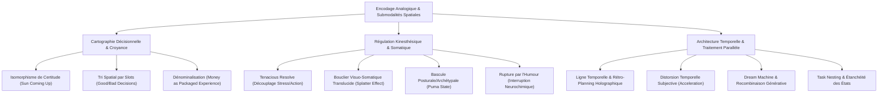

# Personal Enhancement Audios - Transcripts
**Formateur :** Richard Bandler | **ID :** `richard-bandler-personal-enhancement-audios-transcripts` | **Tranches :** 3

Voici la synthèse architecturale ultra-dense, structurée selon les exigences des fiches maîtresses de modélisation cognitive :

---

# Synthèse Architecturale du Cours : *Personal Enhancement Audios* (Richard Bandler)

---

### 1. Thèse Centrale & Philosophie du Cours

* **La vision spécifique de Richard Bandler : Le cerveau comme machine analogique cybernétique**
  Bandler récuse frontalement l'approche thérapeutique et de développement personnel standard, qu'il juge lente, intellectualisante et contre-productive. Là où les approches traditionnelles cherchent la "cause", le "sens", ou s'appuient sur l'analyse verbale et la volonté consciente, Bandler traite la psyché humaine comme un **ordinateur cybernétique opérant par encodage analogique direct** (sous-modalités spatiales, luminosité, taille, distance, tempo, tonus). Pour lui, le problème n'est jamais le contenu de l'histoire que l'on se raconte, mais le **format technique de stockage neuro-synesthésique**. Si une peur ou une indécision bloque l'action, ce n'est pas un blocage psychodynamique : c'est simplement une image trop grande, trop proche ou mal spatialisée qui déclenche une boucle réflexe d'évitement.

* **Posture opérationnelle vs Posture académique standard :**
  1. *Éradication de l'analyse intellectualiste :* Comprendre le "pourquoi" ne modifie pas les représentations synesthésiques ; modifier l'emplacement et la taille d'une image change instantanément la kinesthésie.
  2. *Refus du sacrifice et du conflit moral :* Dénominalisation radicale des concepts inhibiteurs (l'argent, la réussite, la discipline) pour les reconnecter à des fonctions biologiques de plaisir, de liberté et d'alignement écologique global.
  3. *Découplage Adrénaline / Action :* Rejet catégorique de la motivation par la panique, l'anxiété de dernière minute ou la peur de l'échec ; remplacement par la *Tenacious Resolve* (action fluide propulsée par le confort somatique et la certitude).

* **Le fil rouge méthodologique unificateur :**
  **L'automatisation neurologique à haute vitesse par manipulation sous-modale, compression temporelle et intégration spatiale.**  
  Bandler programme le système nerveux en confiant la tâche de traitement de fond à l'inconscient (traitement parallèle haute vitesse / *Dream Machine*), tandis qu'il règle les filtres de décision et d'action de manière binaire (slots de certitude, bouclier kinesthésique, postures prédatrices dominantes).

---

### 2. Carte des Concepts & Leviers Émergents

#### Écosystème des leviers clés :

1. **Packaging d'Expérience & Dénominalisation Financière (`#money_as_packaged_experience`)**
   * *Rôle :* Réduit la friction écologique en transformant les nominalisations abstraites ("l'argent", "le succès") en conteneurs d'expériences kinesthésiques réelles (liberté, santé, bien-être familial).
2. **Amplification Sous-Modale Directe (`#submodalites_analogiques`)**
   * *Rôle :* Agit directement sur l'amplitude de la vibration neurologique par manipulation de la distance, taille, brillance et position spatiale, contournant la rumination discursive.
3. **Isomorphisme de Certitude Absolue (`#sun_coming_up_isomorphism`)**
   * *Rôle :* Calque les coordonnées spatiales et sous-modales d'un fait physique indubitable (le lever du soleil) sur un objectif futur, contournant le besoin de preuves logiques.
4. **Matrice Temporelle Spatiale & Rétro-Planning Holographique (`#spatial_timeline #retro_planning`)**
   * *Rôle :* Cartographie spatiale géométrique discontinue (point à 5 ans, puis rétro-projection dégressive vers le présent avec inclusion de soi) offrant un calcul de trajectoire inconscient à moindre résistance.
5. **Résolution Tenace & Découplage de l'Anxiété (`#tenacious_resolve #adrenaline_free_motivation`)**
   * *Rôle :* Déconnecte l'initiation de l'action de la réponse combat/fuite ; génère une compulsion motrice stable fondée sur le confort proprioceptif et la certitude.
6. **Bouclier Visuo-Somatique Translucide (`#visuo_somatic_shield #proprioceptive_buffering`)**
   * *Rôle :* Conteneur spatial à 360° maintenant un tampon kinesthésique de confort absolu, sur lequel les stresseurs visuels externes s'écrasent sans pénétrer l'intégrité somatique.
7. **Rupture Neurochimique par l'Humour (`#humor_neurochemical_interrupt`)**
   * *Rôle :* Altération subite des coordonnées physiques du problème par l'injection de rire, effondrant la charge sémantique de gravité via une décharge dopaminergique.
8. **Tri Décisionnel Spatial / Slot Mapping (`#spatial_sorting #decision_slots`)**
   * *Rôle :* Création d'adresses spatiales cérébrales strictes pour discriminer instantanément les choix viables des mauvais choix dès leur apparition dans le champ visuel interne.
9. **Imbrication Temporelle & Étanchéité d'État (`#task_nesting #state_shifting`)**
   * *Rôle :* Empilage séquentiel étanche des tâches pour éviter la contamination attentionnelle et la charge mentale diffuse entre différents domaines de vie.
10. **Distorsion Temporelle & Traitement Parallèle Inconscient (`#temporal_distortion #timeline_compression_expansion`)**
    * *Rôle :* Accélération massive du temps subjectif interne pendant l'immobilité physique, permettant à l'inconscient d'exécuter des millions de permutations hors de la lenteur du conscient.
11. **La "Dream Machine" / Générateur Inconscient Récursif (`#generative_unconscious #dream_machine`)**
    * *Rôle :* Cadre métaphorique activant les réseaux neuronaux en association libre diffuse pour synthétiser des solutions innovantes à partir du vide créatif.
12. **Bascule Posturale Archétypale / État Puma (`#archetypal_embodiment #puma_state`)**
    * *Rôle :* Inversion de la relation spatiale dominant/dominé dans les situations d'inhibition sociale ou commerciale, par agrandissement de soi et adoption d'un regard focalisé de prédateur calme.

---

### 3. Tableau Récapitulatif des Techniques & Démonstrations

| Technique / Exercice | Objectif Opératoire | Déclencheur / Indication | Séquence Résumée |
|---|---|---|---|
| **L'Amplificateur Neurologique & Bascule Émotionnelle** | Modifier instantanément un état émotionnel limitant en intensifiant une ressource kinesthésique. | Ruminations, apathie, doute avant une tâche critique. | 1. Localiser l'image négative $\to$ l'éloigner, l'obscurcir et la basculer à plat vers l'arrière. 2. Évoquer une ressource intense $\to$ doubler/quadrupler sa taille, la rapprocher du visage jusqu'à sensation de vibration somatique. 3. Ancrer l'état expansif. |
| **L'Isomorphisme du "Sun Coming Up"** | Imprimer une certitude absolue dans le système nerveux sans passer par l'argumentation logique. | Doute sur un objectif futur, syndrome de l'imposteur, résistance aux affirmations. | 1. Éliciter la sous-modalité d'une vérité absolue incontestable (ex. : *le soleil va se lever demain* : localisation, brillance, fixité). 2. Prendre l'objectif cible (ex. : plan de réussite) et le placer exactement aux mêmes coordonnées spatiales et physiques que la certitude biologique. |
| **Rétro-Planning Holographique Matriciel** | Donner au système nerveux une feuille de route auto-correctrice avec inclusion identitaire complète. | Objectif abstrait sans propulsion, déconnexion du futur, manque de structure séquentielle. | 1. Projeter dans l'espace physique la cible à 5 ans (grand carré vert éclatant incluant soi-même en pleine réussite). 2. Reculer pas à pas dans l'espace vers le présent en plaçant des jalons précis (4 ans, 3 ans, 2 ans, 1 an, mois, jours). 3. Vérifier que la trajectoire offre la ligne de moindre résistance. |
| **Le Bouclier de Verre Translucide (*Clear Glass Shield*)** | Immuniser le système nerveux contre le stress environnemental, les critiques et l'anxiété sociale. | Vulnérabilité au jugement d'autrui, réactivité amygdalienne au conflit, stress relationnel. | 1. Activer une mémoire de confort physique parfait (chaleur, lit, flottaison). 2. Étendre cette sensation à 360° autour du corps, puis vider le contenu visuel pour former une vitre transparente. 3. Projeter les stimuli anxiogènes sur le bouclier : observer leur écrasement visuel sans altération du confort interne. |
| **L'Injection d'Humour Submodale (*Shield Sprinkling*)** | Désamorcer la solennité ou la panique liée à un problème récurrent. | Gravité excessive, dramatisation, blocage émotionnel sérieux. | 1. Visualiser une scène de rire viscéral, l'agrandir et l'amener à percuter le visage. 2. Fusionner cette texture d'hilarité avec le champ visuel/bouclier protecteur. 3. Reclasser l'incident perçu comme grave dans cette zone de perspective humoristique. |
| **Le Tri Spatial des Décisions (*Decision Slots*)** | Filtrer automatiquement les choix stratégiques viables et rejeter les impulsions toxiques. | Hésitation chronique, mauvais jugements répétés, FOMO. | 1. Calibrer les sous-modalités visuelles/auditives d'une décision excellente passée vs une mauvaise décision. 2. Créer deux "fenêtres" ou réceptacles spatiaux dédiés dans l'espace mental. 3. Passer chaque nouvelle opportunité à travers ces fenêtres : rejeter immédiatement ce qui adopte le format de la mauvaise décision. |
| **La Dream Machine** | Générer des percées stratégiques et créatives par activation du traitement diffus inconscient. | Impasse créative, sentiment d'être bloqué par la logique, problème complexe non résolu. | 1. Pré-framing : suspension de la critique consciente et décharge de l'effort. 2. Lancer un cycle de trois rêves/processus parallèles avec distorsion temporelle (accélération massive interne / corps immobile). 3. Laisser l'inconscient opérer des recombinaisons libres dans le vide neural, puis ramener les solutions au conscient. |
| **Fusion des Polarités par Effondrement d'Ancres Spatiales** | Éliminer un conflit interne entre identité présente et aspiration future. | Tiraillement entre croyance limitante et nouveau projet, sentiment de division interne. | 1. Placer les croyances limitantes dans le passé lointain (4 à 7 ans en arrière) et réduire leurs sous-modalités. 2. Charger dans chaque main respectivement la vision présente et les nouvelles compétences futures. 3. Rapprocher physiquement et lentement les deux mains jusqu'à fusion kinesthésique complète (*visual squash*). |
| **L'Adoption de l'Archétype Prédateur (*Puma State*)** | Neutraliser le trac, la timidité ou l'inhibition face à des interlocuteurs intimidants. | Trac commercial, peur hiérarchique, soumission relationnelle en face-à-face. | 1. Réduire la taille de l'interlocuteur perçu comme intimidant et le replacer en contrebas. 2. Amplifier sa propre stature interne et adopter la kinesthésie d'un prédateur calme (focalisation visuelle détendue, respiration diaphragmatique lente, certitude motrice). 3. Engager l'interaction sous cette posture d'assurance souveraine. |

---

## Extractions Détaillées par Tranche (Opératoire & Verbatim)

## --- Tranche 1 / 3 ---

### 1. Mécanismes & Principes Actifs

#### 1. Le principe du "Packaging d'Expérience" et Traducteur Universel (Re-matérialisation de l'Argent)
* **Principe actif :** Dans la cognition humaine, l'argent est souvent stocké sous forme d'une nominalisation abstraite, rigide et anxiogène, générant des conflits internes de valeurs ("l'argent vs la famille"). Bandler dénominalise l'argent en le redéfinissant comme un pur contenant énergétique et temporel : *"Money is nothing more than just packaged experience / a universal translator of experience"*. Le système nerveux ne peut pas désirer neurologiquement un chiffre mort ou du papier imprimé sans friction. En liant directement l'acquisition financière à des vécus kinesthésiques, relationnels et somatiques concrets (soigner les dents de ses enfants, vacances, liberté de créer), le conflit écologique s'effondre.
* **Tags :** `#money_as_packaged_experience #universal_translator #denominationalisation #realignement_valeurs #ecologie_financiere`

#### 2. L'alignement Conscient / Inconscient par Amplification Submodale Directe
* **Principe actif :** L'esprit conscient fixe la direction ou formule l'intention ("que veux-tu changer en 45 minutes ?"), mais la cinétique somatique et comportementale dépend entièrement des représentations analogiques (taille, luminosité, localisation, distance, tempo, volume). Au lieu de passer par l'introspection analytique (qui réactive les boucles thalamo-corticales de rumination), Bandler agit directement sur le substrat de codage neurologique. En doublant, quadruplant la taille d'une image ressource et en la rapprochant, la réponse sympathique/kinesthésique est immédiatement amplifiée (*"till your neurology starts to vibrate"*). Réciproquement, la désactivation d'un état négatif ne passe pas par la compréhension psychologique, mais par l'altération de ses coordonnées spatiales (pousser au loin, obscurcir, basculer à plat en arrière).
* **Tags :** `#submodalites_analogiques #congruence_neuro_somatique #amplification_kinesthésique #deplacement_spatial #evitement_analyse_intellectuelle`

#### 3. L'Isomorphisme Submodal de Croyance Absolue (Modèle "Sun Coming Up")
* **Principe actif :** Toute croyance dans le cerveau humain est codée par une localisation spatiale et des submodalités spécifiques (fixité, luminosité, distance, ton de certitude). Pour installer une nouvelle conviction (ex: *"Je peux réussir mon plan à 5 ans"*), le cerveau n'a pas besoin de preuves rationnelles préalables ; il a besoin que la nouvelle proposition adopte rigoureusement les mêmes paramètres physiques et spatiaux qu'une certitude biologique indubitable. Bandler calibre l'étalon universel de certitude : l'évidence que le soleil va se lever demain. En calquant les submodalités visuelles et auditives de cette certitude sur le nouvel objectif, le système nerveux accepte la suggestion comme un fait déjà accompli.
* **Tags :** `#belief_template #sun_coming_up_isomorphism #cartographie_spatiale_croyance #installation_certitude`

#### 4. La Ligne Temporelle Spatiale et le Rétro-Planning Holographique
* **Principe actif :** Le cerveau encode le temps de manière spatiale continue (In-Time ou Through-Time). Beaucoup d'individus échouent parce que leur futur est soit dissocié et vide, soit dépourvu de jalons discrets, soit encombré d'images où ils s'excluent eux-mêmes (absence de soi dans la visualisation du succès). Bandler construit une architecture géométrique matricielle dans l'espace physique : ancrage du point cible à 5 ans (grand carré vert), puis rétro-projection holographique par tranches dégressives (4 ans, 3 ans, 2 ans, 1 an, 12 mois, jours). Cette cartographie spatiale permet à l'inconscient d'exécuter un calcul de trajectoire à "moindre résistance" et de détecter instantanément les déviations de cap.
* **Tags :** `#spatial_timeline #retro_planning_holographique #matrice_temporelle_geometrique #auto_correction_trajectoire #inclusion_identitaire`

#### 5. L'Écologie Holistique Poly-Vectorielle vs le Plan Linéaire Tronqué
* **Principe actif :** La réussite unilatérale (ex: purement financière) crée un clivage des parties du soi (l'individu gagne de l'argent mais ruine sa santé ou son foyer). Bandler force l'esprit à concevoir un plan où la progression sur un vecteur (la richesse) amplifie automatiquement les autres vecteurs (passion, sexe, santé, intimité familiale). L'évacuation de la croyance en la "nécessité du sacrifice" supprime les résistances inconscientes et mobilise l'intégralité du potentiel d'action.
* **Tags :** `#ecologie_systemique #non_sacrifice #multi_vectorialite #unification_parties`

---

### 2. Protocoles, Techniques & Démonstrations (Étape par Étape)

---

#### PROTOCOLE 1 : L'Amplificateur Neurologique & Bascule Émotionnelle Rapide
* **Intention / Indication :** Neutraliser un état limitant (anxiété, peur, doute, solitude) et installer un état de certitude et d'excitation motrice en moins de 10 minutes.
* **Mise en place & Pré-framing :** Casque audio, position confortable, yeux fermés. Suspension de l'analyse du passé. Cadrage : *"Le problème n'est pas vous, c'est juste une image, des sons et votre neurologie hors de contrôle."*

* **Séquence d'actions pas à pas :**
  1. **Définition de la cible :** Formuler intérieurement : *"Si je pouvais faire un seul changement dans les 45 prochaines minutes, quel serait-il ?"* Identifier le sentiment parasite associé.
  2. **Élicitation de l'état ressource d'excellence :** Repenser à un domaine de sa vie qui fonctionne parfaitement, où l'on se sent réel et efficace.
  3. **Cartographie submodale de la ressource :**
     - Localiser l'image (droite, gauche, centre, haut, bas, distance).
     - Localiser les voix/sons (provenance, distance, hauteur).
  4. **Surmultiplication Analogique (Driver Submodal) :**
     - Doubler la taille de l'image.
     - Augmenter la luminosité.
     - La rapprocher du visage.
     - Quadrupler la taille jusqu'à ce que la neurologie commence littéralement à vibrer (*"till your neurology starts to vibrate"*).
     - Augmenter le volume sonore, accélérer le tempo des voix ressources, les rapprocher.
  5. **Démantèlement de l'état limitant :**
     - Localiser l'image et la voix du sentiment désagréable.
     - Vérifier la disparité des coordonnées (taille, distance, son).
     - Pousser délibérément l'image négative au loin, dans la pénombre, vers la gauche ou le bas.
     - Faire basculer l'image en arrière pour qu'elle tombe à plat (*"let them literally fall over backwards, they're flat"*).

* **Signes de calibration :** Respiration qui s'amplifie et descend dans l'abdomen, micro-mouvements musculaires toniques lors de l'amplification submodale, détente faciale immédiate lors du basculement à plat de l'image négative.

---

#### PROTOCOLE 2 : Installation de Croyance sur Modèle Isomorphique ("The Sun Coming Up Swish")
* **Intention / Indication :** Transformer un doute ou un objectif lointain en une certitude biologique inébranlable.
* **Mise en place & Pré-framing :** Trouver une référence neurologique de vérité incontestable sur laquelle il n'existe aucun débat interne.

* **Séquence d'actions pas à pas :**
  1. **Calibration de l'étalon de certitude :** Penser à l'affirmation *"Le soleil va se lever demain pour chaque jour où je serai vivant"*.
  2. **Repérage des coordonnées de la vérité :** Noter précisément où se trouve cette image dans l'espace mental (ex: en haut à droite, à 1 mètre, luminosité vive, ton de voix calme et absolu).
  3. **Création de la représentation désirée :** Créer une image distincte représentant la croyance visée : *"Je peux tout accomplir, tout intégrer facilement et poursuivre férocement mon futur"*.
  4. **Snap Submodal / Swish de Localisation :**
     - Envoyer l'image désirée au loin dans l'espace.
     - D'un coup sec et ultra-rapide (fraction de seconde), faire revenir l'image désirée pour qu'elle vienne claquer (*snap*) exactement à l'endroit, à la taille et avec la tonalité de l'image du soleil qui se lève.
  5. **Répétition cinétique :** Répéter ce geste mental 5 fois d'affilée à vitesse maximale, en effaçant l'écran entre chaque itération, jusqu'à équivalence neurologique totale de certitude.

* **Signes de calibration :** Absence totale d'hésitation vocale/oculaire, hochement de tête spontané (signal d'évidence idéomoteur), sentiment corporel d'ancrage lourd et serein.

---

#### PROTOCOLE 3 : L'Ingénierie de Destinée à 5 Ans (Time Matrix Architecture)
* **Intention / Indication :** Planification globale stratégique et éradication de la "conscience de pauvreté" (*poverty consciousness*). Structurer inconsciemment une trajectoire de vie multidimensionnelle.
* **Mise en place & Pré-framing :** Cadrage strict : l'argent n'est qu'un traducteur d'expérience. Tout projet unidimensionnel (purement business) est toxique s'il exclut l'individu de son propre tableau.

* **Séquence d'actions pas à pas :**
  1. **Élicitation de la Ligne Temporelle :** Pointer du doigt ou localiser spatialement le passé (-6 mois, -1 an, -5 ans) et le futur (+1 mois, +1 an, +5 ans) pour matérialiser la trajectoire subjective du temps.
  2. **Construction de l'Ancre Cible (+5 ans) :**
     - Projeter dans l'espace futur, à 5 ans, un très grand carré vert (*"great big green square"*).
     - Remplir cet espace de représentations concrètes : argent, réduction du temps de travail, santé, sexualité, passion, intimité familiale, créativité.
     - **Test d'Inclusion :** Vérifier impérativement que le sujet se voit lui-même, vivant, vibrant et présent à l'intérieur de l'image (*"Are you in the image?"*).
  3. **Rétro-Projection des Jalons Géométriques :**
     - Créer un carré vert légèrement plus petit à 4 ans.
     - Descendre successivement à 3 ans, 2 ans, et 1 an (chacun étant visible en perspective).
  4. **Segmentation Matricielle (Mois & Jours) :**
     - Intercaler des carrés d'une autre couleur pour les 12 mois de chaque année.
     - Intercaler une troisième couleur pour les jours.
     - S'élever mentalement au-dessus de la ligne temporelle pour contempler la grille complète sous un angle panoramique.
  5. **Assimilation et Vol Somatique de la Vision :**
     - Voir l'image à 5 ans collecter et intégrer tous les éléments intermédiaires.
     - Faire grandir l'image à taille réelle (*life-sized*).
     - Faire voler l'image à toute vitesse droit sur soi pour qu'elle pénètre physiquement à l'intérieur du corps (*"fly straight at you, feel it come inside"*).
  6. **Future Pace & Test de Focus Compartimenté :** Programmer l'inconscient à être 100% présent à chaque acte (en rendez-vous d'affaires : focus prédateur total ; en famille : intimité totale sans penser aux affaires) avec auto-correction en cas de dérive de cap.

* **Signes de calibration :** Changement immédiat du tonus postural (redressement du buste), respiration profonde, pupilles dilatées en traitement interne kinesthésique intense.

---

### 3. Heuristiques, Subtilités & "Sagesse du Praticien"

* **La Règle de l'Inclusion dans le Succès :**
  * *Si* le sujet visualise son futur idéal (ex: maison, bateau, famille heureuse) mais qu'il observe la scène de l'extérieur sans être physiquement présent dedans,
  * *Alors* l'arrêter immédiatement et recadrer durement : son plan inconscient actuel est de mourir ou de faire une crise cardiaque pour que les autres profitent de l'argent. Forcer la réintégration de son propre corps dans l'image.
* **L'Heuristique de la Déception :**
  * *"Disappointment requires adequate planning."* Pour être déçu, un être humain doit exécuter une planification mentale rigoureuse d'un scénario parfait, puis observer qu'il ne se réalise pas. Si le cerveau sait déjà si bien planifier la déception, il possède déjà toute la compétence neurologique nécessaire pour planifier le succès : il suffit d'inverser le vecteur du film mental.
* **Le Piège de l'Analyse Psychologique Rétrospective :**
  * Fouiller dans l'enfance ou disséquer intellectuellement un problème ne change rien à la structure neurologique : *"I've never found that that really works for me... Teaching people how to use their own brain for a change... do it directly."* Travailler directement sur le logiciel de traitement (submodalités, encodage sensoriel), jamais sur le récit discursif.
* **La Règle de la Moindre Résistance et du Contournement :**
  * Quand l'esprit inconscient se heurte à un obstacle : *"When you come up against a wall, you just move to find the door."* L'inconscient doit être pré-programmé à la déviation fluide plutôt qu'à la confrontation traumatique frontale.
* **La Compartimentation Opératoire Totale :**
  * La dispersion est le poison de la richesse. Quand on passe un coup de fil business, on le poursuit avec férocité sans penser à ses vacances. Quand on passe 5 minutes avec ses enfants, on est 100% absorbé dans l'intimité. La richesse, c'est l'intensité de la présence dans la tranche de vie courante.

---

### 4. Pépites Verbatim & Patterns Linguistiques (MOT À MOT EN V.O.)

#### Pépite 1 : La Dénominationalisation de l'Argent
> *"Money is nothing more than just packaged experience. You convert labor, you convert the things that you do in your activities into numbers on paper and bank accounts, and gold, property, bonds, and stocks, and at a later time you can convert it back into vacations, you can convert it into the opportunity for education, into having your children's teeth fixed at the dentist, into anything that you might want. It's a universal translator of experience."*
* **[Analyse du Pattern] :** **Recadrage par redéfinition sémantique et pont kinesthésique.** Bandler brise la nominalisation paralysante de l'"argent" en la décomposant en un verbe d'action cyclique : conversion d'activité $\rightarrow$ symboles abstraits $\rightarrow$ expériences de vie hautement émotionnelles (dents des enfants, vacances). Ce pattern pulvérise les blocages puritains ou moraux liés à l'argent en le réindexant sur l'amour et la sécurité familiale.

#### Pépite 2 : La Rupture de Pattern par Provocation Paradoxale
> *"Did your plan include, for example, small things like yourself? One gentleman told me that he could see in five years his family living in a big house, being totally happy, with a boat and a big car, and I asked him, 'Are you in the image?' And shocked, he returned to me the words where he said, 'No.' And I said, 'What, are you going to have a heart attack and they're going to have the money? I said you could just commit suicide now if that's your plan.'"*
* **[Analyse du Pattern] :** **Électrochoc sémantique et réduction à l'absurde (Reductio ad absurdum).** Bandler utilise un pattern de confrontation brutale pour briser l'hypnose du sacrifice. En assimilant le fait de s'oublier dans son plan futur à une tentative déguisée de suicide ou à une crise cardiaque programmée, il crée une rupture d'état (*state interrupt*) violente qui force le sujet à reconfigurer instantanément son écologie personnelle.

#### Pépite 3 : L'Installation du Moteur Émotionnel Submodal
> *"Now quadruple the size of the image. Make it bigger all the way up. Make it bigger and brighter till your neurology starts to vibrate. Speed up the tempo. Learn to bring the image closer. Turn the volume of the voice up. Make the voice get closer. Feel the excitement. You can know that you're about to use your own conscious mind as well as the unconscious resources."*
* **[Analyse du Pattern] :** **Empilement de commandes directes et enchaînement submodal analogique.** Utilisation d'impératifs courts couplés à des prédicats kinesthésiques intenses (*"neurology starts to vibrate"*, *"feel the excitement"*). L'expression *"You can know that you're about to use..."* insère une présupposition d'apprentissage inévitable tout en contournant l'esprit critique par la permission apparente (*"You can"*).

#### Pépite 4 : L'Isomorphisme du Soleil
> *"Think of something simple that you believe so strong... 'I believe the sun's gonna come up for every day that I'm alive'... What you believe, the sun is coming up tomorrow, is true, is right. Surely, as the sun is coming up tomorrow, see yourself behaving in the same successful perspective as a person."*
* **[Analyse du Pattern] :** **Liaison causale par truisme cosmologique (Pacing & Leading absolu).** La certitude universelle indiscutable (le lever du soleil) est syntaxiquement liée par l'adverbe de liaison *"Surely, as..."* à la vision du comportement de succès futur. Le système nerveux transfère automatiquement le coefficient de vérité neurologique du premier fait (physique) sur le second (mental).

#### Pépite 5 : La Métaphore de la Ferrari et de la Rupture des Limites
> *"People can open doorways, but they're not going to push you through it. Neither will we. We want you to have your hand on the door, open it up, step into a Ferrari, pull out into the fast lane, put the fun meter to the red line and make sparks off the guardrail, and realize anything that ever got in your way in the past is way into the past where it belongs."*
* **[Analyse du Pattern] :** **Métaphore kinesthésique à haute énergie motrice et présupposition d'irréversibilité.** Bandler commence par donner le contrôle au sujet (*"your hand on the door"*), puis enchaîne une cascade sensorielle vive (accélération, zone rouge, étincelles contre la glissière de sécurité) qui sature l'attention et génère une hyperexcitation somatique. La phrase se conclut par une suggestion post-hypnotique reléguant tous les traumatismes passés dans un passé révolu (*"way into the past where it belongs"*).

#### Pépite 6 : L'Assimilation Somatique du Futur
> *"I want you to watch something happen that only unconscious alignment can achieve... reach out and collect all those smaller images up, life-sized towards you, as it's filled with all the smaller parts, try to get brighter, bigger, fly straight at you, feel it come inside, change the sense of excitement, because as it does so, settling for nothing less than that."*
* **[Analyse du Pattern] :** **Double lien kinesthésique et incorporation physique de la gestalt.** Bandler lie le phénomène visuel (l'image géante qui fond sur le sujet) à une entrée somatique directe (*"feel it come inside"*). La formule *"settling for nothing less than that"* s'ancre comme un critère de seuil intolérable envers la médiocrité, bypassant toute négociation consciente.

## --- Tranche 2 / 3 ---

### 1. Mécanismes & Principes Actifs

- **Rupture du couplage Motivation-Anxiété & Émergence de la Détermination Pure**
  - *Principe actif* : La majorité des individus utilisent l'adrénaline, le stress de dernière minute ou la peur de l'échec comme combustible d'action. Bandler découple neuro-émotionnellement l'exécution de la réponse fight/flight en installant un état opératoire où la compulsion motrice provient du confort somatique, de l'alignement d'objectifs et de la certitude. Le système nerveux n'a plus à payer un coût métabolique d'usure cardiovasculaire pour initier une tâche.
  - *Terme Bandler* : *Tenacious Resolve*
  - *Tags* : #tenacious_resolve #decoupling_stress_action #adrenaline_free_motivation #somatic_comfort

- **Le Bouclier Visuo-Somatique Translucide (Conteneur Écologique de Confort)**
  - *Principe actif* : Construction d'une synesthésie protectrice à 360° : une mémoire de confort profond (flottaison, soleil, lit) est spatialisée autour du corps pour saturer la proprioception et la kinesthésie. Bandler vide ensuite le contenu visuel pour ne garder qu'une paroi de verre transparent. Les stresseurs ou souvenirs d'anxiété projetés vers le sujet viennent s'écraser visuellement (*splatter & drip*) sans impacter la kinesthésie interne, neutralisant la réactivité de l'amygdale par barrière sous-modale.
  - *Terme Bandler* : *Shield from anxiety and stress* / *Clear glass*
  - *Tags* : #visuo_somatic_shield #submodal_splatter #content_drain #proprioceptive_buffering

- **L'Injection Submodale d'Humour et Relativisation Structurelle**
  - *Principe actif* : L'humour et le rire déclenchent une décharge dopaminergique incompatible avec le figement ou la rumination limbique. En agrandissant une image de franc fou rire et en la faisant frapper le visage avant de fusionner avec le bouclier protecteur, Bandler altère les paramètres physiques du cadre de référence (taille, luminosité, distance). Les problèmes, une fois déplacés dans cet emplacement spatial d'hilarité, perdent leur charge sémantique de gravité.
  - *Terme Bandler* : *Sense of humor as perspective* / *Sprinkle on the shield*
  - *Tags* : #humor_neurochemical_interrupt #spatial_humor_relocation #gravity_collapse #perspective_shift

- **Le Tri Sélectif des Décisions par Encodage Spatial (Slot Mapping)**
  - *Principe actif* : Le cerveau encode la validité d'une décision par des sous-modalités critiques strictes (localisation, taille, brillance, latéralisation de la voix interne). Bandler formalise deux réceptacles neuronaux distincts (« Good Decision » vs « Bad Decision »). En forçant l'évaluation kinesthésique et visuelle des choix dans ces coordonnées, il apprend à l'inconscient à éliminer automatiquement toute option tombant dans le format spatial de la « mauvaise décision ».
  - *Terme Bandler* : *Decision slots* / *Window of conviction*
  - *Tags* : #spatial_sorting #decision_submodalities #slot_mapping #automatic_filtering

- **L'Imbrication Temporelle et Clôture Séquentielle (Task Nesting & State Shifting)**
  - *Principe actif* : Évite la fragmentation attentionnelle en apprenant au système nerveux à fermer hermétiquement un état avant d'en ouvrir un autre. Si une interruption survient, la tâche est empilée (« nested ») puis reprise à 100 % d'intensité dès que l'interférence cesse, éliminant la pollution résiduelle (penser au travail avec ses enfants, penser à la famille au travail).
  - *Terme Bandler* : *Nesting tasks together* / *Ferociously pursuing each moment*
  - *Tags* : #task_nesting #compartmentalization #state_switching #pure_presence

- **Plasticité de la Réalité par Shift Épistémologique (Le Modèle du Photon)**
  - *Principe actif* : S'appuyant sur Korzybski (*« The map is not the territory »*), Bateson et Einstein, Bandler enseigne la suspension des croyances acquises. L'activité corticale et neurochimique n'est pas le monde extérieur mais une simulation. En modifiant les coordonnées spatiales des croyances obsolètes (les reléguer dans le lointain, les rendre ridicules), le sujet libère la bande passante cognitive pour générer de nouvelles configurations perceptuelles dans la « Dream Machine ».
  - *Terme Bandler* : *Suspending beliefs* / *Dream Machine*
  - *Tags* : #epistemological_shift #belief_relocation #hallucinatory_ideation #creative_unconscious

---

### 2. Protocoles, Techniques & Démonstrations (Étape par Étape)

#### Protocole 1 : Le Bouclier de Verre et Dissolution de l'Anxiété (*Tenacious Resolve Shield*)
* **Intention / Indication** : Sujets réactifs au stress, paralysés par l'anticipation négative, ou incapables d'affronter des difficultés sans pic d'adrénaline.
* **Mise en place & Pré-framing** : Confortablement installé, yeux fermés. Recadrer le stress non pas comme une fatalité ou une preuve d'engagement, mais comme une inefficacité neurologique évitable.
* **Séquence d'actions pas à pas** :
  1. *Repérage des stresseurs* : Identifier dans le passé (6 mois, 1 an, 3-4 ans) des scènes d'anxiété inutiles. Les rendre grandes, lumineuses, repérer leur localisation spatiale, sans entrer dedans (dissociation visuelle).
  2. *Évocation du conteneur kinesthésique* : Laisser ces images reculer et évoquer un souvenir de bien-être absolu (flotter sur l'eau, coucher de soleil, lit chaud). 
  3. *Immersion 360°* : Grandeur nature, entendre les sons, ressentir la montée de confort corporel.
  4. *Purge du contenu (Création du verre)* : Vider l'image du souvenir tout en maintenant 100 % de la sensation somatique. Le conteneur devient une sphère de verre transparente à 360°.
  5. *Test d'impact & Écrasement (Splatter Pattern)* : Prendre une image d'anxiété passée, la faire voler à toute vitesse vers soi. La voir s'écraser violemment contre la vitre protectrice, se liquéfier et couler (*melt and drip away*).
* **Signes de calibration** : Déglutition réflexe, décélération du rythme respiratoire, affaissement du tonus des trapèzes lors de l'impact contre la vitre (preuve que le corps ne sursaute plus au stimulus visuel).

---

#### Protocole 2 : L'Injection de Perspective par l'Humour Spatialisé
* **Intention / Indication** : Sujets qui « agissent sérieusement » au lieu d'agir efficacement, bloqués par l'excès de gravité sur des tâches inachevées.
* **Mise en place & Pré-framing** : Conserver le bouclier de verre transparent autour de soi.
* **Séquence d'actions pas à pas** :
  1. *Sélection des blocages* : Choisir 1 à 4 tâches ou objectifs inachevés / repoussés. Les regarder à travers la vitre.
  2. *Ancrage visuel vertical du rire* : Regarder tout droit vers le haut. Accéder au souvenir du fou rire le plus incontrôlable de sa vie (moment hilarant, ridicule, fou rire partagé).
  3. *Agrandissement & Impact frontal* : Rendre l'image géante, ultra-lumineuse, zoomer et la faire frapper le visage de plein fouet pour saturer le système nerveux de cette vibration d'amusement.
  4. *Tapissage du bouclier* : Saupoudrer cette fréquence d'humour sur tout le bouclier de verre.
  5. *Recadrage par translation spatiale* : Prendre chacune des 4 tâches inachevées et la déplacer physiquement dans les coordonnées spatiales exactes d'où venait le souvenir de fou rire.
  6. *Inhalation somatique & Relance motrice* : Respirer profondément, sourire, regarder la tâche à travers cette lentille d'amusement et décider d'agir immédiatement dans le confort.
* **Signes de calibration** : Sourire involontaire, micro-secousses diaphragmatiques, dilatation pupillaire, changement immédiat de posture (décontraction vers l'avant).

---

#### Protocole 3 : L'Aiguillage Submodal de Prise de Décision (*Decision Slot Mapping*)
* **Intention / Indication** : Hésitation chronique, procrastination décisionnelle, tendance à réitérer des choix erronés.
* **Mise en place & Pré-framing** : S'asseoir et se préparer à cartographier la structure interne du choix.
* **Séquence d'actions pas à pas** :
  1. *Élicitation des sous-modalités d'une excellente décision* : Penser à un choix passé indubitablement réussi. Localiser précisément l'image (droite/gauche, haut/bas, distance, taille, brillance, voix interne).
  2. *Élicitation des sous-modalités d'une mauvaise décision* : Penser à une décision regrettable. Relever ses sous-modalités critiques (souvent tonalité sombre, position opposée, voix hésitante ou venue d'un angle différent).
  3. *Calibration des deux réceptacles (« Slots »)* : Valider la disparité spatiale et qualitative des deux emplacements.
  4. *Tri de l'option actuelle* : Prendre la décision actuelle (ou la première étape d'un problème à résoudre) et observer dans quel réceptacle elle se loge spontanément.
  5. *Rejet ou Confirmation* :
     - Si elle tombe dans le réceptacle « mauvaise décision » : rejet immédiat et sélection d'une alternative jusqu'à trouver une solution qui se cale dans les coordonnées du réceptacle « bonne décision ».
     - Si elle tombe dans le bon emplacement : faire avancer mentalement le corps vers elle pour intensifier la traction kinesthésique (*propulsion pleasure*).
* **Signes de calibration** : Mouvements oculaires asymétriques selon le slot évalué, hochement de tête fluide et respiration descendante lorsque la décision valide le bon emplacement.

---

### 3. Heuristiques, Subtilités & "Sagesse du Praticien"

- **L'Anti-Gravité Opératoire : *Acting Seriously vs. Seriously Acting***
  - *Règle* : Si le sujet fronce les sourcils, serre les dents et prétend « prendre les choses très au sérieux », il est en train de jouer un rôle social rigide au lieu de mobiliser ses circuits moteurs.
  - *Heuristique Bandlerienne* : L'efficacité géniale s'accompagne toujours d'une forme de légèreté ou d'humour. Si le client n'a pas de recul amusé sur sa crise, son cortex préfrontal est bridé. Injecter l'humour d'abord, la stratégie ensuite.

- **Le Postulat de Non-Satiété : *The Moving 5-Year Horizon***
  - *Règle* : Chaque jour avancé dans le plan de vie repousse l'échéance d'un jour à l'autre bout. Le plan à 5 ans n'est jamais un produit statique ou figé, c'est un cadre d'orientation dynamique (*moving five-year plan*).
  - *Ajustement périodique* : L'inconscient doit être programmé pour auditer le plan chaque mois : comment rendre l'exécution plus facile ? Que supprimer d'inutile ? Comment quadrupler le résultat en réduisant le temps par deux ?

- **Heuristique de la Traction Kinesthésique (*Compulsion of Pleasure*)**
  - *Règle* : Si le sujet utilise l'évitement (« Je dois faire ça pour éviter d'échouer »), la motivation faiblira à mesure que le danger s'éloigne.
  - *Intervention* : Remplacer l'évitement par une traction positive sous-modale. Plus le sujet s'approche mentalement de la tâche complétée, plus la sensation kinesthésique corporelle doit devenir intense et gratifiante.

- **Dépassement du Piège de l'Identité Passée**
  - *Règle* : « Je ne suis pas le genre de personne capable d'équilibrer travail et famille » est une pure nominalisation limitante.
  - *Intervention* : Reléguer cette ancienne identité à une simple erreur d'organisation temporelle passée (*« It was only your time organization. It was only because you were that kind of person »*). Choisir immédiatement la nouvelle représentation visuelle de qui l'on veut être et la glisser dans le registre structural de la certitude absolue (*« Strong as the sun will come up tomorrow »*).

---

### 4. Pépites Verbatim & Patterns Linguistiques (MOT À MOT EN V.O.)

#### Pépite 1 : Le Découplage de la Gravité et de l'Efficacité
> "See, one of the problems that I find that people have is that they hesitate much too much. I always say he who hesitates waits, waits, and waits, and waits, and waits. Now the other thing that I find gets in people's way is rather than seriously acting they just act seriously and when you take any kind of any sort of decision you make about what needs to be done and just act seriously rather than get it done these are the very times exceed the..."

* **[Analyse du Pattern]** :
  - *Jeu de mots / Chiasme syntaxique* : Bandler inverse `seriously acting` et `act seriously`. Cette permutation casse le pattern conventionnel où « être sérieux » est confondu avec « être efficace ».
  - *Répétition hypnotique isochrone* : La scansion `waits, waits, and waits...` produit une surcharge auditive rythmique simulant l'usure de l'hésitation, provoquant chez l'auditeur un rejet kinesthésique immédiat de l'inaction.

---

#### Pépite 2 : La Création du Bouclier Translucide et l'Écrasement Submodal
> "I want you now to let one of those memories from your past suddenly as this shield. I want you to turn the content out of it and leave a clear glass. The feelings will stay there, comfort and relaxation, but the content of your memory will fade and you can look straight through it. Now as you look out, I want you to look at those past memories, sitting out there, the things that bothered you, and I want you to have one of them fly straight up towards you and just splatter on that glass, and then watch it drip away. Melt because you're protected by your ability to unconsciously learn, really learn, to maintain a sense of comfort."

* **[Analyse du Pattern]** :
  - *Dissociation contenu / structure kinesthésique* : La commande `turn the content out of it and leave a clear glass` dissocie l'affect de l'image source, transformant un souvenir statique en un filtre perceptuel permanent.
  - *Sous-modalité d'impact cinétique et dégradation de forme* : `splatter on that glass, and then watch it drip away`. L'utilisation d'onomatopées et de verbes viscéraux (*splatter*, *drip*, *melt*) impose une rupture de gestalt visuelle : le stresseur perd instantanément ses frontières géométriques et sa charge d'autorité.
  - *Commande enchâssée et présupposition d'apprentissage inconscient* : `unconsciously learn, really learn, to maintain a sense of comfort`. L'adverbe *really* intensifie la commande d'ancrage somatique.

---

#### Pépite 3 : La Trajectoire Future et l'Ancrage de Certitude Cosmique
> "Pick an image of the person who can carry out this plan, and have it be you, and then move it into what you believe. Strong as the sun will come up tomorrow, you will be that kind of person. Strong and powerful kind of person who ferociously pursues each and every moment of their life."

* **[Analyse du Pattern]** :
  - *Équivalence complexe et lien analogique universel* : `Strong as the sun will come up tomorrow`. Bandler greffe la nouvelle identité du sujet sur une certitude physique indiscutable (la rotation terrestre). Le doute sur soi devient aussi absurde que de douter du lever du soleil.
  - *Adverbe de caractérisation motrice (*Ferociously*)* : L'utilisation répétée de `ferociously` crée une induction d'énergie brute et d'acuité sensorielle, nettoyant la passivité souvent associée aux états méditatifs ou hypnotiques traditionnels.

---

#### Pépite 4 : L'Aiguillage Inconscient du Tri Décisionnel
> "If you've got a difference in your mind between what was a good decision you made and what was a bad one, does it have a different location? Is it a different size? Is it a different brightness? Is it a different color? Is it a different voice? One coming from the right or the left or the front or the back? Which one are you using? And when you make these decisions, notice which one of those two slots they fall into. And if it falls into the bad one, pick a new one. Because it's time to begin to let your unconscious mind automatically let anything that falls into the bad decision slot drop out of your life..."

* **[Analyse du Pattern]** :
  - *Empilement d'interrogations sous-modales (Ratification forcée)* : L'avalanche de questions fermées/ouvertes sur l'espace (*location*, *size*, *brightness*, *voice coming from the right or left*) force le sujet à accéder instantanément à la structure analogique de sa pensée sans pouvoir philosopher.
  - *Commande post-hypnotique d'effacement automatique* : `let your unconscious mind automatically let anything that falls into the bad decision slot drop out of your life`. Installation d'un filtre autonome cybernétique où l'inconscient prend en charge l'inhibition motrice des mauvaises options.

---

#### Pépite 5 : Relativité Perceptive et Mutation de la Réalité
> "Inside Your Head: Chemicals, The Electrical Flowing, Cortex, Our Representation of the World, Not the World, This Means As We Change Our Idea, We Perceive New Parts of the World... Consciousness itself is a force. A force that can influence the physical world. This is why all the toasters are hearing us. Consciousness is able to change matter. Human beings are able to influence the world around them. As our ideas change, the very universe changes."

* **[Analyse du Pattern]** :
  - *Empilement épistémologique et glissement d'échelle* : Du niveau neurobiologique (*Chemicals, Electrical Flowing, Cortex*) vers la carte cognitive (*Not the World*), puis vers la physique métaphorique (*Consciousness itself is a force*).
  - *Rupture de pattern par absurdité bandlerienne* : L'insertion brutale de `This is why all the toasters are hearing us` en plein milieu d'une tirade philosophique d'inspiration einsteinienne fait disjoncter l'analyse rationnelle (déstabilisation du dialogue interne), forçant l'esprit critique à s'effacer au profit de l'ouverture suggestive.

## --- Tranche 3 / 3 ---

Voici l'analyse opératoire et la modélisation de cette tranche de transcription de Richard Bandler (*Personal Enhancement Series*).

---

### 1. Mécanismes & Principes Actifs

#### A. Relativité temporelle et distorsion de la ligne du temps (#temporal_distortion #timeline_compression_expansion)
- **Principe actif :** Le cerveau encode le passage du temps via la fréquence et la vitesse des représentations internes (images, dialogue interne). En induisant la suggestion que le temps subjectif interne peut s'accélérer considérablement alors que le temps physique externe ralentit, Bandler libère une bande passante cognitive démesurée. Cela court-circuite la critique analytique consciente (qui opère à vitesse de parole standard) et déclenche un traitement parallèle inconscient à haute vitesse.

#### B. La "Dream Machine" / Générateur créatif inconscient (#generative_unconscious #dream_machine #neural_recombination)
- **Principe actif :** Le formateur recadre l'émergence des idées : aucune innovation ne provient de l'analyse logique séquentielle, mais du "fond de l'esprit" (traitement diffus). La *Dream Machine* agit comme une métaphore active (processus métaphorique) activant les réseaux neuronaux corticaux en mode d'association libre tout en suspendant les filtres de cohérence logique préliminaire.

#### C. Suspension des croyances et fusion des polarités (#belief_suspension #polarity_integration #hands_collapse)
- **Principe actif :** Déplacer spatialement les croyances limitantes dans le passé (4 à 7 ans en arrière) et dans la distance submodale réduit leur charge kinesthésique d'adhésion. La fusion kinesthésique (rapprocher les deux mains portant respectivement la vision présente et les nouvelles capacités) applique le principe de l'intégration des parties (visual squash / collapse anchor), forçant le système nerveux à réconcilier les représentations disparates en une gestalt unifiée.

#### D. Archétype prédateur et bascule d'attitude (#archetypal_embodiment #puma_state #spatial_submodalities)
- **Principe actif :** L'inhibition de l'action (peur sociale, trac commercial, évitement de conflit) découle souvent de sous-modalités visuelles où l'interlocuteur/client est perçu comme imposant, proche et dominant (en plongée subjective). Bandler inverse radicalement la relation spatiale et kinesthésique :
  1. Le problème/interlocuteur est relégué en bas d'un ravin, rétréci, miniaturisé.
  2. Le sujet s'associe dans un corps prédateur (le puma noir géant de 40 pieds).
  Cette reconfiguration déclenche un afflux de dopamine et de testostérone perçue (hérissement des poils, tonus musculaire, posture dominante), convertissant instantanément la tétanie ou l'inhibition en agressivité prédatrice positive ou "ferocious resolve".

---

### 2. Protocoles, Techniques & Démonstrations (Étape par Étape)

---

#### PROTOCOLE 1 : La Dream Machine (Génération d'Idées & Déblocage de Croyance)

* **Intention / Indication :** Débloquer une impasse créative, neutraliser un obstacle perçu comme insurmontable, générer des options stratégiques à haute vitesse.
* **Mise en place & Pré-framing :** Cadrer le fait que les plus grands penseurs ne sont pas plus intelligents, mais savent changer d'état d'esprit à volonté. Toutes les grandes inventions viennent du "vide" inconscient.

* **Séquence d'actions pas à pas :**
  1. **Localisation de l'obstacle :** Identifier ce qui fait obstacle. Repérer sa localisation spatiale interne.
  2. **Recadrage temporel :** Repérer un souvenir d'il y a 4 à 7 ans. Déplacer l'obstacle présent vers cette même localisation passée/distante. Réduire sa taille, le rendre ridicule ("silly").
  3. **Activation de la conviction :** Accéder à une certitude pure et inébranlable déjà possédée par le sujet. S'y associer complètement.
  4. **Lancement de la Dream Machine :** 
     - Lancer un cycle de trois rêves simultanés ou successifs.
     - Donner l'instruction que le temps interne s'accélère exponentiellement pendant que le corps reste immobile et relaxé.
     - Laisser l'inconscient scanner les réseaux neuronaux pour associer des éléments disparates.
  5. **Matérialisation & Fusion manuelle :**
     - Placer l'idée nouvelle dans une main, et l'image de soi agissant dans le monde dans l'autre main.
     - Laisser les mains se rapprocher spontanément jusqu'à ce qu'elles se touchent, intégrant la nouvelle identité opérationnelle.

* **Signes de calibration :** Ralentissement respiratoire suivi de micro-mouvements oculaires rapides (REM en transe légère), relâchement mandibulaire, alignement spontané de la colonne vertébrale, convergence involontaire des mains.

---

#### PROTOCOLE 2 : Supercharger / L'Attitude du Puma (Inversion de Dominance et Résolution Féroce)

* **Intention / Indication :** Paralysie face à un client difficile, hésitation à aborder un inconnu, intimidation face à une figure d'autorité ou négociation conflictuelle.
* **Mise en place & Pré-framing :** "La plupart des gens s'habillent physiquement pour un rendez-vous ou une vente, mais oublient d'habiller leur attitude."

* **Séquence d'actions pas à pas :**
  1. **Évocation du pire scénario :** Faire monter l'image du client le plus intimidant ou de la situation d'évitement habituelle.
  2. **Relégation spatiale (Ravin) :** Pousser cette représentation au fond d'un ravin profond. Rétrécir le client/problème jusqu'à ce qu'il devienne minuscule, fragile et pathétique.
  3. **Invocation du Prédateur :** Matérialiser au bord de la crête un puma noir géant (40 pieds), puissant, musclé, griffant le sol, dominant le fond du ravin.
  4. **Association kinesthésique :** Faire glisser la conscience du sujet à l'intérieur du puma. Adopter sa vision, sentir sa démarche fluide, sa respiration, l'odeur du terrain, la faim.
  5. **Ancrage kinesthésique et auditif :**
     - Projeter des éclairs et du tonnerre depuis les pattes/mains le long des parois du ravin, observant le problème trembler en bas.
     - Activer un dialogue interne congru et audacieux ("What am I gonna do? Anything I want to").
     - Installer un chœur interne de voix qui acclament et soutiennent ("Go for it now").
  6. **Généralisation et répétition accélérée :**
     - Répéter la boucle sur un prospect commercial.
     - Répéter immédiatement sur une relation personnelle compliquée.
     - Répéter sur un groupe de personnes.
     - Accélérer la vitesse d'exécution jusqu'à ce que la bascule soit instantanée dès qu'une musique interne démarre.

* **Signes de calibration :** Redressement des épaules, respiration thoracique ample et basse, dilatation pupillaire, changement immédiat du tonus vocal (voix plus grave, résonante et assurée).

---

### 3. Heuristiques, Subtilités & "Sagesse du Praticien"

1. **Règle de traitement de l'obstacle :**
   * *Si le sujet décrit une hésitation ou un blocage interne -> Ne jamais analyser le "pourquoi" logique, mais vérifier immédiatement la disposition spatiale des images et le dialogue interne.* L'hésitation est un mélange chaotique de sous-modalités croisées (bruit cacophonique, images hors champ). Réordonner spatialement résout le problème sans catharsis.
2. **Règle de confrontation à l'intimidation :**
   * *Si le sujet se sent intimidé par quelqu'un -> Lui faire réaliser que l'autre personne est remplie de ses propres doutes et voix parentales, puis inverser immédiatement la taille et la hauteur relative.* L'agressivité sereine ou le sang-froid s'installent dès que le point de vue passe d'une posture basse (inféodée) à une posture haute (prédatrice).
3. **Règle de l'attitude avant le comportement :**
   * *Habiller l'attitude avant d'entrer en action.* Essayer de modifier les comportements sans modifier l'état interne neuro-chimique sous-jacent est voué à l'échec ("arguing with yourself").
4. **Submodalité olfactive et kinesthésique primale :**
   * Bandler insère fréquemment des ancrages olfactifs et somesthésiques bruts ("smell new money", "smell lust", "hair on the nape of your neck"). L'odorat et les réflexes pilomoteurs contournent directement le néocortex pour saturer l'amygdale et le système limbique.

---

### 4. Pépites Verbatim & Patterns Linguistiques (MOT À MOT EN V.O.)

#### Verbatim 1
> "Take what you believe is in the way of your future, and notice the difference in their location... So I want you to move them into the distance and make them silly or verso silly. How could I have ever thought about to enter the dream machine and suspend your beliefs and stop into your own conviction?"
- **[Analyse du Pattern] :**
  - **Découplage spatial et submodal :** Utilisation de la localisation physique interne pour retirer l'autorité de la croyance.
  - **Prétérition et présupposition temporelle :** *"How could I have ever thought about..."* installe dans la structure grammaticale que le problème appartient déjà irrémédiablement au passé révolu.
  - **Commande cachée & liaison sans transition :** Enchaîne directement sur l'instruction de transe sans conjonction logique.

---

#### Verbatim 2
> "Your conscious mind sets the aim, and your unconscious mind sets the trigger. You. Can. Grow. Strong. Strong. Really. Take. Steps. Ask. Say it. Reach for it. Do it."
- **[Analyse du Pattern] :**
  - **Scission conscient/inconscient classique :** Délimite les fonctions pour libérer le conscient de l'effort de mise en œuvre.
  - **Pacing staccato (prosodie percussive) :** L'usage de mots mono-syllabiques scandés séparément agit comme une série d'ancrages auditifs directs percutant le système nerveux sans laisser le temps de formuler une objection interne.

---

#### Verbatim 3
> "I want you to push that picture off in your mind. Put them down in the end of a ravine. See them small... Looking down, ravine at that little miniature climb of yours. Your worst case scenario might look awfully small, might look like food, and I want you and your mind to slip inside that puma."
- **[Analyse du Pattern] :**
  - **Recadrage sémantique et métaphorique extrême :** Transformer le "pire client" ou "pire scénario" en "nourriture" (*food*) désamorce instantanément la réponse phobique/d'évitement pour activer le système dopaminergique de prédation et d'appétit.
  - **Glissement d'association somatique :** L'instruction *"slip inside that puma"* utilise un verbe d'action kinesthésique fluide permettant une incarnation sans résistance cognitive.

---

#### Verbatim 4
> "Hearts are aligning. Feel good? Done it now. It's a lot simpler than arguing with yourself that it is your brain. Is it not?"
- **[Analyse du Pattern] :**
  - **Présupposition d'accomplissement :** *"Done it now"* traite le changement comme déjà achevé et consolidé.
  - **Tag question / question d'assentiment :** *"Is it not?"* verrouille l'acceptation logique de la suggestion tout en court-circuitant le doute résiduel.
  - **Recadrage de contrôle :** Rappelle que le cerveau est un instrument mécanique que l'on commande, rendant le bavardage interne obsolète.
