# Persuasion Engineering - Transcripts
**Formateur :** Richard Bandler | **ID :** `richard-bandler-persuasion-engineering-transcripts` | **Tranches :** 21

## Synthèse Architecturale du Cours : *Persuasion Engineering* (Richard Bandler)

---

### 1. Thèse Centrale & Philosophie du Cours

#### Vision spécifique de Richard Bandler vs Approche Standard de la Vente
L'approche conventionnelle de la persuasion et de la vente repose sur une illusion rationnelle et linéaire : argumenter, présenter des caractéristiques produit, traiter passivement les objections et chercher un accord intellectuel discursif (« *uh-huh* »). Pour Richard Bandler, cette approche est non seulement inefficace, mais neurologiquement aberrante. 

Bandler aborde la persuasion sous un prisme strictement **neuro-fonctionnel et somato-cognitif** :
* **L’être humain n'achète jamais un produit, un service ou une logique conceptuelle ; il achète exclusivement une conversion neurochimique interne (un *feeling*, un état somatique ciblé).**
* **La décision n'est pas un calcul délibératif, mais une micro-stratégie sensorielle hautement automatisée** (qui s'exécute généralement en moins de 10 secondes via une signature spatiale et submodale précise).
* **Refus catégorique du contenu au profit de la structure :** Bandler ne s'intéresse jamais à l'histoire, aux justifications ou aux rationalisations conscientes de l'interlocuteur. Il opère directement sur la syntaxe mentale, la localisation spatiale des représentations, les micro-mouvements oculaires, le spin kinesthésique et l'activation neurochimique (« *brain juice* »).

#### Fil rouge méthodologique unificateur
Toutes les interventions de Bandler reposent sur une séquence opérationnelle invariante :
1. **Élicitation & Calibrage Microscopique :** Isoler la signature neuro-sensorielle inconsciente du sujet (où est située la représentation d'une décision validée ? Quelle est la direction du mouvement viscéral ? Quel est le système de traitement : visuel global ou auditif séquentiel ?).
2. **Pattern Interrupt & Rupture Ontologique :** Désactiver les boucles de rationalisation et les rigidités conscientes par le contre-exemple massif, la rupture physique/somatique, le Méta-Modèle syntaxique ou la menace de perte artificielle (*Reverse Takeaway*).
3. **Cross-Mapping Submodal & Spatial :** Mapper l'offre, le contrat ou le comportement cible directement sur les coordonnées spatiales et les paramètres analogiques de la certitude interne préexistante du sujet.
4. **Futurisation Somatique & Inoculation (Action-Pacing) :** Lier neurologiquement la kinesthésie de certitude à des déclencheurs environnementaux réels futurs, tout en immunisant d'avance le client contre le remords d'achat post-décisionnel.

---

### 2. Carte des Concepts & Leviers Émergents

```mermaid
graph TD
    A[Architecture Neuro-Cognitive de la Décision] --> B[Calibrage & Extraction Micro-Sensorielle]
    A --> C[Rupture & Désorientation Cognitive]
    A --> D[Recadrage & Encodage Submodal]
    A --> E[Verrouillage & Inoculation Somatique]

    B --> B1[Clés d'accès oculaires & Inclinaisons de tête]
    B --> B2[Cartographie spatiale & Encodage analogique]
    B --> B3[Système entérique & Spin kinesthésique]
    B --> B4[Matching du style de traitement : Auditory/Digital vs Visuel]

    C --> C1[Contre-exemple massif catastrophique]
    C --> C2[Pattern interrupt sensorimoteur & somatique]
    C --> C3[Méta-Modèle syntaxique anti-hallucination]
    C --> C4[Silence de pression & Haussement de sourcils]

    D --> D1[Cross-mapping : Déplacement spatial de l'image]
    D --> D2[Relativisation temporelle 'Today']
    D --> D3[Piège d'identité binaire & Inversion de statut]
    D --> D4[Submodality Customer Transfer]

    E --> E1[Reverse Takeaway : Déchirure de contrat & Perte induite]
    E --> E2[Inoculation préventive anti-remords d'achat]
    E --> E3[Future-pacing somatique vs Accord passif]
    E --> E4[Amorçage neurochimique : Feed-forward postural & Rire]
```



#### Écosystème des leviers clés :
1. **Micro-Stratégie Décisionnelle & Localisation Spatiale :** Chaque système nerveux range le "vrai", le "certain" et le "désirable" dans une case spatiale péri-personnelle spécifique. Placer physiquement l'objet ou le geste du vendeur à ces coordonnées déclenche instantanément le circuit d'adhésion.
2. **Rupture Catastrophique par Contre-Exemple Massif :** La croyance étant une généralisation universelle fragile, un choc kinesthésique unique et irréfutable détruit la règle prédictive du cerveau et ouvre une fenêtre d'hypersuggestibilité.
3. **Perturbation Sensorimotrice & Looping Moteur :** Bloquer un automatisme physique (tirer/pousser) court-circuite le cortex préfrontal et place immédiatement l'interlocuteur en posture de dépendance cognitive face à l'opérateur.
4. **Inoculation Préventive du Remords d'Achat (*Anti-Buyer's Remorse*) :** Préempter les critiques de l'entourage en les reliant d'avance à une tentative de spoliation affective (« ils vont tenter de vous voler votre plaisir »), transformant tout doute futur en confirmation de l'autorité du vendeur.
5. **Menace de Rupture Artificielle (*Contract Tearing*) :** L'acte de déchirer le contrat ou de disqualifier le client active la réactance et la peur de la perte, inversant la charge d'effort : le client doit justifier son droit à acheter.
6. **Double-Lien Identitaire Binaire :** Remplacer le compromis logique ou l'objection de prix par un arbitrage identitaire violent (« Êtes-vous intelligent ou stupide ? »), écrasant le calcul rationnel sous le coût émotionnel d'une auto-dévaluation.
7. **Orientation Latérale de la Voix Interne :** Calibrer l'oreille ou l'hémisphère par lequel le sujet traite sa propre autorité interne pour y délivrer les suggestions hypnotiques sans filtrage critique.
8. **Biofeedback Somato-Cognitif Ascendant :** Forcer un redressement postural, une bascule cervicale et un rire ample pour inonder le cerveau de dopamine/endorphines, rendant neurologiquement impossible le maintien d'un état de limitation.
9. **Système Nerveux Entérique & Spin Kinesthésique :** Distinguer la confusion entre ce que l'on ressent (*gut feeling*) et la réalité extérieure en isolant la composante cinématique (direction de rotation, vitesse) de l'émotion corporelle.
10. **Syntaxe du Méta-Modèle vs Contenu Hallucinatoire :** Attaquer les suppressions, quantificateurs universels et nominalisations pour démanteler l'illusion discursive sans jamais valider l'histoire du sujet.
11. **Submodality Customer Transfer :** Réaligner les sous-modalités visuelles/spatiales d'un profil de client rejeté sur celles du client favori pour neutraliser l'évitement inconscient du vendeur.
12. **Matching Représentationnel Auditory/Digital :** Reconnaître le besoin séquentiel et verbalisé des profils techniques (ingénieurs, programmeurs) pour synchroniser le débit et la taille des segments d'information (*chunk size*).
13. **Neuro-Exciters vs Neuro-Inhibiters :** Gérer l'état neurochimique d'action par le mouvement somatique plutôt que par la sédentarité passive, conditionnant directement la suggestibilité et l'attention du prospect.

---

### 3. Tableau Récapitulatif des Techniques & Démonstrations

| Technique / Exercice | Objectif Opératoire | Déclencheur / Indication | Séquence Résumée |
|---|---|---|---|
| **Élicitation de l'Architecture Décisionnelle (*Good vs Bad Decision*)** | Isoler la signature submodale et spatiale de la certitude absolue chez le sujet. | Avant toute présentation d'offre, closing ou tentative d'ancrage d'un choix. | 1. Faire revivre une décision validée évidente.<br>2. Calibrer l'emplacement spatial, la taille, la luminosité, le canal auditif.<br>3. Comparer avec une décision hésitante/regrettée.<br>4. Glisser la nouvelle proposition dans le gabarit submodal de la décision certaine. |
| **Rupture par Contre-Exemple Massif** | Faire effondrer instantanément une généralisation limitante ou une croyance rigide. | Sujet enfermé dans une croyance absolue (« je ne peux pas », « tous les X font Y »). | 1. Détecter le quantificateur universel.<br>2. Produire ou faire vivre un contre-exemple concret, irréfutable et kinesthésique.<br>3. Exploiter la désorientation cognitive consécutive pour implémenter la nouvelle prémisse. |
| **Pattern Interrupt Sensorimoteur** | Suspendre l'esprit critique et induire une dépendance guidée immédiate. | Résistance intellectuelle, posture de fermeture ou rigidité consciente. | 1. Interrompre un geste moteur hautement automatisé (poignée, sens d'ouverture, poignée de main).<br>2. Laisser le sujet entrer en phase de *looping* moteur.<br>3. Intervenir verbalement pour guider l'action et réorienter l'attention. |
| **Guidage Attentionnel Submodal Spatial** | Ouvrir une plasticité perceptive définitive (*one-trial learning*). | Incapacité du sujet à percevoir une opportunité, une ressource ou une nuance. | 1. Repérer le filtre d'attention habituel (regarder au travers).<br>2. Poser un repère physique externe (doigt/stylo) et le déplacer dans la profondeur tridimensionnelle.<br>3. Forcer le focus fovéal à cartographier le nouvel espace perceptif. |
| **Inoculation Anti-Remords d'Achat** | Neutraliser le doute post-achat avant qu'il ne se manifeste socialement. | Juste avant la signature ou immédiatement après validation de l'accord. | 1. Décrire mot pour mot l'objection future de l'entourage.<br>2. La recadrer comme une tentative jalouse de saboter l'état de joie du client.<br>3. Lier toute critique future à la validation de la clairvoyance du vendeur. |
| **Rupture de Clôture (*Contract Tearing Pattern*)** | Inverser l'effort de vente et déclencher la compulsion d'achat par la rareté. | Hésitation de dernière minute, pinaillage sur les détails, tentative de prise de pouvoir. | 1. Retirer brusquement le contrat/l'offre.<br>2. Commencer physiquement à le déchirer ou le ranger en disant : « *Non, je ne pense pas que vous soyez prêt pour ceci*. »<br>3. Forcer le client à stopper le geste et à verbaliser son désir d'achat. |
| **Recadrage d'Identité Binaire** | Détruire une objection de prix ou de commodité par écrasement émotionnel. | Objection rationnelle de coût masquant l'évitement de décision. | 1. Isoler l'arbitrage superficiel (ex. économie de carburant).<br>2. Relier chaque option à un statut identitaire extrême (« intelligent vs stupide », « protecteur vs parent indigne »).<br>3. Laisser l'interlocuteur fuir le coût identitaire intolérable en validant l'achat. |
| **Ciblage Auditif Spatial Latéral** | Délivrer des suggestions hypnotiques directement au centre d'autorité interne. | Moment charnière de délivrance des ordres cachés ou des arguments pivots. | 1. Calibrer l'inclinaison de tête lors du dialogue interne du sujet.<br>2. Se positionner physiquement ou orienter sa voix du côté de l'oreille directrice.<br>3. Émettre les commandes verbales avec le timbre et le tempo adaptés. |
| **Signal Universel de Tour de Parole (*Eyebrow Raise Stall*)** | Forcer l'autre partie à combler le vide et à négocier contre elle-même. | Réception d'une offre inacceptable ou d'une demande de rabais agressive. | 1. Se taire complètement.<br>2. Hausser les sourcils et avancer légèrement le buste (marqueur somatique d'attente).<br>3. Maintenir le silence jusqu'à ce que l'autre cède sous la pression sociale. |
| **Relativisation Temporelle (*The 'Today' Marker*)** | Déverrouiller une identité d'échec pour rétablir la plasticité cognitive. | Auto-dépréciation ou sentiment d'infériorité (« il est plus fort que moi »). | 1. Reformuler l'affirmation en insérant le marqueur temporel « *Aujourd'hui* ».<br>2. Transformer une caractéristique permanente perçue en état contextuel transitoire.<br>3. Enchaîner sur les apprentissages possibles pour demain. |
| **Biofeedback Ascendant (Reset Somatique)** | Neutraliser l'inhibition limbique et réinitialiser la neurochimie d'action. | Sujet bloqué dans l'anxiété de performance, la peur du rejet ou la culpabilité. | 1. Faire basculer la tête en arrière puis la ramener vers l'avant.<br>2. Forcer l'amplification d'un sourire franc jusqu'au rire somatique.<br>3. Constater l'incompatibilité neurologique entre le rire et l'angoisse. |
| **Démantèlement Syntaxique par le Méta-Modèle** | Pulvériser les rationalisations et hallucinations limitantes. | Discours défensif basé sur des croyances abstraites ou des justifications. | 1. Ignorer le contenu émotionnel et narratif.<br>2. Poser des questions chirurgicales sur la structure syntaxique (opérateurs modaux, index manquants).<br>3. Forcer le cortex à chercher des faits concrets non distordus. |
| **Transfert Sous-Modal de Client Idéal (*Customer Remapping*)** | Éliminer les blocages internes d'un vendeur face à un segment client spécifique. | Vendeur fuyant ou ratant systématiquement un profil d'acheteur (ex. ingénieurs). | 1. Évoquer l'image mentale du client rejeté (noter taille, distance, position).<br>2. Évoquer l'image mentale du client favori avec qui la vente est naturelle.<br>3. Transférer instantanément l'image du client difficile dans l'emplacement et les sous-modalités du client favori. |
| **Future-Pacing d'Action Somatique** | Remplacer l'accord verbal passif par une compulsion motrice future. | Fin de session, conclusion d'entretien commercial ou phase d'engagement. | 1. Identifier les stimuli sensoriels futurs réels du sujet (bureau, téléphone, heure).<br>2. Associer la kinesthésie de décision à ces déclencheurs contextuels précis.<br>3. Vérifier que la physiologie active s'enclenche à la simple évocation du contexte. |

---

## Extractions Détaillées par Tranche (Opératoire & Verbatim)


## --- Tranche 1 / 21 ---

Voici l'extraction et la modélisation intégrale de la **Tranche 1/21** du séminaire *Persuasion Engineering* de Richard Bandler, structurée selon les règles strictes d'ingénierie opératoire.

---

### 1. Mécanismes & Principes Actifs

#### A. Rupture Catastrophique de Croyance par Contre-Exemple Massif
* **Principe actif :** Le système nerveux n'ajuste pas ses croyances par incrémentalisme additif. L'accumulation de preuves confortant une croyance suit une courbe logarithmique amortie : le 1001ᵉ exemple confirmatoire apporte une valeur informationnelle quasi nulle. En revanche, le système nerveux encode la réalité sous forme de généralisations prédictives universelles. Il suffit d'un seul contre-exemple irréfutable, massif et kinesthésiquement vécu pour faire effondrer l'édifice logique de la généralisation, générant une désorientation cognitive immédiate qui ouvre une fenêtre d'hypersuggestibilité et force une réorganisation neurologique instantanée.
* **Tags :** `#single_catastrophic_counterexample #belief_shattering #neurological_generalization_collapse #disorientation_window`

#### B. Perturbation des Automatismes Sensorimoteurs et Décontextualisation (Pattern Interrupt Physique)
* **Principe actif :** Le cerveau fonctionne par économie d'énergie via des patterns d'action automatisés (ex: pousser une porte, saisir une poignée, regarder à travers une vitre). Quand un stimuli physique contredit l'automatisme (la poignée inversée, la porte tirée au lieu de poussée), le cortex préfrontal subit un blocage moteur et cognitif (*looping* : le sujet insiste dans l'erreur avec plus de force). Cette rupture de pattern physique suspend l'esprit critique et place le sujet dans une dépendance immédiate envers la personne qui détient la clé de l'accès au réel.
* **Tags :** `#pattern_interrupt_somatique #looping_moteur #suspension_critique #neurological_reversal`

#### C. Guidage Attentionnel Submodal et Expansion Perceptive Définitive
* **Principe actif :** L'attention visuelle est filtrée par des habitudes d'accès (regarder *à travers* une vitre vs regarder *devant* le verre pour l'hologramme). L'inconscient ignore ce qu'il n'a jamais appris à isoler spatialement. Dès lors qu'une ancre spatiale physique externe (le doigt du praticien qui part de la vitre et avance dans l'espace tridimensionnel) guide le focus fovéal vers la submodalité spatiale correcte (distance/profondeur), le système visuel cartographie la nouvelle information. Une fois la voie neuronale activée, l'apprentissage est dit "irréversible" (*one-trial learning*) : le cerveau ne peut plus "ne pas voir".
* **Tags :** `#submodal_spatial_tuning #foveal_guidance #one_trial_learning #perceptual_expansion`

#### D. Extraction Pré-Verbale de la Stratégie de Décision et Calibrage Spatial
* **Principe actif :** La prise de décision d'achat ou de validation n'est pas un processus rationnel conscient, mais une micro-stratégie interne neuro-sensorielle hautement automatisée s'exécutant en une poignée de secondes (souvent moins de 10 secondes). En réactivant le souvenir précis d'un état où le sujet a su instantanément qu'une chose était parfaite pour lui, le sujet reproduit involontairement et fidèlement sa physiologie de décision : mouvements oculaires, micro-gestes désignant l'emplacement spatial de son image mentale idéale. L'opérateur n'a plus qu'à placer le stimulus externe (le produit, la brochure, le contrat) exactement à ces coordonnées spatiales pour brancher le produit directement sur le circuit d'achat automatique.
* **Tags :** `#decision_strategy_elicitation #micro_strategy_extraction #spatial_anchoring_matching #congruence_gaze_mapping`

#### E. Provocation Émotive, Menace de Rupture et Inoculation Psychologique (Reverse Takeaway)
* **Principe actif :** La menace immédiate de privation (le geste de déchirer le contrat ou le refus de vendre : *"I don't think you can handle this"*) déclenche le réflexe archaïque de réactance psychologique et de préservation de statut. En couplant ce choc à une inoculation préventive (décrire par avance mot pour mot les objections des proches et les requalifier en jalousie ou malveillance), l'opérateur vaccine le sujet contre le remords de l'acheteur (*buyer's remorse*). Lorsque l'environnement extérieur tente de déstabiliser le sujet, la tentative devient la confirmation exacte de la prophétie de l'opérateur, renforçant la conviction au lieu de la détruire.
* **Tags :** `#reverse_takeaway #contract_tearing_shock #psychological_inoculation #buyers_remorse_preempting #reactance_leveraging`

#### F. Désensibilisation par Rupture Temporelle Interne (Scission Déclencheur / Représentation)
* **Principe actif :** Les phobies et états de terreur anticipatoires ne sont pas causés par l'objet ou la situation externe (le bus confiné, l'eau, etc.), mais par une projection hallucinatoire interne vécue au présent comme si elle était déjà réelle. En confrontant le sujet à sa panique *avant* l'apparition du stimulus physique ("vous avez peur maintenant alors que vous n'êtes même pas dans le bus"), le praticien brise le lien de cause à effet fantasmé et force le patient à constater que la terreur est générée par son propre cinéma intérieur.
* **Tags :** `#phobia_causality_shattering #stimulus_thought_decoupling #anticipatory_hallucination_break`

---

### 2. Protocoles, Techniques & Démonstrations (Étape par Étape)

#### Protocole 1 : Extraction Immédiate de la Stratégie d'Achat & Calibrage Spatial
* **Intention / Indication :** Découvrir la séquence sensorielle exacte et l'emplacement spatial de l'image de décision chez un prospect dès les 30 premières secondes d'interaction, sans bavardage inutile.
* **Mise en place & Pré-framing :** Interrompre d'emblée les salutations sociales rituelles ("Comment allez-vous ?") qui n'ont aucune valeur opératoire. Poser un cadre directif d'exploration cognitive.
* **Séquence d'actions pas à pas :**
  1. **Coupure du bruit social :** Bloquer les formules de politesse et poser la question de cadrage :
     * *"Before we say another word, I want to know exactly: have you ever seen something and known it was perfect for you, you wanted it, and you bought it?"*
  2. **Pause d'observation silencieuse (10 secondes critiques) :** Se taire absolument et observer la micro-séquence cognitive.
  3. **Repérage des coordonnées spatiales :** Noter précisément la trajectoire des yeux du sujet et l'endroit dans l'espace où sa tête ou ses yeux se fixent lorsqu'il accède à cette certitude (ex: haut à droite, centre à 40 cm, etc.).
  4. **Superposition physique (Matching spatial) :** Prendre le support physique (catalogue, brochure, objet, échantillon) et le positionner matériellement à l'endroit exact de l'espace où le sujet visualisait son image de perfection interne.
  5. **Déroulement de l'argumentaire dans le canal calibré :** Présenter les caractéristiques en respectant l'ordre sensoriel (V-A-K) révélé par la micro-stratégie du sujet.
* **Signes de calibration :**
  - Mouvements oculaires d'accès (accès visuel remémoré / construit).
  - Dilatation pupillaire au moment où le sujet revit l'évidence d'achat.
  - Changement de rythme respiratoire (inspiration bloquée puis soupir de satisfaction).
  - Micro-gestes inconscients des mains désignant une zone spécifique de son champ visuel.

---

#### Protocole 2 : L'Inoculation Anti-Remords par la Menace d'Arrachement (The Tear-Up Inoculation)
* **Intention / Indication :** Éradiquer définitivement le remords de l'acheteur (*buyer's remorse*), les annulations de contrat sous 72h et l'influence toxique de l'entourage sceptique.
* **Mise en place & Pré-framing :** S'applique au moment exact de la conclusion, juste avant ou pendant la signature du contrat, lorsque le client montre un état d'excitation ou d'accord.
* **Séquence d'actions pas à pas :**
  1. **Arrêt brutal du closing (Takeaway shock) :** Retirer le contrat des mains du client ou poser le stylo, changer d'expression faciale pour adopter un air de doute sérieux :
     * *"Nah, I don't think you can handle this."*
  2. **Mise en scène physique de destruction de l'opportunité :** Prendre le document contractuel, amorcer un geste de déchirure nette en le tenant des deux mains :
     * *"I'm going to rip this up."*
  3. **Attente de la réaction de réactance :** Calibrer le sursaut du client (*"Wait! Stop!"*).
  4. **Installation de la transe prophétique (Inoculation) :** Fixer le client et lui dérouler le script prédictif exact de ce qui va se passer chez lui :
     * Exposer l'attaque des proches : *"All of your close friends, your neighbors, your relatives, they're all going to tell you: 'Oh, you probably paid too much for this. You probably got cheated.' They're going to try and spoil the good feeling you have now."*
  5. **Pose du double lien de souveraineté :**
     * *"Are you going to let them do this to you?"*
  6. **Ancrage du comportement de rejet de l'entourage :** Verbaliser la réponse que le client donnera à ses voisins pour transformer toute critique extérieure en preuve que le vendeur l'avait prévenu (*"Get out of my house! He warned me about you!"*). Finaliser la signature.
* **Signes de calibration :**
  - Réflexe physique d'avancer le buste ou les mains pour empêcher la déchirure du contrat.
  - Tension vocale et émotionnelle défendant leur envie d'acheter.
  - Hochement de tête ferme et mâchoire serrée sur la question : *"Are you going to let them do this to you?"* (validation de l'inoculation).

---

#### Protocole 3 : Désensibilisation Instantanée de l'Hallucination Phobique en Groupe
* **Intention / Indication :** Casser l'état de panique anticipatoire (phobie, anxiété aiguë) en démontrant l'origine hallucinatoire et interne du symptôme.
* **Mise en place & Pré-framing :** Regrouper les sujets partageant la même peur (ex: claustrophobie). Annoncer une épreuve imminente terrifiante pour faire monter le pic émotionnel.
* **Séquence d'actions pas à pas :**
  1. **Amorçage de la panique :** Créer la perspective immédiate du stimulus :
     * *"In a moment, we're going to go outside and get in this little tiny bus with blacked out windows."*
  2. **Interruption sur le pic d'abréaction :** Dès que le groupe réagit physiologiquement (cris, rétraction corporelle), geler la situation.
  3. **Question de déconstruction méta :**
     * *"How do you know to be terrified?"*
  4. **Réfutation de la causalité externe :** Quand le sujet justifie sa peur par l'objet (*"Because I'm going to be stuck in the bus"*), couper immédiatement :
     * *"Excuse me, you're terrified now. You're not even in the fucking bus. So it has nothing to do with the bus. It has to do with what you're thinking about."*
  5. **Recadrage ontologique :** Ramener le sujet à la responsabilité neurologique : la peur n'est pas produite par le monde, mais par la projection mentale interne vécue au présent.
* **Signes de calibration :**
  - Choc physiologique (déglutition, yeux écarquillés) lors de l'annonce du bus.
  - Stupeur cognitive (inhibition motrice, silence soudain) quand l'incohérence temporelle (avoir peur du bus *avant* d'y être) est mise en lumière.

---

### 3. Heuristiques, Subtilités & "Sagesse du Praticien"

#### Règles Conditionnelles & Heuristiques Opératoires
* **Si** un sujet / prospect s'enferme dans un automatisme inefficace ou une croyance limitante tenace, **alors** ne tentez jamais de le convaincre par petits pas incrémentaux ; fournissez-lui immédiatement un contre-exemple massif, violent et sensoriellement irréfutable, **parce que** le système nerveux ne modifie ses généralisations que sous l'impact d'une anomalie majeure de prédiction.
* **Si** un client vient accompagné d'un tiers désigné comme "l'expert" pour empêcher l'achat, **alors** ne combattez pas l'expert et n'ignorez pas la situation ; vendez directement à l'expert ou traitez la situation comme une double opportunité d'achat, **parce que** si l'expert valide et achète, le premier prospect achètera obligatoirement par mimétisme d'autorité.
* **Si** un client hésite ou semble trop passif au moment de signer, **alors** menacez de retirer la vente et commencez à déchirer le contrat sous ses yeux, **parce que** la peur viscérale de la perte instantanée supplante instantanément l'inertie rationnelle et réactive le désir d'appropriation.
* **Si** vous voulez influencer un sujet sans friction, **alors** posez votre produit ou vos arguments visuels exactement à l'endroit de son champ visuel où il projette ses images de désir interne, **parce que** le cerveau traite tout stimulus physique placé sur ses coordonnées d'accès comme ayant les attributs de la représentation interne préexistante.
* **Si** vous posez des questions de politesse sociale ("Comment allez-vous ?"), **alors** vous gaspillez l'attention du prospect et vous installez un cadre relationnel inopérant ; posez immédiatement des questions qui déclenchent les états internes cibles (stratégie de décision, souvenirs de conviction absolue).

#### Pièges Classiques & Erreurs Corrigées
* **L'erreur de l'explication étiologique (Le piège freudien/psychologique) :** Croire que comprendre la cause historique d'un problème (ex: être tombé dans l'eau étant enfant, vies antérieures) fait disparaître le problème. *Correction de Bandler :* La cause historique n'a aucun pouvoir opératoire. Le problème persiste uniquement parce que le sujet continue d'exécuter la même séquence cognitive ici et maintenant.
* **Le piège de la fausse intuition :** Qualifier un vendeur ou un thérapeute d'"intuitif" ou d'"artiste né". *Correction de Bandler :* Ce label est une démission intellectuelle servant d'excuse pour ne pas modéliser les comportements et les micro-stratégies observables. Tout ce qu'un cerveau fait, un autre cerveau peut le cartographier et l'apprendre.
* **L'erreur de l'attente passive de la motivation :** Penser que le client doit être intrinsèquement motivé avant la séance/vente. *Correction de Bandler :* La motivation s'installe de force si nécessaire par un cadre implacable d'engagement vital (*"You will get better or I will kill you"*).

#### Postulats Fondamentaux de Richard Bandler (Extraits de la tranche)
1. **Zéro théorie de la personnalité :** Un modélisateur n'a pas de théorie ; il repère ce qui produit un résultat reproductible et rejette tout le reste.
2. **L'ingénierie plutôt que la lutte :** L'influence ne s'arrache pas au forceps ; elle s'usine et s'assemble géométriquement en calquant le processus décisionnel préexistant du sujet.
3. **Le principe d'inversion face à l'échec systématique :** Si vous identifiez un groupe qui perd à chaque coup (les parieurs incompétents), l'inverse exact de leurs prédictions constitue une stratégie gagnante infaillible.

---

### 4. Pépites Verbatim & Patterns Linguistiques (MOT À MOT EN V.O.)

#### Pépite 1 : Rupture Radicale de Rapport et Menace Motivatrice Paradoxale
> *"And there are some of them are in this room, by the way, and they're not the basket case they came to me as because I draw a harder line. I just explained to them, you will get better or I will kill you. And it works because they know I'm telling the truth, right? This is how you install motivation in an otherwise unmotivated client. There's something about the guy who has a hand on your throat at the moment he's speaking that goes, listen to me, no one's going to ruin my reputation. So far, I've done well with all clients. I'm not letting you fuck that up. Get it out of your mind. You'll change or you'll die while I'm trying."*

* **[Analyse du Pattern] :**
  - **Double contrainte vitale (Double Bind destructeur d'échappatoire) :** L'alternative présentée ne laisse aucune issue à la résistance : soit le changement survient, soit l'issue est fatale. Le cerveau du patient est forcé de choisir la seule branche viable (le changement).
  - **Inversion d'enjeu narcissique :** Le praticien transfère l'enjeu thérapeutique sur sa propre réputation (*"no one's going to ruin my reputation"*), disqualifiant tout bénéfice secondaire ou victimisation chez le patient.
  - **Rupture de pattern par la sidération :** L'usage de l'hyperbole létale suspend instantanément toute stratégie habituelle d'auto-apitoiement.

---

#### Pépite 2 : Interruption du Script Social et Provocation Déstabilisante
> *"And the principal would send me down to the learning disabled counselor, I'd always knock on the door and when they'd open their door, I'd go, I'm here to meet the learning disabled counselor. And they'd go, well, that's me. And I'd go, hi, how are you doing? And they'd go, why are you talking to me that way? It says you're disabled. And they go, not me, the children. And I'd look around like this and I'd go, there are no children here. They go, well, the ones that are going to be here. And I go, right, the unborn."*

* **[Analyse du Pattern] :**
  - **Réification linguistique littérale (Surface Structure exploitation) :** Bandler prend le syntagme figé ("learning disabled counselor") et applique l'adjectif au conseiller lui-même plutôt qu'à sa spécialité.
  - **Déstabilisation somatosensorielle :** L'adoption d'un ton infantilisant force l'interlocuteur à ressentir kinesthésiquement l'étiquette stigmatisante qu'il applique quotidiennement aux enfants.
  - **Rupture spatio-temporelle :** En constatant l'absence physique d'enfants dans le bureau ("the unborn"), il détruit la justification contextuelle de l'expert en le plaçant face à un non-sens logique.

---

#### Pépite 3 : Cadrage Énergétique et Définition de l'Objectif de Rentabilité
> *"We are here because we want to quadruple our income in a quarter of the time. That's your goal for when you leave here. I want you to become four times as productive and take a quarter of the time to do it. Because I want you to think about influence as something that you engineer instead of something that you grapple for."*

* **[Analyse du Pattern] :**
  - **Symétrie mathématique inversée :** Couplage d'une multiplication par quatre du gain et d'une division par quatre du temps d'investissement. L'esprit rationnel est saturé par l'effet de levier exponentiel.
  - **Commande directe enchâssée d'identité :** *"That's your goal for when you leave here"* et *"I want you to think about influence as something that you engineer"*.
  - **Recadrage ontologique :** Glissement sémantique radical de la vente comme "combat/lutte" (*grapple*) vers la vente comme "ingénierie de précision" (*engineer*), déchargeant la charge émotionnelle négative liée à la vente pour y substituer un statut technique valorisant.

---

#### Pépite 4 : Commande d'Extraction Immédiate de la Décision Parfaite
> *"Before we say another word, I want to know exactly, have you ever seen something and known it was perfect for you, you wanted it, and you bought it? Because I want to know what happens from that moment for the next 10 seconds. Because if I know that... they're going to show me and explain to me exactly how they make decisions, where in their mind the perfect picture is at that moment..."*

* **[Analyse du Pattern] :**
  - **Présupposition temporelle d'arrêt complet :** *"Before we say another word"* suspend le flux conversationnel et fige l'attention sur l'unique commande à suivre.
  - **Empilement de prédicats de certitude absolue :** *"seen something"* (V) -> *"known it was perfect"* (K/Auditif digital) -> *"wanted it"* (K) -> *"bought it"* (Action motrice). Cet empilement réactive l'état neurobiologique d'achat compulsif/évident.
  - **Délimitation temporelle ultra-courte :** *"for the next 10 seconds"* force l'interlocuteur à contourner toute analyse discursive et à revivre la micro-stratégie brute de son cerveau.

---

#### Pépite 5 : Rupture du Remords de l'Acheteur par Prédicats d'Inoculation
> *"When I got to the point where they were going to sign the contract, I'd stop and I'd go, nah, I don't think you can handle this. And people always go, oh, I love the China. And you go, nah, I don't think so. Now, I take the contract and start to tear it. I'm going to rip this up. It's like you're ripping up the China. People go, wait. Like you only get one chance to buy this. There's only one contract in the whole store. Start to tear it. And they go, wait. And I go, OK. All of your close friends, your neighbors, your relatives, they're all going to tell you... Oh, you probably paid too much for this. You probably got cheated. They're going to try and spoil the good feeling you have now. Are you going to let them do this to you?"*

* **[Analyse du Pattern] :**
  - **Défiance directe et disqualification stimulante :** *"Nah, I don't think you can handle this"*. Déclenche une réaction d'affirmation du soi où le client doit prouver sa capacité financière et psychologique à acheter.
  - **Ancre kinesthésique d'urgence irréversible :** Le geste de déchirer le document juridique transforme un morceau de papier ordinaire en opportunité unique en voie de destruction (*"only one contract in the whole store"*).
  - **Prise de judo psychologique (Future Pacing d'objection) :** Bandler fait vivre au client la trahison future de ses proches (*"try to spoil the good feeling you have now"*), transformant toute objection future de l'entourage en agression que le client repoussera violemment pour protéger sa décision d'achat.


## --- Tranche 2 / 21 ---

### 1. Mécanismes & Principes Actifs

* **Inoculation Préventive du Remords d'Achat (Anti-Buyer's Remorse Inoculation) :**
  * *Principe actif :* Le remords d'achat n'est pas créé par l'objet, mais par l'interaction sociale prévisible post-achat (l'entourage critique qui brise l'état d'enthousiasme). En introduisant délibérément l'objection *avant* la signature, en l'associant à une tentative de l'entourage de saboter l'état émotionnel du client ("ils veulent vous voler votre plaisir"), le praticien vaccine le client. Lorsque l'attaque externe survient, elle ne déclenche plus le doute, mais valide la prédiction du vendeur, transformant le critique en agresseur et le vendeur en allié protecteur.
  * *Tags :* `#inoculation_psychologique #preemption_objection #cadrage_anti_remords #double_lien_de_loyauté`

* **Rupture de Clôture & Menace de Perte Artificielle (Contract Tearing Pattern) :**
  * *Principe actif :* L'acte physique de commencer à déchirer le contrat ("*Nah, I don't think you can handle this*") crée une rupture brutale de schéma (*pattern interrupt*). L'esprit passe instantanément de l'évaluation ("est-ce que je veux vraiment dépenser cet argent ?") à la panique de perte (*scarcity/FOMO*). L'objet n'est plus "vendu", il est "refusé", ce qui force le client à se battre pour l'obtenir et à verbaliser activement son désir d'achat.
  * *Tags :* `#pattern_interrupt #renversement_d_effort #scarcity_induite #qualification_inversée`

* **Recadrage d'Identité Binaire Absolu (The Binary Identity Trap) :**
  * *Principe actif :* Réduire un choix complexe ou une objection de prix à une alternative identitaire extrême : "Êtes-vous intelligent ou stupide ?" ou "Préférez-vous économiser sur l'essence ou garder vos enfants vivants ?". Le cerveau humain refuse de s'associer à une identité de parent indigne ou d'imbécile. L'objection rationnelle (l'économie de carburant) est violemment écrasée par la charge émotionnelle et le coût identitaire du contre-choix.
  * *Tags :* `#recadrage_identitaire #dilemme_binaire #écrasement_critique #polarisation_cognitive`

* **Cartographie Spatiale des Sous-Modalités (Submodality Spatial Coding) :**
  * *Principe actif :* Le système nerveux code la certitude, la décision d'achat validée et le regret/l'hésitation dans des localisations spatiales et des sous-modalités distinctes (distance, taille, film vs image fixe, localisation de la voix interne). En déplaçant la représentation d'un objet non désiré vers l'emplacement spatial de la "décision certaine", on déclenche automatiquement la sensation viscérale associée à cette case mentale, court-circuitant le raisonnement logique.
  * *Tags :* `#spatialisation_mentale #sous_modalités_critiques #ancrage_visuo_spatial #reprogrammation_neurologique`

* **Orientation Latérale de la Voix Interne (Auditory Reception Targeting) :**
  * *Principe actif :* L'interlocuteur écoute et traite son dialogue interne ou les voix d'autorité depuis un côté spécifique de son espace péripersonnel (calibré par l'inclinaison de la tête lors de la réflexion). Se positionner physiquement du côté où le sujet écoute sa voix de conviction maximise l'impact hypnotique et l'absorption des commandes verbales sans résistance critique.
  * *Tags :* `#calibration_posturale #ciblage_auditif_spatial #localisation_voix_interne #positionnement_physique`

* **Signal Universel de Tour de Parole & Rupture par le Silence (Eyebrow Raise Stall) :**
  * *Principe actif :* Le haussement de sourcils couplé à une avancée du buste est un déclencheur neurologique universel marquant la fin de l'intervention et l'obligation pour l'autre de parler. Utilisé immédiatement après une offre inacceptable de l'adversaire (en refusant de répondre verbalement), ce signal crée un vide insoutenable. La pression sociale et le silence forcent l'autre partie à combler le vide en négociant contre elle-même.
  * *Tags :* `#kinésique_inconsciente #négociation_non_verbale #pression_du_vide #rupture_de_tour_de_parole`

---

### 2. Protocoles, Techniques & Démonstrations (Étape par Étape)

#### Protocole A : La Vaccination Anti-Remords d'Achat (Inoculation Protocol)
* **Intention / Indication :** À exécuter juste au moment où le client s'apprête à signer/payer, pour anéantir le délai de rétractation ou les annulations dues à la pression sociale.
* **Mise en place & Pré-framing :** Stopper net le geste de signature. Prendre physiquement le contrat en main.
* **Séquence d'actions pas à pas :**
  1. *Interruption et disqualification :* Retirer le contrat, amorcer une déchirure physique en disant : *"Non, je ne pense pas que vous soyez capable d'assumer cet achat."*
  2. *Calibration de la résistance :* Attendre que le client proteste et revendique son désir d'achat (*"Attendez ! Je le veux !"*).
  3. *Prédiction de l'attaque sociale :* Nommer précisément les acteurs et les mots exacts qu'ils utiliseront (*"Vos amis, vos voisins, votre famille vont vous dire que vous avez payé trop cher, que vous vous êtes fait arnaquer"*).
  4. *Attribution d'intention malveillante à l'entourage :* Recadrer la critique externe non comme un conseil rationnel, mais comme une tentative jalouse de détruire leur plaisir (*"Ils vont essayer de gâcher le sentiment formidable que vous ressentez maintenant"*).
  5. *Verrouillage identitaire :* Poser la question fermée d'engagement : *"Allez-vous les laisser vous faire ça ?"*
* **Signes de calibration :** Regard qui s'ancre sur l'objet, corps qui avance pour protéger le contrat, ton de voix défensif qui revendique la propriété de la décision.

---

#### Protocole B : Cartographie et Substitution Spatiale de Décision (Submodality Switch Demo)
* **Intention / Indication :** Aligner ou inverser les états de certitude, de désir ou de rejet face à un produit ou une croyance.
* **Mise en place & Pré-framing :** Faire poser les pieds à plat au sol. Faire lâcher tout bloc-notes/stylos. Cadrer l'état de transe comme un état naturel et inévitable.
* **Séquence d'actions pas à pas :**
  1. *Élicitation de l'État A (Achat réussi / Délectation) :* Demander de penser à un objet acheté dont le sujet est absolument ravi.
     * Calibrer et faire pointer du doigt l'emplacement mental de l'image (distance, taille, film ou arrêt sur image).
  2. *Élicitation de l'État B (Hésitation / Achat manqué ou non-achat) :* Demander de penser à un objet presque acheté mais abandonné.
     * Faire pointer l'emplacement spatial distinct de l'État B.
  3. *Calibration du canal auditif :* Calibrer la direction et la source de la voix interne (d'où vient la voix qui dit *"je le veux vraiment"* ?). Repérer l'inclinaison de tête du sujet.
  4. *Déplacement spatial guidé :*
     * Faire repousser l'image B au loin.
     * La faire pivoter spatialement en suivant la main du praticien.
     * Ajuster ses sous-modalités à l'identique de l'image A (agrandir, transformer en film, rapprocher).
     * Superposer l'image B exactement dans l'emplacement spatial de la certitude (A).
  5. *Test kinesthésique immédiat :* Vérifier la réaction viscérale du sujet (*"Un peu déstabilisant, n'est-ce pas ?"*).
  6. *Remise à zéro / Écologie :* Renvoyer l'image à son emplacement initial si l'écologie financière l'exige.
* **Signes de calibration :** Dilatation pupillaire, micro-secousses musculaires, soupir ou sursaut somatique lors de la superposition spatiale (état déstabilisant / *unnerving*), changement du rythme respiratoire.

---

#### Protocole C : Négociation par Sidération Kinésique (The Eyebrow-Lock Pattern)
* **Intention / Indication :** En réunion de négociation ou face à une exigence agressive/inacceptable de la partie adverse.
* **Mise en place & Pré-framing :** Briefer l'équipe avant d'entrer : interdiction absolue de répondre verbalement aux offres de concessions. Négocier depuis une posture de puissance.
* **Séquence d'actions pas à pas :**
  1. *Induction d'état modifié à l'entrée :* Poignée de main lente, contact visuel fixe, entrée délibérée du négociateur dans un état modifié de transe pour déstabiliser les cadres rigides adverses.
  2. *Attente de l'exigence adverse :* Laisser l'autre énoncer sa demande de concession (ex: baisse de salaire, remise démesurée).
  3. *Déclencheur kinesthésique synchronisé :* L'ensemble de l'équipe se penche en avant simultanément, yeux écarquillés, sourcils levés au maximum.
  4. *Maintien du silence absolu :* Aucun mot prononcé. Fixer la partie adverse en maintenant les sourcils levés (signal universel : *"C'est à votre tour de parler, justifiez cette absurdité"*).
  5. *Récolte de la concession spontanée :* Maintenir la pression jusqu'à ce que l'adversaire craque sous la tension sociale et reformule une proposition édulcorée.
* **Signes de calibration :** Gêne motrice chez l'adversaire (regards fuyants, raclements de gorge, feuilletage nerveux de dossiers), suivie d'une rupture verbale d'auto-adoucissement (*"À moins que..."*).

---

### 3. Heuristiques, Subtilités & "Sagesse du Praticien"

* **Heuristique de Localisation d'Intervention :**
  * *Règle :* *"Si tu veux persuader ou installer une suggestion chez un sujet, positionne-toi du côté physique vers lequel sa tête s'incline lorsqu'il écoute son dialogue interne ; te placer du côté opposé est une perte de temps pure."*

* **Heuristique du Client comme Employé à Vie :**
  * *Règle :* *"Ne vends jamais le mauvais produit à quelqu'un juste pour faire une vente immédiate. Si le produit est inadapté, envoie-le chez un concurrent ou trouve-lui l'exacte solution. Transforme le client en 'employé non rémunéré' qui te fournira 10 à 100 prospects par an par confiance aveugle."*

* **Heuristique Temporelle de Limitation des Croyances Limitantes ("Today" Pacing) :**
  * *Règle :* *"Si le sujet exprime une infériorité ou une croyance limitante ('Un tel est meilleur que moi'), insère immédiatement le marqueur temporel 'Aujourd'hui' ('Aujourd'hui, il est meilleur'). Cela transforme un état identitaire figé et permanent en un état transitoire prêt à changer demain."*

* **Heuristique de Traitement des Objections par Substitution de Critères :**
  * *Règle :* *"Si le prospect est obsédé par un critère secondaire (ex: consommation de carburant), ne débat pas des chiffres. Remplace violemment ce critère par un critère d'ordre supérieur (la survie physique de ses enfants, la puissance sexuelle, le statut), puis règle le problème secondaire par un artifice logistique (le réservoir d'appoint de 75 gallons)."*

* **Postulat Philosophique de Richard Bandler :**
  * La panique, la phobie ou le refus n'ont rien à voir avec l'objet ou la situation réelle dans le monde présent, mais uniquement avec ce que le sujet projette dans son cinéma mental à cet instant précis (*"You're terrified now. You're not even in the fucking bus"*).

---

### 4. Pépites Verbatim & Patterns Linguistiques (MOT À MOT EN V.O.)

> **"Excuse me, you're terrified now. You're not even in the fucking bus. So it has nothing to do with the bus. It has to do with what you're thinking about."**
* **[Analyse du Pattern]** : Rupture de cadre logique et séparation radicale entre le stimulus externe (le bus) et l'état interne (la terreur). Utilisation du présent immédiat (*"now"*) pour forcer le sujet à réaliser que l'émotion est générée en temps réel par son propre traitement interne et non par la réalité objective.

---

> **"Nah, I don't think you can handle this... All of your close friends, your neighbors, your relatives, they're all going to tell you: 'Oh, you probably paid too much for this. You probably got cheated.' They're going to try and spoil the good feeling you have now. Are you going to let them do this to you?"**
* **[Analyse du Pattern]** : Défi d'incapacité (*reverse psychology*), hallucination temporelle dans le futur (générateur de choix futur), citation enchâssée d'objections prévisibles, et recadrage d'intention malveillante de l'entourage. La question finale pose un double lien d'orgueil : acheter devient le seul moyen de prouver son autonomie et de protéger son état émotionnel.

---

> **"Who wants to be happy for the rest of their life?"**
* **[Analyse du Pattern]** : Truisme universel irrésistible sous forme de présupposition d'action. La question ne permet aucune réponse négative sans créer une dissonance cognitive intolérable chez l'auditeur. Elle force un accord moteur et attentionnel instantané (*"Come with me"*).

---

> **"To save a little money on gas, you're willing to risk the life of your child so that when you get hit by another car and that car smashes down to nothing and your kid's bones are sticking out through the skin and their eyes are falling out of the socket, you're going to turn to your wife and go, 'Look at all the money we saved on gas'?"**
* **[Analyse du Pattern]** : Amplification sensorielle grotesque (kinesthésique et visuelle hyper-spécifique) créant un ancrage de dégoût/terreur immédiat sur l'alternative concurrente (Toyota). Utilisation d'une citation future ridicule (*"Look at all the money..."*) pour humilier l'argument logique d'économie face à l'enjeu vital.

---

> **"Three years from now, your car will be worth exactly what you paid for it. Three years from now, that car will be worth nothing. Are you smart or stupid?"**
* **[Analyse du Pattern]** : Anaphore temporelle en double saut dans le futur (*"Three years from now..."*), suivie d'un dilemme binaire brutal qui lie la décision d'achat directement à l'identité cognitive globale (*smart vs stupid*). Il n'y a aucune issue logique intermédiaire possible.

---

> **"And when you say that, you should go today. Today I'm a better hypnotist. Today this guy's better at selling cars than me... And as your head comes forward, you're going to start to build a series of new beliefs where you see yourself becoming more successful than you would have believed yesterday. And those pictures are going to pop up just where the new car was."**
* **[Analyse du Pattern]** : Recadrage temporel de limitation linguistique (*"today"*), synchronisation motrice (*"as your head comes forward"*), commande temporelle comparative enchâssée (*"more successful than you would have believed yesterday"*), et ancrage spatial de sous-modalités liant automatiquement les nouvelles croyances de succès à l'emplacement neurologique exact de la certitude absolue (*"just where the new car was"*).


## --- Tranche 3 / 21 ---

### 1. Mécanismes & Principes Actifs

- **Relativisation Temporelle & Réduction d'Échelle de la Croyance Limitante**  
  *Principe actif :* Lorsqu'un individu affirme une infériorité ou une incapacité (« il est meilleur que moi »), il encode cette croyance sous une forme atemporelle et absolue. En insérant le marqueur temporel « Today » (Aujourd'hui) devant l'évaluation, le système nerveux déplace une identité fixe vers un état transitoire et contextuel. Cela ouvre immédiatement une plasticité cognitive : ce qui est vrai aujourd'hui ne prédétermine pas les capacités de demain.  
  *Tags :* #relativisation_temporelle #destruction_croyance_absolue #temporal_framing #plasticite_identitaire

- **Couplage Kinesthésique Ascendant (Sourire / Rire / Redressement Cervical)**  
  *Principe actif :* Bandler force un feed-forward somatique : faire basculer la tête en arrière puis la ramener vers l'avant en amplifiant un sourire, jusqu'au rire franc. Le système nerveux autonome et les voies proprioceptives faciales modifient la neurochimie (inhibition des circuits d'inhibition/stress de l'amygdale, libération de dopamine/endorphines), rendant neurologiquement impossible le maintien d'une image interne de limitation ou de culpabilité liée aux échecs passés.  
  *Tags :* #biofeedback_somatique #facial_feedback #pattern_interrupt_physiologique #dissolution_tension

- **Détection des Clés d'Accès Oculaires et Posturales (Eye Accessing Cues & Head Tilts)**  
  *Principe actif :* L'activation des aires corticales visuelles, auditives et kinesthésiques déclenche des micro-mouvements oculaires et des inclinaisons de la tête (ex. incliner la tête pour "écouter" le dialogue interne ou un souvenir auditif latéralisé ; regarder en bas à droite pour tester une sensation viscérale/kinesthésique ; regarder en haut à gauche pour un rappel visuel). La cognition n'est pas un concept abstrait : c'est un ensemble d'opérations sensorielles observables en temps réel sur la physiologie de l'interlocuteur.  
  *Tags :* #cles_acces_oculaires #head_tilt #calibrage_sensoriel #micro_mouvements_neurologiques

- **Système Nerveux Entérique et Élimination de la Confusion Corticale**  
  *Principe actif :* Les sensations viscérales (« gut feelings ») proviennent du système nerveux entérique (innervation des organes creux et intestins, contenant autant de neurones et de connexions que des centres corticaux majeurs). Au niveau cérébral, le cortex kinesthésique et les cortex visuel/auditif présentent un chevauchement anatomique d'environ 40 %. Cette superposition fait que l'individu confond facilement « ce qu'il ressent » avec « la réalité de ce qu'il voit/entend ». Décomposer la sous-modalité kinesthésique (direction, rotation horaire/anti-horaire) ou isoler l'image permet de reprendre le contrôle volontaire sur la réponse physiologique.  
  *Tags :* #systeme_nerveux_enterique #spin_kinesique #chevauchement_cortical #direction_du_mouvement_interne

- **Seulement Deux Peurs Innées vs Apprentissages Émotionnels Conditionnés**  
  *Principe actif :* Le système nerveux humain ne vient au monde qu'avec deux réponses de panique câblées génétiquement : le bruit fort et la chute dans le vide. Toute autre peur (peur du rejet, peur du téléphone en vente, peur de l'échec) est un conditionnement acquis par mimétisme ou trauma d'apprentissage. Puisque ce sont des apprentissages séquentiels, ils reposent sur une structure de sous-modalités arbitraire qui peut être démontée et reconfigurée comme un simple changement de vêtements.  
  *Tags :* #peurs_innees_vs_acquises #deconditionnement_neurologique #deconstruction_phobie_sociale

- **Régulation Métabolique Précéphalique via l'Olfaction**  
  *Principe actif :* Le nerf olfactif est directement relié au système limbique et à l'hypothalamus sans passer par le filtre du thalamus. Sentir la nourriture avant ingestion déclenche la phase céphalique de la digestion (salivation, libération d'enzymes pancréatiques et d'acide gastrique adaptés à la composition chimique détectée). Avaler sans respirer ou sans sentir court-circuite ce calibrage biochimique, provoquant des somatisations gastro-intestinales chroniques sous l'effet du stress et du manque d'amorçage autonome.  
  *Tags :* #phase_cephalique_digestion #olfaction_limbique #somatisation_gastrique

- **Ancrage Opératoire Futur vs Compréhension Passive (Persuasion Réelle)**  
  *Principe actif :* Bandler démontre que l'assentiment intellectuel (« uh-huh », « je comprends ») correspond à une extinction de l'activité opératoire du cerveau : la personne comprend, donc elle cesse de chercher et n'agira pas. La véritable persuasion consiste à greffer la représentation de la décision directement sur le stimulus environnemental futur (le déclencheur visuel ou contextuel sur le lieu de travail ou au domicile) afin que la motivation se décharge automatiquement et de façon autonome sans nécessiter de volonté consciente.  
  *Tags :* #anti_comprehension #pont_vers_le_futur_operatoire #declencheur_stimulus_reponse #persuasion_autonome

---

### 2. Protocoles, Techniques & Démonstrations (Étape par Étape)

#### Protocole A : La Transe de Réencodage Temporel & Sortie de Limitation
* **Intention / Indication :** Éliminer une croyance de limitation ou un complexe d'infériorité (« untel est meilleur que moi », « j'ai accepté mes limites ») et restaurer une dynamique agressive d'apprentissage et de compétence.
* **Mise en place & Pré-framing :** Cadrer l'infériorité perçue comme un état strictement circonscrit à l'instant présent (« Today »), puis utiliser la bascule somatique pour casser l'inhibition.
* **Séquence d'actions pas à pas :**
  1. *Formulation du marqueur temporel :* Faire verbaliser et conceptualiser le différentiel de compétence précédé de « Today » (*« Today, this guy is better at selling cars than me »*).
  2. *Induction somatique par déplacement d'image :* Demander au sujet de créer une grande image de lui-même plongeant dans un état de relaxation profonde.
  3. *Bascule physique (Tête en arrière + Fermeture oculaire) :* Faire basculer la tête en arrière, fermer les yeux, relâcher les tensions musculaires.
  4. *Amorçage somatique du sourire :* Commander l'apparition du sourire : *« Smile starts here. And when you start smiling, yeah, you got to smile better than that. »*
  5. *Redressement de la tête + Projection de nouvelles images :* Pendant que la tête revient vers l'avant, faire émerger une série de nouvelles représentations où le sujet se voit plus performant, exactement à l'emplacement spatial précédemment occupé par l'objet convoité/la ressource (ex. l'emplacement de la nouvelle voiture).
  6. *Boucle rétroactive Sourire-Détente :* Lier l'apparition des images à l'intensification du sourire et de la détente (*« The more they come up, the more you smile, the more you relax... »*).
  7. *Rire libérateur sur les erreurs passées :* Amplifier le sourire en petit rire puis en éclat de rire pour transformer le souvenir des opportunités manquées en ridicule inoffensif.
  8. *Rupture de transe d'inhibition :* Compter de 1 à 3 en suggérant un réveil non pas seulement de la séance, mais de la « transe d'acceptation de ses limitations » entretenue depuis des années.
* **Signes de calibration :** Tonus musculaire cervical, asymétrie ou rigidité du sourire (nécessitant l'injonction de forcer un sourire plus ample), respiration qui descend dans l'abdomen, passage du rictus figé au rire franc décontracté.

#### Protocole B : Calibration de la Structure Décisionnelle (Bonne vs Mauvaise Décision)
* **Intention / Indication :** Identifier la signature des sous-modalités critiques qui différencient, dans le système nerveux du client, une décision solide d'une décision désastreuse (achat compulsif, engagement non tenu, procrastination).
* **Mise en place & Pré-framing :** Interdire la prise de notes intellectuelle et l'analyse du contenu verbal. Demander aux sujets de se mettre en binôme en ignorant l'histoire/le contenu des décisions pour se focaliser uniquement sur la structure sensorielle et le comportement oculaire/postural.
* **Séquence d'actions pas à pas :**
  1. *Élicitation de la Bonne Décision :*
     - Poser la question : penser à une décision dont on sait qu'elle a été excellente.
     - Calibrer immédiatement la direction du regard (haut gauche/droite, latéral, bas), la posture et l'inclinaison de la tête.
  2. *Cartographie des sous-modalités de la Bonne Décision :*
     - Visuel : Emplacement spatial exact dans le champ visuel, taille, film ou image fixe, couleur ou noir et blanc, distance.
     - Auditif : Présence d'une voix (interne ou externe), côté (droite, gauche, devant, derrière), distance du son, tonalité.
     - Kinesthésique : Localisation de la sensation viscérale, direction de mouvement/rotation.
  3. *Élicitation de la Mauvaise Décision :*
     - Poser la question : penser à une décision catastrophique (ex. objet inutile acheté et jamais utilisé, vêtement importable avec étiquette).
     - Calibrer les accès oculaires et les inclinaisons céphaliques.
  4. *Isolement des Différences Critiques (Différentiel Opératoire) :*
     - Comparer les deux configurations. Règle absolue : **tout ce qui est identique entre les deux représentations doit être ignoré**.
     - Noter uniquement le paramètre divergent (ex. bonne décision = image grande, en face à 1 mètre, avec sensation ascendante ; mauvaise décision = voix latérale à droite en écho, image petite et floue en bas à gauche).
* **Signes de calibration :** 
  - Inclinaison latérale de la tête (écoute d'un dialogue interne ou voix du doute).
  - Gestuelle spontanée de la main mimant la tenue d'un combiné téléphonique ou pointant un endroit précis dans l'espace.
  - Regard décroché (accès oculaire rapide) au moment précis où le sujet dit « je ne sais pas ».

---

### 3. Heuristiques, Subtilités & "Sagesse du Praticien"

- **Heuristique de la Neutralisation de Résistance en Négociation :**
  *Condition :* Si deux parties sont dans une impasse conflictuelle dogmatique sur un texte, une clause ou un règlement (ex. dispute binaire sur la durée d'une licence).
  *Action :* Substituer un marqueur modal d'obligation stricte (*« mandatory »*) par un marqueur de désirabilité (*« desirable »*).
  *Raison :* Une obligation déclenche immédiatement des polarités et des contre-exemples de réactance psychologique. La désirabilité installe un accord unanime de principe ; une fois l'accord spatial et verbal obtenu, les détails techniques se négocient sans friction.

- **Heuristique de la Résistance du Client :**
  *Règle :* « Il n'existe pas de clients résistants. Le client ne résiste que si vous lui fournissez un mur contre lequel pousser. » Si le praticien rencontre de la résistance, c'est qu'il a posé une affirmation ou un cadre rigide au lieu d'utiliser et d'orienter le mouvement propre du client.

- **Heuristique de l'Interdiction de la Prise de Notes en Formation :**
  *Condition :* Si l'étudiant/le praticien baisse la tête pour écrire sur son cahier pendant que le sujet ou le formateur interagit.
  *Action :* Interrompre brutalement le comportement (*« What are you writing? Stop looking at the paper »*).
  *Raison :* Écrire est un processus d'abstraction linguistique interne (digital auditif) qui désactive le cortex visuel externe et empêche la calibration en temps réel des micro-signaux oculaires et posturaux qui disparaissent en une fraction de seconde.

- **Heuristique de Traitement de la Peur Opératoire (Appel à froid / Téléphone) :**
  *Condition :* Si un sujet dit « je ne passe pas mes appels car j'ai peur du rejet ».
  *Action :* Révéler la tautologie stupide de sa stratégie : *« Donc tu ne composes pas le numéro, donc tu ne gagnes pas d'argent. Est-ce que ça a l'air intelligent ? »*
  *Raison :* Sortir le sujet de l'illusion d'une fatalité émotionnelle pour lui montrer que son comportement est une simple décision logiquement dysfonctionnelle, puis inverser le sens de rotation du ressenti ou changer l'image motrice.

- **Heuristique de Diagnostic Somatique des Troubles Digestifs :**
  *Condition :* Si un individu souffre de troubles gastriques chroniques sans étiologie organique identifiée par la médecine.
  *Action :* Calibrer son rituel d'ingestion et lui ordonner de sentir systématiquement chaque bouchée avant qu'elle n'entre dans la bouche.
  *Raison :* Restaurer l'anticipation chimique limbique et l'activation des enzymes par la voie olfactive afin de synchroniser le système nerveux entérique avec le bol alimentaire.

- **Heuristique de Soumission/Sélection Clientèle (Customer Acquisition) :**
  *Règle :* Vendre ne consiste pas à arracher une transaction, mais à installer une structure mentale telle que le client devient un propagandiste actif de votre produit chaque fois qu'il le regarde. Si le coût d'acquisition client n'est pas nul ou viral, c'est que l'installation neurologique de satisfaction post-achat n'a pas été réalisée.

---

### 4. Pépites Verbatim & Patterns Linguistiques (MOT À MOT EN V.O.)

#### Pépite 1 : Le Cadrage Temporel Réducteur
> *"Today I'm a better hypnotist. Today you're a better hypnotist. Today this guy's better at selling cars than me. Today this older brother is more successful at business than me. And then you move it around and you build a big picture of yourself dropping into a deep relaxed state where all of these beliefs change and your eyes close and your head goes back and you just relax and let go of your old ideas and start to smile."*

* **[Analyse du Pattern]** :  
  - **Empilement de truismes et anaphore temporelle** : La répétition insistante du mot initial *« Today »* réitère une réalité momentanée incontestable pour le conscient, tout en présupposant silencieusement que demain cette supériorité n'existera plus.  
  - **Commandes enchâssées et pacing somatique direct** : Enchaînement fluide d'ordres comportementaux coordonnés par des conjonctions simples (*« and your eyes close and your head goes back and you just relax... »*). L'esprit conscient suit la transition logique pendant que le corps exécute mécaniquement les instructions physiques de catalepsie et d'endormissement.

---

#### Pépite 2 : L'Interrogation Destructrice de Certitude & Élicitation du Critère Parfait
> *"When they come up and they say, hello, my name is such and so and so, and I'm looking to buy a car. Look at them and go, are you absolutely convinced of that? And watch where their eyes move. Watch where they look and they go, well, I know I need a new car. And you go, good, because we sell cars here. And now the question is, have you ever seen something in your life that you knew would be perfect for you? And you watch where their eyes move. And they go, because I think I have something that will be perfect for you."*

* **[Analyse du Pattern]** :  
  - **Rupture de pattern conversationnel** : Répondre à une salutation d'achat classique par une remise en question abrupte (*« Are you absolutely convinced of that? »*) stoppe net le script social automatisé de l'acheteur et force un accès interne visuel/auditif immédiat.  
  - **Recadrage d'accord truisme** : *« Good, because we sell cars here »* rétablit le lien et crée une validation d'évidence.  
  - **Transrivationnelle et ancre spatiale d'idéalité** : La question *« have you ever seen something in your life that you knew would be perfect for you? »* oblige le système nerveux du client à rechercher l'emplacement spatial et les sous-modalités de sa représentation de la « perfection ». Dès que les yeux se fixent à cet endroit précis, le vendeur projette sa proposition directement dans cette même coordonnée spatiale (*« I think I have something that will be perfect for you »*).

---

#### Pépite 3 : La Déconstruction du Recadrage Psychothérapeutique Classique
> *"You're not just going to come out of this trance. You're going to come out of the trance you've been in for way too many fucking years of accepting your fucking limitations. You know, clients come to me and they go, my psychotherapist taught me to accept my limitations. And I go, I'm going to accept you to be finished with them because I got news for you. Accepting your limitations just means that you stop learning things and become a dumb motherfucker. That's the technical term we use in NLP."*

* **[Analyse du Pattern]** :  
  - **Redéfinition de la transe par contamination sémantique** : L'état d'éveil habituel du sujet n'est plus la normalité, mais une « transe de limitations ». Par conséquent, le réveil hypnotique devient l'acte d'émancipation psychologique.  
  - **Choc de langage et rupture d'ancrage (Vulgarité opératoire)** : L'utilisation de jurons (*« fucking limitations »*, *« dumb motherfucker »*) crée une sidération du critique conscient. Cela détruit le statut de vérité sacralisée conféré à la psychothérapie institutionnelle en réduisant le concept d'« acceptation des limites » à une régression intellectuelle volontaire.

---

#### Pépite 4 : L'Exclusion des Éléments Neutres dans l'Analyse des Sous-Modalités
> *"All I want you to do is to find out the difference. I don't want you to change anything, okay? This is just an exploration into what's the difference between a good decision and a bad decision. Now, you've made a bad decision, you've made a good decision. They don't even really need to tell you what the decisions were. You just want to know is the good one in a different place than the bad one. Everything that's the same is worth ignoring. If they're both the same size, then it doesn't make a difference, right?"*

* **[Analyse du Pattern]** :  
  - **Dissociation totale du contenu et du processus** : *« They don't even really need to tell you what the decisions were »*. Bandler isole radicalement la structure cybernétique de la sémantique narrative : le sens de l'événement est sans valeur opératoire, seule compte la géométrie interne de stockage.  
  - **Heuristique de filtrage par contraste pur** : Déclaration formelle du principe de cartographie en PNL : éliminer le bruit de fond pour ne garder que la variable différentielle motrice (*« Everything that's the same is worth ignoring »*).

---

#### Pépite 5 : La Dénonciation de l'Assentiment Passif
> *"Persuasion is not a passive thing. It's not about that moment you've all witnessed where you're talking to somebody and they go, uh-huh. Because you know what that means? Their brain just shut off. Understanding is really overrated. We want this connected to their neurology so that it instills in them feelings and motivations and actions."*

* **[Analyse du Pattern]** :  
  - **Présupposition d'inefficacité de la compréhension intellectuelle** : *« Understanding is really overrated »*. Bandler scinde la cognition en deux camps rivaux : la compréhension sémantique (passive, statique, terminale) contre l'installation neurologique (dynamique, motrice, tournée vers l'action future).  
  - **Recadrage du signal d'acquiescement** : Le signal social classique « uh-huh » est recadré non pas comme un accord, mais comme un indicateur d'extinction attentionnelle et de mise en veille cérébrale, invalidant toute illusion de persuasion chez le praticien débutant.


## --- Tranche 4 / 21 ---

Voici l'extraction et la modélisation intégrale de la substance opératoire de cette tranche.

---

### 1. Mécanismes & Principes Actifs

#### 1. L'ancrage décisionnel projectif (Future-Pacing d'Action vs Accord Passif)
- **Principe actif :** L'accord intellectuel conscient (« *uh-huh* ») est un indicateur de déconnexion neurologique. Lorsque le cortex frontal valide passivement une idée sans engagement somatique, la trace mnésique s'éteint dès la sortie du contexte. La persuasion réelle exige d'associer la représentation de la décision à des déclencheurs sensoriels contextuels futurs (lieux, objets, interactions). Le stimulus externe déclenche alors automatiquement la kinesthésie de certitude et la compulsion motrice d'agir ou de recommander.
- **Tags libres :** `#neurological_firing #future_pacing_somatique #passive_agreement_bypass #stimulus_response_binding`

#### 2. L'encodage submodalitaire comparatif (Structure vs Contenu décisionnel)
- **Principe actif :** Le cerveau humain ne code pas la valeur ou la validité d'une décision par son contenu discursif, mais par des paramètres analogiques de représentation (taille, distance, localisation spatiale, luminosité). En confrontant une « bonne décision » passée et une « mauvaise décision », on isole la signature neuro-fonctionnelle universelle de la certitude chez un individu spécifique, permettant de glisser n'importe quelle proposition future dans ce modèle exact.
- **Tags libres :** `#submodality_coding #spatial_anchoring #decision_architecture #analog_calibration`

#### 3. La déstabilisation ontologique par le Méta-Modèle syntaxique
- **Principe actif :** Les questions axées sur le contenu (« Pourquoi ? », « Comment te sens-tu ? ») confortent et renforcent les hallucinations et les boucles de rationalisation du sujet. L'interrogation exclusive de la structure syntaxique (index de référence manquants, quantificateurs universels, opérateurs modaux) brise les généralisations, distorsions et suppressions qui maintiennent les croyances limitantes, forçant le système nerveux à rechercher de nouvelles données de référence concrètes.
- **Tags libres :** `#syntax_over_content #meta_model_disruption #hallucination_shattering #neurological_updating`

#### 4. Le recadrage par sur-catégorisation identitaire et inversion de statut
- **Principe actif :** Pour clore une négociation ou imposer un cadre d'autorité, Bandler utilise un double mouvement : pointer l'incompétence de l'interlocuteur à travers un fait environnemental évident (les écrans diffusant la concurrence), puis lui offrir une porte de sortie identitaire valorisante qu'il ne peut accepter qu'en signant l'accord (« *Un bon manager agirait... ce ne serait pas vous ?* »).
- **Tags libres :** `#identity_bind #leverage_framing #environmental_utilization #double_bind_closing`

---

### 2. Protocoles, Techniques & Démonstrations (Étape par Étape)

#### Protocole A : Élicitation Comparative de l'Architecture Décisionnelle (Good vs Bad Decision)
* **Intention / Indication :** Isoler le gabarit submodalitaire de certitude d'un client avant de lui présenter une offre ou d'ancrer un choix.
* **Mise en place & Pré-framing :** Cadrer l'exercice comme un simple inventaire rapide (10 minutes) sans intellectualisation du contenu. Interdiction de raconter l'histoire.
* **Séquence d'actions pas à pas :**
  1. *Élicitation de l'état ressource :* Demander au sujet de penser à une décision dont il s'est félicité sans équivoque (« Good decision »).
  2. *Calibration spatiale immédiate :* Observer la direction du regard dès la formulation de la question (accès visuel).
  3. *Élicitation du contre-exemple :* Demander au sujet de penser à une décision regrettée (« Bad decision »).
  4. *Calibration du contraste :* Repérer le basculement immédiat des axes oculaires et posturaux.
  5. *Interrogation comparative des submodalités critiques :*
     - Localisation : *« Où se trouve l'image de la bonne décision dans l'espace ? Et la mauvaise ? »*
     - Distance : *« Laquelle est plus proche ? »*
     - Taille : *« Quelle est la différence de taille entre les deux ? »*
  6. *Validation analogique :* Ne pas attendre la réponse verbale ; lire la réponse sur les mouvements micro-musculaires et l'orientation des yeux du sujet.
* **Signes de calibration :** Micro-mouvements de la tête vers des coordonnées spatiales précises, modification du diamètre pupillaire, changement du rythme respiratoire selon la proximité de l'image.

---

#### Protocole B : Séquence Opératoire de Persuasion Commerciale (The Roadmap)
* **Intention / Indication :** Mener un processus d'ingénierie de persuasion complet, du premier contact à la vente/recommandation continue.
* **Mise en place & Pré-framing :** Le praticien sait qu'il vend toujours un cadre ou une idée, peu importe l'industrie. Le processus est modulaire : chaque étape peut être isolée ou enchaînée.
* **Séquence d'actions pas à pas :**
  1. *Attention Capturing :* Rompre le pattern environnemental du prospect pour capter l'exclusivité du focus conscient.
  2. *Rapport Building :* Établir un niveau de confiance viscéral (et non intellectuel) permettant la vulnérabilité communicative.
  3. *Information Gathering (Criteria & Submodalities) :* Cartographier comment le sujet sait qu'il est convaincu (règles de preuve, submodalités de décision).
  4. *Packaging :* Présenter l'offre ou l'idée en l'injectant directement dans les critères et sous-modalités élicités.
  5. *Closing Timing :* Détecter les signaux physiologiques d'achat et verrouiller l'accord sans verbiage superflu.
  6. *Future-Trigger Installation :* Ancrer l'usage du produit à l'état de fierté pour déclencher le bouche-à-oreille automatique (« *They work for you from that day forward* »).
* **Signes de calibration :** Absence de « *uh-huh* » passif ; présence de signaux d'accès interne actifs (regard défocalisé, respiration bloquée puis relâchée, hochement somatique profond).

---

### 3. Heuristiques, Subtilités & "Sagesse du Praticien"

1. **Règle de l'acquiescement verbal vs engagement neurologique :**
   - *Si* le sujet dit « *uh-huh* » ou valide poliment d'un ton monocorde, *alors* son cerveau vient de se déconnecter (*shut off*) ; interromps immédiatement ton flux, brise le pattern et ré-engage son système nerveux par une question somatique ou submodalitaire.
2. **Règle de calibration visuelle préalable au rapport verbal :**
   - *Si* tu poses une question sur la localisation ou la taille d'une image mentale, *alors* tu dois connaître la réponse avant même que le sujet ne parle en lisant l'angle d'élévation et la distance de focalisation de ses yeux.
3. **Règle de l'information vs compétence (L'erreur académique) :**
   - *Ne jamais* enseigner ou expliquer *à propos* des choses (*about things*) ; enseigne *comment faire* les choses (*how to do*). Poser des questions de contenu (« Pourquoi ? ») prouve l'incompétence du praticien. L'interrogation sur la structure syntaxique (« Comment sais-tu que X ? », « Qu'est-ce qui t'en empêche ? ») dissout le problème.
4. **Règle de la cible d'optimisation (Anti-Sucker Bet) :**
   - En intervention d'entreprise ou en coaching, *ne prends jamais* le pire élément d'un groupe pour prouver la méthode (c'est un pari perdant pollué par l'écologie personnelle de l'individu). Prends le meilleur élément et augmente ses performances de 20 % à 100 % : le différentiel prouve la supériorité du modèle sans friction parasite.
5. **Règle du signal d'alerte linguistique chez un vendeur/interlocuteur :**
   - *Si* un interlocuteur commence une phrase par *« Let me be honest with you »* (Laissez-moi être honnête), *alors* il présuppose qu'il ne l'est pas d'ordinaire ; exploite cette faille pour renverser le cadre d'autorité.

---

### 4. Pépites Verbatim & Patterns Linguistiques (MOT À MOT EN V.O.)

#### Pépite 1 : Le piège de l'assentiment passif
> *"Persuasion is not a passive thing. It's not about that moment you've all witnessed where you're talking to somebody and they go, uh-huh. Because you know what that means? Their brain just shut off. Understanding is really overrated. We want this connected to their neurology so that it instills in them feelings and motivations and actions."*
- **[Analyse du Pattern] :** Rupture de cadre sur la notion conventionnelle de « compréhension ». Bandler utilise une négation explicite suivie d'une réorientation kinesthésique directe (*« connected to their neurology »*), posant le postulat que l'accord cognitif conscient est un mécanisme de fuite ou de veille cognitive, alors que la persuasion réelle est une induction motrice.

#### Pépite 2 : La démolition méta-modèle des certitudes scientifiques
> *"Because there's nothing more insidious than the metamodel... which you ask that are based on the syntax of the sentence rather than the content. Because when you want to gather information, if you focus on the content, and especially psychologists, they always ask why questions... Which translates into, I have no fucking idea what to do next, basically. But the metamodel itself, you're always asking things like when people go, I'm depressed, and you go, well, how do you know you're depressed? Maybe you're not. Maybe you're happy."*
- **[Analyse du Pattern] :** Attaque du lien de cause à effet et contestation de l'index de référence de l'état interne. En opposant immédiatement le pôle contraire (*« Maybe you're not. Maybe you're happy »*), il force le sujet à chercher la structure de preuve (*« How do you know? »*), brisant la nominalisation figée (« dépression ») pour la ramener à un processus dynamique contestable.

#### Pépite 3 : Le double lien du closing par l'identité du manager
> *"You have 300 TVs hypnotizing people, and you don't prepare a tape that gets them to buy your products when you have video machines? That sounds like somebody isn't a good manager. Doesn't have good ideas. That wouldn't be you, would it? And he went, no, because if there was a good idea, I'd act on it. And I went, here's my card. I will prepare for you a tape that will make people buy things out of those 300 TVs."*
- **[Analyse du Pattern] :** Double lien d'identité avec commande enchâssée et défi implicite (*« That wouldn't be you, would it? »*). La structure linguistique ne laisse que deux options au sujet : soit admettre qu'il est un mauvais gestionnaire incompétent, soit prouver qu'il est un bon gestionnaire en validant immédiatement la proposition commerciale de Bandler (*« if there was a good idea, I'd act on it »* -> *« here's my card »*).

#### Pépite 4 : La semence post-hypnotique nocturne
> *"It's a much better way to think about things. The idea might get stuck in your mind tonight while you sleep and while you dream. I don't know. Do you see my point? So, an hour and a half for lunch. Come back here. Thank you very much."*
- **[Analyse du Pattern] :** Enchaînement classique d'une suggestion post-hypnotique ouverte enchâssée juste avant une transition d'état (la pause déjeuner). L'utilisation de l'opérateur de possibilité (*« might »*) couplé à une dissociation temporelle et d'état (*« while you sleep and while you dream »*), immédiatement désengagée par un feint désintérêt (*« I don't know »*) et un marqueur d'ancrage visuel/kinesthésique (*« Do you see my point? »*), permet d'implanter le traitement inconscient des informations sans résistance consciente.


## --- Tranche 5 / 21 ---

### 1. Mécanismes & Principes Actifs

- **Submodality Customer Transfer (Transfert sous-modal de client idéal)**
  - *Principe actif* : Le cerveau encode la relation et l'attitude envers autrui via des sous-modalités visuelles et spatiales (taille, distance, luminosité, localisation de l'image mentale du client). Lorsqu'un vendeur bloque sur un type d'acheteur (ex. ingénieurs/programmeurs perçus comme hostiles ou rébarbatifs), le système nerveux active par défaut un réflexe de fuite ou d'évitement (« Va voir Billy »). En modifiant les sous-modalités du client rejeté pour les mapper exactement sur celles du « client favori » (celui avec qui le contact est fluide, chaleureux et concluant), la réponse neuro-affective automatique passe instantanément de la crispation à la curiosité et à l'aisance.
  - *Tags libres* : `#submodality_shift` `#cross_mapping_relationnel` `#collapse_anchor` `#customer_remapping`

- **Matching du Système Représentationnel : La Nature Auditive/Algorithmique (Digital/Auditory Loop)**
  - *Principe actif* : Contrairement à l'intuition commune qui catégorise les ingénieurs ou mathématiciens comme visuels (car ils manipulent des chiffres et des écrans), la structure cognitive sous-jacente des mathématiques et de la programmation est séquentielle, syntaxique et auditive (« talk through it »). Ces profils ont besoin de dérouler le fil logique et de verbaliser les étapes. Face à un vendeur visuel global (« big picture ») qui s'impatiente face aux détails, le client auditivement axé sur la précision perçoit un manque de rigueur. Réussir la vente implique d'ajuster son propre débit pour répondre au besoin d'audit interne et de poser/recevoir les questions séquentielles sans rupture de rapport.
  - *Tags libres* : `#auditory_digital_matching` `#sequential_processing` `#systemes_representationnels` `#chunk_size_alignment`

- **Neuro-Exciters vs Neuro-Inhibiters (Chimie neuronale subjective et boucle mouvement-pensée)**
  - *Principe actif* : La capacité d'apprentissage, d'attention et de persuasion dépend directement de l'état neurochimique induit (« brain juice »). Bandler oppose les processus d'excitation (mobilisation corticale, dopamine, mouvement somatique) à l'inhibition (passivité, sédentarisation, focalisation forcée par la contrainte). L'immobilité physique (conditionnement scolaire) fige la neurochimie et étouffe la cognition active ; le mouvement corporel dynamique (ex. enfants jouant aux jeux vidéo) synchronise l'activité cérébrale et accélère la vitesse de traitement de l'information. En persuasion, le communicateur doit moduler activement son propre état neurochimique : son énergie, sa voix et sa physiologie projettent des marqueurs somatiques (phéromones, prosodie) qui pilotent l'état de l'interlocuteur à son insu.
  - *Tags libres* : `#neuro_chemistry_priming` `#somatocognitive_coupling` `#brain_juice_activation` `#state_management`

- **Vente de Sensations vs Vente d'Objets (Ontologie du Feeling)**
  - *Principe actif* : Quel que soit le support matériel ou contractuel (maison, cosmétique, coaching, vacances, ski), l'être humain n'achète jamais un produit, un service ou une étiquette verbale. Le cerveau n'attribue de valeur qu'à la conversion neurochimique/kinesthésique anticipée (« feelings »). Les arguments « temps » et « argent » ne sont jamais des objections structurelles objectives mais des constats de carence kinesthésique : le sujet n'a pas encore ressenti un état émotionnel d'une intensité supérieure au coût perçu. Dès que l'état interne franchit ce seuil (« excited », « I felt »), les barrières de prix s'effondrent immédiatement.
  - *Tags libres* : `#feeling_as_currency` `#objection_collapse` `#kinesthésie_décisionnelle` `#emotional_threshold`

- **Subjectivité de l'Indexation Sémantique et Encodage Visuel Automatique**
  - *Principe actif* : Lorsqu'un mot est injecté dans le système nerveux (« dog »), le cerveau extrait instantanément une représentation interne basée sur sa propre banque de données subjectives (Alsacien, Caniche, Labrador, dessin animé), sans qu'aucun détail n'ait été spécifié par l'émetteur. Dès l'ajout d'un modificateur (« big dog »), deux stratégies sous-modales divergentes se manifestent immédiatement : grossir l'objet présent ou remplacer l'objet par une entité différente. Aucun système externe ne peut prédire le choix d'un sujet sans calibration : l'opérateur doit calibrer comment l'interlocuteur connecte les mots (« connect the dots ») dans son espace synaptique.
  - *Tags libres* : `#subjective_encoding` `#semantic_synapse_link` `#submodality_divergence` `#unconscious_instantiation`

- **Recadrage de Contrôle Interne Radical (Stoïcisme Opératoire / Dé-catastrophisation)**
  - *Principe actif* : Séparation chirurgicale entre le locus de contrôle externe (l'économie, la mort, la Maison Blanche, la météo) et le locus interne (le traitement neurologique interne). L'inquiétude est un dysfonctionnement de boucle interne qui tente d'exercer un contrôle là où le système est impuissant. La réponse pragmatique, littérale et désarmée (« When dad dies? We're going to bury him ») opère une rupture brutale de l'escalade d'anxiété en forçant le cerveau à revenir à une réalité concrète et opérationnelle, éliminant la boucle de rumination.
  - *Tags libres* : `#pattern_interrupt_anxiety` `#radical_pragmatism` `#locus_of_control` `#reframe_shit_happens`

---

### 2. Protocoles, Techniques & Démonstrations (Étape par Étape)

#### Protocole 1 : Transfert de Sous-Modalités Client (Customer Submodality Cross-Mapping)
* **Intention / Indication** :
  À utiliser lorsqu'un vendeur, un négociateur ou un praticien ressent un blocage, de l'évitement ou un préjugé récurrent envers une typologie précise de prospects/clients (ex. ingénieurs, profils analytiques, comptables).
* **Mise en place & Pré-framing** :
  Identifier les catégories de clients que le praticien réoriente ou évite inconsciemment. Poser le cadre : le problème ne vient pas de la personnalité du prospect, mais de l'image mentale interne que le vendeur entretient à son sujet.
* **Séquence d'actions pas à pas** :
  1. *Élicitation de la cible bloquante* : Faire évoquer au sujet le groupe problématique (« Qu'est-ce qu'ils font ? Des ingénieurs »). Localiser la représentation visuelle dans l'espace mental : distance, taille, luminosité, couleur/noir et blanc, associatif/dissociatif.
  2. *Élicitation de la référence optimale* : Faire visualiser au sujet son client favori (« un de mes clients préférés », celui avec qui la vente est naturelle et gratifiante). Calibrer l'emplacement spatial et les sous-modalités de cette image.
  3. *Shift sous-modal (Mapping cross-over)* : Prendre l'image du profil bloquant et la faire glisser, redimensionner, éclaircir pour qu'elle prenne exactement la place, la teinte, la proximité et la chaleur de l'image du client favori.
  4. *Calibration & Test futur* : Présenter virtuellement un nouveau prospect du type problématique et observer la réponse faciale automatique du sujet. Si le recodage est réussi, le visage s'illumine (« Oh, another one of my favorite customers »).
* **Signes de calibration** :
  Détente des traits du visage, sourire spontané, posture d'ouverture corporelle, disparition de la tension vocale lors de l'évocation du type de prospect autrefois rejeté.

#### Protocole 2 : Élicitation et Brisure du Mythe "Temps & Argent" (Value vs Feeling Demo)
* **Intention / Indication** :
  À utiliser pour immuniser un groupe ou un commercial contre les objections « Je n'ai pas le temps » ou « Je n'ai pas l'argent ».
* **Mise en place & Pré-framing** :
  Poser la thèse frontale : *« The two biggest excuses in the world don't really exist. We made them up: time and money. »*
* **Séquence d'actions pas à pas** :
  1. *Activation du contre-exemple universel* : Poser la question au groupe : « Qui parmi vous est déjà parti acheter quelque chose d'important en se fixant une limite stricte de budget, et a fini par dépenser beaucoup plus ? » (Levée massive de mains).
  2. *Extraction du déclencheur d'achat* : Interroger nominativement les répondants sur la nature de l'achat (séminaire, vacances, coach, voiture).
  3. *Forçage de la cause première* : Poser la question chirurgicale : « Pourquoi as-tu dépensé plus ? Qu'est-ce qui t'a fait dépenser plus ? »
  4. *Calibration et ancre verbale* : Attendre que le sujet prononce spontanément le prédicat kinesthésique (« Excited », « I felt... »). Dès que le mot émerge, le relever instantanément : « Oops! A feeling. »
  5. *Installation de l'heuristique* : Verrouiller la conclusion : ce n'est jamais la valeur logique ou les options du produit qui font signer, c'est l'obtention d'un état interne kinesthésique (« feel good enough, or better »).
* **Signes de calibration** :
  Prise de conscience immédiate, rires de reconnaissance dans la salle, hochements de tête unanimes, rupture de la posture d'intellectualisation.

#### Protocole 3 : La Sonde Sémantique de Singularité Submodale (Dog / Big Dog Experiment)
* **Intention / Indication** :
  Démontrer en direct l'absolue subjectivité de l'encodage cérébral et la futilité de présumer ce que le client/patient imagine sans calibration.
* **Mise en place & Pré-framing** :
  Demander au sujet ou à l'auditoire de simplement écouter un mot sans réfléchir conceptuellement.
* **Séquence d'actions pas à pas** :
  1. *Émission du stimulus brut* : Prononcer un nom commun décontextualisé : « Dog ».
  2. *Interrogation rapide des images émergentes* : Pointer différentes personnes dans l'assemblée pour sonder le contenu représenté (Labrador, Berger Allemand, Caniche, Dessin animé).
  3. *Mise en évidence de la projection non sollicitée* : Faire constater que le mot n'a donné aucune consigne de race, de taille ou de couleur, mais que le système nerveux a comblé le vide par sa propre archive.
  4. *Injection du modificateur de sous-modalité* : Dire : « Big dog ».
  5. *Test comparatif des processus neurologiques* : Demander à main levée :
     - « Combien ont agrandi le chien déjà présent / agrandi l'image ? »
     - « Combien ont remplacé le chien par un chien d'une autre race, intrinsèquement plus grand ? »
  6. *Conclusion opérationnelle* : Ancrer que les cerveaux partagent la même architecture matérielle mais exécutent des programmes radicalement distincts pour traiter la même séquence syntaxique.
* **Signes de calibration** :
  Regard d'accès visuel vers le haut (recherche d'images internes), hochement de tête lors de la révélation des deux méthodes de traitement (« grossir l'image » vs « insérer un nouveau chien »).

---

### 3. Heuristiques, Subtilités & "Sagesse du Praticien"

- **L'Heuristique du Sucker Bet vs Smart Bet** :
  *Règle* : Si un client ou un dirigeant propose de tester vos compétences en vous confiant son « pire élément » pour prouver que la méthode marche, refusez net : c'est un piège (« sucker bet ») car le pire élément accumule des tares d'hygiène de base, de motivation et d'environnement.
  *Action* : Exigez au contraire le *meilleur élément*. Si vous augmentez les résultats du meilleur vendeur de 10 à 20% grâce à des ajustements chirurgicaux de PNL/sous-modalités, vous isolez la compétence pure de tout biais contextuel, et l'impact financier est immédiatement massif.

- **L'Heuristique du Profil Audito-Séquentiel (Ingénieurs & Codeurs)** :
  *Si* l'interlocuteur est ingénieur, mathématicien ou informaticien :
  *Alors* ne l'inondez pas de synthèses visuelles macro (« big picture ») et ne vous agacez pas de ses multiples questions détaillées.
  *Parce que* son système cognitif traite l'information de manière auditive et séquentielle : il *doit* parler et dérouler la chaîne causale pas à pas pour que son système valide la cohérence de l'accord.

- **L'Heuristique Somato-Dynamique (Règle Nintendo vs Attitude Scolaire)** :
  *Si* vous voulez maintenir l'acuité cognitive, l'attention et la vivacité (neuro-exciters) chez un enfant ou un apprenant :
  *Alors* laissez son corps bouger et interagir librement dans l'espace.
  *Parce que* l'immobilité rigide imposée (le modèle des écoles religieuses avec la règle sur les doigts) active les neuro-inhibiteurs et anesthésie le traitement de l'information sous couvert de fausse discipline.

- **L'Heuristique de l'Hydratation Cellulaire Opératoire** :
  *Si* vous préparez votre système nerveux pour des sessions de haute intensité persuasive ou d'apprentissage prolongé :
  *Alors* buvez de l'eau en continu à petites gorgées (« sip your water ») et ne l'avalez pas d'un trait (« do not guzzle »).
  *Parce que* boire d'un coup dilue les sécrétions digestives et force l'élimination rénale immédiate sans hydrater le tissu cellulaire et le liquide cérébral (« brain juice »).

- **L'Heuristique du "Shit Happens" et de l'Anxiété Non-Opérante** :
  *Si* un sujet s'angoisse sur une catastrophe externe inéluctable ou incontrôlable (la mort d'un proche, la politique gouvernementale, l'économie) :
  *Alors* interrompez immédiatement l'amplification imaginative en répondant par l'action matérielle immédiate et irréductible qui suivra l'événement (« What are we going to do when Dad dies? We're going to bury him »).
  *Parce que* cela force le cerveau à quitter la boucle projective fantasmatique pour le ramener à la séquence comportementale physique minimale.

- **L'Heuristique de la Variété Requise de l'Attitude (New Jersey Principle)** :
  *Règle* : Ne cherchez pas à avoir une attitude figée (toujours poli, toujours zen). Cultivez toutes les attitudes (la provocation, la taquinerie, la fermeté, la compassion). C'est le principe de la variété requise de la cybernétique : celui qui possède le plus grand répertoire comportemental contrôle l'interaction.

---

### 4. Pépites Verbatim & Patterns Linguistiques (MOT À MOT EN V.O.)

* **Citation 1 : Le Pari Asymétrique à Haut Statut**
  > "How about we do this? How about if I don't increase his sales, or he doesn't increase his sales based on this information, by 20%... I will continue to fulfill my contract for the next five years for free. But if I do, you pay me double."
  - **[Analyse du Pattern]** : Cadrage de risque inversé (Risk Reversal Extrême) combiné à un double lien d'autorité. Bandler retire toute friction au décideur en garantissant 5 ans de travail gratuit en cas d'échec, ce qui présuppose une certitude absolue quant à l'efficacité de ses interventions. Le refus du PDG positionne immédiatement Bandler en position de supériorité psychologique sur le plan de la compétence.

* **Citation 2 : Recadrage Ontologique de l'Objet de Vente**
  > "No matter what you think you sell, no matter what you thought you sold, okay, everyone in here sells the same thing. Are you ready? Feelings. That's all you sell. You sell feelings. Now, you might call it real estate. You might call it yourself... Those are just words that are connected, if they're connected, to feelings. That's it."
  - **[Analyse du Pattern]** : Rupture de pattern catégorielle par effondrement des distinctions de surface. Bandler utilise une présupposition temporelle (« no matter what you thought you sold » - plaçant l'ancienne croyance dans le passé révolu) pour détruire les identités professionnelles spécifiques de la salle (immobilier, cosmétiques, ski) et les réduire à une variable neurobiologique unique : la kinesthésie (« feelings »). Le postulat « Words are just words connected to feelings » réinstalle la primauté du système somato-émotionnel sur la sémantique.

* **Citation 3 : L'Interruption Chirurgicale d'Anxiété Anticipatoire**
  > "My sister comes to me because she's a worry wart and says to me: 'Oh my God, what are we going to do when Dad dies?' I said: 'We're going to bury him.' Now you're probably sitting there going, you cold-hearted bastard. What was I supposed to tell her? What are we going to do when Dad dies? I go: 'We're going to bury him.' 'Well, yeah, but then what?' I go: 'I don't know, we'll read the will.'"
  - **[Analyse du Pattern]** : Rupture de pattern par littéralité absolue (Literal Translation Reframe). Face à une question d'angoisse existentielle qui appelle un réconfort émotionnel ou une dramatisation partagée, Bandler répond par l'action factuelle somatique et logistique inévitable (« bury him »). Ce pattern détruit la boucle d'induction hypnotique négative du sujet anxieux en refusant d'entrer dans l'espace symbolique de l'angoisse, ramenant brutalement l'interlocuteur sur le plan physique. Il anticipe ensuite la réaction de l'auditoire par une lecture de pensée explicite (« you cold-hearted bastard ») pour neutraliser le jugement moral.

* **Citation 4 : La Commande de Pilotage Cérébral Enchâssée**
  > "You run your own brain. Guess what? In many cases, you get to run your customer's brain. Why? Because they're not paying attention. You're just communicating."
  - **[Analyse du Pattern]** : Présupposition causale et commande d'influence implicite. L'énoncé pose comme truisme acquis que le sujet contrôle son propre cerveau (« You run your own brain »), pour enchaîner immédiatement sur une suggestion permissive transformée en directive (« you get to run your customer's brain »). La justification par truisme (« because they're not paying attention, you're just communicating ») neutralise la résistance éthique de l'auditeur en redéfinissant la manipulation comme une conséquence inhérente et naturelle de toute communication humaine.

* **Citation 5 : La Démonstration du Piège Tempérament/Argent**
  > "The two biggest excuses in the world don't really exist. We made them up. Time and money. I don't have the time, or I don't have the money... The answer to that is bullshit. Okay? Because you have not overcome whatever their time or money thing is... How come you spent more? What's that? Excited? Oh, God, a feeling. Oops, right?"
  - **[Analyse du Pattern]** : Déconstruction d'objection par interrogation provocatrice et ancrage conversationnel instantané (« Oops, right? »). Bandler force les membres du public à confesser leurs propres incohérences financières pour prouver que les notions d'argent et de temps ne sont que des nominalisations creuses masquant un sous-seuil kinesthésique. Dès que le sujet prononce le mot émotionnel (« excited »), il referme le piège logique, démontrant la toute-puissance de l'état interne sur les calculs cognitifs froids.


## --- Tranche 6 / 21 ---

Voici l'extraction intégrale, rigoureuse et opératoire de la substance de la tranche 6/21.

---

### 1. Mécanismes & Principes Actifs

- **Responsabilité Somatique & Locus de Contrôle Interne**
  - *Principe actif :* L'individu projette souvent l'origine de son état émotionnel sur des variables macroscopiques incontrôlables (la Maison-Blanche, l'environnement, le patron) ou sur des stimulus verbaux extérieurs. L'intervention restaure le feedback direct entre le traitement interne (« in here ») et le système nerveux somatique/entérique. Un mot ou un événement n'a pas de charge neurologique intrinsèque ; c'est le codage interne qui produit la décharge affective.
  - *Tags libres :* `#locus_de_controle_interne` `#recadrage_shit_happens` `#retroaction_somatique` `#autonomie_neurologique`

- **Désensibilisation Chimique & Neuro-olfaction (Smell Anchoring)**
  - *Principe actif :* Le bulbe olfactif est la seule voie sensorielle directement reliée au complexe amygdalien et à l'hippocampe sans relais préalable par le thalamus. Contrairement aux ancres visuelles ou auditives qui demandent une attention cognitive soutenue, l'ancre olfactive court-circuite tout filtrage conscient (« *There's no intervention. It goes right here, man* »). C'est le canal d'association neuro-émotionnelle le plus rapide et le plus indélébile.
  - *Tags libres :* `#ancrage_olfactif_primaire` `#court_circuit_thalamique` `#neuro_olfaction`

- **Délétion de l'Analyse Métacognitive de l'Écoute (Bypassing Problem-Solving in Rapport)**
  - *Principe actif :* Face à une décharge émotionnelle, l'erreur typique est de chercher une résolution causale (« fix the problem »), ce qui interrompt le besoin de régulation somato-émotionnelle du locuteur. En renvoyant un miroir linguistique minimal (mots-clés en intonation montante) sans intervention sémantique, le praticien permet au système nerveux du locuteur de vider sa charge tout en maintenant un rapport hypnotique fondé sur le sentiment absolu d'être reçu.
  - *Tags libres :* `#mirroring_minimal` `#decharge_cathartique_sans_solution` `#synchronisation_de_ventilation`

- **Neutralisation des Hallucinations Négatives d'Ancrage**
  - *Principe actif :* Les sujets formés aux théories créent souvent des hallucinations d'impuissance (« on m'a posé une ancre négative »). En théâtralisant l'ancre (en la palpant, en l'inspectant comme un corps étranger physique absurde), le praticien transforme une nominalisation figée (« j'ai une ancre ») en un objet manipulable spatialement, pour ensuite la faire disparaître par rupture de pattern et réattribution de contrôle.
  - *Tags libres :* `#de_nominalisation_somatique` `#destruction_d_ancre_hallucinee` `#defusion_par_l_absurde`

- **Les 5 Domaines d'Information Pure vs Le Piège du "Pourquoi"**
  - *Principe actif :* Demander *Pourquoi* (Why) force le cerveau gauche à générer des justifications rétrospectives, des rationalisations fallacieuses ou des boucles de défense identitaire sans fin. À l'inverse, collecter les données via *Quoi (What), Comment (How), Où (Where), Quand (When), Qui (Who)* oblige le sujet à restituer la séquence sensorielle, spatio-temporelle et procédurale réelle (la stratégie) sans fabriquer de bouclier logique.
  - *Tags libres :* `#matrice_des_5_domaines` `#elimination_du_pourquoi` `#extraction_procedurale` `#structure_vs_justification`

- **Connecteurs d'Effacement vs Connecteurs de Continuité ("But" vs "And")**
  - *Principe actif :* La conjonction adversative « But » agit neurologiquement comme une commande de délétion rétroactive : elle supprime la charge cognitive et émotionnelle de l'hémistiche précédent dans la mémoire immédiate de travail. La conjonction cumulative « And » maintient les deux éléments actifs simultanément dans l'espace mental, permettant d'empiler une validation sans annuler l'instruction suivante.
  - *Tags libres :* `#deletion_retroactive_but` `#syntaxes_cumulatives_and` `#pilotage_de_la_memoire_de_travail`

- **Présupposition de Non-Accomplissement du Prédicat "Try"**
  - *Principe actif :* Le verbe « essayer » (try) introduit une présupposition linguistique d'échec ou d'obstacle insurmontable. Sur le plan de la représentation interne, « essayer d'ouvrir la porte » active l'image de la résistance ou de l'arrêt avant l'action, alors que « faire » active la boucle cybernétique de réalisation. En persuasion, autoriser à « essayer », c'est autoriser à ne pas produire le résultat.
  - *Tags libres :* `#presupposition_d_echec_try` `#boucle_d_inhibition` `#predicat_bloquant`

- **Opérateurs Modaux comme Vecteurs de Pulsion Motrice (Juice behind verbs)**
  - *Principe actif :* Les opérateurs modaux (devoir, falloir, pouvoir, vouloir) agissent comme des modificateurs de contrainte neurologique. Ils déterminent la nature de la pression interne : contrainte externe culpabilisante (*should* / *need to*), blocage de permission, ou propulsion d'engagement. Changer l'opérateur modal réorganise immédiatement le tonus musculaire et l'état d'activation du système nerveux autonome.
  - *Tags libres :* `#operateurs_modaux_de_motivation` `#juice_behind_verbs` `#tonus_neuromusculaire`

---

### 2. Protocoles, Techniques & Démonstrations (Étape par Étape)

#### Protocole 1 : Désamorçage Immédiat d'une Ancre Négative Suggestionnée
* **Intention / Indication :** Quand un sujet affirme avec anxiété qu'un tiers ou un événement a posé une « ancre négative » indélébile sur lui (nominalisation et impuissance acquise).
* **Mise en place & Pré-framing :** Cadrer la situation comme un dysfonctionnement logique en adoptant une attitude mi-médicale, mi-théâtrale, sans jamais valider la gravité du problème mais en validant l'emplacement spatial.
* **Séquence d'actions pas à pas :**
  1. *Localisation kinésithésique brute :* Demander au sujet de pointer l'endroit exact (« Where is it? Right there »).
  2. *Surgénéralisation dramatique (Over-matching) :* Regarder la zone avec une expression d'effroi ou d'extrême perplexité (« *Oh, man, that's a bad one. Wow. Holy shit.* »).
  3. *Distraction et surcharge d'analyse :* Toucher ou fixer la zone en faisant semblant de décortiquer des mécanismes ultra-complexes (« *I got to really check this one out. Man, that's got all kinds of...* »).
  4. *Rupture d'état et test de décision :* Interrompre net l'inspection et poser une question fermée : « *So you want to feel better?* » Attendre le hochement de tête affirmatif (« *Yeah, please* »).
  5. *Effacement / Balayage spatial :* Faire un geste physique ou énergétique de balayage/arrachage sur la zone en lâchant nonchalamment : « *Okay. How's that?* »
  6. *Calibration & Verrouillage :* Constater la stupeur du sujet (« *wow, it's gone* ») et réattribuer le pouvoir à son contrôle interne.
* **Signes de calibration :** Regard qui passe de l'hyperfocalisation inquiète au blanc cognitif (rupture de pattern), soupir de relâchement somatique, disparition de la tension faciale.

---

#### Protocole 2 : L'Écoute de Décompression Active (Anti-Problem-Solving Loop)
* **Intention / Indication :** En négociation, vente ou communication de couple, quand le client ou le partenaire décharge une frustration émotionnelle intense et rejette toute solution logique.
* **Mise en place & Pré-framing :** Supprimer l'intention de résoudre le problème (« *Don't try to solve their problem. They just want you to shut the fuck up and listen* »).
* **Séquence d'actions pas à pas :**
  1. *Silence d'engagement somatique :* Garder le contact visuel, hochements de tête synchronisés avec le rythme de décharge du locuteur.
  2. *Capture du syntagme nominal ou prédicat pivot :* Identifier les 2 ou 3 mots les plus chargés affectivement dans la phrase (ex: « that bitch Mary », « stolen my stapler »).
  3. *Renvoi en question miroir :* Répéter ces mots exacts sur un ton interrogatif ou d'indignation partagée (« *She stole your stapler?* », « *Yeah, she really is a bitch, isn't she?* »).
  4. *Relance à vide :* Laisser le sujet enchaîner avec la strate suivante de son émotion (« *And not only that, and blah, blah...* »).
  5. *Répétition de la boucle :* Poursuivre jusqu'à l'effondrement complet de la charge émotionnelle somatique de l'interlocuteur.
* **Signes de calibration :** Diminution progressive du débit verbal, ralentissement respiratoire, passage d'un ton aigu/tendu à une voix plus basse et posée.

---

#### Protocole 3 : Recadrage Opératoire de l'Information (Shift "Why" -> "How / What")
* **Intention / Indication :** Lorsqu'un client ou prospect s'enferme dans des justifications vagues, défensives ou des rationalisations (« *Why did you do that? - Because I wanted to* »).
* **Mise en place & Pré-framing :** Cesser toute question en « Pourquoi ». Affirmer implicitement ou explicitement qu'on cherche la mécanique de résultat et la stratégie de décision.
* **Séquence d'actions pas à pas :**
  1. *Interruption de la chaîne justificative :* Si le réflexe de demander « Pourquoi » surgit, stopper la formulation.
  2. *Substitution par le Prédicat Procédural :*
     - Remplacer « *Why did you buy this house?* » par « *How did you decide to buy this house?* »
     - Remplacer « *Why did you do that?* » par « *What was the purpose in doing that?* » ou « *What were you thinking right before you made that move?* »
  3. *Cartographie sur les 5 coordonnées :* Guider l'interlocuteur pour qu'il réponde exclusivement sur : Quoi (actions précises), Comment (critères et étapes), Où (environnement), Quand (déclencheur temporel), Qui (intervenants).
* **Signes de calibration :** Fin des réponses circulaires ou agressives. Le sujet accède à ses souvenirs sensoriels (mouvements oculaires d'accès mnésique : haut-gauche / milieu-gauche) plutôt qu'à la construction d'excuses (haut-droit).

---

### 3. Heuristiques, Subtilités & "Sagesse du Praticien"

- **Heuristiques Conditionnelles (Règles "Si -> Alors") :**
  - *Si* un prospect se met sur la défensive ou donne des réponses tautologiques (*"Because I felt like it"*), *alors* vous avez posé une question en "Pourquoi" (*Why*) : basculez immédiatement sur "Comment avez-vous décidé ?" (*How did you decide?*) ou "Dans quel but précis ?" (*What purpose?*).
  - *Si* vous devez valoriser un résultat tout en exigeant une correction ou un livrable manquant, *alors* n'utilisez JAMAIS « But » (qui efface l'éloge) : juxtaposez avec « And » pour maintenir la validation tout en dirigeant l'attention sur l'obligation suivante.
  - *Si* vous souhaitez effacer stratégiquement une mauvaise nouvelle ou une expérience négative (ex: mauvaise note), *alors* nommez-la d'abord, appliquez un « But », puis enchaînez sur un faisceau de réussites massives (*"Yep, you screwed up math, BUT look how great you did in spelling..."*).
  - *Si* un client utilise le mot « Try » (*"I will try to do it"*), *alors* considérez contractuellement que la tâche ne sera pas faite ; confrontez le pattern par un ancrage monétaire (*"I will try to pay you tomorrow. Do you accept that?"*).
  - *Si* vous entrez en réunion de vente avec une présentation PowerPoint préparée à l'avance, *alors* vous avez déjà perdu la négociation : vous projetez votre carte du monde avant d'avoir calibré la structure d'acceptation du cerveau de l'acheteur.

- **Pièges Classiques & Erreurs de Débutant :**
  - *Vouloir régler le problème au lieu de calibrer le rapport :* Proposer une solution logique à une personne en détresse émotionnelle est interprété par son système nerveux comme un rejet et une rupture de synchronisation.
  - *Poser des ancres kinesthésiques sur soi-même à tout bout de champ :* Mauvaise pratique qui encombre le praticien et attire l'attention dans des contextes professionnels. L'ancrage d'état doit être un interrupteur mental et spatial interne (« *anchoring is a state of mind from here* »), pas une gesticulation physique.
  - *Se laisser piéger par les mots tabous ou l'offense :* Prendre ombrage d'une insulte ou d'un gros mot (ex: *fuck*) révèle une fragilité neurologique absolue, signifiant que l'on abandonne le contrôle de son cerveau à autrui.

- **Postulats Fondamentaux de Richard Bandler :**
  - *« You are only responsible for what you can do in here »* : L'extérieur produit des faits bruts (*shit happens*) ; la souffrance découle uniquement de l'illusion qu'on devrait contrôler le monde extérieur au lieu de régler son propre appareil perceptif.
  - *« Words don't have to bother you »* : Aucun mot n'a le pouvoir de blesser sans le consentement actif du sujet qui active ses propres réseaux neuronaux de détresse.
  - *Les gens ne veulent pas qu'on règle leurs histoires, ils veulent que leur carte soit reconnue.*
  - *On ne vend rien avec ce qu'on veut dire, on vend en découvrant comment le cerveau de l'autre est configuré pour accepter l'information.*

---

### 4. Pépites Verbatim & Patterns Linguistiques (MOT À MOT EN V.O.)

```text
"The great major reframe of all things that can happen is shit happens. Okay? People go, well, how do I control? How do I control the White House? Nobody can control the White House. You're not responsible for the external environment. You're only responsible for what you can do in here."
```
* **[Analyse du Pattern] :** **Recadrage de dé-responsabilisation environnementale par collision d'échelles.** Bandler utilise une métaphore d'impuissance absolue (la Maison-Blanche) juxtaposée à un truisme populaire (*shit happens*) pour faire éclater le délire de contrôle omnipotent du sujet, le forçant par contraste à ramener son locus de contrôle sur son territoire neurologique interne (*in here*).

---

```text
"Oh my God. She goes, what are we going to do when Dad dies? I said, we're going to bury him. Now you're probably sitting there going, you cold-hearted bastard. What was I supposed to tell her? What are we going to do when Dad dies? I go, we're going to bury him. Well, yeah, but then what? I go, I don't know. We'll read the will."
```
* **[Analyse du Pattern] :** **Rupture de pattern par littéralisation sensorielle d'une angoisse existentielle.** La question de la sœur présuppose un gouffre émotionnel futur non résolu (« what are we going to do »). Bandler détruit la nominalisation de l'angoisse en répondant par l'action mécanique et logistique concrète et inévitable (*we're going to bury him*), privant l'anxiété de son carburant hallucinatoire.

---

```text
"First you should bring her here. You're only going to have two choices after that. You know that. You're going to be right or you're going to be happy. That's all there is."
```
* **[Analyse du Pattern] :** **Double lien paradoxal (Batesonian Double Bind).** Réduction artificielle d'un champ infini de comportements à une fausse alternative binaire mutuellement exclusive : la validation de l'ego intellectuel (*being right*) opposée à la satisfaction neurologique (*being happy*). Ce pattern contraint l'interlocuteur à abandonner ses réflexes d'argumentation pour préserver son état de bien-être.

---

```text
"She stole my damn stapler off my fucking desk. — She stole your stapler? — Yes. And you know what? She claimed she gave it back to me, but she didn't, because I saw it on Sally's desk. — Oh, no, she didn't put it on Sally's desk. — Yes. And not only that..."
```
* **[Analyse du Pattern] :** **Pacing linguistique par répétition en écho et validation d'incrédulité partagée.** Bandler utilise le *backtracking* chirurgical sur les noms concrets (*stapler*, *Sally's desk*) couplé à une dénégation feinte (*Oh, no, she didn't...*), ce qui pousse la locutrice à surenchérir et à confirmer le rapport sans jamais que l'écoutant n'ait eu à émettre d'effort cognitif d'analyse.

---

```text
"And they put a negative anchor on me. I go, what? They put a negative anchor on you? What do you mean? Right there. So let me see that. Oh, man, that's a bad one. Wow. Holy shit. Oh, can you help me with it? Yeah, yeah, yeah. I'll get to that. Hold on. I got to really check this one out. Man, that's got all kinds of... All right. So you want to feel better? Yeah, please. Okay. How's that? They go, wow, it's gone."
```
* **[Analyse du Pattern] :** **Sursynchronisation d'illusion et hypnose de placebo inverse (Over-pacing into Dissolution).** Au lieu de contredire la croyance superstitieuse du sujet (« une ancre négative »), Bandler entre totalement dans l'hallucination, la confirme avec exagération dramatique pour saturer le canal critique, puis l'évacue d'un geste dérisoire, démontrant en temps réel que le problème n'existait que par la structure de croyance du patient.

---

```text
"Then people say things like, you guys sure say fuck a lot. And I go, that's a command. And a serious suggestion."
```
* **[Analyse du Pattern] :** **Ambiguïté de classification sémantique et recadrage d'autorité.** Le mot vulgaire, habituellement perçu comme une interjection grossière ou un débordement émotionnel, est redéfini instantanément comme un acte de langage intentionnel et directif : un opérateur d'action (*command*) et un vecteur de transe (*serious suggestion*), désarmant instantanément l'objection morale.

---

```text
"Great job you did on that project, and where's my report?"
```
* **[Analyse du Pattern] :** **Empilement additif sans neutralisation (And vs But).** L'utilisation de la conjonction de liaison « and » maintient intact le premier prédicat d'encouragement tout en attachant immédiatement une exigence sans créer la résistance ou la blessure narcissique qu'aurait instantanément déclenchée un « but ».

---

```text
"Bobby, it's okay. You tried. It's okay. Pat on the shoulder. Because you tried. Use the because word. Goes to beliefs. They started believing. If I tried, that's good enough. Now, if you don't believe this, by the way, we will put this to the universal language so you know exactly how it works. I'm going to put it to the universal language called money. I will try to pay you tomorrow. Now you know how it works."
```
* **[Analyse du Pattern] :** **Test d'équivalence complexe par étalonnage sur la valeur absolue (Money Calibration).** Bandler déconstruit la fausse noblesse de l'effort (« essayer ») en la transposant sur le domaine sans compromis de la finance. L'utilisation du connecteur causal « because » ancre l'autorisation d'échec dans l'enfance, tandis que l'exemple de la promesse de paiement révèle instantanément au système nerveux de l'auditoire la charge présupposée de tromperie et d'inexécution contenue dans le mot *try*.

---

```text
"Like most people who are in real estate, they know it's better to be able to do a walkthrough at home with them than try to just describe it to them without taking them through a walkthrough where they have chocolate chip cookies baking in the oven. Chocolate chip. And you're imagining a chocolate chip cookie. Grandma used to make the best, didn't she though? And oatmeal raisin cookies. Whoa."
```
* **[Analyse du Pattern] :** **Dérivation transdérivationnelle par hallucination olfactive et gustative enchâssée.** Au beau milieu d'une explication technique sur la vente, Bandler glisse une évocation sensorielle concrète (*chocolate chip cookies baking in the oven*). Par la répétition phonétique et la question fermée à tag négatif (*didn't she though?*), il force instantanément chaque auditeur à rechercher dans sa propre mémoire kinesthésique l'odeur et le goût des cookies de son enfance, démontrant la puissance de l'expérience vécue par rapport à l'explication conceptuelle.


## --- Tranche 7 / 21 ---

Voici l'extraction et l'analyse modélisatrice intégrale de la tranche 7/21 de *Persuasion Engineering* (Richard Bandler & John La Valle).

---

### 1. Mécanismes & Principes Actifs

#### A. Les Opérateurs Modaux comme Moteurs Somato-Kinesthésiques (« Motivators »)
* **Principe actif :** Dans la grammaire transformationnelle et le Meta-Modèle, les opérateurs modaux (possibilité, nécessité, obligation, désir) sont classés linguistiquement. Bandler démontre ici leur réalité opératoire : ils agissent comme des déclencheurs neuro-chimiques et kinesthésiques internes destinés à propulser l'action (« how they're going to propel verbs »). Chaque opérateur modal génère un gradient de pression ou d'énergie kinesthésique distinct selon la cartographie interne du sujet.
* **Corrélation Structurelle Visuel/Kinesthésique :** La modification d'un mot dans la boucle auditive interne modifie instantanément la sous-modalité visuelle (taille, distance, luminosité, passage de l'image fixe au film), ce qui altère mécaniquement l'état kinesthésique (« If the pictures change, the feelings are going to change. It's the law of the brain »).
* **Tags :** `#modal_operators #propulsion_du_verbe #isomorphisme_sous_modal_kinesique #loi_du_cerveau`

#### B. La Transition Image Fixe (Slide) vers Film Mental (Movie) dans le Passage à l'Acte
* **Principe actif :** Une décision n'est jamais exécutée dans la réalité tant que la représentation interne reste une diapositive statique (*slide*). Pour passer à l'action, le système nerveux doit simuler le déroulement temporel complet sous forme de film (*movie*) associant la séquence d'action à ses conséquences. Transformer la formulation verbale (ex. passage au participe présent / verbe d'action transitif : « I'm taking off ») force le cerveau à animer l'image et à la rapprocher spatialement.
* **Tags :** `#decision_strategy #slide_to_movie #cinetique_mentale #temporalite_active`

#### C. Le Piège Neuro-Émotionnel du « Should » (Obligation Morale Déconnectée)
* **Principe actif :** Le mot « Should » (devrais) installe une dissociation et un conflit interne. Dans la majorité des systèmes nerveux, « I should » éteint l'énergie motrice (les images s'effacent ou reculent, le corps s'affaisse). À l'inverse, l'interdit (« I shouldn't ») focalise l'attention sensorielle sur la cible par recherche trans-dérivationnelle, déclenchant l'ancrage du plaisir transgressif au moment où l'interdit est violé (« all of a sudden, you start to enjoy the things you shouldn't do »).
* **Tags :** `#should_inhibition #transgression_anchoring #polarite_inconsciente #collapse_d_energie`

#### D. Traitement Trans-Dérivationnel du « Don't » et Création Involontaire d'Objectifs (Target Attractor)
* **Principe actif :** Au premier niveau de dérivation linguistique (*surface structure* vers *deep structure* et encodage sensoriel), le système nerveux est incapable d'encoder une négation sans d'abord activer la représentation de l'objet ou de l'acte nié. Dire « Don't spill the milk » oblige le cerveau à construire l'image du lait renversé. L'image mentale devenant une cible motrice cybernétique (« A goal »), le système neuromusculaire calibre son geste pour faire correspondre la réalité externe à l'image interne générée.
* **Tags :** `#trans_derivational_search #negation_failure #motor_goal_activation #cybernetique_interne`

#### E. L'Arrêt de Pattern par Commande Brute (« STOP » vs Négation)
* **Principe actif :** Tandis que « Ne te balance pas » (*Don't rock*) réclame la représentation du balancement, le terme direct « Stop » agit comme un choc d'interruption de pattern (*pattern interrupt*). Dépourvu d'objet sémantique immédiat dans la commande, il gèle l'activité motrice sans amorcer de boucle de représentation concurrente.
* **Tags :** `#pattern_interrupt #arret_moteur_pur #commande_directe #neutralisation_boucle`

---

### 2. Protocoles, Techniques & Démonstrations (Étape par Étape)

#### Protocole 1 : Calibration et Calibration Croisée de la Hiérarchie des Opérateurs Modaux
* **Intention / Indication :** Déterminer avec précision chirurgicale quel mot déclenche le passage à l'acte chez un individu (prospect, collaborateur, soi-même) et cartographier les sous-modalités associées à la décision.
* **Mise en place & Pré-framing :** Isoler le contexte. Choisir une action future tangible nécessitant une décision (ex. poser un jour de congé le lundi prochain). Consigne stricte : faire résonner la phrase uniquement en voix interne, sans la prononcer à voix haute.
* **Séquence pas à pas :**
  1. *Test de la gamme modale :* Faire répéter mentalement successivement les déclinaisons de la même structure avec un temps d'arrêt pour calibrer la réponse kinesthésique à chaque étape :
     * « I wish I could... » (Désir passif / regret)
     * « I would like to... » (Souhait)
     * « I want to... » (Volonté)
     * « I need to... » (Besoin)
     * « I can... » (Permission interne / capacité)
     * « I have to... » (Nécessité externe)
     * « I must... » (Obligation stricte)
     * « I will... » (Engagement futur)
     * « I'm going to... » (Projection déterminée)
     * « I'm [verb]-ing... » (Action en cours d'exécution dans le présent)
  2. *Évaluation différentielle :* À chaque mot, poser le contraste : « Plus fort ou plus faible ? Est-ce suffisant pour déclencher l'action réelle ? »
  3. *Audit des sous-modalités du point de bascule :*
     * Demander la forme de la représentation : Diapositive fixe (*slide*) ou film (*movie*) ?
     * Si film : Rapide ou lent ?
     * Si diapositive : Passer le verbe à la forme transitive directe d'action (« I'm taking off ») et calibrer les mutations (rapprochement spatial, luminosité, passage automatique en film).
* **Signes de calibration :** Micro-sourires, hochements de tête, bascule posturale vers l'avant, direction du regard (accès visuel construit/remémoré), mouvements des mains (indiquant l'axe de la ligne temporelle ou la projection spatiale du futur).

---

#### Protocole 2 : Recadrage Cybernétique de l'Impossibilité (« I Can't » -> Déploiement Temporel)
* **Intention / Indication :** Pulvériser une croyance limitante identifiée par l'opérateur modal d'impossibilité « I can't » (*Je ne peux pas*), sans entrer dans le contenu ni jouer au thérapeute.
* **Mise en place & Pré-framing :** Faire choisir au sujet un objectif qu'il désire ardemment, qu'il sait réalisable par d'autres humains, mais qu'il affirme incapable d'accomplir.
* **Séquence pas à pas :**
  1. *Insertion du marqueur temporel :* Faire formuler en voix interne :
     * *« I can't do that YET. »* (Installe le présupposé que l'état actuel n'est qu'un retard temporel).
  2. *Ouverture du champ conditionnel / Simulation au-delà de la barrière :*
     * Poser la question : *« What would happen IF I COULD? »*
     * Exiger une appropriation à la 1re personne (« I see myself... ») pour forcer l'association au lieu d'une conceptualisation théorique (« You see yourself »).
     * Vérifier que le sujet se voit au-delà de l'obstacle.
  3. *Consolidation par causalité rétroactive (Ligne de temps future) :*
     * Poser la question de bascule : *« What will happen WHEN I DO? »*
     * Laisser le système nerveux dérouler les conséquences positives et l'enchaînement de faits accomplis.
* **Signes de calibration :** Pupilles dilatées, redressement du tronc, soupir de soulagement, verbalisation spontanée au passé sur un événement pourtant futur (« I did that »).

---

#### Protocole 3 : Substitution Directe de la Négation Motrice (Parenting / Management)
* **Intention / Indication :** Obtenir l'obéissance ou l'action sécuritaire immédiate sans provoquer l'inversion par rébellion ou recherche trans-dérivationnelle.
* **Mise en place :** Éliminer radicalement toute formulation contenant un opérateur d'inhibition (« Ne fais pas X », « Tu devrais », « Tu veux bien »).
* **Séquence pas à pas :**
  1. *Supprimer la négation :* Identifier l'action non désirée et concevoir l'action physique exacte antagoniste ou stabilisatrice.
  2. *Émettre l'instruction en commande positive orientée but :*
     * Au lieu de : *« Don't spill the milk »* -> Émettre : *« Hold the glass carefully, move it away from the edge of the table. »*
  3. *En cas d'urgence motrice (Rupture immédiate) :*
     * Utiliser la commande d'arrêt sèche : *« Stop [action]. »* sans justification verbale immédiate pour court-circuiter le calcul mental.

---

### 3. Heuristiques, Subtilités & « Sagesse du Praticien »

* **Heuristique de Traduction Interne vs Externe (Le Piège de l'Isomorphisme Linguistique) :**
  * *Règle :* Ne jamais présumer que le mot qui motive un sujet lorsqu'il se parle à lui-même fonctionnera si vous le lui appliquez depuis l'extérieur.
  * *Exemple Bandler/Kathleen :* Kathleen fonctionne au « I should » en interne (auto-motivation). Quand Richard lui dit « We should... », elle l'entend de l'extérieur et le traduit immédiatement en « You have to... » (obligation externe tyrannique), ce qui génère une fermeture somatique instantanée (« the face »).
  * *Formule :* `Motivateur Interne ≠ Commande Externe`. L'écoute externe subit un filtre relationnel et projectif.

* **Heuristique de la Négociation Parentale / Managériale :**
  * *Règle :* Quand vous utilisez un opérateur modal d'attente (« I wish », « I want », « I need ») avec un interlocuteur en position de résistance, il capture instantanément l'opérateur modal pour vous le renvoyer en miroir défensif (*« I want you to do X » -> « I want you to go away »*).
  * *Action :* Bannir les états d'âme du communicateur. Ne jamais formuler une demande en exposant son propre besoin. Émettre l'instruction sans modalité de négociation (« Put your jacket on ») et recadrer immédiatement l'objection de désir (*« I didn't ask you what you want to do »*).

* **Heuristique de Traitement des Objections du Sujet sur ses Sous-Modalités :**
  * *Règle :* Si un sujet prétend que ses images mentales ont changé (ex. passage au film, rapprochement) mais affirme que ses sensations n'ont pas changé : c'est un mensonge ou une désensibilisation kinesthésique temporaire (*« Bullshit! If the pictures change, the feelings are going to change. It's the law of the brain »*). Ne jamais négocier avec la rationalisation du sujet ; forcer la calibration fine de la physiologie.

* **Heuristique du Double Négatif face aux Sujets en Métaprogramme « Polarité » :**
  * *Règle :* Si un sujet argumente qu'il a réussi à ne pas penser à l'objet (« Mon éléphant était violet, pas bleu »), il prouve qu'il a dû traiter l'information interdite pour fabriquer son contraire.
  * *Contre-mesure :* Lui saturer le canal avec une double négation pour faire planter sa boucle logique : *« Don't not think of a blue elephant »*.

---

### 4. Pépites Verbatim & Patterns Linguistiques (MOT À MOT EN V.O.)

#### Pépite 1 : La Propulsion Temporelle du « YET »
> **Citation :**  
> *"Say, I can't do that yet. What happened? It opens up possibilities. That's all we're asking for, baby. It's a step at a time. Got it? Okay. What happens when you say that? I can't do that yet. You go, huh. Now it's just a matter of when. Right?"*

* **[Analyse du Pattern] :**  
  * **Présupposition temporelle :** L'adverbe *yet* (encore) présuppose inévitablement que l'action va se produire dans le futur ; il transforme une limite identitaire statique (« I can't ») en un état transitoire dans le temps.
  * **Tag question :** L'utilisation de *Right?* force l'assentiment neurologique et verrouille la nouvelle boucle cognitive avant que la partie consciente n'oppose d'objection.

---

#### Pépite 2 : La Projection au-delà du Problème et la Propriété de l'Expérience
> **Citation :**  
> *"Now ask yourself the next question. It's conditional. What would happen if I could, what happens? ... No, say I see myself. Right. You don't say, listen, if you say to me, well, you see yourself, I'm going to start seeing myself. That has nothing to do with what you're doing. That's part of taking ownership for you. So say, I see myself. Go ahead. Okay, so you see yourself beyond the obstacle. This way, out."*

* **[Analyse du Pattern] :**  
  * **Déplacement conditionnel hypothétique :** *« What would happen if I could »* court-circuite le facteur critique en suspendant le jugement de réalité.
  * **Rupture de l'indéfini / Réancrage de la 1re personne :** Bandler stoppe net l'utilisation du « you » d'évitement (« you see yourself ») pour exiger « I see myself ». Cela force une association neurologique directe et oblige le client à assumer la responsabilité sensorielle de son image interne.

---

#### Pépite 3 : Le Postulat Temporel d'Accomplissement Inévitable
> **Citation :**  
> *"Now ask yourself this question. What will happen when I do? What happens? What happens? You're done. Oops. And just a few minutes ago was something you believed you couldn't do. These are just words. I'm not a therapist. What happens? What will happen when I do? Because you did."*

* **[Analyse du Pattern] :**  
  * **Shift modal de possibilité à certitude temporelle :** Passage de *if* (conditionnel) à *when* (temporel certain : *« when I do »*).
  * **Collusion temporelle Présent / Passé :** *« Because you did »* bascule l'action future directement au temps passé dans le système nerveux du sujet. La neurologie traite alors l'action comme un fait d'ores et déjà encodé dans la mémoire épisodique.

---

#### Pépite 4 : Désamorçage de l'Objection Parentale et Commande Directe
> **Citation :**  
> *"Put your jacket on. I don't want to put my jacket on. Guess what, Jacob? I didn't ask you what you want to do. Put your jacket on. The other kids don't have their jackets on. Hey, man, we're not talking about the other goddamn kids. We're talking about you. You got it? Now put your jacket on and put it on now."*

* **[Analyse du Pattern] :**  
  * **Séparation Drastique Identité vs Émotion / Désir :** Neutralisation du critère de volonté de l'enfant (*« I didn't ask you what you want to do »*). L'état interne de l'interlocuteur est dissocié de l'obligation motrice.
  * **Élimination de la Comparaison Transverse :** Rejet du méta-modèle d'équivalence complexe ou de comparaison externe (*the other kids*), recentrage spatial et identitaire (*you*), suivi d'une commande directe enchâssée dans l'immédiateté temporelle (*« put it on now »*).

---

#### Pépite 5 : La Négation comme Générateur Cybernétique de But
> **Citation :**  
> *"You tell the kid, don't spill the milk. They see spilled milk in their little brain. That's something they're supposed to accomplish. So they do. And they laugh. And by the way, in their brain they go, let's see, outside picture matches inside picture. Yay! And you're telling them, what the hell did you do? You don't listen. Yes, they do. Isn't it much easier to say to them, hold the glass carefully, move it away from the edge of the table?"*

* **[Analyse du Pattern] :**  
  * **Démonstration de la recherche trans-dérivationnelle :** Exposé clinique de l'échec de la négation sur la commande motrice.
  * **Recadrage de la conformité :** Bandler recadre la désobéissance apparente en une obéissance neurologique parfaite au stimulus visuel interne (*« Yes, they do [listen] »*).
  * **Prescription positive de substitution :** Formulation en micro-commandes physiques séquentielles observables (*hold carefully, move away*), éliminant toute ambiguïté de représentation.


## --- Tranche 8 / 21 ---

### 1. Mécanismes & Principes Actifs

- **L'Incapacité Neurologique de la Négation Directe & la Suggestion Involontaire**
  * *Principe actif* : Le système nerveux humain doit obligatoirement encoder et représenter internement (par une image, un son ou une sensation kinesthésique) le concept ciblé avant de pouvoir lui appliquer l'opérateur logique de négation. Lorsqu'un individu est déjà dans une transe d'absorption ou de tâche répétitive (ouvrier sur une machine, enfant distrait), le cortex critique ne filtre pas : l'injonction « *don't stick your finger in there* » ou « *don't rock the chair* » active immédiatement et prioritairement la représentation motrice de l'acte prohibé, provoquant littéralement le passage à l'acte accidentel.
  * *Tags libres* : `#negation_motrice` `#commande_paradoxale` `#transe_de_tache` `#priming_involontaire`

- **La Rupture de Pattern par Commande d'Arrêt Absolue (Stop-Command Freeze)**
  * *Principe actif* : Le mot « *STOP!* » prononcé avec une rupture tonale puissante génère un gel neurologique instantané. Le cerveau subit une sidération temporaire parce qu'aucun prédicat ni consigne motrice n'est attaché au verbe d'arrêt. Cet intervalle de suspension cognitive laisse le sujet dans un état de réceptivité maximale où il attend la prochaine commande pour réorganiser son comportement.
  * *Tags libres* : `#pattern_interrupt` `#freeze_neurologique` `#suspension_cognitive` `#commande_seche`

- **L'Algorithme de Substitution Triadique (« Three Thises »)**
  * *Principe actif* : Dès qu'une interdiction (« *don't do that* ») franchit la barrière verbale, le canal d'action moteur reste ouvert. Pour saturer la boucle motrice et écraser l'impulsion négative, le praticien doit immédiatement enchaîner sur trois instructions positives consécutives (« *do this, do that, do that* »). Le chiffre trois sature l'empan de mémoire de travail à court terme, forçant le système d'exécution à switcher sur la nouvelle tâche sans pouvoir réactiver l'ancienne.
  * *Tags libres* : `#substitution_triadique` `#saturation_mnesique` `#regle_de_trois` `#redirection_motrice`

- **La Psychologie Inverse Structurelle (Prescription de l'Interdit)**
  * *Principe actif* : Face à un profil réactif, oppositionnel ou chez l'enfant en affirmation d'autonomie, interdire l'action désirée (« *don't take a bath right away*, *don't brush your teeth* ») utilise la pulsion de réactance psychologique comme moteur d'exécution. Pour désobéir à la contrainte perçue, le sujet est contraint d'accomplir précisément le comportement ciblé par le prescripteur.
  * *Tags libres* : `#reactance_exploitee` `#prescription_de_l_interdit` `#reverse_psychology_operatoire`

- **La Nominalisation Désactivatrice vs la Nominalisation Opératoire (Leurre de l'Insight)**
  * *Principe actif* : Transformer des processus vivants (des verbes ou adverbes : agir heureusement, performer avec succès) en des entités figées et statiques (nominalisations : « le bonheur », « le problème ») fige la neurologie dans une quête passive d'états illusoires. Croire que « comprendre pourquoi » (*insight* causal) guérit supprime le moteur d'action. Le changement neurologique n'est pas un diagnostic, c'est une réorganisation sensorielle et motrice active.
  * *Tags libres* : `#denominalisation` `#leurre_de_l_insight` `#dynamique_adverbiale` `#anti_psychanalyse`

- **L'Amorce Présuppositionnelle Totale (Question Ébranlante de Cadrage)**
  * *Principe actif* : Au lieu de poser des questions fermées ou binaires à faible enjeu (« *Do you have a minute?* »), poser une question incluant un quantificateur d'absolu (« *Are you ENTIRELY happy with...?* ») force la recherche transdérivationnelle interne du sujet à balayer tous les contre-exemples négatifs. Trouver une seule imperfection suffit à invalider l'accord interne et ouvre une béance de besoin immédiate.
  * *Tags libres* : `#quantificateur_d_absolu` `#recherche_transderivationnelle` `#fissure_de_certitude` `#entirely_frame`

- **L'Étalonnage de Latéralité Dominante (Clés d'Accès Oculaire en Approche Dynamique)**
  * *Principe actif* : L'accès visuel (remémoré vs construit) dépend de l'hémisphère dominant. En calibrant la dominance motrice dès la démarche du sujet (bras au balancement le plus ample, poignet de la montre, main directrice), le praticien sait instantanément avant même qu'il ne parle si un regard vers la droite ou la gauche du sujet correspond à une mémoire factuelle ou à une fabrication/construction visuelle.
  * *Tags libres* : `#calibration_motrice_amont` `#dominance_laterale` `#acces_oculaire_dynamique` `#projection_visuelle`

- **Le Double Lien Phonétique et Visuel Déictique (« See My Point »)**
  * *Principe actif* : Utiliser la phrase « *Do you see my point?* » tout en pointant physiquement son doigt vers le document ou l'endroit ciblé crée une homophonie sémantique et spatiale. L'inconscient traite simultanément les deux niveaux : l'accord abstrait (« je comprends ton argument ») et la perception concrète (« je regarde ton doigt qui pointe le contrat »). Ce couplage déclenche une validation motrice automatique (hochement de tête, signature) sans résistance critique.
  * *Tags libres* : `#double_lien_deictique` `#ambiguite_semantico_spatiale` `#ancrage_de_conclusion` `#do_you_see_my_point`

- **La Spatialisation Sous-Modale Décisionnelle (Champ Visuel Doute vs Certitude)**
  * *Principe actif* : Les représentations internes n'ont de pouvoir que par leur localisation spatiale dans le champ visuel. Pour la majorité des individus, la zone basse (regard vers le bas) active le dialogue interne critique ou le kinesthésique d'hésitation et de doute (« *down here* »). Présenter un contrat à plat sur une table plonge le sujet dans sa zone de rejet. Déplacer physiquement l'objet dans la zone haute/latérale de visualisation de certitude (en miroir par rapport à l'étalonnage du sujet) court-circuite le doute et déclenche l'approbation motrice.
  * *Tags libres* : `#spatialisation_sous_modale` `#zone_de_doute` `#champ_visuel_de_decision` `#positionnement_de_contrat`

---

### 2. Protocoles, Techniques & Démonstrations (Étape par Étape)

#### Protocole A : Éradication des Comportements à Risque en Milieu Automatisé (The Factory Safety Protocol)
* **Intention / Indication** : Interrompre immédiatement les gestes machinals dangereux d'individus opérant en état de transe répétitive (machinerie, industrie, automatismes physiques).
* **Mise en place & Pré-framing** : Interdiction totale de formuler des avertissements négatifs (« *Ne mets pas tes doigts là* ») qui implantent le geste. Établir une règle collective d'intervention sonore.
* **Séquence d'actions pas à pas** :
  1. *Repérage visuel* : Détecter le micro-mouvement d'approche vers la zone de danger.
  2. *Interruption d'urgence (Shock Vocal)* : Crier avec une projection vocale maximale et un ton de commandement sec : « *STOP!* ».
  3. *Consigne de recul immédiate* : Donner sans pause un ordre moteur physique clair : « *Step back!* » (Fais un pas en arrière).
  4. *Remplacement instrumentalisé* : Prescrire l'action substitutive positive directe avec l'outil désigné : « *Prends la tige de nettoyage et nettoie la machine* ».
  5. *Répétition d'ancrage* : Répéter le pattern jusqu'à ce que le réflexe « Alerte -> Recul -> Prise d'outil » devienne un nouvel automatisme de groupe.
* **Signes de calibration** : Sursaut kinesthésique, blocage du geste en l'air, retrait immédiat du corps de la zone machine, dilatation pupillaire temporaire liée au choc sonore.

---

#### Protocole B : Boucle de Rupture et d'Inoculation de Doute (Are You Sure Enough to be Unsure?)
* **Intention / Indication** : Réouvrir la négociation ou la vente lorsqu'un client affirme avec rigidité qu'il a terminé ou qu'il ne veut rien d'autre.
* **Mise en place & Pré-framing** : Accuser réception sans aucune friction ni insistance frontale pour désarmer sa défense.
* **Séquence d'actions pas à pas** :
  1. *Validation neutre* : Confirmer la prise en compte : « *Okay, got that.* »
  2. *Question d'ouverture d'espace* : Demander avec un ton d'attente naturelle : « *What else?* »
  3. *Calibration de la certitude* : Sur le « *No, that's all I need* », poser la sonde : « *Are you sure?* »
  4. *Injection du paradoxe récursif* : Dès la confirmation affirmative (« *Yeah* »), décocher la rupture linguistique : « *Are you sure enough to be unsure?* »
  5. *Attente du freeze* : Maintenir le contact visuel pendant que le cerveau du client boucle sur la contradiction logique interne.
  6. *Prise de contrôle directive* : Enchaîner immédiatement sur l'action : « *Well, let me show you a few other things.* »
* **Signes de calibration** : Micro-fixation du regard, léger mouvement de recul de la tête, immobilité faciale de traitement paradoxal, assentiment réflexe (« *Yeah...* »).

---

#### Protocole C : Signature Forcée par Réalignement Spatial Sous-Modal (The Clipboard Elevation Move)
* **Intention / Indication** : Transformer un rejet systématique ou des objections infinies sur un document/contrat posé sur une table en validation fluide immédiate.
* **Mise en place & Pré-framing** : Observer la posture et la direction du regard du sujet lorsqu'il formule ses doutes (regard baissé vers la surface de la table). Sortir de la pièce ou interrompre l'échange pour reconfigurer le support physique.
* **Séquence d'actions pas à pas** :
  1. *Démontage du piège kinesthésique* : Retirer le document de la surface horizontale (la table active le kinesthésique interne et l'accès au doute).
  2. *Fixation rigide* : Placer le contrat sur un support vertical rigide (porte-bloc / *clipboard*).
  3. *Calcul spatial croisé* : Identifier la zone visuelle de certitude ou de construction positive du sujet (attention à l'inversion en miroir praticien/sujet).
  4. *Élévation physique dans le champ visuel* : Entrer dans l'espace du sujet, lever le porte-bloc à hauteur de ses yeux, dans son axe visuel haut/latéral validé : « *I'd like you to reconsider the contract.* »
  5. *Maintien spatial pendant la signature* : Garder le document surélevé pendant que le sujet tourne les pages et signe, sans jamais le reposer sur la table.
  6. *Consolidation de la boucle* : Encaisser les paraphes et verrouiller par une politesse terminale d'ancrage (« *Thank you* »).
* **Signes de calibration** : Disparition des micro-froncements de sourcils, passage d'un regard baissé (dialogue interne critique) à un regard haut (traitement visuel fluide), feuilletage rapide et mécanique des pages sans arrêt sur les clauses, signature sans délibération.

---

### 3. Heuristiques, Subtilités & "Sagesse du Praticien"

- **Heuristique de Traitement des Énoncés Négatifs** :
  * *Règle* : Si tu t'entends dire à un individu « *Don't do that* », stoppe immédiatement l'interaction verbale et délivre instantanément trois ordres d'actions positives consécutifs : « *Do this, do that, do that* ».
  * *Raison* : Le cerveau ne peut pas effacer une instruction négative ; il ne peut que la recouvrir sous une surcharge d'instructions motrices afférentes.

- **Heuristique de la Question de Prospection Téléphonique** :
  * *Règle* : Ne demande JAMAIS « *Avez-vous une minute ?* » ni « *Voulez-vous économiser de l'argent ?* ». Demande : « *Mon nom est X. Quel est votre nom ?* », puis enchaîne avec : « *Êtes-vous ENTIÈREMENT satisfait de [votre prestataire/situation actuelle] ?* ».
  * *Raison* : Demander du temps invite au refus immédiat. L'adverbe « entièrement » oblige le système nerveux à rechercher la faille, l'insatisfaction résiduelle, créant l'espace exact pour la proposition.

- **Heuristique de l'Information Minimale Critique (Le Piège de la Surcharge)** :
  * *Règle* : La persuasion n'est pas une démonstration de force ni une accumulation de données, mais l'extraction chirurgicale de la *bonne* information (la clause temporelle d'un contrat, l'emplacement spatial d'une image, la sous-modalité motrice).
  * *Raison* : Déverser trop d'arguments déclenche l'analyse critique de l'interlocuteur ; utiliser l'unique levier spatial ou contractuel pertinent produit l'effondrement immédiat de la résistance.

- **Heuristique d'Écoute vs Verbiage** :
  * *Règle* : L'information n'entre jamais par ta bouche, mais par tes yeux et tes oreilles. Moins tu parles, plus l'autre projette et étale la structure de sa pensée.
  * *Raison* : Les gens révèlent l'intégralité de leurs processus décisionnels, de leurs canaux sensoriels et de leurs failles dès les 30 premières secondes par leurs micro-mouvements et leurs prédicats linguistiques.

- **Heuristique du Rapport Thérapeutique selon Bandler (Terroriste vs Thérapeute)** :
  * *Piège corrigé* : L'empathie passive (« *Hmm, oui, et comment vous sentez-vous par rapport à cela ?* ») valide et consolide la névrose du patient.
  * *Postulat Bandler* : Le rôle du praticien n'est pas de plaindre le sujet dans sa boue cognitive, mais de pulvériser la structure de son problème par une provocation directe ou une rupture de pattern (« *I am not a therapist, I am a terrorist. I will beat the crap out of you and make you better and smarter* »).

- **Heuristique de l'Écologie Décisionnelle à Long Terme (Anti-Arnaque)** :
  * *Règle* : Ne fais jamais signer un contrat ou acheter un produit à un prix ou dans des conditions qui feront réaliser au client après-coup qu'il s'est fait léser.
  * *Raison* : Créer un état d'adhésion temporaire par pure manipulation sous-modale pour un mauvais produit détruit la réputation et se retourne inévitablement contre le praticien. La persuasion d'excellence conçoit une décision pérenne et avantageuse pour les deux parties.

---

### 4. Pépites Verbatim & Patterns Linguistiques (MOT À MOT EN V.O.)

* **"Don't take a bath right away. And don't wash behind your ears. And don't brush your teeth when you're finished. And whatever you do, don't put your jammies on and go to bed."**
  * **[Analyse du Pattern]** : Empilement de suggestions en négation paradoxale exploitant la réactance motrice. L'utilisation répétée de « *don't* » force l'enfant à créer l'image motrice précise de chaque tâche pour ensuite la transgresser en l'exécutant, tout en lui donnant l'illusion d'une victoire comportementale sur l'autorité parentale.

* **"Stop! Step back, give them a command."**
  * **[Analyse du Pattern]** : Rupture de pattern acoustique et kinesthésique ultra-courte. Le terme « *Stop!* » suspend l'activité corticale en cours, immédiatement verrouillé par une commande d'action motrice spatiale (« *Step back* ») qui vide l'état de transe hypnotique dangereuse et réinitialise l'orientation sensorielle externe.

* **"I go, don't do that, I go, do this, okay, do that, do that. They go, okay, okay, okay."**
  * **[Analyse du Pattern]** : Substitution triadique d'ancrage moteur. L'inhibition initiale (« *don't do that* ») est instantanément effacée par la cadence ternaire d'instructions affirmatives (« *do this, do that, do that* »). Le rythme prosodique accéléré et la confirmation hypnotique répétée (« *okay, okay, okay* ») forcent l'intégration kinesthésique sans délibération.

* **"Are you entirely happy with your present health insurance?"**
  * **[Analyse du Pattern]** : Question à présupposition totale par quantificateur d'absolu. L'adverbe « *entirely* » impose un filtre de recherche interne à 100% de perfection. Le système nerveux est structurellement incapable de valider une perfection absolue, ce qui génère instantanément la prise de conscience d'une insatisfaction préalable refoulée.

* **"So you can see yourself in a new ride."**
  * **[Analyse du Pattern]** : Lecture de pensée (*mind-reading*) calibrée sur l'accès oculaire visuel construit, immédiatement suivie d'une commande enchâssée d'auto-imagerie dissociée. La formulation présuppose que le client a déjà projeté son identité future au volant du véhicule, verrouillant le cadre du désir avant même le début de la conversation commerciale.

* **"Are you sure? [...] Are you sure enough to be unsure?"**
  * **[Analyse du Pattern]** : Manœuvre de *Sleight of Mouth* par application à soi-même (autoréférence paradoxale). La question piège le critère de « certitude » du sujet en le retournant sur lui-même, créant une boucle de confusion logique transitoire qui dissout la rigidité de sa position d'achat.

* **"Do you see my point? [...] unconsciously, they process both sides of the ambiguity, the pointing finger and what you're saying, and they answer yes."**
  * **[Analyse du Pattern]** : Ambiguïté phonético-déictique et double lien subliminal. L'expression idiomatique (« *Do you see my point?* » signifiant « Comprends-tu mon argument ? ») est littéralisée par le geste physique de pointer le doigt vers la clause du contrat. L'interlocuteur acquiesce à la perception visuelle de la pointe du doigt, validant inconsciemment l'accord sur le contenu du document.

* **"Have you read the contract? [...] What day is it? [...] Which Thursday? [...] It's the 17th of March. [...] Good, because as of today, Moshe gets his book back, gets to keep the royalty advance, and you're going to give him all the copies of his first book that you've already printed..."**
  * **[Analyse du Pattern]** : Empilement de truismes factuels irréfutables (*Yes-Set*) menant à une déduction impérative d'effondrement de cadre. L'avocat est contraint de valider l'heure et la date sur sa propre montre, scellant son propre piège contractuel sans aucun moyen de contester la réalité physique et temporelle de son échéance expirée.

* **"Take the contract, put it on the clipboard, and hold it up over here [...] I'd like you to reconsider the contract. And the guy flips through it and signs the last page."**
  * **[Analyse du Pattern]** : Recadrage spatial sous-modal pur. Déplacer l'objet de fixation du champ visuel bas (zone kinesthésique/dialogue interne critique de doute) vers le champ visuel haut (zone visuelle de décision et de conformité) reconfigure l'état neurologique du signataire, inhibant les programmes d'objection verbale au profit d'un acte moteur d'exécution directe.


## --- Tranche 9 / 21 ---

### 1. Mécanismes & Principes Actifs

- **Ancrage Spatial d'Attention Externe / Décentration du Cadre Perceptif**
  *Principe actif :* En négociation ou en persuasion, l'accès direct aux représentations visuelles internes d'accord dépend de la position physique du document dans l'espace péripersonnel de la cible. Le négociateur égocentré présente le document dans son propre champ visuel de référence, ce qui force l'interlocuteur à traiter l'objet comme une intrusion ou une contrainte. En inversant la perspective pour placer le document dans le champ visuel direct de décision de l'interlocuteur (en haut à gauche de celui-ci), le document n'est plus analysé comme un objet de contestation textuelle, mais comme une image globale à valider.
  *Tags :* `#spatial_anchoring` `#allocentric_framing` `#visual_field_lead`

- **Attribution d'Identité & Transaction d'Obligation (Hypnotic Bargaining / Premise Binding)**
  *Principe actif :* Au lieu d'accorder une remise de prix comme une concession commerciale passive (ce qui dévalorise le vendeur et invite à marchander davantage), le praticien crée une rupture de transaction en stoppant net le processus (*"I can't do this"*). Il installe une étiquette d'identité valorisante (*"you're too nice of a person"*), puis échange explicitement la valeur monétaire contre une suggestion post-hypnotique à vie (*"you'll remember me for the rest of your life"* et recommandation systématique). La dette psychologique d'intégrité bloque toute sensation de remords de l'acheteur et transforme le client en prescripteur permanent.
  *Tags :* `#identity_labeling` `#pattern_interrupt_closing` `#post_hypnotic_binding` `#decision_engineering`

- **Synchronisation Synesthésique Visuo-Kinesthésique Immédiate (Stratégie de Motivation / Phobie)**
  *Principe actif :* Le système nerveux qui s'auto-motive en visualisant une action et en ressentant instantanément la kinesthésie associée (*"visualizes yourself doing something and feels like you are"*) utilise une boucle synesthésique sans temporisation critique. Ce mécanisme à haute réactivité est identique dans l'action productive et dans la phobie : projeter une image dissociée de chute produit immédiatement la kinesthésie de tomber. Le levier consiste à modifier les sous-modalités visuelles critiques (taille réduite de moitié pour baisser l'intensité d'appel kinesthésique) et le contenu du film mental (ancrer la posture d'immobilité stable plutôt que l'amorce de la chute).
  *Tags :* `#synesthetic_loop` `#submodality_resizing` `#proprioceptive_simulation` `#phobia_architecture`

- **Déconstruction de la Causalité Linéaire Historique (A-historicisme Opératoire)**
  *Principe actif :* L'explication psychodynamique/historique ("c'est à cause de ma mère / de mon passé") installe le patient dans une boucle d'impuissance cognitive : l'événement causal étant révolu et inaccessible dans le présent, le problème devient insoluble tant qu'on en cherche la cause. Bandler pose que le problème est un processus actif généré *hic et nunc* par le sujet, sans assistance extérieure. L'intervention consiste à court-circuiter l'étiologie pour intervenir directement sur la syntaxe interne présente (images, spin kinesthésique, dialogue interne).
  *Tags :* `#process_over_content` `#ahistorical_intervention` `#cognitive_rerouting`

- **Recadrage par Durée de Conservation (Shelf Life Reframing)**
  *Principe actif :* La souffrance d'un abandon ou d'une rupture provient d'une présupposition implicite d'éternité brisée (*"Comment a-t-il pu me faire ça ?"*). En introduisant une métaphore de consommable doté d'une date limite de péremption (*"shelf life"*), la rupture cesse d'être une trahison pour devenir une propriété intrinsèque épuisée de l'objet. Ce recadrage redéfinit le problème : le sujet n'est plus une victime impuissante, mais un sélectionneur dont le critère de sélection et le ratio statistique de réussite doivent être recalibrés.
  *Tags :* `#shelf_life_metaphor` `#presupposition_shift` `#epistemological_reframing`

- **Directionnalité Kinesthésique (Kinesthetic Spin Technology)**
  *Principe actif :* Toute émotion ou état somatique désagréable n'est pas une masse statique, mais une boucle proprioceptive dynamique dotée d'une trajectoire et d'une rotation vectorielle (horaire, anti-horaire, antéro-postérieure). En augmentant d'abord la vitesse de rotation dans son sens d'origine, le sujet prend le contrôle volontaire du mécanisme. En stoppant puis en inversant la rotation vectorielle (*spin reverse*), le cortex moteur et le système somatosensoriel interrompent le pattern viscéral automatique, libérant l'énergie somatique pour l'investir dans une image d'attraction (*propelling goal*).
  *Tags :* `#kinesthetic_spin` `#vectorial_somatics` `#submodality_reversal` `#neuro_propulsion`

- **Orientation Téléologique vers l'Attracteur Visuel (Propelling Self-Image)**
  *Principe actif :* L'évitement des sensations désagréables (*away-from*) génère une oscillation cognitive instable. Pour créer une motivation stable, le système nerveux a besoin d'un attracteur visuel dissocié grand format représentant l'identité désirée en action. La commande kinesthésique interne doit valider une tension d'attraction somatique (*"I want to be that person"*). Si le sujet est dominé par un dialogue interne négatif, le praticien utilise ce dialogue même comme vecteur d'injonction pour lui ordonner de fabriquer l'image motrice.
  *Tags :* `#compelling_future` `#dissociated_attractor` `#towards_motivation` `#internal_dialogue_override`

---

### 2. Protocoles, Techniques & Démonstrations (Étape par Étape)

#### Protocole 1 : Le "Kinesthetic Spin & Future Self-Propulsion" (Démonstration sur Dale)

* **Intention / Indication :** Neutralisation instantanée d'un état interne bloquant (peur, réticence, doute, auto-sabotage) et remplacement immédiat par un état d'action dominante et d'attraction vers la réussite financière/personnelle.
* **Mise en place & Pré-framing :** Exclure toute recherche de cause passée. Cadrer l'exercice comme une simple manipulation de vecteurs internes familiers.
* **Séquence d'actions pas à pas :**
  1. *Élicitation somatique :* Demander au sujet de penser à la sensation désagréable récurrente et d'identifier son mouvement dans le corps.
  2. *Calibration du vecteur :* Faire lever l'index au sujet et lui faire matérialiser dans l'espace le sens de rotation (horaire/anti-horaire, vertical/frontal).
  3. *Accélération de contrôle :* Demander au sujet de fermer les yeux, de voir la scène déclenchante et d'accélérer la rotation dans le sens initial -> Valider que le malaise augmente (preuve du contrôle neuro-kinesthésique).
  4. *Ralentissement et inversion :* Faire ralentir le spin, l'arrêter net, puis l'inverser en le faisant tourner de plus en plus vite dans la direction opposée -> Calibrer le soulagement somatique.
  5. *Construction de l'attracteur visuel :* Tout en maintenant la rotation inversée rapide, ordonner au sujet de fabriquer une image dissociée de lui-même en train de réussir avec autorité, puissance et fermeté (*"being stronger, more authoritarian, giving more commands, not taking shit"*).
  6. *Amplification sous-modale :* Doubler la taille de l'image visuelle. Accélérer encore le spin kinesthésique positif jusqu'à ressentir une force d'attraction corporelle magnétique vers cette identité.
  7. *Test & Verrouillage (Compelling Test) :* Ordonner au sujet de tenter de retrouver l'ancien état désagréable. Si le pattern est correctement inversé, l'accès à l'ancien état est neurologiquement bloqué ou très difficile.
* **Signes de calibration :**
  - Validation du sens de rotation par le geste inconscient de l'index.
  - Micro-tensions faciales et modification respiratoire lors de l'accélération initiale (sens 1).
  - Détente musculaire faciale, déglutition et respiration plus ample lors de l'inversion (sens 2).
  - Posture redressée, voix affirmative sans hésitation lors du test final.

#### Protocole 2 : Restructuration d'une Phobie par Calibrage Sous-Modal

* **Intention / Indication :** Sujets dotés d'une stratégie de motivation synesthésique rapide qui sur-génèrent des attaques de panique ou du vertige en visualisant l'échec ou la chute.
* **Mise en place & Pré-framing :** Normaliser la phobie comme la preuve d'une excellente machine neurologique de motivation utilisée avec le mauvais contenu visuel.
* **Séquence d'actions pas à pas :**
  1. *Modification de l'image mentale :* Remplacer le film de chute par une image fixe dissociée de soi-même debout au bord, calme, en sécurité et solidement ancré au sol.
  2. *Réduction sous-modale :* Prendre l'image mentale (généralement grandeur nature / life-size) et réduire sa taille de 50 % (half-size).
  3. *Vérification kinesthésique :* Calibrer la chute immédiate de la compulsion kinesthésique dans l'estomac.
* **Signes de calibration :** Disparition de la réaction somatique viscérale ("stomach drop"), stabilisation oculaire, neutralité émotionnelle.

---

### 3. Heuristiques, Subtilités & "Sagesse du Praticien"

- **L'Heuristique de l'Orientation Spatiale du Prospect :**
  *Si* l'interlocuteur bloque ou commence à objecter sur un contrat ou une proposition écrite, *alors* ne discutez pas le contenu textuel : retirez le document et replacez-le physiquement dans son champ visuel supérieur gauche (son propre repère d'accès visuel d'acceptation, et non le vôtre).
- **L'Heuristique du Prédicat d'Entrée :**
  *Si* le sujet dit *"I'm having a hard time with something"*, *alors* diagnostiquez immédiatement qu'il est englué dans ses kinesthésies (*lost in feelings*). Ne lui demandez pas ce qu'il ressent : donnez-lui une directive auditive pour forcer la construction d'une image visuelle externe (*"tell yourself to make this picture"*).
- **L'Heuristique du "Butt / Tits" (Rupture de Pattern Érotico-Absurde) :**
  *Si* un sujet s'enferme dans une objection en boucle introduite par un "Mais..." (*"But..."*), *alors* renvoyez immédiatement une homophonie déstabilisante ou une absurdité crue (*"Tits"*) pour désorganiser le dialogue interne critique et reprendre l'initiative conversationnelle.
- **L'Heuristique de l'Attribution d'Échec Amoureux / Rejet :**
  *Si* le client se plaint d'être rejeté violemment dès le premier contact, *alors* recadrez immédiatement l'événement comme une économie de temps colossale : le rejet instantané prouve que la personne est toxique et évite des années de calvaire (*"Cross that one off the list"*).
- **Postulats & Axiomes de Richard Bandler :**
  - *L'A-historicisme total :* L'origine passée d'un dysfonctionnement est sans valeur opératoire. Si le client panique ou doute dans le présent, il fabrique son problème tout seul, à l'instant présent, sans l'aide de ses parents.
  - *La nature artificielle du "Vrai Soi" :* Il n'existe pas de "moi authentique" figé. Le cerveau est une machine neuroplastique qui se recâble quotidiennement ; l'identité est un choix de design mental délibéré.
  - *L'éthique du Persuader / Decision Engineer :* Vendre trop cher ou forcer l'achat d'un produit inadapté relève de la stupidité stratégique à long terme. L'art de la persuasion consiste à guider le client vers de bonnes décisions tout en liant son intégrité à notre succès futur.

---

### 4. Pépites Verbatim & Patterns Linguistiques (MOT À MOT EN V.O.)

* **Pattern 1 : La Commande Post-Hypnotique Liée par Réciprocité**
  > "I'll take $1,000 off the price if you'll promise me every time somebody admires this couch, you'll tell them about me and that I'm the guy to buy it from because I didn't take advantage of you. I could have kept that thousand dollars as commission above my normal $400 commission on the couch. Or I can do this and you'll remember me for the rest of your life."
  * **[Analyse du Pattern]** : Présupposition d'admiration future inévitable (*"every time somebody admires this couch"*), double lien contractuel fondé sur la dette morale, contraste financier magnifiant la perte consentie par le vendeur, suivi d'une commande hypnotique directe enchâssée sur la ligne temporelle entière du sujet (*"and you'll remember me for the rest of your life"*), verrouillée sur un hochement de tête inconscient.

* **Pattern 2 : L'Interruption par Provocation d'Égocentrisme Spatial**
  > "No, no, no, the other left-hand side. The other, think about them, not you. If all you ever think about is yourself, it's hard to communicate with others."
  * **[Analyse du Pattern]** : Recadrage brutal transformant une erreur banale d'orientation spatiale (gauche/droite) en un déficit structurel d'empathie et d'intelligence relationnelle, provoquant un état de confusion réceptif propice à l'obéissance immédiate.

* **Pattern 3 : Le Recadrage Brutal de Valeur Monétaire (Choc Identitaire)**
  > "You know, a lot of stupid people think that. [...] Look, do you want to be smart? Because it's not how much you pay for the car. It's how much the payments are. Can you afford the payments? And how long are you going to have a car?"
  * **[Analyse du Pattern]** : Polarisation identitaire directe (*"stupid people"* vs *"smart"*). L'objection sur le prix total est disqualifiée en l'associant à la bêtise, forçant le client à adopter le cadre de refinancement mensuel proposé pour préserver son estime de soi.

* **Pattern 4 : Métaphore Décapante de la "Durée de Conservation"**
  > "You were asking, how could he do this to me? Rather than going, well, he had a 30-year shelf life. [...] If you can pick a guy that's good for 30 years, you're going to need one, maybe one and a half more to make it to 100, right? [...] The punishment is built in. You don't need revenge. Right? Then you have to ask questions. You'd say, am I ready to find even a better husband with a 40-year shelf life?"
  * **[Analyse du Pattern]** : Dé-dramatisation par réification humoristique (l'homme traité comme une denrée périssable avec un "shelf life"). Déplacement du focus : sortie de la victimisation stérile ("pourquoi moi") vers un calcul quantitatif et une présupposition d'aptitude personnelle ("j'ai su en choisir un bon pendant 30 ans, je peux en choisir un meilleur pour les 40 prochaines années").

* **Pattern 5 : Double Lien Existentiel Absolu**
  > "Once he got the idea in his head that he could be a powerful, strong, successful person and that that would feel better than all the fucking problems he had, well, it's an easy choice. You go, I can wallow in bad feelings and do stupid shit for the rest of my life, or I can have a successful, joyous life and be proud of myself and, you know, have all the good things life has to offer."
  * **[Analyse du Pattern]** : Faux dilemme asymétrique polarisé à l'extrême. Présente l'état problématique sous une formulation méprisante et grotesque (*"wallow in bad feelings and do stupid shit"*), rendant neurologiquement intenable le choix du statu quo face à l'attracteur positif glorifié.

* **Pattern 6 : L'Enchâssement Visuo-Kinesthésique sous Injonction Directe**
  > "Double the size of the picture, spin the feelings faster so the desire gets stronger. And the stronger you make the desire, the more you're going to be drawn to acting that way. [...] Try and go back and feel bad. It's hard now, isn't it?"
  * **[Analyse du Pattern]** : Équivalence complexe liant la sous-modalité visuelle (taille doublée) à l'accélération somatique (spin kinesthésique). Utilisation de la structure comparative d'inévitabilité (*"The stronger... the more..."*) créant un lien de cause à effet direct, conclu par un défi en présupposition d'impossibilité (*"Try and... It's hard now, isn't it?"*).


## --- Tranche 10 / 21 ---

Voici l'extraction et la modélisation intégrale de la substance opératoire de cette tranche (avec la fin de l'intervention matinale de Richard Bandler puis la reprise post-déjeuner par John La Valle).

---

### 1. Mécanismes & Principes Actifs

#### A. Le Levier de l'« Attitude vs Compétence » et la Neuroplasticité Active
* **Principe actif** : L'identité n'est pas une essence statique (« *real self* »), mais une production cybernétique recalculée quotidiennement par le système nerveux. Si le dialogue interne est pollué ou si la personne se parle trop sans image directrice (« *talking too much to themselves* »), le système boucle dans l'inhibition. En modifiant la direction de la pensée (représentations internes), on commute l'état kinesthésique viscéral (*feeling*), ce qui recadre instantanément le champ des capacités motrices et comportementales.
* **Tags émergents** : `#deconstruction_du_moi_fixe` `#neuroplasticite_dirigee` `#feedforward_kinesique` `#alignement_interne`

#### B. La Dissolution de l'Hésitation (La Pathologie Fondamentale)
* **Principe actif** : Bandler pose l'hésitation non comme un trait de caractère, mais comme une boucle d'inhibition motrice et décisionnelle destructive. L'hésitation maintient le sujet dans un purgatoire kinesthésique passif (« *waits and waits and waits* »). Sur le plan opératoire, l'action immédiate (même imparfaite ou provocatrice) brise la transe d'évitement et force le système nerveux à rééchantillonner le réel.
* **Tags émergents** : `#rupture_d_hesitation` `#polarisation_binaire_d_action` `#cinetique_decisionnelle`

#### C. L'Indifférenciation de la Négation Inconsciente
* **Principe actif** : L'appareil neurologique et inconscient ne peut pas coder l'absence ou la négation syntaxique sans d'abord activer la représentation interne de l'objet nié (« *don't think of blue, don't think of bananas* »). Tenter de « reculer » loin d'un problème ou d'éviter un comportement indésirable continue d'alimenter la boucle sensorielle négative. La persuasion et le changement exigent une cible kinesthésique/visuelle attractive exclusive (*attractor state*).
* **Tags émergents** : `#absence_de_negation_inconsciente` `#cible_attractrice` `#direction_intentionnelle`

#### D. La Synchronisation Triangulaire & Pacing Vocal Indirect (La Valle)
* **Principe actif** : En situation de négociation multipartite hostile ou résistante (ex. un décideur qui refuse le rapport physique direct et teste le praticien), le pacing direct échoue car il est conscientisé par la cible. Le mécanisme consiste à :
  1. Établir un rapport physiologique solide avec un premier tiers coopératif (changement de posture en chaîne).
  2. Ignorer visuellement la cible réfractaire pour désarmer sa posture de défense.
  3. Adopter le timbre, le tempo et l'accent précis de la cible tout en s'adressant aux tiers. L'inconscient de la cible reconnaît sa propre signature acoustique projetée dans l'espace, ce qui déclenche une captation hypnotique involontaire et force la rupture de son pattern de retrait.
* **Tags émergents** : `#rapport_triangulaire` `#pacing_vocal_indirect` `#contournement_de_resistance` `#induction_par_isomorphisme_acoustique`

---

### 2. Protocoles, Techniques & Démonstrations (Étape par Étape)

---

#### PROTOCOLE 1 : L'Intervention Somato-Acoustique de Couple (Cas « Throwing Wife Out the Window »)
* **Intention / Indication** : Amnésie dissociative d'un passage à l'acte violent / déclencheur sensoriel précis (voix aiguë perçante vécue comme une agression intolérable par le système nerveux du partenaire).
* **Mise en place & Pré-framing** :
  - Isoler le déclencheur somatique réel (audition de la voix de la conjointe = sensation de « *dental drill in my ear* »).
  - Présupposer que le comportement est une réponse de l'inconscient à un stimulus insupportable, et non une anomalie morale.
* **Séquence d'actions pas à pas** :
  1. **Induction parallèle** : Mettre les deux partenaires simultanément en transe profonde.
  2. **Recadrage écologique de l'inconscient du partenaire** : Faire réaliser à son inconscient que la trajectoire actuelle mène à la destruction totale (prison, perte financière), forçant l'acceptation d'un choix alternatif.
  3. **Substitution de la signature vocale (Partenaire féminine)** :
     - Recherche d'un modèle archétypal interne (ex. actrice de cinéma à la voix grave, posée et sécurisante, type Katharine Hepburn).
     - Intégration neuro-acoustique : calibrer et commander à l'inconscient d'ajuster le conduit vocal pour reproduire ces harmoniques.
  4. **Ancrage d'une boucle de rétroaction conjointe** :
     - Tester le son en état de veille : validation de l'attrait (« *that sounds really sexy* »).
     - Conditionnement opérant : si la voix remonte en fréquence, instruction au mari de fermer les yeux, entrer en micro-transe de repos, rouvrir les yeux et verbaliser un unique mot d'ancrage correctif : *« Lower »*.
* **Signes de calibration** :
  - Modification immédiate de la tonalité et de la tessiture vocale au réveil.
  - Réponse idéo-motrice inconsciente (signal « Yes » involontaire obtenu chez les deux sujets).
  - Réponse kinesthésique d'attraction immédiate chez l'époux.

---

#### PROTOCOLE 2 : L'Induction d'Expansion Cosmique & Macro-Recadrage Identitaire
* **Intention / Indication** : Désamorcer l'anxiété de performance, l'auto-dépréciation et installer une transe d'apprentissage générative avant l'acquisition technique.
* **Mise en place & Pré-framing** : Cadrer que le conscient et l'inconscient doivent être alignés sur la même cible pour éliminer les conflits internes (« *I want to, but I can't* »).
* **Séquence d'actions pas à pas** :
  1. **Ancrage somatique de base** : Pieds à plat sur le sol, inspiration profonde par la bouche, rétention brève, expiration lente par le nez.
  2. **Micro-mouvements de localisation** : « *Wiggle your toes* » pour reconnecter les mécanorécepteurs proprioceptifs à la Terre.
  3. **Empilement de truismes et dilatation spatio-temporelle** :
     - Dérouler la chronologie universelle (le Big Bang il y a 30 milliards d'années, formation des galaxies, vitesse de rotation galactique à 177 000 mph, vitesse planétaire à 25 000 mph).
     - Verrouiller la causalité : toute cette chaîne thermodynamique et génétique ininterrompue converge strictement vers le moment présent du sujet.
  4. **Nominalisation convertie en verbe d'action** : Passer de « vous êtes dans l'univers » à « *you're universing* ».
  5. **Remontée somato-émotionnelle** : Faire monter la sensation kinesthésique du sourire depuis les orteils, le long des jambes, jusqu'au visage, rayonnant de l'intérieur vers l'extérieur.
  6. **Future Pacing d'auto-efficacité** : Verrouiller que le cerveau a la capacité plastique d'apprendre n'importe quoi dès lors que les images cibles sont agrandies et éclaircies.
* **Signes de calibration** :
  - Relâchement du tonus musculaire postural.
  - Modification du rythme respiratoire (passage en respiration abdominale lente).
  - Micro-sourire involontaire émergent lors de la commande somatique (« *all the way up your legs to your mouth* »).

---

#### PROTOCOLE 3 : Le Pacing Triangulaire & Rupture de Contre-Contrôle (John La Valle)
* **Intention / Indication** : Négocier face à un groupe hiérarchisé où le décideur principal adopte une posture d'opposition active, teste le consultant ou résiste au rapport direct.
* **Mise en place & Pré-framing** :
  - Ne jamais forcer le contact direct avec le décideur qui résiste.
  - Utiliser la pièce et les participants coopératifs comme des relais hypnotiques.
* **Séquence d'actions pas à pas** :
  1. **Établir le rapport périphérique** : Créer un lien verbal ou vestimentaire immédiat avec les subordonnés ou pairs ouverts (« *clothing rapport* » sur les détails : costume, cravate, bottes).
  2. **Test du rapport kinesthésique par transfert** :
     - Adopter la posture du sujet A.
     - Passer lentement à la posture du sujet B.
     - Calibrer si le sujet A suit et adopte à son tour la posture du sujet B (validation que la boucle de feedback est sous le contrôle du praticien).
  3. **Identification du piège de contre-matching** : Si le décideur C recule ou sur-réagit intentionnellement lorsque vous essayez de le mimer (ex. pieds sur la table basse), stopper net toute imitation physique visible.
  4. **Pacing vocal indirect exclusif** :
     - Couper le contact visuel direct avec le décideur C (le regarder uniquement en vision périphérique / coin de l'œil).
     - Poser des questions ouvertes aux sujets A et B en empruntant l'exacte empreinte vocale du décideur C (même tonus, même rythme, même accent régional).
  5. **Vérification de la calibration** : Observer le sourire ou la réaction d'alignement involontaire du décideur C qui entend sa propre voix influencer le groupe.
  6. **Clôture par recadrage de valeur** : Lorsqu'il réalise la manipulation et verbalise son étonnement, refuser de livrer le procédé gratuitement ; verrouiller l'engagement commercial (« *You gotta hire me first* »).
* **Signes de calibration** :
  - Décrochage du visage fermé de la cible vers un sourire amusé ou déstabilisé.
  - Réaction verbale de rupture : « *You son of a bitch, how'd you do that?* ».

---

### 3. Heuristiques, Subtilités & "Sagesse du Praticien"

* **Heuristique de Packaging de l'Instruction (Auditif Interne vs Visuel)** :
  * *Règle* : Si le sujet passe son temps à se parler à lui-même en boucle fermée au lieu de visualiser son avenir, **ne lui demandez pas directement de visualiser**. Utilisez son canal dominant : ordonnez-lui de se dire à lui-même de créer l'image.
  * *Formule opératoire* : Si le sujet écoute sa voix interne -> *« Go in and tell yourself to make this picture »*.
* **Heuristique de l'Ignorance Méthodologique Volontaire** :
  * *Règle* : Ne jamais croire le diagnostic du psychiatre, du médecin, ni même l'auto-évaluation du client lorsqu'il affirme être un cas désespéré ou un imposteur (« *I didn't believe anything... and I go, yet you will change* »). Le praticien maintient une certitude inébranlable sur la capacité de réencodage du système nerveux, indépendamment de l'historique du sujet.
* **Heuristique du Diagnostic par la Carence (Modélisation in situ)** :
  * *Règle* : Ne jamais vendre ni déployer un programme de persuasion standardisé sur étagère. Pour intervenir efficacement en entreprise ou sur un individu, observez ce qu'il fait afin de calibrer **ce qui manque** (« *I needed to know what they weren't doing... to figure out what's missing* »).
* **Heuristique du Présupposé Temporel dans la Question d'Ouverture** :
  * *Règle* : Remplacer l'ouverture passive (« Que puis-je faire pour vous ? ») par l'insertion d'un marqueur temporel restrictif et immédiat (« *What can I do for you today?* »). Ce présupposé force l'interlocuteur à circonscrire sa demande dans l'immédiateté de la séance ou de la rencontre.

---

### 4. Pépites Verbatim & Patterns Linguistiques (MOT À MOT EN V.O.)

#### A. Le Recadrage de la Direction Attentionnelle
> "If you make bigger, brighter pictures of where you want to go, you're going to feel yourself drawn to get there. If you see your life going better and you aim yourself towards it, you will. If you make a lot of pictures of what you don't want, well, if I tell you don't think of blue, don't think of green, don't think of bananas, what do you think of? There is no negation in your unconscious. You can't back away from bad things and end up in good ones."

* **[Analyse du Pattern]** :
  - **Empilement de sous-modalités critiques couplées au kinesthésique** : L'utilisation de comparatifs (« *bigger, brighter* ») est directement liée à une force kinesthésique motrice (« *feel yourself drawn* »).
  - **Démonstration par violation immédiate** : La triple négation successive (« *don't think of blue, don't think of green, don't think of bananas* ») force la génération cognitive instantanée de ces trois éléments, prouvant expérimentalement l'absence de négation neurologique.
  - **Aphorisme d'orientation spatiale** : Clôture par un truisme spatial d'évidence (« *You can't back away from bad things and end up in good ones* ») qui détruit le modèle de la thérapie basée sur l'évitement du problème.

---

#### B. La Nominalisation Convertie en Processus Identitaire
> "And when you walk outside and you see the sun, and if you go out tonight and see the stars, they're not just things in the sky. They're not separate from you. You're not in the universe. You're universing. You are really important. You were supposed to be here at this point in your life so that you could get smart enough."

* **[Analyse du Pattern]** :
  - **Double présupposition sensorielle** : « *When you walk outside... and if you go out tonight* » installe un pont vers le futur automatique liant le comportement quotidien du sujet à la prise de conscience.
  - **Dénominalisation radicale (Verbing)** : Transformation du substantif statique « *universe* » en participe présent actif « *universing* ». Cela détruit la frontière sujet/objet et supprime l'isolement kinesthésique.
  - **Présupposition téléologique** : « *You were supposed to be here... so that you could get smart enough* » recadre toute la trajectoire de vie antérieure du sujet comme un prérequis nécessaire et intentionnel destiné à l'amener à cet apprentissage précis.

---

#### C. La Commande Enchâssée Métaphorique d'Attitude
> "And I go, well, that's because you're a twerp. We're going to get you down to the gym. We're going to throw you a pair of balls and give you an attitude. Then you'd be surprised. A little sense of humor, some of these things. Next thing you know, they'll be scratching at the door."

* **[Analyse du Pattern]** :
  - **Rupture brutale de pattern (Shock Frame)** : Qualification directe et non complaisante (« *you're a twerp* ») qui pulvérise la position de victimisation du client.
  - **Métaphore somatique d'ancrage** : L'expression « *throw you a pair of balls* » agit comme une commande de redressement hormonal et postural direct.
  - **Présupposition de changement involontaire** : « *Then you'd be surprised* » court-circuite l'analyse consciente en prédisant un étonnement face à la réussite, enchaîné à une hyperbole sensorielle de succès relationnel (« *scratching at the door* »).

---

#### D. La Dérivation Linguistique de la Résistance en Clôture
> "Gotcha. He called me a son of a bitch. He did. He said, you son of a bitch. How'd you do that? I said, huh, you gotta be kidding. You gotta hire me first, baby. We ain't giving it up that easy. This is his first date. Remember that."

* **[Analyse du Pattern]** :
  - **Validation de la rupture de pattern par l'insulte** : L'exclamation de la cible (« *You son of a bitch* ») est calibrée comme le signal absolu que la transe de résistance s'est effondrée.
  - **Recadrage relationnel instantané (Pacing métaphorique)** : La comparaison « *This is his first date* » recadre la négociation d'entreprise sous les règles de la séduction et du désir : maintenir la rareté, ne pas dévoiler le tour de main, et poser l'embauche comme l'unique moyen d'obtenir la gratification cognitive.


## --- Tranche 11 / 21 ---

### 1. Mécanismes & Principes Actifs

- **Activation des Sentiers Synaptiques Préexistants vs Forçage Neurologique**
  *Principe actif :* Le cerveau humain code l'expérience subjective et les décisions d'achat à travers des configurations neuronales précises, stabilisées par des mots-clés spécifiques (*criteria words*). Lorsqu'un vendeur utilise les termes exacts du sujet, il réactive instantanément la trace mnésique et affective déjà allumée (*"that synaptic trail is already lit up"*). Si le vendeur paraphrase, résume ou traduit avec son propre vocabulaire, il force le système nerveux du sujet à inhiber le réseau synaptique initial pour tenter de faire correspondre une nouvelle représentation lexicale. Cette friction cognitive crée une rupture de congruence, perçue inconsciemment comme une invalidation identitaire ou une contestation d'autorité cognitive.
  *Tags :* #synaptic_trail_matching #criteria_words_reactivation #anti_paraphrase_neurology

- **Hiérarchie Neuro-Sémantique des Opérateurs Modaux (Need / Want / Like to have)**
  *Principe actif :* Les opérateurs modaux ne sont pas de simples éléments grammaticaux, mais des marqueurs de rigidité neurologique et d'intensité motivationnelle. 
  - *Need* (Nécessité) active un verrouillage amygdalien/sécuritaire : le critère est absolu, non négociable.
  - *Want* (Désir/Volonté) active le circuit de récompense dopaminergique orienté vers un but, avec une flexibilité contextuelle modérée.
  - *Like to have* (Possibilité/Préférence) signale un bonus périphérique à faible charge émotionnelle.
  Si le praticien introduit prématurément le mot *need* dans son questionnement (*"What do you need?"*), il force le sujet à classer chaque critère comme vital et non négociable, bloquant tout espace de manœuvre commercial ou thérapeutique.
  *Tags :* #modal_operator_hierarchy #criteria_rigidity #neurological_leverage

- **Équation de Compensation Émotionnelle (Troc Neuro-Affectif)**
  *Principe actif :* La balance décisionnelle interne fonctionne par équivalence émotionnelle inconsciente. Pour maintenir l'état d'adhésion sans rupture face à l'impossibilité de satisfaire un *want* (critère de niveau 2), le système nerveux a besoin d'une compensation supérieure en volume d'affects positifs mineurs : **1 Want non satisfait = 2 Likes to have accordés**. Cela restaure la sensation de gain global et neutralise la déception limbique liée à la frustration.
  *Tags :* #emotional_hedonic_calculus #want_vs_like_ratio #subconscious_compensation

- **Rapport de Fréquence Émotionnelle vs Politesse Sociale (Matching d'Agressivité)**
  *Principe actif :* Le rapport hypnotique et conversationnel ne repose pas sur l'amabilité, la gentillesse ou la soumission relationnelle, mais sur la synchronisation stricte d'énergie, d'intensité vocale, de cadre d'autorité et de tonalité affective. Lorsqu'un interlocuteur agressif ou hostile fait face à de la complaisance, il méprise la faiblesse perçue. En adoptant immédiatement le même niveau d'intensité, de registre lexical cru ou de rupture franche (*"matching the asshole"*), le praticien brise le cadre de domination unilatérale, installe un respect immédiat au niveau reptilien et gagne le droit d'influencer.
  *Tags :* #assertive_matching #hostility_pacing #earned_right_to_influence #frame_parity

- **Pacing Temporel & Clôture par Contrainte Temporelle Réelle (Time Framing)**
  *Principe actif :* Le temps et l'argent sont les deux boucliers de rationalisation majeurs. En demandant d'emblée la limite horaire exacte du sujet, en la consignant formellement, puis en stoppant net l'interaction dès la dernière seconde écoulée, le praticien crée une rupture de pattern majeure (interruption du script habituel du vendeur collant). En respectant la parole du sujet au millimètre près, il déclenche un réflexe d'engagement inverse : le sujet demande lui-même à poursuivre la négociation.
  *Tags :* #time_pacing #time_constraint_interruption #reverse_closure_trigger

---

### 2. Protocoles, Techniques & Démonstrations (Étape par Étape)

#### Protocole 1 : Calibrage et Bouclage en Miroir Pur (Exact-Word Criterion Feedback)
* **Intention / Indication :** Phase de découverte client, anamnèse ou recueil d'objectifs. À déclencher dès que le sujet formule ses critères de choix ou ses blocages.
* **Mise en place & Pré-framing :** Interdire explicitement toute reformulation, résumé intellectuel ou paraphrase polie. Cadrer l'ouverture avec une question orientée vers le désir ou l'importance, JAMAIS vers le besoin strict.
* **Séquence d'actions pas à pas :**
  1. *Pose de la question d'élicitation :* Poser strictement : *"What do you want in your [X]?"* ou *"What's important to you about your [X]?"*.
  2. *Écoute et capture verbatim :* Isoler mentalement chaque critère ET son opérateur modal exact (*need*, *want*, *like to have*). Ne pas écrire si la prise de notes coupe le contact oculaire ou active le dialogue interne du praticien.
  3. *Validation conditionnelle en miroir absolu :* Pré-cadrer : *"Let me see if I got this right..."* puis restituer l'intégralité des termes du sujet mot à mot, sans modifier un seul substantif ni changer un seul opérateur modal (ex: *"You need X, you want Y, and you'd like to have Z"*).
  4. *Test de confirmation / Calibration :* Observer la bascule physiologique. Si le sujet valide ou rectifie avec force, adopter immédiatement la correction dans ses termes exacts.
* **Signes de calibration :** Relâchement musculaire massif, ouverture de la cage thoracique, soupir de soulagement, dilatation pupillaire, phrase spontanée de capitulation affective (*"I love you"*, hochements de tête synchronisés).

#### Protocole 2 : Rupture du Cadre d'Hostilité par Confrontation Miroir (The "Insurance" Walkout)
* **Intention / Indication :** Interlocuteur ou prospect tyrannique, toxique, insultant ou refusant systématiquement d'entrer en relation malgré de multiples tentatives de courtoisie.
* **Mise en place & Pré-framing :** Obtenir l'aval de sa hiérarchie ou assumer le risque total de rupture définitive (*"get insurance"*). Se dissocier intérieurement : le praticien ne ressent pas de colère réelle, il joue le rôle comportemental de la fureur pour s'amuser (*"this is so much fun"*).
* **Séquence d'actions pas à pas :**
  1. *Entrée directe sans demande de permission :* Pénétrer dans l'espace territorial de l'interlocuteur sans frapper.
  2. *Matching lexical et tonal d'agressivité :* Calibrer la voix sur le niveau de décibels et le registre vulgaire de l'interlocuteur. Déclarer explicitement et brutalement le rejet du statut de client/partenaire en utilisant ses propres invectives (*"After all this time trying to get your business, I realized I don't want you for a fucking customer, because you're a fucking asshole"*).
  3. *Rupture physique immédiate (Takeaway) :* Tourner le dos et quitter les lieux sans attendre de réponse, de négociation ou d'explication.
  4. *Silence opérationnel :* Laisser le vide relationnel agir. Le sujet n'a plus d'opposant mou contre qui lutter et se retrouve confronté à sa propre perte de pouvoir.
* **Signes de calibration :** Interruption de la posture dominante chez le sujet, appel immédiat ou rappel d'urgence pour supplier de revenir s'asseoir (*"Come on back, I'll talk to you"*), changement radical de registre vers la cordialité et le respect d'égal à égal.

---

### 3. Heuristiques, Subtilités & "Sagesse du Praticien"

- **Règle de l'Interdiction du Mot "Need" en Phase d'Exploration :**
  *Si* tu demandes au sujet *"What do you need?"*, *alors* tu verrouilles inconsciemment toutes ses exigences dans la case du non-négociable absolu. *Par conséquent*, demande toujours *"What do you want?"* ou *"What's important to you?"* afin de conserver une plasticité transactionnelle.
- **Règle du Respect Chirurgical du Temps Annoncé :**
  *Si* le client annonce une limite temporelle (même s'il ment pour se protéger, ex. 20 minutes), *alors* arrête l'entretien pile à 20:00 et demande : *"You got enough? Or do you want to keep going?"*. *Parce que* respecter sa contrainte prouve l'intégrité, désarme la méfiance et déclenche dans 80 % des cas une demande explicite du sujet de poursuivre l'interaction.
- **Règle du Matching Lexical Intégral :**
  *Si* le sujet dit *"Cressida"*, dis *"Cressida"*. S'il dit *"large living room"*, ne dis JAMAIS *"big room for the kids"*. *Parce que* corriger la prononciation ou paraphraser est reçu par le cerveau primitif comme une micro-agression narcissique qui pulvérise le rapport instantanément.
- **Règle de l'Alignement des Opérateurs Modaux en Questionnement :**
  *Si* le sujet amorce une phrase par un opérateur modal spécifique (ex: *"I'd like to ask you a question"*), *alors* réponds en reprenant exactement le même opérateur modal (*"What question would you like to ask?"*). Tu entres directement dans sa trajectoire cognitive sans créer de bifurcation mentale.
- **Règle de la Démonstration vs la Déclaration de Compréhension :**
  *Si* tu dis *"I understand how you feel"*, tu dis une stupidité vide qui sonne faux. *Démontre* la compréhension en renvoyant fidèlement l'empreinte linguistique et la liste ordonnée des critères du sujet pour *gagner le droit d'influencer* (*"earn the right to influence"*).
- **Règle de l'Objectif Téléphonique Minimal :**
  *Si* tu prospectes ou sollicites un prospect par téléphone, *alors* l'unique objectif viable est d'obtenir un rendez-vous en face-à-face. Il est instantané de raccrocher un combiné ; il est neurologiquement et socialement beaucoup plus coûteux de jeter quelqu'un physiquement hors d'un bureau.

---

### 4. Pépites Verbatim & Patterns Linguistiques (MOT À MOT EN V.O.)

> **"Great, because I'm just selling. So what do you want?"**
- **[Analyse du Pattern] :** Rupture de pattern par synchronisation et surenchère de franchise. Face au cliché défensif du prospect (*"I'm just looking"*), le vendeur utilise un matching syntaxique pur (*"I'm just selling"*), détruisant l'écran de fumée conventionnel, posant une symétrie d'intention totale et enchaînant immédiatement avec une commande d'élicitation directe du désir (*"So what do you want?"*).

> **"How much time do you have to spend with me today?"**
- **[Analyse du Pattern] :** Présupposition temporelle contraignante et cadrage d'autorité bienveillant. La structure présuppose qu'un temps *va* être partagé (*"to spend with me"*), force le prospect à poser lui-même sa métrique de sécurité, et supprime l'objection future de manque de temps en inversant la responsabilité du chronomètre.

> **"Let me see if I got this right. You need three bedrooms. You want two full baths, one upstairs, one downstairs. You also want a large living room, large family room, and yeah, you'd like to have the outside, the fireplace and the outside patio deck."**
- **[Analyse du Pattern] :** Empilement de truismes et mirroring d'empreinte synaptique. L'amorce de doute feint (*"Let me see if I got this right"*) induit une posture d'écoute humble. Suit une restitution chirurgicale des critères ordonnés selon leurs opérateurs modaux natifs respectifs (*need*, *want*, *like to have*). Cela déclenche un enchaînement automatique de "oui" internes involontaires et crée un état d'ouverture hypnotique complète (*"Customer drops to their knees. I love you"*).

> **"Rough day, huh? (...) What can I do to change it?"**
- **[Analyse du Pattern] :** Pacing somatique direct suivi d'une commande d'intervention orientée vers l'état désiré. Le vendeur valide immédiatement l'état physiologique manifeste du client (échevelé, en sueur, furieux) sans jugement moral, puis présuppose qu'un changement d'état interne est possible et offre implicitement le contrôle de la solution au client.

> **"Take it out for a ride. By yourself. It's okay, I trust you. (...) And when you get back, I will have the best price."**
- **[Analyse du Pattern] :** Utilisation d'un double lien de confiance avec pont vers le futur (*future pace* conditionnel). L'autorisation de partir seul brise le script anxiogène du vendeur oppressant, induit un sentiment de dette morale et de réciprocité par attribution identitaire positive (*"I trust you"*), tout en liant l'acte du retour à la résolution financière idéale (*"when you get back, I will have the best price"*).

> **"What question would you like to ask?"**
- **[Analyse du Pattern] :** Boucle de rétroaction en miroir modal strict. Le praticien ne dévie pas d'un millimètre de l'opérateur modal de possibilité/désir (*"would like to"*) introduit par le sujet, garantissant une fluidité de communication exempte de toute résistance cognitive.


## --- Tranche 12 / 21 ---

Voici l'analyse opératoire intégrale de la tranche 12/21 de la transcription de *Persuasion Engineering* (Richard Bandler & John La Valle).

---

### 1. Mécanismes & Principes Actifs

#### Le Taux de Compensation Émotionnelle (The Want/Like Trade-off)
- **Principe actif :** Dans le système nerveux humain, la frustration liée à un désir non comblé (*want*) déclenche une réaction de manque ou de fermeture si elle est traitée de manière logique. En revanche, le système limbique opère un calcul de compensation affective non rationnel : substituer un *want* manquant par deux préférences secondaires (*likes*) rééquilibre la balance de satisfaction et désamorce le blocage critique.
- **Tags libres :** `#compensation_affective` `#calcul_emotionnel` `#want_vs_like_ratio` `#desamorcage_frustration`

#### Le "Parrot Phrasing" vs La Paraphrase Intellectuelle
- **Principe actif :** Répéter mot à mot les prédicats et étiquettes exacts du sujet (*parrot phrasing*) plutôt que de les reformuler (*paraphrasing*). La reformulation intellectuelle active chez l'interlocuteur un signal de dominance et d'invalidation ("il prétend mieux formuler ma pensée que moi"), ce qui crée une rupture de rapport. Le miroir lexical exact valide la carte du monde du sujet au niveau sous-cortical, induisant un état de relâchement et de réceptivité somatique immédiat ("*watch customers melt*").
- **Tags libres :** `#parrot_phrasing` `#miroir_lexical` `#non_invalidation_ego` `#dissolution_resistance`

#### L'Extraction par Réciprocité Graduée (Public-to-Private Funnel & Reciprocation)
- **Principe actif :** Poser une question intrusive directe déclenche instantanément le système d'alarme social (mensonge réflexe ou retrait spatial/psychologique). En avançant le long d'un entonnoir allant des données publiques vérifiables vers des données de plus en plus intimes (département -> supérieur -> salaire/budget), tout en injectant une micro-information réelle et pertinente tous les 2 à 3 tours d'interrogation, le système de réciprocité humaine s'active. L'interlocuteur se sent inconsciemment redevable et répond à la question confidentielle sans friction.
- **Tags libres :** `#entonnoir_public_prive` `#dette_de_reciprocite` `#interrogatoire_furtif` `#gradience_intimite`

#### Le Postulat Conversationnel et l'Enchâssement Modal (Conversational Postulates & Priming)
- **Principe actif :** Demander la capacité d'exécuter une action ("*Can you tell me...*") contourne l'analyseur conscient qui refuserait un impératif brut ("*Tell me...*"). Le cerveau traite la question formelle fermée (oui/non) comme une consigne implicite d'action et livre l'information spontanément. En combinant ce postulat avec des prédicats sensoriels spécifiques (V-A-K : *show / tell / give a feel*), on synchronise la requête sur le système de représentation actif de la cible.
- **Tags libres :** `#postulat_conversationnel` `#commande_enchassee` `#synchronisation_sensorielle_vak` `#amorcage_representationnel`

#### Le Rôle du Consultant de Processus (Process Consultant Stance)
- **Principe actif :** Contrôler la structure de la pensée sans jamais fournir le contenu. Donner du contenu ou des conseils place le communicateur dans la position d'agresseur ou de co-responsable des échecs futurs ("*part of the problem*"). Structurer le questionnement amène le sujet à générer lui-même la conclusion désirée tout en ayant l'illusion totale de contrôler le processus.
- **Tags libres :** `#consultance_de_processus` `#controle_structurel` `#illusion_de_controle` `#guidage_indirect`

---

### 2. Protocoles, Techniques & Démonstrations (Étape par Étape)

#### Protocole 1 : Le Remplacement Émotionnel de Contrat (Want/Like Trade-off)
* **Intention / Indication :** Quand un critère non vital mais fortement désiré (*want*) ne peut matériellement pas être satisfait dans la négociation.
* **Mise en place & Pré-framing :** Cadrer la distinction entre le besoin vital (*need*, non négociable sans travail de fond) et le désir (*want*).
* **Séquence d'actions pas à pas :**
  1. *Élicitation & Verrouillage* : Isoler le *want* manquant et s'assurer que les *needs* sont sécurisés.
  2. *Annonce directe de rupture* : Énoncer la réalité du manque sans détours (ex: "Je n'ai pas deux salles de bain complètes, j'ai une salle de bain et demie").
  3. *Double compensation ciblée* : Proposer immédiatement deux éléments de la liste des préférences secondaires (*likes*) identifiées au préalable (ex: "mais j'ai la cheminée ET la terrasse extérieure").
  4. *Test de validation / Clôture conditionnelle* : Observer la compensation affective et acter le passage à l'étape suivante.
* **Signes de calibration :** Bascule faciale de la déception vers la satisfaction, hochement de tête, soupir de soulagement, verbalisation d'acceptation ("*Wow, this is great, let's move on*").

#### Protocole 2 : L'Entonnoir Réciproque d'Extraction d'Information Privée
* **Intention / Indication :** Obtenir des données sensibles, confidentielles ou stratégiques (budget réel, salaire, organigramme décisionnel) sans déclencher la méfiance ni le mensonge réflexe.
* **Mise en place & Pré-framing :** Établir un contact détendu, non menaçant, sur un ton conversationnel anodin.
* **Séquence d'actions pas à pas :**
  1. *Étape 1 (Zone Publique)* : Poser 2 questions d'ordre général/public facilement accessibles (ex: Entreprise, localisation géographique).
  2. *Étape 2 (Premier Don de Réciprocité)* : Offrir une micro-information réelle, vraie et non menaçante qui valide la connexion (ex: "J'ai fait du business par là-bas il y a quelque temps").
  3. *Étape 3 (Zone Semi-Publique)* : Poser 1 ou 2 questions sur le sous-secteur opérationnel (ex: département, fonction).
  4. *Étape 4 (Resserrement Hiérarchique)* : Cibler une personne pivot (ex: "Qui est ton responsable ?").
  5. *Étape 5 (Deuxième Don de Réciprocité)* : Valider la réponse en renvoyant une reconnaissance d'appartenance (ex: "Bob Smith ? Je vois qui c'est, il te traite bien ?").
  6. *Étape 6 (Frappe Privée)* : Poser la question intime ou critique directement, sans hésitation, sur le même tempo calme (ex: "Combien il te paie ?").
* **Signes de calibration :** Absence de recul physique (maintien dans le "cercle de vente"), fluidité du débit verbal, absence de pauses d'inhibition cognitive avant la réponse.

#### Protocole 3 : Calibrage et Épuration de la Question Cible ("What Do You Really Want to Know?")
* **Intention / Indication :** Lorsqu'un praticien ou un vendeur se perd dans une série d'interrogations périphériques stériles qui agacent le client.
* **Mise en place & Pré-framing :** Interrompre net la spirale des questions détournées.
* **Séquence d'actions pas à pas :**
  1. *Interpellation méta* : Se poser à soi-même (ou au praticien) la question : "Quand tu poses cette question, que veux-tu *réellement* savoir ?"
  2. *Formulation brute* : Identifier l'information brute fondamentale (ex: "Combien il peut payer par mois pour son crédit").
  3. *Suppression des filtres périphériques* : Éliminer toutes les questions d'approximation (ex: poste, enfants, études, retraite).
  4. *Application de l'Ajustement d'Ancrage (+30%)* : Poser la question directe en intégrant d'emblée la marge de mensonge protecteur du client (compter systématiquement 30% de marge sous-estimée).
* **Signes de calibration :** Évite la rupture du "selling circle" (le prospect ne s'éloigne pas physiquement, ne montre pas de signes d'agacement ou de saturation cognitive).

---

### 3. Heuristiques, Subtilités & "Sagesse du Praticien"

- **Règles conditionnelles explicites :**
  - *Si* tu n'as pas le *want* du client -> *alors* compense-le impérativement par DEUX *likes*, car le cerveau évalue la transaction sur un ratio émotionnel et non logique.
  - *Si* le client exprime une objection ou un besoin précis -> *alors* répète ses termes mot pour mot (*parrot phrasing*) ; ne paraphrase jamais, car la paraphrase est perçue par l'inconscient comme une insulte hiérarchique.
  - *Si* tu poses 2 à 3 questions d'affilée -> *alors* injecte impérativement un fait vrai et pertinent en retour (*reciprocation*), sinon l'échange est requalifié neurologiquement en interrogatoire policier.
  - *Si* la réponse que tu cherches est différente de la question que tu formules -> *alors* tu poses la mauvaise question. Pose directement ce que tu veux savoir.
  - *Si* tu poses une question fermée (oui/non) -> *alors* assure-toi de connaître la réponse avec certitude (elle doit être "oui"), sauf s'il s'agit d'un postulat conversationnel (*invitation question*).
  - *Si* tu es tenté de poser une question composée (*compound question*) -> *alors* scinde-la immédiatement en questions simples, sous peine de donner à l'interlocuteur une porte de sortie logique pour répondre "non" à l'ensemble.

- **Pièges classiques & Erreurs de débutant :**
  - *Le piège de la fausse politesse / du bavardage commercial* : Arriver avec un statut, un titre ou une fausse cordialité ("Bonjour je suis le directeur régional...") ; le cerveau de la cible ne veut savoir qu'une seule chose : *"What can you do for me?"*.
  - *Vouloir l'opinion du prospect* : Laisser le prospect dériver dans ses rationalisations conscientes. Règle d'or : *"When I want my customer's opinion, I give it to them."* Le praticien contrôle la structure du processus tout en maintenant chez l'autre l'illusion qu'il est aux commandes.
  - *Le piège de l'expert sachant* : Penser qu'il faut maîtriser tous les détails techniques du domaine pour vendre ou intervenir. Ne rien savoir du contenu force à se focaliser à 100% sur le processus et la gestion des personnes.

---

### 4. Pépites Verbatim & Patterns Linguistiques (MOT À MOT EN V.O.)

#### 1. Répétition à l'identique (Parrot Phrasing)
> "Okay, so you need a family room. Yes. I love you. Okay. You watch customers melt, man. They will melt. Because other people think they have to rephrase everything in order to seem important... That is called paraphrasing... I reframed the word. I call it parrot phrasing. Repeat the damn word back. Don't change it."
- **[Analyse du Pattern] :** Recadrage sémantique polémique (*paraphrasing* vs *parrot phrasing*). Utilisation d'une métaphore somatique à fort impact hypnotique ("*customers melt*") décrivant l'effondrement instantané des barrières critiques dès lors que le sujet entend ses propres prédicats sans altération phonétique ou conceptuelle.

#### 2. L'Accroche Centrée Utilité vs L'Étourdissement Social
> "Oh, hi, this is Charlie. Listen, I'm with the XYZ company. I'm the regional director of the XYZ company. I don't care. Do you care? Do you care what their title is? What do you really want to know? Why are you calling me? Right? What can you do for me?"
- **[Analyse du Pattern] :** Rupture de pattern par empilement de questions rhétoriques rapides et élicitation du dialogue interne brut de l'auditeur. Ce schéma démonte le conditionnement poli pour forcer le praticien à verbaliser l'unique critère de survie attentionnelle : l'utilité perçue immédiate.

#### 3. Le Postulat Conversationnel Standard
> "Can you tell me what time it is? Thank you. Did I ask him what time it is? Did I say to him, what time is it? No. I said, can you tell me what time it is? Yeah... That's a natural, normal response... Only an asshole like me would say yes."
- **[Analyse du Pattern] :** Déconstruction d'un postulat conversationnel (*conversational postulate*). Sur le plan syntaxique, la question porte sur la capacité motrice/cognitive du sujet ("*Can you...*"). Sur le plan neurologique, l'inconscient traite la présupposition sous-jacente et exécute la commande d'action (regarder sa montre et donner l'heure) sans passer par l'arbitrage logique d'une réponse littérale fermée ("Yes").

#### 4. Le Postulat Déclaratif / Pause de Silence
> "Great ball game last night, huh? And you say, oh yeah, wow, that third inning... You didn't ask. All you said was, great ball game last night. And you don't talk. Like for today, like for example, like today, today is shut the fuck up Saturday. You just wait, okay?"
- **[Analyse du Pattern] :** Utilisation d'une assertion anodine suivie d'un marqueur d'accord (*tag question* tronqué : "*huh?*") combinée à une prescription impérative de silence complet (*shut the fuck up Saturday*). Cela crée un vide conversationnel qui force l'inconscient de l'interlocuteur à combler l'espace en livrant un volume massif d'informations non sollicitées.

#### 5. Question Enchâssée avec Amorçage Sensoriel
> "I wonder if you can tell me how many employees you have. Is that a question? Well, there's one in there, all right? But it's an embedded question... Can you show me how many employees you have? Can you tell me how many employees you have? Can you give me a feel for how many employees you have?"
- **[Analyse du Pattern] :** Empilement d'une formulation d'évocation floue ("*I wonder if...*") et d'une commande enchâssée, déclinée systématiquement à travers les canaux V-A-K (*show* = visuel, *tell* = auditif, *give a feel* = kinesthésique). Ce pattern permet de contourner le sentiment d'interrogatoire en alignant la question sur le système représentationnel primaire du sujet.

#### 6. L'Entonnoir Réciproque en Action Réelle
> "Did you know Pepsi-Cola is going to open up a gigantic market in Indonesia? And they go, what? You go, yeah, oh, I thought you would have known about that. I'm really sorry. But what kind of things are you guys figuring on doing? Blah, blah, blah. Where are you going with this? Every time you give something back to them, number one, it must be true... And that it's relevant to your discussion... They feel obligated to you, more and more obligated when you're giving them certain information."
- **[Analyse du Pattern] :** Pattern d'installation d'une asymétrie d'information couplée au principe de dette sociale. En révélant une information stratégique externe vraie ("*Pepsi-Cola opening in Indonesia*"), le communicateur crée une rupture de certitude chez la cible ("*what?*"), s'excuse faussement pour accentuer l'effet de surprise, puis enchaîne immédiatement sur une question exploratoire ouverte. Le sentiment inconscient d'obligation de réciprocité contraint le prospect à livrer ses plans internes.


## --- Tranche 13 / 21 ---

Voici l'analyse opératoire intégrale de la tranche 13/21 du cours *Persuasion Engineering* (Richard Bandler).

---

### 1. Mécanismes & Principes Actifs

- **La boucle de réciprocité informationnelle (Information Reciprocity Loop) :**
  *Principe actif :* En interrogatoire ou en collecte d'informations, poser des questions en continu crée un déséquilibre relationnel perçu par le système nerveux comme une menace ou une agression policière (« interrogation mode »). L'injection délibérée d'une bribe d'information vraie, pertinente et à haute valeur perçue (ex. un mouvement stratégique de la concurrence) restaure la parité et déclenche le réflexe neuro-social d'endettement psychologique. La cible ressent une obligation inconsciente de donner en retour une information d'égale ou de supérieure valeur (ex. son budget réel).
  *Tags :* #reciprocité_strategique #désarmement_d_interrogatoire #dette_informationnelle #parite_relationnelle

- **Le test de focalisation intentionnelle (Process Consulting Pivot) :**
  *Principe actif :* L'esprit non entraîné formule des questions polluées par des présuppositions, des détours de politesse ou des fausses pistes cognitives. En isolant la question et en demandant « Qu'est-ce que tu veux réellement savoir ? », le praticien court-circuite la formulation verbale de surface pour forcer l'interlocuteur à accéder directement à l'index de computation interne (la représentation sensorielle de l'objectif recherché). Si la réponse diverge, la structure de surface initiale est éliminée au profit de la structure profonde.
  *Tags :* #alignement_intentionnel #nettoyage_de_structure_de_surface #clarification_neuro_semantique

- **Le matching modalitaire d'ingénierie sensorielle (Sensory Predicate Matching vs Content Obsession) :**
  *Principe actif :* L'erreur fatale des techniciens/ingénieurs est de s'adresser au système logique digital ou à leur propre système directeur (auditif/technique) au lieu de synchroniser instantanément sur le système de représentation explicité par le client. Si le sujet dit « Can I see... », son état interne d'achat dépend d'une validation visuelle (image interne + stimulus externe congruent). Décrire l'objet (canal auditif) interrompt le processus de décision et crée une dissonance somatique.
  *Tags :* #congruence_sensorielle #predicate_matching #interruption_d_achat #canaux_de_representation

- **Le profilage opérationnel : Task-Oriented vs People-Oriented :**
  *Principe actif :* Distinction neurologique de gestion de l'énergie en fin de journée et de focalisation relationnelle. Les profils « People » dérivent leur gratification de la connexion sociale et retardent le closing pour maintenir le rapport (peur inconsciente de rompre le lien par l'acte transactionnel). Les profils « Activities/Task » voient la transaction comme une tâche à finaliser sans attachement identitaire, ce qui produit un taux de closing supérieur.
  *Tags :* #metaprogramme_personnes_vs_activites #dynamique_de_closing #depletion_energie_sociale

- **La Matrice de la Roue des Critères (The Wheel of Decision Criteria) :**
  *Principe actif :* Cartographie exhaustive des variables d'une décision complexe. Le prospect moyen souffre de cécité cognitive : il ignore les critères indispensables pour éviter le regret futur. En construisant une roue préventive et en amorçant (« priming ») les zones d'ombre, le vendeur désactive d'avance le remords de l'acheteur (*buyer's remorse*) tout en se positionnant comme le guide cognitif de l'évaluation.
  *Tags :* #roue_des_criteres #prevention_buyers_remorse #amorçage_cognitif #structure_de_decision

- **L'extraction du DBM (Dominant Buying Motive) par récursion contextuelle du « Pourquoi » :**
  *Principe actif :* L'usage classique du mot « Pourquoi » déclenche une posture défensive (justification intellectuelle). Cependant, lorsqu'il est précédé d'un pré-cadre relationnel (« Let me ask you a question ») et contextualisé sur un critère précis déjà validé par le client (« You mentioned X, why is X important to you? »), il force le cerveau à monter d'un niveau logique : du critère matériel vers la valeur sous-jacente motrice. La récurrence du même motif à travers plusieurs tranches de la roue identifie le levier d'action unique (le DBM) à travers lequel toute la persuasion finale doit être canalisée.
  *Tags :* #dominant_buying_motive #hierarchie_des_valeurs #recursion_du_pourquoi #canal_persuasif_unique

---

### 2. Protocoles, Techniques & Démonstrations (Étape par Étape)

#### Protocole 1 : Le Réciprocité-Interrogatoire en Négociation B2B
* **Intention / Indication :** Obtenir des données sensibles (chiffres réels, budgets, intentions stratégiques) sans déclencher la posture de défense ou de méfiance du client.
* **Mise en place & Pré-framing :** Cadrer l'interlocuteur dans une identité d'élite ou d'expert (« You're Coca-Cola, one of the best ») pour installer la complaisance d'ego.
* **Séquence d'actions pas à pas :**
  - *Étape 1 :* Poser 2 ou 3 questions d'investigation générales.
  - *Étape 2 :* Interrompre la série de questions en délivrant une information stratégique exclusive et vérifiée (*« Did you know Pepsi is going to open up a gigantic market in Indonesia? »*).
  - *Étape 3 :* Feindre l'évidence / la fausse naïveté (*« Oh, I thought you would have known about that, I'm really sorry »*).
  - *Étape 4 :* Ré-enchaîner immédiatement avec la question cible sur leur stratégie/budget (*« What kind of things are you guys figuring on doing? »*).
* **Signes de calibration :** Regarder la rupture de posture (effet de surprise, dilatation pupillaire, micro-tension du visage révélant qu'ils ignoraient l'info), suivie d'un hochement de tête et d'une ouverture posturale spontanée lors de leur réponse.

#### Protocole 2 : Le Calibrage et Recadrage Opératoire de Question (Exercice en groupe de 5)
* **Intention / Indication :** Éliminer le bavardage cognitif et concevoir des questions d'extraction d'information chirurgicales.
* **Mise en place & Pré-framing :** Assigner explicitement le rôle de « Process Consultant » à un participant avec interdiction stricte du débat argumentatif (*no arguing*).
* **Séquence d'actions pas à pas :**
  - *Étape 1 :* Le participant écrit sur papier une question simple et ciblée.
  - *Étape 2 :* Le consultant demande : *« When you ask that question, what do you really want to know? »*
  - *Étape 3 :* Si la réponse verbale diffère de la formulation initiale, rejeter la première et adopter la réponse comme étant la véritable question.
  - *Étape 4 :* Tour de table : chaque membre reprend la question validée et la décline (modalités V-A-K, adoucisseurs conversationnels, enchâssements).
* **Signes de calibration :** Pause réflexive chez le questionneur (regard qui monte ou s'intériorise), soupir de simplification somatique quand l'intention brute est enfin nommée.

#### Protocole 3 : L'Extraction de Critères par la Roue et Pivot DBM
* **Intention / Indication :** Préparer une vente à fort investissement, immuniser contre les rétractations d'achat et isoler l'unique déclencheur émotionnel de clôture.
* **Mise en place & Pré-framing :** Désamorcer la pression commerciale par un désengagement d'expert : *« Je ne vais pas vous vendre une maison aujourd'hui ; je vais passer mon temps à vous apprendre comment acheter une maison. »*
* **Séquence d'actions pas à pas :**
  - *Étape 1 :* Tracer la Roue (segmenter les critères d'évaluation : prix, surface, école, transports, communauté, garantie, financement).
  - *Étape 2 :* Éliciter leurs critères spontanés (*« What's important to you in X? »*).
  - *Étape 3 :* Amorcer (*prime*) les critères omis en anticipant l'évolution de leur cycle de vie (*« Are you planning on children? Then are the schools going to be important? »*).
  - *Étape 4 :* Isoler chaque critère un par un et injecter le pré-cadre vocal : *« Let me ask you a question... Why is [Critère] important to you? »*
  - *Étape 5 :* Comptabiliser la valeur racine récurrente dans les réponses (ex. 5 segments sur 8 renvoient à « la sécurité / le confort des enfants »).
  - *Étape 6 :* Verrouiller le DBM : formuler l'intégralité des arguments de clôture et de valeur ajoutée exclusivement au travers de ce canal spécifique.
* **Signes de calibration :** Repérer la résonance vocale (changement de ton, adoucissement ou intensification émotionnelle) et l'animation faciale lorsque le DBM réel est verbalisé.

---

### 3. Heuristiques, Subtilités & "Sagesse du Praticien"

- **Règle conditionnelle de l'élicitation sensorielle :**
  *Si* le client utilise un verbe d'accès visuel (*« Can I see... »*), *alors* interdiction formelle d'ouvrir le canal auditif ou de décrire les caractéristiques techniques ; *apporter immédiatement l'objet physique sous ses yeux* car le système de validation décisionnelle est verrouillé en mode V.
- **Règle de neutralisation du prix par surqualification sensorielle :**
  *Si* le client manifeste un désir intense pour la protection ou l'esthétique d'un bien de prestige, *alors* présupposer audacieusement son indifférence tarifaire par une question négative orientée (*« You don't even care about the price, do you? »*). Cela valide son statut d'acheteur haut de gamme et élimine la négociation marchande.
- **Règle d'or de la réciprocité en négociation :**
  *Si* vous transmettez une information pour amorcer la réciprocité, *alors* cette information doit impérativement être véridique (*« it must be true, you can't make it up »*) et directement connectée au contexte ; inventer une fausse information détruit le rapport à la première vérification.
- **Règle d'éviction du profil « Flâneur » en marketing (Disqualification Framing) :**
  *Si* vous construisez une offre pour des apprenants sérieux, *alors* annoncez explicitement l'exclusion des profils toxiques (*« This is not for whiners or complainers... stay home »*). Cela renforce l'attractivité auprès des profils engagés et élimine le service après-vente conflictuel.
- **Heuristique de clôture relationnelle :**
  *Si* le vendeur est identifié comme « People Person », *alors* il doit être coaché spécifiquement sur le passage à l'acte transactionnel, car sa tendance naturelle à préserver le confort social de l'échange l'empêche de poser les questions fermées de conclusion.

---

### 4. Pépites Verbatim & Patterns Linguistiques (MOT À MOT EN V.O.)

#### Verbatim 1 : L'Ancrage de Réciprocité par Injection Naïve
> "And they go, what? You go, yeah, oh, I thought you would have known about that. I'm really sorry. But what kind of things are you guys figuring on doing?"
- **[Analyse du Pattern] :** Rupture de cadre par fausse excuse (*« I'm really sorry »*) qui infantilise implicitement l'interlocuteur en le mettant en défaut d'omniscience, immédiatement suivie d'une redirection vers l'objectif de collecte via une question ouverte casual (*« figuring on doing »*).

#### Verbatim 2 : Le Court-circuit de la Résistance au Prix (Identity Presupposition)
> "I'll bet you, sir, I'll bet you just want, you don't even care how much it costs to you. You just want to have a beautiful case that you can put this really fine guitar into and it's going to protect it really, really well. And you don't even care about the price, do you?"
- **[Analyse du Pattern] :** Double lien et présupposition d'identité d'abondance. En répétant deux fois *« you don't even care about the price »* encadré par des prédicats kinesthésiques/visuels valorisants (*« beautiful case »*, *« really fine guitar »*, *« protect it really, really well »*), Bandler lie l'amour de l'instrument au dédain de la dépense. Répondre non reviendrait pour le client à admettre qu'il n'accorde pas de valeur à sa guitare. Le tag final *« do you? »* agit comme une commande de capitulation douce.

#### Verbatim 3 : Le Désarmement par Rupture du Cadre de Vente (The Anti-Sales Frame)
> "Okay, I'm not going to sell you a home, okay? I'm going to spend my time with you teaching you how to buy a home, okay? And whether you buy one from me or not is not going to be the issue today, okay? Plain and simple. Let's spend the time so I can teach you what you need to know about buying a home."
- **[Analyse du Pattern] :** Négation hypnotique et inversion de rôle d'expert. L'affirmation *« I'm not going to sell you a home »* désactive instantanément les boucliers anti-vendeur du prospect. La répétition rythmique de *« okay? »* induit une série de micro-accords (yes-set). L'alternative illusoire (*« whether you buy one from me or not »*) libère la pression de clôture tout en établissant une dette de guidance pédagogique que le client ne pourra solder qu'en achetant auprès de lui.

#### Verbatim 4 : L'Amorçage Vocal du Niveau Logique Supérieur (Contextualized Why)
> "Now, let me ask you a question. You mentioned the financing and it sounded to me like that's kind of really important to you... Why is that important to you?"
- **[Analyse du Pattern] :** Pattern d'interruption attentionnelle (*« let me ask you a question »* crée une micro-suspension d'attente) suivi d'une rétroaction sensorielle douce (*« it sounded to me like »* qui valide l'écoute active) puis de la propulsion verticale sur les valeurs via la question d'élicitation *« Why is that important to you? »*, contournant la défensive rationnelle pour atteindre la charge motrice inconsciente.


## --- Tranche 14 / 21 ---

Voici l'analyse d'ingénierie comportementale et linguistique de la tranche 14/21 de *Persuasion Engineering* (Richard Bandler & John La Valle).

---

### 1. Mécanismes & Principes Actifs

- **Extraction Récursive du Critère Maître (Dominant Buying Motive - DBM)**
  - *Principe actif* : Poser la question de la valeur (« Pourquoi est-ce important pour vous ? ») de manière itérative sur chaque critère de surface fait converger les réseaux associatifs du cerveau vers un attracteur sémantique central. Ce nœud névralgique (le DBM) devient le point d'ancrage émotionnel par lequel toute l'offre doit être présentée pour que la décision d'achat devienne une évidence neurologique.
  - *Tags* : #dominant_buying_motive #attracteur_semantique #convergence_critere #ciblage_neurologique

- **L'Adoucisseur d'Accès Motivationnel (Softener & Implied Permission)**
  - *Principe actif* : Poser brutalement « Pourquoi ? » déclenche une réaction défensive de l'ego ou une rationalisation intellectuelle stérile. En intercalant un préfixe d'autorisation implicite (« Let me ask you a question ») couplé à une reprise textuelle de ce que le sujet vient d'énoncer, le système nerveux interprète la question non pas comme une intrusion ou un interrogatoire, mais comme une demande bienveillante de clarification.
  - *Tags* : #implied_permission #softener #reduction_friction_critique #calibration_instantanée

- **Matrice Trans-Contextuelle des Critères (Quadrant Elicitation)**
  - *Principe actif* : En testant les critères de décision à travers 4 contextes distincts du quotidien (station-service, hôtel, vêtements, restaurant), on révèle la structure méta-programmatique du sujet :
    - *Critères transversaux* (présents dans 3 ou 4 boîtes) : filtres fondamentaux d'évaluation de la réalité (ex. prix, propreté, réputation).
    - *Absence de recoupement* (4 boîtes distinctes) : profil hautement compartimenté, hyper-spécifique, exigeant et difficile à satisfaire (*hard to please*), mais doté d'une fidélité à très forte inertie une fois convaincu.
  - *Tags* : #matrice_transcontextuelle #meta_programme_tri #seuil_exigence #fidelite_inertielle

- **Seuil d'Erreur du Convainqueur Négatif (Threshold Convincer Count)**
  - *Principe actif* : Chaque individu possède un chiffre critique inconscient de tolérance aux ruptures de confiance (ex. 3 erreurs). En deçà de ce chiffre, l'erreur est pardonnée sans rupture relationnelle ; dès que le compteur atteint ce chiffre seuil, le système bascule irréversiblement en rejet définitif.
  - *Tags* : #convincer_number #seuil_de_rupture #calibrage_pardon #tolerance_systemique

- **Projection de Carte Mentale et Alignement Spatial (Spatial Hallucination Mirroring)**
  - *Principe actif* : Lorsque le client décrit son besoin, il projette visuellement ses représentations internes dans l'espace tridimensionnel devant lui (gestes délimitant les chambres, pointage d'objets imaginaires). Si le vendeur gesticule à travers cet espace ou balaie la zone devant les yeux du sujet, il efface ou brouille l'image interne (interférence corticale). À l'inverse, valider et repérer ces emplacements spatiaux consolide le rapport sans qu'un seul mot supplémentaire ne soit nécessaire.
  - *Tags* : #spatialisation_mentale #cartographie_hallucinee #non_interference_spatiale #matching_spatial

- **Calibration Temporelle du Rapport & Test de Guidage (Pacing and Leading Latency)**
  - *Principe actif* : Le test du rapport s'effectue en introduisant une rupture ou un mouvement spontané (ex. se toucher le nez, changer de posture) et en chronométrant la réponse motrice involontaire de l'autre. Un délai de 20 secondes est le seuil opérationnel réel de synchronisation inconsciente (au-delà de 40 à 60 secondes, la dynamique d'entraînement est inexistante ou dégradée).
  - *Tags* : #test_de_guidage #latence_entrainement #isomorphisme_moteur #validation_rapport

- **Ancrage Kinesthésique Couvert lors du Pic Émotionnel (Covert Tactile Anchoring)**
  - *Principe actif* : Associer un contact physique distinct, précis et contextualisé (ex. pression spécifique sur le bras ou double contact lors d'une poignée de main) exactement au sommet d'un état interne intense (sentiment de soulagement, de sécurité ou d'affection). Ce contact devient un déclencheur pavlovien opératoire permettant de réactiver l'état émotionnel lors de la rencontre suivante.
  - *Tags* : #covert_anchoring #ancrage_kinesique #poignee_de_main_ancrante #declencheur_pavlovien

---

### 2. Protocoles, Techniques & Démonstrations (Étape par Étape)

#### Protocole 1 : Extraction du DBM & Préparation de la Clôture Conditionnelle (Conditional Close)
* **Intention / Indication** : Identifier le levier d'achat unique qui relie tous les critères de surface pour structurer une clôture irréfutable.
* **Mise en place & Pré-framing** : Écouter les critères initiaux formulés spontanément par le client (ex. taille de la maison, finances, écoles).
* **Séquence d'actions pas à pas** :
  1. *Pose de l'adoucisseur* : Dire : *"Let me ask you a question."* Attendre le hochement de tête ou le micro-accord corporel.
  2. *Attribution du critère* : *"You mentioned that [Critère X] is important to you."* (Le sujet répond *"Yeah"*).
  3. *Questionnement de la motivation interne* : *"Why is [Critère X] important to you?"*
  4. *Répétition de la boucle* : Poser la même séquence sur chaque critère listé (Finances, Écoles, Taille de la maison, Emplacement...).
  5. *Comptage et convergence* : Noter l'élément récurrent sous-jacent qui revient dans la majorité des réponses (ex. 5 fois sur 8 : "les enfants"). C'est le DBM.
  6. *Construction du Yes-Set de Clôture* : Reprendre chaque critère technique en le liant explicitement au DBM :
     - *"Finances are important because you've got to consider the future for the kids, right?"* -> *Yes.*
     - *"Size of the home is important because you want enough room for the children, right?"* -> *Yes.*
* **Signes de calibration** : Hochements de tête francs, absence d'hésitation posturale, yeux qui s'illuminent, validation tonale sans réserve (*"Right", "Yep", "You bet"*).

---

#### Protocole 2 : Cartographie Trans-Contextuelle des Critères (Test des 4 Quadrants)
* **Intention / Indication** : Classifier le profil de complexité décisionnelle du sujet, identifier ses méta-critères de vie et son seuil de tolérance à l'erreur.
* **Mise en place & Pré-framing** : Ouvrir le manuel (page 41), diviser l'espace en 4 quadrants avec un carré central.
* **Séquence d'actions pas à pas** :
  1. *Élicitation rapide sans réflexion intellectuelle* :
     - Quadrant 1 : *"What do you want or what's important to you about the gas stations where you buy gas?"*
     - Quadrant 2 : *"What's important to you about the hotels where you stay?"*
     - Quadrant 3 : *"What's important to you about where you buy your clothes?"*
     - Quadrant 4 : *"What's important to you about the restaurants you go to?"*
  2. *Extraction au centre* :
     - Si le même mot/critère figure dans les 4 boîtes -> l'inscrire au centre.
     - Si le critère figure dans 3 boîtes -> le noter séparément au centre.
     - Si le critère figure dans 2 boîtes -> le noter séparément.
  3. *Diagnostic du profil « Boîte vide » (Zéro critère commun)* :
     - Identifier les sujets dont la boîte centrale est totalement vide.
     - Établir le diagnostic comportemental : profil hyper-sélectif (*hard to please*), difficile à convaincre, mais d'une loyauté absolue une fois acquis.
  4. *Élicitation du Convainqueur d'Erreur (Convincer Threshold)* :
     - Poser la question binaire de pardon : *"If I made a mistake, would you forgive me?"*
     - Calibrer le nombre précis : *"How many mistakes can I make before you stop doing business with me?"* (ex. 3 erreurs).
* **Signes de calibration** : Regard qui scrute les 4 cases, hésitations, expressions faciales figées chez les profils intransigeants, relâchement ou hochement de confirmation lorsqu'on verbalise leur étiquette de loyauté.

---

#### Protocole 3 : Exercice Pratique Triadique de Vente avec Calibration Spatialo-Motrice
* **Intention / Indication** : Entraîner l'écoute active, le matching pur des prédicats et le respect de la carte spatiale du client sans chercher à clore prématurément.
* **Mise en place & Pré-framing** : Groupes de 3 (Acheteur, Vendeur, Observateur). L'Observateur surveille le non-verbal et neutralise les conflits d'ego. L'Acheteur choisit un objet imaginaire (vélo, skis, maison). Le Vendeur s'éloigne pour créer un temps de rupture (*cool breaker*), puis revient.
* **Séquence d'actions pas à pas** :
  1. *Accueil neutre* : *"Hi, how you doing? What can I do for you today?"*
  2. *Énonciation de l'objet* : L'Acheteur dit ce qu'il cherche.
  3. *Répétition exacte (Backtrack)* : *"So you want to buy a [Objet]?"*
  4. *Élicitation des critères* : *"What's important to you in a [Objet]?"*
  5. *Observation spatiale rigoureuse* : Observer où l'acheteur place ses images dans l'espace avec ses mains et ses yeux (ex. guidon ici, double miroir là, chambres en haut/en bas).
  6. *Backtrack intégral des prédicats sans pollution visuelle* : Répéter mot pour mot chaque critère formulé sans faire de gestes parasites devant le champ visuel du sujet.
  7. *Validation finale* : Le sujet confirme (*"Yep, got it"*). La vente est conclue.
* **Signes de calibration** :
  - *Pour l'observateur* : Rapprochement ou recul corporel de l'acheteur, synchronisation posturale inconsciente, absence de geste coupant la trajectoire oculaire de l'acheteur.

---

#### Protocole 4 : Ancrage Kinesthésique Couvert par Poignée de Main / Contact Physique
* **Intention / Indication** : Fixer un état émotionnel ressource ou de confiance intense chez l'interlocuteur pour le réactiver instantanément lors d'une interaction ultérieure.
* **Mise en place & Pré-framing** : S'assurer que le sujet est entré de manière authentique dans l'état émotionnel désiré (soulagement, satisfaction, connexion).
* **Séquence d'actions pas à pas** :
  1. *Calibration de l'état altéré* : Observer les marqueurs végétatifs de transe légère (dilatation pupillaire, regard vitreux, ralentissement respiratoire, détente faciale).
  2. *Pose du stimulus kinesthésique distinct* :
     - Variante A (Contact bras) : Poser la main sur le bras ou l'épaule avec une pression constante au pic de l'état en délivrant une suggestion identitaire synchronisée (*"I'm just like him"*).
     - Variante B (Poignée de main modifiée) : Établir la poignée de main standard puis ajouter un contact kinesthésique inhabituel (main gauche sur l'avant-bras, appui précis du pouce).
  3. *Retrait du stimulus* : Retirer le contact dès que le pic émotionnel commence à redescendre.
  4. *Réactivation (Fire the anchor)* : Lors de la rencontre suivante, reproduire le geste physique exact en ouvrant l'échange (*"Hey man, how you doing? [Boom]"*).
* **Signes de calibration** : Récupération immédiate du tonus musculaire détendu, micro-sourire involontaire, reprise instantanée de la posture de confort de la session précédente.

---

### 3. Heuristiques, Subtilités & "Sagesse du Praticien"

- **L'Heuristique du Moment-à-Moment vs Infobésité :**
  - *Règle* : Interdiction d'accumuler des informations sans réagir immédiatement.
  - *Formulation* : *"Si le sujet me donne une réponse -> alors je calibre et je réponds immédiatement à cette réponse précise, parce que le traitement cognitif et hypnotique se fait marche par marche."* Si vous laissez le sujet déverser trop de matière, vous perdez le fil de calibration fine.

- **L'Heuristique du « Maybe » destructeur :**
  - *Règle* : Si lors de l'énonciation d'un critère, le client a une micro-hésitation physique (moue, tête penchée, regard flou) -> *STOP immédiat*. Ne continuez pas à bâtir le Yes-Set. Demandez : *"What's up? Did I miss something?"* Un "peut-être" non résolu détruit l'intégrité de la chaîne de clôture.

- **L'Heuristique de l'Interférence Visuelle (« Don't Erase their Pictures ») :**
  - *Règle* : Lorsqu'un sujet décrit ses besoins, ses yeux et ses mains créent une hallucination spatiale externe.
  - *Piège de débutant* : Gesticuler énergiquement devant le visage du client (syndrome caricatural de l'Italien ou du gars du New Jersey), ce qui « efface » littéralement l'image mentale que le cerveau du client venait de stabiliser dans cet espace.

- **L'Heuristique du Client Difficile (*Pain in the Ass = Loyal for Life*) :**
  - *Règle* : Si un prospect n'a aucun critère commun entre ses domaines de vie et rejette les propositions faciles -> *ne le fuyez pas*. Travaillez deux fois plus. Ce type de client demande un investissement initial massif, mais dès que son cadre de critères est rempli, il devient incapable d'aller voir la concurrence et vous reste fidèle pendant des années.

- **L'Heuristique du Ratio de Flèche (Dominance Statistique) :**
  - *Règle* : Si sur 8 réponses d'élicitation de critères, 5 ramènent à la même entité (ex. les enfants) -> *ne vendez plus jamais l'objet lui-même*. Vendez exclusivement à travers cette entité. Toute tentative de vendre la technique ou l'esthétique pure devient une dispersion d'énergie.

- **L'Heuristique de Latence du Rapport (20 Secondes vs Recherche Académique) :**
  - *Règle* : Les études disent qu'un sujet suit un mouvement de guidage en 40 à 60 secondes. Richard Bandler et John La Valle rejettent ce délai : si le sujet ne réagit pas dans les 20 secondes en adoptant le geste de test, le rapport n'est pas installé.

---

### 4. Pépites Verbatim & Patterns Linguistiques (MOT À MOT EN V.O.)

#### Pépite 1 : Le Softener de Déstabilisation Bienveillante
> "Let me ask you a question. Why are the schools important to you?"
- **[Analyse du Pattern]** : Utilisation d'un adoucisseur permissif (*implied permission*). Dire *"Let me ask you a question"* force l'interlocuteur à donner son consentement inconscient (validation posturale). La question "Pourquoi", habituellement intrusive et culpabilisante, est ainsi désarmée et convertie en invitation à exposer son architecture de valeurs.

---

#### Pépite 2 : La Règle Balistique du DBM
> "There's eight pieces here. If five out of the eight are the kids, guess what? That is where I'm going to send the arrow through when it comes time."
- **[Analyse du Pattern]** : Métaphore balistique d'impact neural. Bandler explicite la focalisation sélective : le communicateur ne disperse pas son argumentaire sur 8 axes ; il identifie le point focal dominant (le DBM) et y canalise 100 % de la force de persuasion.

---

#### Pépite 3 : Le Yes-Set de Clôture Conditionnelle
> "You mentioned the finance is important because you've got to consider the future for the kids, right? Right. Good. Yes. The size of the home, you mentioned that's important to you. Okay. We have that many, you know, I have five bedrooms for you. That's not a problem. And because it's one, you want to, you know, you want to have enough room for the children, right? Right. Yep. You bet."
- **[Analyse du Pattern]** : Empilement de truismes et de clôtures conditionnelles liées par cause à effet. Le pattern reprend les propres termes du sujet (*pacing*), les lie au critère dominant (*the kids*), et verrouille chaque étape par une question tag assertive (*"right?"*). Le système nerveux s'habitue à valider sans effort critique (*"Right", "Good", "Yes", "Yep"*), rendant tout refus ultérieur incohérent avec ses propres affirmations.

---

#### Pépite 4 : Rupture Sémantique et Confrontation Directe
> "Friendly means nothing. Friendly means you could be smiling at them as you're thinking, fuck off. No, really, what would they say? Would they say you're difficult or hard to please? Or easy?"
- **[Analyse du Pattern]** : Déconstruction brutale d'une nominalisation de complaisance (*"friendly"*). Bandler brise le masque social par une juxtaposition polarisée (sourire vs *"fuck off"*), forçant le sujet à abandonner ses défenses de politesse pour accéder à la vérité opérationnelle de son méta-programme.

---

#### Pépite 5 : Élicitation Métaphorique de la Transe et Présupposition Temporelle
> "You've been teaching for quite a while, and I know that you must have had other children like me that also had some difficulties, and they ended up being one of your best students, didn't they?"
- **[Analyse du Pattern]** : Masterclass d'induction conversationnelle enchâssée :
  1. *Truisme temporel* : *"You've been teaching for quite a while"* (installe le rapport sur son identité professionnelle).
  2. *Lecture de pensée bienveillante / Modalisation* : *"I know that you must have had..."*
  3. *Pont vers le futur rétroactif* : Elle est guidée à rechercher dans sa mémoire un élève difficile devenu un succès remarquable (*best students*).
  4. *Tag question de fermeture* : *"didn't they?"* (force l'accès transdérivationnel à la sensation de fierté).
  5. *Ancrage d'identification immédiate* : Dès que les yeux se vitrifient, le geste d'ancrage est posé sur le bras avec la commande verbale directe : *"I'm just like him"*.


## --- Tranche 15 / 21 ---

Voici l’extraction intégrale, opératoire et sans filtre conceptuel de la tranche 15/21 du séminaire *Persuasion Engineering* (animée ici conjointement par Richard Bandler et John La Valle).

---

### 1. Mécanismes & Principes Actifs

#### A. Ancrage Kinesthésique Hybride & Gestes Sociaux Autorisés
* **Principe actif :** Dans les interactions formelles ou commerciales, toucher directement un interlocuteur constitue une intrusion d'espace proxémique perçue comme agressive ou déplacée. La poignée de main est le seul contact kinesthésique standardisé et culturellement validé. En modifiant légèrement la prise en main (ex. : double contact, main sur l'avant-bras, modulation de pression, guidage directionnel) au pic d'un état interne ressource (concordance, enthousiasme, soulagement), le praticien pose une ancre kinesthésique puissante sans susciter d'alerte consciente. À la réactivation du stimulus tactile lors de la rencontre suivante, le système nerveux rejoue automatiquement la réponse neuro-affective associée.
* **Tags :** #ancrage_kinesthésique_social #handshake_anchor #proxémie_tactique #contournement_défenses_sociales

#### B. Rupture et Découplage de la Boucle Réflexe de Provocation
* **Principe actif :** Quand un interlocuteur produit un comportement social ou verbal provocateur (ex. : demander si l'hypnose fait faire la poule), il anticipe une réaction argumentative ou défensive. Répondre en demandant simplement une information opératoire préalable (« À quoi ressemble le cri de la poule ? ») force le sujet à générer lui-même le comportement ridicule en direct. Cela prouve instantanément que la suggestion opère sans transe formelle, tout en détruisant le piège rhétorique par démonstration somatique immédiate.
* **Tags :** #démonstration_par_l_acte #détournement_de_provocation #auto_induction_comportementale

#### C. Alignement sur les Critères Bruts & Déviance Stratégique
* **Principe actif :** Pour obtenir la coopération d'un sujet réfractaire (ex. : l'élève en échec scolaire étiqueté rebelle), tenter de lui vendre un bénéfice conventionnel (« tu auras de bonnes notes », « tu réussiras à l'école ») échoue car ce critère est étranger ou hostile à son identité. Le levier consiste à identifier son critère de motivation réel (ex. : humilier l'institution ou les figures d'autorité qui l'ont dévalorisé) et à présenter la compétence technique (ex. : la stratégie d'orthographe visuelle de la PNL) comme l'arme parfaite pour satisfaire ce critère.
* **Tags :** #rapport_par_l_ombre #recadrage_de_motivation #alignement_de_critères #levier_rebelle

#### D. Inoculation Préventive des Objections (Pre-Emptive Framing)
* **Principe actif :** Attendre qu'une objection émerge place le négociateur en posture réactive et défensive, ce qui rigidifie la position du prospect. En formulant soi-même l'objection la plus lourde dès les premières minutes de l'interaction (ex. : « Nous sommes les plus chers du marché »), le cerveau du prospect est court-circuité : il ne peut plus utiliser cet argument pour résister. Cela transforme une vulnérabilité apparente en démonstration d'assurance absolue et force l'interlocuteur à demander la justification de cette singularité.
* **Tags :** #inoculation_d_objection #pre_framing #désarmement_cognitif #inversion_de_polarité

#### E. Requalification Sémantique : Objections = Problèmes à Résoudre
* **Principe actif :** La plupart des vendeurs traitent une objection comme un refus (« Non »). Neurologiquement et conversationnellement, une objection explicite (« Le prix est trop élevé ») est un signal d'engagement : le client formule les conditions sous lesquelles la transaction devient envisageable. Traiter l'objection comme un problème technique à résoudre conjointement maintient la boucle de persuasion ouverte.
* **Tags :** #recadrage_structurel #objection_is_not_no #résolution_conjointe

#### F. Métaphore Isomorphique de Cadrage Préventif (Third-Party Story Inoculation)
* **Principe actif :** Raconter une histoire à la troisième personne mettant en scène des tiers qui abusent du temps ou de l'énergie (ex. : l'histoire des prospects impolis qui veulent 45 minutes de conseil gratuit par téléphone) crée un cadre normatif implicite sans accuser le client. Pour préserver son statut moral et éviter d'être assimilé aux « imbéciles impolis » de l'anecdote, le prospect adopte immédiatement le comportement prescrit (poser des questions brèves, respecter la valeur commerciale).
* **Tags :** #storytelling_prescriptif #pression_normative_indirecte #cadrage_par_tiers

#### G. Domination de Cadre par Choc & Inversion Hiérarchique Instantanée
* **Principe actif :** Face à un jeu de pouvoir ou à une agression de statut (ex. : condescendance sexiste), adopter une réponse polie ou défensive confirme le cadre de subordination. Une rupture violente, disproportionnée et totalement inattendue (menace crue, posture corporelle agressive, contact visuel non cillé) pulvérise le cadre de l'interlocuteur, provoque une sidération transitoire (amnésie/sidération de transe) et installe une relation d'égal à égal voire de soumission opérationnelle immédiate (« Va me chercher un café »).
* **Tags :** #frame_battle #rupture_brutale_de_statut #choc_kinesthésique #sidération

---

### 2. Protocoles, Techniques & Démonstrations (Étape par Étape)

#### Protocole 1 : L'Ancrage Kinesthésique de Poignée de Main (Handshake Anchor)
* **Intention / Indication :** Installer un point d'accès direct à un état de confiance, de fluidité et de closing pour les futures réunions d'affaires.
* **Mise en place & Pré-framing :** Cadrer l'action comme une simple salutation professionnelle standard de fin d'entretien réussi.
* **Séquence d'actions pas à pas :**
  1. *Élicitation & Climax :* Conduire l'échange jusqu'au moment où l'interlocuteur valide un accord ou éprouve un soulagement/enthousiasme évident (« We had a good meeting, fantastic meeting. He's feeling really good »).
  2. *Application du Stimulus :* Tendre la main droite pour la poignée de main standard et, simultanément, poser la main gauche fermement sur l'avant-bras ou le coude droit de la personne avec une pression calibrée et constante (« Boom. That's my anchor right there »).
  3. *Retrait :* Relâcher le contact exactement au moment où l'intensité émotionnelle commence à redescendre.
  4. *Déclenchement (Next Meeting) :* À l'ouverture de la réunion suivante, saluer la personne en répétant exactement la prise kinesthésique sur l'avant-bras pour réactiver instantanément l'état physiologique précédent (« Hey man, how you doing? Boom. »).
* **Signes de calibration :** Changement de tonicité musculaire dans la main, dilatation pupillaire, micro-sourire, relâchement respiratoire chez le sujet.

#### Protocole 2 : Recadrage de Rapport Rebelle (L'Effet « Joey Bacigalupi »)
* **Intention / Indication :** Gagner la coopération absolue d'un individu réfractaire, défiant ou considéré comme « ingérable » par le groupe ou l'institution.
* **Mise en place & Pré-framing :** Isoler le sujet de ses pairs ou des figures d'autorité. Valider son étiquette négative sans complaisance ni jugement moral.
* **Séquence d'actions pas à pas :**
  1. *Constat brut :* Formuler la faiblesse reconnue par tous (« I hear you're not that great at spelling »).
  2. *Absorber la résistance :* Accueillir l'hostilité verbale (« So the fuck what? ») sans entrer dans le conflit.
  3. *Lier la compétence au contre-cadre de vengeance/pouvoir :* Poser l'offre sous forme de bénéfice antisocial valorisant pour son ego (« How will it be if I can teach you how to spell any word forwards and backwards... so you can make the teachers out there look stupid? »).
  4. *Exiger une condition opératoire binaire :* Obtenir l'accord d'obéissance stricte (« All you have to do is follow simple instructions »).
  5. *Délivrance de la compétence & Triomphe en public :* Exécuter la stratégie technique (ex. : orthographe visuelle dans le champ visuel haut-gauche), puis le faire tester devant ses pairs et ses détracteurs (épeler à l'envers, nommer la couleur des lettres) pour cimenter sa nouvelle identité.
* **Signes de calibration :** Bascule du regard fermé/défensif vers une étincelle de complicité malicieuse (« oh yeah, wow, okay, cool »), redressement postural, exécution immédiate des ordres sans négociation.

#### Protocole 3 : Inoculation Frontale du Prix Élevé
* **Intention / Indication :** Neutraliser d'emblée l'objection du coût prohibitif dans une vente haut de gamme.
* **Mise en place & Pré-framing :** Ouvrir l'entretien sans préambule commercial mielleux, directement sur la friction maximale.
* **Séquence d'actions pas à pas :**
  1. *Annonce du choc :* Déclarer sans détour être l'option la plus chère (« Listen, before we even start, I got to tell you right now, we have the most expensive windows »).
  2. *Justification par le gain de temps :* Expliquer la démarche par le respect mutuel du temps (« It's a lot easier than sitting with you for an hour and a half and wasting your time or my time »).
  3. *Recadrage Valeur / Garantie :* Lier le surcoût à une garantie à vie totale (pièces et main-d'œuvre). Le prospect ne paye pas un produit cher, il achète la suppression définitive de tout problème futur (« I'm paying for the guarantee upfront »).
* **Signes de calibration :** Absence de crispation lors de la présentation finale du devis, posture d'écoute analytique plutôt que défensive.

---

### 3. Heuristiques, Subtilités & "Sagesse du Praticien"

* **Règle de l'objection vs refus :**
  * *Si* le client exprime une objection explicite (« C'est trop cher », « Je n'ai pas le temps »), *alors* ne pars pas et ne concède rien sur le prix : traite cela comme une invitation explicite à résoudre un problème d'ingénierie financière ou d'allocation de valeur. Seul un « non » catégorique et répété marque la fin de la séquence.
* **Règle du silence en closing :**
  * *Si* le prospect ne pose aucune question et n'émet aucune objection vers la fin du pitch, *alors* il y a un problème critique : l'accord est feint et la vente est compromise. L'absence totale de friction indique un désengagement neurologique complet.
* **Règle de traitement des questions légitimes :**
  * *Si* le prospect pose une question factuelle ou légitime, *alors* réponds-y immédiatement et précisément. Ne jamais tourner autour du pot sous peine d'activer le signal d'alarme de manipulation (« They want to fuck with me / Skirt around the question »). En revanche, ignore délibérément les objections parasites qui visent seulement à tester le rapport de force.
* **Règle de la provocation sur commande :**
  * *Si* quelqu'un te demande de prouver la puissance de l'hypnose ou de la PNL par un comportement absurde (« Peux-tu faire faire la poule à quelqu'un ? »), *alors* demande-lui comment s'exécute le comportement. Dès qu'il l'exécute pour te montrer, valide que l'hypnose est inutile face à la suggestibilité naturelle des humains.
* **Règle du dialogue interne toxique :**
  * Les gens n'écoutent pas ce qui est dit ; ils écoutent leur dialogue interne en train de préparer leur réponse. Pour communiquer réellement, il faut interrompre ce dialogue interne par un choc, une contradiction sémantique ou une tâche demandant une concentration sensorielle externe (VAK).
* **Règle de la neutralité du mot "Feedback" :**
  * Le mot *feedback* déclenche chez la majorité des gens une ancre traumatique de reproche ou de sanction (« Qu'est-ce que j'ai fait de mal ? »). Cela démontre leur manque de *variété requise* (incapacité à envisager un retour d'information neutre ou positif).

---

### 4. Pépites Verbatim & Patterns Linguistiques (MOT À MOT EN V.O.)

#### A. Le piège de démonstration instantanée
> *"Can you use hypnosis to make somebody pluck like a chicken? Richard goes, I don't know. What does a chicken sound like? The guy goes, cluck, cluck, cluck, cluck, cluck. And Richard goes, don't need hypnosis, son. Don't need hypnosis. Humans. Humans."*
* **[Analyse du Pattern] :** Rupture de pattern et utilisation de l'illusion d'innocence. En feignant l'ignorance (« I don't know. What does a chicken sound like? »), Bandler installe une fausse posture de subordination qui amène la cible à agir sans résistance. L'obéissance à la commande cachée se produit sous couvert d'une simple clarification phonétique, illustrant que la suggestibilité humaine précède la transe formelle.

#### B. Installation de l'Ancre Kinesthésique
> *"He's feeling really good. I'm going to do this. You ready? I'm going to do this one, right? Watch this. You're not going to do it. I'm doing it. That's my anchor right there. Boom. Now, why would I set that? Because next time I see him, I'll go, hey man, how you doing? Boom. I'm going to fire it off. He's going to get the feeling back, right?"*
* **[Analyse du Pattern] :** Commande spatiale et motrice asymétrique. En disant « You're not going to do it. I'm doing it », le praticien neutralise l'effet miroir inconscient chez le sujet pour s'assurer que le stimulus reste purement unilatéral. L'utilisation de l'onomatopée d'impact (« Boom ») marque analogiquement le point précis du pic émotionnel où le contact physique est stabilisé.

#### C. L'Accord par Alliance Rebelle (Rapport d'Ombre)
> *"How will it be if I can teach you how to spell any word at all? Right? Forwards and backwards. As long as you follow my simple instructions... So you can make the teachers out there look stupid."*
* **[Analyse du Pattern] :** Structure hypothétique (« How will it be if... ») couplée à un double bénéfice paradoxal. La subordination (« follow my simple instructions ») n'est pas demandée au nom de l'obéissance ou de la morale scolaire, mais présentée comme le coût technique minime pour obtenir un instrument de pouvoir absolu (« make the teachers look stupid »). La présupposition temporelle et spatiale (« any word at all, forwards and backwards ») élimine le doute sur la faisabilité technique.

#### D. Inoculation Préemptive en Vente Directe
> *"Listen, before we even start, I got to tell you right now, we have the most expensive windows... because we figure it's a lot easier than sitting with you for another hour and a half, showing you everything, and wasting your time or my time."*
* **[Analyse du Pattern] :** Cadrage préemptif destructeur d'objection (*Pre-Emptive Framing*). En employant l'absolu (« the most expensive ») avant toute présentation produit, le commercial désarme la première cartouche défensive de l'acheteur. Il enchaîne immédiatement sur une présupposition de respect mutuel (« wasting your time or my time ») qui valorise l'interlocuteur et transforme une faiblesse tarifaire en gage d'honnêteté brutale.

#### E. L'Inoculation par Tiers contre les Parasites d'Information
> *"You can imagine this. Three people called here today and actually kept me on a phone for 45 minutes asking me for all this free help stuff over the phone when they said they really wanted to go to a seminar and things. And you can imagine, they always at the end when I said, okay, so you want to sign up for the seminar? They had the fucking unmitigated balls to say, I'm sorry, I don't have the money or the time. And she'll say, isn't that stupid? And they'll go, yeah, that's rude. And she says, so what can I do for you?"*
* **[Analyse du Pattern] :** Induction métaphorique avec commande de transe conversationnelle (« You can imagine this » répété deux fois) et verrouillage identitaire. En forçant l'appelant à valider le jugement moral (« Isn't that stupid? » -> « Yeah, that's rude »), la praticienne referme un piège logique implacable : l'interlocuteur ne peut plus adopter le même comportement sans s'auto-définir consciemment comme impoli et stupide. La transition immédiate (« So what can I do for you? ») le force à clarifier sa transaction commerciale sans délai.

#### F. La Rupture Brutale de Cadre et Recadrage de Domination
> *"Let me tell you something. You ever fucking call me babe again, I'm going to kick you right in the balls... and before you hit the fucking floor, I'm going to kick your ass from that side of the room to that side of the room and then right back here again, okay? You got it? You fucking got it?... I don't want you to be sorry, okay? Don't you ever let it happen again. Got it? Yeah. Get me a cup of coffee."*
* **[Analyse du Pattern] :** Rupture de pattern cataclysmique par escalade verbale et somatique ultra-violente, suivie d'une redirection comportementale immédiate. Le choc émotionnel plonge l'agresseur dans un état d'hébétude et d'amnésie partielle de ses défenses habituelles. Dès que l'ouverture de soumission apparaît (« I'm really sorry »), elle est immédiatement rejetée (« I don't want you to be sorry ») pour installer une relation de commande directe sans négociation possible (« Get me a cup of coffee »), scellant un rapport de respect inconditionnel.


## --- Tranche 16 / 21 ---

Voici l'analyse d'ingénierie opératoire de la tranche 16/21 de la transcription brute du cours *Persuasion Engineering* de Richard Bandler et John La Valle (segment animé ici par John La Valle avec des références directes à Kathleen La Valle et Richard Bandler).

---

### 1. Mécanismes & Principes Actifs

#### A. Le « Jolt Factor » et la Rupture Agressive de Pattern Dominant
* **Principe actif** : Face à une posture d'agression verbale, de condescendance condescendante (ex. sexisme d'atelier) ou de tentative de domination hiérarchique, une réponse conventionnelle (justification, politesse passive, apaisement) confirme le cadre de soumission et détruit le statut d'égal à égal. La réaction disproportionnée, violente et sans filtre (menace physique explicite, escalade immédiate) produit un arrêt complet du système de traitement conscient (*jolt factor* / choc neurologique). 
* **Effet sur le système nerveux** : Sidération de l'amygdale. Le sujet perd instantanément son script social automatisé et bascule en soumission régressive. L'injonction d'action immédiate (« Va me chercher un café ») réorganise la boucle de comportement : le sujet obéit pour restaurer la sécurité et l'homéostasie, créant un ancrage de déférence durable qui se transforme en fidélité servile.
* **Tags** : `#jolt_factor #pattern_interrupt_agressif #reset_hierarchique #amnesia_by_shock #ancrage_de_ference`

#### B. L'Inoculation Préventive d'Objection (Pre-framing immunologique)
* **Principe actif** : Nommer et désarmer l'objection *avant* que le client n'ait le temps neurologique de la formuler dans son dialogue interne. En énonçant soi-même la réserve critique (« Vous ne voulez pas de moi », « Beaucoup pensent qu'on n'a pas de support dédié »), le communicateur prive le client de sa munition psychologique. 
* **Effet cognitif** : Si le vendeur anticipe la faiblesse apparente, elle cesse d'être un secret ou une faille ; elle devient un postulat de transparence et une preuve d'autorité. La dynamique de recherche interne du client est inversée : au lieu de chercher des raisons de disqualifier le produit/service, il est forcé de demander la raison de cette affirmation (« Pourquoi pas ? »), ce qui permet de lier immédiatement la contrainte à une valeur supérieure (« Parce que je suis cher et que j'en vaux la peine »).
* **Tags** : `#inoculation #preframing_immunologique #inversion_de_recherche #tarification_valeur #postulat_d_autorite`

#### C. L'Amnésie Sélective par Poursuite de Flux (Ignorer l'objection réflexe)
* **Principe actif** : Distinguer l'objection réflexe (script automatisé des acheteurs professionnels ou conditionnement social) de l'objection structurelle réelle. En ne validant ni par un « oui mais », ni par une pause, ni par une justification, le communicateur refuse de donner du poids synaptique au rejet. 
* **Effet sur l'inconscient** : Si une objection réflexe n'est ni heurtée ni enregistrée par l'interlocuteur, elle retombe dans la « zone d'amnésie » (*amnesia zone*). Le cerveau de l'acheteur traite son propre commentaire comme du bruit de fond non pertinent et réaligne son attention sur la suite du flux verbal. Seule une objection structurelle vitale refera surface.
* **Tags** : `#amnesia_zone #extinction_de_reponse #flux_continu #tri_objection_reelle_vs_reflexe`

#### D. L'Outframing par Bifurcation (Trans-derivational Search Trap)
* **Principe actif** : Face à une objection ou une question fermée/piège, refuser de répondre au niveau logique où elle a été posée. Substituer à la question initiale un choix binaire composé de deux nouvelles sous-catégories (« Le prix ou le coût ? », « Personnellement ou professionnellement ? »).
* **Effet neurologique** : Force le cerveau de l'interlocuteur à déclencher une recherche trans-dérivationnelle (*Trans-derivational Search*) pour comprendre et arbitrer entre les deux nouveaux cadres imposés. Cette recherche surcharge sa mémoire de travail pendant 2 à 4 secondes. Ce délai neutralise son cadre initial, place le sujet en position d'apprenant/examiné, et donne au praticien le temps de préparer son argumentaire gagnant pour chacune des deux options.
* **Tags** : `#outframing #bifurcation_semantique #trans_derivational_search #surcharge_cognitive #redefinition_de_cadre`

#### E. L'Accusé de Réception Absolu (Fogging & Pacing sans justification)
* **Principe actif** : Quand le client a factuellement raison (erreur de livraison, défaut technique), toute tentative d'explication ou de nuance (« oui mais », « c'était à cause du transporteur ») est perçue par le système limbique comme une agression ou une tentative de fuite de responsabilité, ce qui amplifie l'état de conflit.
* **Effet relationnel** : L'accord absolu (« Vous avez raison, on vous a envoyé le mauvais produit » suivi d'un point final sans connecteur d'opposition) crée un *pacing* parfait à 100 %. L'énergie de colère de l'interlocuteur ne rencontre aucune résistance (effet *fogging* / brouillard). Une fois le système désamorcé, on enchaîne immédiatement sur le *leading* tourné vers la solution future via une question de cadrage orientée résultat.
* **Tags** : `#fogging #pacing_absolu #zero_resistance #leading_futur #resolution_de_conflit`

---

### 2. Protocoles, Techniques & Démonstrations (Étape par Étape)

#### Protocole 1 : Désamorçage par Inoculation Frontale du Tarif Élevé
* **Intention / Indication** : Prospection téléphonique ou premier contact entrant de conseil/service à haute valeur ajoutée, où le prix constitue l'obstacle majeur anticipé.
* **Mise en place & Pré-framing** : Casser d'entrée de jeu le schéma du commercial docile qui tente de plaire ou de séduire.
* **Séquence pas à pas** :
  1. **Disqualification d'ouverture** : Dès que l'interlocuteur exprime son intérêt (« On pense faire appel à vous »), répondre sans hésiter : *« You don't want me. »*
  2. **Interruption & Attente du crochet** : Se taire et laisser l'interlocuteur poser la question inévitable générée par le manque de cohérence : *« Why not? »*
  3. **Liaison inséparable Prix-Valeur** : Répondre du tac au tac : *« Because I'm expensive. And also worth it. »*
  4. **Recentrage sur le besoin (Cadrage du périmètre)** : Enchaîner immédiatement sans laisser de temps mort : *« So, what do you want? Depends on what you want me to do. »*
  5. **Ancrage du délai/engagement** : Si comparaison avec un concurrent au tarif journalier inférieur, redéfinir la journée : *« Their day is eight hours because they're lazy. Mine is 24. »*
  6. **Rappel de pré-cadrage en clôture** : Si le client dit en fin de négociation *« That's a lot of money »*, renvoyer au contrat initial : *« I told you that in the first two minutes in which we were speaking. So you want to move forward or what? »*
* **Signes de calibration** : Passage de la posture d'évaluation/supériorité du prospect à une posture de curiosité piquée (« Why not? »), suivie d'une acceptation implicite de la supériorité d'expertise.

---

#### Protocole 2 : L'Outframing par Scission de Termes (Exemple Prix vs Coût)
* **Intention / Indication** : Blocage de l'acheteur sur un montant facial perçu comme trop lourd (« Your price is too high »).
* **Mise en place & Pré-framing** : Conserver une tonalité calme, curieuse et assurée, sans attitude défensive.
* **Séquence pas à pas** :
  1. **Scission lexicale immédiate** : Renvoyer l'objection sous forme d'une alternative binaire : *« The price or the cost? »*
  2. **Attente de la calibration d'incompréhension** : Observer la pause ou écouter le client demander : *« What's the difference? »*
  3. **Marquage prosodique d'autorité** : Ralentir le débit vocal et appuyer sur les contrastes : *« Oh, the difference between the price and the cost? There's a big difference between the price and the cost. »*
  4. **Redéfinition des lignes temporelles** :
     * Définir le *Prix* comme un investissement mineur au présent : *« The price is how much a little bit you pay today. »*
     * Définir le *Coût* comme la facture exponentielle de l'inaction au futur : *« The cost is how much more it's going to be going up until you finally decide to do it anyway. »*
* **Signes de calibration** : Dilatation des pupilles, regard fixe ou mouvement d'accès oculaire (recherche interne), baisse du tonus d'agressivité, prise de conscience silencieuse de l'inévitabilité de l'achat.

---

#### Protocole 3 : Traitement Chirurgical d'une Réclamation Factuelle Légitime
* **Intention / Indication** : Litige client où une faute réelle a été commise par le prestataire (ex. mauvais produit livré, promesse non tenue).
* **Mise en place & Pré-framing** : Proscrire formellement tout mot tampon défensif (*but, however, well, you see*).
* **Séquence pas à pas** :
  1. **Accord inconditionnel et littéral (Pacing absolu)** : Prononcer l'énoncé de validation suivi de l'objet exact de la plainte : *« You're right. We shipped you the wrong product. »*
  2. **Verrouillage par silence** : Pause complète. Marquer le point final. Zéro justification, zéro excuse alambiquée. Laisser l'absence de confrontation éteindre la charge hostile.
  3. **Bascule vers le futur (Leading de compensation)** : Poser la question de réhabilitation orientée vers l'objectif relationnel : *« What can I do to fix it up for you? / What can I do to make it up to you? »*
* **Signes de calibration** : Expiration profonde du client (chute de la tension somatique), disparition de l'armure combative, passage immédiat à la négociation pragmatique de réparation.

---

### 3. Heuristiques, Subtilités & "Sagesse du Praticien"

* **La règle de la négociation de prix unique** : Ne jamais baisser son prix en direct sous la pression d'un client. 
  * *Heuristique* : Si vous baissez votre prix à la simple demande, le client ne se réjouit pas d'avoir fait une affaire ; son dialogue interne conclut : *« You fucker, why didn't you give me that price to begin with? »* Vous passez pour un voleur ou un menteur qui a tenté de l'arnaquer.
* **La règle de l'augmentation tarifaire pour clients historiques** : Pour augmenter ses tarifs sans perdre ses anciens clients et sans créer de ressentiment :
  * *Règle* : Annoncer l'augmentation générale, mais déclarer explicitement qu'elle ne s'applique pas à eux (*« I'm raising my rates, but not for you »*).
  * *Application sur facture* : Écrire le nouveau tarif plein, puis appliquer une ligne de remise dédiée pour retomber sur l'ancien prix. Cela ancre visuellement la valeur marchande réelle et maintient la perception d'un privilège exclusif.
* **L'heuristique de l'escalade tarifaire interne (Auto-calibration de valeur)** : 
  * *Règle* : Si le praticien n'a pas fixé et intégré physiquement son prix *avant* de passer la porte du prospect, il négociera à la baisse sous la pression de la peur du rejet.
  * *Subtilité Bandler/La Valle* : Utiliser chaque contrainte imposée par le client (temps d'attente, retards) pour doubler ou augmenter mentalement son tarif horaire (*« John is not waiting for anybody for free »*). Quand on annonce son tarif avec une totale congruence somatique sans hésitation, le client s'aligne sur ce cadre.
* **Le seuil de tolérance de l'Outframing** :
  * *Piège classique* : Renvoyer des questions de clarification ou outframer plus de 3 fois en 30 minutes (notamment en entretien d'embauche).
  * *Conséquence négative* : Cela communique métaphoriquement à l'interlocuteur : *« You don't know how to ask a question properly »*, ce qui bascule dans l'arrogance perçue ou le sentiment que le candidat est incompétent et évite les réponses directes.
* **Le test de réalité de l'objection** :
  * *Règle* : Ignorer purement et simplement la première objection d'un prospect en continuant de parler. Si le prospect ne la réitère pas, c'était un automatisme linguistique vide. S'il l'exprime une seconde fois, elle est structurelle et requiert une intervention.

---

### 4. Pépites Verbatim & Patterns Linguistiques (MOT À MOT EN V.O.)

#### Pépite 1 : Le Double Scénario de Menace et l'Injonction de Service (Kathleen La Valle)
> « Let me tell you something. You ever fucking call me babe again, I'm going to kick you right in the balls. […] And before you hit the fucking floor, I'm going to kick your ass from that side of the room to that side of the room and then right back here again, okay? You got it? You fucking got it? […] Get me a cup of coffee. »

* **[Analyse du Pattern]** : 
  * *Interruption brutale de pattern & Ancrage spatial* : Rupture de l'état dominant par un ancrage somatique de douleur extrême (*kick in the balls*).
  * *Distorsion temporelle & Hyperbole cinétique* : Description séquentielle d'une action impossible dans l'espace physique (*before you hit the floor... from that side to that side and back*), ce qui crée un freeze par surcharge de représentation sensorielle (V-K).
  * *Double lien de clôture et commande directe* : Une fois le choc installé (*You got it?*), l'injonction finale d'action de statut subordonné (*Get me a cup of coffee*) convertit immédiatement l'énergie de peur résiduelle en comportement docile structuré.

---

#### Pépite 2 : L'Inoculation Tarifaire Frontale (John La Valle)
> « You don't want me. […] Because I'm expensive. And also worth it. So, what do you want? Depends on what you want me to do. »

* **[Analyse du Pattern]** :
  * *Rupture d'attente commerciale & Inversion de cadre (Disqualification)* : L'affirmation péremptoire « You don't want me » produit un paradoxe chez le prospect qui appelait justement pour acheter.
  * *Attribution causale implicite & Présupposition de valeur* : Lier « expensive » à « worth it » par la conjonction « and also » juxtapose le coût financier élevé à un retour sur investissement indiscutable sans laisser place au débat.
  * *Recentrage immédiat sur le contenu opérationnel* : « So, what do you want? » force l'interlocuteur à quitter le registre du prix pour entrer dans celui de la définition de ses besoins, transférant la charge de la justification sur le client.

---

#### Pépite 3 : La Redéfinition Temporelle Prix vs Coût (Outframing)
> « The price or the cost? […] There's a big difference between the price and the cost. The price is how much a little bit you pay today. The cost is how much more it's going to be going up until you finally decide to do it anyway. »

* **[Analyse du Pattern]** :
  * *Bifurcation nominale* : Scinder un concept perçu comme unitaire (prix/coût) en deux entités opposées, forçant une recherche trans-dérivationnelle interne.
  * *Modificateurs de sous-modalités temporelles et quantitatives* : 
    * Le prix est minimisé via le connecteur de restriction et d'échelle : « how much *a little bit* you pay *today* » (douleur immédiate circonscrite et amoindrie).
    * Le coût est maximisé via un prédicat de progression continue et anxiogène : « how much *more* it's going to be *going up* ».
  * *Présupposition temporelle inéluctable* : « until you finally decide to do it anyway » présuppose de façon absolue que le prospect finira par acheter le service quoi qu'il arrive, et que retarder l'achat ne fait qu'augmenter la perte financière cumulée.

---

#### Pépite 4 : L'Extinction d'Objection par Continuation de Flux (Ignore it)
> « Dad, can I go out and play? — You do your homework? — I'll be back for dinner. »

* **[Analyse du Pattern]** :
  * *Non-acknowledgment intentionnel (Bypass conscient)* : La réponse ne contient aucun connecteur de reconnaissance de la condition préalable imposée par l'autorité (« homework »).
  * *Substitution d'information temporelle* : Remplacement de l'obligation présente par un truisme futur rassurant (« I'll be back for dinner »). Le cerveau de l'interlocuteur focalise sur la réassurance future et subit une amnésie temporaire de la question posée, laissant l'action s'accomplir sans résistance.

---

#### Pépite 5 : L'Accusé de Réception sans Concession Négative (Fogging)
> « You're right. We shipped you the wrong product. […] What can I do to fix it up for you? »

* **[Analyse du Pattern]** :
  * *Truisme absolu & Suppression des opérateurs de négociation* : « You're right » valide entièrement la perception de l'interlocuteur sans introduire le poison conversationnel habituel (*yes, but...*).
  * *Pacing d'identité factuelle* : La reformulation littérale du problème (« We shipped you the wrong product ») prive le client de tout prétexte pour surenchérir dans la colère ou l'accusation.
  * *Leading ouvert à solution unique* : « What can I do to fix it up for you? » présuppose que le problème est déjà clos sur le plan émotionnel et que la seule étape restante est un ajustement matériel pragmatique.


## --- Tranche 17 / 21 ---

### 1. Mécanismes & Principes Actifs

- **La Rupture de Pattern d'Opposition (Defusing via Agreement) :**
  - *Principe actif* : Lorsqu'un interlocuteur émet une plainte ou une objection vive (« *You really fucked up my order* »), son système nerveux est sous tension sympathique, mobilisé pour le combat ou la justification de son grief. Il attend une résistance pour alimenter sa charge émotionnelle. En acquiesçant immédiatement, littéralement et sans le moindre connecteur restrictif (« *You're right. We shipped you the wrong product. Period.* »), le praticien retire le point d'appui mécanique de l'objection (*« takes the wind out of their sails »*). L'absence de friction court-circuite le programme de combat et crée un vide attentionnel (état de sidération ou de réceptivité accrue).
  - *Tags libres* : #rupture_opposition #accord_radical #desamorcage_adrenaliner #zero_friction_pacing

- **Le Pontage Trans-Dérivationnel Forcé (Trans-Derivational Search Redirection) :**
  - *Principe actif* : Dès que la tension est désamorcée par l'accord, le praticien pose immédiatement une question ouverte orientée solution (« *What can I do to fix it up for you?* »). Une question force neurologiquement le système cognitif du sujet à quitter le traitement externe conflictuel pour exécuter une recherche trans-dérivationnelle interne. L'esprit inconscient du client doit fouiller ses critères et ses représentations internes pour formuler une offre ou un compromis. Le client cesse d'être accusateur pour devenir le concepteur de la solution.
  - *Tags libres* : #trans_derivational_search #bascule_interne #injonction_de_resolution #frame_co_creation

- **La Gradation d'Accord Épistémique (Truth vs Odds vs Principle) :**
  - *Principe actif* : Ajuster la réalité perçue sans entrer en collision frontale. Selon Bandler, la croyance du sujet *est* sa réalité neuro-sémantique. Pour l'influencer sans déclencher d'anticorps psychologiques, le praticien dispose de trois filtres de pacing décroissants :
    1. *The Truth* : Accord total sur les faits avérés (« *You're right...* »).
    2. *The Odds* : Accord probabiliste qui n'engage à rien sur le fond mais valide la plausibilité du point de vue (« *You could be right* », « *Maybe you're right* »).
    3. *The Principle* : Accord sur la cohérence logique interne du modèle du monde du client (« *What you're saying makes sense* »), sans pour autant concéder l'accord sur les faits matériels.
  - *Tags libres* : #accord_epistemique #pacing_de_vraisemblance #cadre_de_coherence #maintien_du_rapport

- **L'Écho Déstabilisateur et le Silence Stratégique (Back-Tracking Echo & "Shut the Fuck Up Sunday") :**
  - *Principe actif* : Répéter mot pour mot l'exigence du client (ex: « *A thousand?* ») avec une intonation interrogative/en suspension, puis se taire totalement. Ce pattern produit deux effets :
    1. Il démontre un calibrage et une écoute intégrale (*rapport* préservé).
    2. Le vide créé par le silence pousse l'interlocuteur à négocier contre lui-même en supposant que son offre est irrecevable ou excessive (« *Well, maybe $800* »).
  - *Tags libres* : #backtracking_echo #silence_tactique #auto_negociation_induite #vide_conversationnel

- **L'Imbrication Temporelle et Shifts de Temps Verbaux (Temporal Shifting & Possession Présupposée) :**
  - *Principe actif* : Le cerveau cartographie temporellement le passé, le présent et le futur le long d'une ligne somatosensorielle/spatiale. En utilisant des verbes au passé couplés à des *tag questions* pour valider les critères (« *You said you wanted X, didn't you?* »), puis en basculant brutalement au présent sur un ton de commandement descendant (« *We have that.* »), le praticien transfère le critère désiré de l'espace imaginaire futur à une réalité déjà possédée dans le présent. La formulation au *past tense future* ou à l'antériorité (« *Haven't you?* ») amène le système nerveux à halluciner que l'acte d'achat est déjà accompli.
  - *Tags libres* : #temporal_shift #verb_tense_pacing #possession_presupposee #timeline_collapse

- **La Micro-Dynamique de l'Intonation Tripartite (Inflection Coding) :**
  - *Principe actif* : La bande passante vocale transmet des marqueurs inconscients de hiérarchie :
    - *Ton neutre (mid-range)* : Déclaration pure (factuelle, souvent contestable rationnellement).
    - *Ton montant (inflection up)* : Question (ouvre le doute, invite à l'examen intérieur).
    - *Ton descendant (inflection down)* : Ordre / Commandement hypnotique (déclenche la conformité sous-corticale et l'ancrage de certitude).
  - *Tags libres* : #inflection_coding #ton_descendant #commandement_analogique #prosodie_operatoire

- **L'Empilement Cinétique du "Yes Set" (Kinetic Somatic Pacing) :**
  - *Principe actif* : Engager le système moteur de l'interlocuteur via un hochement de tête continu tout en délivrant des truismes et des affirmations de structure. Le corps précédant souvent la cognition verbale, l'engagement moteur passif d'approbation augmente exponentiellement le *response potential* (la probabilité que le système réponde favorablement à l'injonction finale de clôture).
  - *Tags libres* : #yes_set_somatique #entrainement_kinesique #response_potential #ancrage_moteur

---

### 2. Protocoles, Techniques & Démonstrations (Étape par Étape)

#### Protocole 1 : Désamorçage d'Objection et Reprise de Contrôle par Trans-Derivational Search
* **Intention / Indication** : Traiter une plainte client violente, une objection bloquante ou un litige avéré sans entrer dans un cycle d'argumentation destructeur.
* **Mise en place & Pré-framing** : Se rappeler que la croyance du sujet est sa réalité neurologique. Interdiction totale des connecteurs d'opposition (*but*, *however*).
* **Séquence d'actions pas à pas** :
  * *Étape 1 : Diagnostic du niveau d'accord applicable* :
    - Si les faits sont réels -> Déployer *The Truth* : « *You're right. [Répétition exacte du problème]* ».
    - Si c'est une probabilité contestable -> Déployer *The Odds* : « *You could be right / Maybe you're right. [Répétition du point]* ».
    - Si c'est une opinion subjective -> Déployer *The Principle* : « *What you're saying makes sense. [Répétition du cadre]* ».
  * *Étape 2 : Le Full Stop* :
    - Arrêt absolu de parole. Zéro justification, zéro excuse diluée. Marquer un silence net d'une seconde pour laisser le pattern d'attaque s'effondrer dans le vide.
  * *Étape 3 : La Question de Redirection Interne* :
    - Poser immédiatement une question orientée action/résolution : « *What can I do to fix it up for you?* » ou « *How do you want me to fix this for you?* ».
  * *Étape 4 : Traitement de la Demande du Client* :
    - Si la demande est acceptable pour préserver la relation d'affaires : l'accorder sans tergiverser.
    - Si la demande est abusive ou disproportionnée : poser une frontière ferme et directe (« *That's not going to happen. I can do X, but I can't do Y.* »).
* **Signes de calibration** : Déflation posturale immédiate du client (chute des épaules, expiration soudaine, interruption du regard belliqueux), micro-hésitation (« *Oh...* »), accès oculaire d'orientation interne (recherche trans-dérivationnelle pour imaginer une solution).

---

#### Protocole 2 : Le Verrouillage de Clôture Conditionnelle (Conditional Close Isolation)
* **Intention / Indication** : En fin de processus de vente ou de persuasion, après avoir calibré critères et opérateurs modaux, pour débusquer les faux prétextes et verrouiller l'engagement.
* **Mise en place & Pré-framing** : Doit être utilisé lorsque le client formule une ultime hésitation alors que tous les critères ont été validés en amont.
* **Séquence d'actions pas à pas** :
  * *Étape 1 : Isolation chirurgicale de l'objection* :
    - Formuler la question de clôture conditionnelle : « *Is that the only thing stopping you from moving forward with this?* ».
  * *Étape 2 : Le Verrouillage de Contrat Mental* :
    - Enchaîner immédiatement : « *So if I take care of this one thing, you'll give me the business / sign the papers, correct?* ».
  * *Étape 3 : Test Binaire et Calibration* :
    - Si la réponse est *Oui* : Traiter l'unique point isolé et faire signer.
    - Si la réponse est *Non* : Confronter immédiatement l'incohérence (« *Then what else is there?* »). Le praticien sait instantanément que le sujet dissimule le véritable critère de décision.
* **Signes de calibration** : Congruence corporelle sur le *Yes*, ou micro-tensions / fuites oculaires si le sujet tente d'échapper au double lien logique.

---

#### Protocole 3 : L'Écho d'Affaiblissement des Prix ("Shut the Fuck Up Sunday")
* **Intention / Indication** : Lorsqu'un prospect tente une négociation agressive à la baisse sur le tarif.
* **Mise en place & Pré-framing** : Maîtriser son anxiété interne ; refuser l'impulsion de justification ou de contre-proposition immédiate.
* **Séquence d'actions pas à pas** :
  * *Étape 1 : Réception de l'Offre* :
    - Le client énonce l'exigence (ex: « *If you drop it a thousand bucks, I can do this.* »).
  * *Étape 2 : L'Écho Phonétique Isolateur* :
    - Répéter uniquement le chiffre ou le mot pivot avec une légère intonation d'interrogation / d'étonnement : « *A thousand?* ».
  * *Étape 3 : Maintien du Silence Écrasant* :
    - Fermer la bouche et soutenir le regard sans bouger ni rompre le contact.
  * *Étape 4 : Récolte de la Concession Interne* :
    - Attendre que le prospect comble le vide en réduisant lui-même sa demande (« *Well, maybe $800...* » ou « *If you drop it 500.* »).
  * *Étape 5 : Recadrage de Valeur* :
    - Accepter la concession ou contre-cadrer (« *I was actually thinking more $1,200, but okay, I'll do $800.* »).
* **Signes de calibration** : Clignement rapide des yeux chez le prospect, ajustement inconfortable de posture, discours spontané pour meubler le silence en cédant du terrain.

---

#### Protocole 4 : Le Triptyque de Clôture par Shifting Temporel et Commandement
* **Intention / Indication** : Pré-clôturer une vente ou installer une décision d'achat irréversible dans l'esprit du sujet.
* **Mise en place & Pré-framing** : Regrouper les critères confirmés du client par paquets de trois (règle cognitive des triplets).
* **Séquence d'actions pas à pas** :
  * *Étape 1 : Révocation du Passé via Tag Question (Intonation Montante)* :
    - Énoncer les critères au passé : « *You said you wanted [Critère 1], [Critère 2], and [Critère 3], didn't you?* » (↗ Ton montant).
  * *Étape 2 : Validation Sensorielle* :
    - Calibrer le hochement de tête ou le « *Uh-huh* » de confirmation du sujet.
  * *Étape 3 : L'Injonction Présente d'Acquisition (Intonation Descendante)* :
    - Poser immédiatement l'ancrage au présent : « *We have that.* » (↘ Ton descendant de commandement strict).
  * *Étape 4 : Répétition en Boucle Triadique* :
    - Enchaîner sur le triplet suivant avec la même alternance prosodique : Passé interrogatif (critères validés) -> Présent péremptoire descendant (solution possédée).
* **Signes de calibration** : Hochement rythmique de tête synchronisé avec la prosodie de l'opérateur, fixation oculaire stable, respiration calée sur le débit de clôture.

---

### 3. Heuristiques, Subtilités & "Sagesse du Praticien"

- **L'Heuristique du "Period. End of Sentence" :**
  - *Règle conditionnelle* : Si vous concédez un accord ou reconnaissez une faute, N'AJOUTEZ JAMAIS de *mais* ou de *cependant*. Tout ajout annule le pacing, réactive la défense limbique de l'interlocuteur et relance l'escalade conflictuelle. Accord + Arrêt complet.
- **La Distinction Décisionnaire vs Écran de Fumée :**
  - *Règle conditionnelle* : Si un prospect invoque un tiers absent (« *I got to check with my accountant / boss* ») alors qu'il prétendait diriger :
    - Alors considérez cela comme un refus déguisé (*bullshit*).
    - Riposte : « *I'll wait, or better yet, let's sit down together tomorrow with your accountant.* ». S'il refuse ou ignore son propre budget, coupez court : le client est disqualifié.
- **L'Heuristique du "Preferred Customer Discount" Inversé :**
  - *Règle conditionnelle* : Si un prospect exige un rabais sous prétexte qu'un tiers a obtenu un prix préférentiel, ou si vous souhaitez travailler sur un projet à budget réduit :
    - Facturez systématiquement au prix réel plein, puis affichez explicitement une ligne déductive « *Preferred Customer Discount* ».
    - *Pourquoi* : Pour maintenir intacte l'ancrage de votre valeur marchande dans sa neuro-sémantique. Ne baissez jamais votre tarif de base de façon invisible ; faites-lui voir ce que vaut réellement la prestation à chaque cycle de facturation.
- **La Détection de l'Asymétrie Tokénique / Toxicité Client :**
  - *Règle conditionnelle* : Si un client institutionnel ou fortuné accepte immédiatement un doublement de tarif sans négocier et surenchérit spontanément avec des demandes inhabituelles (ex: tests de drogue, empreintes, clauses extrêmes) :
    - *Alerte rouge* : Le client tente de transférer un passif juridique ou éthique toxique. Refusez tout envoi non contractuel (*implied contract risk*) et préservez votre indépendance opérationnelle en quittant la table (« *Turn business away* »).
- **L'Alternance des Rôles en Négociation (Le Good/Bad Cop Inversé) :**
  - *Règle subtile* : En binôme (Bandler & Kathleen), l'un joue le rôle du consommateur candide, distrait et émerveillé (« *Oh cool, wow, great feature!* ») pour désamorcer la vigilance du vendeur, tandis que l'autre intervient au moment crucial comme l'acheteur réel, froid, impitoyable et intouchable par le pitch conventionnel.

---

### 4. Pépites Verbatim & Patterns Linguistiques (MOT À MOT EN V.O.)

```text
"You're right. We shipped you the wrong product. Period. End of sentence. Full stop."
```
* **[Analyse du Pattern]** : Accord radical sans justification atténuante. Absence délibérée de conjonction de coordination adversative (*but*, *however*). L'arrêt brutal de la phrase brise la dynamique d'escalade conflictuelle du client et crée une rupture de pattern sensorielle laissant l'interlocuteur sans répartie combative.

---

```text
"Could be right. Maybe you're right... What you're saying makes sense."
```
* **[Analyse du Pattern]** : Utilisation d'opérateurs modaux de possibilité (*could*, *maybe*) et validation du cadre logique (*makes sense*). Le formateur effectue un *pacing* de l'expérience subjective du client sans valider les faits matériels ni engager sa responsabilité légale, désamorçant l'objection par conformité apparente.

---

```text
"What can I do to fix it up for you? What can I do to make it up to you?"
```
* **[Analyse du Pattern]** : Question ouverte à présupposition de remédiation. Enchaînement immédiat après l'accord créant un pontage trans-dérivationnel : oblige la cognition du client à cesser l'expression de la colère pour s'orienter vers la construction d'une solution matérielle concrète.

---

```text
"Is that the only thing stopping you from moving forward with this? So if I take care of this one thing, you'll give me the business."
```
* **[Analyse du Pattern]** : Double lien de clôture conditionnelle et quantification universelle restrictive (*the only thing*). Le pattern force l'esprit du prospect à réduire le champ de la décision à une seule variable isolée. L'implication logique « Si X est résolu -> Alors signature obligatoire » élimine rétroactivement toutes les objections non formulées.

---

```text
"A thousand?" [Silence prolongé]
```
* **[Analyse du Pattern]** : Écho interrogatif minimaliste suivi d'un arrêt vocal absolu (*Back-Tracking Echo + Silence stratégique*). La répétition neutre projette l'objection de prix dans le champ perceptif de l'autre sans y opposer d'argument, forçant l'interlocuteur à ressentir un malaise cognitif face au vide et à surenchérir à la baisse contre sa propre proposition.

---

```text
"You said you wanted three bedrooms, two full baths, one up, one down, and a large family room. Didn't you? ... We have that."
```
* **[Analyse du Pattern]** : Shift temporel conjugué à une inversion d'inflection vocale. La première proposition utilise le prétérit (*You said you wanted*) couplé à une *tag question* montante (*Didn't you? ↗*) pour forcer la validation rétrospective du critère. La seconde proposition délivre un ancrage au présent avec une commande à tonalité descendante (*We have that. ↘*), transférant le désir futur dans la réalité acquise du présent.

---

```text
"When you practice handling objections and you're using those various techniques in order to overcome some of those simple objections and you can do them in a simple fashion, then you can close better."
```
* **[Analyse du Pattern]** : Empilement de truismes et d'équivalences complexes (*When X... and you do Y... then Z*). Pendant que le formateur débite ces évidences de façon continue, il maintient un hochement de tête rythmique pour installer un *yes set* kinesthésique et somatique involontaire chez les auditeurs, augmentant leur potentiel de suggestibilité.


## --- Tranche 18 / 21 ---

Voici l'analyse opératoire intégrale de la tranche 18/21 du séminaire *Persuasion Engineering* (Bandler & La Valle).

---

### 1. Mécanismes & Principes Actifs

- **Déplacement temporel syntaxique et cartographie spatiale de la ligne du temps**
  - *Principe actif* : Le système nerveux encode le temps sous forme de sous-modalités spatiales (généralement : passé à gauche/derrière, présent au centre/ici, futur à droite/devant pour un droitier standard). En manipulant les temps verbaux (*past tense*, *present*, *past tense future*) couplés à des tag questions et au pointage spatial, le praticien déplace la représentation mentale d'un achat ou d'une décision dans le passé subjectif du sujet. Si le cerveau traite l'action au passé composé ou imparfait, il présuppose l'événement comme déjà validé et stocké en mémoire épisodique plutôt qu'en attente de délibération.
  - *Tags libres* : #time_line_encoding #spatial_temporal_shifts #presupposition_temporelle #past_tense_implantation #cartographie_neurologique

- **Inversion tonale commande / interrogation (Tonal Paradox)**
  - *Principe actif* : La prosodie commande l'interprétation sous-corticale du message avant le décodage sémantique. Une intonation montante (*question tone*) invite à l'examen critique, au doute et au choix. Une intonation descendante (*command tone down*) active le réflexe de soumission automatique à une directive. 
    1. *Poser une question avec un ton descendant* force la recherche neurologique et contraint la réponse sans permettre l'esquive.
    2. *Énoncer une affirmation avec une tag question descendante* transforme un fait nouveau en une vérité partagée déjà acceptée.
    3. *Poser une tag question montante sur un accord passé* valide la boucle de conformité.
  - *Tags libres* : #tonal_paradox #downward_command_tone #analog_marking #compliance_tonality #prosodie_directive

- **Calibrage des accès oculaires non-standards (Atypical Eye Patterns)**
  - *Principe actif* : Les schémas d'accès oculaires (haut/gauche, haut/droite, latéral, bas) ne sont pas des règles universelles rigides mais des régularités relatives à chaque individu. Tenter d'imposer la grille théorique standard sans étalonner les questions neutres (souvenir réel vs construction) conduit à des erreurs massives de lecture. Le repérage des inversions (ex: mémorisation visuelle en haut à droite, auditif inversé) permet de mapper la syntaxe interne singulière du prospect et de savoir exactement quand il construit (invente/projette) ou se remémore (accède à du vécu).
  - *Tags libres* : #eye_accessing_cues #individual_calibration #atypical_wiring #lead_questions #neural_mapping

- **Bouclage conditionnel par micro-engagements (Conditional Closing Loops)**
  - *Principe actif* : Réduction de la charge cognitive et prévention de la panique d'engagement final. Au lieu de négocier l'intégralité d'un contrat en une seule décision lourde, le praticien isole chaque critère, le valide par une séquence de trois micro-accords (*yes-set* de confirmation), puis "ferme la boucle" (*close the loop*). Une fois toutes les composantes isolées et fermées, la clôture finale n'est plus qu'une formalité logique, le sujet ayant déjà validé 100 % des sous-ensembles.
  - *Tags libres* : #conditional_closing #loop_closure #yes_set_fractionne #micro_commitments #saucissonnage_decisionnel

- **Ancrage analogique spatial, kinesthésique et visuel dormant**
  - *Principe actif* : Association pavlovienne directe entre un état émotionnel intense (fierté parentale, rire, détente) et un stimulus sensoriel externe discret (geste des doigts, posture, regard, intonation spécifique). Une fois installé, l'ancrage contourne le filtre critique et peut être réactivé des mois ou des années plus tard en contexte de persuasion pour injecter instantanément l'état ressource requis.
  - *Tags libres* : #analog_anchoring #dormant_anchors #stimulus_response #resource_transference #hypnotic_triggers

- **Recadrage sémantique d'association / dissociation (House vs. Home)**
  - *Principe actif* : Modification de la position perceptive par commutation de vocable. Le mot "House" active une représentation visuelle dissociée (le sujet se voit à l'extérieur, regarde un bâtiment froid, un objet transactionnel). Le mot "Home" force une représentation associée (le sujet se voit à l'intérieur, ressent l'espace, active des kinesthésiques d'appartenance et de sécurité). Le simple glissement lexical induit une projection kinesthésique immédiate d'appropriation.
  - *Tags libres* : #lexical_perceptual_shift #associated_vs_dissociated #house_to_home #submodality_priming

- **Désamorçage des projections égocentrées de vente (The "What can you do for ME" Axiom)**
  - *Principe actif* : Rupture brutale du cadre commercial convenu. Tout énoncé de vente commençant par "Je veux" (*I want you to be happy*) ou "Je peux vous aider" (*I want to help*) active instantanément la réactance psychologique du prospect :
    1. "Je veux" signale que le vendeur cherche sa propre satisfaction/commission.
    2. "Vous aider" présuppose une infériorité ou un dysfonctionnement chez le prospect (*"Comment sais-tu que j'ai besoin d'aide ?"*).
    3. Les affirmations globales non sollicitées génèrent du scepticisme immédiat. La seule formulation admissible doit impacter le bénéfice brut, mesurable et orienté exclusivement vers l'intérêt du prospect, modulé par des adjectifs amplificateurs.
  - *Tags libres* : #reactance_bypass #anti_help_frame #prospect_centricity #linguistic_filters #unsolicited_claim_break

---

### 2. Protocoles, Techniques & Démonstrations (Étape par Étape)

#### Protocole 1 : Le Rétro-Verrouillage Linguistique du Futur (Past-Tense Future Tagging)
* **Intention / Indication** : Faire adopter au prospect l'idée qu'il a déjà accepté l'achat ou une caractéristique du contrat, réduisant toute résistance délibérative.
* **Mise en place & Pré-framing** : S'aligner sur la ligne temporelle du prospect (gestuelle pointant l'espace du présent, puis du passé).
* **Séquence d'actions pas à pas** :
  1. *Énoncer un fait déjà accordé au passé avec tag question montante* pour caler le rythme :  
     `"You said you needed three bedrooms, didn't you?"` (Ton montant ↗).
  2. *Attendre le hochement de tête / confirmation somatique* (`"Yeah"` / `"Uh-huh"`).
  3. *Enchaîner sur un deuxième fait validé au passé* :  
     `"You also said you wanted two full baths, one up, one down, didn't you?"` (Ton montant ↗).
  4. *Injecter l'élément désiré/vendu en utilisant un verbe de conditionnel passé/futur projeté* :  
     `"You said you would like to have the fireplace on the outside patio deck, wouldn't you?"`
  5. *Faire basculer l'action d'achat directement au passé accompli avec ton de commande descendant* :  
     `"Haven't you?"` (Ton descendant ↘, geste ancré vers le passé/présent).
* **Signes de calibration** : Hochement de tête automatique sans réflexion analytique ; regard qui balaie vers la zone de remémoration (interne) plutôt que vers la zone de calcul/évaluation.

---

#### Protocole 2 : Cartographie et Calibrage des Accès Oculaires Non-Standards
* **Intention / Indication** : Déterminer la syntaxe neurologique réelle d'un interlocuteur qui ne répond pas au modèle PNL standard (droitier inversé, ambidextre, atypique).
* **Mise en place & Pré-framing** : Cadrage faussement anodin, sur un ton décontracté d'interview curieuse.
* **Séquence d'actions pas à pas** :
  1. *Question d'étalonnage Visuel Remémoré (VR)* : Poser une question factuelle sur le passé lointain :  
     `"What color was your first car?"`  
     -> Calibrer la direction des yeux (ex: s'il regarde en haut à droite au lieu d'en haut à gauche, il construit ou est inversé).
  2. *Vérification des antécédents neurologiques / latéralité* :  
     `"You're right-handed or left-handed? Sure? Did you ever want to write with your left hand when you were small?"`
  3. *Question de contrôle Auditif Remémoré (AR)* :  
     `"Do you remember what your first car horn sounded like?"`  
     -> Noter l'accès latéral ou l'incohérence avec l'accès visuel.
  4. *Question de processus (Stratégie d'apprentissage)* :  
     `"When you were small, how did you learn the alphabet?"`  
     -> Observer la micro-séquence : regard vers l'interlocuteur (visuel externe), répétition subvocale (auditif interne), vérification corporelle.
  5. *Test d'accès Kinesthésique (K)* : Poser une question directe sur l'état interne :  
     `"How do you feel about I know that much about you?"`  
     -> Observer la descente immédiate des yeux (généralement en bas à droite pour le kinesthésique).
* **Signes de calibration** : Déviation systématique par rapport au modèle standard ; confirmation par les micro-gestes des mains accompagnant les yeux. Une fois l'atypisme repéré, l'étiqueter positivement (*"You're creative"*) pour maintenir le rapport.

---

#### Protocole 3 : La Fermeture Conditionnelle par Traitement d'Objection (Conditional Closing)
* **Intention / Indication** : Neutraliser une objection sur un point spécifique sans perdre l'élan de la vente globale.
* **Mise en place & Pré-framing** : Ne jamais argumenter ni débattre. Traiter l'objection comme une simple demande d'information supplémentaire.
* **Séquence d'actions pas à pas** :
  1. *Interruption et recadrage d'engagement dès l'objection formulée* :  
     Client : `"I don't know about the living room thing."`  
     Praticien : `"Let's talk. What's with the living room thing? Bigger? Smaller? Carpeted? Hardwood floor?"`
  2. *Définition chirurgicale du critère manquant* : Laisser le prospect préciser exactement son exigence.
  3. *Validation de l'ajustement* : `"Okay, we can do that."`
  4. *Séquence de verrouillage (Loop Closure)* : Reprendre la spécification sous forme de tag questions :  
     `"So now you're saying you want this?"` -> `"Uh-huh"` -> `"Uh-huh"` -> `"Boom. We close it up. That's done."`
  5. *Transition directe vers le closing global* : Une fois le paquet scellé, reprendre la marche en avant vers la signature.
* **Signes de calibration** : Relâchement de la tension musculaire dans les épaules/mâchoires du prospect une fois le critère reformulé ; triple acquiescement rythmique.

---

#### Protocole 4 : L'Amorce d'Accroche "Foot-in-the-Door" par Amplification Adjectivale
* **Intention / Indication** : Construire une phrase d'ouverture d'un impact percutant pour un démarchage commercial ou téléphonique, captant l'attention sans déclencher de rejet.
* **Mise en place & Pré-framing** : Éliminer tout verbe d'aide ("help"), d'intention égocentrée ("I want") ou d'obligation future irréaliste ("I will... today").
* **Séquence d'actions pas à pas** :
  1. *Établir le noyau fonctionnel "Sujet + Capacité + Action"* :  
     Remplacer `I will` (qui suscite le doute : *"Non tu ne le feras pas"*) par `I can` (qui suscite l'intérêt : *"Comment ?"*).  
     Exemple de base : `I can increase your sales.`
  2. *Identifier les substantifs (Nouns)* : Ici : `sales`, `profits`, `job`.
  3. *Greffer un adjectif modificateur de sous-modalités visuelles/émotionnelles* :  
     - Remplacer `job` par `great new job`.  
     - Remplacer `sales` par `profitable sales` ou `valuable sales`.  
     *Effet* : L'adjectif colore et augmente la saturation de l'image interne du prospect.
  4. *Élaguer le surplus cognitif* : Supprimer les formules alambiquées (*"by 30% or more in six months or less"* alourdit inutilement le canal auditif). Préférer la compacité percutante.
  5. *Préparer l'adverbe pour lier à l'action* (amorce de la phase suivante).
* **Signes de calibration** : Le prospect marque une pause réflexive, ne raccroche pas, et formule la question directive : *"Keep talking / How do you do that?"*.

---

### 3. Heuristiques, Subtilités & "Sagesse du Praticien"

- **Règle de l'Inversion Tonalité / Structure :**
  - *Si* tu poses une question d'information -> *Alors* utilise impérativement une tonalité descendante de commandement (`Command tone down`). *Raison* : Le système auditif perçoit un ordre direct d'accès à l'information et contraint le sujet à répondre sans résistance.
  - *Si* tu énonces une affirmation / un fait -> *Alors* utilise une tag question avec une intonation descendante ou montante calculée (`Haven't you?`). *Raison* : Cela court-circuite le débat logique et fait valider l'énoncé comme un accord préexistant.

- **Gestion des Temps Verbaux dans l'Espace Mental :**
  - *Si* le prospect dit : *"I wanted to ask you a question"* -> *Alors* réponds : *"Good"* et tourne les talons en t'éloignant. *Raison* : `Wanted` est au passé. S'il le voulait dans le passé, il ne le veut plus au présent. Le forcer par l'absurde à constater que son langage ne traduit pas son intention immédiate brise son hypnose quotidienne et l'oblige à formuler une demande active au présent.

- **Calibration du Statut et Contexte Vestimentaire (Dress Code Control) :**
  - Le niveau de conformité (*compliance*) d'un groupe dépend directement du costume analogique porté par l'interlocuteur. 
  - *Si* tu portes le costume trois-pièces cravate -> *Alors* tu obtiens une conformité formelle rigide.
  - *Si* tu retires la cravate ou passes à la veste sport -> *Alors* le groupe commence à relâcher son comportement et à tester le cadre.
  - *Heuristique* : Ne jamais s'habiller pour son propre confort mais pour calibrer le degré précis d'obéissance et de réponse requis par le public (ex: les ouvriers des transports vs le milieu d'affaires italien qui jauge la valeur sur les chaussures).

- **Le Piège du "Help" et du "I Want" en Prospection :**
  - *Erreur classique de débutant* : Dire au prospect *"I want to help you"* ou *"I want to make you happy"*.
  - *Correction* : Le prospect se fiche éperdument de ton bonheur ou de tes désirs. Dire que tu veux l'aider sous-entend qu'il est en échec ou malade. Formuler exclusivement en termes de gains structurels mesurables pour lui (`I can...`).

- **Heuristique de la Tag Question (Règle de Trois) :**
  - Ne jamais enchaîner plus de trois tag questions consécutives (`didn't you?`, `haven't you?`, `wouldn't you?`). Au-delà de trois, le pattern devient conscient, perçu comme agressif ou grotesque (*"This guy's annoying, isn't he?"*). Utiliser la règle de 3 pour sceller un point, puis basculer en conversation neutre.

- **Ancrage Contextuel Préexistant (The Marlin vs. Family Pictures) :**
  - Si le bureau du prospect n'a pas de trophée de pêche ("marlin") pour créer du rapport, calibrer immédiatement les photos de ses enfants. Installer un ancrage d'état de fierté maximale (`"You must be proud of them, aren't you?"`), puis réactiver discrètement cet ancrage kinesthésique/auditif (`"Mm-hmm"`) au moment de la proposition commerciale.

---

### 4. Pépites Verbatim & Patterns Linguistiques (MOT À MOT EN V.O.)

#### Pépite 1 : Le Déplacement Temporel et l'Implantation d'Achat Réalisé
> "You said, you said you needed three bedrooms, didn't you? Question tone up, past tense verb. They go, yeah. You also said you wanted two full baths, one up, one down, didn't you? Uh-huh. So those are tag questions you could throw in. That's a past tense. Ready? The next one, uh-huh, yeah. Okay. Present tense verb. We have that. Got it? You can go past tense future. Okay? You said you would like to have, you would also like to have the fireplace on the outside patio deck. Wouldn't you? [...] Wouldn't it be great, like you can actually have someone believe they've already bought it? Just by the language. Haven't you? It's all in a language."

* **[Analyse du Pattern]** : 
  - *Empilement de présuppositions temporelles passées* (`You said you needed`, `You also said you wanted`) combinées à des *tag questions* montantes pour verrouiller un accord sans friction.
  - *Glissement au futur dans le passé* (`You said you would like to have`) qui projette le désir dans un espace temporel hybride où l'option semble déjà validée par contrat moral.
  - *Rupture finale par une tag question au passé composé avec intonation descendante* (`Haven't you?`) : la structure grammaticale impose au système nerveux du client de rechercher dans sa mémoire l'événement d'achat comme s'il était déjà accompli, transformant un acte futur incertain en une mémoire épisodique rétroactive.

---

#### Pépite 2 : L'Inversion Tonalité / Fonction Syntaxique (Command Tone Question)
> "When I ask questions, by the way, I should have mentioned this part, when I ask questions, I usually, generally, I will use a command tone down. That way I'm commanding you to answer me. So I might say to you, so how many employees do you have? [ton descendant] [...] Down, because it's a command. Your voice hears a command. You know, like if I were to say to you, sit down, that's a command. But if I said to you in the same tone, so how many employees do you have? You'd want to tell me because it's a command. Even though it's a question, I use a command tone down. I don't use the question tone up for questions. I use a command tone down. I don't use a straight flat tone for statements. I use a question tone statement. Haven't I?"

* **[Analyse du Pattern]** :
  - *Marquage analogique phonétique (Analog Marking)* : Découplage complet entre le contenu sémantique (une demande d'information) et la signature acoustique (un ordre impératif descendant).
  - *Court-circuit neurologique* : L'appareil auditif traite l'onde descendante comme une commande de type alpha (`sit down`), inhibant les boucles d'évaluation critique et déclenchant la pulsion involontaire de fournir la réponse.
  - *Bouclage par auto-démonstration* : Bandler termine sa description par une affirmation déguisée en tag question (`Haven't I?`), forçant l'auditoire à valider immédiatement son explication par le mécanisme même qu'il vient de décrire.

---

#### Pépite 3 : La Transformation de la Compétence en Ressource Déjà Acquise
> "Now, I say that like that, and I say to you, haven't you? Do you think about you've already done it before? Right? So to you, for you, you're thinking, I've already done it that way. So now it's a resource. It's not something you think you have to practice on. You just have to remember that you have that as a resource to use it. Won't you? Command tone down. Future. Future verb tense. Wasn't it?"

* **[Analyse du Pattern]** :
  - *Présupposition d'existence et d'antériorité* : En demandant `Haven't you?`, il force le sujet à chercher une instance passée où il a déjà exécuté ce pattern avec succès.
  - *Recadrage identitaire de compétence* : L'apprentissage passe instantanément du statut de "technique complexe à acquérir par l'entraînement" à celui de "ressource biologique déjà possédée qu'il suffit de réactiver".
  - *Double lien temporel encadrant* : Clôture avec un futur descendant (`Won't you?` ↘) suivi immédiatement d'un retour au passé (`Wasn't it?` ↘), prenant en étau la temporalité du sujet pour figer l'acceptation de la suggestion.

---

#### Pépite 4 : La Rupture Radicale du Non-Sens Linguistique Quotidien
> "People come up to me and they say to me, I wanted to ask you a question. [...] And I walk away. They go, where are you going? I go, I'm going over here. They go, did you hear what I said? I said, yeah. You said you wanted to ask me a question, which means the present now, you don't want to. You said you wanted to. That's in the past, though. It means you don't want to ask me now, so I'm walking over there. And they think I'm kidding. I just want to point out to people about their language. [...] Someone will say, did you hear what I asked you? I go, you didn't ask me a damn thing. You made a statement. You said you wanted to ask me a question. You didn't say, can I ask you a question?"

* **[Analyse du Pattern]** :
  - *Prise au mot littérale (Literalization)* : Extraction de la structure de surface pour confronter le sujet à son illusion sémantique. Bandler refuse de combler par hallucination le fossé linguistique laissé par l'interlocuteur.
  - *Rupture de pattern kinésique (Pattern Interrupt)* : Répondre `"Good"` et s'éloigner physiquement détruit brutalement le script social automatique du sujet, provoquant un état d'ouverture hypnotique (confusion / sidération).
  - *Recadrage de métaniveau* : Établit que 99 % des individus parlent du passé de leur désir au lieu d'agir dans le présent, installant chez les stagiaires une vigilance chirurgicale quant à l'usage des temps verbaux.

---

#### Pépite 5 : L'Ancrage de l'Affect Parental et son Réemploi en Clôture
> "People have pictures of their kids. Don't they? Usually. Right? So, you might want to anchor that. Right? Those are your kids? Yeah. Wow. Play soccer? Mm-hmm. You must be proud of them, aren't you? Oh, yeah. Mm-hmm. And then all along the way, you know, once you have the anchor set up, all you have to do is, mm-hmm. And it works. I don't know what else to tell you. It works."

* **[Analyse du Pattern]** :
  - *Élicitation conversationnelle d'état ressource pur* : Utilisation des photos de famille comme amorce contextuelle pour évoquer l'état de fierté inconditionnelle (`proud of them`).
  - *Marquage analogique / Ancrage sonore discret* : Association immédiate de cet état hautement positif à un son guttural spécifique (`Mm-hmm`) modulé avec une intonation d'acquiescement profond.
  - *Effondrement d'ancre transactionnel* : Au moment d'annoncer le prix ou de demander la signature, la réactivation du `Mm-hmm` déclenche chez le client l'état somatique de validation et de fierté, le reliant inconsciemment à la décision d'achat en cours.

---

#### Pépite 6 : Déconstruction Brutale du Cadre Commercial Égocentré
> "As soon as you say, I want, you're being selfish. Because the only thing I get is you being happy. You want me to be happy. That means if I'm happy, you're happy. I don't give a fuck if you're happy or not. I want to know what you can do for me. What I want. [...] I can get you a great job. [...] I can increase your valuable sales, precious sales, I don't know, make whatever the word is, right? Because it immediately starts to change the picture of sales, profitable sales. You can put that, yeah, sure, profitable, whatever you like. Profitable sales by 30% or more in six months or less."

* **[Analyse du Pattern]** :
  - *Destruction de l'illusion de rapport par l'empathie factice* : Bandler brise le dogme commercial de la bienveillance feinte (`"I want to make you happy"`). Il explicite le dialogue interne réel du prospect : cynisme, protection territoriale et intérêt égoïste direct.
  - *Basculement modal de certitude* : Remplacement du verbe d'aide ou de promesse non crédible (`I will`) par le verbe de capacité pure (`I can`), ouvrant une boucle de curiosité cognitive (`"How?"`).
  - *Saturation de sous-modalités par insertion d'adjectifs à forte charge de valeur* : L'ajout d'`adjectives` stratégiques (`profitable sales`, `great new job`) force l'hémisphère visuel du prospect à générer une image riche, lumineuse et attrayante, augmentant la valeur subjective perçue bien avant l'exposé des faits techniques.


## --- Tranche 19 / 21 ---

### 1. Mécanismes & Principes Actifs

#### 1. Levier de Synesthésie Grammaticale : Trajectoire Diégétique par Déplacement d'Adverbe
- **Principe actif** : Le cerveau traite les mots séquentiellement en projetant des images instantanées sur une « toile vierge » interne (*blank canvas*). Un adjectif ou un verbe produit d'abord une diapositive statique (*slide*). Si l'adverbe temporel ou modal (*quickly*, *immediately*, *right now*) est placé **avant** le verbe (*I can quickly get you...*), le système nerveux tente d'accélérer une action qui n'a pas encore de forme ni de contour visuel ; l'impact cinétique s'effondre. En revanche, si l'on installe d'abord la représentation complète du résultat (*I can get you a great new job...*), que l'on marque une micro-pause d'intégration cognitive, puis qu'on injecte l'adverbe en fin de phrase (*...quickly* / *...right now*), l'adverbe agit comme un accélérateur physique sur une image déjà stable. Cela convertit instantanément la diapositive statique en film mental accéléré (*movie*).
- **Tags libres émergents** : #grammaire_cinétique #positionnement_adverbial #slide_to_movie #canvas_priming #micro_pause_cinétique #timing_submodalités

#### 2. Décision par Déroulement Intégral du Film Mental (*Full-Length Movie Decision*)
- **Principe actif** : L'inaction ou l'hésitation provient du fait que le prospect fige la scène sur une diapositive ou interrompt sa simulation avant la conclusion. Le système nerveux ne déclenche l'action motrice ou la décision d'achat que lorsqu'il visualise le film mental **jusqu'au bout** (*all the way to the end*). C'est seulement face à la fin du film que les comparateurs cognitifs (bénéfices vs risques, pour/contre) peuvent calculer le solde et déclencher le passage à l'acte (*Boom. Make a decision. Bam.*).
- **Tags libres émergents** : #simulation_mentale_complete #moteur_decisionnel_visuel #completion_de_scenario #teleologie_submodale

#### 3. Rupture de Cadre Radicale par Miroir Agressif (*Reverse Mugging*)
- **Principe actif** : Face à une tentative d'intimidation ou un cadre coercitif imposé (l'agresseur, le client hostile, l'auditeur fiscal), l'esprit de l'opposant s'attend à deux réponses neurologiques prévisibles : la soumission (peur) ou la confrontation défensive (colère/résistance). Renvoyer mot pour mot l'injonction exacte avec une tonalité prédatrice calme et une congruence absolue (*"Give me your fucking wallet"*) détruit instantanément la boucle prédictive de l'autre (*at a loss for words*). Le cerveau adverse entre en état de confusion hypnotique aiguë (*transient stupor*). En enchaînant avec une disqualification méprisante de son arme/cadre (*"That's an awfully short stick"*) et une boucle d'amorce ouverte (*"There's a reason for that, and I want you to imagine the worst one"*), le sujet projette ses propres terreurs internes et s'auto-hypnotise dans la soumission.
- **Tags libres émergents** : #reverse_mugging #rupture_de_pattern_radicale #miroir_predateur #disqualification_d_ancrage #confusion_transitoire #auto_projection_de_terreur

#### 4. Recadrage de la Téléologie Erronée par Littéralité Absurde (*The Literal Malicious Compliance*)
- **Principe actif** : Les clients formulent régulièrement des objectifs nominaux flous (*"je veux perdre 30 kilos"*, *"je veux que ma famille soit à l'abri"*). Bandler attaque la structure de surface du langage en prenant la demande au pied de la lettre avec une violence comique et chirurgicale (la tronçonneuse pour couper une jambe de 30 kg, le couteau Bowie pour tuer le père de famille afin que la femme touche l'assurance-vie et prenne un amant plus jeune). Ce choc sépare net l'objectif de surface (le chiffre ou l'image externe) de l'écologie identitaire réelle (le mode de vie, être présent pour jouir du succès). La dissociation brutale force le système nerveux à recoder immédiatement le critère interne (*"Wait a minute, that's not what I mean"*).
- **Tags libres émergents** : #reductio_ad_absurdum #choc_d_ecologie #literalite_destructrice #clarification_par_menace_feinte #recadrage_teleologique

#### 5. Découplage Épistémique : Diagnostic vs Système de Croyances
- **Principe actif** : Une autorité médicale ou institutionnelle assène une prédiction comme s'il s'agissait d'un fait immuable basé sur un examen (*"vous ne remarcherez jamais"*). Le mécanisme consiste à démasquer la transgression logique : un diagnostic médical décrit l'état présent des tissus, tandis qu'affirmer l'avenir relève de la voyance ou d'un système de croyance dogmatique (*"Are you a psychic? Then how can you predict the future? You're telling me your belief system"*). En étiquetant l'injonction non pas comme une fatalité biologique mais comme la limitation subjective d'un individu extérieur, le système nerveux refuse l'amorce négative (*nocebo*) et réassigne toute l'énergie dans une détermination d'invalidation motrice.
- **Tags libres émergents** : #decouplage_epistemique #refus_du_nocebo #invalidation_d_autorite #croyance_vs_diagnostic #rebellion_somatique

#### 6. Double Contrainte Temporelle / Logistique de Clôture (*Double Bind Closing*)
- **Principe actif** : Demander un choix binaire (oui/non) ou demander l'avis d'un prospect (*"What do you think?"*) active le cortex préfrontal analytique et génère le doute ou le réflexe d'évitement. Le double lien présuppose que la décision est déjà validée dans le futur neurologique du prospect. La question déplace la conscience sur une variable logistique mineure (heure, mode de livraison, destinataire, lieu). En choisissant l'option A ou B, le sujet ratifie inconsciemment l'action globale sous-jacente sans jamais avoir eu l'opportunité d'évaluer l'alternative du refus.
- **Tags libres émergents** : #double_bind #double_contrainte_ericksonienne #presupposition_d_action #choix_force_logistique #by_pass_analytique

---

### 2. Protocoles, Techniques & Démonstrations (Étape par Étape)

#### Protocole 1 : L'Accélération Adverbiale de Pitch Téléphonique
* **Intention / Indication** : Transformer une proposition commerciale froide en impulsion motrice immédiate dès les 15 premières secondes d'appel.
* **Mise en place & Pré-framing** : Considérer que l'interlocuteur a l'esprit comme une toile blanche (*blank canvas*). Éviter absolument les adjectifs négatifs ou dégradants qui polluent la scène mentale.
* **Séquence d'actions pas à pas** :
  1. **Création du cadre statique valorisé** : Poser le sujet, le verbe de pouvoir et un nom enrichi d'un adjectif mélioratif mesurable :
     * Ex : *"I can increase your profitable sales by 30%..."* (Attendre que la représentation visuelle prenne forme sur la toile mentale de l'interlocuteur).
  2. **Micro-Pause d'Implantation** : Marquer un silence net d'une à deux secondes. Ne pas combler le vide. Laisser le système nerveux figer l'image du résultat.
  3. **Frappe Adverbiale Cinétique** : Clouer la phrase avec l'adverbe temporel ou d'action :
     * Ex : *"...quickly."* ou *"...right now."*
  4. **Calibration de la Rupture d'Inertie** : Attendre l'interrogation réflexe du prospect (*"How?"* ou *"Keep talking"*).
  5. **Verrouillage Immédiat du Rendez-vous** : Exploiter la brèche sans expliquer la technique au téléphone :
     * Ex : *"I'm going to be in your town tomorrow. Just give me 20 minutes of your time. Fair enough?"*
* **Signes de calibration** : Silence d'assimilation au moment de la pause, changement de respiration, questionnement immédiat sur le mode opératoire (*"How can you do that?"*).

---

#### Protocole 2 : Installation Somato-Kinesthésique de la Détermination Pure (Spinning State)
* **Intention / Indication** : Activer un état interne inébranlable de résilience et de conquête avant d'affronter un client difficile, une négociation d'envergure ou une épreuve majeure.
* **Mise en place & Pré-framing** : Debout ou assis droit. Rappel que la résilience repose sur un seul ingrédient neurologique : la détermination sans faille.
* **Séquence d'actions pas à pas** :
  1. **Accès au Souvenir Ressource** :
     * Donner pour consigne de fermer les yeux et de retrouver un souvenir spécifique où le sujet a fait preuve d'une détermination absolue face à l'adversité (obtenir un diplôme malgré les obstacles, quitter une relation toxique, économiser pour une maison, survivre à l'armée).
  2. **Ancrage Posturo-Physiologique Spécifique** :
     * Ouvrir brièvement les yeux et localiser le point d'attention : **juste sous les orbites oculaires** (*right below your eye sockets*).
     * Refermer les yeux et focaliser toute l'attention visuelle interne sur ces deux points.
     * Reculer légèrement la tête en arrière (*pull your head back*).
     * Baisser légèrement le menton vers le thorax (*chin down a little bit*).
     * Prendre une profonde inspiration par le nez et **écarter les narines** (*flare your nostrils*).
  3. **Détection du Vecteur Kinesthésique (Spinning)** :
     * Calibrer la sensation physique de détermination dans le torse/corps : tourne-t-elle vers l'avant, dans le sens horaire, anti-horaire, ou culbute-t-elle vers l'arrière (*spin forward, clockwise, counterclockwise, tumble back*) ?
  4. **Amplification Submodale & Expansion Volumétrique** :
     * Faire tourner le mouvement de plus en plus vite.
     * Étendre la rotation vers le bas jusqu'au bout des orteils et vers le haut jusqu'au sommet du crâne.
     * Élargir le diamètre du conduit énergétique : passer de la taille d'un tuyau d'arrosage (*hose*) à celle d'un conduit de climatisation industrielle (*air conditioning conduit*). Baigner littéralement toute la neurologie dans cette sensation.
  5. **Injonction Auditive Interne** :
     * Sur une inspiration maximale, faire retentir la voix interne avec autorité : *"I'm going to do this."*
  6. **Pont vers le Futur avec Target Compounding** :
     * Maintenir la rotation à pleine puissance et évoquer visuellement le client le plus dur, le plus réfractaire ou l'adversaire le plus intimidant.
     * Regarder cette personne tout en accélérant la rotation et ancrer la phrase mentale en voix off : *"Their ass is going to be mine."*
* **Signes de calibration** : Dilatation des narines visible, redressement de l'axe vertébral, tonus musculaire accru au niveau du cou et des mâchoires, respiration thoracique ample et bloquée en expansion, posture d'ancrage oculaire stable.

---

#### Protocole 3 : La Clôture par Double Contrainte Incontournable (*Force Choice Close*)
* **Intention / Indication** : Conclure une vente ou acter un engagement sans jamais donner au prospect l'opportunité de formuler une objection ou un refus binaire.
* **Mise en place & Pré-framing** : Ne jamais demander l'avis du client (*"What do you think?"*) ni poser de question fermée appelant un oui/non. Présupposer intégralement que l'accord d'achat est un fait déjà accompli dans la réalité.
* **Séquence d'actions pas à pas** :
  1. **Présupposition de l'acte principal** : Éliminer la question *"Achetez-vous ?"* et la remplacer par une question sur un paramètre secondaire d'exécution.
  2. **Injection du Double Choix Forcé** : Présenter deux alternatives mutuellement exclusives qui mènent toutes les deux à la validation de la transaction :
     * *Logistique / Vecteur* : *"How do you want me to send you the order? FedEx or UPS?"*
     * *Destination géographique* : *"Where should I send it first? Your office in Singapore or your office in Hong Kong?"*
     * *Calendrier d'exécution* : *"When should I send the first order out to you? June 1st or June 2nd?"*
     * *Interlocuteur de traitement* : *"Who should I send this order to? Billy or Harry?"*
     * *Sélection d'échantillon initial* : *"What do you want me to send you first? The purses or the sneakers?"*
  3. **Silence Opératoire et Attente de Ratification** : Ne rien ajouter. Laisser le prospect choisir l'une des deux branches. Dès qu'une option est verbalisée, la vente est verrouillée.
* **Signes de calibration** : Hésitation du regard entre deux localisations spatiales externes (accès visuel comparatif), sélection verbale de l'une des options logistiques, absence de tension musculaire liée à la prise de risque d'achat.

---

### 3. Heuristiques, Subtilités & "Sagesse du Praticien"

#### Règles Conditionnelles & Modèles Décisionnels
* **Si** tu redoutes d'entendre un "Non" de la part d'un prospect, **alors** interdis-toi formellement de poser une question appelant un "Oui" ou un "Non". Le refus n'existe que si la structure linguistique lui offre un réceptacle.
* **Si** tu demandes à un client ce qu'il pense (*"What do you think?"*), **alors** tu provoques artificiellement un processus de rumination et d'objections internes. La règle de Bandler est intransigeante : *"When I want my customer's opinion, I give it to them."*
* **Si** une négociation complexe ne peut pas aboutir le jour même (ex: vente d'un jet privé), **alors** interdiction formelle de quitter la pièce sans avoir verrouillé l'une de ces deux choses : le prochain rendez-vous daté dans l'agenda ET/OU une recommandation qualifiée (*referral*).
* **Si** un interlocuteur hostile tente d'imposer un cadre d'intimidation physique ou psychologique, **alors** adopte immédiatement une réponse symétrique mot pour mot (*mirroring predateur*), puis attaque la faiblesse de ses moyens matériels pour briser net son hallucination de puissance.
* **Si** un médecin ou une autorité institutionnelle pose un verdict limitant ou fataliste, **alors** requalifie immédiatement ce diagnostic en « simple système de croyance personnel » et transforme la situation en défi moteur personnel pour lui donner tort.

#### Pièges Classiques & Erreurs de Débutant
* **Le piège de la gentillesse passive** : Vouloir être "gentil" (*nice*) par insécurité ou besoin de validation sociale. Être agréable doit être un choix hédoniste délibéré, adossé à une férocité froide et immédiatement accessible dans le regard si la ligne rouge est franchie.
* **L'adverbe prématuré** : Dire *"I can quickly increase your sales"* au lieu de *"I can increase your sales... quickly"*. Placer l'adverbe trop tôt empêche le cerveau d'ancrer la représentation de base et détruit l'effet de souffle cinétique.
* **Le démarchage sans valeur ajoutée (The Hungry Salesman Syndrome)** : Appeler un client uniquement quand on a besoin d'argent. L'art de la fidélisation réside dans les visites éclair d'entretien relationnel : apporter un café, un beignet et le journal du matin, saluer et repartir aussitôt sans RIEN demander (*"I bought you a donut, a coffee, here's the newspaper. Thanks a lot, see you later" - and leave*). Cela sature le principe de réciprocité sans activer les défenses anti-vente.

#### Postulats et Philosophie Opératoire de Bandler
* **Le monde est chaotique par définition** : La vie frappera inévitablement (*shit's going to happen* : licenciements, décès, associés qui s'enfuient avec la caisse, contrôles fiscaux arbitraires). La seule variable prédictive de succès est la **détermination somatique brute**, non l'évitement des problèmes.
* **L'incompétence des gardiens du temple** : Les experts (médecins, psychiatres, inspecteurs des impôts) opèrent quasi exclusivement à l'intérieur de leurs cartes du monde restreintes. Prendre leurs déclarations pour des vérités absolues est une abdication neurologique criminelle.
* **L'illusion de la légitimité d'autrui** : Personne n'a plus de droit qu'un autre à occuper l'espace sur cette planète. L'attitude fondamentale du praticien/persuadeur face à l'adversité doit être gravée dans la physiologie : *"Their ass is going to be mine."*

---

### 4. Pépites Verbatim & Patterns Linguistiques (MOT À MOT EN V.O.)

#### Pépite 1 : Le Double Lien Logistique de Clôture
> « What do you want me to send you first? The purses or the sneakers? Because if you've done conditional closing good enough, there's no yes or no. Now it's just a matter of this. How do you want me to send you the order? I want to use FedEx or UPS. Where should I send it first? Your office in Singapore or your office in Hong Kong? When should I send the first order out to you? June 1st or June 2nd? Who should I send this order to? Billy or Harry? Got it? That's closing. You're already presupposing it's done. »
* **[Analyse du Pattern]** : **Empilement de doubles liens à présupposition totale (*Double Binds & Forced Choices*)**. La question ne porte jamais sur l'existence du contrat ou le consentement de l'acheteur (l'accord est présupposé comme une réalité acquise dans le passé linguistique). La syntaxe force l'attention de l'interlocuteur sur une alternative de distribution (sacs ou baskets, FedEx ou UPS, Singapour ou Hong Kong, 1er ou 2 juin). Quel que soit le choix formulé par le prospect, l'acte d'achat est ratifié au niveau inconscient.

#### Pépite 2 : La Rupture Agressive de Cadre et l'Auto-Projection de Terreur
> « And he comes up to me and he walks up and he bumps into me and he goes, give me your fucking wallet. And I looked at him and I said, give me your fucking wallet. And he was at a loss for fucking words... And he goes, I'll hit you with that stick. And I said, that's an awfully short stick. I said, you couldn't afford a gun or a whole stick? Times are tough. Can I give you a few dollars to go buy a whole stick? Right? And then he looked at me and he goes, what are you talking about? I said, I want you to look at me. Do I look afraid of you? And he went, no. And I said, there's a reason for that. And I want you to imagine what the worst one could be. And then I anchored it. And then I said, give me your wallet. »
* **[Analyse du Pattern]** : **Rupture de pattern par écho prédateur, disqualification d'ancrage et boucle ouverte de menace transdérivationnelle**. En répétant exactement l'agression avec une absence absolue de peur, Bandler brise le script interne du braqueur. Il enchaîne avec un recadrage ironique (*"awfully short stick"* / condescendance financière) qui plonge le sujet en état de stupeur et de confusion. Enfin, la suggestion hypnotique *"I want you to imagine what the worst one could be"* force le cerveau de l'agresseur à fouiller ses pires terreurs inconscientes pour donner un sens à l'absence de peur de Bandler. Dès que l'expression faciale de terreur apparaît, Bandler pose l'ancre et inverse les rôles pour dépouiller le braqueur.

#### Pépite 3 : La Déconstruction Chirurgicale du Cadre Médical Nocebo
> « And I said to him, I said, you work here at this hospital? And he goes, yes. And I said, are you a psychic? And he goes, no. And I said, then how can you predict the future? And he said, well, I'm just telling you your diagnosis. And I said, no, you're telling me your belief system. Those are not the same fucking thing. And I pulled the fucking tubes out of my arms, swung around and stood up. »
* **[Analyse du Pattern]** : **Décomposition de nominalisation et recadrage d'équivalence complexe**. Bandler piège le médecin dans un entonnoir socratique : travailler dans un hôpital n'accorde pas de dons de prescience (*psychic*). Il brise l'illusion sémantique du médecin en requalifiant le terme médical noble et indiscutable (*"diagnosis"*) en un concept purement subjectif et faillible (*"belief system"*). Cette rupture linguistique libère instantanément l'énergie motrice nécessaire pour initier la rébellion somatique (arracher les perfusions et se mettre debout).

#### Pépite 4 : L'Induction Kinesthésique de la Détermination Déchaînée
> « Focus right here. Okay? Right below your eye sockets. Close your eyes and focus on that point there. Pull your head back and your chin down a little bit. Right? Take a deep breath and flare your nostrils. And if you focus on those points right under your eye sockets, you will begin to feel more determined... When you know which way it goes, I want you to start to spin it bigger, faster, till it spins down to your toes and all the way up to the top of your head. And make it so that if it's a small circle, the circle gets bigger. So that it's more like air conditioning conduit than a hose. So that you're literally bathing yourself in the feeling of determination. Take a deep breath in and hear a voice inside your head say, I'm going to do this... keep spinning this determined feeling, so that when you look at them, a little voice in the back of your head says, their ass is going to be mine. »
* **[Analyse du Pattern]** : **Empilement de micro-instructions somatiques, métaphore d'amplification submodale et commande interne synchronisée**. Bandler ancre l'état par des marqueurs physiologiques précis et inhabituels (focalisation sous les orbites, menton rentré, dilatation des narines). Dès que la sensation kinesthésique émerge, il utilise la technique de rotation de sous-modalité (*spinning*), couple l'expansion volumétrique via une métaphore kinesthésique industrielle (*"air conditioning conduit"*), et surimpose un ancrage auditif digital interne à haute congruence (*"I'm going to do this"* / *"their ass is going to be mine"*), connectant directement la réponse somatique à l'exposition visuelle du prospect réfractaire.


## --- Tranche 20 / 21 ---

Voici l'analyse opératoire intégrale de la tranche 20/21 de la formation *Persuasion Engineering* de Richard Bandler.

---

### 1. Mécanismes & Principes Actifs

- **Rotation kinesthésique et amplification somato-spatiale**
  - *Principe actif :* Toute émotion ou état interne possède une direction kinesthésique de déplacement (mouvement de rotation avant, arrière, horaire, anti-horaire). Le système nerveux encode l'intensité d'une sensation non pas sous forme statique, mais dynamique. En identifiant la trajectoire du flux émotionnel et en augmentant délibérément sa vitesse de rotation et son volume spatial (du simple tuyau d'arrosage au conduit de climatisation englobant le corps des orteils au sommet du crâne), le praticien sature les récepteurs somatosensoriels. L'ancrage spatial et somatosensoriel prend alors le pas sur le dialogue interne limitant.
  - *Tags :* `#spin_direction` `#kinesthetic_amplification` `#submodalities_spin` `#proprioceptive_flooding`

- **Compression temporelle & Apprentissage gestaltique par accélération (Flip-book / Pattern-rate)**
  - *Principe actif :* Le cerveau humain n'apprend pas et ne code pas le sens à travers des instantanés lents ou isolés, mais par perception d'un motif dynamique global (comme les folioscopes où les dessins prennent vie uniquement lorsqu'ils défilent à grande vitesse). Ralentir un problème fige le sujet dans l'impasse cognitive et l'analyse paralysante. À l'inverse, accélérer la représentation d'un obstacle ou d'un interlocuteur difficile (vitesse x5) couplé à une modalité auditive incongrue (musique de cirque) court-circuite le circuit amygdalien de la menace, brise l'adhérence sémantique et force la neurologie à switcher vers la génération créative d'alternatives comportementales.
  - *Tags :* `#gestalt_learning` `#temporal_compression` `#pattern_speed` `#critical_submodality_rate`

- **Inoculation par superposition d'états antagonistes (Rire + Détermination vs Scénario d'échec)**
  - *Principe actif :* Les phobies et appréhensions futures reposent sur une programmation prédictive rigide : le sujet accède à l'image du stimulus futur et projette automatiquement une tétanie kinesthésique. En provoquant physiologiquement un rire irrépressible (activation parasympathique et libération d'endorphines), en amplifiant la taille/proximité de l'image comique, puis en télescopant simultanément la rotation de la détermination pure avec la représentation de la situation redoutée, le système nerveux ne peut pas maintenir deux neurologies antagonistes incompatibles. La réponse de stress futur est écrasée avant même qu'elle ne se produise (*pre-collapse*).
  - *Tags :* `#affective_collision` `#competing_states_collapse` `#future_inoculation` `#neurological_jamming`

- **Neuro-anticipation dopaminergique vs Décharge impulsive**
  - *Principe actif :* Une proportion disproportionnée du cortex moteur somatotopique (homoncule de Penfield) est allouée aux lèvres et à la bouche. Le pic neurochimique de gratification et de focalisation attentionnelle réside dans la phase d'anticipation préalable au contact (le moment précédant le baiser), et non dans la consommation immédiate. Transposé à la persuasion, transformer l'anxiété ou l'excitation impulsive en tension d'anticipation calibrée maintient les fonctions exécutives en état d'alerte maximale, permettant de capter chaque micromouvement, hésitation ou prédicat sensoriel de l'interlocuteur sans saboter l'interaction par précipitation.
  - *Tags :* `#dopaminergic_anticipation` `#motor_cortex_lips` `#arousal_regulation` `#calibrated_tension`

- **Extraction du critère de niveau supérieur (Purpose vs Object)**
  - *Principe actif :* Les clients et prospects formulent systématiquement leurs demandes à travers des solutions matérialisées figées (ex. « vouloir un très grand terrain »), qu'ils confondent avec le critère motivationnel réel (ex. « avoir un endroit où les cinq enfants peuvent courir sans contrainte financière ni corvée d'entretien »). En attaquant par le flanc via une métaphore disruptive (« Voulez-vous construire une arche de Noé ? ») puis en séparant le besoin fonctionnel sous-jacent de son support matériel coûteux, le persuadeur prend le contrôle du cadre décisionnel en éliminant les objections avant qu'elles n'apparaissent.
  - *Tags :* `#meta_outcome_extraction` `#criteria_decoupling` `#disruptive_reframing` `#purpose_over_object`

- **Installation d'un modèle d'éveil périphérique asymétrique (Hyper-calibrage vs État hypnotique ambient)**
  - *Principe actif :* La population générale évolue au quotidien dans une transe d'inattention hypnotique profonde (transe somnambulique quotidienne : absorption dans les écrans, ruminations, focalisation tubulaire). L'ascendant conversationnel et la persuasion chirurgicale ne nécessitent pas de force brute, mais une asymétrie d'état : opérer à une vitesse de traitement sensoriel et de calibration supérieure à la moyenne. L'observateur éveillé intercepte les accès oculaires, les winces somatiques et les lapsus d'attention pour insérer des suggestions indirectes ou orienter les choix sans résistance consciente.
  - *Tags :* `#waking_trance_exploitation` `#sensory_velocity_advantage` `#macro_calibration` `#ambient_hypnosis`

---

### 2. Protocoles, Techniques & Démonstrations (Étape par Étape)

#### Protocole A : Conditionnement de Détermination Inarrêtable & Destruction du Client Bloquant
* **Intention / Indication :** Quand le praticien ou le commercial anticipe une confrontation avec un prospect intraitable, une autorité intimidante ou un blocage récurrent où il perd ses moyens.
* **Mise en place & Pré-framing :** Recadrer la détermination non comme une vertu morale, mais comme une ressource somatique brute déjà vécue dans le passé (ex. rupture difficile, survie à l'armée, diplôme obtenu malgré l'adversité, achat au long cours).
* **Séquence d'actions pas à pas :**
  1. *Élicitation de la référence somatique :* Faire retrouver un souvenir où le sujet était inébranlablement déterminé à réussir quelque chose de difficile.
  2. *Détection du vecteur de rotation :* Localiser la sensation dans le tronc et déterminer la sous-modalité kinesthésique critique : tourne-t-elle en avant, dans le sens horaire, anti-horaire, ou culbute-t-elle vers l'arrière ?
  3. *Amplification spatiale et accélération :* Faire tourner la sensation de plus en plus vite. Élargir le rayon du vortex : faire passer le flux de la taille d'un tuyau d'arrosage à celle d'un conduit de climatisation industrielle, des orteils au sommet du crâne.
  4. *Ancrage auditif interne :* Faire prendre une inspiration profonde et superposer une voix interne nette et tranchante qui scande : *« I'm going to do this »*.
  5. *Projection du stimulus menaçant :* Tout en maintenant la rotation à pleine puissance, faire visualiser le client le plus dur / la personne la plus difficile à persuader.
  6. *Couplage et voix de conquête :* Regarder la personne dans le champ mental en maintenant le vortex kinesthésique jusqu'à entendre la voix interne à l'arrière du crâne : *« Their ass is going to be mine »*.
  7. *Défocalisation humoristique sous-modalitaire :* Accélérer les mouvements de ce client difficile à 5 fois sa vitesse normale (effet film muet burlesque) et superposer une musique de cirque entraînante. Maintenir le vortex kinesthésique pendant que le cerveau bascule en mode de recherche active de solutions : *« How do I do something else? »*.
* **Signes de calibration :** Redressement axial de la colonne, mâchoire verrouillée, respiration thoracique haute et ample, sourire d'assurance prédateur ou rire spontané, disparition immédiate des micro-tensions faciales de doute.

---

#### Protocole B : Inoculation Future des Scénarios d'Auto-Sabotage (Exercice en Binôme 10 min)
* **Intention / Indication :** Éliminer la programmation prédictive des crises de panique, de paralysie sociale ou d'incompétence future programmée par le sujet.
* **Mise en place & Pré-framing :** Cadrer la phobie ou le trac futur comme une programmation neurologique par anticipation : la personne « sait » déjà à quel moment précis elle a prévu de perdre ses moyens dans le futur.
* **Séquence d'actions pas à pas :**
  1. *Élicitation prédictive :* Demander au sujet de donner 3 situations spécifiques dans son futur où il a déjà planifié d'agir de façon inefficace ou paniquée (*« Where can you predict in the future that you're going to turn into a fucking idiot? »*).
  2. *Élicitation de la réponse de fou rire :* Trouver un souvenir ou un stimulus déclencheur de rire irrépressible jusqu'à ce que le sujet commence à pouffer de rire (*giggling*).
  3. *Amplification sous-modalitaire du rire :* Rapprocher l'image comique, l'agrandir, en augmenter le volume sonore.
  4. *Ancrage respiratoire somatique :* Faire respirer profondément le sujet pour diffuser la physiologie du rire dans tout le haut du corps.
  5. *Fusion de la détermination somatique :* Activer simultanément le spin kinesthésique de détermination (vu dans le Protocole A) à l'état de rire.
  6. *Projection collapsante sur la situation 1 :* Amener immédiatement la représentation de la première situation future redoutée au sein de cette alliance neuro-affective (rire + détermination).
  7. *Répétition :* Répéter instantanément la séquence sur les situations 2 et 3.
* **Signes de calibration :** Impossibilité d'accéder au visage grave ou aux mimiques d'anxiété lorsqu'on évoque la situation future ; haussement d'épaules, regard amusé, rire résiduel quand le sujet tente de « retrouver le problème ».

---

#### Protocole C : Interception et Rupture de la Micro-Hésitation (Micro-Wince Override)
* **Intention / Indication :** Lors d'une phase de vente, de négociation ou de clôture contractuelle, dès l'apparition du premier micro-signal subliminal de rétraction kinesthésique chez l'acheteur.
* **Mise en place & Pré-framing :** Surveiller en continu le faciès du prospect pendant l'énonciation des conditions de l'accord. Ne jamais attendre que le doute s'exprime verbalement sous forme d'objection structurée.
* **Séquence d'actions pas à pas :**
  1. *Calibration continue :* Observer les lèvres, la base du cou, et spécifiquement le clignement ou le plissement des yeux (*wince*).
  2. *Rupture de pattern verbale instantanée :* Dès l'apparition du micro-tressaillement, couper net sa propre phrase d'un ton direct et tranchant : *« Stop. »*.
  3. *Sur-compensation immédiate :* Sans demander d'explication et sans justifier le recul, upgrader l'offre ou éliminer le point d'achoppement avant même qu'il ne soit intellectualisé (*ex. « Le véhicule a 2 ans de garantie » -> wince -> « Stop. You, I'm going to make it three. »*).
  4. *Verrouillage kinesthésique :* Calibrer la détente immédiate des traits du visage et enchaîner directement sur l'engagement.
* **Signes de calibration :** Rétablissement de la symétrie faciale, expiration de soulagement, déglutition de validation, reprise du contact visuel détendu.

---

### 3. Heuristiques, Subtilités & "Sagesse du Praticien"

- **Heuristique de contournement des règles institutionnelles :**
  * *Règle :* *« Si une règle administrative ou managériale bloque la conclusion d'un accord favorable sans risque matériel réel -> viole la règle, sécurise l'accord, et traite les justifications après coup. »*
  * *Raisonnement :* Les règles sont conçues comme des guides directionnels généraux. Quand elles cessent d'orienter vers le succès pour devenir des entraves opérationnelles (*impediments*), elles perdent leur légitimité systémique. Ne demande jamais la permission si tu sais que le cadre rigide imposera un refus procédural.

- **Heuristique de l'expansion du modèle d'affaires (Séquençage somatique du client) :**
  * *Règle :* *« Ne regarde pas ce que le client achète sur le moment, calibre ce que son corps ressent juste après l'usage de ton produit/service -> vends la solution à l'état somatique consécutif. »*
  * *Raisonnement :* Dans le cas du fitness, les clients ne font pas que rentrer chez eux après l'effort : leur corps a mal et leurs réserves sont épuisées. La création de valeur réside dans la prise en charge de la douleur et de la fatigue (massages, protéines, potassium anti-crampes, conseil personnalisé). Chaque point d'expérience corporelle non exploité est une perte sèche de rentabilité.

- **Heuristique du découplage de la solution et du besoin métacognitif :**
  * *Règle :* *« Si le client exige une spécification matérielle démesurée (ex. grand terrain) -> utilise un cadrage absurde pour fracturer la fixation ("Construire une arche ?"), puis extrait le critère fondamental ("Cinq enfants doivent jouer") pour proposer une alternative structurelle bien plus économique et sans friction (maison à côté d'un parc). »*
  * *Raisonnement :* Le client fige son problème dans un objet lourd de conséquences fiscales ou logistiques. En satisfaisant la fonction sans imposer la contrainte de possession, le persuadeur génère une révélation instantanée (*« I never considered that »*).

- **Heuristique du "God’s Voice" et de l'invisibilité opérationnelle :**
  * *Règle :* *« Si un sujet exprime à voix haute une condition d'acceptation irrationnelle absolue ("Je n'achèterai que si j'entends la voix de Dieu") -> glisse la commande phonétique exacte au moment précis où tu passes derrière lui et disparais de son champ visuel avant qu'il ne se retourne. »*
  * *Raisonnement :* Le système nerveux qui s'auto-conditionne à une modalité auditive externe interprète toute voix surgissant hors du champ visuel et répondant exactement à son critère linguistique comme la réalisation de sa propre prophétie.

- **Heuristique de calibration environnementale (Menu de restaurant & Prise de décision) :**
  * *Règle :* *« Ne révèle jamais ton choix en premier à table lorsque d'autres hésitent sur le menu. »*
  * *Raisonnement :* Les personnes qui hésitent sur un menu fonctionnent selon des critères réactifs (souvent par tri polaire ou par validation externe). L'hésitation sur des micro-choix quotidiens reflète l'exacte stratégie décisionnelle des choix macro (comme le mariage ou les investissements) : la recherche de soulagement immédiat au détriment de l'écologie à long terme.

- **Heuristique de la vitesse d'action vs Somnambulisme social :**
  * *Règle :* *« Opère toujours à une vitesse neurologique plus élevée que ton environnement. La majorité des gens sont en transe somnambulique profonde ; il suffit d'être pleinement éveillé et rapide pour maîtriser n'importe quelle interaction. »*
  * *Piège de débutant :* Croire que les gens sont rationnels et attentifs. Ils ne voient rien (cf. la métaphore du chien dans l'accident de voiture qui est le seul conscient de l'impact imminent pendant que la famille se dispute).

---

### 4. Pépites Verbatim & Patterns Linguistiques (MOT À MOT EN V.O.)

#### Pépite 1 : Induction spatiale et expansion kinesthésique du vortex
> *"When you know which way it goes, I want you to start to spin it bigger, faster, till it spins down to your toes and all the way up to the top of your head. And make it so that if it's a small circle, the circle gets bigger. So that it's more like air conditioning conduit than a hose. So that you're literally bathing yourself in the feeling of determination. Take a deep breath in and hear a voice inside your head say, I'm going to do this."*
* **[Analyse du Pattern] :**
  - **Présupposition temporelle & Lien séquentiel :** *"When you know which way it goes, I want you to start to spin..."* présuppose comme un fait acquis que la direction du mouvement est déjà identifiée.
  - **Empilement de sous-modalités kinesthésiques :** Passage d'une vitesse relative (*"faster"*) à une extension somatotopique complète (*"down to your toes and all the way up to the top of your head"*).
  - **Métaphore sensorielle immersive :** Le passage analogique de *"hose"* (tuyau étroit) à *"air conditioning conduit"* transforme la représentation d'un flux localisé en une transe d'immersion totale (*"bathing yourself"*).
  - **Commande enchâssée auditive interne :** Couplage d'un ancrage physiologique autonome (inspiration profonde) avec une autosuggestion imperative directe formulée en langage interne (*"I'm going to do this"*).

---

#### Pépite 2 : Recadrage de la confrontation et ancrage de domination
> *"Now, while you're doing this, think of your toughest client, the person you have the most trouble persuading. And while you think of them, keep spinning this determined feeling, so that when you look at them, a little voice in the back of your head says, their ass is going to be mine. Because when you leave here, this is where your skills come into play."*
* **[Analyse du Pattern] :**
  - **Subordonnée temporelle de simultanéité (Linkage) :** *"while you're doing this, think of..."* force la co-présence du stimulus toxique et de l'état ressource dans la même unité de temps cérébrale.
  - **Ancrage kinesthésique continu :** *"keep spinning this determined feeling"* empêche l'effondrement de l'état ressource lors de la convocation de la mémoire négative.
  - **Commande interne spatialisée :** L'assignation de la voix à un emplacement précis (*"a little voice in the back of your head"*) optimise le codage sous-modalitaire de certitude, couplé à un langage viscéral de prédation commerciale (*"their ass is going to be mine"*).
  - **Pont vers le futur implicite :** *"Because when you leave here, this is where your skills come into play"* agit comme une post-suggestion hypnotique déclenchée par la sortie physique de la salle de formation.

---

#### Pépite 3 : Théorie de la vitesse d'apprentissage et rupture de cadre
> *"If I put stick figures on cards, and you look at one, and you look at another, and you look at one, and you can't tell what happens, but if you flick through them, you can see the little stick figure run across there and throw a basketball in a hoop. If I handed you one of those a week for five years, you'd never notice that it was a different picture. Because the brain learns by patterning, by seeing things go by quickly and in the right direction."*
* **[Analyse du Pattern] :**
  - **Métaphore isomorphique du folioscope (*flip-book*) :** Démonstration concrète du fonctionnement de la perception gestaltique versus le décorticage analytique lent.
  - **Réduction à l'absurde temporelle :** Étirer la séquence sur *"five years"* démontre par contraste saisissant l'inefficacité des thérapies et pédagogies lentes.
  - **Trémolo d'évidences (Truismes empiriques) :** *"Because the brain learns by patterning..."* reformule une loi d'apprentissage sous forme de vérité axiomatique incontestable, justifiant l'usage de techniques à haute vitesse (*fast-phobia*, *swish*, accélération x5).

---

#### Pépite 4 : Cadrage absurde et extraction de critère immobilier
> *"I said, what are you going to do with the big backyard? I said, are you planning to build an ark? And the guy goes, an ark? I said, yeah, you read the book, you know, Noah, all the animals, everything, you know, great big backyard. I said, do you need room to build an ark? And the guy goes, no, he goes, I have five children, they need a place to play. And I said, so you like paying property taxes? And he goes, well, no, not really. And I said, so why not buy a small house next to a school or a park? For example, this one. Kids play, you don't pay, you don't even have to mow the lawn."*
* **[Analyse du Pattern] :**
  - **Rupture de pattern par métaphore extravagante :** La question sur l'arche de Noé interrompt brutalement le schéma mental conventionnel d'achat immobilier et force le client à expliciter la fonction réelle du terrain.
  - **Double contrainte / Recadrage négatif par le coût :** *"So you like paying property taxes?"* associe immédiatement la possession du grand terrain à une perte financière inutile.
  - **Rythme ternaire et rime percutante :** *"Kids play, you don't pay, you don't even have to mow the lawn."* Syntaxe condensée ultra-suggestive qui neutralise simultanément les objections financières, pratiques et parentales en une seule formulation hypnotique.

---

#### Pépite 5 : Clôture hypnotique et réorientation vers l'Inconscient
> *"This brings us to the point where I want you to put your hands on your thighs, if you would, put your feet on the floor, take a deep breath in through your mouth, and slowly let it out through your nose, because I want to speak to your other mind. I want to point out to you that all of the things that you tried here are worth practicing. This is why we give you the booklet. So you will go home and practice, practice, practice. Now, this doesn't mean you need to explain it to everybody. When you go home to your wife or your husband or your lover and they go, what did you do for three days? Simply say, I thought about you."*
* **[Analyse du Pattern] :**
  - **Transition d'induction posturale (Fractionnement corporel) :** Mains sur les cuisses, pieds à plat, inhalation buccale, expiration nasale lente : mise en catalepsie douce et focalisation somatique.
  - **Nomination de l'Inconscient par dissociation ericksonienne :** L'usage de *"your other mind"* installe instantanément un clivage conscient/inconscient et présuppose que cette instance est réceptive et distincte de l'attention critique.
  - **Répétition rythmée incantatoire :** *"practice, practice, practice"* agit comme un martèlement direct.
  - **Prescription de secret protectrice (Pattern interrupt relationnel) :** Interdire l'explication intellectuelle du stage au conjoint et injecter la réplique fermée (*"I thought about you"*) protège l'apprentissage inconscient de la déperdition analytique tout en activant un bénéfice affectif immédiat (*anticipation d'un baiser*).


## --- Tranche 21 / 21 ---

### 1. Mécanismes & Principes Actifs

#### 1. Rupture et Remplacement du Script Relationnel Réactif
- **Principe actif** : Les interactions humaines conflictuelles ou de vente bloquée reposent sur des boucles fermées de stimuli-réponses automatisées (*scripts comportementaux*). Lorsqu'un sujet réagit de manière prévisible (ex. se crisper, répliquer avec agressivité), il valide le pattern de l'interlocuteur et alimente l'escalade ou la résistance. En introduisant une réponse somatique et émotionnelle radicalement disconcordante (sourire corporel complet, validation chaleureuse, dérivation stratégique), le système nerveux de l'autre est privé du feedback attendu. Le pattern adverse s'effondre (*pattern interrupt*), forçant une réorganisation cognitive immédiate.
- **Tags libres émergents** : `#rupture_de_script_relationnel` `#feedback_loop_disruption` `#going_first` `#pattern_interrupt` `#deflection_strategique`

#### 2. L'Opérateur Modal Temporel "Yet" (Pas Encore)
- **Principe actif** : L'énoncé d'une impossibilité ("Je ne peux pas vendre à ce type", "Je ne peux pas monter ce business") fige une compétence dans une catégorie statique, universelle et permanente. L'insertion de l'adverbe temporel *yet* ("pas encore") opère une transformation syntaxique et cognitive immédiate : l'état passe d'une incapacité ontologique fixe à un point transitoire sur un continuum d'apprentissage. Cela active les circuits de recherche neurologique de ressources futures et réintroduit le mouvement dans un système sémantiquement bloqué.
- **Tags libres émergents** : `#operateur_modal_temporel` `#recadrage_continuum_apprentissage` `#defaisance_de_limitation` `#temporal_presupposition`

#### 3. Élicitation Somatique Ascendante : "Wiggle Toes to Smile"
- **Principe actif** : Pour contourner l'inhibition corticale et la résistance mentale à "se détendre" ou "être positif", le travail commence à la périphérie sensorimotrice la plus distale : remuer les orteils. Le mouvement kinesthésique volontaire des extrémités périphériques court-circuite le tonus d'anxiété sympathique, puis l'expansion somatique guidée (montée de l'activation jusqu'à un sourire franc montrant les dents) génère un biofeedback proprioceptif rétroactif qui s'impose aux centres émotionnels limbiques.
- **Tags libres émergents** : `#somato_kinesthésie_ascendante` `#activation_peripherique` `#facial_feedback_loop` `#teeth_activation` `#ancrage_proprioceptif`

#### 4. Prescription Paradoxale et Décharge Absurde du Jeu Thérapeutique
- **Principe actif** : Face à une déclaration de crise ou de blocage chronique (ex. menace de suicide), le sujet est enfermé dans un méta-cadre où il contraint l'autre à jouer le rôle du sauveur ("convaincs-moi de vivre"). En acceptant la prémisse avec enthousiasme et en amplifiant la proposition jusqu'à l'absurde (fournir le matériel, proposer des méthodes grotesques), le praticien refuse le contre-rôle, brise la fonction d'utilité secondaire du problème et force le sujet à formuler lui-même ses raisons de vivre pour contrer l'escalade du thérapeute.
- **Tags libres émergents** : `#prescription_paradoxale` `#refus_du_role_attendue` `#out_framing_radical` `#reversion_de_charge_argumentative`

#### 5. Principe de Continuité Perceptive ("The Pants Effect") & Échelle de Cadrage
- **Principe actif** : L'attention humaine est filtrée par des représentations internes préexistantes. Une fois qu'une hallucination interne ou une croyance sur le monde est stabilisée, le système sensoriel omet massivement les entrées discordantes réelles pour maintenir l'isomorphisme de la carte mentale (l'homme qui refuse de voir que le pantalon a changé). Corrélativement, la détresse émotionnelle dépend directement de la taille sous-modale de l'image mentale : un "problème géant" est stocké en champ visuel macro ; le réduire en taille ("Little picture, no problem") effondre sa charge affective.
- **Tags libres émergents** : `#cécité_au_changement` `#isomorphisme_cognitif` `#taille_sous_modale` `#compression_d_echelle` `#perceptual_filtering`

---

### 2. Protocoles, Techniques & Démonstrations (Étape par Étape)

#### Protocole 1 : Recadrage de Transe de Clôture & Conditionnement Post-Hypnotique du Comportement Futur

* **Intention / Indication** : Clôturer un séminaire ou une session intensive de changement pour verrouiller l'intégration inconsciente, bloquer les rechutes dues à l'analyse intellectuelle excessive auprès des proches, et installer le déclencheur somatique d'action.
* **Mise en place & Pré-framing** : 
  - Posture assise d'alignement physique.
  - Déclaration explicite d'adressage à l'inconscient ("I want to speak to your other mind").
* **Séquence d'actions pas à pas** :
  1. *Centrage somatique et induction respiratoire* : Faire poser les mains sur les cuisses, les pieds à plat au sol, inspirer par la bouche et expirer lentement par le nez.
  2. *Amorce de protection relationnelle* : Interdire d'expliquer le séminaire ou la technique aux proches (conjoint/partenaire) ; substituer l'analyse intellectuelle par une intention kinesthésique/relationnelle simple ("I thought about you" -> anticipation d'un baiser).
  3. *Activation motrice distale* : Faire remuer les orteils, propager la sensation vers le haut du corps jusqu'au visage, exiger l'apparition physique des dents pour valider le sourire somatique complet.
  4. *Semis de conditionnement post-hypnotique* : Suggérer que dans le futur quotidien (supermarchés, clients difficiles, dispute de couple), des formulations linguistiques et des réactions inattendues surgiront automatiquement sans contrôle conscient ("Where the hell did that come from?").
  5. *Test d'incompatibilité de pattern* : Alors que le sujet est saturé de sensations motrices positives et de rire, lui ordonner de repenser brusquement à ses anciennes limitations ("Now start thinking about your limitations again"). Vérifier l'incapacité du système à relancer l'ancien état négatif.
  6. *Sortie et retour à l'état ordinaire* : Faire ouvrir les yeux et réorienter l'attention vers un objet extérieur neutre (certificats, assistants).
* **Signes de calibration** :
  - Ralentissement et approfondissement du rythme respiratoire.
  - Présence physique des dents découvertes (sourire franc, non pincé, non de façade).
  - Production d'un rire spontané audible et détendu (répété jusqu'à validation qualitative).
  - Rupture ou incapacité motrice à reproduire la tension associée à l'ancien problème lors de l'étape 5.

---

#### Protocole 2 : Neutralisation d'Agressivité / Vente Difficile par "Going First"

* **Intention / Indication** : Face à un client contestataire, agressif ou bloqué, ou un partenaire relationnel qui réitère un reproche chronique.
* **Mise en place & Pré-framing** : Reconnaître intérieurement l'activation de l'ancien pattern chez l'autre sans adopter sa posture de tension.
* **Séquence d'actions pas à pas** :
  1. *Calibration de l'amorce adverse* : Constater que l'autre démarre son comportement habituel ("Here he goes again").
  2. *Verrouillage d'état interne ("Going First")* : Avant toute vocalisation, bouger ses propres orteils, relâcher la zone thoracique, faire circuler le ressenti somatique dans le sens d'ouverture et activer un micro-sourire interne/externe.
  3. *Recadrage de dialogue interne* : Subordonner le jugement ("Ce sale con") à une reformulation amusée ou bienveillante ("J'ai de la chance de l'avoir même s'il agit en idiot" / "Faisons-le tourner deux fois et orientons-le vers la gauche pour qu'il achète").
  4. *Délivrance verbale incongruente et chaleureuse* : Répondre à l'agression avec une rupture de ton radicale ("It's so nice to see you again. Now, how can I help you?").
  5. *Dérivation et clôture* : Guider l'interlocuteur déstabilisé vers le résultat opérationnel souhaité.
* **Signes de calibration** :
  - Décrochage du regard chez l'interlocuteur (sidération transitoire).
  - Baisse du volume sonore ou du tonus musculaire agressif chez l'autre.
  - Question de rupture de sa part ("Qu'est-ce qui t'arrive ? / Qu'est-ce qu'il y a ?").

---

### 3. Heuristiques, Subtilités & "Sagesse du Praticien"

- **Règle du "Going First" (Conditionnement du Rapport)** :
  * *Heuristique* : Si tu attends que l'autre change d'état émotionnel pour modifier le tien, tu te soumets à son cadre dysfonctionnel. Si tu installes ton état somatique et physiologique en premier (*go first*), le champ relationnel bascule et contraint l'autre à s'ajuster.
- **Règle de l'Injonction Négative Relationnelle** :
  * *Heuristique* : N'explique jamais la PNL ou l'ingénierie de persuasion à ton entourage immédiat (conjoint/partenaire) au retour d'une formation. Réduire un processus relationnel à une explication technique détruit le rapport ; remplace le compte-rendu cognitif par un geste d'affection direct.
- **Règle de l'Indicateur Somatique Absolu du Sourire** :
  * *Heuristique* : Si un sourire ne montre pas les dents, c'est une contraction de retenue sociale, pas un basculement neuro-végétatif. Exige l'exposition dentaire pour calibrer la bascule de l'état sympathique vers l'état de jeu/ressource.
- **Règle du Contre-Pied Systématique sur les Scripts Cliniques / "Impossible Clients"** :
  * *Heuristique* : Si un client récite une histoire pathologique qu'il a déjà racontée à dix psychiatres ou praticiens, aucun mot sortant de ta bouche ne doit s'insérer dans la suite attendue de son récit. S'il dit vouloir mourir, propose-lui de l'aide immédiate pour le faire ; l'absurdité de ton accord le force à se positionner en défenseur de la vie.
- **Règle de la Taille Sous-Modale du Problème** :
  * *Heuristique* : *Big picture, big problem. Little picture, no problem.* Si un sujet est pétrifié par un comportement ou une incapacité perçue, c'est qu'il visualise le problème dans une dimension disproportionnée qui occupe tout son champ visuel interne. Rétrecis le cadre ou fais-lui constater la distraction permanente des autres pour effondrer le problème.
- **Règle de l'Ancrage de Surprise Agréable** :
  * *Heuristique* : Le véritable signe de l'intégration inconsciente n'est pas la maîtrise d'une théorie, mais le surgissement de la surprise : quand le sujet s'entend dire ou faire la bonne chose sans l'avoir préméditée et s'étonne lui-même. Chaque occurrence doit être immédiatement notée et savourée pour amplifier le circuit dopaminergique d'apprentissage.

---

### 4. Pépites Verbatim & Patterns Linguistiques (MOT À MOT EN V.O.)

```text
"This brings us to the point where I want you to put your hands on your thighs, if you would, put your feet on the floor, take a deep breath in through your mouth, and slowly let it out through your nose, because I want to speak to your other mind."
```
* **[Analyse du Pattern]** : Enchaînement de truismes moteurs simples et directives motrices directes qui installent le *yes set* somatique. L'utilisation de la conjonction causale ("because") relie une séquence physiologique banale (respiration) à une permission de niveau hypnotique profond ("speak to your other mind"), créant un pont linguistique incontournable où la physiologie valide l'accès à l'inconscient.

---

```text
"When you go home to your wife or your husband or your lover and they go, what did you do for three days? Simply say, I thought about you. Because if you anticipate getting a kiss rather than reciting the seminar, you'll have a better evening. It's just that simple."
```
* **[Analyse du Pattern]** : Prescription de comportement avec projection temporelle dans le futur (*future pacing*). Recadrage radical du contexte de retour chez soi : substitution d'une boucle analytique stérile (débriefing cognitif) par une boucle de gratification sensorielle et relationnelle immédiate ("anticipate getting a kiss"). Utilisation du postulat d'évidence ("It's just that simple") pour court-circuiter toute négociation interne.

---

```text
"Whenever people tell you it's impossible, they forget to put the word yet at the end. And you always have to remember it when people go, you can't just go and start a business from nothing. Just go, yet I will. When you go, there are just some people you can't sell to, yet I can learn to."
```
* **[Analyse du Pattern]** : Réétiquetage sémantique et réorganisation temporelle. L'adjonction systématique de "yet" opère une rupture de clôture sur les croyances limitantes formulées sous forme d'équivalences complexes ou de quantificateurs universels ("you can't"). L'adverbe injecte une présupposition d'apprentissage inéluctable et repositionne l'identité de l'opérateur en agent actif d'évolution.

---

```text
"To get your unconscious so that when you're doing things, you're going to hear yourself say things and think where the hell did that come from? And when you do and you get good results, that phenomenon of being surprised delightfully is one of the most special things about being a human being."
```
* **[Analyse du Pattern]** : Suggestion post-hypnotique à déclenchement automatique enchâssée dans une description phénoménologique. L'énoncé dissocie le contrôle conscient de la production verbale ("you're going to hear yourself say things"), présuppose le succès à venir ("and when you do and you get good results"), et ancre cette dissociation involontaire comme une expérience profondément positive et gratifiante ("surprised delightfully").

---

```text
"The same old cranky guy comes in and says the same old cranky shit. And instead of going, he never buys anything, you say in your mind, yeah, here he goes again. Let's wind him up a little bit. Run him through it a couple of times and veer him off to the left and let him buy something. Let him buy something from me. Let's see if we can change this. Because if you change your behavior, theirs will change."
```
* **[Analyse du Pattern]** : Recadrage de cadre de jeu (*gamification*) et commande cachée d'action. La situation anxiogène ou frustrante est reconfigurée en métaphore mécanique ludique ("wind him up", "run him through it", "veer him off to the left"). Insertion répétée de la commande impérative orientée vers le résultat ("let him buy something / let him buy something from me"), soutenue par le truisme systémique causal : la modification du comportement de l'émetteur contraint la modification de celui du récepteur.

---

```text
"Because when somebody told me I wanted to commit suicide, I'd go, okay, let's get to it. Yeah, should we hang you? Should we stab you? Should I burn you alive? Yeah, how can I help you? [...] And they go, well, I thought you were supposed to make me want to live. And I go, oh, you didn't say that. What would you want to live for? And then they start giving me a list."
```
* **[Analyse du Pattern]** : Dé-cadrage paradoxal violent par surenchère outrancière (*out-framing / pacing and leading extrême*). En acceptant immédiatement l'objectif mortifère et en proposant des modalités hyperboliques et grotesques, Bandler fait exploser le script de victimisation. Le patient est contraint d'abandonner sa posture passive pour rappeler au thérapeute sa mission de soin, ce qui permet à Bandler de retourner la charge : c'est le patient qui doit verbaliser et structurer la liste de ses propres critères et valeurs de vie.

---

```text
"Now, the more you smile, the more you giggle, the happier you are, the easier it's going to be to apply all of these things. So take a deep breath and give me a giggle. [...] Right. Now start thinking about your limitations again. I just could never get along with my uncle. When my wife cries, it makes me angry. When my boss criticized me, I feel like I'm going to have a heart attack. There's a good plan. Or not."
```
* **[Analyse du Pattern]** : Double lien d'amplification progressive ("the more X, the more Y, the easier Z") liant l'état somatique involontaire (rire) à la facilité d'intégration inconsciente. Suivi immédiatement d'une mise à l'épreuve par collision d'états (*scrambling pattern*) : Bandler force le sujet à invoquer ses pires limitations alors qu'il est neurologiquement saturé d'endorphines et d'activation faciale du rire. L'ironie finale ("There's a good plan. Or not.") ridiculise la structure interne du problème, rendant sa réactivation synaptique impossible.
