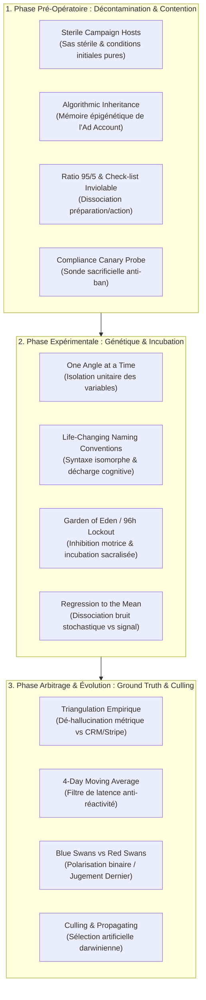

# Consulting Accelerator - Transcripts
**Formateur :** Sam Ovens | **ID :** `sam-ovens-consulting-accelerator-transcripts` | **Tranches :** 126

## Synthèse Architecturale du Cours : *Consulting Accelerator* (Sam Ovens)

---

### 1. Thèse Centrale & Philosophie du Cours

#### Vision spécifique & Posture face à l'approche standard
La vision de Sam Ovens repose sur une rupture épistémologique radicale avec le marketing direct traditionnel et la gestion publicitaire conventionnelle : **l'acquisition payante n'est pas un exercice de créativité, d'intuition ou de réactivité tactique, mais un système cybernétique d'évolution darwinienne gouverné par des lois statistiques déterministes.**

Là où l'approche standard prône le « bidouillage » continu (*tinkering*), l'optimisation émotionnelle au jour le jour, et le culte de l'inspiration créative, Ovens adopte la posture du **biologiste en laboratoire stérile** et du **mathématicien probabiliste** :
- **Clivage Identitaire Science vs Gambling** : Toute action menée sous un seuil statistique critique ($1 500 / 10 jours / 4 jours d'incubation) est disqualifiée du champ professionnel et reléguée au rang de jeu de hasard compulsif (*cowboy stuff*, *gambling*).
- **Externalisation de la Fonction Exécutive** : L'opérateur humain n'est pas payé pour penser ou interpréter dans la tourmente des données journalières, mais pour servir d'exécutant froid à un algorithme de décision clos (*Troubleshooting Cheat Sheet*).
- **Modélisation Vivante de la Machine** : L'algorithme Facebook est traité comme un organisme neural vivant doué de mémoire épigénétique (*Algorithmic Inheritance*). On ne le force pas : on crée des conditions initiales pures (*Sterile Hosts*), on introduit une diversité génétique contrôlée, et on laisse opérer la sélection naturelle.

#### Fil rouge méthodologique
Le fil conducteur unifiant l'ensemble des interventions s'articule autour de **trois piliers invariables** :
1. **Dissociation stricte Préparation / Exécution (Règle des 95/5)** : Verrouillage absolu en amont (architecture fractale, standardisation syntaxique, sas de décontamination) pour réduire à zéro l'entropie et la charge cognitive lors du passage à l'action.
2. **Sanctuarisation de l'Incubation & Inhibition Motrice** : Imposition de fenêtres de latence incompressibles (96 heures / moyenne mobile sur 4 jours) neutralisant l'anxiété de performance, la réponse amygdalienne et le biais d'interventionnisme précoce.
3. **Triangulation Empirique & Sélection Artificielle Binaire** : Dé-hallucination des métriques de plateforme par confrontation avec la preuve matérielle physique (*Ground Truth* CRM/Stripe), suivie d'un tri impitoyable sans attachement affectif (*Culling* des cygnes rouges, *Propagating* des cygnes bleus).

---

### 2. Carte des Concepts & Leviers Émergents



| Concept / Mécanisme | Définition & Rôle dans l'Écosystème Sam Ovens |
|---|---|
| **Sterile Campaign Hosts** | Environnement de compte publicitaire purgé de tout résidu ou historique parasite. Sert d'isolateur pour garantir des conditions initiales pures et une traçabilité causale parfaite. |
| **Algorithmic Inheritance** | Modélisation de l'IA publicitaire comme un réseau neuronal à mémoire épigénétique qui transmet les biais d'échec ou de succès à travers la hiérarchie *Account $\to$ Campaign $\to$ Ad Set*. |
| **Ratio 95/5 & Dissociation Préparation/Exécution** | Règle ancrant que 95 % du résultat dépend de la rigueur mathématique/systémique en amont. Bloque l'impulsivité du débutant et disqualifie l'improvisation sur l'outil. |
| **Linéarité Séquentielle & Sas de Validation** | Check-list de pré-requis inviolables (Pixel, 30 audiences, matrices de fragmentation) agissant comme un verrou cognitif avant d'autoriser l'activation. |
| **Tranchage Budgétaire Strict ($1 500 Threshold)** | Barrière financière et mathématique séparant la science probabiliste du jeu de hasard (*gambling*). Dimensionne la vitesse d'apprentissage sans saturer le capital. |
| **Promesse Temporelle Décalée (Fragment Extraction)** | Recadrage psychologique de l'élagage des tests : l'opérateur ne renonce pas à ses idées, il les fragmente en séquences temporelles pour neutraliser la *sunk cost fallacy*. |
| **Compliance Canary Probe** | Injection d'une micro-sonde publicitaire sacrificielle multi-annonces pour absorber et valider le scan de conformité avant tout déploiement massif d'actifs. |
| **Isolation Unitaire des Variables (One Angle Rule)** | Découplage causal strict ($1 \text{ angle} \times 4 \text{ visuels} \times 8 \text{ audiences}$). Empêche l'empilement confus de stimuli et clarifie la rétroaction algorithmique. |
| **Standardisation Syntaxique (`[Angle] -- [Audience]`)** | Nomenclature isomorphe externalisant la charge de travail mental vers des repères visuels instantanés, éliminant l'épuisement décisionnel (*ego depletion*). |
| **Incubation Sacralisée / Hands out of Eden** | Interdiction formelle de contact physique avec les campagnes durant les 96 premières heures. Recadre l'inaction comme un geste de protection biologique vitale. |
| **Régression vers la Moyenne (Bruit vs Vrai KPI)** | Postulat statistique stipulant qu'aucun chiffre n'a de valeur prédictive avant 4 jours. Neutralise l'hypervigilance et les paniques émotionnelles journalières. |
| **Triangulation Empirique (*Ground Truth*)** | Confrontation systématique des données de la plateforme publicitaire avec les faits matériels physiques (emails ActiveCampaign, paiements Stripe, clics Bitly). |
| **Polarisation Binaire (Blue vs Red Swans)** | Cadrage quasi-eschatologique (*Judgment Day*) classifiant les ad sets en deux catégories étanches : rentables (à dupliquer/propager) ou parasites (à abattre sans affect). |
| **Moyenne Mobile sur 4 Jours (*4-Day Moving Average*)** | Outil de lissage décisionnel imposant un seuil de latence analytique. Désactive le réflexe de panique face aux creux stochastiques de 24h. |
| **Clôture Algorithmique (Troubleshooting Cheat Sheet)** | Arbre de décision fermé associant chaque dérive métrique à un protocole curatif univoque, remplaçant le doute subjectif par un réflexe déterministe. |

---

### 3. Tableau Récapitulatif des Techniques & Démonstrations

| Technique / Exercice | Objectif Opératoire | Déclencheur / Indication | Séquence Résumée |
|---|---|---|---|
| **Sterile Campaign Setup** | Isoler l'expérience de toute contamination algorithmique antérieure et préparer le conteneur neutre. | Pré-requis absolu avant tout premier téléversement de variations d'annonces. | 1. Créer une campagne hôte entièrement vierge.<br>2. Configurer les paramètres de base sans insérer d'annonces actives.<br>3. Verrouiller la structure pour empêcher tout héritage de données corrompues. |
| **Canary Deployment (Compliance Probe)** | Valider la conformité politique du compte sans exposer l'ensemble de l'inventaire au risque de ban simultané. | Immédiatement avant le déploiement de masse d'un nouvel angle ou compte neuf. | 1. Condenser les 8 créatifs sur 1 seule audience consolidée dans une campagne test.<br>2. Soumettre à la modération Facebook.<br>3. Dès approbation obtenue, purger l'ad set pour restaurer l'état stérile. |
| **Dimensionnement Budgétaire & Fragmentation** | Adapter la surface d'exploration au capital disponible sans tomber dans le sous-échantillonnage stochastique. | Phase de préparation post-recherche d'audiences et d'angles. | 1. Ouvrir le *Budget & Variation Calculator* (plancher strict : $1 500 / $150/j / $10/ad set).<br>2. Dupliquer la Master List (30 intérêts) en `fragment 1`.<br>3. Élaguer de bas en haut pour ne retenir que les 8 meilleurs intérêts et 2 angles majeurs. |
| **Matrice Déploiement & Équilibrage Combinatoire** | Transférer l'architecture préparatoire vers la plateforme sans erreur de distribution ni surcharge cognitive. | Après validation du fragment et de la conformité de la sonde. | 1. Isoler 1 angle sémantique unique.<br>2. Associer rigoureusement les 4 créatifs visuels validés aux 8 ad sets d'audience.<br>3. Appliquer la nomenclature normalisée `[Angle] -- [Audience]`.<br>4. Publier la matrice en un seul bloc cohérent. |
| **Protocole des 4 Jours Sans Contact (*Eden Protocol*)** | Permettre la convergence stochastique de l'IA et empêcher la réinitialisation de la phase d'apprentissage. | Immédiatement après la mise en ligne des campagnes (T=0 à T=96h). | 1. Activer le verrou mental « Hands out of Eden ».<br>2. Interdiction formelle de modifier budgets, enchères ou créations.<br>3. Traiter toute fluctuation précoce comme du bruit brownien non signifiant. |
| **Daily Audit Loop & Réconciliation Métrique** | Établir le diagnostic quotidien sur des bases empiriques réelles et dé-halluciner les pixels publicitaires. | Routine matinale quotidienne d'observation (hors action directe). | 1. Délimiter une fenêtre d'analyse stricte de 24h (la veille calendaire complète).<br>2. Vérifier les dépenses réelles sur le gestionnaire publicitaire.<br>3. Relever les clics réels (Bitly) et les leads/conversions réels dans le CRM (ActiveCampaign/Stripe).<br>4. Renseigner le tableau de bord avec les preuves physiques réconciliées. |
| **Arbitrage du Jugement Dernier (*Culling & Propagating*)** | Éliminer les branches non viables et allouer les ressources aux variations gagnantes selon des règles déterministes. | Au terme des 96h d'incubation (T=4j), puis sur base de la moyenne mobile 4 jours. | 1. Calculer le KPI lissé sur la moyenne mobile 4 jours.<br>2. Identifier les *Red Swans* (hors bornes KPI) : abattage chirurgical immédiat (extinction de l'ad set sans chercher à le réparer).<br>3. Identifier les *Blue Swans* (stables et profitables) : extraction et propagation vers la structure de scaling. |
| **Clôture de Résolution (*Troubleshooting Cheat Sheet*)** | Résoudre une dérive de performance sans improvisation ni dérive émotionnelle. | Dès qu'une anomalie métrique consolidée persiste sur la moyenne mobile 4 jours. | 1. Isoler le symptôme unitaire (ex. chute du CTR, explosion du CPA).<br>2. Consulter la ligne correspondante dans l'arbre décisionnel fermé.<br>3. Appliquer l'action corrective unique prescrite par le document sans ajouter d'interprétation personnelle. |

---

## Extractions Détaillées par Tranche (Opératoire & Verbatim)


## --- Tranche 1 / 126 ---

### 1. Mécanismes & Principes Actifs

- **La Métaphore Biologique / Génétique comme Isomorphisme Décisionnel**
  - *Principe actif* : En substituant au jargon publicitaire abstrait (campagnes, ad sets, créas) un cadre lexical biologique (*Garden of Eden*, *sterile campaign hosts*, *swan DNA variants*, *incubation period*, *inheritance*), le formateur sature la mémoire de travail et contourne les résistances rationnelles ou le stress financier. Ce recadrage métaphorique active chez l'apprenant les heuristiques associées à la sélection naturelle : on ne « gaspille » pas de l'argent dans des annonces ratées, on procède à l'incubation d'un pool génétique de 600 variations pour isoler les mutations viables (*blue swans* vs *red swans*). La stérilisation de l'environnement (*sterile hosts*) induit une rigueur quasi-chirurgicale dans l'esprit du sujet, interdisant le parasitage émotionnel ou les modifications désordonnées.
  - *Tags libres émergents* : #metaphore_isomorphique #biologie_darwinienne #cadre_evolutionniste #sterilisation_cognitive #cybernétique_algorithmique

- **Contamination par Héritage Algorithmique (*Algorithmic Inheritance*)**
  - *Principe actif* : Le système Facebook est modélisé non comme un outil transactionnel neutre, mais comme un organisme neuronal vivant doué d'apprentissage et de mémoire épigénétique. Chaque niveau hiérarchique (*Ad Account -> Campaign -> Ad Set -> Ad*) retient et hérite de l'historique de conversion. Si l'environnement de départ contient des résidus d'échecs passés, l'algorithme transmet ces biais négatifs. L'isolation stricte (*sterile host*) garantit que l'apprentissage démarre à partir de conditions initiales pures, protégeant le système d'une dégénérescence prématurée.
  - *Tags libres émergents* : #epigenetique_algorithmique #apprentissage_neural #isolation_des_conditions_initiales #accumulation_d_intelligence

- **Ratio 95/5 & Dissociation Préparation/Exécution**
  - *Principe actif* : Installation d'un ancrage de contrôle prédictif : « 95 % des résultats se produisent en dehors de la plateforme ». Ce truisme dissocie la phase de planification (réflexion, extraction fractale, rigueur mathématique) de l'acte d'exécution mécanique (cliquer sur publier). Cela neutralise l'impulsivité du débutant (le réflexe d'aller « bricoler » sur l'outil sans vision systémique) en associant l'exécution non préparée à l'échec garanti et au statut dégradé d'amateur.
  - *Tags libres émergents* : #dissociation_preparation_application #contention_impulsive #posture_systemique

- **Linéarité Séquentielle & Verrouillage par Check-list (Pré-requis Inviolables)**
  - *Principe actif* : Avant d'autoriser le sujet à entrer dans la phase excitante de l'action (*Campaign Genesis*), le formateur déploie un filtre d'évaluation rigide composé de jalons obligatoires (Pixel, entonnoir de fragmentation, 30 audiences, 5 angles, 4 images, etc.). Ce mécanisme agit comme un sas de décompression psychologique qui bloque le passage à l'acte tant que l'intégrité de la structure n'est pas scellée, empêchant le biais d'illusion de compétence.
  - *Tags libres émergents* : #verrou_sequentiel #validation_par_sas #reduction_entropie #check_list_inviolable

- **Démarcation Statistique vs Flou Réactif (« Science vs Gambling »)**
  - *Principe actif* : Clivage identitaire puissant instaurant une barrière financière d'entrée ($1 500 minimum). Ce seuil n'est pas présenté comme un choix de gestion, mais comme la frontière cognitive stricte entre deux paradigmes mutuellement exclusifs : la démarche scientifique rigoureuse (*asymmetric testing*, lois statistiques, probabilités) et la pulsion ludique désordonnée (*cowboy stuff*, *gambling*, *fluke game*). En disqualifiant psychologiquement tout test inférieur à ce montant, le formateur lie l'identité d'autorité et de professionnalisme du praticien au respect du volume d'échantillonnage minimal.
  - *Tags libres émergents* : #clivage_identitaire #seuil_statistique_critique #scientificite_vs_hasard #posture_analytique

---

### 2. Protocoles, Techniques & Démonstrations (Étape par Étape)

#### Protocole de Création des Hôtes Stériles & Validation de l'Écosystème (*Sterile Campaign Setup*)

* **Intention / Indication** : À déployer impérativement avant tout déploiement de variations d'annonces. Utilisé pour isoler le test de toute contamination historique et configurer le conteneur cybernétique au sein duquel l'algorithme va muter.
* **Mise en place & Pré-framing** :
  - Rappeler au sujet la règle d'or : « 95% des résultats surviennent hors de Facebook ».
  - Cadrer l'action non pas comme un « essai » mais comme une expérience de laboratoire nécessitant un environnement aseptisé.
  - Vérifier que le seuil de budget d'expérimentation ($1 500 minimum) est acté et noté.

* **Séquence d'actions pas à pas** :
  1. **Phase de Contrôle du Sas (Audit des Pré-requis)** :
     - Vérifier la conformité de l'infrastructure externe : Business Manager opérationnel, comptes publicitaires multiples créés, Fan Page active avec description et posts, site légalement conforme (*Book of Law*).
     - Tester les mécanismes de capture : Funnel de fragmentation fonctionnel, Google Tag Manager actif, Facebook Smart Pixel validé, Pixels de retargeting / Google Analytics opérationnels.
     - Valider les artéfacts stratégiques : Fiche des patterns fractals remplie, 30 audiences qualifiées (Tour de Babel), 5 angles publicitaires rédigés, 4 visuels par angle (soit les 600 combinaisons ADN prêtes dans l'outil de gestion *Quire*).
  2. **Accès à l'Atelier Dédié** :
     - Naviguer sur `business.facebook.com`.
     - Sélectionner le compte publicitaire dédié.
     - Ouvrir impérativement le **Power Editor** (bannir l'Ads Manager standard pour les configurations mères afin d'éviter les publications partielles non contrôlées).
  3. **Génération de l'Hôte Froid (*Cold Traffic Sterile Host*)** :
     - Se positionner sur l'onglet *Campaigns*.
     - Cliquer sur *Create Campaign*.
     - Appliquer la convention de nommage structurelle : `Cold traffic : Conversions : Auto`.
     - Régler le *Buying Type* sur `Auction`.
     - Définir l'objectif de campagne sur `Conversions` (optimisation opt-in vidéo / capture email).
     - **Action critique de stérilisation** : Cocher explicitement `Skip Ad Set` et `Skip Ad`. L'hôte doit être créé absolument vierge de toute cellule fille.
     - Valider via *Create*.
  4. **Génération de l'Hôte de Retargeting (*Retargeting Sterile Host*)** :
     - Cliquer à nouveau sur *Create Campaign*.
     - Appliquer la convention de nommage : `Retargeting traffic : Conversions : Auto`.
     - Sélectionner `Auction` puis objectif `Conversions`.
     - Cocher impérativement `Skip Ad Set` et `Skip Ad`.
     - Valider via *Create*.
  5. **Scellement et Publication dans le Réseau** :
     - Vérifier le statut des deux campagnes : elles doivent afficher la mention *In Draft*.
     - Cliquer sur *Review Changes*.
     - Cliquer sur *Apply* pour téléverser les conteneurs vides sur les serveurs de Facebook.
     - Valider le statut retourné : `Not Delivering` (ce statut confirme l'asepsie parfaite de l'hôte, prêt pour l'injection génétique ultérieure).

* **Signes de calibration** :
  - Présence exclusive de noms normalisés respectant la syntaxe `[Type de trafic] : [Objectif] : [Mode d'enchère]`. Rejet immédiat de toute nomenclature aléatoire (ex: `X1`, `JJJJ6`).
  - Absence totale d'ensembles de publicités (*Ad Sets*) ou de publicités (*Ads*) résiduelles dans les campagnes fraîchement créées.
  - Statut affiché strictement égal à `Not Delivering` après publication du brouillon.

---

### 3. Heuristiques, Subtilités & "Sagesse du Praticien"

- **L'Heuristique de la Pureté Initiale (Les 4 Jours du Jardin d'Éden)** :
  - *Règle conditionnelle* : *« Si vous lancez une campagne sur des bases polluées ou modifiées à la hâte, alors l'algorithme va enregistrer un schéma d'apprentissage biaisé, parce que les quatre premiers jours déterminent l'ADN évolutif de toute la durée de vie de l'annonce. »*
  - *Postulat philosophique de Sam Ovens* : Les conditions initiales d'un système complexe scellent son destin. L'entropie d'un système ne peut être corrigée après coup si les fondations sont corrompues.

- **L'Heuristique de l'Asymétrie Statistique ($1 500 Rule)** :
  - *Règle conditionnelle* : *« Si le budget de test est inférieur à 1 500 $, alors ne lancez pas de formation ou de protocole prédictif, parce qu'en deçà de ce seuil de représentativité statistique, le retour sur investissement relève du hasard pur (gambling/cowboy) et non de l'ingénierie. »*
  - *Erreur classique corrigée* : Croire que l'on peut valider 600 variations avec quelques dizaines de dollars. Si le budget est trop contraint, l'opérateur doit sacrifier délibérément des branches de variations plutôt que de sous-financer l'ensemble de l'échantillon.

- **L'Heuristique de la Nomenclature Psycho-Organisationnelle** :
  - *Règle conditionnelle* : *« Si un opérateur nomme ses campagnes ou ensembles de manière vague ou codée à la va-vite (ex: X1, test1), alors il perdra sa clarté cognitive au premier incident technique, parce que la clarté de la structure externe est le reflet direct de la lucidité stratégique du praticien. »*

- **L'Heuristique de l'Effet Volant d'Inertie du Pixel (*Pixel Intelligence Flywheel*)** :
  - *Règle conditionnelle* : *« Si le pixel publicitaire accumule un volume massif de données (> 700 000 conversions), alors le ciblage par centres d'intérêt devient superflu, parce que la puissance de calcul de l'algorithme dépasse la précision des segments déclaratifs humains et permet un ciblage universel (Broad). »*

---

### 4. Pépites Verbatim & Patterns Linguistiques (MOT À MOT EN V.O.)

```text
"And like I said throughout this training, 95% of the results that you get with Facebook ads happen off of Facebook ads. You know, it's 95% preparation and 5% application. You're going to see in this training module how it's really easy to launch some ads. I mean, anyone can launch some ads, but not anyone can create a profitable, long-term advertising campaign."
```
* **[Analyse du Pattern]** : **Rupture de pattern et recadrage d'autorité par contraste binaire**. Le formateur dévalue immédiatement l'outil technique ("launch some ads" = action triviale accessible à "anyone") pour surévaluer la préparation en amont ("profitable, long-term advertising campaign"). L'utilisation de la statistique 95/5 agit comme un truisme d'ancrage hypnotique : elle force l'acceptation de la discipline préalable et disqualifie d'emblée toute impatience chez le sujet.

---

```text
"Now the possible combinations between all of those things is 600. That means we've got 600 different types of DNA for testing, and we're hoping that within that sample size of 600, we are going to have some successful combinations of DNA and produce some blue swans."
```
* **[Analyse du Pattern]** : **Métaphore filée (isomorphisme biologique) et présupposition probabiliste**. En redéfinissant les éléments d'une annonce (angle + image + audience) sous le terme de "DNA" et le résultat rentable sous l'image du "blue swan" (variation de la métaphore du cygne noir de Taleb), il dépersonnalise le processus d'échec. L'inconscient n'associe plus la perte d'une annonce à une erreur personnelle, mais à une mutation génétique non viable au sein d'un échantillon expérimental contrôlé.

---

```text
"So if you remember from all the other modules we call the first four days of a facebook campaign you know the garden of Eden that's the most important four days of our ads life because that's where the initial conditions are going to the initial conditions are going to really combine with all of our different variations and it's going to either create some really good ads or it's going to create some not good ads..."
```
* **[Analyse du Pattern]** : **Allusion archétypale mythologique et ancrage d'importance critique**. L'utilisation de la métaphore biblique du "Garden of Eden" pour désigner les 96 premières heures d'une campagne convoque instantanément les idées d'innocence primordiale, de pureté originelle et de risque de chute irréversible. La répétition bégayée mais insistante de "initial conditions" fonctionne comme une commande de fixation neuro-linguistique (Théorie du chaos / Effet papillon) : elle oblige le sujet à une vigilance totale lors de la phase de lancement.

---

```text
"So at each level there is inheritance and every level affects every other level. So it's important to understand this and get it set up correctly. And that way when you really start tuning your Facebook account the right way once it starts to, you know, work out what works, things really start, you know, peaking up exponentially."
```
* **[Analyse du Pattern]** : **Empilement de truismes et boucle de suggestion ascendante ("Cause-to-Effect Loop")**. L'enchaînement syntaxique *"at each level... inheritance" -> "every level affects every other level" -> "get it set up correctly" -> "starts to work out what works" -> "peaking up exponentially"* construit un pont temporel irrésistible. Chaque proposition indiscutable entraîne mécaniquement l'adhésion à la promesse finale de croissance exponentielle, liant la rigueur d'exécution présente au succès futur inévitable.

---

```text
"So if you follow all these instructions and you work with me eventually you will end up being able to do things like that which gives you huge power it gives you really it gives you devastating power compared to any other advertiser if you have that sort of intelligence on your pixel and if you have that sort of understanding well the rest of the population really doesn't stand a chance against you."
```
* **[Analyse du Pattern]** : **Double lien d'allégeance et induction d'avantage prédateur**. La double conditionnelle *"if you follow all these instructions and you work with me"* crée un couplage symbiotique strict entre la méthode, la personne du formateur et l'acquisition du résultat. L'escalade lexicale (*"huge power" -> "devastating power" -> "the rest of the population really doesn't stand a chance against you"*) bascule dans une suggestion d'asymétrie dominatrice quasi-militaire, flattant l'Ego du sujet et consolidant sa fidélité au protocole.

---

```text
"So this number needs to be at least one and a half thousand dollars that's just the minimum amount for testing you can use less money but it's not even worth me creating a training on because it's just sort of it's just like cowboy stuff you know it's like there's no real science to it it's just it's just like gambling so you know it's if you want to test with money below that it's fine but i honestly don't have a method for that and it's mostly just you know it's just a fluke game..."
```
* **[Analyse du Pattern]** : **Double contrainte négative et cadrage de disqualification identitaire**. Le formateur donne une fausse permission de surface (*"you can use less money... if you want to test with money below that it's fine"*) immédiatement suivie d'une destruction de valeur symbolique cinglante (*"cowboy stuff"*, *"no real science"*, *"gambling"*, *"fluke game"*, *"not even worth me creating a training on"*). Le sujet est placé devant une alternative fermée : investir $1 500 pour appartenir à l'élite scientifique du formateur, ou dépenser moins et accepter l'étiquette méprisable d'amateur inconscient.


## --- Tranche 2 / 126 ---

Voici l’extraction chirurgicale et l'analyse opératoire de la tranche 2/126 de la formation *Consulting Accelerator* de Sam Ovens.

---

### 1. Mécanismes & Principes Actifs

*   **Réduction de Variance Cognitive par Tranchage Budgétaire Strict** (`#budget_dictated_variance #downside_containment`)  
    *Principe actif :* Le système nerveux du débutant face à l'espace multidimensionnel d'un compte publicitaire entre immédiatement en surcharge cognitive et en illusion de contrôle, tentant d'exploiter la totalité du matériel créé (30 intérêts × 5 angles = 600 combinaisons). En contraignant mécaniquement le nombre de variables testées par le budget plancher ($1 500 minimum / $150/jour / 10 jours / $10 par ad set), Ovens force le système cognitif de l'apprenant à accepter la réalité empirique du signal statistique contre le bruit aléatoire (`gambling`). Il asservit le désir subjectif ("I want to test all") à une fonction mathématique froide : *Budget = Vitesse, Manque de budget = Temps*.
*   **Neutralisation de la Frustration par la Promesse Temporelle Décalée** (`#future_pacing_conservation #chunking_down`)  
    *Principe actif :* L'amputation du travail préparatoire (passer de 30 audiences à 8, de 5 angles à 2) crée une réactance psychologique et un sentiment de perte de travail investi (*sunk cost fallacy*). Pour éliminer cette friction, le formateur recadre la réduction non pas comme un renoncement, mais comme une simple fragmentation temporelle : le master template reste intact, l'étudiant teste par "fragments" séquentiels. Le cerveau inconscient accepte la castration immédiate de la complexité car la complétion future est garantie (`eventually you're going to use all of them`).
*   **Sonde Exploratoire à Faible Risque ("Canary Deployment / Compliance Probe")** (`#compliance_canary_probe #account_preservation_reflex`)  
    *Principe actif :* L'algorithme de réputation de Facebook applique une pénalité exponentielle aux comptes neufs en cas de rejets multiples simultanés (600 rejets détruisent instantanément l'actif commercial). Le mécanisme consiste à envoyer une sonde sacrificielle/test (8 publicités condensées sur une seule audience consolidée sans split) pour forcer le scan automatique et manuel de conformité avant d'injecter la masse. Une fois l'approbation obtenue, la campagne de sonde est immédiatement détruite (ad set purgé) pour revenir à un état "stérile". Cela ancre chez l'opérateur une discipline de sécurité chirurgicale.

---

### 2. Protocoles, Techniques & Démonstrations (Étape par Étape)

#### Protocole : Dimensionnement Budgétaire et Extraction de Fragments Publicitaires

*   **Intention / Indication :** Déterminer la surface de test admissible selon le capital disponible et préparer l'arborescence de test sans saturer l'algorithme ni dilapider les fonds dans le bruit stochastique.
*   **Mise en place & Pré-framing :** Avoir sous la main la feuille de calcul `budget and variation calculator`. Poser l'interdiction absolue de descendre sous $1 500 au total, sous 10 jours de durée, ou sous $10/jour par ad set.
*   **Séquence d'actions pas à pas :**
    1.  *Saisie du capital plancher :* Inscrire le montant alloué dans la cellule jaune unique (ex: $1 500). Constater la formule rigide : $1 500 ÷ 10 jours = $150/jour ; $150 ÷ $10 minimum = 15 ad sets exploitables au maximum.
    2.  *Consultation de la table du ratio d'or (Golden Mean Ratio Table) :* Faire correspondre les 15 ad sets autorisés. La table impose : 2 angles publicitaires et 8 intérêts d'audience.
    3.  *Hiérarchisation forcée des angles (Gun to Head Prioritization) :* Dans le logiciel (Quire), sélectionner les 5 angles conçus. Appliquer la question de cadrage critique : *"Si j'avais un flingue sur la tempe, lequel je choisirais ?"*. Renommer immédiatement les angles par ordre numérique (`1_nom_angle`, `2_nom_angle`...). Isoler les 2 premiers.
    4.  *Duplication et extraction du Fragment 1 :*
        *   Prendre la liste maîtresse de ciblage (Master List de 30 intérêts, dérivée de l'audience "Tower of Babel").
        *   Cliquer sur `Duplicate` pour préserver le master. Renommer la copie `fragment 1`.
        *   Élaguer de bas en haut (les intérêts en bas ont une affinité statistique moindre) pour ne conserver strictement que les 8 meilleurs intérêts.
        *   Sauvegarder.
*   **Signes de calibration du praticien :** L'apprenant ne discute plus les ratios ; il accepte de réduire son volume sans altérer la liste maîtresse et vérifie visuellement la présence de 8 segments et 2 angles prioritaires.

---

#### Protocole : Sonde de Conformité et Déploiement Stérile ("Compliance Canary Run")

*   **Intention / Indication :** Valider l'acceptation algorithmique et éditoriale des créatives et copies par Facebook sans risquer un bannissement de compte en masse.
*   **Mise en place & Pré-framing :** Cadrer l'opération non comme un lancement marketing, mais comme un test de conformité technique pur. Prévenir que l'argent ne sera pas dépensé et que les annonces seront effacées dès validation.
*   **Séquence d'actions pas à pas :**
    1.  *Génération restreinte :* Dans l'onglet `Create Ads`, sélectionner uniquement les angles prioritaires autorisés (ex: 2 angles × 4 images = 8 annonces).
    2.  *Consolidation d'audience (Uncheck Split) :* Dans `Set Targeting`, charger `fragment 1`, mais décocher impérativement l'option `Split`. Cliquer sur `Use`. Les 8 annonces ciblent une audience unique non découpée (total : 8 publicités au lieu de 64).
    3.  *Paramétrage des métriques et du tracking :*
        *   Onglet `Tracking Settings` : Cocher Google Analytics, Facebook Pixel Tracking, et le Pixel ID dédié.
        *   Onglet `Basic Settings` : Cocher `Existing campaign` (sélectionner la campagne hôte stérile `cold traffic conversions auto`). Si invisible : aller dans `My campaigns` -> `Download` -> `Ads and campaigns` pour forcer le rafraîchissement des métadonnées d'API.
        *   Nommer l'ad set `cpm-a` (Cost Per Mille - Auto bid).
        *   Budget : fixer à $10. Optimisation : Off-site conversions. Facturation : Impressions.
    4.  *Publication de la sonde :* Cliquer sur `Publish ads`.
    5.  *Surveillance de l'état (Calibration temporelle) :* Ouvrir le Business Manager sur le compte publicitaire principal. Suivre l'ad set `cpm-a`. Observer le passage de `Pending review` à `Active / Approved`.
    6.  *Purge immédiate :* Une fois le statut approuvé validé, désélectionner la campagne, sélectionner l'ad set `cpm-a`, cliquer sur `More` -> `Delete`. Constater le retour à l'état de "campagne hôte stérile".
*   **Signes de calibration du praticien :** Zéro ad set restant actif sur le compte après la sonde. Compte publicitaire intact, créatives marquées comme approuvées dans le backend Facebook.

---

### 3. Heuristiques, Subtilités & "Sagesse du Praticien"

*   **Heuristique du Capital Plancher vs Jeu de Hasard :**
    *   *Si* le budget de test est inférieur à $1 500 (ou la durée inférieure à 10 jours), *alors* refuser d'analyser les données publicitaires, *parce que* l'algorithme n'a pas atteint la masse critique de conversion (2× le KPI cible à $5-$10/lead) et génère uniquement du bruit stochastique (`fluke game / gambling / cowboy stuff`).
*   **Heuristique de Priorisation Sous Contrainte Mortelle :**
    *   *Si* l'opérateur hésite sur les angles à lancer en premier dans son fragment, *alors* appliquer le test de pression mentale : *"Gun to head, which one would I go with?"*, *parce que* cette question pulvérise la rumination intellectuelle et extrait instantanément l'intuition de saillance maximale.
*   **Heuristique de Découpage de l'Affinité (Tower of Babel) :**
    *   *Si* l'on doit tronquer une liste d'intérêts pour rentrer dans la limite d'ad sets imposée par le budget, *alors* couper systématiquement par le bas de la liste, *parce que* les intérêts supérieurs possèdent le lien d'affinité le plus direct avec le noyau d'audience initial.
*   **Heuristique de l'Asymétrie de Conformité :**
    *   *Si* une annonce neuve est approuvée sur Facebook, *alors* elle peut être démultipliée en masse sans friction, *mais si* l'on injecte la masse avant l'approbation unitaire, le risque de destruction du compte est quasi absolu. L'approbation est un état binaire qui s'acquiert à l'unité.
*   **Erreur classique du débutant :** Croire qu'une annonce approuvée doit rester en diffusion dans la campagne de test. Correction : la détruire immédiatement (`Delete`) pour ne pas polluer l'historique de la campagne stérile avec des données hors-protocole.

---

### 4. Pépites Verbatim & Patterns Linguistiques (MOT À MOT EN V.O.)

#### Verbatim 1 : Clôture de l'échappatoire financière et disqualification de l'amateurisme
> "This number needs to be at least one and a half thousand dollars that's just the minimum amount for testing you can use less money but it's not even worth me creating a training on because it's just sort of it's just like cowboy stuff you know it's like there's no real science to it it's just it's just like gambling so you know it's if you want to test with money below that it's fine but i honestly don't have a method for that and it's mostly just you know it's just a fluke game."
*   **[Analyse du Pattern]** :  
    *Double contrainte et disqualification d'autorité.* Ovens accorde une fausse liberté de surface ("*you can use less money... if you want to test with money below that it's fine*") immédiatement suivie d'une disqualification dévastatrice pour l'ego du client ("*cowboy stuff*", "*gambling*", "*fluke game*"). En affirmant qu'il "n'a pas de méthode pour ça", il pose son autorité scientifique en contraste exclusif avec le comportement de joueur irrationnel, forçant le système nerveux de l'étudiant à se conformer au seuil de $1 500 pour rester dans le cadre d'appartenance des gens sérieux.

#### Verbatim 2 : L'argument d'autorité par volume d'attrition financière
> "Now you just have to trust me on that number because the way it is calculated is two times kpi and you know kpi for us can be you know in between five and ten dollars so you know i'm already being generous on it by saying at least 10 so you can spend less than that if you want however i can guarantee you it just won't work so you just got to trust me on these numbers I've spent many many millions more than you on Facebook ads and I just know you know I know the different I know the different variables and what these numbers should be."
*   **[Analyse du Pattern]** :  
    *Injonction directe de confiance encadrée par une supériorité d'expérience asymétrique.* La commande directe répétée ("*you just have to trust me on that number* / *you just got to trust me*") est verrouillée par un fait indiscutable ("*I've spent many many millions more than you*"). Cette assertion court-circuite toute velléité d'argumentation logique chez l'apprenant : la tentative de tester avec de plus petits budgets est étiquetée d'avance comme un échec garanti ("*I can guarantee you it just won't work*").

#### Verbatim 3 : Ancrage du statut d'élite par contraste d'échelle
> "And you've got to remember that the normal person on Facebook has one. So we're still 60 times ahead."
*   **[Analyse du Pattern]** :  
    *Recadrage d'état par élévation identitaire instantanée.* Alors que l'étudiant ressent une frustration de ne tester "que" 60 variations au lieu des 600 du modèle idéal, Ovens recadre la position par rapport au groupe externe ("*the normal person on Facebook has one*"). Ce contraste numérique brutal ("*60 times ahead*") transforme immédiatement un sentiment de privation/manque en un sentiment de supériorité compétitive écrasante.

#### Verbatim 4 : Élicitation de l'instinct pur sous menace simulée
> "So it's just a guess, you've got to think which one would I put forward, if I had a gun to my head which one would I go with."
*   **[Analyse du Pattern]** :  
    *Rupture de pattern par métaphore de menace vitale (Gun to the head framing).* Pour casser la paralysie par analyse du débutant devant le choix de ses angles, Ovens introduit un stressor imaginaire violent. L'évocation somatique du pistolet sur la tempe oblige le cerveau à contourner le cortex préfrontal analytique et à faire émerger en une fraction de seconde la certitude intuitive la plus profonde.

#### Verbatim 5 : Métaphore militaire de déploiement sécurisé
> "And now that they are approved that's fine I know that the coast is clear and I can send through my army of ads."
*   **[Analyse du Pattern]** :  
    *Métaphore de franchissement tactique.* L'expression idiomatique "*the coast is clear*" (la voie est libre / le rivage est dégagé) couplée à "*send through my army of ads*" installe une posture d'invasion militaire calculée. L'action publicitaire n'est pas une tentative hasardeuse, mais le déploiement méthodique d'une force de frappe après avoir neutralisé les défenses de la forteresse (l'algorithme d'approbation de Facebook).


## --- Tranche 3 / 126 ---

Voici l'analyse d'ingénierie et de modélisation opératoire de la tranche 3/126 du cours *Consulting Accelerator* de Sam Ovens.

---

### 1. Mécanismes & Principes Actifs

#### 1. Le Sas de Décontamination Sensorielle (« Sterile Campaign Hosts »)
* **Principe actif :** Pour neutraliser l'interférence cognitive et la saturation attentionnelle lors de la transition test/production, Ovens réinitialise l'environnement à un état « stérile » (vide d'éléments parasites). En termes neurologiques, cela coupe la surcharge de la mémoire de travail (Working Memory Load) : l'opérateur ne peut pas mélanger les métriques du bac à sable avec celles du déploiement réel. La certitude opérationnelle découle de l'absence totale d'ambiguïté dans le champ perceptif.
* **Tags libres émergents :** `#sterile_host #decontamination_environnementale #reduction_bruit_signal #ancrage_espace_neutre`

#### 2. Isolation Unitaire des Variables (« One Angle at a Time »)
* **Principe actif :** Réduction stricte du champ expérimental à une seule dimension sémantique par itération. L'inconscient humain a tendance à vouloir empiler les stimuli (« drag the whole lot ») par compulsion de complétion rapide. Ovens impose un découplage chirurgical : 1 angle d'attaque $\times$ 4 créatifs visuels $\times$ 8 segments d'audience. En limitant la variation à un seul axe qualitatif, il garantit la lisibilité causale des boucles de rétroaction (feedback loops).
* **Tags libres émergents :** `#isolation_des_variables #decouplage_causal #discipline_combinatoire #saturation_methodique`

#### 3. Standardisation Syntaxique comme Réduction de Charge Cognitive (« Life-Changing Naming Conventions »)
* **Principe actif :** L'encodage strict et standardisé des métadonnées (`[Angle] -- [Audience]`) externalise la charge de reconnaissance sur la syntaxe visuelle. Le cerveau n'a plus à déduire ou chercher la provenance d'une donnée : la structure du nom délivre immédiatement l'identité complète de l'expérience sans calcul mental. Cela prévient l'épuisement décisionnel (ego depletion) et les erreurs d'inattention dans les phases de pilotage à fort volume.
* **Tags libres émergents :** `#externalisation_cognitive #syntaxe_isomorphe #architecture_nommage #economie_decisionnelle`

#### 4. Le Biais d'Inaction Forcée / L'Incubation Sacralisée (« Hands out of the Garden of Eden »)
* **Principe actif :** L'anxiété de performance pousse compulsivement l'opérateur à agir prématurément (« tinker with stuff ») dès qu'il perçoit une fluctuation aléatoire précoce. En surimposant une métaphore sacrée/biologique (« Garden of Eden », « baby in incubator »), Ovens déplace l'inaction du statut de passivité coupable vers celui de protection vitale. Il installe une règle de verrouillage temporel fixe (4 jours / 96 heures) pour permettre la convergence stochastique de l'algorithme sans pollution humaine (« infecting initial conditions »).
* **Tags libres émergents :** `#inhibition_interventionniste #periode_incubation #preservation_conditions_initiales #sanctuarisation_temporelle #reframing_passivite_protectrice`

#### 5. Binarisation Évaluative Différée (« Red Swans vs Blue Swans »)
* **Principe actif :** Suspension totale du jugement pendant la phase de bruit statistique. Ovens interdit tout étiquetage cognitif avant le seuil T=4 jours. L'esprit humain fabrique des récits et voit des tendances là où il n'y a que du bruit brownien. En fixant un point d'effondrement quantique strict à T+4j où l'état bascule de manière binaire (Cygne Bleu = rentable / Cygne Rouge = hors KPI), il éradique le biais de confirmation et les espoirs irrationnels d'auto-justification.
* **Tags libres émergents :** `#suspension_du_jugement #effondrement_binaire #cygne_bleu_rouge #neutralisation_biais_confirmation`

---

### 2. Protocoles, Techniques & Démonstrations (Étape par Étape)

#### Protocole A : Matrice Déploiement & Équilibrage Combinatoire (Quire $\to$ Ads Manager)
* **Intention / Indication :** Passer d'un angle théorique validé à une couverture de marché granulaire sans friction manuelle et sans biais de diffusion.
* **Mise en place & Pré-framing :** Avoir testé au préalable les visuels (test de conformité passé), avoir les campagnes hôtes entièrement vidées de tout élément résiduel (« sterile »), et avoir calculé son allocation journalière plancher ($10/jour/ensemble).
* **Séquence d'actions pas à pas :**
  1. *Purge du canevas :* Aller dans `Set Targeting` $\to$ `Remove Selected` ; aller dans `Create Ads` $\to$ `Clear Creatives`.
  2. *Injection de l'Angle Unitaire :* Glisser **uniquement** le template de l'angle n°1 (contenant ses 4 visuels). Vérifier que le compteur affiche exactement 4.
  3. *Paramétrage de la Fragmentation :* Sélectionner le fragment d'audience $\to$ s'assurer du mode `Split` $\to$ vérifier que le volume correspond au budget (ex: 8 segments).
  4. *Synchronisation amont :* Si la campagne de destination n'apparaît pas, déclencher `Download ads and campaigns` $\to$ attendre la notification `Synced`.
  5. *Nommage normalisé (Ad Set Prefix) :* Saisir le nom exact de l'angle + espace double + délimiteur visuel (`--` ou `|`) + espace double. Vérifier dans la prévisualisation que le nom fusionne `[Angle] [Délimiteur] [Fragment] [Nom de l'Audience]`.
  6. *Paramètres d'enchère plancher :* Fixer le budget à $10/jour strictement par ad set. Type d'optimisation : *Off-site conversions / Pay for impressions / Max bid automatic*.
  7. *Génération & Push :* Cliquer sur `Generate [N] ads` $\to$ `Publish [N] ads`.
  8. *Répétition séquentielle :* Nettoyer à nouveau le canevas (`Clear Creatives` + `Remove Selected`) et réitérer la procédure pour l'angle n°2 (ex: « 9 entrepreneurs jet »). Ne jamais combiner deux angles dans le même lot de publication.
* **Signes de calibration :**
  * Le total des ad sets dans Ads Manager doit être exactement égal à : $\text{Nombre d'angles} \times \text{Nombre de segments}$ (ex: $2 \times 8 = 16$).
  * Le volume total d'annonces doit être : $\text{Nombre d'ad sets} \times \text{Nombre d'images}$ (ex: $16 \times 4 = 64$).
  * La file d'attente Quire (`Publish Queue`) passe progressivement à 0.

---

#### Protocole B : Calibration & Correction Forcée du Pixel d'Objectif (Contre-mesure de Rupture d'API)
* **Intention / Indication :** Corriger le bug structurel d'injection où l'outil tiers assigne le pixel sans lier l'événement de conversion personnalisé spécifique. À exécuter immédiatement après la fin de la file de publication.
* **Mise en place & Pré-framing :** Cadrer l'étape non comme une option mais comme une condition vitale (« without this, campaigns will probably not perform at all »).
* **Séquence d'actions pas à pas :**
  1. Ouvrir Facebook Ads Manager $\to$ Sélectionner la campagne active `Cold Traffic Conversions Auto`.
  2. Descendre d'un niveau hiérarchique : basculer sur l'onglet `Ad Sets`.
  3. Cocher la case globale pour sélectionner **l'intégralité** des ad sets créés.
  4. Cliquer sur le bouton groupé `Edit`.
  5. Inspecter le témoin d'état du pixel de conversion :
     * *Calibration négative :* L'indicateur est rouge avec le message d'avertissement d'inactivité.
  6. Décocher/fermer l'assignation par défaut via la croix (`X`).
  7. Ouvrir la liste déroulante des événements $\to$ Sélectionner explicitement l'objectif vert ciblé : `Value Video Opt-ins`.
  8. Enregistrer les modifications groupées (`Save and Close`).
  9. *Contrôle de validation (Audit rétroactif) :* Désélectionner tous les ad sets $\to$ Ré-ouvrir l'édition groupée $\to$ Valider visuellement que le pixel affiche le témoin vert `Value Video Opt-ins` sur tous les ad sets.
* **Signes de calibration :**
  * Bascule visuelle du statut de l'icône : de Rouge (non optimisé/muet) à Vert (événement actif et reconnu par l'algorithme).

---

#### Protocole C : Surveillance des Signes Vitaux et Confinement Hermétique (J0 à J4)
* **Intention / Indication :** Verrouiller le système nerveux de l'opérateur pendant la phase de stochasticité algorithmique initiale pour empêcher toute altération des conditions de départ.
* **Mise en place & Pré-framing :** Ancrer la métaphore de la couveuse néonatale : l'interventionnisme précoce détruit l'organisme en gestation.
* **Séquence d'actions pas à pas :**
  1. *Détection des Signes de Vie (T=0 à T=24h) :*
     * Rafraîchir Ads Manager une fois toutes les quelques heures jusqu'à l'approbation globale (`Active`).
     * Attendre la confirmation des premiers flux : `Reach > 0`, `Dollars Spent > 0`, `Link Clicks > 0`.
     * *Règle de rupture :* Si 0 signe de vie après 24 heures $\to$ contacter le support Facebook. Si des signes de vie apparaissent $\to$ entrer immédiatement en phase de confinement.
  2. *Règle du Confinement Hermétique (T=24h à T=96h) :*
     * Interdiction absolue de modifier une enchère, couper une annonce, changer un ciblage ou retoucher une créative.
     * Fréquence d'inspection autorisée : **1 unique contrôle visuel toutes les 24 heures**.
     * Seul et unique critère de vérification lors du contrôle : absence d'emballement budgétaire anomalique (dépense supérieure au plafond prévu).
     * Si le budget défile normalement : fermer l'interface sans aucun clic d'édition.
  3. *Sortie d'incubation (T=96h) :*
     * À l'expiration exacte du 4ème jour, basculer sur la grille d'analyse `Red Swans / Blue Swans`.
* **Signes de calibration :**
  * Respiration et posture de l'opérateur calmes face à des performances provisoirement dégradées à J1/J2 ; absence d'action impulsive dans le journal d'activité de la campagne Facebook.

---

### 3. Heuristiques, Subtilités & "Sagesse du Praticien"

* **Heuristique de l'Algorithme Aveugle :**
  * *Règle :* « Si le pixel d'événement spécifique (`Value Video Opt-ins`) n'est pas assigné en vert dans l'ensemble de publicités, alors l'algorithme de Facebook opère en aveugle complet, même si le pixel global du compte est déclaré actif. »
  * *Raison :* Sans l'événement unitaire calibré, la machine optimise pour des impressions sans valeur marchande.

* **Heuristique de la Dynamique Temporelle Non-Linéaire :**
  * *Règle :* « Si une publicité semble catastrophique à J1 ou J2, tu as l'interdiction formelle de l'éteindre ; car ce qui commence au fond du gouffre à J1 devient fréquemment le meilleur ensemble à J4. »
  * *Raison :* Les premières cohortes d'utilisateurs testées par l'intelligence artificielle de distribution ne représentent pas la moyenne de distribution finale ; le système teste d'abord les marges de l'audience avant d'affiner son barycentre.

* **Heuristique du Nommage Anti-Stress :**
  * *Règle :* « Si tu passes 30 secondes supplémentaires à normaliser rigoureusement le préfixe de tes ensembles avec double espace et délimiteur au lancement, tu économises des semaines d'angoisse cognitive et de clics compulsifs lors de la phase de scaling. »
  * *Raison :* L'ordre spatial des données conditionne directement la vitesse de diagnostic et la clarté émotionnelle de l'analyste sous pression financière.

* **Heuristique du Confinement « Touche Pas à Ça » (Hands-off) :**
  * *Règle :* « Si une publicité cartonne dès les premières heures, ne touche à rien. Si une publicité sous-performe dès les premières heures, ne touche à rien. Dans les deux cas, toute modification humaine pollue les conditions initiales et invalide la totalité de l'expérience scientifique. »
  * *Raison :* L'interventionnisme précoce (over-fitting) redémarre la phase d'apprentissage de Facebook et fausse l'émergence des régularités statistiques.

---

### 4. Pépites Verbatim & Patterns Linguistiques (MOT À MOT EN V.O.)

```text
"So this is why we're very careful about how we name everything because it means that everything will be you know orderly later on because when we launch so many different variations if they don't have the right names then we can spend like days or weeks clicking on things just trying to find out what's going on."
```
* **[Analyse du Pattern]** : Présupposition causale et contraste émotionnel violent. Ovens associe l'ordre présent (`orderly later on`) à la prévention d'une souffrance future intense (`spend like days or weeks clicking... trying to find out what's going on`). L'amplification du coût temporel (« days or weeks ») agit comme une suggestion post-hypnotique d'obéissance rigoureuse au protocole de saisie.

---

```text
"I can't tell you how much this will change your life when you use Facebook, if you name things like this. And you'll see what I mean soon when I hit publish."
```
* **[Analyse du Pattern]** : Paralipse (« I can't tell you... ») couplée à une distorsion temporelle (« you'll see what I mean soon »). En affirmant qu'il ne peut pas dire à quel point cela va transformer la vie du sujet, il force l'inconscient de l'auditeur à halluciner des bénéfices majeurs, tandis que l'adverbe « soon » ancre la validation visuelle imminente comme inéluctable.

---

```text
"So you can just trust these numbers you know everything in here just it adds up it took me a long time to figure all of this stuff out."
```
* **[Analyse du Pattern]** : Commande cachée directe d'abandon de résistance critique (`you can just trust these numbers`) adossée à un argument d'autorité par absorption de souffrance passée (`it took me a long time to figure all of this stuff out`). Le présupposé sous-jacent est que toute remise en question mathématique par l'élève est inutile, le formateur ayant déjà payé le tribut cognitif et financier pour lui.

---

```text
"Now we have just finished with step five. And we've even finished step six... So once you're done with step six there's one final step and this one is really important."
```
* **[Analyse du Pattern]** : Fractionnement d'apprentissage et empilement de micro-engagements (Yes-Set d'accomplissement). L'illusion de progrès rapide (« just finished... even finished ») installe un état réceptif détendu, immédiatement rompu par une montée en tension dramatique ciblée (« one final step and this one is really important »), focalisant 100% de l'acuité sensorielle sur le point de rupture technique du pixel.

---

```text
"And this step, guys, it is absolutely vital. It is so important you check this and remember to check it. Because without the right conversion objective, Facebook's algorithm has no idea what it's actually optimizing for. And the campaigns will be significantly lower performing. And they're probably not going to perform at all."
```
* **[Analyse du Pattern]** : Pacing et leading avec boucle d'ancrage mnésique (`check this and remember to check it`). Utilisation d'une métaphore anthropomorphique privative (`algorithm has no idea`) suivie d'une cascade d'érosion des résultats menant au néant absolu (« lower performing... probably not going to perform at all »). La suggestion hypnotique associe l'oubli de ce geste précis à la mort financière complète du dispositif publicitaire.

---

```text
"Once you can see some campaign life, it's time to leave your blue swan DNA variants in the Garden of Eden for an incubation period of four days. So I know it's tempting. This is where everyone messes it up... you have to leave things for an incubation period of four days, you know, it's like when babies are first born a lot of the time they have to go into like an incubator right because they you know they're not ready immediately to face like the environment."
```
* **[Analyse du Pattern]** : Métaphore isomorphique profonde à double détente. Ovens entrelace le mythe biblique de pureté originelle inviolable (`Garden of Eden`), le concept biologique déterministe (`DNA variants`) et l'impératif moral absolu de protection de la vie vulnérable (`babies are first born... go into an incubator`). En assimilant le bidouillage publicitaire (« tinkering ») à l'agression d'un nouveau-né prématuré sorti de sa couveuse, il active un interdit moral viscéral et neutralise la compulsion d'intervention de l'élève.

---

```text
"Anything you do or change will infect the initial conditions and spoil the entire experiment. So keep your hands off. And I'm deadly serious about this. Don't touch anything. Even if an ad looks like it's not working don't touch it even if an ad looks like it's working don't touch it you have to keep your hands off for a full four days."
```
* **[Analyse du Pattern]** : Double lien comportemental symétrique (Double Bind) soutenu par un vocabulaire épidémique et mortifère (`infect`, `spoil`, `deadly serious`). Que le signal perçu soit interprété positivement (« looks like it's working ») ou négativement (« looks like it's not working »), la réponse motrice prescrite est RIGIDE et IDENTIQUE : l'immobilité totale (`don't touch it`). La répétition saccadée en boucle courte opère comme une rupture d'induction motrice, paralysant toute velléité d'action manuelle sur le clavier.

---

```text
"And you know even if you think you're really smart and you think that you can see that one is red on day one you can't make a judgment call until the fourth day I've seen ad sets that start off bad and by the fourth day they're the best you know things change around so much in those first four days that you just have to keep your hands off you have to let all of the different DNA structures, fight it out, survival of the fittest, and see on the fourth day which ones are winners and which ones are losers."
```
* **[Analyse du Pattern]** : Déflation préventive de l'ego de l'auditeur (« even if you think you're really smart ») et recadrage darwinien (« survival of the fittest »). Ovens brise l'illusion de clairvoyance précoce en lui opposant la réalité probabiliste d'inversion des performances. L'espace de la campagne publicitaire cesse d'être perçu comme un outil technique pour devenir une arène de sélection naturelle où l'opérateur n'a pas le droit d'intervenir, sous peine d'empêcher les lois de l'évolution algorithmique de trier les vainqueurs et les vaincus.


## --- Tranche 4 / 126 ---

Voici l'analyse opératoire de la tranche 4/126 du cours *Consulting Accelerator* de Sam Ovens, extraite selon les règles strictes de modélisation en PNL, hypnose conversationnelle, ingénierie cognitive et modélisation symbolique.

---

### 1. Mécanismes & Principes Actifs

- **La Métaphore Isomorphe de l'Incubation Biologique et de l'Éden**
  *Principe actif :* En assimilant le compte publicitaire au *Jardin d'Éden* et la phase initiale à une *période d'incubation* où différentes *structures d'ADN* s'affrontent selon les lois darwiniennes (*survival of the fittest*), Ovens désactive le biais d'interventionnisme compulsif chez le sujet. L'intervention humaine précoce est recadrée non pas comme une optimisation ou une vigilance proactive, mais comme une profanation, une contamination bactérienne (*"infect it"* / *"spoil the experiment"*). Cela crée un ancrage d'inhibition motrice puissant : toucher aux campagnes avant 96 heures équivaut symboliquement à détruire la vie naissante ou commettre le péché originel.
  *Tags :* #metaphore_isomorphe #inhibition_motrice #recadrage_biologique #eden_protocol #protection_ecosysteme

- **Neutralisation de l'Erreur Stochastique par la Régression vers la Moyenne**
  *Principe actif :* Le cerveau humain a une tendance naturelle à sur-interpréter le bruit statistique à court terme comme un signal intentionnel ou structurel (illusion de corrélation, réactivité émotionnelle au micro-événement). En introduisant explicitement le concept statistique de *regression to the mean* et en invalidant formellement toute donnée produite avant 4 jours complets (*"No KPI is a KPI till the fourth day"*), Ovens crée une dissociation entre "valeur numérique brute instantanée" (qualifiée de *random number*) et "véritable indicateur de performance" (*true KPI*). Cette scission cognitive libère le système nerveux de l'hypervigilance et de la panique face aux fluctuations journalières (qui peuvent varier du simple au double, 50k$ vs 100k$).
  *Tags :* #dissociation_bruit_signal #regression_vers_la_moyenne #neutralisation_hypervigilance #stabilite_epistemologique

- **Triangulation Épistémique de la Vérité Métrique ("Real Data")**
  *Principe actif :* Ovens déconstruit l'autorité perçue de l'interface Facebook en révélant que les pixels de suivi sont faillibles et génèrent des distorsions (doublons d'opt-ins, clics accidentels sur les publications). Il installe un principe de calibration multi-angulaire : la réalité d'un système ne peut être validée par une seule source fermée. En introduisant des outils de contrôle indépendants (Bitly pour les flux réels de clics, ActiveCampaign / CRM pour la réalité physique des leads et des candidatures), il oblige le sujet à basculer d'une dépendance aveugle à la machine à une posture de chercheur empirique observant des preuves factuelles concrètes (*ground truth*).
  *Tags :* #triangulation_metrique #real_data #verification_empirique #decorrelation_technologique

- **Archétype du Jugement Dernier & Polarisation Binaire des Assets (Blue Swans vs Red Swans)**
  *Principe actif :* Pour réduire la paralysie décisionnelle induite par l'ambiguïté des chiffres, Ovens utilise une métaphore archétypale à haute tension morale/eschatologique : *Judgment Day*. Les ensembles de publicités ne sont pas de simples variables mathématiques tièdes, ils incarnent des espèces biologiques polarisées : les *cygnes bleus* (générateurs de vie/profit, à propager) et les *cygnes rouges* (dévoyés/parasites, à abattre et éliminer). Ce cadrage dramaturgique conditionne le sujet à l'acte impitoyable de sacrifice chirurgical (*"cull the red ones"*, *"big purging"*), éliminant l'attachement affectif aux créations publicitaires.
  *Tags :* #polarisation_binaire #archetype_jugement_dernier #culling_pattern #depassionnation_decisionnelle

---

### 2. Protocoles, Techniques & Démonstrations (Étape par Étape)

#### Protocole 1 : Règle des 4 Jours Sans Contact ("Keep Your Hands Out of Eden")
* **Intention / Indication :** Immédiatement après le lancement d'une campagne de trafic froid. Empêcher l'interférence humaine qui réinitialise l'apprentissage algorithmique de Facebook.
* **Mise en place & Pré-framing :** Cadrer les 96 premières heures comme un incubateur biologique étanche. Accepter par contrat mental que toute modification prématurée annule et contamine l'ensemble des données déjà acquises.
* **Séquence d'actions pas à pas :**
  1. *Validation des signes de vie* : Vérifier une seule fois au lancement que la campagne génère des impressions, une portée (*reach*) et des clics réels.
  2. *Check de sécurité toutes les 24 heures (Micro-check d'urgence)* :
     - Se connecter une fois toutes les 24 heures (idéalement le matin).
     - Vérifier uniquement 2 points d'urgence absolue :
       a) Le trafic circule-t-il réellement ? (absence anormale de clics = anomalie technique à corriger).
       b) Le budget consommé correspond-il à l'allocation définie ? (ex: dépense cible de 150$/jour ; une variation normale est de 140$ à 160$, une dépense de 20$ indique un problème de délivrabilité).
  3. *Inhibition stricte du jugement* : Ne porter aucun jugement sur les performances des publicités ou des ad sets durant les jours 1, 2 et 3. Ne modifier aucun visuel, aucun texte, aucune enchère.
  4. *Procédure de purge en cas de transgression* : Si le praticien enfreint la règle et manipule une variable durant ces 4 jours, il doit impérativement purger/supprimer tout ce qui a été fait, considérer l'argent dépensé comme perdu, et relancer l'expérience à zéro.
* **Signes de calibration :** Consommation budgétaire proche du budget alloué (~150$/j), présence de flux constant d'impressions/reach, aucune alerte de blocage compte.

---

#### Protocole 2 : Configuration du Dashboard de Calibration Visuelle ("Official Tracking Columns")
* **Intention / Indication :** Remplacer le tableau de bord standard et confus de Facebook par une séquence sémiotique orientée strictement vers le tunnel de conversion.
* **Mise en place & Pré-framing :** Éliminer l'aveuglement attentionnel causé par les métriques de vanité (likes, partages, clics d'engagement).
* **Séquence d'actions pas à pas :**
  1. Accéder au gestionnaire de publicités au niveau des *Ad Sets*.
  2. Ouvrir le menu déroulant des colonnes et cliquer sur *Personnaliser les colonnes* (*Customize columns*).
  3. Décocher/supprimer l'intégralité des colonnes préexistantes pour obtenir une vue vierge.
  4. Réinsérer les colonnes obligatoires dans l'ordre séquentiel exact du parcours client :
     - Nom de l'ad set (*Ad Set Name*)
     - Diffusion (*Delivery*)
     - Montant dépensé (*Amount spent*)
     - Portée (*Reach*)
     - Score de pertinence (*Relevance Score*)
     - Clics sur un lien (*Link Clicks* — exclure impérativement les "clics tout court")
     - CPC sur un lien (*CPC Link Click*)
     - CTR sur un lien (*CTR Link Click*)
     - Candidatures complétées / Enquêtes (*Survey applications*)
     - Opt-ins vidéo à valeur ajoutée (*Value video opt-ins*)
     - Coût par candidature (*Cost per survey application*)
     - Coût par opt-in vidéo (*Cost per value video opt-in*)
  5. Configurer la fenêtre d'attribution sur 28 jours clic / 1 jour vue.
  6. Sauvegarder la configuration sous le libellé formel : `"Official Tracking"` ou `"Funnel Tracking"`.
* **Signes de calibration :** Lisibilité instantanée de gauche à droite, depuis la dépense et la diffusion brute jusqu'au coût d'acquisition final, sans aucune métrique parasite d'engagement social.

---

#### Protocole 3 : Extraction et Réconciliation des Métriques Réelles ("Real Data Reconciliation")
* **Intention / Indication :** Enregistrer les données quotidiennes dans la feuille de suivi pour neutraliser les divergences des pixels et obtenir la vérité du terrain.
* **Mise en place & Pré-framing :** Toujours exécuter la saisie le matin suivant la journée écoulée (ne jamais auditer la journée en cours, les données n'étant consolidées qu'après minuit).
* **Séquence d'actions pas à pas :**
  1. *Isolation temporelle* : Régler le sélecteur de dates du gestionnaire de publicités sur un seul jour isolé à la fois (ex: du 11 au 11), en commençant par le Jour 1, puis Jour 2, Jour 3, Jour 4.
  2. *Extraction Facebook* :
     - Noter les dépenses (*Ad Spend*).
     - Noter les impressions.
     - Exporter vers Excel pour relever la moyenne du score de pertinence (*Relevance Score*).
  3. *Validation des clics réels via Bitly* :
     - Vérifier le compteur de clics du lien Bitly dédié à la campagne pour la date isolée.
     - Comparer avec les clics sur un lien rapportés par Facebook pour identifier tout écart suspect (ex: trafic de bots, clics fantômes).
  4. *Validation des conversions réelles via le CRM (ActiveCampaign)* :
     - Ouvrir la liste spécifique des opt-ins vidéo (*Value Video Opt-ins*).
     - Compter le nombre réel de nouveaux contacts enregistrés sur la journée (rejeter le chiffre Facebook s'il comptabilise des doubles soumissions).
     - Ouvrir la liste des candidatures (*Survey Applications*) et relever le nombre exact de profils qualifiés reçus.
  5. *Renseignement du tableau de bord d'attraction payante* :
     - Saisir uniquement les valeurs dans les cellules blanches (données brutes réelles).
     - Laisser les cellules grises calculer automatiquement les formules intégrées (CPM, CTR, CPC, LPC, CPL, VCR, Coût par session stratégique).
* **Signes de calibration :** Les calculs automatisés des cellules grises s'actualisent sans erreur de formule ; mise en évidence immédiate du delta entre les conversions proclamées par l'algorithme et les contacts réels inscrits dans le CRM.

---

### 3. Heuristiques, Subtilités & "Sagesse du Praticien"

- **La Règle de l'Horloge Biologique des Données :**
  *Condition :* Si le jour calendaire n'est pas totalement achevé (jour J en cours).
  *Action :* Interdiction formelle de consigner ou d'analyser les métriques.
  *Raisonnement :* L'agrégation des données algorithmiques nécessite un délai de traitement post-minuit. Tout audit intrajournalier est fondé sur une vision tronquée.

- **La Règle du Statut Ontologique d'un Chiffre :**
  *Condition :* Si une campagne a moins de 96 heures (Jours 1 à 3).
  *Action :* Traiter tout chiffre affiché non comme un KPI, mais comme un nombre aléatoire (*"You do not have a KPI on day one. You have a random number"*).
  *Raisonnement :* Les variations stochastiques à court terme (effet yoyo, balancement de 100% de la performance) trompent l'intuition humaine. La validité prédictive n'émerge qu'au 4e jour.

- **La Règle de Détection des Anomalies Critiques :**
  *Condition :* Si lors du check des 24h, la dépense est effondrée (ex: 20$ dépensés au lieu des 150$ prévus) ou si les clics réels sont à zéro.
  *Action :* Intervenir chirurgicalement sur l'infrastructure technique (bug de diffusion, problème de lien, rejet d'annonce).
  *Raisonnement :* L'absence d'intervention ne s'applique qu'au jugement de la performance, jamais aux pannes mécaniques de diffusion.

- **La Règle de la Vérification Tiers par Lien Raccourci (Bitly vs Pixel) :**
  *Condition :* Si Facebook déclare un volume de clics supérieur de manière disproportionnée aux clics enregistrés par Bitly (ex: 100 sur FB vs 50 sur Bitly).
  *Action :* Suspecter une pollution de trafic (clics de bots, mauvaise redirection ou rebond immédiat avant chargement du pixel) et investiguer la géolocalisation des clics dans Bitly.
  *Raisonnement :* Le pixel est un script client dépendant du navigateur de l'utilisateur ; un lien de redirection serveur est un filtre physique intransigeant.

- **La Tolérance aux Écarts de Dépense Normaux :**
  *Condition :* Si la dépense quotidienne fluctue légèrement autour de la cible (ex: 140$, 155$ ou 160$ pour 150$ budgétés).
  *Action :* Ne rien toucher, laisser l'algorithme équilibrer la dépense.
  *Raisonnement :* L'algorithme d'enchères Facebook opère par micro-variations dynamiques d'opportunité ; l'égalisation se fait sur la durée moyenne de la semaine.

---

### 4. Pépites Verbatim & Patterns Linguistiques (MOT À MOT EN V.O.)

#### Verbatim 1 : L'Injonction d'Inhibition Motrice par le Tabou Sacré
> *"best you know things change around so much in those first four days that you just have to keep your hands off you have to let all of the different DNA structures, fight it out, survival of the fittest, and see on the fourth day which ones are winners and which ones are losers. But until the fourth day, none of this data in here means anything. So till then, remember to keep your hands out of the Garden of Eden."*
- **[Analyse du Pattern] :** 
  - **Empilement de truismes et d'évidences biologiques** (*"things change around so much"*, *"DNA structures fight it out"*, *"survival of the fittest"*), préparant l'esprit à l'inéluctabilité des lois naturelles.
  - **Recadrage d'invalidation temporelle totale** : *"until the fourth day, none of this data in here means anything"*. Destruction de la validité de toute perception immédiate.
  - **Ancrage métaphorique à forte résonance morale** : *"keep your hands out of the Garden of Eden"*. Transposition de la manipulation technique en transgression sacrilège (toucher au fruit défendu entraîne la chute/l'échec du système).

---

#### Verbatim 2 : Présupposition d'Échec Inévitable en Cas de Désobéissance
> *"I'm going to start off with keeping your hands out of Eden and this is our four day no touch rule and this is vital. I'm going to explain why it's vital and how if you really mess this up or if you don't take this advice nothing you do on Facebook is going to be worth anything."*
- **[Analyse du Pattern] :**
  - **Double contrainte / Impasse existentielle** : Construction conditionnelle polarisée (*"if you don't take this advice -> nothing you do... is going to be worth anything"*). Il ne laisse aucune issue intermédiaire (pas d'adaptation locale possible).
  - **Nomination rituelle d'une règle** : *"four day no touch rule"*. Formalisation nominale d'un comportement passif transformé en action héroïque de discipline.

---

#### Verbatim 3 : Cadrage Écologique de la Contamination Bactériologique
> *"do not touch it for four entire days and this is so important if you come back and touch anything in here you're going to spoil the experiment you're going to infect it it's not going to show any accurate data"*
- **[Analyse du Pattern] :**
  - **Commande négative répétée avec insistance temporelle** : *"do not touch it for four entire days"*.
  - **Progression lexicale pathologisante** : Utilisation de termes médicaux/biologiques négatifs (*"spoil the experiment"*, *"infect it"*). Le geste de la main est assimilé à l'introduction d'un pathogène dans un milieu stérile, générant un réflexe d'évitement tactile chez l'auditeur.

---

#### Verbatim 4 : Invalidation Catégorique et Assignation Ontologique
> *"And no KPI is a KPI till the fourth day. And this is so important. You do not have a KPI on day one. You have a random number. You don't have a KPI on day two. You don't have a KPI on day three. KPIs only become KPIs after four days."*
- **[Analyse du Pattern] :**
  - **Répétition hypnotique en trémolo / Énumération temporelle descendante** : Égrenage scandé (*"day one... day two... day three"*), créant un rythme incantatoire.
  - **Recadrage ontologique direct** : *"You do not have a KPI... You have a random number"*. Ce pattern brise l'illusion de contrôle en requalifiant la mesure chiffrée (perçue comme rassurante par le sujet) en pure entropie chaotique.

---

#### Verbatim 5 : Recadrage de la Disparité comme Phénomène Naturel
> *"so it's reporting that i have 13 so you know this is uh it's off by a little bit you know and this sometimes this happens because what can happen is someone might opt in for something and then they might they might go away and then they might go and do it again and if someone does it twice you know that's going to really count as you know more opt-ins so this is exactly why we use real data and not just the data Facebook tells us and it's all right if there's a discrepancy between the two it's totally normal"*
- **[Analyse du Pattern] :**
  - **Rupture de panique et normalisation** : Face à une anomalie concrète (13 leads annoncés par Facebook contre 9 réels dans le CRM), utilisation d'une suggestion rassurante répétée (*"it's all right"*, *"it's totally normal"*).
  - **Délitement de l'absolu algorithmique** : En expliquant la mécanique comportementale humaine sous-jacente (la personne qui soumet deux fois le formulaire), il démystifie l'outil technique et justifie rationnellement l'adoption du protocole de réconciliation par la *"real data"*.


## --- Tranche 5 / 126 ---

Voici l'analyse opératoire de la tranche 5/126 du cours *Consulting Accelerator* de Sam Ovens.

---

### 1. Mécanismes & Principes Actifs

#### Triangulation Empirique & Dé-hallucination Métrique
* **Principe actif** : Confrontation directe entre une mesure de plateforme publicitaire (Facebook) et la preuve matérielle dans le système de capture (Active Campaign / Stripe). L'algorithme Facebook sur-déclare souvent les conversions (modèles probabilistes ou fenêtres d'attribution). En forçant l'opérateur à n'enregistrer que ce qui correspond à une entrée visible (« *I can see nine actual emails* »), Ovens brise l'illusion de performance et ancre la cognition de l'entrepreneur dans le monde physique et vérifiable. Cela neutralise le biais de confirmation et la complaisance émotionnelle face à des vanity metrics.
* **Tags émergents** : `#ground_truth` `#anti_hallucination` `#preuve_materielle` `#calibration_empirique`

#### Découplage Temporel du Jugement (Filtre anti-réactivité)
* **Principe actif** : Interdiction cognitive de statuer ou de paniquer sur une variance ponctuelle (les données de moins de 24h ou les jours individuels). Ovens impose une moyenne mobile sur 4 jours (*4-day moving average*). Sur le plan neurologique, l'humain est câblé pour réagir au bruit statistique comme à un danger immédiat (hyper-vigilance, compulsion de bidouillage). En instituant un seuil minimal de latence (4 jours) avant tout jugement, il inhibe la réponse amygdalienne et force le système 2 (analytique, délibéré) à travailler sur une tendance lissée plutôt que sur une anomalie locale.
* **Tags émergents** : `#4_day_moving_average` `#inhibition_du_bruit` `#stabilisation_cognitive` `#seuil_de_latence`

#### Clôture Algorithmique de l'Incertitude (Protocole Déterministe)
* **Principe actif** : Réduction drastique de la charge mentale décisionnelle face au chaos par la cartographie exhaustive d'arbres causaux (« *Troubleshooting Cheat Sheet* »). L'anxiété de l'opérateur naît du vide interprétatif : « Mes clics chutent, que faire ? ». En associant chaque symptôme métrique hors-cadre à un diagnostic unique et à une action univoque, Ovens externalise la fonction exécutive du cerveau dans un document algorithmique. L'élève cesse de douter de lui-même ou d'inventer des scénarios : il devient un simple exécutant d'un protocole cybernétique.
* **Tags émergents** : `#externe_executive_function` `#arbre_decisionnel_clos` `#zero_doute` `#standard_operatoire`

#### Normalisation de l'Absence & Tolérance à la Variance
* **Principe actif** : Pré-cadrage de la non-donnée (« un tiret, pas un zéro ») et de l'absence précoce de vente (« *most people don't get a sale within the first four days* »). L'absence de signal n'est pas un échec, c'est une absence de maturité statistique. De plus, Ovens introduit une hiérarchie de tolérance : une légère dérive sur un coût par clic est sans pertinence si l'économie globale ou une autre métrique compense largement. Cela reprogramme le système de détection des erreurs de l'étudiant, évitant l'épuisement par perfectionnisme stérile.
* **Tags émergents** : `#normalisation_statistique` `#immunite_au_faux_echec` `#ratio_tolerance_variance`

---

### 2. Protocoles, Techniques & Démonstrations (Étape par Étape)

#### Protocole 1 : Audit & Réconciliation des Métriques Réelles (Daily Audit Loop)
* **Intention / Indication** : Remplir quotidiennement le tableau de bord sans polluer la chaîne décisionnelle avec des métriques estimées ou faussées par les pixels.
* **Mise en place & Pré-framing** : Isoler une fenêtre calendaire stricte de 24h (la veille). Refuser les totaux cumulés non consolidés.
* **Séquence d'actions pas à pas** :
  1. *Extraction Facebook Ads* : Fixer la date sur le jour J isolé. Relever *Ad Spend* (dépenses effectives) et *Impressions*.
  2. *Extraction Relevance Score* : Aller au niveau « Publicité » (*Ad level* uniquement), exporter en XLS, calculer la moyenne arithmétique de la colonne. Si pas assez de données, inscrire impérativement un tiret `-` (ne jamais inscrire `0`).
  3. *Comptage des Liens* : Relever les clics réels (via Bitly ou clicks uniques).
  4. *Triangulation CRM (Leads)* : Ouvrir l'outil d'emailing (Active Campaign), filtrer la liste opt-in sur la date exacte. Compter les entrées brutes vérifiables. Comparer avec Facebook. Si Facebook indique 13 et le CRM 9, inscrire strictement 9.
  5. *Comptage des Étapes Profondes* : Relever manuellement dans l'agenda ou les fiches d'appels le nombre de sessions de stratégie tenues. Relever sur le processeur de paiement (Stripe) les encaissements réels (dollars collectés).
* **Signes de calibration** : Les métriques calculées automatiquement (CPL, LPC, ROI) doivent refléter le coût d'acquisition basé sur l'argent réel en banque et les contacts réels en base, sans discordance fantôme.

#### Protocole 2 : Le « Judgment Day » Pré-Check & Triage de Cygnes (Swans)
* **Intention / Indication** : Décider à 4 jours pleins de diffusion si un groupe d'annonces (*ad set*) doit vivre, mourir ou être investigué.
* **Mise en place & Pré-framing** : S'assurer d'avoir 4 jours consécutifs complets de données réelles consolidées. Ne jamais appliquer ce filtre sur des données partielles de 24h.
* **Séquence d'actions pas à pas** :
  1. *Isolation Temporelle* : Configurer le gestionnaire de publicité et le tableau de suivi sur les 4 derniers jours consolidés.
  2. *Vérification du Tableau de Bord* : Comparer les moyennes mobiles calculées aux « Student KPI Benchmarks ».
  3. *Triage Binaire (In / Out)* :
     - Si une métrique dévie de façon marginale (ex: 21 au lieu de 20, ou quelques centimes) : considérer comme *In KPI*.
     - Si une métrique est massivement dégradée (*way out*) : stopper la progression vers le scaling.
  4. *Branchement d'Urgence* : En cas de dérive majeure, ouvrir le *Troubleshooting Cheat Sheet*. Suivre la ligne spécifique au KPI défaillant (ex: CPM, VCR, SUR, CCR) et exécuter la correction prescrite sans dévier.
  5. *Identification des Cygnes (Swans)* :
     - Relever les ad sets sous le coût cible par opt-in vidéo / par candidature (*Blue Swans*).
     - Détecter ce que les gagnants ont en commun (angles, audiences, visuels).
     - Noter les anomalies des perdants (*Red Swans*) pour mise à jour de la feuille d'angles.
* **Signes de calibration** : Absence totale d'hésitation chez l'opérateur. La décision de couper ou de maintenir un ad set découle directement de la formule et non de l'attachement émotionnel à une créative.

---

### 3. Heuristiques, Subtilités & "Sagesse du Praticien"

* **Règle de la Source Souveraine** :
  * *Condition* : Si Facebook affiche plus de conversions que le CRM ou le processeur de paiement (Stripe),
  * *Action* : Alors inscrire systématiquement le chiffre du CRM/Stripe,
  * *Raison* : On ne paie pas ses charges avec des pixels estimés mais avec des identités tangibles et de l'argent encaissé.

* **Règle de la Non-Donnée vs Donnée Nulle** :
  * *Condition* : Si l'algorithme n'a pas accumulé assez de volume pour générer un score (ex: Relevance Score vierge),
  * *Action* : Alors marquer un tiret `-` et ne jamais écrire `0`,
  * *Raison* : Le zéro est une valeur mathématique qui fausse dramatiquement les moyennes arithmétiques futures ; le tiret représente l'état réel d'incomplétude statistique.

* **Heuristique de Tolérance de la Variance Élastique** :
  * *Condition* : Si une micro-métrique (ex: CPC) dépasse légèrement la borne de référence, mais qu'une métrique en aval (ex: conversion de page de capture) surperforme largement,
  * *Action* : Alors ignorer l'alerte sur la micro-métrique,
  * *Raison* : Ce qui compte est le rendement du système entier. L'optimisation microscopique prématurée détruit des campagnes rentables.

* **Principe de Séquentialité Incompressible** :
  * Ne jamais utiliser la feuille de dépannage (*Troubleshooting Cheat Sheet*) sans avoir suivi 100 % du processus amont. Une tentative de débogage sur un entonnoir mal installé produit du faux diagnostic.

---

### 4. Pépites Verbatim & Patterns Linguistiques (MOT À MOT EN V.O.)

#### L'Ancrage de Réalité par Question Rhétorique Binaire
> **Verbatim** : « Active Campaign said I got nine and I can see nine actual emails. Facebook says I got 13, but I mean, I don't have 13 emails. So which one would you rather trust? The one where you can't see the emails or the one where you can? You'd choose the one where you can. And so we use the real number. »
* **[Analyse du Pattern]** : Ovens utilise ici une alternative illusoire (double lien conversationnel) appuyée sur une évidence sensorielle visuelle (*"I can see nine actual emails"* vs *"you can't see"*). Il force l'interlocuteur à valider une évidence factuelle en posant la question et en donnant immédiatement la réponse attendue (*"You'd choose..."*). Cela déracine toute confiance aveugle envers les algorithmes opaques en installant le primat du contrôle empirique direct.

#### La Normalisation Hypnotique de l'Échec Précoce
> **Verbatim** : « So, you know, zero out of nine, it's normal. And the reason why my data looks like this is I haven't even waited 24 hours and you guys will be doing this after four days. So it should be a different story for you. »
* **[Analyse du Pattern]** : Recadrage temporel et truisme de réassurance. En posant *"it's normal"* immédiatement après l'énoncé du résultat nul (*"zero out of nine"*), il désamorce la panique et le sentiment d'incompétence de l'élève. Il enchaîne sur une présupposition d'évolution future temporelle (*"you guys will be doing this after four days. So it should be a different story for you"*), projetant l'apprenant dans une temporalité où le succès devient statistiquement inévitable.

#### L'Impératif de Calibrage Non-Pique-Assiette
> **Verbatim** : « When I say out, you're really looking for something that's quite far out, you know, because sometimes you'll have things that are way in and it gives you room to have something that's a little bit out. But if you're way out then that's a cause for concern and you want to have a look. So don't be too picky with this stuff here. »
* **[Analyse du Pattern]** : Utilisation d'un contraste spatial flou (*"a little bit out"* vs *"way out"* / *"way in"*) pour installer une souplesse d'évaluation chez l'opérateur. La répétition rythmique désamorce la rigidité obsessionnelle du débutant (*"don't be too picky"*), installant une heuristique de tolérance systémique (effet de compensation entre métriques fortes et métriques faibles).

#### L'Induction d'Infaillibilité du Système Procédural
> **Verbatim** : « So if you have an issue with any metric, I know what the problem is. And all you need to do is refer to this cheat sheet, find your problem and then follow the instructions to fix it. (...) It not only helps you identify the problem, but then it helps you understand why the problem exists and then it tells you step by step how to fix the problem. »
* **[Analyse du Pattern]** : Empilement de suggestions en rythme ternaire (*"identify the problem"* -> *"understand why"* -> *"step by step how to fix"*). La posture d'autorité est totale (*"I know what the problem is"*), créant une régression sécurisante chez le sujet. L'expression restrictive *"all you need to do"* réduit l'univers d'action de l'étudiant à une soumission mécanique au document, éradiquant la paralysie par analyse.


## --- Tranche 6 / 126 ---

Voici l'analyse complète de la tranche 6/126 du cours *Consulting Accelerator* de Sam Ovens, selon les standards stricts de modélisation opératoire.

---

### 1. Mécanismes & Principes Actifs

#### 1. Algorithme de Filtrage Évolutif & Sélection Artificielle (« Culling & Propagating »)
* **Principe actif** : Ovens applique une transposition directe de la théorie darwinienne de l'évolution aux campagnes d'acquisition. Plutôt que de « réparer » ou de chercher à comprendre pourquoi un ensemble publicitaire sous-performe (ce qui engagerait une rumination cognitive ou un biais des coûts irrécupérables chez le praticien), le système traite chaque ensemble comme un organisme biologique. S'il n'atteint pas le seuil de viabilité (KPI), il est éradiqué du pool génétique (« culled/flushed »). S'il survit (« Blue Swan »), il est cloné pour coloniser l'environnement. Cela supprime toute charge émotionnelle liée à la perte et convertit la gestion publicitaire en un processus de sélection naturelle aveugle et binaire.
* **Tags libres** : `#selection_darwinienne_appliquee` `#eradiquer_sans_reparer` `#culling_systematique` `#depassionner_la_decision`

#### 2. Perturbation des Conditions Initiales (« Deterministic Chaos Exploitation »)
* **Principe actif** : En théorie du chaos et dans les systèmes déterministes à algorithme d'apprentissage machine (comme l'ad-auction de Facebook), deux requêtes strictement identiques avec un budget et des paramètres identiques sont regroupées ou se cannibalisent dans les mêmes clusters d'audience. En injectant intentionnellement du micro-bruit stochastique (variation d'un an sur la tranche d'âge, variation aléatoire du micro-budget de 10 $ à 13 $ ou 14 $), Ovens trompe le détecteur de doublons de l'algorithme (« fools the algorithm ») et force le système à projeter les copies dans des sous-bassins d'utilisateurs distincts. C'est l'exploitation délibérée de la sensibilité aux conditions initiales (effet papillon algorithmique).
* **Tags libres** : `#injection_de_bruit_stochastique` `#perturbation_conditions_initiales` `#fooling_the_algorithm` `#cluster_evasion`

#### 3. Hiérarchie Lexicographique des Métriques (Anti-Biais de Vanité)
* **Principe actif** : L'esprit humain a tendance à réagir aux signaux d'alarme immédiats (ex. : un coût par prospect très élevé à 16 $). Ovens impose une règle d'ordre lexicographique strict : le signal aval (la candidature/survey) a préséance absolue et écrase le signal amont (l'opt-in lead). Cela désactive le réflexe de panique du débutant en fixant l'attention sur la seule métrique corrélée à l'extraction de cash-flow. L'inconscient du praticien est contraint de tolérer une anomalie de surface pour préserver une valeur profonde.
* **Tags libres** : `#hierarchie_lexicographique` `#preservation_du_signal_profond` `#desactivation_panique_metrique`

#### 4. Rupture de la Continuité Visuelle par Déport Externe (Tri Excel)
* **Principe actif** : L'interface native (Facebook Ads Manager) impose des contraintes de perception (impossibilité de trier certaines colonnes clés, bruit visuel, mise en page captive). Le geste d'exporter en fichier brut (.xls) crée une rupture de cadre (« pattern interrupt » environnemental). En manipulant les données hors de l'interface publicitaire, l'opérateur passe d'un état réactif/stimulé par la plateforme à une posture d'analyste chirurgical froid qui applique des tris arithmétiques neutres.
* **Tags libres** : `#rupture_de_cadre_environnemental` `#deport_de_donnees` `#neutralisation_de_l_interface_hote`

---

### 2. Protocoles, Techniques & Démonstrations (Étape par Étape)

#### Protocole 1 : Le Rituel du « Judgment Day » (Tri et Éradication)
* **Intention / Indication** : À exécuter impérativement après exactement 4 jours (96 heures) d'incubation des nouveaux ensembles publicitaires. Permet de purger les pertes et d'identifier les vecteurs rentables.
* **Mise en place & Pré-framing** :
  - Configurer l'affichage sur la vue de colonnes personnalisée « Official Tracking ».
  - Adopter l'état interne du scientifique neutre : les échecs ne sont pas des erreurs personnelles, mais des hypothèses invalidées par le marché.
* **Séquence d'actions pas à pas** :
  1. *Descente de niveau* : Sélectionner la campagne de trafic froid (`Cold traffic`) et descendre au niveau de l'ensemble de publicités (`Ad Set level`).
  2. *Isolation des colonnes critiques* : Observer `Cost per Value Video Opt-in` (CPL) et `Cost per Survey Application` (CPS).
  3. *Application de la règle de dominance hiérarchique* :
     - Si CPS $\le$ KPI cible $\rightarrow$ **Conserver actif**, quel que soit le CPL (même anormalement haut).
     - Si CPS $>$ KPI (ou sans survey) ET CPL $>$ KPI $\rightarrow$ Classifier immédiatement comme « Red Swan » (Cygne Rouge).
     - Si CPL $\le$ KPI $\rightarrow$ Classifier comme « Blue Swan » (Cygne Bleu).
  4. *Marquage et Déport* :
     - En cas de blocage d'interface, exporter les données en `.xls`, trier la colonne `Cost per Value Video Opt-in` par ordre croissant et identifier visuellement les gagnants.
     - Ouvrir la feuille de suivi (`FB audiences angles images sheet`).
     - Déplacer les audiences/angles de la colonne `Testing` vers `Proven` (si gagnant) ou vers `Failed/Losers` (si perdant).
  5. *Procédure d'exécution (« Culling »)* :
     - Désactiver manuellement (switch OFF) tous les « Red Swans ».
     - Filtrer l'affichage par statut `Inactive`.
     - Vérifier une dernière fois l'intégrité de la sélection.
     - Cliquer sur `More` $\rightarrow$ `Delete` (suppression définitive, pas de simple mise en veille).
* **Signes de calibration** :
  - Absence totale d'hésitation émotionnelle lors du clic `Delete`.
  - Nettoyage visuel de la table : il ne reste à l'écran que des ensembles au statut vert/actif, tous sous le seuil de KPI.

---

#### Protocole 2 : Propagation de l'ADN Blue Swan & Micro-Mutations Stochastiques
* **Intention / Indication** : Immédiatement consécutif au Judgment Day, pour reconstituer le budget journalier global après la purge et scaler horizontalement sans saturer l'algorithme.
* **Mise en place & Pré-framing** :
  - Basculer obligatoirement sur l'outil `Power Editor` (stabilité et rapidité des duplications massives).
  - Calculer le différentiel de budget (ex. : budget tombé à 90 $/jour, objectif fixé à 130-150 $/jour $\rightarrow$ combler un écart de 40 à 60 $).
* **Séquence d'actions pas à pas** :
  1. *Repérage des matrices dominantes* : Isoler les 1 à 2 Blue Swans les plus performants (meilleur CPL / conversion survey avérée).
  2. *Duplication structurelle* :
     - Sélectionner l'ensemble publicitaire cible.
     - Cliquer sur `Duplicate` $\rightarrow$ `Existing Campaign` (conserver dans la campagne d'origine).
     - Choisir le nombre d'exemplaires (ex. : 2 ou 3 duplications).
  3. *Injection de variance génétique (Obligatoire)* :
     - **Variance budgétaire** : Ne jamais laisser le budget source intact (ex. : si l'original est à 10 $, régler la copie 1 à 13 $, la copie 2 à 14 $).
     - **Variance démographique** : Sélectionner au moins 50 % des copies et décaler l'âge de 1 an (ex. : 25-65+ devient 26-65+).
  4. *Publication atomique* : Cliquer sur `Review Changes` $\rightarrow$ `Apply`. Attendre la fin du cycle de push (100%).
  5. *Actualisation et vérification* : Rafraîchir l'Ads Manager standard et vérifier que les clones apparaissent en statut `Pending Review`.
* **Signes de calibration** :
  - Les budgets des ensembles ne présentent aucun chiffre rond répétitif identique.
  - La somme des budgets réaligne exactement la cadence de dépense visée.

---

#### Protocole 3 : « Judgment Day Aftermath » & Réinjection de Variété Requise
* **Intention / Indication** : Réapprovisionner le réservoir de test si le culling a laissé le compte sous les seuils critiques de viabilité.
* **Mise en place & Pré-framing** :
  - Règle de sécurité absolue : Le système ne doit **jamais** tourner avec un angle unique.
* **Séquence d'actions pas à pas** :
  1. *Audit de la diversité résiduelle* :
     - Compter le nombre d'angles publicitaires rescapés.
     - Compter le nombre de centres d'intérêt/audiences rescapés.
  2. *Déclenchement des seuils de réapprovisionnement* :
     - **Règle des angles** : Si le nombre d'angles actifs $< 2 \rightarrow$ Transférer immédiatement le prochain angle classé dans la colonne `Ideas` vers `Testing`.
     - **Règle des audiences** : Si le nombre d'audiences actives $< 4$ (idéalement viser 8 en permanence) $\rightarrow$ Sélectionner les 2 à 4 prochaines audiences classées dans la liste maîtresse et les déplacer vers `Testing`.
  3. *Déploiement technique via Quire / Templates* :
     - Dupliquer le template de ciblage existant (`Fragment 1` $\rightarrow$ `Fragment 2`).
     - Ouvrir `Fragment 2`, supprimer les audiences déjà testées ou échouées, insérer les nouvelles audiences.
     - Associer au couple d'angles : l'angle déjà éprouvé (pilier de sécurité) + le nouvel angle entrant (candidat au test).
  4. *Relance du cycle d'incubation* : Verrouiller pour une nouvelle période inviolable de 4 jours.
* **Signes de calibration** :
  - Le pipeline de test affiche en permanence au moins 2 angles et un panel de 8 audiences distinctes en rotation.

---

### 3. Heuristiques, Subtilités & "Sagesse du Praticien"

#### Heuristiques Conditionnelles Strictes
* **Règle de Souveraineté du Funnel Aval** :
  * *SI* un ensemble publicitaire a un coût par prospect (CPL) très au-dessus du KPI (ex. : 16 $ au lieu de 6 $),
  * *MAIS* que son coût par candidature (CPS) est dans le KPI,
  * *ALORS* interdiction absolue de le couper ou de le modifier : **la métrique avale annule et remplace la métrique amont** (« applications take hierarchy »).
* **Règle de Sauvegarde Croisée de l'Audience** :
  * *SI* une audience échoue avec l'Angle A,
  * *MAIS* que cette même audience est rentable avec l'Angle B,
  * *ALORS* classifier l'audience comme **Gagnante (Winner)** au niveau de la feuille maîtresse. L'échec est imputé à la friction de l'angle, non à la qualité intrinsèque du public.
* **Règle de la Micro-Mutation Algorithmique** :
  * *SI* tu clones un Blue Swan sans modifier au moins un paramètre initial (budget ou tranche d'âge),
  * *ALORS* l'algorithme regroupe les deux entités, créant une auto-concurrence interne qui tue la rentabilité du clone.
* **Règle du Minimum Vital de Diversité** :
  * *SI* après le tri il ne reste qu'un seul angle publicitaire en ligne,
  * *ALORS* injecter immédiatement un nouvel angle depuis la liste d'idées : ne jamais laisser le business dépendre d'un seul vecteur narratif.

#### Pièges Classiques & Erreurs de Débutant
* **Le Biais de Réparation (« Tapering & Tweaking »)** : Le débutant cherche à baisser le budget d'un mauvais ad set ou à changer son image au lieu de l'exterminer. La règle d'Ovens est radicale : on n'ajuste pas un perdant, on le supprime (`delete`) pour libérer l'attention et le capital.
* **Le Biais d'Interprétation Précoce** : Croire qu'un résultat flamboyant obtenu sur un compte de démo est la norme (« Don't, this is not normal »). Ovens prévient le cadre mental de l'étudiant pour lui éviter la désillusion quand ses premiers tests auront un taux de déchet de 70 à 80 %.
* **La Confusion entre « Mettre en pause » et « Supprimer »** : Mettre en pause laisse le cadavre numérique sous les yeux, ce qui encombre la perception et fausse les statistiques globales. Le protocole impose la désactivation temporaire de contrôle suivie immédiatement du `flush` définitif.

---

### 4. Pépites Verbatim & Patterns Linguistiques (MOT À MOT EN V.O.)

#### Pépite 1 : La Métaphore Biologique du Tri Épurateur
> « What we would do is we go up here to more and then delete and boom flush them out and now we've really culled those from the population and now all we're left with is blue swans. »
* **[Analyse du Pattern]** : Utilisation d'une onomatopée kinesthésique et auditive (« boom ») couplée à un verbe d'évacuation liquide viscéral (« flush them out ») et au vocabulaire de l'élevage/sélection artificielle (« culled those from the population »). Cela installe chez l'étudiant un ancrage somatique d'allègement et de puissance lors de l'acte de suppression, neutralisant complètement l'aversion à la perte financière. La nominalisation « blue swans » crée une catégorie identitaire exclusive et valorisante pour les survivants.

#### Pépite 2 : L'Isomorphisme de la Démarche Scientifique
> « And this way you can constantly just sorting audiences through from left to right, left to right, you're just moving them through like this and you're sorting them... It's like scientific method for audiences. Then with angles, we're doing the same. We're coming up with ideas, we're forming a hypothesis, we're putting them in here. Then once we've formed our ideas, we submit some of them to the market for testing. »
* **[Analyse du Pattern]** : Ancrage spatial kinesthésique bidirectionnel répété (« left to right, left to right ») qui matérialise une chaîne de montage cognitive inéluctable. Utilisation d'un empilement de truismes (« we come up... we form... we put... we submit ») lié par une métaphore d'autorité (« scientific method »). Ce pattern déplace l'identité de l'opérateur : il quitte la posture d'un parieur ou d'un marketeur incertain pour adopter celle, froide et irréprochable, d'un chercheur en laboratoire dont la seule tâche est de soumettre des hypothèses au verdict du marché.

#### Pépite 3 : La Souveraineté de la Hiérarchie sur la Peur du Chiffre
> « So what this means is we could have an ad set, for example, that has a cost per lead of like $16, right? Now that's outside of our KPI. However, it might have a cost per survey that is within our KPI. That is possible. Now because cost per survey is, it has rank over cost per lead, then we wouldn't delete it because we're always looking at the highest ranking KPI when we're judging things. »
* **[Analyse du Pattern]** : Utilisation d'un scénario catastrophe contrôlé (le CPL à 16 $ agissant comme un inducteur de stress) suivi immédiatement d'un recadrage par présupposition d'ordre (« has rank over », « highest ranking KPI »). L'adverbe de liaison contrastif (« However ») associé à la validation modale d'ouverture (« That is possible ») désamorce le réflexe pavlovien d'interruption pour subordonner la décision à une règle logique supérieure indiscutable.

#### Pépite 4 : La Personnification Anthropomorphique de l'Algorithme
> « I just want to change them a little bit just so we can kind of, you know, it really fools the algorithm. It thinks these aren't duplicates, since budget is one of the main parameters when it comes to initial conditions... what we don't want to do is just duplicate ad sets and leave the budget and the age identical because then the algorithm can kind of just think, oh well these are, you know, these are just identical, so then it will just group the two together. »
* **[Analyse du Pattern]** : Attribution d'états intentionnels et cognitifs à un système d'enchères computationnel (« it really fools », « It thinks », « the algorithm can kind of just think »). Cette métaphore d'agentivité transforme la complexité technique abstraite du machine learning en un jeu d'illusionniste ("tromper un gardien"). Cela donne à l'opérateur un sentiment de contrôle stratégique et de ruse tactique par une action minuscule (la modification d'un dollar ou d'une année d'âge).


## --- Tranche 7 / 126 ---

Voici l'analyse opératoire intégrale de la tranche 7/126 du cours *Consulting Accelerator* de Sam Ovens.

---

### 1. Mécanismes & Principes Actifs

#### A. Le Verrou d'Incubation Temporelle & Filtrage du Bruit Stochastique
- **Principe actif :** L'inhibition de la réactivité émotionnelle par l'imposition d'une fenêtre de latence arbitraire et stricte (4 jours). Le système nerveux du débutant réagit aux micro-variations journalières par de l'anxiété ou de l'excitation (biais d'attribution causale sur du bruit aléatoire). En imposant un délai d'incubation incompressible avant le premier acte de décision (*Judgment Day*), Ovens désamorce l'amygdale et empêche l'interférence prématurée avec les lois stochastiques de l'algorithme.
- **Tags libres :** `#incubation_temporelle` `#filtrage_du_bruit_stochastique` `#inhibition_amygdalienne` `#judgment_day`

#### B. La Triade Écologique de Sélection Évolutive (Maintien, Culling, Mutation)
- **Principe actif :** Modélisation d'un biotope darwinien appliqué à la gestion cognitive et publicitaire. Au lieu de voir une campagne comme un bloc statique (« ça marche » ou « ça ne marche pas »), Ovens fragmente l'attention en trois opérations distinctes et simultanées :
  1. *Propagation/Maintien* des spécimens viables (Blue Swans).
  2. *Éradication/Culling* sans affect des anomalies non viables (Red Swans).
  3. *Injection de mutation* (nouvelles variations d'ADN publicitaire).
  Cela libère le praticien du sentiment d'échec : la perte fait organiquement partie du métabolisme du système.
- **Tags libres :** `#selection_darwinienne_appliquee` `#triade_metabolique` `#culling_sans_affect` `#swan_dna_propagation`

#### C. Le Principe de Permissivité Retargeting & Minimalisme Stratégique (Anti-Gordian's Knot)
- **Principe actif :** Réduction radicale de l'entropie cognitive. Les praticiens ont tendance à sur-segmenter (30 sous-audiences, messages hyper-spécifiques), créant une surcharge de complexité qui mène à la paralysie décisionnelle (*Gordian's Knot*). Ovens exploite un principe d'état psychologique : le simple fait d'avoir visité le site confère un droit d'exposition (*permission*) et constitue une déclaration d'intérêt implicite. L'esprit est débarrassé de la sur-analyse ; on délègue l'optimisation fine au moteur algorithmique tout en bombardant la même audience avec l'angle déjà éprouvé.
- **Tags libres :** `#anti_gordians_knot` `#minimalisme_operatoire` `#permissivite_d_exposition` `#delegation_algorithmique`

#### D. L'Ancrage Identitaire Archétypal (« Le Roi » & « L'Esprit Quantique »)
- **Principe actif :** Utilisation d'un cadre identitaire puissant pour reprogrammer la posture interne de l'opérateur. L'archétype du **Roi** (*Daily Workflow of the King*) confère autorité, sang-froid, régularité souveraine et distance émotionnelle vis-à-vis des fluctuations du royaume. L'état d'**Esprit Quantique** (*Quantum Mind*) force l'intégration simultanée de polarités cognitives souvent perçues comme incompatibles : la rigueur analytique/chirurgicale des chiffres (hémisphère gauche) et la créativité divergente débridée pour les angles et les accroches (hémisphère droit).
- **Tags libres :** `#archetype_du_roi` `#quantum_mind` `#integration_des_polarites` `#posture_souveraine`

---

### 2. Protocoles, Techniques & Démonstrations (Étape par Étape)

---

#### PROTOCOLE 1 : Le Rite du 4e Jour (« Judgment Day & Tri Darwinienne »)

* **Intention / Indication :** À déclencher strictement à T + 96 heures après le lancement initial d'une phase de test à froid (*Genesis*). Jamais avant.
* **Mise en place & Pré-framing :** Verrouiller l'écran mental : interdiction formelle de toucher ou de modifier le budget durant les 4 jours d'incubation. Considérer les données antérieures comme du simple bruit sans substance.
* **Séquence d'actions pas à pas :**
  1. **Évaluation métrique :** Ouvrir l'Ads Manager, afficher les colonnes personnalisées (*Official Tracking*), observer le KPI pivot : `Cost per Value Video Opt-in`.
  2. **Catégorisation binaire :**
     - Si coût supérieur au seuil de rentabilité admissible -> Classer en **Red Swan**.
     - Si coût inférieur ou égal au seuil admissible -> Classer en **Blue Swan**.
  3. **Acte d'abattage (*Culling*) :** Couper immédiatement et supprimer sans état d'âme les *Red Swans*. Noter dans le journal d'apprentissage les patterns d'angles ou d'audiences qui ont échoué.
  4. **Propagation (*Scaling*) :** Dupliquer les *Blue Swans*, ajuster légèrement le budget et affiner la tranche d'âge si des segments sur-performent.
  5. **Injection de nouvelle variation (*Eden*) :** Remplacer le vide laissé par les *Red Swans* en injectant un nouvel angle ou une nouvelle audience issue de la liste de réserve.

---

#### PROTOCOLE 2 : Activation de l'Omniprésence (Retargeting Minimaliste Broad)

* **Intention / Indication :** Créer une bulle d'omniprésence autour des prospects ayant déjà manifesté une attention minimale, sans fragmenter l'esprit en micro-segments.
* **Mise en place & Pré-framing :**
  - **Condition d'activation (Gatekeeper) :** La taille de l'audience de retargeting (`All Website Visitors 30 days` ou `Visited LP No Opt-in`) DOIT contenir un minimum absolu de **50 hits**. Si < 50 : arrêt du protocole, re-génération d'hypothèse sur le trafic froid.
* **Séquence d'actions pas à pas :**
  1. **Extraction de l'élément gagnant :** Dans la campagne de trafic froid, identifier le meilleur Ad Set pour chaque angle publicitaire validé.
  2. **Duplication chirurgicale :** Dupliquer l'Ad Set gagnant directement dans la campagne `Retargeting Traffic`.
  3. **Purge des critères froids :**
     - Conserver le texte de l'Ad Set et les créatifs gagnants intacts.
     - Renommer la chaîne de caractères (ex: remplacer l'audience d'intérêt par `All Website Visitors`).
     - Supprimer le ciblage géographique (enlever les filtres pays).
     - Ouvrir totalement l'âge, le genre, la langue, et supprimer les centres d'intérêt spécifiques.
  4. **Attribution de l'Audience Personnalisée :**
     - Cas standard (< 50 000 visiteurs) : Sélectionner `All Website Visitors 30 days`.
     - Cas d'audience massive (> 50 000 visiteurs) : Sélectionner le cumul `Visited LP but no opt-in (60 days)` ET `Visited Value Video but no survey`.
  5. **Calibrage du Budget selon la Règle d'Exposition :**
     - Moins de 1 000 personnes : Fixer le plancher strict à **5 $ / jour**.
     - Règle de dimensionnement : Jusqu'à 50 $ par tranche de 10 000 personnes (soit 5x plus d'intensité qu'en trafic froid en raison de la permissivité relationnelle).
     - Si deux angles tournent : Répartir le budget à parts égales (ex: 5 $ et 5 $).
  6. **Revue & Publication :** Exécuter `Review Changes` et pousser en ligne. Ne pas réécrire de nouveaux textes publicitaires : recycler l'aimant qui a déjà fonctionné.
* **Signes de calibration :**
  - Validation verte du pixel de conversion sur l'événement `Value Video Opt-in`.
  - Absence de fragmentation (une seule ou deux audiences globales au maximum).

---

### 3. Heuristiques, Subtilités & "Sagesse du Praticien"

* **L'Heuristique d'Incubation (Anti-Panique) :**
  * *Règle :* Si l'opérateur ressent de l'anxiété avant le 4e jour -> Interdiction formelle de regarder l'écran ou de modifier la campagne. Avant 96h, les chiffres ne sont pas des signaux, ce ne sont que des parasites statistiques.
* **L'Heuristique de Permissivité Rétroactive :**
  * *Règle :* Ne jamais exclure les personnes ayant déjà opt-in sous prétexte qu'elles ont déjà consommé l'étape 1. Si quelqu'un a franchi le premier pas, son niveau d'attention et de désir est supérieur à celui qui a rebondi. Il est plus rentable de ré-exposer un converti tiède qu'un fuyard total.
* **L'Heuristique d'Invariance des Variables :**
  * *Règle :* Lors du passage en retargeting, cloner l'expérience gagnante en ne mutant qu'**une seule variable** : l'audience (passer de l'intérêt froid au pixel chaud). Garder les images, le copywriting et la structure identiques.
* **Le Piège du Débutant - Le Nœud Gordien (*Gordian's Knot*) :**
  * L'illusion selon laquelle la complexité équivaut à la maîtrise. Créer 30 segments pour 30 micro-comportements disperse l'énergie, sature la bande passante décisionnelle et détruit l'efficacité de l'algorithme. La maîtrise réside dans la simplification brutale : broad audience + angle validé.
* **L'Heuristique de Dimensionnement Budgétaire du Retargeting :**
  * Ne jamais injecter un budget massif sur une petite audience au risque de saturer l'attention et de « brûler » le prospect (*ad fatigue*). Maintenir un budget plancher de 5 $ tant que le bassin est inférieur à 1 000 personnes.

---

### 4. Pépites Verbatim & Patterns Linguistiques (MOT À MOT EN V.O.)

#### Pépite 1 : La rupture de la réactivité émotionnelle par la loi des 4 jours
> "Now that's the beauty of waiting four days. If we'd only waited one day, we'd probably just look at our numbers and then we'd probably feel nervous or anxious or something, and it might not be for any good reason at all, because we don't even know what we're looking at. And that's why it's so important to give them those four days. It really takes that long for the numbers to really, you know, to really define themselves and show, and before that period of four days, you're not really looking at anything, you're just looking at a whole bunch of noise."

* **[Analyse du Pattern] :**
  - **Recadrage de sens & dissociation temporelle :** Utilisation d'un conditionnel passé contrefactuel (*"If we'd only waited one day... we'd probably feel nervous"*) pour projeter l'anxiété dans une réalité alternative erronée.
  - **Destruction de la validité de l'émotion :** L'émotion est vidée de sa légitimité par l'assertion *"it might not be for any good reason at all"*.
  - **Redéfinition sémantique du réel :** Métaphore du signal contre le bruit (*"you're not really looking at anything, you're just looking at a whole bunch of noise"*), ce qui court-circuite le réflexe d'intervention du sujet en requalifiant ses observations précoces d'hallucinations sans consistance.

---

#### Pépite 2 : Démantèlement du mythe marketing de l'exclusion
> "When I run my ads, I don't run different ads to people who have already opted in, and I don't not target people who have already opted in. These are a couple of myths in the marketing world. One of them is is that you shouldn't market to people who have already opted in, you should remove them from your list. I don't think that's true because, you know, why should you market to people who don't opt in when you've got people who opt in? Surely it's better to market to the people who opted in than the people who didn't, right? So people have got it kind of backwards..."

* **[Analyse du Pattern] :**
  - **Inversion par le bon sens (Sleight of Mouth / Redéfinition) :** Utilisation d'une question rhétorique faussement naïve (*"why should you market to people who don't opt in when you've got people who opt in?"*).
  - **Rupture de présupposé :** L'orthodoxie marketing commande de segmenter et de cacher les annonces aux convertis. Ovens renverse la polarité cognitive de son audience : le comportement passé d'opt-in est requalifié en preuve maximale de réceptivité.
  - **Boucle de validation conversationnelle :** Ponctuation par un *"right?"* terminal qui force l'accord kinesthésique et intellectuel de l'interlocuteur.

---

#### Pépite 3 : Le cadrage de l'Esprit Quantique
> "And then we're going to discuss developing your quantum mind, and this is how to be analytical, scientific, and creative all at one time. And so this is what we refer to as, you know, like a quantum mind and it means when you're in facebook you've got to be really analytical like you've got to be in in the numbers and you've got to be able to read those and then you've got to be scientific too about like you know which things are we testing which things are working which things aren't working and what are the cause and effect relationships and then once you've kind of diagnosed things you have to be creative..."

* **[Analyse du Pattern] :**
  - **Empilement de critères & Nominalisation d'état :** Création du néologisme opératoire *"quantum mind"*, servant d'ancrage verbal pour fusionner trois registres neurologiques d'ordinaire séquentiels (*analytical*, *scientific*, *creative*).
  - **Prescription de structure temporelle simultanée :** Utilisation de l'expression *"all at one time"*, forçant le système nerveux à briser le clivage habituel entre rigueur mathématique froide et intuition artistique.
  - **Enchaînement cause-effet :** L'évaluation scientifique est posée comme le prérequis diagnostique obligatoire qui autorise ensuite l'émergence de la créativité débridée.


## --- Tranche 8 / 126 ---

### 1. Mécanismes & Principes Actifs

- **Isolation Mono-Variable & Prévention du Nœud Gordien**
  - *Principe actif :* En cybernétique et modélisation systémique, dès que deux variables non corrélées ou corrélées sont modifiées simultanément dans un système dynamique complexe (Ads / Funnel / Script), le système nerveux perd la traçabilité de la boucle de rétroaction (feedback loop). L'inconscient et le cortex préfrontal subissent une surcharge cognitive immédiate, rompant l'accès au modèle causal ($X \to Y$). La perte de perception de cause à effet déclenche un état de panique et d'impuissance acquise où l'opérateur régresse vers des comportements erratiques (« random clicking »). L'isolation stricte d'une seule variable stabilise l'ancrage logique et maintient la perception de contrôle opératoire.
  - *Tags :* #isolation_monovariable #gordians_knot #causalite_lineaire #stabilisation_cognitive #feedback_loop

- **L'Esprit Quantique (Bihémisphérique / Commutation Rigide vs Fluide)**
  - *Principe actif :* Dissolution active du clivage populaire « cerveau gauche / cerveau droit ». Le formateur induit un état d'esprit hybride : dissociation complète des affects émotionnels lors de la lecture des données brutes (neutralité somatique, extinction du jugement de valeur), immédiatement suivie d'une ré-association vers un état d'hypnose générative et de divergence latérale (« out of the box ») pour formuler des hypothèses créatives. Le pouvoir de cet état réside dans la vitesse de bascule (switching) entre l'hyper-focalisation analytique et l'imagination associative sans contamination émotionnelle de l'un par l'autre.
  - *Tags :* #quantum_mind #dissociation_emotionnelle #bihemispherique #etat_generatif #commutation_cognitive

- **Écologie de l'Espace Mental par Purge Somato-Numérique**
  - *Principe actif :* L'accumulation d'éléments inactifs (« turned off ad sets ») dans l'environnement visuel agit comme des micro-ancrages d'échec et encombre la mémoire de travail de stimuli parasites. En PNL spatiale, l'espace opérationnel doit être vierge d'ambiguïté. La suppression définitive (purge) force le système nerveux à traiter uniquement ce qui est vivant, déchargeant la charge mentale de rétention et interdisant les boucles mnésiques régressives.
  - *Tags :* #purge_environnementale #allegement_cognitif #spatial_anchoring #suppression_parasite

- **Moyenne Glissante sur 4 Jours comme Réducteur de Bruit Statistique**
  - *Principe actif :* Le cerveau humain est biaisé en faveur de la récence et de la saillance émotionnelle immédiate (un pic de perte sur 24h déclenche la panique amygdalienne). L'imposition d'une fenêtre temporelle minimale de 4 jours neutralise le réflexe de réactivité impulsive (système 1) et force le système à opérer depuis la détection de tendances lourdes (système 2), révélant la véritable signature (« true nature ») du phénomène au-delà de la fluctuation transitoire.
  - *Tags :* #rolling_average #lissage_perceptif #extinction_panique #signature_systemique #fenetre_4_jours

- **Externalisation de la Mémoire de Travail (Exosquelette Algorithmique)**
  - *Principe actif :* Déplacement de l'arbitrage décisionnel hors du mental vers des supports physiques externalisés (feuilles de calcul, cheat sheet murale). En réduisant la friction décisionnelle par un protocole séquentiel « If/Then », l'opérateur contourne la fatigue décisionnelle et élimine l'interprétation subjective au profit d'une conformité algorithmique pure.
  - *Tags :* #exosquelette_cognitif #reduction_friction #decision_tree #decharge_mentale

---

### 2. Protocoles, Techniques & Démonstrations (Étape par Étape)

#### Protocole 1 : Diagnostic & Itération Mono-Variable (Anti-Nœud Gordien)
* **Intention / Indication :** Quand une anomalie de performance survient dans l'écosystème global ou qu'une optimisation est requise, pour éviter la désynchronisation de causalité.
* **Mise en place & Pré-framing :** Cadrer l'architecture globale sous forme de trois macro-piliers immuables : [Facebook Ads] $\to$ [Funnel] $\to$ [Sales Script]. Poser comme règle d'or qu'un seul élément bouge, tandis que les deux autres sont gelés.
* **Séquence d'actions pas à pas :**
  1. *Localisation du maillon faible :* Identifier laquelle des 3 macro-variables (Ads, Funnel, Script) dévie de son repère de performance.
  2. *Verrouillage des constantes :* Geler strictement les 2 autres variables (aucune modification de texte sur le funnel, aucune modification de closing sur le script).
  3. *Micro-isolation interne (si le maillon est la Publicité) :* Choisir **un seul** composant parmi :
     - A. Message (angle rédactionnel)
     - B. Image/Créatif
     - C. Audience/Ciblage
  4. *Exécution du test :* Faire varier l'élément sélectionné en maintenant les deux autres strictement identiques à la version de contrôle.
  5. *Attente du quantum temporel :* Laisser tourner sans intervention durant 4 jours complets pour extraire la donnée.
* **Signes de calibration :** Clarté absolue dans le discours du praticien/opérateur ; capacité à énoncer immédiatement : « La hausse de conversion est causée à 100% par le changement de l'image X ». Absence de perplexité ou de doute causal.

#### Protocole 2 : Purge & Répudiation des Cygnes Rouges (Culling & Deletion)
* **Intention / Indication :** Routine quotidienne ou post-Day 4 pour assainir l'infrastructure de données et l'environnement visuel.
* **Mise en place & Pré-framing :** Accepter le postulat qu'un élément inactif stocké dans le gestionnaire de publicité est une source de pollution décisionnelle et de friction cognitive.
* **Séquence d'actions pas à pas :**
  1. *Désactivation immédiate :* Basculer l'ensemble de publicités non rentable (Red Swan) sur « OFF ».
  2. *Contre-vérification analytique :* Vérifier sur le tableur de métriques que les KPIs sur la moyenne glissante de 4 jours confirment son statut de Cygne Rouge irrécupérable.
  3. *Suppression définitive :* Sélectionner tous les ensembles confirmés « Rouges » et exécuter l'ordre de suppression irréversible (`Delete`).
  4. *Archivage externe :* Consigner les apprentissages (angles testés, échecs) uniquement dans le tableur Google Sheets dédié, jamais dans le tableau de bord actif.
* **Signes de calibration :** Absence d'attachement émotionnel à la perte de l'historique visuel dans la plateforme ; soulagement somatique face à une interface épurée ne contenant que des flux actifs viables.

#### Protocole 3 : Calibration Matinale du Roi (Daily Workflow of the King)
* **Intention / Indication :** Routine quotidienne matinale de gestion sans implication émotionnelle.
* **Mise en place & Pré-framing :** Utiliser la fiche imprimée (Cheat Sheet) affichée physiquement au mur face au praticien. Déconnexion explicite du cerveau limbique.
* **Séquence d'actions pas à pas :**
  1. *Ancrage d'impassibilité :* Respirer, inhiber toute attente émotionnelle (ni espoir ni peur). Adopter la posture du scientifique devant un microscope.
  2. *Report métrique :* Relever les chiffres des dernières 24h et les insérer dans le tableur de tracking quotidien.
  3. *Calcul de la fenêtre 4 jours :* Observer exclusivement la métrique lissée sur 4 jours.
  4. *Exécution binaire :*
     - Si Cygne Rouge sur 4 jours $\to$ Culler et Supprimer.
     - Si Cygne Bleu sain sur 4 jours $\to$ Dupliquer/Propager.
  5. *Clôture :* Cocher la check-list papier et quitter l'interface pour la journée.
* **Signes de calibration :** Session de gestion bouclée en quelques minutes chrono, sans navigation compulsive d'onglet en onglet.

---

### 3. Heuristiques, Subtilités & "Sagesse du Praticien"

- **Règles Conditionnelles Explicites & Implicites :**
  - *Si* un compte devient incompréhensible et que les résultats contredisent les prévisions $\to$ *Alors* ne pas chercher à faire d'archéologie forensique : purger l'intégralité du compte et repartir de zéro, car le coût temporel de démêlage dépasse le coût d'une reconstruction propre.
  - *Si* un indicateur quotidien est catastrophique ou exceptionnel sur 24h $\to$ *Alors* interdiction stricte de toucher au levier budgétaire ou d'éteindre l'ad set : attendre la confirmation sur la moyenne mobile à 4 jours, car un cygne bleu a des journées rouges et inversement.
  - *Si* le CPC (Coût Par Clic) augmente anormalement $\to$ *Alors* isoler le CTR (Click-Through Rate). Si le CTR est effondré, remonter la cause au manque de résonance du message/image, puis commuter en mode créatif pour générer de nouveaux angles.
  - *Si* un doute ou une intuition subjective survient (« Je pense que cette audience ne marchera pas ») $\to$ *Alors* neutraliser la pensée, concevoir un micro-test à bas coût pour obtenir un point de donnée brut, et agir d'après la donnée.

- **Pièges Classiques & Erreurs de Débutants :**
  - *Conserver les anciennes campagnes coupées :* Illusion que cela constitue une bibliothèque de référence. En réalité, cela génère un encombrement visuel ingérable qui masque les tendances actuelles et mène inévitablement au Nœud Gordien.
  - *Nommer les éléments avec des codes aléatoires (« sss9 », « xyz8 ») :* Facilité sur le moment qui se transforme en cécité organisationnelle totale après quelques semaines.
  - *La réactivité émotionnelle à court terme :* Paniquer au jour 1 ou au jour 2 d'une campagne et couper prématurément avant la fin de la période d'incubation incompressible de 4 jours.
  - *La croyance limitante identitaire de spécialisation cérébrale :* S'enfermer dans l'étiquette « Je suis un créatif, pas un matheux » ou « Je suis analytique, je n'ai pas d'imagination ».

- **Postulats Philosophiques de Sam Ovens :**
  - *« Being analytical or creative is not an identity, it is a choice. »* La flexibilité comportementale totale est une décision volontaire, non une prédisposition génétique.
  - *Le marché est un laboratoire cybernétique dénué d'affects :* Le succès n'est ni le fruit de la chance ni de la foi, mais l'aboutissement inéluctable d'un algorithme déterministe rigoureusement itéré.
  - *Pourquoi deviner quand on peut savoir ?* L'opinion humaine n'a aucune valeur marchande ; seul le point de donnée factuel fait autorité.

---

### 4. Pépites Verbatim & Patterns Linguistiques (MOT À MOT EN V.O.)

> "And the people who are really good at Facebook ads, you know, they have a quantum mind like this. So we're going to discuss how to do it. And then we're going to go into Evergreen Garden of Eden. And this is constant testing, variation and propagation."
- **[Analyse du Pattern]** : **Présupposition d'identité d'élite & Métaphore archétypale**. L'utilisation de l'étiquette d'identification *"people who are really good... have a quantum mind"* installe un modèle d'excellence auquel l'apprenant s'identifie pour appartenir au groupe d'élite. L'expression métaphorique *"Evergreen Garden of Eden"* active un cadre symbolique biblique de fertilité infinie et d'abondance naturelle, transformant une tâche technique rébarbative (tests récurrents d'ads) en une régénération biologique divine.

---

> "Gordian's Knot is when you lose sight of cause and effect relationships between variables and no longer know why things are happening. When this happens, things get unruly, chaotic, out of control and unpredictable."
- **[Analyse du Pattern]** : **Empilement de prédicats d'entropie & Métaphore mythologique**. Ovens convoque le mythe du « Nœud Gordien » comme ancrage négatif répulsif. L'enchaînement rythmique d'adjectifs synonymes (*"unruly, chaotic, out of control, unpredictable"*) produit une saturation sensorielle simulant la perte de contrôle, créant un micro-état d'aversion phobique chez l'auditeur pour vacciner son comportement futur.

---

> "You're looking at it and you're like, why is this like that? I don't know. Why did this do that? I don't know. It's like things are happening all over the place and you have no idea why they're happening. Or you might go to change something expecting something to happen and the opposite happens."
- **[Analyse du Pattern]** : **Régression dialogique interne & Dissociation parodique**. Ovens passe à la deuxième personne (*"you're looking"*) et dramatise le dialogue interne du débutant éperdu (*"I don't know"* répété comme un mantra d'impuissance). Cette induction par la confusion réactive les souvenirs d'échecs passés de l'auditeur pour mieux positionner son protocole comme l'unique planche de salut cognitif.

---

> "And the solution is not to try and solve Gordian's knot, since most of the time it's unsolvable... in that amount of time, it would just be worth flushing everything out, deleting everything and starting fresh again."
- **[Analyse du Pattern]** : **Rupture de pattern radicale (Trancher le nœud)**. Refus de la négociation analytique. Le formateur recadre l'acharnement thérapeutique (l'analyse forensique) comme une perte de ressources sèche, légitimant la métaphore d'Alexandre le Grand : on ne défait pas un nœud inextricable, on le détruit par le vide (*"flush it all out, delete everything"*).

---

> "And as soon as you don't know what's going on, well, you start acting irrational. You just start clicking on random things and you just start getting, like, I don't even really know a word for it, but people just kind of go a bit nutty when they can no longer see cause and effect. They just start clicking on random things. And as soon as that starts happening, the whole account is gone."
- **[Analyse du Pattern]** : **Équivalence complexe & Régression motrice dégradante**. Ovens pose l'équation directe : perte de vision causale = folie infantile (*"go a bit nutty"*). La répétition hypnotique de l'acte moteur dégradé (*"clicking on random things"*) crée une honte anticipatrice chez l'opérateur, qui associera désormais toute modification impulsive à une perte totale de dignité professionnelle et financière.

---

> "When you're actually going in and looking at all of your numbers and doing your reporting, turn all of your emotions off, you're just pure analytical, you know, you're just looking at the numbers, you're not judging anything, you're not thinking about anything, you're not feeling anything, you're just looking at the numbers..."
- **[Analyse du Pattern]** : **Induction hypnotique de neutralité par négations cumulatives**. Utilisation d'un rythme cadencé et de suggestions directes d'anesthésie affective (*"turn all of your emotions off"*, *"not judging"*, *"not thinking"*, *"not feeling"*). La répétition incantatoire de *"you're just looking at the numbers"* induit un état de transe cataleptique/observatrice (l'esprit du scientifique pur), neutralisant toute réactivité somatique de peur ou d'anxiété.

---

> "So you don't want to think oh I'm not analytical I'm not good with numbers that's bullshit you that's a choice you know no one is like born good at numbers it's just a choice so you can be and you shouldn't think I'm not very creative because again that's bullshit too it's just a choice so you know you you can be both..."
- **[Analyse du Pattern]** : **Destruction d'identité limitante par vulgarité disruptive & Recadrage de responsabilité**. L'utilisation abrupte de *"that's bullshit"* crée un choc auditif brisant le pattern d'auto-apitoiement. Ovens redéfinit instantanément les compétences cognitives non comme des traits innés fixes (croyance d'essence), mais comme de purs actes de volonté décisionnelle (*"it's just a choice"* martelé 4 fois), restaurant le locus de contrôle interne chez le sujet.

---

> "Blue swans can have days where they're red, and red swans can have days where they're blue, but the true nature of the swan appears over four-day averages. So this is huge. Never, ever ever analyze and judge from one day time frames always use four..."
- **[Analyse du Pattern]** : **Chiasme métaphorique & Présupposition ontologique**. Le balancement rhétorique (*"Blue can be red / Red can be blue"*) désamorce la réactivité aux apparences trompeuses du présent immédiat. Le concept de *"true nature"* présuppose une vérité objective sous-jacente que seul le filtre temporel des 4 jours a le pouvoir de révéler, installant le chiffre 4 comme une barrière neurologique infranchissable face au jugement hâtif.

---

> "Don't assume, don't think, test it, get a data point and act accordingly... like why guess when you can know and that's what we can do with Facebook..."
- **[Analyse du Pattern]** : **Injonctions négatives enchaînées & Faux dilemme épistémologique**. Le staccato impératif (*"Don't assume, don't think, test it"*) court-circuite la mentalisation anxieuse. La question rhétorique sous forme de double contrainte inversée (*"Why guess when you can know"*) disqualifie radicalement toute hypothèse non testée en la reléguant au statut de superstition infantile face à la certitude omnisciente apportée par le test.


## --- Tranche 9 / 126 ---

### 1. Mécanismes & Principes Actifs

- **Dé-nominalisation et fragmentation de l'échec global**
  - *Principe actif* : Le sujet non entraîné utilise des nominalisations paralysantes (« ça ne marche pas », « la campagne est morte »), ce qui déclenche un état de sidération limbique, d'impuissance acquise et d'abandon émotionnel (*« forfeiting and having a cry about it »*). Ovens force le système cognitif à fracturer la nominalisation en sous-éléments mesurables (KPIs, benchmarks). En réduisant un bloc indifférencié de stress à une déviation numérique unitaire, il réactive le cortex préfrontal : l'émotion est convertie en tâche de diagnostic chirurgical.
  - *Tags libres* : #de_nominalisation #fracturation_cognitive #neutralisation_impuissance #restauration_agentivite

- **Modèle de la Pensée Quantique (Intégration des Polarités Analytique/Créative)**
  - *Principe actif* : Ovens neutralise le double écueil du biais d'hémi-spécialisation cognitive : l'excès d'analyse qui mène à la rigidité algorithmique et la créativité débridée sans métriques qui mène à la perte de capital. Il impose un double état : une rigueur d'ingénieur impitoyable dans la capture de la donnée (*« reporting, methodical, parameters »*), suivie immédiatement d'une bascule en transe divergente hors-cadre (*« jump outside the box, think wildly »*) au moment précis de l'itération. Cela stabilise le système nerveux face au chaos de la plateforme publicitaire.
  - *Tags libres* : #quantum_mind #integration_des_polarites #bascule_transe_divergente #pensee_hors_cadre

- **Métaphore Isomorphique Évolutionniste : L'Éden Éternel et la Sélection Biologique**
  - *Principe actif* : L'utilisation d'archétypes biologiques profonds (le *Jardin d'Éden*, les *Cygnes Bleus* versus *Cygnes Rouges*, l'*Incubation*, la *Propagation*, l'*Organisme Mort*, le *Nettoyage/Culling*) agit directement sur l'inconscient en contournant le jargon marketing aride. Ovens installe l'idée que le système publicitaire est un écosystème vivant darwinien. La finitude d'une publicité devient une loi naturelle (*« everything has its useful life »*) et non une anomalie dépressive, neutralisant la panique de l'épuisement publicitaire (*ad fatigue*).
  - *Tags libres* : #metaphore_isomorphique #cadre_darwinien #cygnes_bleus_rouges #stabilisation_entropique

- **Période d'Incubation Biologique Immuable (Règle des 4 jours)**
  - *Principe actif* : Empêche le réflexe somatique d'avidité ou d'anxiété (*scaling* prématuré après 24h d'euphorie). Ovens projette une réalité temporelle incontournable : la « vraie nature » (*true nature*) d'un sous-ensemble publicitaire est latente. Dupliquer une cellule instable prématurément clone une pathologie invisible (*« scaled up version of unhealthy cells »*). L'attente imposée de 96 heures opère comme un verrou sensoriel et inhibe l'impulsivité motrice.
  - *Tags libres* : #verrou_temporel #periode_incubation #inhibition_impulsive #verite_latente

- **Architecture de Vérité Externe (Scission de Confiance Métrique)**
  - *Principe actif* : Ovens détruit l'illusion d'une source unique de vérité en démontrant les biais natifs de la plateforme Facebook. Il oblige l'opérateur à croiser la plateforme avec des ancres de réalité externes (Bitly pour le trafic brut, CRM ActiveCampaign pour les leads et sondages réels). Ce calibrage multi-positions dissocie l'opérateur du piège de l'hallucination algorithmique et prévient les faux espoirs ou les paniques injustifiées.
  - *Tags libres* : #triangulation_sensorielle #source_de_verite_externe #anti_hallucination #ancrage_reel

---

### 2. Protocoles, Techniques & Démonstrations (Étape par Étape)

#### Protocole 1 : Le Diagnostic Chirurgical Anti-Affolement ("Stop the Bleeding")
* **Intention / Indication** : À utiliser dès que l'opérateur ressent l'envie de dire « ma campagne ne fonctionne pas », baisse les bras ou panique face à des pertes financières.
* **Mise en place & Pré-framing** : Bannir formellement la phrase *« My campaign isn't working »*. Cadrer l'opération non pas comme un échec, mais comme une hémorragie localisée à stopper selon une séquence algorithmique simple accessible à un enfant (*« a toddler could almost do this »*).
* **Séquence d'actions pas à pas** :
  1. *Extraction des faits bruts* : Collecter les données de la veille sans interprétation narrative.
  2. *Alignement sur les repères (Benchmarks)* : Superposer chaque chiffre de performance aux métriques cibles (*Student Benchmarks* : SUR, CCR, CPA, ROI).
  3. *Isolation de la fracture* : Détecter quel KPI exact est hors tolérance (*outside of KPI*). S'il y en a plusieurs, les lister un par un.
  4. *Consultation du registre de dépannage* : Ouvrir la fiche de dépannage (*Cheat Sheet / Troubleshooting Guide*) à la section précise de ce KPI.
  5. *Application de la contre-mesure unitaire* : Exécuter la consigne corrective prescrite pour colmater l'hémorragie (*« fix the bleeding »*).
  6. *Réinsertion* : Relancer la boucle et retourner sur le terrain (*« get back in the game and fucking win »*).
* **Signes de calibration** : Disparition immédiate de l'agitation verbale et posturale chez le sujet ; passage d'un affect dépressif/anxieux à un état de focalisation instrumentale froide et méthodique.

#### Protocole 2 : L'Éden Éternel (Maintenance Évolutive Parallèle)
* **Intention / Indication** : Empêcher la mort subite du compte publicitaire par assèchement créatif, saturation des audiences ou dépendance à un seul angle.
* **Mise en place & Pré-framing** : Poser le postulat fondamental que la phase de test n'est pas un événement initial fini, mais un état métabolique permanent en arrière-plan.
* **Séquence d'actions pas à pas** :
  1. *Allocation de réserve vitale* : Sanctuariser en continu une fraction fixe du budget global uniquement dédiée aux tests dans l'Éden (*Garden of Eden*).
  2. *Maintien de la biodiversité minimale* : Faire tourner en permanence au moins 2 à 3 angles publicitaires uniques et entre 4 et 8 intérêts d'audience distincts.
  3. *Surveillance de l'incubation (J0 à J4)* : Laisser tourner tout nouvel ensemble sans modification ni duplication pendant 4 jours complets afin de révéler sa viabilité biologique.
  4. *Élimination des cygnes rouges* : Couper impitoyablement les variantes non conformes aux KPIs durant ou après l'incubation.
  5. *Propagation des cellules saines* : Dès qu'un ad set prouve sa rentabilité stable au bout de 4 jours, le dupliquer pour le propager à plus grande échelle.
  6. *Purge des cygnes bleus inférieurs (Lifting du standard moyen)* : Lorsque le compte dispose d'une abondance de cygnes bleus performants, couper le quartile inférieur (les 25 % les moins performants des bons ad sets) pour forcer la moyenne générale de performance vers le haut.
* **Signes de calibration** : Absence de creux de chiffre d'affaires ; le gestionnaire ne panique pas lorsqu'une publicité victorieuse s'éteint, car la génération suivante incube déjà.

#### Protocole 3 : La Routine Matinale du Roi (Daily Workflow of the King)
* **Intention / Indication** : Gestion quotidienne rigoureuse en moins de 60 minutes sans s'enfermer dans une hyper-vigilance obsessionnelle stérile.
* **Mise en place & Pré-framing** : Interdiction formelle de scruter le compte à toute heure comme un faucon (*« looking at them like a hawk »*). Cadrer une fenêtre d'intervention unique toutes les 24 heures : *« You just come in, do your work, get out »*.
* **Séquence d'actions pas à pas** :
  1. *Alignement spatio-temporel (8h00 - 10h00)* : Ouvrir le Business Manager le matin. Caler obligatoirement la fenêtre temporelle sur « Hier » (la veille complète) afin de laisser au système Facebook le temps de consolider l'attribution durant la nuit.
  2. *Configuration de l'optique d'inspection* : Charger la colonne personnalisée enregistrée sous le nom *« Official Tracking »* (Delivery, Amount Spent, Reach, Link Clicks, CTR Link, CPC Link, Opt-ins, Cost per Opt-in, Surveys, Cost per Survey).
  3. *Extraction et saisie des données natives* : Relever les dépenses et impressions Facebook, puis les inscrire dans les cellules blanches du tableur mensuel (*Paid Attraction Metrics Spreadsheet*).
  4. *Extraction du Relevance Score* : Aller au niveau Publicités, exporter en XLS, relever le score de pertinence et l'insérer dans le tableur.
  5. *Contre-mesure de vérité Trafic (Bitly)* : Ouvrir l'outil de tracking de lien externe, sélectionner la date d'hier, relever le volume réel de clics et le comparer aux clics déclarés par Facebook pour détecter d'éventuelles anomalies d'audiences fantômes/trafic parasite.
  6. *Contre-mesure de vérité Conversion (CRM ActiveCampaign)* : Ouvrir la liste réelle des opt-ins, filtrer sur la date exacte d'hier, saisir le nombre net de contacts capturés et de formulaires de candidature remplis.
  7. *Calcul automatique et décision* : Laisser les colonnes grises calculer automatiquement le taux de conversion de la page et le coût réel par prospect.
  8. *Sortie immédiate* : Appliquer les ajustements requis, propager ou couper, fermer la plateforme et quitter l'environnement de gestion.
* **Signes de calibration** : Durée totale de la session inférieure à 60 minutes ; exécution robotique sans hésitation ni divagation sur le tableau de bord.

---

### 3. Heuristiques, Subtilités & "Sagesse du Praticien"

- **L'Heuristique de la Régularité Circadienne** :
  * *Règle* : Si tu dois ajuster ou propager des annonces -> alors fais-le impérativement entre 8h et 10h du matin après avoir consolidé les données de la veille, JAMAIS à minuit ni en milieu de journée.
  * *Raison* : L'algorithme de distribution a besoin d'une journée complète de 24h pour stabiliser la dépense du nouveau budget. Tout changement en milieu de journée tronque l'apprentissage algorithmique et génère des faux signaux de performance.

- **L'Heuristique du Clone Mortel** :
  * *Règle* : Si un ad set a commencé à décliner ou s'est arrêté de fonctionner -> ALORS NE JAMAIS le dupliquer pour tenter de le relancer.
  * *Raison* : L'hôte est infecté. On ne propage pas un organisme mort ou malade (*« you can't propagate dead organisms »*). La duplication d'une cellule mourante ne fait que répliquer et amplifier sa dégradation.

- **L'Heuristique du Seuil d'Incubation Immuable** :
  * *Règle* : Même si un ad set affiche des résultats exceptionnels au jour 1 -> attendre rigoureusement la fin du 4ème jour avant d'augmenter le budget ou de le dupliquer.
  * *Raison* : La performance du premier jour peut être un artefact statistique ou une anomalie de livraison. Le 4ème jour révèle la « vraie nature » métabolique de la publicité.

- **L'Heuristique de l'Immunité par la Diversité** :
  * *Règle* : Si le nombre d'angles actifs tombe sous 2 ou que les centres d'intérêt d'audience passent sous la barre de 4 à 8 -> ALORS injecter immédiatement de nouvelles variations dans l'Éden, même si les campagnes actuelles sont hautement rentables.
  * *Raison* : Toute annonce porte en elle sa propre obsolescence programmée. Si tu attends qu'une campagne meure pour tester, tu te retrouveras sans chiffre d'affaires, forcé de repartir de zéro sous la panique.

- **L'Heuristique du Dépassement par le Haut (Culling des Bons)** :
  * *Règle* : Dès que le compte regorge de publicités rentables (*Blue Swans*) -> commencer à couper les 25 % les moins rentables parmi les gagnantes.
  * *Raison* : En éliminant régulièrement la frange basse des gagnants pour les remplacer par de nouvelles variantes de l'Éden, on élève mécaniquement la moyenne globale de rentabilité du compte.

---

### 4. Pépites Verbatim & Patterns Linguistiques (MOT À MOT EN V.O.)

#### Pépite 1 : La Dé-nominalisation Chirurgicale de l'Échec
> "A campaign isn't not working. You just don't say that. What you do is you drill down and identify the source of the problem. So if your campaign isn't working, why? What KPI is out of our benchmark range? If there's multiple ones, what are they? Then when you identify them, go and look. How do you troubleshoot that and then troubleshoot it and do it so you know there's just no such thing as oh no my campaign isn't working that isn't an answer so what you want to do is test it get the data compare it with the benchmarks find the bleeding look up the solution to the bleeding fix the bleeding and get back in the game and fucking win that's how it works"

* **[Analyse du Pattern]** :
  - *Rupture de pattern et interdit linguistique direct* : *« A campaign isn't not working. You just don't say that. »* Ovens bloque physiquement l'usage d'une distorsion cognitive en rendant la phrase syntaxiquement irrecevable.
  - *Empilement de questions de précision (Modèle Métamodèle / Spécification de l'indice référentiel)* : Enchaînement rapide de questions fermées (*« Why? What KPI? What are they? »*) qui contraint le cerveau à quitter l'état affectif passif pour entrer dans l'action analytique séquentielle.
  - *Métaphore somatique d'urgence médicale* : Transformation de la métrique défaillante en blessure physique concrète (*« find the bleeding, fix the bleeding »*). Cette analogie simplifie l'action inconsciente : une hémorragie ne s'explique pas par un narratif, elle se compresse mécaniquement.
  - *Ancrage final énergisant avec commande verbale brute* : Clôture par une commande impérative percutante (*« and fucking win »*) couplée à un postulat de certitude absolue (*« that's how it works »*), réassociant instantanément le sujet à sa puissance motrice.

#### Pépite 2 : Le Double Lien Évolutif de l'Éden
> "So if you just cease to test in the Garden of Eden, then you will eventually be forced to test in the Garden of Eden. That's how it works. But if you're constantly testing there, then you'll never have to be forced there, because you're always going to be okay. That's how these things work. By ignoring one, you have to face it."

* **[Analyse du Pattern]** :
  - *Structure de Double Lien Inévitable (Ericksonian Double Bind)* : Quelle que soit la posture adoptée par le sujet, le passage par le Jardin d'Éden est rendu inéluctable (*« If you cease... you will be forced / If you constantly test... you'll never be forced »*). Le libre arbitre est supprimé sur la nécessité du test ; il ne porte plus que sur le mode de navigation (par anticipation sereine ou par contrainte violente).
  - *Truisme universel et clôture hypnotique* : *« By ignoring one, you have to face it. »* Formulation paradoxale sous forme de loi immémoriale qui sature la résistance logique de l'auditeur et grave la conclusion dans les couches profondes de la mémoire de travail.

#### Pépite 3 : La Métaphore Biologique des Cellules Cancéreuses
> "Because eventually it'll just stop working and at that point you then can't go and duplicate it because now you know the host is like infected you know you can't duplicate it once it's failed it's just like you can't propagate you know dead organisms that just doesn't happen they have to be alive to propagate and they have to be healthy too so when they're healthy and proven over at least a four day period start propagating them through duplication [...] So now what we've got is now we've got a scaled up version of some unhealthy cells, and that's obviously all going to become unhealthy at scale"

* **[Analyse du Pattern]** :
  - *Glissement de domaine (Mapping trans-dérivationnel)* : Ovens projette l'anatomie publicitaire sur la biologie cellulaire et l'oncologie (*« host is infected », « propagate dead organisms », « unhealthy cells »*). L'erreur technique (dupliquer un mauvais ad set) prend une résonance de contamination physique et de dégoût viscéral, provoquant une aversion naturelle et immédiate à la mauvaise manipulation.
  - *Présupposition temporelle de latence* : L'expression *« incubation period »* couplée à *« reveal their true nature »* présuppose que les données brutes immédiates sont trompeuses et qu'une vérité sous-jacente doit mûrir avant tout acte décisionnel.

#### Pépite 4 : La Transe Fonctionnelle du Roi (Prescription Temporelle et Rituel Somatique)
> "It's a once every 24-hour thing. That's it. You're not looking at them like a hawk. You just come in, do your work, get out. That's it. And it shouldn't take any longer than one hour each morning. It's very simple, very simple process. And you have to be disciplined with this."

* **[Analyse du Pattern]** :
  - *Délimitation spatio-temporelle rituelle* : Formulation d'une frontière étanche (*« once every 24-hour thing », « That's it »* répété deux fois) qui brise l'hyper-vigilance compulsive et l'anxiété de vérification permanente.
  - *Rupture de métaphore prédatrice* : *« You're not looking at them like a hawk. »* Déconstruction explicite du schéma moteur de tension nerveuse (le regard fixe et anxieux du prédateur guettant sa proie).
  - *Rythme ternaire impératif d'action propre* : *« You just come in, do your work, get out. »* Charnière syntaxique minimaliste réduisant une tâche technique lourde à trois gestes somatiques neutres et dénués de charge affective.
  - *Répétition de suggestion post-hypnotique de facilité* : *« It's very simple, very simple process »*, calibrée pour abaisser les résistances du sujet et installer une identité d'exécutant souverain et discipliné.


## --- Tranche 10 / 126 ---

Voici l'extraction intégrale et l'ingénierie modélisatrice de la tranche 10/126 de *Consulting Accelerator* de Sam Ovens.

---

### 1. Mécanismes & Principes Actifs

#### A. Ancrage sur la Source Unique de Vérité (Ground Truth Anchor)
- **Principe actif :** L'esprit humain a tendance à halluciner de la cohérence ou à paniquer face aux micro-variations des tableaux de bord intermédiaires (les données in-app de Facebook Ads ont une latence de pixel et des attributions erratiques). Sam force l'attention du sujet à se découpler du bruit algorithmique en verrouillant une source unique, tangible et immuable : le CRM (ActiveCampaign), Stripe et le calendrier réel. Sur le plan cognitif, cela supprime l'illusion de contrôle et la réactivité émotionnelle (peur, euphorie) en imposant une autorité factuelle indiscutable.
- **Tags libres :** `#ground_truth_anchor` `#anti_reactivite_cognitive` `#purge_du_bruit` `#calibration_factuelle`

#### B. Métaphore Génétique du Traçage (DNA String Naming Convention)
- **Principe actif :** En intégrant dans le nom même de l'Ad Set l'ensemble des composants (angle d'accroche + fragment de texte + audience + itération), Sam transforme une chaîne de caractères en code génétique (`DNA structure`). Au niveau neurologique, cela réduit drastiquement la charge cognitive d'analyse : au lieu de fouiller des onglets séparés, le cerveau du praticien procède à une reconnaissance de pattern instantanée en lecture directe. On sait immédiatement d'où vient l'entité et quel est son lignage évolutif.
- **Tags libres :** `#dna_naming_convention` `#compression_informationnelle` `#reconnaissance_de_pattern_visuel`

#### C. L'Écosystème Évolutif : Préservation des Cygnes Bleus et Élagage des Cygnes Rouges (Evolutionary Culling & Propagation)
- **Principe actif :** Sam utilise les métaphores vivantes (*Blue Swans* vs *Red Swans*, *Garden of Eden*, *Cull*, *Flush out*). Le système nerveux de l'entrepreneur s'attache émotionnellement à ses créations marketing (peur d'éteindre une pub, espoir irrationnel). En requalifiant les publicités rentables en "cygnes bleus à propager" et les sous-performantes en "cygnes rouges à purger sans encombrer l'espace", il applique une sélection darwinienne pure : l'attachement affectif est substitué par une action mécanique de nettoyage hygiénique.
- **Tags libres :** `#selection_darwinienne_marketing` `#blue_swans_vs_red_swans` `#detachement_emotionnel` `#hygiene_systemique`

#### D. Biais d'Espérance Asymétrique (Positive Selection Asymmetry)
- **Principe actif :** Règle cognitive stricte : *si pour une même audience ou un même angle, un élément gagne et un autre perd, considérer l'élément comme gagnant*. En conditions d'échantillonnage aléatoire (le ciblage Facebook n'étant qu'un tirage statistique au sein d'un pool d'utilisateurs), un seul succès prouve la validité fondamentale de l'audience ou de l'angle créatif. Ce principe prévient l'invalidation prématurée d'un actif performant à cause d'une anomalie locale d'échantillonnage.
- **Tags libres :** `#positive_selection_asymmetry` `#assume_the_best` `#invalidation_preventive`

#### E. Tromperie Stochastique de l'Algorithme (Algorithmic Desynchronization via Micro-Variations)
- **Principe actif :** L'algorithme d'ad-delivery a tendance à agréger et cannibaliser les ensembles de publicités strictement identiques (même enchère, même ciblage, même budget). En injectant du pseudo-aléatoire (ex: budget de 13$ ou 15$ au lieu de 10$, micro-décalage de l'âge d'un an), le praticien force l'algorithme à traiter le clone comme une entité neuve et autonome, déclenchant une nouvelle exploration d'audience distincte sans fusionner les distributions.
- **Tags libres :** `#fooling_the_algorithm` `#micro_variations_stochastiques` `#degroupement_des_audiences`

---

### 2. Protocoles, Techniques & Démonstrations (Étape par Étape)

#### Protocole : La Routine Quotidienne d'Arbitrage et de Propagation (Daily Ads Workflow)

* **Intention / Indication :** Optimisation quotidienne du compte publicitaire sans décision émotionnelle. À exécuter chaque jour pour auditer les dépenses, couper les pertes et injecter du volume.
* **Mise en place & Pré-framing :**
  - Ouvrir en parallèle : CRM (ActiveCampaign), Stripe/Calendrier, Facebook Ads Manager, le fichier de suivi quotidien (*Performance Dashboard*) et la feuille d'inventaire (*Audiences, Angles & Images Worksheet*).
  - Principe de cadrage absolu : *On rapporte sur une seule journée (Single-day tracking), mais on ne prend JAMAIS de décision de coupe ou de scale sur une seule journée : les arbitrages se font exclusivement sur des fenêtres glissantes de 4 à 7 jours.*

* **Séquence d'actions pas à pas :**

  1. **Extraction de la Vérité Terrain (Ground Truth Extraction) :**
     - Aller sur ActiveCampaign -> Listes -> `Value Video Opt-ins` -> Filtrer par la date exacte de la veille -> Relever le nombre d'inscriptions réelles.
     - Aller sur `Survey Applications` -> Relever le nombre de candidatures remplies pour la date.
     - Consulter Google Calendar / ScheduleOnce / Enregistrements -> Relever le nombre d'appels de stratégie réellement tenus.
     - Consulter Stripe / PayFunnels -> Relever le nombre de ventes et le chiffre d'affaires exact encaissé.
     - Entrer ces valeurs brutes dans le tableau de bord (les formules calculent automatiquement le CPL, coût par survey, taux de présence, CPA, profit/perte, ROI). En cas d'erreur de division par zéro, corriger immédiatement avec un `0` neutre pour garder le dashboard propre.

  2. **Audit Fenêtre Glissante (4-Day & 7-Day Window Analysis) :**
     - Dans Ads Manager, régler la période sur les **4 derniers jours** (puis vérifier sur 7 jours).
     - Exporter la vue au format XLS (`Save as XLS`) pour trier dans Excel (plus rapide et moins de biais visuel).
     - Trier la colonne *Cost per Value Video Opt-in* de A à Z (croissant).
     - Surligner en jaune tous les ensembles qui respectent le KPI (ex: CPL < 12$).

  3. **Vérification de la Hiérarchie des Métriques :**
     - *Règle de préséance :* Le coût par candidature (*Cost per Survey*) prévaut toujours sur le coût par opt-in (*Cost per Lead*). Si une pub a un opt-in cher mais a généré un survey rentable, elle est maintenue.

  4. **Tri & Traçabilité des Actifs (Garden of Eden Update) :**
     - Comparer les Ad Sets : si au moins un ensemble d'un angle ou d'une audience est dans le KPI sur 4 jours -> classer l'angle/l'audience en `Proven`.
     - Si aucun Ad Set associé n'a performé après 4-7 jours -> classer en `Failed`.
     - Déplacer immédiatement les étiquettes correspondantes dans le document de suivi (*Audiences, Angles, and Images Worksheet*).

  5. **Élagage Radical (The Purge / Culling Red Swans) :**
     - Désactiver les Ad Sets hors KPI (ils passent en gris / *Inactive*).
     - Trier par statut de diffusion pour isoler les inactifs.
     - Faire une contre-vérification de sécurité (s'assurer qu'aucun cygne bleu n'est sélectionné).
     - Sélectionner -> Supprimer définitivement (`More -> Delete -> Boom, gone`). Ne tolérer aucun encombrement sur le compte.

  6. **Calcul de Projection & Diagnostic de Volume :**
     - Compter les Ad Sets survivants (ex: 8 ensembles à ~10$/jour = ~80$/jour de dépense prévisionnelle).
     - Calculer le flux attendu : `Dépense / CPL moyen` = Leads/jour ; `Dépense / Coût par survey moyen` = Candidatures/jour.
     - Calibrer : le flux est-il suffisant pour les objectifs de revenu ? Si non, passer à la propagation.

  7. **Propagation Stochastique des Cygnes Bleus (Clonage & Diversification) :**
     - Sélectionner dans Power Editor les 1 à 2 meilleurs Ad Sets historiques.
     - Cliquer sur `Duplicate` -> Créer 2 copies dans la campagne existante.
     - **Désynchronisation algorithmique :** Modifier le budget de chaque copie de manière pseudo-aléatoire (ex: si l'original était à 10$, passer l'un à 13$, l'autre à 15$, ou 11$ et 12$). Optionnel : décaler la tranche d'âge d'un an.
     - Si l'espace de test d'angles est vide, extraire le prochain angle de la liste d'idées et le lancer.

* **Signes de calibration du praticien :**
  - Aucune hésitation émotionnelle lors de la suppression définitive (`Delete`) des campagnes inactives.
  - Absence totale d'erreurs `#DIV/0!` dans le tableau de bord (tableau parfaitement lisible et "clean").
  - Capacité à réciter le lignage génétique d'une publicité rien qu'en lisant son intitulé normalisé.

---

### 3. Heuristiques, Subtilités & "Sagesse du Praticien"

* **Sur la prise de décision temporelle :**
  * *Si* Facebook t'indique 16 leads et ton CRM 16 leads -> apprécie, mais ne t'attache pas au résultat.
  * *Si* les chiffres de Facebook et du CRM divergent -> ignore Facebook et cale toujours la décision sur le CRM (Ground Truth).
  * *Si* tu observes les résultats d'un seul jour -> entre les données dans le dashboard, mais n'éteins et n'allumes RIEN sur la base d'une seule journée.
  * *Si* tu dois couper ou dupliquer un Ad Set -> base ton jugement exclusivement sur la moyenne mobile des **4 à 7 derniers jours**.

* **Sur l'évaluation des actifs (Biais Asymétrique) :**
  * *Si* un Ad Set d'une audience donnée est hors KPI mais qu'un autre Ad Set de la même audience est dans le KPI -> considère l'audience globale comme **gagnante** (`assume the best`). Un seul signal positif valide l'angle ou l'audience sur la fenêtre de 4 jours.
  * *Si* le coût par lead (CPL) est hors KPI MAIS que le coût par survey (CPSS) est excellent -> **ne coupe pas l'Ad Set**. La métrique la plus proche de l'argent (survey > lead) a toujours priorité dans la hiérarchie de décision.

* **Sur l'écologie du compte publicitaire :**
  * *Si* un Ad Set est déclaré "Red Swan" après 4-7 jours -> ne le laisse pas simplement désactivé : note les apprentissages dans la feuille d'angles/audiences, puis **supprime-le purement et simplement**. La clarté mentale dépend du zéro encombrement visuel dans le gestionnaire de publicités.
  * *Si* tu clones un Ad Set gagnant -> modifie obligatoirement le budget avec un chiffre non-rond et asymétrique (11$, 13$, 15$) pour casser le clustering algorithmique de Facebook.

---

### 4. Pépites Verbatim & Patterns Linguistiques (MOT À MOT EN V.O.)

#### A. Désactivation de la Réactivité et Normalisation de l'Erreur
> "Don't freak out if Facebook's doesn't match with this, but don't get too excited if it matches as well because even though mine matches now it will definitely not match at other times, it just kind of moves around like this."
- **[Analyse du Pattern]** : **Double prescription de neutralité affective et truismes prédictifs.** Sam neutralise d'avance les deux pôles émotionnels de l'élève (la panique et l'euphorie) par une commande symétrique négative (*"don't freak out... don't get too excited"*). Il installe la certitude inéluctable de l'anomalie future (*"it will definitely not match at other times"*), ce qui vaccine le système nerveux du débutant contre le doute cognitif.

#### B. La Métaphore de l'ADN et la Compression Cognitive
> "Remember I said you can see a DNA string? Well look at it, you can just see it all line up there, it's perfect. I can tell just by the name what the history and genetic makeup of this thing is, just by the name of it."
- **[Analyse du Pattern]** : **Suggestion d'évidence sensorielle et métaphore biologique.** Utilisation d'un prédicat visuel direct (*"look at it, you can just see it all line up there"*), suivi d'un ancrage de perfection (*"it's perfect"*). La requalification d'une convention de nommage en "ADN" et "patrimoine génétique" active un cadre de lecture immédiat : le nom ne décrit pas un texte, il contient l'ontologie complète de l'objet publicitaire.

#### C. L'Injonction de Foi Statistique Asymétrique
> "If you come into that instance, then assume the best. So if one is in KPI, one's out, assume that that audience works. Always assume the best when you're doing that. [...] It only has to have one instance of winning within the current four-day period for it to hold as a winner."
- **[Analyse du Pattern]** : **Règle de recadrage axiomatique et commande directe répétée.** L'injonction comportementale *"assume the best"* est martelée trois fois de suite avec un modalisateur d'absolu (*"Always"*). Il redéfinit le seuil de vérité : un seul événement favorable suffit à imposer une croyance de succès opérationnel (*"only has to have one instance of winning... for it to hold as a winner"*), neutralisant le biais naturel de négativité.

#### D. La Métaphore de la Purge / Élimination Hygiénique
> "Then once you've reported on it, you've double checked that you didn't make a mistake, then you can just flush it out, you just go more, delete, boom, gone. Keep it clean. [...] We don't want any clutter in here."
- **[Analyse du Pattern]** : **Ancrage somatique par onomatopées et métaphore hygiénique.** L'utilisation du verbe *"flush out"* (tirer la chasse / purger) combiné à la cadence saccadée *"delete, boom, gone"* fonctionne comme une commande hypnotique de rupture. Il associe la destruction d'un actif défaillant non pas à une perte financière, mais à un acte de soulagement et d'ordre hygiénique (*"Keep it clean"*, *"no clutter"*).

#### E. Suggestion Directe d'Impact Identitaire et Postulat de Discipline
> "This sheet will just change your life completely if you use it and if you're disciplined and if you stick to our daily practice discipline and workflow."
- **[Analyse du Pattern]** : **Double lien conditionnel et promesse transformative hyperbolique.** La suggestion majeure *"will just change your life completely"* est immédiatement verrouillée par un triple prérequis comportemental en cascade (*"if you use it AND if you're disciplined AND if you stick to..."*). L'outil n'est plus un tableur Excel : il devient un instrument de transmutation personnelle conditionné par la conformité rituelle du sujet au système.


## --- Tranche 11 / 126 ---

### 1. Mécanismes & Principes Actifs

#### Leurre Algorithmique par Bruit Stochastique (*Algorithmic De-clustering through Noise Injection*)
* **Principe actif :** Les algorithmes publicitaires (comme celui de Facebook) agrègent et fusionnent les ensembles de publicités (*ad sets*) qui partagent une signature de données identique (même audience, même budget, mêmes tranches démographiques). En injectant une variation pseudo-aléatoire asymétrique sur une variable arbitraire (ex: passer de 10 $ à 11 $, 13 $ ou 15 $, ou modifier légèrement l'âge sur 50 % des duplications), on brise l'empreinte déterministe perçue par l'algorithme. Le système est forcé d'assigner l'ad set à une poche d'inventaire distincte plutôt que d'en faire un doublon inerte.
* **Tags émergents :** #bruit_stochastique #leurre_algorithmique #desynchronisation_d_enchere #micro_variations_adn

#### Isocline Causale & Isolation Univariée (*Strict Univariate Isolation*)
* **Principe actif :** Dans un système dynamique complexe à retours d'information non-linéaires (Ads → Funnel → Script de vente), faire varier plus d'un paramètre simultanément rend l'attribution causale mathématiquement impossible. Pour maintenir une boucle de rétroaction cybernétique viable, il est impératif de geler deux dimensions et de perturber la troisième (*"hold two constant, iterate one"*). Cela permet de transformer l'incertitude environnementale en apprentissage opérationnel mesurable.
* **Tags émergents :** #isolation_univariee #controle_cybernetique #entropie_maitrisee #retroaction_causale

#### Inertie Temporelle d'Incubation & Suspension Analytique (*The 4-Day Latency Window*)
* **Principe actif :** Les premiers jours d'exposition d'un flux d'information statistique sont saturés de bruit et de phase d'apprentissage machine (*cold start*). Tenter d'interpréter les KPI avant 96 heures réelles génère une illusion d'optique cognitive (faux négatifs ou faux positifs), incitant le praticien à une sur-correction destructrice (*overfitting* comportemental). L'inhibition délibérée de l'action pendant 4 jours force le système à révéler ses attracteurs stables.
* **Tags émergents :** #suspension_du_jugement #latence_d_incubation #seuil_de_convergence_statistique #inhibition_reactrice

#### Hiérarchie Cybernétique Téléologique (*The Polaris Star Governance*)
* **Principe actif :** Un système optimisé pour des micro-métriques locales (CTR, CPC) optimise souvent sa propre ruine (loi de Goodhart). Le retour sur investissement net (ROI / Cash-in) opère comme un attracteur téléologique suprême : tant que le macro-résultat est aligné avec la viabilité vitale du système, toute déviance des sous-systèmes locaux doit être tolérée. Modifier une micro-métrique peut fracturer l'équilibre global (ex: doubler la conversion d'une page de capture mais attirer des prospects insolvables).
* **Tags émergents :** #etoile_polaire #gouvernance_teleologique #interconnexion_systemique #piege_d_optimisation_locale

#### Cascade Destructrice de Saturation d'Audience (*The Micro-Targeting Death Spiral*)
* **Principe actif :** L'illusion du ciblage hyper-précis ("laser targeting") restreint l'espace d'échantillonnage de l'algorithme. Dès que l'espace est réduit, la fréquence de répétition grimpe exponentiellement, provoquant une désensibilisation neurale (*ad fatigue / habituation somato-cognitive*). La baisse de réactivité motrice (baisse du CTR) signale à l'algorithme une dégradation de pertinence, qui compense en augmentant mécaniquement le coût de distribution (hausse du CPC) jusqu'à asphyxie financière complète.
* **Tags émergents :** #spirale_d_epuisement #saturation_par_frequence #habituation_perceptive #asphyxie_algorithmique

---

### 2. Protocoles, Techniques & Démonstrations (Étape par Étape)

#### Protocole A : Duplication & Dissémination Stochastique d'un "Blue Swan" (Ad Set Gagnant)
* **Intention / Indication :** Quand un ad set a validé son ADN sain (*healthy DNA string*) et doit être mis à l'échelle horizontale sans être pénalisé par le clustering d'enchères de la plateforme.
* **Mise en place & Pré-framing :** Repérer la nomenclature exacte du gagnant dans le gestionnaire. L'opérateur doit adopter une posture neutre, détachée du besoin de logique linéaire ("rendre le budget délibérément asymétrique et non rond").
* **Séquence d'actions pas à pas :**
  1. *Sélection :* Sélectionner l'ad set gagnant identifié (ex: `fragment one tony robbins nine entrepreneurs jet`).
  2. *Duplication brute :* Cliquer sur *Duplicate* -> choisir la campagne existante -> paramétrer le nombre de duplications à 2 -> valider la copie.
  3. *Injection de bruit budgétaire :* Sur la première copie en brouillon, casser le budget rond d'origine (ex: si le budget était de 10 $, inscrire 11 $ ou 13 $). Sur la seconde copie, inscrire un autre montant asymétrique (ex: 12 $ ou 15 $).
  4. *Règle démographique aléatoire (Optionnelle - 50 % des cas) :* Modifier légèrement la fourchette d'âge sur une des copies, laisser l'autre intacte.
  5. *Vérification de la traçabilité génétique :* Vérifier que la nomenclature conserve le tag complet d'origine avec le suffixe automatique (`copy`, `copy 2`).
  6. *Publication :* Cliquer sur *Review changes* -> *Apply* -> attendre la complétion à 100 % du téléversement.
* **Signes de calibration :** Statut affiché *Pending Review*, présence confirmée du libellé de l'ADN d'origine dans le nom, progression à 100 % sans blocage d'erreur.

#### Protocole B : Régénération de l'Audience Active ("Fragment Iteration Engine")
* **Intention / Indication :** Maintenir en permanence le quota vital de diversité : minimum 2 angles publicitaires actifs et minimum 8 centres d'intérêt d'audience en rotation continue.
* **Mise en place & Pré-framing :** Ouvrir la matrice de correspondances (*FB Audiences, Angles & Images*) et l'outil de gestion (*Quire*). Partir de l'audience d'affinité source (la "Tour de Babel").
* **Séquence d'actions pas à pas :**
  1. *Audit de diversité :* Compter les angles actifs. Si le compte est inférieur à 2, extraire l'angle suivant sur la liste d'attente de test.
  2. *Clonage du conteneur d'audience :* Dupliquer l'audience maîtresse (*master audience*).
  3. *Incrémentation d'identité :* Renommer le clone en `Fragment 2` (ou fragment suivant).
  4. *Purge systématique :*
     - Ouvrir `Fragment 2` et supprimer tous les éléments d'audience déjà présents dans `Fragment 1`.
     - Supprimer immédiatement tout centre d'intérêt ayant fait la preuve empirique de son échec.
  5. *Remplissage par affinité :* Insérer les 4 à 8 nouveaux centres d'intérêt dérivés du noyau d'affinité (ex: Tony Robbins).
  6. *Croisement matriciel :* Sauvegarder et déployer simultanément le nouvel angle publicitaire sur les nouvelles audiences, puis les angles déjà prouvés sur ces mêmes nouvelles audiences.
* **Signes de calibration :** Absence totale de chevauchement entre le fragment précédent et le nouveau ; maintien strict du ratio (≥ 2 angles, ≥ 8 audiences).

#### Protocole C : Résolution Cybernétique du Chaos (Règle d'Itération 1 sur 3)
* **Intention / Indication :** Lorsqu'une performance s'effondre ou stagne dans le flux global (Campagne Facebook -> Funnel de fragmentation -> Script de vente téléphonique).
* **Mise en place & Pré-framing :** Refroidir l'état émotionnel de panique ("rester dans l'esprit analytique"). Interdiction d'ajuster plus d'un levier à la fois.
* **Séquence d'actions pas à pas :**
  1. *Diagnostic du maillon faible :*
     - Si le coût par clic / acquisition d'optin est dégradé -> le maillon est la Publicité (*Ads*).
     - Si l'optin convertit mal vers l'application -> le maillon est le Tunnel (*Funnel*).
     - Si le taux de closing d'appels stratégiques est bas -> le maillon est le Script de vente (*Sales Script*).
  2. *Gel systémique :* Fixer rigoureusement deux des trois entités sans y toucher.
  3. *Perturbation univariée :*
     - Si le problème est dans la pub : isoler et faire varier *soit* l'Angle, *soit* l'Audience, *soit* l'Image. Ne jamais modifier deux de ces facteurs en même temps.
  4. *Observation en chambre d'incubation :* Laisser tourner 4 jours pleins avant tout arbitrage.
* **Signes de calibration :** Capacité à attribuer le résultat final à une modification unique et incontestable.

---

### 3. Heuristiques, Subtilités & "Sagesse du Praticien"

* **L'Heuristique des 96 Heures (Règle d'or de l'incubation) :**
  * *Règle :* Si une publicité tourne depuis moins de 4 jours complets (96h), interdiction absolue d'y toucher ou de porter un jugement.
  * *Raison :* Juger des métriques à 24 heures revient à injecter du bruit d'affolement dans un processus d'apprentissage machine. Sam compare l'analyse prématurée à *"jeter de l'essence sur son argent et y mettre le feu"*.

* **L'Heuristique de l'Étoile Polaire (*Polaris Star Principle*) :**
  * *Règle :* Si le ROI net (le Cash-in généré par rapport aux dépenses) est conforme aux objectifs, aucune autre métrique hors cible ne doit être corrigée.
  * *Raison :* On peut payer un clic à 1 000 $ et un lead à 1 000 $, si chaque session stratégique génère un achat à forte marge, le système est sain. L'analyse ne descend vers les métriques secondaires (CPA, coût par session, puis CPC/CTR) *uniquement* si l'Étoile Polaire est défaillante.

* **L'Heuristique de l'Interconnexion Inverse (L'illusion de la micro-victoire) :**
  * *Règle :* Si l'on optimise avec succès une micro-métrique locale, surveiller immédiatement les métriques d'aval car elles risquent de se détériorer.
  * *Raison :* Baisser un CPC de 4 $ à 3 $ peut attirer un public de moindre valeur et faire bondir le coût d'acquisition d'un client qualifié de 60 $ à 100 $. Augmenter la conversion d'une page de capture de 12 % peut diluer la qualification et détruire la rentabilité finale du tunnel.

* **L'Heuristique du Chaos Vital :**
  * *Règle :* Ne jamais éliminer totalement le chaos, et ne jamais en introduire trop.
  * *Raison :* Le zéro chaos est une mort par entropie statique (on ne découvre jamais de nouveaux leviers) ; le chaos total empêche de distinguer la cause de l'effet. Le bon praticien maintient une tension de test permanente en itérant une seule variable sur trois.

* **L'Heuristique de l'Échelle d'Audience (L'impasse du ciblage laser) :**
  * *Règle :* Si une audience fait moins de 10 000 personnes avec un budget actif, s'attendre à une mort clinique de la campagne au jour 3.
  * *Raison :* L'algorithme se focalise sur un sous-segment (ex: 1 000 personnes) et sature la fréquence d'exposition (4 à 6 fois par jour), déclenchant l'engourdissement perceptif de l'audience et l'explosion des coûts.

---

### 4. Pépites Verbatim & Patterns Linguistiques (MOT À MOT EN V.O.)

#### Pépite 1 : La rupture de l'exigence logique par l'injonction au désordre
> *"Now to do this you just want to be like truly random like we're just trying to fool the algorithm of it to make it think that it's a different ad set... and that might sound kind of random and that's exactly the point it is random like we're just trying to literally have a little bit of random variation here, so that we can just have different micro variations of healthy DNA here."*
* **[Analyse du Pattern]** : Redéfinition et validation circulaire (*"might sound random... exactly the point it is random"*). Sam brise le schéma mental de contrôle perfectionniste de l'élève en élevant l'aléa au rang de tactique délibérée. L'utilisation de la métaphore biologique (*"healthy DNA"*) naturalise un procédé technique d'arbitrage publicitaire et lui confère une autorité organique.

#### Pépite 2 : La métaphore projective de la destruction financière
> *"If you're really analyzing your your ads day you know after 24 hours or god forbid less than 24 hours then you just have no idea what you're doing you may as well grab your money pour some gas on it and just light it on fire seriously there's probably a better option than this so you just can't do that you want to give them four days and then you want to let them reveal their true nature..."*
* **[Analyse du Pattern]** : Recadrage aversif extrême par saturation sensorielle et analogie viscérale (*"pour some gas on it and just light it on fire"*). L'intervention vise à court-circuiter l'anxiété compulsive de l'analyste débutant en associant le regard précoce sur les chiffres à un acte de pure folie pyromane. Suit une personnification hypnotique du système (*"let them reveal their true nature"*), projetant sur les données une temporalité biologique propre qu'il est interdit de violer.

#### Pépite 3 : La métaphore directrice de la constellation
> *"If the polaris star which is roi is within kpi nothing else matters so if we're paying i always say this if we if we're paying a thousand dollars a click and a thousand dollars per lead and a thousand dollars per strategy session that doesn't matter if every single strategy session we have buys right because that's fine... when the polaris star is in alignment we don't care about any of our other metrics all of our other metrics can be out of kpi provided the polaris star is in kpi."*
* **[Analyse du Pattern]** : Réductionnisme téléologique par ancre symbolique (*"polaris star"*). Sam utilise un truisme d'amplification par les extrêmes (l'hyperbole du clic à 1 000 $) pour pulvériser les micro-obsessions analytiques de son audience. La répétition rythmique en boucle conditionnelle (*"provided the polaris star is in kpi"*) ancre solidement la primauté absolue de la rentabilité financière sur l'esthétique des indicateurs intermédiaires.

#### Pépite 4 : L'induction d'état de transe opératoire ("The Matrix")
> *"And this is when you just develop like a sixth sense when it comes to Facebook advertising, funnels, numbers and all of that, it's like you can just sense things and you know really what to do and what to change and it's like you can start doing the stuff without even really thinking about it and that's when you really get good. That's when you can get into the zone, it's like the numbers are talking to you and that's when you can really start scaling and you can start to see cause and effect relationships and when you get into that state, if you can evolve and get to that level then you are going to be just an absolute animal in your marketplace you're going to eat everything there is and more..."*
* **[Analyse du Pattern]** : Induction hypnotique d'état de flux (*flow state*) et suggestion post-hypnotique de compétence inconsciente. Sam empile des présuppositions d'automaticité (*"without even really thinking about it"*, *"in the zone"*, *"the numbers are talking to you"*). Il utilise une métaphore archétypale de prédateur primal (*"absolute animal in your marketplace"*, *"eat everything there is"*) pour opérer une transmutation d'identité : le gestionnaire de tableur Excel devient un prédateur alpha dominant son écosystème commercial grâce à une clairvoyance somatique des dynamiques de cause à effet.


## --- Tranche 12 / 126 ---

Voici l'extraction et la modélisation intégrale de la substance opératoire de cette tranche 12/126, analysée sous l'angle de l'ingénierie cognitive, comportementale et systémique.

---

### 1. Mécanismes & Principes Actifs

- **La Chaîne Causale d'Autodestruction Algorithmique (L'Effet Avalanche)**
  *Principe actif :* L'interaction entre un système d'enchères en boucle fermée et la cognition humaine obéit à une mécanique non linéaire. Lorsque la fréquence d'exposition d'un stimulus visuel/cognitif identique augmente auprès d'un échantillon restreint, le système nerveux humain développe une habituation sensorielle rapide (*"people become numb"*). Cette extinction du réflexe d'orientation et d'action entraîne l'effondrement instantané du taux de réponse (CTR). L'algorithme (qui optimise le rendement par impression) interprète cette chute comme une non-pertinence du stimulus, augmentant le coût par clic (CPC) pour compenser son manque à gagner. Si l'enchère/budget n'absorbe plus ce coût, le système déclenche une rétroaction positive destructive (effet avalanche) : relégation dans l'ordre de priorité (*impressions pecking order*) et coupure totale du flux.
  *Tags :* #causal_chain_collapse #habituation_sensorielle #algorithme_pecking_order #avalanche_feedback_loop #saturation_frequentielle

- **La Double Découpe Récursive d'Audience (*Tranches*)**
  *Principe actif :* La représentation nominale d'un ensemble ("audience ciblée de 500 000 personnes") crée une illusion cognitive de taille réelle. En réalité, le système isole deux sous-ensembles fractals stricts :
  1. *Tranche de conditions initiales* : L'algorithme échantillonne les premières micro-réactions (clics, opt-ins, commentaires) sur les premières 24h à 96h et fige un profil comportemental mimétique (*lookalike* interne). L'audience théorique est instantanément réduite d'un ordre de grandeur (ex. de 500k à 100k).
  2. *Tranche d'affinité budgétaire* : Le montant alloué contraint l'espace d'exploration à une fraction concentrique de cette première tranche (ex. 10k personnes).
  *Tags :* #nominal_vs_authentic_reach #tranche_de_conditions_initiales #budget_affinity_tranche #illusion_de_ciblage_massif #reduction_fractale

- **Sensibilité Chaotique aux Conditions Initiales (Effet Papillon du Scaling)**
  *Principe actif :* Dans un système dynamique déterministe complexe (l'algorithme de diffusion publicitaire), le budget n'est pas un volume de carburant passif mais un *paramètre génétique d'optimisation*. Augmenter brusquement le budget sur une unité déjà stabilisée force l'algorithme à sortir de la zone de haute résonance pour forer plus profondément dans des couches d'audience ayant de moins en moins d'affinité avec le pattern d'origine. Modifier une variable centrale sur un système en équilibre brise la convergence et produit un collapsus complet (*"butterfly effect consequence"*).
  *Tags :* #initial_conditions_sensitivity #butterfly_effect_scaling #degradation_affinite #rupture_homeostasique #genetique_de_campagne

- **Expansion par Clonage Horizontal vs Forage Vertical**
  *Principe actif :* Pour saturer un espace cible sans activer la résistance de saturation ni dégrader la rentabilité, il est inefficace d'augmenter la pression sur un point unique (forage vertical). Il faut multiplier les points de contact via la duplication (clonage horizontal). Chaque duplication génère un nouvel événement d'échantillonnage aléatoire qui fige une tranche d'audience orthogonale ou disjointe, augmentant la pénétration réelle globale sans provoquer d'usure.
  *Tags :* #horizontal_duplication #multi_sampling_reach #slicing_orthogonal #couverture_cumulée

---

### 2. Protocoles, Techniques & Démonstrations (Étape par Étape)

#### Protocole 1 : Diagnostic & Prévention du Piège de l'Escalade Budgétaire
* **Intention / Indication :** Quand un ensemble publicitaire (*ad set*) génère d'excellents résultats à faible budget et que le praticien ressent l'envie immédiate d'augmenter le budget en place.
* **Mise en place & Pré-framing :** Interdire formellement toute modification de budget sur l'ad set actif (*"that is not what you want to do, last thing you want to do"*). Poser le postulat : *Un ad set performant est un écosystème fermé optimisé pour sa contrainte budgétaire d'origine.*
* **Séquence d'actions :**
  1. *Mesurer la fréquence d'exposition :* Surveiller si la fréquence approche de 2.0.
  2. *Surveiller les signaux précurseurs :* Détecter tout début d'inflexion négative du CTR ou de hausse du CPC.
  3. *Verrouiller l'actif :* Maintenir intact l'ad set d'origine à son budget nominal (ex: 10 $).
  4. *Interdire l'édition directe :* Si l'on augmente le budget in situ, on dilue le trafic vers des cercles d'affinité dégradée et on tue la rentabilité globale.
* **Signes de calibration :** Fréquence < 2.0 ; stabilité du ratio CTR/CPC ; délivrabilité continue du trafic sans sautes de coûts.

---

#### Protocole 2 : Scaling Fractal par Duplication d'ADN (Horizontal & Vertical Pré-Programmé)
* **Intention / Indication :** Passer d'un volume de test (10-15 $/jour) à des volumes industriels (100 $ à 1 000 $/jour) sur une audience réceptive sans déclencher la fatigue algorithmique.
* **Mise en place & Pré-framing :** Reconnaître la période d'incubation des 4 premiers jours comme la *"période du Jardin d'Éden"*. Le système doit être configuré dès le jour 1 avec ses contraintes cibles finales.
* **Séquence d'actions pas à pas :**
  - **Phase A : Maillage Horizontal à Bas Budget**
    1. Sélectionner l'ad set gagnant dont l'ADN (angle, créatif, audience) est prouvé.
    2. Dupliquer l'ad set à l'identique au sein de la même macro-audience.
    3. Conserver un budget bas (ex: 10 $ à 15 $) pour préserver l'affinité maximale dans chaque nouvelle tranche.
    4. Répéter la duplication pour trancher différents secteurs de l'audience ("comme des parts de pizza") jusqu'à obtenir un maillage dense.
  - **Phase B : Éjection Verticale Pré-Programmée (Day-One High Budget)**
    1. Prendre l'ADN de l'ad set gagnant.
    2. Créer une duplication dédiée.
    3. **Action critique :** Fixer immédiatement le budget cible élevé (ex: 50 $ ou 100 $) *avant le premier lancement*.
    4. Laisser l'algorithme passer ses 4 jours d'incubation sans y toucher, lui permettant de structurer ses conditions initiales directement pour ce volume d'absorption.
* **Signes de calibration :** Absence de spike de fréquence ; coût par acquisition stable pendant et après les 4 jours d'incubation ; multiplication du volume d'impressions uniques.

---

#### Protocole 3 : Construction de l'Audience Maîtresse d'Un Million (*Pooled Audience*)
* **Intention / Indication :** Débloquer la capacité d'investir jusqu'à 1 000 $/jour sans risquer l'avalanche de fréquence.
* **Mise en place & Pré-framing :** Cadrer la taille d'audience minimale : 500 000 personnes minimum absolu, 1 000 000 cible idéale.
* **Séquence d'actions pas à pas :**
  1. *Test unitaire rigoureux :* Tester chaque intérêt ou segment séparément via des audiences scindées (*split audiences*).
  2. *Traçabilité stricte :* Enregistrer chaque intérêt validé dans la feuille de suivi (*FB Angles, Audiences & Images Worksheet*) comme "Tested Winner". Interdire l'inclusion d'un intérêt non validé empiriquement.
  3. *Agrégation dans l'outil de gestion (Quire) :* Ouvrir le template de ciblage et compiler l'ensemble des intérêts gagnants validés.
  4. *Vérification du réservoir :* S'assurer que le compteur total d'audience cumulée atteint entre 500 000 et 1 000 000 d'individus uniques.
  5. *Fusion en audience groupée (*Pooled Audience*) :* Désactiver la fonction de division (*turn the split feature off*) pour agréger tous les gagnants dans un seul réservoir massif prêt à être découpé en tranches.
* **Signes de calibration :** Compteur de template ≥ 500 000 - 1 000 000 d'individus ; 100 % des composants marqués comme gagnants unitaires ; capacité de dépense extensible à 10 $ par tranche de 10 000 personnes.

---

### 3. Heuristiques, Subtilités & "Sagesse du Praticien"

- **L'Équation Fondamentale de Pression Budgétaire :**
  *Règle :* `Dépense journalière max = 10 $ pour 10 000 personnes d'audience` (soit exactement `1 $ par tranche de 1 000 personnes`).
  *Conditionnelle :* *Si* une audience fait 100 000 personnes, *alors* le plafond de dépense strict est de 100 $/jour. *Si* l'on dépasse ce ratio, *alors* la fréquence explose inévitablement et déclenche l'avalanche.
- **Heuristique du Plafond de Saturation :**
  *Si* l'audience fait 200 000 personnes et que le budget est à 200 $/jour, *alors* la campagne est à 100 % de son potentiel de scaling. Il est techniquement impossible de scaler davantage sur cet actif sans élargir au préalable la taille de l'audience.
- **L'Erreur du "Rafraîchissement Créatif" (Le Syndrome de la Vache contre le Mur) :**
  *Observation :* Quand une campagne s'effondre en 3-4 jours suite à une mauvaise structure d'audience/budget, le praticien débutant hallucine que la créativité est "fatiguée", la remplace par une autre, et répète la même boucle. Ovens modélise cela comme un comportement répétitif aberrant : *"like a cow just walking into a wall and then just walking away and then walking back into it again"*.
- **Le Postulat du "Jardin d'Éden" (4-Day Incubation Period) :**
  Les 4 premiers jours d'une campagne définissent sa morphologie génétique. Tenter de modifier l'identité d'un ad set après son incubation équivaut à entraîner quelqu'un pour un marathon puis exiger du jour au lendemain qu'il devienne haltérophile poids lourd sans refaire sa phase de gestation.
- **La Duplication comme Réinitialisation Échantillonnale :**
  Dupliquer un ad set n'est pas un copier-coller d'inventaire : c'est un lancer de dés statistique qui va chercher une nouvelle coupe (*slice*) dans l'audience totale tout en capitalisant sur un code génétique (créatif/copy) éprouvé.

---

### 4. Pépites Verbatim & Patterns Linguistiques (MOT À MOT EN V.O.)

> "And this trend is going to continue at an ever accelerating rate so once it starts trending once that CTR starts dipping well then CPC is going to start hiking and it's going to go faster and faster and faster and as soon as that frequency goes over two and up to three... these things are all tied together in a causal chain."
* **[Analyse du Pattern]** : **Empilement de rythmes hypnotiques & Causalité inéluctable.** Utilisation d'une cadence ternaire répétitive (*"faster and faster and faster"*) couplée à un verbe modal d'inéluctabilité (*"going to continue"*, *"going to start"*). Ce pattern installe chez l'auditeur une transe d'urgence kinesthésique (sensation d'emballement incontrôlable), liant par un lien de cause à effet indiscutable les variables métriques (Fréquence -> CTR -> CPC).

---

> "And it's just going to be like it no longer makes sense to deliver traffic to this advertiser. The numbers just aren't adding up. And when Facebook's algorithm determines that, which will be very quickly, the Facebook algorithm is going to give your or the advertiser's position in the impressions pecking order to another advertiser whose ads work better..."
* **[Analyse du Pattern]** : **Personnification algorithmique & Menace d'éviction hiérarchique.** Ovens anthropomorphise le code de Facebook (*"it's just going to be like: it no longer makes sense"*) pour transformer une abstraction mathématique en une décision relationnelle binaire et impitoyable. L'introduction du terme socio-biologique *"impressions pecking order"* (ordre de picorée / hiérarchie de dominance) active une anxiété archaïque de déclassement et d'exclusion territoriale chez le consultant.

---

> "And they just keep going through it again and again and it's like really just like a cow just walking into a wall and then just you know walking away and then just walking back into it again that's really how stupid it is so this is really what happens to most people..."
* **[Analyse du Pattern]** : **Rupture de pattern par métaphore dégradante & Recadrage d'identité.** Comparaison brutale de l'annonceur moyen à un bovin heurtant un obstacle de manière répétitive. L'utilisation d'une image somatique triviale et absurde brise l'illusion de compétence technique du débutant. Ce pattern crée une dissociation nette : l'étudiant est forcé de se désidentifier d'urgence de la catégorie *"most people"* pour préserver son estime personnelle, acceptant instantanément la solution enseignée ensuite comme seule alternative intelligente.

---

> "So while it looks like we are targeting 500,000 people, our true authentic reach is probably only really like 100,000 people or less. So while it appears that we are targeting 500,000, we are only really targeting 100,000. But it's actually way less than that as well, which you're about to learn. And then Facebook cuts another tranche... down from 100,000 people to 10,000 people."
* **[Analyse du Pattern]** : **Fractionnement hypnotique & Démantèlement de l'illusion perceptive.** Structure de double contraste visuel/perceptif (*"it looks like / it appears"* opposé à *"true authentic reach / only really"*). Ovens utilise une régression quantitative descendante en cascade (500k -> 100k -> "way less" -> 10k) qui agit comme une induction par déstabilisation de repère : l'auditeur perd sa certitude cognitive initiale, devenant hypersensible et réceptif à la réorganisation conceptuelle proposée par le formateur.

---

> "So when you do want to start hiking budgets you don't select an ad set and then increase its budget you set the budget high from the very beginning because budget is budget itself is part of the initial conditions... so that when it's in its four-day incubation period that garden of eden period it's working to optimize for the high budget."
* **[Analyse du Pattern]** : **Recadrage ontologique d'une métrique & Métaphore mythique (*Garden of Eden*).** Recadrage fondamental : le budget n'est plus une simple quantité numérique réglable à posteriori, mais une composante ontologique de l'entité (*"budget itself is part of the initial conditions"*). L'ancrage de la période d'incubation sous l'appellation *"Garden of Eden period"* confère aux 96 premières heures une aura de pureté originelle intouchable, installant une interdiction psychologique forte chez l'étudiant de venir "corrompre" l'ad set après sa création.

---

> "If I make up like an analogy or a metaphor for it, it's like, you know, you're training someone for a marathon, right? Those are the initial conditions. And then you're like, oh actually well you should you know you should be a heavyweight lifter and just changing it like that right the person has evolved for a particular type of exercise and environment and now you're just throwing them into something totally different..."
* **[Analyse du Pattern]** : **Isomorphisme somatique / Incompatibilité physiologique.** Projection de la mécanique algorithmique sur la physiologie humaine (marathonien vs haltérophile). En transférant une absurdité technique invisible vers une impossibilité corporelle tangible et instinctivement comprise, Ovens court-circuite toute résistance rationnelle : l'auditeur "ressent" viscéralement le choc destructeur imposé à l'ad set lorsqu'on en augmente brutalement le budget.


## --- Tranche 13 / 126 ---

### 1. Mécanismes & Principes Actifs

* **Agrégation Gestaltique et Effet d'Émergence Holistique**
  * *Terme de Sam Ovens :* « Pooled Audience » / « Sum of the individual parts works better than the individual parts on their own »
  * *Principe actif :* En combinant plusieurs micro-intérêts préalablement validés au sein d'un seul contenant (ad set agrégé d'au moins 500k à 1M), le système tire parti de la non-linéarité des réseaux de neurones de l'algorithme publicitaire. Au lieu de segmenter l'attention et de forcer la machine à optimiser sur des fragments étroits et compétitifs, l'algorithme croise les signaux de données entre ces intérêts. Le tout devient qualitativement supérieur à la somme de ses parties, tout en éliminant la surcharge cognitive de l'opérateur (réduction de la complexité de gestion).
  * *Tags :* `#effet_gestaltique #emergence_holistique #pooled_audience #reduction_complexite_cognitive`

* **Maintien de la Ligne de Base & Sevrage Sécurisé (Parallel Run & Hedging)**
  * *Terme de Sam Ovens :* « Don't turn off until pooled out-performs » / « Wean off » / « Hedge our risk »
  * *Principe actif :* Biais de substitution prématurée neutralisé. L'inconscient de l'opérateur a tendance à fantasmer la supériorité d'une nouvelle structure et à détruire ce qui fonctionne déjà. Le protocole impose la coexistence stricte de l'ancien et du nouveau en parallèle jusqu'à confirmation statistique irréfutable. Cela empêche le système nerveux de basculer en panique financière en maintenant un flux de trésorerie constant pendant la transition.
  * *Tags :* `#ligne_de_base #double_piste_parallele #sevrage_securise #hedging_systemique`

* **Variation Génétique Contrôlée à Variable Unique (Splicing DNA)**
  * *Terme de Sam Ovens :* « Splicing healthy blue swan DNA »
  * *Principe actif :* Repose sur l'isolation stricte des covariables. Lorsqu'une structure gagnante (« Blue Swan ») est identifiée, toute modification simultanée de plusieurs variables empêche le feedback cybernétique de localiser la cause du succès ou de l'échec. L'itération ordonnée (Image d'abord, puis Message, puis Audience) respecte une hiérarchie de volatilité et de risque : l'image capture l'attention visuelle réflexe (faible risque sémantique), le message traite la persuasion cognitive, l'audience redéfinit le territoire récepteur.
  * *Tags :* `#isolation_mono_variable #splicing_dna #hierarchie_de_volatilite #cybernetique_iteration`

* **Seuil Critique de Densité de Données pour la Projection Algorithmique (Algorithmic Critical Mass)**
  * *Terme de Sam Ovens :* « 1,000 conversion fires » / « Genetically engineer an audience »
  * *Principe actif :* En dessous d'un seuil critique (1 000 conversions), l'échantillon statistique est dominé par le bruit aléatoire. Tenter d'induire une généralisation comportementale (Lookalike) sur un échantillon clairsemé (ex. 30 personnes) conduit à une hallucination algorithmique et à une dispersion complète des ressources. L'algorithme a besoin d'une masse critique de signaux d'opt-in profonds pour modéliser les patterns psychographiques sous-jacents de la cible idéale.
  * *Tags :* `#masse_critique_statistique #seuil_hallucination_donnees #genie_genetique_audience #lookalike_maturation`

* **Déconstruction de l'Illusion de Linéarité Temporelle & Traversée du Creux de Trésorerie (The Trough of Scale)**
  * *Terme de Sam Ovens :* « The Trough » / « Financial engineering to displace the earth » / « LTV is a big lie »
  * *Principe actif :* Recadrage brutal de la distorsion cognitive entre *rendement théorique* (ROI / LTV) et *asynchronie des flux de trésorerie* (Cash-Flow Velocity). La distribution des conversions dans le temps n'est pas gaussienne lisse mais discontinue et groupée (clustering). Lors d'une montée en puissance de l'échelle (scale), l'inertie entre la dépense immédiate et l'encaissement différé crée un gouffre financier (« The Trough »). Sans ancrage psychologique et réserve de liquidité, la volatilité émotionnelle provoque la rupture de pattern chez l'opérateur (abandon, panique).
  * *Tags :* `#desynchronisation_temporelle #illusion_ltv #le_creux_de_scale #regulation_systemique_stress`

---

### 2. Protocoles, Techniques & Démonstrations (Étape par Étape)

#### Protocole 1 : Fusion et Migration vers l'Audience Mutualisée (« Pooled Audience »)
* **Intention / Indication :** Passer d'une phase de test unitaire fragmenté à une phase de consolidation et d'optimisation collective, dès qu'un capital d'intérêts validés atteint une taille critique.
* **Mise en place & Pré-framing :** Interdiction d'inclure un intérêt non validé au préalable. S'assurer dans la feuille de suivi (`FB angles audiences and images worksheet`) que chaque intérêt individuel est étiqueté « tested winner ».
* **Séquence d'actions pas à pas :**
  1. *Vérification du volume :* Vérifier que la somme cumulée des intérêts testés et gagnants atteint 500 000 à 1 000 000 de personnes minimum.
  2. *Désactivation de la segmentation :* Dans l'outil de gestion (Quire), ouvrir le fragment d'audiences, désactiver l'option « Split » et enregistrer le template.
  3. *Déploiement unifié :* Glisser le fragment dans la campagne pour générer un ad set unique contenant tous les intérêts fusionnés au lieu de $N$ ad sets séparés.
  4. *Exécution en parallèle :* Lancer le nouvel ad set mutualisé SANS couper les ad sets individuels initiaux.
  5. *Sevrage progressif (*Weaning*) :* Observer les performances. Maintenir les deux flux jusqu'à ce que l'ad set mutualisé surpasse de manière constante les ad sets éclatés. Éteindre ensuite progressivement les anciens ad sets.
* **Signes de calibration :** L'audience apparaît comme un seul conteneur ; le coût par résultat du pool est inférieur ou égal à la moyenne des segments séparés ; l'opérateur ne montre aucune précipitation à détruire les flux actifs existants.

#### Protocole 2 : Les 4 Leviers du « Holy Grail of Scale »
* **Intention / Indication :** Augmenter le volume d'acquisition de manière prévisible tout en protégeant le système contre l'effondrement opérationnel.
* **Séquence d'actions pas à pas :**
  * **Méthode 1 : Expansion du Bassin (Growing the Pool)**
    1. Surveiller le ratio de saturation : $10 pour 10 000 personnes d'audience par jour.
    2. Si la dépense quotidienne atteint ~80% de la limite théorique (ex. 400$/jour dépensés pour 500 000 de taille d'audience), initier l'expansion.
    3. Miner de nouveaux intérêts via les outils d'affinité Facebook basés sur les gagnants actuels.
    4. Tester ces nouveaux intérêts en mode isolé (« Split »). Dès validation, les incorporer dans le template de l'audience mutualisée pour élargir la taille du gâteau.
  * **Méthode 2 : Propagation des Cygnes Bleus (Propagating Healthy Blue Swans)**
    1. Dupliquer l'ad set gagnant en modifiant deux paramètres stochastiques : l'âge décalé de 1 an et un budget arbitrairement varié.
    2. Commencer par des budgets faibles sur les duplications, valider la prise de données par l'algorithme, puis augmenter progressivement les tranches budgétaires.
  * **Méthode 3 : Épissage d'ADN à Variable Unique (Splicing Blue Swan DNA)**
    1. Prendre l'ad set d'élite (contenant la chaîne Triade : Audience + Message + Image).
    2. *Passe 1 :* Figer Audience et Message. Faire varier uniquement l'Image.
    3. *Passe 2 :* Figer Image gagnante et Audience. Faire varier uniquement le Message / l'Angle.
    4. *Passe 3 :* Figer Image et Message gagnants. Tester sur de nouvelles Audiences.
  * **Méthode 4 : Génération de Lookalike par Seuil de Maturation**
    1. Bloquer tout déploiement de Lookalike tant que le pixel n'a pas enregistré au moins 1 000 événements d'opt-in complets (Value Video sans survey).
    2. À l'atteinte des 1 000 feux de conversion, extraire l'audience personnalisée correspondante.
    3. Créer un Lookalike 1% sur le pays cible pour laisser l'algorithme projeter son modèle psychographique.

---

### 3. Heuristiques, Subtilités & "Sagesse du Praticien"

* **La Règle de Saturation Échelle/Volume :**
  * *Heuristique :* « 10 $ de dépense quotidienne par tranche de 10 000 personnes ». Si ton audience fait 500 000 personnes, ton plafond de dépense stable est de 500 $/jour. Dès que tu approches de 400 $/jour, tu DOIS élargir l'audience sous peine d'épuiser l'attention et de faire exploser tes coûts.
* **Condition de Bascule Split vs Pooled :**
  * *Heuristique :* Si une campagne existante fonctionne, ALORS NE JAMAIS l'éteindre sous prétexte qu'une nouvelle architecture théoriquement supérieure est déployée. Attendre que le système mutualisé surpasse empiriquement l'ancien avant d'initier le moindre sevrage.
* **Ordre Hiérarchique de l'Épissage (Splicing Order) :**
  * *Heuristique :* Toujours tester dans l'ordre strict : Image $\rightarrow$ Message $\rightarrow$ Audience. Pourquoi ? L'image modifie l'interruption de pattern visuel (coût d'expérimentation minime, réactivité maximale), le message valide le cadre cognitif, l'audience réassigne la sociologie du segment. C'est la séquence au plus faible risque opérationnel.
* **Le Piège Mortel de la LTV Abstraite vs Cash Realization :**
  * *Heuristique :* L'argument de la « Lifetime Value » (LTV) sans encaissement direct est une hallucination théorique qui tue les entreprises. Si la boucle publicitaire n'inclut pas un mécanisme de conversion et d'encaissement monétaire court terme, l'opérateur coule dans le « creux » (*Trough*) avant d'atteindre l'horizon de rentabilité différé.
* **Le Postulat du Diagnostic de Faillite :**
  * *Heuristique :* Si l'opérateur maîtrise et applique l'intégralité des 4 méthodes d'échelle publicitaire et qu'il n'est pas riche, LE PROBLÈME N'EST PAS FACEBOOK : la preuve de concept (l'offre ou la valeur fondamentale) est déficiente. Les tactiques d'amplification ne font qu'accélérer la révélation d'une mécanique d'offre défaillante.

---

### 4. Pépites Verbatim & Patterns Linguistiques (MOT À MOT EN V.O.)

* **Citation 1 :**
  > « When you start testing your pooled audience, don't turn off your split audience ad sets until your pooled audience ad sets start outperforming them. (...) If anything's working we don't turn it off because we think something else is going to work better we leave it on until we know for sure that this other thing is working better, because we always want to hedge our risk. »
  * **[Analyse du Pattern] :** Utilisation d'une structure de *double contrainte temporelle* (« don't turn off... until... ») combinée à une réfutation du raisonnement prospectif subjectif (« because we think » opposé à « until we know for sure »). L'opérateur modal de nécessité (« always want to hedge ») vient ancrer un comportement de discipline émotionnelle et neutraliser le biais d'impulsivité.

* **Citation 2 :**
  > « Method number three, splicing healthy blue swan DNA. So the third method of scaling is when we find our fittest blue swans and we splice their DNA of audience message image by iterating one variable. (...) we're really taking a proven healthy DNA string and we're leaving two things constant but we're just splicing something in on that third combinator there. »
  * **[Analyse du Pattern] :** *Métaphore biologique isomorphe*. En remplaçant les termes techniques froids du marketing par le registre de la génétique (« fittest », « splice DNA », « healthy DNA string », « combinator »), Sam Ovens impose une représentation mentale vivante et évolutionniste du business. La suggestion sous-jacente est que l'écosystème publicitaire obéit à la sélection naturelle : on ne réinvente pas un organisme, on clone et on mute une variable isolée.

* **Citation 3 :**
  > « Now you'd only ever want to do this once this is like over a thousand because right now with only 30 the algorithm's got no idea if we're creating a look-alike off this i mean again it might just be it probably is smarter to just grab our money and just set it on fire no not even joking no exaggeration this has to be up at like a thousand the higher the better. »
  * **[Analyse du Pattern] :** *Rupture de pattern par métaphore de destruction radicale* (« grab our money and just set it on fire »). L'utilisation d'une hyperbole brutale accompagnée d'une désactivation explicite de l'ironie (« no not even joking no exaggeration ») crée un choc sémantique immédiat. Ce choc implémente une barrière neurologique infranchissable dans l'esprit du sujet pour l'empêcher d'exécuter l'action avant le seuil requis (1 000 feux).

* **Citation 4 :**
  > « And that my friend is the smartest question anybody has ever asked even though nobody has ever asked it but they should. »
  * **[Analyse du Pattern] :** *Paradoxe et valorisation d'autorité conversationnelle*. Compliment immédiat (« smartest question ») immédiatement subverti par une négation de réalité (« nobody has ever asked it ») pour finir sur une injonction morale (« but they should »). Ce pattern d'hypnose conversationnelle capte l'attention critique, place l'auditeur dans une posture d'élève privilégié accédant à un savoir ésotérique et suspend le jugement sur l'explication financière qui va suivre.

* **Citation 5 :**
  > « And first off let's debunk the biggest lie in the marketing world right now and this is it I hear this quote all the time it's all about lifetime value it's all about that LTV... The truth is is you can't get to the LTV which might be you know 17 and a half grand you can't go to here up here you can't go to this nice profitable point without going through here first you must go through the downside here to get to the upside. »
  * **[Analyse du Pattern] :** *Recadrage spatial et désillusionnement direct*. Déconstruction d'un mythe (« biggest lie ») suivie d'un ancrage spatial somatique (« up here » vs « through here first » / « downside » vs « upside »). L'opérateur de contrainte absolue (« you must go through ») détruit la fantasmatisation du gain facile en installant la réalité somatique du stress financier comme un passage obligatoire, transformant une angoisse potentielle (la perte temporaire) en une condition nécessaire de réussite.


## --- Tranche 14 / 126 ---

Voici l'analyse opératoire de la tranche 14/126 de la transcription du cours *Consulting Accelerator* de Sam Ovens, selon la grille de modélisation avancée requise.

---

### 1. Mécanismes & Principes Actifs

#### 1. Le Piège de la Ruine Temporelle par Régression à la Moyenne
- **Principe actif :** En mathématiques et en psychologie de la décision, la régression à la moyenne implique que des pics de performance exceptionnels sont inévitablement suivis de creux statistiques (*trough*). Au niveau neurologique et cognitif, le système limbique de l'opérateur non averti interprète le creux statistique comme une défaillance critique du système (*« something's wrong »*), déclenchant l'amygdale (panique, repli, abandon). Sam Ovens modélise le fait que l'insolvabilité financière précède souvent la correction statistique : le temps de correction du pendule est plus long que la réserve de liquidité disponible. La faillite n'est pas due à un modèle non viable, mais à une désynchronisation entre le cycle de variance et la réserve de cash.
- **Terme exact d'Ovens :** *Regression to the mean / Weather the storm / The trough*
- **Tags :** `#regression_a_la_moyenne` `#desynchronisation_liquidite_variance` `#asymetrie_ruine` `#stabilisation_limbique`

#### 2. L'Ingénierie du Cash-Flow par Flottement Bancaire Asymétrique (OPM Leverage)
- **Principe actif :** Suppression du risque perçu et découplage somatique de la peur de perte. En utilisant la ligne de crédit d'une carte (30 jours sans intérêts) pour financer l'acquisition payée par le client avant échéance, l'opérateur ne touche jamais à sa trésorerie de survie. Psychologiquement, cela désactive le biais d'aversion à la perte (*Loss Aversion*) en transformant le capital engagé en « papier » extérieur (*« money that isn't even ours »*). La boucle fermée de rétroaction rapide (< 30 jours) recalibre le système nerveux : dépenser de l'argent n'est plus perçu comme une perte, mais comme l'activation d'un mécanisme de conversion prévisible.
- **Terme exact d'Ovens :** *Cash flow engineering / Floating ad spend / 30-day cash flow cycle*
- **Tags :** `#cashflow_engineering` `#desensibilisation_aversion_perte` `#levier_opm` `#boucle_retroaction_rapide`

#### 3. Bascule Identitaire de Polarisation : « Play to Lose » vs « Play to Win »
- **Principe actif :** Recadrage identitaire de l'attention sélective (système d'activation réticulaire). Le modèle *Play to lose* focalise l'attention sur le plancher de survie (« combien puis-je perdre avant d'être éliminé ? »), maintenant le praticien dans un état de vigilance défensive et de constriction motrice. Le modèle *Play to win* s'active uniquement après validation empirique (preuves chiffrées/KPIs) : il oriente le focus vers la capture d'opportunité asymétrique et la taille de mise. Ovens prescrit une dissociation temporelle stricte : être en mode défensif pendant le prototypage, puis basculer de manière irréversible dans l'agression calculée une fois le seuil de validation franchi.
- **Terme exact d'Ovens :** *Playing to lose vs Playing to win / Absolute faith in KPIs*
- **Tags :** `#recadrage_d_orientation` `#bascule_identitaire_risque` `#activation_reticulaire` `#courage_operationnel`

#### 4. Vision « Matrix » et Dilatation Temporelle par Intégration Viscérale
- **Principe actif :** Passage du traitement cognitif explicite (cortex préfrontal, lent, délibératif) à la compétence inconsciente intuitive (reconnaissance de motifs par les ganglions de la base et intégration somato-sensorielle). Ovens décrit une boucle de rétroaction sensorielle directe : observer une variation de KPI, induire une micro-modification, constater le résultat somatique (*« feel them in your bones »*). Lorsque le motif est intériorisé, le traitement de l'information devient quasi instantané : sensation de ralentissement temporel, prédiction immédiate de la causalité et capacité de sur-engager des ressources (*« bet big »*) sans délibération parasite.
- **Terme exact d'Ovens :** *Seeing the matrix / Sixth sense / Time slows down*
- **Tags :** `#competence_inconsciente_viscerale` `#reconnaissance_de_motifs` `#dilatation_temporelle_subjective` `#decision_post_logique`

#### 5. La Filiation Énergétique « Veilleuse puis Accélérateur » vs Évitement Productif
- **Principe actif :** Métaphore structurelle isomorphique. Construire des systèmes lourds (tunnels complexes, image de marque, réseaux sociaux) avant d'avoir une transaction humaine directe constitue un mécanisme d'évitement névrotique (*Productive Procrastination*) servant d'écran protecteur contre le rejet commercial direct. Le principe actif consiste à imposer un ordre de séquençage cybernétique strict : allumer d'abord une micro-flamme isolée (la veilleuse : 1 offre, 1 script, 1 client en face-à-face), puis verser le combustible liquide (publicité payante, automatisation). Inverser l'ordre noie la flamme avant qu'elle ne prenne.
- **Terme exact d'Ovens :** *Pilot light first, then accelerant / Disappearing into a black hole*
- **Tags :** `#isomorphisme_veilleuse_combustible` `#brisure_d_evitement` `#sequencage_cybernetique` `#proof_of_concept_pur`

---

### 2. Protocoles, Techniques & Démonstrations (Étape par Étape)

#### Protocole 1 : Ingénierie du Cash-Flow & Montée en Échelle par Flottement Bancaire

* **Intention / Indication :** Transitionner d'un modèle d'acquisition rentable à petit budget vers une mise à l'échelle agressive sans risquer la faillite personnelle ni puiser dans le capital de sécurité.
* **Mise en place & Pré-framing :** Cadrage strict d'honnêteté radicale. Interdiction absolue d'exécuter ce protocole sans un tunnel éprouvé et validé mathématiquement (KPIs conformes aux benchmarks, ROI minimum 2:1 à 3:1).
* **Séquence d'actions pas à pas :**
  1. *Mesure de la durée du cycle de conversion (Cash Flow Cycle) :* Dépenser une somme unitaire $X$ le jour $J$. Tracer précisément le jour $J+N$ où cette somme exacte $X$ est revenue sur le compte bancaire.
  2. *Optimisation du cycle :* Itérer sur le processus de vente jusqu'à contraindre formellement la période de retour à un délai strictement inférieur à 30 jours ($N < 30$).
  3. *Mise en place du sas de crédit :* Remplacer la carte de débit/compte courant lié au compte publicitaire (ex: Facebook Ads) par une carte de crédit disposant d'un cycle de facturation à 30 jours à 0% d'intérêt différé. Conserver intacte la trésorerie liquide personnelle pour la subsistance et les urgences.
  4. *Amorçage mesuré et cliquet d'élévation :* Démarrer le débit sur carte à budget stable (ex: 300 $/jour). Vérifier sur un cycle complet que l'encaissement client compense la facture de la carte avant le 30e jour.
  5. *Scaling à cliquet :* Augmenter par paliers (400 $, 500 $, 700 $/jour...) en surveillant la stabilité du cycle (< 30 jours) et le ratio de retour (minimum 200% / 2:1). Réinjecter les profits excédentaires dans le cycle publicitaire suivant.
* **Signes de calibration :** Trésorerie personnelle statique ou en hausse constante ; facture de carte de crédit réglée à 100% avant le 30e jour sans jamais payer d'intérêts ; accumulation de points/miles bancaires ; absence de réaction panique lors des micro-variations quotidiennes.

---

#### Protocole 2 : Bascule Opératoire « Play to Lose » vers « Play to Win »

* **Intention / Indication :** Praticien ou entrepreneur tétanisé au moment de déployer du budget publicitaire ou de scaler, bloqué dans l'analyse de son capital bancaire restant.
* **Mise en place & Pré-framing :** Validation bilancielle préalable des métriques. Établir que la prudence initiale était requise pour survivre, mais qu'elle devient le poison bloquant la phase d'expansion.
* **Séquence d'actions pas à pas :**
  1. *Audit de l'état présent (Play to lose) :* Expliciter la question interne du sujet : « Combien d'argent puis-je perdre avant d'être à la rue ? ». Nommer ce schéma pour ce qu'il est : jouer pour ne pas perdre.
  2. *Vérification de la validité mathématique :* Extraire les données historiques des conversions passées (taux de conversion du script, coût par appel, taux de closing). Prouver au système cognitif que le modèle est mathématiquement robuste.
  3. *Inversion de la focalisation attentionnelle :* Remplacer la question interne par : « Combien d'argent ce montant risqué va-t-il générer, et en combien de temps ? ».
  4. *Ancrage de certitude par les chiffres :* Poser le postulat que les KPIs sont des lois physiques reproductibles. Remplacer la confiance en soi (subjective, fluctuante) par la confiance dans le tableau de bord (objective, invariante).
  5. *Passage à l'offensive rapide :* Engager les ressources immédiatement dès détection du motif gagnant, sans phase d'hésitation intermédiaire (*« don't whimper off »*).
* **Signes de calibration :** Rythme cardiaque apaisé devant des montants d'ad spend élevés ; posture corporelle détendue (*« chilled out »*) ; sommeil inaltéré ; prise de décision rapide sans délibérations itératives d'évitement.

---

### 3. Heuristiques, Subtilités & "Sagesse du Praticien"

- **Règle du Balancier Temporel :** *Si les ventes s'arrêtent pendant plusieurs jours consécutifs sur une campagne validée -> ne pas toucher aux réglages ni couper par panique, car le pendule statistique s'est simplement éloigné de la moyenne ; s'assurer uniquement que la trésorerie peut absorber la durée d'oscillation avant le retour du balancier.*
- **Règle de l'Ordre Thermodynamique (Veilleuse / Accélérateur) :** *Si un entrepreneur n'a pas encore validé son offre et son message par des conversations directes avec de vrais prospects -> lui interdire formellement les publicités Facebook, la création de sites internet, l'automatisation, les logos et la gestion de réseaux sociaux, car ce sont des échappatoires psychologiques servant à fuir la confrontation au marché réel.*
- **Règle d'Or de l'Ingénierie du Cash-Flow :** *Si le cycle de conversion de l'offre dépasse 30 jours -> interdiction formelle d'utiliser le levier d'une carte de crédit sous peine de spirale d'intérêts et de ruine financière ; l'effet de levier n'est autorisé que lorsque le dollar investi revient multiplié avant la date d'échéance du relevé.*
- **Heuristique de Saisie d'Opportunité (The Strike Window) :** *Quand un ensemble publicitaire démontre un alignement parfait de KPIs -> faire passer le budget de quelques centaines à des milliers de dollars en l'espace de quelques jours seulement ; la fenêtre d'arbitrage ne reste jamais ouverte indéfiniment.*
- **Postulat Philosophique d'Ovens :** L'intuition de haut niveau (*seeing the matrix*) n'est pas un don mystique ni un raisonnement logique formalisable dans un livre : c'est une propriété émergente de la boucle sensorielle continue (tester une variable -> observer l'effet sur le système -> répéter des centaines de fois jusqu'à ce que le schéma parle directement au corps).

---

### 4. Pépites Verbatim & Patterns Linguistiques (MOT À MOT EN V.O.)

#### Pépite 1 : La Fatalité Statistique du Marketeur Naïf
> « This is what happens to all marketers, every single one I've ever seen. They start scaling and they think that they're, you know, they think that they're going to be able to be kings and scale big time, and then they freak out because they start, you know, they start having some days where the sales aren't coming in and they just can't afford to keep forking out like five grand a day, so they freak out and they bail out and they're out of the game. »
- **[Analyse du Pattern] :** Universalisation absolue (*« all marketers, every single one I've ever seen »*) combinée à une rupture d'illusion d'omnipotence (*« think they're going to be able to be kings »*). Ovens utilise un empilement de répétitions cinétiques (*« freak out... freak out and they bail out and they're out of the game »*) pour dramatiser la chute somatique et créer une aversion viscérale chez l'étudiant à l'idée d'adopter ce comportement d'amateur.

#### Pépite 2 : La Vérité Brute du Passage Inévitable par le Creux
> « You can't get to here without going through here first. This is just a simple fact, and this is why this is so important to understand when you're going to scale big. An LTV is meaningless unless you can weather the storm and make it through the trough, and simply put, at scale, conversions can regress longer than marketers can stay solvent. »
- **[Analyse du Pattern] :** Ancrage spatial de contraste (« ici » le gain / « là » la perte) et truisme d'autorité irréfutable (*« This is just a simple fact »*). Utilisation d'un double lien métaphorique (*« weather the storm / make it through the trough »*) combiné à un aphorisme de désillusion financière qui détruit l'indicateur abstrait (LTV) pour forcer le focus sur la survie temporelle brute.

#### Pépite 3 : Le Retournement de l'Outil de Dette en Machine à ROI
> « So typically people use their credit cards to buy stupid things like TVs and beer and other stuff... So this is an absolute reverse way to use a credit card. It's where we use the money, and we use it for an activity that makes money, and then we get our money out, and then we pay the bill, zero percent interest, and then we get our ROI which is 200%. So we're gaming the system, we're making 200% ROI on money that isn't even ours. That is the ultimate cash flow engineering. »
- **[Analyse du Pattern] :** Recadrage de polarité radicale par contraste social (l'utilisation dégénérée/stupide de la masse vs l'utilisation d'élite des initiés). Enchaînement séquentiel implacable (*« and then... and then... and then... »*) induisant un sentiment de contrôle algorithmique total. Recadrage de la dette en victoire tactique transgressive (*« gaming the system / money that isn't even ours »*), ce qui désamorce la culpabilité culturelle liée à l'emprunt.

#### Pépite 4 : L'Induction de Transmutation Somatosensorielle (« The Matrix »)
> « When you've been doing it for long enough, it's like you've developed a sixth sense. And it's like time slows down. The numbers start speaking to you, you can see the matrix, and you know where to press to make something pop out and appear. And when you learn to see these things and can feel them in your bones, you can't be afraid to come on strong and bet big, real big. »
- **[Analyse du Pattern] :** Empilement de métaphores d'accès à la transe et synesthésies multi-sensorielles : auditive (*« numbers start speaking to you »*), visuelle (*« see the matrix »*), temporelle (*« time slows down »*) et kinesthésique viscérale (*« feel them in your bones »*). Ce faisceau linguistique induit une projection hypnotique puissante de maîtrise souveraine, immédiatement couplée à une commande comportementale directe d'engagement massif (*« bet big, real big »*).

#### Pépite 5 : La Métaphore de la Veilleuse et le Piège du Trou Noir
> « And then they just disappear into a black hole... Facebook ads, funnels, fancy websites, they get all obsessed about social media accounts... But people invent things to avoid the important, and the important thing is going to the market and getting a customer. »
- **[Analyse du Pattern] :** Métaphore spatiale d'absorption mortifère (*« black hole »*) pour qualifier les détails techniques superficiels. Utilisation d'une vérité psychologique nue et tranchante (*« people invent things to avoid the important »*) fonctionnant comme une rupture de pattern qui démasque instantanément les mécanismes de défense et la procrastination déguisée en travail intellectuel.


## --- Tranche 15 / 126 ---

### 1. Mécanismes & Principes Actifs

- **La Métaphore Isomorphe de la Veilleuse et du Gaz (The Pilot Light & Furnace)**
  * *Principe actif :* Le système nerveux humain gère mal les équations à variables multiples lorsqu'il fait face au risque financier et au rejet social. En introduisant l'isomorphisme du poêle à gaz / brûleur, Sam Ovens transfère une loi physique concrète et indiscutable (si on injecte du gaz sous pression sur une étincelle absente ou vacillante, le souffle éteint la flamme et crée une dispersion toxique de ressources) vers le domaine abstrait du marketing payant. L'inconscient du sujet intègre instantanément que l'accélération (Facebook Ads, automatisation) n'est pas un générateur de feu, mais un simple amplificateur de masse. L'énergie psychique est alors réorientée du perfectionnisme d'infrastructure vers la friction minimale requise pour allumer la première étincelle (la vente manuelle).
  * *Tags émergents :* #isomorphisme_thermodynamique #amplificateur_vs_generateur #protection_du_capital_attentionnel #pilot_light_principle

- **Le Complexe d'Évitement par Procrastination Structurelle (The Black Hole of Setup)**
  * *Principe actif :* L'exposition directe au marché réel (prospecter, faire des appels de vente) déclenche une réponse limbique de peur du rejet, d'atteinte à l'ego et de confrontation au statut social. Pour neutraliser cette anxiété sans admettre la lâcheté ou l'échec, le cerveau fabrique une compulsion de substitution : l'activité préparatoire complexe (logos, design de site web, acquisition de logiciels, création de 10 réseaux sociaux). Ces tâches offrent une illusion de productivité, une micro-dopamine sans danger de rejet, tout en consommant 100 % de la bande passante cognitive. Ovens requalifie cette dynamique en « trou noir » (black hole), transformant ce qui semblait être du professionnalisme en une force destructrice qui aspire l'énergie vitale de l'entreprise.
  * *Tags émergents :* #evitement_d_exposition #procrastination_structurelle #piege_du_trou_noir #substitut_d_action_securisant

- **La Scission Identitaire « Image/Fame » vs « Substance/Profit » (The Understated Operator Pattern)**
  * *Principe actif :* Recadrage massif de l'identité de l'entrepreneur. La société et l'industrie du marketing numérique associent le succès à des marqueurs perceptifs de statut (nombre de followers, passage télévisé, logos de presse, design impeccable). Ovens brise ce lien de causalité en polarisant deux archétypes : le « Guru/Célébrité creux » (qui a l'image mais dont les métriques réelles sont un désastre honteux générant une dissonance cognitive interne permanente) et « L'Opérateur Discret/Understated » (dont l'extérieur est brut, imparfait, voire perçu comme négligé, mais dont l'intérieur est une machine à cash-flow indestructible). En révélant délibérément ses propres imperfections (fautes de frappe, site « qui ressemble à de la merde », logo fait sur Keynote), il détruit le surmoi perfectionniste de l'élève et ancre la fierté dans la rentabilité brute et la résolution chirurgicale de problèmes.
  * *Tags émergents :* #remodelage_du_statut_social #polarisation_image_vs_substance #dissolution_du_perfectionnisme #understated_operator

- **L'Inoculation Psychologique Ulysse / Les Sirènes (Pre-commitment Device)**
  * *Principe actif :* En utilisant le mythe d'Ulysse attaché au mât pour résister au chant des sirènes, Ovens n'avertit pas simplement contre les distractions : il implémente un dispositif d'engagement préalable (*pre-commitment*). Il postule que la volonté seule échouera face aux stimuli commerciaux de l'écosystème numérique (outils brillants, promesses logicielles, hacks). En étiquetant à l'avance les offres des concurrents et les nouvelles technologies comme des « voix envoûtantes qui mènent au naufrage », il neutralise leur désirabilité future par anticipation. L'élève, lorsqu'il verra une publicité pour un nouvel outil de tunnel de vente, ne la traitera plus comme une opportunité, mais comme une sirène hostile cherchant à le précipiter sur les rochers.
  * *Tags émergents :* #dispositif_d_engagement_ulysse #inoculation_psychologique #reconfiguration_du_signal_parasite #mât_strategique

- **L'Architecture Fractale Multi-Niveaux (Du Paradigme au Clic)**
  * *Principe actif :* Réduction de l'impuissance acquise et de la panique face à l'imprévu. Un apprentissage purement procédural (clic-par-clic) s'effondre à la première anomalie d'interface ou de performance d'algorithme car le sujet n'a pas de carte mentale causale. Ovens organise l'apprentissage en géométrie fractale : Paradigme (nature de la réalité/modèle du monde) -> Stratégie (règles d'engagement concurrentielles) -> Tactique (systèmes et schémas) -> Procédure (clics et opérations). Ce calque cognitif confère une autonomie souveraine au sujet, transformant un technicien exécutant en « ninja dangereux », capable de recalculer sa trajectoire dans le brouillard du marché.
  * *Tags émergents :* #architecture_fractale_d_apprentissage #niveaux_neurologiques_d_action #souverainete_operationnelle #resilience_a_l_incertitude

---

### 2. Protocoles, Techniques & Démonstrations (Étape par Étape)

#### Protocole 1 : Le Sas de Décontamination Pré-Publicitaire (Proof of Concept Gatekeeper)

* **Intention / Indication :** À utiliser impérativement avant d'autoriser un entrepreneur ou un client à dépenser 1 seul dollar en publicité payante (Facebook Ads), à construire un entonnoir complexe ou à recruter des agences créatives.
* **Mise en place & Pré-framing :** Cadrer l'exercice comme une règle de survie thermodynamique non négociable : *"Mettre de la technologie sans preuve de concept, c'est souffler sur une allumette avec une bouteille de gaz comprimé."*

* **Séquence d'actions pas à pas :**
  1. **Phase de Synthèse Hypothétique (Semaines 1 à 3) :**
     - Formuler l'hypothèse Niche / Offre / Résultat (NOR).
     - Rédiger l'hypothèse de Message (positionnement du problème douloureux).
     - Calibrer le script de vente et s'entraîner en conditions réelles (jeux de rôles Skype intensifs avec pairs).
  2. **Phase d'Assemblage Léger (Semaine 4) :**
     - Mettre en place le strict minimum opérationnel : capacité d'encaisser de l'argent par carte bancaire, nom de domaine basique, infrastructure d'appel.
     - Interdiction stricte de toucher aux graphismes avancés, logos personnalisés, goodies ou logiciels marketing multiples.
  3. **Phase d'Allumage de la Veilleuse (Organic Real-World Testing) :**
     - Aller au contact direct et manuel du marché (emails directs, prospection organique, conversations individuelles).
     - Conduire personnellement les sessions stratégiques avec le script.
     - Documenter méticuleusement chaque refus (*"no"*), enregistrer les objections mot à mot et itérer sur l'offre jusqu'à ce que la friction disparaisse.
  4. **Phase de Validation du Signal (Proof of Concept) :**
     - Valider l'atterrissage du 1er client payant.
     - Renforcer la veilleuse en répétant le geste organique jusqu'à obtenir plusieurs clients et un flux reproductible.
  5. **Phase de Déverrouillage des Vannes (Gas Injection - Semaine 5+) :**
     - Autoriser le déploiement des Facebook Ads, des tunnels automatisés et des technologies d'amplification.

* **Signes de calibration du praticien :**
  - Chez le sujet : arrêt complet de la verbalisation sur les détails esthétiques (logos, polices, couleurs).
  - Présence d'un cash-flow réel encaissé manuellement.
  - Capacité du sujet à répéter sans hésitation le problème douloureux exact que le marché a payé pour résoudre.

---

### 3. Heuristiques, Subtilités & "Sagesse du Praticien"

- **L'Heuristique de Détection de l'Évitement :**
  * *Règle :* Si l'entrepreneur exprime une angoisse soudaine concernant la qualité de son logo, l'absence de goodies (mugs, cartes de visite), le design de son site ou le besoin d'un nouveau logiciel à la veille du lancement, *alors* diagnostiquer immédiatement une panique face à l'exposition directe au marché et stopper toute initiative technique.
  * *Raison :* Ce sont des artefacts de fuite conçus inconsciemment pour retarder le moment du rejet potentiel par le client.

- **L'Heuristique Thermodynamique du Scale :**
  * *Règle :* Si la rentabilité organique est nulle ou fragile (flamme faible de moins de 30 secondes), *alors* interdire tout budget publicitaire payant.
  * *Raison :* Injecter du trafic payant sur une offre non validée n'accélère pas les ventes ; cela souffle le peu de confiance et de trésorerie restante et crée un épuisement fatal (*"the gas actually puts the pilot light out"*).

- **L'Heuristique de la Valeur Réelle vs Perçue :**
  * *Règle :* Si le client hésite à acheter, ne jamais chercher à compenser par une augmentation de la valeur esthétique externe (améliorer le site, faire du contenu gratuit massif).
  * *Raison :* Le prospect se moque intégralement de votre logo ou de votre notoriété ; son unique métrique décisionnelle est : *"Es-tu capable de résoudre mon problème douloureux et vas-tu faire le travail pour m'aider ?"*

- **Postulat Philosophique de Sam Ovens :**
  * *L'Asymétrie Substance/Image :* La véritable souveraineté dans les affaires consiste à être immensément plus puissant et rentable dans les registres comptables que ce que votre image publique ne laisse paraître (*"understated"*), à l'exact opposé des célébrités et faux gourous dont l'image publique géante masque un néant financier et une insécurité chronique.

---

### 4. Pépites Verbatim & Patterns Linguistiques (MOT À MOT EN V.O.)

#### Pépite 1 : La rupture de l'illusion des faux prérequis

> "I mean, my website looks like shit. And I made my logo in Keynote, and the website's got spelling errors on it. I mean, it looks horrible. I barely make any content for free. I mean, all of my good content is in my programs. And, you know, really my social media presence and all of that stuff is pretty bad. Most people would give me like a D grade rating for all of that stuff. And compared to a lot of other people I look horrible but when it comes to the numbers and when it comes to making money and profit I absolutely destroy everyone else..."

* **[Analyse du Pattern] :**
  * *Auto-dérision stratégique & Dé-catastrophisation radicale :* En confessant sans filtre des défauts perçus habituellement comme disqualifiants (*"looks like shit"*, *"spelling errors"*, *"D grade rating"*), Ovens crée une violente rupture de pattern par rapport à la posture habituelle du formateur d'élite.
  * *Contraste polaire & Recadrage de la métrique reine :* Il installe une antithèse brutale entre l'évaluation superficielle (*"I look horrible"*) et la réalité brute des bilans comptables (*"I absolutely destroy everyone else"*). Cela opère une désactivation instantanée de l'inhibition perfectionniste chez l'apprenant : l'autorité n'est plus liée à l'esthétique mais au résultat net.

---

#### Pépite 2 : L'équivalence complexe et la réorientation de l'attention

> "And what makes people successful is solving people's problems and getting paid so you've just got to identify a niche market you've got to find a painful problem they have and then you've got to solve that painful problem for people and get paid in return and if you can do that that's what makes you successful and if you can do that then you don't need fame you don't need technology You don't need fancy logos and all of this other stuff."

* **[Analyse du Pattern] :**
  * *Équivalence complexe réductrice (Simplification hypnotique) :* Élimination de toutes les variables secondaires pour ne lier le "Succès" qu'à une seule boucle d'action fermée : *Trouver un problème douloureux -> Le résoudre -> Être payé*.
  * *Répétition anaphorique & Commande enchâssée :* Répétition rythmée de *"you've got to..."* qui force l'esprit critique à s'aligner sur une séquence d'actions motrices incontournables, suivie d'une série de négations libératrices (*"you don't need fame, you don't need technology..."*), vidant le champ attentionnel de ses parasites.

---

#### Pépite 3 : La métaphore des sirènes et la suggestion d'auto-contrainte

> "And one captain ordered his crew to tie him to the mast of the ship so he wouldn't be tempted by their voices when they when his ship passed the rocks that the sirens were positioned on and that's how he was able to get past them and get to his destination because he knew that there was going to be people trying to lure him off course. And because he knew that people were going to be trying to lure him off, he put preventions in place. He knew that his own judgment and his own character might get fooled by the sirens. So he tied himself to the mast and that's how he was able to get through."

* **[Analyse du Pattern] :**
  * *Métaphore archétypale (Ulysse) & Dépersonnalisation de la faiblesse :* En attribuant la possibilité de faillir au « capitaine » héroïque lui-même (*"his own judgment and his own character might get fooled"*), Ovens déculpabilise l'élève tout en normalisant le danger : être tenté par les outils marketing n'est pas une anomalie, c'est un charme magique inévitable.
  * *Prescription d'une contrainte externe comme acte de force :* L'attachement au mât est recadré non pas comme une entrave ou un manque de liberté, mais comme l'unique condition mécanique de la survie et de l'atteinte de la destination.

---

#### Pépite 4 : L'analogie thermodynamique de l'étouffement par le gaz

> "And what's interesting is if you add gas to a furnace and the pilot light is only burning like really weak, like if you spark a pilot light and you only let it burn for about 10, 15 seconds and it hasn't really got into its strong flame yet, then you let all the gas rush into the chamber. The gas actually puts the pilot light out and nothing happens again because the pilot light wasn't strong enough to ignite all of the gas. And again, everything goes to waste. And this is exactly what happens when you apply technology and Facebook ads and funnels to your business without establishing a proof of concept."

* **[Analyse du Pattern] :**
  * *Isomorphisme somato-sensoriel et cause-à-effet irréversible :* Construction kinesthésique d'une dynamique de destruction invisible. Le verbe *"puts the pilot light out"* associe directement la technologie prématurée à l'extinction du projet.
  * *Implantation d'une phobie thérapeutique utile :* En montrant que trop de gaz tue la flamme naissante, Ovens installe une aversion conditionnée contre le lancement précoce des publicités : l'élève en vient à redouter la complexité technique comme un souffle asphyxiant plutôt que de la désirer comme un trophée.

---

#### Pépite 5 : L'induction de souveraineté cognitive (Du paradigme à l'algorithme)

> "So we're going from the highest level view which is like the paradigm and the way of thinking about it all the way down to the actual step by step click by click instructions... so that you thoroughly understand it yourself so that if you face uncertainty or any issues then you can just you'll know what to do because you understand how this platform works you understand its true nature and you'll be able to do all of that stuff on your own... which is going to make you really dangerous out there..."

* **[Analyse du Pattern] :**
  * *Présupposition d'indépendance et ancrage de statut élevé :* L'utilisation répétée de la cause temporelle future (*"you'll know what to do"*, *"you understand its true nature"*) installe l'élève dans un état futur où l'incertitude ne génère plus de sidération.
  * *Recadrage identitaire valorisant (*"dangerous"*) :* Le mot *"dangerous"* agit comme un déclencheur somatique de puissance prédatrice et de confiance. L'élève n'est plus un acheteur de formation tremblant devant les changements d'algorithme de Facebook, mais un opérateur armé qui maîtrise la dynamique des systèmes complexes sous-jacents.


## --- Tranche 16 / 126 ---

### 1. Mécanismes & Principes Actifs

- **La Règle de Trois comme Seuil de Résonance Biologique (Proof of Concept)**
  *Principe actif* : Dans le traitement de l'information par le cerveau humain, un succès isolé est traité par l'esprit critique comme une anomalie statistique ou un coup de chance. Deux cas créent un début de corrélation instable. Trois occurrences indépendantes constituent le seuil neurocognitif d'établissement d'un pattern récurrent (« *three won't buy unless there's something going on* »). En posant que trois ventes en milieu naturel valident l'hypothèse de l'offre, le praticien décharge le sujet du doute paralysant : l'offre n'est plus une abstraction mentale, elle a « touché un nerf » (*struck a nerve*) et validé sa valeur adaptative/évolutive pour le système receveur.
  *Tags* : #regle_de_trois #seuil_de_resonance #validation_empirique_naturelle #reduction_incertitude

- **Isomorphisme Fractal et Invariance d'Échelle (Microcosme / Macrocosme)**
  *Principe actif* : Ancrage du postulat hermétique classique (« Ce qui est en bas est comme ce qui est en haut ») transposé à la dynamique des systèmes marchands. En montrant que la structure d'un arbre, d'une côte rocheuse ou d'un réseau fluvial se répète à l'identique quel que soit le niveau de zoom, le formateur installe une équivalence cognitive stricte : le comportement de 3 clients organiques équivaut au comportement d'un marché de 100 millions d'individus. Cela élimine la scission mentale entre « petit test » et « grand déploiement », conditionnant l'esprit de l'apprenant à traquer le moindre désalignement au niveau micro avant d'envisager la moindre expansion.
  *Tags* : #invariance_echelle #geometrie_fractale #microcosme_macrocosme #amplification_systemique

- **Rupture du Réductionnisme Mécaniste et Pensée Systémique Non-Linéaire**
  *Principe actif* : Déconstruction du filtre newtonien/cartésien dominant (cause à effet 1:1, linéarité proportionnelle, séparation sujet/objet). L'esprit cartésien postule qu'en doublant l'effort ou le budget, on double le résultat. Face à un système adaptatif complexe (l'algorithme Facebook, la dynamique de foule), cette attente linéaire engendre un choc cognitif et l'abandon. En recadrant les notions de « hasard », « miracle », « magie » ou « coïncidence » comme de simples étiquettes appliquées par ignorance sur des rétroactions systémiques invisibles, Ovens reconfigure le modèle mental du praticien pour qu'il cesse de chercher des leviers isolés et commence à observer les boucles d'interconnexion globale.
  *Tags* : #pensee_non_lineaire #effondrement_cartesianisme #interconnexion_systemique #boucle_retroaction

- **Identification par Fusion Sujet-Machine (*Merging with the Machine*)**
  *Principe actif* : Induction d'un état de transes de deuxième position perceptuelle appliquée à un système artificiel. Au lieu d'adopter une posture d'opérateur extérieur tentant de dominer ou manipuler l'algorithme (« *teach a cat to bark* »), le formateur modélise une absorption sensorielle et intuitive (« *I merged with the machine* ») où la distinction entre l'agent et le milieu algorithmique s'efface, permettant l'alignement naturel sur les lois dynamiques du médium.
  *Tags* : #deuxieme_position_technologique #fusion_sujet_machine #transcendance_sujet_objet #resonance_algorithmique

---

### 2. Protocoles, Techniques & Démonstrations (Étape par Étape)

#### Protocole d'Itération Organique et de Validation de l'Hypothèse Tripartite
* **Intention / Indication** : À utiliser impérativement avant toute tentative de mise à l'échelle payante (Facebook Ads), pour valider la clé d'assemblage *Niche - Offre - Résultat*.
* **Mise en place & Pré-framing** : Cadrer l'activité non pas comme de la « vente agressive », mais comme une exploration scientifique en milieu naturel. Si le marché dit non, ce n'est pas un rejet identitaire mais un retour de données système (*feedback loop*).
* **Séquence d'actions pas à pas** :
  1. *Formulation de l'hypothèse* : Définir clairement les 3 variables clés : Niche (qui), Offre (quoi/véhicule), Résultat désiré (transformation promise).
  2. *Déploiement organique brut* : Déclencher des interactions directes sans intermédiaire publicitaire payant (appels, emails, messages, courriers physiques / *lumpy mail*).
  3. *Confrontation au réel et collecte de feedbacks* : Passer les prospects au crible du script de vente. Noter scrupuleusement les objections, les points de friction et les réactions viscérales.
  4. *Boucle d'ajustement (Branching)* :
     - *Si refus (No)* : Conserver le protocole, ajuster la combinaison d'une ou plusieurs variables (niche, offre ou promesse de résultat), puis retourner immédiatement au contact du terrain.
     - *Si validation monétaire (Paying client)* : Acter le premier point de données, répliquer sans modifier les variables.
  5. *Stabilisation au seuil 3* : Obtenir consécutivement 3 clients payants ayant acheté l'offre avec enthousiasme et fluidité.
* **Signes de calibration** :
  - Fluidité et facilité d'adhésion lors de la présentation du prix/de l'offre (absence de négociation usante).
  - Sentiment que l'offre « touche un nerf » (*struck a nerve*).
  - Trois transactions financières réelles complétées (non pas des intentions verbales).

---

### 3. Heuristiques, Subtilités & "Sagesse du Praticien"

- **Heuristique de Conservation de l'Énergie Financière :**
  *Si* tu n'as pas obtenu 3 clients payants par des méthodes organiques simples, *alors* n'achète jamais de trafic payant (Facebook Ads), *parce que* l'algorithme agit comme une loupe grossissante : s'il grossit un défaut d'alignement ou une friction, il brûlera ton capital sans pitié (*"Facebook will burn you at the stake"*).

- **Heuristique de l'Invariance Mathématique du Micro au Macro :**
  *Si* la vente d'un produit a été difficile, lente ou pénible au niveau unitaire (1 client conquis au forceps), *alors* cette friction se reproduira à l'échelle industrielle multipliée par 10x, 100x ou 1000x. Ne cherche jamais à compenser une offre molle par du volume publicitaire.

- **Heuristique de Non-Linéarité des Systèmes Complexes :**
  *Si* un actif publicitaire fonctionne et qu'en le dupliquant à l'identique ou en doublant la mise (de 100$ à 200$), la performance s'effondre, *alors* ne conclus pas à une erreur d'exécution ou à une défaillance de la plateforme ; reconnais que tu interagis avec un écosystème non-linéaire dont les propriétés émergentes dépendent du tout et des interrelations, et non de la simple somme arithmétique des composants.

- **Piège du Débutant (L'illusion mécaniciste) :**
  Croire qu'une campagne s'épuise naturellement au bout d'une semaine et qu'il faut constamment renouveler les créatifs (*ad fatigue*). Si l'offre est structurellement alignée sur le plan fractal avec l'évolution de la niche, le même message peut tourner inchangé pendant 18 mois avec un ROI stable sur des millions de dollars de budget.

---

### 4. Pépites Verbatim & Patterns Linguistiques (MOT À MOT EN V.O.)

> **"Three people don't buy something unless your offer has struck a nerve and it really does provide a crucial update for their evolution of themselves or for their business or whatever."**
* **[Analyse du Pattern]** : Recadrage biologique et évolutionnaire puissant. L'acte d'achat n'est pas décrit comme une transaction commerciale ou un compromis financier, mais comme une nécessité adaptative de survie ("*crucial update for their evolution*"). Le verbe somatique "*struck a nerve*" ancre une réaction neurovégétative involontaire chez le prospect, éliminant l'objection rationnelle.

---

> **"As it is large so it is small as it is small so it is large i mean it's just the same as is the microcosm so is the macrocosm and as is the atom so is the universe... As is our proof of concept with three, so is our proof of concept with our entire industry."**
* **[Analyse du Pattern]** : Incantation par parallélisme et rythme isochrone reproduisant la structure de la Table d'Émeraude d'Hermès Trismégiste. En enchaînant des truismes universellement acceptés (microcosme/macrocosme, atome/univers), le formateur crée un ensemble de cohérence incontestable (*yes-set* cosmologique) dans lequel il enchâsse la conclusion opérationnelle : l'identité parfaite entre 3 clients et l'industrie tout entière.

---

> **"And while everybody else complained that they needed to refresh their ads every week. I ran the exact same ads for 18 months without issue. In fact some of them got better and I developed a completely new understanding of Facebook advertising. It was like I merged with the machine."**
* **[Analyse du Pattern]** : Polarisation identitaire ("*everybody else*" vs "*I*") suivie d'une rupture de pattern d'épuisement publicitaire ("*some of them got better*"). Utilisation d'une métaphore d'incorporation symbiotique ("*I merged with the machine*") qui court-circuite la posture d'analyse intellectuelle pour installer un état hypnotique d'union intuitive avec le système.

---

> **"Almost nobody knows what they're doing when it comes to advertising on Facebook. They are trying to teach a cat to bark and we need a completely new paradigm methodology and way of thinking about Facebook because the current ways are broken..."**
* **[Analyse du Pattern]** : Métaphore burlesque de l'absurde ("*teach a cat to bark*") créant une rupture immédiate de cadre pour disqualifier l'ensemble de l'autorité concurrente (« *so-called experts* »). Cette dissonance cognitive installe une double contrainte implicite : persister dans l'ancienne méthode revient à s'obstiner dans la folie d'éduquer un chat comme un chien ; adopter le paradigme du formateur devient la seule issue logique disponible.


## --- Tranche 17 / 126 ---

Voici l'analyse d'ingénierie et de modélisation de la tranche 17/126 de la formation de Sam Ovens.

---

### 1. Mécanismes & Principes Actifs

- **Destruction du paradigme de causalité linéaire (Linearity Bias Shattering)**
  - *Principe actif :* L'esprit humain utilise par défaut une heuristique de linéarité : si $X$ produit $Y$, alors $2X$ doit produire $2Y$. Sam Ovens expose délibérément l'effondrement de ce modèle mental dans les systèmes complexes (comme la publicité ou la biologie). En confrontant l'apprenant à des paradoxes réels (ex. doubler le budget coupe les profits, cloner une annonce gagnante échoue, augmenter le taux de conversion d'une landing page détruit la rentabilité globale), il force une rupture d'état cognitif (*confusion technique* en hypnose) qui invalide la carte mentale simpliste du débutant et prépare l'installation d'une perception cybernétique et systémique.
  - *Tags libres :* #paradigme_non_lineaire #rupture_causalite_directe #biais_de_linearite #pensee_systemique

- **Isomorphisme structural universel (Graphes Branches-Nœuds)**
  - *Principe actif :* Pour empêcher l'inconscient de l'étudiant de se dissocier par peur de la technique publicitaire, Ovens installe une structure conceptuelle minimale (seulement deux éléments : des *branches* et des *nœuds*). Il empile ensuite une série d'isomorphismes : l'évolution des espèces, la structure de l'arbre généalogique/ADN, le réseau neuronal et le tir synaptique des habitudes, les clusters d'amis Facebook, l'arborescence des campagnes publicitaires et la topologie physique d'Internet. En saturant le champ perceptif de structures isomorphes identiques, le cerveau encode que Facebook Ads n'est pas une machine abstraite, mais un organisme vivant naturel régi par les mêmes lois que son propre cerveau ou la nature.
  - *Tags libres :* #isomorphisme_transversal #topologie_branches_noeuds #ancrage_systemique #neuroplasticite_appliquee

- **Règle de subordination locale à la globalité (Macro-Dominance sur la Micro-Optimisation)**
  - *Principe actif :* L'erreur cognitive majeure du débutant réside dans l'optimisation locale myope (vouloir à tout prix réduire le coût par clic ou le coût par prospect). Le formateur réorganise la hiérarchie attentionnelle : un sous-système (ex: un CPC à 1 000 $) n'a aucune valeur d'évaluation isolée ; seule la fonction de transfert globale du système macro (retour sur investissement / marge nette globale de l'entreprise) dicte la viabilité. Ce mécanisme immunise le praticien contre la panique réactive face aux fluctuations de métriques locales.
  - *Tags libres :* #macro_dominance #interdependance_cybernetique #invalidation_metrique_isolee

- **Encodage métaphorique et réduction de charge cognitive (Biomimétisme opérationnel : Cygnes & ADN)**
  - *Principe actif :* Les nomenclatures techniques de Business Manager (audiences, créatifs, ad sets) surchargent la mémoire de travail. Ovens substitue une taxonomie biologique intuitive : *Blue Swan* (entité vivante viable / ad set rentable), *Red Swan* (mutation létale / ad set non rentable), *Cell* (le conteneur/ad set), et *DNA String* (la séquence triplet `Audience-Message-Image`). Ce recadrage convertit un travail de gestionnaire de tableur en un rôle de sélectionneur génétique pratiquant la sélection artificielle (abattre les mutations non viables, propager le génome gagnant).
  - *Tags libres :* #biomimetisme_operatoire #reduction_charge_cognitive #selection_artificielle_ads #triplet_genetique

---

### 2. Protocoles, Techniques & Démonstrations (Étape par Étape)

#### Protocole 1 : Le Shatter-Pattern de Recadrage d'une Croyance Métrique
* **Intention / Indication :** À utiliser lorsqu'un client ou un débutant panique face à une métrique intermédiaire jugée "trop chère" (ex: "Mon CPC est à 5 $, mes leads sont à 10 $, je perds le contrôle").
* **Mise en place & Pré-framing :** Cadrer l'interlocuteur en lui demandant de suspendre un instant ses règles fixes apprises auprès des "experts" conventionnels.
* **Séquence d'actions pas à pas :**
  1. *Poser l'extrême absurde mais mathématiquement indiscutable :* Demander : « Serais-tu prêt à payer 1 000 $ pour un clic ? »
  2. *Injecter la condition de bouclage systémique (Closing Condition) :* « ...si 100 % des personnes qui cliquent achètent immédiatement un produit valant plus de 1 000 $ ? »
  3. *Observer la sidération / rupture du modèle :* La réponse évidente étant « oui », le cadre rigide « un bon clic coûte $X » s'effondre instantanément.
  4. *Généraliser à l'interdépendance :* Démontrer que le CPC n'a pas de valeur intrinsèque hors de sa liaison causale avec le Cost-per-Lead, le Cost-per-Strategy-Session, le Cost-per-Acquisition et le ROI final.
* **Signes de calibration :** Silence réflexif du sujet ("it stumps them"), rire de déstabilisation, relâchement de la tension corporelle liée à l'obsession de la métrique unique.

---

#### Protocole 2 : L'Algorithme de Décision Cybernétique (Zoom-Out / Zoom-In)
* **Intention / Indication :** Diagnostic opérationnel quotidien d'une campagne publicitaire ou d'un écosystème commercial sans panique réactive.
* **Mise en place & Pré-framing :** Décréter que l'on n'intervient jamais sur une pièce mécanique isolée sans avoir validé l'état de l'organisme tout entier.
* **Séquence d'actions pas à pas :**
  1. *Étape 1 (Zoom Out - Évaluation Macro) :* Observer exclusivement l'indicateur terminal du système (Le ROI global de l'entreprise est-il positif ? L'écosystème génère-t-il du profit net ?).
  2. *Étape 2 (Règle d'inhibition d'action) :* Si le système global performe au niveau attendu, **interdiction d'intervenir**, même si une métrique locale (CPC, CPL) semble anormale ou décalée par rapport aux normes théoriques.
  3. *Étape 3 (Zoom In sélectif - Localisation de l'hémorragie) :* Si et seulement si le système global sous-performe ou perd de l'argent, descendre le long de la chaîne causale (`CPC -> CPL -> Cost per Strategy Session -> CPA`) pour identifier précisément le nœud où "le système saigne" (*where it's bleeding*).
  4. *Étape 4 (Intervention chirurgicale) :* Corriger uniquement le nœud défaillant en observant les répercussions non-linéaires sur l'ensemble de la chaîne.
* **Signes de calibration :** Absence de micromanagement compulsif, prise de décision basée sur le livre de comptes (bottom line) plutôt que sur le tableau de bord publicitaire.

---

#### Protocole 3 : Cartographie et Sélection Génétique des Ad Sets (Blue Swan Protocol)
* **Intention / Indication :** Structuration, traçabilité et scaling d'un compte publicitaire de masse sans risquer l'aveuglement opérationnel.
* **Mise en place & Pré-framing :** Concevoir chaque ad set non pas comme un dossier technique, mais comme une cellule vivante abritant un brin d'ADN unique.
* **Séquence d'actions pas à pas :**
  1. *Synthèse du brin d'ADN :* Définir les 3 allèles fondamentaux sous forme de nomenclature stricte : `[Audience] - [Message] - [Image]`.
  2. *Incubation (Test cellulaire) :* Lancer l'ad set sans modifier les variables isolément en cours de route. Laisser le système s'exprimer jusqu'à obtention d'une signification statistique.
  3. *Typage du spécimen à terme :*
     - Si l'ad set atteint le seuil de rentabilité globale requis $\rightarrow$ Catégoriser en **Blue Swan**.
     - Si l'ad set ne produit pas de ROI ou sous-performe $\rightarrow$ Catégoriser en **Red Swan**.
  4. *Action sélective (Abattage ou Propagation) :*
     - **Culling (Abattage) :** Couper immédiatement les *Red Swans* pour stopper la fuite énergétique du système.
     - **Propagation :** Identifier le brin d'ADN exact du *Blue Swan* et le cloner/multiplier dans la population pour accroître la densité de rentabilité.
* **Signes de calibration :** Capacité immédiate de l'opérateur à lire l'historique d'un compte parmi des milliers de lignes rien qu'en scannant la structure des brins d'ADN textuels.

---

### 3. Heuristiques, Subtilités & "Sagesse du Praticien"

- **L'Heuristique de l'Effet Pervers de l'Optimisation Locale :**
  * *Règle :* « Si tu augmentes les performances d'un élément isolé de ton entonnoir (ex: faire passer le taux de conversion de la landing page de 25 % à 40 %) sans tenir compte de la qualification des flux, tu risques de diluer la qualité en aval et d'effondrer le profit net final. »
  * *Raison :* Un taux de conversion plus élevé attire souvent une frange de prospects moins qualifiés, qui consomment des ressources commerciales (appels stratégiques) sans jamais convertir en clients payants.

- **L'Heuristique de Rupture du Savoir Prescriptif (Tactique vs Stratégie/Paradigme) :**
  * *Règle :* « Si tu te contentes d'apprendre des instructions mécaniques étape par étape ("clique ici, écris cela"), ton modèle s'effondrera au premier imprévu. »
  * *Postulat de Sam Ovens :* Les choses finissent *toujours* par mal tourner dans le monde réel. Seule la possession conjointe du *Paradigme* (la lentille conceptuelle globale), de la *Stratégie* (la théorie des jeux et le plan d'ensemble) et de la *Tactique* (le geste granulaire) permet l'adaptation en milieu incertain.

- **Le Paradoxe du Marché "Expert" :**
  * *Règle :* « Quand les prétendus experts du secteur te disent qu'une de tes métriques est 'trop élevée', ne les écoute pas avant d'avoir vérifié leur degré de compréhension des interdépendances systémiques. » La plupart des spécialistes sont des réductionnistes enfermés dans des modèles linéaires naïfs.

---

### 4. Pépites Verbatim & Patterns Linguistiques (MOT À MOT EN V.O.)

#### Verbatim 1 : La pulvérisation du cadre linéaire par l'absurde
> « I've always said I would pay a thousand dollars a click if a hundred percent of clicks purchased. And you think about that for a moment, it breaks everyone else's paradigm... it just shatters their entire paradigm right there because they don't take into account interdependencies on different things. »

* **[Analyse du Pattern] :**
  - **Recadrage par dépassement de seuil (Threshold Shatter) :** En choisissant un chiffre démesuré ($1 000 le clic), il crée un choc cognitif instantané qui force la dissociation avec la norme habituelle ($1-$3).
  - **Présupposition de clôture logique :** La structure conditionnelle « *if 100% of clicks purchased* » verrouille l'esprit dans un constat mathématique irréfutable, rendant la croyance d'origine ("le clic cher est mauvais") obsolète en une fraction de seconde.

---

#### Verbatim 2 : L'analogie somatosensorielle de la non-linéarité (La Gorgée de Coca)
> « If you think about just drinking a Coke, that is non-linear. The first sip you have from the Coke is the best. It's like the most, it tastes really good. Your satisfaction on the first sip would be like 10 out of 10. But then you get to that last sip, is your satisfaction anywhere near as high as the first one, not. »

* **[Analyse du Pattern] :**
  - **Appel kinesthésique et gustatif direct :** En ancrant un concept abstrait (rendements décroissants / non-linéarité) dans une expérience sensorielle banale (boire un soda), il contourne les résistances intellectuelles.
  - **Empilement de truismes (Pacing & Leading) :** Le sujet ne peut que valider intérieurement que la première gorgée est meilleure que la dernière ; l'inconscient transfère immédiatement cette acceptation évidente vers la dynamique des régies publicitaires.

---

#### Verbatim 3 : Hypnose conversationnelle & Isomorphisme Neuro-Synaptique
> « And this is how your brain works. So inside your brain it pretty much just looks like this... and this is where the electricity fires down like a synapse, that's how you have a thought. And the way you have a thought pattern is you know, habits, tendencies, biases, all of those things, those are paths that you've burned through your brain... »

* **[Analyse du Pattern] :**
  - **Métaphore somatique spatialisée :** Utilisation de verbes d'action kinesthésiques intenses (*"fires down"*, *"electricity shoots down"*, *"paths that you've burned through your brain"*).
  - **Commande de fusion identitaire :** Il fusionne la description de Facebook avec la neurobiologie intime du spectateur. En comprenant comment son propre cerveau fonctionne à travers le modèle `nœuds-branches`, l'apprenant s'approprie intimement l'algorithme publicitaire comme une extension naturelle de sa propre structure mentale.

---

#### Verbatim 4 : L'intégration Tri-Niveau (Paradigme, Stratégie, Tactique)
> « So I decided to teach you the paradigm, which is our total way of looking at it and comprehending it, as well as the strategy, which is our game plan and our game theory of the whole thing, and the tactics, which is the drilled down individual things which we have to do all the way down to step by step click here type this copy paste this instructions. So the whole thing from the highest view to the most granular piece, and this way you'll know what to do, why you are doing it, and how it fits into your overall strategy for your entire business. »

* **[Analyse du Pattern] :**
  - **Hiérarchisation par emboîtement (Chunking Trans-Niveaux) :** Transition fluide du méta-niveau (Paradigme/Vision) au méso-niveau (Stratégie/Théorie des jeux) puis au micro-niveau somatomoteur (*"click here, type this, copy paste this"*).
  - **Double contrainte libératrice & Sécurité psychologique :** Il sécurise l'esprit critique de l'étudiant anxieux en lui promettant la recette pas à pas ("instructions"), tout en subordonnant cette sécurité à l'indépendance de pensée ("savoir quoi faire quand tout va mal"). Les liaisons causales répétées (*"and this way you'll know..."*) opèrent une suggestion post-hypnotique de maîtrise globale.


## --- Tranche 18 / 126 ---

### 1. Mécanismes & Principes Actifs

- **La Métaphore Isomorphe Cellule / ADN (Isomorphisme Génétique de l'Ad Set)** :
  *Principe actif* : La cognition humaine sature rapidement face à des systèmes de données abstraits et massifs (des dizaines de milliers de lignes dans un gestionnaire de publicités). En substituant au terme technique « ensemble de publicités » l'isomorphe biologique de la « cellule » et du « brin d'ADN » (triptyque : Audience - Message - Image), Ovens reprogramme la représentation mentale de l'opérateur. L'esprit cesse de percevoir la publicité comme une création artistique subjective ou un pari mécanique pour la recadrer comme une entité génétique objective, clonable et soumise aux lois de l'évolution biologique (sélection, reproduction, élimination).
  *Tags* : #metaphore_isomorphe #adn_publicitaire #reduction_entropique #reprogrammation_conceptuelle

- **Sélection Artificielle & Culling Cybernétique (La Reproduction des Cygnes Bleus)** :
  *Principe actif* : Neutralisation du biais d'attachement émotionnel (coût irrécupérable / sunk cost fallacy). En introduisant le bestiaire symbolique (« cygne rouge » = mutant non viable/destructeur de capital ; « cygne bleu » = spécimen profitable viable), Ovens déculpabilise l'échec et impose une pratique d'eugénisme algorithmique : on élimine impitoyablement les cygnes rouges sans chercher à les réparer, et on isole le génome des cygnes bleus les plus vigoureux (les plus rentables) pour les démultiplier, allant jusqu'à éliminer des cygnes bleus modérément rentables pour maximiser la pureté génétique du troupeau.
  *Tags* : #selection_artificielle #culling_systemique #cygne_bleu #detachement_emotionnel

- **Principe Fractal d'Homothétie Interne (« As it is small, so it is large »)** :
  *Principe actif* : Ancrage du postulat hermétique de la géométrie fractale (Benoît Mandelbrot). Ovens montre que la signature informationnelle minimale obtenue lors du proof of concept organique (3 clients payants sur un échantillon de 30 appels via la formule *Niche - Offre - Résultat*) contient l'intégralité du code holographique du marché de masse. L'inconscient de l'entrepreneur est ainsi rassuré : il n'a pas besoin de tester le marché entier pour en connaître la dynamique ; l'ADN extrait d'un échantillon microscopique valide la macro-structure.
  *Tags* : #isomorphisme_fractal #hologramme_marche #homothetie_echelle #preuve_de_concept

- **Cartographie Génomique du Marché (Genome Mapping & Réponse Pavlovienne)** :
  *Principe actif* : Modélisation béhavioriste et neuro-associative de la niche conçue comme un macro-organisme collectif doté d'un système nerveux unifié. Connaître le « génome », c'est cartographier la chaîne causale rigide : `Stimulus spécifique -> Pattern de pensée interne -> Réaction comportementale inévitable`. Lorsque l'opérateur possède cette clé, il dépasse la conscience réflexive du prospect lui-même (« *you understand them better than they understand themselves* ») et active des leviers somatiques et émotionnels irrépressibles.
  *Tags* : #genome_niche #stimulus_reponse #macro_organisme #prescience_comportementale

- **Dépossession de l'Ego et Soumission Cybernétique (La Trinité Réseau - Œil Omniscient - Main Invisible)** :
  *Principe actif* : Éradication chirurgicale de l'illusion de contrôle (*hubris* de l'annonceur qui veut micro-cibler). Ovens déploie une figure quasi-divine de l'algorithme :
  - *Le Réseau* : Le substrat biologique de 2 milliards d'individus interconnectés par nœuds et branches.
  - *L'Œil Omniscient (The All-Seeing Eye)* : L'instance panoptique absolue qui perçoit en temps réel l'état affectif, relationnel et comportemental de chaque nœud sans friction humaine.
  - *La Main Invisible (The Invisible Hand)* : Le régulateur cybernétique souverain distribuant les flux.
  L'opérateur humain est ramené à sa juste place : 5 % d'influence (définition des conditions initiales larges), l'algorithme assurant 95 % du travail de trajectoire. Vouloir forcer l'algorithme revient à « essayer d'apprendre à un chat à aboyer ».
  *Tags* : #soumission_cybernetique #illusion_de_controle #oeil_omniscient #main_invisible #conditions_initiales

---

### 2. Protocoles, Techniques & Démonstrations (Étape par Étape)

#### Protocole 1 : Extraction Fractale du Génome et Transition Organique -> Payant

* **Intention / Indication** :
  Passer de la validation artisanale à l'échelle industrielle via Facebook Ads sans risquer de dilapider son capital à l'aveugle.
* **Mise en place & Pré-framing** :
  Interdiction formelle de toucher au gestionnaire de publicités Facebook tant que le proof of concept n'est pas scellé. Accepter que le travail payant n'est que la réplication à grande échelle d'une vérité biologique découverte en miniature.
* **Séquence d'actions pas à pas** :
  1. *Formulation de l'Hypothèse Génétique Fondamentale* :
     Verrouiller le triplet : `Niche` (qui) + `Offre` (quoi) + `Résultat` (transformation mesurable promise).
  2. *Campagne d'Échantillonnage Organique* :
     Mener un minimum de 30 appels de découverte/closing en consignant méticuleusement les feedbacks sur la feuille de test d'hypothèse.
  3. *Validation de Viabilité Fractale* :
     Obtenir au minimum 3 clients payants avec la même combinaison inchangée. Si échec : itérer sur les variables et relancer une série de tests.
  4. *Transcription Génétique pour l'Environnement Publicitaire* :
     Transposer la triade organique validée en triade publicitaire Facebook :
     - `Niche` -> `Audience` (conditions initiales larges)
     - `Offre / Résultat` -> `Message` (texte publicitaire basé sur le génome des douleurs/désirs)
     - `Ancrage d'Attention` -> `Image` (stimulus visuel congruent avec le message)
  5. *Nommage Systématique Rigide* :
     Labelliser chaque Ad Set selon sa signature ADN : `[Audience]-[Message]-[Image]`.
* **Signes de calibration** :
  - Confirmation absolue de 3 transactions financières réelles (preuve objective irréfutable, non verbale).
  - Présence de verbatims récurrents et de réactivités émotionnelles homogènes lors des appels, confirmant que le profil fractal de la niche a été touché.

---

#### Protocole 2 : Sélection Artificielle et Épuration de Campagne (Culling)

* **Intention / Indication** :
  Gérer un compte publicitaire scalable sans dérive entropique ni fatigue publicitaire (ad burnout).
* **Mise en place & Pré-framing** :
  Se placer en posture d'éleveur génétique ou de biologiste de laboratoire. Aucun attachement aux annonces créées.
* **Séquence d'actions pas à pas** :
  1. *Libération Génétique* : Lancer les cellules d'ad sets dotées de leur chaîne ADN identifiée (`Audience-Message-Image`).
  2. *Tri Phénotypique Immédiat* :
     - Si l'Ad Set produit des pertes ou ne convertit pas (`Cygne Rouge`) : Suppression/Coupure pure et simple. Zéro tentative de modification interne.
     - Si l'Ad Set génère du profit (`Cygne Bleu`) : Examen minutieux de sa nomenclature pour lire son brin d'ADN exact.
  3. *Isolement de la Lignée Dominante (Top Tier Breeding)* :
     Classer les cygnes bleus par métrique de profitabilité nette. Isoler le sous-groupe de tête (« healthiest ones »).
  4. *Multiplication / Propagation Clonaire* :
     Dupliquer et décliner uniquement les cellules issues du patrimoine génétique des cygnes bleus les plus profitables.
  5. *Abattage Sélectif Supérieur (Culling)* :
     Désactiver les cygnes bleus du bas du classement (bien que rentables) pour concentrer l'énergie du système nerveux publicitaire exclusivement sur les souches hyper-productives.
* **Signes de calibration** :
  - Métrique de profit par ad set (donnée chiffrée, froide).
  - Durabilité des campagnes sans chute de performance brutale à 48 heures.

---

#### Protocole 3 : Calibrage Cybernétique Symbiotique (Nourrir la Main Invisible)

* **Intention / Indication** :
  Paramétrer un Ad Set pour que l'algorithme déploie sa puissance d'analyse prédictive au lieu d'étouffer la diffusion.
* **Mise en place & Pré-framing** :
  Abandonner l'illusion du micro-ciblage chirurgical manuel (abandon du « laser targeting » ego-centré).
* **Séquence d'actions pas à pas** :
  1. *Définition de Conditions Initiales Spacieuses* :
     Fixer un ciblage d'audience large (minimum 500 000 personnes / « half a million ») fondé sur les traits génériques du macro-organisme.
  2. *Injection du Stimulus Congruent* :
     Fournir le brin `Message - Image` aligné sur le génome de la niche pour servir de filtre sémantique naturel.
  3. *Délégation du Volant à l'Algorithme (Relinquishing Control)* :
     Laisser la Main Invisible et l'Œil Omniscient naviguer au sein du demi-million de nœuds pour identifier les clusters d'individus en résonance émotionnelle et en disposition d'achat immédiate.
  4. *Non-Interférence* :
     S'abstenir de restreindre artificiellement les placements ou de sur-contraindre les variables démographiques.
* **Signes de calibration** :
  - Absence d'ad burnout prématuré au bout de 2 à 5 jours.
  - Coût par acquisition stable ou décroissant à mesure que l'algorithme accumule des points de données dans le macro-organisme.

---

### 3. Heuristiques, Subtilités & "Sagesse du Praticien"

- **L'Heuristique du Ratio de Contrôle 95/5** :
  *Règle* : Si tu penses contrôler plus de 5 % du résultat de diffusion sur Facebook, tu es sous l'emprise d'une hallucination d'ego.
  *Mécanisme* : L'humain ne contrôle que les conditions initiales (la graine/l'ADN). L'algorithme contrôle l'écosystème, le moment, l'espace, le placement, l'état interne du récepteur et la fréquence (95 %).

- **L'Heuristique du Laser Targeting (Le Piège du Débutant)** :
  *Règle* : Si tu restreins ton audience à 1 000 personnes ultra-qualifiées selon tes critères rationnels, ton coût va exploser ou Facebook refusera de diffuser (zéro impression).
  *Mécanisme* : L'algorithme possède l'historique complet de navigation, l'analyse sémantique des conversations privées et le profil affectif de 2 milliards d'individus. Tes filtres conscients sont grossiers et faux comparés à sa puissance prédictive. Moins tu lui donnes d'espace, plus tu l'aveugles.

- **L'Heuristique du Chat et de l'Écorce (« Teaching a cat to bark »)** :
  *Règle* : Ne combats jamais la logique d'un système cybernétique complexe avec des attentes mécaniques linéaires.
  *Mécanisme* : Facebook n'est pas un engrenage mécanique où l'on tourne une manivelle pour obtenir un mouvement prévisible. C'est un organisme auto-apprenant doté de ses propres règles de viabilité. Vouloir le forcer à obéir à une commande rigide provoque le rejet immédiat du corps étranger (burnout de l'ad en 48 heures).

- **L'Axiome Fractal de la Goutte de Salive (Crime Scene Analogy)** :
  *Règle* : Tu n'as pas besoin de courir après tout le marché pour le comprendre : trouve une seule cellule saine et décortique son ADN.
  *Mécanisme* : Une seule trace de peau ou de salive contient tout le génome de l'individu et de sa lignée ascendante. De même, 3 clients convertis de façon propre et répétable contiennent l'ensemble des règles de conversion de l'industrie entière.

---

### 4. Pépites Verbatim & Patterns Linguistiques (MOT À MOT EN V.O.)

#### Verbatim 1 : L'Isomorphisme de la Cellule et du Brin d'ADN
> « An ad set is like a cell and within this, within the ad set, there's a string and this is like a DNA string and it contains three things: the audience and message and the image. So you select the audience, you select the message which is the text of the ad, and the image which is the image which goes with the text of the ad. And then that's the string, audience-message-image and that goes within an ad set which is a cell and that's how we can tell whether something works or not. »

* **[Analyse du Pattern]** :
  - *Métaphore structurante & Isomorphisme rigide* : Ovens superpose l'objet technique abstrait (ad set) sur une entité biologique universellement comprise (cellule).
  - *Boucle de truisme et simplification tripartite* : La répétition hypnothique du triptyque (« audience and message and the image ») agit comme une réduction de la complexité cognitive. Il impose un cadre catégoriel fermé qui évacue le doute opérationnel : une cellule = 3 variables, rien de plus.

---

#### Verbatim 2 : L'Eugénisme Algorithmique des Cygnes Bleus
> « We're just using Facebook ads trying to breed blue swans. We want as many blue swans as possible. We're going to get red swans as we're trying to grow blue ones, that's fine, we just get rid of them, we just turn them off, delete the ad sets. And when we do get successful blue swans we want to look at their DNA and we want to breed the healthiest DNA. [...] Even though they're profitable, we can start culling some of those from the population because we want even more profitable ones. »

* **[Analyse du Pattern]** :
  - *Distinction symbolique polarisée (Cygnes Rouges vs Cygnes Bleus)* : Utilisation de symboles visuels pour court-circuiter l'analyse financière laborieuse. Le rouge déclenche somatiquement l'arrêt/le danger, le bleu déclenche l'acceptation.
  - *Recadrage par normalisation (« that's fine »)* : Apaisement immédiat du système nerveux de l'étudiant face aux pertes financières. L'échec n'est plus une faute de l'opérateur, mais une contingence biologique normale de la mutation.
  - *Rupture de croyance (« culling profitable ones »)* : Contre-intuition radicale qui brise le réflexe de conserver tout ce qui rapporte un peu d'argent, au profit d'une optimisation de niveau supérieur.

---

#### Verbatim 3 : La Cartographie Génomique et la Prescience Comportementale
> « Mapping your niche's genome is when you thoroughly understand your niche, their problems, pains, fears, desires, heuristics, biases, tendencies, responses to different stimuli, when and where they hang out and more. [...] You understand that if you flash this stimulus in front of them, they will respond with this. When you understand those sorts of things you pretty much understand their genome because, you know, if you understand their response to different stimulus that means that you understand the thought pattern that's in their brain and when you understand the thought pattern in someone's brain you understand them better than they understand themselves and that's when you're getting into some seriously deep understanding of your niche and once you can do that you're unstoppable because every ad you create is just going to strike a nerve and trigger different patterns within your niche. »

* **[Analyse du Pattern]** :
  - *Empilement polysyndétique d'états internes* (« problems, pains, fears, desires, heuristics, biases, tendencies... ») : Saturation de l'hémisphère gauche par énumération exhaustive créant un effet de sidération et de transe d'autorité.
  - *Enchaînement déterministe (Cause -> Effet)* : Utilisation de la structure conditionnelle ferme (*« If you flash this... they will respond with this »*) transformant la psychologie humaine en circuit cybernétique prévisible.
  - *Suggestion d'invincibilité et de télépathie commerciale* : La formule *« you understand them better than they understand themselves »* couplée à la commande kinesthésique *« strike a nerve »* installe une hallucination d'omnipotence chez le praticien, ancrant une confiance absolue dans le système d'analyse proposé.

---

#### Verbatim 4 : L'Isomorphisme Fractal et la Scène de Crime
> « With fractals as it is large so it is small and as it is small so it is large, you know we see the same pattern repeat and fractal patterns tell a story about the process that created it. [...] For example with DNA, if someone just leaves like one little hair or the tiniest little piece of dead skin on the floor at a crime scene, well they can get that tiny hair and that hair, sure you might look at it and be like well that doesn't look like the person, it doesn't because it's just a hair. However when they examine that under the microscope and they look at the DNA makeup of their hair they will be able to find the person because that's a fractal. Within any part of you, even the tiniest piece of saliva or the tiniest piece of dead skin or hair or anything, all of the codes are in there to understand who you are. »

* **[Analyse du Pattern]** :
  - *Chiasme hypnotique hermétique* : « *As it is large so it is small and as it is small so it is large* » fonctionne comme une boucle d'induction classique (formule de la Table d'Émeraude adaptée à la cybernétique).
  - *Métaphore médico-légale à haute valence sensorielle (cheveu, peau morte, salive sur une scène de crime)* : Ancrage kinesthésique et visuel puissant. Cette métaphore concrète permet à l'esprit d'accepter une idée mathématique complexe (l'auto-similarité fractale) en la ramenant à une réalité tangible et indiscutable.

---

#### Verbatim 5 : L'Ami aux Deux Milliards de Connexions et l'Œil Omniscient
> « Think about it as a well-networked friend with two billion connections and it knows everything about all of them and it can call all of them at one time. So you imagine if you had this friend in your friend's group and you met up with him or her for a coffee and you knew that they knew two billion people. [...] And it knew them better than you knew yourself, all of them, and it could recall anything about any of them immediately and if you asked: "Well, can you tell me people who are here and who are feeling like this and who are interested in this and who are in between these ages and with a high chance of buying this?" And it could immediately compute that and not only immediately compute it, it could immediately put a message in front of them immediately, like we're talking in a lag time of two seconds. »

* **[Analyse du Pattern]** :
  - *Personnification et Anthropomorphisme Intime* : Transformer une entité abstraite et intimidante (un algorithme de traitement de mégadonnées) en un « ami assis à une table de café ». Ce glissement analogique abaisse instantanément les défenses critiques de l'apprenant.
  - *Empilement d'adverbes temporels d'immédiateté* (« immediately », « immediately compute », « immediately put », « lag time of two seconds ») : Suggestion d'instantanéité absolue créant une distorsion temporelle.
  - *Dialogue intérieur simulé / Commande enchâssée* : Ovens met en scène la question exacte que l'opérateur doit poser mentalement à la machine, transformant la programmation publicitaire en une simple requête conversationnelle amicale.

---

#### Verbatim 6 : La Destitution de l'Ego et le Chat qui Aboie
> « Facebook's algorithm has more of a say in everything than you do. And you pretty much have no control. I mean, you influence it maybe in between 5% and 10%. I wouldn't even say 10%. I'd probably say you influence it maybe 5%. The rest of it is up to it. [...] If you don't know how to work with the algorithm your ads won't work plain and simple. [...] They're trying to teach a cat how to bark. They think they're smarter than the algorithm when it's the other way around. No, you should just be setting initial conditions and you should be letting the algorithm optimise and operate the entire campaign for you. It has the steering wheel, not you. »

* **[Analyse du Pattern]** :
  - *Régression quantitative et dépouillement d'illusion* (« between 5% and 10%... wouldn't even say 10%... maybe 5% ») : Déconstruction millimétrée de l'ego de l'annonceur en direct.
  - *Image burlesque de rupture de pattern (« teaching a cat to bark »)* : Métaphore d'impossibilité ontologique qui ridiculise le comportement de l'utilisateur qui cherche à micro-manipuler le système. Elle crée un ancrage d'incongruité : persister dans cette voie devient absurde et comique.
  - *Métaphore de guidage spatial (« It has the steering wheel, not you »)* : Réattribution explicite de l'agentivité. La suggestion impose un acte de lâcher-prise somatique : retirer ses mains du volant et s'en remettre au régulateur cybernétique.


## --- Tranche 19 / 126 ---

### 1. Mécanismes & Principes Actifs

- **Symbiose Homme-Machine / Délégation Cybernétique**
  - *Principe actif* : L'esprit conscient de l'opérateur souffre d'un biais de toute-puissance cognitive (illusion de contrôle) qui le pousse à micro-gérer un système complexe non linéaire. En tentant d'imposer des règles rigides (« vouloir apprendre à un chat à aboyer »), l'opérateur épuise ses ressources et sabote l'optimisation. Le principe actif consiste à décharger le système nerveux de la tâche combinatoire (inaccessible à l'échelle de milliards de variables) pour repositionner l'humain comme le fournisseur exclusif des « conditions initiales » et le capteur sémantique des désirs/douleurs. La machine opère la sélection naturelle stochastique ; l'homme injecte la charge signifiante.
  - *Tags libres* : `#symbiose_homme_machine` `#delegation_combinatoire` `#illusion_de_controle` `#conditions_initiales`

- **Isomorphisme de la Sélection Naturelle (Hégélianisme Cybernétique)**
  - *Principe actif* : Transposition métaphorique et structurelle du mécanisme Thèse / Antithèse / Synthèse appliqué à la survie biologique et à l'adaptation algorithmique. Le système nerveux réorganise sa compréhension de la publicité non pas comme un « levier technique de diffusion », mais comme un moteur darwinien d'optimisation génétique où la *Niche* (Thèse) rencontre l'*Offre* (Antithèse) pour générer un *Résultat/Action* (Synthèse). Cette boucle itérative crée une congruence évolutive entre l'annonceur, l'utilisateur et la plateforme.
  - *Tags libres* : `#isomorphisme_darwinien` `#selection_naturelle` `#dialectique_operationnelle` `#boucle_retroactive`

- **Ancrage Sémiotique de Réduction du Bruit (« Polaris Star » vs Métriques Intermédiaires)**
  - *Principe actif* : Face à la surcharge cognitive créée par une prolifération de micro-signaux contradictoires (CTR, CPC, CPL, avis extérieurs), le cortex préfrontal subit une paralysie par analyse (« chasing their own tail »). L'installation d'un méta-critère unique et non négociable (le Retour sur Investissement / ROI, spatialisé sous la forme de l'Étoile Polaire) sert d'inhibiteur de panique et de filtre perceptuel primaire. Tout signal secondaire est subordonné ou neutralisé tant que le vecteur cardinal pointe vers le Nord.
  - *Tags libres* : `#reduction_de_bruit` `#etoile_polaire_roi` `#inhibition_de_panique` `#meta_critere_cardinal`

- **Taxonomie Biologique des Artefacts Publicitaires : Cygnes Bleus vs Cygnes Rouges**
  - *Principe actif* : Réification biologique des ensembles de publicités (*Ad Sets*). Chaque *Ad Set* est codé comme une cellule biologique porteuse d'un brin d'ADN spécifique (`Audience + Message + Image`). La rentabilité agit comme critère immunitaire de viabilité cellulaire. Si la cellule produit du profit, elle est étiquetée « Cygne Bleu » (organisme sain à reproduire et cloner). Si elle est déficitaire, elle devient un « Cygne Rouge » (cellule infectieuse ou stérile à abattre/supprimer immédiatement pour éviter la contagion énergétique du compte).
  - *Tags libres* : `#adn_cellulaire_adset` `#cygne_bleu` `#cygne_rouge` `#immunite_operationnelle` `#selection_artificielle`

- **Écologie du Maintien de l'Ordre vs Chaos (Homéostasie par la Variation Continue)**
  - *Principe actif* : Métaphore somatique de l'eau stagnante qui développe des bactéries pathogènes vs l'eau vive. Un système publicitaire rentable non renouvelé subit l'entropie et la dégénérescence par consanguinité génétique (épuisement de créa / *ad fatigue*). Pour prévenir l'effondrement systémique irréversible (« The Deluge »), l'opérateur doit maintenir un flux constant de nouvelles mutations génétiques (variations d'angles, d'images et de messages) pour nourrir le métabolisme de l'algorithme.
  - *Tags libres* : `#entropie_systemique` `#homeostasie_dynamique` `#brassage_genetique` `#prevention_du_deluge`

---

### 2. Protocoles, Techniques & Démonstrations (Étape par Étape)

#### Protocole d'Amorçage Génétique Publicitaire (Initial Conditions Injection)

* **Intention / Indication** :
  À utiliser obligatoirement avant d'activer la moindre campagne publicitaire payante sur Facebook. Sert à empêcher la destruction de capital financier par tâtonnement aveugle dans un espace combinatoire infini.
* **Mise en place & Pré-framing** :
  Cadrer l'esprit du sujet : *Interdiction d'accéder à la régie publicitaire sans validation empirique organique préalable*. Définir l'algorithme non comme un outil créatif, mais comme une centrifugeuse de calcul qui a besoin d'une graine d'ADN viable pour fonctionner.
* **Séquence d'actions pas à pas** :
  1. *Extraction du Proof of Concept (POC) Organique* :
     - Conduire des appels et interactions directes 1-à-1 avec la cible.
     - Ajuster manuellement les 3 variables de l'Équation du Consulting : Niche (Thèse) $\leftrightarrow$ Offre (Antithèse) $\rightarrow$ Résultat (Synthèse).
     - Atteindre le seuil critique de validation : obtenir exactement **3 clients payants** avec la même chaîne de variables.
  2. *Encodage du Brin d'ADN Cygne Bleu (Blue Swan DNA)* :
     - Isoler la structure exacte qui a déclenché les 3 ventes : les points de douleur spécifiques (*pain points*), le vocabulaire exact du client, la promesse centrale.
     - Transcrire cet ADN en 3 composantes publicitaires concrètes :
       - Variable A : *Audience* (segment qualifié).
       - Variable B : *Message* (texte et angle émotionnel éprouvé).
       - Variable C : *Image / Créatif* (vecteur d'interruption visuelle congruent).
  3. *Injection dans la Cellule Ad Set* :
     - Créer l'Ad Set en tant que cellule hôte contenant le brin d'ADN `{Audience + Message + Image}`.
     - Définir l'objectif de conversion sans chercher à micro-manipuler le ciblage fin à la place de la machine.
  4. *Relâchement du Contrôle & Conduite Algorithmique* :
     - Laisser l'algorithme tester les combinaisons à haute fréquence. L'opérateur retire ses mains du volant opérationnel direct.
* **Signes de calibration** :
  - *Côté opérateur* : Absence d'anxiété de bidouillage quotidien ; acceptation sereine de la phase d'apprentissage machine.
  - *Côté data* : Génération d'impressions stables sans effondrement au bout de 24 à 48 heures.

---

#### Protocole d'Élevage et de Régulation de la Population (Culling & Breeding)

* **Intention / Indication** :
  Gestion quotidienne ou hebdomadaire d'un compte publicitaire en phase de diffusion pour accroître les profits tout en évitant l'entropie.
* **Mise en place & Pré-framing** :
  Dépouiller le processus de tout attachement émotionnel aux créations (« killing your darlings »). Se fier exclusivement au verdict immunitaire de la rentabilité.
* **Séquence d'actions pas à pas** :
  1. *Pointage sur l'Étoile Polaire (Alignment Check)* :
     - Évaluer le compte globalement sur un seul chiffre : le ROI global est-il positif et aligné avec les objectifs ?
     - Si non, stopper toute duplication et auditer les cellules défaillantes.
  2. *Diagnostic Cellulaire Individuel* :
     - Pour chaque cellule (*Ad Set*) active, vérifier son métabolisme financier :
       - Si $ROI \ge Seuil\_Cible$ $\rightarrow$ Déclarée cellule saine (**Cygne Bleu**).
       - Si $ROI < Seuil\_Cible$ et non rentable $\rightarrow$ Déclarée cellule malade/stérile (**Cygne Rouge**).
  3. *Abattage Sanitaire (Culling)* :
     - Désactiver et supprimer impitoyablement les Cygnes Rouges du compte pour ne pas disperser le budget algorithmique.
  4. *Reproduction & Clonage (Breeding / Mutating)* :
     - Prendre les meilleurs Cygnes Bleus.
     - Dupliquer la cellule saine.
     - Introduire des mutations contrôlées : croiser l'audience d'un Cygne Bleu A avec l'image d'un Cygne Bleu B, ou introduire une variation de message tout en conservant la structure d'origine.
  5. *Irrigation Continue (Flushing Variation)* :
     - Injecter de manière rythmée de nouveaux brins d'ADN (créatifs/textes) pour maintenir le flux d'eau vive et empêcher la stagnation bactérienne de l'Ad Set.
* **Signes de calibration** :
  - La population d'Ad Sets actifs reste majoritairement ou exclusivement composée d'entités rentables.
  - Absence de descente dans le « déluge » (effondrement simultané de toutes les campagnes par consanguinité créative).

---

### 3. Heuristiques, Subtilités & "Sagesse du Praticien"

- **Heuristiques Conditionnelles :**
  - *Si* les publicités s'épuisent systématiquement au bout de 5 à 7 jours (*ad burn out*), *alors* l'opérateur tente de sur-contrôler l'algorithme ou n'a pas injecté de véritables conditions initiales viables, *parce que* l'algorithme est forcé de chercher dans un espace non résonant et sature immédiatement la micro-poche d'audience.
  - *Si* les métriques secondaires (CTR, CPC, CPL) sont excellentes mais que le ROI est négatif, *alors* ignorer les métriques secondaires et couper/corriger la cellule, *parce que* seule l'Étoile Polaire valide la direction réelle du navire.
  - *Si* le sujet est submergé par les avis de ses proches ou collaborateurs concernant ses publicités, *alors* le ramener brutalement à la métrique de l'Étoile Polaire (ROI), *parce que* la plupart des gens expriment des opinions avec une certitude absolue tout en ignorant totalement la réalité des données.
  - *Si* l'on n'a pas obtenu 3 clients payants en organique, *alors* il est strictement interdit de lancer des campagnes publicitaires, *parce que* 0 multiplié par la puissance combinatoire de l'algorithme reste égal à 0 (l'algorithme accélère la clarté mais amplifie le chaos).
  - *Si* le compte descend dans le chaos total (*The Deluge*), *alors* abandonner les ajustements à la marge et recommencer à zéro avec une nouvelle population saine, *parce que* les boucles de rétroaction négatives accumulées dans l'historique d'optimisation sont devenues irréversibles.

- **Pièges & Erreurs Classiques :**
  - *Le complexe de supériorité face à la machine* : Vouloir micro-ajuster manuellement chaque centime et chaque ciblage en pensant être plus intelligent que deux milliards de calculs par seconde (« vouloir apprendre à un chat à aboyer »).
  - *La navigation aux instruments éclatés* : Scruter les micro-variations de coût par clic en perdant de vue si le compte rapporte réellement de l'argent.
  - *L'inceste créatif (Stagnation)* : Laisser tourner des publicités rentables sans jamais injecter de variations, conduisant inévitablement à la mort subite du compte par dégénérescence entropique.

- **Postulat Philosophique de Sam Ovens :**
  - L'univers et les marchés sont gouvernés par des lois naturelles immuables (sélection naturelle, rétroaction cybernétique, dialectique thèse-antithèse-synthèse). L'algorithme de Facebook n'est pas une invention humaine artificielle isolée, mais une réplication numérique accélérée de la sélection naturelle darwinienne. Celui qui s'aligne avec les lois naturelles prospère sans effort ; celui qui lutte contre elles est broyé par la sélection naturelle du marché.

---

### 4. Pépites Verbatim & Patterns Linguistiques (MOT À MOT EN V.O.)

> "They think that's how Facebook works, but it's because they don't know how to work with the algorithm. They're trying to teach a cat how to bark. They think they're smarter than the algorithm when it's the other way around. No, you should just be setting initial conditions and you should be letting the algorithm optimise and operate the entire campaign for you. It has the steering wheel, not you."
- **[Analyse du Pattern]** : Utilisation d'une métaphore d'absurdité comportementale (*"trying to teach a cat how to bark"*) pour créer une rupture de pattern immédiate et induire un sentiment de ridicule chez l'étudiant qui sur-contrôle. Cette rupture est immédiatement suivie d'une réassignation spatiale du pouvoir (*"It has the steering wheel, not you"*), dépouillant l'ego de l'opérateur de son illusion de contrôle pour le faire régresser vers une posture d'obéissance aux conditions initiales.

---

> "Well, it optimizes variables to find the best fit based on a specific goal. And it's basically a natural selection engine on steroids [...] it's trying to find the absolute most efficient arrangement of variables so that the overall organism and all of the individuals within the organism can benefit the most. That's what an all-seeing eye does. It really is the optimization thing that controls everything within the entire the entire ecosystem..."
- **[Analyse du Pattern]** : Recadrage ontologique par empilement de métaphores transcendantes. En qualifiant l'algorithme de *"natural selection engine on steroids"* puis d'*"all-seeing eye"* (l'Œil omniscient / divin), Ovens déplace la représentation mentale d'un outil logiciel profane vers une entité panoptique quasi-dépassante. Cette hypothèque cognitive installe une déférence absolue de l'inconscient de l'étudiant face à la machine.

---

> "So why does it need us, you know, if it's so powerful and it knows so much why why are we in the picture at all well it has an achilles heel and it's achilles heel is something that we call initial conditions..."
- **[Analyse du Pattern]** : Boucle de questions rhétoriques créant un vide perceptif (*pacing* du doute existentiel de l'opérateur : "à quoi je sers ?"), suivi d'une fermeture par l'introduction d'un archétype mythologique (*"Achilles heel"*). Ce pattern réinjecte instantanément la valeur de l'agent humain non pas comme rival de la machine, mais comme le détenteur exclusif du remède à sa vulnérabilité fatale.

---

> "And that means like our true north, you know, just imagine you were out navigating a sailing ship through the oceans at night, you know whenever you want to know if you're heading north [...] well you would just look into the sky and find the polaris star and then you would just aim for that [...] if you're on a sailing ship and all of your instruments are going crazy and telling you to do this and telling you to do that and your wife and other and her and her girlfriend and and husband are telling you that you should go this way or that [...] people and their opinions are pretty fascinating because a lot of the time they have no idea what they're talking about but they seem to display total conviction in their opinion..."
- **[Analyse du Pattern]** : Induction métaphorique kinesthésique et visuelle nocturne (le voilier en pleine tempête nocturne) utilisée pour induire une transe d'isolation sensorielle. Ovens superpose l'incohérence des instruments de bord au bavardage social toxique (*"your wife and her girlfriend and husband..."* - absurdité syntaxique volontaire pour décrédibiliser toute voix extérieure). Il ancre l'Étoile Polaire comme l'unique point fixe invariant dans l'obscurité, opérant une dissociation radicale entre la conviction subjective d'autrui (dénuée de substance) et le repère cardinal objectif.

---

> "So you want to think of an ad set as a cell, then within that cell there's that DNA string. And if the cell is healthy and produces profit at a desirable ROI, we call it a blue swan [...] And if the cell is unhealthy and non-profitable [...] we call it a red swan and we cull it from our population. And by cull, I mean we turn it off and we delete it so we don't have any red swans in our empire it's just blue swans..."
- **[Analyse du Pattern]** : PNL / Redéfinition d'étiquettes sémantiques et ancrage binaire strict (Bleu = Santé/Survie/Profit vs Rouge = Maladie/Mort/Perte). L'utilisation délibérée du verbe eugénique animalier *"cull"* (abattre/éliminer une bête malade d'un troupeau), immédiatement recadrée opérationnellement (*"turn it off and delete it"*), neutralise l'hésitation émotionnelle de l'opérateur en associant la suppression d'une publicité à un acte de salubrité et de protection de la race du troupeau.

---

> "Because any species without variation is going to get sick, you know, if you have stagnant water it starts building diseases and unhealthy bacteria in it but if the water is always flowing then it's it's always fine [...] and if you're not flushing new variation through there [...] eventually it will just get sick and die and so that's what we mean by keeping order in the kingdom and not chaos [...] and once it descends into total chaos it's pretty much irreversible and we just have to [...] start from a pretty much a brand new population and that's what we call recovering from the deluge..."
- **[Analyse du Pattern]** : Double métaphore somato-environnementale (l'eau stagnante et la putréfaction bactérienne opposées à l'eau courante vivifiante) suivie d'un ancrage catastrophique archétypal (*"recovering from the deluge"*, résonance biblique du Déluge). Ce motif linguistique génère une tension aversive chez l'auditeur : l'inaction créative n'est pas neutre, elle équivaut à laisser croupir une eau mortelle qui provoquera une destruction cataclysmique irrémédiable de son empire.


## --- Tranche 20 / 126 ---

Voici l’analyse structurelle, technique et linguistique de la tranche 20/126 de la transcription du cours *Consulting Accelerator* de Sam Ovens.

---

### 1. Mécanismes & Principes Actifs

#### A. Allégorie Morphogénétique et Biologique du Système Publicitaire
* **Terme de Sam Ovens** : *Fractal Facebook Evolution*, *Blue Swan DNA strands*, *Organisms and non-linear systems*, *Natural selection engine*.
* **Tags émergents** : `#biomimetisme_cognitif #isomorphisme_systemique #reduction_de_la_complexite #cadre_evolutionniste`
* **Principe Actif** :
  L’esprit humain gère mal les abstractions algorithmiques et les flux massifs de données non-linéaires. Sam Ovens court-circuite cette friction cognitive par un **isomorphisme métaphorique direct** : l'algorithme n'est plus un code informatique abstrait, mais un « écosystème naturel » régi par les lois de la sélection darwinienne. 
  En assignant aux créatives publicitaires le rôle de « brins d’ADN » (*DNA strands*) et aux annonces le rôle d'individus biologiques (*Blue Swans* vs *Red Swans*), il connecte la compréhension de l'élève à des modèles mentaux innés d'écologie et de survie. Ce cadrage installe une tolérance naturelle aux tests et à l'attrition : éliminer une mauvaise publicité ne relève plus de l'échec personnel ou financier, mais de la sélection naturelle nécessaire à la survie de la colonie.

#### B. Prévention de l'Effondrement Systémique par Gradient de Contrôle
* **Terme de Sam Ovens** : *Keeping order in the kingdom and not chaos*, *Recovering from the deluge*, *Minor chaos vs Total chaos*.
* **Tags émergents** : `#homeostasie_systemique #ancrage_apocalyptique #seuil_d_irreversibilite #boucle_de_retroaction`
* **Principe Actif** :
  Sam Ovens introduit une cartographie binaire de l’entropie : l’ordre vs le chaos irréversible (*the deluge*). Sur le plan neurologique, l’évocation du déluge active une menace existentielle archétypale (extinction complète de la population/du compte publicitaire). 
  Il pose un principe d’**intervention précoce** : le système nerveux de l'opérateur doit tolérer des micro-fluctuations (le « chaos mineur » géré par des heuristiques) tout en maintenant une vigilance absolue pour éviter le point de bascule vers le chaos irréversible. L'élève intègre que la passivité ou l'improvisation mène à la destruction totale de l'infrastructure économique, ce qui le force à adopter un comportement de surveillance rigide.

#### C. Structuration Didactique Déductive : Du Macro-Cadre à la Micro-Tâche
* **Terme de Sam Ovens** : *30,000 foot view*, *High-level overview down to workflows*, *Sequential process*.
* **Tags émergents** : `#chunking_hierarchique #desensibilisation_a_la_complexite #ancrage_top_down #verrouillage_d_attention`
* **Principe Actif** :
  Le cerveau en phase d’apprentissage sature rapidement lorsqu'il est bombardé directement de détails tactiques sans carte de navigation préalable (surcharge de la mémoire de travail). Ovens applique un protocole d'ingénierie cognitive strict :
  1. *Philosophie / Théorie des systèmes* (le « Pourquoi » et la cosmologie du système).
  2. *Stratégie* (l'intention globale et l'architecture).
  3. *Tactiques & Workflows* (l'action motrice pas à pas).
  Ce « chunking » hiérarchique abaisse le seuil d'anxiété de l'apprenant en installant d'abord les repères spatio-temporels de la formation avant d'exiger une exécution mécanique.

#### D. Conditionnement d’Assainissement Écologique et Filtrage de Tribu
* **Terme de Sam Ovens** : *Zero tolerance policy*, *No complaining or negativity*, *Seek to help others first*.
* **Tags émergents** : `#police_normative #hygiene_informationnelle #contrat_social_ferme #reciprocite_asymetrique`
* **Principe Actif** :
  Pour maximiser l'efficience d'une communauté et éliminer la contagion émotionnelle négative (qui sabote l'autonomie et induit la réactance), Ovens pose une loi d'exclusion unilatérale sans sommation. En supprimant les comportements de dépendance passive (pleurnicherie, questions paresseuses) et en forçant le comportement de contribution initiale (« donner avant de demander »), il force les participants à réencoder leur identité : de « consommateur passif et anxieux », l'élève est contraint d'agir en « pair contributeur et orienté solution ».

#### E. Arbre de Résolution Algorithmique de Problèmes (Autonomie Forcée)
* **Terme de Sam Ovens** : *Consulting Hive Mind*, *Customer Help Center*, *Escalation hierarchy*.
* **Tags émergents** : `#autonomie_programmee #filtrage_d_escalade #desengagement_de_l_assistance #resolution_heuristique`
* **Principe Actif** :
  L'apprenant a une propension névrotique à décharger son anxiété sur l'instructeur dès qu'il rencontre une friction. Ovens érige un filtre étagé strict : l'élève doit épuiser 4 niveaux d'auto-recherche avant d'avoir le droit d'interagir avec le support. Cela force le cerveau à s'auto-réguler, active le cortex préfrontal dans la recherche de solution documentaire, et détruit l'habitude de dépendance infantile.

---

### 2. Protocoles, Techniques & Démonstrations (Étape par Étape)

#### Protocole 1 : Architecture de Campagne "The Facebook Golden Mean"
* **Intention / Indication** : Structurer une population publicitaire initiale biologiquement viable pour permettre à l'algorithme d'exécuter la sélection naturelle sans entrer en consanguinité ou en stagnation.
* **Mise en place & Pré-framing** : L'opérateur ne doit pas deviner ce qui marche. Il s'interdit d'injecter une seule variation. Il prépare une matrice standardisée issue de son « proof of concept » validé.
* **Séquence d'actions pas à pas** :
  1. **Formulation des hypothèses génétiques** :
     - Établir 5 angles de message radicalement distincts (*5 message angles*).
     - Associer 4 images distinctes à chacun des 5 angles (soit $5 \times 4 = 20$ combinaisons visuelles/textuelles).
     - Créer 2 à 4 variations supplémentaires de granularité sur ces ensembles.
  2. **Injection dans le moteur (Campaign Genesis)** :
     - Charger cette architecture combinatoire dans le gestionnaire de publicités en tant que conditions initiales (*Garden of Eden*).
  3. **Période d'incubation sous embargo strict (The 4-Day Hands-Off Rule)** :
     - Activer les flux de trafic.
     - **Interdiction formelle de toucher, modifier, éteindre ou juger le compte pendant exactement 4 jours (96 heures).**
     - Laisser l'algorithme stabiliser ses heuristiques sans interférence humaine.
  4. **Ségrégation Phénotypique (Jour 4+)** :
     - Utiliser les métriques de l'étoile polaire (*Polaris Star*) pour discriminer les variations :
       * *Blue Swans* : Variations rentables, stables, saines.
       * *Red Swans* : Variations sous-performantes, toxiques.
  5. **Élagage & Propagation** :
     - Couper impitoyablement les *Red Swans*.
     - Isoler et propager l'ADN des *Blue Swans* pour démarrer le scaling.
* **Signes de calibration** :
  - Respect scrupuleux des 4 jours sans intervention (calibrer l'absence de panique de l'opérateur face aux fluctuations initiales).
  - Écart net entre le coût par résultat des cygnes rouges et des cygnes bleus sur la feuille de calcul.

---

#### Protocole 2 : L'Algorithme d'Auto-Résolution Étagée (The Escalation Ladder)
* **Intention / Indication** : Traiter n'importe quel blocage technique ou stratégique durant le programme sans polluer le réseau ni régresser dans la dépendance.
* **Mise en place & Pré-framing** : Prévenir le sujet que poser une question évidente sans travail préalable expose à l'humiliation douce ou au rejet de la communauté.
* **Séquence d'actions pas à pas** :
  * **Niveau 1 : Consommation exhaustive et mise en action** :
    - Revoir l'intégralité du module dédié dans le cours et vérifier l'exécution mot à mot des fiches d'action.
  * **Niveau 2 : Requête sémantique sur la "Hive Mind"** :
    - Cliquer sur la loupe en haut à droite.
    - Saisir la question précise sous forme de mots-clés dans la base de données audio/vidéo indexée pour extraire le passage exact des sessions d'archives.
  * **Niveau 3 : Consultation de la Base de Connaissances Statique** :
    - Naviguer sur `support.consulting.com`.
    - Vérifier les articles d'aide, tutoriels pas à pas et FAQ des problèmes fréquents.
  * **Niveau 4 : Sollicitation Collective Cadrée (Groupe Facebook)** :
    - Vérifier d'avoir au préalable aidé au moins un autre membre dans les fils récents.
    - Formuler une question documentée (montrant ce qui a déjà été essayé et cherché) dans le groupe Facebook.
  * **Niveau 5 : Escalade Directe aux Q&A Live** :
    - Se présenter aux sessions hebdomadaires (Lundi 19h EST ou Vendredi 12h EST) avec les métriques et faits bruts pour arbitrage par un coach expert.
* **Signes de calibration** :
  - La question posée contient la preuve de la recherche effectuée aux étapes 1, 2 et 3.
  - Absence totale de tournure plaintive ou vague.

---

### 3. Heuristiques, Subtilités & "Sagesse du Praticien"

#### Règles Conditionnelles Opératoires
* **Règle de l'Intégrité des Fondations** :
  * *Si* les fondations conceptuelles ou mécaniques d'un business sont faibles, *alors* toute tentative de mise à l'échelle provoquera un effondrement brutal sous la moindre contrainte mineure (*« a piece of straw »*). Ne jamais construire d'étages sur un sol meuble.
* **Règle de l'Irréversibilité Entropique** :
  * *Si* le système publicitaire subit une micro-perturbation (*minor chaos*), *alors* appliquer les procédures d'ajustement immédiates.
  * *Mais si* l'on laisse le système dériver vers le désordre total (*deluge*), *alors* il est impossible de réparer : l'unique option viable est la purge complète et le redémarrage à partir d'une population saine (*brand new population*).
* **Règle de Non-Interférence Initiale** :
  * *Si* une campagne est lancée depuis moins de 96 heures, *alors* interdiction absolue de toucher aux réglages, même en cas de métriques aberrantes. L'algorithme est en phase d'apprentissage exploratoire.
* **Règle de Réciprocité d'Accès** :
  * *Si* tu veux extraire de la valeur d'un écosystème d'élite, *alors* commence par injecter de la valeur en résolvant les problèmes des pairs. La demande d'aide sans preuve préalable de don entraîne l'exclusion sociale tacite ou explicite.
* **Règle d'Exécution Linéaire Obligatoire** :
  * *Si* tu consommes la formation dans le désordre ou en sautant des étapes, *alors* l'ingénierie globale est neutralisée. L'information n'est efficace que si elle est absorbée dans la séquence exacte de son architecture.

#### Pièges Classiques & Erreurs de Débutant
1. **L'illusion de la singularité créative** : Vouloir lancer une campagne avec 1 seule annonce ou 1 seul texte en espérant que "ça passe". Ovens impose au minimum 20 à 40 recombinaisons (*The Golden Mean*) pour que la sélection naturelle ait de la matière première.
2. **L'émotivité dans la gestion de crise** : Tenter de sauver à tout prix des branches dégénérées du système au lieu de les couper proprement pour préserver la lignée maîtresse (*Blue Swan*).
3. **Le parasitisme communautaire** : Utiliser un groupe d'entraide pour se décharger de sa propre paresse intellectuelle en posant des questions élémentaires couvertes dès les premières minutes de cours.

#### Postulats Fondamentaux de Sam Ovens
* *Le business n'est pas un art subjectif, c'est une combinaison de lois mathématiques brutes et de biomimétisme systémique.*
* *L'algorithme de Facebook n'est pas un adversaire à manipuler, mais un organisme doté de biais et d'heuristiques que l'humain doit nourrir avec les bonnes conditions initiales.*
* *Le succès dépend de la tolérance à la rigueur séquentielle : les résultats hors-normes requièrent des changements structurels sismiques, pas des ajustements marginaux.*

---

### 4. Pépites Verbatim & Patterns Linguistiques (MOT À MOT EN V.O.)

#### Pépite 1 : La Métaphore Archétypale du Déluge et de la Chute
> "and so that's what we mean by keeping order in the kingdom and not chaos because once things go crazy that's chaotic and it's very hard to restore things once they go too chaotic we can restore minor chaos and i'll show you how to do that later on in this program uh later on in this week's training but once it descends into total chaos it's pretty much irreversible and we just have to uh we have to start from a pretty much a brand new population and that's what we call recovering from the deluge and that's when our entire population gets wiped out through chaos and we have to start fresh we don't want that to happen so that's what we you know that's why we keep variation coming through and we keep we keep track of everything with the polaris star make sure that we're heading in the true north direction and that our empire is of blue swan is healthy and growing"

* **[Analyse du Pattern]** :
  * **Métaphore Biblique/Mythologique** : Utilisation des symboles d'ordre/chaos jordan-petersoniens (*kingdom*, *descends into total chaos*, *recovering from the deluge*). Cela ancre une peur viscérale du désordre et place l'instructeur comme le seul guide capable de fournir l'arche de survie.
  * **Boucle Ouverte & Présupposition d'Apprentissage Futur** : *"i'll show you how to do that later on"* maintient la tension narrative et la rétention de l'attention.
  * **Ancrage Spatial et Directif** : *"polaris star"*, *"true north direction"*. Ovens utilise des métaphores d'orientation spatiale universelles pour sécuriser le système nerveux de l'élève : même au milieu du chaos potentiel, il existe un point fixe absolu (les KPIs).

---

#### Pépite 2 : La Fusion Homme-Machine et l'Alliance Symbiotique
> "how we work together man and machine, man and algorithm, to really provide the different pieces of the puzzle that we can both provide best and work together to achieve massive results."

* **[Analyse du Pattern]** :
  * **Rythme Binaire et Répétition Incantatoire** : *"man and machine, man and algorithm"*. Ce parallélisme redéfinit la relation à l'outil informatique : on passe d'un rapport de soumission ou de confrontation à un partenariat symbiotique.
  * **Recadrage d'Attribution** : En divisant le travail entre ce que l'humain fait de mieux (fournir les variations génétiques, l'hypothèse) et ce que la machine fait de mieux (le calcul probabiliste, la sélection), il décharge l'élève de l'angoisse de devoir "battre" l'algorithme.

---

#### Pépite 3 : Le Double Lien Évolutif (Embrasser la Rupture)
> "if you the things that you already know if you were to just go and do more of them then you would just have more of what you've already got right now and you know everyone i know is coming into this program because they want change and they want massive improvements they don't just want incremental improvements they want massive earth-shaking improvements and in order to do that we need to totally shake everything up and so it's very important that you keep an open mind the whole time."

* **[Analyse du Pattern]** :
  * **Raisonnement par Tautologie Inéluctable (Pacing)** : *"if you were to just go and do more of them then you would just have more of what you've already got right now"*. Énoncé d'une évidence logique indiscutable qui force l'adhésion cognitive.
  * **Double Lien Psychologique** : Soit l'élève s'accroche à ses croyances passées et accepte de stagner dans sa situation médiocre actuelle, soit il abandonne son esprit critique au profit d'une ouverture totale (*open mind*) aux enseignements d'Ovens.
  * **Amplification Hypnotique d'Échelle** : Contraste saisissant entre *"incremental improvements"* (rejeté comme insatisfaisant) et *"massive earth-shaking improvements"* (désiré intensément). L'emploi de termes somatiques et telluriques (*earth-shaking*, *shake everything up*) prépare le système nerveux à tolérer la déstabilisation cognitive à venir.

---

#### Pépite 4 : Commande Post-Hypnotique Séquentielle et Rupture de la Passivité
> "And I know that you're here because you want results, you want change and you don't just want to listen to my voice all day so if you want change and you want results and you don't just want to listen to my voice then you must do all of the training in the sequential order which I've laid it out for you as"

* **[Analyse du Pattern]** :
  * **Structure en Truismes Empilés (Yes-Set Conversationnel)** : *"you want results"*, *"you want change"*, *"you don't just want to listen to my voice all day"*. Trois vérités psychologiques immédiates auxquelles l'inconscient répond "oui".
  * **Lien de Cause à Effet Forcé (Conjonction Subordonnée)** : *"so if [Truismes validés]... then you must do [Action requise]"*. La soumission à l'ordre séquentiel du programme devient la seule conséquence logique et neurologique pour obtenir le changement désiré.
  * **Rupture par Auto-Dérision** : Mentionner explicitement *"listen to my voice"* brise le risque de posture de gourou passif et réengage l'énergie cinétique de passage à l'action chez l'auditeur.

---

#### Pépite 5 : Loi d'Exclusion Unilatérale et Postulat d'Ordre Social
> "so we'll delete it immediately and we'll ban you from the group and we don't give any warnings for banning anyone if someone breaks any of the rules we just ban them and so that's how it works it's real simple so don't complain or put any negativity in the group of any kind"

* **[Analyse du Pattern]** :
  * **Ancrage Pavlovien d'Interdiction (Pas de Seconde Chance)** : La répétition martelée du verbe d'action (*delete immediately*, *ban you*, *we just ban them*) crée une barrière somatique nette. L'absence délibérée d'avertissement préalable (*we don't give any warnings*) coupe court à toute velléité de négociation ou de victimisation.
  * **Tranchant Syntaxique Déclaratif** : Phrases courtes, vocabulaire clinique (*"it's real simple"*). Le cadre est verrouillé sans justification émotionnelle, installant une autorité souveraine incontestable.


## --- Tranche 21 / 126 ---

Voici l'extraction et l'analyse modélisatrice intégrale de la tranche 21/126 du cours *Consulting Accelerator* de Sam Ovens.

---

### 1. Mécanismes & Principes Actifs

- **Déconstruction du mythe de la pilule magique & Enracinement dans les principes fondamentaux**
  *Principe actif :* En invalidant d'entrée de jeu toute attente d'un « hack » ou d'une faille temporaire (*loophole*), le formateur désamorce le système de récompense immédiate basé sur la recherche de raccourcis superficiels (dopamine bon marché). Il reconditionne la cognition du sujet pour orienter son attention sur des invariants structurels (*fundamentals*) qui possèdent une valeur cumulative viagère (*lifetime dividends*). Cela stabilise le système nerveux en réduisant l'anxiété liée à la volatilité des « modes » et engage l'identité d'un opérateur de long terme.
  *Tags :* #fondamentaux_invariants #désactivation_du_mirage #effet_cumulatif_viager #reprogrammation_dopaminergique

- **Recadrage somatique de la résistance et du stress cognitif (Boussole de croissance)**
  *Principe actif :* La tendance naturelle du système nerveux est d'interpréter le malaise kinesthésique (tension, friction, doute) comme un signal de danger commandant l'évitement ou la fuite. Le formateur inverse radicalement cette polarité par un recadrage sémantique et somatique : la résistance interne devient le feedback neurophysiologique direct de l'expansion synaptique et du renforcement de capacité. L'inconfort n'est plus une alarme d'arrêt, mais la preuve corporelle que l'individu est en train de muter vers un niveau supérieur.
  *Tags :* #inversion_kinesthésique #résistance_comme_feedback #hypertrophie_psychique #boussole_d_inconfort

- **Attribution causale radicale & Neutralisation du locus de contrôle externe**
  *Principe actif :* En posant que la situation présente (financière, physique, mentale) a été *conçue* (*designed*) à 100 % par l'individu, le formateur brise la position d'impuissance acquise (*learned helplessness*) propre au statut de victime. Déplacer l'autorité causale d'entités externes (gouvernement, météo, connexions, biologie) vers l'agentivité de l'individu rétablit un locus de contrôle interne absolu. Si le sujet est l'unique créateur de son problème actuel, il est mécaniquement le seul titulaire du pouvoir de créer sa réussite.
  *Tags :* #locus_de_contrôle_interne #responsabilité_radicale #destruction_du_statut_de_victime #concepteur_souverain

- **Détection et neutralisation du substitut dopaminergique relationnel**
  *Principe actif :* Face à l'effort exigeant de la production réelle, le cerveau cherche une compensation à faible coût métabolique pour libérer de la dopamine. L'hyper-socialisation au sein d'une communauté (« papillon social », chats informels) simule l'activité et le statut sans produire le moindre résultat matériel tangible. En nommant explicitement cette illusion neurobiologique (*using interaction as a replacement for success*), le praticien bloque la rationalisation inconsciente et impose une discipline de confinement productif : d'abord le momentum individuel, ensuite l'échange.
  *Tags :* #faux_dopaminergique #substitut_relationnel #social_butterfly_trap #masque_a_oxygene_operationnel

- **Dissolution de l'hyper-narrativité par l'interrogation chirurgicale**
  *Principe actif :* La production d'histoires longues et circonstanciées est un mécanisme de défense de l'ego visant à justifier la stagnation et à noyer le blocage opératoire sous une couche de complexité identitaire. En forçant la conversion instantanée de l'histoire en une question unitaire et précise, le formateur court-circuite le bavardage narratif du cortex préfrontal pour solliciter un traitement logique focalisé, extrayant le levier d'action dissimulé derrière le scénario victimisant.
  *Tags :* #dissolution_narrative #conversion_histoire_en_question #réduction_de_complexité #focus_opératoire

- **Polarité inverse du vecteur de procrastination (Boussole d'action par l'évitement)**
  *Principe actif :* La procrastination ne se manifeste pas par une simple inertie passive, mais par une traction dynamique orientée vers des tâches secondaires faussement productives (nettoyer le garage, ranger, changer de coupe de cheveux). Le formateur cartographie la procrastination non pas comme un manque de volonté, mais comme un système de propulsion vectorielle. En prêtant attention au point d'origine d'où le sujet est tiré (*pulling away from*), la direction opposée exacte indique mathématiquement l'action critique requise par l'évolution du système.
  *Tags :* #propulsion_vectorielle_inversée #boussole_de_procrastination #navigation_par_pulsion_opposee #repérage_spatial_du_pull

---

### 2. Protocoles, Techniques & Démonstrations (Étape par Étape)

#### Protocole 1 : Désamorçage de l'Uniforme de l'Échec (The Failure Uniform Audit)
- **Intention / Indication :** À utiliser au démarrage d'une transformation ou dès qu'un sujet commence à rationaliser son absence de résultats, à intellectualiser à l'excès ou à blâmer des contingences matérielles.
- **Mise en place & Pré-framing :** Cadrer la démarche non comme un jugement moral, mais comme une radiographie comportementale stricte observée sur plus de 10 000 cas, où l'adoption de ces attitudes garantit un échec mesurable.
- **Séquence d'actions pas à pas :**
  1. *Étape 1 : Le crash-test de l'illusion de savoir.* Interroger l'affirmation « je sais déjà » : si le savoir était incarné, la richesse et la maîtrise seraient déjà absolues. Rétrograder le sujet au statut d'apprenant pur (*student hat*).
  2. *Étape 2 : Le sevrage de sociabilisation substitutive.* Vérifier si l'énergie du sujet est dispersée dans des interactions communautaires non productives. Appliquer la métaphore aéronautique : ajuster son propre masque à oxygène (résultats personnels, fondations, momentum) avant de s'engager dans des échanges.
  3. *Étape 3 : La neutralisation de la spéculation académique.* Bloquer toute tentative de relier conceptuellement des théories abstraites (X vs Y). Ramener immédiatement le sujet au testing empirique direct.
  4. *Étape 4 : L'élimination du statut de victime.* Remplacer chaque phrase contenant « C'est à cause de [X : météo, internet, gouvernement, santé, temps] » par « J'ai précisément conçu cette situation et j'en assume 100 % de la responsabilité ».
- **Signes de calibration :** 
  - Abandon de la posture défensive, posture corporelle qui s'ancre (baisse des épaules, expiration profonde).
  - Cessation des digressions théoriques ; retour immédiat à des considérations concrètes d'exécution.

---

#### Protocole 2 : Extraction de la Question Pure (Story-to-Question Extraction)
- **Intention / Indication :** Lorsque le sujet est bloqué, submergé, pris dans le doute, et commence à déverser un récit autobiographique complexe pour justifier son problème.
- **Mise en place & Pré-framing :** Interrompre le récit en postulant que toute histoire complexe est un paravent dissimulant un refus d'action ou un manque de clarté opératoire.
- **Séquence d'actions pas à pas :**
  1. *Étape 1 : Le Freeze cognitif.* Exiger un arrêt net du débit de parole : marquer une pause somatique explicite (*pause for a moment*).
  2. *Étape 2 : L'isolement du bruit narratif.* Pointer du doigt que le contexte narratif accumulé n'aide pas à résoudre l'équation, mais l'alourdit.
  3. *Étape 3 : L'injonction de synthèse interrogative.* Poser la question de recadrage : *« Quelle est la question exacte qui, si elle trouvait sa réponse maintenant, débloquerait immédiatement la situation ? »*
  4. *Étape 4 : Le calibrage de la question pure.* Si la question réintroduit du récit ou de la justification (« Oui mais comme j'ai fait ça... »), répéter l'interruption jusqu'à obtenir une formulation opératoire directe et synthétique.
- **Signes de calibration :**
  - Silence réflexif subit chez le sujet (rupture du cycle de rumination).
  - Regard qui décroche de la narration externe pour chercher un point focal interne.
  - Formulation d'une question courte, factuelle et dénuée de charge émotionnelle.

---

#### Protocole 3 : La Boussole Inverse de Procrastination (Vectorial Pull Inversion)
- **Intention / Indication :** Déclenché dès l'apparition d'une envie impérieuse de réaliser une tâche annexe imprévue (ménage, rangement, tâches administratives non prioritaires, divertissement déguisé) au moment d'exécuter une tâche critique à haute friction.
- **Mise en place & Pré-framing :** Expliquer que le sentiment de procrastination n'est pas un défaut de motivation mais un vecteur spatial indiquant précisément où se situe le seuil de croissance.
- **Séquence d'actions pas à pas :**
  1. *Étape 1 : Détection kinesthésique du "Pull".* Marquer un temps d'arrêt physique au moment exact où l'impulsion de diversion émerge.
  2. *Étape 2 : Cartographie du vecteur d'évitement.* Ressentir spatialement et mentalement : *« Vers quoi suis-je attiré ? »* (Ex : ranger le garage) et simultanément : *« D'où cette impulsion m'éloigne-t-elle ? »* (Ex : définir ma niche de consulting).
  3. *Étape 3 : Inversion mécanique de trajectoire.* Poser comme règle axiomatique que la cible réelle de l'évolution est obligatoirement l'élément dont le système nerveux tente de s'éloigner.
  4. *Étape 4 : Bascule d'action immédiate.* Faire pivoter l'action à 180° et s'engager physiquement dans la tâche évitée, sans attendre la disparition du malaise intérieur.
- **Signes de calibration :**
  - Prise de conscience ironique ou rire nerveux du sujet constatant l'absurdité de la tâche de diversion (ex : vouloir nettoyer un garage jamais entretenu).
  - Démarrage de l'action prioritaire dans un état de tension acceptée.

---

### 3. Heuristiques, Subtilités & "Sagesse du Praticien"

- **Règle du support en cascade (L'entonnoir de responsabilisation) :**
  *Si* un sujet rencontre un obstacle technique ou méthodologique, *alors* il doit obligatoirement épuiser les ressources autonomes (FAQ, tutoriels, communauté) avant de solliciter le support individuel par email, *parce que* 95 % des questions relèvent d'un manque d'effort de recherche de base (résolubles en 5 secondes) et que l'assistance prématurée atrophie l'autonomie opérationnelle du sujet.

- **Règle de l'avion face au vent :**
  *Si* la résistance interne ou externe s'intensifie lors d'une action, *alors* il faut l'accueillir avec enthousiasme et augmenter la poussée au lieu de ralentir, *parce qu'un* aéronef ne décolle jamais avec le vent dans le dos, mais en utilisant la force d'opposition de l'air pour générer de la portance.

- **Règle du passage de niveau (Game Leveling) :**
  *Si* le sujet bascule dans une phase de friction aiguë, *alors* lui rappeler qu'il a choisi d'accéder au niveau supérieur d'un jeu vidéo, *parce qu'il* est structurellement impossible de passer du niveau 1 au niveau 2 en espérant que le niveau 2 présente la même facilité que le premier.

- **Règle de l'analogie musculaire (Gym Analogy) :**
  *Si* le client se plaint qu'une tâche est « lourde » ou « inconfortable », *alors* utiliser le recadrage du développé couché : personne ne va à la salle pour pousser une barre vide sans résistance en s'étonnant de ne pas développer de muscle. La résistance mentale est l'exact équivalent des disques de fonte pour la musculature cognitive.

- **Postulat philosophique de Sam Ovens :**
  L'univers n'est pas un flipper dans lequel les individus sont des billes projetées au hasard (*pinball machine*). La réalité matérielle et financière d'une personne est le miroir parfait de la conception architecturale qu'elle a elle-même programmée. Rien n'arrive *à* l'individu ; tout découle *de* l'individu.

---

### 4. Pépites Verbatim & Patterns Linguistiques (MOT À MOT EN V.O.)

```text
"Where you are in life right now, financially, physically, mentally, this is precisely how you have designed it. So you are responsible for where you are at in life right now, and nobody else. So you know what you have right now, how much money in your bank account, the state of everything you have, it's all you. You did that, you designed it, and you're the only person responsible for that."
```
- **[Analyse du Pattern]** : Recadrage identitaire par martèlement d'affirmations tautologiques et empilement de truismes sensoriels incontestables (« how much money in your bank account »). L'emploi répété du verbe actif « designed » transforme une situation subie en un acte délibéré d'architecture, éliminant toute possibilité de défausse externe.

---

```text
"People who are victims don't get anything in life. So you don't want to be the victim. You don't want to say it's the government's fault, you don't want to say it's my internet connection's fault, or you don't want to say my computer was too slow, or my back was sore, or I was tired, or it was raining outside, or there was traffic... because those people don't get anything. Those people are saying that life's out of their control, and they're basically in a pinball machine, and whatever happens to them, it was just 'poor me'."
```
- **[Analyse du Pattern]** : Rupture de pattern par empilement d'arguments par l'absurde (météo, mal de dos, embouteillages) regroupés sous une étiquette dévalorisante unique (« victim »). L'analogie du flipper (*pinball machine*) fonctionne comme une métaphore disqualifiante de l'impuissance, créant une répulsion somatique intense à l'idée d'adopter ces excuses.

---

```text
"When you come up against resistance, you want to embrace it and take it as feedback that you're doing something right and experiencing growth. So me, like these days, when I try something and if I come up against some resistance, I'm like 'oh man, this one's probably it, this is going to be good' [...] The universe kind of gives me a kick in the face back, and I'm like 'okay, it's on now, and now I'm going to keep pushing' [...] It just makes me hungrier. I just turn into an animal and the thing is going to get absolutely demolished."
```
- **[Analyse du Pattern]** : Ancrage et modélisation d'un état ressource d'agressivité canalisée. Utilisation du discours interne direct (*self-talk*) pour démontrer en direct le recadrage opératoire : l'impact négatif (« kick in the face ») est réinterprété instantanément comme un signal de validation (« this is going to be good »). Transition d'un état passif à un état d'activation instinctif puissant (« turn into an animal »).

---

```text
"The worst thing you can do is think that you already know something, because you don't, and you're not going to know this new way of doing it which I've created. So keep an open mind, put the student hat on, and you know, just let go of all of those beliefs that you already know everything."
```
- **[Analyse du Pattern]** : Double lien et commande d'humilité épistémique. Le formateur utilise l'autorité de rupture (« because you don't ») couplée à une commande enchâssée d'assouplissement de transe (« keep an open mind », « let go of all of those beliefs ») et une métaphore d'ancrage de rôle (« put the student hat on ») pour réinitialiser le filtre de perception de l'apprenant.

---

```text
"They've attached their question to this massive story, and they can't answer the question when they attach it to the story, but the question is often very simple when it's just asked as a question... So remember, when you're in this program, it's questions instead of stories. If you're telling a story, it means you've fooled yourself, and if you don't have a question, if you don't know what the question is, it means you're telling a story."
```
- **[Analyse du Pattern]** : Clivage linguistique binaire (Histoire vs Question). Utilisation d'un double lien logique (« If you're telling a story, it means you've fooled yourself » / « If you don't know what the question is, it means you're telling a story ») qui accule le sujet à renoncer à son narratif pour formuler une demande d'aide purement technique et opérationnelle.

---

```text
"What's important to do is feel where it's pulling you away from, not where it's pulling you towards. So if it's pulling me away from doing, picking my niche, and towards cleaning my garage, I know the right thing to do is to pick my niche and not clean my garage. So whatever way you feel it pulling, go the opposite, and you'll always be doing the right thing at that point."
```
- **[Analyse du Pattern]** : Recadrage spatial kinesthésique à haute précision. Déplacement du focus attentionnel de la destination de fuite (« towards cleaning my garage ») vers le point de départ évité (« pulling you away from picking my niche »). La règle de polarité inverse (« go the opposite ») agit comme une commande post-hypnotique automatique pour transformer la sensation de procrastination en un déclencheur d'exécution directe.


## --- Tranche 22 / 126 ---

### 1. Mécanismes & Principes Actifs

- **Boussole Somatique d'Évitement Kinesthésique (K-Pull Vector Inversion)** :
  *Principe actif* : Face à une tâche perçue par l'amygdale ou le système limbique comme risquée ou inconfortable (mise en danger sociale, incertitude du choix de niche), le système nerveux décharge la tension par une impulsion motrice compensatoire vers une tâche sans enjeu mais hautement satisfaisante sur le plan dopaminergique (nettoyer le garage, ranger). Au lieu de réprimer l'impulsion (ce qui crée un conflit interne de parties), le sujet utilise la sensation brute de traction motrice (« *pull* ») comme un indicateur vectoriel strict. Le vecteur d'évitement kinesthésique indique avec exactitude cartographique le point de résistance maximale ; en appliquant une règle de calcul binaire (« inverse le vecteur »), le système nerveux contourne la négociation cognitive et réalloue l'énergie d'action sur la tâche esquivée.
  *Tags* : #k_pull_vector_inversion #boussole_somatique_inversion #redirection_kinesthésique #diagnostic_proprioceptif_procrastination

- **Introjection Auditive Continue (Hypnotic Earworm / Intrusive Superego Installation)** :
  *Principe actif* : Répétition rythmée et itérative d'une commande d'action directe (« *do the work* ») jusqu'à saturer le dialogue interne du sujet et franchir le seuil d'automatisation auditive. L'autorité externe (la voix du formateur) est projetée dans le futur kinesthésique et auditif du sujet (« *walking around on the street... got me stuck in your brain* »). Le mécanisme remplace le critique intérieur ou le doute paralysant par une hallucination auditive bienveillante mais impérative, déclenchée automatiquement lors des temps morts du quotidien.
  *Tags* : #introjection_auditive #boucle_phonologique_externe #ancrage_auditif_obsessionnel #reprogrammation_superego

- **Inversion Polaire de la Valente Somatosensorielle (Affect Pole Reversal)** :
  *Principe actif* : Conditionnement associatif qui redéfinit le marqueur somatique primaire de l'inconfort. Par défaut, la boucle homéostatique interprète l'inconfort comme un signal de fuite/danger. En introduisant le postulat binaire « confort = régression / inconfort = croissance exponentielle », le feedback biologique de malaise (nœud au ventre, hésitation, trac) cesse d'être une menace et devient le stimulus déclencheur du circuit de récompense (fierté, certitude d'avancer). L'inconfort est recodé comme le « vrai confort » opératoire.
  *Tags* : #inversion_polaire_affective #recodage_marqueur_somatique #transmutation_homeostatique #masochisme_strategique_croissance

- **Démantèlement de l'Uniforme d'Échec et Éradication de la Rente Secondaire (Identity Uniform Stripping)** :
  *Principe actif* : Métaphorisation spatiale et corporelle du rôle de victime sous la forme d'un « uniforme » que le sujet enfile pièce par pièce (jusqu'à la chaussette). Ce mécanisme désidentifie l'individu du sentiment d'impuissance en le transformant en un artefact vestimentaire amovible. Simultanément, le cadre supprime toute gratification sociale (attention, compassion, réassurance) pour la plainte (« *we don't give sympathy* »), tarissant net le gain secondaire inconscient qui maintient le comportement passif.
  *Tags* : #desidentification_spatiale #uniforme_dechec #extinction_gain_secondaire #recalibrage_identitaire_radical

- **Suppression du Faux Dilemme Décisionnel par Fin de Non-Recevoir Informatique (Cognitive Boundedness & Irreversible Selection)** :
  *Principe actif* : L'illusion de la recherche de la « décision parfaite » (choix de niche) cache une anxiété de renoncement. Le formateur désactive le perfectionnisme en démontrant que l'architecture computationnelle du cerveau humain (et même des calculateurs quantiques) ne possède pas la bande passante nécessaire pour traiter l'infinité des variables du monde. Dès lors que la décision parfaite est étiquetée comme mathématiquement impossible, le blocage intellectuel perd sa rationalité. La décision devient une sonde expérimentale arbitraire destinée uniquement à générer de la friction et du retour d'information (feedback du marché).
  *Tags* : #saturation_computationnelle #decision_comme_sonde #desamorcage_perfectionnisme #rupture_finitude_cognitive

- **Dénonciation de l'Hypnose Sociale Institutionnelle (De-hypnosis from Social Conditioning)** :
  *Principe actif* : Rupture de transe par mise en lumière de la dissonance cognitive fondamentale : avoir suivi scrupuleusement la formule prescrite par les figures d'autorité (école, parents, entreprise) pour constater sur le terrain somatique l'absence totale des états promis (épanouissement, richesse, utilité). En s'appuyant sur son propre moment de rupture (« *society lied to me* »), le formateur brise l'adhésion mimétique à l'opinion publique et ouvre une transe de curiosité radicale, préalable indispensable à l'adoption d'un nouveau paradigme.
  *Tags* : #dehypnose_culturelle #rupture_transe_sociale #invalidation_preuves_externes #eveil_par_dissonance

---

### 2. Protocoles, Techniques & Démonstrations (Étape par Étape)

#### Protocole 1 : Le Réalignement Vectoriel Kinesthésique (Anti-Procrastination Compass)
* **Intention / Indication** :
  À utiliser dès que le sujet s'apprête à entamer une tâche stratégique (choisir sa niche, prospecter, rédiger une offre) et ressent soudain une pulsion impérieuse vers une tâche triviale de substitution (ménage, rangement, tâches administratives non prioritaires).
* **Mise en place & Pré-framing** :
  « Chaque fois que vous ressentez la procrastination, ce n'est pas un manque de volonté, c'est une force magnétique qui vous déplace. Arrêtez de vous battre contre elle, utilisez-la comme une boussole inversée. »
* **Séquence d'actions pas à pas** :
  - **Étape 1 : Le Gel Moteur (The Freeze Pause)**
    Au moment exact où l'envie parasite surgit, s'immobiliser physiquement. Ne pas commencer l'action de diversion. Suspendre le mouvement pendant 10 à 30 secondes.
  - **Étape 2 : Cartographie Vectorielle Interne (Map the Pull)**
    Localiser somatiquement où la pulsion tire le corps. Observer vers quel objet ou lieu physique l'énergie s'oriente (ex: le garage, la cuisine, un autre onglet du navigateur).
  - **Étape 3 : Identification du Point d'Origine (Identify the Repulsion)**
    Poser la question interne : *« De quoi cette force est-elle en train de m'éloigner précisément ? »*. Mettre le doigt sur l'action initiale délaissée (ex: définir la niche, passer l'appel).
  - **Étape 4 : Inversion Vectorielle Obligatoire (Polar Opposite Execution)**
    Établir la règle : *« Le bon choix d'action est l'exact opposé géométrique du vecteur d'attraction parasite »*. Tourner physiquement le dos à la diversion et engager immédiatement la première micro-action de la tâche source.
* **Signes de calibration** :
  Baisse de l'agitation motrice parasite, respiration qui descend dans l'abdomen, ancrage du regard sur la tâche primaire, dissolution du faux sentiment d'urgence lié à la diversion.

---

#### Protocole 2 : L'Algorithme de Débroussaillage Causal (Reverse-Engineering the Vacuum)
* **Intention / Indication** :
  À déclencher face à un sujet qui verbalise une absence de résultat financier (« Je ne gagne pas d'argent », « Mon business ne fonctionne pas ») et impute la situation à la malchance, au manque d'alignement ou à la complexité du marché.
* **Mise en place & Pré-framing** :
  Refus absolu de toute considération abstraite, émotionnelle ou circonstancielle. Recadrage causal déterministe : aucun résultat n'apparaît par magie, le vide financier est le produit strict d'un vide d'actions préalables.
* **Séquence d'actions pas à pas** :
  - **Étape 1 : Traçage de l'Offre Transactionnelle**
    Interroger : *« Qu'as-tu vendu exactement cette semaine ? »*
    *Si réponse vide/vague* -> Arrêt immédiat de l'exploration : l'absence d'offre explique 100% de l'absence de revenu.
  - **Étape 2 : Traçage du Volume de Conversations / Sessions Stratégiques**
    Si l'offre existe mais pas de ventes : *« Combien de conversations directes de vente (strategy sessions) as-tu tenues ? »*
    *Si zéro* -> Arrêt : le manque d'opportunités de conversion explique l'absence de vente.
  - **Étape 3 : Traçage de la Pression Promotionnelle**
    Si aucune session tenue : *« Combien d'actions de promotion directe as-tu déployées pour générer ces rendez-vous ? »*
    *Si zéro* -> Constat de non-action mécanique. Le sujet voit sa croyance de « mystère » ou de « malchance » s'effondrer devant la chaîne causale brisée.
  - **Étape 4 : Prescription d'Amorçage Linéaire**
    Réduction du focus à une seule obligation : injecter du volume tout en amont (promouvoir) jusqu'à ce que la chaîne s'allume d'elle-même.
* **Signes de calibration** :
  Rupture du ton victimaire/plaintif, silence de réalisation (choc cognitif), redressement postural, retour à des considérations purement chiffrées et concrètes.

---

#### Protocole 3 : La Bascule Temporelle d'Action Immédiate (The Non-Procrastinable Window)
* **Intention / Indication** :
  À utiliser face à la temporisation conditionnelle (« Je lancerai mes appels dès que j'aurai reçu mon nouveau micro / dès que mon site sera parfait »).
* **Mise en place & Pré-framing** :
  Destruction de l'illusion du « bon moment futur ».
* **Séquence d'actions pas à pas** :
  - **Étape 1 : Constat de l'Opportunité Idéale Perdue**
    Poser l'axiome : *« Le meilleur moment pour agir était hier »*. Constater l'impossibilité d'agir dans le passé et valider la perte définitive de cette fenêtre temporelle.
  - **Étape 2 : Verrouillage du Présent Exclusif**
    Enchaîner immédiatement : *« Le deuxième meilleur moment est toujours MAINTENANT »*.
  - **Étape 3 : Élimination des Prérequis Matériels Imaginaires**
    Interdire d'attendre la livraison de matériel, la validation d'un tiers ou un alignement émotionnel. L'action démarre avec les outils dégradés déjà disponibles dans l'environnement immédiat.
* **Signes de calibration** :
  Abandon des micro-justifications logistiques, passage à l'acte direct sans transition préparatoire superflue.

---

### 3. Heuristiques, Subtilités & "Sagesse du Praticien"

#### Règles Conditionnelles & Arbres de Décision
- **Si** le sujet ressent une pulsion soudaine et incohérente d'entreprendre une corvée domestique ou secondaire (nettoyer son garage, tondre la pelouse, ranger son bureau), **alors** diagnostique immédiatement une manœuvre d'évitement limbique de la tâche business sous-jacente, **parce que** le système nerveux préfère une corvée connue sans risque de jugement social à une action exposant à l'échec ou au rejet.
- **Si** le sujet hésite indéfiniment entre deux niches par peur de faire une erreur définitive, **alors** impose-lui de choisir immédiatement sans chercher d'autres données, **parce qu**'aucune modélisation mentale ne peut remplacer le retour d'information du terrain : une niche n'est pas un mariage à vie, c'est une sonde de feedback.
- **Si** un membre adopte une posture de lamentation ou de victime (« c'est trop dur », « je n'ai pas de chance »), **alors** coupe court à toute empathie et suggère-lui de quitter le programme pour aller conduire pour Uber, **parce que** toute compassion accordée à la plainte renforce le bénéfice secondaire et sabote la dynamique du groupe de pairs (*Winners' Culture*).
- **Si** un résultat n'est pas au rendez-vous (un prospect refuse, une publicité Facebook ne convertit pas), **alors** interdis le mot « échec » et requalifie-le instantanément en « données de marché » (*feedback*), **parce que** le désespoir émotionnel provient de la personnalisation de la réponse du marché alors qu'il s'agit d'une simple équation cybernétique d'ajustement.
- **Si** le praticien observe un sujet focalisé à 100% sur la technique business ou à 100% sur le développement personnel/spirituel, **alors** force l'intégration de la polarité opposée, **parce que** l'action sans reprogrammation interne plafonne rapidement, tandis que la reprogrammation sans passage à l'action massive dégénère en fuite méditative déconnectée de la matière financière.

#### Pièges Classiques & Erreurs de Débutant
- **Le piège de la compréhension intellectuelle stérile** : Croire que réciter le cours par cœur ou le regarder 21 fois équivaut à progresser. Sans friction avec la réalité extérieure, le savoir reste une boucle neuronale fermée.
- **Le syndrome du « gazon plus vert chez le voisin »** : Changer de niche dès que l'inconfort apparaît sous prétexte qu'une autre industrie semble plus facile. Ovens rappelle que l'on trouve des entreprises à 100 millions de dollars dans la tonte de pelouse : la rentabilité dépend de la persistance de l'arrosage, pas de la terre choisie au départ.
- **La quête de la certitude computationnelle** : Attendre de posséder 100% des paramètres avant de décider. Le praticien doit ancrer que le cerveau humain traite l'information de manière linéaire et limitée ; toute décision humaine est par nature structurellement incomplète.

#### Postulats Fondamentaux de Sam Ovens
- *La causalité déterministe pure* : La chance n'existe pas en affaires. Tout résultat financier mesurable est la conséquence directe d'une séquence arithmétique (Promotions -> Sessions Stratégiques -> Offres -> Ventes).
- *La bivalence indissociable (Mindset / Tactique)* : Tout individu qui dissocie la structure interne (vision, résistance à l'inconfort, déparasitage mental) de l'exécution tactique heurte un plafond de verre infranchissable.
- *L'inconfort comme seul baromètre de croissance valide* : Tout état prolongé de confort psychologique signale une stagnation ou une régression. La maîtrise consiste à faire de l'inconfort son état d'exploitation normal.

---

### 4. Pépites Verbatim & Patterns Linguistiques (MOT À MOT EN V.O.)

#### Pépite 1 : La Chasse à l'Uniforme de Victime
> "And most importantly you must not wear that failure uniform not even a sock of it you don't want to wear a single piece of that failure uniform because it's all bad so if you can sense yourself starting to feel like a victim if you can sense yourself you know starting to kind of wear that uniform check yourself and you know get rid of it you do not want to be wearing it uh because it it's just all bad it causes failure and despair and everything so make sure you're not caught wearing it"

* **[Analyse du Pattern]** :
  - **Métaphore Isomorphique Vestimentaire** : Découpe l'état interne abstrait de "victime" en un ensemble vestimentaire concret ("*not even a sock of it*"). Ce glissement réduit drastiquement la tolérance aux micro-comportements de plainte : la moindre justification devient l'équivalent de porter une chaussette sale.
  - **Rupture par Répétition Catégorique** : L'utilisation de termes polarisés et non négociables ("*it's all bad*", "*causes failure and despair*") supprime toute nuance analytique chez l'auditeur, empêchant la rationalisation de l'apitoiement sur soi.
  - **Prise de Conscience Kinesthésique Précoce** : La formulation "*if you can sense yourself starting to feel...*" programme un seuil d'interception sensorielle très en amont, invitant le sujet à auto-corriger le patron physiologique avant son expression verbale.

---

#### Pépite 2 : L'Installation de l'Écho Auditif Obsessionnel
> "I know I've said this a lot of times I'm going to keep saying it over and over and over again until you were just walking around on the street and you've just got me stuck in your brain and it's just going to be saying do the work do the work do the work because you know it's it's one thing to understand this stuff conceptually... but it's still not going to do anything for you unless you do the work"

* **[Analyse du Pattern]** :
  - **Pont vers le Futur avec Projection Sensorielle (Future Pace)** : Association de l'état futur ordinaire du sujet ("*walking around on the street*") à l'apparition d'un phénomène hypnotique précis ("*got me stuck in your brain*").
  - **Commande Cachée par Martèlement Isorythmique** : L'injonction directe "*do the work*" est répétée trois fois sur une cadence binaire, agissant comme un inducteur de rythme au sein de la boucle phonologique.
  - **Délégation d'Autorité Interne** : Ovens substitue délibérément son autorité externe au dialogue interne hésitant du sujet, créant un automatisme auditif compulsif qui court-circuite la négociation intellectuelle.

---

#### Pépite 3 : Le Recadrage de la Boussole d'Évitement
> "What's important to do is feel where it's pulling you away from not where it's pulling you towards so if it's pulling me away from doing it picking my niche and towards cleaning my garage I know the right thing to do is to pick my niche and not clean my garage so whatever way you feel it pulling go the opposite and you'll always be doing the right thing at that point in time"

* **[Analyse du Pattern]** :
  - **Changement de Cadre Spatial (Reframing Focus from Target to Source)** : Déplacement instantané de l'attention du sujet de l'objet d'attirance ("*cleaning the garage*") vers le point de fuite ("*away from picking my niche*").
  - **Algorithme d'Action Kinesthésique Inversé** : Création d'une règle opérationnelle simplifiée à l'extrême ("*whatever way you feel it pulling go the opposite*"). Ce mécanisme supprime le doute moral ou stratégique en le remplaçant par un réflexe proprioceptif binaire.
  - **Garantie Présupposée Absolue** : L'affirmation "*you'll always be doing the right thing*" élimine l'angoisse du résultat immédiat en validant le processus directionnel comme infaillible.

---

#### Pépite 4 : La Démystification Cybernétique du Succès et de la Chance
> "And I think a lot of people think that success in life comes from some magical source called luck or chance or something and that people just walk around in life and some people are just struck by like a piece of lightning and they got like a million bucks or some people just fluke things they just take a different turn on the road one day and oh bam there's got a you know got a massive business and all this money and they just think that life works this way it doesn't people get what they you know people get what they work towards what they deserve and what they plan for"

* **[Analyse du Pattern]** :
  - **Réduction à l'Absurde par Imagerie Grotesque** : Utilisation d'images hyperboliques ("*struck by a piece of lightning*", "*take a different turn on the road and bam*") pour ridiculiser l'attente passive du succès et révéler l'infantilisme de la croyance en la chance.
  - **Écrasement Antitétique Brutal** : Rupture abrupte du récit magique par une négation lapidaire ("*it doesn't*"), réinitialisant le cadre de référence du sujet sur un plan froid et réaliste.
  - **Empilement de Truismes Déterministes** : La séquence ternaire "*what they work towards, what they deserve, and what they plan for*" réaligne la psyché sur un lien de causalité direct et non négociable entre effort planifié et récompense.

---

#### Pépite 5 : L'Inversion des Pôles et la Métaphore de la Machine Prédatrice
> "You can reverse these two poles you can make discomfort your new comfort and when you do that then you are going to just be a wild success eating machine because it means that everything that people get afraid of are things that you do for fun and when you do that you will really conquer life and business because you have completely reversed the poles on what everyone else does"

* **[Analyse du Pattern]** :
  - **Nominalisation Électromagnétique (Reversing Poles)** : Emprunt au lexique physique de la polarité magnétique pour présenter la modification d'un état interne comme une réorganisation structurelle objective plutôt qu'un vague effort de volonté.
  - **Identité Métaphorique Forte (Success Eating Machine)** : Ancrage d'une identité mécanique insatiable et prédatrice qui transforme les obstacles environnementaux en carburant métabolique.
  - **Recadrage d'Attribution Affective (Fear to Fun)** : Transmutation de la terreur collective en jeu récréatif individuel ("*everything that people get afraid of are things that you do for fun*"), conférant un avantage psychologique asymétrique écrasant face aux concurrents régis par l'évitement de la douleur.

---

#### Pépite 6 : La Rupture Épistémologique face au Récit Social
> "I followed everybody's advice. Like, I was that person who went to the career planner, asked his mom and dad, asked to his friends, I listened to the teachers, I listened to what society told me to do... and all evidence is showing me that public opinion was wrong but then I was like well how can this be surely everyone can't be wrong... and it wasn't until I was confronted by you know this evidence which I had in front of me which is me in my new job I was like this isn't awesome and society lied to me society told me this was going to be awesome so it's the first time in my life I really questioned society I questioned everyone"

* **[Analyse du Pattern]** :
  - **Pacing Régressif Ultra-Détaillé** : Énumération exhaustive des archétypes d'autorité et de conformité ("*career planner, mom and dad, friends, teachers, society*") permettant à n'importe quel auditeur de se reconnaître dans l'exact même parcours de soumission institutionnelle.
  - **Rupture par le Constat Somatique Terrestre** : Confrontation directe entre la promesse verbale collective et l'expérience kinesthésique réelle sur le lieu de travail ("*this evidence in front of me... this isn't awesome*"). Le décalage entre la carte imposée et le territoire vécu déclenche une rupture de transe.
  - **Recadrage Antagoniste Radical** : La requalification de l'injonction sociétale sous l'étiquette de tromperie délibérée ("*society lied to me*") transforme le sentiment d'échec personnel en une émancipation cognitive légitime, autorisant le sujet à briser les règles du consensus social sans culpabilité.


## --- Tranche 23 / 126 ---

### 1. Mécanismes & Principes Actifs

#### La Rupture du Consensus Hypnotique Social
* **Principe actif :** L'individu est maintenu dans un état de transe consensuelle par conformisme social et validation par les pairs (*public opinion* / *social proof*). Le système nerveux accepte les injonctions parentales et institutionnelles (« *fais ça et tu seras heureux* ») comme des truismes de survie. Sam Ovens documente le point de bascule cognitif : le moment où la dissonance sensorielle directe (la réalité physiologique et affective du travail en entreprise : *« this isn't awesome »*) entre en collision frontale avec l'illusion prescrite (*« society told me this was going to be awesome »*). En formulant la question interdite (*« How could one small insignificant person be more right than everyone? »*), il brise la conformité automatique et crée un vide sémantique urgent, forçant le système d'orientation à chercher de nouvelles données hors du champ prescrit.
* **Tags :** #rupture_transe_sociale #dissonance_sensorielle #deconditionnement_societal #polarite_inversion

#### Polarisation Binaire Absolue (Manichéisme Stratégique Opératoire)
* **Principe actif :** Pour dissoudre la paralysie par analyse et la complaisance, l'orateur refuse délibérément la nuance cognitive habituelle (*« usually something's not all awesome and not all bad »*). Il applique un recadrage chirurgical en noir et blanc : le salariat est saturé de pertes (*all bad* : perte de souveraineté, dépendance au licenciement, statut d'esclave moderne), tandis que l'entrepreneuriat concentre l'intégralité des gains (*all good* : liberté, créativité, contrôle absolu, gain illimité). Au niveau neurologique, cela déclenche une répulsion viscérale d'évitement de la douleur (fuite du pôle salariat) et une poussée dopaminergique d'approche vers le pôle business, annihilant tout retour en arrière.
* **Tags :** #polarisation_binaire #levier_douleur_plaisir #dissolution_nuance #recadrage_souverainete

#### Déconstruction de l'Inhibition Par Égalisation à la Baisse (*Down-Statusing*)
* **Principe actif :** Pour éliminer le syndrome de l'imposteur ou la projection d'un talent inné chez le formateur (*« he must be a genius, higher IQ, inherited money »*), Ovens désamorce l'archétype du maître inaccessible. Il se positionne rétrospectivement à un rang cognitif et matériel inférieur à celui de son audience (*« I knew less than you guys »*, *« far less sophisticated than you are right now »*). En ancrant visuellement son point de départ dans la précarité brute (garage, lit-canapé, bureau sur blocs de parpaings en béton, 50 000 $ de dettes), il supprime toute excuse neuro-mimétique chez l'étudiant. Si un sujet objectivement « moins sophistiqué » a réussi, le système nerveux de l'auditeur conclut : *« Alors moi aussi, obligatoirement. »*
* **Tags :** #egalisation_de_statut #down_statusing #destruction_des_excuses #ancrage_vulnorabilite

#### Modèle Cybernétique de l'Erreur Comme Capteur de Vérité
* **Principe actif :** Réencodage neurologique de l'échec (*failure*). L'erreur n'est plus une condamnation identitaire ou une sanction émotionnelle, mais un signal d'ajustement vectoriel dans un espace d'états. Chaque échec mesure une distance métrique à la « vérité » fonctionnelle du marché (*« I could kind of get a sense for which was closer to the truth based on how bad the failure was »*). Cette désensibilisation transforme la honte de l'échec en récolte pure de données empiriques (boucle de rétroaction TOTE).
* **Tags :** #recalibrage_cybernetique #echec_comme_metrique #boucle_tote #neutralisation_affective

#### Dé-mythification Causaliste (Miracle vers Algorithme Déterministe)
* **Principe actif :** L'illusion populaire attribue le succès financier massif à la chance ou au miracle (*fluke*, *miracle story*). Ce biais externalise le locus de contrôle, déresponsabilisant l'individu. Ovens rétablit une causalité purement mécaniste : *« There's no such thing as a miracle, it's just cause and effect and it's how you think »*. En redéfinissant son parcours comme une « science exacte » et un filtre informationnel reproductible, il installe chez l'apprenant une certitude opératoire quasi mathématique.
* **Tags :** #locus_de_controle_interne #causalite_mecaniste #demythification_algorithmique #certitude_neurocognitif

#### Écologie Subconsciente de la Célébration (Loi de Non-Contradiction Identitaire)
* **Principe actif :** L'inconscient refuse d'incarner ce qu'il méprise consciemment. Si un sujet ressent de la jalousie, du mépris ou étiquette un pair victorieux de « frimeur » (*show-off*), son propre système d'anticipation neuro-émotionnel interdira tout succès futur pour éviter de subir la même réprobation sociale de la part du groupe. Ovens impose une règle d'écologie mentale : la célébration de la victoire d'autrui conditionne neurologiquement l'esprit à accepter sa propre future victoire comme légitime et sécurisante.
* **Tags :** #ecologie_subconsciente #loi_anti_jalousie #coherence_identitaire #conditionnement_vicariant

---

### 2. Protocoles, Techniques & Démonstrations (Étape par Étape)

#### Protocole 1 : Désamorçage du Doute Précoce et Installation de la Confiance Systémique
* **Intention / Indication :** À utiliser impérativement en ouverture de parcours initiatique ou lors de l'onboarding, lorsque le sujet ressent une montée d'angoisse de performance, de scepticisme post-achat ou de doute sur ses propres capacités.
* **Mise en place & Pré-framing :** Cadrer le doute comme la seule et unique variable pathogène capable de provoquer l'échec (*« that's the only thing that can really trip you up »*).
* **Séquence d'actions pas à pas :**
  1. *Scission du doute* : Séparer explicitement l'objet du doute en deux composantes : le doute envers la méthode / le programme, et le doute envers soi-même.
  2. *Bombardement de preuves empiriques (Phase Programme)* : Présenter des données quantifiables irréfutables pour éteindre le doute technique (ex: 15 millionnaires, 232 personnes à 6 chiffres, 10 500 clients, passage personnel de -50k$ à 20M$/an).
  3. *Validation de l'aptitude par prédétermination comportementale (Phase Soi)* : Établir que la présence même du sujet à cet instant n'est pas un hasard mais la preuve neuro-comportementale qu'il est prêt (*« You wouldn't have attended the webinar, you wouldn't have bought the program, you wouldn't be listening to this video right now if you weren't ready »*).
  4. *Injonction à la triple confiance* : Formuler la triade comportementale d'action directe : *Trust the process, trust yourself, and do the work.*
* **Signes de calibration :** Relâchement des tensions faciales de l'auditeur, respiration diaphragmatique plus profonde, disparition des micro-mouvements de retrait, bascule d'une posture de jugement sceptique à une posture d'assimilation active.

#### Protocole 2 : Rupture du Délai d'Action (« Instant ROI Trigger »)
* **Intention / Indication :** Neutraliser la tendance du sujet à différer l'action sous prétexte d'exhaustivité académique (« je dois tout finir avant de commencer »).
* **Mise en place & Pré-framing :** Poser le postulat que la rentabilisation de l'investissement n'est pas liée à la fin du cursus, mais à une réorganisation cognitive instantanée.
* **Séquence d'actions pas à pas :**
  1. *Énoncer la possibilité immédiate* : Affirmer qu'un retour sur investissement est réalisable aujourd'hui même ou cette semaine (*« make a return on your investment this week, today »*).
  2. *Délégitimer l'attente passive* : Interdire la complaisance linéaire de formation (*« Don't feel like you have to go through this whole thing from start to finish before you take any action »*).
  3. *Autorisation de bifurcation immédiate* : Dès qu'une opportunité, une idée ou un recadrage émerge dans la conscience, ordonner le passage à l'acte direct sans attendre le module suivant.
* **Signes de calibration :** Prise de notes focalisée, urgence motrice, regard orienté vers des cas réels plutôt que vers la théorie abstraite.

#### Protocole 3 : L'Ancrage Kinesthésique et Social du Succès (« Ring the Bell »)
* **Intention / Indication :** Fixer le premier résultat positif dans la neuro-biologie de l'apprenant, consolider la nouvelle identité professionnelle et déclencher une contagion sociale ascendante dans la communauté.
* **Mise en place & Pré-framing :** Cadrer l'acquisition du premier client comme l'événement critique de rupture où tout bascule (preuve tangible que la méthode fonctionne et que le sujet est capable).
* **Séquence d'actions pas à pas :**
  1. *Définition du déclencheur comportemental* : L'encaissement du tout premier client.
  2. *Action rituelle publique* : Publier l'image dédiée de la cloche dans le groupe communautaire accompagnée de la phrase sacramentelle : *« Ring the bell, just got a client »*.
  3. *Amplification sociale & Feedback dopaminergique* : Réception immédiate des acclamations du groupe (renforcement positif sans trace de jalousie).
  4. *Récompense physique et matérielle* : Expédition d'un prix tangible par voie postale pour créer un ancrage somato-sensoriel dans le monde réel.
  5. *Échelons d'expansion identitaire* : Passage au palier suivant (6 figures = invitation physique à New York ; 7 figures = journée privée en jet/mastermind avec le mentor).
* **Signes de calibration :** Sentiment de fierté partagée, hâte fébrile d'atteindre le rite, passage immédiat de l'isolement du travailleur autonome à l'appartenance à un groupe d'élite.

---

### 3. Heuristiques, Subtilités & "Sagesse du Praticien"

* **L'Heuristique d'Inversion de l'Opinion Publique :**
  * *Règle :* Si l'opinion publique, les médias, l'école ou le consensus familial affirment unanimement une vérité sur l'argent et le bonheur -> alors suspecter immédiatement une erreur fondamentale et inspecter délibérément la direction diamétralement opposée.
  * *Subtilité :* Ne pas tomber dans la réactance puérile systématique (*« you don't just always deny it »*). L'inversion est une heuristique de recherche et d'exploration, la décision finale devant être validée par vos propres calculs et tests empiriques.
* **Le Piège de la Sympathie pour les Perdants :**
  * *Diagnostic :* Valider, plaindre et offrir de la sympathie à ceux qui échouent ou refusent d'agir fige ces individus dans leur statut d'échec par renforcement secondaire (*« all that does is it locks the people who aren't winning in their losing positions »*).
  * *Intervention :* Couper net la sympathie complaisante. Ne valoriser et ne récompenser que l'initiative, la responsabilité totale et la victoire.
* **Le Biais d'Inférence d'Élite :**
  * *Constat :* Les débutants attribuent toujours la réussite des figures tutélaires à des facteurs magiques inaccessibles (QI démesuré, héritage, don divin, chance).
  * *Correction d'Ovens :* Démontrer impitoyablement ses propres déficiences passées pour prouver que le succès n'est qu'un filtre algorithmique mental et une endurance d'exécution (*sticking to it + filtering mechanism*).
* **L'Urgence de la Micro-Preuve (L'effet 1er client) :**
  * *Règle :* Ne pas laisser un débutant chercher un modèle parfait à 1 an. La seule métrique biologique qui reprogramme le sentiment d'efficacité personnelle est la capture de la première transaction financière (*« evidence that you made the right decision »*).

---

### 4. Pépites Verbatim & Patterns Linguistiques (MOT À MOT EN V.O.)

#### Pépites Verbatim & Analyses

> « me that public opinion was wrong but then I was like well how can how can this be surely everyone can't be wrong like surely not can't can't be right I'd be delusional if I was thinking everyone was wrong because how could one small insignificant person like me be more right and smarter than everyone and it was kind of a weird situation it was the first time I'd ever questioned everything or ever ever questioned everyone »
* **[Analyse du Pattern]** : **Régression conversationnelle et dialogue interne dramatisé.** Ovens reproduit son propre monologue intérieur d'hésitation névrotique pour calquer (*pacing*) l'état exact de doute dans lequel se trouve l'élève. L'empilement des modaux de certitude et d'impossibilité (*« surely... can't... delusional »*) et l'auto-dévalorisation stratégique (*« one small insignificant person like me »*) permettent à l'auditeur de s'identifier totalement avant que le recadrage n'opère.

> « with the difference between having a job and owning your own business it's honestly one of those ones where having the job is all bad and having the business is all good because you've got freedom you've got like passion what you're doing actually makes a difference everything's in your total control you've got full creativity you know you can do whatever you want you can live wherever you want you can make as much money as you want and the difference is just like night and day »
* **[Analyse du Pattern]** : **Hyper-polarisation par accumulation de truismes positifs et anaphore d'autonomie.** L'utilisation délibérée des absolus (*« all bad »* vs *« all good »*) court-circuite la modération critique du cortex préfrontal. Elle est immédiatement renforcée par un chapelet hypnotique de propositions en anaphore modale (*« you can do... you can live... you can make... »*) associées au prédicat de contrôle absolu (*« everything's in your total control »*), saturant l'espace attentionnel de liberté illimitée.

> « and I'm not exaggerating at all when I say that I didn't know anything like I knew less than you guys would know for sure because somehow you've had the intelligence to buy this program, I didn't even have any intelligence to do anything like that I didn't even know programs existed to actually learn stuff like this so I was far less sophisticated than you are right now and that's not even an exaggeration »
* **[Analyse du Pattern]** : **Double liaison de valorisation par dépréciation réflexive.** En prétendant qu'il était « moins intelligent » et « moins sophistiqué » que ses clients parce qu'eux ont eu « l'intelligence d'acheter le programme », Ovens valide rétroactivement leur décision d'achat (suppression de tout remords d'acheteur) tout en déracinant la croyance limitante : *« Si lui, qui était plus ignorant que moi, a généré 20 millions, alors mon potentiel actuel est arithmétiquement supérieur »*.

> « there has been no time at least that we have documentation of where there has ever existed a system or a science to take someone from a situation in their life where they would appear like they're doomed to a situation in their life where they are making more than 20 million dollars a year nothing has ever existed like that and that's what this program is and so you know you're lucky enough to be in here you and made this decision it's obviously you know it's obviously you're ready for it that's why you're here and that's why you're you know you're listening to this video right now it's your time and it's it's the time where you know you're ready to step up and make a massive growth transition in your life »
* **[Analyse du Pattern]** : **Enchaînement de truismes sensoriels immédiats vers une suggestion d'identité inéluctable.** Ovens lie des faits indéniables du présent perceptuel (*« you made this decision »*, *« that's why you're here »*, *« listening to this video right now »*) avec une conclusion identitaire profonde non démontrée (*« you're ready for it »*, *« it's your time »*, *« ready to step up »*). La dynamique du *Yes-Set* sensoriel rend l'acceptation de la transition identitaire psychologiquement incontournable.

> « you wouldn't have attended the webinar you wouldn't have purchased this program and you wouldn't have watched this video and gotten to this point right now if you weren't ready for it and now it is your time and you've just got to have the courage and the belief to reach out and grab it »
* **[Analyse du Pattern]** : **Rétro-induction logique par présupposition comportementale.** Structure syntaxique en conditionnelle irréelle passée négative (*« you wouldn't have... if you weren't... »*). Il utilise les micro-engagements passés de l'auditeur comme autant de preuves irréversibles de sa préparation inconsciente. Le sujet ne peut pas contester les actions physiques déjà accomplies (regarder, payer, écouter), ce qui valide automatiquement l'attribut psychologique qui en découle (*« you are ready »*).

> « because if you if you're jealous of other people who achieve success and you call them a show-off then subconsciously you're never going to be able to have success yourself because your subconscious is telling you the whole time that other people are going to say that when you win and so you as a member of this group if you want to be able to win then you need to encourage other people to win too and you need to be truly happy for them »
* **[Analyse du Pattern]** : **Équivalence complexe et recadrage d'auto-préservation.** Ovens lie la jalousie envers autrui à l'auto-sabotage inconscient par boucle de rétroaction anticipatoire (*« your subconscious is telling you other people are going to say that »*). Il installe un impératif relationnel : célébrer le succès des autres n'est pas un acte de pure charité altruiste, mais une condition neurologique sine qua non de sa propre survie et de sa propre réussite.


## --- Tranche 24 / 126 ---

### 1. Mécanismes & Principes Actifs

- **Ancrage Rituel de la Preuve & Boucle Dopaminergique Sociale** : 
  L'inconscient individuel est vulnérable au doute post-décisionnel. En instaurant le rituel précis de « sonner la cloche » (*ring the bell*) dès la première conversion monétaire, le système nerveux associe la clôture d'une vente à une libération massive de validation sociale (acclamations par des pairs, prix physique envoyé par la poste). Le premier client n'est pas traité comme une transaction économique, mais comme un « fait probant » (*evidence*) qui déstabilise l'ancien concept de soi impuissant.
  *Tags : #evidence_stacking #ritualized_reinforcement #somatic_social_anchor #identity_validation*

- **Paliers Évolutionnaires & Hiérarchie Initiatique (Tiers d'Inclusion Somatique)** : 
  La progression n'est pas abstraite (chiffres sur un compte) : elle est spatialisée et corporelle. Les six chiffres débloquent l'accès à l'espace personnel du mentor (l'appartement new-yorkais) ; les sept chiffres débloquent un vecteur de statut extrême (le vol en jet privé à Miami). Cela exploite le cerveau limbique et ses circuits de dominance/affiliation au groupe alpha. L'étudiant ne poursuit pas un montant, mais l'élévation de sa proximité physique avec la figure d'autorité.
  *Tags : #spatial_anchoring_of_status #initiatory_hierarchy #proxemics_of_authority #somatic_milestones*

- **Normalisation Statistique & Déstabilisation du Référentiel Sociétal** :
  L'esprit critique du sujet s'appuie sur le « consensus social » pour juger de la faisabilité d'un objectif. Ovens crée un clash ontologique : il redéfinit le consensus extérieur comme une pathologie (« society gives sympathy to people who don't win ») et la réussite financière comme la banalité absolue au sein de sa bulle (« it's done more than once a month », « more than 10 of them a day »). Cette saturation numérique dissout l'évaluation de risque du néocortex.
  *Tags : #social_consensus_overhaul #statistical_normalization #reality_engineering #in_group_polarization*

- **Immuno-Psychologie Sociale & Cloisonnement Environnemental (Containment)** :
  Le changement identitaire échoue quasi systématiquement par friction homéostatique avec l'entourage (famille, amis, télévision) qui agit comme un mécanisme de rappel à l'ordre cybernétique (« pull you back down to their level »). Ovens formalise un protocole de quarantaine communicationnelle : interdiction stricte de verbaliser ses visions d'affaires devant les personnes extérieures au système pour éviter l'intoxication de la nouvelle matrice de croyances.
  *Tags : #environmental_homeostasis #homeostatic_drag #quarantine_protocol #cognitive_containment*

- **La Théorie Cybernétique du Sabotage (Le Cycle de Démolition du Mur)** :
  L'action extérieure (tactique, exécution) est assujettie au modèle du monde interne (le *paradigm*). Si l'information technique dépasse le plafond de verre du paradigme, le système nerveux déclenche des conduites paradoxales de sauvegarde homéostatique (retards, dépenses compulsives, léthargie somatique matinale) pour détruire l'édifice qui menace l'ancienne identité.
  *Tags : #cybernetic_self_sabotage #homeostatic_destruction #paradigm_ceiling #somatic_resistance*

- **Architecture Tétracellulaire de la Transformation (« The Perfectly Engineered Change Agent »)** :
  L'échec de la majorité des programmes provient de la dissociation des composantes du changement. Ovens unifie 4 piliers indissociables formant un système clos : le Processus Éprouvé (la science algorithmique déterministe), le Nouveau Paradigme (la structure perceptive/épistémologique), la Communauté Gagnante (l'immuno-environnement social) et le Mentorat Expert (le recalibrage cybernétique en temps réel). Retirer un élément fait effondrer l'ensemble.
  *Tags : #four_pillar_systemics #interlocking_change_matrix #structural_coherence #anti_sabotage_architecture*

- **Inversion Épistémologique : L'Entraînement de la Perception avant l'Action** :
  Ce qui sépare la masse des milliardaires n'est pas le volume d'effort, mais le filtre de saillance attentionnelle (*mental comprehension mechanisms*). Là où le profane encode un événement comme « problème » ou « désastre », le milliardaire encode la même donnée brute comme « opportunité ». Ovens positionne son intervention non pas au niveau des comportements (niveau logique inférieur), mais au niveau des filtres de perception de la réalité.
  *Tags : #perceptual_reframing #salience_filter #cognitive_operating_system #epistemological_shift*

---

### 2. Protocoles, Techniques & Démonstrations (Étape par Étape)

#### Protocole 1 : « Ring the Bell » (Ancrage & Cimentation de la Première Preuve)
* **Intention / Indication** : À déclencher immédiatement lors de l'encaissement du tout premier client payant. Bloque le syndrome de l'imposteur et transmute le doute en certitude identitaire.
* **Mise en place & Pré-framing** : Préparer l'étudiant dès le module d'ouverture à focaliser l'intégralité de son attention consciente sur cet unique livrable. Définir le premier client non comme un revenu, mais comme un certificat de validation de sa capacité d'exécution.
* **Séquence d'actions pas à pas** :
  1. *Action de clôture* : Dès le paiement reçu, interdiction de garder l'information privée.
  2. *Production de l'artéfact* : Se connecter à la communauté Facebook exclusive, poster le mot de passe symbolique « ring the bell » accompagné visuellement d'une image/icône de cloche.
  3. *Verbalisation du récit héroïque* : Rédiger publiquement son histoire (le point de départ, le passage à l'action, le résultat).
  4. *Immersion dans l'écho social* : Recevoir le déluge d'acclamations de la tribu de pairs.
  5. *Matérialisation physique* : Le responsable de communauté expédie un trophée physique par voie postale au domicile de l'étudiant, ancrant l'accomplissement digital dans la réalité tactile.
* **Signes de calibration** : Passage d'un regard intérieur anxieux à un sentiment de fierté somatique explicite ; sentiment d'appartenance renforcé au groupe d'élus.

#### Protocole 2 : Cloisonnement Immuno-Cognitif (Quarantaine Relationnelle)
* **Intention / Indication** : À appliquer dès le jour 1 face aux cercles sociaux préexistants (parents, partenaires, amis d'enfance) pour prévenir le parasitage de la boucle de croyance.
* **Mise en place & Pré-framing** : Poser le postulat que l'entourage ne cherche pas à détruire le sujet par méchanceté, mais par peur homéostatique projetée (« si tu réussis, cela signifie qu'ils devraient le faire aussi »).
* **Séquence d'actions pas à pas** :
  1. *Scission stricte des contextes conversationnels* : Établir une frontière hermétique entre vie personnelle et ambitions d'affaires.
  2. *Élimination des fuites énergétiques* : Interdiction absolue d'exposer ses doutes, idées de business ou ambitions financières devant toute personne n'ayant pas elle-même bâti une entreprise profitable.
  3. *Redirection du besoin de résonance* : Transférer 100 % des questions stratégiques, des doutes et des célébrations au sein de la communauté dédiée (*Winning Community*).
  4. *Préservation sociale de surface* : Maintenir les liens affectifs avec l'entourage sur des sujets neutres/quotidiens sans jamais chercher à les convaincre ni à les éduquer.
* **Signes de calibration** : Absence de variations brutales d'humeur après les réunions familiales ; disparition des hésitations induites par les remarques sceptiques (« tu es sûr de ne pas te faire des illusions ? »).

---

### 3. Heuristiques, Subtilités & "Sagesse du Praticien"

- **Règle de Jugement Légitime** : *Si un individu n'a pas prouvé empiriquement sa réussite dans le domaine précis de ton action -> alors invalide immédiatement son droit de critique sur ce domaine, car son jugement repose sur une projection projective de ses propres terreurs.*
- **Règle du Sabotage Homéostatique** : *Si tu observes chez toi une apparition soudaine de comportements irrationnels (retards, insomnies le matin, dépenses parasites) -> alors n'accuse pas ta volonté : diagnostique une friction entre tes actions extérieures et ton paradigme interne qui tente de restaurer l'ancienne identité.*
- **Heuristique de la Valeur Temporelle Inaccessible** : *Si un mentor facture son temps à l'heure, il est un prestataire ; si un mentor refuse catégoriquement 5 000 $ ou 6 000 $ pour 60 minutes de son temps, il incarne l'inaccessibilité absolue. Cette rareté perçue magnifie la valeur perçue de ses interventions asynchrones au sein de la communauté.*
- **Piège du Débutant Corrigé** : Croire que l'information ou la tactique pure suffit (« I need a tactic »). Ovens martèle que l'information nue sans restructuration du système nerveux conduit inévitablement à regarder la télévision le soir, absorber l'hypnose de masse et démolir le lendemain les progrès de la veille.
- **Postulat Philosophique d'Ovens** : La société récompense et dorlote la défaite par la sympathie, tout en punissant les vainqueurs par le ressentiment. Pour triompher, il faut délibérément rejeter la culture de la complaisance pour embrasser une culture exclusive du résultat observable.

---

### 4. Pépites Verbatim & Patterns Linguistiques (MOT À MOT EN V.O.)

#### Pépite 1 : La Triade de la Preuve Irréfutable
> "everything changes when you get that first client it's evidence that you've made the right decision it's evidence to yourself that you are capable of doing this and it's evidence that this program works and these methods I've taught I'm teaching you work"
* **[Analyse du Pattern]** : 
  - **Empilement de truismes par anaphore hypnotique** : Répétition ternaire du terme ancre *« it's evidence that... »*. 
  - **Recadrage d'équivalence complexe** : Clôturer un client n'est pas un gain financier, c'est redéfini linguistiquement comme une « preuve ontologique » opérant sur trois niveaux logiques : la Décision (mental/passé), la Capacité Personnelle (identité/présent) et l'Outil/Système (croyance en l'autorité du mentor). 
  - **Glissement temporel fluide** : *« I've taught / I'm teaching »*, qui lie la solidité de ce qui a été conçu au flux actuel de la transmission.

#### Pépite 2 : La Projection dans l'Exclusivité Chiffrée
> "every student who gets to seven figures gets an invite to join me on a private chat for a day where we talk business hang out and have fun and it's totally my shout cost me a fortune but it's totally worth it because if someone can get themselves to seven figures there's a insane transformation and it deserves a massive reward"
* **[Analyse du Pattern]** : 
  - **Banalisation conversationnelle d'un marqueur d'élite** : Utilisation d'un vocabulaire décontracté (*« hang out and have fun »*, *« totally my shout »*) contrasté avec un investissement financier extrême (*« cost me a fortune »*).
  - **Présupposition d'inévitabilité** : L'emploi du pronom universel distributif *« every student who gets... »* traite l'atteinte des 7 chiffres non comme une anomalie miraculeuse, mais comme un automatisme contractuel déclenchant une récompense rituelle.
  - **Liaison Identité-Transformation** : L'argent est effacé au profit de la métamorphose de l'être (*« an insane transformation »*).

#### Pépite 3 : La Rupture d'Appartenance Sociétale par Scénarisation
> "what will happen if you just have good information you'll apply that but then you're gonna stop working for the day and you're gonna go down into your living room you're gonna sit on the couch and then you're gonna turn on the tv and the tv is gonna start flashing colors at you and it's you're gonna watch game of thrones and all this other stuff and unaware of how that's programming you and then you're also gonna start talking to the rest of your family or your friends and they're gonna ask you what you've been doing and you're gonna say oh i've been working on my new business and they're going to be like what dave you're starting a business you serious mate you think sure you're not getting hopes up too much"
* **[Analyse du Pattern]** : 
  - **Induction par projection temporelle au présent progressif (Future Pacing négatif)** : Enchaînement de micro-actions banales (*« go down »*, *« sit on the couch »*, *« turn on the tv »*) créant un état de transe d'identification somatique.
  - **Hypnose conversationnelle de dissociation** : Description de la télévision par ses stimuli sensoriels bruts dénués de sens (*« flashing colors at you »*) pour démasquer l'hypnose sociale de masse (*« unaware of how that's programming you »*).
  - **Ventrilocution et dialogue enchâssé** : Incarnation directe de la voix toxique de l'entourage (*« what dave you're starting a business you serious mate »*), ancrant le doute extérieur comme une attaque ridicule et prévisible que l'étudiant doit désamorcer par avance.

#### Pépite 4 : La Métaphore Somatique du Mur Autodestructeur
> "you're going to self-sabotage and any good work you achieve you're going to end up just breaking it all back down again and it's going to be a constant battle of building up a wall and then smashing it down building it up smashing it down building up smashing it down it's it's never going to get built and it's going to be painful to see it get half built and then see it get demolished over and over and over again"
* **[Analyse du Pattern]** : 
  - **Répétition rythmique et cadence motrice** : Triple répétition litanique *« building up a wall and then smashing it down »* créant une résonance kinesthésique d'épuisement et de futilité chez l'auditeur.
  - **Amplification de la douleur viscérale** : L'utilisation de termes sensoriels intenses (*« smashing »*, *« demolished over and over »*, *« painful »*) force le système nerveux à associer une souffrance intolérable au fait de travailler sans réinitialiser son paradigme intérieur.

#### Pépite 5 : La Transmutation du Statut de l'Obstacle
> "I can teach you how to start thinking like a billionaire and seeing the world through new eyes and that is going to change everything for you. It's going to completely shake up everything and you're going to learn that obstacles which you thought were obstacles aren't obstacles at all and this is really going to unlock the gates."
* **[Analyse du Pattern]** : 
  - **Commande métaphorique visuelle** : *« seeing the world through new eyes »* opère une suggestion directe de modification de la structure de sous-modalités visuelles du sujet.
  - **Effacement sémantique tautologique (Modal Operator Collapse)** : *« obstacles which you thought were obstacles aren't obstacles at all »*. Cette structure déstabilise la classification binaire du cerveau en annulant rétroactivement la validité de ses limitations passées.
  - **Métaphore spatiale de libération** : *« unlock the gates »* déclenche une réponse somatique d'ouverture d'un espace jusque-là perçu comme claustrophobique et infranchissable.


## --- Tranche 25 / 126 ---

Voici l'analyse opératoire de la tranche 25/126 du programme *Consulting Accelerator* de Sam Ovens, modélisée selon les prismes de la PNL avancée, de l'hypnose conversationnelle, de la modélisation symbolique et de l'ingénierie cognitive.

---

### 1. Mécanismes & Principes Actifs

#### A. Le Découplage Systémique Temps/Valeur (*Minimum Viable Service Delivery*)
- **Principe actif :** Dans la cognition commune et les conditionnements industriels, le concept de « rétribution » est ancré à l'effort somatique et à la dépense temporelle ($ \text{Temps} = \text{Argent} $). Sam Ovens identifie cela comme une double contrainte pathologique (« être en prison ») qui engendre dépression et plafond d'action. En introduisant le concept de *Minimum Viable Service Delivery*, il fracture ce lien causal. L'intervention opère un recadrage sémantique : le client n'achète ni des heures ni des tâches, mais un saut d'état (la transformation promise). Sur le plan neurologique, réduire le service au plus petit levier efficace déclenchant une réaction en chaîne libère la mémoire de travail et supprime la friction opérationnelle du prestataire, permettant le scaling fractal infini sans épuisement nerveux.
- **Tags libres émergents :** `#decouplage_temps_argent #minimum_viable_service_delivery #effet_de_levier_minimal #effondrement_d_equivalence_complexe #rupture_du_piege_salarial`

#### B. La Métaphore Écologique de la Différenciation de Niche
- **Principe actif :** Ovens applique les dynamiques de l'évolution biologique à l'arène du marché. L'adoption mimétique d'une niche préexistante (« monkey see, monkey do ») est recadrée comme une consanguinité systémique produisant des « espèces mutées », malades et vouées à l'extinction sous la pression d'une concurrence saturée. En exigeant que l'apprenant infuse son empreinte singulière (*« unique piece which has got you in it »*), il active chez le sujet la recherche de résonance identitaire et de congruence interne, tout en réduisant l'anxiété de rivalité concurrentielle perçue.
- **Tags libres émergents :** `#dissonance_mimetique #speciation_commerciale #congruence_identitaire_de_niche #anti_clonage_culturel #survie_darwinienne_de_loffre`

#### C. L'Asepsie Attentionnelle et le Bouclier Sensoriel Radical
- **Principe actif :** Le cerveau humain traite en continu les stimuli environnementaux ; toute exposition non consentie ou passive à l'information de masse (TV, actualités, radios, publicités ambiantes) pollue le modèle du monde de l'individu par encodage subliminal et propagation d'entropie cognitive (*« polluted worldviews »*). Ovens prescrit une désensibilisation sélective par coupure physique immédiate des flux entrants (écouteurs, éteindre les postes, désinscriptions de listes). Le but neurologique est d'induire un état de calme focalisé (réduction drastique du bruit cérébral) afin d'orienter 100 % de la bande passante attentionnelle sur un réseau fermé de 4 variables critiques.
- **Tags libres émergents :** `#asepsie_attentionnelle #bouclier_sensoriel_actif #filtrage_mnesique #suppression_du_bruit_societal #reduction_d_entropie_mentale`

#### D. L'Équivalence Algébrique Somato-Financière (*Calendar Stacking & Reality Anchor*)
- **Principe actif :** La création de richesse est démythifiée et ramenée à une stricte équivalence comportementale et spatiale observable : *Argent = Sessions Stratégiques*. En projetant visuellement un calendrier saturé sans aucun interstice horaire libre (*« back to back to back, boom boom boom »*), Ovens utilise l'empilement visuel et kinesthésique d'agenda comme un ancrage de réalité indiscutable. Cette surcharge visuelle détruit l'illusion d'une cause abstraite ou mystique du succès : l'étudiant compare instantanément son propre calendrier (vide) à la cible (pleine), créant un écart perceptif qui force l'engagement comportemental direct vers la prospection.
- **Tags libres émergents :** `#equivalence_somato_financiere #calendar_stacking #ancrage_visuel_probatoire #elimination_de_pensee_magique #prospection_comme_pulsation_vitale`

---

### 2. Protocoles, Techniques & Démonstrations (Étape par Étape)

#### Protocole 1 : Le Réducteur d'Attention aux 4 Piliers Invariants

* **Intention / Indication :** À utiliser dès que le sujet manifeste de la dispersion mentale, de la surcharge cognitive (syndrome de l'objet brillant, paralysie par l'analyse), de la panique face à la complexité, ou un manque de résultats commerciaux tangibles.
* **Mise en place & Pré-framing :** Avertir le sujet que son esprit va saturer d'informations au cours de la formation, puis poser un cadre de simplification radicale : tout ce qui n'entre pas dans ces quatre catégories est formellement catégorisé comme « bruit toxique » à purger.
* **Séquence d'actions pas à pas :**
  1. **Audit & Verrouillage des Fondations (*Foundations*) :**
     - Identifier précisément : Avatar client unique, douleur critique/problème aigu, désir/transformation visée, offre irrésistible, message tranchant.
     - *Question de calibrage :* « Est-ce que les bases sont posées de façon tellement solide qu'aucune ambiguïté ne subsiste ? »
  2. **Calibrage du Filtre Perceptuel (*Paradigm & Worldview*) :**
     - Scanner les dialogues internes quotidiens : « Les pensées qui occupent ma journée sont-elles constructives ou destructives ? D'où viennent-elles ? »
     - Identifier les mauvaises habitudes cognitives/comportementales à démanteler et les nouvelles habitudes à installer.
     - Valider une foi inébranlable dans le plan stratégique et le futur.
  3. **Génération Quotidienne de Séances Stratégiques (*Generating Strategy Sessions*) :**
     - Définir une action promotrice concrète et non négociable chaque jour pour générer un flux prédictible de rendez-vous (viser au minimum 1 nouveau créneau réservé par jour).
  4. **Exécution & Conduite des Séances Stratégiques (*Conducting Strategy Sessions*) :**
     - Monter sur les appels, engager les conversations, dérouler le script de vente, diagnostiquer les erreurs post-appel (*« What went wrong, what went right? »*) et itérer immédiatement.
  5. **Ancrage Spatial Externe :**
     - Imprimer le récapitulatif des 4 piliers et le coller physiquement au mur face au poste de travail pour verrouiller le champ visuel.
* **Signes de calibration :** Le sujet cesse de poser des questions divergentes sur des détails techniques périphériques, son agenda commence à afficher des blocs temporels dédiés exclusivement à la génération et à l'exécution d'appels, et son discours interne passe de l'anxiété diffuse à la focalisation métrique.

---

#### Protocole 2 : L'Écologie de l'Entrée d'Information (Diète Mentale Absolue)

* **Intention / Indication :** Traitement des états de confusion, de doute paralysant, de pessimisme acquis ou de « gueule de bois mentale » causée par la consommation de médias et d'opinions non qualifiées.
* **Mise en place & Pré-framing :** Poser le postulat que le cerveau adopte par osmose mimétique les modèles du monde des personnes qu'il écoute. Si les sources sont polluées, l'esprit s'enivre (*« thinking straight vs being drunk »*).
* **Séquence d'actions pas à pas :**
  1. **Purge Numérique Directe :** Se désabonner sur-le-champ de toutes les newsletters, listes d'emails d'autres formateurs et flux d'opportunités annexes.
  2. **Interruption Sensorielle de Masse :**
     - Supprimer la consommation de télévision, séries distractives (ex: Game of Thrones) et médias d'actualité.
     - À la radio ou dans les lieux publics : couper le son dès l'apparition d'un spot publicitaire ou mettre immédiatement des écouteurs antibruit.
  3. **Mise à Distance Sociale des Discours Toxiques :**
     - Identifier et interrompre l'attention portée aux conversations de l'entourage véhiculant des croyances limitantes ou des postulats non vérifiés.
  4. **Recentrage Kinesthésique :**
     - Évaluer le niveau de calme mental (*« calm mind »*) : le silence interne doit remplacer le bavardage externe.
* **Signes de calibration :** Diminution drastique de la réactivité émotionnelle aux nouvelles extérieures, clarté dans les décisions d'affaires, réduction du temps d'écran passif mesuré sur les appareils.

---

### 3. Heuristiques, Subtilités & "Sagesse du Praticien"

#### Heuristiques Conditionnelles de Sam Ovens
- **Si** le calendrier d'un consultant ne présente pas de rendez-vous alignés en enfilade continue, **alors** son manque de revenus n'est pas un problème de compétences ou de malchance, **mais** la conséquence mathématique d'une absence d'activité de génération d'appels.
- **Si** une idée, une tâche ou un projet ne rentre pas dans les 4 Piliers Invariants (Fondations, Paradigme, Génération d'appels, Clôture d'appels), **alors** le classer d'autorité comme « bruit toxique » et l'ignorer instantanément.
- **Si** un service est facturé à l'heure, **alors** la rentabilité est mécaniquement plafonnée et l'opérateur est condamné à l'épuisement nerveux ; il faut substituer l'heure par une transformation minimale reproductible.
- **Si** un praticien clone la niche d'un confrère sans y insuffler sa propre singularité, **alors** il déclenche une pathologie systémique de saturation de marché, réduisant drastiquement ses marges et son plaisir d'opération.
- **Si** l'apprenant est dans l'incapacité totale de concevoir ou choisir sa propre niche, **alors** et seulement alors, lui fournir le modèle par défaut du marketing digital en guise de roue de secours temporaire (*fallback plan*).
- **Si** un enseignement marketing provient d'une chaîne de formateurs qui se copient les uns les autres sans test à grande échelle, **alors** remonter la chaîne de régression jusqu'à la source révèle invariablement une hallucination sans fondement empirique.

#### Pièges Classiques & Postulats Philosophiques
- **Le Piège du "Plus de Travail = Plus de Valeur" :** Erreur majeure des consultants débutants qui s'imaginent devoir surcharger leur prestation de livrables et d'heures de présence pour justifier leur tarif. Le client se moque du volume de travail fourni ; son seul critère d'évaluation est l'obtention du résultat promis avec le minimum de friction.
- **L'Illusion du Singe Savant (*Monkey See, Monkey Do*) :** L'industrie de la formation en ligne est pervertie par des couches successives de mimétisme aveugle. Ovens prône un retour brutal aux premiers principes, validés par des millions de dollars de données brutes issues de tests en conditions réelles.
- **L'Ivresse vs La Sobriété Cognitive :** La majorité des individus opèrent dans un état de transe hypnotique négative induite par la société (ils sont comparés à des personnes « ivres »). Le praticien efficace est celui qui dégrise son esprit par une reprogrammation logique et chirurgicale de ses fondations de pensée.

---

### 4. Pépites Verbatim & Patterns Linguistiques (MOT À MOT EN V.O.)

#### Pépite 1 : La Fracture Cognitive du Paradigme Traditionnel Facebook Ads
> **Verbatim :**
> "The way people think about Facebook, the way people run ads, the way people do everything with Facebook ads, it's wrong. And there's a new way to look at Facebook, there's a new way to use it that is... it's profound. It's like night and day compared to the old way of doing things."
> 
> * **[Analyse du Pattern] :**
>   - *Empilement d'anaphores et de truismes d'invalidation :* La répétition incantatoire de *« the way people... it's wrong »* fragilise le cadre de référence antérieur de l'auditeur.
>   - *Polarisation binaire / Contraste perceptuel :* Utilisation de l'antithèse métaphorique extrême *« night and day »* pour scinder la réalité en deux états étanches (ancien/dysfonctionnel vs nouveau/profond).
>   - *Préparation hypnotique du terrain :* Ovens déstabilise l'architecture de croyance existante de l'apprenant pour créer un vide cognitif propice à l'implantation d'une nouvelle ontologie (*Fractal Facebook Evolution*).

---

#### Pépite 2 : La Chaîne de Présuppositions Temporelles et Comportementales
> **Verbatim :**
> "Once we've got your foundations set properly... Once we have that, once we've reprogrammed our mind to think accurately instead of the wrong way, which is constantly causing us to self-sabotage, then we can take action, and then we can do things to generate appointments, and then we can do things to conduct those appointments and convert the people into clients."
> 
> * **[Analyse du Pattern] :**
>   - *Structure syntaxique en "Once... then" (Présuppositions temporelles imbriquées) :* L'usage répété de *« Once »* verrouille la certitude inéluctable que les étapes précédentes sont déjà franchies avec succès dans la ligne temporelle future de l'apprenant.
>   - *Lien causal linéaire forcé :* La transition vers l'action et la conversion des prospects n'est présentée ni comme un risque ni comme un test, mais comme la résultante mécanique et automatique d'un reconditionnement mental préalable.
>   - *Étiquetage identitaire implicite :* La pensée erronée est directement corrélée à l'auto-sabotage, ce qui force l'inconscient à rejeter immédiatement les anciens schémas sous peine de s'avouer saboteur.

---

#### Pépite 3 : Le Recadrage Brutal de la Délivrance de Service (Délivrer du Résultat vs Faire de l'Effort)
> **Verbatim :**
> "I'm not talking about how to con your clients here. Like, I don't want you to think, 'Because Sam's saying we should do no work and charge lots of money.' I am saying that, but I'm saying you still need to deliver the result. I'm saying your client doesn't care if you do no work but deliver the result that was promised. Your client never cared about how much work you did anyway. All he cared about was the result."
> 
> * **[Analyse du Pattern] :**
>   - *Rupture de pattern et anticipation d'objection (Procatalepsie) :* Ovens verbalise le tabou moral interne de l'auditeur (*« how to con your clients »*), fait semblant de rassurer, puis assène une confirmation frontale déroutante (*« I am saying that »*).
>   - *Effondrement de l'équivalence complexe :* Découplage complet de la notion de travail et de valeur. En répétant *« Your client never cared about how much work you did anyway »*, il libère le client et le prestataire de la fausse obligation morale de l'effort pour réancrer la transaction dans l'efficacité absolue du résultat.

---

#### Pépite 4 : La Régression Inquisitrice contre le Mimétisme Aveugle
> **Verbatim :**
> "Most people are teaching people how to do what they do, and then they learned that from someone. And if you follow the node all the way down to where that person learned it from, the source which they got it from just made it up, and it wasn't even right to begin with."
> 
> * **[Analyse du Pattern] :**
>   - *Modélisation spatiale/généalogique régressive :* La métaphore informatique du réseau (*« follow the node all the way down »*) force l'auditeur à visualiser mentalement une arborescence de transmission de savoir.
>   - *Délégitimation d'autorité par désintégration de l'origine :* En ramenant la source originelle de la concurrence à une pure invention erronée (*« just made it up and it wasn't even right »*), Ovens immunise ses étudiants contre les enseignements des concurrents tout en installant son propre corpus comme seule vérité validée par l'épreuve du réel empirique.

---

#### Pépite 5 : L'Équation Linéaire Absolue (Stratégie d'Ancrage Mental)
> **Verbatim :**
> "You see all of those different strategy sessions there. It's just back to back to back, like just boom, boom, boom, boom, boom, boom... And so if you want to make a lot of money as a consultant, your calendar should look like this. And if you're not making a lot of money as a consultant and you look at your calendar, then it's probably not going to look like this. So it's pretty simple: lots of strategy sessions equals lots of money."
> 
> * **[Analyse du Pattern] :**
>   - *Onomatopées rythmiques et induction somatique :* La cadence staccato *« boom, boom, boom... »* matérialise dans le système nerveux de l'auditeur la pulsation et la densité d'un agenda rentable.
>   - *Tautologie / Logique réflexive inattaquable :* Mise en miroir binaire d'une simplicité chirurgicale (Calendrier plein = Riche / Calendrier vide = Pas riche). L'esprit conscient ne peut opposer aucune résistance logique face à cette corrélation factuelle et visuelle directe.


## --- Tranche 26 / 126 ---

Voici l'analyse d'ingénierie opératoire de la tranche 26/126 de la formation *Consulting Accelerator* de Sam Ovens.

---

### 1. Mécanismes & Principes Actifs

- **Réductionnisme Mécanique & Démystification Statistique (The Raw Math)**
  - *Principe actif* : L'esprit humain en situation d'échec ou d'incertitude tend à attribuer l'atteinte d'un résultat complexe à la chance, au destin ou à un flou métaphysique ("luck", "fluke"). En réduisant un objectif abstrait ("gagner 6 chiffres", "faire $432k/an") à une fonction linéaire décomposable en ratios élémentaires (prix unitaire $\rightarrow$ volume de clients $\rightarrow$ taux de conversion de 25% $\rightarrow$ nombre d'appels par mois $\rightarrow$ fraction d'appels quotidiens : 0,4 appel/jour), l'opérateur court-circuite le cortex limbique générateur d'anxiété. Le résultat n'est plus perçu comme un mont infranchissable, mais comme une inévitabilité mécanique.
  - *Tags* : `#deconstruction_lineaire #matrice_de_causalite_pure #evaporation_du_doute_par_le_chiffre`

- **Ancrage Somatique Visuo-Spatial Externe (The 4-Things Wall Anchor)**
  - *Principe actif* : La mémoire humaine de travail est volatile et sensible à la dérive attentionnelle. Ovens compense ce biais structurel ("your memory will forget by next Wednesday") en déchargeant la charge cognitive sur l'environnement physique immédiat du sujet. Le document imprimé et fixé au mur, dans le champ visuel direct adjacent au moniteur, fonctionne comme un ancrage visuel externe permanent. Il impose un rappel périodique forcé du cadre opérationnel, réinitialisant les boucles de distraction avant qu'elles ne s'enkystent.
  - *Tags* : `#ancrage_externe_permanent #decharge_cognitive_environnementale #barrage_anti_derrive`

- **Polarité Inversée de la Procrastination (Inner Procrastinator Pole Reversal)**
  - *Principe actif* : Au lieu de lutter frontalement contre la pulsion de procrastination (ce qui amplifie généralement le conflit interne par division du soi), Ovens traite cette pulsion comme un signal proprioceptif et directionnel fiable. Si l'inconscient produit une force d'attraction vers une tâche secondaire distractive (évitement), il signale en négatif exact la zone de haute friction psychologique où réside l'action à forte valeur ajoutée. Inverser les pôles consiste à utiliser la magnitude de la force d'évitement comme une boussole vectorielle inverse : *"sens ce dont elle t'éloigne, et fais précisément cela"*.
  - *Tags* : `#inversion_de_polarite #boussole_proprioceptive_inverse #aikido_neurologique`

- **Relativité Paradigmatique & Cécité Perceptive (The Blind Men and the Elephant)**
  - *Principe actif* : Ovens mobilise l'isomorphisme de la parabole de l'éléphant pour démontrer la nature construite, partielle et tronquée de la réalité subjective (carte du monde / modèle interne). En amenant l'étudiant à réaliser qu'il a pris "une corde pour la queue" ou "un mur pour le flanc", il fissure l'adhésion dogmatique à ses croyances limitantes de classe ou d'origine (son modèle "Vodafone / $100k = le roi"). Cette rupture épistémologique crée un état de vacuité réceptive, condition indispensable pour installer ("install") un nouveau paradigme cognitif.
  - *Tags* : `#fracture_epistemique #deconstruction_de_carte #paradigme_comme_lentille_exclusive`

- **Rupture par Contraste d'Échelle Socio-Économique (The Island Shock Pattern)**
  - *Principe actif* : Utilisation d'un souvenir autobiographique comme inducteur de choc de calibrage. En confrontant son échelle de valeur antérieure ($50k = riche, $100k = empereur dans un bureau climatisé) à la réalité matérielle disproportionnée de l'île privée (héliport, possession d'infrastructures télécoms), il génère une sidération cognitive. Cette distorsion d'échelle pulvérise les plafonds de verre symboliques chez l'auditeur en lui montrant que ce qu'il considérait comme le summum absolu n'était qu'un palier insignifiant dans un système d'une autre dimension.
  - *Tags* : `#rupture_de_calibrage #effondrement_du_plafond_de_verre #choc_d_echelle_ontologique`

---

### 2. Protocoles, Techniques & Démonstrations (Étape par Étape)

#### Protocole 1 : La Matrice Mathématique d'Ingénierie Inverse des Objectifs
* **Intention / Indication** : À utiliser dès qu'un sujet exprime un objectif financier sous forme d'incantation abstraite ("je veux faire 6 chiffres", "je veux être libre"), sans ancrage arithmétique rigoureux, ou lorsqu'il se sent paralysé par l'ampleur de la tâche.
* **Mise en place & Pré-framing** : Cadrer les mathématiques comme le seul moyen de dissiper la pensée magique ("luck or fluke"). Ouvrir le tableur (Excel ou Google Docs).
* **Séquence d'actions pas à pas** :
  1. *Étalonnage du point zéro* : Noter le revenu mensuel actuel exact sans complaisance ni fard ($0/mois ou montant réel actuel).
  2. *Détermination du modèle de vélocité* : Choisir entre la matrice de revenu récurrent (MRR) ou la matrice de prestation unitaire (one-off).
  3. *Fixation du palier d'entrée (Plancher de valeur)* : Établir le prix unitaire plancher non négociable ($1 500/mois pour un débutant afin de garantir la viabilité psychologique du modèle).
  4. *Dérivation du volume client requis* : Calculer le nombre de clients nécessaires pour atteindre l'objectif mensuel d'incrément (ex: $3 000 visés $\div$ $1 500 = 2 clients).
  5. *Application du ratio de conversion standard* : Appliquer le ratio standard conservateur de 25% (1 signature pour 4 sessions stratégiques). Multiplier le nombre de clients par 4 (2 clients $\times$ 4 = 8 sessions).
  6. *Fractionnement temporel infra-journalier* : Diviser le volume mensuel de sessions par le nombre de jours du mois (8 $\div$ 20 à 30 jours = 0,4 session par jour, soit moins d'une session tous les deux jours).
  7. *Projection cumulative exponentielle* : Montrer le cumul annuel sur 12 mois ($432 000/an dans le modèle récurrent sans déperdition) pour créer le soulagement neurologique ("c'est à la portée d'un demi-appel par jour").
* **Signes de calibration** : Passage d'un état de sidération/doute à une respiration plus ample, hochements de tête validant la logique mécanique, désactivation du regard perdu dans l'imaginaire au profit d'un focus pointé sur les cellules du tableau.

#### Protocole 2 : L'Inversion Vectorielle de l'Auto-Sabotage (Inner Procrastinator Pole Reversal)
* **Intention / Indication** : À déclencher dès que le praticien ou le sujet ressent une force d'attraction kinesthésique intense vers une activité parasite (classer ses dossiers, regarder YouTube, refaire son logo).
* **Mise en place & Pré-framing** : Poser le postulat que le "procrastinateur interne" est un détecteur d'or inversé : il tire toujours dans la direction inverse du gain réel.
* **Séquence d'actions pas à pas** :
  1. *Interruption de pattern* : Geler le geste dès que l'impulsion de distraction démarre.
  2. *Localisation somatique du vecteur* : Ressentir physiquement dans le corps la direction vers laquelle l'envie tire le sujet.
  3. *Repérage du point de fuite* : Poser la question kinesthésique interne : *"D'où cette pulsion est-elle en train de m'éloigner ?"* Identifier l'action évitée (l'appel de vente, la promotion).
  4. *Inversion de polarité motrice* : Refuser explicitement l'objet du désir immédiat ("Don't go with that thing you want") et transférer immédiatement toute l'énergie motrice sur la tâche d'où la force tentait de s'extraire.
* **Signes de calibration** : Sensation de tension ou de léger inconfort viscéral immédiat (signe que le sujet traverse la zone de friction), suivi d'un recentrage moteur sur l'action opérationnelle brute.

---

### 3. Heuristiques, Subtilités & "Sagesse du Praticien"

- **Heuristique de la Causalité Monomaniaque :**
  - *Règle* : Si le chiffre d'affaires est insuffisant $\rightarrow$ alors le volume de sessions stratégiques délivrées est insuffisant. Si le volume de sessions est insuffisant $\rightarrow$ alors le volume de promotions actives est insuffisant. Toute autre justification apportée par l'élève est une hallucination défensive.
- **Heuristique du Confort Éphémère vs Transformation Durable :**
  - *Règle* : Si un enseignement ou un coaching produit un soulagement affectif immédiat sans pousser le sujet hors de sa zone de confort ("sugarcoating") $\rightarrow$ alors il garantit l'échec et la souffrance à long terme. La progression neurologique impose un passage délibéré par une friction déstabilisante.
- **Heuristique de l'Autonomie de Résolution :**
  - *Règle* : Si un problème technique ou conceptuel survient $\rightarrow$ contraindre le sujet à épuiser la recherche documentaire et la bibliothèque de contenus avant d'autoriser l'accès au support humain. Délivrer une assistance externe immédiate atrophie le réflexe de débrouillardise de l'entrepreneur.
- **Pièges classiques & Erreurs de débutant relevés :**
  - *La contamination par le regard des pairs* : Demander l'avis d'un proche ("don't ask your uncle or your friend") qui opère dans une matrice de référence blue-collar, ce qui a pour effet immédiat de re-verrouiller le plafond financier du sujet.
  - *Le papillonnage tactique* : Chercher des hacks sophistiqués alors que le système ne repose que sur quatre piliers immuables (fondations, paradigme/vision du monde, génération de sessions, tenue des sessions).

---

### 4. Pépites Verbatim & Patterns Linguistiques (MOT À MOT EN V.O.)

#### Pépite 1 : La Linéarité Causaliste en Boucle Courte
> "If you want to make a lot of money you've got to do a lot of strategy sessions if you want to generate a lot of strategy sessions then you've got to do a lot of promotions to generate strategy sessions it's really really really simple"
- **[Analyse du Pattern]** : Enchaînement par anadiplose syntaxique et cause-effet rigide (If A $\rightarrow$ B, If B $\rightarrow$ C). Cette formulation élimine toute nuance périphérique ou possibilité d'échappatoire cognitive. La répétition de l'adverbe intensif ("really really really simple") agit comme un truisme réducteur qui requalifie toute complication interne chez l'interlocuteur en anomalie irrationnelle.

#### Pépite 2 : La Commande Hypnotique d'Ancrage Spatial et Temporel
> "Pin this up on your wall print it out make sure you do it right now just pause this video and if you look below this video in the resources section you will see that it says four things print out download that print it out put on your wall right now"
- **[Analyse du Pattern]** : Succession impérative ultra-directe avec empilement de boucles temporelles au présent absolu ("right now", "just pause", "right now"). L'imbrication d'instructions motrices précises (télécharger $\rightarrow$ imprimer $\rightarrow$ épingler) prend le contrôle du corps physique du sujet, le forçant à rompre sa posture passive de simple spectateur pour concrétiser un acte matériel dans son espace réel.

#### Pépite 3 : Le Recadrage Kinesthésique de l'Auto-Sabotage
> "If you feel yourself getting pulled in other directions, you know what to do with your inner procrastinator. You just flip it. You just reverse its poles. If it's pulling you towards something, feel where it's pulling you away from and do that. Don't go with it. Don't go with that thing you want. When you feel something pulling, go against it."
- **[Analyse du Pattern]** : Réification et personnification de l'instance interne ("inner procrastinator") suivies d'une métaphore spatiale et magnétique ("reverse its poles"). Utilisation d'un double lien comportemental : transformer l'élan de désir immédiat ("that thing you want") en indicateur d'erreur cognitive. La suggestion "feel where it's pulling you away from" transfère instantanément l'attention kinesthésique du point de fuite vers la tâche éludée.

#### Pépite 4 : La Transe de Dissociation des Croyances Héréditaires
> "We engineered a new way to think and reprogram your mind that's so profound it's like seeing for the first time. Successful people take lifetimes to build their mental comprehension mechanism. We figured out how to install it in weeks."
- **[Analyse du Pattern]** : Métaphore informatique de haut niveau ("reprogram", "install") couplée à une analogie sensorielle forte ("seeing for the first time"). Utilisation d'une distorsion temporelle comparative ("lifetimes" condensées en "weeks") qui crée un rapport de force d'autorité extrême, présupposant que l'auditeur est actuellement aveugle mais qu'il recevra instantanément une vision intégrale par le simple respect scrupuleux du processus délivré.


## --- Tranche 27 / 126 ---

### 1. Mécanismes & Principes Actifs

#### Le Choc de Calibration Exogène & Réorganisation de la Norme Interne
- **Principe actif** : Le système nerveux construit sa cartographie de la réalité (la "norme") à partir d'un échantillonnage restreint (environnement familial, classe sociale). Lorsqu'un sujet est extrait de son cadre de référence et confronté directement, sensoriellement, à une échelle de magnitude démesurée (ex: une statue dont le prix équivaut à 17 ans de travail, une île privée avec héliport), la jauge de cohérence interne subit une rupture de cadre brutale. L'impossibilité d'assimiler l'expérience aux critères habituels (gagner 100k$/an = "être le roi") force le cortex à déstabiliser l'ensemble de ses présupposés fondamentaux.
- **Tags libres émergents** : `#rupture_de_cadre_sensorielle` `#calibration_exogene` `#effondrement_de_norme` `#echelle_de_magnitude`

#### Hygiène Attentionnelle Radicale & Refus d'Imprégnation Entropique
- **Principe actif** : L'exposition passive à des stimuli émotionnels négatifs non actionnables (ex: reportages de crimes, nouvelles anxiogènes à la télévision) active l'empathie involontaire, sollicite l'amygdale et entraîne une surcharge cognitive sans aucune issue motrice possible (impuissance apprise). Le rejet physique et immédiat de cette stimulation (se lever et quitter la pièce sans débat) préserve l'état interne et la bande passante exécutive. En PNL, cela revient à bloquer net les ancrages environnementaux toxiques et à refuser le conditionnement par contamination narrative.
- **Tags libres émergents** : `#hygiene_attentionnelle` `#rejet_d_impregnation` `#refus_d_empathie_passive` `#preservation_etat_interne`

#### Dissolution du Conditionnement de Rareté par Submersion Sensorielle
- **Principe actif** : Les règles comportementales apprises dans l'enfance (éteindre les lumières, couper le chauffage, économiser sur l'infime) installent des automatismes d'économie d'énergie psychique et matérielle axés sur la peur du manque. L'exposition à un comportement diamétralement opposé (toutes les lumières allumées "comme un arbre de Noël", climatisation allumée vitres ouvertes) crée une dissonance cognitive intense. Ce comportement n'est pas interprété comme du gaspillage, mais comme l'affirmation somatique et environnementale de l'abondance, qui pulvérise le réflexe de contraction propre à la psychologie de la pénurie.
- **Tags libres émergents** : `#dissonance_cognitive_d_abondance` `#extinction_du_reflexe_de_manque` `#reconfiguration_des_croyances_domestiques`

#### Rupture par Dissociation Temporelle et Spatiale (Contraste Identitaire Avant/Après)
- **Principe actif** : L'utilisation de deux représentations visuelles et physiques polarisées — le soi du passé (garage, Nouvelle-Zélande, costume bon marché, 500$ en banque) versus le soi actuel (penthouse de Manhattan, 20M$/an, 15M$ de réserve de sécurité) — matérialise une discontinuité ontologique complète. Le sujet n'évolue pas de manière linéaire : il devient neurologiquement et identitairement un individu distinct. En verbalisant "ces deux personnes ne sont pas les mêmes", l'opérateur découple l'identité actuelle de l'identité passée, rendant possible la réécriture intégrale des critères opératoires.
- **Tags libres émergents** : `#dissociation_identitaire` `#ancrage_visuel_polarise` `#discontinuite_ontologique` `#reprogrammation_de_reference`

#### Destruction de l'Extériorité du Locus de Contrôle & Effondrement de la Pitié Narcissique
- **Principe actif** : Attribuer son échec à un facteur externe (locus de contrôle externe : compétences, passé, gouvernement, race, famille, maux physiques) active une boucle de déresponsabilisation réconfortante à court terme mais invalidante à long terme. La recherche de sympathie agit comme une drogue neurochimique qui valide la "narration de la victime". En réattribuant l'intégralité causale du résultat au sujet ("It's you"), l'opérateur coupe net l'apport d'ocytocine/apaisement social lié à la plainte, transférant brutalement la souveraineté et le pouvoir d'action (locus de contrôle interne absolu).
- **Tags libres émergents** : `#locus_de_controle_interne_absolu` `#sevrage_de_sympathie` `#effondrement_de_la_victimisation` `#souverainete_causale`

---

### 2. Protocoles, Techniques & Démonstrations (Étape par Étape)

#### Protocole d'Éradication du Locus Externe et d'Assomption Causale

* **Intention / Indication** :
  À employer en ouverture de transformation lorsque le client/sujet conserve des échappatoires causales (justifications, victimisation, explications contextuelles) bloquant l'engagement total envers ses résultats.

* **Mise en place & Pré-framing** :
  1. Poser une question fermée sur la probabilité de réussite perçue par le sujet (ex: *"Ressens-tu qu'il y a une mince chance que tu réussisses ?"*).
  2. Créer une fausse alliance sur le doute (*"Moi aussi je pensais qu'il fallait avoir de la chance..."*).
  3. Infliger un choc de rupture de pattern en annonçant l'impossibilité totale de réussir sous la structure actuelle (*"Il n'y a absolument aucune chance"*).
  4. Créer une tension narrative en promettant de désigner le "coupable / la force obscure" responsable du blocage.

* **Séquence d'actions pas à pas** :
  - **Étape 1 : Hypostase de la Force Obscure**
    Personnaliser l'entité bloquante pour attirer l'attention et canaliser l'anxiété du sujet (*"Quelle est cette force sombre qui te retient par les talons, te fait souffrir et sabote tes désirs ?"*).
  - **Étape 2 : Le Coup de Guillotine Identitaire**
    Délivrer la réponse sans atténuation : *"C'est toi."* Laisser un silence d'intégration pour que l'impact somatique frappe le plexus.
  - **Étape 3 : Le Balayage Exhaustif des Alibis (Séquence de Déni Systématique)**
    Énumérer à un rythme soutenu et hypnotique l'ensemble des justifications universellement utilisées par l'ego pour échapper à sa responsabilité :
    - Compétences (*"It's not your skills"*)
    - Passé / Éducation (*"It's not your past, it's not the family you're in"*)
    - Géographie / Gouvernement (*"It's not your location, not the government"*)
    - Biologie / Âge / Genre / Santé (*"Not your age, not your sex, not your race, not your back pain"*)
    - Technologie / Circonstances matérielles (*"Not your slow internet, not your computer"*).
  - **Étape 4 : Démonstration du Coût Systémique**
    Établir la règle d'acier : *"Dès l'instant où tu blâmes quelque chose d'extérieur, tu perds pour toujours, car tu abandonnes le contrôle."*
  - **Étape 5 : Révélation de l'Addiction à la Sympathie**
    Déconstruire la validation sociale bienveillante. Classifier l'écoute compatissante des plaintes comme un poison qui alimente la fiction invalidante.
  - **Étape 6 : Concrétisation Somatique et Matérielle du Présent**
    Forcer le sujet à regarder ses résultats réels ici et maintenant : forme physique, compte en banque, propreté du lieu de vie. Ancrer que chaque millimètre de cette réalité est une création directe de ses propres choix.

* **Signes de calibration** :
  - Immobilité soudaine du sujet lors du décrochage de la force externe ("It's you").
  - Diminution des micro-mouvements de justification (acquiescements défensifs, soupirs, hochements de tête d'auto-pitié).
  - Bascule du regard d'une focalisation périphérique (recherche de boucs émissaires) vers une focalisation interne profonde (prise de conscience de l'origine causale).

---

### 3. Heuristiques, Subtilités & "Sagesse du Praticien"

#### Règles Conditionnelles d'Intervention
- **Si** le sujet consomme de l'information tragique ou négative par réflexe de conformisme ou "devoir moral" d'empathie,
  **Alors** recadrer cette attitude comme un acte inefficace et toxique qui diminue son énergie sans aider quiconque,
  **Parce que** l'énergie psychique est un jeu à somme nulle ; ce qui ne génère pas de force d'action dégrade l'état interne.
- **Si** le sujet se plaint d'un manque de compétences techniques, d'argent de départ ou de réseau,
  **Alors** montrer l'image de son propre point d'origine le plus rudimentaire (bureau sur parpaings dans un garage, sans réseau ni argent),
  **Parce que** la comparaison matérielle détruit l'illusion d'une cause externe et replace l'attention sur les modèles mentaux.
- **Si** l'entourage du sujet lui apporte de la sympathie et valide ses excuses,
  **Alors** lui ordonner d'identifier cette sympathie comme un renforcement pervers de son addiction à l'échec,
  **Parce que** la validation narrative procure un soulagement dopaminergique immédiat qui étouffe la tension nécessaire au changement.
- **Si** le sujet tente de rationaliser une économie microscopique (ex: éteindre les ampoules pour sauver quelques centimes),
  **Alors** exposer violemment ce comportement comme une manifestation somatique de la "psychologie de la pénurie",
  **Parce que** l'attention allouée à l'économie de miettes empêche neurologiquement le cerveau de concevoir la production d'abondance.

#### Pièges Classiques & Postulats Fondamentaux
- **Erreur de débutant** : Confondre les attributs extérieurs du succès avec les causes du succès (ex: acheter le costume, les cartes de visite, le mug de marque avant de produire de la valeur).
- **Postulat philosophique radical** : La réalité physique immédiate (l'état du compte en banque, le désordre d'une pièce, le corps) est une impression directe et non filtrée de la structure de croyances du sujet. Blâmer un intermédiaire extérieur est un abandon absolu de pouvoir personnel.

---

### 4. Pépites Verbatim & Patterns Linguistiques (MOT À MOT EN V.O.)

#### 1. Le Rejet Inconditionnel de l'Entropie Informationnelle
> "Sam, I don't listen or watch or put into my mind anything that is negative."

* **[Analyse du Pattern]** : Formulation négative absolue et truisme d'auto-préservation sensorielle. L'empilement verbal des canaux d'entrée (*"listen"*, *"watch"*, *"put into my mind"*) établit une clôture hermétique du champ perceptif. Cela crée un choc de présupposition chez l'interlocuteur : l'exposition aux malheurs du monde n'est plus un devoir civique, mais une pollution neurologique volontaire.

---

#### 2. La Rupture de Pattern sur la Probabilité de Réussite
> "Do you feel like there's a slim chance that you'll actually be successful and wealthy? And I'm really sorry to break this to you, but there's actually no chance at all. There's no chance at all of you being successful and wealthy and achieving your dreams."

* **[Analyse du Pattern]** : Faux pacing suivi d'un écrasement brutal de pattern (Pacing to Shock Reframing). L'opérateur valide d'abord l'évaluation interne du sujet (*"slim chance"*), induit une attente d'encouragement de type développement personnel classique, puis pulvérise l'illusion en affirmant l'impossibilité totale (*"no chance at all"*). Cet effondrement d'état crée une ouverture de boucle hypnotique majeure (état de transe confusionnelle réceptive).

---

#### 3. L'Externalisation Dramatisée puis le Rapatriement Causal Foudroyant
> "Do you remember how we discussed the feeling like something is holding you back? Well, who is it? Who is this dark force that's holding you back? What is this dark force that seems to be against you and making you suffer? It haunts you. This thing has you by the heels and it's pulling you in. Are you ready to find out who it is? It's you."

* **[Analyse du Pattern]** : Métaphore hypnotique de traque somatique suivie d'une ré-attribution causale immédiate. L'évocation d'une *"dark force"* qui *"has you by the heels"* matérialise une sensation corporelle de saisie et de menace extérieure. La question de seuil (*"Are you ready..."*) augmente la focalisation interne à son paroxysme avant de délivrer le recadrage d'identité : *"It's you"*. La projection extérieure est instantanément réinjectée au centre du sujet.

---

#### 4. La Cadence d'Élimination Catégorique des Justifications (Pattern de Démenti en Rafale)
> "And it's not your skills... and it's not your past, it's not your location. It's not the government. It's not the president... It's not your age. You're not too young and you're not too old. And it's not your tech skills... and it's not your race... it's not your class, it's not your sex... it's not your English skills, or your language, it's not the family you're in, it's not your lack of time, it's not your stressful job, it's not your family, it's not your wife, it's not your internet connection... it's not your back pain... it's not your anything."

* **[Analyse du Pattern]** : Anaphore en rafale couplée à un ratissage ontologique universel. En égrenant et invalidant successivement chaque catégorie de bouc émissaire (capacités, temps, biologie, politique, relations, douleur somatique), l'opérateur ferme systématiquement toutes les issues de secours cognitives de l'auditeur. La généralisation terminale (*"it's not your anything"*) scelle l'effondrement de l'armure défensive de l'ego.

---

#### 5. Le Double Lien de Responsabilité et la Déconstruction de la Sympathie
> "The only problem is that the moment you choose to do that, you lose forever... The moment you choose to do that you lose, you know, you're giving control to something else that isn't you... All that sympathy is doing is feeding your addiction for... it's feeding the story, it's giving the story evidence and credence that it exists."

* **[Analyse du Pattern]** : Double lien causal et recadrage de sens péjoratif. L'acte de blâmer autrui est redéfini non pas comme une explication légitime, mais comme le choix actif de perdre son pouvoir d'action (*"giving away control"*). Simultanément, la recherche d'empathie sociale est recadrée comme l'entretien d'une toxicomanie narrative (*"feeding your addiction"*), privant le sujet de toute fierté ou réconfort dans sa propre plainte.


## --- Tranche 28 / 126 ---

Voici l'analyse modélisatrice et opératoire intégrale de la tranche 28/126.

---

### 1. Mécanismes & Principes Actifs

- **Démantèlement de l'addiction à la sympathie et au récit de victimisation**
  * *Principe actif* : La sympathie extérieure agit comme un renforçateur dopaminergique à court terme qui soulage le malaise de l'échec tout en validant le cadre de référence limitant (« *the story* »). En PNL, chaque fois qu'un pair confirme que « ce n'est pas de ta faute », il ancre la cause de l'état présent à l'extérieur du sujet (locus de contrôle externe). Cela transforme l'excuse subjective en vérité ontologique perçue. Couper l'accès à la sympathie affame la boucle de rétroaction neurologique qui maintenait l'inhibition de l'action.
  * *Tags* : `#addiction_au_recit` `#locus_de_controle_externe` `#dopamine_de_validation` `#boucle_de_justification` `#extinction_du_recit`

- **Attribution Causale Radicale ("Built to Spec")**
  * *Principe actif* : Recadrage de l'état présent (physique, financier, spatial, mental) non pas comme un accident ou une fatalité, mais comme le produit exact, rigoureux et calculé des actions antérieures de l'individu. En synchronisant d'abord les éléments sensoriels bruts et indéniables du client (son compte en banque, la propreté de sa chambre, sa silhouette), le formateur sature la boucle de vérification empirique du cerveau gauche, rendant impossible la déflexion de la responsabilité.
  * *Tags* : `#built_to_spec` `#responsabilite_totale` `#saturation_sensorielle_empirique` `#alignement_action_resultat`

- **Externalisation Somatique et Métaphorique de la Résistance ("The Monster")**
  * *Principe actif* : En modélisation symbolique, matérialiser le dialogue interne limitant et les sensations kinesthésiques de peur sous la forme d'une entité physique (« un monstre qui te tient dans ses griffes et respire dans ton cou ») permet de désidentifier le sujet de son anxiété. Une fois l'entité spatialisée et ressentie à la frontière somatique (le cou, les griffes), le formateur effectue un pivot paradoxal d'intégration de l'ombre : « *The enemy is you* ». L'énergie projetée sur le monstre externe est subitement réintégrée comme force motrice sous contrôle conscient.
  * *Tags* : `#externalisation_somatique` `#spatialisation_de_la_peur` `#metaphore_monstre` `#integration_de_l_ennemi_interieur` `#reappropriation_du_volant`

- **Décorrélation Compétence-Talent vs Reconfiguration Identitaire**
  * *Principe actif* : Réfutation de la croyance populaire liant le succès au QI, aux diplômes ou à l'aisance sociale native. Le formateur utilise des contre-exemples violents (les "underdogs", les cas limites endettés ou phobiques qui surperforment les profils dits intelligents) pour détruire l'argument « je n'ai pas les prérequis ». Le levier réel est défini comme une métamorphose somatique, comportementale et croyancielle complète : pour obtenir des résultats différents, l'ancien moi doit littéralement mourir sur le plan synaptique et cellulaire.
  * *Tags* : `#destruction_du_mythe_du_talent` `#preuve_par_l_underdog` `#mutation_identitaire` `#reconfiguration_synaptique`

- **Recadrage de la Morale Sociale ("Be Yourself" comme piège d'homéostasie collective)**
  * *Principe actif* : Déconstruction des maximes culturelles normatives (« Reste toi-même », « N'oublie pas d'où tu viens »). Ces injonctions sont décodées non comme de la bienveillance, mais comme une réaction de panique du système social environnant face à la rupture d'homéostasie. Quand un individu change d'identité et de statut, il renvoie aux autres la preuve vivante de leur propre stagnation. Identifier cette attaque systémique prépare le sujet à l'inconfort social sans régresser.
  * *Tags* : `#homeostasie_systemique` `#deconstruction_du_sois_toi_meme` `#panique_du_groupe_de_pairs` `#immunisation_au_rejet_social`

---

### 2. Protocoles, Techniques & Démonstrations (Étape par Étape)

#### Protocole d'Attribution Causale et d'Expropriation des Excuses ("The Inventory to Spec")

* **Intention / Indication** :
  À utiliser dès que le sujet formule une plainte passive, rejette la faute sur un tiers/le système (marché, technologie, manque de temps, gouvernement, douleurs), ou cherche la validation de son impuissance.

* **Mise en place & Pré-framing** :
  Cadrer sans détour la suppression de toute complaisance : « *La sympathie ne fait que nourrir ton addiction au problème. Si nous voulons du contrôle, nous devons admettre la paternité absolue de la situation actuelle.* »

* **Séquence d'actions pas à pas** :
  1. **Audit Kinesthésique et Environnemental Direct** :
     Faire constater au sujet son environnement immédiat sans jugement abstrait : observer l'état de la pièce, l'argent disponible en banque à la seconde près, le corps physique, l'état du véhicule.
  2. **Verrouillage de la Fabrication Intentionnelle** :
     Poser la formule d'équivalence : « *Tout ce que tu vois autour de toi a été construit selon tes spécifications exactes (built to spec).* »
  3. **Test d'Absurdité Temporelle de l'Attribution Externe** :
     Prendre l'excuse du sujet (ex: « le gouvernement », « mes douleurs », « la complexité de l'outil ») et projeter le coût temporel de l'impuissance : « *Si la cause est le gouvernement, tu te condamnes à attendre 4 à 8 ans un éventuel changement d'élection avant d'agir.* »
  4. **Spatialisation de la Résistance Kinesthésique** :
     Demander au sujet d'identifier les voix internes limitantes et de localiser la pression somatique : la sensation d'étau (« *the monster in its grips* ») ou le souffle dans le cou.
  5. **Pivot d'Identité : Réappropriation du Volant** :
     Révéler la rupture : « *L'ennemi que tu fuis à l'extérieur est le pilote intérieur. Tu as rencontré l'ennemi, et l'ennemi c'est toi.* » Déclarer l'inconfort présent comme l'indice calibré de l'initiation du changement.

* **Signes de calibration** :
  * Rupture du débit de justification verbale (silence soudain, regard fixe).
  * Signes somatiques de tension ou de malaise kinesthésique (déglutition, redressement de la colonne, micro-expressions de choc).
  * Arrêt immédiat des formulations en « Oui mais parce que... ».

---

#### Protocole d'Amorçage de Métamorphose par Contraste Identitaire Passé/Futur

* **Intention / Indication** :
  Lorsque le sujet refuse d'exécuter une tâche basique sous prétexte d'incompatibilité identitaire (« Je ne suis pas quelqu'un de technique », « Ce n'est pas mon genre de vendre », « Ce n'est pas moi »).

* **Mise en place & Pré-framing** :
  Normaliser le ridicule du point de départ à travers l'auto-divulgation stratégique (démonstration par l'instructeur de sa propre stupidité et pauvreté passée).

* **Séquence d'actions pas à pas** :
  1. **Ancrage du Paradoxe de l'Équité du Marché** :
     Poser la prémisse : « *Le marché ne récompense pas ce que tu espères par chance ou par foudre divine ; il récompense la personne qui mérite la récompense par ce qu'elle apporte.* »
  2. **Évocation du Cas Contrasté Extrême ("The Joshua Harris / Underdog Pattern")** :
     Décrire un sujet de référence au profil initial disqualifié (timide, naïf, fauché, assis au premier rang posant des questions naïves, travaillant en peignoir dans sa cave) face à son état résultant (autorité reconnue, posture physique imposante, 100k/mois, Tesla).
  3. **Déconnexion de l'Étiquette Sociale Légale** :
     Distinguer le « nom légal » (qui reste inchangé sur le passeport) de l'« organisme neuro-comportemental » : démontrer que le comportement, le ton de voix, la structure de pensée et les croyances doivent être totalement remplacés.
  4. **Invalidation de la Préservation du Moi** :
     Formuler le double lien d'impossibilité : « *Si tu veux absolument rester qui tu es, tu dois accepter d'obtenir exactement ce que tu as. La personne actuelle ne peut pas encaisser ce niveau de résultat.* »
  5. **Autorisation du Changement Opérant** :
     Dégager la culpabilité de trahison : conserver son nom et ses attaches familiales, mais détruire et reconstruire les modèles de réponse au monde et les routines quotidiennes.

* **Signes de calibration** :
  * Abandon des arguments basés sur l'identité (« Je ne suis pas fait pour ça »).
  * Déplacement de l'attention depuis le problème personnel vers l'acquisition de la compétence requise.

---

### 3. Heuristiques, Subtilités & "Sagesse du Praticien"

- **L'Inconfort comme Marqueur Neurologique d'Efficacité** :
  * *Règle* : Si le client se sent heurté, crispé ou mal à l'aise pendant la confrontation sur sa responsabilité, **ne pas adoucir le propos**. Le malaise est la friction physiologique de la dissolution de l'excuse. Rassurer à cet instant réactiverait l'addiction à la sympathie.
- **Heuristique de l'Origine des Excuses** :
  * *Règle* : Si le sujet déclare « *I can't do that because this isn't me* » (Ce n'est pas moi), diagnostiquer immédiatement un verrouillage d'homéostasie identitaire plutôt qu'un problème d'aptitude technique. Ne pas simplifier la tâche technique ; attaquer le postulat identitaire sous-jacent.
- **Règle de l'Attribution Externe Temporelle** :
  * *Règle* : Dès qu'une cause externe est désignée (la météo, la politique, la douleur, la plateforme), calculer le temps hors de contrôle imposé au sujet. Si le facteur dépend d'un calendrier tiers, l'action est neutralisée. La cause doit toujours être rapatriée sur le territoire de décision du sujet.
- **Le Danger Invisible du Jugement Silencieux** :
  * *Subtilité interne* : Penser un jugement limitant sur un client (« celui-là ne réussira jamais ») sans le verbaliser impacte tout de même le calibrage et la relation de guidage. La congruence exige de traiter les opportunités avec une neutralité absolue des projections.
- **Anticipation de la Friction Mimétique de l'Entourage** :
  * *Règle préventive* : Prévenir le sujet que ses proches lui diront « Tu as changé, je te préférais avant ». Traduire ce signal au sujet non comme une faute morale de sa part, mais comme la preuve que son expansion force son entourage à regarder sa propre inertie.

---

### 4. Pépites Verbatim & Patterns Linguistiques (MOT À MOT EN V.O.)

```text
"All that sympathy is doing is feeding your addiction for you know it's feeding the story it's giving the story evidence and credence that it exists and that you were right in giving it that story."
```
* **[Analyse du Pattern]** : **Réification et métaphore addictive**. La validation émotionnelle est qualifiée de substance addictive (« *feeding the addiction* »). Le discours de justification est transformé en une entité autonome (« *the story* ») qui se nourrit de preuves externes. La syntaxe produit une prise de distance immédiate (désidentification) entre le sujet et le récit qu'il croyait être lui-même.

---

```text
"Look around right now like what you have what you own and you know the physical shape that you're in the mental state that you're in... how much money is in your bank account, all of these things, they were, you did them... who you are right now was built to spec and you know you built that person."
```
* **[Analyse du Pattern]** : **Empilement de truismes sensoriels (Pacing) suivi d'un ancrage de causalité radicale (Leading)**. Énumération rythmée d'éléments tangibles, indiscutables et sensoriellement vérifiables (compte en banque, corps, désordre ou propreté de la pièce). Une fois le système nerveux en accord sur ces faits bruts, Sam Ovens injecte le saut de cadre : « *built to spec* » (construit sur devis/cahier des charges), empruntant le vocabulaire froid de l'ingénierie mécanique pour éliminer toute notion de hasard ou de fatalité.

---

```text
"It's kind of like going to an airport without a ticket like if you do that and you just get on some random plane and you just wing it I mean you might end up anywhere in the world you might end up in the middle of Africa and then become conscious one day and be like whoa shit I didn't want to be in Africa why am I here oh I know it was because that person's fault or that airline it was them bad service and so of course it's someone else's fault okay now I can feel better and I'll just stay here miserable in this country which I don't want to be in."
```
* **[Analyse du Pattern]** : **Métaphore d'absurdité par projection géographique et rupture de transe**. L'analogie de l'aéroport projette l'inconscience de l'absence de plan dans un scénario grotesque. La pseudo-explication (« *bad service* ») appliquée à un atterrissage non désiré expose instantanément la stupidité logique du blâme externe, brisant le bénéfice secondaire de se sentir mieux (« *now I can feel better* ») face à la réalité d'une stagnation douloureuse.

---

```text
"If we say it was the government's fault well I mean now you can't be successful until the government changes and who knows when that's going to be the government could last for four years eight years however many years it lasts... we assign these things as the reason why we can't be successful and in doing so we totally make it impossible for ourselves."
```
* **[Analyse du Pattern]** : **Dilemma framing & Réduction à l'impuissance programmée**. Utilisation d'un lien de cause à effet logique contraignant : si la cause est liée à un cycle temporel incompressible (le mandat gouvernemental), la réussite est logiquement verrouillée et différée. Le pattern démontre que l'excuse n'est pas un refuge protecteur mais une sentence d'emprisonnement délibérée que le sujet s'inflige à lui-même.

---

```text
"And those voices in your head telling you that you can't do it or aren't good enough the monster that has you in its grips pulling you away from everything that you want while breathing down your neck just to kind of let you know that it's there like it's watching... and you have met the enemy and the enemy is you."
```
* **[Analyse du Pattern]** : **Somatisation hypnotique de l'ombre, crescendo kinesthésique et retournement d'identité**. Évocation sensorielle intense et viscérale (« *grips* », « *breathing down your neck* », « *watching* ») provoquant un pic d'attention et d'alerte somatique. Au sommet de l'arc dramatique où le sujet s'attend à désigner un danger extérieur, rupture brutale de pattern avec citation archétypale intégrée (« *you have met the enemy and the enemy is you* »), forçant l'effondrement de la polarité sujet/objet.

---

```text
"And if you feel uncomfortable right now, that is good. I'll tell you why in just a minute. And you're probably wondering why I'm saying all of this."
```
* **[Analyse du Pattern]** : **Boucle ouverte (Open Loop), calibration prédictive et recadrage de signal somatique**. Lecture de pensée conversationnelle anticipant la résistance cognitive de l'auditeur. La sensation physique de tension (« *uncomfortable* ») est immédiatement recadrée de manière positive (« *that is good* »), empêchant le réflexe de fermeture ou de rejet du message. L'ouverture de boucle maintient un état de focalisation en transe d'attente.

---

```text
"People don't just get hit by a piece of lightning and then have a million dollars. That's not how it works... If you want to forever stay who you are then you will forever not be successful because who you are right now doesn't deserve success."
```
* **[Analyse du Pattern]** : **Double lien temporel et destruction de la pensée magique**. Saturation métaphorique du coup de foudre ou du loto pour éliminer l'attente passive. Création d'une équation d'équivalence complexe absolue : l'identité actuelle est mathématiquement incompatible avec le résultat convoité. L'adverbe d'éternité (« *forever stay... forever not be* ») force le système nerveux à choisir entre l'attachement à l'ego présent et l'accomplissement des objectifs.


## --- Tranche 29 / 126 ---

### 1. Mécanismes & Principes Actifs

#### Le Virus de l'Esprit comme Réduction d'Incongruence Sociale
- **Principe actif** : Lorsque le sujet entame une transformation comportementale ou identitaire, il modifie l'équilibre homéostatique de son système relationnel. Les pairs subissent une dissonance cognitive majeure : le changement d'autrui invalide leur propre stagnation et déclenche une réaction d'anxiété existentielle (*"If you can change, why haven't I?"*). Le système social déploie alors des injonctions de conformité culturelle déguisées en vertus morales (*"Be yourself"*, *"Don't forget where you come from"*). Ces injonctions agissent comme des commandes hypnotiques de gel identitaire, figeant le sujet dans son comportement passé défectueux (timidité, victimisation, plainte) sous prétexte d'« authenticité ».
- **Tags libres** : `#homeostasie_relationnelle` `#injonction_de_gel_identitaire` `#dissonance_du_temoin` `#fausse_authenticite`

#### Métaphore Médicale du Mème Pathologique (Le "Mind Virus")
- **Principe actif** : Ovens contourne les résistances critiques en utilisant un cadrage pathologique externe (*exorcisation du problème*). En qualifiant le paradigme dominant de « virus mental indétectable », il déculpabilise l'apprenant : l'impuissance et les croyances limitantes ne sont pas des faiblesses personnelles, mais une infection virale systémique transmise par la culture occidentale. Cela induit une transe de séparation sujet/symptôme (externalisation) et prépare le système nerveux à recevoir l'intervention cognitive comme un « antidote » vital, augmentant drastiquement la réceptivité et la compliance.
- **Tags libres** : `#externalisation_du_symptome` `#cadrage_pathologique` `#mind_virus` `#pretravail_hypnotique`

#### Dévaluation Tactique au Profit du Changement Récursif de Niveau Logique
- **Principe actif** : Ovens opère une distinction fondamentale entre le niveau des capacités/comportements (tactiques, logiciels, scripts, boutons, publicités Facebook) et le niveau des croyances/identité/vision du monde (paradigme). Il démontre que l'accumulation de tactiques (changement de niveau 1) produit au mieux des gains marginaux temporaires, tandis que le changement de paradigme (changement de niveau 2 / saut logique de Russell/Bateson) restructure l'intégralité du traitement de l'information et des actions perceptives. En rabaissant l'utilité des outils concrets à 20 %, il désillusionne le mental analytique en quête d'astuces rapides pour le forcer à capituler sur son identité.
- **Tags libres** : `#niveaux_logiques_dilts` `#changement_type_2` `#desillusion_tactique` `#recadrage_d_echelle`

#### L'Attention Centrifuge vs Centripète (Biais d'Extériorisation)
- **Principe actif** : L'esprit moderne est programmé pour projeter la recherche causale vers l'extérieur (l'espace, la technologie, l'IA, les circonstances matérielles). Ce biais attentionnel centrifuge crée une cécité vis-à-vis des processus métacognitifs internes (la structure de la conscience, la génération des filtres de perception). Ovens réoriente brutalement le projecteur attentionnel de l'extérieur vers l'intérieur (mouvement centripète) en affirmant que les sommités scientifiques ignorent tout du fonctionnement de la conscience humaine, créant ainsi un vide d'autorité légitime qu'il vient combler.
- **Tags libres** : `#vecteur_attentionnel_centripete` `#decheance_de_l_expertise` `#reorientation_metacognitive`

#### Démolition des Pseudo-Validations Matérielles & Découplage Valeur/Symbole
- **Principe actif** : Attaque directe du biais matérialiste qui confond la carte (le diplôme, le titre, le certificat) et le territoire (la compétence réelle, le résultat sur le marché). Un symbole matériel de compétence confère un faux sentiment de complétude et d'autorité (*entitlement*), coupant le sujet des boucles de rétroaction du réel. Le marché opère comme un miroir cybernétique impitoyable : il ne rémunère que la valeur perçue et échangée, jamais le trophée symbolique.
- **Tags libres** : `#confusion_carte_territoire` `#deconstruction_du_diplome` `#feedback_cybernetique_marche` `#biais_materialiste`

---

### 2. Protocoles, Techniques & Démonstrations (Étape par Étape)

#### Protocole d'Installation du "Nouveau Paradigme Alchimique" (Pré-Cadrage et Déstabilisation Épistémique)

* **Intention / Indication** :
  À utiliser pour désactiver la fixation obsessionnelle d'un client sur les détails techniques (tactiques, "hacks", scripts) et le préparer à accepter une restructuration identitaire profonde sans résistance.

* **Mise en place & Pré-framing** :
  - Poser l'intervention non pas comme une leçon théorique, mais comme un « antidote » secret gardé sous silence pendant des années par prudence face à sa radicalité.
  - Fixer le ratio d'impact : 80 % Vision du Monde / 20 % Outils & Actions.

* **Séquence d'actions pas à pas** :
  1. **Destruction des sécurités sémantiques culturelles** :
     - Énumérer les truismes populaires (*"Be yourself"*, *"Stay authentic"*, *"Don't forget where you come from"*).
     - Révéler leur fonction réelle : des outils de contrôle social visant à maintenir le sujet dans l'inaction et la médiocrité.
  2. **Induction de l'Agent Toxique Inconscient (Mind Virus)** :
     - Nommer le problème fondamental comme une contamination invisible transmise par la société.
     - Isoler l'apprenant de la masse : "tout le monde regarde dehors (espace, science, gadgets) alors que l'anomalie se trouve dans vos propres filtres de pensée".
  3. **Récit d'Isomorphisme Initiatique (L'Île / Le Mentor Millionnaire)** :
     - Projeter une scène de rupture de pattern : l'homme riche qui allume toutes les lumières de sa maison pour saturer son système nerveux d'un signal d'abondance et qui quitte physiquement une pièce dès qu'une conversation négative apparaît.
     - Souligner l'incompréhension initiale du novice ("Je croyais qu'il fallait économiser l'électricité") pour marquer le gouffre entre le paradigme de pénurie et le paradigme de création.
  4. **Attaque du Dogme de l'Enrichissement par prédation** :
     - Confronter les scripts de la culture pop (Picsou, Richie Rich, Mr Burns) qui ancrent que la richesse est amorale.
     - Réancrer la boucle de valeur : impossibilité systémique de générer une richesse durable sans apporter une transformation/valeur réelle à autrui.
  5. **Démolition des ancres de fausse légitimité (Certificats/Titres)** :
     - Remplacer le critère de validation interne/académique par l'unique critère opératoire du marché : l'acquisition concrète d'un client et la livraison du résultat.

* **Signes de calibration** :
  - Rupture de l'état de quête d'astuces : le sujet cesse de poser des questions sur les tactiques ("comment je configure l'outil ?") et s'immobilise dans un état d'écoute attentif, légèrement déstabilisé.
  - Prise de conscience de l'arbitraire de ses croyances (calibration sur la métaphore des aveugles et de l'éléphant : le sujet reconnaît que sa certitude n'était qu'un fragment d'information sensorielle tronquée).

---

### 3. Heuristiques, Subtilités & "Sagesse du Praticien"

- **Règle du Contre-Changement Relationnel** :
  *Si* l'entourage du sujet commence à formuler des reproches du type *"Tu as changé, je te préférais avant"*, *alors* le praticien doit valider ce signal comme la première preuve physiologique et comportementale que la mutation opère réellement, *parce que* l'entourage ne défend pas le bien-être du sujet mais sa propre sécurité homéostatique.

- **Heuristique de Rentabilité Cognitive (80/20 Paradigme vs Outils)** :
  *Si* un sujet réclame uniquement des scripts mot-à-mot et des tutoriels logiciels, *alors* suspendre immédiatement la transmission technique pour attaquer sa vision du monde, *parce que* donner un outil de haute puissance à une identité non alignée produit systématiquement un rejet ou un échec d'exécution.

- **Règle de Sélection du Critère Opératoire** :
  *Si* le client recherche un diplôme, un titre ou une certification, *alors* refuser de lui fournir ce substitut symbolique, *parce que* tout certificat crée une illusion d'accomplissement qui anesthésie la friction nécessaire à l'acquisition d'un vrai client sur le marché.

- **Postulat Épistémique d'Ovens (L'Inévitable Erreur)** :
  Tout modèle du monde entretenu par un individu est par définition une distorsion réductrice (analogie des aveugles et de l'éléphant). La certitude absolue n'est que la rigidification défensive d'un point de vue limité. Le praticien ne cherche pas la "vérité métaphysique", mais un modèle subjectif plus utile, génératif et aligné sur les lois d'échange de valeur du monde réel.

---

### 4. Pépites Verbatim & Patterns Linguistiques (MOT À MOT EN V.O.)

#### Pattern 1 : Déconstruction de l'injonction d'authenticité par contraste identitaire
> "People were like, 'Hey Sam, you've kind of changed, like I don't know if I like it, like I think I kind of preferred you how you were before.' Because you know who I was before was just some very awkward, shy person who didn't say anything, and if I did say anything, I'd probably just be complaining about some stuff and how of how life was hard and how it was poor me and it was other people's fault why I didn't have what I wanted... And you know, as soon as you start to change, as soon as you start to become someone who has pulled themselves out of the gutter and become someone that others now listen to, it makes other people question themselves too."

* **[Analyse du Pattern]** : Utilisation d'un contraste par polarisation extrême (passé dévalorisé vs présent fonctionnel). En décrivant crûment son identité antérieure ("awkward, shy, complaining, victim"), il rend instantanément toxique le souhait de son entourage. La liaison causale finale (*"it makes other people question themselves"*) agit comme un recadrage conversationnel direct : la critique d'autrui n'est plus une attaque contre Sam, mais le symptôme involontaire de la panique existentielle des témoins.

#### Pattern 2 : Hypothèse d'infection universelle & Double lien implicite
> "And you see, the world has been plagued by a lethal virus. And this one is totally different, because this one has gone by undetected, and it slipped the radar of biology and modern-day science... It's not a virus of the body or the cells, it's a different virus: it's a virus of the mind. And it's an evolutionary mutation of thought that has skewed us to think and perceive reality a particular way... And its greatest strength is that people don't even know that it exists."

* **[Analyse du Pattern]** : Métaphore hypnotique de type contamination invisible. Ovens crée un double lien perceptif : l'absence de perception du virus devient la preuve irréfutable de son emprise ("sa plus grande force est qu'on ne sait pas qu'il existe"). Ce pattern neutralise d'avance tout esprit critique : douter de l'existence du virus mental valide immédiatement qu'on en est l'hôte infecté.

#### Pattern 3 : Paradoxe d'extériorisation & Rupture d'autorité
> "Mankind has been in a big hurry to understand what's out there in space... everyone is looking outside of them for what the answers are to everything. Everyone's like, 'Well, maybe there's aliens out there in space, maybe there's some people on some other planet who have the answers to why we're so unhappy on earth. Maybe artificial intelligence will teach us what we don't know and then we'll be happy... maybe we'll meet some god thing.' And while mankind has been obsessed about what's out there, it's forgotten what's in here, in its own mind... and it is shocking how little they actually know."

* **[Analyse du Pattern]** : Empilement de truismes parodiques (*mocking pacing*) suivi d'une rupture de pattern vers l'intériorité. Ovens ridiculise la projection messianique externe (aliens, IA, divinités) pour créer un vide sémantique. La phrase *"forgotten what's in here"* force un changement instantané de focalisation kinesthésique et proprioceptive chez l'auditeur, le ramenant brutalement à sa propre architecture mentale.

#### Pattern 4 : Érosion du script de culpabilité financière
> "I used to grow up thinking that that's how people got wealthy, because you know, we've got Scrooge McDuck, we've got movies like Richie Rich, we've got Mr. Burns in The Simpsons. Society's kind of taught us to believe that the wealthy people are evil and do bad things. That's what I learned as a child growing up with all of this programming around me... However, observing actual wealthy people, I couldn't believe how generous they were and how much they cared about mankind... and that's when I realized that there's no way to really get long-lasting wealth without helping others."

* **[Analyse du Pattern]** : Désactivation d'introjection par mise à jour de la base de données de preuves (référence explicite à l'ingénierie du conditionnement infantile). En citant des caricatures fictives (Picsou, Mr Burns), il décrédibilise l'ancrage moral anti-richesse en le reléguant au rang de simple fiction pour enfants. Il installe ensuite une équivalence complexe inversée : *Richesse durable = Altruisme systémique*, éliminant le conflit d'écologie interne entre intégrité morale et abondance financière.

#### Pattern 5 : Rupture du marqueur d'autorité par désillusionnement
> "I always say to people, and I'm an activist in not giving out certificates, because it's a false perception of success. You shouldn't come into this program to get a certificate and worry about the certificate, you should come into this program and want to get a client, and get a client. That's the real marker of success. That's the real yardstick and the real measure. If I throw in a certificate, it's going to delude everyone. It's going to be an illusion, and people will be aiming for the wrong thing."

* **[Analyse du Pattern]** : Présupposition d'action directe et recadrage d'objectif. Utilisation d'un parallélisme binaire tranchant : Carte fictive (certificat) vs Réalité opératoire (client). L'usage de l'anaphore *"and get a client, and get a client"* enfonce la commande comportementale au niveau inconscient, redéfinissant l'unique critère somatique et environnemental de calibration de l'apprentissage réussi.


## --- Tranche 30 / 126 ---

### 1. Mécanismes & Principes Actifs

- **Déconstruction du narratif identitaire pétrifié (« As a... » / Le virus de la victime)**
  *Principe actif :* L'individu compense son manque d'agentivité en s'amarrant à une étiquette nominale (âge, genre, pathologie, diplôme, passé traumatique) qu'il utilise comme préambule contraignant à toute interaction. Dans le système cognitif, cette nominalisation fige les processus dynamiques en une identité immuable. Le sujet cesse d'agir sur son environnement et devient « l'effet » passif d'une cause externe. En exposant la structure syntaxique « As a [X], this offends me », l'intervenant dissocie le sujet de son étiquette, brisant le gain secondaire de validation sociale attaché à la plainte pour forcer une réattribution interne de la cause.
  *Tags :* #demantelement_identitaire #nominalisation_de_soi #dissolution_victimaire #locus_of_control

- **Arbitrage sans appel du Marché Réel (Reality Check comme boucle de feedback somato-économique)**
  *Principe actif :* Les systèmes scolastiques et institutionnels créent une distorsion cognitive en attribuant des titres arbitraires (diplômes, statuts) qui induisent un sentiment immérité de droit acquis (*entitlement*). Le principe actif consiste à confronter les cartes mentales du sujet à la boucle de rétroaction brute et impitoyable du Marché. Le marché ne lit pas les représentations internes ; il répond uniquement à la valeur objective perçue. Cet effondrement brutal de la congruence artificielle libère l'énergie psychique investie dans le maintien du faux statut.
  *Tags :* #feedback_du_reel #deconstruction_de_l_entitlement #confrontation_marche #rupture_d_illusion

- **Rupture de la dualité polarisée (Trans-polarité sémantique)**
  *Principe actif :* La pensée binaire (« vrai/faux », « beauté/laideur », « mon camp/l'ennemi ») maintient le système nerveux dans un état d'alerte, de conflit interne et d'épuisement cognitif par clivage. En posant que la création d'un pôle engendre obligatoirement son opposé, le praticien sature la logique linéaire du cortex préfrontal pour le contraindre à adopter une vision méta-systémique. Cela dissout la charge affective liée au besoin compulsif « d'avoir raison ».
  *Tags :* #depolarisation_cognitive #ecroulement_dualisme #meta_position #resolution_paradoxale

- **Inversion Cause-Effet radicale (Principe du Miroir Causal)**
  *Principe actif :* Requalification de toute entité perçue comme un obstacle externe (« le diable », « les forces obscures », « la faute des autres ») en projections externalisées de la dynamique psychique du sujet. Le praticien coupe la ligne de fuite projectif : l'adversaire n'existe pas dans le monde phénoménologique extérieur sous la forme d'une force hostile autonome ; il s'agit d'une hallucination de persécution servant à fuir la responsabilité de la création de sa propre réalité.
  *Tags :* #inversion_cause_effet #reappropriation_de_l_ombre #locus_interne_absolu #auto_autorite

- **Démantèlement de l'autorité académique par le paradoxe de compétence (Authority Stripping)**
  *Principe actif :* L'orateur détruit l'illusion d'autorité conférée par les diplômes en exhibant volontairement ses propres lacunes académiques (orthographe, grammaire, absence totale de diplôme) tout en opposant à cela des résultats concrets, reproductibles et chiffrés. En révélant que des docteurs en psychologie échouent là où lui réussit, il court-circuite le biais d'autorité institutionnelle de l'auditeur et réinstalle la compétence pragmatique comme seul critère de vérité opératoire.
  *Tags :* #desamorçage_d_autorite #preuve_par_le_resultat #recadrage_anti_academique

---

### 2. Protocoles, Techniques & Démonstrations (Étape par Étape)

#### Protocole : Dé-nominalisation de la Victime & Réappropriation Causaliste

* **Intention / Indication :** À utiliser face à un client, coaché ou sujet qui préface ses objections ou ses blocages par une histoire personnelle identitaire (« En tant que X... », « Avec ce qui m'est arrivé... », « Je suis quelqu'un d'anxieux de nature... ») et qui externalise la cause de son insuccès.
* **Mise en place & Pré-framing :** Cadrer la séance sur l'observation stricte des faits matériels mesurables (résultats, finances, actions) vs les hallucinations sémantiques. Préciser que la complaisance et l'auto-indulgence sont des poisons métaboliques empêchant l'évolution naturelle.
* **Séquence d'actions pas à pas :**
  1. *Étape 1 : Interception du préfixe identitaire.* Dès que le sujet prononce « En tant que [X]... » ou commence à dérouler son narratif d'impuissance, stopper net le récit.
  2. *Étape 2 : Isolement du marqueur d'entitlement.* Questionner le décalage entre le statut revendiqué et la réponse du réel : *« Qu'est-ce que le marché/ton environnement direct te renvoie concrètement en échange de ce titre ? »*. Mettre en évidence l'absence de transaction objective.
  3. *Étape 3 : Révélation de la dualité auto-générée.* Montrer au sujet comment son attachement à son pôle (« Je suis une personne qui a subi X ») génère mécaniquement l'agresseur ou la force adverse dont il se plaint.
  4. *Étape 4 : Frappe chirurgicale d'inversion causale.* Remplacer chaque occurrence de l'entité externe (« Ils », « Le système », « La crise », « La force obscure ») par le pronom « Tu » : *« Tout ce que tu accusais d'être contre toi, c'est toi. Tu as construit cette configuration exacte sur mesure. »*
  5. *Étape 5 : Réancrage dans l'inconfort d'évolution.* Définir la zone hors de contrôle non pas comme une menace, mais comme le seul espace homéostatique valide pour l'expansion du système nerveux.
* **Signes de calibration :**
  - Rupture du discours victimologique appris (pauses subites, regard qui se fige, déglutition).
  - Affaissement de la posture défensive moralisatrice (épaules qui descendent, expiration profonde marquant le lâcher-prise de l'armure d'identité).
  - Reconnaissance sobre et dénuée de dramatisation de sa propre responsabilité opérationnelle.

---

### 3. Heuristiques, Subtilités & "Sagesse du Praticien"

- **Règle du récit préalable :** *« Si le sujet ressent le besoin impérieux de te raconter toute son histoire avant de poser sa question simple -> alors sache qu'il est piégé dans une structure de victime identificatoire, car la victime a toujours besoin que tu valides son identité avant de négocier la réalité. »*
- **Règle du feedback de marché :** *« Si le sujet souffre d'un sentiment d'injustice face à son absence de résultats malgré ses titres ou efforts passés -> alors ne valide jamais sa plainte émotionnelle ; montre-lui que le marché mesure la valeur avec une précision d'orfèvre et ne récompense que ce qui fonctionne réellement dans le présent. »*
- **Règle de l'auto-complaisance :** *« Si le sujet invoque "l'amour inconditionnel de soi" ou "l'acceptation de soi tel qu'on est" pour justifier l'inertie -> alors recadre immédiatement ce discours comme une anomalie anti-évolutive : le vivant mute, évolue et optimise ; se déclarer immuable est une tentative de nécrose psychique. »*
- **Règle de la certitude de compétence :** *« Si le client croit déjà tout savoir et se pense infaillible -> alors prépare-toi à l'impact, car c'est précisément le profil qui va recevoir le choc de réalité le plus violent ; il a plus besoin de la déconstruction que le débutant fauché. »*
- **Heuristique de l'inconfort inversé :** *« Si l'inconfort te terrorise, tu rétrécis ; si tu rééduques ton système nerveux à faire de l'inconfort hors zone ta nouvelle base de confort, la peur du jugement et de la critique disparaît. »*

---

### 4. Pépites Verbatim & Patterns Linguistiques (MOT À MOT EN V.O.)

> **"people leave university with this false perception like they are now worthy of success and money and people's attention, when in reality they're not, because no one gives them any success, money or attention. So it's a market breach there."**
- **[Analyse du Pattern] :** Confrontation brutale et désillusionniste par mise en contraste syntaxique (« *with this false perception like they are now worthy... when in reality they're not* »). L'utilisation de l'argument d'évidence empirique (« *because no one gives them...* ») court-circuite toute rationalisation abstraite pour ancrer la valeur sur une base strictement transactionnelle.

---

> **"If anyone ever says that to you, you know there's something going on there. Like if someone has to tell you their story before you can understand their question or anything else, it's a sign that they've become a victim. And a victim always has a story."**
- **[Analyse du Pattern] :** Installation d'une équivalence complexe universelle par truisme prédictif (*« A victim always has a story »*). L'association systématique entre « raconter son identité/son histoire » et « être une victime » induit chez l'auditeur une vigilance réflexe : poursuivre son récit reviendrait à s'auto-étiqueter publiquement comme impuissant.

---

> **"You might be like where's the tactics Sam like where's Facebook ads whatever and seriously don't worry we're going to cover Facebook ads and all of that I'm going to give you the best tactics that you can possibly get... But this is fundamentally important for everyone, regardless of how successful you are. In fact, if you think you're successful and you don't need this, then you need it more."**
- **[Analyse du Pattern] :** Préemption d'objection par pacing conversationnel direct, suivie immédiatement d'un double lien inattaquable (*Catch-22* hypnotique) : que le sujet se sente démuni ou au contraire au sommet de sa réussite, l'instruction s'applique. Plus il résiste en prétendant n'en avoir pas besoin, plus il valide la proposition qu'il en a impérativement besoin.

---

> **"And it's you. It seriously is you. Everything you think has been limiting you, it's you. It's you know, it's always been you, it always will be you. And saying that it is someone else or something else is only a surefire way to guarantee that you never get it."**
- **[Analyse du Pattern] :** Matraquage suggestif par anaphore et répétition rythmée (*« It's you... It seriously is you... it's always been you, it always will be you »*). La cadence monotone effondre les distinctions perceptuelles périphériques pour resserrer toute la réalité phénoménologique du sujet sur un point focal unique : sa propre responsabilité structurelle. La phrase conclusive scelle l'injonction par une présupposition négative absolue (« garantie de ne jamais l'obtenir »).

---

> **"You built it to spec. You as a person, you built them. You built who you are and you're going to be responsible for building who you're going to be in the in the future years and everything."**
- **[Analyse du Pattern] :** Métaphore d'ingénierie appliquée à l'identité (*« built it to spec »* / construit selon le cahier des charges). Ce recadrage spatial et mécanique dépouille l'identité de son aura mystique, biologique ou sacrée pour la rétrograder au rang d'artefact fabriqué, induisant la présupposition inévitable que si le sujet l'a assemblée, il possède la capacité technique intégrale de la démanteler et de la reconstruire.


## --- Tranche 31 / 126 ---

Voici l'analyse opératoire de la tranche 31/126 de la transcription brute du cours de Sam Ovens.

---

### 1. Mécanismes & Principes Actifs

- **Déconstruction de l'illusion ontologique du "Moi" fixe ("The Static Self vs The Becoming Self")**
  *Principe actif :* L'identité perçue comme entité matérielle, fixe et innée ("je suis comme ça", "bon gène", "talent naturel") est identifiée comme une nominalisation toxique. En PNL et en sémantique générale, transformer un processus fluide en un substantif statique fige les apprentissages et installe une impuissance acquise. Sam Ovens désolidarise l'individu de son identité actuelle en pointant qu'il est impossible de "montrer" somatiquement ou matériellement ce qu'est le Soi ("you can't show me yourself"). Il remplace la question d'arrêt ontologique (*"Who am I?"*) par une boucle cybernétique ouverte et dynamique axée sur la trajectoire temporelle (*"Who are we becoming?"*).
  *Tags :* #demantelement_nominalisation_identitaire #dissolution_du_soi_statique #the_becoming_self #cybernetique_de_trajectoire

- **Cartographie et désensibilisation du "Mind Virus" (Mème pathogène / Imprégnation précoce)**
  *Principe actif :* Une croyance limitante majeure prend racine dans un événement insignifiant, souvent une phrase anodine prononcée par une figure d'autorité (ex: instituteur disant *"tu es nul en tables de multiplication"*). Le système nerveux encode cette parole non pas comme un feedback contextuel sur une performance à l'instant *t*, mais comme un prédicat d'identité universel. Par répétition interne (boucle subvocale phonologique) et confirmation sélective, le sujet construit une forteresse neurale qui sabote tout comportement contredisant le virus. Mettre en évidence la futilité de l'origine désamorce la charge affective et réintroduit le doute méthodologique.
  *Tags :* #mind_virus #empreinte_autoritaire #boucle_subvocale_pathogene #distinction_identite_vs_capacite

- **Mécanique du Conflit d'Identité et de la Friction Homéostatique ("The Identity Crisis")**
  *Principe actif :* Toute tentative de mise à niveau comportementale (mettre un costume, prospecter, vendre cher) génère immédiatement une sensation somatique de fausseté, de peur ou de "syndrome de l'imposteur" (*"I feel like a fraud / inauthentic"*). Ce malaise n'est pas un signal d'échec ou d'erreur morale : c'est la réponse immunologique du Soi actuel qui perçoit la nouveauté comportementale comme une menace pour son intégrité narrative. L'ancien système de croyances attaque l'action émergente pour préserver la cohérence homéostatique de l'ego.
  *Tags :* #homeostasie_narrative #friction_liminaire #attaque_du_soi_courant #redefinition_du_syndrome_imposteur

- **Boucle d'asservissement par le "Piège de l'Authenticité"**
  *Principe actif :* Les injonctions culturelles de validation passive (*"Be yourself"*, *"Stay true to your roots"*, *"Love yourself as you are"*) fonctionnent comme des mécanismes de rétention qui interdisent le passage à l'action. Sam Ovens démontre que l'offense et la susceptibilité identitaire (*"As a... I am offended"*) sont les symptômes paroxystiques d'un attachement névrotique à des étiquettes passées. L'authentique devient alors une prison qui garantit le regret futur.
  *Tags :* #piege_de_l_authenticite #hyperego_revendicateur #nominalisation_victimaire #paralysie_par_le_soi

- **Projection de l'Archétype Auto-Généré ("Chasing the Hero within")**
  *Principe actif :* Au lieu d'externaliser la figure d'inspiration sur des entités inatteignables ou décorrélées (athlètes, célébrités, héros de fiction) — ce qui réactive le clivage "eux sont nés avec / pas moi" —, le praticien configure un attracteur temporel : "Moi dans un an / Moi dans cinq ans". Ce construct symbolique interne tire le comportement présent vers le futur (téléologie pure) tout en contournant l'impuissance génétique, car il s'agit d'une simple itération optimisée de soi-même.
  *Tags :* #attracteur_temporel_interne #hero_vectoriel #pont_vers_le_futur_itératif #auto_modelisation_future

---

### 2. Protocoles, Techniques & Démonstrations (Étape par Étape)

#### Protocole : La Métamorphose par Remplacement du Soi Statique ("From Static Self to The Hero Vector")

* **Intention / Indication :** À utiliser lorsque le client est paralysé par le syndrome de l'imposteur, refuse d'exécuter des actions indispensables (prospection, technologie, vente) sous prétexte que *"ce n'est pas moi"* ou *"je ne suis pas authentique"*, ou subit un ancrage négatif scolaire/parental limitant ses capacités.
* **Mise en place & Pré-framing :** Cadrer la séance en posant que l'identité actuelle n'est pas une vérité biologique, mais une collection arbitraire d'histoires passées et de "mind viruses". Prévenir que le sentiment de malaise (*"feeling like a fraud"*) est la preuve physiologique que le système est en train de muter, et non qu'il faut reculer.

* **Séquence d'actions pas à pas :**
  1. **Élicitation du Virus Mémétique & Localisation de la Faillite :**
     - Identifier l'étiquette bloquante (*"Je ne suis pas fait pour la vente / les maths / la tech"*).
     - Remonter à la genèse : Quelle phrase ? Prononcée par qui (professeur, parent, pair) ? Dans quel état d'esprit était cette personne à ce moment-là ?
     - Faire constater au sujet l'absurdité de baser 20 ou 30 ans de trajectoire de vie sur l'humeur passagère d'un tiers.
  2. **Dé-nominalisation et Dissolution Somatique de l'Entité "Moi" :**
     - Poser la question de rupture : *"Montre-moi où se trouve ce 'Soi' dont tu parles. Sors-le, mets-le sur la table, fais-moi toucher sa matière."*
     - Calibrer le vide cognitif produit par l'impossibilité de localiser une entité physique derrière la nominalisation.
  3. **Normalisation de la Friction de l'Imposteur :**
     - Recadrer l'inconfort : *"Quand tu ressens cette impression d'être faux, c'est l'ancien système qui résiste parce qu'il sait qu'il est en train d'être remplacé. C'est le prix neurobiologique de l'évolution."*
     - Utiliser l'isomorphisme de Michael Jordan (qui n'est pas né avec un ballon dans la main et à qui l'on répétait qu'il était mauvais).
  4. **Conception de l'Archétype Vectoriel ("Hero in 1 Year / 5 Years") :**
     - Demander au sujet de créer l'image sensorielle précise de la version de lui-même dans exactement un an : Quelle posture somatique adopte-t-elle ? Comment s'exprime-t-elle ? Quels critères de compétences maîtrise-t-elle ?
     - Définir cette figure comme le seul modèle de référence valide, éliminant les héros externes inaccessibles.
  5. **Installation de l'Obligation de Mérite ("Deservingness Engine") :**
     - Établir le lien causal strict : le succès ne s'attire pas, il se mérite en devenant la personne capable de le soutenir.
     - Donner l'injonction comportementale immédiate d'agir à partir des standards de ce "Moi dans un an", reléguant l'ancien Soi au statut d'artefact archivé.

* **Signes de calibration :**
  - *Étape 1 & 2 :* Rupture de la posture rigide de défense ("puffing up the chest"), rire nerveux ou hésitation marquant la désactivation du dogme, soupir de relâchement neuro-somatique.
  - *Étape 3 :* Baisse de l'anxiété liée à la culpabilité d'inauthenticité ; acceptation cognitive de la maladresse initiale.
  - *Étape 4 & 5 :* Redressement postural, orientation du regard vers le haut et vers l'avant (accès visuel construit / futur), élocution plus ferme et rythmée.

---

### 3. Heuristiques, Subtilités & "Sagesse du Praticien"

- **L'heuristique de l'Offense comme Diagnostic :**
  *Règle :* *Si* un individu est chroniquement offensé ou en conflit avec son environnement au nom de ce qu'il est (*"As a X, I am offended"*), *alors* il est enfermé dans un Soi Statique sur-identifié et incapable d'adaptation cybernétique. *Diagnostic :* Sa capacité d'évolution dans le monde réel est proche de zéro tant que la structure identitaire n'est pas fissurée.
- **La règle du Paradoxe du Regret :**
  *Règle :* *Si* la société ordonne de "rester soi-même et de s'aimer tel quel", mais que ce choix produit inévitablement une vie de paralysie et de regrets cuisants, *alors* le postulat de départ est systémiquement erroné. Utiliser cette faille logique frontale pour débloquer l'autorisation au changement chez le sujet.
- **Gestion du Syndrome de l'Imposteur lors du Changement de Palier :**
  *Règle :* *Si* le sujet dit *"j'ai l'impression de jouer un rôle, de mentir aux gens, je ne suis pas moi-même"*, *ne jamais valider* le besoin de "revenir à l'authenticité". Répondre impérativement que tout apprentissage adulte est d'abord une simulation délibérée avant de devenir une seconde nature neurobiologique.
- **Attribution Causale vs Prise de Pouvoir :**
  *Règle :* *Si* le sujet attribue son insuccès ou le succès d'autrui à des facteurs contextuels statiques (la ville, la vue depuis le bureau, les diplômes, les gènes familiaux), *alors* il abdique tout contrôle opératoire. La première tâche du praticien est de ramener l'équation sur l'acquisition délibérée de compétences par le "Becoming Self".
- **Postulat Philosophique d'Ovens :**
  L'individu n'est rien d'autre qu'un ensemble de récits périmés tant qu'il s'accroche au passé. Le seul devoir de l'être humain aligné avec les lois de l'évolution est de détruire le "Soi" présent pour faire émerger la version qui mérite objectivement les résultats visés.

---

### 4. Pépites Verbatim & Patterns Linguistiques (MOT À MOT EN V.O.)

#### Pattern 1 : L'attaque du sophisme de l'inné et la désarticulation des causes externes
> *"We see someone who's successful and we're like oh they're born with it you know good genes they're born with it or they're born into it they're naturals... and we've come to believe that we are somebody specific with an identity and characteristics that define us as a person and we've come to believe that we are ourselves unable to change and that we should just love ourselves just as we are without changing anything and you know that's that's a good thought and all except for i mean we shouldn't try and fool ourselves to love ourselves if if we truly know we could become better."*

- **[Analyse du Pattern]** : Ovens commence par faire résonner la voix passive collective du client ("we've come to believe") pour externaliser le conditionnement et déculpabiliser le sujet. Il utilise ensuite une concession tactique (*"that's a good thought and all"*) immédiatement sabrée par une clause d'exclusion (*"except for..."*). Il introduit un double lien implicite : s'accepter tel quel dans la médiocrité équivaut à se mentir à soi-même (*"fool ourselves"*), rendant l'immobilisme moralement intenable.

#### Pattern 2 : La Redéfinition du Malaise en Passage Obligé
> *"Whenever I did that it was just like it just felt so inauthentic because I was trying to be someone who I wasn't and that's the only way who that's the only way you can grow you know like Michael Jordan didn't wasn't just born with a basketball in his hand... he had to evolve and grow into that."*

- **[Analyse du Pattern]** : Recadrage de sens chirurgical. La proposition *"it felt so inauthentic"* (qui dans la psychologie populaire est un indicateur de stop) est immédiatement liée par une équivalence complexe à *"that's the only way you can grow"*. Ovens transforme somatiquement le dégoût d'inauthenticité en un biofeedback positif d'expansion, validé par l'isomorphisme de Michael Jordan pour verrouiller l'autorité de l'argument.

#### Pattern 3 : Dé-nominalisation par sommation spatio-physique
> *"Where is this thing you call the self? I mean can you really identify it to me, can you show it, can you pull it out, like can you explain it? Because nobody can and it's because the self doesn't exist... It's merely your clinging to an identity built up of stories about the past."*

- **[Analyse du Pattern]** : Utilisation d'un pattern de défi somatique et spatial direct (questions de précision du Métamodèle poussées à l'extrême). En demandant de matérialiser une nominalisation (*"pull it out", "show it"*), il confronte le système nerveux du sujet au néant tactile du concept d'identité. Il enchaîne immédiatement avec une reformulation réductrice (*"merely your clinging to... stories"*), faisant passer le "Moi" du statut d'essence immuable à celui de simple mauvaise habitude narrative.

#### Pattern 4 : L'Équation Inéluctable du Mérite et de la Transmutation
> *"You can't get success without deserving it. And so the only way to get success is to deserve it, and that means we've got to become the person who deserves it. But when we become this new person, we are no longer ourselves. That's the nature of becoming someone who deserves it."*

- **[Analyse du Pattern]** : Séquence hypnotique en boucle logique modale (syllogisme circulaire). La répétition en anadiplose du verbe *"deserve"* installe une contrainte inévitable. La conclusion assène une rupture de continuité identitaire présentée comme une vérité axiomatique indiscutable : devenir capable exige littéralement la destruction du moi précédent (*"we are no longer ourselves"*).

#### Pattern 5 : Le Shift Temporel Ultime vers l'Attracteur du Héros
> *"The only question that's important is who are we becoming... The best thing to do is to make your hero you in one year and then you in five years. Your hero should be you but just a better version of you about a year out and you should just be constantly chasing that hero... all of a sudden we take the steering wheel of our own life."*

- **[Analyse du Pattern]** : Rupture de pattern avec l'espace temporel présent/passé pour installer une métaphore motrice continue (*"chasing that hero"*). La projection est calibrée à court et moyen terme (1 an / 5 ans) pour rester dans la zone de préhension neurologique du sujet sans déclencher de décrochage phantasmatique. La métaphore du volant (*"take the steering wheel"*) ancre la transition d'un état réactif passif à un état proactif de pilotage souverain.


## --- Tranche 32 / 126 ---

### 1. Mécanismes & Principes Actifs

#### 1. Le Phare Téléologique du « Soi Héroïque Décalé » (Future-Self Attractor)
* **Principe actif** : Sam Ovens déplace l'idéal projectif du sujet depuis une tierce personne inaccessible (athlète, personnage de fiction) vers une extrapolation neurologique de lui-même à horizons fixes (+1 an, +5 ans). En neurosciences et modélisation symbolique, projeter un archétype extérieur disperse l'énergie psychique ou génère une comparaison dévalorisante. Projeter « soi dans un an en version améliorée » crée un attracteur proprioceptif réaliste, fermant la boucle cybernétique : le cerveau optimise en permanence ses décisions quotidiennes pour réduire la distance sensorielle entre l'état actuel et ce repère temporel.
* **Tags émergents** : `#attracteur_temporel` `#soi_heroique` `#auto_modelisation_prospective` `#teleologie_incarnée`

#### 2. Démantèlement de l'Ontologie Figée : Du « Being » au « Becoming » (The Becoming Self)
* **Principe actif** : Ovens attaque le biais d'essentialisme psychologique (croire en une essence immuable : *"Je suis comme ça"*, *"Je suis bête"*). En PNL, cela correspond à dissoudre l'adhérence rigide au niveau logique de l'Identité (Dilts) pour la ramener à une dynamique processuelle continue (nominalisation dénouée en verbe d'action). Le « Soi statique » est requalifié d'hallucination mnésique (histoires répétées sur le passé). En affirmant que le Soi n'existe pas et qu'il n'y a qu'un « Devenir », il supprime le réflexe homéostatique de survie identitaire qui sabote le changement. L'individu s'autorise à « mourir » à son ancienne version sans panique biologique.
* **Tags émergents** : `#nominalisation_vers_processus` `#dissolution_identitaire` `#the_becoming_self` `#sortie_du_piege_de_l_authenticite`

#### 3. Recadrage Somatique de la Friction Homéostatique (Friction as Proof of Expansion)
* **Principe actif** : Lorsque le système nerveux s'aventure hors de sa zone de prévisibilité, l'amygdale déclenche des signaux de rejet, de peur ou de panique cognitive (*"Ce n'est pas moi, je devrais arrêter"*). Ovens opère un recadrage alchimique direct en boucle fermée : l'inconfort viscéral n'est plus l'indice d'une erreur ou d'un danger, mais la bio-signature mécanique de la rupture d'une barrière limitante et le précurseur de l'afflux de ressources financières/résultats. La réaction phobique au changement est réencodée comme un marqueur de succès imminent.
* **Tags émergents** : `#reencodage_neurovegetatif` `#inconfort_comme_valideur` `#recadrage_alchimique` `#transmutation_du_stress`

#### 4. Rupture du Dogme du Vendeur Alpha (Subversion de l'Extroversion Stéroïdée)
* **Principe actif** : Dans la culture commerciale de masse, la vente est associée à l'agressivité, l'hyper-énergie, l'extroversion et la manipulation par pression. Ovens désamorce cette croyance en associant cette agitation à l'amateurisme et à l'imprécision cybernétique. Il installe le modèle du praticien calme, posé, introverti, opérant avec une acuité sensorielle supérieure et une maîtrise structurelle (« danser à travers l'appel »). Ce calibrage à basse énergie désarme les défenses réflexes du prospect (qui anticipe un assaut) et place le vendeur en position de diagnostic souverain.
* **Tags émergents** : `#calibrage_basse_energie` `#subversion_de_l_agressivite` `#cadre_diagnostique_souverain` `#elegance_introvertie`

#### 5. Principe d'Absoluité Binaire de Décision (One-Call Binary Settlement)
* **Principe actif** : L'axiome « l'absence d'un OUI franc est un NON catégorique » élimine l'état d'ambiguïté cognitive prolongée qui draine l'énergie psychique du vendeur (le piège du « follow-up » infini). En modélisant le closing sur un seul appel, il transfère l'obligation de clarté au prospect et prévient la dépendance affective du vendeur. Cela force l'ingénierie d'une séquence de questionnement clinique si serrée qu'elle produit une résolution nette lors de l'interaction unique.
* **Tags émergents** : `#cloture_binaire_immediate` `#eradication_du_suivi_compensatoire` `#economie_d_attention` `#neutralite_du_detachement`

---

### 2. Protocoles, Techniques & Démonstrations (Étape par Étape)

#### Protocole 1 : L'Ingénierie du « Soi en Devenir » (The Becoming Self Architecture)
* **Intention / Indication** : À déclencher dès que le sujet exprime une limite sous la forme d'un jugement ontologique (*"Je ne suis pas fait pour ça"*, *"Je suis introverti/bête"*, *"Je ne suis pas un vendeur"*), ou ressent un blocage d'alignement (*"Ce n'est pas moi"*).
* **Mise en place & Pré-framing** : Cadrer que le « Soi » n'a aucune réalité matérielle : ce n'est qu'un faisceau d'histoires narratives répétées sur le passé. Poser le contrat de renoncement à l'attachement identitaire : l'objectif n'est pas de « se trouver », mais de concevoir délibérément le prochain personnage.

* **Séquence d'actions pas à pas** :
  1. **Interruption du pattern d'attribution interne fixe** :
     - Interdire la question : *"Qui suis-je ?"* ou l'assertion : *"En tant que [X]..."*.
     - Substituer immédiatement la question motrice : *"Qui suis-je en train de devenir ?"* (Who am I becoming?).
  2. **Design de l'Attracteur Prospective (+1 An / +5 Ans)** :
     - Faire concevoir précisément les attributs, décisions, modes de réaction et compétences du « Héros » du sujet à horizon +1 an (puis +5 ans).
     - Vérifier que la cible est exclusivement une itération supérieure du sujet lui-même (aucun transfert sur une célébrité extérieure).
  3. **Attribution causale radicale** :
     - Valider l'axiome : *L'environnement donne une impulsion de départ, mais le personnage final est 100% le sous-produit des pensées, choix et actions délibérés.*
     - Tout résultat non atteint est recontextualisé non comme un défaut d'aptitude, mais comme un déficit d'intentionnalité ou de volume d'action.
  4. **Acceptation de l'Évaporation de l'Ancien Soi** :
     - Pré-armer le sujet : lorsque l'ancien moi tente de s'accrocher via le doute ou le sentiment d'inconfort/imposture, ne pas lutter. L'accueillir comme le signal naturel que la transition opère.
     - Constater que dès que la nouvelle version est incarnée dans l'action, l'ancienne structure s'évapore purement et simplement.
* **Signes de calibration** :
  - Disparition des nominalisations figées (*"Je suis timide"*) au profit de verbes de processus (*"Je m'entraîne à diriger l'appel"*).
  - Détente musculaire du visage et du cou au moment de l'abandon de l'obligation de "rester authentique" face aux conditionnements passés.
  - Absence de panique somatique lors de l'émergence d'inconfort cognitif : le sujet sourit ou se redresse au lieu de se replier.

---

#### Protocole 2 : Désamorçage des Hallucinations Limitantes de la Vente (Sales Myth Erasure)
* **Intention / Indication** : À utiliser avant toute acquisition technique de closing, pour assainir le canal d'apprentissage chez les profils inhibés, apeurés par le téléphone ou tétanisés par l'idée de "vendre".
* **Mise en place & Pré-framing** : Prévenir le sujet que ses blocages ne viennent pas d'un manque de talent, mais d'un ensemble de virus mentaux transmis par la culture de masse qui assimilent la vente à une prédation vulgaire.

* **Séquence d'actions pas à pas** :
  1. **Exposition et Déboulonnage des 5 Mythes Majeurs** :
     - *Mythe 1 : On naît vendeur.* -> Recadrage : Personne ne naît vendeur ; c'est un pur système de décisions, d'algorithmes et de répétitions mesurées.
     - *Mythe 2 : Il faut être extraverti, hystérique ou sous stéroïdes.* -> Recadrage : L'agressivité bruyante crée de la méfiance. Le calme souverain, la précision clinique et l'écoute analytique convertissent avec infiniment plus de prévisibilité.
     - *Mythe 3 : La vente se joue sur des dizaines de relances (Follow-up).* -> Recadrage : La multiplication des relances est la béquille de ceux qui ne savent pas poser un diagnostic binaire lors de l'appel.
     - *Mythe 4 : Il faut être un homme imposant.* -> Recadrage : Des sujets timides, bègues, ou dont l'anglais n'est pas la langue maternelle atteignent les plus hauts taux de closing dès qu'ils appliquent le script à la lettre.
     - *Mythe 5 : La vente est optionnelle.* -> Recadrage : La vente est la compétence de survie ultime. Quiconque sait clore une transaction ne manquera jamais de rien.
  2. **Séparation de l'Outil et de la Personne (Script Ownership Transition)** :
     - Fournir une structure testée et validée de manière standardisée.
     - Étape d'appropriation : Inviter le sujet à polir les tournures pour épouser sa physiologie et son vocabulaire local sans jamais altérer la colonne vertébrale stratégique.
  3. **Conditionnement par Répétition Isométrique (Igniting the Flame)** :
     - Phase A : Lecture à voix haute face au miroir jusqu'à ce que la syntaxe soit intégrée sans charge cognitive.
     - Phase B : Rôle-play croisé entre pairs pour éprouver la dynamique conversationnelle.
     - Phase C : Conduite d'appels réels avec ancrage du tri binaire (Closing immédiat ou abandon serein).
* **Signes de calibration** :
  - Ton de voix qui descend dans les graves (ancrage au sol), élocution ralentie et posée.
  - Éradication de l'hésitation avant de composer un numéro de téléphone.
  - Capacité à raccrocher sans amertume ni rumination après un refus clair (détachement émotionnel validé).

---

### 3. Heuristiques, Subtilités & "Sagesse du Praticien"

#### Règles Conditionnelles Directes (Si... Alors...)
* **Si le sujet exprime une panique ou un malaise en apprenant/agissant hors de ses habitudes** -> **Alors** recadre immédiatement ce malaise comme une victoire biologique (*"C'est la preuve tangible que tu es en train de fracturer un plafond de verre ; derrière cette barrière se trouvent tes résultats"*). Ne cherche jamais à apaiser le malaise par du confort, intensifie la valeur de l'inconfort.
* **Si le prospect n'émet pas un "OUI" explicite en fin d'appel (ex: "Je dois réfléchir", "Peut-être")** -> **Alors** traite la réponse comme un "NON" définitif et lâche prise sans relance épuisante. L'absence de conversion immédiate est un signal de disqualification, pas une invitation à courir après le prospect.
* **Si le praticien est naturellement calme, timide ou introverti** -> **Alors** capitalise sur cette texture vocale au lieu de singer l'extraversion. Utilise ce calme pour projeter une autorité chirurgicale et désarmer les boucliers psychologiques de l'acheteur.
* **Si le sujet justifie une incapacité par ses origines, son éducation ou ses traits passés ("Je suis fait comme ça")** -> **Alors** coupe court en requalifiant cette justification de "petite histoire fabriquée de toutes pièces par l'imagination". Rappelle que s'accrocher à son identité passée équivaut à piloter un véhicule en regardant uniquement dans le rétroviseur.

#### Pièges Classiques & Erreurs de Débutant
* **Le piège de la fausse authenticité** : Confondre « être authentique » avec « rester fidèle à ses limitations passées et ses traumatismes d'enfance ». L'authenticité figée est le prétexte rationnel de l'homéostasie pour éviter la douleur de la croissance.
* **Le piège du fétichisme de la relance (Follow-up Trap)** : Passer des journées entières à orchestrer des cycles de relances interminables pour masquer sa lâcheté à poser une question engageante et clore la transaction lors du premier entretien.
* **Le piège du héros extérieur** : Chercher à imiter un modèle externe inatteignable, ce qui entretient la dissociation identitaire et le syndrome de l'imposteur, au lieu de modéliser une version itérative de soi-même projetée à court terme (+12 mois).

#### Postulats Fondamentaux de Sam Ovens dans cet Extrait
1. **Vacuité de l'Essence Individuelle** : L'identité n'est pas un donné biologique ou spirituel figé ; c'est un ensemble d'illusions narratives maintenues par l'habitude. L'humain n'est pas un « être », mais un « devenir ».
2. **Souveraineté Causale Absolue** : L'individu est l'unique responsable et l'unique cause de ses configurations psychologiques et financières. Blâmer autrui ou son passé est une abdication de pouvoir ; se blâmer soi-même est la libération ultime car cela redonne les commandes du changement.
3. **La Vente comme Science Précise, pas un Coup de Chance** : Clore un client à froid n'est ni de la magie ni une question de bagou ; c'est un algorithme cybernétique rigoureux, accessible à n'importe quel individu dès lors qu'il abandonne ses mythes inhibiteurs et pratique le script.

---

### 4. Pépites Verbatim & Patterns Linguistiques (MOT À MOT EN V.O.)

#### Pépite 1 : La Destruction de l'Ontologie Statique et l'Impératif de Téléologie
> *"You just have to let go of who you are because really you aren't anything. There isn't such a thing as the self. The only thing that's important is who are you becoming? What is this character that you're growing into? And if you don't know, then that means that you're just rolling the dice and leaving it up to chance... It's like going to the airport without a ticket. You might end up in Africa and then wake up one day and be like 'oh shit I don't want to be in Africa'. That's what will happen if you don't know who you want to be."*

* **[Analyse du Pattern]** :
  - **Négation radicale de l'existence de l'entité (Erickson / Zen)** : *"You aren't anything. There isn't such a thing as the self."* Rupture violente de pattern identitaire brisant l'accroche de l'ego.
  - **Recadrage narratif (Avatars / Gaming)** : Utilisation délibérée du terme *"character"* (personnage), qui dissocie le sujet de son conditionnement biologique pour en faire le joueur/concepteur de son avatar.
  - **Métaphore d'absurdité cinétique** : L'analogie de l'aéroport et du réveil accidentel en Afrique injecte un signal d'alarme viscéral sur le coût de l'absence de direction téléologique, forçant le système nerveux à désirer une intention claire pour fuir ce danger ridicule mais frappant.

---

#### Pépite 2 : La Dissolution du Diagnostic de Bêtise par l'Origine Causale
> *"I need to come to grips with the fact that I'm dumb. What? Like, people aren't dumb. The only reason people are dumb is because they think they're dumb. I mean, it's really as simple as that. And this is coming from someone who thought they were dumb and who teachers told were dumb too... So, you know, we find out that really all of these things which we thought were limitations and issues and enemies and forces against us, they were literally just little ideas which we had cooked up in our heads."*

* **[Analyse du Pattern]** :
  - **Équivalence complexe inversée & Boucle d'auto-réalisation** : *"The only reason people are dumb is because they think they're dumb."* Il détruit la croyance en démontrant que le symptôme n'est que la conséquence de l'étiquette interne.
  - **Auto-divulgation stratégique / Modélisation de transition** : En mentionnant que ses professeurs l'avaient diagnostiqué stupide et qu'il le croyait lui-même, il crée un pont d'identification totale avec l'auditeur doutant de ses facultés, avant d'opposer la preuve irréfutable de ses millions en banque.
  - **Réductionnisme dépréciatif (Minimisation submodale)** : Qualifier les peurs, limitations et forces hostiles de *"just little ideas which we had cooked up in our heads"* rétrécit la taille psychologique perçue du blocage, le rendant risible et facilement manipulable.

---

#### Pépite 3 : Le Recadrage Alchimique de la Panique et de la Souffrance Homéostatique
> *"Trust me, these are all good things. If you start to panic and freak out a little bit like that, it's good, means you're changing. And when you start to change, that's when results come, and often the best results come after the most intense change. So, you know, the more uncomfortable you feel, that means the more you're pushing yourself. And the more you're pushing yourself, that means the bigger the barrier you're about to bust down, and the bigger the barrier, the more money and success is behind it."*

* **[Analyse du Pattern]** :
  - **Empilement de liaisons causales (Chaining Cause-Effect / Sorite)** : Enchaînement hypnotique rigide : Panique $\rightarrow$ Changement $\rightarrow$ Résultats $\rightarrow$ Inconfort $\rightarrow$ Pression $\rightarrow$ Destruction de barrière $\rightarrow$ Afflux massif d'argent.
  - **Re-signification somatosensorielle totale** : La panique physiologique (*"freak out"*) perd son signal biologique primaire d'inhibition pour devenir un indicateur de profit financier futur. L'évitement est neutralisé au profit d'une pulsion de percée.
  - **Présupposition d'inévitabilité** : L'utilisation itérative de la structure *"the more... that means..."* verrouille la logique du sujet dans une trajectoire ascendante continue où chaque friction le rapproche mécaniquement du gain.

---

#### Pépite 4 : La Définition de l'Être comme Illusion et la Naissance du « Human Becoming »
> *"The person you believe you are is nothing but an illusion veiled over your eyes by your own imagination. You are not anybody. The only thing that's important is who are you becoming? That is the question... and it shouldn't even really be a human being, it should be a human becoming because that is how, you know, important it is. Being is really an illusion, we aren't existing as we are, we are always becoming something."*

* **[Analyse du Pattern]** :
  - **Distorsion et déstabilisation ontologique** : *"You are not anybody."* Formule paradoxale produisant un état de confusion hypnotique temporaire où les défenses critiques de l'identité s'affaissent.
  - **Néologisme philosophique opératoire** : Transformation du syntagme figé *"human being"* (l'être humain comme état stationnaire) en *"human becoming"* (le devenir humain comme flux permanent). L'identité est convertie d'un substantif passif en un processus cybernétique actif.
  - **Double contrainte libératrice** : Puisqu'exister de manière statique est déclaré impossible (*"Being is really an illusion"*), la seule option restante pour le sujet est d'assumer délibérément l'architecture de son devenir sous peine de le subir passivement.

---

#### Pépite 5 : L'Inversion d'Autorité Énergétique et la Maîtrise de l'Introversion
> *"The truth is is that if you're very calm and collected and quiet, you actually make a better salesman than one of these all hyped up steroided salesman. And, you know, I routinely beat and I routinely eat the lunch of extrovert salesmen because I maneuver myself with more grace and with more sophistication and I understand the dynamics of the conversation better than anybody else so I can really, you know, I can really just dance through the sales call without being an extrovert and really just pivot it towards the close."*

* **[Analyse du Pattern]** :
  - **Contraste métaphorique viscéral** : Opposition entre la caricature brute (*"hyped up steroided salesman"*) et la finesse martiale (*"grace", "sophistication", "dance through"*). Il disqualifie la force brute au profit de l'intelligence stratégique.
  - **Ancrage d'imagerie prédatrice froide** : *"I routinely eat the lunch of extrovert salesmen."* Inversion des rapports de domination : l'introverti calme n'est plus la victime docile, mais le prédateur méthodique qui s'empare des ressources grâce à une acuité supérieure de la dynamique des cadres.
  - **Commande cinétique intégrée** : *"Pivot it towards the close."* Recadre la conclusion de la vente non pas comme une épreuve de force pénible, mais comme un simple pivotement géométrique et fluide de la conversation.

---

#### Pépite 6 : L'Axiome Binaire et la Disqualification Morale du « Follow-up »
> *"Sales is about closing on the first call and forgetting everything else... Following up is for people that don't know how to close. And so in this training you're going to learn how to close and forget about following up, because the absence of a yes is a no. And in this training all you're going to get is yeses, and if you get a maybe or anything else or a 'let me think about it', we're just going to let it go because we're going to be able to get enough yeses that we won't need to worry about it."*

* **[Analyse du Pattern]** :
  - **Postulat binaire tranchant (Polarity Frame)** : *"The absence of a yes is a no."* Éradication complète des zones grises de temporisation ("peut-être", "je vais y réfléchir") qui maintiennent le vendeur dans une illusion d'espoir paralysante.
  - **Requalification de statut (Status Demotion)** : L'acte de relance, traditionnellement valorisé par l'éthique de la persévérance, est recadré en aveu d'incompétence technique (*"Following up is for people that don't know how to close"*).
  - **Présupposition d'abondance absolue** : *"We're going to be able to get enough yeses that we won't need to worry about it."* Libère instantanément le praticien de la posture de mendicité ou d'insécurité relationnelle en installant le détachement absolu face au refus.


## --- Tranche 33 / 126 ---

### 1. Mécanismes & Principes Actifs

- **Déconstruction du mythe de l'extraversion (Désidentification du trait au profit de la compétence)**
  - *Principe actif* : La croyance limitante populaire associe la vente à une typologie identitaire rigide (« extraverti », « bagout », « mâle alpha »), ce qui déclenche un réflexe d'inhibition comportementale chez les profils introvertis ou analytiques. Sam Ovens neutralise ce verrou neuro-affectif par un contre-exemple massif et empirique (bègues, non-anglophones, timides devenus maîtres de vente). En rétrogradant la vente du statut d'« identité innée » à celui de « compétence procédurale séquentielle », il libère les circuits de l'apprentissage moteur et cognitif.
  - *Tags* : #desidentification_identitaire #demystification_vente #neuroplasticite_de_competence #neutralisation_inhibition

- **Boucle cybernétique d'auto-étalonnage (Enregistrement audio + Analyse rétrospective)**
  - *Principe actif* : En forçant l'enregistrement et la réécoute immédiate des appels de vente, l'opérateur découple son ego de sa performance. La réécoute active l'observateur méta (dissociation V-K) : le sujet n'« est » plus son appel, il « observe » le système dynamique de l'interaction. Cela permet d'identifier précisément les micro-ancrages linguistiques (mots déclencheurs d'achat vs phrases qui dérivent sur un refus) et d'installer une boucle de correction rapide de type TOTE (*Test-Operate-Test-Exit*).
  - *Tags* : #dissociation_meta #boucle_tote #micro_calibrage_linguistique #deconditionnement_ego #retroaction_systemique

- **Symptomatologie somatique comme diagnostic de programmation inconsciente**
  - *Principe actif* : L'inconfort somatique éprouvé en direct (peur de demander de l'argent, gorge serrée face à un inconnu, sentiment d'illégitimité) n'est pas traité comme un échec technique, mais comme l'émergence d'un conflit de critères ou d'une croyance limitante enfouie. L'interaction commerciale sert de révélateur kinesthésique ; l'émotion corporelle signale exactement où le script interne est corrompu, permettant une réécriture ciblée via le travail de *mindset* (affirmations, reprogrammation de paradigme).
  - *Tags* : #biofeedback_emotionnel #revelateur_somato_psychique #diagnostic_croyance_limitante #reprogrammation_subconsciente

- **Théorie de la Sélection Naturelle de Marché (La règle des 3%)**
  - *Principe actif* : L'illusion cognitive classique des débutants est l'« hallucination d'homogénéité » : croire que l'ensemble d'une niche est prêt à acheter. Ovens recadre la dynamique de prospection non pas comme un acte de persuasion universelle, mais comme un filtre de sélection naturelle. Seuls 3% d'un marché se trouvent à l'instant T dans un état d'urgence homéostatique (désir de changement actif). Le système marketing agit comme une membrane semi-perméable qui attire et extrait ces 3% tout en rejetant passivement les 97% réfractaires, protégeant ainsi l'énergie nerveuse et le statut du praticien/vendeur.
  - *Tags* : #selection_naturelle_marche #regle_des_3_pourcent #rupture_illusion_homogeneite #membrane_de_filtrage #entropie_relationnelle

- **Matérialisation et ancrage proprioceptif du Script (Miroir + Répétition à voix haute)**
  - *Principe actif* : Lire un script mentalement ne recrute que les zones du langage interne. Le déclamer debout face au miroir recrute la proprioception, la boucle audio-phonatoire et l'expression faciale. Cela automatise la prosodie, la cadence et les micro-intonations de certitude, saturant le canal moteur jusqu'à ce que la syntaxe devienne un réflexe neuro-musculaire inconscient (*unconscious competence*), éliminant l'hésitation vocale en direct.
  - *Tags* : #automatisation_proprioceptive #prosodie_de_certitude #boucle_audiophonatoire #competence_inconsciente

---

### 2. Protocoles, Techniques & Démonstrations (Étape par Étape)

#### Protocole 1 : La Décision Identitaire Primordiale
* **Intention / Indication** : À déclencher dès le seuil d'apprentissage chez tout sujet paralysé par la peur de vendre ou convaincu de n'avoir « aucun don » commercial.
* **Mise en place & Pré-framing** : Pré-cadrer que le talent n'existe pas, que le manque d'habileté actuel n'est que la conséquence mathématique d'un volume d'action nul (0 appel = 0 compétence), et que l'apprentissage est garanti si le protocole est exécuté.
* **Séquence d'actions pas à pas** :
  1. *Stop pattern & confrontation quantitative* : Poser la question de rupture : « Combien d'appels de vente as-tu réalisés dans ta vie ? » (Valider que le résultat proche de zéro rend l'incompétence structurellement normale).
  2. *Ancrage de décision interne* : Demander au sujet de formaliser immédiatement la bascule cognitive : « Je décide maintenant de devenir un maître de la vente ».
  3. *Délégation de l'autorité au système* : Relier la décision au véhicule méthodologique (« Tout est déjà tracé devant moi, des milliers l'ont fait, Sam l'a fait, donc je peux le faire »).
  4. *Verrouillage somatique instantané* : Sceller l'engagement par un ancrage auditif/kinesthésique sec (*"boom"*).
* **Signes de calibration** : Relâchement de la tension liée au syndrome de l'imposteur, bascule posturale d'un état d'évitement à un état de focus opérationnel.

#### Protocole 2 : Boucle Double d'Optimisation (Pratique Réelle + Biofeedback Mindset)
* **Intention / Indication** : À utiliser en continu pendant la phase de pratique active pour traiter simultanément la compétence tactique et les résistances inconscientes.
* **Mise en place & Pré-framing** : Cadrer que chaque sensation d'inconfort n'est pas une faute technique mais un signal d'information précieux pointant vers un fichier mental obsolète.
* **Séquence d'actions pas à pas** :
  1. *Immersion en situation réelle ou simulée* : Exécuter l'appel de vente (ou simulation en binôme) en s'appuyant rigoureusement sur le script.
  2. *Détection du trigger somatique* : Dès qu'une friction apparaît (gêne au moment du prix, peur du silence, malaise face à l'inconnu), noter immédiatement le contexte précis et la pensée associée.
  3. *Transcription dans le registre de mindset* : Isoler la charge négative (ex: sentiment de non-mérite, tabou de l'argent) et formuler l'affirmation correctrice opposée.
  4. *Répétition de reprogrammation* : Intégrer ces affirmations aux routines quotidiennes pour réaligner le système nerveux sur l'état cible désiré.
* **Signes de calibration** : Baisse progressive de la fréquence cardiaque lors de l'énoncé du prix, fluidité vocale préservée lors des objections.

#### Protocole 3 : Entraînement Miroir & Roleplay en Binôme
* **Intention / Indication** : Préparer le sujet avant le premier appel réel pour éliminer la dissonance entre le texte écrit et son incarnation vocale.
* **Mise en place & Pré-framing** : Traiter le script de vente exactement comme le script d'un acteur de cinéma : le but n'est pas d'improviser, mais d'incarner les répliques avec une conviction absolue.
* **Séquence d'actions pas à pas** :
  1. *Imprégnation quotidienne* : Lire le script imprimé chaque jour jusqu'à mémorisation structurelle.
  2. *Travail au miroir* : Déclamer les phrases clés face à son propre reflet en calibrant l'intensité du regard, la puissance du ton et l'élimination des micro-tics d'insécurité.
  3. *Simulation croisée (Peer Roleplay)* : Se connecter avec un pair de la communauté ; l'un adopte le rôle de l'acheteur, l'autre celui du vendeur. Alterner les rôles pour ressentir kinesthésiquement l'impact de chaque réplique.
* **Signes de calibration** : Élocution sans saccade, disparition du ton monotone de lecture, alignement entre le non-verbal (regard direct, buste droit) et la voix.

#### Protocole 4 : Audit Rétrospectif de Bande Audio (Forensic Call Optimization)
* **Intention / Indication** : Après chaque interaction commerciale réelle, qu'elle se soit soldée par un closing ou un échec.
* **Mise en place & Pré-framing** : S'interdire l'auto-flagellation ou l'euphorie ; adopter la posture froide d'un ingénieur étudiant une télémétrie.
* **Séquence d'actions pas à pas** :
  1. *Capture intégrale* : Enregistrer l'appel via un logiciel dédié sans exception.
  2. *Découpage analytique* : Réécouter l'échange et identifier les bifurcations émotionnelles :
     - Quel mot précis ou tournure a provoqué un pic d'engagement ou d'émotion positive ? (À sanctuariser et amplifier).
     - Quelle phrase a fait dévier la conversation hors du cadre ou a déclenché la méfiance ? (À entourer et proscrire définitivement).
  3. *Mise à jour incrémentale du script* : Retrancher ce qui sabote, verrouiller ce qui convertit.
* **Signes de calibration** : Capacité du praticien à citer le mot exact responsable du basculement de l'appel plutôt que d'évoquer une « impression générale ».

---

### 3. Heuristiques, Subtilités & "Sagesse du Praticien"

- **L'heuristique du ratio volume/compétence** :
  - *Si* le sujet affirme « Je ne suis pas fait pour la vente » ou « Je suis nul »,
  - *Alors* ne jamais débattre sur sa valeur personnelle ni explorer un trauma passé. Poser immédiatement l'unique question : « Combien d'appels as-tu passés ? »
  - *Parce que* sous la barre des 30 à 50 appels réels, l'attribution d'un manque de talent est une confusion logique fondamentale entre absence de pratique motrice et trait de personnalité (comparable à prétendre qu'on ne sait pas faire de vélo sans n'en avoir jamais enfourché un).

- **L'heuristique de synchronisation Mindset/Tactique** :
  - *Si* le sujet maîtrise parfaitement le script mais échoue de manière répétée au moment de closer,
  - *Alors* basculer immédiatement sur le document de mindset (semaine 2) pour auditer les croyances sur l'argent et la valeur personnelle.
  - *Parce que* le script le plus aiguisé du monde sera saboté par les micro-signaux paraverbaux émis par un système nerveux en état d'illégitimité inconsciente.

- **L'heuristique du filtrage des 3%** :
  - *Si* 90% ou 97% des prospects exposés à un message publicitaire ou organique restent indifférents ou rejettent l'offre,
  - *Alors* ne jamais conclure que la publicité ou le message est un échec.
  - *Parce que* le rôle du marketing d'attraction n'est pas de convertir les indécis à ce stade, mais d'agir comme un tamis pour extraire uniquement les 3% prêts à agir maintenant, tout en laissant le bruit des 97% hors du pipeline commercial.

- **Le piège de la compréhension intellectuelle passive** :
  - *Erreur classique* : Regarder la vidéo de vente une seule fois, comprendre la logique et se considérer formé.
  - *Correction d'Ovens* : Les meilleurs praticiens consomment la vidéo de conversion 5 à 10 fois d'affilée, puis reviennent la visionner chaque semaine. La compétence ne s'intègre pas par l'intellect mais par l'imprégnation hypnotique répétitive jusqu'à ce que la méthode devienne une seconde nature neuro-linguistique.

---

### 4. Pépites Verbatim & Patterns Linguistiques (MOT À MOT EN V.O.)

> "So if you don't think you're a salesman or if you don't think you can become a salesman just let go of it all because it's just practice you just need to do the work and you just need to have a good methodology and some good training..."
- **[Analyse du Pattern]** : Utilisation d'une commande de dissociation et de lâcher-prise (*"just let go of it all"*) suivie d'un recadrage réducteur par empilement de minimisateurs linguistiques (*"it's just practice"*, *"you just need to"*, *"just need to have"*). Ce pattern dépouille le concept intimidant de la « vente » de sa charge dramatique en réduisant l'exigence à une simple mécanique répétitive banalisée.

---

> "Just make that commitment to yourself. Just think to yourself, aha, that's right. I am going to decide to become a master salesman and sam and this consulting.com program right here this program is going to show me how to become a master salesman everything's laid out in front of me here and i know it can be done because it's been done with so many thousands of other people and sam was able to do it to himself so i can do it too and all i need to do is decide to become a master salesman so do that right now boom"
- **[Analyse du Pattern]** : **Induction de dialogue interne guidé (Ventriloquie hypnotique)**. Sam Ovens insère directement dans la bouche et l'esprit du sujet la réplique exacte qu'il doit se formuler intérieurement (*"Just think to yourself, aha, that's right..."*). Le pattern intègre :
  1. Une validation présupposée (*"aha, that's right"*),
  2. Un pont temporel de preuve sociale (*"thousands of other people"*),
  3. Une déduction par identification d'isomorphisme (*"sam was able to do it... so i can do it too"*),
  4. Une commande d'action immédiate ancrée kinesthésiquement par l'onomatopée percussive (*"boom"*), marquant une rupture de pattern et le verrouillage de l'état.

---

> "So when we're turning you into a master salesman, we're going to be working on, you know, learning the script and learning the science and the art of sales. But at the same time, we're also going to be working on reprogramming your brain so that you don't have any of these issues..."
- **[Analyse du Pattern]** : **Présupposition temporelle et double traitement simultané**. La formulation temporelle d'entrée (*"when we're turning you into..."*) ne pose plus la question de *si* cela va arriver, mais assume l'issue comme inéluctable. L'utilisation du connecteur de double tâche (*"at the same time"*) crée une surcharge cognitive bénéfique qui autorise l'inconscient à accepter la modification structurelle (*"reprogramming your brain"*) pendant que l'esprit conscient s'occupe de la tâche concrète d'apprendre un texte (*"learning the script"*).

---

> "I mean, how could you ever be good at riding a bike without ever without ever riding a bike and that's exactly my point salesmen aren't born they're created..."
- **[Analyse du Pattern]** : **Métaphore d'évidence par isomorphisme sensorimoteur**. L'analogie du vélo active dans le système nerveux du sujet une référence d'apprentissage physique universelle où la chute et la maladresse initiale font partie intégrante du processus normal. Cette analogie désarme instantanément toute tentative de l'intellect de justifier une incompétence commerciale par un déficit inné, ouvrant la voie à la conclusion aphoristique : *"Salesmen aren't born, they're created"*.

---

> "I said this and it took the conversation off onto a totally different tangent, and the guy didn't buy. Okay, well, I want to circle this. Remember, I'm not going to say this again. I'm not going to use this word, or I'm not going to use that sentence. It's an optimization process. You want to listen to your calls and figure out what works and what doesn't work and do more of what works and do less of what doesn't work..."
- **[Analyse du Pattern]** : **Cartographie linguistique comportementale et simplification binaire**. Ovens modélise le langage commercial non pas comme un art poétique flou, mais comme une chaîne de commandes chirurgicales où un seul mot défaillant produit une rupture de boucle transactionnelle (*"the guy didn't buy"*). Il installe ensuite une heuristique de truisme polarisé (*"do more of what works and do less of what doesn't work"*) qui contourne les ruminations mentales en réduisant la complexité de l'apprentissage à un simple tri binaire opératoire.

---

> "So in any market, only 3% of that market is ready to buy from you now... You should learn how to separate the 3% who are ready to go and pretty much just forget about the other 97% and just put all of your focus and attention onto that magic 3% and I'm going to show you exactly how we do that using natural selection."
- **[Analyse du Pattern]** : **Recadrage d'attribution par focalisation sélective et emprunt métaphorique**. En nommant la dynamique de prospection « sélection naturelle » (*natural selection*), il transfère la solidité d'une loi biologique objective sur une stratégie marketing. Le pattern ordonne une focalisation attentionnelle étroite (*"just forget about the other 97% and just put all of your focus and attention onto that magic 3%"*), libérant instantanément le sujet du fardeau d'avoir à convaincre tout le monde, transformant la vente d'une lutte contre le rejet en une quête archéologique ciblée.


## --- Tranche 34 / 126 ---

### 1. Mécanismes & Principes Actifs

#### A. Le Biais d'Uniformité du Marché vs La Règle des 3%
* **Principe actif :** Le praticien débutant commet l'erreur cognitive de projeter une distribution uniforme d'intention d'achat sur l'ensemble d'une population cible (« tous les plombiers sont des prospects identiques »). En réalité, le système nerveux des individus n'est réceptif à une offre que lorsqu'un seuil critique d'activation homéostatique (douleur ou désir aigu) est atteint. À un instant $T$, seuls 3% des sujets ont leur système d'attention orienté vers la résolution immédiate du problème. Tenter de convertir les 97% restants par force brute déclenche une résistance psychologique massive (taux de rejet supérieur à 99%), épuise les ressources énergétiques de l'opérateur et entraîne l'usure neuromusculaire du télévendeur.
* **Tags :** #biais_uniformite_marche #seuil_activation_neurovegetative #loi_des_3_pourcent #economie_energie_attentionnelle

#### B. La Dynamique « Stimulus – Agitation de l'État Présent »
* **Principe actif :** Dans leur état de base, la plupart des sujets maintiennent une douleur ou un désir inassouvi à l'état latent (« below surface level ») grâce à des mécanismes d'habituation ou d'anesthésie cognitive. L'injection d'un stimulus calibré (publicité payante ou message direct ciblé) fonctionne comme une rupture d'homéostasie sensorielle. Le stimulus vient réveiller la douleur (« kicking the bruised knee »). Neurologiquement, cela réoriente le réseau de saillance du cerveau vers la discordance interne : l'état présent passe de toléré à intolérable (*agitated current situation*). L'agitation neuro-émotionnelle force le sujet à chercher une action de décharge (remplir un formulaire, réserver un appel) pour retrouver l'équilibre.
* **Tags :** #rupture_homeostasique #reveil_de_la_plaie #reseau_de_saillance #agitation_etat_present #stimulus_ancre_discordance

#### C. Cristallisation et Étirement Spatial du « Gap » (Écart Psychologique)
* **Principe actif :** Tant qu'une douleur ou un objectif reste diffus (« vague discomfort »), le sujet rationalise son immobilisme. Le protocole conversationnel force la **cristallisation** de l'État Présent (mesure chiffrée, faits bruts, ancrage dans la réalité matérielle) puis l'extraction et la cristallisation de l'État Désiré. Ensuite, l'opérateur sépare spatialement et temporellement ces deux états en augmentant la distance perçue (« stretching the gap »). Plus le contraste perceptuel entre la douleur mesurée de l'état présent et la précision sensorielle de l'état futur est net, plus la tension psychodynamique augmente. Le moteur de l'économie mondiale et de la décision d'achat repose sur ce mécanisme : payer pour réduire la tension entre la version actuelle de soi et la version désirée.
* **Tags :** #cristallisation_metrique #contrast_structurant #etirement_du_gap #tension_psychodynamique #achat_identitaire

#### D. Le Verrou d'Impuissance Auto-Déclarée & Positionnement du « Véhicule »
* **Principe actif :** Si le sujet pense pouvoir franchir l'écart seul, aucune transaction psychologique ou financière n'est possible. En amenant le sujet à admettre explicitement son incapacité d'auto-résolution (« s'ils pouvaient le faire seuls, ce serait déjà fait »), le praticien referme les boucles de sortie rationnelles (dissonance cognitive induite par leur propre aveu). Une fois le vide de compétence/moyen acté, le praticien n'a plus à vendre un « service » (ce qui activerait les circuits d'évaluation critique des coûts), mais introduit son offre comme l'unique **véhicule** d'accès à l'identité future désirée. On ne vend pas un outil matériel, on vend la permission d'entrer dans un futur alternatif.
* **Tags :** #verrou_auto_incompetence #fermeture_boucles_rationnelles #metaphore_du_vehicule #vente_de_futur_identitaire

#### E. L'Isomorphisme de la Sélection Naturelle (Darwinisme Opératoire)
* **Principe actif :** Transposition métaphorique rigide entre la sélection naturelle biologique (variation des traits, reproduction différentielle, hérédité) et l'écosystème du consulting/business. En introduisant l'analogie des coléoptères verts et bruns chassés par le prédateur, le formateur neutralise toute sentimentalité ou attachement aux méthodes obsolètes (comme le démarchage téléphonique au bottin). L'environnement commercial sélectionne impitoyablement les modèles qui éliminent le frottement informationnel (technologie, ciblage algorithmique). Tout modèle rejetant cette mutation est voué à l'extinction.
* **Tags :** #isomorphisme_evolutionniste #darwinisme_de_marche #elimination_des_traits_invalides #mutation_technologique_obligatoire

---

### 2. Protocoles, Techniques & Démonstrations (Étape par Étape)

#### Protocole 1 : L'Alchimie de l'Extraction du Marché (Tri Sélectif vs Force Brute)
* **Intention / Indication :** Déployer une stratégie d'acquisition sans gaspiller l'énergie attentionnelle sur les 97% de prospects non prêts à acheter. Remplacer la prospection téléphonique de masse (« brute force cold calling ») par un système de filtrage passif-stimulé.
* **Mise en place & Pré-framing :** Cadrer le marché non pas comme un bloc homogène, mais comme une population sous loi de puissance où 97 personnes sont en veille et 3 sont en tension critique d'achat.
* **Séquence d'actions pas à pas :**
  1. *Émission du stimulus :* Envoyer un stimulus calibré (publicité ciblée ou prise de contact organique directe) contenant un message taillé sur la douleur exacte ou le désir brûlant de la niche.
  2. *Éveil de la friction (Agitation) :* Laisser le stimulus heurter le nerf sensible (« strike a nerve ») du prospect et convertir son état passif en *état présent agité*.
  3. *Filtrage séquentiel par micro-engagements :* Conduire le prospect agité à travers un tunnel de qualification (vidéo de valeur -> questionnaire/survey d'auto-évaluation -> demande formelle d'appel).
  4. *Isolement des 3% :* Seuls les individus dont le niveau de douleur/désir justifie l'effort rempliront le formulaire. L'opérateur n'accorde son attention synchrone (temps de parole) qu'à ce sous-groupe qualifié par auto-sélection.
* **Signes de calibration :** Le prospect franchit chaque barrière de friction (remplissage détaillé du survey, choix proactif d'un créneau dans l'agenda) pour soulager la tension créée par le stimulus.

#### Protocole 2 : L'Alchimie de la Conversion par Polarisation du « Gap »
* **Intention / Indication :** Lors de l'interaction en direct (appel de closing), convertir le prospect en amenant sa structure cognitive à exiger l'offre comme une nécessité mécanique.
* **Mise en place & Pré-framing :** Ne jamais présenter le produit, les fonctionnalités ou le prix au départ. Se positionner en posture de diagnostiqueur clinique.
* **Séquence d'actions pas à pas :**
  1. *Cristallisation de l'État Présent :* Poser des questions directes pour forcer le prospect à quantifier précisément sa situation actuelle (métriques, revenus, charges, temps perdu, douleurs concrètes). Rendre le problème indéniable et écrit noir sur blanc.
  2. *Extraction et Cristallisation de l'État Désiré :* Demander au prospect de définir avec la même précision métrique où il veut être dans le futur (objectifs chiffrés, mode de vie, résultats attendus).
  3. *Étirement Spatial du « Gap » :* Poser côte à côte les deux représentations pour rendre visuelle et tangible la distance séparant l'état présent de l'état désiré.
  4. *Verrouillage de l'Incapacité Autonome :* Conduire le prospect à constater son impuissance : « Depuis combien de temps essayez-vous d'atteindre cet état ? Pourquoi n'y êtes-vous pas encore parvenu seul ? » -> Obtenir l'aveu explicite d'impossibilité d'auto-résolution.
  5. *Arrimage du Véhicule :* Présenter l'offre de consulting non pas comme un livrable d'heures ou de documents, mais comme le véhicule exclusif servant de pont au-dessus du fossé (« bridge the gap ») pour accéder à son identité future.
* **Signes de calibration :** 
  - Passage d'un débit verbal détendu à un débit marqué par la gravité ou le soupir lorsque l'état présent est quantifié.
  - Absence de rationalisation (« je pourrais le faire seul ») lors de l'étape 4 ; soumission verbale claire (« je bloque, je n'y arrive pas seul »).
  - Réorientation du regard ou validation enthousiaste dès que l'offre est reliée directement à l'état désiré.

---

### 3. Heuristiques, Subtilités & "Sagesse du Praticien"

* **L'Heuristique du Ratio d'Effort :**
  * *Si* vous appliquez la même énergie et le même temps à tous les membres d'un marché indifférencié, *alors* vous garantissez un épuisement opérationnel avec 97% de rejets, *parce que* l'intention d'achat n'est pas une propriété du groupe, mais un état temporaire distribué sur seulement 3% de la population à un moment donné.
* **L'Heuristique de la Douleur Latente :**
  * *Si* votre message de prospection ne « frappe pas un nerf » (« strike a nerve ») ou ne réveille pas une blessure enfouie (« kicking their bruised knee »), *alors* le sujet reste dans son homéostasie protectrice et ignore le stimulus, *parce que* la cognition humaine filtre tout message qui ne signale pas une menace immédiate ou une récompense vitale.
* **L'Heuristique de l'Incapacité Déclarée :**
  * *Si* vous introduisez votre solution avant que le client n'ait explicitement verbalisé qu'il est incapable d'atteindre son objectif par lui-même, *alors* il utilisera vos informations pour tenter de le faire seul, *parce que* le cerveau privilégie toujours l'autonomie s'il perçoit que le chemin lui est accessible sans coût externe.
* **L'Heuristique du Vendeur Magistral (Vente d'Accès Temporel) :**
  * *Si* vous présentez votre offre sous l'angle de caractéristiques, de modules ou d'heures de travail, *alors* vous déclenchez la comparaison de commodité et la résistance au prix, *parce que* les maîtres de la persuasion ne vendent jamais des objets ou des services matériels, ils vendent des futurs alternatifs (« Truly masterful salesmen don't sell things, they sell futures »).
* **Piège classique du débutant :** Croire que prospecter dans un groupe d'intérêt ou un annuaire professionnel signifie que chaque membre est un prospect chaud (« All of those people in this Facebook group, that's my market »). C'est confondre le *contenant* (la catégorie démographique) avec la *charge dynamique* (le besoin actif d'achat).
* **Postulat philosophique fondamental :** L'économie humaine tout entière est animée par la dysharmonie interne permanente : les individus se réveillent chaque matin avec le besoin compulsif d'acheter une version améliorée d'eux-mêmes pour combler le vide entre qui ils sont et qui ils veulent être.

---

### 4. Pépites Verbatim & Patterns Linguistiques (MOT À MOT EN V.O.)

#### Pépite 1 : La destruction du mythe d'uniformité
> "Most people view their niche or market as a huge collection of people and they believe that they are all the same and all deserve the same amount of effort and attention when it comes to marketing and selling to them... and that couldn't be further from the truth. Only 3% of any given market is ready to buy at the current moment in time."
* **[Analyse du Pattern] :** Utilisation d'un contraste radical de cadrage (*Universal Quantifier Collapse*). L'orateur commence par universaliser la croyance erronée (« most people », « all the same », « equal effort ») pour créer une identification immédiate chez l'auditeur, avant de briser brutalement le postulat avec une négation absolue (« couldn't be further from the truth ») suivie immédiatement de l'ancrage d'une règle statistique précise (« Only 3% ») qui installe une nouvelle autorité épistémique.

#### Pépite 2 : L'analogie de la friction de prospection
> "And how do you find a needle in a haystack without manually inspecting every single stack of hay? And how do we find three people in a crowd of 100 without personally speaking to all of them? And most people just brute force it and speak to all 100 people manually to find the three who are ready to buy now. And they say it's a numbers game."
* **[Analyse du Pattern] :** Double question rhétorique basée sur une métaphore populaire archétypale (l'aiguille dans la botte de foin) pour rendre kinesthésiquement absurde l'effort manuel. L'enchaînement syntaxique associe l'expression péjorative « brute force » au cliché habituel des commerciaux (« it's a numbers game »), reprogrammant ce cliché non plus comme une preuve de courage ou de discipline, mais comme une preuve d'incompétence structurelle.

#### Pépite 3 : L'induction de douleur par le stimulus
> "And what it does is a good stimulus and a good marketing message should really evoke some sort of emotion and a response inside the individual. And what I mean by that is it should strike a nerve, like the message should really nail what desire they have... and it's like we really kicked their bruised knee and we started to really crank up all of the emotion inside of them."
* **[Analyse du Pattern] :** Métaphore somatique violente et hyper-spécifique (« strike a nerve », « kicked their bruised knee »). Ce pattern linguistique court-circuite l'intellectualisation du marketing : le stimulus n'est pas décrit comme une communication logique d'information, mais comme un coup physique porté sur une blessure préexistante, forçant une réponse réflexe involontaire du système nerveux autonome.

#### Pépite 4 : L'ontologie motivationnelle de l'espèce humaine
> "And this is the cause of all pain and all discomfort for everyone in the entire world. The reason why the global economy ticks every day is because people are basically waking up each day and trying to buy a better version of themselves or a desired version of themselves which they believe is right."
* **[Analyse du Pattern] :** Généralisation cosmologique et présupposition universelle totale (« cause of all pain and all discomfort for everyone in the entire world »). En liant l'ensemble de l'activité économique globale à un seul mécanisme psychologique fondamental (l'achat d'une identité idéalisée), l'orateur élève le processus de vente au rang de loi universelle de la nature humaine, éliminant toute culpabilité morale liée à l'acte de vente chez le praticien.

#### Pépite 5 : Le piège de l'auto-suffisance brisé
> "Once we've created separation there, we are getting the person to admit that they can't achieve that on their own. Because if they could achieve it on their own, they would already have achieved it. That's plain and simple."
* **[Analyse du Pattern] :** Tautologie logique implacable et fermeture de double contrainte temporelle. La formule (« if they could achieve it... they would already have achieved it ») utilise la temporalité passée pour verrouiller le présent : le fait même que le prospect ne possède pas encore le résultat désiré sert de preuve irréfutable de son incompétence à y parvenir seul, désamorçant par avance toute objection future d'auto-suffisance.

#### Pépite 6 : Le recadrage identitaire de la vente
> "And to put it simply, truly masterful salesmen don't sell things, they sell futures... we're not really selling like a consulting service, we're selling someone access to the future which they want in their life or in their business."
* **[Analyse du Pattern] :** Recadrage de critère par dissociation nominale (« don't sell things, they sell futures »). Le terme « service de consulting » (entité abstraite, procédurale et perçue comme coûteuse) est vidé de sa substance et remplacé par le concept d'« accès temporel » (*access to the future*). L'acte d'achat n'est plus présenté comme un contrat commercial, mais comme l'acquisition d'un droit de passage vers sa propre destinée.


## --- Tranche 35 / 126 ---

### 1. Mécanismes & Principes Actifs

- **L'Isomorphisme Évolutionniste (Cartographie Trans-Domaines Biologie-Marché)**
  - *Principe actif* : Le système nerveux humain utilise des métaphores fondamentales pour organiser la complexité du réel. En superposant le modèle de la sélection naturelle (Darwin) au fonctionnement des marchés économiques, Ovens contourne les résistances habituelles liées à l'argent ou à la vente. L'inconscient du sujet cesse d'interpréter le business sous un angle moral ou transactionnel pour le percevoir à travers un impératif biologique de survie.
  - *Tags libres* : #isomorphisme_biologique #natural_selection_mapping #recadrage_darwinien #survie_systemique

- **La Trinité Fonctionnelle de Survie (Nourriture, Sécurité, Habitat)**
  - *Principe actif* : Ovens réduit les fonctions d'une entité à trois impératifs physiologiques primaires : l'apport énergétique (*Food*), la préservation de l'intégrité face aux prédateurs (*Safety*), et l'adaptation au biotope (*Habitat*). En projetant ces besoins sur l'entreprise (Nourriture = Cashflow/Clients ; Sécurité = Barrières face à la concurrence ; Habitat = Alignement sur les lois/technologies), il active chez le consultant une vigilance somatique directe : le manque d'argent n'est plus un « problème de gestion », c'est une asphyxie/famine immédiate entraînant la nécrose du système.
  - *Tags libres* : #trinite_fonctionnelle #cash_as_metabolic_fuel #predation_concurrentielle #homeostasie_de_marche

- **Le Postulat de Déterritorialisation des Croyances (« When the facts change, I change my mind »)**
  - *Principe actif* : Attaque frontale contre l'inertie cognitive et l'attachement aux représentations internes figées. La cognition a naturellement tendance à confondre la carte mentale et le territoire réel, créant un phénomène d'illusion de permanence (« une fois qu'un fait est vrai, il est vrai pour toujours »). Ovens désolidarise l'identité du sujet de ses croyances : le refus de modifier ses certitudes face à une modification environnementale est qualifié de suicide biologique (*culling*).
  - *Tags libres* : #destitution_des_certitudes #plasticite_epistemologique #cull_pattern #adaptation_radicale

- **Le Positionnement Évolutif du Praticien/Consultant (Vecteur de Transition)**
  - *Principe actif* : Redéfinition de l'identité professionnelle du consultant non pas comme un prestataire d'outils, mais comme un agent de sélection active. Le consultant exploite le différentiel (« gap ») entre la mutation des conditions réelles du marché et le déni des acteurs en place. L'offre de service devient le « véhicule d'évolution » permettant au client de traverser l'écart entre sa situation présente (vulnérable à l'extinction) et la situation désirée (adaptée et prospère).
  - *Tags libres* : #agent_de_selection #vecteur_d_evolution #arbitrage_de_realite #bridge_the_gap

- **Le Filtrage Écologique par Déclencheur Comportemental (Le Pattern de la Prédation Économique)**
  - *Principe actif* : Dans un marché, chercher à convaincre 100 % de la cible dissipe l'énergie vitale et mène à l'épuisement. Au lieu de projeter de l'effort sur chaque individu, le praticien/chasseur applique une impulsion de provocation/stress contrôlé sur le groupe (*intimidating/fragmenting the herd*). Ce stimulus force les individus prêts (les 3 %) à manifester des signes distinctifs somatiques ou comportementaux. La sélection s'opère par auto-qualification du sujet face au stimulus, préservant ainsi l'énergie du prédateur.
  - *Tags libres* : #provocation_de_dispersion #auto_selection_spontanee #regle_des_3_pourcent #chasse_a_basse_energie

---

### 2. Protocoles, Techniques & Démonstrations (Étape par Étape)

#### Protocole d'Attraction de Clients par Sélection Naturelle (Le Modèle du Lion)

* **Intention / Indication** :
  Identifier immédiatement et sans déperdition d'énergie les 3 % de prospects prêts à acheter dans une niche donnée, en éliminant l'erreur consistant à prospecter ou tenter de convaincre l'ensemble du marché (les 97 % inertes).

* **Mise en place & Pré-framing** :
  - *Cadrage interne du praticien* : Vous n'êtes pas un démarcheur qui sollicite de l'attention ; vous êtes un prédateur apex focalisé uniquement sur l'apport métabolique direct (nourriture/cashflow).
  - *Postulat opératoire* : La foule de prospects forme un troupeau compact (*herd*). L'effort appliqué uniformément tue le praticien par épuisement métabolique avant le résultat.

* **Séquence d'actions pas à pas** :
  1. **Définition de la harde (Catégorisation)** : Regrouper les cibles sous un marqueur commun (ex: plombiers, experts-comptables).
  2. **Injection du Stimulus de Fragmentation (L'Intimidation/Provocation)** :
     - Envoyer un signal direct, tranchant ou perturbateur dans l'écosystème de la niche (prise de parole provocante, mise en lumière d'une mutation de marché violente, exposition du risque d'extinction).
     - Ne cibler aucun individu en particulier lors de cette première impulsion : l'objectif est uniquement de fissurer l'homogénéité du troupeau.
  3. **Observation de la Dispersion (Scattering Phase)** :
     - Observer la dynamique de réaction du groupe sans intervenir.
     - Les 97 % fuient, nient, rationalisent ou résistent.
     - Les 3 % manifestent des signaux d'urgence, de conscience de leur vulnérabilité ou de besoin immédiat d'assistance.
  4. **Focalisation Laser (Isolation des 3 %)** :
     - Détourner immédiatement le regard et l'attention cognitive des 97 % restants (aucun suivi, aucune énergie d'argumentation).
     - Verrouiller son attention sensorielle exclusivement sur les 2 ou 3 cibles qui se sont auto-isolées.
  5. **Attaque Ciblée (Make the Move)** :
     - Déployer l'offre de façon chirurgicale et concentrée sur ces cibles identifiées.

* **Signes de calibration** :
  - *Chez la cible* : Prise de conscience explicite de la rupture entre son mode opérationnel et l'environnement ; demande active de solution ; absence d'objections sur le besoin d'évoluer.
  - *Chez le praticien* : Dépense énergétique minimale lors de la phase de contact ; aucun épuisement mental lié à la persuasion forcée.

---

### 3. Heuristiques, Subtilités & "Sagesse du Praticien"

- **Règles Conditionnelles (Si -> Alors -> Parce que)** :
  - *Si* un prospect argumente que « c'est ainsi qu'on a toujours fait dans ce secteur », *alors* classer immédiatement ce prospect dans la catégorie des espèces en voie d'extinction (*green beetles*) et ne pas gaspiller d'énergie à le sauver individuellement, *parce que* la sélection naturelle élimine ceux qui luttent contre l'environnement plutôt que de s'y adapter.
  - *Si* les faits changent sur un marché, *alors* éliminer sans état d'âme les croyances, outils ou méthodes auparavant sacrés, *parce que* ce qui a garanti la survie à un stade de développement devient toxique et mortel au stade suivant.
  - *Si* une entreprise possède des collaborateurs souriants, un design esthétique et de nobles intentions mais ne génère pas de marge, *alors* diagnostiquer une défaillance critique d'organe vital, *parce que* dans la réalité physique du marché, le profit est l'équivalent strict de la nourriture : sans lui, la mort métabolique survient sans considération morale.
  - *Si* vous cherchez des clients dans une niche, *alors* cherchez l'écart où les conditions objectives ont muté mais où les croyances des praticiens sont restées figées, *parce que* la valeur perçue et le prix d'intervention sont directement proportionnels à l'amplitude du différentiel entre leur réalité illusoire et le territoire réel.

- **Pièges Classiques & Erreurs Détectées** :
  - *L'illusion de la permanence épistémique* : Croire qu'une vérité démontrée hier est une constante universelle. Ovens insiste sur le fait que même les faits les plus établis sont transitoires.
  - *La dispersion énergétique démocratique* : Chercher à convertir équitablement chaque individu rencontré dans un marché. Cela mène à l'extinction du consultant par épuisement de ressources.
  - *L'angélisme méthodologique* : S'attacher à la forme extérieure (élégance du site, prestige des costumes, raffinement des propositions écrites) en ignorant la fonction brute de conversion et de génération de cash.

- **Postulats Philosophiques d'Ovens** :
  - *« Evolve or die »* : L'état d'équilibre statique n'existe pas dans le système vivant ; l'immobilité équivaut à la mort programmée.
  - *L'amoralité de la sélection* : Le marché ne punit ni ne récompense en fonction du bien et du mal, mais en fonction du degré d'ajustement biologique à ses paramètres actuels.
  - *La valeur financière comme baromètre écologique* : Le revenu n'est pas une mesure de mérite personnel intrinsèque, mais l'empreinte mathématique de l'utilité adaptative fournie à un écosystème.

---

### 4. Pépites Verbatim & Patterns Linguistiques (MOT À MOT EN V.O.)

> **"It doesn't matter how nice the people are, it doesn't matter how smiley they are, it doesn't matter how awesome their website looks, it doesn't matter, nothing matters. If the business can't make money it's gone and so in order to make money the business has to serve customers..."**
- **[Analyse du Pattern]** : Utilisation d'une anaphore hypnotique violente (*« It doesn't matter... »* répétée 4 fois, culminant dans le truisme négatif absolu *« nothing matters »*). Ce matraquage syntaxique brise net les défenses du mental (les rationalisations cosmétiques comme la gentillesse, le design, l'image de marque) pour régresser le système cognitif vers un critère de survie binaire : faire du profit ou disparaître.

> **"When the facts change, I change my mind. It doesn't matter how deeply rooted or sacred anything is, when the rules of the game change, I dispose of it and evolve for new conditions."**
- **[Analyse du Pattern]** : Déclaration d'identité opératoire formulée au présent de vérité générale (*« When X, I Y »*). Emploi du lexique de la profanation volontaire (*« no matter how sacred... I dispose of it »*) qui désactive l'attachement émotionnel aux dogmes. Le pattern installe une présupposition d'adaptabilité absolue : la survie est conditionnée au détachement instantané de ce qui était tenu pour sacré.

> **"And natural selection is going to cull those people from the population because they are not able to adapt and change... so in your life and in your with your business and everything you want to be open to change..."**
- **[Analyse du Pattern]** : Utilisation d'un double lien implicite couplé à une menace systémique d'extinction (*« natural selection is going to cull those people »*). Le verbe brutal *cull* (sélectionner pour abattre/éliminer) crée un état de détresse somatique, immédiatement soulagé par une suggestion de direction enchâssée (*« you want to be open to change »*). L'ouverture au changement devient la seule issue neurologique pour échapper à l'abattage sélectif.

> **"...the lion intimidates them... it's not really trying to catch any particular animal when it first steps out, it's just trying to make the herd scatter, it's trying to fragment the herd and see which are the slow ones or the weak ones... and they the three percent identify themselves."**
- **[Analyse du Pattern]** : Métaphore isomorphe de dissociation de pattern. Le formateur recadre l'action agressive de chasse en une manœuvre d'observation passive-analytique : le prédateur ne sélectionne pas activement par un effort d'analyse complexe, c'est l'environnement qui force la cible à s'auto-déclarer (*« the three percent identify themselves »*). Ce recadrage délègue la charge mentale de la prospection au comportement réflexe du marché lui-même.

> **"And as a consultant your main role is to find niches or markets where the facts have changed but participants haven't so that you can be the driving force helping them to evolve..."**
- **[Analyse du Pattern]** : Recadrage de mission par pont temporel et spatial. En juxtaposant l'asynchronisme de deux états (*les faits ont déjà changé* vs *les participants sont restés figés*), Ovens insère le rôle du consultant non comme un vendeur, mais comme une force gravitationnelle inévitable (*« the driving force »*). Cela opère une réévaluation identitaire : l'acte de vente devient un acte d'alignement avec la réalité physique.


## --- Tranche 36 / 126 ---

### 1. Mécanismes & Principes Actifs

- **La Sélection Naturelle comme Algorithme Décisionnel de Marché**
  * *Principe actif* : Le système nerveux humain s'épuise et commet des erreurs critiques lorsqu'il tente de prédire l'avenir par projection mentale hallucinée (biais d'omniscience du concepteur). Sam Ovens désamorce cette surcharge cognitive en externalisant l'arbitrage décisionnel : le marché n'est pas un agrégat de clients à convaincre, mais un environnement biologique sélectif. L'opérateur cesse de deviner et se contente d'observer quelle mutation/variation survit aux pressions sélectives de l'environnement.
  * *Tags libres* : `#selection_naturelle_marche` `#externalisation_decisionnelle` `#epuration_darwinienne` `#alignement_environnemental`

- **Détection des 3% par Perturbation Passive (Stimulation et Fragmentation)**
  * *Principe actif* : Tenter de chasser indifféremment dans une masse provoque une dépense métabolique massive et le syndrome d'épuisement opérationnel. En envoyant un stimulus calibré sans engagement immédiat (comme le lion qui s'expose sans courir), l'opérateur induit un tri spontané : 97% du troupeau fuit ou reste passif, tandis que les 3% cibles (les proies vulnérables / les acheteurs à fort besoin immédiat) s'isolent d'eux-mêmes par leur propre comportement.
  * *Tags libres* : `#tri_spontane_3_pourcent` `#stimulation_sans_chasse` `#fragmentation_du_troupeau` `#economie_metabolique`

- **Distribution Asymétrique Radicale (Loi de Puissance Multidimensionnelle)**
  * *Principe actif* : La réalité ne répond pas à une courbe de distribution gaussienne égale. Ovens démontre que l'asymétrie (type Pareto / loi de puissance) s'applique de façon fractale à tous les niveaux de granularité : dans le produit (2 modèles sur 20), dans la couleur (1 couleur dominante) et dans la taille (1 taille dominante). Exploiter ce principe permet de couper 90% des options parasites pour allouer 100% des ressources sur le vecteur critique.
  * *Tags libres* : `#distribution_asymetrique` `#asymetrie_fractale` `#concentration_de_ressources` `#culling_sans_pitie`

- **Le Fournisseur de Mutation Évolutive de Survie**
  * *Principe actif* : Recadrage identitaire de la vente : vendre n'est pas convaincre d'acheter un service accessoire, c'est fournir un trait génétique manquant indispensable à la survie de l'organisme client dans son écosystème. Sur le plan inconscient, ce positionnement connecte l'offre directement au circuit de survie (peur de l'extinction, sélection naturelle), transformant le refus d'achat en menace vitale pour le prospect.
  * *Tags libres* : `#fournisseur_de_trait_genetique` `#survie_vs_extinction` `#recadrage_biologique` `#imperatif_vital`

- **Verrouillage Attentionnel et Exécution par Conviction**
  * *Principe actif* : Une fois le signal sélectif identifié sans ambiguïté (les 3%), toute hésitation mentale est supprimée. L'énergie psychologique passe d'un état de délibération diffuse à un état de focalisation tunnel ("lock on target"), permettant une mobilisation massive et sans friction des ressources opérationnelles et financières.
  * *Tags libres* : `#verrouillage_de_cible` `#transition_deliberation_action` `#focalisation_tunnel` `#certitude_operatoire`

---

### 2. Protocoles, Techniques & Démonstrations (Étape par Étape)

#### Protocole 1 : Le Test Pop-up "Steve Madden" (Élimination Zéro-Stock des Hypothèses)
* **Intention / Indication** : À utiliser impérativement avant d'investir du capital, du temps ou de l'énergie dans la production/délivrance d'un service ou produit. Supprime le risque de fabriquer ce dont personne ne veut.
* **Mise en place & Pré-framing** : Accepter que l'opérateur ne sait rien à l'avance. Traiter toutes les créations initiales comme de simples vecteurs de test, sans attachement émotionnel.
* **Séquence d'actions pas à pas** :
  1. *Étape 1 : Conception du catalogue d'hypothèses brutes* -> Concevoir 20 à 30 variantes du produit/offre sans les produire en masse.
  2. *Étape 2 : Déploiement en milieu dense (High Foot Traffic)* -> Créer une vitrine minimale exposée directement au flux d'individus qualifiés (adopteurs précoces / trendy spots / canaux d'attention concentrée).
  3. *Étape 3 : Exposition sous contrainte d'inventaire unitaire* -> Présenter strictement un exemplaire unique d'exposition par variante, avec interdiction de détenir du stock ou des déclinaisons en arrière-boutique.
  4. *Étape 4 : Capture comportementale et friction de commande* -> Lorsque le sujet exprime l'intention d'achat ("je veux ceci"), enregistrer sur fiche métrique précise : modèle exact, couleur, taille / caractéristique fine.
  5. *Étape 5 : Rupture délibérée et Back-Order* -> S'excuser de la rupture immédiate, proposer la mise sur liste d'attente / réservation téléphonique pour valider l'engagement réel.
  6. *Étape 6 : Culling impitoyable et massification sélective* -> Au bout d'une période courte (14 jours), éliminer totalement les 80-90% de designs non sollicités. Massifier la production à 100% sur les 2 designs validés par le marché.
* **Signes de calibration** :
  - Nombre absolu de demandes d'achat spontanées par variante.
  - Taux d'acceptation de laisser son nom/numéro en attente de réassort (mesure du désir brut).
  - Émergence d'une courbe fortement asymétrique (un ou deux modèles écrasent statistiquement le reste).

#### Protocole 2 : L'Algorithme de Chasse en 4 Étapes du Praticien-Consultant
* **Intention / Indication** : Système de prospection et d'acquisition de clients en haute certitude pour une offre de conseil.
* **Mise en place & Pré-framing** : S'identifier au prédateur en observation (le lion), non à un chasseur compulsif qui s'épuise à courir après n'importe quelle entité mouvante.
* **Séquence d'actions pas à pas** :
  1. *Étape 1 : Sélection exclusive du troupeau (Niche)* -> Délimiter une seule espèce/cible précise. Refus catégorique de courir après plusieurs types de proies à la fois.
  2. *Étape 2 : Diagnostic de vulnérabilité & Hypothèse Niche-Offre-Résultat* -> Cartographier les douleurs viscérales, craintes de destruction et désirs de survie de la cible. Formuler l'hypothèse sous forme de trait adaptatif de survie.
  3. *Étape 3 : Émission du stimulus passif révélateur* -> Envoyer un stimulus résonnant spécifiquement avec les douleurs et désirs identifiés, conçu pour provoquer une réaction visible sans que l'opérateur ait à courir.
  4. *Étape 4 (Émergente) : Capture chirurgicale avec conviction* -> Observer qui réagit au stimulus, verrouiller le regard sur les 3% auto-identifiés, engager l'offre avec une certitude absolue.
* **Signes de calibration** :
  - Clarté chirurgicale de la définition de la cible (zéro confusion d'espèce).
  - Auto-sélection visible : le prospect vient vers l'offre en manifestant son statut de prompte réaction au stimulus.

---

### 3. Heuristiques, Subtilités & "Sagesse du Praticien"

- **Heuristique de l'Asymétrie Sauvage** :
  * *Règle* : Si vous testez 20 variations d'une offre et que les résultats semblent également répartis, alors votre stimulus est flou ou votre échantillon est insuffisant. Dans un écosystème naturel sain, la réponse est sauvagement asymétrique : 2 variantes raflent tout, 18 méritent la poubelle.
- **Heuristique du Zèbre Suicidaire (Anti-Présomption)** :
  * *Règle* : Si l'opérateur se lance sur un marché sans recherche préalable sur les dynamiques de prédation et de douleur, il se comporte comme un zèbre nouveau-né voulant dévorer une troupe de lions. Conséquence inévitable : éradication financière immédiate. L'inconscient du praticien doit toujours valider le terrain avant d'engager le métabolisme.
- **Heuristique de la Vente comme Fourniture de Trait Évolutif** :
  * *Règle* : Si le prospect refuse l'offre et que son activité continue de prospérer sans elle, alors l'offre n'était pas un trait de survie biologique mais un accessoire de confort. L'offre valide doit être telle que sa non-adoption entraîne l'obsolescence ou la disparition du client dans son écosystème.
- **Postulat Philosophique de Sam Ovens** :
  * "Mindset is important, sales is important, but true success is the ability to know what nature has selected in terms of its preference in traits." L'alignement darwinien prime sur la volonté psychologique brute.
- **Piège classique du débutant** :
  * Tenter de forcer le marché à aimer un produit parce qu'on l'a conçu et qu'on le trouve "vraiment bien" (illusion narcissique de l'artisan). Correction : laisser la sélection naturelle agir avant tout investissement lourd.

---

### 4. Pépites Verbatim & Patterns Linguistiques (MOT À MOT EN V.O.)

> "And this insight which I'm about to teach you is so profound that if you understand it correctly you will be unstoppable in business. If you thoroughly understand what I'm about to show you here, like I can't see any possible case how you couldn't become extremely rich because it is probably the most powerful driving force in all of business..."
- **[Analyse du Pattern]** : Présupposition d'apprentissage profond et transe d'anticipation par double conditionnelle ("if you understand... you will be unstoppable", "if you thoroughly understand..."). Utilisation d'un cadre d'impossibilité négative ("I can't see any possible case how you couldn't become extremely rich") créant une commande enchâssée d'enrichissement inévitable tout en saturant l'esprit critique.

> "...he doesn't even move, he's not even trying to catch anything at first, he's just standing out to scatter the herd and fragment it and see which are the weak ones in the pack so that he can just chase after one of them and not have to worry about all the others."
- **[Analyse du Pattern]** : Recadrage spatial et rupture de pattern sur l'action de vente/chasse. Ovens utilise l'empilement de négations comportementales ("doesn't even move", "not even trying") pour installer un état somatique d'immobilité hypnotique et de détachement souverain, dissociant l'efficacité prédatrice de l'agitation motrice.

> "Once they know who the three percent are, they move on them with conviction. Once they lock eyes on that on the one which they're going to catch, it's game over. Like once they lock on that target, it's done."
- **[Analyse du Pattern]** : Anaphore hypnotique et boucle de verrouillage temporel ("Once they... Once they... once they..."). La répétition en staccato ("it's game over", "it's done") agit comme une suggestion post-hypnotique de fatalité inéluctable : l'acte de capture est linguistiquement accompli dès l'instant où le regard se pose.

> "Imagine if one of the beetles was able to sell a color transformation service... they were like 'come in here and we will transform your shell brown overnight and it costs this much money' - well, that would be the richest beetle in the world... It's like the beetle or the zebra is buying life extension, it's buying survival. That is how powerful natural selection is."
- **[Analyse du Pattern]** : Métaphore isomorphique absurde et saisissante qui force l'esprit du sujet à contourner ses résistances habituelles sur le prix et la vente. En réduisant l'offre commerciale à une "transformation de carapace pour ne pas être dévoré par les oiseaux", il ancre instantanément la valeur marchande dans le registre primitif du cerveau reptilien : l'achat équivaut à l'achat de survie.

> "We literally have in this program a framework and a methodology for observing a niche in a marketplace and doing specific actions to see the actual preferences that nature has set ahead of time for the evolution of the species. And then we're coming in as a supplier of that evolutionary trait which is required for the survival of the participants."
- **[Analyse du Pattern]** : Recadrage ontologique total d'un programme d'affaires en technologie biologique divine. Le vocabulaire scientifique/déterministe ("preferences that nature has set ahead of time", "evolution of the species", "evolutionary trait required for survival") installe une autorité présupposée absolue : l'opérateur ne vend rien, il est l'instrument objectif des lois de la nature.

> "If someone has this training in their hands, they are dangerous... it's bad news for the other people in their niche, because they're just going to turn like into a super human sort of species within their niche, because there's so much more evolved..."
- **[Analyse du Pattern]** : Induction d'identité supérieure et projection d'omnipotence ("they are dangerous", "super human sort of species"). Ce pattern d'appartenance à une caste évoluée dissocie l'étudiant du reste de ses pairs (désormais qualifiés de proies ou de créatures inférieures destinées à l'extinction) et installe une fidélité inébranlable au programme qui opère cette mutation.


## --- Tranche 37 / 126 ---

Voici l'analyse opératoire intégrale de la tranche 37/126 du cours *Consulting Accelerator* de Sam Ovens, modélisée selon les principes de la PNL, de l'hypnose conversationnelle, du recadrage épistémologique et de la dynamique des systèmes.

---

### 1. Mécanismes & Principes Actifs

- **Isomorphisme Prédateur-Proie et Requalification Éthique**
  *Principe actif :* Ovens installe une métaphore continue de prédation (le lion qui fait éclater le troupeau de zèbres) pour bypasser la culpabilité ou la passivité commerciale du consultant débutant. Afin d'éviter une rupture d'alignement identitaire (« je ne veux pas être un prédateur malveillant »), il opère un retournement paradoxal : le consultant adopte la posture comportementale et chirurgicale du lion (calme, sélectif, focalisé) tout en remplissant une fonction de sauvetage évolutif (« protéger le zèbre d'être anéanti par la sélection naturelle »). Le système nerveux de l'apprenant passe de la posture défensive/inhibitrice (peur du rejet) à une posture de sélectionneur naturel.
  *Tags :* #isomorphisme_predateur #requalification_ethique #deculpabilisation_commerciale #tri_darwinien

- **La Fragmentation Entropique du Troupeau (Le Filtre Récursif)**
  *Principe actif :* Plutôt que de chercher à convaincre une masse homogène (stratégie énergivore activant la résistance psychologique du prospect), le praticien projette un stimulus polarisant. L'énergie du stimulus scinde le groupe en sous-ensembles (ceux qui fuient vs ceux qui s'immobilisent ou répondent). Chaque étape du funnel n'est pas un acte de persuasion, mais un filtre de sélection naturelle où 80 à 90 % de la friction est éliminée mécaniquement sans dépense métabolique pour le vendeur.
  *Tags :* #fragmentation_entropique #filtre_recursif #economie_metabolique #non_persuasion

- **Déclenchement du Schème Inné de Libération (IRM / Stimulus Phénotypique Profond)**
  *Principe actif :* En convoquant l'expérience des souriceaux de laboratoire réagissant à l'ombre de l'aigle, Ovens démontre que le véritable copywriting ou message marketing n'a rien à voir avec des caractéristiques formelles de surface (formes géométriques, technicité publicitaire Facebook, tunnels complexes). Le message doit être un *sign-stimulus* (stimulus-signal éthologique) calibré directement sur les circuits génétiques/archaïques de survie (douleur vive, terreur de disparition, désir d'évolution). S'il n'active pas le tronc cérébral/système limbique, le troupeau reste indifférent (« *meh* »).
  *Tags :* #stimulus_signal_ethologique #innate_releasing_mechanism #impact_limbique #message_vs_vehicule

- **L'Heuristique des 3 % d'Éligibilité Évolutive**
  *Principe actif :* Libération cognitive par abandon du fantasme de conversion universelle. Ovens postule que dans n'importe quel marché, à un instant $T$, seuls 3 % des individus ont métabolisé la nécessité d'évoluer. Cette croyance opère un désamorçage immédiat du syndrome de l'imposteur et de la frustration du rejet : quand 97 personnes ignorent ou refusent l'offre, ce n'est pas un échec de l'opérateur, c'est l'expression normale de l'état d'inertie de l'écosystème.
  *Tags :* #seuil_critique_3pourcent #desensibilisation_au_rejet #etat_de_pret_evolutionnaire

- **L'Économie d'Échelle par Asymétrie Opératoire (Effet Levier Darwinien)**
  *Principe actif :* Confrontation du modèle « force brute » (appels à froid en masse, épuisement cortisolaire, effectifs pléthoriques) avec le modèle de « canalisation des forces de la nature ». L'ancrage de chiffres de contraste massif (50 millions de CA avec 18 employés vs 1 000 employés nécessaires dans l'industrie classique) induit une rupture de cadre chez l'apprenant : l'effort direct est un vice méthodologique ; seule compte l'ingénierie du tri sélectif.
  *Tags :* #asymetrie_operatoire #rupture_de_cadre_scalabilite #effet_levier_naturel

---

### 2. Protocoles, Techniques & Démonstrations (Étape par Étape)

#### Protocole : L'Entonnoir de Fragmentation Évolutive (Client Acquisition Funnel)

- **Intention / Indication :**
  Acquérir des clients à haute valeur sans persuasion agressive, sans s'épuiser en prospection brute et sans gaspiller d'énergie sur des prospects non réceptifs.

- **Mise en place & Pré-framing :**
  - Poser l'axiome : *Le message est l'aigle, le canal publicitaire n'est que l'écran de télévision.*
  - Définir l'hypothèse de marché en amont (problèmes viscéraux, douleurs, désirs) avant toute dépense financière ou temporelle.
  - Accepter émotionnellement que 97 % du marché va fuir ou ignorer l'opération, et que cette déperdition est la condition sine qua non de la sélection.

- **Séquence d'actions pas à pas :**
  1. **Étape 1 : Projection du Stimulus Réactif (Standing in front of the herd)**
     - Émettre un stimulus calibré (Publicité payante ou message organique) contenant le signal de survie/évolution identifié en recherche.
     - *Action :* Envoyer le stimulus à une cohorte (ex: 100 récepteurs).
  2. **Étape 2 : Première Fragmentation & Détection du Scatter**
     - Observer la scission : la majorité s'enfuit (80 % ignorent).
     - Isoler immédiatement la frange réactive (les 20 % qui répondent).
     - *Règle :* Ne jamais courir après ceux qui ont fui.
  3. **Étape 3 : Filtre de Qualification Intermédiaire (Value Video & Survey)**
     - Injecter un filtre d'effort cognitif et temporel (vidéo de valeur, formulaire/questionnaire de qualification).
     - Laisser le groupe de 20 s'auto-réduire à 10, puis à 5 candidats éligibles.
  4. **Étape 4 : L'Entrevue de Conversion Alchimique (The Phone Call)**
     - Prendre au téléphone uniquement les 5 individus ayant traversé les filtres précédents.
     - Appliquer le script de conversion alchimique pour tester la compatibilité et la volonté d'action.
     - Identifier l'unique individu (le ratio de 20 % de clôture sur les qualifiés, soit 1 sur 5) prêt à l'engagement immédiat.
  5. **Étape 5 : Frappe Immédiate (Strike while the iron is hot)**
     - Conclure la transaction sur-le-champ sans délai de réflexion différé (« le lion ne dit pas : je le chasserai demain »).
     - Répéter le cycle de façon itérative sans s'inquiéter du reste du troupeau.

- **Signes de calibration :**
  - *Chez l'opérateur :* Rythme cardiaque stable, aucune sensation de mendicité ou d'insistance, focalisation exclusive sur la métrique de qualification.
  - *Chez le prospect :* Réponses rapides, franchissement actif des étapes du formulaire, reconnaissance explicite de son besoin d'évolution lors de l'appel.

---

### 3. Heuristiques, Subtilités & "Sagesse du Praticien"

- **Heuristiques Conditionnelles (Si -> Alors) :**
  - *Si* le marché ne réagit absolument pas à vos publicités ou emails (« effet lapin »), *alors* arrêtez d'ajuster les paramètres techniques de Facebook Ads ou vos logiciels ; reprenez immédiatement l'anatomie du message viscéral, car vous n'avez pas incarné l'aigle.
  - *Si* un prospect qualifié montre un niveau d'activation maximal lors de l'interaction, *alors* verrouillez l'accord instantanément avec une certitude absolue ; car la réactivité émotionnelle s'évapore dès le lendemain (*tomorrow it is gone*).
  - *Si* vous passez 19 heures au téléphone pour ne closer qu'un seul client sur 20 prospects bruts, *alors* votre funnel en amont manque cruellement de tension de sélection ; vous compensez une carence de fragmentation par du sacrifice de temps biologique.
  - *Si* vous ressentez la peur de « gâcher » le reste du marché en ne prenant qu'un client à la fois, *alors* rappelez-vous que le troupeau se régénère et que vous pouvez retourner chasser dès que vous avez intégré le client précédent.

- **Pièges Classiques & Erreurs Corrigées :**
  - *L'illusion du zèbre présomptueux :* Agir dans le monde réel sans hypothèse pré-validée par la recherche, revenant à un bébé zèbre qui s'imagine pouvoir dévorer une meute de 13 lions et se fait décimer.
  - *Le fétichisme de la force brute :* Croire que composer 500 numéros de téléphone par jour à froid est un insigne d'honneur, alors que c'est une hérésie thermodynamique en lutte ouverte contre les lois de la nature.
  - *La confusion des rôles :* Confondre la canalisation chirurgicale du prédateur avec une intention destructrice. Le praticien ne dévore pas le client, il le sauve de l'extinction économique.

- **Postulats Philosophiques d'Ovens :**
  - *L'Alignement Taoïste/Darwinien :* La nature détient déjà l'intégralité des algorithmes d'optimisation. Quiconque lutte contre la sélection naturelle s'épuise et meurt ; quiconque s'insère dans ses lignes de force multiplie son levier par 100.
  - *La Réduction de l'Espace des Futurs :* Utiliser des tests à basse énergie dans des micro-environnements permet d'anticiper les préférences de la sélection naturelle et de prédire les futurs viables sans risquer sa survie.

---

### 4. Pépites Verbatim & Patterns Linguistiques (MOT À MOT EN V.O.)

#### 1. La Métaphore du Bébé Zèbre (Paradoxe de Survie)
> « ...if you don't do some research and understand your market then it's like being a baby it's like being a small baby zebra or something in nature and it not knowing whether it can eat a lion or not so let's say there's this massive herd of there's this massive pack of lions like 13 massive lions just lying on the ground and this small tiny zebra thinks okay well i'm just going to run out there and i'm going to go and eat a lion well if that zebra runs out there in front of those lions thinking that it's going to you know be able to eat one of them it's going to get eaten itself and it's going to get wiped out it's going to die... »

* **[Analyse du Pattern]** : Utilisation d'une métaphore régressive et absurde (« baby zebra eating a lion ») créant un choc sémantique immédiat. L'empilement rapide de verbes d'anéantissement (« get eaten », « get wiped out », « it's going to die ») ancre une réponse d'évitement aversif chez l'étudiant pour briser l'envie d'agir de façon impulsive sans travail préparatoire de recherche.

---

#### 2. L'Expérience des Souris et de l'Aigle (L'Innéisme du Stimulus)
> « ...all living things have programmed into their dna and hardwired into their psychology and everything since before they're born about what to avoid and what to be attracted to... they played videos of different sort of shapes and things which would be appear to be flying over the field mice... like a square moving across mice didn't do anything... then they got an eagle like a video recording of an eagle... and as soon as that eagle was going across on the tv all the field mice just scattered they disappeared... in their dna and in their programming so deep... that is in there as a genetic survival response so that's how deep that is that they don't even need to learn that they just know it from the moment they're born. »

* **[Analyse du Pattern]** : Recours à un récit expérimental pseudo-scientifique agissant comme un truisme indiscutable. L'utilisation répétée de prédicats kinesthésiques profonds (« hardwired », « deep in their programming », « genetic survival response ») contourne le filtre critique et force l'auditeur à accepter l'analogie : le client idéal possède déjà le besoin d'acheter encodé dans ses structures pré-existantes ; le praticien n'a pas à éduquer ou convaincre, il n'a qu'à projeter l'archétype déclencheur.

---

#### 3. Recadrage de la Prédation en Mission de Sauvetage
> « ...that's the same thing except in our case we're not you know we're not going out and eating people in our market we're actually going out and helping people in our market so don't get those two things mixed up like when we work with someone as a consultant we're helping them get stronger and we're helping them evolve more so that they actually don't become one of the species that gets wiped out. So we're doing quite the opposite of the lion. It's more like we're trying to protect our niche and our clients from getting caught by the lion. »

* **[Analyse du Pattern]** : Recadrage de sens (*reframing*) chirurgical par inversion de polarité protecteur/prédateur. Après avoir stimulé l'agressivité de la chasse chez l'apprenant, Ovens anticipe la résistance morale (« je profite des gens faibles ») et installe un double lien identitaire vertueux : chasser le client faible devient un acte d'assistance humanitaire pour lui éviter d'être dévoré par la sélection naturelle du marché.

---

#### 4. La Pression Temporelle Implacable (Strike While Hot)
> « ...it's like once the lion has scattered the herd and fragmented the herd he doesn't think i'll chase that one tomorrow because tomorrow that is gone and so when you do this stuff and you you identify somebody who is hot and likely to buy your services you've got to strike you've got to strike why the iron's hot because it won't just stay hot that's how it works... »

* **[Analyse du Pattern]** : Présupposition temporelle d'urgence radicale. L'enchâssement de la voix interne du lion (« he doesn't think i'll chase that one tomorrow ») couplé à la modalité déontique (« you've got to strike » répété en staccato) court-circuite l'hésitation ou la procrastination commerciale en reliant l'inaction à la mort par famine du prédateur.

---

#### 5. Dévaluation de l'Outil au Profit du Message (Le Lapin vs Le Lion)
> « ...if a rabbit runs out in front of a herd of zebra the herd of zebra isn't going to do anything they're probably won't even see the rabbit and if any one of the zebras sees the rabbit they aren't going to care they're just going to be like meh and continue eating their grass and that is exactly what happens when people use facebook ads and they have a lousy message... the vehicle to deliver the message in the field mice example was just the tv... the tv it's just a vehicle for delivering the message the message was the eagle... »

* **[Analyse du Pattern]** : Rupture de pattern par dérision onomatopéique (« *meh* ») pour ridiculiser les croyances technicistes des étudiants (la fascination pour les réglages publicitaires Facebook). La dissociation nette entre l'outil (« the TV ») et le principe actif (« the Eagle ») redéfinit la hiérarchie de valeur mentale de l'opérateur en isolant le véritable levier d'influence : la charge émotionnelle du stimulus.


## --- Tranche 38 / 126 ---

### 1. Mécanismes & Principes Actifs

- **La Métaphore Prédatrice du Stimulus Neuro-Sensoriel (Stimulus / Nerve-Striking)**
  *Principe actif :* L'inconscient et le tronc cérébral réagissent instantanément à des signaux archétypaux de survie ou de menace (l'aigle pour le mulot, le lion pour le zèbre). En marketing conversionnel, le message n'est pas conçu pour séduire ou convaincre intellectuellement, mais pour frapper un « nerf » brut dans la psyché de la cible. Le stimulus provoque une rupture d'état (*pattern interrupt*) et une dispersion immédiate de la masse indifférenciée. Ce choc neurologique court-circuite le filtrage conscient pour isoler les 3 % de prospects en tension critique aiguë, prêts à agir.
  *Tags :* #stimulus_predateur #nerve_striking #pattern_interrupt_instinctif #rupture_d_equilibre_neurologique

- **Dissociation Contenu / Conteneur (Message vs. Vehicle)**
  *Principe actif :* Déplacement de l'attribution causale. L'opérateur sépare le canal technique (télévision, Facebook Ads, email, courrier physique) de la charge symbolique (le message / l'aigle). La technologie n'est qu'un vecteur de transport passif ; le levier de transe et de conversion réside exclusivement dans la résonance sémantique du message. Cette distinction neutralise l'obsession technologique du novice et ramène la focalisation sur le déclencheur psycho-émotionnel profond.
  *Tags :* #dissociation_vecteur_message #substance_vs_contenant #decalage_d_attribution

- **Le Filtrage Évolutif par Sélection Naturelle Artificielle (Fragmentation / Thinning the Herd)**
  *Principe actif :* Utilisation de micro-épreuves comportementales successives comme filtres de congruence. Plutôt que de tenter d'éduquer la majorité passive (97 %), le protocole crée une cascade d'actions à engagement croissant (clic, opt-in, visionnage, candidature). Ce mécanisme de friction calibrée élimine automatiquement les non-congruents et trie les profils à haute valeur sans déperdition d'énergie cognitive pour le praticien.
  *Tags :* #selection_naturelle_artificielle #fragmentation_funnel #micro_engagements_filtrants #tri_comportemental

- **Ancrage Somato-Sensoriel par Rupture Kinesthésique (Lumpy Mail Effect)**
  *Principe actif :* Le courrier postal classique (« flat mail ») est associé par conditionnement répété à l'ennui, aux factures et à l'évitement (charge négative ou neutre). L'introduction d'un objet en relief tridimensionnel (« lumpy ») brise l'ancrage habituel en simulant le schéma tactile d'un colis ou d'un cadeau (ex: Amazon). Cela active instantanément la curiosité exploratoire dopaminergique, suspendant l'esprit critique et garantissant l'ouverture physique du support.
  *Tags :* #rupture_d_ancrage_kinesique #lumpy_mail #activation_dopaminergique_tactile #violation_d_attente

- **L'Omniprésence Cognitive et Effet de Familiarité Forcée (Retargeting Tracking)**
  *Principe actif :* En déposant un témoin de passage (cookie) et en réinjectant continuellement des stimuli visuels dans le champ perceptif du sujet, le système crée une illusion d'omniprésence spatiale et temporelle (« all of a sudden we're everywhere »). Ce phénomène exploite le biais de simple exposition (effet Zajonc) et induit une transe de prégnance : le prospect commence à penser spontanément à l'opérateur, percevant une autorité et une omniprésence démesurées par rapport à la réalité.
  *Tags :* #omnipresence_perceptive #transe_de_pregnance #biais_de_simple_exposition #retargeting_immersif

---

### 2. Protocoles, Techniques & Démonstrations (Étape par Étape)

#### Protocole 1 : Formulation du Stimulus d'Attraction Fondamental (Message Hypothesis Formula)
* **Intention / Indication :** Déclencher une réaction viscérale chez les 3 % d'acheteurs d'une niche et éliminer l'indifférence.
* **Mise en place & Pré-framing :** Cadrer la formule non comme un slogan publicitaire, mais comme un « stimulus prédateur » calibré pour frapper un nerf précis.
* **Séquence d'actions pas à pas :**
  1. *Définition de la cible (Niche) :* Identifier la sous-population précise partageant la même douleur viscérale.
  2. *Spécification du résultat transformateur (Result) :* Exprimer le changement d'état d'arrivée sous une forme quantifiable et désirable.
  3. *Assignation du mécanisme / offre (Offer/Vehicle) :* Définir le véhicule opérationnel par lequel la transformation est opérée.
  4. *Assemblage syntaxique :* Remplir la matrice exacte : 
     $$\text{« I help [Niche] to get [Result] by [Offer] »}$$
  5. *Test de dispersion :* Projeter ce message sur le marché pour observer si le troupeau réagit (réponses, commentaires, prises de contact).
* **Signes de calibration :** Réaction motrice immédiate (commentaires, messages privés, demandes de tarifs) opposée au silence plat d'un message tiède.

#### Protocole 2 : L'Entonnoir de Fragmentation Opératoire (Fragmentation Funnel)
* **Intention / Indication :** Filtrer et qualifier à grande échelle sans intervention humaine, en ne retenant que les prospects solvables et engagés pour le closing téléphonique.
* **Mise en place & Pré-framing :** Automatiser le travail de sélection naturelle pour préserver l'énergie de l'opérateur.
* **Séquence d'actions pas à pas :**
  1. *Émission du Stimulus Aigu (Paid Facebook Ad) :* Diffusion de l'annonce texte + image axée sur le problème central.
  2. *Premier filtre (Opt-in) :* Le sujet échange ses coordonnées pour accéder à la vidéo de valeur (*Value Video*).
  3. *Second filtre (Délivrance de Valeur & Conditionnement) :* Visionnage de la vidéo démontrant la méthodologie.
  4. *Filtre d'Effort (Application Form) :* Le prospect doit remplir un formulaire d'évaluation détaillé (budgets, objectifs, blocages).
  5. *Jugement & Décision d'accès (Accept/Reject) :* L'opérateur sélectionne uniquement les profils qualifiés ; rejet ou redirection pour les autres.
  6. *Entretien de Conversion (Closing Call) :* Appel sur script de conversion mené uniquement avec le candidat retenu.
  7. *Rattrapage d'attention (Retargeting Loop) :* Pour les sujets ayant décroché entre l'étape 1 et 4, diffusion en boucle d'annonces de reciblage pour réactiver la saillance cognitive.
* **Signes de calibration :** Taux de complétion des formulaires, précision des réponses fournies par le candidat, absence totale de négociation de posture lors de l'appel.

#### Protocole 3 : La Trajectoire de Déploiement Évolutif (De l'Organique au Payant)
* **Intention / Indication :** Établir une validation de concept (Proof of Concept - PoC) sans risque financier avant toute tentative d'accélération.
* **Mise en place & Pré-framing :** Interdire formellement les annonces payantes tant que les premiers clients n'ont pas été signés manuellement.
* **Séquence d'actions pas à pas :**
  1. *Phase 1 - Prospection Organique Basse Friction :* Activer les méthodes gratuites (posts Facebook personnels, démarchage direct / direct outreach, lumpy mail).
  2. *Phase 2 - Atteinte du Plafond de Travail Manuel :* Engranger les 10 à 12 premiers clients pour verrouiller l'offre, le script et les témoignages.
  3. *Phase 3 - Détection de Saturation :* Constater l'incapacité humaine à traiter plus de volume sans embaucher.
  4. *Phase 4 - Bascule sur l'Automatisation Payante :* Financer le *Fragmentation Funnel* et les Facebook Ads grâce au cash-flow généré, créant une infrastructure de conversion industrialisée.
* **Signes de calibration :** Répétabilité du message en organique (10-12 ventes validées) et disponibilité d'une preuve sociale tangible.

---

### 3. Heuristiques, Subtilités & "Sagesse du Praticien"

- **Heuristiques Décisionnelles :**
  - *Si le consultant est un débutant sans historique ni liste -> ALORS* déployer exclusivement : Post Facebook organique personnel, Direct Outreach et Lumpy Mail, *PARCE QUE* les partenaires refusent de risquer leur réputation pour un inconnu (JV bloquée) et qu'il n'a pas de base de données à exploiter (List Farming impossible).
  - *Si l'opérateur possède déjà une liste email dormante -> ALORS* exécuter immédiatement le *List Farming* vers un webinaire, *PARCE QUE* c'est le gisement de conversion à plus haute affinité (« lowest hanging fruit ») ne nécessitant aucun coût d'acquisition.
  - *Si le praticien n'a pas encore validé 10 à 12 clients en direct -> ALORS* interdiction absolue de dépenser 1 $ en Facebook Ads, *PARCE QUE* les régies publicitaires amplifient les faiblesses du message et brûlent le capital en l'absence de preuve de concept avérée.
  - *Si une entreprise tente de grandir uniquement par l'organique au-delà de 6-7 chiffres -> ALORS* le système s'effondrera sous la friction logistique (« manual labor burden »), *PARCE QUE* la variabilité et le coût du personnel rendent la structure fragile.

- **Pièges Classiques & Erreurs de Débutant :**
  - *L'Illusion du 100 % Publicitaire :* Croire que les grands acteurs réussissent uniquement par les publicités payantes, conduisant à ignorer l'organique et à abandonner 60 % de la valeur disponible.
  - *La Confusion Outil / Psychologie :* Blâmer l'algorithme ou l'outil technique au lieu de constater la faiblesse du stimulus sémantique (l'aigle vs la TV).
  - *Le Piège de la Page Professionnelle :* Publier son offre sur une page d'entreprise Facebook déserte au lieu d'utiliser son profil personnel qui bénéficie de la proximité relationnelle et d'un meilleur algorithme organique.

- **Postulats Philosophiques d'Ovens :**
  - *Biomimétisme Évolutif :* Le marché est une jungle où s'applique la sélection naturelle ; l'offre doit opérer comme un prédateur reconnaissable au premier coup d'œil.
  - *Ultra-Léger contre Main-d'Œuvre Massive (Lean & Mean) :* Préférer des algorithmes et des automatisations logiques plutôt que des armées de commerciaux au téléphone (18 salariés réalisant le résultat d'une entreprise traditionnelle de 1 000 employés).

---

### 4. Pépites Verbatim & Patterns Linguistiques (MOT À MOT EN V.O.)

> "If you were marketing to field mice, if you're trying to get the attention of field mice and you put a video of an eagle flying over them you would scatter the herd... and so this is what I mean by a stimulus. It has to be powerful, it has to strike a nerve, and it has to really get at something inside the psyche of the participant within the niche in order to really strike a nerve and get them to react and respond because only when they do that are you able to thin the herd and spot the different the 3% which are going to make likely clients."
* **[Analyse du Pattern]** : Utilisation d'une analogie sensorielle forte issue du règne animal pour redéfinir le concept abstrait d'attention en réflexe involontaire de fuite/survie. Répétition hypnotique de l'expression kinesthésique *"strike a nerve"* liée séquentiellement par conjonction de cause à effet (*"because only when they do that are you able to..."*) pour imposer la métaphore du tri biologique comme seule réalité opérationnelle.

> "The message is the most important thing. The vehicle to deliver the message in the field mice example was just the TV. The TV, it's just a vehicle for delivering the message. The message was the eagle."
* **[Analyse du Pattern]** : Recadrage par dissociation catégorielle stricte. Réduction métonymique du vecteur technique au statut d'objet inerte (*"just the TV"* / *"just a vehicle"*) opposée à la charge signifiante de l'archétype prédateur (*"The message was the eagle"*). Ce contraste syntaxique dépouille la technique de son prestige pour replacer l'impact neurologique au centre.

> "I help [niche] to get [result] by [offer]."
* **[Analyse du Pattern]** : Structure linguistique condensée ultra-directionnelle. Enchaînement immédiat d'un verbe d'assistance dénué de friction (*"help"*), d'une cible précise, d'un gain nominalisé orienté téléologie (*"result"*) et d'un pont modal d'autorité (*"by"*). Ce pattern verrouille la relation de cause à effet dans l'esprit de l'interlocuteur sans laisser d'espace au doute.

> "If you do that, you're leaving 60% of the money on the table. It's like if there's a million dollars to be made, you're only taking 400,000 of it and you're letting the other 600,000 just sit out there for someone else."
* **[Analyse du Pattern]** : Recadrage par induction d'aversion à la perte (*Loss Aversion Framing*) couplé à une métaphore spatiale kinesthésique concrète (*"leaving money on the table"*, *"letting it sit out there for someone else"*). L'ancrage numérique précis (1 million $\to$ 400 000 / 600 000) concrétise immédiatement le coût somatique de l'inaction.

> "These retargeting ads, they know who's been to our website, it places a cookie in their browser, and then it follows them around on the internet wherever they go, and it keeps showing our ads to them. And it's like all of a sudden we're everywhere in this person's life, and it's like we have omnipresence."
* **[Analyse du Pattern]** : Induction d'une hallucination d'autorité par personnification technologique (*"it follows them around"*, *"wherever they go"*). Utilisation du truisme d'inévitabilité couplé à une nominalisation quasi-mystique (*"omnipresence"*), suggérant une pénétration continue du champ perceptif du prospect jusqu'à capitulation comportementale.

> "This funnel is an automated way of performing natural selection on your niche market to identify the 3% who are most likely to buy now."
* **[Analyse du Pattern]** : Présupposition existentielle et sémantique : le marché est d'ores et déjà soumis à une *"natural selection"*, et l'outil n'est qu'un accélérateur objectif de cette loi universelle. L'enchâssement de l'expression temporelle *"buy now"* à la fin d'une chaîne logique implacable opère comme une suggestion post-hypnotique de qualification instantanée.


## --- Tranche 39 / 126 ---

### 1. Mécanismes & Principes Actifs

- **Filtrage par sélection naturelle et dispersion de harde (*Natural Selection / Herd Thinning*)**
  *Principe actif :* En marketing direct et en persuasion de masse, l'énergie du praticien/vendeur s'épuise s'il traite la population comme un ensemble homogène. Le système nerveux de l'opérateur subit une surcharge cognitive s'il tente d'adresser les 97 % d'individus inertes ou non prêts. Le principe consiste à utiliser un stimulus algorithmique et comportemental (entonnoir de fragmentation) qui agit comme un filtre darwinien. L'inconscient collectif du marché est agité pour forcer une divergence comportementale : seuls les sujets présentant une forte tension interne (les 3 %) franchissent activement les barrières séquentielles.
  *Tags :* #selection_naturelle #fragmentation_funnel #tri_comportemental #thinning_the_herd #loi_de_pareto_radicale

- **Stimulus de rupture homéostatique (*Agitated Current Situation*)**
  *Principe actif :* Tout individu maintient par défaut une homéostasie psychologique et somatique, même dans l'inconfort (douleur tolérée, problèmes "balayés sous le tapis"). Le stimulus initial (publicité / message ciblé) agit comme un coup sur un genou déjà contusionné (*"kick someone's bruised knee"*). Sur le plan neurologique et somatique, cela déclenche une réactivation de la nociception émotionnelle et brise l'engourdissement adaptatif. L'état actuel n'est plus perçu comme neutre ou supportable, mais comme intolérable et agité, créant une tension d'échappement urgente.
  *Tags :* #agitation_homeostatique #stimulus_nociceptif #bruised_knee_trigger #reactivation_de_douleur

- **Polarisation et élongation de l'écart psychologique (*Tension Stretching / Gap Creation*)**
  *Principe actif :* Initialement, la douleur et le désir du sujet sont fusionnés dans une masse confuse et indifférenciée (*"merged into one"*). L'esprit conscient ne sait pas articuler ce qui ne va pas ni ce qu'il veut précisément. L'intervention hypnotique et conversationnelle consiste à séparer chirurgicalement ces deux représentations spatiales et cognitives : le Moi Actuel (*Current Self*) et le Moi Désiré (*Desired Self*). En demandant des métriques rigoureuses et des critères temporels sur les deux pôles, le praticien étire la distance perçue. Plus l'écart spatial et sémantique entre les deux états s'agrandit, plus la tension psychique (énergie cinétique de motivation) augmente.
  *Tags :* #polarisation_cognitive #stretching_the_gap #differentiation_spatiale #current_vs_desired #tension_structurelle

- **Effacement de l'artefact technique au profit du futur désiré (*Selling Futures / Vehicle Positioning*)**
  *Principe actif :* Le cerveau humain n'achète pas d'objets, d'outils, ni de processus logiques abstraits ; il investit dans la résolution d'une dissonance identitaire et temporelle. Tenter de vendre un livrable (iPhone, heures de coaching, consulting) active l'évaluation critique du néocortex (calcul de coût, comparaison rationnelle, résistance). Positionner l'offre non comme une destination mais purement comme le *véhicule* traversant le gouffre entre le Moi Actuel et le Moi Désiré court-circuite le filtrage critique et connecte directement la décision d'achat à l'instinct de survie et à l'identité future.
  *Tags :* #selling_futures #vehicule_de_transition #court_circuit_neocortical #pont_identitaire

---

### 2. Protocoles, Techniques & Démonstrations (Étape par Étape)

#### Protocole d'Alchimie de Conversion : De l'Agitation Confusionnelle à la Transition Identitaire

* **Intention / Indication :**
  Transformer un individu inconnu en client à haute valeur lors d'un appel téléphonique unique (45 minutes), en exploitant la tension d'un problème pré-agité.
* **Mise en place & Pré-framing :**
  - Le sujet doit impérativement provenir d'un parcours de pré-qualification séquentiel (stimulus -> vidéo d'endoctrinement/valeur -> formulaire d'application).
  - L'appel doit obligatoirement avoir lieu dans une fenêtre temporelle de 1 à 3 jours après la soumission du formulaire, tant que la rupture homéostatique (*agitated state*) est somatiquement active.
  - Pré-frame de posture : le consultant n'est pas un solliciteur mais l'évaluateur/sélectionneur darwinien qui accepte ou rejette les candidatures.

* **Séquence d'actions pas à pas :**
  - **Étape 1 : Diagnostic d'ancrage du point A (Current State)**
    Interroger le prospect pour poser des balises factuelles nettes sur sa situation présente. Mesurer la douleur actuelle avec des points de données froids (*"check their pulse"* : revenus actuels, poids actuel, blocages exacts). Forcer le sujet à verbaliser sans fard l'inconfort immédiat.
  - **Étape 2 : Extraction et spatialisation du point B (Desired State)**
    Demander au prospect de définir avec une précision mathématique son état cible idéal. Fixer un cadre temporel rigide et une métrique quantifiable (ex: *"Combien de kilos en 12 mois ?"*, *"Combien de chiffre d'affaires supplémentaire dans les 12 prochains mois ?"*).
  - **Étape 3 : Élongation de l'écart (*Stretching the Gap*)**
    Confronter la distance entre le point A et le point B. Faire constater l'impossibilité de combler ce gouffre avec les comportements actuels. Valider l'engagement viscéral du prospect : faire verbaliser un oui franc et irréversible sur la nécessité absolue d'atteindre ce point B.
  - **Étape 4 : Enchâssement du Véhicule (*Vehicle Positioning*)**
    Ne présenter l'offre ni comme un service ni comme des fonctionnalités techniques, mais exclusivement comme le pont/la clé unique qui relie l'état A à l'état B. Tout le livrable est cadré comme un moyen de transport d'un état d'être à un autre.

* **Signes de calibration :**
  - *Étape 1 :* Tonalité vocale lourde, respiration courte, verbalisations somatiques d'impuissance ou de frustration (le "genou contusionné" réagit).
  - *Étape 2 & 3 :* Illumination du regard/voix plus rapide projetée vers l'avant, suivie d'un soupir ou d'un silence mesurant la distance vertigineuse entre les deux cercles (tension structurelle établie).
  - *Étape 4 :* Soulagement somatique visible/audible ; le sujet cesse de poser des questions logistiques sur les livrables et demande immédiatement les conditions d'accès au "véhicule".

---

### 3. Heuristiques, Subtilités & "Sagesse du Praticien"

- **Règles conditionnelles (If/Then) :**
  - *Si* un prospect n'a pas encore validé son *Proof of Concept* (preuve de concept organique), *alors* interdire formellement le lancement d'ads payantes ou de funnels complexes, *parce que* l'amplification technique sur un message sans résonance ne fait qu'accélérer l'hémorragie financière sans générer de feedback exploitable.
  - *Si* le délai entre le formulaire d'application et l'appel dépasse 3 jours, *alors* la tension s'évapore et l'homéostasie se réinstalle, ce qui oblige le praticien à devoir ré-agiter artificiellement le problème depuis zéro.
  - *Si* le prospect commence à débattre des caractéristiques de l'offre (prix, nombre d'heures, détails logistiques), *alors* vous avez échoué à polariser l'écart (Current vs Desired) et vous vendez un "objet" au lieu de vendre un "futur".
  - *Si* les faits de l'environnement changent, *alors* éliminer sans état d'âme ses croyances, ses outils ou ses théories les plus sacrées pour s'adapter immédiatement à la nouvelle donne.

- **Pièges classiques & Erreurs de débutant :**
  - *L'illusion égalitaire (disperser 1 % d'énergie sur 100 % du marché) :* Agir comme un lion chassant 100 zèbres à la fois au lieu d'utiliser le filtre sélectif pour isoler les 3 % immédiatement convertibles.
  - *La fascination pour la tuyauterie technique :* S'exciter pour le logiciel, le pixel publicitaire ou l'automatisation avant d'avoir calibré l'agitation psychologique de base.
  - *L'absence de métriques précises :* Laisser le prospect dans un désir flou (*"je veux réussir"*, *"je veux aller mieux"*) ; sans chiffres et sans limites temporelles, il n'y a aucune tension spatiale étirée, donc aucune impulsion d'achat.

- **Postulats philosophiques d'Ovens :**
  - *Darwinisme absolu :* La nature et la sélection naturelle sont les seules forces souveraines ; toute entreprise humaine qui tente de lutter contre elles est anéantie.
  - *Asymétrie universelle :* Rien n'est distribué de manière égale ou normale dans le réel (loi 80/20 radicalisée).
  - *L'identité du praticien comme mutateur :* Le consultant expert est l'organisme qui a survécu dans sa niche en observant ses règles plus longtemps que quiconque, et qui vend la méthode de survie aux membres de sa propre espèce (le zèbre qui enseigne aux zèbres à fuir les lions).
  - *Souveraineté des compétences de conversion :* Maîtriser la transformation d'un étranger en client lors d'un appel téléphonique libère à tout jamais de l'angoisse matérielle et de la dépendance aux aléas extérieurs.

---

### 4. Pépites Verbatim & Patterns Linguistiques (MOT À MOT EN V.O.)

#### Pépite 1 : La métaphore du prédateur inefficace
> *"Because most people go out and they give one percent of their time to every one person in the market and that ends up totally exhausting them and they end up with nothing it's like the lion that tries to catch 100 zebras doesn't work and you know it's silly you have to use natural selection to scatter the herd and then identify the three percent that you're going to go after."*

- **[Analyse du Pattern]** : Recadrage par analogie zoomorphique et réduction à l'absurde (*"it's silly"*). Ovens brise le conditionnement moral de l'aide universelle pour installer une métaphore de chasse efficace. L'image du lion qui disperse la harde opère une dissociation immédiate : l'auditeur s'identifie au prédateur stratège et abandonne la culpabilité de délaisser 97 % du marché.

#### Pépite 2 : La désacralisation adaptative
> *"When the facts change I change my mind. It doesn't matter how deeply rooted or sacred anything is when the rules of the game change I dispose of it and evolve for new conditions and in nature and business it's not the strongest of species that survives nor the most intelligent but rather the ones most adaptable to change."*

- **[Analyse du Pattern]** : Truisme épistémologique couplé à une citation d'autorité (Keynes / Darwin implicites). Utilisation de modaux d'obligation absolue et rupture de pattern affectif (*"dispose of it"* appliqué à ce qui est *"sacred"*). Ce pattern installe une immunité contre l'attachement dogmatique et élève la flexibilité comportementale (postulat fondamental de la PNL) au rang d'impératif biologique de survie.

#### Pépite 3 : Le positionnement de survie intra-espèce
> *"I'm attuned to everything and I'm able to position myself as a supplier to other participants in the market who need to evolve and it's like being a zebra who has a service for other zebra about how to not get eaten by lions or it's like a beetle that has a service that he's trying to sell to other beetles about how not to get eaten by birds."*

- **[Analyse du Pattern]** : Métaphore enchâssée d'identification d'égal à égal (*peer-to-peer positioning*). Ce cadre élimine la posture hautaine du "gourou externe" pour installer une complicité biologique d'initié du même biotope. Le consultant n'est pas supérieur : c'est un congénère (zèbre/scarabée) qui a simplement cartographié les angles d'attaque des prédateurs.

#### Pépite 4 : La déclaration de libération somatique de la peur
> *"You can pretty much bomb everything but if you're really good at sales calls you'll never go hungry and you'll never ever ever have a fear about money for the rest of your life. Like if you know how to sell, you know you're always good, like me I know I can sell pretty much anything so I don't have a single fear in the world when it comes to finances."*

- **[Analyse du Pattern]** : Empilement de présuppositions d'immunité et induction d'état ressource par contagion d'absolue certitude. La répétition rythmique de *"never ever ever"* martèle une commande d'éradication de la phobie financière. Ovens transfère son propre état somatique d'invulnérabilité en reliant directement la compétence d'alchimie de conversion au besoin primaire de subsistance (*"never go hungry"*).

#### Pépite 5 : La dissociation structurelle du stimulus
> *"The stimulus is a marketing ad and a marketing message carefully crafted to really like kick someone's bruised knee and really elicit a response from them... and what this looks like is their current situation and then they've got a desire there and this creates agitation it sort of creates some separation of this one whole and it starts to look like this and these two are circles the blue one is the current self and the red one is the desired self."*

- **[Analyse du Pattern]** : Ancrage spatial et somato-sensoriel. Ovens utilise une kinésie violente et viscérale (*"kick someone's bruised knee"*) pour faire ressentir la provocation du symptôme, puis bascule instantanément vers un recadrage visuel géométrique et distancié (les deux cercles bleu et rouge). Ce glissement convertit une douleur brute et informe en un problème d'ingénierie spatiale résoluble par la séparation des polarités.

#### Pépite 6 : Le recadrage ontologique de l'acte de vente
> *"Truly masterful salesmen create separation from an agitated situation to a clearly defined current situation and a clearly defined desired situation. Then they position themselves and their offer as the key to that desired situation. And to put it simply, truly masterful salesmen don't sell things, they sell futures."*

- **[Analyse du Pattern]** : Recadrage de critère et nominalisation d'identité (*"truly masterful salesmen"*). Construction d'un double contraste : opposition binaire entre *"things"* (matière basse, mercantile, néocorticale) et *"futures"* (identité temporelle, aspiration inconsciente). Ce modèle redéfinit le rôle du praticien non pas comme un vendeur de produits, mais comme l'architecte du destin temporel de son interlocuteur.


## --- Tranche 40 / 126 ---

Voici l'analyse opératoire intégrale de la tranche 40/126, modélisée selon les principes de l'ingénierie comportementale, de l'hypnose conversationnelle et de la PNL avancée.

---

### 1. Mécanismes & Principes Actifs

#### A. La Scission Spatiale et Temporelle de l'État Agité (*Gap Creation / Vectoring*)
- **Principe actif :** Le prospect arrive dans un état d'agitation indifférencié généré par le stimulus marketing. La cognition humaine sous stress a tendance à fusionner le problème, les affects négatifs et l'incapacité d'agir dans une masse confuse. L'intervention consiste à imposer une dissociation spatiale et conceptuelle binaire : l'État Actuel (*Current Situation*) et l'État Désiré (*Desired Situation*). 
- **Impact neuro-cognitif :** En séparant distinctement ces deux pôles, le praticien crée une tension dialectique (un différentiel de potentiel psychique). L'énergie de l'agitation, jusqu'alors stérile, est vectorisée vers le pôle désiré. Le produit/consultant n'est plus évalué pour ses caractéristiques intrinsèques ("features"), mais est inséré dans l'architecture cognitive comme l'unique vecteur d'intégration reliant ces deux états (*The Vehicle / The Bridge*).
- **Tags libres émergents :** `#spatial_state_separation` `#gap_creation` `#vectorisation_de_l_agitation` `#selling_futures` `#vehicle_positioning`

#### B. La Dé-focalisation de l'Objet au profit du Soi Idéal (*Identity-Level Selling*)
- **Principe actif :** Déplacement du focus attentionnel de la couche comportementale/environnementale ("selling things") vers la couche de l'identité et de la ligne temporelle ("selling futures / buying a better version of themselves"). 
- **Impact neuro-cognitif :** Toute transaction financière d'envergure engage l'image de soi. En postulant que l'économie mondiale tourne sur le désir inconscient d'acheter une "meilleure version de soi-même", l'intervention active le système dopaminergique lié à l'anticipation d'une identité future résolue. L'offre cesse d'être une dépense externe pour devenir une mise à niveau ontologique.
- **Tags libres émergents :** `#ontological_reframing` `#identity_upgrade` `#future_projection` `#self_concept_monetization`

#### C. L'Éthique comme Ancrage de Non-Besoin et Bouclier Anti-Dissonance (*Ethical Pre-Framing*)
- **Principe actif :** L'avertissement solennel sur la puissance démesurée du processus ("Ethical Use Warning") opère une double induction :
  1. *Présupposition d'omnipotence* : il valide implicitement auprès de l'opérateur que la méthode fonctionne à 100% sans résistance possible.
  2. *Suppression de l'empressement* : en s'imposant la contrainte de ne servir que ceux qu'on peut aider, le praticien désamorce le biais de vente agressive, ce qui le place spontanément dans la posture de neutralité requise.
- **Tags libres émergents :** `#ethical_safeguard` `#omnipotence_presupposition` `#detachment_anchor`

#### D. La Métaphore Isomorphe Médicale et le Décrochage du "Oui" (*Malpractice Frame*)
- **Principe actif :** Déplacement de l'identité du "vendeur cherchant à clore" vers celle du "médecin diagnostiquant". 
- **Impact neuro-cognitif :** Vouloir le "Oui" (la vente) place le praticien en état de manque (*neediness*), ce qui déclenche immédiatement le système de défense reptilien et social du prospect (méfiance, fermeture). L'assimilation de la prescription sans diagnostic à une faute professionnelle criminelle (*malpractice*) installe un contre-mécanisme surmoïque : vendre sans certitude devient inacceptable. Le praticien réinvestit toute sa tension cognitive sur la précision du recueil d'information (*accurate diagnosis*).
- **Tags libres émergents :** `#medical_frame_isomorphism` `#diagnostic_attachment` `#detachment_from_the_yes` `#anti_neediness_posture`

#### E. Neutralisation de l'Ego et Verrouillage Défensif (*Ego-Check & Guard Suppression*)
- **Principe actif :** Le jugement (condescendance, mépris, impatience) se transmet par des micro-signaux para-verbaux. Dès que le prospect perçoit un jugement sur son incompétence, son statut ou ses finances, ses défenses identitaires s'érigent (*guards go up*).
- **Impact neuro-cognitif :** Une fois le système de défense de l'ego activé, la cognition du prospect bascule en mode combat pour préserver sa cohérence interne. Le rationnel s'éteint : le prospect préfère mourir/échouer que d'acheter chez quelqu'un qui le dévalorise. Garder son ego sous contrôle est une condition sine qua non de perméabilité hypnotique.
- **Tags libres émergents :** `#ego_suppression` `#guard_neutralization` `#identity_defense_bypassing`

#### F. La Pression du Vide : Le Silence comme Outil de Rupture et d'Inversion Hiérarchique (*Vacuum Pressure Dynamics*)
- **Principe actif :** L'arrêt brutal de la parole immédiatement après l'émission d'une question précise, sans relance adoucissante ni remplissage.
- **Impact neuro-cognitif :** 
  1. *L'interdiction du sauvetage conversationnel* : En société, le silence prolongé crée un pic d'anxiété (vide social intolérable). L'individu sous tension cherche compulsivement à rétablir l'homéostasie en parlant.
  2. *Extraction de la matière inconsciente / Ammunition* : Pour combler le silence, le sujet commence par des esquives floues ("I'm not sure"), puis, face au mur du silence, épuise ses réponses de surface et fait émerger ses pensées non censurées, ses insécurités réelles et ses données chiffrées refoulées.
  3. *Inversion de la dynamique relationnelle (*Status Flip*)* : Celui qui supporte le silence contrôle le cadre. Le prospect passe de la posture du client qui juge des options (*option hunter*) à celle du sujet en évaluation, anxieux de savoir si ses réponses satisfont l'expert (*needy troubled one*).
- **Tags libres émergents :** `#sam_ovens_silence` `#conversational_vacuum` `#status_inversion` `#data_extraction_pressure` `#frame_dominance`

---

### 2. Protocoles, Techniques & Démonstrations (Étape par Étape)

#### Protocole 1 : Le Sas de Pré-Conditionnement Opératoire (*Before Call Preparation*)
- **Intention / Indication :** À exécuter systématiquement durant les 10 à 15 minutes précédant l'interaction avec le sujet.
- **Mise en place & Pré-framing :** Éliminer tout contact avec le monde extérieur ; pièce scellée acoustiquement (*dead quiet*), table débarrassée de tout écran distrayant.

##### Séquence d'actions pas à pas :
1. **Étape 1 : Impression matérielle du survey (T -10 min)**
   - Imprimer physiquement le questionnaire rempli par le prospect. Le poser à plat sur le bureau aux côtés du carnet de notes vierge (*Alchemy Notebook*).
2. **Étape 2 : Purge de l'historique émotionnel (*State Reset*)**
   - Interdiction d'amener sur l'appel les résidus de la journée (problèmes d'argent, fatigue, échecs des appels précédents). Respirer, évacuer le bruit interne, entrer dans un état de calme absolu (*tranquil state*).
3. **Étape 3 : Libération de l'attachement au résultat (*Release the Yes*)**
   - Répéter mentalement l'axiome : *"Je ne suis pas là pour vendre, je suis là pour poser un diagnostic chirurgical. Prescrire sans diagnostiquer est une faute impardonnable."*
4. **Étape 4 : Verrouillage du canal sensoriel auditif pur (*Audio-Only Isolation*)**
   - Bannir la vidéo (Skype/FaceTime/Zoom). Utiliser le téléphone ou l'audio seul.
   - Chausser le casque audio pour libérer intégralement les deux mains.
   - Régler la posture corporelle : les mains doivent être libres pour gesticuler et moduler la prosodie/l'intonation vocale dans l'espace sans entrave.

- **Signes de calibration interne :** Rythme cardiaque apaisé, absence de compulsion à "convaincre", sensation d'espace mental neutre, focus dirigé à 100% sur le prospect.

---

#### Protocole 2 : L'Interrogatoire par le Vide et Extraction Opératoire (*The Silence Extraction Protocol*)
- **Intention / Indication :** Dès qu'une question diagnostique fondamentale est posée (métriques, revenus, goulets d'étranglement, situation actuelle).
- **Mise en place & Pré-framing :** Poser une question fermée ou précise sans préambule superflu, avec une fin tonale descendante et tranchée.

##### Séquence d'actions pas à pas :
1. **Étape 1 : Décochage net de la question**
   - Énoncer la question dans sa forme la plus pure et la plus brève possible (ex: *"Right now, how much money are you making per month?"*).
2. **Étape 2 : Verrouillage immédiat de la mâchoire (*Abrupt Silence*)**
   - Couper net. Interdiction absolue d'ajouter une clarification, une alternative ou un "ou bien..." qui offrirait une porte de sortie au sujet.
3. **Étape 3 : Maintien du vide face à l'esquive**
   - Si le prospect répond par une formule d'évitement (*"Oh, I'm not sure, maybe..."*) : **NE PAS RÉAGIR. MAINTENIR LE SILENCE INTÉGRAL.**
   - Laisser le vide peser jusqu'à ce que la tension pousse le prospect à corriger sa réponse.
4. **Étape 4 : L'écoute du flux confus (*Letting the Muddled Sentence Finish*)**
   - Lorsque le sujet se met à parler, ne jamais lui couper la parole, même si son discours est désordonné ou incohérent. Laisser le fil de pensée se dérouler jusqu'à l'arrêt complet.
5. **Étape 5 : La temporisation des 2 secondes post-arrêt (*The 2-Second Buffer*)**
   - Lorsque le sujet semble avoir terminé de parler, attendre encore **2 secondes pleines de silence**.
   - Observer s'il rajoute une couche d'informations intimes, d'insécurités ou de précisions non filtrées pour combler ce nouveau silence.
6. **Étape 6 : Prise de note chirurgicale (*Ammunition Gathering*)**
   - Noter textuellement les mots, failles et insécurités révélés par le prospect lors du remplissage compulsif du vide. Ces données constituent les munitions de clôture.

- **Signes de calibration chez le sujet :**
  - Hésitations vocales, bégaiements, soupirs, bruits de déglutition.
  - Bascule d'un ton désinvolte vers un ton défensif ou appliqué.
  - Débit verbal accéléré pour combler l'inconfort du silence.
  - Passage de l'affirmation assurée à la justification de sa situation.

---

### 3. Heuristiques, Subtilités & "Sagesse du Praticien"

#### Règles Conditionnelles :
- **Si** le prospect fournit une réponse floue, évasive ou incomplète, **alors** rester totalement silencieux sans intervenir, **parce que** toute intervention de ta part valide sa dérobade, tandis que le silence lui communique que son esquive est rejetée et l'oblige à clarifier.
- **Si** le prospect s'arrête de parler, **alors** attendre systématiquement deux secondes pleines avant de reprendre la parole, **parce que** c'est précisément dans ce micro-intervalle que les révélations les plus critiques et les aveux de vulnérabilité sont expulsés pour meubler l'inconfort.
- **Si** le prospect s'exprime de manière confuse, désordonnée ou confuse, **alors** ne jamais lui couper la parole ni finir ses phrases à sa place, **parce que** son désordre verbal est la cartographie en temps réel de ses failles cognitives et opérationnelles.
- **Si** tu ressens le besoin d'ajouter une précision ou une sous-question après avoir posé ta question principale, **alors** mords-toi la langue et tais-toi, **parce que** surcharger une question fragmente l'attention du sujet (*pinging around*) et détruit la précision du diagnostic.
- **Si** tu ressens de l'irritation, du jugement ou le sentiment que le prospect est incompétent ou stupide, **alors** retiens tes paroles et neutralise ton ego, **parce que** la moindre trace perçue de jugement dresse instantanément les défenses identitaires du prospect, rendant tout accord rationnellement et émotionnellement impossible.
- **Si** le prospect cherche à collecter une option parmi d'autres (*option hunter*), **alors** installe le cadre du diagnostic médical strict, **parce que** cela désamorce sa posture d'acheteur comparatif pour le positionner en patient en quête de remède.

#### Pièges Classiques & Erreurs de Débutant :
- **Le syndrome de la prescription anticipée :** Vouloir vendre son offre dès les premières minutes. *Erreur fatale :* assimilé à une faute médicale grave.
- **L'illusion du vendeur né :** Croire que l'aisance est un don inné. La compétence n'est que le résultat d'un volume de répétition mécanique (analyser ses enregistrements, répéter ses scripts devant le miroir jusqu'à éliminer tout trébuchement verbal).
- **L'usage de la vidéo :** Penser que la vidéo crée plus de lien. En réalité, la vidéo distrait, empêche une gesticulation libre, limite la prise de notes rigoureuse et affaiblit dramatiquement la puissance du silence.
- **Vendre des objets/services :** Présenter les livrables, les modules ou les fonctionnalités d'un programme. L'erreur est de vendre un *produit* alors que le prospect n'achète qu'un *futur* et une *meilleure version de lui-même*.

#### Postulats Fondamentaux de Sam Ovens :
- *"Prescription before diagnosis is malpractice."* (Prescrire avant d'avoir diagnostiqué est une faute professionnelle lourde).
- *"Truly masterful salesmen don't sell things, they sell futures."* (Les vrais maîtres de la vente ne vendent pas des objets, ils vendent des futurs).
- *"The global economy ticks each day on people waking up and trying to buy a better version of themselves."* (Le moteur de l'économie mondiale est la quête quotidienne des individus pour acquérir une meilleure version d'eux-mêmes).
- *"Sales is not a game of tricks; it is meeting people heart to heart."* (La vente n'est pas un jeu de manipulation superficiel, mais une rencontre profonde, lucide et authentique).

---

### 4. Pépites Verbatim & Patterns Linguistiques (MOT À MOT EN V.O.)

#### Pépite 1 : La Définition Opératoire de la Vente
> "And truly masterful salesmen create separation from an agitated situation to a clearly defined current situation and a clearly defined desired situation. Then they position themselves and their offer as the key to that desired situation. And to put it simply, truly masterful salesmen don't sell things, they sell futures."
- **[Analyse du Pattern]** : 
  - *Distinction conceptuelle / Nominalisation spatiale* : Transformation du chaos émotionnel du client ("agitated situation") en deux états cartographiés et distants ("clearly defined current" vs "clearly defined desired").
  - *Métaphore structurelle* : L'offre n'est pas un ensemble de fonctionnalités, mais "la clé" (*the key*) et "le véhicule" (*the vehicle*).
  - *Recadrage identitaire par contraste* : Rupture catégorielle ("don't sell things, they sell futures"). La formule substitue un objet fini et évaluable par son coût matériel par une projection temporelle abstraite à valeur inestimable.

#### Pépite 2 : La Présupposition d'Évolution Économique et Ontologique
> "Now the global economy ticks each day on people, the whole world waking up and trying to buy a better version of themselves."
- **[Analyse du Pattern]** : 
  - *Truisme universel / Cadre de normalisation* : Présupposition existentielle massive ("the whole world waking up"). 
  - *Recadrage téléologique* : Réinterprétation de toute l'activité économique mondiale sous le prisme de l'amélioration de l'identité personnelle ("buy a better version of themselves"). Cela libère le praticien de toute culpabilité commerciale : acheter n'est pas une dépense, c'est l'aspiration humaine fondamentale à évoluer.

#### Pépite 3 : La Suggestion Post-Hypnotique de Répétition et d'Intégration
> "They kept coming back to this one training module and they watched it again and again and again and they really drummed it into themselves and they really made this training a part of them so that it just became natural and instinctive..."
- **[Analyse du Pattern]** : 
  - *Répétition polysyndétique cadencée* : ("again and again and again") installe un rythme hypnotique mimant l'action requise.
  - *Métaphore somatique d'incorporation* : ("drummed it into themselves", "made this training a part of them").
  - *Prédicat d'automatisation somatique* : Déplacement de l'apprentissage conscient vers l'intégration neuro-musculaire inconsciente ("natural and instinctive").

#### Pépite 4 : L'Avertissement Éthique comme Induction de Puissance
> "Now I want to cover something very important called the ethical use warning... this process is so powerful that you will have the ability to convince literally anybody to do anything and I ask that you use this process ethically and only sell to people you can actually help and add value to and honestly I could sell anything to anyone even if I didn't know what it was because I have the ability to position myself as a vehicle to somebody fulfilling their greatest desires."
- **[Analyse du Pattern]** : 
  - *Présupposition d'efficacité absolue enchâssée dans une injonction morale* : L'avertissement éthique ("warning") valide sans contestation possible la prémisse cachée sous-jacente : l'outil confère le pouvoir surnaturel de "convaincre littéralement n'importe qui de faire n'importe quoi". 
  - *Hyperbole d'autorité* : L'affirmation de pouvoir vendre un objet inconnu renforce l'idée que le produit physique n'a aucune importance, seul compte le positionnement comme "véhicule d'accomplissement des désirs suprêmes".

#### Pépite 5 : L'Injonction Brutale au Silence
> "So when you ask a question just shut up. So if you ask someone like, 'Okay, so with your business right now, how much money are you currently making per month?' Once you've asked your question, shut up. End it."
- **[Analyse du Pattern]** : 
  - *Rupture de pattern par vulgarité tactique* : L'utilisation crue de l'injonction ("shut up") court-circuite le bavardage poli des commerciaux traditionnels et crée un ancrage de sidération.
  - *Commande directe catégorique* : ("End it") fonctionne comme une commande hypnotique d'interruption motrice immédiate.

#### Pépite 6 : L'Inversion de Statut par la Frustration du Prospect
> "Silence also makes the prospect worry that their answers are not good enough and that you might not take them on as a client and it flips the power to them being the needy, the needy troubled ones..."
- **[Analyse du Pattern]** : 
  - *Lecture de pensée / Mind-reading inversé* : Description précise du dialogue interne généré chez le prospect par le silence de l'opérateur ("worry that their answers are not good enough").
  - *Bascule de cadre archétypale (*Status Flip*)* : Par la simple absence de son, les polarités de pouvoir sont inversées. Le client cesse d'être le juge souverain avec des options pour devenir le sujet défaillant en quête d'approbation et de secours ("the needy troubled ones").


## --- Tranche 41 / 126 ---

Voici l'extraction opératoire et la modélisation rigoureuse de la tranche 41/126 du programme de Sam Ovens.

---

### 1. Mécanismes & Principes Actifs

#### 1. Le Vide Pressionnel par Rétention Verbale (Tactical Silence)
* **Principe actif :** En psychologie sociale et en analyse transactionnelle, le silence après une réponse crée un vide relationnel insupportable pour le système nerveux du sujet (*horror vacui* conversationnel). Ce vide induit une boucle d'auto-évaluation critique : le prospect suppose immédiatement que sa réponse est incomplète, insatisfaisante ou disqualifiante. Pour soulager la tension somatique générée par l'absence de feedback, le sujet projette ses insécurités réelles, brise son propre filtre défensif (censure du Moi) et livre spontanément des aveux opérationnels et émotionnels qu'aucune question directe n'aurait pu extraire.
* **Tags émergents :** `#silence_tactique #vide_pressionnel #rupture_de_feedback #auto_invalidation_spontanee #fuite_informationnelle_involontaire`

#### 2. L'Interdiction d'Homéostasie / Maintien de l'Inconfort Somatique (Sitting with Pain)
* **Principe actif :** Lorsqu'un individu accède à un souvenir de douleur ou à un échec dans son entreprise, son système nerveux déclenche une charge affective désagréable. Si le praticien intervient pour rassurer, conseiller ou normaliser ("ne vous inquiétez pas, c'est normal"), il agit comme un anxiolytique cognitif : la tension homéostatique chute instantanément. Sans ce gradient de tension (la disparité ressentie entre l'état présent douloureux et la survie/croissance), le cerveau limbique ne mobilise aucune énergie de rupture. Empêcher la résolution prématurée force le prospect à intégrer viscéralement la gravité de son statu quo, créant le seul carburant biologique capable de déclencher une décision financière d'engagement.
* **Tags émergents :** `#retention_de_douleur #blocage_homeostatique #gradient_de_tension #refus_du_sauveur #ancrage_visceral_du_probleme`

#### 3. Neutralité Diagnostique Asymétrique (The Doctor Frame & Okay-Reset)
* **Principe actif :** L'usage exclusif de la particule neutre « Okay » couplée à la prise de notes silencieuse réplique la posture de l'autorité clinique (le médecin auscultant un symptôme grave). Sur le plan neurologique, l'absence d'approbation ou de désapprobation explicite empêche le prospect de s'appuyer sur la complaisance sociale. Cela inverse le biais de désirabilité : le sujet cherche frénétiquement à être validé par le praticien, ce qui déplace la polarité du pouvoir. Le prospect devient le demandeur vulnérable cherchant un diagnostic d'éligibilité.
* **Tags émergents :** `#posture_clinique #accusé_reception_neutre #asymetrie_relationnelle #inversion_de_polarite #cadre_du_diagnosticien`

#### 4. Alignement Linéaire Unidirectionnel vs Surcharge Frontale du Multitâche
* **Principe actif :** Le cortex préfrontal possède une bande passante extrêmement restreinte pour la commutation de tâches (*task switching*). Lorsque le prospect arrive avec des objectifs concurrents (Objectif A / Action A vs Objectif B / Action B), son énergie métabolique est saturée par la confusion et l'inhibition réciproque. Le protocole de conversion impose un séquençage strictement linéaire en 12 étapes qui verrouille les variables une par une (extraction de données, puis charge émotionnelle, puis formalisation de l'écart). Cette réduction forcée de la complexité libère le cortex préfrontal de la paralysie du choix pour l'amener à un état de focalisation mono-directionnelle : la clarté décisive.
* **Tags émergents :** `#linearite_neocorticale #reduction_de_charge_mentale #clarte_resolutive #effondrement_de_la_dispersion #mono_focus_decisionnel`

#### 5. Prise d'Ascendant Hiérarchique Inconditionnelle (The Alpha Posture)
* **Principe actif :** Dans toute interaction d'influence, le système nerveux des participants calibre automatiquement la dominance du cadre (*Frame Control*). Si le prospect pose des questions et dicte la structure, le praticien est placé en position réactive/défensive (position basse ou « Beta »), ce qui détruit la valeur perçue de son autorité future. En refusant de répondre aux questions du prospect avant d'avoir verrouillé l'accord sur l'agenda, le praticien force le système nerveux du sujet à capituler sur le contrôle de la trajectoire, établissant l'obéissance aux directives de l'entretien.
* **Tags émergents :** `#prise_d_ascendant #frame_control #position_alpha #esquive_d_injonction #verrouillage_de_cadre`

---

### 2. Protocoles, Techniques & Démonstrations (Étape par Étape)

#### Protocole A : La Régulation de l'Agenda et Verrouillage d'Ascendant (Part 2)
* **Intention / Indication :** Dès les 2 à 3 premières minutes de l'appel, immédiatement après la phase de courtoisie minimale, pour neutraliser toute tentative de contrôle de la part du prospect et poser les règles d'engagement.
* **Mise en place & Pré-framing :** Avoir le numéro du prospect, l'appeler soi-même (ne jamais attendre son appel) pour initier l'action motrice de la relation.
* **Séquence d'actions pas à pas :**
  1. *Énonciation du processus unilatéral :* Déclarer l'ordre séquentiel exact sans solliciter d'avis préalable :  
     - Phase 1 : Le praticien interroge sur le business et la candidature.  
     - Phase 2 : Si et seulement si éligibilité mutuelle, le praticien expose son offre.  
     - Phase 3 : Le prospect prend une décision ferme (binaire : oui ou non).
  2. *Freeze postural & silence d'injonction :* Se taire immédiatement après l'énoncé de l'agenda jusqu'à validation explicite.
  3. *Traitement de la rupture de cadre (Si le prospect pose une question ou tente de diriger) :*  
     - Ne pas traiter le contenu sémantique de sa question (zéro réponse).  
     - Débiter à nouveau, avec la même tonalité neutre : *"Okay, well how this call will go is..."*.  
     - Répéter en boucle jusqu'à capitulation verbale (*"Okay, sounds fair"*).
  4. *Clause d'interruption unilatérale :* Si résistance persistante du sujet à céder le contrôle : signifier l'inadéquation du cadre de diagnostic et raccrocher sans négocier.
* **Signes de calibration :** Soumission verbale nette (*"Yeah, that sounds fair", "Okay"*), décélération du débit du prospect, absence d'interruption résiduelle.

#### Protocole B : L'Extraction de Profondeur par Rétention Acoustique (Dead Silence)
* **Intention / Indication :** À utiliser chaque fois que le prospect fournit une réponse courte, superficielle, ou lorsqu'il s'arrête de parler après avoir touché un chiffre ou un problème critique.
* **Mise en place & Pré-framing :** Aucune annonce préalable. Le silence doit être total (pas de micro-bruits de respiration, pas de murmures approbateurs).
* **Séquence d'actions pas à pas :**
  1. Attendre que le prospect termine sa phrase grammaticale.
  2. Maintenir un silence absolu pendant au minimum 2 à 5 secondes (et jusqu'à 30 secondes si nécessaire).
  3. Calibrer l'inconfort auditif du prospect.
  4. Réceptionner les ajouts spontanés sans interrompre le flux émergeant (prises de conscience d'insécurités, révision des chiffres à la baisse ou à la hausse, aveu de lacunes).
  5. Encaisser l'information par un simple *"Okay"* neutre, puis enchaîner sur la question suivante.
* **Signes de calibration :** Raclements de gorge, hésitations phonétiques (*"Oh, uh, no, actually..."*), débit accéléré par anxiété, verbalisation d'hypothèses de rejet (*"Is this guy taking me seriously?"*).

#### Protocole C : L'Enquête Détective / Anamnèse Clinique (Part 3 & Part 4)
* **Intention / Indication :** Extraire la réalité brute de la structure opérationnelle et financière du prospect sans introduire de biais de confirmation.
* **Mise en place & Pré-framing :** Adopter la posture mentale du détective privé mandaté ou du chirurgien en phase d'examen pré-opératoire.
* **Séquence d'actions pas à pas :**
  1. *Tir de semonce motivationnel (Part 3) :* Poser la question de la rupture de pattern quotidienne : *"So John, tell me what motivated you to take the time out of your day and schedule this call with me today?"*
  2. *Écoute passive absolue :* Noter mot à mot la raison de fond ou le symptôme déclaré.
  3. *Cartographie factuelle de la situation présente (Part 4) :*
     - Ce qui est vendu précisément (produits / services).
     - Modèle de tarification exact (prix unitaire, récurrence).
     - Profil de l'acheteur idéal et promesse centrale (*big promise*).
     - Processus de vente complet du prospect (de l'inconnu au client).
     - Décomposition du volume (identifier l'offre générant le flux principal de trésorerie).
  4. *Neutralisation de l'impulsion de conseil :* Interdiction absolue de suggérer une optimisation marketing (bots, formats publicitaires, refonte d'offres).
* **Signes de calibration :** Le prospect décrit ses chiffres avec hésitation ou soulagement d'être enfin audité de manière chirurgicale ; diminution progressive des masques sociaux.

---

### 3. Heuristiques, Subtilités & "Sagesse du Praticien"

#### Règles Conditionnelles d'Exécution
* **SI** le prospect s'arrête de parler après une réponse courte, **ALORS** attendre au minimum 2 secondes complètes de silence absolu **PARCE QUE** son anxiété sociale face au vide le force à compléter avec ses failles et ses doutes réels.
* **SI** le prospect verbalise un problème technique ou émotionnel grave (ex: échec publicitaire, fatigue), **ALORS** répondre uniquement *"Okay"* et prendre des notes sans conseiller **PARCE QUE** lui donner une astuce supprime immédiatement la tension nécessaire à l'achat de la solution globale.
* **SI** le prospect commence l'appel en posant ses propres questions sur le fonctionnement du service, **ALORS** ignorer totalement sa question et répéter l'agenda au mot près **PARCE QUE** toute réponse à ses questions cède la position dominante (Alpha) et rend la vente mathématiquement impossible.
* **SI** le prospect insiste agressivement pour mener l'entretien, **ALORS** interrompre l'appel et raccrocher **PARCE QUE** continuer sans le cadre d'autorité clinique garantit un échec à la clôture.
* **SI** une question d'anamnèse fait remonter une charge émotionnelle lourde du passé (échec refoulé), **ALORS** ne pas le consoler (*"don't worry, that's fine"*) **PARCE QUE** désamorcer la douleur supprime la motivation biologique à changer son statu quo.

#### Pièges Classiques & Erreurs de Débutant
* **Le Syndrome du "Conseiller / Formateur Impatient" :** Le débutant cherche à prouver sa valeur et son intelligence en donnant des conseils gratuits dès qu'un problème est nommé (ex: *"Tu as essayé les vidéos ? les bots ?"*). Conséquence directe : le prospect repart rassasié temporairement, la valeur perçue s'effondre et la vente est détruite.
* **La Peur Sociale du Silence :** Le praticien novice comble lui-même ses propres silences par peur de paraître incompétent ou agressif. Le maître vendeur utilise le silence comme une sonde de profondeur non-verbale.
* **Le Bavardage Convivial Prolongé :** Passer plus de 2 à 3 minutes sur la météo ou le sport disperse l'attention du prospect et détruit le cadre professionnel et chirurgical de l'entretien.

#### Postulats Opératoires de Sam Ovens
* *L'appel de vente n'est pas une session de consulting, mais une procédure chirurgicale de diagnostic.*
* *L'être humain n'achète une issue que s'il est contraint de regarder en face le poids exact de sa douleur présente.*
* *Le cerveau humain est incapable de gérer la complexité simultanée : la conversion est le passage forcé d'une dispersion chaotique à une ligne droite néocorticale.*
* *Celui qui pose les questions contrôle le cadre ; celui qui subit les questions est le patient.*

---

### 4. Pépites Verbatim & Patterns Linguistiques (MOT À MOT EN V.O.)

#### Verbatim 1 : L'Imposition du Cadre Séquentiel (The Agenda Contract)
> "Okay, well how this call will go is I'll start out by asking you some questions about your business and your application which I have here, and then if it sounds like I can help and if it sounds like we're a good fit, I'll explain what I have to offer and how that works and everything, and then at the end you can make a decision whether you want to be a part of it or not."

* **[Analyse du Pattern]** :  
  - **Présupposition temporelle et structurelle unilatérale** : La tournure *"how this call will go is"* ne sollicite pas une permission mais établit une réalité future indiscutable.  
  - **Effet d'entonnoir d'autorité** : *"asking you some questions about your business and your application which I have here"* positionne le praticien en examinateur tenant un dossier d'évaluation préexistant.  
  - **Cadre d'éligibilité restrictive** : *"if it sounds like I can help and if it sounds like we're a good fit"* détruit le besoin d'approbation commerciale en sous-entendant que le prospect peut être rejeté.  
  - **Fermeture binaire à issue imposée** : *"at the end you can make a decision whether you want to be a part of it or not"* supprime l'échappatoire habituelle ("je vais y réfléchir") en ancrant dès la 2e minute l'obligation formelle de trancher à la fin de l'appel.

#### Verbatim 2 : L'Esquive et Rétablissement d'Ascendant (The Dominance Loop)
> "Okay, well how this call will go is I'll start out by asking you some questions..."

* **[Analyse du Pattern]** :  
  - **Rupture de pattern par surdité intentionnelle** : Le praticien ne valide ni ne réfute l'interrogation du prospect ; il supprime le stimulus adverse par omission pure.  
  - **Répétition isorythmique** : Réutiliser exactement la même amorce syntaxique signale au système nerveux de l'interlocuteur que toute tentative de déviation heurtera un mur invariable, forçant la capitulation cognitive du prospect.

#### Verbatim 3 : La Rupture Délibérée pour Préservation du Pouvoir
> "Okay, well I'm sorry if you know if I've misled you in any way and you thought that this was just going to be a conversation where you could ask me anything you wanted, but you know these calls are for diagnosing situations and seeing if my business can help you and your business, and so if you wanted to just jump on this call and just ask me a bunch of questions that's fine, but that's not how these calls go. So I'm sorry, but I'm going to have to end this call with you now."

* **[Analyse du Pattern]** :  
  - **Faux recadrage d'excuse (Polite Takeaway)** : *"I'm sorry if I've misled you"* utilise une politesse de façade pour poser une limite infranchissable.  
  - **Contraste ontologique tranché** : Mise en opposition entre *"a conversation where you could ask me anything"* (dévalorisé, informel, chaotique) et *"diagnosing situations"* (clinique, rare, valorisé).  
  - **Double contrainte d'assujettissement** : Le prospect est mis au pied du mur : soit il accepte d'être diagnostiqué sans poser de questions, soit l'entretien cesse immédiatement.

#### Verbatim 4 : L'Amorce de l'Anamnèse Motivationnelle
> "So John, tell me what motivated you to take the time out of your day and schedule this call with me today?"

* **[Analyse du Pattern]** :  
  - **Présupposition d'effort et d'investissement préalable** : *"take the time out of your day and schedule this call"* force le prospect à justifier son propre comportement et à verbaliser activement la valeur qu'il accorde à l'entretien.  
  - **Orientation d'évitement ou d'aspiration** : L'utilisation du mot *"motivated"* oblige l'inconscient du sujet à scanner son réservoir de tension (frustration de son état actuel ou désir ardent d'un état futur) dès la première question ouverte.


## --- Tranche 42 / 126 ---

### 1. Mécanismes & Principes Actifs

- **Enquête Clinique Neutre & Douleur Auto-Infligée (*Self-Inflicted Pain*)**
  - *Principe actif* : Lorsque le praticien/vendeur porte un jugement ou pointe directement une faille (« vous ne buvez pas assez d'eau »), le système nerveux du sujet active immédiatement ses défenses de préservation de l'ego (réactance psychologique, fermeture somatique, hostilité). À l'inverse, l'adoption d'une posture de médecin investigateur — interrogations purement factuelles, neutres, sans tonalité réprobatrice — force le sujet à inspecter son propre comportement. En verbalisant lui-même ses carences, c'est son propre comparateur interne qui génère la dissonance cognitive et la culpabilité. La douleur n'est plus perçue comme une agression extérieure, mais comme un constat interne irréfutable.
  - *Tags* : `#self_inflicted_pain` `#posture_du_medecin` `#dissonance_cognitive_induite` `#bypassing_reactance` `#interrogation_clinique`

- **Ancrage Numérique Métrique (*Exact Data Point & Unit of Measurement*)**
  - *Principe actif* : Les représentations verbales floues (« ça va mal », « je veux plus d'argent ») maintiennent le sujet dans une transe d'évitement ou d'illusion sans tension structurelle. Exiger une unité de mesure précise et non négociable (ex. dollars/mois, poids, heures de sommeil) force le néocortex à formaliser des repères rigides. La comparaison entre la métrique de l'État Présent et celle de l'État Désiré crée mathématiquement l'écart (*The Gap*), générant une tension cinétique neurologique indispensable au passage à l'action.
  - *Tags* : `#data_point_metrique` `#tension_structurelle` `#formalisation_de_lecart` `#mesure_invariable`

- **Contraste Émotionnel Polarisé & Futurisation Amplifiée (*Stark Contrast & Future Pacing*)**
  - *Principe actif* : Le système dopaminergique et motivationnel exige à la fois un gradient de fuite (douleur actuelle) et un gradient d'attraction (vision désirable). En étendant les ramifications de l'État Désiré aux cercles périphériques de la vie (père à la retraite, sport, loisirs), le praticien active un réseau d'associations somatiques positives profondes (« wrapping in emotion »). Passer brutalement d'un état d'inconfort aigu à une projection vivante et sensoriellement riche crée un différentiel d'énergie psychologique qui décuple le désir d'atteindre la cible.
  - *Tags* : `#polarisation_emotionnelle` `#future_pacing_systemique` `#amplification_dopaminergique` `#ancrage_contrastif`

- **Extension de Croyance par Normalisation Externe (*Stretching the Vision*)**
  - *Principe actif* : Lorsqu'un sujet calibre son ambition trop bas (ex. 2 000 $/mois), il opère sous la contrainte d'un modèle du monde tronqué ou d'un seuil de sécurité homéostatique. L'injection d'un tiers identique (« Andrew était dans la même niche, à 0 $, et a atteint 20 000 $ en 6 semaines ») brise l'isomorphisme de limitation sans confronter frontalement le sujet. L'esprit inconscient absorbe la nouvelle référence comme un champ des possibles validé par un précédent empirique.
  - *Tags* : `#etirement_du_champ_des_possibles` `#rupture_homeostatique` `#preuve_par_isomorphisme`

- **Désarmement de l'Autosuffisance (*Releasing Control & Self-Admission*)**
  - *Principe actif* : Tant qu'un sujet préserve l'illusion qu'il est capable de combler l'écart par ses propres moyens, toute proposition externe est perçue comme superflue ou intrusive. La question d'admission force l'aveu explicite d'impuissance, de lenteur ou d'ignorance. En formulant à voix haute l'une des trois justifications fondamentales (incapacité, besoin de vitesse, besoin d'un système prouvé), le sujet s'auto-désarme et valide neurologiquement la nécessité d'une intervention extérieure.
  - *Tags* : `#releasing_control` `#auto_admission_dimpuissance` `#rupture_de_l_ego` `#effondrement_de_l_autosuffisance`

- **Rupture par Éviction / Menace de Clôture (*Takeaway & Ending the Call*)**
  - *Principe actif* : Lorsqu'un sujet refuse d'admettre son impuissance ou temporise le passage à l'action (« je le ferai plus tard »), l'abandon simulé ou réel (« Très bien, vous n'avez pas besoin de moi, mettons fin à cet appel ») inverse instantanément le rapport de force. Cela déclenche le réflexe archaïque de privation et la peur de la perte (FOMO). Le sujet, mis devant le vide, abandonne sa posture défensive pour réclamer activement l'accès à la solution.
  - *Tags* : `#takeaway_close` `#inversion_de_pression` `#rupture_de_rapport_deliberee` `#activation_du_manque`

---

### 2. Protocoles, Techniques & Démonstrations (Étape par Étape)

#### Protocole d'Investigation et de Tension Structurelle (Parties 4 à 8)

* **Intention / Indication** :
  Transformer un prospect passif ou intellectuellement distant en un sujet conscient de son inconfort, lucide sur ses limites, connecté à ses motivations profondes et demandeur d'une résolution immédiate.
* **Mise en place & Pré-framing** :
  Adopter la posture intérieure du détective privé ou du médecin généraliste : curiosité neutre, absence totale de jugement, prise de notes systématique. Ne rien présumer, tout faire verbaliser par le sujet.

* **Séquence d'actions pas à pas** :

  * **Étape 1 : Cartographie de l'Actuel (Partie 4 - 5 à 10 minutes)**
    1. Demander la liste exhaustive des offres/produits vendus et leurs prix.
    2. Identifier l'avatar client et la promesse centrale.
    3. Exiger le parcours complet de conversion (*stranger to client*).
    4. *Focalisation 80/20* : Isoler le produit générant 80 à 90 % du volume d'affaires. Ne jamais s'attacher à une offre secondaire représentant 5 % sous peine de disqualifier tout le travail ultérieur.

  * **Étape 2 : Extraction de la Métrique de Base & Auto-Infliction de Douleur (Partie 5)**
    1. Poser les questions de diagnostic opérationnel : mode d'acquisition, coût d'acquisition client (CAC), existence d'un processus reproductible sur commande (*at will*).
    2. Poser la question de sécurité : *« Are you comfortable relying on this style of running your business? »*
    3. Verrouiller la métrique absolue de l'État Présent : exiger un chiffre exact (ex. CA mensuel actuel, poids sur la balance, etc.). Ne jamais passer à l'étape suivante sans ce nombre.

  * **Étape 3 : Futurisation, Métrique Cible & Étirement de Vision (Partie 6)**
    1. Interroger sur l'horizon à 12 mois : exiger une métrique financière/physique précise pour l'État Désiré.
    2. *Calibration d'ambition* : Si la cible est bridée (ex. 2 000 $/mois à partir de 0), casser le plafond en injectant des histoires de transformation analogues (ex. cas d'Andrew ou Jared) pour étirer l'objectif à 10 000 $ ou 20 000 $/mois.
    3. Relier la métrique à la structure de motivation : *« What is your motivation for getting to [chiffre] a month? »*
    4. Futurisation contrastée et systémique : interroger sur les changements concrets dans le business, puis sur l'impact dans la vie personnelle (famille, santé, passions). Laisser des silences absolus.

  * **Étape 4 : Reddition du Contrôle & Auto-Admission (Partie 7)**
    1. Poser la question de confrontation : *« Tell me what's stopping you from achieving that on your own? »*
    2. Écouter attentivement pour calibrer l'une des 3 réponses maîtresses :
       - *Incapacité* : échecs passés, manque de compétences.
       - *Vitesse* : volonté d'aller beaucoup plus vite.
       - *Système prouvé* : désir d'un modèle testé guidé par un expert pour éviter les erreurs.
    3. *Branche conditionnelle de rejet* : Si le sujet déclare pouvoir y arriver seul, acter la fin de l'intervention immédiatement (*« That's awesome, it doesn't sound like you need my help... »*).

  * **Étape 5 : Ancrage Émotionnel Profond & Verrouillage Temporel (Partie 8)**
    1. Questionner la stase : *« Why not just stay where you are? »* pour extraire les peurs vitales (loyer, études des enfants, anxiété permanente).
    2. Questionner le coût collatéral : *« Is not having this affecting any other areas of your life? »*
    3. Questionner l'urgence temporelle : *« And when are you wanting to fix this? »*
    4. Exiger la réponse : **« Now »**.

* **Signes de calibration** :
  - *À l'Étape 2* : Micro-hésitations, soupirs, changement de posture, ralentissement vocal traduisant l'émergence de la culpabilité/dissonance lors de l'aveu de ses défaillances.
  - *À l'Étape 3* : Éclaircissement du ton, débit plus animé, posture qui se redresse lors de la projection dans le futur désiré.
  - *À l'Étape 4* : Rupture de l'arrogance intellectuelle ; soumission verbale explicite à un besoin extérieur.
  - *À l'Étape 5 (sur le Takeaway)* : Réaction de sursaut, d'interruption ou d'incompréhension (*« What? No, wait... »*) prouvant que le sujet bascule en position de demandeur.

---

### 3. Heuristiques, Subtilités & "Sagesse du Praticien"

- **Heuristique du Filtre 80/20 sur les Offres** :
  *Si* le prospect propose un catalogue de multiples services/produits, *alors* ignorer les offres accessoires et identifier impérativement l'offre unique générant la quasi-totalité du revenu, *parce que* construire une argumentation sur un produit représentant 5 % du chiffre d'affaires empêche toute prise de valeur et fait échouer la conclusion.

- **Heuristique de la Donnée Invariable (*Metric Hardlock*)** :
  *Si* le prospect décrit sa situation ou ses objectifs uniquement avec des adjectifs ou des concepts abstraits, *alors* stopper la progression et exiger un chiffre mesurable précis (CA mensuel, poids, fréquence de sommeil), *parce que* l'esprit ne peut ni mesurer la distance, ni ressentir une urgence opératoire face à un flux de simples mots.

- **Heuristique de Détection de l'Amour-Propre / Autosuffisance** :
  *Si* le sujet affirme qu'il n'y a aucun obstacle et qu'il peut atteindre l'état désiré par lui-même, *alors* ne pas tenter d'argumenter ni de convaincre ; couper court à l'interaction en le renvoyant à sa propre responsabilité (*« You don't need my help, let's end the call »*), *parce que* toute tentative de vente face à une croyance d'autosuffisance active la méfiance et dévalorise la posture du praticien.

- **Heuristique d'Urgence Temporelle Absolue** :
  *Si* à la question du timing (*« When do you want to fix this? »*), le sujet répond par une échéance diluée (« dans un mois », « plus tard dans l'année »), *alors* refuser de faire une proposition commerciale et clore l'échange en l'invitant à revenir quand l'urgence sera réelle, *parce que* présenter une offre à un sujet qui n'a pas décidé d'agir dans l'instant conduit systématiquement à l'objection de temporisation.

- **Erreur de débutant classique** :
  Vouloir pointer soi-même les erreurs du prospect pour lui démontrer son incompétence. Cela provoque un réflexe défensif immédiat. Le praticien expert pose des questions chirurgicales et garde le silence pour laisser le prospect formuler son propre réquisitoire.

---

### 4. Pépites Verbatim & Patterns Linguistiques (MOT À MOT EN V.O.)

* **Culpabilisation par Interrogation Clinique (Analogie Médicale)** :
  > "Have you how what's your diet been like recently or have you been going to the gym or how much water are you drinking what time have you been going to sleep what time have you been waking up and you know the doctor's not judging us in any way they're not responding to any of our questions to any of our our answers they're just asking questions but through the very nature of asking those questions and us answering them we start to feel kind of guilty."
  - **[Analyse du Pattern]** : *Empilement d'évidences comportementales et neutralité opératoire*. L'enchaînement rapide de questions factuelles sur les habitudes quotidiennes active automatiquement l'accès aux contre-exemples dans la mémoire du sujet. L'absence de commentaire ou de jugement supprime tout prétexte de contre-attaque, forçant la conscience à retourner le jugement contre elle-même.

* **Confrontation Non-Agressive de Confort** :
  > "And are you comfortable relying on this style of running your business?"
  - **[Analyse du Pattern]** : *Présupposition de précarité et recadrage d'état*. Le mot « comfortable » est un piège linguistique : répondre par l'affirmative force le sujet à assumer l'inconfort manifeste de ses résultats instables, tandis que répondre par la négative valide explicitement le constat d'urgence et le besoin de changement.

* **Future Pacing Systémique Émotionnel** :
  > "Would getting to ten thousand dollars a month have an impact on other areas of your life?"
  - **[Analyse du Pattern]** : *Transdérivation et pont vers le futur holistique*. Cette question détourne l'attention de la mécanique froide des chiffres pour aller sonder les implications identitaires, familiales et somatiques. Elle présuppose l'atteinte du résultat (« getting to ») et force le système nerveux à halluciner les bénéfices sensoriels dans le monde réel.

* **Rupture par Éviction Immédiate (*The Anti-Pitch Reversal*)** :
  > "Okay John well that's awesome it doesn't really sound like you need my help then. So, you know, I guess, I guess there's no point doing this call."
  - **[Analyse du Pattern]** : *Rupture brutale de pattern et désinvestissement total*. Alors que le sujet s'attend à ce que le vendeur s'accroche et argumente pour justifier son utilité, la validation hyperbolique (« that's awesome ») suivie du retrait unilatéral détruit le cadre conventionnel de la vente et force le sujet à argumenter lui-même pour retenir le praticien.

* **Question du Renversement d'Autonomie (*Self-Admission Prompt*)** :
  > "Okay John well you're currently making ten thousand dollars per month and you want to go to fifty thousand a month. Tell me what's stopping you from achieving that on your own."
  - **[Analyse du Pattern]** : *Mise en contraste métrique et double lien implicite*. La juxtaposition immédiate du point A et du point B met en lumière la béance du fossé. L'injonction « Tell me what's stopping you » présuppose obligatoirement l'existence d'un blocage interne ou externe, rendant irrecevable toute esquive sans admettre implicitement son incompétence.

* **Provocation de la Stase par Paradoxe** :
  > "Okay John so you're currently making ten thousand dollars a month why not just stay where you are?"
  - **[Analyse du Pattern]** : *Injonction paradoxale et prescription du symptôme*. En invitant le sujet à rester dans sa souffrance actuelle, le praticien force l'ego du sujet à se rebeller contre cette perspective. Le sujet est contraint d'énumérer lui-même toutes les raisons viscérales et vitales pour lesquelles sa situation actuelle est insupportable.


## --- Tranche 43 / 126 ---

### 1. Mécanismes & Principes Actifs

- **La Rupture de Pattern Conversationnel et l'Inversion Dynamique du Statut (Pull Dynamics)**
  *Principe actif :* Dans les interactions transactionnelles ordinaires, le vendeur pousse l'information et pose des questions de relance, se plaçant en demandeur face à un prospect évaluateur. Ovens opère une inversion radicale : après avoir posé le diagnostic et suscité un état interne d'incomplétude chez le prospect, il formule une proposition minimale et cesse toute initiative verbale. En coupant net le stimulus sans poser de question finale, le système nerveux du sujet entre dans un vide conversationnel déstabilisant. Pour rétablir l'équilibre homéostatique de l'échange, le sujet est neurologiquement contraint de devenir le demandeur (*pulling*). Son statut bascule : il passe de juge sollicité à chercheur actif de validation.
  *Tags :* #inversion_de_polarite #dynamique_de_traction #statut_asymetrique #rupture_homeostatique

- **L'Offre en Espace Blanc (Vague/High-Level Architecture & Anti-Feature Trap)**
  *Principe actif :* L'erreur cognitive habituelle consiste à sur-détailler les caractéristiques techniques (*features*). La saturation informationnelle active le cortex critique du prospect, qui associe chaque détail à un échec passé, une surcharge cognitive ou un rejet réflexe ("j'ai déjà testé Facebook Ads, ça ne marche pas"). En maintenant la description à un niveau d'abstraction élevé (métaniveau de la structure, sans les détails de mise en œuvre), Ovens crée une structure de surface ouverte (ambiguïté ericksonienne). Le sujet projette ses propres critères et complète les blancs avec ses représentations mentales idéales (*transderivational search*). Le prospect co-construit et personnalise mentalement l'offre parfaite en posant uniquement les questions qui l'intéressent, sans que le vendeur n'introduise d'éléments déclencheurs d'objections.
  *Tags :* #abstraction_strategique #recherche_transderivationnelle #anti_activation_analytique #auto_assemblage_cognitif

- **L'Étau de Silence et la Pression Isostatique Somato-Cognitive**
  *Principe actif :* Après l'annonce du prix, le praticien impose un silence absolu. Ce silence bloque toute échappatoire verbale superficielle et force le système nerveux du sujet à entrer dans un état de traitement intensif (*mental overdrive*). Le cerveau simule en boucle les projections futures : coût de l'inaction versus stress financier immédiat. Rompre le silence prématurément pour le rassurer relâcherait cette tension interne et offrirait une porte de sortie au conscient. En maintenant la pression, le malaise somatique ne peut être résolu que par un choix interne ferme et une action motrice décisive.
  *Tags :* #silence_isostatique #amplification_de_tension #simulation_interne_forcee #catalyseur_decisionnel

- **L'Assèchement de l'Option Fantôme (Destruction du "Retreat to Fine")**
  *Principe actif :* Le biais de statu quo pousse l'inconscient du sujet à rationaliser la médiocrité ("ce n'est pas si grave, je peux tolérer ça"). Parallèlement, le prospect recherche une option asymétrique gratuite : garder l'opportunité ouverte pour plus tard sans payer le coût décisionnel immédiat (*option-seeking behavior*). Ovens détruit cette illusion en imposant un cadre strictement binaire (Oui ou Non). En supprimant la tarification incitative dès la fin de l'appel et en refusant catégoriquement les limbes du "peut-être", il supprime la valeur de l'option future et oblige le sujet à faire face à la réalité brute de son problème.
  *Tags :* #effondrement_du_flou #destruction_du_statut_quo #cadre_binaire_strict #suppression_de_l_option_latente

---

### 2. Protocoles, Techniques & Démonstrations (Étape par Étape)

#### Protocole 1 : Le Sas de Timing et de Qualification Émotionnelle Profonde
* **Intention / Indication :** Déterminer sans complaisance si le prospect est mûr pour une transformation immédiate ou s'il tente d'utiliser l'appel comme un soulagement cathartique passif.
* **Mise en place & Pré-framing :** Intervient immédiatement après avoir exploré le coût personnel du problème sur sa vie (santé, relations, sommeil).
* **Séquence d'actions pas à pas :**
  1. *Étalonnage du timing absolu :* Poser la question directe du calendrier.
     - Formule : *"And when are you wanting to fix this?"*
     - Calibration : Écouter l'émergence immédiate du mot *"now"*.
  2. *Éjection préventive (si non-alignement) :* Si le prospect donne une échéance lointaine (dans un mois, l'année prochaine), interrompre immédiatement l'appel. Déclarer qu'il n'y a pas adéquation, retirer l'offre avant même qu'elle n'existe, et lui indiquer de rappeler plus tard.
  3. *Excavation du levier moteur sous-jacent :* Si la réponse est "maintenant", creuser le niveau d'engagement viscéral.
     - Formule : *"Okay, and I know that you're wanting to fix this now, but how committed are you to making this happen?"*
  4. *Calibration du driver :* Laisser émerger la douleur racine (rupture amoureuse, statut de parent isolé, effondrement personnel). Valider que le prospect lie la réussite de son projet à sa survie identitaire ou émotionnelle.

#### Protocole 2 : La Transition de Statut et la Présentation "Écran Blanc" de l'Offre
* **Intention / Indication :** Présenter son expertise et son offre sans basculer dans le rôle du vendeur qui argumente, en forçant le prospect à demander chaque fragment d'information.
* **Mise en place & Pré-framing :** S'assurer que le prospect a verbalisé qu'il ne peut pas y arriver seul et qu'il veut une solution immédiatement.
* **Séquence d'actions pas à pas :**
  1. *Demande de permission asymétrique :*
     - *"Okay [Name], well I can definitely help you with that. I think you're a good fit for what I do. Would you like me to tell you about that?"*
     - Silence strict. Attendre un "Oui" explicite.
  2. *Déclaration d'expertise chirurgicale :*
     - Réciter sans hésitation le schéma : *"Well, my area of expertise is helping [avatar exact] to [désir absolu extrait de la phase de diagnostic] by [mécanisme macro]. Typically, I work with [description des douleurs du prospect] and I help them to [vision future du prospect]."*
     - **Règle absolue :** Ne pas poser de question de relance. Clore la déclaration avec autorité, puis se taire complètement.
  3. *Attente du Pulling :* Attendre que le prospect rompe le silence pour demander comment cela fonctionne (*"How can we work together?", "What do you offer?"*).
  4. *Pitch Macro de 90 à 120 secondes :* Expliquer le système uniquement au niveau structurel, sans jamais nommer les outils opérationnels (pas de détails de logiciels, tunnels, micro-fonctionnalités). Garder l'attention rivée sur l'aboutissement final.
  5. *Extraction pilotée par le prospect :* Se taire après la fin du pitch. Laisser le sujet poser des questions sur les points spécifiques qui l'inquiètent ou l'intéressent. Répondre de façon concise et spécifique à chaque question posée, sans dévier, et se taire immédiatement après chaque réponse. Répéter jusqu'à ce que le prospect demande le prix.

#### Protocole 3 : L'Incentive-Based Pricing & L'Ancrage du Silence Terminal
* **Intention / Indication :** Déclencher la décision d'achat irréversible sur l'appel et éliminer toute zone grise.
* **Mise en place & Pré-framing :** Déclenché EXCLUSIVEMENT lorsque le prospect pose la question : *"Combien ça coûte ?"*.
* **Séquence d'actions pas à pas :**
  1. *Annonce du prix d'ancrage :* Fixer la valeur nominale standard.
  2. *Justification par le critère de profil :* Encadrer la réduction par un trait de caractère valorisant (*"ceux qui décident vite sont les meilleurs clients et obtiennent les meilleurs résultats"*).
  3. *Application de l'Incentive-Based Pricing :* Conditionner une remise massive (ex: 4 000 $ de remise, ou frais d'installation de 2 000 $ offerts) à une décision prise sur-le-champ pendant l'appel.
  4. *Verrouillage du silence absolu :*
     - Couper son propre micro si nécessaire pour éviter toute fuite acoustique.
     - Maintenir le silence aussi longtemps que nécessaire (1 à 2+ minutes).
     - Si le prospect émet des bruits de temporisation (*"Okay...", "Yeah..."*), NE RIEN DIRE.
     - Si le prospect demande *"Are you still there?"*, répondre uniquement : *"Yes, I am"* et se taire à nouveau instantanément.
  5. *Capture Transactionnelle Immédiate :*
     - Dès que le prospect prononce une phrase d'accord (*"What's next?", "Let's do it"*), enchaîner sans célébration : *"Awesome, well we can get you started right now if you want."* -> Silence.
     - Dès qu'il demande comment régler : *"Well, we can do credit card over the phone if you want."* -> Silence.
     - Poser l'alternative illusoire de conclusion : *"So is that Visa or Mastercard?"*
     - Récolter les 4 premiers chiffres de la carte bancaire et encaisser en direct.

---

### 3. Heuristiques, Subtilités & "Sagesse du Praticien"

- **L'Heuristique du Timing Binaire :**
  *Condition :* Si le prospect répond à la question du timing par toute autre notion que "maintenant" (ex: "dans deux mois", "après les vacances", "plus tard dans l'année").
  *Action :* Arrêter immédiatement la vente. Refuser poliment de poursuivre l'appel et ne jamais lui présenter l'offre.
  *Raison :* Donner l'opportunité d'acheter à quelqu'un qui n'a pas l'urgence d'agir détruit le levier psychologique et entraîne un prospect fantôme consommateur d'énergie.

- **L'Heuristique du Traitement Minimaliste de l'Information :**
  *Condition :* Face aux questions du prospect qui cherche à comprendre les détails du programme.
  *Action :* Répondre strictement et uniquement à la question posée, sans déborder, sans valoriser d'autres aspects de l'offre, puis se taire.
  *Raison :* Tout mot superflu est une opportunité d'activer une association négative ou de saturer le prospect avec des livrables dont il n'a pas besoin mentalement. En répondant uniquement à ce qu'il demande, l'offre reste, dans son esprit, calibrée à 100 % sur son besoin exact.

- **L'Heuristique de l'Absence de Réponse au "Okay" Flottant :**
  *Condition :* Après l'énoncé du prix, le prospect tente de briser la tension par des formules d'attente passives (*"Okay", "Hum hum"*).
  *Action :* Rester dans un mutisme absolu.
  *Raison :* Ces micro-vocalisations sont des leurres inconscients visant à forcer le vendeur à parler pour relâcher la pression. Celui qui parle en premier cède le pouvoir transactionnel.

- **L'Axiome de l'Absence de Zone Grise (The Binary Rule) :**
  *Condition :* Si le prospect exprime le besoin de réfléchir, de demander à un tiers ou de recevoir un email récapitulatif.
  *Action :* Considérer que l'absence d'un "Oui" immédiat est un "Non" définitif. Lui signifier calmement que l'incitation financière s'éteint dès que l'appel prend fin.
  *Raison :* Un "peut-être" consomme exponentiellement plus de ressources cognitives et commerciales qu'un nouveau prospect à convertir. Les conversions différées après un appel sont statistiquement quasi-inexistantes par rapport à l'effort consenti.

- **Le Postulat du "Retreat to Fine" :**
  *Principe :* L'être humain préfère une souffrance familière à l'inconfort d'une décision radicale immédiate. Si le praticien n'impose pas une tension émotionnelle et décisionnelle stricte, le sujet régresse mécaniquement vers son niveau de tolérance par défaut (*"fine"*), neutralisant toute possibilité de transformation.

---

### 4. Pépites Verbatim & Patterns Linguistiques (MOT À MOT EN V.O.)

```text
"Okay John, well I can definitely help you with that. I think you're a good fit for what I do. Would you like me to tell you about that?"
```
* **[Analyse du Pattern]** : Présupposition d'adéquation et inversion de validation. Ovens ne demande pas s'il peut vendre son service ; il affirme son autorité (*"I can definitely help you"*), pose son propre critère de sélection (*"you're a good fit"*), puis exige une confirmation explicite d'intérêt (*permission to share*). Cela force le prospect à solliciter verbalement l'accès à la solution, consolidant sa posture d'écoute active.

```text
"Well, my area of expertise is helping [target] to [desire] by [mechanism]... Typically, I work with [target's pain/business] and I help them to [desired state]."
```
* **[Analyse du Pattern]** : Boucle de résonance identitaire et de pacing linguistique. En reprenant mot pour mot la situation exacte et les désirs exprimés par le prospect quelques minutes plus tôt, Ovens produit une illusion de spécificité totale (*"c'est exactement ce qu'il me faut"*). L'absence de question à la fin de la phrase crée une chute abrupte de la prosodie, déclenchant chez l'interlocuteur le besoin irrépressible de relancer l'interaction.

```text
"Well, the everyday price for this is $9,800. But I have found that those who make decisions quickly always turn out to be the best clients and we do amazing work together. So for that reason, I have something called incentive-based pricing, where if you make a decision on the call with me today, I'll knock $4,000 off the investment and it's just $5,800."
```
* **[Analyse du Pattern]** : Double lien d'identité et reframing du passage à l'action. L'ancrage haut ($9,800) dévalue instantanément le prix final ($5,800). Mais le levier fondamental réside dans la liaison identitaire : l'action rapide n'est pas présentée comme une soumission commerciale, mais comme la preuve que le sujet appartient à l'élite des clients performants (*"best clients"* qui font du *"amazing work"*). La condition temporelle restrictive (*"on the call with me today"*) élimine toute alternative de temporisation.

```text
"Awesome, well we can get you started right now if you want."
...
"Well, we can do credit card over the phone if you want."
...
"So is that Visa or Mastercard?"
```
* **[Analyse du Pattern]** : Séquence d'engagement progressif par micro-acceptations somatiques et double contrainte ericksonienne (Illusion de Choix). 
- Première étape : suggestion fluide sans friction (*"right now if you want"*), protégée par une fausse clause d'option (*"if you want"*).
- Deuxième étape : cadrage de la méthode opérationnelle sans alternative de support (*"over the phone"*).
- Troisième étape : fermeture par double contrainte fermée classique (*"Visa or Mastercard"*). L'esprit du prospect est dérivé vers le choix du moyen de paiement, présupposant comme un fait acquis que la décision d'acheter a déjà été irrévocablement prise.


## --- Tranche 44 / 126 ---

Voici l'extraction et la modélisation intégrale de la substance opératoire de cette tranche 44/126, respectant rigoureusement les principes de modélisation symbolique, d'ingénierie conversationnelle et de PNL avancée.

---

### 1. Mécanismes & Principes Actifs

#### 1. Le Piège de l'Homéostasie Cognitive : "The Retreat to Fine"
* **Principe actif :** Lorsqu'un sujet est confronté à la tension insoutenable entre sa situation actuelle douloureuse (Point A) et son futur désiré (Point B), le système nerveux cherche spontanément à réduire cette dissonance cognitive en minimisant la douleur. Le prospect réévalue rétroactivement sa souffrance pour la rendre tolérable (« *I can live here, it wasn't that bad* »). C'est une fuite homéostatique vers le connu. Si le praticien laisse cette rétrogradation affective s'installer, la tension d'action s'effondre. Le praticien doit verrouiller la régression en confrontant immédiatement le sujet à ses propres déclarations antérieures, réactivant l'insatisfaction intolérable.
* **Tags :** `#retreat_to_fine` `#homeostasie_defensive` `#verrouillage_de_tension` `#dissonance_cognitive`

#### 2. L'Illusion Sécuritaire du Choix Différé : "Option Hoarding"
* **Principe actif :** Le prospect ne refuse pas l'offre : il cherche à accumuler une option d'achat (« *take the option home* ») sans payer le coût psychologique et financier de l'engagement immédiat. Avoir une option ouverte maintient l'illusion d'un contrôle futur sans aucun risque somatique d'échec ou d'exposition. Sam Ovens neutralise cette position en éliminant la position médiane (« *fence sitting* ») : l'absence d'un oui ferme est requalifiée unilatéralement en un non définitif avec perte de l'avantage incitatif. Cela force le système d'évaluation à trancher entre gain et perte immédiate.
* **Tags :** `#option_hoarding` `#collapse_du_peut_etre` `#rejet_du_fence_sitting` `#polarisation_decisionnelle`

#### 3. Recadrage de Boucle Tautologique : "The Absurdity Mirror"
* **Principe actif :** Face à l'objection « *J'attends de gagner de l'argent avant d'investir* », le sujet est piégé dans une circularité illogique où la cause et l'effet sont inversés. Le mécanisme consiste à refléter fidèlement (pacing) la logique du sujet jusqu'à son paroxysme absurde, de façon neutre et clinique : *continuer à faire ce qui ne marche pas assez longtemps pour dégager un surplus afin de financer ce qui marche*. En entendant sa propre boucle algorithmique articulée de l'extérieur, le cortex préfrontal du sujet expérimente une rupture de pattern (« *That sounds silly* »), forçant une réorganisation logique immédiate.
* **Tags :** `#absurdity_mirror` `#reductio_ad_absurdum` `#rupture_tautologique` `#reorganisation_cognitive`

#### 4. Le Recadrage Méta-Décisionnel : "The Real Decision"
* **Principe actif :** L'hésitation du prospect provient souvent d'une focalisation erronée : il croit devoir décider d'acheter un produit, un service ou une relation d'accompagnement (« *coaching with me* »). Ce cadrage déclenche une méfiance réflexe envers le vendeur. Le levier déplace le focus vers un niveau logique supérieur : la décision n'est pas transactionnelle (acheter un programme), elle est existentielle et identitaire (choisir entre ses problèmes actuels et son futur désiré). L'offre commerciale disparaît du champ d'évaluation pour ne laisser que le sujet face à son propre destin.
* **Tags :** `#the_real_decision` `#saut_de_niveau_logique` `#depersonnalisation_de_loffre` `#double_lien_existentiel`

#### 5. Principe de Séparation Spatiale & Temporelle des États
* **Principe actif :** L'état d'agitation provient d'une contamination croisée où le sujet mélange confusément ses désirs, ses peurs et son inertie. La maîtrise de la vente réside dans la séparation chirurgicale de deux géographies internes : le Point A (agonie actuelle, intolérance) et le Point B (futur désiré, libération). Une fois cette polarisation spatio-temporelle établie, le produit est inséré non pas comme un objet, mais comme un pur vecteur de transition cinétique (le pont / le véhicule).
* **Tags :** `#separation_detats` `#polarisation_A_B` `#spatialisation_mentale` `#produit_comme_vecteur`

#### 6. L'Antidote à l'Autosabotage : "Face Off with the Devil" (Gestion du Downside)
* **Principe actif :** En psychodynamique entrepreneuriale, les individus échouent rarement par manque de tactiques d'expansion (l'upside), mais par ignorance de leurs propres schémas destructeurs inconscients (le downside, l'ombre). Les dysfonctionnements structurels d'un business sont les projections directes de conflits non résolus dans la sphère personnelle. Essayer de corriger un problème d'ombre par des outils tactiques superficiels revient à « poser un pansement sur une jambe de bois ». Le levier exige une confrontation explicite avec sa part d'autodestruction pour arrêter de démolir passivement ce qui est construit.
* **Tags :** `#face_off_with_the_devil` `#gestion_du_downside` `#ombre_inconsciente` `#isomorphisme_vie_business`

---

### 2. Protocoles, Techniques & Démonstrations (Étape par Étape)

#### Protocole 1 : Désamorçage de l'Évasion Temporelle ("I need to think about it" / "Talk to spouse")
* **Intention / Indication :** Quand le prospect utilise une échappatoire polie pour différer l'engagement sans assumer de refus direct.
* **Mise en place & Pré-framing :** Valider l'importance de la réflexion ou de la concertation pour éviter toute réactance, tout en éliminant immédiatement le flou temporel.
* **Séquence pas à pas :**
  1. **Validation & Isolation :** Demander si le blocage ne concerne *que* cet élément : « *Are you saying that you are in and you just need to get a sign off from your spouse, or is there something else?* »
  2. **Extraction du contenu résiduel :** Si réflexion personnelle : « *What haven't we discussed that you still need to think about?* » (vider les objections latentes).
  3. **Ancrage chronologique ultra-précis :** Définir le jour, l'heure et le fuseau exacts de l'action : « *When specifically will you be talking? Perfect, so you will have spoken by noon Eastern tomorrow?* »
  4. **Canalisation du canal de contact :** Créer un lien direct et immédiat (ex: invitation Facebook/messagerie directe) pour matérialiser le pont.
  5. **Verrouillage sous condition temporelle (24h) :** Garantir le tarif incitatif *uniquement* jusqu'au créneau butoir fixé, sinon suppression définitive de l'option.
* **Signes de calibration :** Clarté de la voix, passage de réponses évasives à un engagement temporel précis (chiffres, fuseau), absence de nouvelle justification parasite.

---

#### Protocole 2 : L'Intervention Triangulaire sur le Conjoint / Partenaire
* **Intention / Indication :** Le prospect se réfugie derrière l'autorité de son conjoint/partenaire pour ne pas trancher.
* **Mise en place & Pré-framing :** Proposer une intervention directe sans refaire l'ensemble de la présentation (éviter la redondance et la posture de vendeur acharné).
* **Séquence pas à pas :**
  1. **Cadrage d'alliance :** Accueillir le partenaire avec respect et neutralité : « *John m'a dit qu'il est très motivé, mais que vous avez des inquiétudes légitimes.* »
  2. **Transfert d'autorité & Déclenchement de l'objection :** Ne rien vendre, ne pas « bavarder » sur soi. Poser immédiatement une question ouverte : « *Dites-moi quelles sont vos inquiétudes pour que je puisse vous aider à y voir clair.* »
  3. **Traitement chirurgical des objections résiduelles :** Répondre exclusivement aux deux ou trois doutes formulés, puis ramener la décision à la table.
* **Signes de calibration :** Apaisement du ton défensif du partenaire, passage d'un interrogatoire méfiant à une discussion de faisabilité.

---

#### Protocole 3 : Confrontation à la Boucle Absurde d'Inertie
* **Intention / Indication :** Le prospect affirme : « *Dès que je ferai de l'argent avec mon business, je travaillerai avec vous.* »
* **Mise en place & Pré-framing :** Feindre la curiosité naïve pour inciter le sujet à expliciter sa stratégie sans se sentir attaqué.
* **Séquence pas à pas :**
  1. **Déploiement du modèle du monde :** « *Tell me how that would work.* » Écouter l'explication sans interrompre.
  2. **Reformulation tautologique brute :** Répéter mot pour mot le schéma du prospect en reliant l'échec avéré à la persistance d'action : « *Ce que vous me dites, c'est que vous allez continuer à faire ce qui ne paie même pas vos factures, assez longtemps pour accumuler du cash afin d'investir dans ce qui marche ?* »
  3. **Calibration de confirmation :** « *Is that an accurate statement?* »
  4. **Validation de l'absurdité :** Accueillir le rire nerveux ou la prise de conscience (« *That sounds silly* ») par un accord complice : « *I know, I know.* »
  5. **Basculement vers l'action :** « *So how can we make this work for you?* »
* **Signes de calibration :** Rire de rupture (détente somatique de la dissonance), chute du masque rationnel, aveu verbal d'incohérence.

---

#### Protocole 4 : La Garantie d'Inertie & L'Expulsion Préemptive ("The Guarantee Reversal")
* **Intention / Indication :** Le prospect exige une garantie de résultat avant de s'engager.
* **Mise en place & Pré-framing :** Rompre brutalement la posture du vendeur qui rassure à tout prix.
* **Séquence pas à pas :**
  1. **Garantie paradoxale :** « *We guarantee that if you keep doing what you're doing, you'll get the same results.* »
  2. **Exposition de l'état d'esprit délétère :** Signaler que chercher une porte de sortie avant de commencer signe déjà l'échec : « *If you're looking for an out before you begin, we're probably not a good fit.* »
  3. **Polarisation :** Poser l'exigence d'un engagement total ou inviter explicitement à renoncer : « *Soit vous vous engagez avec la certitude que cela va marcher, soit vous décidez que ce n'est pas pour vous.* »
* **Signes de calibration :** Redressement postural, cessation de la quête de filets de sécurité, ou retrait immédiat du prospect toxique.

---

### 3. Heuristiques, Subtilités & "Sagesse du Praticien"

* **Règle du non-choix :** Si le sujet refuse de dire OUI et demande à "réfléchir" sans sujet précis à traiter, alors considère que c'est un NON ferme et coupe court à l'accès au tarif promotionnel. Le flou (*fence sitting*) nuit aux deux parties.
* **Règle de l'alternative de méfiance :** Si le sujet dit « *J'ai déjà suivi d'autres programmes sans succès* », alors verbalise immédiatement : « *Il y a quelqu'un à qui vous ne faites pas confiance ici : c'est soit moi, soit vous-même. Lequel des deux est-ce ?* ». Cela empêche l'externalisation de la responsabilité sur "les programmes" passés.
* **Règle de l'énergie de sortie :** Si un prospect cherche désespérément une garantie pour se protéger, refuse de le closer. Quiconque cherche des raisons pour lesquelles un système va échouer finira invariablement par les trouver.
* **Règle du miroir business/vie :** Tout blocage persistant dans l'entreprise qui résiste aux correctifs tactiques a sa racine dans la sphère personnelle de l'opérateur. Ne traite jamais la tactique commerciale tant que la zone d'ombre personnelle n'a pas été identifiée et assainie.
* **Règle de l'incarnation scripturale :** Un script ne doit pas être lu intellectuellement, il doit être répété face au miroir jusqu'à ce que la prosodie, les silences et le ton soient assimilés au niveau du réflexe neuromusculaire, comme un texte d'acteur.

---

### 4. Pépites Verbatim & Patterns Linguistiques (MOT À MOT EN V.O.)

#### 1. Verrouillage du Recul Homéostatique
> "When people retreat to fine you have to show them the seriousness of their situation you have to tell them how things just can't stay there because they just told you about how things really need to change that's what you have to do..."
* **[Analyse du Pattern]** : Utilisation d'un verrouillage par cohérence identitaire (pacing & leading). L'opérateur utilise les propres verbatims de douleur du prospect pour rendre le retour à l'état antérieur cognitivement inacceptable, interdisant la régression vers la normalisation de la souffrance.

#### 2. Fermeture de l'Option Fantôme
> "...say that's okay but the absence of a yes to you is a no and thank them for taking the time to do the call but this is not a maybe and there is no option to think about it and you're going to mark them as a no, and they can reach out at a later day down the line at the everyday price. You have to let them know that once they get off the call, that option is gone, and you can't just go and think about it."
* **[Analyse du Pattern]** : Recadrage binaire strict et rupture de pattern d'évitement. En détruisant la catégorie intermédiaire "peut-être/réfléchir" et en y associant une pénalité immédiate (disparition définitive de l'option avantageuse), l'opérateur supprime le gain secondaire de la procrastination.

#### 3. Présupposition Temporelle d'Accomplissement
> "Perfect so you will have spoken with your spouse or partner or looked over your finances by noon eastern tomorrow..."
* **[Analyse du Pattern]** : Présupposition temporelle par utilisation du futur antérieur (*future perfect : "you will have spoken"*). La réalisation de l'action est linguistiquement déjà accomplie dans le cadre temporel fixé, transformant l'incertitude décisionnelle en un fait historique futur.

#### 4. Le Revers d'Inertie Financière
> "Okay so you've shared with me throughout the call that this is exactly what you need to do to move forward so tell me how is it that you are going to afford to continue without it?"
* **[Analyse du Pattern]** : Inversion de prémisse (Sleight of Mouth : *Consequence / Reversing the Frame*). Le terme "afford" (avoir les moyens), initialement associé au coût de l'investissement, est brutalement réattribué au coût destructeur de l'inaction.

#### 5. Confrontation à la Boucle Circulaire Absurde
> "Okay so let me see if I've got this right what you were saying is that you are going to continue to do what you have told me is building your business slowly and isn't even paying your bills and you're going to continue to do what's not working long enough to someday build up a surplus of cash to invest in what will work is that an accurate statement?"
* **[Analyse du Pattern]** : Empilement de truismes descriptifs menant à une *reductio ad absurdum*. L'opérateur juxtapose les contradictions du prospect dans une seule proposition fluide, forçant le sujet à valider l'incohérence fondamentale de son comportement d'évitement.

#### 6. Polarisation de la Confiance
> "Well there's somebody you don't trust and it's either me or you which do you think it is and let's discuss that..."
* **[Analyse du Pattern]** : Double lien restrictif (*False Dilemma / Core Belief Extraction*). Le formateur élimine toutes les variables extérieures (les cours passés, le marché, les circonstances) pour ramener le doute à sa structure relationnelle et identitaire fondamentale : le manque de foi en l'intervenant ou en soi-même.

#### 7. La Garantie Inversée
> "We guarantee that if you keep doing what you're doing, you'll get the same results. So that's our guarantee. Now with that said, we also guarantee that our system works but if you're looking for an out before you begin then we're probably not a good fit..."
* **[Analyse du Pattern]** : Recadrage de défi et rupture de pattern (*Takeaway Frame*). En offrant une fausse garantie paradoxale puis en menaçant de refuser le client, l'opérateur inverse instantanément la polarité de la demande : c'est désormais le prospect qui doit prouver qu'il est digne d'entrer dans le programme.

#### 8. La Question Magique du Niveau Logique Supérieur
> "Look, the real decision that you are making isn't whether or not to coach with me or anyone else out there that's really irrelevant the real question and the real decision you have to make is whether or not you are ready to commit to having all of the things that they said that they wanted... or whether or not you want to continue having all of the problems and challenges... and that's the real decision that you are going to be faced with until you are ready to change..."
* **[Analyse du Pattern]** : Recadrage par saut de niveau logique (*Meta-decision framing*). Effacement complet de l'élément commercial intermédiaire (*irrelevant*) au profit d'une confrontation existentielle binaire : engagement envers ses propres désirs versus perpétuation de sa propre souffrance.

#### 9. L'Axiome de Séparation Spatiale
> "The art of sales is to create separation and it says truly masterful salesmen create separation from an agitated situation to a clearly defined current situation and a clearly defined desired situation they then position themselves and their offer as the key to that desired situation and truly masterful salesmen don't sell things they sell futures..."
* **[Analyse du Pattern]** : Métaphore spatiale et nominalisation opératoire. La vente est définie non comme une persuasion argumentative, mais comme un acte géométrique de différenciation ("create separation") entre un point de douleur et un point de plénitude, l'offre devenant une clé d'accès purement fonctionnelle.


## --- Tranche 45 / 126 ---

### 1. Mécanismes & Principes Actifs

- **L'Isomorphisme Intérieur/Extérieur (Projection Systémique Entreprise-Psyché)**
  - *Principe actif* : Sam Ovens postule que la structure d'une entreprise n'est qu'un prolongement holographique de l'état psychoneurobiologique du dirigeant. Vouloir corriger un dysfonctionnement de trésorerie ou de vente par une simple stratégie tactique relève de l'illusion de niveau 1 (pansement sur jambe cassée). Le système nerveux projette ses conflits non résolus, ses zones d'aveuglement et ses failles de régulation émotionnelle directement dans les opérations concrètes de la structure.
  - *Tags libres émergents* : #isomorphisme_psychique_business #projection_systemique #racine_endogene #illusion_tactique

- **L'Archétype des Deux Forces Antagonistes (Dualité Constructif vs Destructif / Dark Side)**
  - *Principe actif* : Modélisation d'une scission intra-psychique (parties en conflit au sens de la PNL et de la Gestalt). Une partie est orientée vers la téléologie, l'expansion, l'ordre et l'acquisition de statut (*constructive force / light*), tandis qu'une sous-personnalité antagoniste réactive (*destructive force / dark side / the devil*) détruit activement les gains accumulés. Cette force destructive n'est pas un dysfonctionnement aléatoire mais un mécanisme d'auto-préservation inconscient visant à ramener l'individu dans sa zone de congruence identitaire familière pour échapper à la terreur de l'inconnu ou au sentiment de non-légitimité (*feeling unworthy*).
  - *Tags libres émergents* : #scission_des_parties #auto_sabotage_homeostatique #dark_side #polarite_ombre_lumiere

- **L'Homéostat Psychologique / Régulateur Cybernétique Interne ("The Thermostat")**
  - *Principe actif* : Le système cognitif et somatique fonctionne selon une boucle de rétroaction négative (cybernétique) stricte, calibrée sur un plancher et un plafond fixes. Dès que la métrique (argent, ordre spatial, clarté mentale) chute sous le *Panic Number* (seuil d'inconfort intolérable), l'axe HPA (stress aigu) s'active, mobilisant toute l'énergie et la concentration pour remonter au niveau de survie. Inversement, dès que la métrique atteint le *Confident Number* (plafond de tolérance au succès/à la plénitude), la charge d'anxiété liée à la transgression de l'identité de base déclenche une complaisance ou une pulsion d'auto-sabotage immédiate (*spending, drinking, messing up*). La réalité observable d'un individu n'est ni son pic ni son creux, mais sa moyenne homéostatique exacte.
  - *Tags libres émergents* : #thermostat_identitaire #panic_number #confident_number #homeostasie_cybernetique #boucle_retroaction_negative

- **Le Déni comme Verrou Pathogène Fondamental (*Denial*)**
  - *Principe actif* : Refus perceptif de confronter les indicateurs réels (internes ou externes). Le déni agit comme une anesthésie cognitive temporaire qui bloque la boucle d'apprentissage essai-erreur. En occultant la cause réelle (l'ombre non résolue, la peur de décrocher le téléphone), le sujet attribue son échec au « hasard » ou à un « problème incurable », s'enfermant dans une impuissance apprise.
  - *Tags libres émergents* : #deni_cognitif #verrou_perceptif #evitement_de_confrontation #impuissance_induite

- **Régulation Émotionnelle Asymétrique ("Protecting Your Downside")**
  - *Principe actif* : L'excellence entrepreneuriale ou athlétique est définie non pas par la performance sous conditions optimales, mais par la gestion de la phase descendante. La capacité à reconnaître que le creux est une oscillation mécanique évite l'effondrement dans la spirale de honte/dépression, permettant de raccourcir la latence de retour à l'état ressource.
  - *Tags libres émergents* : #resilience_asymetrique #protection_downside #gestion_des_creux #stabilisation_d_etat

---

### 2. Protocoles, Techniques & Démonstrations (Étape par Étape)

#### Protocole d'Élicitation et de Calibration du Thermostat Identitaire
*Dérivé de la modélisation directe du processus d'auto-diagnostic de Sam Ovens.*

* **Intention / Indication** :
  À utiliser lorsqu'un client ou un entrepreneur vit des cycles répétitifs de succès suivis d'auto-sabotage (montagnes russes financières, alternance de surmenage et de procrastination larvée, cycles de rangement/désordre ou de discipline/débauche).
* **Mise en place & Pré-framing** :
  Cadrer la situation non pas comme un manque de volonté ou une fatalité génétique, mais comme un système de régulation mécanique très précis : *"Votre vie n'est pas chaotique, elle est rigoureusement programmée par deux seuils invisibles : votre chiffre de panique et votre chiffre de confiance."*

* **Séquence d'actions pas à pas** :
  1. **Audit Isomorphe Multidomaine** :
     - Sélectionner 3 à 4 domaines d'expression : (a) Trésorerie / Compte en banque, (b) Clarté mentale / Énergie physique, (c) Environnement immédiat / Rangement de l'espace de vie ou de travail, (d) Pipeline commercial / Prospection.
  2. **Élicitation du Plafond de Congruence (*Confident Number / The Peak*)** :
     - Guider le sujet à identifier le seuil exact où il bascule dans la complaisance : *"À quel chiffre en banque, à quel niveau d'ordre ou à quel degré d'avancement te dis-tu inconsciemment 'C'est bon, je suis large, je gagne' ?"*
     - Calibrer le comportement de sabotage qui se déclenche immédiatement à ce point de rupture (dépenses impulsives, soirées alcoolisées le week-end, abandon du suivi commercial, vaisselle laissée sur la table).
  3. **Élicitation du Plancher de Survie (*Panic Number / The Trough*)** :
     - Déterminer le seuil d'alerte critique : *"En dessous de quel montant exact ou de quel degré de dégradation physique/émotionnelle le signal d'alarme retentit-il ?"*
     - Identifier la réaction somatique et comportementale de réveil d'urgence (*kick into gear*) : passage en mode focalisé, urgence, productivité frénétique de sauvetage.
  4. **Calcul de la Moyenne Identitaire Réelle (*Sum Average*)** :
     - Établir la moyenne arithmétique et comportementale entre le seuil de panique et le seuil de confiance (ex. : 1 000 $ plancher + 5 000 $ plafond = 3 000 $ d'identité réelle).
     - Valider auprès du sujet : *"Regarde tes 90 derniers jours. N'est-ce pas exactement là où ton système te ramène systématiquement ?"*
  5. **Mise à Jour du Cadre de Référence ("Facing the Music")** :
     - Dissiper l'illusion du hasard : amener le sujet à admettre que les montagnes russes ne sont pas extérieures mais générées par l'antagonisme de ses propres forces de régulation.

* **Signes de calibration** :
  - *Validation du seuil de confiance* : Micro-sourire narquois, relâchement postural prématuré, respiration haute et superficielle liée au soulagement illusoire (*"cocky"*).
  - *Validation du seuil de panique* : Tensions musculaires subites au niveau des épaules/nuque, yeux écarquillés, accélération du débit verbal décrivant l'urgence de survie.
  - *Prise de conscience de la moyenne* : Soupir somatique profond, relâchement de la mâchoire, rupture de pattern ("insight" de sidération devant la régularité mathématique du sabotage).

---

### 3. Heuristiques, Subtilités & "Sagesse du Praticien"

- **L'Heuristique du Miroir Opérationnel** :
  *Si* le client se plaint d'un problème purement technique ou organisationnel dans son business (ventes bloquées, incapacité à recruter, trésorerie instable) et cherche un nouvel outil ou une nouvelle tactique,
  *Alors* refuser catégoriquement de chercher la solution dans le domaine technique et aller scanner sa vie personnelle, émotionnelle et somatique (désordre matériel, relations non nettoyées, peurs refoulées),
  *Parce que* tenter d'ajuster la tactique sans nettoyer le désordre intérieur équivaut à poser un bandage sur une fracture ouverte (*"putting a bandaid on a broken leg"*).

- **La Règle de Symétrie des Forces** :
  *Si* une personne développe une pulsion constructive surpuissante nourrie par l'ambition, le rêve grandiose ou l'héroïsme non ancré,
  *Alors* s'attendre mathématiquement à une force destructrice d'égale intensité prête à démolir l'édifice dès que le seuil de rupture sera atteint,
  *Parce que* la force destructrice compense l'écart d'alignement identitaire pour protéger le système d'une surcharge émotionnelle qu'il n'est pas capable d'intégrer (*unworthy*).

- **L'Erreur du Débutant : L'Attribution Extérieure (Le Mythe du Hasard et du Don Naturel)** :
  - *Piège identifié par Ovens* : Les débutants croient que le monde est chaotique et aléatoire, ou que les leaders qui réussissent possèdent une confiance innée (*"born with it, a natural"*).
  - *Correction opératoire* : La réussite ne repose pas sur l'absence de peurs, mais sur la maîtrise de deux axes indissociables : la mécanique du sujet (les règles du jeu) et l'auto-régulation neuro-émotionnelle en situation dégradée (*protecting the downside*).

- **Postulat Philosophique d'Ovens** :
  L'univers et la psyché humaine ne sont pas régis par le chaos, mais par des lois mécaniques, prévisibles et universelles. Dès lors que l'on accepte de briser le déni (*facing the music*), la vie et les affaires perdent leur complexité traumatique pour devenir une simple équation cause-effet.

---

### 4. Pépites Verbatim & Patterns Linguistiques (MOT À MOT EN V.O.)

#### Verbatim 1 : L'Illusion Tactique du Pansement
> *"And in my experience, like when someone's got something that is going on in their personal life and isn't sorted out or cleaned up, then it's always going to be in their business and they keep trying to fix it with different tactics or different strategies or whatever. But you know, it's like trying to put a bandaid on a broken leg. It doesn't work."*

* **[Analyse du Pattern]** :
  - **Métaphore somatique d'incongruence** : L'image du pansement sur une jambe brisée (*"bandaid on a broken leg"*) court-circuite le rationalisme tactique du sujet en lui associant un sentiment viscéral d'inutilité et de ridicule.
  - **Prémisse de causalité universelle** : Utilisation du quantificateur absolu (*"always going to be in their business"*) créant un lien de dépendance insécable entre la vie intime et la réalité financière.

#### Verbatim 2 : Désamorçage de l'Exception d'Incapacité et Normalisation de l'Ombre
> *"Like, I think a lot of people look at successful people and they think oh you know that he was born with it or they're a natural or that person was always confident or you know that person was always going to be successful and I'm different because you know all I've got all these emotions all these stories all this fear and it's it's not true like I'm going to tell you how you know bad things were for me, what I went through."*

* **[Analyse du Pattern]** :
  - **Lecture de pensée (Mind-reading) et Pacing** : Ovens verbalise le dialogue interne exact du prospect qui se croit disqualifié (*"I'm different because... all these emotions, all these stories, all this fear"*).
  - **Rupture par choc d'autorité** : Le balayage sec (*"and it's not true"*) brise le schéma de justification victimaire.
  - **Auto-divulgation stratégique (Vulnerability Framing)** : L'abaissement délibéré de son statut par le récit de ses propres turpitudes réactive le rapport et empêche le récepteur de se réfugier dans l'alibi du « génie naturel ».

#### Verbatim 3 : L'Incongruence Split-Brain (Le Désir vs Le Comportement)
> *"And this one side of me wanted to do something big it wanted to be uh you know bold and courageous but I was so afraid to face the day that I couldn't get out of bed you know one side of me wanted to start this business and I actually you know did and I quit my job and everything but then I was so afraid to face the day I couldn't even get out of bed so it was like why why would I desire to do that and then behave like that it it doesn't make sense..."*

* **[Analyse du Pattern]** :
  - **Empilement de contrastes polaires** : Juxtaposition violente entre le macro-désir héroïque (*"bold and courageous"*) et l'inhibition motrice élémentaire (*"couldn't get out of bed"*).
  - **Boucle de confusion hypnotique par répétition interrogative** : La répétition rythmique du paradoxe (*"why would I desire... and then behave like that... it didn't make sense"*) installe une surcharge cognitive qui force l'auditeur à admettre l'existence d'une force sous-jacente non consciente pilotant le comportement.

#### Verbatim 4 : L'Analogie Mécanique du Thermostat et la Suggestion d'Ordre Caché
> *"It's like I had a thermostat inside of me that would switch off at a certain peak and then kick back in at a certain low... when the engine temperature gets to a certain level it turns on and it cools down the engine but then if the engine cools down to a certain level and it gets too low it kicks in again and it heats it back up... and my constructive force was equally matched to my destructive force and the average of the two formed an accurate view of my existence."*

* **[Analyse du Pattern]** :
  - **Métaphore cybernétique d'extériorisation** : L'utilisation de l'objet technique mécanique (*thermostat*) permet de déculpabiliser le sujet : l'auto-sabotage n'est plus une faille morale, c'est un système de régulation thermique froid et automatique.
  - **Présupposition d'équilibre déterministe** : La phrase *"my constructive force was equally matched to my destructive force"* recadre l'illusion de chaos en une loi physique d'égalisation mathématique, préparant le sujet à accepter que la seule issue est de modifier le calibrage des capteurs du thermostat lui-même.


## --- Tranche 46 / 126 ---

### 1. Mécanismes & Principes Actifs

- **Isomorphisme Systémique Multi-Domaines (Synchronisation Holographique)** : L'état d'un individu dans un sous-système (somatique, cognitif) contamine instantanément l'ensemble des sous-systèmes matériels et contextuels (finances, ordre physique de l'habitat, inbox, réfrigérateur). Le niveau d'entropie n'est pas compartimenté : il s'agit d'une seule et même signature neuro-émotionnelle projetée holographiquement dans le réel.  
  *Tags : #isomorphisme_systemique #synchronisation_holographique #projection_entropique #etat_global*

- **L'Oscillation Cybernétique à Double Borne (Le Thermostat Homéostatique)** : Le système psychique opère avec deux bornes de consigne rigides : un seuil de panique inférieur (qui déclenche la construction / contraction de survie) et un seuil de complaisance supérieur (qui déclenche la purge / destruction / sabotage). Dès que le système dépasse le seuil haut, une pulsion de dissipation (dépense impulsive, alcool, désordre) est activée pour ramener l'individu à sa moyenne homéostatique de confusion (*sum average fogginess*).  
  *Tags : #oscillation_homeostatique #thermostat_identitaire #boom_and_bust #seuil_de_complaisance #panique_correctrice*

- **Asymétrie de la Rétention vs Acquisition (Protection du Downside)** : Biais cognitif et comportemental consistant à focaliser 100 % de l'énergie psychique sur l'acquisition (gagner de l'argent, faire des ventes) tout en tolérant un vecteur négatif d'amplitude égale ou supérieure. Le résultat net s'annule (*net position zero*). L'équilibre interne ne se mesure pas au pic de performance, mais à la capacité neurologique à stabiliser le plateau sans déclencher de contre-force d'auto-sabotage.  
  *Tags : #protection_du_downside #asymetrie_acquisition_retention #position_nette_zero #stabilisation_de_plateau*

- **La Sédation Évitante comme Maintien du Déni (Denial & Sedation Loop)** : Processus d'anesthésie active (sommeil prolongé, gueule de bois, alcool, jeux vidéo, évitement des communications) utilisé pour fuir la charge somatique de la douleur ou de l'inconfort lié à l'action. Ce mécanisme crée une dissociation temporaire de la réalité, mais réinitialise la boucle punitive en générant un décalage causal brutal entre l'action inconsciente et ses conséquences subies.  
  *Tags : #sedation_evitante #boucle_du_deni #dissociation_temporaire #fuite_somatique*

- **Confrontation Frontale de la Douleur ("Facing the Music" / Recadrage de la Douleur en Instructeur)** : Transformation de la valence émotionnelle de la douleur : d'un stimulus aversif à fuir, elle est recadrée en donnée cybernétique pure ("excellent teacher"). Regarder la douleur "droit dans les yeux" sans filtre anesthésiant permet au système nerveux de fermer la boucle de rétroaction (feedback loop) et d'éliminer l'illusion de causalité externe (posture de victime / malchance).  
  *Tags : #facing_the_music #feedback_loop_fermee #recadrage_aversif #responsabilite_radicale #confrontation_oculaire_interne*

---

### 2. Protocoles, Techniques & Démonstrations (Étape par Étape)

#### Protocole d'Arrêt d'Oscillation Systémique : "Facing the Music" (Audit du Thermostat & Sortie du Déni)

* **Intention / Indication** : Sujet pris dans un cycle répétitif d'expansion/destruction (accumuler de l'argent puis tout dépenser, nettoyer puis laisser pourrir, être ultra-performant 1 jour sur 7 puis effondré 6 jours, s'auto-saboter dès que le succès approche).
* **Mise en place & Pré-framing** : Cadrer l'exercice non pas comme un travail thérapeutique "moral" ou "spirituel" (rejet du cadre *stupid hippie / positive thinking*), mais comme une analyse purement physique, comptable et cybernétique (loi de causalité d'action/réaction).

* **Séquence d'actions pas à pas** :
  1. **Cartographie des Traces Matérielles (Audit Isomorphe)** :
     - Faire extraire au sujet les relevés objectifs mesurables : relevés bancaires des 6 derniers mois, état de la boîte mail (nombre de non-lus), état physique du logement/voiture/frigo.
     - Identifier les deux points de consigne :
       * *Borne Supérieure (Seuil de purge)* : Montant financier ou niveau d'ordre à partir duquel s'enclenche la négligence/fête/dépense.
       * *Borne Inférieure (Seuil de panique)* : Niveau de crise où le sujet se réveille brutalement pour réparer les dégâts.
  2. **Rupture de la Séparation Causale (Élimination du Déni)** :
     - Éliciter la rationalisation interne pré-destruction : faire verbaliser la pensée magique qui précède le sabotage (ex: *"We can just forget about that one, it might not happen"*).
     - Relier immédiatement le comportement auto-anesthésiant (alcool, procrastination au lit, évitement des messages) à la chute du système. Valider l'égalité mathématique : *Force de destruction = Force de construction*.
  3. **Confrontation Oculaire au Signal Douloureux (Dead-on Gaze)** :
     - Guider le sujet à s'asseoir face à la réalité brute sans fuite somatique : regarder le compte à découvert, regarder la boîte mail débordante, regarder le désordre physique.
     - Interdire toute distraction ou sédation (pas de téléphone, pas d'alcool, pas de rationalisation).
     - Laisser le signal kinesthésique aversif (la honte, la peur, le dégoût) monter à son pic jusqu'à ce que le système nerveux intègre l'information sans filtre.
  4. **Neutralisation de la Force Descendante (Protection du Downside)** :
     - Poser un veto catégorique sur le comportement de purge n°1 (ex: arrêt total des sorties destructrices ou des dépenses d'euphorie).
     - Règle de conservation : bloquer le plateau acquis avant de chercher à acquérir de nouveau. L'énergie n'est plus réinjectée dans la conquête, mais dans la stabilisation structurelle.

* **Signes de calibration** :
  - Disparition de la vocalisation plaintive ("poor me", posture de malchance / blâme externe).
  - Déflation de la complaisance euphorique (le sujet n'est plus "cocky" quand il gagne).
  - Réduction de l'écart type des oscillations (le sujet tolère la clarté mentale continue sans chercher à s'assommer).

---

### 3. Heuristiques, Subtilités & "Sagesse du Praticien"

- **Règle de la Net Position** :  
  *« Si le sujet est capable de générer d'immenses montées de valeur (argent, énergie, clarté) mais se retrouve toujours à plat -> alors le problème n'est PAS un problème d'acquisition/croissance, mais un déficit total de rétention/protection du downside. »* Ne jamais lui enseigner à générer plus ; lui couper impérativement son mécanisme d'évacuation.

- **Règle de l'Unité Transversale (Isomorphisme)** :  
  *« Si un domaine de la vie matérielle du client est en décomposition (frigo sale, lit défait, emails ignorés) -> alors le même pattern d'auto-sabotage est actif ou prêt à exploser dans son business. »* L'illusion que l'on peut être un professionnel d'élite tout en tolérant un chaos personnel est une hallucination cognitive du débutant.

- **Heuristique de Détection du Déni** :  
  *« Si le sujet est 'surpris' par un résultat négatif qui découle directement de son inaction ou de son excès -> alors il est en état de déni actif. »* La surprise feinte est le marqueur linguistique absolu de l'auto-illusion (*"you know what is going to happen, but you fool yourself by thinking it's not going to happen to you"*).

- **Piège Classique du Débutant (Intellectualisation Stérile)** :  
  *Comprendre le pattern ne suffit pas à l'arrêter.* Le formateur souligne qu'avoir cartographié intellectuellement le cycle *boom & bust* ne l'a pas empêché d'y replonger pendant des mois. La bascule n'a lieu que lorsque l'évitement émotionnel de la douleur est remplacé par une confrontation somatique frontale.

- **Postulat Philosophique & Axiologique de Sam Ovens** :  
  *Le rejet initial du développement personnel ("stupid hippie", "rubbish") est souvent un mécanisme de défense pour masquer l'incapacité à affronter son propre chaos intérieur.* Cependant, la maîtrise de soi n'est pas spirituelle : c'est une ingénierie de cause à effet régie par des lois physiques strictes (3ème loi de Newton).

---

### 4. Pépites Verbatim & Patterns Linguistiques (MOT À MOT EN V.O.)

#### Pépite 1 : La Transposition Holographique Universelle
> "these things happen for our mind our emotions they happen for you know our apartment the state of your car the state of your bank account the state of your email inbox this thing occurs in everything"

* **[Analyse du Pattern]** :  
  *Empilement d'équivalences complexes et truisme fractal.* Ovens aligne sur un même plan psychologique l'invisible (esprit, émotions) et le matériel tangible (appartement, voiture, compte en banque, boîte mail). La répétition rythmique de *"the state of your..."* crée une hypnose conversationnelle par saturation, forçant l'esprit du sujet à généraliser le principe à l'ensemble absolu de son existence (*"occurs in everything"*).

---

#### Pépite 2 : La Règle d'Or de la Rétention vs l'Illusion de l'Acquisition
> "it doesn't matter what you can get it only matters what you can keep like it money is never about how much money you can make money is always about how much money you can keep and all of life is not about how much you make but how much you keep"

* **[Analyse du Pattern]** :  
  *Structure chiasmique et recadrage d'inversion catégorielle (A -> B).* Il détruit la croyance centrale de l'entrepreneur axée sur l'attaque ("make money") pour implanter une commande d'ancrage défensif ("keep money"). Le balancement syntaxique répété trois fois en marteau-pilon (*"not how much you make, but how much you keep"*) installe une présupposition d'évidence universelle couvrant non seulement le capital, mais la totalité de l'existence (*"all of life"*).

---

#### Pépite 3 : L'Axiome Hypnotique de la Douleur Éducatrice
> "pain can be an excellent teacher. If you look at it dead on in the eyes and face it rather than running away from it or sedating yourself, pain will teach you everything"

* **[Analyse du Pattern]** :  
  *Personnification métaphorique et recadrage somatique radical.* La douleur passe du statut de punition chaotique à celui de figure mentorale bienveillante (*"excellent teacher"*). La commande kinesthésique et visuelle sous-jacente (*"look at it dead on in the eyes"*) induit une posture somatique de stoppage immédiat de la fuite. Le double lien implicite est implacable : soit tu affrontes la douleur et tu accèdes au savoir total (*"teach you everything"*), soit tu restes une victime anesthésiée.

---

#### Pépite 4 : La Définition Linguistique du Déni
> "it was like I just kind of lied to myself i was like oh well you know we can just forget about that one it might not happen and that's really denial it's when you kind of know the outcome of what you're doing but you're fooling yourself by thinking that it's not going to happen to you"

* **[Analyse du Pattern]** :  
  *Mimesis du dialogue interne défaillant et rupture de transe.* Ovens ventriloque la voix interne régressive du sujet (*"oh well, we can just forget about that one..."*) pour en extraire instantanément la structure pathologique par un étiquetage direct et brutal (*"and that's really denial"*). Il expose la scission schizoïde entre la certitude cognitive du désastre à venir et la suspension magique de la causalité.

---

#### Pépite 5 : L'Ancrage de la Loi Physique Universelle (Causalité Pure)
> "for every action there is an equal and opposite reaction and it was isaac newton that found this out and this one is it's such a simple thing to read like this but it is profoundly powerful when you understand how it works in your life"

* **[Analyse du Pattern]** :  
  *Transfert d'autorité scientifique et induction de cadre déterministe.* En empruntant la 3ème loi de Newton, Ovens extrait le comportement humain de la subjectivité morale ou psychologique pour l'ancrer dans les lois dures de la mécanique universelle. L'enchâssement suggestif (*"it is profoundly powerful when you understand how it works in your life"*) présuppose temporellement que la compréhension est déjà en train de se diffuser dans le système nerveux de l'auditeur.


## --- Tranche 47 / 126 ---

Voici l'extraction et la modélisation intégrale de la substance opératoire de cette tranche, selon les règles d'ingénierie comportementale et cognitive.

---

### 1. Mécanismes & Principes Actifs

#### A. Le Thermostat Homéostatique Pendulaire (Peaks & Troughs Oscillation)
* **Principe actif :** Le système nerveux régule la survie autour d'une zone de tolérance étroite (la ligne médiane homéostatique). Dès que les résultats matériels ou internes dépassent le seuil supérieur toléré (ex: compte bancaire > 5 000 $, appartement propre, clarté mentale), une anxiété d'incongruence identitaire émerge. Elle déclenche inconsciemment une pulsion d'auto-sabotage (« stupid actions », alcool, dépenses compulsives) pour dissiper la charge. Inversement, lorsque le seuil critique inférieur est atteint (< 1 000 $, gueule de bois, chaos somatique), l'état de panique active le mode survie (« kick into gear ») pour restaurer le plancher. L'individu s'épuise dans une boucle d'action/réaction égale et opposée, confondant cette oscillation mécanique avec la fatalité du monde ou le comportement de son entourage.
* **Tags :** `#thermostat_homeostatique` `#seuil_de_tolerance_identitaire` `#oscillation_action_reaction` `#auto_sabotage_de_regulation` `#midpoint_average`

#### B. La Rétro-Projection Inconsciente / Loi du Miroir (The Mirror Law)
* **Principe actif :** La cognition ne peut anticiper chez autrui que les opérations qu'elle exécute elle-même en interne. Tout jugement moral ou critique formulé intérieurement envers un tiers active simultanément le circuit d'alerte sociale : « si je le pense d'eux, ils le pensent de moi ». Ce mécanisme transforme le jugement secret en inhibition comportementale directe (paralysie à prospecter, téléphoner, se rendre visible). Dès lors que l'observateur cesse de catégoriser péjorativement les acteurs du champ externe, l'amorce de menace s'éteint au niveau du cortex préfrontal et de l'amygdale, restaurant instantanément la liberté d'action motrice et vocale.
* **Tags :** `#loi_du_miroir` `#inhibition_par_projection` `#isomorphisme_juge_juge` `#desactivation_de_la_menace_sociale` `#fuite_de_cartes_inconsciente`

#### C. L'Équivalence Neurologique Prix Payé / Valeur Facturée (Financial Congruence Anchor)
* **Principe actif :** La congruence somatique lors d'un acte de vente dépend de l'empreinte d'engagement déjà vécue par le système nerveux du vendeur. Un individu ne peut pas prononcer un tarif avec stabilité vocale et fermeté posturale si son système n'a jamais traversé l'expérience d'abandonner cette même quantité de ressources monétaires pour son propre compte. Le seuil de certitude d'un consultant est le décalque symétrique de son propre historique transactionnel le plus élevé.
* **Tags :** `#ancrage_de_congruence_tarifaire` `#symetrie_transactionnelle` `#dissonance_prix_investi_facture` `#epreuve_somatique_de_valeur`

#### D. Charge Cognitive des Boucles Décisionnelles Ouvertes (Decision Limbo & Cognitive Bandwidth)
* **Principe actif :** Chaque décision différée (« je vais y réfléchir », appels évités, courriers empilés, négociations en attente) maintient des processus actifs non résolus dans la mémoire de travail (effet Zeigarnik pathologique). Cette saturation de la bande passante mentale engendre une fuite attentionnelle chronique (« cognitive toll »), rendant l'individu incapable de focus stratégique, de créativité ou de confrontation commerciale directe. Trancher instantanément par un « OUI » franc ou un « NON » net libère immédiatement la charge de traitement.
* **Tags :** `#limbo_decisionnel` `#saturation_memoire_de_travail` `#tranchant_binaire` `#effet_zeigarnik_destructeur` `#liberation_de_bande_passante`

---

### 2. Protocoles, Techniques & Démonstrations (Étape par Étape)

#### Protocole 1 : Recodage du Comportement Client par Inversion Miroir
* **Intention / Indication :** Quand le praticien/consultant subit des prospects indécis (« je dois réfléchir »), radins, négocieurs de remises, agressifs envers le service client, ou refusant les témoignages.
* **Mise en place & Pré-framing :** Cadrer la réalité commerciale comme une projection stricte : *Le marché ne vous fait rien que vous n'ayez préalablement infligé à vos propres fournisseurs.*
* **Séquence d'actions pas à pas :**
  1. **Audit de Projection (Miroir inversé) :** Lister les 3 frictions majeures rencontrées avec les prospects (ex: hésitation, marchandage, demande d'annulation).
  2. **Interrogatoire d'Implication Somatique :** Localiser où, dans ses transactions récentes, le sujet a adopté ce schéma exact (ex: négocier une réduction de forfait, demander un paiement en plusieurs fois, faire traîner une inscription).
  3. **Définition de l'Archétype « Dream Client » :** Décrire précisément sur papier les micro-actions du client idéal (décide en 30 secondes, paie comptant, valorise le prestataire, fournit un témoignage spontané).
  4. **Modélisation Actée par Transposition Corporelle :** Lors du prochain achat personnel (même anodin ou massif), exécuter délibérément le comportement de ce client idéal :
     - Refuser catégoriquement le « let me think about it ».
     - Dire soit un « Oui » immédiat, soit un « Non » net sans justification dilatoire.
     - Régler plein tarif sans réclamer de remise.
     - Féliciter/tipper généreusement le vendeur.
* **Signes de calibration :** Disparition des hésitations vocales en closing ; fluidité respiratoire face aux objections de prix ; absence de justification excessive lors de l'annonce des honoraires.

---

#### Protocole 2 : Neutralisation du Parasitisme Décisionnel (« Clean-Cut Purge »)
* **Intention / Indication :** Paralysie d'action, sensation d'être submergé, évitement actif d'interactions (numéros ignorés sous l'étiquette « Ne pas répondre », boîtes mails débordantes).
* **Mise en place & Pré-framing :** Poser le postulat que mûrir une décision (« mulling over ») n'est pas de la prudence, mais une irresponsabilité opérationnelle détruisant la bande passante neuronale.
* **Séquence d'actions pas à pas :**
  1. **Cartographie du « Limbo » :** Dresser la liste brute de toutes les décisions personnelles et professionnelles laissées en suspens (courriers en attente, abonnements, propositions en cours).
  2. **Tranchage Binaire Flash :** Passer sur chaque item avec une règle de décision absolue en moins de 3 secondes par item :
     - Choix A : **OUI** (engagement immédiat et paiement/action dans l'instant).
     - Choix B : **NON** (refus clair et définitif communiqué sans fard à l'interlocuteur).
  3. **Suppression des États Gris :** Éliminer tout contact classé « Ne pas répondre » en appelant la personne pour formaliser le statut (soldé ou clos).
* **Signes de calibration :** Sensation somatique d'allègement thoracique ; clarté du regard ; posture droite et tonus musculaire réactivé sans hyper-vigilance.

---

#### Protocole 3 : Désensibilisation de la Peur du Jugement par Cessation de la Critique Secrète
* **Intention / Indication :** Trac paralysant à décrocher son téléphone, à publier du contenu, à vendre ou à s'exposer publiquement.
* **Mise en place & Pré-framing :** Révéler au sujet que sa peur panique du rejet n'est que l'écho de ses propres jugements silencieux quotidiens.
* **Séquence d'actions pas à pas :**
  1. **Mise au jour du Tribunal Intérieur :** Noter sans complaisance les jugements émis mentalement en scrollant les réseaux sociaux (« quel idiot », « prétentieux », « ridicule »).
  2. **Interruption de Pattern :** Remplacer immédiatement le réflexe critique par une validation neutre ou bienveillante : « liker » le post de la personne jadis jugée ou lui souhaiter mentalement du succès.
  3. **Amnistie Émotionnelle Totale :** Déclasser activement toute personne classée en « ennemi » intérieur pour l'aligner au statut de pair neutre ou d'allié.
* **Signes de calibration :** Chute radicale de l'anxiété anticipatoire avant les appels de vente ; verbalisation d'une indifférence totale face au regard extérieur (« invincibilité sociale »).

---

### 3. Heuristiques, Subtilités & "Sagesse du Praticien"

* **L'Heuristique du Démasquage Involontaire :**
  * *Règle :* « Si un sujet exprime une critique virulente ou une anxiété quant aux réactions d'un tiers -> *alors* identifier immédiatement qu'il s'agit du comportement exact qu'il pratique ou qu'il tente de dissimuler chez lui-même. »
  * *Application :* Si un client dit : « Mon marché est différent, les gens ne donnent jamais de témoignages », l'interroger sur le nombre de témoignages qu'il a lui-même accordés à ses prestataires (réponse invariablement nulle).
* **L'Heuristique de l'Indécision Transgénérationnelle :**
  * *Règle :* « Si le sujet ressent le besoin compulsif de "réfléchir avant d'acheter" -> *alors* chercher la modélisation parentale héritée. » Le comportement d'achat différé est un rituel d'apaisement d'anxiété mimé sur l'environnement d'origine.
* **L'Heuristique de la Causalité Tranchée :**
  * *Règle :* « Si le sujet cherche la gratuité partout (free trials, PDF, ebooks gratuits) -> *alors* il construira un écosystème commercial infesté de prospects insolvables et de resquilleurs. »
* **Erreur classique de débutant :** Croire que les pensées intérieures non verbalisées sont sans conséquence matérielle (« As long as I don't say it, it doesn't count »). Le cerveau traite la pensée interne comme une réalité opérationnelle qui polarise instantanément la physiologie et l'assurance face au client.
* **Postulat ontologique de Sam Ovens :** Les personnes qui réussissent considèrent que différer une décision est irresponsable. La vitesse de décision est l'indice direct du calibre entrepreneurial.

---

### 4. Pépites Verbatim & Patterns Linguistiques (MOT À MOT EN V.O.)

#### Pépite 1 : Le Double Pieu du Déni Causal
> « Most people try to cheat cause and effect, they behave like it doesn't apply to them... you can't do an action and then not expect to get the outcome of that action, it doesn't happen like that. »
* **[Analyse du Pattern]** : **Rupture de transe par confrontation logique directe.** Utilisation du verbe « to cheat » (tricher) associé à une loi universelle (« cause and effect »), plaçant l'interlocuteur face à une impossibilité ontologique. Ce recadrage brise le statut de victime en réimputant l'entière responsabilité des résultats dégradés aux micro-actions passées.

#### Pépite 2 : La Projection Miroir Dévoilée
> « When people start arguing and labeling other people and attacking other people, it's really really awesome and fascinating to watch because you're like whoa, these people don't understand that they're just revealing all of the things that they're trying to hide, you know, it's like people are revealing their cards, like they're showing you their hand... »
* **[Analyse du Pattern]** : **Métaphore du poker et recadrage d'état ressource.** Ovens transforme une agression perçue (commentaires haineux, attaques) en un acte de faiblesse transparente (« showing their hand »). L'utilisation de prédicats sensoriels visuels nets (« revealing », « cards », « hand ») détache émotionnellement l'auditeur de l'impact de la critique pour le positionner en observateur fasciné.

#### Pépite 3 : Le Postulat d'Invincibilité Comportementale
> « The only way to be free of the fear of judgment and all of that is to not judge other people... and then you will be totally invincible and able to do anything you want without a fear. »
* **[Analyse du Pattern]** : **Cause à effet absolue (A -> B) avec quantification universelle (« totally invincible », « anything you want »).** Ce présupposé linguistique lie mécaniquement l'abandon du jugement interne à un super-pouvoir d'immunité psychologique (« invincible »), créant une incitation inconsciente majeure à purger immédiatement toute pensée critique envers autrui.

#### Pépite 4 : L'Isomorphisme du Ticket d'Achat
> « The prices that you're confident charging others are really just a mirror reflection of the prices you're comfortable investing in yourself... if you actively invest $2,000 in yourself, well, you're probably going to be able to get other people to actively invest $2,000 in you. »
* **[Analyse du Pattern]** : **Équivalence complexe et pacing de validation.** Ovens valide d'abord l'achat du programme par le client (« congratulations on investing in this program ») comme une preuve installée dans sa neurologie (« you're proving to yourself that people do spend money »), reliant directement la dépense engagée à la capacité future de facturation.

#### Pépite 5 : La Rupture Émotionnelle Face à l'Indécision
> « You want to be decisive when making buying decisions, make it a clean cut yes or no and never leave any decision in limbo... having things in this limbo zone takes a massive toll on you and it takes up mental space. »
* **[Analyse du Pattern]** : **Ancrage spatial et kinesthésique d'étouffement (« limbo zone », « takes a massive toll ») opposé au tranchant (« clean cut »).** Le mot « clean-cut » évoque une coupure nette, chirurgicale, soulageant le système nerveux du poids diffus de l'ambiguïté (« limbo »). La suggestion implicite installe l'urgence viscérale d'adopter un comportement binaire pour récupérer ses facultés cognitives.


## --- Tranche 48 / 126 ---

Voici l'analyse d'ingénierie cognitive, modélisation symbolique, PNL et hypnose conversationnelle de la tranche 48/126 de Sam Ovens.

---

### 1. Mécanismes & Principes Actifs

#### 1. Rétro-projection Isomorphe (L'Effet Miroir Comportemental)
- **Principe actif :** Tout jugement porté sur le client ou l'environnement externe ("mon marché n'achète pas", "ils refusent de donner des témoignages", "ils n'osent pas décider") n'est pas une lecture de l'environnement, mais une projection inconsciente de la propre stratégie de décision du sujet. Le système nerveux perçoit le monde à travers ses propres filtres d'action : l'opérateur ne peut concevoir chez autrui que les comportements qu'il s'autorise ou s'interdit à lui-même. La peur d'un comportement chez l'autre signale invariablement l'exécution de ce même pattern en interne.
- **Tags libres :** `#effet_miroir_projectif` `#isomorphisme_croyance_comportement` `#projection_strategie_decision` `#boucle_action_reaction`

#### 2. Résonance Holographique Microcosme / Macrocosme ("How You Do One Thing Is How You Do Everything")
- **Principe actif :** Les méta-programmes et patterns d'action ne sont pas cloisonnés par domaine thématique (affaires, sport, ménage, hygiène). Le système nerveux utilise une syntaxe comportementale unifiée et récurrente. Un compromis, une négligence ou une perte de rigueur dans un micro-contexte (onglets ouverts, bureau encombré, retard de 5 minutes) s'exécute avec la même signature neurologique dans les macro-décisions financières ou stratégiques. Réciproquement, la régulation somatosensorielle et environnementale (espace physique immaculé, toilette soignée) induit un état interne de clarté et de haute autorité.
- **Tags libres :** `#syntaxe_fractale_du_comportement` `#transfert_interdomaines` `#reduction_charge_cognitive_externe` `#ancrage_environnemental_ordre`

#### 3. Charge Parasite & Dette Morale Inconsciente (Le Sabotage Rétributif)
- **Principe actif :** Chaque action destructrice ou non résolue (dette impayée, mensonge, micro-vol de tartes, piratage de film) crée une boucle ouverte dans la mémoire de travail et l'inconscient. Cette dette psychologique active une attente inconsciente de punition ou d'échec ("destructive action triggers destructive reaction"), générant une friction d'autocensure qui bloque l'attraction de clients solvables et la croissance de l'entreprise. La fermeture active de ces boucles (remboursement, vérité, excuses) libère instantanément 100 % de la bande passante cognitive allouée aux opérations business.
- **Tags libres :** `#boucles_ouvertes_inconscientes` `#dette_morale_auto_sabotante` `#reparation_integrite_somatique` `#liberation_bande_passante`

#### 4. Régulation par le Plancher Identitaire (Standard vs Rêve / Aversion à la Perte)
- **Principe actif :** La biomécanique motivationnelle humaine n'est pas gouvernée par la vision positive téléologique (les objectifs, les fantasmes de succès, la poursuite de gains), mais par le système d'évitement de la douleur et l'aversion à la perte (Kahneman/Tversky). L'individu ne performe jamais au niveau de ses idéaux les plus hauts, mais gravite mécaniquement autour du niveau le plus bas qu'il tolère avant que la douleur ne devienne inacceptable. Changer une identité exige de monter le "plancher" (ce que l'on refuse absolument d'endurer ou d'incarner) plutôt que de contempler le "plafond".
- **Tags libres :** `#plancher_identitaire_incompressible` `#aversion_a_la_perte_neurocognitive` `#gestion_du_downside` `#rupture_tolerance_minimale`

---

### 2. Protocoles, Techniques & Démonstrations (Étape par Étape)

#### Protocole 1 : Diagnostic par Réflexion en Miroir (Baiting du Reflet Interne)
* **Intention / Indication :** Quand le sujet bloque sur une objection marché ("les clients ne décident jamais en appel", "mon marché refuse les feedbacks / témoignages").
* **Mise en place & Pré-framing :** Cadrer l'objection non comme un problème de marché ou de niche, mais comme un aveu involontaire de la stratégie comportementale du client.
* **Séquence d'actions pas à pas :**
  1. *Écoute de l'attribution externe* : Noter la formulation exacte de la peur du sujet relative à son marché (ex. "Personne ne veut donner d'avis").
  2. *Interruption et recadrage immédiat* : Valider poliment puis renvoyer la métaphore du miroir : "Merci de me parler de toi."
  3. *Vérification du pattern interne* : Poser la question directe en présupposition : "Quand as-tu toi-même pris une décision ferme en appel / donné spontanément un témoignage ou un pourboire généreux ?"
  4. *Prescription d'action compensatoire* : Exiger que le sujet exécute immédiatement le comportement qu'il réclame de son marché (payer plein pot, laisser des pourboires, rédiger des avis, décider immédiatement sur une offre).
* **Signes de calibration :** Silence réflexif soudain, rupture de contact visuel (accès visuel remémoré interne), baisse du débit de parole, micro-hochement de tête signifiant l'aveu de congruence brisée.

#### Protocole 2 : L'Audit Fractale & Nettoyage des Boucles Résiduelles (Le Trello de Rédemption)
* **Intention / Indication :** Sujet paralysé dans son passage à l'action ou dont le business stagne malgré des compétences techniques irréprochables.
* **Mise en place & Pré-framing :** Postulat imposé : *"Les problèmes de business n'existent pas ; seuls existent des problèmes de vie privée projetés dans le business."*
* **Séquence d'actions pas à pas :**
  1. *Énumération exhaustive des micro-dettes* : Ouvrir une liste (ex. tableau Trello) et recenser chaque micro-violation d'intégrité passée ou présente (téléchargements illégaux, mensonges non corrigés, dettes financières minimes, engagements non tenus).
  2. *Nettoyage environnemental immédiat* :
     - Réduire le nombre d'onglets de navigation à un seuil critique (moins de 5).
     - Vider intégralement le bureau d'ordinateur et supprimer les applications inutiles du smartphone (désactiver 100 % des notifications push).
     - Remise à neuf physique : ranger et nettoyer l'espace de vie/bureau jusqu'à perfection visuelle.
  3. *Purge des boucles morales ouvertes* : Contacter activement les personnes lésées, avouer la vérité, s'excuser et rembourser monétairement chaque objet ou service pris sans payer.
  4. *Régulation du tempo physiologique* : Rétablir le sommeil, l'hydratation massive, l'hygiène et l'habillement formel quotidien (même en travail isolé à domicile).
* **Signes de calibration :** Posture corporelle redressée, élimination des hésitations vocales, focalisation attentionnelle accrue, disparition de la fébrilité ("frantic state") lors des sessions de travail.

#### Protocole 3 : L'Élévation du Plancher Identitaire (Lock-in par l'Aversion à la Perte)
* **Intention / Indication :** Éviter les cycles d'oscillation extrêmes (pic de performance suivi d'un effondrement financier ou personnel).
* **Mise en place & Pré-framing :** Remplacement de la rhétorique new-age de "la pensée positive" par la gestion rigide du *downside*.
* **Séquence d'actions pas à pas :**
  1. *Cartographie du plancher actuel* : Identifier la limite minimale de standard que le sujet accepte actuellement (ex. laisser le compte en banque descendre à zéro, travailler en pyjama, accepter des retards).
  2. *Dissociation de l'illusion du sommet* : Démontrer que rêver d'un idéal ne génère aucun carburant neurochimique d'urgence à long terme.
  3. *Fixation d'un seuil de non-négociabilité* : Relever artificiellement le plancher (ex. plancher de trésorerie en dessous duquel l'état d'alerte maximale se déclenche, interdiction totale de sauter une routine matinale).
  4. *Ancrage visuel spatial* : Afficher sur le mur de travail la formule d'interdiction de compromis : *"We are the lowest version of ourselves which we can accept."*
* **Signes de calibration :** Resserrement des mâchoires, ton de voix ferme et monocorde, bascule d'une énergie contemplative vers une tension d'action protectrice de territoire.

---

### 3. Heuristiques, Subtilités & "Sagesse du Praticien"

- **Règle de causalité miroir :** Si un client se plaint de l'indécision de ses prospects -> *alors* arrêter toute analyse de script de vente et auditer sa propre manière d'acheter -> *parce que* l'on attire et tolère exactement la structure de conscience que l'on incarne.
- **Règle de saturation de la bande passante :** Si un entrepreneur est incapable d'exécuter une simple tâche business -> *alors* fouiller immédiatement un conflit personnel ou une dette morale non résolue -> *parce que* les boucles ouvertes émotionnelles occupent 100 % de l'espace de calcul cortical, laissant zéro ressource pour la stratégie.
- **Règle de fractalité comportementale :** Si un sujet est laxiste avec l'heure de son réveil, la vaisselle ou les onglets de son navigateur -> *alors* assumer avec certitude qu'il commet des négligences critiques dans son cash-flow ou son exécution client -> *parce que* le cerveau n'a pas deux systèmes d'exploitation distincts pour les "petites" et les "grandes" choses.
- **Piège du débutant corrigé :** Croire que les problèmes d'entreprise se règlent par de la tactique marketing (Facebook ads, hacks de copywriting). Le levier réel est 80 % paradigmatique et 20 % tactique. Traiter un problème d'intégrité personnelle par une tactique d'acquisition amplifie simplement la catastrophe future.
- **Subtilité de recalibrage identitaire :** Découvrir son tempo ou ses défauts ne signifie pas qu'on y est condamné à vie. La neuroplasticité est totale ("rewire your entire brain"), à condition d'utiliser la force de l'aversion à la perte plutôt que la passivité du rêve.

---

### 4. Pépites Verbatim & Patterns Linguistiques (MOT À MOT EN V.O.)

#### Verbatim 1 : Le Recadrage du Miroir Projectif
> *"And I a lot of people I've noticed they think that no one will give them a testimonial. They're like: 'Oh no one will give me a testimonial, there's this market's different.' And I'm like: 'Okay, well thanks for telling me about yourself. So you've never given a testimonial, huh?' It's amazing: for every action there's an equal and opposite reaction. If someone is afraid of something, it means that they themselves do that behavior."*

* **[Analyse du Pattern] :**
  - **Rupture de pattern et recadrage d'attribution :** L'illusion d'une réalité extérieure objective ("le marché est différent") est instantanément brisée et ramenée à une confession subjective directe (*"thanks for telling me about yourself"*).
  - **Universalisation par loi physique (Tendance à l'isomorphisme) :** Utilisation d'un truisme newtonien (*"equal and opposite reaction"*) pour naturaliser un principe psychologique comme une loi mécanique indiscutable.
  - **Équivalence complexe stricte :** Formulation du lien de cause à effet : [Peur de X] = [Exécution interne de X].

---

#### Verbatim 2 : L'Éradication de l'Entité "Problème de Business"
> *"People don't have business problems, they have life problems that reflect in their business... And they believe that they can just go into the business side of things and fix it, but they totally ignore their personal side. And so, you know, it's been my observation that people don't have business problems. They have life problems that reflect in their business."*

* **[Analyse du Pattern] :**
  - **Négation catégorique et recadrage ontologique :** Destruction de la nominalisation "business problem". Le problème n'est pas une entité structurelle de marché, mais une métaphore externalisée d'un désordre intime.
  - **Boucle de répétition hypnotique :** La phrase pivot est martelée mot à mot à trois reprises en moins d'une minute, saturant le canal auditif pour transformer une opinion en postulat de base indiscutable.
  - **Polarisation binaire exclusive :** Opposition radicale entre "business tactics" (inutiles en profondeur) et "personal issues" (seule cause racine agissante).

---

#### Verbatim 3 : L'Axiome Fractale (Microcosme et Macrocosme)
> *"How you do one thing is how you do everything. So the pattern of somebody's existence in one thing, big or small, will be present in their existence in everything else. It's like the microcosm and the macrocosm. Like it doesn't matter how small the thing is, it will be present in the largest thing that person does. You just can't have a breach in a tiny little thing and not expect it to show up in the massive thing. It just reflects everywhere."*

* **[Analyse du Pattern] :**
  - **Généralisation universelle (Quantificateur universel absolu) :** Emploi répété de *"one thing"*, *"everything"*, *"everywhere"*, ne laissant aucune exception possible au cerveau de l'auditeur.
  - **Effacement de la notion d'échelle :** Mise à niveau neurologique de l'insignifiant et du colossal (*"tiny little thing"* vs *"massive thing"*). Cela installe une paranoïa constructive qui oblige l'inconscient à surveiller chaque micro-comportement avec la gravité d'un enjeu vital.
  - **Présupposition de transparence :** *"It just reflects"* installe l'idée que le monde extérieur est un miroir holographique passif sans latence.

---

#### Verbatim 4 : L'Injonction du Plancher Identitaire vs l'Illusion du Sommet
> *"We are not the highest version of ourselves which we can imagine. We are the lowest version of ourselves which we can accept... And you need to understand that you will do nothing to achieve your dreams, but you will fight like hell to not breach your standards. As humans, we do more to not lose something than we will to gain it."*

* **[Analyse du Pattern] :**
  - **Antithèse chirurgicale et désillusionnement :** Confrontation brutale entre l'imaginaire stérile (*"highest version we can imagine"*) et la réalité somatique brute (*"lowest version we can accept"*).
  - **Injonction paradoxale motrice :** Dévaluation complète du désir/rêve (*"you will do nothing to achieve your dreams"*) au profit de la survie identitaire (*"fight like hell to not breach your standards"*).
  - **Mobilisation du biais d'aversion à la perte :** Recadrage de la discipline non comme une conquête positive, mais comme la défense agressive d'un territoire minimum non négociable.


## --- Tranche 49 / 126 ---

### 1. Mécanismes & Principes Actifs

- **Aversion à la perte comme levier homéostatique de survie (Standards vs Dreams)** :
  Le système nerveux humain privilégie la conservation de l'intégrité biologique et sociale plutôt que l'expansion abstraite. L'inconscient n'alloue pas de ressources motrices massives pour satisfaire un "rêve" (concept cortical non menaçant pour l'intégrité vitale), alors qu'une brèche dans un standard plancher (*irrefutable standard*) déclenche une réaction de stress aigu (activation sympathique, fuite ou combat). L'individu ne s'élève pas au niveau de son idéal imaginaire, il s'aligne automatiquement sur le seuil de tolérance minimal sous lequel son identité refuse de s'effondrer.
  *Tags :* #aversion_a_la_perte #seuil_homeostatique #standards_incompressibles #identite_plancher

- **Le thermostat mental oscillatoire (Waveform of Existence)** :
  La psyché opère selon des boucles de rétroaction cybernétiques calquées sur un thermostat d'ambiance. Il existe deux seuils critiques : le *turn-on marker* (seuil de panique / plancher) et le *turn-off marker* (seuil de confiance / plafond de verre). Lorsque les résultats ou comportements tombent sous le marqueur plancher, un mécanisme d'hyper-vigilance s'active pour remonter la courbe. À l'inverse, dès que le système dépasse le marqueur haut perçu comme non familier ou non autorisé par l'image de soi, un processus d'auto-sabotage régulateur ramène le sujet à sa ligne de base médiane (*sum average*).
  *Tags :* #thermostat_mental #autoregulation_cybernetique #forme_d_onde #auto_sabotage_regulateur #marqueurs_d_activation

- **La loupe systémique de l'entreprise (Magnification Effect)** :
  Une entreprise ou un projet à fort levier n'est pas un isolat technique, mais un amplificateur fractale de l'écologie personnelle du porteur. Une faille comportementale ou psychologique minime (dégradation d'hygiène, déni, oscillation émotionnelle) est multipliée par un facteur d'échelle (10x). La résolution de la dynamique pathologique à la racine (au niveau intime/personnel) conditionne mathématiquement la stabilité de la superstructure commerciale.
  *Tags :* #amplification_fractale #ecologie_interne #miroir_grossissant #isomorphisme_vie_business

- **Effondrement des phobies et ombres par exposition directe (Facing the Dark Side)** :
  L'anxiété et la peur existent uniquement dans le délai temporel entre la perception d'une menace potentielle et son affrontement sensoriel réel. Fuir un problème ou une part d'ombre crée une charge kinesthésique croissante dans le corps (amplification de l'évitement). Le fait d'orienter l'attention sensorielle brute directement sur l'élément redouté sans fuite cognitive rompt la boucle phobique : le signal d'alarme s'éteint instantanément faute de menace biologique réelle immédiate.
  *Tags :* #exposition_directe #extinction_phobique #effondrement_de_l_ombre #face_au_miroir

- **Régulation du Plancher vs Expansion du Plafond (Downside Asymmetry)** :
  L'énergie investie à élever le plancher minimal (nettoyer les fuites destructrices, éliminer les vices/dérives) génère un rendement cognitif et financier exponentiellement supérieur à la recherche obsessionnelle de gains ("upside"). Éliminer la destruction passive stabilise le capital et l'attention, empêchant l'oscillation descendante d'annuler les progrès accumulés.
  *Tags :* #asymetrie_du_plancher #elimination_des_fuites #optimisation_du_downside

- **Loi naturelle & Causalité déterministe (Cause & Effect vs Victimhood)** :
  Toute expérience vécue est un retour sensoriel (*feedback*) et non un échec moral. Le positionnement de "victime" résulte d'une rupture du lien de causalité dans la carte du monde du sujet (projection sur le hasard, les autres ou le gouvernement). Réintégrer le sujet comme cause première de tout résultat rétablit immédiatement le locus de contrôle interne indispensable à l'action.
  *Tags :* #causalite_radicale #locus_de_controle_interne #feedback_vs_failure #loi_naturelle

---

### 2. Protocoles, Techniques & Démonstrations (Étape par Étape)

#### Protocole 1 : Cartographie de l'Onde d'Existence & Calibrage du Thermostat Mental
* **Intention / Indication** :
  À utiliser lorsqu'un sujet subit des cycles récurrents d'avancée et d'auto-sabotage (gains financiers suivis de pertes, régimes yoyo, productivité erratique en début/fin de mois) et attribue ces variations au hasard ou à un manque de volonté.
* **Mise en place & Pré-framing** :
  Fournir ou faire tracer un repère cartésien représentant une onde sinusoïdale avec des crêtes (*peaks*) et des creux (*troughs*). Cadrer l'exercice comme une observation scientifique non culpabilisante : la moyenne de sa vie est régie par deux marqueurs inconscients précis.
* **Séquence d'actions pas à pas** :
  1. *Ancrage sur une métrique objective (Le Compte Bancaire)* :
     - Demander le chiffre plancher exact : *"Quel est ton chiffre de panique ? Le montant précis en dessous duquel ton système disjoncte et refuse absolument de descendre ?"*
     - Enregistrer la valeur chiffrée ($0, $1 000, -$500, etc.). C'est le *turn-on marker*.
  2. *Détection du marqueur de confiance / seuil de coupure* :
     - Demander le chiffre plafond : *"Quel est le montant sur ton compte au-dessus duquel tu ne sembles jamais rester durablement, ou que tu régules inconsciemment vers le bas en dépensant ou en ralentissant ?"*
     - Identifier le palier où s'enclenche la complaisance ou l'auto-sabotage (*turn-off marker*).
  3. *Transposition fractale aux domaines comportementaux et écologiques* :
     - Répéter la cartographie des bornes (haute et basse) sur d'autres aspects :
       - Environnement physique (propreté de la maison, de la voiture).
       - Rythme de travail (intensité du lundi/mardi vs effondrement du jeudi, sprint de dernière semaine du mois).
       - Conduite sociale (sorties festives destructrices du week-end après une semaine disciplinée).
  4. *Calcul de la ligne médiane d'existence* :
     - Faire tracer la ligne moyenne entre le creux et la crête. Ancrer que le travail ne consiste pas à rêver d'une crête plus haute, mais à rehausser définitivement le niveau du creux.
  5. *Installation spatiale du déclencheur d'auto-surveillance* :
     - Exiger l'affichage physique de la feuille sur le mur ou à portée visuelle directe.
     - Poser l'instruction opératoire : dès qu'une émotion disruptive surgit (colère, panique, abattement), s'arrêter immédiatement, regarder le graphique et localiser : *"Où suis-je en ce moment précis sur ma courbe ?"*
* **Signes de calibration** :
  - Soulagement cognitif immédiat quand le sujet cesse de blâmer un facteur externe et reconnaît la répétition mécanique du cycle.
  - Capacité du sujet à nommer instantanément un chiffre plancher viscéral (réaction corporelle d'inconfort à l'évocation du plancher).

---

#### Protocole 2 : Confrontation Frontale de l'Ombre ("Face Off with the Devil")
* **Intention / Indication** :
  Pour lever une procrastination chronique, un déni persistant ou une angoisse liée à une réalité que le sujet fuit (finances dégradées, conversation difficile, vice personnel non avoué).
* **Mise en place & Pré-framing** :
  Recadrer la peur non pas comme un monstre externe, mais comme le coût direct de l'évitement. Présenter la confrontation comme un acte de dégonflement d'illusion : la peur n'existe qu'en amont du regard direct.
* **Séquence d'actions pas à pas** :
  1. *Identification de l'évitement actif* :
     - Identifier précisément ce qui est "balayé sous le tapis" : *"Quelle vérité sur tes actions ignores-tu en prétendant que la cause à effet ne s'applique pas à toi ?"*
  2. *Arrêt de la fuite motrice et mentale* :
     - Interdire tout rationalisme, justification ou blâme envers des tiers.
  3. *Fixation de l'attention somatique et visuelle* :
     - Inviter le sujet à imaginer regarder la réalité crue "droit dans les yeux" (*stare it dead on in the eyes*).
     - Maintenir l'attention stable sur le point exact de terreur ou d'inconfort sans chercher à le modifier ni à s'en détourner.
  4. *Calibration de la dissolution* :
     - Constater la retombée du tonus sympathique : dès que la confrontation a lieu, la charge fantasmée s'effondre d'elle-même (*it all fades away and becomes nothing at all*).
  5. *Conversion en décision opérationnelle radicale* :
     - Éliminer le comportement destructeur en un seul geste non négociable (ex. arrêt pur et simple d'une substance, régularisation d'une dette, acceptation d'une perte).
* **Signes de calibration** :
  - Déflation posturale (épaules qui redescendent, expiration profonde).
  - Réaction verbale caractéristique de rupture d'illusion : *"C'était juste ça ? Pourquoi j'ai attendu des années pour faire ça ?"*

---

### 3. Heuristiques, Subtilités & "Sagesse du Praticien"

- **Règle de conversion des objectifs en standards de survie** :
  *Si* un client formule un but sous forme de "rêve" ou de "désir positif" (*upside*), *alors* refuse de valider son plan d'action tant qu'il n'a pas transformé ce but en une obligation minimale absolue dont la perte constituerait une rupture d'identité intolérable (*irrefutable standard*). Le système nerveux ne combat pas pour un bonus, il combat férocement pour préserver un statut acquis.

- **Règle de diagnostic par la métrique financière** :
  *Si* un sujet prétend ne pas avoir de cycles ou de limites inconscientes claires, *alors* va immédiatement sur son relevé bancaire. Les nombres sont dépourvus d'ambiguïté narrative ; ils révèlent instantanément le plancher de panique et le plafond d'auto-sabotage que son mental tente de rationaliser.

- **Règle de traitement prioritaire du point bas (*Downside First*)** :
  *Si* un sujet veut apprendre des tactiques de croissance (faire plus d'argent, prospecter davantage) alors qu'il tolère une fuite active dans son plancher (alcool, désordre, déni, oscillation d'humeur), *alors* bloque l'accès aux tactiques de gain. Tout gain sera mécaniquement englouti par le système d'auto-sabotage pour rétablir la moyenne habituelle. Nettoyer le point bas produit un effet multiplicateur direct sur le capital net conservé.

- **Règle du miroir et de la causalité absolue** :
  *Si* un sujet utilise le vocabulaire de la malchance, de la faute externe, du gouvernement ou du hasard (*"things are happening to me"*), *alors* interromps immédiatement le narratif. Recadre chaque événement douloureux non pas comme un préjudice subi, mais comme le résultat mathématique d'une loi physique (*cause and effect*). Le retour douloureux est un *feedback* biologique correctif, jamais une punition arbitraire.

- **Postulat philosophique de Sam Ovens** :
  - *L'intelligence de la loi naturelle surpasse infiniment toute réflexion humaine.* On ne négocie pas avec la réalité : tenter de tricher avec le miroir garantit la destruction du sujet.
  - *La vie n'est pas ce que l'on gagne, mais ce que l'on conserve.*
  - *L'humain est fondamentalement faillible.* La maîtrise consiste à se concevoir comme un scientifique menant une série d'expériences continues pour ajuster ses modèles à la vérité objective du terrain.

---

### 4. Pépites Verbatim & Patterns Linguistiques (MOT À MOT EN V.O.)

#### Verbatim 1 : Le Recadrage Identitaire du Plancher
> "We are not the highest version of ourselves, which we can imagine. We're the lowest version of ourselves, which we can accept. And you need to understand that you will do nothing to achieve your dreams but you will fight like hell to not breach your standards."

* **[Analyse du Pattern]** :
  - **Inversion de polarité et rupture de cadre** : Brise la croyance new-age du potentiel ("tu es ce que tu imagines") par une redéfinition restrictive ("tu es ce que tu tolères de pire").
  - **Antithèse motrice violente** : Contraste phonétique et sémantique entre l'inertie passive (*"do nothing to achieve your dreams"*) et la mobilisation neurovégétative d'urgence (*"fight like hell"*).
  - **Présupposition de fatalité biologique** : L'utilisation de *"you will"* verrouille la réponse comportementale du sujet comme un déterminisme auquel il ne peut échapper sans changer son seuil d'acceptation.

---

#### Verbatim 2 : L'Analogie Isomorphe de la Ferrari (Aversion à la Perte)
> "If you were to give a salesperson a Ferrari and then say: 'Okay, well you need to make 10 grand a month in sales and you can keep the Ferrari, but if you go below 10 grand a month in sales I'm going to take the Ferrari off you' — well, that sales rep's going to dance. You know, that sales rep is most likely never going to let that thing go because now that he's got it, he doesn't want it gone."

* **[Analyse du Pattern]** :
  - **Conditionnel d'ancrage de possession (Endowment effect)** : Installe d'abord la réalité sensorielle de l'objet dans les mains du sujet (*"now that he's got it"*), créant une référence kinesthésique d'appartenance.
  - **Marqueur d'asservissement physique** : L'expression *"that sales rep's going to dance"* utilise une métaphore somatique vive pour signifier que la motivation de survie/possession prend le contrôle mécanique complet du corps de l'employé.
  - **Rupture par contraste** : Compare immédiatement ce scénario à la promesse future du même gain qui, elle, génère une apathie quasi-totale.

---

#### Verbatim 3 : La Métaphore Spatiale du Monstre Intérieur
> "Facing your dark side is when you stop running away and trying to hide from the part of yourself that you're afraid of. It's when you face the monster front on and stare it dead on in the eyes, and the moment you confront it, it all fades away and just becomes nothing at all."

* **[Analyse du Pattern]** :
  - **Double contrainte kinesthésique d'arrêt** : *"Stop running away and trying to hide"* bloque les deux réponses instinctives de fuite pour forcer l'immobilité attentionnelle.
  - **Empilement de sous-modalités visuelles de focalisation fovéale** : *"Front on"*, *"dead on in the eyes"* obligent le système visuel interne à converger vers le centre du percept redouté.
  - **Présupposition de dissolution temporelle instantanée** : La conjonction *"and the moment you confront it, it all fades away"* lie mécaniquement le geste de regard à l'évaporation de la charge émotionnelle (collapse d'ancre phobique).

---

#### Verbatim 4 : L'Isomorphisme de la Loupe Systémique
> "A breach in one area of your life will become a breach in every area of your life. And all having a business is going to do is magnify it 10x. [...] It's just like putting a magnifying glass on that thing."

* **[Analyse du Pattern]** :
  - **Généralisation universelle (Quantificateur universel)** : *"A breach in one area... become a breach in every area"*. Crée une équivalence complexe reliant la micro-négligence personnelle à la faillite macroscopique.
  - **Métaphore optique de levier mathématique** : *"Magnify it 10x"*, *"putting a magnifying glass"*. Déplace le problème de la technique business vers la pure physique optique : le problème n'est pas le moteur du business, mais la distorsion préexistante dans le verre.

---

#### Verbatim 5 : Le Recadrage Brut du Miroir et du Faux Problème Business
> "You can't cheat the mirror. Believe me, I tried to cheat it for most of my life and I just got grilled, I got put through the ringer. [...] You'll be like: 'Sam, this isn't the business stuff. Where's the business stuff? I want to learn how to make money.' Yeah, this will make you more money than anything else you could ever do in your entire life. And I know this because the decision to stop drinking alcohol and stop being immature and stop living in denial has made me more than 20 million dollars."

* **[Analyse du Pattern]** :
  - **Pacing & Leading par ventriloquie (Préemption d'objection)** : Il verbalise mot pour mot la voix critique interne de l'auditeur sceptique (*"Sam, this isn't the business stuff..."*) avant de la disqualifier brutalement.
  - **Ancrage d'autorité par preuve financière disproportionnée** : Relie une décision d'hygiène de vie élémentaire (*"stop drinking", "stop being immature"*) à un chiffre de résultat massif (*"made me more than 20 million dollars"*), reliant de force la maturité psychologique au revenu matériel brut.
  - **Métaphore implacable du miroir** : Présente la réalité comme une surface réflectrice neutre qu'il est ontologiquement impossible de tromper.

---

#### Verbatim 6 : La Métaphore Cybernétique du Thermostat Inconscient
> "You've got this little thermostat inside you. And you know, it's in your mind, and you're not aware of it because it's in your subconscious so you can't really know what's there. But when you start thinking about it more, you can kind of identify where its limits are. And what it's going to do is it's going to start sabotaging once you go over a point, and it's going to start kicking into overdrive once you go below a certain point. And that's what we call its turn on and turn off markers."

* **[Analyse du Pattern]** :
  - **Nominalisation mécanique** : Utilise le terme *"thermostat"* pour retirer toute charge morale à l'échec ou au sabotage, le transformant en une simple anomalie de réglage instrumental.
  - **Double suggestion hypnotique des limites** : Suggère simultanément l'inaccessibilité consciente première (*"you're not aware of it"*, *"you can't really know"*) suivie immédiatement de la commande d'accès introspectif (*"when you start thinking about it more, you can kind of identify"*).
  - **Scission fonctionnelle autonome** : Réifie le subconscient en une entité tierce agissante qui prend le volant de la physiologie selon des seuils prédéterminés (*"start sabotaging"*, *"kicking into overdrive"*).

---

#### Verbatim 7 : L'Axiome Fondamental du Feedback vs Échec
> "When we make that mistake, we get feedback. It's not a failure, it's feedback, and the feedback is painful, and we learn: 'Okay, let's not do that next time.' And then we blame ourselves. We're like: 'Yeah, I was clumsy, it wasn't someone else's fault.' [...] The great masters of all times learned to observe their lives as a series of never-ending scientific experiments."

* **[Analyse du Pattern]** :
  - **Recadrage sémantique NLP classique renforcé** : Transformation directe de *"failure"* en *"feedback"*, mais sans édulcoration complaisante : la douleur est explicitement intégrée comme l'indicateur somatique nécessaire du calibrage (*"and the feedback is painful"*).
  - **Recadrage d'identité métaphorique (L'Expérimentateur Scientifique)** : Enjoint l'auditeur à adopter la posture d'observation détachée du savant, dissolvant la culpabilité émotionnelle au profit de la récolte de données de cause à effet.


## --- Tranche 50 / 126 ---

### 1. Mécanismes & Principes Actifs

- **Déconstruction de l'encodage linguistique de la mémoire (Linguistic Reductionism)**
  - *Principe actif* : Le cerveau ne stocke pas une expérience brute dans sa totalité sensorielle continue ; pour l'archiver, le système nerveux opère une réduction drastique en encodant l'événement sous forme de phrase syntaxique (*"reduce that experience down into a sentence"*). Cette compression sémantique fige l'événement selon le niveau de vocabulaire, de maturité émotionnelle et de modèles du monde disponibles au moment précis de l'impact. Lorsque le sujet grandit, son lexique s'enrichit mais le souvenir reste souvent scellé dans sa formulation infantile ou immature. En conscientisant que le souvenir n'est pas un fait gravé mais une phrase réductrice et obsolète, le praticien permet au sujet de dissocier la réalité ontologique du récit interne et de réécrire l'étiquette sémantique.
  - *Tags libres* : `#linguistic_reductionism` `#compression_semantique` `#obsolescence_mnesique` `#nominalisation_narrative`

- **Le Piège du Double Gradient Exponentiel Croisé (The Asymmetric Lag of Cause & Effect vs. Memory)**
  - *Principe actif* : La cause et l'effet sont disjoints dans le temps le long d'une courbe de croissance exponentielle (loi de puissance), alors que la mémoire humaine suit une courbe de déclin exponentiel (courbe de l'oubli). Au moment T0 (cause), l'effort est maximal, la mémoire est vive, mais le résultat sensoriel immédiat est proche de zéro (décalage de feedback). Le sujet encode faussement : *"L'action ne produit rien"*. Des mois ou années plus tard, à T+N, l'effet explose exponentiellement alors que la mémoire de l'action causale s'est éteinte. Le sujet attribue alors le succès à la chance, au hasard ou à un miracle (*"came out of the blue"*, *"a fluke"*). Cette distorsion neurologique brise la boucle de rétroaction cybernétique et conditionne le sentiment d'impuissance acquise ou la passivité.
  - *Tags libres* : `#double_gradient_croise` `#lag_temporel_cause_effet` `#biais_d_amnesie_causale` `#loi_de_puissance_cognitive`

- **Redéfinition du Locus de Contrôle par la Dialectique Hégélienne (Triade Thèse-Antithèse-Synthèse)**
  - *Principe actif* : Modélisation de la réalité sous la forme d'un système dynamique permanent : Situation initiale (Thèse) + Collision avec une force/action extérieure ou feedback (Antithèse) = Nouvelle situation émergente (Synthèse, qui devient la nouvelle thèse). Ce recadrage élimine la notion statique d'« échec » pour la remplacer par une mécanique d'interaction physique inévitable. L'imputation causale externe (blâmer le gouvernement, la famille, le manque de temps) est identifiée comme un abandon volontaire de la variable directrice de l'équation, transformant l'individu en objet passif plutôt qu'en opérateur du système.
  - *Tags libres* : `#dialectique_de_la_loi_naturelle` `#recalibrage_locus_interne` `#boucle_retroactive_dynamique` `#anti_victimisation`

- **Formalisation Algorithmique de la Téléologie ($C + (P \cdot E)^T = D$)**
  - *Principe actif* : Réduction de la manifestation d'un état désiré en une équation mathématique déterministe reliant la situation actuelle ($C$), le plan ($P$), l'exécution disciplinaire quotidienne ($E$), et le facteur temps exponentiel ($T$) pour atteindre le résultat ($D$). En passant par une formulation quasi-algébrique, l'esprit conscient quitte le registre émotionnel du "souhait" ou de la "peur de l'échec" pour basculer dans le calcul rationnel d'ingénierie : si $D$ n'est pas atteint, le problème n'est pas identitaire mais structurel (manque de rigueur sur $E$ ou sous-estimation de $T$).
  - *Tags libres* : `#equation_teleologique` `#algebricisation_de_l_objectif` `#desensibilisation_de_l_echec` `#rigueur_operatoire`

---

### 2. Protocoles, Techniques & Démonstrations (Étape par Étape)

#### Protocole : L'Algorithme de Résolution Déterministe ($C + (P \cdot E)^T = D$)

* **Intention / Indication** :
  À utiliser face à un sujet paralysé par la dispersion, le syndrome de l'imposteur, la croyance que la réussite dépend de la chance, ou incapable de maintenir un effort parce qu'il n'obtient pas de résultats immédiats.
* **Mise en place & Pré-framing** :
  Cadrer la réalité sous l'angle de la physique et des lois naturelles strictes (Cause & Effet). Neutraliser l'illusion que la vie "arrive" aux gens. Utiliser la métaphore de l'aéroport : *"If you go to the airport and you don't know where you want to go, you get on a random flight and end up in Africa"*.

* **Séquence d'actions pas à pas** :
  1. **Définition de la Cible ($D$ - Dream / Desired State)** :
     - Demander au sujet de définir une métrique chiffrée, objective et sensoriellement vérifiable dans le futur (ex: *1 million de dollars en banque*).
     - *Règle de cadrage* : Interdiction de bloquer sur la perfection du choix (*"You don't need to worry if it's wrong because you can always change it later, but you must define something"*).
  2. **Audit Brut de la Situation Présente ($C$ - Current Situation)** :
     - Extraire la donnée brute actuelle sans dramatisation ni jugement (ex: *500 dollars en banque*). Mesure pure.
  3. **Conception du Plan Stratégique ($P$ - Plan)** :
     - Poser la séquence logique minimale des étapes intermédiaires (ex: *Choisir une niche -> Acquérir compétences -> Obtenir des clients -> Scaler -> Mentorat*).
  4. **Isolation de l'Exécution Journalière Négative et Positive ($E$ - Execution)** :
     - Définir les soustractions drastiques (ce qu'on coupe : *zéro télévision, zéro alcool, pas de soirées*).
     - Définir les additions massives (ce qu'on injecte : *consacrer chaque minute d'éveil à l'action ciblée*).
  5. **Application de l'Exposant Temporel ($T$ - Time)** :
     - Affecter la variable temporelle sous forme de répétition quotidienne continue (ex: puissance 365 jours).
     - Visualiser l'effet de levier de la puissance mathématique : l'effet ne s'additionne pas, il se multiplie sur lui-même ($5^{10}$).

* **Signes de calibration** :
  - Disparition de l'affect lié au doute ou à l'accablement ;
  - Posture corporelle qui se redresse face à la simplicité mathématique du process ;
  - Recentrage de l'attention du sujet sur le bloc d'action des prochaines 24 heures ($E$).

---

### 3. Heuristiques, Subtilités & "Sagesse du Praticien"

- **Règle sur la nature du feedback vs échec** :
  *Si* le sujet dit *"j'ai échoué et ça fait mal"*, *alors* recadrer immédiatement la douleur comme un stimulus neuro-sensoriel pur d'apprentissage : *"It's not a failure, it's feedback and the feedback is painful, and we learn"*. La douleur n'est pas une punition, c'est l'indicateur d'une déviation par rapport aux lois naturelles.
- **Règle de l'attribution causale systématique** :
  *Si* le sujet attribue son état à une force tierce (gouvernement, météo, famille, économie, temps disponible), *alors* intervenir instantanément pour lui montrer qu'il se place en position de victime non opérante : *"Whenever you put the blame on something which isn't you, that is when you become a victim"*. Ramener la cause à l'intérieur du périmètre direct d'action.
- **Règle de l'obsolescence de la mémoire** :
  *Si* le sujet affirme *"J'ai déjà essayé X (ex: Facebook Ads, appels de vente) et ça ne marche pas"*, *alors* attaquer la fiabilité de son encodage mnémonique. Postulat : la mémoire n'est pas une bande vidéo fidèle, c'est une simplification linguistique tronquée encodée avec des filtres passés erronés. Ne jamais valider le souvenir d'un échec comme une preuve contextuelle du présent.
- **Règle de l'amnésie des causes lors des résultats différés** :
  *Si* le sujet s'étonne d'un résultat soudain (*"C'est un coup de chance, ça sort de nulle part"*) ou se décourage au démarrage (*"Je travaille depuis 3 jours et rien ne change"*), *alors* lui dessiner le croisement des deux courbes : la courbe de l'oubli mnémonique et la courbe exponentielle des résultats. Rappeler que le dividende d'aujourd'hui est le produit de causes enfouies que le cerveau a déjà oubliées.

---

### 4. Pépites Verbatim & Patterns Linguistiques (MOT À MOT EN V.O.)

#### Pépite 1 : La naturalisation du feedback somatique
> "we fall over and we graze our knee and it hurts and we learn like okay don't be so clumsy or maybe when you're running around don't have your eyes closed... it's not a failure it's feedback and the feedback is painful and we learn okay let's not do that next time and then we blame ourselves we're like yeah I was clumsy it wasn't someone else's fault that I fell over on the road and got a grazed knee"

* **[Analyse du Pattern]** : Utilisation d'un truisme universel issu de la petite enfance (tomber et s'écorcher le genou) pour contourner les résistances de l'adulte. L'enchaînement linguistique utilise le recadrage de sens (*"it's not a failure it's feedback"*) et normalise la douleur sensorielle comme condition sine qua non de l'apprentissage. La phrase *"it wasn't someone else's fault"* installe une présupposition d'auto-responsabilité totale par ancrage d'un souvenir évident et indiscutable.

---

#### Pépite 2 : Métaphore spatiale de l'intentionnalité téléologique
> "It's like, if you go to the airport, and you don't know where you want to go, and you just walk into that airport, and you just kind of get on some random flight, you might end up in Africa. And then you might end up in Africa, and then you might go, wait a minute, I didn't want to be in Africa. Well, yeah, that's kind of what happens to most people's lives"

* **[Analyse du Pattern]** : Isomorphisme métaphorique pur. Sam Ovens prend une absurdité manifeste dans le domaine physique (aller à l'aéroport sans billet et monter dans un avion au hasard) pour refléter l'inconscience de l'auditeur dans sa propre vie. La répétition hypnotique (*"end up in Africa... end up in Africa"*) ancre le sentiment d'égarement involontaire, provoquant un électrochoc logique (rupture de pattern) qui force la nécessité d'une décision immédiate ($D$).

---

#### Pépite 3 : Déconstruction du signifié mnémonique
> "what happens as a human when you set a memory... to store that memory in your brain you need to reduce that experience down into a sentence you need to convert an experience into a sentence into a string of words and that those words are using your language system... and so you take this complex situation and you reduce it down to a sentence, like this thing happened. Someone did something mean to me, I fell over, and it was all their fault, and they were horrible. That's my memory of something."

* **[Analyse du Pattern]** : Dé-nominalisation chirurgicale du concept de "mémoire". En décrivant le processus neurologique/linguistique sous-jacent (*"reduce that experience down into a sentence"*), il réduit le souvenir à une simple chaîne syntaxique vulnérable et arbitraire. Il enchaîne sur une parodie de dialogue interne victimisant (*"Someone did something mean to me..."*) pour amener l'auditeur à percevoir le ridicule de ses propres certitudes passées par dissociation réflexive.

---

#### Pépite 4 : Suggestion de l'amnésie quotidienne (Rupture de certitude)
> "Can you remember like here's a good question two Wednesdays ago what did you eat for lunch without looking at anything what did you eat for lunch like just just think about that... Then what about two months ago minus two days off that what do you have for breakfast without looking... It's like blank we don't know and you see this is what I'm talking about most humans they think that their memory is some awesome thing that doesn't get anything wrong but really it is so so so inaccurate"

* **[Analyse du Pattern]** : Induction conversationnelle de transe amnésique et fractionnement cognitif. En demandant des détails hyper-spécifiques impossibles à restituer (*"two Wednesdays ago... two months ago minus two days"*), il force le sujet à faire une recherche trans-dérivative interne qui échoue systématiquement (*"blank"*). L'état de vide cognitif créé par cet échec mnémonique immédiat sert de truisme expérientiel irréfutable pour valider sa suggestion majeure : la mémoire humaine est fondamentalement faillible et invalide pour juger du futur.


## --- Tranche 51 / 126 ---

### 1. Mécanismes & Principes Actifs

#### 1. Le Piège de l'Asymétrie Temporelle Causalité-Mémoire (Temporal Asymmetry of Cause and Effect)
* **Principe actif :** Le cerveau humain encode les croyances à partir du feedback sensoriel immédiat. Lorsqu'une action est posée à $T_0$, la mémoire épisodique est saturée et vive, mais l'impact perceptible dans la réalité matérielle est quasi nul. Des années plus tard, à $T_n$, lorsque la cascade causale génère un résultat exponentiel, la mémoire de l'action initiale s'est totalement dégradée (amnésie de la cause). En conséquence, le sujet attribue faussement l'effet au hasard, à la chance ou à un accident (« out of the blue », « fluke »), invalidant le système de cause à effet objectif et renforçant un locus de contrôle externe.
* **Tags :** `#asymetrie_causalite_memoire #amnesie_de_la_cause #biais_de_recompense_immediate #illusion_du_fluke #locus_de_controle_externe`

#### 2. L'Interruption du Cycle de Compounding par "Niche Jumping"
* **Principe actif :** Face à l'absence de feedback immédiat dans la zone plate de la courbe exponentielle, le système nerveux génère un signal de doute et de rejet (« ce créneau/cette idée ne marche pas »). Le sujet réagit par une fuite latérale : changer de niche, d'offre ou de véhicule marketing. Cette rupture réinitialise le compteur temporel à zéro, empêchant définitivement l'accumulation d'inertie nécessaire à l'inflexion de la courbe.
* **Tags :** `#niche_jumping #reinitialisation_d_inertie #fuite_laterale #courbe_exponentielle #saturation_prematurée`

#### 3. L'Auto-Sabotage par Amnésie Rétroactive du Succès (Success Amnesia)
* **Principe actif :** Lorsqu'un individu franchit le seuil d'inflexion et récolte des effets massifs, l'amnésie des causes initiales le pousse à modifier les variables critiques qui fonctionnaient (« fixer ce qui n'est pas cassé »). Ne reliant plus somatiquement le résultat présent aux actions élémentaires passées, il abandonne les fondamentaux (prospection, discipline quotidienne, routine interne) et précipite l'effondrement du système.
* **Tags :** `#amnesie_retroactive #destruction_des_fondations #illusion_de_stabilite #rupture_des_routines`

#### 4. La Réduction Transmutationnelle : L'Équation Chimique du Consulting ($Niche \times Offer = Result$)
* **Principe actif :** Recadrage cybernétique délestant l'offre de toute valeur sentimentale ou narcissique. L'activité de conseil est modélisée comme une réaction chimique en tube à essai : deux entités objectives se heurtent (le groupe homogène et l'intervention minimale), déclenchent une friction/réaction, et produisent mécaniquement un précipité (le résultat transformationnel). Tout échec n'est pas identitaire, mais une inadéquation de valence chimique entre les réactifs.
* **Tags :** `#reaction_chimique_consulting #depersonnalisation_de_l_echec #minimalisme_operatoire #isomorphisme_chimique #niche_offer_result`

#### 5. L'Élagage du "Sac Poubelle" (The Anti-Value-Pack Doctrine)
* **Principe actif :** Déconstruction de la croyance limitante selon laquelle la valeur perçue est proportionnelle au volume/poids de contenu livré (« throwing stuff in a bag »). Le formateur impose une contrainte de parcimonie chirurgicale : l'offre doit être l'action la plus réduite, la plus économe en temps pour le praticien, et la plus hautement reproductible qui propulse le sujet de l'état présent (Current Situation) à l'état désiré (Desired Situation).
* **Tags :** `#parcimonie_chirurgicale #antidote_au_remplissage #levier_d_efficience #standardisation_reproductible`

---

### 2. Protocoles, Techniques & Démonstrations (Étape par Étape)

#### Protocole 1 : Recalibrage Temporel et Neutralisation de l'Amnésie Causale
* **Intention / Indication :** À utiliser face à un sujet qui se décourage après quelques jours/semaines, qui veut pivoter (« niche jumping ») ou qui prétend que ses actions ne fonctionnent pas parce qu'il n'y a pas de résultat visible immédiat.
* **Mise en place & Pré-framing :** Cadrer l'esprit comme étant structurellement fallacieux face au temps. Présenter la courbe exponentielle (résultat) superposée à la courbe exponentielle inversée (dégradation mémorielle).
* **Séquence d'actions pas à pas :**
  1. **Ancrage du truisme de l'effort invisible :** Poser l'exemple trivial de l'épargne d'un dollar par jour. Valider l'état émotionnel interne présent (« c'est nul, je ne suis pas riche, je ne vois pas de Ferrari ») pour briser toute résistance par pacing.
  2. **Projection temporelle à long terme ($T+n$) :** Transporter l'attention 5 à 10 ans plus tard. Mettre en évidence la richesse accumulée et l'amnésie simultanée de l'effort initial.
  3. **Identification du piège cognitif :** Nommer l'illusion : le sujet abandonne précisément dans l'intervalle où la mémoire est forte et le résultat microscopique.
  4. **Engrammation de la règle d'acier :** Verrouiller l'engagement par un serment explicite : « Ne jamais juger l'efficacité d'une cause à l'aune du feedback immédiat ».
* **Signes de calibration :** Basculement du regard vers le bas-gauche (dialogue interne sur la futilité immédiate), suivi d'un relâchement postural et d'un hochement de tête traduisant l'acceptation de la distorsion temporelle.

---

#### Protocole 2 : L'Équation du Consulting (Synthèse Opératoire Niche $\times$ Offre = Résultat)
* **Intention / Indication :** Utilisé pour un praticien ou consultant paralysé par le syndrome de l'imposteur, ne sachant pas quoi vendre ou submergé par la complexité technique.
* **Mise en place & Pré-framing :** Éliminer le vocabulaire B2B/B2C au profit du concept B2P (« Business to People »). Présenter la structure sous forme d'une réaction chimique prévisible.
* **Séquence d'actions pas à pas :**
  1. **Isolement de la Niche (Réactif A) :**
     - Sélectionner un groupe d'individus partageant des attributs stricts et mesurables.
     - Extraire chirurgicalement deux coordonnées somatiques et cognitives : la *Current Situation* (problème douloureux actuel) et la *Desired Situation* (désir puissant de transformation). Interdiction d'inventer : obligation d'interroger directement la niche.
  2. **Formulation de l'Offre Minimale (Réactif B) :**
     - Concevoir le pont direct entre l'état actuel et l'état désiré.
     - Appliquer le rasoir d'Ockham : éliminer tout bonus ou surcharge (« minimal in terms of your time, as repeatable as possible »).
  3. **Collision / Réaction Contrôlée :**
     - Mettre en contact le réactif A et le réactif B. Guider les actions prescriptives (« fais ceci, fais cela »).
     - Observer l'agitation du système (friction d'implémentation).
  4. **Mesure du Résultat (Le Précipité) :**
     - Vérifier la résolution exacte du problème de départ.
     - Si le résultat est nul, ne pas changer la niche : réajuster la composition moléculaire de l'offre.
* **Signes de calibration :** Disparition de la confusion conceptuelle ; focalisation nette sur l'écart spatial entre Situation Actuelle et Situation Désirée.

---

### 3. Heuristiques, Subtilités & "Sagesse du Praticien"

* **Règle de persistance :** *Si le sujet ressent l'impulsion de changer de niche ou d'outil marketing (Facebook ads, offre) dans les premières phases -> alors l'empêcher formellement d'itérer, car son cerveau confond l'absence d'effet exponentiel avec un échec de la cause.*
* **Règle du retour amnésique :** *Si un résultat massif se produit sans explication apparente (« out of the blue ») -> alors forcer le sujet à remonter 12 à 24 mois en arrière pour identifier l'action causale oubliée, afin de restaurer la boucle de causalité interne et d'éviter la superstition.*
* **Heuristique de conception d'offre :** *Si une offre requiert beaucoup de temps ou un empilement d'éléments pour paraître précieuse -> alors l'offre est mal conçue. La vraie valeur réside dans l'intervention minimale viable qui comble l'écart structurel.*
* **Axiome philosophique sur la chance :** La chance n'existe pas (« I don't believe in luck »). Ce que les profanes nomment hasard, privilège ou chance n'est que la méconnaissance des lois naturelles de cause à effet composées de manière non-linéaire sur l'axe du temps.
* **Axiome sur la cécité mentale :** « The eyes are useless when the mind is blind. » Les outils tactiques (tels que les Facebook Ads) sont invisibles ou inutiles tant que les lois de temporalité et de modélisation paradigmatique ne sont pas installées comme filtres perceptifs primaires.

---

### 4. Pépites Verbatim & Patterns Linguistiques (MOT À MOT EN V.O.)

#### Pépite 1 : Le Double Décalage Causalité/Mémoire
> **« An action taken here at this moment in time has little effect and strong memory to witness it and build belief systems however that same action has an exponential effect at this latter point in time with little to no memory to remember what caused it. »**
* **[Analyse du Pattern]** : Utilisation d'un chiasme structurel et d'un contraste temporel spatialisé (*« here at this moment »* vs *« at this latter point in time »*). L'association antithétique (*« little effect / strong memory »* face à *« exponential effect / little to no memory »*) agit comme une rupture de pattern logique, désamorçant la tendance naturelle de l'interlocuteur à valider ses croyances par son expérience immédiate.

#### Pépite 2 : L'Éradication Totale du Concept de Hasard
> **« And that's not true at all. People who are successful, it's not due to luck. I don't believe in luck. I don't think there's such a thing as luck. And I'm here today to tell you that there is no such thing as luck. And I truly believe this. And I don't think there is anything called luck or chance. Only natural law from cause and effect compounded exponentially over time. »**
* **[Analyse du Pattern]** : Martèlement par répétition anaphorique et gradation de négations catégoriques (*« not true at all »*, *« not due to luck »*, *« don't believe in luck »*, *« no such thing as luck »*). Cette saturation conversationnelle crée une rupture d'échappatoire : elle anéantit toute tentative du sujet d'imputer son sort à un facteur aléatoire extérieur, avant d'ancrer une reformulation exclusive par présupposition d'autorité (*« Only natural law... »*).

#### Pépite 3 : La Suggestion d'Invisibilité et d'Oubli Rétroactif
> **« And you know what's crazy is that I think at some point through that year I must have given up on on reading the goals and then what happened is I found it like on my computer and I read through it and I was like oh my god because I had that Ferrari and I was like whoa these things are powerful but I'd forgotten quite a lot quite often we achieve our goals at the time when we were when we forgot that they actually were even our goals... »**
* **[Analyse du Pattern]** : Utilisation d'une boucle narrative personnelle intégrant un paradoxe d'amnésie ciblée. Le formateur normalise le fait d'oublier ou d'abandonner superficiellement la tâche consciente (*« gave up on reading the goals »*), tout en installant la suggestion post-hypnotique que le processus inconscient sous-jacent continue d'opérer jusqu'à matérialisation complète de l'objectif dans le monde réel.

#### Pépite 4 : L'Isomorphisme Chimique de l'Offre
> **« So imagine if we had the niche and their current situation and their desired situation and then we put it into contact in a test tube with an offer which is we've designed now the two are in contact with each other they're reacting like there's going to be some change... change is taking place things are shaking up and there's a reaction and then after the reaction comes the result. »**
* **[Analyse du Pattern]** : Induction métaphorique par imagerie somatosensorielle et kinesthésique (*« test tube »*, *« reacting »*, *« shaking up »*). En transformant une relation humaine complexe en une réaction chimique élémentaire, le formateur dépolarise l'anxiété de vente chez l'étudiant et installe une séquence d'étapes inévitable régie par des lois physiques dénuées de jugement moral.


## --- Tranche 52 / 126 ---

### 1. Mécanismes & Principes Actifs

- **La Métaphore de la Réaction Chimique (Le Contact Catalytique)**
  - *Principe actif* : Ovens spatialise l'offre non pas comme un ensemble de livrables, mais comme un réactif introduit dans une éprouvette avec un état initial (niche + situation actuelle). L'inconscient du sujet cesse d'envisager le travail sous l'angle du volume horaire ou du labeur pour le recadrer en dynamique de cinétique chimique : « collision », « agitation », puis stabilisation vers un nouvel état d'équilibre (« résultat »).
  - *Tags* : #spatialisation_chimique #catalyse_cognitive #recadrage_cinetique #transmutation_detat

- **Soustraction Radicale & Minimalisme Instrumental ("The One Little Thing")**
  - *Principe actif* : Réduction de la charge cognitive et opérationnelle au seuil critique minimum. En contraignant l'esprit à ne glisser dans le "sac" que l'unique élément strict qui provoque le résultat, le praticien neutralise le piège de la sur-compensation (où l'on ajoute des modules ou du temps pour pallier le manque de certitude quant au résultat).
  - *Tags* : #principe_de_parcimonie #leffort_minimal_critique #reduction_dartefacts

- **Dissonance d'Attente Profonde vs Augmentation Linéaire**
  - *Principe actif* : Le cerveau humain ignore ou annule (churn) les gains incrémentaux (« faire 5 000 $ de plus quand on en voulait 10 000 $ »), car ils ne réorganisent pas l'identité ni la structure neuronale du client. Un résultat dit « profond » dépasse violemment le cadre des attentes (ex. viser 10k et obtenir 100k), ce qui déclenche un ancrage émotionnel de sidération et court-circuite tout besoin de marketing en forçant la viralité organique (bouche-à-oreille compulsif).
  - *Tags* : #rupture_dattente #resultat_profond #sidération_positive #viralite_organique

- **Télépathie Contextuelle ("Écrire le journal intime de sa niche")**
  - *Principe actif* : Pacing et Leading poussés au paroxysme de la calibration symbolique. Si le praticien verbalise l'expérience phénoménologique interne du sujet avec une fidélité supérieure à son propre monologue intérieur (« better than they could themselves »), la résistance critique saute instantanément. L'interlocuteur hallucine inconsciemment chez le praticien la possession de la solution (présupposition d'omniscience/autorité).
  - *Tags* : #pacing_phenomenologique #effet_miroir_profond #illusion_domniscience #calibrage_linguistique

- **Découplage Substance vs Surface (Désillusion de l'Image)**
  - *Principe actif* : Démantèlement radical des superstitions cognitives de surface (l'accent, la coupe de cheveux, l'appartement avec vue à New York, les lunettes de soleil, les algorithmes de réseaux sociaux). Ovens ancre la causalité exclusivement dans la mécanique interne : Niche $\times$ Offre $\times$ Résultat. Cela libère l'énergie psychique investie dans le paraître au profit de la maîtrise artisanale (« craft »).
  - *Tags* : #demantelement_des_superstitions #focus_causal #artisanat_radical #recadrage_dautorite

---

### 2. Protocoles, Techniques & Démonstrations (Étape par Étape)

#### Protocole : L'Équation du Consulting (Calibration & Audit d'Offre)

* **Intention / Indication** :
  À utiliser pour auditer une offre existante qui stagne, diagnostiquer pourquoi une campagne publicitaire ou un démarchage échoue, ou concevoir une intervention de consulting/coaching à haute valeur dès le départ.
* **Mise en place & Pré-framing** :
  Faire admettre au sujet que le vecteur de diffusion (Facebook Ads, réseaux sociaux, site web) est totalement neutre : s'il échoue, la cause racine réside obligatoirement dans l'équation Niche-Offre-Résultat. Cadrer l'exercice sous forme de notation quantitative froide (sur une échelle de 1 à 10).

* **Séquence d'actions pas à pas** :

  * **Étape 1 : Diagnostic de la Niche (L'Origine du Vecteur)**
    1. Définir le sous-ensemble spécifique (ex. « cabinets comptables de 1 à 5 personnes » ou « jeunes femmes luttant contre le binge eating »).
    2. Identifier la *Situation Actuelle / Problème* exact.
    3. Identifier la *Situation Désirée* exacte (dans les mots précis de la niche, ex. « gagner plus qu'en restant chez Deloitte/EY »).
    4. **Calibration de l'Urgence** : Noter sur une échelle de 1 à 10 à quel point la niche a « faim » (« chomping at the bit »). Si la note est inférieure à 8/10, disqualifier ou reformuler le problème jusqu'à atteindre l'intensité critique.

  * **Étape 2 : Ingénierie de l'Offre (Le Réactif Chimique)**
    1. **Message** : Formuler une promesse condensée articulant résultat et fenêtre temporelle (ex. *« Beat binge eating in 60 days or less »*).
    2. **Modèle de délivrance** : Choisir le véhicule opérationnel minimal (Done-For-You, groupe en ligne, consultation 1-to-1).
    3. **Économie** : Définir le prix et la structure de trésorerie (ex. 2 000 $/mois récurrent ou 4 000 $ forfait unique).
    4. **Calibration de la Résonance** : Noter de 1 à 10 l'impact viscéral du message sur la physiologie de la cible (fait-il redresser le prospect sur sa chaise ou dresse-t-il les poils sur ses bras ?).

  * **Étape 3 : Audit du Résultat (L'État Post-Collision)**
    1. **Complexité de délivrance (1 à 10)** : Évaluer l'effort et la logistique requis pour le praticien/consultant (viser le score le plus bas possible ; un 9/10 en DFY est lourd, un 4/10 en groupe digitalisé est scalable).
    2. **Possibilité / Certitude (1 à 10)** : Évaluer l'honnêteté radicale du taux de succès (« how possible is it? »).
    3. **Compression Temporelle** : Mesurer le délai nécessaire pour délivrer le résultat complet. Travailler en itération continue pour réduire ce temps (ex. promettre 60 jours mais le délivrer en 40 jours).

* **Signes de calibration** :
  - *Niveau Niche* : L'urgence est validée si le problème empêche le prospect de dormir ou impacte directement sa survie économique/émotionnelle.
  - *Niveau Offre* : Réponse somatique immédiate (« makes people sit up in their chair », poils qui se hérissent).
  - *Niveau Résultat* : Écart positif entre la promesse et le vécu (under-promise, over-deliver : résultat perçu comme « obscène » ou « profond »).

---

### 3. Heuristiques, Subtilités & "Sagesse du Praticien"

- **L'Heuristique du Billet d'Avion (Destination vs Outil)** :
  *Règle* : Si le praticien essaie de vendre un moyen (Facebook ads, hypnose, PNL, funnel) au lieu de la destination pure, il « vend un billet pour la Chine à quelqu'un qui veut aller en France ».
  *Action* : Calibrer d'abord la destination exacte dans la bouche du sujet avant de sortir le moindre outil.
- **La Règle de Squeeze Temporel** :
  *Règle* : La valeur perçue et le montant facturable sont inversement proportionnels au temps de délivrance.
  *Action* : *« How can I squeeze the time frames? How can I make the result more profound? »*. Plus le temps de transition entre l'état A et l'état B tend vers zéro, plus la résistance au prix s'effondre.
- **Le Paradoxe du Pilule-Cancer (Le Test Extrême)** :
  *Règle* : Si l'alignement Niche $\times$ Offre $\times$ Résultat est parfait (Urgence 10/10, Résonance 10/10, Complexité 1/10, Délai immédiat), tout l'attirail marketing moderne devient caduc.
  *Action* : Avant d'optimiser une page de capture, un script publicitaire ou une bio Instagram, tester mentalement l'offre contre la métaphore de la pilule contre le cancer : si elle nécessite des artifices pour se vendre, c'est l'essence de l'offre qui est faible.
- **L'Erreur de Débutant (Le Piège de l'Acteur Américain)** :
  *Piège corrigé* : Investir son énergie dans l'apparence, l'image sociale, la forme des lunettes ou l'activité sur les réseaux sociaux plutôt que dans la puissance chirurgicale de son intervention.
  *Modèle d'excellence* : Suivre le pattern de Leonardo DiCaprio ou Michael Jordan : effacement médiatique relatif (« under the radar »), focus obsessionnel sur la matière première, laisser le résultat clinique propager la réputation.

---

### 4. Pépites Verbatim & Patterns Linguistiques (MOT À MOT EN V.O.)

#### Verbatim 1 : L'Hypothèse Catalytique
> "And then the two collide: the niche and the offer. So here the way to think about it is literally just like a chemical reaction. So imagine if we had the niche and their current situation and their desired situation, and then we put it into contact in a test tube with an offer which we've designed. Now the two are in contact with each other, they're reacting... like there's going to be some change."
- **[Analyse du Pattern]** : **Transposition métaphorique et transe de visualisation**. L'emploi de *"literally just like a chemical reaction"* combiné à l'instruction hypnotique *"So imagine if we had..."* contraint l'interlocuteur à construire une représentation spatiale fermée (l'éprouvette). L'enchaînement de verbes d'action au présent continu (*"they're reacting"*, *"there's going to be some change"*) présuppose le changement inéluctable dès lors que le contact est établi, contournant toute analyse sur la difficulté de l'effort.

#### Verbatim 2 : L'Illusion des Causes Secondaires
> "People think it's all about Facebook ads, people think it's all about what someone's wearing in a video, or it's because he wears a suit, 'oh it's because his hair is long', 'it's because his hair is short', 'it's because of his accent'... people are mad. It's not because of any of those things at all. It's purely because I absolutely nailed this thing."
- **[Analyse du Pattern]** : **Empilement de truismes dérisoires suivi d'une rupture de pattern (Bifurcation brutale)**. Ovens énumère en cadence rapide les objections/hypothèses superficielles sous forme de mini-citations dialoguées (*"'oh it's because his hair is long'"*), créant une surcharge cognitive par le ridicule, avant d'asséner une qualification identitaire sans appel (*"people are mad"*). Il utilise ensuite une négation totale (*"It's not because of any of those things at all"*) pour installer un vide réceptif immédiatement comblé par l'ancre de certitude : *"purely because I absolutely nailed this thing"*.

#### Verbatim 3 : Le Test Somatique de Résonance
> "When we make our offer to someone, which is the combination of our message and what we're doing, like how potent is it? Like how much of an effect does it have on accountants when they hear that? Is it something that they just brush off and they're like 'oh I've heard this, sounds useless', or is it something that makes them kind of sit up in their chair and they're like 'well this sounds awesome'? That's what we call resonance."
- **[Analyse du Pattern]** : **Double lien somatique et calibration kinesthésique projetée**. Ovens oppose deux comportements physiques stéréotypés et incompatibles : le rejet désinvolte (*"brush off"*) versus le redressement postural involontaire (*"sit up in their chair"*). En décrivant la réaction somatique plutôt qu'une réflexion intellectuelle, il ancre chez le praticien un critère de calibration corporel direct : une offre n'est pas comprise intellectuellement, elle produit un sursaut postural observable.

#### Verbatim 4 : La Télépathie Phénoménologique
> "I made sure that I understood my niche better than anyone else... I could accurately write a day in my niche's diary better than they could themselves. I could write a day in their diary and they could find it and they would think, 'Oh my god, this person knows more about me than I do.' And I know more about their desires than they do."
- **[Analyse du Pattern]** : **Pacing halluciné et commande enchâssée d'asservissement consenti**. L'utilisation de la métaphore de la page de journal intime (*"a day in their diary"*) installe une intimité psychologique quasi-érotique/spirituelle avec la cible. En prêtant au client la pensée formulée au style direct (*"'Oh my god, this person knows more about me than I do'"*), Ovens implante la croyance que la compréhension descriptive absolue équivaut à un ascendant hiérarchique et thérapeutique total.

#### Verbatim 5 : La Réduction à l'Absurde de la Pilule Unique
> "You could literally create a website that just says 'please don't buy from me', just one word, like just one sentence on the page. You could have no social media presence, nothing, and you don't need anything, and you're going to be the richest person in the world. And so that's what it's all about. It's about getting these things right."
- **[Analyse du Pattern]** : **Prescription de paradoxe et exagération limite**. L'injonction imaginaire *"please don't buy from me"* opère comme un reverse psychology extrême. En poussant l'exemple jusqu'au non-sens commercial absolu qui triomphe quand même, Ovens détruit l'illusion d'importance accordée au copywriting de surface ou au branding, pour réancrer de force la croyance que seule la valeur intrinsèque de transformation (le résultat pur) commande le flux financier.


## --- Tranche 53 / 126 ---

### 1. Mécanismes & Principes Actifs

- **Décorrélation Valeur / Monnaie & Priorité Somatique-Émotionnelle**
  * *Principe actif* : La valeur perçue d'une offre ne dépend pas de son retour sur investissement financier direct (ROI monétaire), mais du soulagement d'une douleur intime ou de l'atteinte d'un état interne libéré (ex. troubles alimentaires, relations, santé). Le système nerveux et le cerveau limbique priorisent la survie, l'homéostasie et l'arrêt d'une souffrance aiguë bien avant l'accumulation de capital. Cela permet un pricing élevé ($4,000 en paiement unique) sur des marchés "non-business", en activant un levier de soulagement compulsif plutôt qu'un calcul logique de rentabilité.
  * *Tags libres* : `#decorrelation_valeur_monnaie` `#priorite_limbique` `#urgent_pain_relief` `#pricing_inorganique`

- **Principe de Sur-Délivrance Temporelle (Under-promise & Over-deliver)**
  * *Principe actif* : En annonçant une résolution en "60 jours ou moins" tout en configurant la délivrabilité réelle en 40 jours, le praticien crée une marge de sécurité cognitive et un mécanisme d'extase client post-achat. La dissonance cognitive post-achat est neutralisée par l'anticipation d'un délai large, tandis que la complétion anticipée ancre une forte fidélité et des taux de réussite subjectifs élevés.
  * *Tags libres* : `#surdelivrance_temporelle` `#marge_cognitive` `#seuil_anticipation`

- **Effet Composé Temporel Exponentiel ($C + (P \cdot E)^T = D$)**
  * *Principe actif* : Rejet du modèle linéaire du temps au profit d'un modèle exponentiel. Chaque micro-action quotidienne (ou son omission : regarder *Game of Thrones* au lieu de prospecter) ne crée pas un différentiel statique, mais une divergence logarithmique à long terme. L'effet de levier temporel agit comme un inducteur de gravité somatique : l'inaction présente est recadrée non pas comme un repos anodin, mais comme le sacrifice actif de plusieurs années de vie future.
  * *Tags libres* : `#loi_naturelle_du_temps` `#divergence_logarithmique` `#gravite_somatique` `#interet_compose_comportemental`

- **L'Illusion du Contrôle Hyper-Ciblé ("Teaching a cat to bark")**
  * *Principe actif* : Les opérateurs humains souffrent d'un biais de contrôle en superposant des critères de ciblage arbitraires (âge, revenu, localisation, intérêts) pour réduire leur audience à 10 000 personnes. Sam Ovens démontre que l'opérateur ne contrôle que 5 à 10 % du système ; les 90 à 95 % restants sont régis par les conditions initiales et les décisions stochastiques du système algorithmique. Tenter de forcer un réseau neuronal distribué par un micro-ciblage statique équivaut à "apprendre à un chat à aboyer" : une violation directe de l'écologie du système.
  * *Tags libres* : `#illusion_de_controle` `#ecologie_algorithmique` `#conditions_initiales` `#zoom_sur_zoom`

- **La Trinité Cybernétique : Le Réseau, L'Œil et la Main Invisible**
  * *Principe actif* : Métaphore opératoire décomposant le système en trois entités :
    1. *Le Réseau* : la matrice relationnelle (2 milliards de nœuds interconnectés).
    2. *L'Œil omniscient (The All-Seeing Eye)* : l'accès instantané aux données historiques et comportementales de chaque nœud.
    3. *La Main Invisible* : la fonction de sélection darwinienne qui arbitre en temps réel l'allocation des flux attentionnels.
    Comprendre que la machine ré-optimise et segmente à l'intérieur même du segment choisi ("zooming on a zoom") libère le praticien du besoin d'ingérence mécanique.
  * *Tags libres* : `#trinite_cybernetique` `#the_all_seeing_eye` `#main_invisible` `#selection_attentionnelle`

- **Hiérarchie Algorithmique Absolue (Tao of the Eye)**
  * *Principe actif* : La fonction objectif de la plateforme suit un ordre lexicographique strict et non négociable :
    1. *Préservation de l'expérience utilisateur* (rétention sur la plateforme, minimisation des plaintes / signaux négatifs).
    2. *Rentabilité de la plateforme* (maximisation de l'eCPM via le CTR et la disposition à payer).
    3. *Rentabilité de l'annonceur* (maintien de l'écosystème commercial).
    Toute tentative de prioriser le profit individuel de l'annonceur aux dépens du confort utilisateur entraîne une exclusion immunitaire (bannissement ou coupure du reach).
  * *Tags libres* : `#hierarchie_lexicographique` `#tao_of_the_eye` `#reponse_immunitaire_plateforme` `#survie_du_plus_apte`

---

### 2. Protocoles, Techniques & Démonstrations (Étape par Étape)

#### Protocole 1 : Audit & Calibration de Potence d'une Offre de Conseil
* **Intention / Indication** : Valider la viabilité, l'urgence et le pricing d'une offre avant tout déploiement média payant, pour éviter le piège du "refresh créatif" prématuré.
* **Mise en place & Pré-framing** : Cadrer l'équation fondamentale : $\text{Niche} \times \text{Offre} = \text{Résultat}$. Évacuer la fausse croyance selon laquelle une offre à ticket élevé doit impérativement porter sur le gain financier.
* **Séquence d'actions pas à pas** :
  1. *Calibration de la Niche (Spécificité & Urgence)* :
     - Évaluer sur une échelle de 1 à 10 : le problème est-il réel ? Le désir est-il pressant ? Est-ce en haut de leur liste de priorités ? (Seuil de viabilité : $\ge 9/10$).
  2. *Formulation du Message & Véhicule* :
     - Définir le résultat net et le délai : `[Action de Rupture]` + `[Problème Aigu]` + `[Délai Verrouillé]` (ex: "Beat binge eating in 60 days or less").
     - Sélectionner le modèle de délivrabilité à faible complexité (ex: coaching de groupe en ligne, complexité perçue $4/10$).
  3. *Ingénierie Économique & Marge Opératoire* :
     - Établir un forfait unique élevé (ex: $4,000 one-time fee) pour maximiser la résonance perçue et la marge de diffusion publicitaire.
  4. *Calcul du Ratio Délivrabilité / Promesse* :
     - Évaluer le taux de succès possible ($8/10$).
     - Fixer la délivrance réelle à un délai plus court que la promesse marketing (ex: délivrance en 40 jours pour une promesse de 60 jours).
* **Signes de calibration** :
  - La résonance auprès de l'avatar cible atteint $9/10$.
  - L'annonceur passe d'une offre éclatée (50 services dispersés, coaching 1-on-1, revenus stagnants à $2k-$3k/mois) à une architecture unifiée permettant d'atteindre l'échelle du million annuel ($60k-$70k/mois).

---

#### Protocole 2 : Recadrage Somatique de l'Inaction Immédiate (Ancrage de Sobriété Temporelle)
* **Intention / Indication** : Dissoudre la procrastination, les conduites d'échappement (ex: regarder des séries) et l'hésitation à lancer son offre ou passer des appels.
* **Mise en place & Pré-framing** : Confronter le sujet à la faillibilité de sa perception linéaire du temps et à l'équation de cause à effet.
* **Séquence d'actions pas à pas** :
  1. *Mise en évidence de la rupture de causalité apparente* : Demander au sujet ce qu'il projette comme conséquence s'il économise ou s'il gaspille 1 dollar aujourd'hui. Pointer la réponse linéaire ("la différence sera de 1 dollar dans 10 ans").
  2. *Introduction du vecteur exponentiel ($T^D$)* : Recadrer l'impact cumulé. 1 dollar non investi ou une journée perdue équivaut à une déviation de plusieurs centaines de milliers ou millions de dollars sur 20 ans.
  3. *Application directe au comportement immédiat (Test du choix)* :
     - Placer le sujet face à deux branches temporelles : [Regarder *Game of Thrones* aujourd'hui] versus [Choisir la niche / passer les appels aujourd'hui].
  4. *Projection de la dette temporelle* :
     - Suggérer : "Repousser aujourd'hui ne te coûte pas un jour, cela te coûte 3 ans, 4 ans, 5 ans de décalage dans la réalité de ton rêve."
* **Signes de calibration** :
  - Effet de "dégrisement" immédiat (*"it sobers people up"*).
  - Rupture du ton nonchalant, redressement postural, prise de conscience aiguë de la gravité de l'inaction.

---

### 3. Heuristiques, Subtilités & "Sagesse du Praticien"

- **L'Heuristique du "Refresh the Creative"** :
  * *Règle* : Si quelqu'un prétend que la baisse de performance d'une campagne Facebook après 3 ou 4 jours nécessite de "rafraîchir les créatifs" (changer l'image ou la vidéo), fuyez : cette personne ignore le fonctionnement de l'algorithme.
  * *Vérité sous-jacente* : Une publicité alignée avec les conditions initiales du réseau neuronal peut et doit tourner entre 12 et 18 mois d'affilée sans modification, et peut même s'améliorer avec le temps au fur et à mesure que l'algorithme accumule de la donnée sur les nœuds convertisseurs.

- **Le Paradoxe du Ciblage Laser** :
  * *Règle* : Plus vous restreignez manuellement votre audience (ex: couches successives pour descendre à 10 000 personnes), plus vous sabotez la phase d'apprentissage de l'algorithme. L'algorithme opère son propre sous-échantillonnage ("zoom sur un zoom"). En lui donnant un échantillon trop étroit, il se retrouve restreint à un cluster de 100 à 1 000 personnes, saturant le reach et faisant exploser les coûts instantanément.

- **Le Postulat du "Joueur de 10 vs Joueur de 1"** :
  * L'opérateur humain intervient sur les réglages de surface (l'ad, le targeting texte) qui pèsent pour $5\%$ à $10\%$ du résultat ("jouer avec des 1"). L'algorithme contrôle les conditions initiales, l'échantillonnage dynamique et l'eCPM qui pèsent pour $90\%$ à $95\%$ ("jouer avec des 10"). L'art du praticien consiste à aligner ses actions pour se soumettre aux règles du joueur dominant plutôt que de tenter de lui imposer sa volonté.

- **Le Postulat de la Valeur Humaine Fondamentale** :
  * *Présupposition de Sam Ovens* : Les individus paieront toujours plus cher, plus vite et avec une fidélité plus haute pour mettre fin à une honte somatique ou une addiction comportementale (ex: *binge eating*) que pour apprendre à générer un revenu d'appoint ($3,000 de plus). La douleur existentielle bat le calcul d'opportunité économique.

---

### 4. Pépites Verbatim & Patterns Linguistiques (MOT À MOT EN V.O.)

#### Verbatim 1 : L'illusion du ciblage et la fragmentation algorithmique
> *"And they think okay I set my audience and okay I created my ad so therefore everyone in this audience should see my ad. But that doesn't happen. Only a small segment of the audience sees the ad... So it's like zooming on a zoom and it's going to take you right into like 100 people and this is what happens."*
* **[Analyse du Pattern]** : 
  - **Structure syntaxique** : Utilisation d'un dialogue interne rapporté (*"okay I set my audience and okay I created my ad so therefore..."*) pour externaliser et ridiculiser la logique causale simpliste de l'étudiant.
  - **Rupture de présupposition** : Rupture abrupte par *"But that doesn't happen"*, créant un vide de certitude chez l'auditeur.
  - **Métaphore fractale** : L'expression *"zooming on a zoom"* installe l'idée géométrique que l'intention humaine est récursivement écrasée par le calcul de la machine.

---

#### Verbatim 2 : L'Éveil de la Main Invisible
> *"Like how we didn't tell it to just select just target a small group of those people like who's doing this it's like there's an invisible hand that determines who sees your ad and who doesn't and understanding the invisible hand is the single most important thing when it comes to facebook ads."*
* **[Analyse du Pattern]** :
  - **Interrogations rhétoriques anxiogènes** : Succession de questions sans réponse (*"what's going on here"*, *"who's doing this"*) désactivant le sentiment de contrôle de l'auditeur pour le mettre en état de suggestibilité accrue.
  - **Nominalisation métaphorique & Personnification** : Introduction de *"an invisible hand"*, transformant des lignes de code et des matrices d'enchères en une entité autonome omnipotente.
  - **Hiérarchisation absolue (Truisme d'autorité)** : Clôture par *"the single most important thing"*, forçant une focalisation attentionnelle exclusive sur le concept qui va suivre.

---

#### Verbatim 3 : Le Recadrage Brutal de l'Inaction par la Dette Temporelle
> *"If you put that stuff off you have no idea what you're doing to the future like you could be putting that stuff off years and you want to think like that it makes you it sobers people up when they think like that."*
* **[Analyse du Pattern]** :
  - **Présupposition de cécité comportementale** : *"you have no idea what you're doing to the future"* attaque directement l'illusion de lucidité du sujet.
  - **Distorsion temporelle & Amplification somatique** : Transformer un délai d'un jour en années de perte différée.
  - **Commande enchâssée & Ancrage somatique** : *"you want to think like that"*, suivi immédiatement du prédicat physiologique *"it sobers people up"*, provoquant un abaissement de l'excitation superficielle et installant une transe de gravité décisionnelle.

---

#### Verbatim 4 : L'Exclusion Immunitaire de la Plateforme
> *"Most people think that Facebook just wants to make money. That's not true because it prefers that every user will have a good experience over money and if you don't believe me we'll just try running some ads that annoy people and watch how quickly Facebook bans you and refuses to take your money."*
* **[Analyse du Pattern]** :
  - **Réfutation d'une croyance universelle** : Contradiction frontale de la croyance cynique standard (*"Facebook just wants to make money"* $\rightarrow$ *"That's not true"*).
  - **Défi comportemental par l'absurde (Prescription de symptôme / Double lien implicite)** : Inviter le sujet à tester la transgression (*"just try running some ads that annoy people"*) pour ancrer l'inutilité de la rébellion contre le système.
  - **Paradoxe saisissant** : *"refuses to take your money"*, formulation contre-intuitive qui prouve la supériorité de la règle d'expérience utilisateur sur la cupidité financière immédiate.


## --- Tranche 54 / 126 ---

### 1. Mécanismes & Principes Actifs

- **Sensibilité aux Conditions Initiales (L'effet papillon algorithmique)**
  - *Principe actif* : Dans tout système dynamique complexe ou adaptatif (système cybernétique, algorithme d'apprentissage machine, réseau neuronal biologique), les inputs des toutes premières itérations créent une rétroaction amplificatrice disproportionnée (*path dependency*). Les 24 à 96 premières heures d'activation déterminent le couloir d'attraction statistique de l'algorithme. Si les premières conversions ou interactions proviennent d'individus non qualifiés, l'algorithme modélise ces traits particuliers comme « l'archétype cible », restreignant récursivement la distribution à ce sous-groupe erroné et verrouillant la campagne dans une trajectoire d'échec irréversible.
  - *Tags* : #conditions_initiales #dependance_au_chemin #effet_papillon_cybernetique #retroaction_amplificatrice #initial_conditions

- **L'entonnoir de convergence récursive (Clamping down & Zooming in)**
  - *Principe actif* : Contrairement à la croyance intuitive d'une diffusion uniforme sur l'ensemble d'une population définie (ex: 10 000 prospects), le système fonctionne par réduction d'espace de recherche. Il commence par tracer un périmètre large, puis à chaque signal comportemental positif (clic, opt-in), il réduit son intervalle de confiance statistique : 9 000, 8 000, jusqu'à isoler un noyau dur de 500 à 2 000 individus hyper-spécifiques. Ce mécanisme de maximisation du taux de conversion local conduit inévitablement à l'épuisement prématuré de l'échantillon si le réservoir initial n'a pas une profondeur critique suffisante.
  - *Tags* : #convergence_recursive #clamping_down #zoom_algorithmique #saturation_d_echantillon

- **La Théorie Évolutionniste de la Variation Génétique Appliquée aux Systèmes Commerciaux**
  - *Principe actif* : Analogie directe avec la biologie darwinienne : un système fermé ou consanguin (faible variance génétique / « purebred ») est fragile, vulnérable aux moindres perturbations et condamné à l'extinction rapide. À l'inverse, l'hybridation (« crossbreed ») génère de la vigueur adaptative par recombinaison de variables hétérogènes. En privant un algorithme auto-apprenant de matière à contraster (1 audience × 1 texte × 1 image = 1 combinaison), le moteur de sélection s'enraye par sous-apprentissage (*starvation*). Pour que la sélection naturelle algorithmique optimise, elle requiert un espace combinatoire multidimensionnel (angles × visuels × clusters démographiques).
  - *Tags* : #variation_darwinienne #vigueur_hybride #selection_naturelle_artificielle #espace_combinatoire #recombinaison_de_variables

- **Érosion Attentionnelle et Cécité aux Stimuli Répétés (Banner Blindness / Habituation)**
  - *Principe actif* : Au niveau neurobiologique, le système réticulaire activateur ascendant (SRAA) filtre et supprime les signaux prévisibles ou déjà encodés comme non-menaçants/non-stimulants. Lorsqu'un micro-groupe (ex: 500 personnes) est exposé plus de deux fois en 24h au même stimulus visuel statique, l'inhibition latente et l'habituation neuronale s'installent : le taux d'interaction s'effondre. Le coût d'accès à l'attention augmente de manière exponentielle car le processeur algorithmique pénalise le manque de rentabilité au clic.
  - *Tags* : #habituation_sensorielle #banner_blindness #inhibition_latente #cout_attentionnel

- **Alignement Téléologique des Systèmes Cybernétiques (Le Triplet d'Intérêts)**
  - *Principe actif* : L'algorithme ne sert pas les désirs subjectifs de l'annonceur, mais optimise une fonction d'utilité objective à 3 composantes : satisfaction de l'utilisateur (rétention/clic), marge financière de la plateforme (revenu publicitaire), mise en relation marchande. Toute architecture publicitaire violant l'un de ces trois piliers est immédiatement évincée au profit d'un compétiteur offrant une probabilité de transaction plus fluide et plus rentable pour la plateforme.
  - *Tags* : #fonction_d_utilite #alignement_teleologique #boucle_d_interet_tripartite #cybernetique_de_plateforme

---

### 2. Protocoles, Techniques & Démonstrations (Étape par Étape)

#### Protocole : « Hacking the Garden of Eden » (Architecture de Survie et Résilience Algorithmique)

* **Intention / Indication** :
  - Empêcher l'extinction des campagnes publicitaires à J+3 / J+4.
  - Éviter la fatigue prématurée des créatifs (« ad burnout ») et le cycle infernal du renouveau perpétuel de visuels.
  - Déployer des actifs publicitaires capables d'encaisser des millions de dollars et des dizaines de millions d'impressions sans dégradation de ROI.

* **Mise en place & Pré-framing** :
  - **Démolition du dogme standard** : Déconstruire la croyance du ciblage ultra-laser (audiences de 1 000 à 10 000 personnes). Poser comme axiome que l'algorithme est plus intelligent que l'humain pour trouver l'acheteur à l'intérieur d'un grand ensemble, à condition de lui fournir un volume suffisant d'invariants et de variables.
  - **Changement d'échelle mathématique** : Passer d'un schéma unitaire (1 audience × 1 ad = 1 combinaison) à une matrice combinatoire de haute densité (viser 20 à 600 combinaisons directes, représentant 15 à 60 millions de chemins de distribution potentiels).

* **Séquence d'actions pas à pas** :
  1. **Déploiement d'Audiences Larges et Multiples (Broad Reservoir Architecture)** :
     - Proscrire formellement les audiences inférieures à 100 000 personnes.
     - Paramétrer des poches d'audience entre 100 000 et 500 000+ personnes.
     - Empiler au minimum 30 audiences distinctes de cette taille (potentiel cumulé : ~15 000 000 de cibles uniques).
  2. **Multiplication des Angles Psychologiques (Ad Angles)** :
     - Rédiger 4 à 5 angles publicitaires radicalement divergents pour une même offre.
     - Chaque angle doit activer un cadre motivationnel différent (ex: angle douleur, angle statut/opportunité, angle transformation identitaire, angle contre-intuitif).
  3. **Diversification Visuelle Intra-Angle (Variations Graphiques)** :
     - Pour chaque angle textuel unitaire, associer 4 créatifs visuels distincts (photos, contrastes, formats).
     - Générer la matrice créative minimale : $5 \text{ angles} \times 4 \text{ images} = 20 \text{ variations d'annonces}$.
  4. **Injection Combinatoire dans le Système (Lancement du Bassin)** :
     - Croiser la matrice créative (20 variantes) avec le pool d'audiences (30 groupes) : $20 \times 30 = 600 \text{ vecteurs de test immédiats}$.
  5. **Traversée du « Garden of Eden » (Période d'incubation : J1 à J4)** :
     - Laisser l'algorithme tester les conditions initiales en lui interdisant toute asphyxie de données.
     - Laisser le « point rouge » (le pointeur algorithmique) échantillonner librement les micro-clusters pour trouver les chemins de conversion spontanés sans intervention manuelle déstabilisatrice.

* **Signes de calibration** :
  - *Indicateur d'échec du modèle classique* : Baisse violente du CTR, explosion du CPC / CPA entre J2 et J4, fréquence supérieure à 2 sur une même journée au sein d'une micro-audience, arrêt soudain de la distribution par la régie.
  - *Indicateur de succès du protocole d'expansion* : Stabilisation ou baisse du CPA sur le long terme, capacité de l'annonce à encaisser plus de 50 000 à 100 000 000 d'impressions sans faiblir, le ratio de conversion se bonifie avec le volume au lieu de s'effondrer.

---

### 3. Heuristiques, Subtilités & "Sagesse du Praticien"

- **L'Heuristique du Ratio d'Impact 10x** :
  * *Règle* : Les conditions initiales dictent les résultats d'une campagne 10 fois plus que la finesse du ciblage ou la qualité intrinsèque du copywriting.
  * *Action* : Si une campagne échoue, cesser de réécrire compulsivement le texte publicitaire dans le vide. Examiner d'abord l'espace de données fourni au système lors des 48 premières heures.

- **La Règle de l'Asphyxie Statistique (Anti-Laser Trap)** :
  * *Condition* : *Si* l'audience définie compte moins de 10 000 personnes (et pire : 1 000 personnes), *alors* la campagne est morte avant d'être lancée *parce que* l'algorithme va converger sur un résidu de 500 individus en moins de 48 heures, provoquant une saturation de fréquence et une extinction immédiate de rentabilité.

- **Le Postulat de l'Évolution par Hybridation (« Purebred vs Crossbred »)** :
  * Un actif marketing mono-variable est fragile et dégénératif ; un système multi-variables est résilient et anti-fragile. L'optimisation requiert le frottement de la variance.

- **L'Erreur de Diagnostic de l'Industrie (« Refreshing Creative Madness »)** :
  * *Piège classique* : Constater que la publicité ne fonctionne plus à J+3 et en déduire que le « créatif est fatigué » ou que « le marché est saturé ». La réaction conventionnelle consiste à créer une nouvelle annonce tous les 3 jours dans une boucle d'épuisement opérationnel.
  * *Correction d'Ovens* : L'annonce n'est pas fatiguée ; c'est le cadre dimensionnel qui est trop étroit. Une annonce robuste, alimentée par une combinatoire adéquate, peut tourner 6 à 18 mois d'affilée sans modification.

- **La Métaphore Spatiale de l'Algorithme (« The Little Red Dot »)** :
  * Visualiser mentalement l'algorithme non comme un tableau de bord statique, mais comme un capteur dynamique en mouvement perpétuel (« petit point rouge ») scannant l'espace à la recherche de la connexion optimale offre/utilisateur. Si vous enfermez ce capteur dans une pièce vide (audience de 1 000 personnes sans variation), il tourne en boucle et détruit la dynamique d'enchère.

---

### 4. Pépites Verbatim & Patterns Linguistiques (MOT À MOT EN V.O.)

#### Verbatim 1 : L'Inversion Radicale de Modèle du Monde
> « And this is something which absolutely no one understands when it comes to Facebook ads. And it is crucial because, you know, when you understand initial conditions it will help you you know just run laps around everyone else using Facebook Ads this is an understanding like no one else has when it comes to ads [...] The ad you write and the audience skills that you have at selecting audiences matter less than actually the initial conditions. Most people think it's the other way around. They don't even know initial conditions exist. And not just a little bit more, but we're talking 10 times more. So it's like 10 times more impact the initial conditions have than your ads. And yet everyone's out there creating new ads. But initial conditions are more important than ads. So everyone's got it backwards. Everyone is literally just hanging upside down. »
- **[Analyse du Pattern]** :
  - **Cadre d'isolement élitiste & Clôture épistémique** : Utilisation d'un quantificateur universel négatif (« *absolutely no one understands* ») répété en truisme pour désactiver l'esprit critique de l'auditeur et créer un clivage identitaire : « le monde extérieur (ignorant) vs vous et moi dans ce cercle d'initiés ».
  - **Métaphore somatique d'inversion** : L'image « *everyone is literally just hanging upside down* » provoque un recadrage de rupture sensoriel immédiat. L'auditeur ressent viscéralement la désorientation et l'absurdité du comportement de la masse.
  - **Amplification d'impact quantifiable** : Passage d'une distinction qualitative à un ancrage d'ampleur mathématique arbitraire mais percutant (« *not just a little bit more, but we're talking 10 times more* »), écrasant les doutes rationnels par l'autorité de l'échelle.

#### Verbatim 2 : Induction Métaphorique de la Dérive Génétique
> « And the first four days of initial conditions, your ads experience are crucial. And that sets the evolutionary stream for the future of the ads. And I refer to this four-day period of initial conditions as the Garden of Eden. And this is where really everything takes place for the evolution of your ads. Now I want to talk about hacking the Garden of Eden. And this is the secret to the evolution of successful, profitable ads. »
- **[Analyse du Pattern]** :
  - **Attribution archétypale (Sacralisation temporelle)** : L'étiquetage des 4 premiers jours sous le label biblique / mythologique « *the Garden of Eden* » charge une banale fenêtre de test statistique d'une gravité sacrée et primordiale. Ce qui se passe ici relève de la genèse originelle ; tout péché ou erreur commis ici condamne la descendance de la campagne pour l'éternité.
  - **Présupposition d'initiation et de transgression de pouvoir** : L'expression « *hacking the Garden of Eden* » fonctionne comme un oxymore subversif (pirater le paradis / l'ordre divin). Cela place le praticien dans la posture du démiurge ou de l'initié capable de manipuler les lois sous-jacentes de la nature algorithmique.

#### Verbatim 3 : Échafaudage de Preuve par Autorité Absolue et Élimination de Contre-Exemples
> « Now after spending multiple millions of dollars on Facebook ads and consistently making ROI for years and you know this isn't just small millions this is in the big millions like you know up around like 10 million dollars and more and so this is you know really big ad spend so not just small ad spend and you know some people when they talk about spending a million dollars on Facebook ads they're talking about doing it for like 30 clients I'm talking about doing it on like one ad account for like one ad my own one too my own dollars everything so not clients ones this is my own stuff and I figured out how to run single ads for six months to a year even 18 months when everyone else said that you had to refresh the creative every three to four days. »
- **[Analyse du Pattern]** :
  - **Empilement de distinctions d'autorité (Slicing the Frame)** : Sam Ovens préempte et pulvérise toute objection de compétence en segmentant agressivement la métrique du marché : « dépenser des millions » est redéfini entre « petits millions » et « gros millions » (10M$+), puis entre « argent dispersé sur 30 clients » et « un seul compte / une seule annonce avec mon propre capital (« *my own dollars* ») ».
  - **Double ancrage de crédibilité somatique (Skin in the game)** : La répétition insistante des possessifs (« *my own one too, my own dollars everything, not clients ones, my own stuff* ») transfère la légitimité du statut théorique d'agence vers la figure de l'opérateur souverain qui risque sa propre survie financière, neutralisant par avance toute velléité de contestation technique chez l'élève.

#### Verbatim 4 : Transe Mathématique Combinatoire et Hypnose par Écrasement Numérique
> « So what happens here is you can do the math here if we have five ads and each of them have four images each that means that possible combinations of ads we have 20 whereas most people just have one so 20 is a lot better than one and if we have 30 audiences that we have you know we're working through then that means that the possible combinations of like audience to to add is huge it's like 600 [...] but really it goes way further than this because within each audience we have hundreds of thousands of people so it's not just like it's going to show to that audience it's going to show to people within that audience so if we if we you know were to multiply that by say you know a hundred thousand we're looking at 60 million possible combinations so 60 million possible variations here of person image ad and once we start to get up in those possible combinations and variations that's when Facebook's algorithm thrives and I can tell you what there's a huge difference between 60 million combinations and one combination there's 59,999,000 combinations difference and this is the reason why most people's ads suck is because that's just too much difference... »
- **[Analyse du Pattern]** :
  - **Fractionnement et escalade cognitive par paliers** : Démarre sur une arithmétique élémentaire et indiscutable ($5 \times 4 = 20$), escalade vers une multiplication logique ($20 \times 30 = 600$), puis opère un saut d'échelle vertigineux vers un macro-chiffre abstrait (60 000 000). Ce procédé sature délibérément la boucle de traitement de l'hémisphère gauche (la mémoire de travail) pour imposer une évidence émotionnelle.
  - **Truisme d'absurdité polarisante** : La soustraction littérale (« *there's 59,999,000 combinations difference* ») utilise une pseudo-précision mathématique pour rendre comique et impensable le comportement standard. L'argumentaire ne laisse plus le choix : choisir 1 combinaison relève désormais de la folie clinique face à l'abondance providentielle des 60 millions d'opportunités de l'algorithme.


## --- Tranche 55 / 126 ---

### 1. Mécanismes & Principes Actifs

* **Évolutionnisme Algorithmique & Alimentation en Variance**
  * *Principe actif :* L'inconscient computationnel de l'algorithme (comme le système nerveux humain en recherche de pattern) fonctionne par sélection naturelle. Si l'opérateur réduit les stimuli d'entrée (micro-ciblage, message unique), le système entre en boucle de saturation/fatigue sensorielle ("starving the algorithm"). En saturant l'espace d'entrée de variations contrôlées (angles psychologiques, personas, stimuli visuels) au sein d'audiences larges, on externalise la charge de détection de pattern : c'est la machine qui isole la configuration optimale sans biais projectif humain.
  * *Tags :* #variance_darwinienne #saturation_stochastique #externalisation_pattern #Facebook_golden_mean

* **Sensibilité aux Conditions Initiales (L'effet "Garden of Eden")**
  * *Principe actif :* Dans les systèmes dynamiques non linéaires (théorie du chaos appliquée à l'acquisition), les micro-paramètres injectés dans la fenêtre critique d'amorçage (les 4 premiers jours / 96 heures) déterminent irréversiblement la trajectoire d'optimisation ("evolutionary stream"). Agir sur les conditions initiales possède un effet de levier d'ordre de grandeur 10x supérieur à n'importe quelle micro-optimisation tardive (itérations cosmétiques tous les 4 jours). L'empreinte initiale verrouille la mémoire du système.
  * *Tags :* #conditions_initiales #garden_of_eden #effet_levier_10x #imprinting_algorithmique

* **Incorporation Somatique de l'Outil (Proprioception Prothétique)**
  * *Principe actif :* En phase d'apprentissage d'un script ou d'un protocole, la charge cognitive est accaparée par le cortex préfrontal (saccades, tremblements, hésitations, auto-surveillance métacognitive). L'assimilation neurologique passe par la transition de l'incompétence consciente à la compétence inconsciente : l'outil linguistique extérieur est intégré somatiquement dans le schéma corporel du sujet (analogie motrice du vélo où les pédales et le guidon deviennent une extension neuromusculaire). L'agent n'a plus à "penser à exécuter", l'énonciation devient un réflexe sous-cortical fluide.
  * *Tags :* #incorporation_somatique #extension_prothetique #automatisation_sous_corticale #aisance_instinctive

* **Boucle Cybernétique Universelle (Algorithme Maître Thèse-Antithèse-Synthèse)**
  * *Principe actif :* Modélisation de l'apprentissage par régulation homéostatique et rétroaction dynamique (T.O.T.E. de Miller, Galanter & Pribram / dialectique hégélienne). Une hypothèse interne (Thèse) génère une impulsion opératoire concrète (Antithèse : confrontation physique au réel / appel de vente), produisant un résultat expérimental qui s'agrège en données d'ajustement (Synthèse). Ce feedback redéfinit la nouvelle référence basale. L'efficacité ne provient pas du génie inné, mais du raccourcissement du cycle temporel de cette boucle d'apprentissage.
  * *Tags :* #master_algorithm #boucle_TOTE #dialectique_cybernetique #retroaction_empirique

* **Isomorphisme Structural et Transposition Thématique**
  * *Principe actif :* Découplage strict entre la *syntaxe profonde* d'un cadre de persuasion (la cinématique immuable : cadrage, motivation, situation actuelle, douleur/tension, état désiré) et son *contenu de surface* (la niche : business, santé, séduction). La structure reste invariable d'un domaine à un autre ; seuls les index référentiels et les prédicats spécifiques sont substitués pour s'adapter à la réalité phénoménologique du prospect.
  * *Tags :* #isomorphisme_structural #structure_vs_contenu #calibration_syntaxique #transposition_de_niche

---

### 2. Protocoles, Techniques & Démonstrations (Étape par Étape)

#### Protocole A : Amorçage à Haute Variance d'une Campagne ("Hacking the Garden of Eden")
* **Intention / Indication :** Lancement de toute nouvelle campagne publicitaire pour empêcher le blocage ("jamming") ou l'épuisement prématuré de la fréquence.
* **Mise en place & Pré-framing :** Renoncer formellement à décider soi-même de ce qui "doit" marcher. Cadrer l'audience comme un vivier large plutôt qu'une micro-cible restreinte ("laser-targeted").
* **Séquence d'actions pas à pas :**
  1. *Étape 1 : Sélection d'audiences volumineuses* — Configurer des ensembles d'audience larges (accès à la masse critique plutôt qu'à un segment microscopique).
  2. *Étape 2 : Injection d'angles d'attaque pluriels* — Définir au moins 3 à 5 angles psychologiques distincts (peur, opportunité, statut, soulagement).
  3. *Étape 3 : Déclinaison visuelle matricielle* — Associer plusieurs variantes visuelles/images distinctes à chaque angle psychologique.
  4. *Étape 4 : Période de gestation critique (Fenêtre des 4 jours)* — Laisser tourner sans altération humaine pendant 96 heures complètes pour laisser les conditions initiales imprimer la trajectoire génétique de la campagne. Ne pas couper ni micro-éditer l'ad set.
* **Signes de calibration :** Absence de plateau de clics après 48h, taux de répétition inférieur à 2, coût par action qui s'autorégule dès que l'algorithme trouve la sous-poche démographique optimale.

#### Protocole B : Intégration Somato-Linguistique du Script de Vente
* **Intention / Indication :** Transformer un canevas textuel rigide reçu de l'extérieur en une seconde nature neurologique, sans hésitation mentale ni posture théâtrale artificielle.
* **Mise en place & Pré-framing :** Casser la croyance limitante du "bon vendeur né". Prévenir le praticien que les premières tentatives génèrent obligatoirement de la dyspraxie conversationnelle ("shaky", sensation d'étrangeté).
* **Séquence d'actions pas à pas :**
  1. *Étape 1 : Appropriation de la syntaxe brute* — Prendre le script alchimique d'origine tel quel sans chercher à réécrire la structure maîtresse (l'amorce, la préparation, la motivation initiale).
  2. *Étape 2 : Transposition chirurgicale des index d'expérience* :
     - *Partie 4 (Situation actuelle)* : Remplacer les questions de métriques financières par les comportements et faits concrets de la niche cible (ex. : fréquence d'entraînement en fitness, modes de rencontre en séduction).
     - *Partie 5 (Collecte de données & Instillation de tension/douleur)* : Aligner les questions de coûts cachés sur le coût émotionnel, physique ou relationnel du prospect.
     - *Partie 6 (État désiré)* : Transposer la projection à 12 mois dans les critères de réussite spécifiques de la cible (ex. : poids cible, type de relation).
  3. *Étape 3 : Épreuve du feu et enregistrement* — Exécuter l'appel en enregistrant l'intégralité du flux audio sans chercher la perfection.
  4. *Étape 4 : Débriefing empirique (Boucle de feedback)* — Réécouter l'enregistrement, identifier le moment exact de désynchronisation (accrochage verbal, question inappropriée), ajuster la ligne de texte concernée.
  5. *Étape 5 : Réitération cumulative* — Répéter la boucle jusqu'à ce que le script ne soit plus "lu", mais devienne le prolongement direct de l'intention conversationnelle.
* **Signes de calibration :** Respiration posée du praticien, débit continu sans arrêts réflexifs de recherche de mots ("overthinking"), synchronisation vocale naturelle avec le prospect, disparition des formulations rigides.

---

### 3. Heuristiques, Subtilités & "Sagesse du Praticien"

* **Règle des Conditions Initiales vs Micro-Modifications :**
  * *Règle :* Si une campagne publicitaire échoue au bout de quelques jours, **ne pas** modifier l'annonce toutes les 96 heures en espérant la redresser. Reconfigurer intégralement les conditions initiales (la graine matricielle : angles + audiences larges) et relancer à zéro, car les 4 premiers jours scellent l'arbre génétique d'optimisation.
  * *Formule opératoire :* Jouer sur les "dizaines" (conditions initiales, architecture globale) plutôt que sur les "unités" (micro-ajustements cosmétiques de ciblage).

* **Règle de l'Invariance des Structures Maîtresses :**
  * *Règle :* Si un praticien veut adapter un script à son domaine, **ne jamais** altérer les parties 1, 2 et 3 (cadre, mise en condition, test de motivation intrinsèque). Modifier **uniquement** les variables de contenu dans les parties 4 (situation présente), 5 (amplification de la douleur) et 6 (projection du désir). La structure psychologique d'un être humain qui achète ne change pas, seuls ses critères d'ancrage changent.

* **Heuristique de l'Effort Cumulatif Déporté (Leverage temporel) :**
  * *Postulat de Sam Ovens :* L'amateur croit devoir repartir de zéro à chaque création. Le maître compresse le temps en important une structure déjà affinée par 1 600 itérations réelles. L'apprentissage ne consiste pas à réinventer la roue, mais à insérer son propre système nerveux dans une matrice cybernétique pré-optimisée.

* **Biais de l'Innéisme Débunké :**
  * *Erreur du débutant :* "Je ne suis pas fait pour la vente / je n'ai pas le talent naturel."
  * *Recadrage opérationnel :* La sensation de maladresse lors des premières sessions n'est pas un manque de talent, mais le coût neurologique standard de l'encodage sensorimoteur. Si c'est inconfortable, c'est l'étalonnage normal de la phase d'apprentissage d'un outil prothétique (analogie du vélo).

---

### 4. Pépites Verbatim & Patterns Linguistiques (MOT À MOT EN V.O.)

#### Pépite 1 : La Métaphore de la Privation Sensorielle de l'Algorithme
> "When you feed it one ad in one audience with hardly anyone within that audience, you're starving the algorithm of variation, it can't do anything, it can't do what it does. You know, this thing has access to two billion people and you're giving it access to a thousand, and so it just jams."

* **[Analyse du Pattern]** :
  - **Métaphore somatique / Anthropomorphisation biologique** : En utilisant le verbe *"starving"* (affamer), Ovens transforme une entité mathématique abstraite (le réseau de neurones de Facebook) en un organisme vivant dépendant d'une nourriture spécifique : la variation.
  - **Contraste de cadrage spatial (Scale Framing)** : Mise en opposition brutale de deux échelles extrêmes (*"two billion"* vs *"a thousand"*), ce qui produit un choc cognitif chez l'apprenant, ridiculisant immédiatement la stratégie de micro-ciblage ("laser-targeting").
  - **Prédicat kinesthésique de blocage mécanique** : *"it just jams"* installe l'image tactile d'un rouage qui se coince, induisant une répulsion réflexe contre le manque de diversité des variables.

---

#### Pépite 2 : La Présupposition d'Évolution Naturelle
> "Variation is the key. Just like variation is the key to species in nature, variation is the key to your ads. And you need to load the algorithm up with variation."

* **[Analyse du Pattern]** :
  - **Isomorphisme Universel (Pacing & Leading ontologique)** : Ancrage de la règle publicitaire sur une vérité scientifique incontestable (*"variation is the key to species in nature"* = truisme biologique). En reliant les publicités à l'évolution darwinienne, il contourne toute résistance logique : refuser la variation reviendrait à nier les lois de la nature.
  - **Répétition anaphorique & Martèlement rythmique** : Répétition ternaire de *"variation is the key"*, agissant comme une induction hypnotique directe qui verrouille le critère de succès au niveau subconscient.
  - **Commande directive intégrée** : Enchaînement immédiat sur un verbe d'action de saturation : *"you need to load the algorithm up"*.

---

#### Pépite 3 : La Prophétie Temporelle et l'Imprinting ("Garden of Eden")
> "The first four days of initial conditions your ads experience are crucial and set the evolutionary stream for the future of the ads. And I refer to this four-day period of initial conditions as the Garden of Eden."

* **[Analyse du Pattern]** :
  - **Métaphore archétypale à forte charge émotionnelle** : L'utilisation de l'étiquette symbolique *"Garden of Eden"* active instantanément dans l'inconscient collectif l'idée d'un moment sacré, d'un état originel absolu et irréversible où la moindre action (la chute ou la genèse) scelle le destin éternel de la création.
  - **Présupposition de déterminisme temporel** : L'expression *"set the evolutionary stream for the future"* installe le postulat implicite qu'après cette fenêtre de 96 heures, les dés sont jetés. Cela neutralise l'envie compulsive de l'annonceur débutant d'intervenir prématurément par anxiété.

---

#### Pépite 4 : La Transe Motrice du Vélo (Normalisation du Malaise Débutant)
> "When you first try it out, it feels foreign, and you're a bit shaky. But once you get used to it and make some adjustments to things, it starts feeling more natural and then with enough practice and adjustment the script becomes a part of you that you can use naturally without even really thinking about it."

* **[Analyse du Pattern]** :
  - **Validation kinesthésique préalable (Pacing the present state)** : *"it feels foreign, and you're a bit shaky"*. En nommant avec précision la sensation somatique inconfortable ressentie par le sujet, Ovens crée un rapport profond et dédramatise l'incompétence temporaire.
  - **Liaison temporelle fluide (Cause à effet déguisé)** : Utilisation de connecteurs temporels progressifs (*"When you first..." -> "But once..." -> "it starts feeling..." -> "and then with enough..."*). La syntaxe mime la courbe d'apprentissage neuro-motrice.
  - **Suggestion d'intégration somatique inconsciente** : *"the script becomes a part of you that you can use naturally without even really thinking about it"*. Commande directe de déconnexion du contrôle analytique conscient ("without even really thinking") au profit d'un automatisme somatisé.

---

#### Pépite 5 : La Destruction de la Croyance de l'Innéité
> "A lot of people believe that salesmen are born, not made. And that good people who are amazing at sales, they're just naturally gifted. Well, that's not true at all. You know, I was horrible at sales when I got started and then I had to learn, I had to train myself."

* **[Analyse du Pattern]** :
  - **Identification et extraction d'une croyance racine** : Énonciation explicite du mythe sous forme d'antithèse populaire (*"born, not made"*, *"naturally gifted"*).
  - **Rupture de pattern catégorique** : L'assertion sèche *"Well, that's not true at all"* crée un vide perceptif immédiat.
  - **Auto-divulgation vulnérable comme pont de calibrage** : *"I was horrible at sales when I got started"*. En s'abaissant au niveau d'incompétence le plus bas, il désamorce le sentiment d'infériorité de l'apprenant et installe l'apprentissage délibéré (*"I had to train myself"*) comme l'unique variable discriminante, rendant le succès accessible par simple répétition mécanique.

---

#### Pépite 6 : L'Effondrement Temporel par Compression d'Itérations
> "What I achieved after 1,600 plus calls, you begin with today. To get to the point which took me like five years and 1,600 calls, you get to start very first call at that point today. I've done most of the work for you, like 99% of the work."

* **[Analyse du Pattern]** :
  - **Effondrement spatial et temporel (Time Collapsing)** : Superposition de deux chronologies asymétriques dans la même phrase : 5 ans d'expérimentation et 1 600 épreuves physiques d'un côté, compressées dans l'instant immédiat de l'autre (*"today"*, *"very first call"*).
  - **Présupposition de supériorité immédiate** : L'élève est linguistiquement propulsé au sommet de la courbe d'expérience sans avoir à payer le coût cognitif initial.
  - **Ancrage d'endettement psychologique & d'allègement de la charge** : *"I've done 99% of the work for you"*. Cette suggestion massive supprime l'excuse de la complexité : la charge est déjà absorbée par le formateur, ne laissant au sujet que l'obligation de passer à l'action.


## --- Tranche 56 / 126 ---

Voici l'extraction et la modélisation intégrale de la substance opératoire de cette tranche 56/126.

---

### 1. Mécanismes & Principes Actifs

- **La Structure Invariante vs Les Variables de Surface (Isomorphisme du Script) :**  
  Le script ne dépend aucunement du contenu sémantique ou financier. Il s'agit d'une syntaxe cybernétique pure : un état présent non désiré ($A$), un état futur désiré ($B$), et une tension structurelle entre les deux. L'opérateur n'a qu'à substituer les variables de surface ($X$, $Y$) propres à la niche (poids corporel, nombre de rencards, chiffre d'affaires) sans jamais altérer la grammaire transformationnelle.  
  *Tags :* #isomorphisme_structurel #syntaxe_universelle #substitution_de_variables #decouplage_forme_contenu

- **L'Écartement Artificiel de la Fissure (Tension Dynamique & « Stretching the Gap ») :**  
  Le principe actif de la conversion réside dans l'amplification délibérée de la distance psychologique entre l'état actuel et l'état désiré. Tant que le sujet perçoit l'écart comme comblable par lui-même ou supportable au quotidien, l'action d'achat est inhibée. En demandant au prospect de quantifier son état présent et son état idéal, le praticien force le système nerveux à faire l'expérience du gouffre perceptif.  
  *Tags :* #stretching_the_gap #tension_dynamique #dissonance_cognitive #amplification_de_polarite

- **L'Abolition de l'Auto-Suffisance (« Releasing Control & Self-Admission ») :**  
  En forçant le sujet à expliciter pourquoi il n'a pas déjà atteint son objectif par ses propres moyens, le praticien désamorce l'illusion d'omnipotence et l'orgueil exécutif de l'ego. Le système nerveux du prospect doit confesser à voix haute son impuissance structurelle, créant un vide psychologique que seule une ressource externe (le véhicule/consultant) peut combler.  
  *Tags :* #rupture_d_autosuffisance #aveu_d_impuissance #effondrement_de_l_ego #creation_du_vide_receptif

- **La Provocation Paradoxale par Prescription de l'Inertie (« Why not just stay where you are? ») :**  
  En suggérant au sujet de rester exactement dans son état de souffrance actuel, le praticien déclenche une réactance psychologique immédiate. Face à l'invitation à capituler, le système nerveux se rebelle et génère de lui-même les arguments de rupture, scellant l'engagement émotionnel profond du sujet envers le changement.  
  *Tags :* #prescription_du_symptome #reactance_psychologique #auto_persuasion_emotionnelle #test_de_resistance

- **L'Effet Pyramidal de Contamination Systémique (Propagation du Coût de l'Inaction) :**  
  En questionnant l'impact du problème non résolu sur « les autres domaines de la vie », le praticien déclenche une généralisation trans-contextuelle : un symptôme isolé (poids, finances, célibat) commence à contaminer le couple, la santé mentale, la famille. Le problème passe d'une gêne locale à une crise existentielle globale.  
  *Tags :* #contamination_systemique #amplification_des_couts #generalisation_du_dommage #crise_existentielle

- **La Boucle Rétroactive d'Auto-Calibration par Enregistrement Audio :**  
  L'enregistrement systématique externalise le flux comportemental pour permettre une modélisation comparative post-action. Sans feedback objectif enregistré, l'esprit applique des filtres d'amnésie sélective et de justification a posteriori. Le classement granulaire permet d'isoler la racine d'un problème : est-ce une anomalie de volume (métrique pure) ou une rupture d'adhérence dans le script (anomalie de calibration vocale/linguistique) ?  
  *Tags :* #boucle_retroactive #externalisation_du_feedback #calibration_objective #audit_comportemental

---

### 2. Protocoles, Techniques & Démonstrations (Étape par Étape)

#### Protocole A : Instanciation Universelle du Script (« Gap & Vehicle Protocol »)

* **Intention / Indication :**  
  Convertir un prospect dans n'importe quel domaine (Santé, Relations, Psychologie, Business) en faisant émerger la douleur de l'écart sans vendre les caractéristiques de l'offre.
* **Mise en place & Pré-framing :**  
  Isoler les unités de mesure spécifiques à la niche ($X$ = état actuel, $Y$ = état désiré à 12 mois).
* **Séquence d'actions pas à pas :**
  1. *Fixation de la Ligne de Base (Current State) :* Éliciter la réalité factuelle actuelle (ex: dépenses actuelles pour acquérir un client, poids sur la balance, fréquence des rendez-vous).
  2. *Projection Temporelle du Désir (Desired State - Partie 6) :* Projeter le sujet à 12 mois (« *Where do you want to get [X] to in the next 12 months?* »).
  3. *Élicitation de la Métacongruence & Motivation :* Demander ce qui motive réellement ce chiffre/état et en quoi les choses seront concrètement différentes une fois atteint.
  4. *Rupture d'Auto-Suffisance (Partie 7 - Self-Admission) :* Juxtaposer explicitement $X$ et $Y$, puis confronter : « *Tell me what's stopping you from achieving that on your own?* ». Le sujet doit lister ses échecs et ses limites.
  5. *Provocation d'Abandon & Extraction de l'Émotion (Partie 8) :* « *Why not just stay where you are?* ». Laisser le sujet se débattre et justifier l'urgence de changer.
  6. *Question de Contamination Systémique :* « *Is not having this affecting any other areas of your life?* ». Laisser le coût se propager au reste de son univers.
  7. *Positionnement du Véhicule (Partie 10) :* Déployer la formule standard d'expertise : « *My area of expertise is helping [Cible] to [Résultat] by [Mécanisme]…* ».
  8. *Formulation de l'Offre & Pricing Incitatif (Parties 11 & 12).*
* **Signes de calibration :**  
  - À l'étape 4 : Hésitations vocales, soupirs, changement de posture, aveu explicite d'impuissance.
  - À l'étape 5 : Hausse de l'intensité tonale, rejet catégorique de l'immobilité (« *Non, impossible, je ne peux plus continuer comme ça* »).

---

#### Protocole B : Traitement Miroir des Objections Temporelles (« Frame Reversal »)

* **Intention / Indication :**  
  Neutraliser l'objection de temporisation (« *Combien de temps ai-je pour décider ?* »).
* **Mise en place :**  
  Conserver un ton plat, neutre, sans justification ni agressivité.
* **Séquence d'actions :**
  1. *Écouter l'objection sans valider son cadre temporel.*
  2. *Renvoyer la question en miroir syntaxique strict :*  
     Prospect : « *How much time do I have to decide?* »  
     Praticien : « *How much time do you need to decide?* »
  3. *Silence total :* Laisser le sujet porter le poids du cadre de décision.
* **Signes de calibration :**  
  Le sujet est forcé de nommer un délai court ou d'avouer le doute sous-jacent masqué par le prétexte temporel.

---

#### Protocole C : Architecture d'Enregistrement et d'Audit Opératoire

* **Intention / Indication :**  
  Créer un système d'apprentissage rétroactif éliminant les biais cognitifs d'analyse des ventes.
* **Séquence d'actions pas à pas :**
  1. *Standardisation de l'Appareillage :* Utiliser Skype avec numéro local (affichage local chez le prospect pour maximiser le taux de décroché) + logiciel d'enregistrement automatique au décroché/raccroché + écouteurs filaires basiques (suppression des latences/bugs Bluetooth).
  2. *Convention de Nommage Systématique :*  
     `[Prénom_Nom]_[Date_MM_JJ_AA]_[Issue: YES / NO]`  
     *(Bannir impérativement le statut « Maybe » : un appel se conclut par une polarité binaire).*
  3. *Arborescence Temporelle Fractale :*  
     `Call Recordings` -> `Mois Année` (ex: `April 2017`) -> `Week 1 (J1-7)` / `Week 2 (J8-15)` / `Week 3` / `Week 4`.
  4. *Double Sauvegarde Cloud (Dropbox / Google Drive).*
  5. *Procédure de Diagnostic de Slump (Baisse de résultats) :*
     - *Niveau 1 (Métrique pure) :* Ouvrir le dossier du mois. Compter le nombre de fichiers par semaine. Si volume < seuil critique, le problème est une panne d'input comportemental (nombre d'appels insuffisants), inutile d'analyser le script.
     - *Niveau 2 (Pattern d'Échec) :* Si volume suffisant mais chaîne de « NO », écouter séquentiellement les appels en échec en comparant avec une semaine de « YES » consécutifs pour identifier le micro-glissement syntaxique ou tonologique.

---

### 3. Heuristiques, Subtilités & "Sagesse du Praticien"

- **Règle des Trois Raisons de l'Achat de Conseil / Thérapie :**  
  Le sujet n'achète JAMAIS l'expertise en soi ; il achète uniquement pour l'un de ces 3 leviers :
  1. *Incapacité avérée :* Il a essayé seul et a échoué.
  2. *Vitesse d'exécution :* Il sait qu'il pourrait y arriver seul, mais refuse de payer le coût en temps.
  3. *Certitude systémique :* Il veut une trajectoire guidée pas à pas pour éviter l'erreur d'exécution.
- **Heuristique de la Souffrance Émotionnelle vs Économique :**  
  *« Plus le problème touche à l'intime existentiel (mariage menacé, santé, détresse identitaire), plus la propension à payer est déconnectée de la rationalité financière. »* Les débutants croient à tort que seuls les scripts orientés « ROI financier » permettent de fixer des prix élevés.
- **Règle de Traitement du Slump :**  
  Ne jamais chercher une explication psychologique complexe avant d'avoir vérifié le volume brut. Un mauvais mois de vente est, dans 90 % des cas, un problème d'absence d'appels dans les dossiers `Week 1`, `Week 2`, `Week 3`.
- **Règle Binaire d'Issue d'Appel :**  
  Refuser formellement d'enregistrer un appel sous l'étiquette « Maybe » (peut-être). Un « maybe » est un « non » poli auquel le praticien a manqué de fermeté pour forcer la décision.

---

### 4. Pépites Verbatim & Patterns Linguistiques (MOT À MOT EN V.O.)

```text
"So here I say, okay, John, where do you want to grow this business to in the next 12 months?"
"Okay, John, so tell me, you know, where do you want to get your, you know, your health and fitness to, or where do you want to get your body weight to in the next 12 months?"
```
- **[Analyse du Pattern]** : **Présupposition d'expansion future et pont temporel indexé (12 mois)**. L'utilisation du verbe *« grow »* ou de la locution directionnelle *« get your [X] to »* couplée à une borne temporelle absolue force l'esprit du sujet à se situer immédiatement dans un futur où la trajectoire est en marche, éliminant la possibilité d'immobilité.

---

```text
"And how would things be different for you if you got to 75 kg?"
```
- **[Analyse du Pattern]** : **Transderivationnelle par induction de contraste ontologique**. La question ne porte pas sur le résultat physique brut (les 75 kg), mais sur la modification de la structure phénoménologique de sa vie (*« how would things be different »*). Cela force le système nerveux à rechercher et générer des affects de libération associés à la résolution.

---

```text
"So okay John, you're currently making 10,000, you want to get to 50,000. Tell me what's stopping you from achieving that on your own?"
"Okay John, so you're currently at 100 kgs and you want to get to 75 kgs, tell me what's stopping you from achieving that on your own?"
```
- **[Analyse du Pattern]** : **Double ancrage de contraste suivi d'une injonction d'effondrement d'autonomie**. Sam pose les deux coordonnées cartésiennes de la réalité ($A$ puis $B$) pour matérialiser le gouffre, puis assène une commande directe formulée comme une évidence (*« tell me what's stopping you »*), complétée par le coin psychologique *« on your own »* qui active instantanément la mémoire kinesthésique de tous ses échecs passés en solitaire.

---

```text
"Okay John, so you're currently making ten thousand a month. Why not just stay where you are?"
"Okay John, so you're currently 100 kgs, why not just stay where you are?"
```
- **[Analyse du Pattern]** : **Rupture de pattern par provocation paradoxale (Reverse Psychology / Negative Pacing)**. Alors que le sujet s'attend à ce que le vendeur tente de le convaincre de changer, Sam fait l'inverse exact en lui suggérant la résignation. Cette manœuvre force le système de défense du sujet à inverser son énergie : au lieu de résister au praticien, il résiste à sa propre stagnation et s'auto-convainc violemment de l'obligation de bouger.

---

```text
"And is not having this affecting any other areas of your life?"
"Is not being at you know a healthy body weight affecting any other areas of your life?"
```
- **[Analyse du Pattern]** : **Suggestion de contagion systémique par négation présupposée**. L'utilisation de la forme interrogative négative (*« is not having this affecting... »*) présuppose structuralement que la contamination a déjà lieu. L'attention du sujet est dérivée du problème local pour scanner son travail, son couple, son estime personnelle, maximisant la douleur perçue globale.

---

```text
"How much time do I have to decide?"
"How much time do you need to decide?"
```
- **[Analyse du Pattern]** : **Renversement de cadre en boucle fermée (Deflection & Agency Return)**. Sam capte la tentative du prospect d'imposer un cadre externe contraignant (*« have to »* = contrainte imposée par le vendeur) et la convertit instantanément en responsabilité interne (*« need to »* = besoin intrinsèque du prospect). Il refuse d'endosser le rôle de l'autorité pressante et oblige le prospect à se regarder dans le miroir de son indécision.

---

```text
"When you improve your sales skills, you improve your ability to make money. When you improve your ability to make money, you make more money. So losing those sales calls, therefore, is going to cost you a lot of money."
```
- **[Analyse du Pattern]** : **Sorite logique ericksonienne (Chaîne de truismes et présupposition d'implication inévitable)**. Construction d'une séquence syntaxique de cause à effet $A \to B$, $B \to C$, par conséquent non-$A \to$ coût massif. L'utilisation du connecteur de causalité *« therefore »* verrouille la déduction logique dans l'inconscient de l'auditeur, transformant l'acte trivial de classer des fichiers audio en un impératif de survie financière.


## --- Tranche 57 / 126 ---

### 1. Mécanismes & Principes Actifs

- **Désensibilisation du biais d'attribution par échantillonnage statistique minimal (Règle des 30)**
  - *Principe actif* : Lorsqu'un individu est confronté à un retour négatif isolé (un refus en vente), le système nerveux active un réflexe de menace de statut ou d'échec identitaire, induisant une distorsion cognitive immédiate (*overfitting* : « mon offre ne vaut rien », « le marché a changé »). En imposant un quota seuil strict non négociable (20 à 30 appels) avant d'autoriser tout jugement réflexif, le formateur court-circuite le centre amygdalien de panique et force le néocortex à traiter les 30 premiers événements comme de la pure capture de données et non comme un verdict sur la valeur du praticien.
  - *Tags libres* : #neutralisation_de_l_overfitting #echantillonnage_statistique #dissociation_identitaire #amortisseur_emotionnel #stabilisation_du_feedback

- **Dissociation observateur/participant (Méta-position de laboratoire)**
  - *Principe actif* : L'opérateur qui vend s'identifie viscéralement à l'expérience (« emotional because they are involved in it »). Le système d'enregistrement systématique couplé au débriefing audio force le sujet à sortir de la position associée (1re position de perception) pour basculer en 3e position (l'observateur objectif observant le participant dans un bocal expérimental). Cette dissociation perceptive supprime l'état interne de détresse pour le remplacer par une curiosité chirurgicale orientée pattern.
  - *Tags libres* : #troisieme_position #dissociation_analytique #observateur_scientifique #decharge_affective #meta_feedback_loop

- **Extraction et bio-mimétisme du lexique d'empreinte (Échoïsation sémantique)**
  - *Principe actif* : L'inconscient d'un prospect accorde sa confiance dès lors que le message perçu reflète parfaitement ses structures de référence internes (ses prédicats sensoriels, ses métaphores récurrentes et ses narrations personnelles). Noter et réinjecter les verbatims exacts, les histoires récurrentes et les analogies du prospect dans les versions ultérieures du script réinitialise l'accordage conversationnel (*pacing*) au niveau neuro-linguistique le plus profond, neutralisant la méfiance de l'acheteur.
  - *Tags libres* : #echoisation_lexicale #predicats_isomorphiques #accordage_neurolinguistique #calibration_subconsciente #resonance_de_message

- **Ancrage kinesthésique d'extension corporelle (« Devenir un avec l'outil »)**
  - *Principe actif* : Le passage d'une compétence d'un stade conscient laborieux (lenteur, charge cognitive élevée dans le cortex préfrontal) à l'inconscience compétente (automatisation dans les ganglions de la base et le cervelet). Comme pour la pratique du vélo ou du ski, l'outil extérieur (le script) cesse d'être un objet mental manipulé pour devenir une prothèse neurologique intégrée, libérant 100 % de la bande passante attentionnelle pour calibrer en temps réel les micros-signaux non verbaux du prospect.
  - *Tags libres* : #inconscience_competente #incorporation_d_outil #automatisation_sensorimotrice #flux_instinctif #disponibilite_attentionnelle

- **Pré-recadrage d'inconfort par truisme d'incompréhension temporaire**
  - *Principe actif* : Au tout début du module sur la dualité, le formateur neutralise l'anxiété de non-compréhension (« don't worry if this title sounds a little bit strange ») en affirmant qu'il est neurologiquement normal de ne pas comprendre avant d'avoir traversé l'expérience. En couplant cela au rappel du succès des vidéos précédentes, il induit un état de réceptivité passive et de confiance où l'esprit critique suspend son jugement immédiat pour laisser le concept s'imprimer.
  - *Tags libres* : #pre_framing_d_amorce #suspension_du_jugement_critique #pont_de_confiance #truisme_d_apprentissage #receptivite_hypnotique

---

### 2. Protocoles, Techniques & Démonstrations (Étape par Étape)

#### Protocole d'Évolution Itérative du Script (Boucle V1.0 à V3.0)

* **Intention / Indication** : Transformer un canevas brut en une arme conversationnelle d'inconscience compétente, tout en neutralisant l'inertie émotionnelle et les biais de confirmation lors du lancement d'une offre.
* **Mise en place & Pré-framing** :
  - Accepter formellement la règle : « 95 % du travail de structure est fait, les 5 % restants sont des micro-itérations empiriques. »
  - Préparer un espace de stockage cloud (Google Drive/Dropbox), un carnet physique de prise de notes (type Moleskine) et les fiches imprimées d'hypothèses sur le bureau.
  - Règle d'or de calibration : interdiction de juger de la valeur d'un script avant 20 à 30 appels enregistrés.

* **Séquence d'actions pas à pas** :
  1. **Phase 1 : Ajustements Pré-Marché (Production de la V1.0)**
     - Télécharger le script de base et l'ouvrir dans un logiciel d'édition (Keynote/PowerPoint).
     - Remplir la déclaration d'alignement identitaire : *« I help [cible] to [résultat] by [mécanisme] »*. Répéter oralement jusqu'à obtenir une prosodie fluide et sans heurt musculaire.
     - Anticiper 3 à 5 objections fondamentales du prospect cible et rédiger les réfutations directes (*rebuttals*).
     - Lire le script complet à voix haute plusieurs fois jusqu'à confort physiologique -> Verrouiller le statut : **Script Version 1.0**.
  2. **Phase 2 : Immersion et Capture de Données Brutes (Live Market Feedback)**
     - Conduire les appels avec enregistrement audio automatique activé.
     - Cocher physiquement les cases de 1 à 30 sur la feuille *Niche Offer Result Hypothesis Worksheet* au fur et à mesure que les offres sont prononcées.
     - Remplir en direct (ou en réécoute) les champs d'observation clinique :
       * Mots ou syntagmes répétés en boucle par les prospects.
       * Histoires et métaphores récurrentes utilisées par les prospects.
       * Points d'ennui, d'apathie ou de baisse tonique chez l'interlocuteur.
       * Points d'excitation, de redressement postural ou d'accélération vocale chez l'interlocuteur.
       * Formules de l'opérateur qui échouent vs formules qui provoquent une ouverture attentionnelle.
     - Après chaque appel : classer et renommer immédiatement le fichier audio sur le cloud selon l'arborescence standardisée.
  3. **Phase 3 : Chirurgie de l'Objection Unique et Publication V2.0**
     - Atteindre le quota de 20 à 30 appels.
     - Isoler la fin récurrente des appels (la tendance terminale : « Je dois réfléchir », « Je dois voir avec mon conjoint »).
     - Démanteler l'objection pivotale : formuler une réfutation spécifique, l'écrire noir sur blanc, la drill-répéter oralement jusqu'à suppression de toute hésitation.
     - Réinjecter dans le script les métaphores du marché validées par les prospects.
     - Enregistrer sous le label **Script Version 2.0** et relancer un cycle de 30 appels.

* **Signes de calibration** :
  - *Chez l'opérateur* : Le regard quitte le support écrit ; le débit de parole s'harmonise ; sensation kinesthésique d'aisance corporelle (« riding a bike ») ; absence d'anxiété anticipatoire lors de l'énonciation du prix ou de la réponse à l'objection.
  - *Chez le prospect* : Modification de la tonalité vocale vers l'implication (« I'm interested ») ; synchronisation posturale ; reprise des métaphores proposées par l'opérateur.

---

### 3. Heuristiques, Subtilités & "Sagesse du Praticien"

- **L'Heuristique du Point de Bascule Singulier (Diagnostic de Slump)** :
  * *Règle* : Si un vendeur (qu'il gagne six ou huit chiffres) entre dans une phase d'échec continu (*sales slump*), ne jamais auditer l'économie, la macro-niche ou l'identité globale de l'offre en premier lieu.
  * *Diagnostic* : 9 fois sur 10, le vendeur achoppe systématiquement sur **une seule et même objection** face à laquelle sa réfutation est devenue molle, vague ou improvisée.
  * *Action* : Revenir au verbatim de cette objection précise, fabriquer une réplique percutante, la driller en boucle, réinjecter le praticien sur le ring.

- **L'Heuristique de l'Immunité Métrologique (Écran anti-bruit)** :
  * *Règle* : Si un prospect unique adopte un comportement erratique ou formule une critique violente sur l'offre -> *Ne rien changer*.
  * *Postulat de Sam Ovens* : « People are crazy and they say and do weird things ». Le retour d'une personne isolée est du bruit statistique, jamais un signal structurel. Ne réajuster le système qu'en présence d'un motif qui se répète de façon transversale sur un échantillon de 20 à 30 unités.

- **Préservation Systémique des Traces Audio** :
  * *Règle* : Traiter les fichiers d'enregistrements d'appels comme des actifs financiers corporels (« they're literally worth money to you »).
  * *Piège du débutant* : Laisser les enregistrements sur le disque dur local. Un crash ou un vol détruit la matière première de l'affûtage neurologique. L'externalisation sécurisée et l'organisation du dossier sont des conditions préalables à la maîtrise.

- **Postulat de l'Incomplétude Délibérée** :
  * Une préparation pré-marché ne peut dépasser un certain seuil d'efficacité théorique. Vouloir créer un script parfait hors du ring est une illusion défensive. Le script ne trouve son équilibre que sous le feu des interactions réelles.

---

### 4. Pépites Verbatim & Patterns Linguistiques (MOT À MOT EN V.O.)

#### Chaîne Causale Hypnotique (Séquence Sorite / Concaténation logique)
> "And when you improve your sales skills, you improve your ability to make money. When you improve your ability to make money, you make more money. So losing those sales calls, therefore, is going to cost you a lot of money. So you want to think about it that way."
* **[Analyse du Pattern]** : Enchaînement syntaxique en marche d'escalier (*sorite*) de type $A \rightarrow B, B \rightarrow C$, créant une illusion d'évidence mathématique implacable. La conclusion bascule subitement sur la perte négative équivalente : ne pas sauvegarder ses appels équivaut à détruire physiquement de l'argent cash. Le marqueur permissif final (*« So you want to think about it that way »*) agit comme une commande indirecte d'installation d'une nouvelle grille de perception.

---

#### Commande Enchâssée d'Urgence et Re-cadrage de Rythme
> "So it's action time right now this is the part of the program where the rubber really meets the road and we start making it happen we're going to start to get you on the phone we're going to start to close some deals get some clients we're going to start making some money."
* **[Analyse du Pattern]** : Empilement hypnotique de propositions commençant par un rythme anaphorique en boucle (*« we're going to start to... »*). L'utilisation du pronom fusionnel *« we »* (nous) transfère la certitude du mentor vers le système nerveux de l'étudiant, dissolvant la solitude face à l'action. La gradation va de l'acte neutre (*get you on the phone*) à la récompense primaire (*making some money*).

---

#### Dé-nominalisation & Réification Somatique (Métaphore Isomorphique de l'Outil Intégré)
> "Like once you practice it enough and once you make some adjustments to the seat and the handlebars and whatnot, you don't think about it anymore. It's just, you're riding it around and you're like, whoa, this feels like it's just kind of a part of me. You know, you're just, it's instinctive and that's when you get good. You're not having to think about it and you just become one with it. That's what good skiers do. That's what good basketball players do... that's when you get really dangerous on the phone."
* **[Analyse du Pattern]** : Utilisation d'une métaphore motrice primaire (le vélo, le ski) pour induire une transition d'état vers l'inconscience compétente. Le pattern sémantique *« you don't think about it anymore »* répété en boucle désactive le dialogue interne analytique au profit d'un ancrage kinesthésique d'évidence (*« part of me »*, *« become one with it »*). L'utilisation conclusive de l'adjectif inattendu *« dangerous »* opère une rupture de pattern qui recadre la compétence commerciale en puissance prédatrice et efficace.

---

#### Double Lien Temporel (Pacing de la Résistance Précoce)
> "So don't worry if this title sounds a little bit strange or you don't know what it means because pretty much like everything in week two, you won't understand what these names are and you won't understand, you know, this concept until you've gone through the video but I'm sure if you've gone through the first two videos you've noticed, like, you know, the profound changes and everything that have started to happen by going through them."
* **[Analyse du Pattern]** : Présupposition temporelle et double lien d'apprentissage ericksonien. L'incompréhension actuelle est normalisée et transformée en condition sine qua non de la découverte future (*« you won't understand... until you've gone through »* : formulation qui présuppose de façon absolue qu'après le visionnage, la compréhension sera totale). L'évocation simultanée des *« profound changes »* déjà vécues utilise la ratification d'un état passé pour valider d'avance la puissance du processus à venir.


## --- Tranche 58 / 126 ---

### 1. Mécanismes & Principes Actifs

- **Principe de Relativité Contrastive (Dualité Sémantique)** :
  - *Principe actif* : Le système cognitif humain est incapable de traiter une grandeur ou une signification dans l'absolu. Toute attribution de valeur, d'état ou d'identité requiert un étalon de mesure ou une polarité opposée. Sans borne négative (l'obscurité), la borne positive (la lumière) est neurologiquement indétectable car elle cesse d'être une différence qui fait une différence. En l'absence de référentiel comparatif préalable (ex: l'échelle imaginaire des *purple monkey degrees*), le cerveau entre en sidération évaluative : il ne peut ni classer, ni ressentir, ni décider.
  - *Tags* : #dualite_contrastive #relativite_evaluative #etalon_perceptuel #difference_qui_fait_difference

- **Distinction Organe Récepteur vs Synthèse Centrale (Délocalisation de l'Expérience)** :
  - *Principe actif* : Les récepteurs sensoriels périphériques (yeux, oreilles, peau, langue, nez) ne produisent aucune expérience subjective ; ils n'agissent que comme des transducteurs de signaux physiques bruts. L'intégralité du percept (la modalité vécue, la texture, l'émotion associée) est synthétisée et hallucinée par le cortex cérébral. Par conséquent, l'expérience n'appartient pas au monde extérieur mais au traitement neurologique central.
  - *Tags* : #transduction_peripherique #hallucination_perceptuelle #experience_corticale #deconnexion_source_signal

- **Équivalence Neurologique Imagination/Réalité (Principe d'Isomorphisme Somatique)** :
  - *Principe actif* : Le système nerveux autonome et le système endocrinien ne possèdent aucun filtre épistémique permettant de discriminer si un stimulus provient d'un signal optique externe ou d'un rappel mnésique/projectif interne. Dès lors qu'une représentation mentale est activée avec une intensité suffisante, l'encéphale déclenche la cascade physiologique complète (vasodilatation, tachycardie, nausée, voire lésion trophique et cloquage tissulaire par suggestion).
  - *Tags* : #isomorphisme_somatique #indiscrimination_mnesique #somatisation_ideomotrice #boucle_neuro_vegetative

- **Boucle d'Amplification Mnésique Récursive (Auto-Conditionnement Rétrospectif)** :
  - *Principe actif* : L'impact d'un événement traumatique ou limitant n'est pas lié à l'intensité de l'événement d'origine (qui ne dure qu'une fraction de seconde une seule fois dans le monde physique), mais à la fréquence de relecture du « film interne » en boucle fermée. Chaque réitération mentale agit comme une exposition physique réelle supplémentaire, déposant un ancrage kinesthésique qui consolide synaptiquement la croyance identitaire au fil des années.
  - *Tags* : #relecture_recursive #amplification_mnesique #cimentation_synaptique #consolidation_par_repetition

- **Modèle de la Balance Somato-Évaluative (Empilement de Pierres Épistémiques)** :
  - *Principe actif* : Chaque concept, compétence ou objet du monde est encodé sous forme d'une balance à deux plateaux (pôles d'expériences positives vs négatives). Une croyance stable n'est que la résultante d'un différentiel de masse : l'accumulation de « pierres » (charges émotionnelles associées aux événements réels ou imaginés). Dès qu'un plateau devient plus lourd, la bascule perceptuelle s'opère et oriente automatiquement les comportements futurs.
  - *Tags* : #balance_somato_evaluative #empilement_de_pierres #ponderation_affective #bascule_de_croyance

---

### 2. Protocoles, Techniques & Démonstrations (Étape par Étape)

#### Protocole 1 : Test de Calibration de la Réactivité Idéo-Émotionnelle (Polarités Opposées)
* **Intention / Indication** :
  Révéler au sujet l'existence immédiate de ses filtres inconscients et la polarisation automatique de son système somatique face aux archétypes socioculturels.
* **Mise en place & Pré-framing** :
  Désamorcer l'effort conscient d'analyse : cadrer l'exercice comme un jeu non contraignant (*"just do something fun, a little exercise"*), inviter à la détente physique et demander une observation passive des réponses viscérales spontanées.
* **Séquence d'actions pas à pas** :
  1. *Consigne d'observation* : Demander au sujet de porter son attention sur son intéroception (sensations corporelles) et sur le flux spontané des pensées.
  2. *Flash d'ancres archétypales polarisées* : Présenter successivement et sans transition des stimuli contrastés :
     - Pouvoir politique : *Donald Trump* $\rightarrow$ *Hillary Clinton*
     - Dogme spirituel : *The devil* $\rightarrow$ *Jesus*
     - Archétype financier / Moral : *Billionaire smoking a cigar burning $100 bill* $\rightarrow$ *California spiritual girl meditating*
     - Clivage culturel / Identitaire : *Midwest family with guns* $\rightarrow$ *Muslims*
     - Pulsion vs Contrôle : *Lettuce & vegetables* $\rightarrow$ *Greasy burger with fat & cheese*
     - Statut vs Marginalité : *Gangster rapper with guns* $\rightarrow$ *Taylor Swift*
     - Répartition des ressources : *Gordon Gekko drinking scotch* $\rightarrow$ *Poverty / poor kids*
  3. *Élicitation réflexive* : Interroger immédiatement sur l'état somatique et cognitif : *"What did you experience? What feeling did you get inside your body?"*
* **Signes de calibration** :
  - Micro-réactions émotionnelles : respiration qui se bloque, rictus, déglutition, tensions musculaires posturales selon la polarité de l'image.

---

#### Protocole 2 : L'Étalon Absurde (Déstabilisation du Système d'Évaluation)
* **Intention / Indication** :
  Provoquer une rupture de pattern cognitive pour prouver l'impossibilité d'évaluer sans cadre de référence relatif (destruction du mythe de la perception absolue).
* **Mise en place & Pré-framing** :
  Défier directement la certitude du sujet : *"If you don't believe me..."*
* **Séquence d'actions pas à pas** :
  1. *Injection d'une métrique non référencée* : Affirmer une donnée dépourvue de contexte comparatif : *"In my office it's 456 purple monkey degrees."*
  2. *Double contrainte de choix binaire* : Forcer une réponse catégorique immédiate : *"Is it hot or cold? Tell me right now."*
  3. *Calibration de la paralysie cognitive* : Laisser le sujet constater l'impossibilité neurologique de trancher.
  4. *Explication du mécanisme* : Mettre en lumière la tentative désespérée de l'esprit de convertir la donnée vers un système connu (Celsius, Fahrenheit).
  5. *Test d'analogie monétaire* : Renforcer l'apprentissage avec une devise non maîtrisée : *"Could you buy an iPhone with 38,769 rupees?"* Conclure sur la nécessité d'un système de conversion relatif.
* **Signes de calibration** :
  - Hésitation verbale, regard dirigé vers le haut (recherche visuelle interne de conversion), sourire d'impuissance face à l'absurdité.

---

#### Protocole 3 : Réactivation Mnésique et Vérification Somatique
* **Intention / Indication** :
  Prouver empiriquement au sujet que son système nerveux ne différencie pas le passé imaginaire de l'instant présent.
* **Mise en place & Pré-framing** :
  S'appuyer sur une expérience universelle partagée : l'embarras passé (*"Everyone's done something embarrassing"*).
* **Séquence d'actions pas à pas** :
  1. *Évocation du souvenir déclencheur* : Demander d'isoler un événement spécifique du passé vécu comme gênant ou humiliant.
  2. *Reconduction sous forme de projection cinématographique* : *"Replay that movie right now in your mind about that thing you did."*
  3. *Attente de la réponse neuro-végétative* : Guider l'attention vers les marqueurs physiologiques spontanés.
  4. *Rapprochement logique (Pacing & Leading)* : Constater le retour des sensations (chaleur cutanée, oppression, anxiété) et sceller la démonstration : si le cerveau savait faire la différence, le corps ne réagirait pas maintenant.
* **Signes de calibration** :
  - Rougeur faciale (vasodilatation périphérique), regard fuyant, baisse du menton, rire nerveux, changement du rythme ventilatoire.

---

### 3. Heuristiques, Subtilités & "Sagesse du Praticien"

- **L'Heuristique de la Balance d'Identité** :
  - *Règle* : Si un client affirme une incapacité identitaire catégorique (*"Je suis nul en maths"*, *"Je ne sais pas vendre"*), alors chercher l'événement source unique (souvent une remarque d'autorité durant l'enfance) et compter le nombre de relectures internes plutôt que de chercher un déficit de compétence réel.
  - *Justification* : Une seule phrase négative entendue une fois, rediffusée 10 000 fois dans l'imaginaire, équivaut pour le cerveau à 10 000 échecs réels consécutifs.

- **L'Heuristique de Dépolarisation Cognitive** :
  - *Règle* : Si le sujet est bloqué dans un jugement émotionnel violent (peur, dégoût, colère envers une situation ou un groupe), alors introduire immédiatement son pôle opposé extrême pour restaurer la relativité.
  - *Justification* : Le système cognitif s'enferme dans un biais dès lors qu'il traite un pôle comme une entité absolue ; rétablir la dualité permet de désaturer l'impact affectif.

- **Pièges Classiques & Erreurs de Débutant** :
  - *Croire que les organes des sens perçoivent la réalité* : Le débutant traite les yeux ou les oreilles comme des fenêtres directes sur le monde. Le praticien expert sait que le sujet réagit toujours à sa propre reconstruction interne (*perception*) et non aux stimuli externes bruts.
  - *Chercher à combattre une croyance par la logique pure* : Vouloir convaincre un sujet qu'il n'est pas "nul" par des arguments rationnels échoue parce que le plateau négatif de sa balance est chargé de "pierres somatiques" (poids kinesthésique des souvenirs rejoués). Il faut ajouter des pierres d'expérience opposée sur l'autre plateau.

- **Postulats Fondamentaux de Sam Ovens** :
  - *L'identité est un logiciel arbitraire* : La personnalité et les limites individuelles ne sont pas innées ; elles sont le produit d'un conditionnement accidentel répliqué par auto-hypnose quotidienne.
  - *Le corps est un terminal d'exécution plastique* : L'esprit dicte la biologie ; l'organisme somatise jusqu'au cloquage physique les scénarios que l'imaginaire lui soumet sans discernement.

---

### 4. Pépites Verbatim & Patterns Linguistiques (MOT À MOT EN V.O.)

#### Extrait 1 : La Boucle de Réciprocité des Contraires
> *"Without darkness there really can be no light and without light there can be no darkness and without on there can be no off without off there can be no on and without healthy there can be no unhealthy if we remove unhealthy then we don't even know that we're healthy"*
- **[Analyse du Pattern]** : Utilisation d'un empilement de truismes incontestables structurés en antithèses symétriques (chiasme conceptuel). Cette cadence hypnotique sature l'esprit critique par des évidences physiques (*darkness/light*, *on/off*) avant de glisser sans rupture vers une notion abstraite et relative (*healthy/unhealthy*), créant ainsi une acceptation totale de la thèse de la dualité nécessaire.

#### Extrait 2 : Rupture du Référentiel et Saturation Analytique
> *"And if you don't believe me if I was to tell you right now that in my office it's 456 purple monkey degrees so is it hot or cold tell me right now is that is that a hot temperature or a cold temperature well you see you you just don't know because purple monkey degrees is you don't know what sort of scale that temperature operates on and it's impossible for you to find out because i just made it up"*
- **[Analyse du Pattern]** : Rupture de pattern radicale par injection d'un concept absurde (*purple monkey degrees*) enchâssé dans une fausse double contrainte (*is it hot or cold?*). L'injonction temporelle (*"tell me right now"*) précipite le sujet dans une impasse cognitive, démontrant par choc expérientiel immédiat l'impossibilité de donner du sens sans cadre de référence comparatif.

#### Extrait 3 : L'Isomorphisme Émotionnel du Film Intérieur
> *"Have you done something embarrassing in the past? I'm sure everyone has... So think of something you've done that's embarrassing in the past and then, you know, just replay that movie. Replay that movie right now in your mind about that thing you did. And, you know, then what happens is you start to feel the emotions. You start to feel embarrassed and anxious."*
- **[Analyse du Pattern]** : Présupposition d'universalité (*"everyone has"*) suivie d'une commande directe enchâssée sur la sous-modalité visuelle (*"replay that movie right now in your mind"*). L'enchaînement temporel (*"and then what happens is you start to feel"*) opère comme une suggestion post-hypnotique à action immédiate, liant de façon causale la remémoration visuelle à la réactivation kinesthésique somatique.

#### Extrait 4 : La Cimentation de la Croyance par Répétition
> *"One person will tell someone one thing, one time, and if they truly believe it, or if they keep replaying that memory again and again and really get to them, then they're going to cement a belief deep in their brain that that actually is the truth and that that actually happened. And one thing said one time becomes somebody's belief of reality. Just as easy as that."*
- **[Analyse du Pattern]** : Contraste de quantification temporelle : opposition marquée entre la singularité de l'événement extérieur (*"one person... one thing, one time"*) et la répétition interne illimitée (*"again and again and again"*). Emploi d'une métaphore matérielle à forte charge kinesthésique (*"cement a belief deep in their brain"*) suivie d'une clausule de clôture hypnotique (*"Just as easy as that"*) qui normalise et rend inéluctable le processus d'encodage de la réalité.


## --- Tranche 59 / 126 ---

Voici l'analyse d'ingénierie modélisatrice de la tranche 59/126 du cours *Consulting Accelerator* de Sam Ovens.

---

### 1. Mécanismes & Principes Actifs

#### La Métaphore Balistique du Fléau et des Pierres (*Scale Stacking*)
- **Principe Actif :** Ovens modélise le système de croyance humain comme une balance à plateaux (*scales*). Chaque unité d'expérience, qu'elle soit sensorielle directe ou simulée mentalement, agit comme un poids discret (une « pierre » / *rock*) déposé sur le plateau positif ou négatif d'une catégorie donnée. Dès qu'un plateau devient plus lourd, le système nerveux adopte une inclinaison structurelle qui prédétermine la décision, la sensation somatique et le réflexe comportemental sans recalcul conscient.
- **Tags libres émergents :** #scale_stacking #fléau_cognitif #poids_probabiliste #stabilisation_de_croyance #seuil_de_bascule

#### Équivalence Neurologique Expérience Réelle vs Simulation Mentale (*Mental Replay Multiplication*)
- **Principe Actif :** Le système nerveux ne fait pas la distinction entre un stimulus environnemental primaire et sa remémoration/anticipation endogène en boucle. Un événement traumatique ou humiliant unique (ex. le professeur disant « tu es nul en tables de multiplication ») ne dépose qu'une seule pierre dans le monde physique. En revanche, le cinéma mental (*mental movie*) réactivé des milliers de fois charge des milliers de pierres sur le plateau négatif. La croyance limitante n'est donc pas le produit de l'événement lui-même, mais du coefficient multiplicateur de la rumination imaginaire.
- **Tags libres émergents :** #mental_movie #boucle_de_rumination #multiplicateur_endogène #illusion_empirique #poids_imaginaire

#### La Dualité Définitionnelle & Clivage Identitaire (*Exclusionary Identity Definition*)
- **Principe Actif :** Le cerveau fonctionne par discrimination binaire (loi des opposés, pôles nord/sud). Définir « Qui je suis » (*Who am I*) trace immédiatement une frontière logique et ontologique qui exclut « Qui je ne suis pas » (*Who am I not*). Cette délimitation crée une zone d'impotence apprise : tout comportement, tâche ou environnement situé en dehors du cadre « Qui je suis » déclenche une incapacité somatique réelle (perte de coordination, tétanie, échec auto-réalisateur) afin de préserver la cohérence homéostatique de l'identité.
- **Tags libres émergents :** #frontière_du_soi #clivage_binaire #exclusion_ontologique #homéostasie_identitaire #auto_sabotage_de_cohérence

#### L'Identité comme Sommation Vectorielle de Balances (*Summation of Scales*)
- **Principe Actif :** L'identité n'est pas une essence immuable ni un trait inné, mais la somme arithmétique globale (*summation*) de millions de micro-balances empilées depuis l'enfance. Le sujet confond le résultat cumulé de ce scoring mnésique avec sa nature intrinsèque, figeant un processus dynamique sous forme d'état permanent (*« I am bad at... »*).
- **Tags libres émergents :** #sommation_scalaire #illusion_d_essence #nominalisation_du_soi #cristallisation_identitaire

#### Isomorphisme Individu-Collectif : La Polarisation Sociétale (*Societal Scaling & Tribal Conflict*)
- **Principe Actif :** Le même mécanisme opérant au niveau individuel s'applique au macrocosme social. Un groupe définit « Qui nous sommes » (*Who are we*), créant mécaniquement l'entité « Qui nous ne sommes pas » (*Our enemy*). Dès lors, la divergence n'est plus traitée comme une simple différence opérationnelle, mais comme une menace existentielle (« *He who is not like us is our enemy* »).
- **Tags libres émergents :** #polarisation_tribale #isomorphisme_fractal #clivage_in_group_out_group #projection_dogmatique

---

### 2. Protocoles, Techniques & Démonstrations (Étape par Étape)

#### Protocole d'Élucidation et de Démantèlement de l'Origine des Croyances (*The Scale-Auditing Protocol*)

* **Intention / Indication :** À utiliser face à un client bloqué par une certitude d'incapacité absolue (« Je suis nul en vente », « Je ne comprends rien aux chiffres », « Je suis incapable de parler en public »).
* **Mise en place & Pré-framing :** Poser le postulat que le cerveau est un système marche/arrêt programmé par trois canaux : l'environnement (le présent), la mémoire (le passé) et l'imagination (le futur). Prévenir que ce qu'il prend pour un fait objectif n'est qu'un déséquilibre de plateau généré par son cinéma mental.

* **Séquence d'actions pas à pas :**
  1. **Nommer la Balance (*Isolate the Subject*) :** Identifier l'étiquette exacte du domaine incriminé (ex: « Maths », « Vente », « Clôture de deal »).
  2. **Isoler l'Événement Source (*Trace to Ground Zero*) :** Faire remonter le client à l'événement initial où un feedback négatif a été reçu. Calibrer le nombre réel d'occurrences physiques (dans la majorité des cas : une seule fois).
  3. **Mesurer le Multiplicateur de Rumination (*Quantify the Mental Replay*) :** Poser la question du nombre de répétitions internes : « Combien de fois as-tu repassé ce film dans ta tête depuis ce jour ? » Révéler que 99,9 % du poids négatif a été déposé par l'imagination et non par la réalité.
  4. **Mettre en évidence la Prophétie Auto-réalisatrice (*Expose the Reality Feedback Loop*) :** Démontrer comment l'appréhension et la certitude d'échec créent une surcharge cognitive et motrice garantissant le ratage (ex: frotter/échapper les clés quand on se croit maladroit).
  5. **Bascule Ontologique : De l'Être au Devenir (*State to Process Shift*) :** Remplacer le cadre statique « Qui suis-je ? » par le vecteur dynamique « Qui suis-je en train de devenir ? » (*Who am I becoming?*).
  6. **Re-stacking Délibéré :** Engager le sujet à déposer volontairement des pierres sur le plateau cible via la répétition de simulations mentales positives et de micro-expériences réelles.

* **Signes de calibration observés par le formateur :**
  * Rupture du regard fixe (désamarrage de l'image mnésique traumatique).
  * Relâchement musculaire au niveau des épaules/mâchoire lorsque le sujet réalise que l'événement réel n'a eu lieu qu'une seule fois.
  * Sourire ou rire d'absurdité (prise de conscience de la disproportion entre le fait brut et les milliers de replays imaginaires).

---

### 3. Heuristiques, Subtilités & "Sagesse du Praticien"

#### Règles Conditionnelles Opératoires
- **Si** le sujet affirme une incapacité comme une caractéristique génétique/innée (*« I was born this way »*), **alors** recadrer immédiatement par l'analogie de l'apprentissage moteur extrême (*« Michael Jordan was not born with a basketball in his hands »*), **parce que** cela brise la nominalisation de l'identité pour la réintroduire dans le domaine du conditionnement comportemental acquis.
- **Si** le sujet présente une charge émotionnelle intense (colère, choc, indignation) face à un symbole ou une figure (ex: Trump, Hillary), **alors** ne pas débattre du contenu idéologique, **mais** faire un pas de côté pour désigner la balance interne (*« Notice how heavily you’ve stacked the scales on that one »*), **parce que** l'émotion forte est la preuve irréfutable de l'empilement subjectif, et non de la nature de l'objet observé.
- **Si** le sujet tente de définir son identité en listant des attributs positifs (« Je suis calme, généreux »), **alors** pointer immédiatement les limitations induites (« Alors tu t'interdis la fermeté, la colère saine, la confrontation »), **parce que** toute affirmation d'un pôle crée une amputation du pôle opposé.

#### Pièges Classiques & Postulats de Sam Ovens
- **Le Piège de l'Attribution Empirique :** Croire que nos croyances viennent de notre expérience du monde réel. C'est une illusion cognitive majeure : nous croyons à 95 % ce que notre imagination répète, et non ce que le monde a produit.
- **Le Piège du « Be Yourself » :** Considéré par Ovens comme un poison conceptuel paralysant. « Sois toi-même » fige l'individu dans la sommation de ses balances passées. La seule question opérationnelle est téléologique : *« Who am I becoming? »*.
- **L'Incapacité Neutre :** Il est neurologiquement impossible pour l'esprit conscient de comprendre une grandeur, un concept ou une valeur sans son opposé de comparaison (analogie des « *456 purple monkey degrees* » : un chiffre isolé sans échelle comparative n'évoque rien au système nerveux).

---

### 4. Pépites Verbatim & Patterns Linguistiques (MOT À MOT EN V.O.)

#### 1. La Déconstruction de la Rumination Mnésique
> « So one teacher only told me that I was bad at times tables one time so that experience in real life only happened once however I put that in my memory and I just replayed it again and again and again and again it just went I just couldn't stop replaying that mental movie and so for the throughout the rest of that day I played that negative movie and then pretty much for the rest of my life I replayed that negative movie and I replayed it so many times that I placed thousands of negative rocks or I placed thousands of rocks on the negative side of the scale for times tables. »
- **[Analyse du Pattern] :**
  - **Répétition cadencée (*Isocolon / Epizeuxe*) :** « *again and again and again and again* » crée une saturation auditive qui mime la compulsion de répétition névrotique.
  - **Recadrage de quantification temporelle :** Contraste violent entre « *one time* / *only happened once* » (minimisation factuelle) et « *thousands of rocks* / *for the rest of my life* » (amplification interne).
  - **Métaphore mécaniste (*Mental movie*) :** Objectivation de la mémoire sous forme de film projeté passivement, permettant au sujet de se désidentifier de l'émotion pour en observer le support technique.

#### 2. L'Axiome de Programmation du Système Nerveux
> « Your mind forms beliefs more about what happens throughout its imagination because each time you play a mental movie whether it's into the future whether it's from the past you're adding more rocks to whatever side negative or positive and you're heavily influencing and creating your own beliefs and your mind is an on-off system programmed by environment memory and imagination. »
- **[Analyse du Pattern] :**
  - **Double contrainte temporelle couvrante :** « *whether it's into the future whether it's from the past* » élimine toute échappatoire : tout acte de pensée non ancré dans le pur présent recharge la balance.
  - **Structure trinaire autoritaire :** « *environment, memory and imagination* » simplifie à l'extrême la cybernétique cérébrale en un système logique d'interrupteurs (*on-off system*), conférant au formateur une autorité opératoire indiscutable.

#### 3. La Boucle de Rétroaction Croyance-Réalité
> « And whatever way you stack the scales it will become your belief and then whatever your beliefs are it will become your reality... And if someone made me do it like if it was a mandatory thing I had to do I always stuffed it up and I always failed I always failed it so my belief became my reality. »
- **[Analyse du Pattern] :**
  - **Formule de transition causale linéaire (*Climax*) :** *Stack the scales $\rightarrow$ Belief $\rightarrow$ Reality*. L'enchaînement syntaxique donne à l'affirmation une force de loi naturelle mathématique.
  - **Marqueurs de totalisation :** « *always stuffed it up* », « *always failed* » illustrent la généralisation invalidante typique d'une croyance identitaire installée, validant la thèse qu'une fois le fléau penché, le comportement se synchronise à 100 % sur l'échec.

#### 4. Le Recadrage Métaphorique de la Dénégation d'Origine
> « We tend to believe that we are this person and that we're born this way and then that's it... like when Michael Jordan was born he wasn't born with a basketball in his hands and able to become and able to be the best sports player in the world... we are not someone and then that's it we are always becoming someone. »
- **[Analyse du Pattern] :**
  - **Rupture par l'image absurde :** « *wasn't born with a basketball in his hands* » brise le postulat innéiste par l'humour visuel.
  - **Changement de catégorie grammaticale (Nom $\rightarrow$ Participe présent) :** Passage de l'état figé « *someone* » au processus continu « *becoming someone* ». C'est une dé-nominalisation directe qui restaure le mouvement psychique et redonne le libre arbitre de l'auto-programmation.

#### 5. La Formule d'Inclusion/Exclusion Dogmatique
> « He who is not with me is against me so you know with society it's like if you're not like society then you're against society he who is not with me is against me and he who is not like us is our enemy. »
- **[Analyse du Pattern] :**
  - **Citation archétypale / Citation biblique enchâssée :** L'usage de « *He who is not with me is against me* » résonne avec des structures d'endoctrinement millénaires pour illustrer comment l'esprit binaire bascule inévitablement dans l'animosité tribale lorsqu'il fige son identité sur un seul pôle.


## --- Tranche 60 / 126 ---

### 1. Mécanismes & Principes Actifs

#### Le Clivage Binaire Identitaire (L'Échelle Me / Not-Me)
*Principe actif :* Le système nerveux humain utilise un mécanisme de catégorisation binaire pour réduire l'entropie cognitive. Dès qu'une frontière identitaire est posée (« *qui je suis* »), elle expulse mécaniquement son complémentaire (« *ce qui n'est pas moi* »). En PNL avancée et en modélisation symbolique, cela s'apparente à une rigidification des frontières du Self (*Steve Andreas / Self-Concept*). Tout comportement requis pour atteindre un objectif qui tombe hors de la boîte « *Me* » déclenche une réaction d'alarme du système nerveux autonome (peur, anxiété, sentiment d'incongruence) car le cerveau perçoit l'action comme une menace de mort symbolique de l'identité.
- Terme de Sam Ovens : *Stacking rocks on one side of the scales / Me vs Not Me*
- Tags libres : #clivage_identitaire #frontiere_du_self #menace_homeostatique #reification_identitaire #polarite_statique

#### Le Piège de l'Enantiodromie et l'Effet Rebond Paradoxal
*Principe actif :* Lorsqu'un pôle d'une polarité est poursuivi de manière obsessionnelle en tentant d'éradiquer chirurgicalement le pôle opposé, le système génère inévitablement la manifestation exacerbée de ce qu'il fuit (loi d'enantiodromie de Jung / dynamique des polarités en hypnose conversationnelle). L'illusion dualiste consiste à croire qu'un concept peut exister sans son contraste neurologique (la lumière sans l'obscurité, le chaud sans le froid). La tentative de supprimer la dépression via des molécules anesthésie également la capacité de joie ; la quête effrénée de sécurité par le salariat crée la précarité absolue ; la spiritualité fuyant l'argent génère une obsession panique de la survie financière.
- Terme de Sam Ovens : *The paradoxes have flipped / Paradoxical reversal*
- Tags libres : #enantiodromie #inversion_paradoxale #retroaction_systemique #interdependance_des_poles #illusion_monopolaire

#### L'Hypnose de la Rétrospection Dogmatique (Past-Validation Bias)
*Principe actif :* Biais neuro-cognitif consistant à attribuer à la trace mnésique (le passé) le statut d'« absolu objectif » et de vérité incontestable, tout en reléguant le futur au statut de fiction méprisable. L'individu construit son identité présente exclusivement en scannant ses archives mémorielles négatives ou limitantes. Cette fixation transfixie le sujet dans une boucle de rétroaction fermée : l'identité actuelle n'est que la projection continue des limitations passées, interdisant toute plasticité identitaire.
- Terme de Sam Ovens : *Past is the ultimate truth vs Future is some stuff that doesn't matter*
- Tags libres : #boucle_retroactive_mnesique #ancrage_temporel_fige #amputation_du_futur #transe_de_continuité

#### La Recontextualisation Dialectique de l'Écart (Hegelian Identity Synthesis)
*Principe actif :* Transformation du « fossé » (*The Gap*) entre Soi Actuel et Soi Désiré. Le paradigme dominant code ce fossé comme une preuve d'insuffisance, d'inauthenticité et de souffrance existentielle permanente (*the shitty truth*). Ovens opère un recadrage structurel en appliquant la dialectique hégélienne : le Soi Actuel est la Thèse, l'aspiration ou la confrontation environnementale est l'Antithèse, et l'Écart n'est pas un défaut de fabrication mais le moteur cybernétique d'évolution produisant la Synthèse. Ce levier désensibilise instantanément la culpabilité du désir et transforme la tension interne en carburant de plasticité.
- Terme de Sam Ovens : *Equation of all human evolution (Thesis - Antithesis - Synthesis)*
- Tags libres : #recadrage_hegelien #dynamique_evolutive #transmutation_du_manque #synthese_identitaire #cybernetique_du_desir

---

### 2. Protocoles, Techniques & Démonstrations (Étape par Étape)

#### Protocole de Dé-réification et Neutralisation du Clivage Identitaire
* **Intention / Indication :** À utiliser lorsque le client est paralysé par le conflit entre son identité actuelle et les actions d'envergure nécessaires à sa réussite (peur d'être un imposteur, sentiment de trahir ses origines, angoisse face à la vente ou au gain d'argent : « *Ce n'est pas moi de faire ça* »).
* **Mise en place & Pré-framing :** Exposer l'analogie de la balance et des cailloux. Cadrer la dualité actuelle du sujet non comme une vérité biologique, mais comme une programmation binaire acquise (*on/off system*) héritée de la société.
* **Séquence d'actions pas à pas :**
  1. *Cartographie des pôles (Thèse / Antithèse) :*
     - Faire expliciter la définition rigide actuelle : « *Qui es-tu selon le passé ? Qu'est-ce qui est "Me" et qu'est-ce qui est "Not-Me" ?* »
     - Identifier les jugements de valeur associés aux deux côtés de la balance (ex: New York/Wall Street = cupidité/mal vs Californie/Méditation = pureté/bien).
  2. *Évocation du Paradoxe et Rupture de Symétrie :*
     - Pousser le pôle vertueux à son paroxysme pour révéler son inversion mécanique : « *Qu'arrive-t-il lorsque tu fuis totalement l'argent pour être purement spirituel ?* » -> Faire verbaliser la précarité, la panique et la perte de contrôle qui s'ensuivent.
     - Installer la prise de conscience que fuir un pôle réactive violemment son ombre.
  3. *Introduction du Contraste Neurologique Universel :*
     - Guider le sujet dans une expérience sensorielle : « *Peux-tu concevoir la lumière sans l'obscurité ? Le chaud sans le froid ?* »
     - Ancrer l'axiome : *The only way to be wrong is to choose a side.* Refuser de s'enfermer dans un seul pôle.
  4. *Opérationnalisation de l'Équation Évolutive :*
     - Poser le Soi Actuel comme simple **Thèse** temporaire (une étape, non une essence immuable).
     - Poser l'objectif ou le Soi Futur comme **Antithèse** requise pour stimuler l'adaptation.
     - Redéfinir l'inconfort ou la tension non plus comme de la peur/incongruence, mais comme le processus actif de génération de la **Synthèse** (le nouveau Soi évolué).
* **Signes de calibration :** 
  - Relâchement musculaire au niveau des épaules et de la mâchoire (chute de la défense de l'égo).
  - Ralentissement du débit verbal et soupir de soulagement lors de la réalisation de la vacuité de « *l'authenticité rigide* ».
  - Disparition de la justification morale (« *Je ne veux pas paraître cupide* »).

---

### 3. Heuristiques, Subtilités & "Sagesse du Praticien"

#### Règles Conditionnelles & Arbres de Décision
- **SI** le client rationalise son inertie par des injonctions de conformité ou d'authenticité factice (*"Je veux rester authentique", "Il faut que je sois moi-même", "Je ne veux pas trahir d'où je viens"*) :
  - **ALORS** attaquer immédiatement la prémisse du passé comme vérité absolue. Mettre en lumière que ce qu'il appelle "lui-même" n'est qu'un empilement arbitraire de cailloux mémoriels passés (*"You define yourself as a particular person unable to change"*).
  - **PARCE QUE** figer l'identité dans les comportements passés équivaut à un arrêt de mort de l'évolution cybernétique du système.
- **SI** le client ressent une culpabilité intense ou une détresse liée au désir d'avoir plus (argent, statut, impact) et tente d'anesthésier ce désir :
  - **ALORS** normaliser le désir comme une pulsion biologique d'évolution (*"It's totally natural to desire something else which is more than who we are"*) et requalifier le conflit en équation Thèse-Antithèse-Synthèse.
  - **PARCE QUE** condamner le désir crée un clivage pathologique qui amplifie le déchirement interne au lieu de le résoudre.
- **SI** le sujet s'enferme dans un camp idéologique (ex: purisme moral, rejet de la vente ou du profit) :
  - **ALORS** lui montrer l'inversion paradoxale inhérente à sa posture (l'extrême spirituel sans argent qui panique dès que sa voiture tombe en panne).
  - **PARCE QUE** la polarité non intégrée finit toujours par gouverner le sujet par la terreur de son manque.

#### Pièges Classiques & Postulats d'Ovens
- **Le piège du "choix de camp" (*Choosing a side*) :** La majorité des praticiens et des individus croient qu'évoluer consiste à troquer un "mauvais" camp pour un "bon" camp (ex: passer du matérialisme à la spiritualité, ou du salariat à l'entrepreneuriat financé par des VC). Ovens démontre que choisir un camp crée instantanément l'ennemi et l'inversion paradoxale. La maîtrise réside dans la transcendance des opposés, non dans l'adhésion fanatique à un pôle.
- **Le culte aliénant de l'authenticité statique :** Les formules populaires de développement personnel (*"Be yourself", "Stick to your roots"*) sont diagnostiquées par Ovens comme des vecteurs d'immobilisme sociétal qui interdisent toute mutation adaptative.

---

### 4. Pépites Verbatim & Patterns Linguistiques (MOT À MOT EN V.O.)

#### Verbatim 1 : L'Hypnose de l'Impossibilité Identitaire
> "it's going to freak you out you're going to be you're going to be scared stressed whatever because that isn't you and you can't do anything which isn't you"

- **[Analyse du Pattern]** : Présupposition causale absolue (*"because that isn't you"*) suivie d'un modal d'impossibilité radical (*"you can't do anything which isn't you"*). Ovens commence par valider et amplifier la transe de limitation du sujet (pacing extrême de la peur) pour ensuite isoler l'identité comme l'unique variable responsable de la paralysie motrice.

#### Verbatim 2 : Le Recadrage Universel du Conflit par la Métaphore de la Balance
> "our mind is a programmable on-off system that divides thoughts memories and experiences into categories such as me or not me right or wrong for or against good or evil past or future friend or enemy, true or false, and this division of opposites is the only way we can make sense of things, and it's called dualism or duality. And we grow up thinking, who am I? And every experience, memory, and thought stacks a rock on one side of the scales, me, not me, right, wrong, good, bad, and over time this sense of self and identity gets very strong and defined and we define ourselves as a particular person unable to change"

- **[Analyse du Pattern]** : Utilisation d'une métaphore spatiale et mécanique (*"programmable on-off system"*, *"stacks a rock on one side of the scales"*). L'empilement rapide de binômes antithétiques crée une saturation cognitive (confusion par énumération binaire). La conclusion s'impose comme une fatalité hypnotique : *"and over time... unable to change"*, objectivant la construction de l'égo comme un empilement externe plutôt qu'une essence innée.

#### Verbatim 3 : L'Inversion Paradoxale (Pattern d'Enantiodromie)
> "when we totally forget about one thing and we try and ignore it and we obsess over the other we end up creating the opposite and this is what happens you know just like you know in trying to remove non-education through university we introduce non-education through university it is just what happens when we take one thing to the extreme and we totally ignore the other"

- **[Analyse du Pattern]** : Structure syntaxique en chiasme et cause-à-effet tautologique (*"in trying to remove X... we introduce X"*). Ovens détruit l'illusion de la linéarité causale pour installer une vision systémique circulaire. Ce pattern désamorce l'obsession d'évitement chez l'auditeur en lui montrant que son effort d'éradication produit exactement le symptôme redouté.

#### Verbatim 4 : L'Aphorisme Dé-polarisant Absolu
> "And so what is the answer to mankind's big question? And it really is the only way to be wrong is to choose a side."

- **[Analyse du Pattern]** : Rupture de pattern par paradoxe socratique. Alors que toute la cognition humaine recherche le "bon côté" pour éviter d'avoir tort, Ovens redéfinit l'acte même de choisir un côté comme l'unique source de l'erreur. Cette formule opère un court-circuit du jugement moral binaire et libère le sujet de l'obligation de conformité.

#### Verbatim 5 : Destruction des Dogmes d'Immobilité et Dé-framing de l'Authenticité
> "and we have come to believe that this is the shitty truth of our existence you know this is what we've come to believe as a society with our current paradigm is that that's just the way it is and, you know, you've just got to take the card that you're dealt and we've got all these sayings like be yourself, be authentic, don't try to be somebody who you're not, don't try to be somebody else, stick to your roots, don't forget who you are, don't forget where you came from, you know, all of these different things and we believe that we really are a person and a self and that we can't you know that it's bad to desire stuff... but it's not"

- **[Analyse du Pattern]** : Empilement de truismes populaires (*"be yourself", "stick to your roots"*) encadrés dans un groupe péjoratif (*"the shitty truth of our existence"*), immédiatement suivi d'une rupture brutale et tranchante (*"but it's not"*). Ovens invalide l'autorité des proverbes culturels pour désenchaîner l'identité du client de son passé et ouvrir l'espace opératoire à une réinvention totale.


## --- Tranche 61 / 126 ---

Voici l'analyse opératoire de la tranche 61/126, modélisée selon les règles d'ingénierie comportementale, linguistique et cognitive.

---

### 1. Mécanismes & Principes Actifs

#### La Boucle Dialectique Évolutive (Thèse - Antithèse - Synthèse)
* **Principe actif :** L'esprit humain souffre lorsqu'il fige l'écart entre le *Moi Actuel* (Thèse) et le *Moi Désiré* (Antithèse) sous forme de conflit identitaire irréconciliable. Sam Ovens neutralise cette souffrance en requalifiant la tension en dynamique dialectique naturelle : le Moi Actuel et le Moi Désiré fusionnent pour former un *Nouveau Moi* (Synthèse). Dès que la synthèse est stabilisée, elle devient la nouvelle thèse, réactivant immédiatement une nouvelle antithèse. Ce recadrage élimine le concept d'état final statique et transforme le désir — traditionnellement perçu comme source de frustration — en moteur cinétique perpétuel.
* **Tags :** `#dialectique_hegelienne_appliquee #dynamique_identitaire_cyclique #dissolution_du_gap #moteur_cinetique_du_soi`

#### La Rigidification par Empilement Binaire (Dualism & Binary Jamming)
* **Principe actif :** Le système nerveux encode la réalité par contrastes binaires (Moi / Non-Moi, Bien / Mal, Sécurisant / Dangereux). Au fil des expériences et des mémoires, l'individu « empile des pierres sur un côté de la balance » (*stacks a rock on one side of these scales*), créant une identité hyper-rigide, incapable d'adaptation. Cette fixation catégorielle crée un point de blocage cognitif (*jam*) : tout ce qui n'est pas « Moi » devient une menace ou un jugement négatif. La libération du potentiel adaptatif exige de déverrouiller ces polarités coincées (*remove the jams*).
* **Tags :** `#empilement_d_ancrages_binaires #rigidification_identitaire #polarisation_systemique #deblocage_cognitif_jamming`

#### L'Enantiodromie Forcée (« Flipping the Paradox »)
* **Principe actif :** Principe systémique selon lequel pousser une polarité à son extrême absolu force le système à s'effondrer dans son exact opposé (ex. l'obsession de l'hygiène absolue qui détruit le système immunitaire ; l'obsession du spirituel qui aboutit à la panique financière lors du paiement du loyer). En rejetant dans l'Ombre (*the dark*) un pôle d'expérience, l'individu s'expose à une collision brutale avec ce pôle. L'évolution requiert d'intégrer volontairement la polarité refoulée pour restaurer l'homéostasie et la tolérance systémique (*hormèse cognitive et comportementale*).
* **Tags :** `#enantiodromie_comportementale #retour_du_refoule_systemique #hormese_psychologique #effondrement_du_paradoxe`

#### L'Unification Trans-Catégorielle (Le Paradigme Alchimique)
* **Principe actif :** Les structures cognitives courantes opèrent par exclusion mutuelle : « Soit A (spirituel), Soit B (matériel) ». Le mécanisme alchimique brise ce cadre de disjonction exclusive (*XOR*) pour imposer une conjonction intégrative (*AND*) : la spiritualité s'exprime *à travers* la génération de richesse matérielle, le travail *est* le jeu suprême. Cela élimine la scission interne et mobilise 100 % de l'énergie psychique sans culpabilité morale.
* **Tags :** `#depassement_du_double_lien #conjonction_integrative #recadrage_alchimique #alignement_somato_semantique`

---

### 2. Protocoles, Techniques & Démonstrations (Étape par Étape)

#### Protocole d'Intégration des Polarités & Recodage d'Identité (« Binary Poles Decoupling »)

* **Intention / Indication :** À utiliser lorsque le sujet est bloqué dans une boucle de stagnation, d'incohérence identitaire, ou de conflit moral (ex. « Je veux réussir financièrement mais vendre me semble malhonnête / non spirituel »).
* **Mise en place & Pré-framing :** 
  - Déculpabiliser le sujet : lui expliquer que le mental est un système d'exploitation binaire automatique (On/Off).
  - Établir l'absence totale de jugement : « Il n'y a pas de bonne ou mauvaise réponse, ce n'est pas un test de QI. »
  - Définir le jeu : transformer la recherche identitaire en une exploration ludique et non menaçante.

* **Séquence d'actions pas à pas :**
  1. **Calibration de l'Identité Fonctionnelle (Étape MBTI) :**
     - Inviter le sujet à passer le test sans sur-réfléchir (*first thing that comes to mind*).
     - Obtenir le profil en 4 lettres pour figer la « Thèse » actuelle dans le champ de conscience.
  2. **Extraction des Idéaux et Projections d'Ombre (« The 3 Idols Extraction ») :**
     - Poser la question directe : *« Quelles sont 3 personnes que tu idolâtres, admires ou regardes comme des modèles ? »*
     - Forcer la réponse en neutralisant le pattern d'évitement habituel (*« Ne sois pas une de ces personnes qui dit : je n'en ai pas »*).
  3. **Cartographie des Pôles Binaires Opposés :**
     - Dresser la liste des traits valorisés (mis dans la Lumière : ce que le sujet s'autorise à être).
     - Dresser la liste en miroir des traits rejetés (relégués dans l'Ombre : ce que le sujet juge, critique ou refuse d'incarner).
  4. **Prescription d'Inversion Comportementale (Action Hormétique) :**
     - Si le sujet est coincé dans l'introversion -> prescrire une prise de parole publique / exposition.
     - Si le sujet est obsédé par l'analyse intellectuelle -> prescrire l'action brute ou la réflexion introspective silencieuse.
     - Si le sujet est bloqué dans la spiritualité pure -> prescrire l'engagement direct dans la transaction monétaire et la vente.
  5. **Ancrage du Postulat de Non-Fixité :**
     - Remplacer la question ontologique fermée *« To be or not to be »* par la question dynamique orientée vers le futur : *« Who am I becoming? »*

* **Signes de calibration :**
  - Relâchement musculaire au moment où le paradoxe binaire s'effondre (fin du tiraillement entre les pôles).
  - Diminution des rationalisations morales ou justificatrices autour des sujets tabous (l'argent, le travail acharné, l'ambition).
  - Bascule de la posture défensive (« c'est mon authenticité ») vers une curiosité expérimentale (« qui puis-je devenir si j'active mon pôle opposé ? »).

---

### 3. Heuristiques, Subtilités & "Sagesse du Praticien"

#### Règles Conditionnelles d'Intervention
* **Si le sujet invoque « l'authenticité » ou « rester fidèle à soi-même » :**  
  -> *Alors* diagnostiquer une résistance au changement par attachement morbide à une histoire du passé (*clinging to an identity built up from stories of the past*).  
  -> *Parce que* l'authenticité revendiquée n'est qu'un ensemble de conditionnements binaires arbitraires figés dans le temps.
* **Si le sujet sature ou s'épuise dans son mode d'opération habituel (« grown tired of what is in the light ») :**  
  -> *Alors* forcer l'investigation directe de ce qu'il a refoulé, jugé ou victimisé (« consider what is in the dark »).  
  -> *Parce que* les ressources requises pour la prochaine synthèse adaptative se trouvent toujours dans le matériau rejeté.
* **Si le sujet s'enferme dans un perfectionnisme unilatéral (ex. santé orthorexique, spiritualité désincarnée) :**  
  -> *Alors* prescrire une dose contrôlée de l'opposé (le *cheat meal*, le travail commercial agressif).  
  -> *Parce que* le système nerveux a besoin du contraste pour recalibrer sa perception de la valeur et développer une résilience adaptative.

#### Pièges Classiques & Erreurs de Débutant
* **Le piège de la neutralisation dépressive :** Vouloir éliminer la douleur ou le conflit par l'évitement (médicaments, repli dans sa zone de confort). Vouloir détruire la tristesse détruit simultanément la capacité au bonheur ; vouloir fuir la douleur détruit la vitalité. L'erreur est de chercher le confort statique au lieu d'apprendre à jouir de l'effort et de la friction (*learn to enjoy struggle, learn to enjoy pain*).
* **Le piège du faux choix moral :** Croire qu'aider les gens s'oppose à devenir riche. Sam Ovens recadre : enrichir autrui pour s'enrichir est la forme suprême de contribution durable (enseigner à pêcher plutôt que donner un poisson).

---

### 4. Pépites Verbatim & Patterns Linguistiques (MOT À MOT EN V.O.)

#### Recadrage de la Dialectique Évolutive

> "So we've got the current self, that's the thesis. Then we've got our desired self, that's the antithesis. And then we have our new self and that's the synthesis... and when we become our new self, that new self becomes the current self again and this equation repeats itself over and over again."

* **[Analyse du Pattern] :** **Recadrage ontologique et présupposition d'inévitabilité.** L'utilisation d'une structure logique tripartite (Thèse-Antithèse-Synthèse) retire tout contenu émotionnel à la crise existentielle pour la transformer en équation mécanique universelle. L'enchâssement temporel (*« when we become... that new self becomes... repeats over and over »*) présuppose la réussite de la transformation comme un fait accompli et itératif, court-circuitant le doute sur la capacité à changer.

---

#### Double Contrainte Réfutée & Conjonction Alchimique

> "Well, the alchemy paradigm would combine the two. It would be a balance between the two. It would be being rich, but also being spiritual and doing meditation. So there's nothing wrong with doing spiritual stuff and meditation, but there's also nothing wrong with making a whole bunch of money and smoking cigars. It's the combination of the two: spirit and money."

* **[Analyse du Pattern] :** **Dissolution de double lien par désensibilisation juxtaposée.** L'orateur juxtapose délibérément deux images aux polarités archétypales maximales : le méditant californien et le financier de Wall Street fumant le cigare. Par la répétition de la formule d'absolution permissive (*« there's nothing wrong with... but there's also nothing wrong with... »*), il désactive la charge surmoïque (la culpabilité) et installe un cadre de permission absolue par la conjonction unificatrice (*« spirit and money »*).

---

#### Métaphore Isomorphique de l'Immunité et du « Cheat Day »

> "If someone tries to completely remove germs out of their... you know, if they try and use hand sanitizer and if they wash their hands like crazy and they're really scared of germs, well guess what, they end up getting sick... because their immune system hasn't built up tolerance... and this happens with people who eat healthy food, this is why in bodybuilding and stuff, and in fitness, there's such a thing as a cheat day... your body needs to be shocked back to understand that it actually had things good."

* **[Analyse du Pattern] :** **Métaphore isomorphique de biological validation.** Ovens utilise un truisme biologique indiscutable (le système immunitaire s'affaiblit sans exposition aux agents pathogènes) pour faire accepter une règle psychologique contre-intuitive : l'obligation d'intégrer des éléments réputés toxiques ou indésirables pour maintenir la force du système. L'analogie transfère l'autorité de la biologie vers son modèle de recadrage des polarités.

---

#### Recadrage Opératoire du Travail en Art

> "People are like, 'Why don't you have a work-life balance?'... I'd rather be working than on the beach. You know, I'm helping tons of people and I'm having the time of my life doing this. It's like I'm painting the Sistine Chapel doing this thing. It's like art for me, or making music. It is the most enjoyable thing that I could possibly do, and it is play for me. And so why can't we make work play and play work? Why do we have to divide them?"

* **[Analyse du Pattern] :** **Élévation de catégorie (Chunking Up) et Effondrement d'équivalence acoustique/sémantique.** La distinction sociétale commune *Work vs. Life* est pulvérisée par une association métaphorique à fort impact esthétique (*« painting the Sistine Chapel »*). Il conclut par une inversion en chiasme (*« make work play and play work »*) associée à deux questions rhétoriques ouvertes qui placent la charge de la preuve sur l'interlocuteur, rendant la séparation travail/loisir intrinsèquement absurde.

---

#### Rupture du Pattern Shakespearien & Redéfinition du Soi

> "Shakespeare's famous quote is 'To be or not to be, that is the question.' And I guess he never really figured out that nothing is static and everything in this universe is forever moving, changing and becoming. The real question is: 'Who am I becoming?' That is the question."

* **[Analyse du Pattern] :** **Rupture d'autorité culturelle et bascule statique/processuel.** Sam Ovens s'attaque à l'un des archétypes linguistiques les plus ancrés de la culture occidentale (*« To be or not to be »*), le qualifiant d'impasse binaire statique. Il substitue au verbe d'état figé (*To be*) un verbe de transformation continue au participe présent (*becoming*). Le passage de « Qui suis-je ? » à « Qui suis-je en train de devenir ? » transfère instantanément le système neurologique d'une position d'auto-évaluation défensive à une dynamique générative ouverte.


## --- Tranche 62 / 126 ---

Voici l'extraction et l'analyse opératoire intégrale de la tranche 62/126 du programme *Consulting Accelerator* de Sam Ovens, modélisée selon les principes de l'ingénierie cognitive, de la PNL et de l'hypnose conversationnelle.

---

### 1. Mécanismes & Principes Actifs

#### A. Le Verrouillage par Projection de l'Ombre et Réciprocité de Jugement
- **Principe Actif :** Le sujet s'interdit d'incarner les comportements, postures ou stratégies nécessaires à son succès (ex. demander de l'argent, s'exposer publiquement, être audacieux) parce qu'il a préalablement jugé négativement autrui pour ces mêmes comportements. En vertu de la cohérence interne du self et de la peur de la sanction sociale, l'esprit applique une loi réflexive : *« Si je condamne X lorsqu'il fait Y, mon système nerveux m'interdira de faire Y sous peine de subir mon propre mépris et celui d'autrui »*. Le jugement extérieur agit ainsi comme une barrière motrice inconsciente qui paralyse l'action.
- **Tags :** #projection_ombre #auto_paralysie_par_jugement #reciprocite_neurologique #inhibition_d_action

#### B. La Polarité Binaire Rigide ("Jamming of Binaries")
- **Principe Actif :** L'esprit code son identité et sa morale sous forme d'interrupteurs binaires hermétiques (ex. spirituel vs matérialiste, introverti vs extraverti, pur vs corrompu). Lorsqu'une polarité est valorisée et que son pôle opposé est diabolisé et refoulé dans l'obscurité (« put into the darkness »), le système nerveux perd sa flexibilité comportementale. Ovens postule une loi d'homéostasie psychologique (« *every action has an equal and opposite reaction* ») : tout pôle refoulé finit par créer une pénurie névrotique ou un basculement compensatoire violent. L'intégration nécessite l'effondrement de la polarité morale pour accéder à la neutralité opératoire.
- **Tags :** #polarite_binaire #jamming_cognitif #homeostasie_psychologique #effondrement_d_opposition

#### C. L'Érosion Somato-Comportementale de l'Identité Fixe ("Eroding the Sense of Self")
- **Principe Actif :** L'identité (le "Self") est maintenue par des règles de conformité et des aversions corporelles (micro-phobies, dégoûts, tabous alimentaires ou hygiéniques). Pour débloquer la capacité à générer des résultats financiers radicalement différents, il faut attaquer les fondations sensorielles de l'identité en forçant le sujet à violer physiquement ses tabous identitaires (ex. manger de la viande après 7 ans de véganisme, toucher des germes, adopter un chat malgré une aversion). Cette rupture kinesthésique désorganise le modèle du monde rigide et dépolarise le câblage binaire.
- **Tags :** #erosion_du_self #transgression_kinesthique #desensibilisation_somatique #deconditionnement_identitaire

#### D. L'Identité Polymorphe Situationnelle ("Chameau/Caméléon Opératoire")
- **Principe Actif :** Abandon du concept de traits de personnalité statiques ou innés (rejet de l'étiquette réifiée de type MBTI comme condition figée). Les traits (introversion, extraversion) sont recadrés non pas comme une essence ontologique, mais comme des modes opératoires contextuels (« *turn it on and turn it off* »). Le praticien/entrepreneur d'élite développe une fluidité caméléon, oscillant d'un pôle à l'autre selon l'impératif stratégique de la tâche, sans attachement moral au rôle joué.
- **Tags :** #identite_cameleon #fluidite_comportementale #deréification_identitaire #commutation_d_etat

---

### 2. Protocoles, Techniques & Démonstrations (Étape par Étape)

#### Protocole 1 : Audit & Cartographie des Pôles Binaires de Programmation

* **Intention / Indication :** Démasquer les conflits internes fondamentaux, les résistances inconscientes et la peur d'être jugé qui bloquent l'atteinte d'un grand objectif financier ou personnel.
* **Mise en place & Pré-framing :** 
  - Neutraliser le perfectionnisme et le filtre du bien/mal : avertir que la sur-réflexion (« *overthink it* ») invalide le test.
  - Déposer le cadre de confidentialité absolue : le sujet est prévenu que tricher ou dissimuler ne trompe que lui-même (« *the only person who you're really going to fool is you* »).

* **Séquence d'actions pas à pas :**
  1. **Extraction de la polarité idéalisée :**
     - Identifier et consigner par écrit trois personnes admirées ou idolâtrées.
     - Extraire précisément les traits, attributs et comportements spécifiques valorisés chez elles.
  2. **Extraction de l'ombre projetée (polarité honnie) :**
     - Identifier et consigner par écrit trois personnes détestées, méprisées ou jugées foncièrement « mauvaises/illégitimes ».
     - Isoler les traits de caractère et actions précises de ces personnes qui provoquent une réaction viscérale d'agacement ou de rejet (« *what really pisses you off* »).
  3. **Cartographie hédonique / aversive :**
     - Lister les activités idéales que le sujet pourrait exécuter quotidiennement avec plaisir.
     - Lister les activités strictement détestées, considérées comme toxiques ou insupportables.
  4. **Calibration des axes binaires :**
     - Sur une liste d'oppositions (Logique / Intuition ; Dépensier / Économe ; Masculin / Féminin, etc.), forcer un choix binaire instantané sans nuance intermédiaire.
  5. **Élicitation de la Vision / Rêve :**
     - Faire expliciter l'état désiré maximal (mode de vie, solde bancaire, biens matériels, environnement).
  6. **Confrontation du Double Lien (Pattern Interrupteur) :**
     - Guider le sujet à superposer la liste des traits rejetés (Étape 2) avec les exigences fonctionnelles requises pour atteindre la Vision (Étape 5).
     - Révéler le paradoxe : *les traits nécessaires à l'accomplissement du rêve sont exactement ceux condamnés moralement chez les personnes détestées*.
  7. **Engagement écrit de neutralisation :**
     - Rédiger une déclaration formelle d'engagement à affronter et dissoudre ces polarités binaires.

* **Signes de calibration :** 
  - Hésitation, esquive intellectuelle (« *je ne déteste personne* ») indiquant la présence d'une censure morale de l'ego.
  - Choc perceptif / stupéfaction quand le sujet prend conscience de l'incompatibilité logique entre son idéal moral et les moyens d'action indispensables.

---

#### Protocole 2 : Désamorçage de l'Ombre et Rétablissement de la Neutralité

* **Intention / Indication :** Libérer la peur panique de l'exposition publique, du rejet ou des critiques sur les réseaux sociaux.
* **Mise en place & Pré-framing :** Postuler la loi de cause à effet : on n'a peur d'être jugé que dans l'exacte mesure où l'on juge secrètement autrui.
* **Séquence d'actions pas à pas :**
  1. Reprendre chaque figure jugée négativement lors du protocole précédent.
  2. Adopter délibérément la 2e position perceptive (perceptual position de l'autre) : rechercher et expliciter les prémisses valides, les vérités factuelles et la logique interne qui sous-tendent sa vision du monde.
  3. Formuler l'accord ou la compréhension systémique de son point de vue (« *agreeing with their point of view* ») pour cesser la polarisation énergétique.
  4. Répéter l'exercice jusqu'à atteindre un état de neutralité affective complète (zéro charge émotionnelle face aux figures polarisantes).
* **Signes de calibration :** Baisse de la tension corporelle, disparition de l'agitation ou de l'indignation verbale lors de l'évocation des figures honnies (ex. Donald Trump, figures matérialistes ou spirituelles).

---

#### Protocole 3 : Rupture Somatique de Tabou Identitaire

* **Intention / Indication :** Débloquer un palier financier ou un blocage comportemental majeur en brisant la rigidité de l'auto-concept.
* **Mise en place & Pré-framing :** Cadrer l'exercice non comme une remise en cause de valeurs, mais comme un entraînement chirurgical de déconditionnement neural.
* **Séquence d'actions pas à pas :**
  1. Identifier 3 à 4 actions que le sujet « ne ferait pour rien au monde », perçues comme inconfortables, absurdes ou contraires à son étiquette identitaire.
  2. Isoler immédiatement une micro-action exécutable sans délai (transgression immédiate mais sécurisée).
  3. Exiger l'interruption de la session / vidéo (« *pause this video right now* ») pour aller accomplir l'action dans le monde physique.
  4. Revenir et valider factuellement l'exécution de l'acte (« *tick it off* »).
* **Signes de calibration :** Sentiment temporaire de sidération suivi d'une sensation de soulagement, d'humour et d'élargissement de l'espace des possibles.

---

### 3. Heuristiques, Subtilités & "Sagesse du Praticien"

- **L'Heuristique du Diagnostic Rétroactif par la Peur :**
  > *Si* le sujet exprime la peur d'être critiqué, moqué ou jugé pour une action audacieuse,  
  > *Alors* diagnostiquer immédiatement qu'il juge et condamne silencieusement toute personne posant cet acte précis dans son environnement.  
  > *Parce que* la peur d'autrui n'est que la projection externalisée de son propre censeur interne.

- **L'Heuristique du Pendule de Polarisation :**
  > *Si* un sujet sort d'un pôle répressif (ex. « l'argent c'est le mal ») et tente de changer,  
  > *Alors* surveiller le basculement vers l'extrême opposé (ex. « l'argent est la seule chose qui compte ») qui recrée un autre blocage,  
  > *Parce que* l'esprit immature remplace une rigidité par une autre avant d'atteindre la neutralité opératoire du centre.

- **Le Postulat Ontologique de l'Évolution Identitaire :**
  > *« Who you are right now will never achieve your dreams. »*  
  > Le praticien ne doit jamais valider l'identité actuelle du sujet comme compatible avec ses objectifs. L'identité présente est mathématiquement structurée pour produire les résultats présents. L'acquisition d'un nouveau niveau de performance exige la mort symbolique de l'ancien self.

- **Le Rejet de la Réification Scientifique :**
  > Les tests typologiques (MBTI) ne doivent pas être utilisés pour enfermer le sujet dans une essence statique (« Je suis INTJ donc je ne peux pas vendre »), mais comme une radiographie de la programmation de départ pour pouvoir délibérément entraîner et activer les fonctions opposées.

---

### 4. Pépites Verbatim & Patterns Linguistiques (MOT À MOT EN V.O.)

#### Verbatim 1 : L'Injonction à la Vérité Brute par Verrouillage Logique
> "You've got to be really really honest with yourself. The only person who you're really going to fool with this is you know no one's going to be looking at your answers or anything so the only person you're going to fool is is you so make sure you write them down be honest with it."

* **[Analyse du Pattern] :**
  - **Double contrainte / Réduction d'échappatoire :** En supprimant le témoin extérieur (« *no one's going to be looking* »), il élimine la justification sociale du mensonge.
  - **Tautologie de responsabilisation :** La répétition insistante (« *the only person you're going to fool is you* ») transforme toute tentative de censure en acte d'auto-sabotage conscient et ridicule, forçant l'effondrement de la façade protectrice de l'ego.

---

#### Verbatim 2 : Le Recadrage Brutal de l'Impossibilité Identitaire
> "The way you exist at this moment makes it impossible to achieve your dreams. So in the previous mindset videos in week two I told you that who you are right now yourself you'll never achieve your dreams impossible it's a flat out zero chance game you know because the person who you are right now will not achieve those dreams."

* **[Analyse du Pattern] :**
  - **Rupture de pattern par écrasement d'espoir complaisant :** Rupture nette avec le discours classique de développement personnel (« soyez vous-même »). L'affirmation catégorique (« *flat out zero chance game* ») brise l'illusion d'une continuité graduelle.
  - **Empilement de truismes et présupposition d'obsolescence :** La répétition en boucle de « *who you are right now* » présuppose que l'état actuel est une phase transitoire, créant un appel d'air psychologique impérieux pour accepter l'érosion du self sans résistance.

---

#### Verbatim 3 : Diagnostic Préemptif et Déduction Instantanée
> "If anyone is too afraid to do anything because of what others might say or think about them I'm like okay well thanks for telling me that you have quietly in your own head been judging everybody that is doing something. It is so amazing like it's like you know I can just see a different thing than everyone else can see because I've been able to evolve my consciousness so much it's like if someone says something I'm like bam I know what it is."

* **[Analyse du Pattern] :**
  - **Équivalence complexe / Recadrage conversationnel :** Transforme instantanément l'aveu de vulnérabilité (« *j'ai peur du regard des autres* ») en un diagnostic de culpabilité sous-jacente (« *tu juges tout le monde en silence* »).
  - **Ancrage d'autorité charismatique et rupture (« *bam* ») :** L'affirmation de clairvoyance (« *I can just see a different thing... bam I know what it is* ») crée une supériorité épistémique indiscutable qui sidère l'interlocuteur et empêche toute réfutation intellectuelle.

---

#### Verbatim 4 : Induction de l'Identité Caméléon et Mobilité Opératoire
> "Introverts can become extroverts they can turn it on and turn it off and extroverts can become introverts the only way an introvert is wrong is if they refuse to ever be an extrovert and the wrong only way an extrovert can be wrong is if they refuse to ever be an introvert... I can flip between introvert and extrovert. I can turn it on and turn it off. I can flip between all of the different things. I'm like a chameleon. I can just flip between any different one I want depending on what I need to do."

* **[Analyse du Pattern] :**
  - **Métaphore d'interrupteur mécanique (« *turn it on and turn it off* ») :** Déréifie la notion d'identité en la ramenant à une simple commande fonctionnelle binaire.
  - **Recadrage moral de la rigidité :** Déplace la notion d'erreur (« *wrong* ») non pas sur le trait lui-même, mais sur l'incapacité névrotique à naviguer vers son opposé (« *refuse to ever be...* »).
  - **Métaphore somato-identitaire (« *chameleon* ») :** Ancre la plasticité absolue du comportement comme l'état désirable d'efficacité, dissolvant la croyance limitante « *je suis fait comme ça* ».


## --- Tranche 63 / 126 ---

Voici l'analyse modélisatrice complète, opératoire et rigoureuse de la tranche 63/126 du programme *Consulting Accelerator* de Sam Ovens.

---

### 1. Mécanismes & Principes Actifs

#### 1. Le Principe d'Autoplastie Identitaire Dé-réifiée
*Sam Ovens utilise le Myers-Briggs Type Indicator (MBTI) non pas comme un carcan nosologique, mais comme un instantané de programmation logicielle temporaire.*
- **Principe actif :** En neuro-sémantique et en PNL, la réification consiste à transformer un processus en une "chose" immuable (« je suis introverti »). En recadrant le résultat typologique d'une étiquette ontologique (« *who am I* ») vers un état présent de code informatique transitoire (« *how you are currently programmed* ») orienté vers le devenir (« *who am I becoming* »), Ovens brise l'illusion de rigidité du self. Cela lève l'impuissance acquise et réactive la neuroplasticité comportementale autodirigée.
- **Tags libres émergents :** `#depolarisation_identitaire` `#reprogrammation_logicielle_du_self` `#autoplastie_du_devenir` `#anti_reification`

#### 2. La Théorie de l'Inhibition par Polarisation Binaire (*The Jammed Binary Pole*)
*Toute souffrance, névrose ou paralysie opérationnelle provient de l'hyper-développement d'un seul pôle adaptatif au détriment de son opposé dialectique.*
- **Principe actif :** Dans la cognition humaine, la spécialisation excessive dans une stratégie (ex: 100% logique ou 100% intuition) génère un point d'effondrement systémique dès que le contexte change. En imposant au sujet de cartographier son profil opposé (ex: ESTJ vers INFP), Ovens force l'intégration des fonctions d'ombre (selon Carl Jung). La puissance opérationnelle ne découle pas du talent brut sur une force, mais de la **flexibilité comportementale** (Loi de la variété requise de William Ross Ashby en cybernétique).
- **Tags libres émergents :** `#loi_de_la_variete_requise` `#integration_de_l_ombre` `#deblocage_polaire` `#reversibilite_comportementale`

#### 3. La Rupture Homéostatique Délibérée par Variation Aléatoire
*L'introduction d'actes absurdes ou contre-habituels dans la micro-routine détruit le verrouillage neural du style de vie.*
- **Principe actif :** Les réseaux neuronaux s'auto-renforcent par répétition homéostatique (habitudes de sommeil, régime alimentaire, genre musical, hygiène de vie). Sam Ovens pose l'axiome darwinien : *le manque de variation mène à la consanguinité et à l'extinction*. Pratiquer des actes mineurs sans enjeu (manger le dessert avant le plat, inverser son rythme circadien, changer de genre musical) abaisse la résistance limbique à la nouveauté. Cela entraîne le système nerveux à tolérer le chaos et prépare l'individu aux bifurcations identitaires majeures nécessaires au passage à l'échelle d'un business.
- **Tags libres émergents :** `#pattern_interrupt_somatique` `#induction_de_variation_epigenetique` `#desynchronisation_homeostatique`

#### 4. La Dialectique de l'Antagoniste Complémentaire (L'Ancrage Gordon Gekko vs Bouddha)
*L'exposition visuelle et comportementale répétée à l'archétype détesté réintègre l'énergie nécessaire à la survie financière ou spirituelle.*
- **Principe actif :** Tout rejet idéologique viscéral (ex: le profil spirituel/bien-être qui méprise l'argent et Wall Street) masque une ombre projetée qui bloque les résultats concrets. En ordonnant de punaiser la photo de l'ennemi archétypal (Gordon Gekko pour les profils méditatifs/féminins, Bouddha pour les profils hyper-mercenaires), Ovens installe un stimulus visuel incongru récurrent. Ce clash perceptuel neutralise le biais de confirmation et contraint le néocortex à cohabiter avec l'énergie rejetée pour rétablir l'homéostasie matérielle.
- **Tags libres émergents :** `#ancrage_archetypal_contraire` `#choc_perceptuel` `#reconciliation_des_polarites`

#### 5. L'Inoculation Préventive par la Soumission Cadre (*The Book of Law & Account Survival*)
*La conformité algorithmique est traitée comme un contrat d'allégeance mécanique absolu pour éliminer l'angoisse de l'aléa.*
- **Principe actif :** Pour contrer la panique et la paralysie du débutant face au bannissement de compte publicitaire (« The Mark of the Beast »), Ovens sépare l'émotion de l'ingénierie légale. En baptisant les règles de Facebook le "Livre de la Loi" et en instaurant une discipline d'infrastructures redondantes (Business Manager, multiples comptes, pages ventilées), il bascule le sujet d'un état de victime anxieuse à un statut d'opérateur procédural impassible.
- **Tags libres émergents :** `#inoculation_du_risque` `#externalisation_des_contraintes` `#architecture_de_survie`

---

### 2. Protocoles, Techniques & Démonstrations (Étape par Étape)

#### Protocole 1 : Le "Pattern Interrupt" Identitaire Évolutif (Action Immédiate)
* **Intention / Indication :** Quand le sujet est figé dans une identité statique, procrastine une décision critique ou s'enferme dans le perfectionnisme théorique.
* **Mise en place & Pré-framing :** Cadrer l'évolution personnelle non comme une réflexion mentale, mais comme une rupture somatique physique à exécuter immédiatement.
* **Séquence pas à pas :**
  1. *Élicitation de l'interdit de soi :* Faire écrire au sujet sur papier : « Une chose que je ne ferais jamais, mais que je vais faire immédiatement ».
  2. *Suspension temporelle (Pattern Interrupt) :* Ordonner l'arrêt immédiat du flux cognitif/consommation d'information (« *pause this video right now* »).
  3. *Passage à l'acte somatique :* Exécuter l'action dans le monde réel (appel inconfortable, virement, confrontation, suppression d'un objet).
  4. *Boucle de rétroaction tactile :* Revenir au support physique et cocher la case (« *tick it off* ») pour fermer la boucle dopaminergique.
* **Signes de calibration :** Résistance respiratoire initiale, micro-sidération, puis décharge motrice immédiate suivie d'un soulagement ou d'un rire nerveux lors de la validation.

#### Protocole 2 : L'Inversion Typologique MBTI (Dépolarisation Radicale)
* **Intention / Indication :** Lorsque le client justifie ses échecs de prospection, de gestion ou de vente par sa "personnalité" (« Je suis introverti », « Je suis créatif et désorganisé »).
* **Mise en place & Pré-framing :** Recadrer le MBTI : les scientifiques le rejettent car les humains changent. Ce test mesure uniquement la programmation actuelle, pas l'essence ontologique.
* **Séquence pas à pas :**
  1. *Test d'état présent :* Administrer le test MBTI (4 lettres). Noter le code (ex: `I - N - F - P`).
  2. *Cartographie de l'Ombre :* Calculer le miroir opposé exact lettre par lettre (`I` <-> `E`, `N` <-> `S`, `F` <-> `T`, `P` <-> `J`). Noter le code opposé (ex: `E - S - T - J`).
  3. *Audit du blocage polaire :* Poser la question diagnostic : « En quoi le fait d'être coincé à 100% dans ma lettre d'origine m'empêche-t-il d'atteindre mon objectif financier/opérationnel ? »
  4. *Prescription de l'opposé :* Définir une routine active empruntée au code opposé (ex: si F/Feeling, introduire des métriques chiffrées pures ; si T/Thinking, introduire une décision guidée par le ressenti somatique/l'intuition finale).
  5. *Téléversement et traçabilité :* Obligation de consigner par écrit et de soumettre la fiche d'action pour contrecarrer la déficience mémorielle humaine.
* **Signes de calibration :** Rupture du discours d'auto-justification, bascule de la plainte passive à l'analyse fonctionnelle d'un manque de comportement.

#### Protocole 3 : L'Entraînement de Variation Phénotypique ("Dessert Before Dinner")
* **Intention / Indication :** Rigidité mentale, anxiété liée au contrôle, intolérance au changement ou syndrome de l'expert dogmatique.
* **Mise en place & Pré-framing :** « La seule manière d'avoir tort est de croire qu'il n'y a qu'une seule bonne façon de vivre ». Cadrer l'exercice comme un jeu expérimental sans conséquence vitale.
* **Séquence pas à pas :**
  1. *Identification d'un dogme quotidien :* Repérer une règle arbitraire suivie religieusement (horaire de réveil, ordre des repas, genre musical, coupe de cheveux, tenue vestimentaire).
  2. *Inversion de polarité :* Manger le dessert avant le plat, écouter le style musical détesté (Mozart vs Drum & Bass, Rap vs Rock), décaler son cycle circadien pendant une période test.
  3. *Observation déconnectée :* Constater que l'intégrité biologique et psychique survit à la transgression de la règle arbitraire.
  4. *Transfert de flexibilité :* Utiliser cette plasticité nouvellement prouvée pour oser des manœuvres inédites dans le business (nouveaux prix, nouvelles offres, approches de vente directes).
* **Signes de calibration :** Détente musculaire faciale, désactivation des impératifs catégoriques (« il faut », « on doit »), propension accrue à tester des hypothèses sans friction.

---

### 3. Heuristiques, Subtilités & "Sagesse du Praticien"

#### Règles Conditionnelles d'Intervention
* **Si le client justifie une inaction par son type psychologique (ex: « Je suis trop intuitif/introverti »)** $\rightarrow$ **Alors** casser immédiatement la croyance en démontrant que le test est dynamique et ordonner l'apprentissage de la polarité inverse, **parce que** l'attachement à une force perçue devient la cause exacte de l'asphyxie financière.
* **Si le client excelle dans la logique analytique et s'enlise dans la paralysie par analyse** $\rightarrow$ **Alors** forcer la prise de décision par intuition corporelle sur l'arbitrage final, **parce que** la logique pure possède un plafond de verre computationnel indépassable sans heuristique instinctive.
* **Si le sujet manifeste un dégoût moral pour l'argent ou la vente (profil spiritualité/bien-être)** $\rightarrow$ **Alors** lui faire punaiser le portrait d'un prédateur financier (Gordon Gekko) sur son bureau, **parce que** le tabou moral de l'archétype inverse bloque la survie économique de son entreprise.
* **Si le sujet annonce qu'il fera l'exercice ou la documentation plus tard (« tomorrow »)** $\rightarrow$ **Alors** stopper le processus et le forcer à l'exécuter dans la seconde, **parce que** le cerveau compense son déficit mnésique par l'illusion de l'intention future (« *your memory sucks, do it now* »).

#### Pièges Classiques & Erreurs de Débutant
* **Le Piège du Spécialiste Binaire :** Croire qu'être "doué" dans un domaine dispense de développer son point aveugle. Ovens martèle que les problèmes apparaissent lorsque l'on est *jammed on one side* (enfermé sur un pôle).
* **L'Erreur d'Identification Ontologique :** Confondre l'identité avec les préférences comportementales. Ovens rejette la psychologie académique statique pour imposer une vision cybernétique : l'homme est une variable plastique, non une constante expérimentale.
* **La Panique Face aux Plateformes Tierces :** Aborder des régies comme Facebook avec l'esprit d'un utilisateur individuel plutôt que l'infrastructure blindée d'une entité corporative (créer un profil personnel au lieu de structurer un Business Manager multi-comptes).

---

### 4. Pépites Verbatim & Patterns Linguistiques (V.O.)

#### Pépite 1 : La Destruction de l'Ontologie Statique
> « Remember it's not who am I, it's who am I becoming, right? And so this just identifies who you are so that you can now identify what you need to change to become who you want to become, all right, real simple. »
* **[Analyse du Pattern] :** 
  - *Distinction temporelle et présupposition d'évolution :* Glissement immédiat du verbe être statique (« *who am I* ») vers le participe présent d'action continue (« *who am I becoming* »).
  - *Enchâssement présuppositionnel :* L'emploi de « *what you need to change to become who you want to become* » présuppose sans débat possible que le changement est à la fois nécessaire, inévitable et entièrement sous le contrôle volitionnel du sujet.
  - *Fermeture de boucle hypnotique :* L'adjonction de « *all right, real simple* » opère un nivellement d'importance, désamorçant la peur de la mutation identitaire en la qualifiant d'évidence triviale.

#### Pépite 2 : La Rupture Darwinienne de l'Homéostasie
> « The only wrong way to do anything is to just believe that it is right and not change, because a lack of variation in evolution causes all issues... the key to evolution is variation. »
* **[Analyse du Pattern] :**
  - *Inversion paradoxale de critère :* Ovens redéfinit l'erreur (« *wrong way* ») non pas comme un échec technique, mais comme l'adhésion à la certitude morale (« *believe that it is right* »).
  - *Truisme systémique autoritaire :* L'argument d'autorité biologique (« *lack of variation causes inbred species... causes diseases* ») transfère la gravité d'une extinction génétique sur les routines comportementales du quotidien (manger un dessert, écouter un style musical).

#### Pépite 3 : La Provocation Délibérée du Tabou Identitaire
> « Print off a picture of like Gordon Gekko... who smokes cigars and he says 'greed is good'... he is the personification of the opposite of what people like to do in California. Print off a picture of him and put him on your desk and think 'I need to be a bit more like that guy'. »
* **[Analyse du Pattern] :**
  - *Désensibilisation par immersion archétypale :* Utilisation d'une figure répulsive caricaturale (le capitaliste sans scrupule) comme contre-poison sémantique au dogme bienveillant/stérilisant.
  - *Suggestion post-hypnotique somatique :* L'ordre matériel (« *print off... put him on your desk* ») crée un déclencheur environnemental quotidien forçant une intégration d'ombre cognitive chaque fois que le regard croise l'image.

#### Pépite 4 : La Prévention de l'Angoisse par la Menace Diabolisée
> « And then we're going to talk about avoiding the mark of the beast, and this is what I refer to as getting your ad account banned... That way you will be able to sleep easy and never have to worry. »
* **[Analyse du Pattern] :**
  - *Métaphore biblique d'ancrage négatif :* L'expression « *the mark of the beast* » dramatise au niveau mythologique le simple blocage technique d'un compte publicitaire, induisant un sursaut de vigilance chez l'élève.
  - *Double lien de soulagement :* Contraste immédiat entre la terreur du bannissement et la promesse somatique (« *sleep easy and never have to worry* »), subordonnant la sérénité physique du sujet au respect scrupuleux des directives procédurales d'Ovens.


## --- Tranche 64 / 126 ---

### 1. Mécanismes & Principes Actifs

- **Isolation par compartimentation de contingence (Sandbox Anti-Fragile)**
  *Principe actif* : La création de comptes publicitaires multiples (2 à 3) au sein d'une structure parapluie (*Business Manager*) découple l'infrastructure globale de la défaillance d'une sous-unité. Au niveau cognitif et opérationnel, cela désamorce l'inhibition par la peur de la sanction (bannissement algorithmique). L'actif critique (le pixel, les audiences, les campagnes) est préservé par projection immédiate vers une unité saine, transformant un arrêt d'activité potentiellement mortel en une simple friction de basculement.
  *Tags* : #architecture_de_contingence #isolation_des_risques #antifragilite_operationnelle

- **Cloisonnement de l'empreinte financière (Zero-Trace Contagion)**
  *Principe actif* : L'interdiction stricte d'introduire des données de paiement (carte de crédit) dans les comptes de secours neutralise le traçage par graphe relationnel de l'algorithme. Les régies publicitaires associent les identifiants financiers comme des vecteurs d'infection : si un compte est banni, tout nœud partageant la même signature financière est simultanément purgé. Laisser les comptes secondaires sous forme de « coquilles vides » évite l'amorçage de cette cascade d'invalidation.
  *Tags* : #rupture_d_empreinte #immunite_croisee #coquille_dormante

- **Mimétisme comportemental pour validation algorithmique (Algorithmic Camouflage)**
  *Principe actif* : Les intelligences artificielles de modération évaluent la normalité d'une entité via des heuristiques statistiques d'activité humaine (présence d'avatar, bannière, historique de publications, ratio d'interaction). Une page vide ou un compte tout juste créé est catégorisé comme un foyer de spam ou de fraude (comportement d'anomalie / « ghost town »). L'injection artificielle de signaux de vie (5 à 10 posts, contenu curé, photo de visage) rétablit un profil statistique conforme aux critères de confiance des robots, évitant l'escalade vers un examen humain (*manual review*) intrinsèquement létal.
  *Tags* : #camouflage_algorithmique #heuristique_de_normalite #leurre_organique

- **Amorçage de preuve sociale par arbitrage géographique (Low-Cost Social Inoculation)**
  *Principe actif* : L'absence de preuve sociale (zéro like) induit deux freins majeurs : un biais de défiance immédiat chez le prospect occidental (effet d'inhibition de la conformité sociale : « si personne ne suit, c'est une arnaque ») et une baisse de délivrabilité par l'algorithme (Score de Pertinence réduit). La campagne de likes vers des pays tiers (Asie, Égypte, Inde) tire parti d'un arbitrage de coût par clic pour injecter du volume brut (1 000 à 5 000 likes réels). Cela trompe l'évaluation heuristique du prospect et de la plateforme à moindre coût, sans chercher de conversion directe sur cette audience.
  *Tags* : #preuve_sociale_artificielle #arbitrage_geographique #saturation_de_conformite

- **Simulacre d'institutionnalisation de l'infrastructure web (Legitimacy Mirroring)**
  *Principe actif* : Une simple page de capture (*landing page* mono-page) ou un sous-domaine générique gratuit signale instantanément un schéma d'extraction agressive (*hit-and-run*). Les robots d'exploration (crawlers) évaluent la texture institutionnelle : arborescence multi-pages, présence d'un blog avec contenu substantiel (minimum trois articles de 500 mots), pages de contact, mentions légales, politique de confidentialité et conditions d'utilisation. Structurer un site vitrine complet agit comme un signal de respectabilité qui satisfait les exigences de conformité et sécurise l'accès au trafic.
  *Tags* : #texture_institutionnelle #conformite_percue #ancrage_de_legitimite

---

### 2. Protocoles, Techniques & Démonstrations (Étape par Étape)

#### Protocole 1 : Déploiement du Business Manager et Cloisonnement des Comptes Publicitaires
* **Intention / Indication** : Préparer l'infrastructure publicitaire avant tout lancement d'annonces afin de survivre aux fermetures arbitraires de comptes par Facebook.
* **Mise en place & Pré-framing** : Nécessite un profil Facebook personnel préalable. Présenter la démarche non pas comme une contrainte administrative, mais comme la mise sous blindage de « la machine de guerre ».
* **Séquence d'actions pas à pas** :
  1. *Création du compte racine* : Se connecter sur facebook.com avec un compte personnel, aller sur le Business Manager, cliquer sur « Create Account ».
  2. *Nommage d'entité* : Définir le nom commercial (nom personnel ou marque enregistrée). Renseigner l'e-mail professionnel et valider.
  3. *Génération des compartiments (Comptes Pub 1 à 3)* :
     - Accéder à *Business Manager Settings* -> Menu de gauche -> *Ad Accounts*.
     - Cliquer sur *Add New Ad Account* -> *Create a new ad account*.
     - Nomenclature stricte : `[Nom de l'entreprise] 1`.
     - Paramétrer impérativement le fuseau horaire local exact (impact direct sur le reporting des métriques) et la devise locale.
     - Ajouter son propre profil utilisateur avec le rôle *Ad Account Admin*, puis valider (*Save changes*).
     - Répéter l'opération immédiatement pour créer `[Nom de l'entreprise] 2` et `[Nom de l'entreprise] 3` avec les mêmes droits administrateur.
  4. *Règle de sécurisation bancaire* :
     - Renseigner la carte bancaire **exclusivement et uniquement** dans le compte publicitaire numéro 1.
     - Laisser les comptes 2 et 3 strictement vierges de tout moyen de paiement.
* **Signes de calibration** : Présence de 3 comptes publicitaires distincts listés dans le panneau latéral ; un seul compte dispose d'un moyen de paiement actif ; droits administrateurs validés pour l'utilisateur.

---

#### Protocole 2 : Création et Vitalisation d'Urgence de la Fan Page (« Dé-désertification »)
* **Intention / Indication** : Transformer une page Facebook nouvellement créée en une entité perçue comme active et légitime par les algorithmes et les utilisateurs en moins de 15 minutes.
* **Mise en place & Pré-framing** : Cadrer l'exercice comme une obligation technique de passage de douane : ne pas chercher le perfectionnisme, mais la conformité statistique minimale.
* **Séquence d'actions pas à pas** :
  1. *Création de l'entité* : Dans le Business Manager, aller sur *Pages* -> *Create a New Page* -> Sélectionner *Public Figure* (si nom personnel) ou *Local Business/Company* -> Catégorie : *Entrepreneur*.
  2. *Habillage somatique de la marque* :
     - Uploader une photo de profil nette montrant un visage humain.
     - Uploader une bannière de couverture cohérente.
  3. *Signalétique textuelle* :
     - Remplir la section *About* (5 minutes maximum : résumé d'activité et lien du site web).
     - Tenter de configurer un *username* personnalisé (si bloqué par l'âge du compte, programmer une tentative ultérieure sous 1 à 2 semaines).
  4. *Injection rapide de contenu (5 à 10 posts)* :
     - Ouvrir `buzzsumo.com`, rechercher le mot-clé de sa niche (ex: « weight loss »).
     - Identifier les articles à plus fort volume d'engagement/partage.
     - Curater 2 à 3 articles : copier le lien, le coller sur la Fan Page avec une phrase d'accroche valorisante (*« Check out this awesome article... »*), puis publier.
     - Rédiger 1 à 2 posts originaux au format court (ex: « 4 tips to... 1, 2, 3, 4 » avec appel à l'action vers le site web).
* **Signes de calibration** : La page n'a plus l'aspect d'une « ville fantôme » (*ghost town*) ; présence d'un fil d'actualité garni de formats mixtes (liens externes, texte direct) ; éléments graphiques humains en place.

---

#### Protocole 3 : Campagne de Prégermination Sociale (« Likes Campaign »)
* **Intention / Indication** : Éliminer le zéro pointé de crédibilité sur une Fan Page neuve et débloquer la délivrabilité algorithmique avant de lancer du trafic de vente.
* **Mise en place & Pré-framing** : Pré-cadrer que cette dépense publicitaire est un coût d'infrastructure pur et non une source de leads. Réfuter l'achat de faux comptes (bots) au profit de clics d'utilisateurs réels à bas coût.
* **Séquence d'actions pas à pas** :
  1. *Condition d'activation* : Si la page a déjà 3 000 à 5 000 likes, ignorer le protocole. Si la page est vierge ou sous les 100 likes, lancer la procédure.
  2. *Ciblage géographique d'arbitrage* : Configurer une campagne d'engagement avec objectif « Mention J'aime la page » ciblant des pays à CPM/CPC ultra-faible (Égypte, Inde, pays d'Asie du Sud-Est).
  3. *Volume cible* : Laisser tourner la campagne jusqu'à atteindre un volume de 1 000 à 5 000 mentions « J'aime ».
  4. *Clôture* : Stopper la campagne une fois le plancher de réassurance atteint pour allouer le budget aux campagnes d'acquisition stratégiques.
* **Signes de calibration** : Compteur de la Fan Page affichant un palier supérieur à 1 000 likes ; coût par like inférieur de moitié au coût d'achat de faux profils.

---

#### Protocole 4 : Déploiement du Site Vitrine de Conformité Réglementaire
* **Intention / Indication** : Empêcher le refus des publicités et le déclenchement d'un examen manuel lors du crawl du lien de destination par les robots Facebook.
* **Mise en place & Pré-framing** : Remplacer l'approche mono-page de conversion par une architecture web d'entreprise légitime.
* **Séquence d'actions pas à pas** :
  1. *Infrastructure technique* : Lier un nom de domaine propriétaire (ex: `nomdomaine.com`). Rejet formel des sous-domaines gratuits partagés (`.clickfunnels.com`, `.leadpages.com`, etc.).
  2. *Architecture multi-niveaux* :
     - Importer le template conforme (via ClickFunnels ou CMS personnel).
     - Configurer au minimum 4 pages distinctes : *Home*, *About*, *Contact*, *Blog*.
  3. *Gage de valeur éditoriale* : Insérer au moins 3 articles de blog d'un minimum de 500 mots chacun avec visuels.
  4. *Blindage juridique* :
     - Intégrer les liens de bas de page (footer) sur l'ensemble des pages : *Privacy Policy*, *Terms and Conditions*, *Earnings Disclaimer* (selon la niche).
     - Remplacer les balises entre crochets `[Your Company Name]` par le nom réel de l'entreprise et intégrer un e-mail de contact valide.
     - En cas d'inadéquation géographique, générer des politiques conformes via `termsfeed.com`.
  5. *Vérification responsive* : Valider le rendu et la navigation sur interface mobile.
* **Signes de calibration** : Présence de navigation fonctionnelle de page en page ; pied de page complet avec mentions légales éditées ; site testé et ergonomique sur smartphone.

---

### 3. Heuristiques, Subtilités & "Sagesse du Praticien"

- **Heuristique de la coquille financière dormante** :
  *Règle conditionnelle* : *« Si vous configurez un compte publicitaire de secours -> alors n'y liez JAMAIS la carte de crédit utilisée sur le compte principal -> parce que l'invalidation d'une méthode de paiement par l'algorithme entraîne le bannissement récursif de tous les comptes qui y sont adossés. »*

- **Heuristique du camouflage de la "Ghost Town"** :
  *Règle conditionnelle* : *« Si vous lancez des annonces depuis une page sans historique ni interactions -> alors l'algorithme réduira ou bloquera votre diffusion et les prospects quitteront votre entité sans convertir -> parce qu'un profil vide est interprété par les robots et les humains comme une anomalie frauduleuse. »*

- **Heuristique du triage du trafic de conformité vs trafic de profit** :
  *Règle conditionnelle* : *« Si vous investissez du budget sur une campagne de likes tiers-monde -> alors considérez cet argent comme définitivement consommé sans espérer de retour sur investissement direct -> parce que leur seule fonction physiologique est de nourrir l'heuristique de réassurance de la machine et des futurs acheteurs. »*

- **Heuristique de l'évitement de l'inspection humaine (*Manual Review*)** :
  *Règle conditionnelle* : *« Si les crawlers algorithmiques détectent une page de destination unique sans mentions légales ou sur un domaine gratuit -> alors ils délèguent le dossier à un modérateur humain -> parce que les humains appliquent des critères d'élimination radicaux qui mènent quasi-systématiquement à la suspension définitive. »*

- **Postulat philosophique de Sam Ovens (Efficience & Focus)** :
  Le débutant perd son énergie à réinventer des commodités (bâtir un site sur-mesure complexe, polir des statuts sociaux inutiles, rédiger des contrats juridiques de zéro). Le praticien applique une solution de contournement minimale viable (templates, génération automatisée, curation de contenu) pour franchir les douanes administratives et se focaliser immédiatement sur l'unique activité génératrice de profit : la confrontation de l'offre au marché.

---

### 4. Pépites Verbatim & Patterns Linguistiques (MOT À MOT EN V.O.)

* **Citation** :
  > *"So business manager is like a shell that houses within it users, Facebook fan pages and ad accounts."*
  * **[Analyse du Pattern]** : **Métaphore spatiale d'encapsulation (Chunking transversal)**. En définissant le Business Manager comme une « coquille » (*shell*), Ovens simplifie la charge cognitive de l'apprenant. Il réorganise l'espace mental du novice : le Business Manager n'est plus un labyrinthe technique obscur, mais un réceptacle protecteur qui isole et contient des composants interchangeables, préparant le terrain pour la logique de remplacement en cas d'attaque algorithmique.

* **Citation** :
  > *"And the reason why you want to create multiple ad accounts is because if Facebook bans one of your accounts well you can immediately start using another one and you can share the ad straight over to the other account you can share the pixel straight over to the other account and it's it's awesome it's like you pretty much haven't lost anything so you know getting your ad account shut down it's you know it still sucks but if you have multiple ad accounts then it's not that bad however if you don't have multiple ad accounts and you're not using the business manager and then your ads account gets shut down it's catastrophic..."*
  * **[Analyse du Pattern]** : **Double lien contrastif et recadrage d'intensité émotionnelle**. Ovens oppose deux réalités futures par une polarisation lexicale violente : d'un côté, l'absence de système de secours requalifiée en issue *"catastrophic"* (ancrage d'aversion à la perte et de panique) ; de l'autre, la même déconvenue technique ramenée au rang de simple désagrément passager (*"it still sucks but... it's not that bad... you pretty much haven't lost anything"*). L'usage de *"immediately"* et *"straight over"* insuffle une commande implicite de continuité d'action sans friction, forçant l'adoption du comportement préconisé.

* **Citation** :
  > *"Only ever load information into your number one ad account. Don't load anything into the other ad accounts because what happens is if Facebook decides to ban this one and I have the same credit card I use here in these other ones here, then it's going to ban all of them. So it's very important that you do not do anything with these. Just leave them as totally empty shells."*
  * **[Analyse du Pattern]** : **Injonction négative catégorique et boucle de cause à effet catastrophiste**. Utilisation de modaux restrictifs et absolus (*"Only ever"*, *"Don't load anything"*, *"totally empty shells"*). La structure hypnotique repose sur la démonstration d'un effet domino inévitable : l'action innocente (charger une carte) est directement couplée à la destruction totale de l'infrastructure (*"it's going to ban all of them"*). Cela crée un tabou opératoire gravé dans l'esprit de l'exécutant.

* **Citation** :
  > *"And if I click here it will take me over to my new Facebook fan page which is blank, totally empty, just looks like a ghost town and that's how we do that."*
  * **[Analyse du Pattern]** : **Rupture d'état par induction d'une métaphore somatique d'abandon (« Ghost town »)**. En répétant trois fois la négation de présence (*"blank"*, *"totally empty"*, *"looks like a ghost town"*), Ovens crée une dissonance viscérale chez l'élève. L'expression *"ghost town"* (ville fantôme) active l'inconscient collectif associé au danger, à la poussière, au vide et à l'infertilité commerciale, rendant la page actuelle inacceptable et créant une tension psychologique qui pousse à l'action immédiate de remplissage.

* **Citation** :
  > *"So what we do instead which is a little bit better still not perfect is we run a campaign to some third world countries and we pick up some likes for really cheap. Now these are actually real people so the difference is that you know we're getting real people to like our page instead of getting fake people to like our page so we're not really you know ethically there's nothing really wrong with it and with Facebook's terms and everything there's nothing really wrong with that either so we're not breaking any of the rules..."*
  * **[Analyse du Pattern]** : **Empilement de truismes et déculpabilisation par normalisation éthique progressive (Pacing and Leading)**. Ovens commence par valider l'hésitation morale potentielle (*"still not perfect"*), puis désamorce l'objection interne par une distinction factuelle répétée (*"real people"* vs *"fake people"*). Il martèle ensuite quatre fois la conformité morale et légale (*"ethically there's nothing really wrong"*, *"nothing really wrong with that either"*, *"not breaking any of the rules"*). Cette saturation syntaxique dissout la résistance éthique de l'apprenant en substituant une morale du résultat à une morale d'intention.

* **Citation** :
  > *"...you know in this program I teach you how to work on the things that are most valuable and most productive and how to get the quickest the quickest results and in the shortest amount of time and you know how to really make money and profit and I highly recommend just keeping things simple when you're trying to do that so I do recommend you just use the template that I've provided you with..."*
  * **[Analyse du Pattern]** : **Empilement de critères de haute valeur (Value Pacing) et suggestion enchâssée d'obéissance**. Ovens aligne une séquence de prédicats de valeur universellement désirés par l'entrepreneur (*"most valuable"*, *"most productive"*, *"quickest results"*, *"shortest amount of time"*, *"make money and profit"*). Une fois que le système nerveux de l'auditeur est en état de validation totale (effet « Yes Set »), il glisse la conclusion opérationnelle comme l'unique vecteur d'accès à ces valeurs : l'utilisation passive et conforme de son propre template (*"just use the template that I've provided you with"*), court-circuitant ainsi toute tentation de dispersion ou de perfectionnisme inutile.


## --- Tranche 65 / 126 ---

Voici l'analyse opératoire de la tranche 65/126 du cours *Consulting Accelerator* de Sam Ovens, structurée selon les principes de modélisation avancée et d'ingénierie comportementale/linguistique.

---

### 1. Mécanismes & Principes Actifs

#### 1. Le Levier de « Dilution Algorithmique de Risque » (Safe-to-Disapproval Ratio)
- **Principe actif :** Les algorithmes de modération automatisés (Facebook) ne jugent pas une infraction de manière isolée mais via un score de confiance relatif pondéré (*trust score*). En forçant un ratio strict de 10 approbations pour 1 rejet, le formateur apprend au système nerveux du praticien à ne pas subir l'émotion du bannissement, mais à manipuler les mathématiques du bot : injecter des annonces inertes (« timid/chilled out ads ») pour diluer le signal toxique et réinitialiser le score de confiance avant que le seuil de bascule vers une revue humaine manuelle ne soit franchi.
- **Tags libres :** #dilution_de_risque #ratio_mathematique_de_survie #tromperie_heuristique_d_algorithme #tampon_de_conformite

#### 2. L'Ancrage de Cohérence par Échantillonnage Réputationnel (Mimétisme de Légitimité)
- **Principe actif :** Pour un crawler automatisé tout comme pour l'inconscient d'un prospect méfiant, l'absence de volume textuel périphérique (articles de blog, mentions légales, politique de cookies) déclenche une heuristique immédiate de menace : l'archétype du prédateur ou de l'arnaqueur éphémère (*fly-by-night / scammer*). L'injection de 3 articles neutres de 500 mots et d'images libres de droits n'a aucune fonction d'expertise réelle : elle sature le besoin de pattern-matching de l'algorithme (épaisseur du site) et court-circuite le réflexe de suspicion du prospect sans épuiser l'énergie de l'opérateur dans une production littéraire stérile.
- **Tags libres :** #mimétisme_institutionnel #leurre_de_profondeur #saturation_de_conformite #signal_de_stabilite

#### 3. Neutralisation Somato-Émotionnelle des Trolls & Rupture de Boucle Réactive
- **Principe actif :** Tout commentaire négatif sous une publicité déclenche chez le débutant une boucle réflexe d'attaque/défense (hausse de cortisol, besoin de justification). Répondre à un hater crée une escalade transactionnelle où le prospect frustré utilise le bouton « Signaler l'annonce » comme arme de rétorsion ultime. Sam Ovens impose une règle d'extinction opérante : soit l'invisibilisation totale (suppression + bannissement unilatéral sans échange verbal), soit l'indifférence pure. Cela protège à la fois la charge cognitive de l'entrepreneur et prévient le signalement destructeur pour le compte publicitaire.
- **Tags libres :** #rupture_d_escalade_symetrique #extinction_operante #immunite_au_rejet #hygiene_neurologique_de_l_attention

#### 4. Le Cadre du « Jeu à Règles Fixes » (Gamification & Dédramatisation de la Contrainte)
- **Principe actif :** Transformer une contrainte perçue comme bureaucratique, injuste ou oppressante (les règles draconiennes de conformité publicitaire) en règles constitutives d'un jeu (« *in any game there are rules, like basketball* »). Psychologiquement, cela désamorce la posture de victime ou de rébellion chez l'élève, et convertit la frustration en simple maîtrise technique et stratégique.
- **Tags libres :** #recadrage_ludique #acceptation_radicale_des_contraintes #alignement_strategique

---

### 2. Protocoles, Techniques & Démonstrations (Étape par Étape)

#### Protocole 1 : Blindage de Conformité Express (Setup en 90 minutes)
* **Intention / Indication :** Déployer une présence en ligne immunisée contre les audits algorithmiques immédiats de Facebook avant d'injecter du trafic payant.
* **Mise en place & Pré-framing :** Cadrer l'opération non pas comme une quête d'excellence éditoriale (« *not to win any literature awards* »), mais comme une formalité de sécurité technique à exécuter en moins d'1h30 chrono.
* **Séquence d'actions pas à pas :**
  1. **Pages Légales :** Implanter les mentions légales (Privacy Policy, Terms of Service via *termsfeed.com* ou template fourni). Ajouter obligatoirement la clause de non-affiliation Facebook au pied de page : *« This website is not a part of Facebook or Facebook Inc... »*.
  2. **Page Contact :** Afficher au minimum le nom de l'entité et une adresse email de contact direct (le numéro de téléphone et l'adresse physique augmentent encore le trust score).
  3. **Earnings Disclaimer :** Insérer le texte de non-garantie de revenus si et seulement si des affirmations chiffrées sont formulées.
  4. **Création du Leurre Éditorial (3 articles en 1h) :**
     * Aller sur *buzzsumo.com*, entrer le mot-clé de la niche, repérer 3 titres viraux.
     * Ouvrir un Google Doc et rédiger 3 articles ultra-simples d'environ 500 mots s'inspirant des concepts repérés.
     * Aller sur *images.google.com*, filtrer strictement par *Usage Rights -> Labeled for reuse / Free to use commercially*, récupérer 3 images thématiques.
     * Assembler chaque post (Titre + Image + 500 mots + Court blurb de bio) et publier sur le site.
* **Signes de calibration :** Absence totale de perfectionnisme ; respect strict du chronomètre (≤ 1h30 pour les 3 articles) ; présence des balises de pied de page sur chaque landing page d'entrée d'entonnoir (*fragmentation funnel*).

---

#### Protocole 2 : Gestion Mathématique du Ratio Publicitaire (10:1 Buffer Protocol)
* **Intention / Indication :** Prévenir le bannissement d'un compte publicitaire suite à un rejet d'annonce (*ad disapproval*).
* **Mise en place & Pré-framing :** Postulat fondamental : *« Tu auras des refus, c'est inévitable »*. Ne jamais monter en puissance sans avoir validé un noyau dur d'annonces approuvées.
* **Séquence d'actions pas à pas :**
  1. **Phase de Test Froid :** Lancer 1 à 2 annonces à faible volume pour tester la conformité.
  2. **En cas de désapprobation (1 rejet) :**
     * Stopper immédiatement la création d'annonces audacieuses.
     * Créer ou dupliquer une annonce « ultra-timide » (*chilled out ad*), totalement inoffensive, sans promesse, respectant la politique publicitaire à 100%.
     * Publier cette annonce en 10 exemplaires identiques/variantes directes jusqu'à obtenir 10 approbations consécutives.
     * Une fois les 10 approbations enregistrées par l'algorithme, supprimer ou désactiver ces annonces sans nécessairement dépenser de budget dessus.
  3. **Règle d'or :** Ne jamais laisser le ratio approbations/rejets chuter en dessous de 10:1 (un ratio à 4:1 ou 2:1 déclenche une revue humaine et la fermeture du compte).
* **Signes de calibration :** Le tableau de bord du Business Manager affiche une domination écrasante de statuts « Active / Approved » face aux rejets.

---

### 3. Heuristiques, Subtilités & "Sagesse du Praticien"

* **L'Heuristique de Connexion Réseau :**
  * *Règle :* Ne jamais se connecter à son compte publicitaire depuis `facebook.com` personnel, toujours via `business.facebook.com`.
  * *Raison opératoire :* Si l'adresse IP change ou si l'utilisateur voyage (ex: Asie), l'interface personnelle déclenche immédiatement une alerte de sécurité frauduleuse et bannit le compte ads rattaché. Le Business Manager possède une tolérance environnementale différente.
* **L'Heuristique du Vocabulaire Neutre vs « Calling Out » :**
  * *Règle :* Ne jamais interpeller directement l'identité souffrante de la cible (« *Are you a struggling parent?* », « *Are you miserable?* »).
  * *Raison opératoire :* Facebook interdit la catégorisation accusatoire ou négative de ses utilisateurs. Le recadrage consiste à raconter une histoire à la 1ère ou 3ème personne (« *Comment un parent a réussi à...* ») au lieu d'indexer l'ego du lecteur par un « Êtes-vous... ».
* **L'Heuristique du Nom de Domaine :**
  * *Règle :* Jamais de sous-domaines partagés gratuits (ex: *votrecompte.clickfunnels.com*).
  * *Raison opératoire :* Les sous-domaines mutualisés héritent des pénalités algorithmiques de tous les spammeurs utilisant la même racine. Domaine propre obligatoire (*votrenom.com*).
* **Traitement des Parasites Émotionnels (Trolls/Haters) :**
  * *Règle :* Zéro argumentation.
  * *Conditionnel :* Si un commentaire négatif apparaît -> soit l'ignorer totalement, soit supprimer le commentaire et bannir l'utilisateur dans la seconde. Ne jamais s'engager dans une joute verbale sous peine de pousser l'adversaire au clic de vengeance (*Report Ad*).

---

### 4. Pépites Verbatim & Patterns Linguistiques (MOT À MOT EN V.O.)

#### Pépite 1 : Le Recadrage Métaphorique du Jeu
> « Very important to follow all of these rules. I know it's a little bit tedious, but this is just the rules of the game. You know, in any game there are rules, and you know, if you're going to play basketball and you want to play basketball, you've got to know what the rules are. Otherwise you're not going to be able to play basketball. So with any game, it's important to know the rules, and once you know them, now you can go in and start thriving at the game. »
* **[Analyse du Pattern]** : Recadrage métaphorique par analogie sportive (basket-ball). Utilisation d'un empilement de truismes (« in any game there are rules », « you've got to know what the rules are ») induisant l'inévitabilité de la conformité. Le passage de l'ennui (« tedious ») au triomphe (« thriving ») transforme l'obstacle bureaucratique en condition sine qua non de la victoire.

#### Pépite 2 : La Normalisation Immersive du Rejet (Inoculation Psychologique)
> « Another one is that you're going to get haters on your ad. That is absolutely guaranteed, and I can guarantee that for everyone, anywhere in the world, all the time. If you're going to run ads, you're going to get haters, and that's just normal. So don't think that you're doing anything wrong. I get them by the hundred thousands, so and I don't pay any attention to them, so don't worry about that if you do get them. »
* **[Analyse du Pattern]** : Inoculation hypnotique par saturation de quantificateurs universels (« absolutely guaranteed », « everyone », « anywhere in the world », « all the time »). Présupposition d'inévitabilité qui déculpabilise d'avance le sujet (« don't think that you're doing anything wrong »). L'utilisation de sa propre autorité comme modèle d'ancrage (« I get them by the hundred thousands ») réduit la charge traumatique potentielle du débutant à une simple banalité statistique.

#### Pépite 3 : Recadrage d'Efficacité vs Perfectionnisme
> « Very simple to do. This does not have to be some, you know, Nobel prize-winning piece of literature. This can just be really simple. We're just doing it so that we're compliant. Remember, we're not doing it to try and win any writing awards. »
* **[Analyse du Pattern]** : Rupture de pattern par exagération burlesque (« Nobel prize-winning piece of literature » / « win any writing awards »). Ce recadrage par le ridicule fait chuter instantanément l'inhibition motrice liée au perfectionnisme du sujet, réorientant son focus vers la pure conformité utilitaire.

#### Pépite 4 : Commande Enchâssée de Transition Opératoire
> « I'm not just going to teach you the theory and the mechanics behind how these different things work. I'm going to give you the templates, all of the funnels, the instructions and resources and examples, everything you could possibly need so that you can thoroughly understand each one of these methods and deploy them right away if that is what you want to do at this stage. »
* **[Analyse du Pattern]** : Pacing & Leading avec double contrainte permissive. Ovens valide d'abord le besoin rationnel (« understand »), puis introduit une commande d'action directe enchâssée (« deploy them right away »), immédiatement atténuée et verrouillée par une clause de faux choix / permission (« if that is what you want to do at this stage »), contournant ainsi toute résistance psychologique à l'exécution.


## --- Tranche 66 / 126 ---

### 1. Mécanismes & Principes Actifs

- **Amorçage Rétrospectif de Pré-Cadrage (Timeline Pre-Warming & Stalking Positif)** : 
  Lorsqu'un prospect accepte une demande d'ami avant un appel stratégique, son premier réflexe comportemental et cognitif consiste à inspecter le profil et le fil d'actualité de l'interlocuteur. En saturant ce flux de victoires de clients, de réalisations mesurables et de posts d'expertise, le praticien déclenche un amorçage perceptif (*priming*). Le statut d'autorité est validé de manière indirecte et autonome par le sujet avant même l'ouverture de la session verbale, ce qui réduit drastiquement la résistance critique et augmente le taux de conversion.
  *Tags : #amorcage_retrospectif #timeline_prewarming #stalking_positif #reduction_resistance_critique #induction_autorite_passive*

- **Écologie du Mélange Identitaire 80/20 (Humanisation Stratégique)** :
  La diffusion exclusive de résultats d'affaires active une méfiance réflexe chez le prospect (perception d'un persona commercial ou robotique). L'injection calibrée de 20 % de signaux personnels (passions, famille, guitare, vulnérabilités relatives) sert de vecteur d'identification et de rapport conversationnel. Cela désamorce la barrière rationnelle de l'acheteur en l'ancrant dans une relation interpersonnelle authentique, tout en maintenant 80 % de saturation d'autorité.
  *Tags : #ecologie_identitaire #rapport_conversationnel #humanisation_strategique #ancrage_de_proximite*

- **Stimulation du « Bruised Knee » (Pression sur la Lésion Latente)** :
  Le mécanisme d'attraction ne cherche pas à convaincre ou à éduquer de force, mais à identifier les 3 % d'individus en état de tension active au sein d'une niche. La communication agit comme une pression ciblée sur un « genou écorché » (*bruised knee*) : elle rappelle l'existence du problème douloureux non résolu pour activer le besoin de résolution immédiate et drainer l'attention vers le script de conversion.
  *Tags : #bruised_knee #activation_douleur_latente #filtrage_naturel #polarisation_attentionnelle*

- **Effet de Réseau Dormant & Décloisonnement Psychologique** :
  La publication ouverte (visibilité « Public » auprès de l'intégralité du carnet relationnel historique) exploite la force des liens faibles. Le prospect idéal n'est pas nécessairement l'ami direct, mais l'interconnexion au deuxième ou troisième degré. Sur le plan interne de l'opérateur, cette exposition force une prise de position identitaire publique (*taking a stand*), brisant le clivage entre sphère privée et légitimité professionnelle.
  *Tags : #liens_faibles #effet_de_reseau #affirmation_identitaire #rupture_d_inhibition*

---

### 2. Protocoles, Techniques & Démonstrations (Étape par Étape)

#### Protocole d'Amorçage de Profil et de Diffusion Organique Facebook (Méthode n°1)

* **Intention / Indication** :
  Générer des sessions stratégiques et de premiers clients payants sans budget publicitaire ; valider la preuve de concept (*proof of concept*) dans une niche ; pré-chauffer les prospects avant un appel de vente pour maximiser le taux de closing.
* **Mise en place & Pré-framing** :
  - Délaisser temporairement les pages professionnelles d'entreprise (faible portée, relation froide) au profit exclusif du profil personnel.
  - Cadrer l'exercice non comme une vantardise, mais comme le partage factuel d'études de cas, de victoires tierces ou d'apprentissages conceptuels.

* **Séquence d'actions pas à pas** :
  1. **Purge et Alignement Visuel du Profil** :
     - Éliminer toute photo non professionnelle ou dégradante.
     - Insérer dans la biographie/intro la déclaration de positionnement exacte : formule *"I help [Cible] to [Résultat] by [Mécanisme]"*.
     - Maintenir un équilibre visuel : professionnel mais accessible (signaux de personnalité).
  2. **Choix du Canal de Diffusion (Bifurcation selon le niveau d'inhibition)** :
     - *Option Optimale* : Configurer les publications sur « Public » à destination de l'ensemble des amis.
     - *Option Sécurisante (Levée de blocage)* : Créer une liste personnalisée « *Business People* » via Facebook Lists. Parcourir la liste d'amis un par un pour y assigner manuellement les contacts du secteur, isolant ainsi les pairs d'école ou la famille derrière une cloison étanche (*Chinese wall*).
  3. **Cadence et Calibration du Contenu (Règle des 80/20)** :
     - *Si présence de clients existants* : Publier quotidiennement ou hebdomadairement des captures d'écran de résultats concrets, montants financiers générés, comparaisons de valeur (ex. investissement rentabilisé en 3 semaines vs diplôme Stanford).
     - *Si absence totale de clients (Phase 0)* : Publier des récits d'apprentissage, citations fondamentales ayant transformé sa vision, questions ouvertes à la niche, ou déconstructions de problèmes sectoriels.
     - *Contenu d'humanisation (20 %)* : Hobbies (guitare, sport, vie familiale) pour afficher un profil tridimensionnel.
  4. **Boucle de Chauffage Pré-Appel (Pre-Call Warming Move)** :
     - Dès qu'un prospect soumet un formulaire/sondage pour une session stratégique, rechercher immédiatement son profil Facebook individuel.
     - Lui envoyer une demande d'ami *avant* la tenue de l'appel téléphonique.
     - Laisser le sujet inspecter le fil de résultats de façon autonome.
  5. **Passage à l'Appel de Conversion** :
     - Mener l'appel via le script de conversion standard sur un prospect déjà convaincu de l'expertise de l'opérateur.

* **Signes de calibration** :
  - Réponses positives ou curiosité manifestée dans les commentaires et messages privés.
  - Réduction des objections sur la légitimité lors des premières minutes de l'appel stratégique.
  - Mention spontanée par le prospect des publications récentes dès l'ouverture du call (*"J'ai vu ton post sur..."*).

---

### 3. Heuristiques, Subtilités & "Sagesse du Praticien"

- **Heuristique de Progression des Canaux** :
  *Si* l'opérateur n'a pas validé sa preuve de concept avec 5 à 10 clients payants, *alors* il lui est strictement interdit d'investir dans la publicité payante (Facebook Ads), *parce que* les méthodes organiques permettent d'itérer et de confronter rapidement ses hypothèses au marché réel sans brûler de capital.
- **Heuristique de Distribution du Volume de Ventes** :
  *Si* l'on vise la rentabilité maximale à maturité, *alors* maintenir un ratio d'acquisition équilibré (ex. 60 % organique, 40 % payant), *parce que* négliger l'organique équivaut à abandonner systématiquement plus de la moitié des revenus potentiels sur la table.
- **Heuristique d'Inhibition Sociale** :
  *Si* l'opérateur refuse de publier par peur du jugement de son entourage historique (camarades de classe, famille), *alors* employer la segmentation par liste restreinte (*business people*), *parce qu'*un canal cloisonné imparfait vaut infiniment mieux qu'une paralysie totale d'action.
- **Heuristique du Débutant sans Preuve** :
  *Si* l'opérateur démarre sans aucun résultat client à présenter, *alors* il doit substituer la preuve sociale par le partage d'épiphanies intellectuelles, de principes contre-intuitifs et de questions d'investigation, *parce que* l'autorité découle de la clarté du diagnostic autant que du volume de résultats passés.
- **Heuristique de l'Effort vs Échelle** :
  L'organique surpasse le payant à faible volume (haute conversion, zéro coût financier, boucle de feedback immédiate), mais devient un goulot d'étranglement manuel à haute échelle où l'acquisition payante devient indispensable.

---

### 4. Pépites Verbatim & Patterns Linguistiques (MOT À MOT EN V.O.)

#### Pépite 1 : Le Réveil de Douleur Opératoire
> « And then they watch a value video and a value video is a carefully designed video which gets our message across, it kicks their bruised knee and it shows how we can add value... »
* **[Analyse du Pattern]** : **Métaphore somatique d'ancrage kinesthésique douloureux**. L'expression *"kicks their bruised knee"* active immédiatement chez l'interlocuteur l'évocation sensorielle d'une douleur vive et préexistante. Cette métaphore recadre la vente : il ne s'agit pas d'infliger une blessure arbitraire, mais de presser sur une zone déjà contusionnée pour rendre impossible l'évitement cognitif du problème par le client.

#### Pépite 2 : Destruction de la Croyance Théorique vs Légitimité de la Rue
> « Nothing in this program is just some theory, like textbook theory from some academic person. This is street theory. This is theory proven by actually doing it. »
* **[Analyse du Pattern]** : **Double liaison par antithèse et réévaluation identitaire**. L'opposition binaire entre *"textbook theory from some academic person"* (déprécié, abstrait, inopérant) et *"street theory proven by actually doing it"* (ancré dans le concret, testé sur le terrain) produit une rupture de pattern face aux formations académiques. L'emploi de l'adverbe *"actually"* répété martèle l'ancrage dans la réalité matérielle.

#### Pépite 3 : Effondrement de la Justification de Blocage Initial
> « Well Sam all you all you post about is like your clients success stories but what if I don't have any clients yet and what if I don't have success stories yet and that's absolutely fine, you know I didn't have client success stories or clients at a stage not too long ago either. »
* **[Analyse du Pattern]** : **Pacing & Leading avec recadrage temporel déstabilisant**. Ovens commence par verbaliser l'objection interne exacte de l'élève sur un ton mimétique (*"Well Sam..."*), opérant une synchronisation parfaite (*pacing*). Il valide immédiatement l'émotion (*"that's absolutely fine"*), puis utilise un pont temporel d'égalisation (*"I didn't have client success stories... not too long ago either"*), transformant un statut d'incompétence perçu en une simple phase transitoire universelle.

#### Pépite 4 : Commande Implicite d'Affirmation Identitaire
> « And it gets you into a good habit of posting frequently... It kind of forces you into that mode where you have to talk about your niche and kind of stand up and know what you're talking about. And that's a good thing for most people because most people never really taken a stand in their niche or never really said anything. »
* **[Analyse du Pattern]** : **Injonction de transformation identitaire par contraste normatif**. L'expression *"stand up and know what you're talking about"* fonctionne comme une commande kinesthésique d'élévation et d'affirmation. En l'opposant à *"most people never really taken a stand"*, il active le levier d'individuation : pour réussir, l'opérateur doit s'extraire de la masse passive en adoptant une posture affirmée publiquement.


## --- Tranche 67 / 126 ---

### 1. Mécanismes & Principes Actifs

- **Conditionnement d'exposition continu et amorçage passif (Pre-Call Warming Mechanism)** :  
  L'ajout délibéré de prospects qualifiés à une liste segmentée ou à un profil personnel avant une session stratégique déclenche un amorçage perceptif (*priming*). Le prospect est exposé de manière répétée à des preuves sociales, des résultats clients et des tranches de vie. Sur le plan cognitif, cela exploite le biais de simple exposition (effet Zajonc) et désamorce les résistances critiques avant même la rencontre formelle : le prospect arrive à l'appel avec des croyances pré-installées concernant l'autorité, la fiabilité et la compétence de l'opérateur.  
  *Tags :* #pre_call_warming #social_proof_priming #mere_exposure_effect #pre_framing_cognitif

- **Biais d'attribution de la complexité vs Efficacité brute (Simplicity Dismissal Bias)** :  
  L'inconscient du consultant novice associe la création de valeur et l'acquisition client à des mécanismes hautement sophistiqués (tunnels complexes, régies publicitaires avancées). Sam Ovens identifie et brise cette distorsion en revalorisant l'action linéaire et directe (*direct outreach*). Le principe actif repose sur la réduction de l'évitement comportemental : lever l'illusion que « plus c'est complexe, plus c'est légitime », pour restaurer une boucle directe stimulus-réponse dans l'environnement commercial.  
  *Tags :* #simplicity_dismissal_bias #rupture_d_illusion #action_lineaire_directe #desinhibition_proactive

- **Effet de halo multi-générationnel (Compounding Social Proof)** :  
  Acquérir un client par prospection directe ne produit pas seulement une valeur immédiate (cashflow), mais génère une preuve sociale dérivée (« *case study* ») qui agit comme un amplificateur exponentiel d'attraction. L'esprit du praticien doit recadrer l'action unitaire de prospection : elle n'est pas évaluée à l'aune du client isolé, mais à l'ensemble de l'arbre généalogique de conversion que ce client permettra d'engendrer.  
  *Tags :* #compounding_social_proof #effet_de_halo_cumulatif #levier_probabiliste

- **Disruption tactile et court-circuitage kinesthésique (Tactile Pattern Interrupt)** :  
  Le tri du courrier postal (physique ou métaphorique) est régi par un filtrage automatique (pile A vs pile B). Un courrier plat standard est immédiatement catégorisé comme facture ou publicité non sollicitée, ce qui active la mise au rebut automatique par le gardien (*gatekeeper*). L'inclusion d'un objet en trois dimensions (« *lumpy mail* ») génère une rupture kinesthésique et proprioceptive : le volume physique défie la gravité de la pile (il ne peut être posé en dessous sans que tout bascule) et évoque l'ancrage somatique positif d'un colis personnel ou d'un cadeau de commande (ex: colis Amazon), bypassant ainsi les filtres analytiques conscients.  
  *Tags :* #tactile_pattern_interrupt #lumpy_mail #bypass_gatekeeper #ancrage_kinesique_colis

---

### 2. Protocoles, Techniques & Démonstrations (Étape par Étape)

#### Protocole 1 : Segmentation Facebook & Amorçage Pré-Closing
* **Intention / Indication :**  
  Utiliser son profil Facebook personnel pour convertir des prospects sans polluer son réseau familial/amical, tout en conditionnant les prospects avant un appel de vente.
* **Mise en place & Pré-framing :**  
  Accepter que le profil personnel génère une proximité et une confiance organique inaccessibles via une simple page professionnelle.
* **Séquence d'actions pas à pas :**  
  1. *Création du contenant :* Créer une liste d'amis spécifique intitulée strictement `business people`.  
  2. *Filtrage manuel :* Parcourir la liste de tous ses amis (`See all friends`) un par un et assigner chaque profil pertinent à la liste `business people`.  
  3. *Publication restreinte :* Rédiger le post et définir la visibilité sur `Lists` -> `business people` (rendre le contenu invisible pour les contacts personnels).  
  4. *Amorçage de la demande d'appel :* Dès qu'un prospect postule pour une session stratégique, lui envoyer immédiatement une demande d'ami Facebook.  
  5. *Intégration au flux :* Dès l'acceptation, assigner immédiatement le prospect à la liste `business people` afin que son fil d'actualité soit saturé de résultats et d'études de cas avant l'appel.
* **Signes de calibration :**  
  Le prospect arrive sur l'appel avec des mentions spontanées du type : *"J'ai vu tes posts / tes résultats sur ton fil"*, réduisant drastiquement les objections de crédibilité.

---

#### Protocole 2 : Prospection Directe Manuelle Personnalisée (Direct Outreach)
* **Intention / Indication :**  
  Générer des clients immédiatement sans budget publicitaire (ou avec moins de 100 $/jour de budget média).
* **Mise en place & Pré-framing :**  
  Interdiction formelle de recourir aux logiciels de diffusion de masse (*broadcast tools* comme MailChimp ou AWeber). Adopter l'état interne d'une communication adressée à un égal ou à une relation authentique.
* **Séquence d'actions pas à pas :**  
  1. *Repérage & Identification :* Identifier un prospect idéal sur Facebook, LinkedIn ou via recherche web.  
  2. *Recherche d'adresse par permutations ciblées :* Tester via Google des structures d'e-mail prédictives :  
     - `prenom@entreprise.com`  
     - `prenom.nom@entreprise.com`  
     - `initialeprenomnom@entreprise.com`  
     *(Alternative : appel téléphonique direct au standard pour demander l'e-mail ou formulaire de contact).*  
  3. *Condition d'engagement sur réseaux sociaux :* Sur Facebook ou LinkedIn, envoyer la demande d'ajout/connexion et **attendre impérativement l'acceptation** avant d'envoyer le moindre message (éviter le dossier spam).  
  4. *Configuration du traçage :* Rédiger depuis son compte Gmail personnel avec l'extension Yesware activée pour calibrer l'ouverture du message.  
  5. *Rédaction du message selon la trame à 4 points d'ancrage :*  
     - **Objet :** `[Prénom] [2-5x] results ?` (Éveil d'attention + projection de gain + boucle ouverte par le point d'interrogation).  
     - **Connexion & Validation :** Mentionner l'espace d'activité exact et féliciter pour des actions spécifiques observées.  
     - **Déclaration de niche & Réfutation d'impuissance :** Énoncer l'aide apportée selon la formule : *Aider [Cible] à [Résultat désiré] par [Véhicule spécifique]*.  
     - **Preuve & Appel à l'action court :** Mentionner 1 à 3 études de cas chiffrées (si existantes) + proposition de conversation : *"when suits for a quick 15 minute chat ?"*.  
     - **Signature d'autorité :** Prénom, numéro de téléphone direct et lien LinkedIn professionnel dans le pied de page.  
  6. *Discipline quotidienne :* Exécuter 5 à 10 prises de contact manuelles par jour pendant au moins 30 jours consécutifs.
* **Signes de calibration :**  
  Taux d'ouverture Yesware élevé (calibration de l'objet) et réponses directes sur l'intérêt pour l'optimisation des résultats sans déclencheur de méfiance anti-spam.

---

#### Protocole 3 : Lumpy Mail (Rupture de Pattern Tridimensionnelle)
* **Intention / Indication :**  
  Atteindre des décideurs ou chefs d'entreprise inaccessibles par voie électronique, protégés par des secrétaires ou filtres administratifs (*gatekeepers*).
* **Mise en place & Pré-framing :**  
  La forme conditionne la réception : pour qu'un contenu soit lu, il doit d'abord contourner l'automate de tri qui classe le courrier en indésirable.
* **Séquence d'actions pas à pas :**  
  1. *Impression :* Préparer une lettre de vente de deux pages formulant l'offre et l'analyse de valeur.  
  2. *Inclusion de l'anomalie physique :* Insérer un objet volumineux non standard dans l'enveloppe/colis :  
     - *Exemple A :* Une loupe grossissante (ancrage métaphorique sur « regarder de plus près vos métriques »).  
     - *Exemple B :* Une petite poubelle miniature avec un faux billet de 100 $ qui dépasse (ancrage métaphorique sur « jeter de l'argent par les fenêtres »).  
  3. *Conditionnement postal :* Envoyer sous forme de pli épais/pochette rembourrée non formatée « entreprise ».  
  4. *Exploitation du tri spatial :* Par gravité et volume, le colis force l'assistant à le déposer au sommet de la pile du décideur (impossibilité physique de l'écraser sous des courriers plats).
* **Signes de calibration :**  
  Le colis arrive intact sur le bureau du décideur, non ouvert par le secrétaire (supposition d'achat personnel) et traité avec curiosité.

---

### 3. Heuristiques, Subtilités & "Sagesse du Praticien"

- **Règle conditionnelle de prospection directe vs publicité payante :**  
  *« Si tu dépenses moins de 100 $ par jour en publicité Facebook -> alors tu dois exécuter entre 5 et 10 messages de prospection directe manuelle chaque jour. »*  
  *Raisonnement :* En dessous de ce seuil financier, l'algorithme publicitaire n'a pas la masse critique pour alimenter un pipeline de vente prévisible.

- **Règle d'inertie de l'autorité (Même au sommet) :**  
  *« Même si ton entreprise dépense des montants massifs en publicité et dispose d'un flux inbound permanent -> continue d'envoyer personnellement 1 à 2 messages de prospection directe par jour. »*  
  *Raisonnement :* Cela maintient le contact direct avec le pouls du marché, permet de capturer des profils hors-normes et prévient la passivité tactique.

- **Règle anti-spam relationnel (Facebook / LinkedIn) :**  
  *« Si le prospect n'est pas encore ami ou connecté sur la plateforme -> n'envoie JAMAIS le message d'approche dans le vide. »*  
  *Raisonnement :* Les algorithmes basculent automatiquement les messages d'inconnus dans la boîte de messages filtrés/spam. L'acceptation du statut d'ami garantit une délivrabilité cognitive et technique de 100 %.

- **Heuristique de détection de l'authenticité (Human Spam Filter) :**  
  *« Si un message ressemble à un modèle répliqué ou est diffusé par un autorépondeur -> l'humain moyen le rejettera immédiatement par réflexe évolutif. »*  
  *Raisonnement :* Les mécanismes perceptifs humains sont finement calibrés pour détecter l'automatisation. L'absence de lien de désinscription (*unsubscribe link*) dans un message envoyé depuis Gmail signale inconsciemment : « communication personnelle légitime ».

- **Piège classique du débutant :**  
  Croire que le prospect viendra spontanément parce que l'offre est bonne (*« Il finira bien par voir mon marketing »*). Sam Ovens pose le postulat strict : le marché est aveugle et amnésique par défaut ; sans intervention active, la probabilité de contact est proche de zéro.

---

### 4. Pépites Verbatim & Patterns Linguistiques (MOT À MOT EN V.O.)

#### Verbatim 1 : L'autorité par le volume de preuves
> *"I still sat down and did it with all of my friends which took a long time but it was well worth it because it made me more than a million dollars in sales and it was definitely a good use of my time because Facebook posts are powerful."*

* **[Analyse du Pattern]** :  
  - **Empilement de truismes et clause causale forcée ("because") :** Ovens associe une tâche fastidieuse (*"took a long time"*) à un résultat monétaire colossal (*"more than a million dollars"*), validant rétroactivement la pénibilité comme un investissement rationnel.  
  - **Recadrage d'utilité :** Substitution de la notion d'effort par celle de rentabilité temporelle (*"good use of my time"*).  
  - **Présupposition d'évidence :** L'affirmation *"Facebook posts are powerful"* arrive en clôture comme une vérité universelle indiscutable après l'ancrage du million de dollars.

---

#### Verbatim 2 : Le conditionnement pré-appel
> *"And when you friend them on Facebook you want to add them to the business people list... so that they can see your timeline of all of your results and this will really act as a warming mechanism before the sales call... so that when the call comes around your chances of closing the person and getting them to sign up improved exponentially."*

* **[Analyse du Pattern]** :  
  - **Modalité impérative déguisée :** Utilisation de la structure permissive/désirable *"you want to add them"* qui contourne la réactance psychologique par rapport à un ordre direct (*"you must"*).  
  - **Nominalisation métaphorique :** L'expression *"warming mechanism"* objective un processus psychologique complexe de mise en confiance sous la forme d'un dispositif mécanique passif.  
  - **Présupposition temporelle & Cause à effet :** L'usage de *"when the call comes around"* présuppose de manière incontournable que l'appel aura lieu, tandis que *"improved exponentially"* implémente une suggestion de certitude quant à l'issue de la vente.

---

#### Verbatim 3 : La destruction de l'objection de simplicité
> *"And I know this sounds far too simple to possibly work but direct outreach is a powerful tool that has helped me get some of my best clients which have later turned into my best case studies... so really if we look at the cumulative effect of direct outreach when it comes to my business it is huge like without direct outreach I wouldn't be where I am today plain and simple."*

* **[Analyse du Pattern]** :  
  - **Pacing & Leading (Synchronisation et guidage) :** Ovens verbalise explicitement le dialogue interne du sujet (*"I know this sounds far too simple to possibly work"*) pour désamorcer le scepticisme avant qu'il ne se cristallise.  
  - **Rétro-ingénierie identitaire :** Il lie son statut actuel de réussite absolue à cet unique comportement élémentaire (*"without direct outreach I wouldn't be where I am today"*), interdisant à l'élève de mépriser la tâche sans disqualifier le maître lui-même.  
  - **Boucle d'amplification causale :** Enchaînement transitif client direct -> étude de cas -> acquisition décuplée.

---

#### Verbatim 4 : Le script d'amorce conversationnelle
> *"Hey Bob, I see that you are in the plumbing space and are doing some awesome things. My area of expertise is helping plumbers to get hot water cylinder customers through digital marketing. I have taken a look at what you're doing and have some things I'd love to show you which I'm sure will boost your results... when suits for a quick 15 minute chat ?"*

* **[Analyse du Pattern]** :  
  - **Validation d'identité :** L'ouverture valorise l'activité du prospect (*"doing some awesome things"*), réduisant immédiatement la vigilance défensive.  
  - **Formule de clarté syntaxique hyper-ciblée :** *Aider [X] à obtenir [Y] par [Z]*, éliminant toute ambiguïté conceptuelle sur le véhicule.  
  - **Création de curiosité asymétrique :** *"I have taken a look at what you're doing and have some things I'd love to show you"*. Ovens induit que l'opérateur détient une information privilégiée sur les failles ou leviers du prospect, activant une pulsion de complétion cognitive.  
  - **Suggestion d'impact positif :** *"which I'm sure will boost your results"* insère une certitude de valeur sans prétention agressive.  
  - **Double contrainte / Clôture présuppositionnelle :** *"when suits for a quick 15 minute chat ?"* ne demande pas *si* le prospect souhaite échanger, mais *quand* l'échange aura lieu, tout en minimisant l'investissement énergétique requis (*"quick 15 minute"*).

---

#### Verbatim 5 : L'ancrage de la rupture physique du Lumpy Mail
> *"Now, why we make it lumpy is because it stands out and it gets attention. It's different... when people get a lumpy package, it's kind of exciting. You think you got something from Amazon... and so you want to open it also lumpy mail has a tendency to get past gatekeepers... a lumpy package can't sit at the bottom because if you sit a lumpy package at the bottom and then you put mail on top of it..."*

* **[Analyse du Pattern]** :  
  - **Transposition kinesthésique d'états ressources :** En comparant le pli à un colis personnel (*"something from Amazon"*), il court-circuite le cadre de référence professionnel pour convoquer la dopamine liée à la réception d'une commande personnelle.  
  - **Commande par fractionnement émotionnel :** *"it's kind of exciting... you want to open it"*. La suggestion d'ouverture devient la conséquence naturelle de l'excitation somatique.  
  - **Métaphore spatio-gravitationnelle :** L'évocation visuelle et physique de l'instabilité de la pile de courrier impose logiquement la position dominante du paquet sur le bureau du décideur, transformant une contrainte physique en levier de persuasion inévitable.


## --- Tranche 68 / 126 ---

### 1. Mécanismes & Principes Actifs

- **Rupture de Pattern Somato-Sensoriel & Intrusion Kinesthésique (Lumpy Mail)**
  - *Principe actif :* Le courrier d'affaires standard (enveloppes plates blanches, factures, relevés) est catégorisé automatiquement par le système nerveux comme « corvée / bruit administratif » et filtré au niveau sous-cortical sans activation dopaminergique. Un colis volumineux, difforme et tridimensionnel (« lumpy ») crée une rupture tactile immédiate lors de la manipulation du courrier. Le cerveau reptilien et le système limbique projettent une valeur perçue élevée (analogie inconsciente avec un cadeau, une commande Amazon ou un objet précieux personnel), déclenchant une libération instantanée de dopamine et un réflexe d'orientation irrépressible qui force l'ouverture physique.
  - *Tags libres émergents :* #lumpy_mail #rupture_somatosensorielle #hack_dopaminergique #valeur_tactile_percue

- **Loi Gravitationnelle de la Pile & Inévitabilité Spatiale**
  - *Principe actif :* Exploitation de la physique mécanique élémentaire contre les routines d'archivage des secrétaires. Tout objet non plat placé à la base ou au milieu d'une pile de courrier rend la structure instable et provoque la chute des lettres supérieures. Pour des raisons d'équilibre physique, le trieur est mécaniquement contraint de placer le colis tridimensionnel au sommet absolu de la pile (« top of the pile »). Le stimulus visuel et kinesthésique s'impose ainsi en première position du champ perceptif du décideur à son arrivée au bureau.
  - *Tags libres émergents :* #physique_perceptive #top_of_pile #positionnement_spatial_force #instabilite_mecanique

- **Piratage du Gatekeeper par Induction de Risque Social & Intimité Présumée**
  - *Principe actif :* Le « gatekeeper » (secrétaire, assistant) opère avec un programme interne binaire : *« Trier les affaires courantes professionnelles vs Ne pas franchir la limite de la sphère privée du patron »*. L'écriture manuscrite à l'encre bleue (qui ancre le temps humain et l'émotion versus l'imprimante impersonnelle) associée à un prénom féminin isolé au verso (sans nom de famille ni raison sociale) déclenche un signal d'intimité relationnelle ou potentiellement compromettante. Le coût cognitif et le risque professionnel perçu d'ouvrir une correspondance privée dépassent le devoir de filtrage professionnel. L'assistant neutralise son filtre et transmet le pli intact en main propre.
  - *Tags libres émergents :* #bypass_gatekeeper #encre_bleue_manuscrite #prenom_feminin_ambigu #peur_dincursion_intime #asymetrie_de_risque

- **Isolement Sensoriel par Désertion du Canal (Arbitrage de Compétition)**
  - *Principe actif :* Lorsque la quasi-totalité du flux de prospection bascule sur les canaux digitaux saturés (inbox emails, spams, publicités en ligne), le seuil d'habituation et la cécité attentionnelle y atteignent un pic. À l'inverse, la boîte aux lettres physique se vide de propositions commerciales créatives. En réoccupant un canal physique délaissé, le ratio signal/bruit s'inverse drastiquement : le message ne subit aucune interférence compétitive directe au moment de sa lecture.
  - *Tags libres émergents :* #desaturation_de_canal #arbitrage_attentionnel #boite_postale_orpheline #signal_bruit_inversion

- **Métaphore Isomorphique Tridimensionnelle & Ancrage Matériel (Physical-to-Conceptual Bridge)**
  - *Principe actif :* Un argument logique abstrait (« vous gaspillez votre budget publicitaire » ou « vos clients ne vous trouvent pas sur le Web ») reste logé dans l'intellect critique et déclenche des rationalisations défensives. En liant l'argument à un objet physique réel et congruent (une vraie poubelle miniature contenant un billet de 100 dollars, une vraie loupe grossissante), la métaphore devient tangible. L'objet physique agit comme un ancrage spatial permanent sur le bureau : le prospect ne peut plus penser à sa problématique sans visualiser l'objet, ce qui convertit une abstraction technique en perte matérielle intolérable.
  - *Tags libres émergents :* #metaphore_isomorphique #ancrage_kinesthique #isomorphisme_tangible #incarnation_du_probleme

- **Activation Somatique de la Douleur Latente (« Kicking the Bruised Knee »)**
  - *Principe actif :* L'attention captée ne suffit pas à initier l'action ; il est nécessaire d'induire un état de tension interne aigu (dissonance cognitive et douleur d'opportunité perdue). En confrontant le sujet à sa perte en cours (fuite de trésorerie directe vers les concurrents, clients activement acheteurs qui le contournent), le praticien appuie délibérément sur une zone de vulnérabilité existante (« bruised knee ») pour interrompre l'illusion de stabilité du dirigeant et générer une urgence d'évitement de la douleur.
  - *Tags libres émergents :* #kicking_bruised_knee #amplification_de_douleur #tension_evitement #agitation_de_faille

---

### 2. Protocoles, Techniques & Démonstrations (Étape par Étape)

#### Protocole d'Infiltration Physique Ciblée (Lumpy Mail Campaign)

* **Intention / Indication :** Obtenir l'attention captive absolue et immédiate de décideurs de haut niveau (inaccessibles par email ou téléphone direct) dans une niche locale ou B2B spécifique, et déclencher un appel stratégique sans résistance de filtrage.
* **Mise en place & Pré-framing :**
  - Identification chirurgicale du marché (ex: plombiers, dentistes, galeries d'art).
  - Sélection d'un objet physique tridimensionnel dont la fonction symbolique s'aligne rigoureusement sur le titre et la problématique centrale de l'offre (ex: poubelle miniature + billet = gaspillage publicitaire ; loupe = invisibilité sur Google ; pied en plastique = "mettre un pied dans la porte").

* **Séquence d'actions pas à pas :**
  1. *Constitution de la Liste Laser (Laser Targeting)* : Extraction manuelle via Google Maps/Google Search des entreprises de la zone ciblée disposant d'un budget publicitaire (présence de Google Ads) mais dont l'optimisation présente des anomalies critiques. Consolidation sur tableur.
  2. *Conditionnement Physique du Colis (Gatekeeper Evasion)* :
     - Emballage d'un colis ou enveloppe à bulle tridimensionnelle contenant l'objet physique.
     - Rédaction intégrale de l'adresse du destinataire **à la main**, obligatoirement à l'**encre bleue** (évocation d'un courrier personnel d'un proche).
     - Mention de l'expéditeur au verso limitée à **un prénom féminin unique** (ex: "Sarah") sans nom patronymique, sans dénomination d'entreprise, sans adresse de retour complète.
  3. *Page 1 de la Lettre - Choc Visuel & Capture Attentionnelle* :
     - Accroche nominative personnalisée couplée à l'objet physique (`[Prénom/Entreprise], you're throwing money in the bin by...`).
     - Preuve visuelle directe : capture d'écran de leur page d'accueil ou de la page de résultats Google démontrant leur absence / erreur.
     - Établissement de la perte sans révéler la totalité de la solution : commande de tourner la page (`Turn the page and I'll explain how`).
  4. *Page 2 de la Lettre - Recadrage & Kicking the Bruised Knee* :
     - Excuse polie stratégique annulant la réactivité d'offense (`Please forgive the forwardness...`).
     - Chiffrage factuel du préjudice (volume de recherches mensuelles d'acheteurs captés par les concurrents directs).
     - Révélation du goulet d'étranglement précis (ex: rediriger tout le trafic payant vers la home page générale au lieu d'une page dédiée).
  5. *Pont Physique-Digital & Call to Action Sécurisant (Risk Reversal)* :
     - Invitation à migrer sur le canal digital via une URL ultra-personnalisée (`site.com/nom-du-client`).
     - Sur la page : vidéo personnalisée (screen share de 5 minutes démontrant concrètement l'audit de leurs failles).
     - Alternative directe : proposition d'un appel stratégique d'orientation sans obligation (`Risk Reversal` : liberté totale d'implémenter l'audit soi-même ou avec un tiers).
     - Signature avec photo de profil / portrait professionnel (désanonymisation, incarnation de confiance).

* **Signes de calibration :**
  - *Au niveau de la livraison :* Colis non retourné à l'expéditeur et confirmation de dépôt en main propre.
  - *Au niveau digital :* Consultation immédiate de l'URL personnalisée (visites analytics sur la page dédiée).
  - *Au niveau relationnel :* Réservation sur le calendrier Calendly/Google Calendar sans objection préliminaire sur le statut du consultant (l'audace et la pertinence de l'envoi ont déjà installé un statut d'expert « cunning & smart »).

---

### 3. Heuristiques, Subtilités & "Sagesse du Praticien"

- **L'Impératif d'Isomorphisme de l'Objet :**
  - *Règle :* *« Si tu envoies un objet tridimensionnel sans lien métaphorique strict avec le headline et le problème, alors tu passes pour un bouffon ou un spammeur excentrique, ce qui détruit ton statut. »*
  - *Subtilité :* L'objet ne sert pas d'appât gratuit ; il incarne la preuve de l'argument. Le billet dans la poubelle justifie l'objet poubelle. La loupe justifie l'invisibilité des 43 600 recherches Google. C'est la cohérence interne qui excuse et valide l'insolence du geste (`you get away with it when you tie it in to the theme of your letter`).

- **L'Heuristique de la Peur du Secrétaire :**
  - *Règle :* *« Si le courrier ressemble à une affaire privée ou délicate venant d'une femme (encre bleue, prénom féminin, objet mystérieux), l'assistant choisira toujours d'éviter le risque personnel de violation de secret plutôt que d'appliquer son filtre professionnel. »*
  - *Piège de débutant :* Imprimer des étiquettes autocollantes avec logo d'agence. Dès qu'un logo ou une typographie industrielle apparaît, l'objet bascule dans la pile B (poubelle ou filtre anti-démarchage).

- **L'Heuristique du "Bruised Knee" (Genou Blessé) :**
  - *Règle :* *« Ne tente pas de créer un nouveau problème chez le prospect. Identifie là où son genou est déjà écorché (dépense publicitaire non rentabilisée, concurrents qui prennent les clients) et appuie dessus avec précision chirurgicale. »*
  - *Subtilité :* Le prospect est déjà conscient de son stress financier ou commercial ; le rôle de la lettre est de lier cette douleur diffuse à une cause technique unique et réparable immédiatement.

- **Désarmer l'Intrusion par la Déférence Initiale :**
  - *Règle :* *« Si ton approche est agressive ou très directe, ouvre le corps du texte par une formule de déférence absolue ('Please forgive the forwardness of this letter...') suivie d'une flatterie identitaire ('...but as a business owner you would like to be told directly'). »*
  - Cela transforme l'insolence en acte de loyauté professionnelle : le prospect interprète l'effraction comme un service rendu d'égal à égal.

---

### 4. Pépites Verbatim & Patterns Linguistiques (MOT À MOT EN V.O.)

#### Pépite 1 : La Métaphore de la Loupe et l'Effacement Spatial
> "Simon, people looking for your services are going to need more than a magnifying glass to find your business."
- **[Analyse du Pattern]** : 
  - *Présupposition d'existence et de recherche active :* « people looking for your services » installe comme fait acquis qu'une foule est déjà à la recherche de Simon.
  - *Métaphore de l'invisibilité critique :* L'usage de « more than a magnifying glass » utilise une hyperbole spatiale reliée à l'objet physique inclus dans le colis. Cela disqualifie toute défense interne (« on me trouve facilement ») par une impossibilité sensorielle absurde (même avec un instrument d'optique grossissant, tu es introuvable).

#### Pépite 2 : L'Isomorphisme Financier de la Poubelle
> "Plumquik, you're throwing money in the bin by making these critical mistakes with your digital marketing. [...] Making these mistakes is no different to actually throwing your money in the bin. Turn the page and I'll explain how."
- **[Analyse du Pattern]** : 
  - *Équivalence complexe somatique :* « Making these mistakes is no different to actually throwing your money in the bin » force le cerveau à superposer l'image mentale humiliante de jeter des billets de banque à la poubelle avec sa gestion publicitaire actuelle.
  - *Commande d'action enchâssée et boucle ouverte (Open Loop) :* « Turn the page and I'll explain how ». La conjonction « and » lie l'action motrice passive (tourner la page) à la résolution du mystère et au soulagement de la tension créée par l'accusation financière.

#### Pépite 3 : La Fausse Excuse et le Recadrage Identitaire
> "Dear Plumquick, please forgive the forwardness of this letter, but I can imagine as a business owner you would like to be told directly about things like this."
- **[Analyse du Pattern]** : 
  - *Pré-emption d'objection & Politesse stratégique :* « please forgive the forwardness » désarme d'emblée la colère ou l'orgueil froissé face à l'effraction postale.
  - *Attribution identitaire valorisante (Pacing & Leading) :* « as a business owner you would like to be told directly ». L'expéditeur flatte l'ego du patron (qui se perçoit comme un homme d'action pragmatique préférant la vérité brute aux détours de politesse), ce qui l'oblige psychologiquement à accepter l'attaque qui suit pour rester congruent avec son identité de décideur courageux.

#### Pépite 4 : La Transe de l'Acheteur Brûlant et l'Opportunité Volée
> "These are people who have a problem and are in need of your services. They're literally hot and ready to buy, but... your business doesn't appear anywhere for these search terms. Look at the screenshot on the front page: your business is nowhere to be found. That means that all of this business and all of this money is going to competitors and you're missing out big time."
- **[Analyse du Pattern]** : 
  - *Empilement de truismes sensoriels :* « have a problem », « in need of your services », « hot and ready to buy » créent un état de désir intense et d'avidité commerciale chez le lecteur.
  - *Rupture brutale (« BUT ») et induction de FOMO aigu :* Le pivot vers le constat visuel (« Look at the screenshot... nowhere to be found ») convertit brutalement l'excitation en douleur de dépossession territoriale : l'argent n'est pas seulement perdu, il est activement transféré dans les poches du rival (« going to competitors »), déclenchant l'instinct de compétition territoriale.

#### Pépite 5 : Renversement Total du Risque (Double Lien de Liberté)
> "I'll outline all the necessary steps and at the end of this consultation you can take the information away and implement it yourself or hire somebody else to implement it for you. There are absolutely no obligations to choose me or my services unless you choose to."
- **[Analyse du Pattern]** : 
  - *Inversion totale de risque et illusion de contrôle absolu :* En offrant explicitement les options d'exécuter le plan seul (« implement it yourself ») ou d'engager un tiers (« hire somebody else »), la pression commerciale s'effondre à zéro.
  - *Double lien libérateur et commande paradoxale :* « unless you choose to » réintroduit subtilement la décision de l'engager lui comme un acte purement souverain et volontaire du client. Le consultant se pose en apporteur de valeur désintéressé, ce qui maximise l'attraction et l'autorité perçue.


## --- Tranche 69 / 126 ---

Voici l'analyse opératoire de la tranche 69/126 du cours *Consulting Accelerator* de Sam Ovens.

---

### 1. Mécanismes & Principes Actifs

* **Ancrage Kinesthésique et Isomorphisme Métaphorique (Lumpy Mail)**
  * *Principe actif :* L'envoi d'un objet en 3D (ex. boîte d'aspirine, poubelle miniature, pied-de-biche, boomerang) force une rupture de pattern sensorielle dans le tri postal habituel (papier plat vs volume physique). Sur le plan neurologique, la manipulation d'un objet tridimensionnel déclenche un engagement somatosensoriel beaucoup plus profond qu'une simple lecture visuelle. L'objet physique agit comme un conteneur métaphorique externe (ex. boîte d'aspirine = douleur/stress aigu de l'entreprise ; poubelle = argent gaspillé) qui pré-programme l'état émotionnel avant même la lecture de la lettre.
  * *Tags libres émergents :* #isomorphisme_somatique #ancrage_kinesthésique_externe #rupture_sensorielle #pattern_interrupt_tactile

* **Effondrement de la Friction d'Implémentation ("One-Click Clone")**
  * *Principe actif :* L'esprit critique du prospect/client se braque massivement devant la complexité perçue ("je ne sais pas coder", "les outils techniques sont compliqués"). En fournissant un système pré-packagé téléchargeable en un clic (templates ClickFunnels, clauses légales, architecture de calendrier), Sam Ovens court-circuite l'inhibition à l'action. Il transforme une montagne cognitive d'ingénierie technique en un simple acte d'édition de surface (remplir les blancs).
  * *Tags libres émergents :* #reduction_friction_operative #effondrement_paralysie_technique #clonage_isomorphe #architecture_cle_en_main

* **Micro-Engagement & Tri des Statuts (Survey Filtration / Fragmentation Funnel)**
  * *Principe actif :* En insérant un questionnaire (Survey) obligatoire juste après le choix du créneau dans le calendrier, la dynamique de pouvoir s'inverse (frame control). Le prospect passe du statut d'acheteur évaluant un service au statut de candidat cherchant à être qualifié ("apply to see if you qualify"). Cela élimine les "tire-kickers" (touristes) par augmentation délibérée de l'effort cognitif, tout en installant un biais de cohérence (effet d'engagement de Cialdini) : plus le prospect justifie sa situation financière et ses douleurs par écrit, plus sa réceptivité à l'offre en closing sera haute.
  * *Tags libres émergents :* #inversion_de_cadre #filtrage_d_autorite #biais_de_coherence_redactionnel #elimination_des_touristes

* **Moisson d'Actifs Dormants ("List Farming" / Shake the Tree)**
  * *Principe actif :* Les consultants ont tendance à rechercher systématiquement de la nouveauté par la prospection à froid, négligeant le capital de confiance déjà emmagasiné dans leurs bases existantes. Le mécanisme consiste à réactiver l'attention résiduelle et l'autorité perçue par un événement à forte valeur perçue (webinaire live) structuré autour d'une transition pédagogique vers un appel stratégique individuel.
  * *Tags libres émergents :* #reactivation_actifs_invisibles #secouage_d_arbre_cognitif #capitalisation_sur_l_existant

---

### 2. Protocoles, Techniques & Démonstrations (Étape par Étape)

#### Protocole 1 : Déploiement Opératoire d'une Campagne "Lumpy Mail" Hybride (Physique -> Digital)
* **Intention / Indication :** Obtenir des rendez-vous stratégiques qualifiés auprès d'une liste de décideurs dont l'adresse physique est identifiable, particulièrement lorsqu'on ne dispose pas d'un budget publicitaire important (< 100 $/jour sur Facebook).
* **Mise en place & Pré-framing :**
  * Sélectionner un avatar B2B où l'adresse physique est publique ou trouvable facilement (entreprises locales, cabinets, boutiques, etc.).
  * Définir l'objet métaphorique tridimensionnel en adéquation exacte avec la douleur dominante de la cible.
* **Séquence d'actions pas à pas :**
  1. *Constitution de la liste :* Compiler les adresses physiques directes des décideurs.
  2. *Sourcing logistique :* 
     - Sélectionner et commander l'objet 3D (fournisseurs spécialisés type 3D Mail / Lumpy Mail, Amazon, eBay).
     - Si hors USA : Configurer un service de réexpédition postale (ex. Shipito) pour centraliser et réexpédier mondialement à moindre coût.
  3. *Assemblage du paquet physique :*
     - Associer l'objet physique à la lettre de vente copywritée selon le template dédié (ex. poubelle avec texte sur le gaspillage, boîte d'aspirine avec accroche sur la suppression du mal de tête/stress).
     - Insérer un call-to-action dirigeant vers une URL courte et unique.
  4. *Infrastructure digitale (Landing Page) :*
     - Étape 1 : Page de revue (Review Page) contenant la vidéo d'audit/analyse spécifique.
     - Étape 2 : Page de réservation (Schedule Page) synchronisée à l'agenda.
     - Étape 3 : Page de confirmation (Success Page).
  5. *Expédition et cadence :* Expédier 1 à 2 paquets par jour pour créer une inertie opérationnelle continue ("momentum").
* **Signes de calibration :**
  * Réception effective par le destinataire (suivi colis).
  * Taux de saisie de l'URL courte sur la page de review vidéo.
  * Prise de rendez-vous sur le calendrier en ligne.

---

#### Protocole 2 : Le Tunnel de Fragmentation (Fragmentation Funnel Live Architecture)
* **Intention / Indication :** Convertir le trafic organique ou le courrier direct en appels de closing en filtrant automatiquement les profils non finançables ou non motivés.
* **Mise en place & Pré-framing :**
  * Le prospect doit être positionné en posture de demandeur dès l'entrée ("Free Case Study" -> "Apply now to see if you qualify").
* **Séquence d'actions pas à pas :**
  1. *Opt-in / Capture :* Le prospect entre son adresse email pour débloquer l'étude de cas / vidéo de valeur.
  2. *Consommation de la valeur :* Visionnage de la vidéo de formation stratégique démontrant le mécanisme de résolution du problème.
  3. *Réservation d'agenda :* Sélection d'un créneau sur le calendrier interactif synchronisé (Google Calendar).
  4. *Étape de filtrage (Survey obligatoire) :* Immédiatement après avoir choisi le créneau, redirection vers le questionnaire de candidature. Collecte des métriques financières, objectifs et points de blocage.
  5. *Validation et instruction de cadrage :* Page finale confirmant le créneau uniquement si la candidature a été remplie, avec instructions strictes de préparation à l'appel.
* **Signes de calibration :**
  * Taux de complétion du formulaire de survey suite au choix du créneau (si le taux drop, le questionnaire est trop intrusif ou la valeur perçue de la vidéo est insuffisante).
  * Qualité des réponses écrites dans le formulaire (prospects monosyllabiques vs prospects détaillant précisément leurs chiffres).

---

#### Protocole 3 : Campagne de "List Farming" (Moisson de Base de Données)
* **Intention / Indication :** Réactiver une base d'emails ou une communauté dormante pour générer un afflux immédiat de clients sans dépense publicitaire.
* **Mise en place & Pré-framing :**
  * Valable uniquement si l'opérateur dispose déjà d'une liste de contacts ou d'abonnés.
  * Pré-cadrer l'opération non comme une vente directe, mais comme un partage d'un système éprouvé ("battle-tested").
* **Séquence d'actions pas à pas :**
  1. *Segmentation :* Isoler les contacts actifs ou pertinents dans son CRM/auto-répondeur.
  2. *Modélisation du support visuel :* Dupliquer les slides de webinaire pré-construites (structure type : "7 Steps to 7 Figures").
  3. *Répétition :* Exécuter une répétition à blanc intégrale du déroulé du webinaire.
  4. *Diffusion :* Envoyer une séquence de diffusion invitant au webinaire en direct.
  5. *Délivrance & Appel à l'action :* Enseigner le contenu stratégique, puis proposer aux participants souhaitant une implémentation sur mesure de réserver une session stratégique.
* **Signes de calibration :**
  * Taux de présence en direct sur la session.
  * Taux de clics vers le lien de candidature à la fin de la présentation.

---

### 3. Heuristiques, Subtilités & "Sagesse du Praticien"

* **Condition d'arbitrage d'acquisition :**
  * *SI* l'adresse physique des prospects de la niche est publiquement accessible *ET* le budget publicitaire est inférieur à 100 $/jour, *ALORS* imposer l'envoi quotidien de 1 à 2 paquets de "Lumpy Mail" combiné à de l'outreach direct (email/réseaux).
  * *SI* l'adresse physique est introuvable ou trop diffuse, *ALORS* abandonner totalement le courrier 3D (inutile de forcer un canal logistiquement impraticable).
* **Loi du momentum quotidien vs l'illusion de l'effort ponctuel :**
  * L'envoi de colis 3D est un travail répétitif et ennuyeux ("mundane"). Le praticien ne doit pas s'arrêter à la baisse de stimulation émotionnelle : la réussite découle de l'accumulation mathématique de contacts quotidiens jusqu'à atteindre la masse critique.
* **Postulat de conformité structurelle :**
  * La présence de pages légales (Privacy Policy, Terms of Service) et d'un blog actif avec des articles rédigés n'a pas pour but principal d'être lue par les prospects : elle sert d'infrastructure de conformité algorithmique (Facebook Compliance) pour éviter les bannissements de compte publicitaire.
* **Heuristique de qualification :**
  * Un prospect qui refuse de remplir un questionnaire de 4 à 5 questions pour valider son rendez-vous est un "tire-kicker" (perte de temps assurée en closing). L'absence de friction en amont détruit l'autorité du consultant en aval.
* **Postulat de rentabilité invisible :**
  * Les consultants sous-estiment systématiquement ce qu'ils ont "sous leur propre nez" (la liste existante). Avant de chercher de nouveaux prospects froids, épuiser méthodiquement le potentiel de conversion des contacts déjà acquis.

---

### 4. Pépites Verbatim & Patterns Linguistiques (MOT À MOT EN V.O.)

* **L'injonction métaphorique d'ordonnance médicale :**
> *"Here's one that's a, this one is a pill bottle. So, you know, you could mail it. If someone was having stress issues in their business, you could email them this and say, you know, take this aspirin and sit down and read this letter. And you could talk about how, you know, the stress is killing them and they need to fix that."*
  * **[Analyse du Pattern]** : Utilisation d'un impératif comportemental couplé à une métaphore somatique directe (*"take this aspirin and sit down and read this letter"*). L'action physique suggérée (avaler un cachet / s'asseoir) installe une transe d'obéissance guidée. L'argumentation enchaîne immédiatement sur une induction de peur par truisme biologique (*"the stress is killing them"*), transformant la lecture de la lettre en acte de survie ou de soulagement médical.

* **Effacement de la barrière technique par truisme d'empathie et contraste temporel :**
> *"So when people start their own consulting businesses, having a website is generally quite an obstacle. You know, it's hard to set up. You've got to deal with different technical people, all these different softwares and platforms that are confusing, technical language. You know, it's confusing. I get it. I was there personally myself not too long ago. And so what I've done is I've designed and created the very simple but very powerful consulting website for you to use. And you can just install it with a click and edit the information and it's yours."*
  * **[Analyse du Pattern]** : Empilement de truismes négatifs pour synchroniser sur l'état de frustration du sujet (*"confusing", "hard to set up", "technical people"*), suivi d'un ancrage de pacing identitaire (*"I get it. I was there personally myself"*). Une fois le rapport verrouillé, rupture par suggestion de contraste radical : la montagne technique est dissoute par l'évocation d'une commande simplifiée (*"install it with a click"*) et d'une appropriation immédiate présupposée (*"and it's yours"*).

* **Commandes de simplicité et installation d'évidence :**
> *"All you do is you just change my information for yours so you'd put your name here you'd put your statement here you'd put your sentences here you'd put an image of you here you'd change this information down here to be your own and bam you're done with this one page... could not get any easier."*
  * **[Analyse du Pattern]** : Utilisation d'un rythme ternaire et d'une cascade d'actions ultra-spécifiques introduites par le modal réducteur (*"All you do is you just..."*). Répétition hypnotique du déictique spatial (*"here... here... here... down here"*), créant une hallucination kinesthésique du geste d'édition. L'onomatopée finale (*"bam"*) agit comme une ancre de libération instantanée de l'effort, scellée par l'affirmation absolue (*"could not get any easier"*).

* **Recadrage d'opportunité dormante et métaphore d'abondance immédiate :**
> *"And if you have an existing email list or database this is the lowest hanging fruit opportunity that you have right now and it's the fastest way to generate some sales quickly... And most people underestimate what they already have beneath their nose. And doing a simple list farming webinar can generate a windfall of new clients and profits very quickly with little to no effort... this is a way to kind of shake the tree and generate some business from what you already have."*
  * **[Analyse du Pattern]** : Recadrage perceptuel majeur via l'utilisation de métaphores spatiales et arboricoles (*"lowest hanging fruit"*, *"beneath their nose"*, *"shake the tree"*). L'expression *"windfall"* (aubaine / fruits tombés par le vent) associée à *"little to no effort"* contourne les résistances au travail acharné en suggérant que l'argent est déjà là, physiquement présent, attendant simplement d'être récolté par un geste mécanique élémentaire.


## --- Tranche 70 / 126 ---

### 1. Mécanismes & Principes Actifs

- **Empilement de Résonance Problème-État (*Pacing & Problem Mirroring*)**
  - *Principe actif* : En structurant l'ouverture du webinaire autour de la séquence *"Does this sound like you?"*, l'orateur force le système nerveux du prospect à rechercher activement des correspondances internes (transdérivation). Dès que l'auditeur verbalise intérieurement « oui, c'est exactement moi », son esprit critique baisse sa garde (phénomène de *yes-set* conversationnel). L'identification préalable et précise de la souffrance crée un rapport hypnotique instantané en validant l'expérience subjective du sujet.
  - *Tags* : #pacing_du_probleme #yes_set_interne #synchronisation_cognitive #rupture_d_isolement

- **Boucle Tripartite de Consolidation de Croyance (*Point-Explanation-Testimonial Loop*)**
  - *Principe actif* : Pour installer chacune des 7 étapes sans déclencher de contre-argumentation logique, Ovens applique un schéma répétitif en 3 temps :
    1. *Affirmation/Prémisse* (ancrage d'un cadre nouveau).
    2. *Explication rationnelle* (apaisement de l'hémisphère gauche / cortex préfrontal).
    3. *Preuve sociale/Témoignage* (frappe émotionnelle et mimétique, validation par les pairs).
    Cette boucle verrouille la plasticité de la croyance : l'esprit accepte la règle non seulement comme logique, mais comme déjà vérifiée dans le réel par autrui.
  - *Tags* : #boucle_tripartite_de_croyance #consolidation_mimétique #prouveur_social #verrouillage_d_argument

- **Transfert Vicariant d'Autorité par Endossement Tiers (*Transferred Rapport & Ethos Borrowing*)**
  - *Principe actif* : Dans le webinaire JV, l'hôte (le partenaire) introduit le conférencier. En psychologie cognitive et en hypnose sociale, la confiance accordée au référent d'origine est automatiquement projetée (effet de halo / transfert de transe) sur l'invité. L'auditoire n'a pas besoin de passer par un cycle lent d'apprivoisement : l'autorité de l'hôte agit comme un inducteur de transe de conformité immédiate.
  - *Tags* : #transfert_d_autorite #ethos_d_emprunt #effet_de_halo_jv #pre_cadrage_par_tiers

- **Le Double Lien de Clôture (*Batesonian Double Bind Closing*)**
  - *Principe actif* : À la transition vers l'offre, l'interlocuteur est enfermé dans un choix à deux issues polarisées : soit continuer seul dans la difficulté/l'échec potentiel, soit adopter le « système prouvé ». Ce dispositif restreint drastiquement le champ de perception cognitive (réduction des alternatives) tout en maintenant l'illusion du libre arbitre. L'option non désirée est peinte comme intrinsèquement douloureuse et risquée.
  - *Tags* : #double_lien_ericksonien #polarisation_binaire #illusion_du_choix #recadrage_d_inaction

- **Hiérarchie de Sauvegarde Réputationnelle (*Identity-Capital Preservation*)**
  - *Principe actif* : Ovens explicite que chez les leaders d'audience, la préservation du statut/réputation domine la motivation financière. Tout pitch basé exclusivement sur le gain financier déclenche une réaction d'évitement (alarme amygdalienne sur le risque social). En abordant le partenaire sous l'angle du service rendu à sa communauté avant les métriques de conversion, on désamorce le réflexe de défense identitaire.
  - *Tags* : #preservation_identitaire #capital_reputationnel #desamorcage_d_alarme #valeur_avant_extraction

- **Épuisement des Frottements Techniques (*Frictionless Action Pacing*)**
  - *Principe actif* : En martelant et en prouvant visuellement la fourniture de templates « 1-click », d'emails rédigés et d'enregistrements vidéo mot-à-mot, le formateur neutralise l'inhibition de l'action causée par la surcharge cognitive (paralysie par analyse). L'inconscient de l'étudiant perçoit la tâche non plus comme une montagne conceptuelle, mais comme un simple remplacement de variables texte/image.
  - *Tags* : #reduction_de_friction #contournement_d_inhibition #facilité_perçue #action_cle_en_main

---

### 2. Protocoles, Techniques & Démonstrations (Étape par Étape)

#### Protocole A : La Trame de Soutirage et de Vente par Webinaire (*The 7-Figure Webinar Architecture*)
* **Intention / Indication** : Convertir une base d'abonnés tiède ou froide en réservations d'appels de stratégie qualifiés sans vente agressive directe.
* **Mise en place & Pré-framing** : Cadrer la session comme une délivrance d'informations méthodologiques d'élite (« Seven steps to seven figures »).
* **Séquence d'actions pas à pas** :
  1. *Accroche & Titre Percutant* : Positionner la promesse claire et mesurable.
  2. *Qualification / Who this is for* : Filtrer l'audience pour augmenter le sentiment d'exclusivité.
  3. *Agenda / What you're going to learn* : Donner la feuille de route pour saturer l'attente positive.
  4. *Règles du Jeu / House Rules* : Établir l'autorité et éliminer les distractions.
  5. *Mise en Phase / Does this sound like you?* : Énumérer les micro-frustrations et symptômes du prospect pour générer un accord interne massif (*Yes, this is me*).
  6. *Rupture de Schéma / The Better Way* : Présenter l'existence d'une alternative systémique supérieure.
  7. *Origine & Autorité / Self-Story & Case Studies* : Raconter l'histoire de la genèse et ancrer l'expertise par des études de cas préliminaires.
  8. *Boucle de Contenu (Répétée 7 fois)* :
     - Énoncer le Point / Principe opératoire.
     - Donner l'Explication logique.
     - Cimenter immédiatement avec un Témoignage d'implémentation.
  9. *Fermeture en Double Lien* : Présenter les deux options : « 1. Continuer seul » vs « 2. Apprendre le système prouvé de quelqu'un qui l'a fait ».
  10. *Appel à l'Action Conditionnel* : Inviter à postuler pour une session stratégique via formulaire de tri (*Breakthrough Strategy Session*).
* **Signes de calibration** :
  - Fluidité du passage entre le contenu et la transition d'offre (absence de rupture d'énergie de l'orateur).
  - Taux d'engagement dans le chat lors de la phase « Does this sound like you? ».
  - Taux de complétion du formulaire de tri en fin de webinaire.

#### Protocole B : La Séquence de Battage d'Audience en 5 Jours (*The List Farming 5-Email Sequence*)
* **Intention / Indication** : Mobiliser une liste existante tous les 30 jours (« secouer l'arbre » pour faire tomber les fruits mûrs).
* **Mise en place & Pré-framing** : Programmer un événement live unique le jeudi pour créer une contrainte temporelle naturelle.
* **Séquence d'actions pas à pas** :
  1. *Lundi (Email 1)* : Annonce de l'événement, promesse et ouverture de l'inscription.
  2. *Mardi (Email 2)* : Angle problème spécifique / point d'agitation résolu lors du webinaire.
  3. *Mercredi (Email 3)* : Preuve / étude de cas montrant le résultat du système.
  4. *Jeudi Matin (Email 4)* : Rappel du live du jour, rareté des places disponibles.
  5. *Jeudi H-1 / Direct (Email 5)* : Alerte d'ouverture de salle et incitation à se connecter immédiatement.
* **Signes de calibration** :
  - Équilibrage des inscriptions réparties sur les 5 jours.
  - Taux de présence en direct (show-up rate) maximisé par le double email du jeudi.

#### Protocole C : Négociation et Infiltration JV (*The Reputation-First JV Infiltration*)
* **Intention / Indication** : Accéder à l'audience d'un tiers établi desservant la même cible sans concurrence directe.
* **Mise en place & Pré-framing** : Cartographier 5 à 10 acteurs non concurrents (ex: éditeurs de logiciels pour la même cible). S'interdire formellement de mentionner l'argent au premier contact.
* **Séquence d'actions pas à pas** :
  1. *Devenir Client d'Abord (Pro Tip)* : Acheter le produit du partenaire potentiel pour passer du statut d'inconnu/pitcher à celui de client admiratif et engagé.
  2. *Création de Rapport & Amitié* : Nourrir un échange authentique sans arrière-pensée mercantile visible.
  3. *Pitch Centré sur l'Audience du Partenaire* : Proposer une session apportant une valeur brute à ses membres, éliminant tout risque perçu pour son image.
  4. *Établissement du Modèle Économique (En coulisses)* :
     - Option A : Fixe à la session qualifiée (ex: 200 $ par session stratégique réservée).
     - Option B : Partage à l'acquisition client (ex: 1 000 $ par vente conclue).
  5. *Rédaction Intégrale par Substitution* : Rédiger soi-même l'intégralité des 5 emails d'invitation à la place du partenaire pour préserver la résonance du message.
  6. *Passation Live du Témoin* : Exiger la présence du partenaire les 5 premières minutes du live pour qu'il procède à l'endossement formel avant de lui laisser la main.
* **Signes de calibration** :
  - Absence de résistance chez le partenaire quant à son image de marque.
  - Degré d'alignement de l'introduction live du partenaire avec le cadrage d'autorité attendu.

---

### 3. Heuristiques, Subtilités & "Sagesse du Praticien"

- **Heuristique de Saturation de Calendrier :**
  *Si* la base d'emails dépasse les 3 000 contacts, *alors* segmenter impérativement l'envoi pour le webinaire, *parce que* l'afflux massif de candidatures va engorger l'agenda de sessions stratégiques, saturer la bande passante de conversion et gaspiller des prospects chauds (*burn good leads*) faute de pouvoir les traiter immédiatement.

- **Heuristique de l'Approche Partenaire (Money vs Reputation) :**
  *Si* tu approches un partenaire JV potentiel, *alors* place la valeur délivrée à ses clients et la protection de son image avant tout calcul de commissions, *parce que* personne ne risque un capital de réputation bâti sur des années pour une prime financière éphémère.

- **Heuristique du Remplacement de Rédacteur :**
  *Si* un partenaire JV accepte de relayer l'invitation, *alors* rédige l'intégralité de la séquence d'emails à sa place, *parce qu'*il ne connaît pas ton offre, ne maîtrise pas les déclencheurs de résonance de ta cible et remettra l'envoi à plus tard s'il doit écrire lui-même.

- **Heuristique de la Validation de Preuve Préalable :**
  *Si* tu n'as pas de résultats prouvés ni d'études de cas (*track record*), *alors* n'utilise pas la méthode JV, *parce que* l'absence de preuve déclenche la peur viscérale du partenaire de dégrader son image auprès de son marché. Revenir au List Farming ou à la prospection directe.

- **Heuristique de l'Itération Vivante :**
  *Si* tu testes une nouvelle promesse ou un nouvel angle d'offre, *alors* délivre-le en webinaire live devant ta base, *parce que* les réactions en direct dans le chat permettent de calibrer la clarté du message beaucoup plus rapidement qu'une page statique.

---

### 4. Pépites Verbatim & Patterns Linguistiques (MOT À MOT EN V.O.)

* **"now to do this i've provided everything you need because like all of these methods i have personally used them and gotten results with them because everything in this program is battle tested and proven."**
  - **[Analyse du Pattern]** : *Liaison causale répétée (« because... because... ») et présupposition d'infaillibilité.* L'empilement de deux propositions causales successives force l'acceptation logique sans laisser de pause critique. L'expression métaphorique guerrière *« battle tested and proven »* ancre une solidité somatique et disqualifie par avance l'objection de la théorie pure.

* **"and you're talking about different problems you're trying to get the person to be like yes this is me this is my problem i need help with these things then you're saying well there is a better way to do things and i'm going to show you what that better way is today"**
  - **[Analyse du Pattern]** : *Dialogue interne induit, synchronisation d'état et pont vers la solution.* Sam Ovens insère directement dans la bouche et l'esprit du sujet la citation interne (*« yes this is me this is my problem »*). Dès que l'accord somatique est obtenu, il introduit une rupture (*« there is a better way »*) suivie d'une promesse directive à ancrage temporel immédiat (*« today »*).

* **"well at this point of the webinar you basically have two options number one is go it alone or number two is learn the proven system from someone who's done it"**
  - **[Analyse du Pattern]** : *Double lien ericksonien réducteur et présupposition d'autorité.* En réduisant l'univers des possibles à seulement deux voies (*« basically have two options »*), l'option 1 est peinte comme un isolement stérile et pénible (*« go it alone »*), tandis que l'option 2 associe la certitude (*« proven system »*) et l'incarnation réussie (*« someone who's done it »*). C'est un guidage vers l'issue voulue sous couvert de neutralité.

* **"it's a good way to shake the tree on your list and get the ripe fruit out of it the people who are ready to rock"**
  - **[Analyse du Pattern]** : *Métaphore organique d'extraction naturelle.* La métaphore de l'arbre et du « fruit mûr » recadre l'acte de vente en un geste agricole simple et non intrusif : on ne force personne, on ne fait que cueillir ceux qui sont déjà arrivés à maturité (*« ready to rock »*). Cela dissout la culpabilité du praticien quant à l'acte de relance commerciale agressive.

* **"I wanted to get Sam on and to do a webinar for you because I've been watching what he's doing and it's awesome stuff I think he can really help a lot of people really add a lot of value and when the JV partner does that introduction it transfers some of that authority and reputation"**
  - **[Analyse du Pattern]** : *Modélisation de commande d'endossement par procuration.* Ovens dicte mot pour mot la transe de recommandation que le partenaire doit prononcer. Le verbe d'observation continue (*« I've been watching »*) certifie une validation dans la durée, tandis que le glissement vers *« really add a lot of value »* légitime le passage d'antenne sans friction critique.

* **"become your ideal jv partners customer first you want to the best way to build up relationships with people is to become their customer first and you know build start by building a friendship and a customer-client relationship first, and then once it's warmed up, ask for the opportunity to do a JV."**
  - **[Analyse du Pattern]** : *Boucle de réciprocité asymétrique et présupposition temporelle (« once »).* En entrant dans l'écologie du partenaire par le statut de payeur (*« become their customer first »*), le sujet renverse le rapport de force habituel du démarcheur. L'emploi de la conjonction temporelle *« once it's warmed up »* présuppose inévitablement que le réchauffement du lien va se produire avant la formulation de la demande.


## --- Tranche 71 / 126 ---

Voici l'analyse opératoire intégrale de la tranche 71/126, extraite selon les règles strictes d'ingénierie cognitive, linguistique et modélisatrice.

---

### 1. Mécanismes & Principes Actifs

#### 1. Levier de Pré-conditionnement Relationnel Transactionnel (*Customer-First Trojan Horse*)
- **Principe actif :** Pour bypasser la barrière de méfiance d'un partenaire stratégique à fort levier (JV / Joint Venture), le formateur utilise une inversion de statut. Au lieu d'arriver en demandeur/vendeur (ce qui active le système immunitaire social et la vigilance aux risques de réputation), l'opérateur pénètre la bulle de confiance en devenant d'abord client. 
- **Mécanisme cognitif et neurologique :** Le statut de client déclenche chez la cible le biais d'engagement, la réciprocité implicite et un sentiment de sécurité somatique. La relation est pré-réchauffée (*warmed up*) ; la recommandation à une audience n'est plus perçue comme un risque fiduciaire, mais comme une extension naturelle d'une alliance validée.
- **Tags libres :** `#trojan_customer_entry` `#reputation_de-risking` `#reciprocity_priming` `#status_inversion`

#### 2. Réduction de Surcharge Cognitive par Élagage Délibéré (*Selective Action Funnel*)
- **Principe actif :** Face à un catalogue exhaustif de solutions (5 méthodes organiques), le système nerveux fait face à l'inhibition décisionnelle (*analysis paralysis*). Le formateur interdit explicitement le multitâche ("I don't recommend that you do all five... generally doing a mixture of about two") et restreint l'horizon temporel à 7 jours ("this week", "today").
- **Mécanisme cognitif :** En forçant la réduction drastique des variables à exécuter immédiatement, il réalloue l'énergie préfrontale disponible vers l'action motrice pure, évitant l'épuisement décisionnel.
- **Tags libres :** `#cognitive_load_pruning` `#temporal_shrinking` `#micro_commitment_funnel` `#choice_reduction`

#### 3. Déconstruction Sémantique Désinhibante (*Definition Demystification*)
- **Principe actif :** La représentation populaire du "consultant" (MBA de Harvard, costumes, bureaux à Manhattan, multinationales) constitue un ancrage intimidant qui génère le syndrome de l'imposteur chez le novice. Ovens isole la racine sémantique officielle : *« engaged in the business of giving expert advice to people working in a specific field »*.
- **Mécanisme cognitif :** En fractionnant la définition en 3 atomes élémentaires neutres (*Somebody = You*, *Advice = What you sell*, *Group of people = Niche*), il désactive la charge émotionnelle de la comparaison sociale et recadre l'activité en une simple équation fonctionnelle.
- **Tags libres :** `#semantic_demystification` `#impostor_defusion` `#deconstruction_to_first_principles` `#identity_reframing`

#### 4. Théorie des Cercles d'Influence Épithéliaux (*Concentric Reality Lens*)
- **Principe actif :** La valeur économique n'est ni objective ni universelle ; elle est construite par l'emboîtement de filtres de croyances : Soi -> Famille -> Amis -> Société / Géographie / Classe sociale.
- **Mécanisme neurologique :** La perception de ce qui "vaut de l'argent" ou non est dictée par la conformité aux normes du groupe d'appartenance. Comprendre ce modèle permet au praticien d'enfiler une "paire de lunettes" cognitive (*the glasses*) pour calibrer pourquoi un groupe paiera des fortunes pour une transformation alors qu'un autre n'en voudrait pas gratuitement.
- **Tags libres :** `#concentric_belief_layers` `#value_relativity_matrix` `#socio_cognitive_lens` `#perceptual_framing`

---

### 2. Protocoles, Techniques & Démonstrations (Étape par Étape)

---

#### Protocole A : Activation Organique Immédiate (Sprint 24-48h)

* **Intention / Indication :** Déclencher une boucle de feedback positif et générer du momentum chez un sujet paralysé par la théorie ou débutant dans l'acquisition client.
* **Mise en place & Pré-framing :** Cadrer l'action comme le seul clivage entre les "gagnants" et les stagnants. Réduire le temps d'exécution à la journée en cours ("*today*", "*right now*").

* **Séquence d'actions pas à pas :**
  1. **Nettoyage et recalibrage de profil social (Facebook) :**
     - Aller sur le profil personnel.
     - Éliminer le bruit et les signaux parasites.
     - Implanter la déclaration de valeur syntaxique standardisée : *"I help [Niche/Cible] to [Résultat désiré] by [Véhicule/Mécanisme]"*.
  2. **Diffusion du message de rupture (First Post) :**
     - Rédiger et publier le premier post d'offre/positionnement sur le profil personnel.
     - *Alternative d'atténuation si anxiété sociale aiguë :* Créer une liste segmentée "Business" pour filtrer l'audience avant publication.
  3. **Extraction de cibles froides (List Building) :**
     - Ouvrir Google/LinkedIn.
     - Lister entre 10 et 100 profils correspondant précisément à l'avatar client dans un tableur (Google Sheets).
  4. **Amorçage de l'outreach direct (Action motrice immédiate) :**
     - Rédiger et envoyer immédiatement 2 à 3 messages directs (Email, Messenger ou LinkedIn).
  5. **Ancrage de l'habitude neurologique quotidienne :**
     - Fixer la règle d'envoi strict de 5 à 10 messages d'outreach directs chaque matin au réveil (*ritualisation matinale*).
     - Maintenir le protocole sur un horizon minimal de 20 à 30 jours consécutifs pour observer la masse critique d'effet de réseau.

* **Signes de calibration :**
  - Mesure objective : profil reconfiguré dans l'heure, 3 messages envoyés le jour même.
  - Bascule de l'état interne : passage de la rumination théorique à l'anticipation des réponses.

---

#### Protocole B : Infiltration et Activation de Partenariat Stratégique (JV Trojan Sequence)

* **Intention / Indication :** Obtenir l'accès à une audience qualifiée tierce sans capital de marque préexistant massif, par transfert de confiance.
* **Mise en place & Pré-framing :** Intégrer que le partenariat d'affiliation/webinaire ne s'achète pas avec de l'argent mais s'échange contre de la sécurité relationnelle et de la préservation de réputation.

* **Séquence d'actions pas à pas :**
  1. **Acquisition de statut interne :** Acheter un produit ou service chez le partenaire ciblé pour basculer de "prospect/inconnu" à "client payant".
  2. **Installation de la relation de confiance :** Interagir en tant que client modèle, fournir des retours qualitatifs, installer une familiarité et un lien amical sans aucune demande commerciale.
  3. **Phase de maturation (*Warming Up*) :** Calibrer le niveau de réceptivité du partenaire et la fluidité des échanges.
  4. **Requête d'opportunité d'affaires :** Une fois le capital sympathie et l'alignement vérifiés, formuler l'invitation à co-créer un événement (JV Webinar).
  5. **Rythme de croisière opérationnel (si déjà établi) :** Planifier exactement 1 webinaire partenaire tous les deux mois (soit 6 JV webinars par an).

* **Signes de calibration :**
  - Le partenaire répond spontanément et traite l'opérateur comme un pair ou un allié plutôt que comme un démarcheur.

---

### 3. Heuristiques, Subtilités & "Sagesse du Praticien"

- **Heuristique de sélection de canal :** 
  * *Si* tu es novice absolu sans liste ni réseau -> *Alors* interdis-toi les webinaires JV et le list farming ; concentre-toi à 100 % sur l'optimisation de ton profil et 5 à 10 messages d'outreach direct par jour.
  * *Si* tu as déjà une base de données dormante -> *Alors* démarre par le *List Farming* pour extraire du cash-flow immédiat.
  * *Si* tu as de l'ancienneté, des résultats clients prouvés et des connexions dans la niche -> *Alors* déploie la machine du webinaire JV au rythme d'un tous les deux mois.
- **Règle de limitation cognitive :** Jamais plus de deux canaux organiques activés simultanément par un opérateur solo, sous peine d'effondrement de l'attention et de dispersion des retours.
- **Principe de flottaison avec le marché :** *« You cannot fight the market. If you swim with it, it'll make you rich. If you fight it, you drown. »* Ne tente jamais d'éduquer un marché qui ne veut pas d'une chose ; détecte où vont les flux de désir et positionne-toi comme fournisseur sur cette trajectoire.
- **Postulat philosophique sur le consulting moderne :** Le conseil n'est pas lié à une présence physique ni à des heures passées sur un siège (*people on seats*). Le véhicule de transmission (vidéo enregistrée, document, appel 1-à-1 ou groupe) n'altère pas la nature de l'acte : délivrer du conseil expert pour transformer une situation. L'effet de levier numérique permet de faire à 12 personnes ce que le modèle traditionnel faisait à des centaines d'employés.

---

### 4. Pépites Verbatim & Patterns Linguistiques (MOT À MOT EN V.O.)

#### Pépite 1 : La Stratégie d'Entrée par le Cheval de Troie Relationnel
> **"And a pro tip become your ideal jv partners customer first you want to the best way to build up relationships with people is to become their customer first and you know build start by building a friendship and a customer-client relationship first, and then once it's warmed up, ask for the opportunity to do a JV. And you want to build friendship and trust first, and then ask for the opportunity to do business. Because like I said, JVs are not so much done on money, but more on trust and reputation and knowing that it's a safe move to recommend you to their list and their following."**
* **[Analyse du Pattern]** : Présupposition temporelle et séquençage hypnotique (*"once it's warmed up, ask..."*). Ovens utilise la répétition en boucle de la structure chronologique (*"first... and then..."*) pour verrouiller la règle dans l'esprit de l'apprenant : l'interdiction d'accéder au niveau transactionnel sans validation préalable du niveau relationnel. L'utilisation de termes somatiques et sécuritaires (*"warmed up"*, *"safe move"*) recadre la vente en un enjeu de protection d'intégrité tribale plutôt qu'en simple négociation financière.

#### Pépite 2 : L'Empilement de Preuves et l'Ancrage d'Autorité Monétaire
> **"And you know these methods work because I've personally used them in my business as I've shown you with all of the examples. I've given you real life examples for each one. And each one of these methods has made me more than a million dollars. Some of them multiple millions. So these are powerful methods that really work."**
* **[Analyse du Pattern]** : Truisme suivi d'une cause à effet directe (*"You know these methods work because..."*). Le mot de liaison *"because"* bypass le filtre critique en liant l'efficacité supposée de la méthode à la preuve visuelle fournie précédemment. Ovens empile ensuite des intensificateurs quantitatifs (*"more than a million dollars"*, *"multiple millions"*) pour saturer le canal logique et imposer la conclusion par induction d'évidence (*"So these are powerful methods that really work"*).

#### Pépite 3 : La Modélisation des Gagnants par le Passage à l'Acte Instantané
> **"You know, if you want to know how the winners do it in this program if you want to know how people make six figures seven figures and really change their life they learn this they learn the training and then they go and take action immediately that's the best thing you can do so what you want to do clean up that profile, do your first post, then go and build that list of ideal clients and send out your first direct outreach messages right now. Get it done."**
* **[Analyse du Pattern]** : Double liaison d'identité (*Identity Binding*) combinée à un rythme cadenceur. La phrase conditionnelle installe une identification narcissique positive (*"if you want to know how the winners do it... how people make six figures... and really change their life"*), ce qui oblige l'auditeur qui s'identifie à cette catégorie à accepter la proposition subordonnée : l'exécution instantanée. Ovens enchaîne ensuite avec un empilement de commandes impératives directes (*"clean up"*, *"do your first post"*, *"send out"*, *"Get it done"*), martelant l'ancrage temporel *"right now"*.

#### Pépite 4 : Désamorçage de l'Attente Magique et Prévention du Découragement Somatique
> **"You want to start building up momentum like this because you know it might seem like you're not doing much at the beginning and you might not get much interest on your first couple of days but believe me after you've built this up over a period of say 20 30 days things are going to be happening things are going to be moving for you you're going to be getting results..."**
* **[Analyse du Pattern]** : Pacing & Leading (Synchronisation puis Guidage) avec anticipation de rupture de pattern. Ovens valide d'abord l'expérience kinesthésique et visuelle négative future du sujet (*"it might seem like you're not doing much... might not get much interest"*), empêchant ainsi l'apparition du doute lors des premiers jours. Dès que la synchronisation est établie, il bascule sur le guidage vers un futur élargi via des prédicats kinesthésiques de mouvement (*"momentum"*, *"things are going to be happening"*, *"things are going to be moving for you"*).

#### Pépite 5 : La Métaphore Perceptive des Lunettes Réorganisatrices
> **"You know, when most people look outside their window and they look at the world, they pretty much, and they wonder why people buy things... they pretty much think it just looks like this, just a big tangle of stuff... it's too much information for the brain to handle... But it's time to start seeing the world the way I see it. And, you know, it's time to put on what I'm going to call, like, the glasses. So, you know, when you put on the glasses, things are clearer."**
* **[Analyse du Pattern]** : Métaphore symbolique d'altération de perception sensorielle directe (*Visual Submodality Shift*). Ovens matérialise la confusion sous la forme d'un objet visuel chaotique ("a big tangle of stuff"), puis introduit l'objet transitionnel ("the glasses"). Le fait d'"enfiler les lunettes" agit comme une transe conversationnelle invitant l'inconscient de l'étudiant à adopter la cartographie mentale de l'opérateur, convertissant le flou extérieur en géométrie prévisible et ordonnée.


## --- Tranche 72 / 126 ---

### 1. Mécanismes & Principes Actifs

- **La Théorie des Cercles d'Appartenance Concentriques & Vecteur Moyen de Réalité**
  - *Principe actif :* L'identité et le système de croyances d'un individu ne sont pas isolés mais constituent la résultante vectorielle (la somme moyenne) d'influences concentriques : *Self* (l'individu) $\rightarrow$ *Family* $\rightarrow$ *Friends* $\rightarrow$ *Society* (géographie, classe, culture). Le système nerveux encode ce qui est « acceptable », « juste » ou « faux » selon la pression de conformité exercée par ces strates. L'écart entre le lieu géographique/social d'un individu (ex. village en Chine vs Californie) recalibre automatiquement ses critères de valeur et son concept de soi.
  - *Tags libres émergents :* `#nested_social_strata` `#vectorial_belief_average` `#environmental_criteria_conditioning`

- **La Tension Téléologique « Current Self » vs « Desired Self » (Le Moteur Économique du Désir)**
  - *Principe actif :* L'être humain est un organisme téléologique : il ne peut maintenir son homéostasie sans projeter une trajectoire temporelle vers une version augmentée de lui-même. La cognition humaine génère en permanence un différentiel entre le *Current Self* (l'état présent perçu, la situation actuelle) et le *Desired Self* (l'état désiré projeté, l'image de soi idéale). Ce gap (écart) crée une tension psychodynamique incompressible. Dans le système nerveux, cette tension est ressentie comme du manque, du désir et du besoin d'action. Tout comportement d'achat ou d'action quotidienne est une tentative somatosensorielle et identitaire de combler ce vide structurel.
  - *Tags libres émergents :* `#identity_gap_tension` `#current_vs_desired_self` `#teleological_drive` `#purchasing_as_self_actualization`

- **Le Concept de « Véhicule » comme Outil de Transition Identitaire**
  - *Principe actif :* Un produit, service ou coaching n'est jamais acheté pour ses attributs intrinsèques, mais uniquement en tant que *véhicule* permettant de transporter le sujet de son identité actuelle à son identité désirée. Le cerveau évalue la valeur d'une proposition à l'aune exclusive de son efficacité perçue à réduire le coût temporel, énergétique et cognitif de cette transition.
  - *Tags libres émergents :* `#vehicle_metaphor` `#identity_transporter` `#gap_bridging_mechanism`

- **La Loi de Non-Génération du Désir (Principe d'Eugène Schwartz / Ovens)**
  - *Principe actif :* L'inconscient collectif et le système nerveux d'un marché possèdent déjà des forces préexistantes (peurs, espoirs, désirs viscéraux). La communication (le *copywriting* / le discours d'influence) est neuro-cognitivement incapable d'implanter un désir ex nihilo sans déclencher une réaction immunitaire critique (rejet, friction d'achat). Son unique fonction opératoire est de capter une charge émotionnelle déjà active chez le sujet et de la canaliser (*channel and direct*) vers un exutoire spécifique (le produit/service).
  - *Tags libres émergents :* `#pre_existing_desire_channelling` `#zero_desire_creation` `#market_force_alignment`

- **Le Biais d'Auto-Projection Égotique (Le Piège du « All About You »)**
  - *Principe actif :* Tendance cognitive universelle à projeter ses propres désirs, passions et cartes du monde sur la collectivité (« *J'aime les cupcakes, donc le monde veut des cupcakes* »). Ce repli solipsiste désactive les capacités de calibration et d'empathie systémique du praticien/entrepreneur, le conduisant à entrer en collision frontale avec la réalité du marché au lieu de lire les signaux réels du milieu.
  - *Tags libres émergents :* `#solipsistic_projection_bias` `#blind_passion_fallacy` `#uncalibrated_creation`

---

### 2. Protocoles, Techniques & Démonstrations (Étape par Étape)

#### Protocole d'Extraction et de Vectorisation de la Demande (*Market Gap Extraction*)
* **Intention / Indication :** Déterminer avec une précision chirurgicale l'offre, le positionnement ou le message de transformation pour une niche donnée, sans inventer ni projeter sa propre carte du monde.
* **Mise en place & Pré-framing :** Interdiction d'idéation solitaire à son bureau (*« sitting down at your desk »*). Sortir du mode « invention » pour entrer en mode « calibration / écoute réceptive ». Poser le postulat : *« Je ne sais pas ce que le marché veut ; seul le marché possède la force. »*
* **Séquence d'actions pas à pas :**
  1. **Cartographie du Current Self :** Identifier précisément où se trouve le segment d'individus dans l'instant présent (leurs métriques actuelles, souffrances, frustrations, limitations perçues, croyances sur le passé).
  2. **Cartographie du Desired Self :** Éliciter l'image de soi future qu'ils tentent d'atteindre (statut social, silhouette corporelle, liberté temporelle, revenus, état émotionnel).
  3. **Mesure du Gap :** Isoler la distance temporelle, technique ou émotionnelle qui sépare l'état 1 de l'état 2. Identifier pourquoi ce gap reste béant.
  4. **Diagnostic des 3 Déclencheurs de Consultation :**
     - Le sujet souffre-t-il d'une **incapacité à y arriver seul** (*Inability to get there on their own* : historique d'échecs répétés) ?
     - Le sujet recherche-t-il la **vitesse** (*Want to get there faster* : évitement des erreurs et compression temporelle) ?
     - Le sujet recherche-t-il un **système éprouvé / modèle d'autorité** (*Proven system map / advice from someone who's done it* : besoin de certitude via un avatar qui a déjà traversé le gouffre) ?
  5. **Design du Véhicule :** Structurer l'offre (le conseil / la méthode) non pas comme une fin en soi, mais comme le pont précis et documenté qui transporte le client à travers ce gap.
* **Signes de calibration :** Réponse spontanée du marché exempte de résistance d'achat ; sentiment chez le prospect d'être compris *mieux qu'il ne se comprend lui-même* (*« understand it better than they do themselves »*). Disparition de l'effort de persuasion forcé.

---

### 3. Heuristiques, Subtilités & "Sagesse du Praticien"

- **L'Heuristique de Convergence Égotique :**
  - *Si* tu te surprends à réfléchir à une idée de business assis seul à ton bureau en te demandant *« Qu'est-ce que les gens pourraient bien vouloir ? »*, *alors* arrête-toi immédiatement, *parce que* tu n'es pas « les gens » ; toute réponse issue de cette introspection sera une projection narcissique vouée à l'échec (*« It's all about you »*).
- **L'Heuristique du Contre-Courant vs Portance du Marché :**
  - *Si* tu essaies de convaincre un prospect qu'il a besoin de ce que tu vends par une débauche de technique rhétorique ou de budget publicitaire, *alors* tu es en train de nager à contre-courant du marché et tu vas te noyer (*« swim against it you will drown »*).
  - *Si* l'offre s'appuie sur une force de désir viscérale déjà présente, *alors* le rôle du consultant se réduit à canaliser cette énergie (*« if you ride it you will have the time of your life »*).
- **L'Heuristique de la Copie Mimétique (*Monkey See, Monkey Do*) :**
  - *Si* tu choisis de vendre une offre uniquement parce qu'un concurrent la vend et que cela semble facile à dupliquer, *alors* ton espérance de gain sur le long terme est mathématiquement nulle (*« sum average over a period of time is going to be zero »*), *parce que* tu ne comprends pas les dynamiques de désirs sous-jacentes qui animent ce marché.
- **La Règle de l'Empathie Asymétrique :**
  - Tu dois comprendre les problèmes et désirs du prospect à un niveau d'articulation plus précis, conscient et structuré que le prospect lui-même. Quand le praticien met des mots sur un impensé du sujet, l'autorité et le contrat de vente/changement sont scellés instantanément.

---

### 4. Pépites Verbatim & Patterns Linguistiques (MOT À MOT EN V.O.)

#### Pépite 1 : La Loi Fondamentale du Désir Préexistant
> *"The power, the force, the overwhelming urge to own that makes advertising work comes from the market itself and not from the copy. Copy cannot create desire for a product. It can only take the hopes, dreams, fears and desires that already exists in the hearts of millions of people and focus those already existing desires onto a particular product. And this is the copywriter's task, not to create this mass desire, but to channel it and direct it."*

- **[Analyse du Pattern]** :
  - **Nominalisations d'intensité cinétique croissante** (*power*, *force*, *overwhelming urge to own*) : installe une métaphore de flux physique quasi hydraulique ou gravitationnel, retirant la responsabilité de la création au praticien pour la placer dans l'environnement.
  - **Empilement de termes d'état interne universels** (*hopes, dreams, fears and desires*) : balaye le spectre complet des polarités d'évitement (fears) et de recherche d'objectifs (hopes, dreams), créant une résonance émotionnelle totale.
  - **Contraste de limitation opératoire** (*cannot create [...] can only take [...] channel it and direct it*) : rupture d'illusion de toute-puissance chez l'auditeur, suivie d'un recadrage restrictif réduisant la tâche à un geste d'aiguillage énergétique simple et exécutable.

---

#### Pépite 2 : La Boucle d'Auto-Validation Identitaire de l'Achat
> *"People have desires and they have a desired self and all people are doing in the economy is buying a better version of themselves."*

- **[Analyse du Pattern]** :
  - **Universalisation par quantificateur absolu** (*all people*, *the economy*) : aplatit toute la complexité de l'économie mondiale en une loi psychologique unique et indiscutable.
  - **Recadrage d'équivalence complexe** : l'action transactionnelle externe (*buying*) est redéfinie de manière conversationnelle comme une opération d'évolution identitaire interne (*a better version of themselves*). Cela contourne toute culpabilité ou résistance liée à l'argent en élevant l'achat au rang de devoir de croissance personnelle.

---

#### Pépite 3 : Le Piège de la Projection Narcissique
> *"How on earth can you answer what people want when you are not people? You can only answer what you want and you're not people. So this is fundamentally flawed, you can't sit down at your desk and figure out what people want because you're not people, you're a person."*

- **[Analyse du Pattern]** :
  - **Scission sémantique et rupture de catégorie** (*people* vs *a person*) : force le système logique de l'interlocuteur à distinguer la masse systémique (*people*) de l'individualité biaisée (*a person*), invalidant instantanément l'autorité de l'intellect solitaire.
  - **Question rhétorique en cul-de-sac cognitif** (*How on earth can you answer...*) : induit un état de confusion temporaire pour effacer la croyance précédente (« je vais réfléchir à une idée »).
  - **Répétition cadencée en truisme irréfutable** (*you're not people... you are a person*) : scelle la fermeture de l'ancien pattern comportemental par empilement d'évidences linguistiques.

---

#### Pépite 4 : La Métaphore de la Noyade vs la Portance Hydrodynamique
> *"You can't fight the market. If you try and fight the market you're always going to lose. If you swim against it you will drown and it's so important that you understand that, but if you ride it you will have the time of your life."*

- **[Analyse du Pattern]** :
  - **Métaphore somatique d'ancrage de survie** (*swim against it you will drown*) : active le système limbique via la peur primitive de l'asphyxie et de l'épuisement physique, associée à l'effort de vente forcé.
  - **Double contrainte / Polarité extrême** (*drown* vs *ride it / have the time of your life*) : ne laisse aucune option intermédiaire à l'esprit inconscient ; s'aligner sur le désir du marché devient la seule stratégie neuro-émotionnellement viable pour préserver son intégrité et prospérer.


## --- Tranche 73 / 126 ---

Voici l'analyse d'ingénierie et de modélisation opératoire de la tranche 73/126 du programme *Consulting Accelerator* de Sam Ovens.

---

### 1. Mécanismes & Principes Actifs

#### 1. Désillusionnement Projectif et Réalignement Écologique du Marché
*Terme exact de Sam Ovens :* *Selfish looking in oneself / Going with the market*  
*Tags :* #desillusionnement_projectif #rupture_de_projection_egocentrique #boucle_de_retroaction_externe #calibration_ecosystemique

- **Principe actif :** L'entrepreneur débutant souffre d'une distorsion cognitive d'attribution : il confond sa carte mentale (*"I cooked up these ideas in my own head"*) avec le territoire neuro-émotionnel du prospect. En PNL, cette hallucination interne génère une boucle fermée sans calibration sensorielle externe. Le mécanisme de Sam Ovens impose une rupture brutale de cet état de transe interne en recadrant l'illusion : l'opérateur n'est pas le marché (*"I'm not people"*). 
- **Effet sur le système nerveux :** Décharge de l'ego et bascule d'une focalisation interne (Vd/Ad - dialogue et visualisation internes non testés) vers un canal de calibration externe (Ve/Ae - observer et écouter directement le groupe cible). L'alignement neuro-linguistique se fait sur les désirs préexistants de la cible, supprimant la friction frictionnelle d'achat : on cesse de nager à contre-courant pour utiliser la force hydrodynamique (ou l'inertie pulsionnelle) du marché.

#### 2. Gradient Évolutif de Délégation Cognitive et Somatique
*Terme exact de Sam Ovens :* *Evolutionary stages of a consultant / Service delivery models*  
*Tags :* #gradient_de_valeur_percue #transfert_de_charge_somatique #densification_du_signal_cognitif #stades_d_evolution

- **Principe actif :** La valeur marchande d'une offre et la résistance psychologique du prospect sont indexées sur la distribution de l'effort physique et mental :
  - **Done-For-You (DFY) :** Zéro friction cognitive et somatique pour le client (l'opérateur fournit les mains et le temps). L'acceptation de l'offre est immédiate car l'économie d'énergie du système nerveux du client est maximale.
  - **Online Programs (Do-It-Yourself) :** Friction somatique et cognitive totale pour le client (il doit tout décoder, intégrer et exécuter seul).
- **Conséquence pour le praticien :** L'accès aux modèles à fort effet de levier (programmes en ligne) est physiologiquement et structurellement interdit sans une phase préalable d'intégration kinesthésique sur le terrain (DFY). En exécutant la tâche soi-même, le consultant extrait les patterns réels de la niche, affine sa calibration et développe ce que Sam nomme une *« dangerous clarity »*.

#### 3. Dé-spécification Dégradante vs Spécificité d'Autorité
*Terme exact de Sam Ovens :* *Glorified human body for hire vs Niche mastery*  
*Tags :* #ancrage_d_identite_servile #gradient_d_autorite_percue #polarisation_de_cadre #reduction_d_entropie_relationnelle

- **Principe actif :** En l'absence de frontière contextuelle stricte (niche / mandat défini), le client applique un principe d'assimilation entropique : il traite l'intervenant non pas comme une autorité de cadrage, mais comme un appendice musculaire utilitaire (*"moving the fridge downstairs"*, *"taking a barbecue over to his office"*).
- **Effet psychologique :** L'absence de niche déclenche chez le client une pulsion de domination transactionnelle (*bullying*), car la plasticité de l'offre induit une baisse radicale de valeur perçue. La spécialisation chirurgicale réduit l'ambiguïté relationnelle, installe un cadre d'expertise inébranlable et transforme le travailleur manuel interchangeant en autorité dont l'avis (*pure advice*) se vend à plusieurs milliers de dollars de l'heure.

---

### 2. Protocoles, Techniques & Démonstrations (Étape par Étape)

#### Protocole : L'Ascension des Stades Évolutifs du Praticien (De l'Exécution Somatique au Savoir Condensé)

* **Intention / Indication :** Transitionner d'un modèle d'épuisement opérationnel (vente de temps/mains) vers un modèle d'autorité pure hautement scalable, sans risquer le rejet commercial d'un cours en ligne vide d'expertise réelle.
* **Mise en place & Pré-framing :** Accepter l'inconfort temporaire de l'exécution manuelle. Poser le postulat que le cerveau humain ne peut créer de processus reproductible (*Proof of Concept*) qu'après avoir accumulé un volume critique de feed-back kinesthésiques directs avec le client.

##### Séquence d'actions pas à pas :

1. **Étape 1 : Phase "Done-For-You" (DFY) — Calibration et Extraction de Données**
   - Vendre le résultat final en prenant 100 % de la charge d'exécution matérielle et stratégique (ex: création des tunnels, des copies, gestion de la publicité).
   - Utiliser la facilité d'adhésion du prospect (désirabilité maximale) pour signer immédiatement des contrats et sécuriser du flux de trésorerie.
   - Observer en direct les points de friction, les objections réelles, les bugs techniques et les blocages émotionnels du client.

2. **Étape 2 : Phase "Done-With-You" (DWY) — Découplage Somatique Partiel**
   - Une fois la saturation opérationnelle atteinte (environ 30 à 50 clients DFY), diviser le travail en deux hémisphères :
     * *Partie Client :* production des contenus bruts, éléments d'assets, choix primaires.
     * *Partie Praticien :* architecture, supervision stratégique et réglages fins.
   - Tester si les instructions fournies au client permettent d'obtenir le même résultat sans intervention manuelle complète de votre part.

3. **Étape 3 : Phase "One-on-One Coaching" — Bascule vers l'Autorité Cognitive Pure**
   - Cesser toute manipulation technique directe. Limiter les livrables à l'audit, à l'orientation stratégique et à la prescription prescriptive (*"voici ce que tu vas faire"*).
   - Augmenter les tarifs horaires/mensuels pour compenser la limitation de l'agenda et filtrer les profils cherchant un simple exécutant.

4. **Étape 4 : Phase "Proof of Concept & Group Coaching" — Mutualisation et Dynamique Mimétique**
   - Formaliser les patterns récurrents de succès sous forme de frameworks explicites, de checklists et de modèles réutilisables (Création de la Propriété Intellectuelle).
   - Regrouper les clients par cohortes (10 à 20 personnes).
   - Exploiter la résonance du groupe : un membre formule un problème que d'autres partagent inconsciemment ; la résolution apportée à l'un régule l'ensemble du groupe.

5. **Étape 5 : Phase "Online Program" — Encapsulation et Transmission Désincarnée**
   - Enregistrer le système sous format pédagogique asynchrone autonome.
   - Supprimer toute implication synchrone directe dans la livraison opérationnelle de base.
   - Le programme ne repose plus sur la présence somatique du formateur, mais sur la précision mathématique et chirurgicale du protocole transmis.

* **Signes de calibration pour valider le passage d'une étape à l'autre :**
  - *Passage DFY -> DWY :* Saturation de l'agenda, maîtrise absolue des livrables sans surprise technique.
  - *Passage DWY -> Coaching 1-on-1 :* Les clients vous demandent : *"Qu'est-ce que tu ferais à ma place ?"* plutôt que *"Fais-le pour moi"*.
  - *Passage Coaching -> Groupe/Programme :* Répétition automatique des mêmes réponses aux mêmes questions ; le diagnostic devient instantané dès les 3 premières minutes d'interaction.

---

### 3. Heuristiques, Subtilités & "Sagesse du Praticien"

#### Règles Conditionnelles d'Arbitrage (Si... Alors... Parce que...) :
- **Si** vous essayez de lancer directement un programme de formation en ligne sans avoir délivré le service en direct à des clients individuels, **alors** vous échouerez commercialement ou vous délivrerez une promesse creuse, **parce que** vous n'avez pas calibré dans la chair de votre business la réalité neurologique et pratique des blocages de votre audience.
- **Si** un client commence à vous solliciter pour des tâches périphériques triviales ou logistiques (le *"syndrome du déménagement de frigo"*), **alors** cela signifie que votre positionnement est généraliste et que vous n'avez posé aucun ancrage de spécialisation chirurgicale, **parce que** le manque de spécificité projette l'identité d'une commodité humaine bon marché (*"a glorified human body for hire"*).
- **Si** votre offre de coaching ou de formation ne se vend pas, **alors** cessez de modifier les arguments de vente et retournez parler à la niche, **parce que** l'absence de vente révèle un désalignement entre votre carte mentale projective et l'état désiré réel du marché.
- **Si** vous atteignez 30 à 50 clients en exécution manuelle (DFY), **alors** vous devez impérativement refuser de nouveaux contrats purs DFY et basculer sur un modèle hybride (DWY ou conseil), **parce que** votre capacité somatique et temporelle s'effondre sous le poids de la maintenance opérationnelle.

#### Pièges Classiques & Postulats de Sam Ovens :
- **Le piège de l'inventeur solitaire (Autisme entrepreneurial) :** S'enfermer dans sa chambre, concevoir un concept brillant d'un point de vue rationnel abstrait, le lancer et s'étonner du silence de mort du marché. *Postulat d'Ovens :* On ne combat pas le marché ; le marché est un courant océanique absolu. Soit on surfe son inertie, soit on se noie.
- **L'inversion de l'échelle d'effort :** Croire que les programmes en ligne sont la porte d'entrée facile pour démarrer un business. C'est le produit le plus dur à vendre au monde car il exige du client 100 % d'autonomie et d'effort d'implémentation. Le DFY est le plus simple à vendre car il promet la paresse fonctionnelle.
- **Le mythe de l'exception sans étapes :** Vouloir brûler les étapes sous prétexte d'automatisation. La légitimité et l'autorité perçue ne s'acquièrent pas par déclaration verbale, mais par l'accumulation de preuves de concept issues du terrain (*"Your advice has gotten sharp and it's gotten dangerous"*).

---

### 4. Pépites Verbatim & Patterns Linguistiques (MOT À MOT EN V.O.)

#### Pépite 1 : La Métaphore Hydrodynamique & le Double Lien Existentiel
> "You can't fight the market. You know if you try and fight the market you're always going to lose. If you swim against it you will drown and it's so important that you understand that. But if you ride it you will have the time of your life and I'm not kidding you will have a seriously good time."

* **[Analyse du Pattern] :** 
  - **Structure métaphorique binaire (Vie vs Mort) :** Ovens utilise la kinesthésie primaire de la survie aquatique (*swim against it / drown* vs *ride it / have the time of your life*). 
  - **Présupposition de fatalité :** La formulation modale *"you will drown"* ne laisse aucune marge d'action alternative; le conditionnel est écrasé par une causalité implacable.
  - **Recadrage d'état somatique :** Passage direct d'une sensation d'asphyxie et de lutte stérile à une sensation de glisse euphorique (*ride / flying in*), installant un ancrage aversif puissant contre l'entêtement conceptuel.

---

#### Pépite 2 : La Règle d'Or du Consultant (La Boucle d'Or de l'État Présent à l'État Désiré)
> "People want advice because they want to go from their current situation to their desired situation and they want to do it fast and they want to do it using a proven process and they want to do it with the guidance of someone else because they've tried to do it on their own before and it didn't work."

* **[Analyse du Pattern] :**
  - **Empilement de truismes et polysyndète (*and... and... and...*) :** L'accumulation rythmée de conjonctions de coordination crée un effet d'entraînement hypnotique (cadence ericksonienne) où chaque proposition est une vérité indiscutable pour le client.
  - **Validation d'impuissance passée et absolution :** *"because they've tried to do it on their own before and it didn't work"* élimine la culpabilité du prospect tout en positionnant l'intervenant extérieur comme l'unique variable manquante de l'équation de réussite.
  - **Structure d'ancrage téléologique :** Réduction de toute la complexité du conseil à une simple transition spatiale vectorisée (*current situation -> desired situation*).

---

#### Pépite 3 : La Rupture Satirique d'Identité (L'Ancrage Ridicule du Frigo)
> "A generalist consultant is pretty much a consultant who doesn't have a niche. They're pretty much doing anything for anyone and they're really a glorified human body for hire... It's like 'oh well you know I've got a fridge can you help me move it downstairs?' If someone doesn't have a niche then that's pretty much what they're asking for... and then they wonder why their clients bully them and their clients expect the world of them."

* **[Analyse du Pattern] :**
  - **Rupture de pattern par incongruité sémantique :** L'introduction soudaine d'un objet lourd et trivial (*"move this fridge downstairs"*, puis plus loin *"take a barbecue"*) au milieu d'un discours sur le consulting d'affaires crée un électrochoc cognitif.
  - **Nomination dégradante d'identité :** L'expression *"glorified human body for hire"* dépouille immédiatement le statut de "consultant généraliste" de tout prestige intellectuel pour le ramener à de la pure viande utilitaire.
  - **Attribution causale univoque :** Le comportement toxique des clients (*"bully them"*) n'est pas attribué à la malchance ou à la méchanceté d'autrui, mais à l'absence de cadre délimitant du praticien, forçant une prise de responsabilité radicale.

---

#### Pépite 4 : L'Acquisition de l'Acuité Sommitale ("Dangerous Advice")
> "And that's because your advice has gotten sharp and it's gotten dangerous and it can only get that way by going through these different stages. People don't just all of a sudden pop up out of nowhere and have a dangerous, you know, eye of their market and they have a dangerous understanding of things. That just doesn't happen by chance. People go through the stages."

* **[Analyse du Pattern] :**
  - **Prédicat sensoriel kinesthésique et visuel tranchant :** L'utilisation répétée du terme *"dangerous"* combiné à *"sharp"* et *"eye"* convertit une compétence cognitive abstraite (la compréhension d'une niche) en une arme prédatrice d'une précision létale.
  - **Présupposition de nécessité chronologique :** L'adverbe exclusif *"only"* (*"it can only get that way by going through these different stages"*) verrouille l'esprit de l'élève : toute tentative de sauter les étapes fondamentales est d'emblée invalidée comme une illusion sans fondement empirique.


## --- Tranche 74 / 126 ---

### 1. Mécanismes & Principes Actifs

- **Découplage Valeur / Modèle de Distribution (Abstraction Fonctionnelle du Conseil)** :
  *Principe actif* : La cognition collective (opinion publique) confond l'enveloppe physique ou logistique (le véhicule de livraison : costume, présence en personne, cours vidéo, document écrit) avec la fonction transformatrice. Sam Ovens opère une dissociation neuro-sémantique stricte entre le support (forme) et la résolution de problème (fonction : passer de la *Current Situation* à la *Desired Situation*). En neutralisant le biais d'assimilation "un cours en ligne n'est pas du conseil", il libère le système nerveux du praticien du syndrome de l'imposteur lié à la vente d'information scalable. La valeur réside exclusivement dans l'écart résolu entre l'état présent et l'état désiré, non dans les heures passées dans une salle de réunion.
  *Tags* : #decouplage_forme_fonction #abstraction_transformationnelle #recadrage_ontologique #vehicle_agnostic_value

- **Loi de Condensation Mécanique (L'Évolution du "Done For You" vers l'Infoproduit)** :
  *Principe actif* : Un infoproduit à haute valeur ou un programme d'accompagnement de masse ne peut pas être généré *ex nihilo* par pure spéculation intellectuelle. Il s'agit de la cristallisation progressive d'un retour d'expérience sensoriel direct issu de la pratique 1-à-1. Le praticien commence par l'exécution physique ("Done For You" / exécution manuelle), où il absorbe les anomalies, les objections et les variations de l'environnement client. Une fois les variables stabilisées, il nomme les étapes (nominalisation opératoire), crée la propriété intellectuelle (*proof of concept*), passe au conseil/coaching de groupe ("Done With You"), puis compresse cette expérience validée dans un format d'automatisation numérique (BeachBody, Mastermind). La certitude inconsciente et l'autorité perçue dans un produit enregistré proviennent uniquement de la mémoire somatosensorielle accumulée lors de centaines d'itérations individuelles préalables.
  *Tags* : #condensation_operatoire #embryogenese_du_programme #niche_mastery_pipeline #compression_de_feedback

- **Principe de l'Indignité Logistique comme Levier d'Évasion (Anti-Modèle du Barbecue / Frigo)** :
  *Principe actif* : L'ancrage somatique aversif de la dégradation identitaire. Être généraliste ("quelqu'un qui fait tout") place l'individu au bas de la hiérarchie sociale et d'expertise dans l'inconscient du client. Le consultant n'est plus perçu comme un vecteur de transformation stratégique mais comme une paire de bras interchangeables (porter un frigo, déménager un barbecue). Ovens injecte cette charge affective d'humiliation vécue pour provoquer un dégoût viscéral du statut de généraliste, forçant une rupture neuro-émotionnelle et une bascule immédiate vers la spécialisation étroite.
  *Tags* : #ancrage_aversif #rupture_identitaire #antimodèle_humiliation #frontiere_de_valeur

- **Alignement Subordonné au Marché (Loi d'Homéostasie Commerciale)** :
  *Principe actif* : Le système économique agit comme un champ de forces thermodynamique rigide. Vouloir convaincre un marché de désirer quelque chose qu'il ne veut pas équivaut à heurter un mur d'inertie collective, entraînant l'épuisement des neurotransmetteurs (burnout, perte d'énergie vitale) et la faillite matérielle. L'intervention consiste à syntoniser l'offre sur la tension déjà existante dans le système cible (ce que le marché veut et achète déjà), plutôt que d'injecter de l'énergie dans une tentative de reprogrammation frictionnelle de la demande.
  *Tags* : #loi_de_moindre_resistance #syntonisation_marche #ecologie_energetique #zero_friction_demand

- **Filtration par Sélection Naturelle (Le Ratio 3% / 97%)** :
  *Principe actif* : Dans toute population à un instant $T$, seule une infime fraction (3%) possède un seuil d'activation suffisant pour passer à l'acte d'achat immédiat. Tenter de convertir les 97% par de la persuasion en direct draine l'énergie cognitive et provoque une usure relationnelle majeure. Le tunnel de fragmentation automatisé fonctionne comme un tamis neuro-cognitif : il utilise la friction programmée (regarder une vidéo de valeur, remplir un questionnaire exhaustif) pour repousser passivement les 97% non qualifiés et concentrer l'attention active du consultant exclusivement sur le cluster somatique des 3% en état de préparation aiguë.
  *Tags* : #tamis_cognitif #selection_naturelle_funnel #optimisation_attentionnelle #seuil_d_activation

- **Écologie du Risque & Vitesse de Boucle de Rétroaction (Organique vs Payant)** :
  *Principe actif* : L'acquisition organique n'est pas simplement une alternative économique pour débutants sans capital : c'est un laboratoire à boucle de feedback rapide et à faible friction punitive. Commencer directement par le trafic payant couple l'erreur d'ajustement cognitif (offre imprécise, mauvais ciblage) à une pénalité financière immédiate (perte de capital), induisant un état de panique et de stress sympathique chez le praticien. L'organique permet de calibrer la psyché de l'audience et le *proof of concept* dans un environnement d'apprentissage sécurisé avant d'injecter la force brute du levier payant.
  *Tags* : #calibration_prealable #boucle_de_feedback_securisee #gradualisme_strategique #levier_financier

---

### 2. Protocoles, Techniques & Démonstrations (Étape par Étape)

#### Protocole 1 : Ascension Évolutive du Praticien (De la Paire de Bras à la Propriété Intellectuelle Scalable)
* **Intention / Indication** : Sortir de la dépendance à la vente de temps unitaire, éliminer les demandes dégradantes hors-cadre et construire un système d'offre à haute marge sans risquer la faillite.
* **Mise en place & Pré-framing** : Cadrer le processus comme une séquence obligatoire d'étapes sans raccourci direct possible vers l'infoproduit automatisé, sous peine de bâtir sur du vide. Accepter d'exécuter manuellement pour cartographier le territoire avant de coder la carte.
* **Séquence d'actions pas à pas** :
  1. *Étape 1 : Spécialisation Radicale (Niche Selection)* :
     - Interdiction de faire du conseil généraliste. Choisir un profil précis confronté à une friction douloureuse identifiable (ex: au lieu de personal trainer généraliste à 20$/h, coach en développement de masse musculaire maigre à 60$/h).
  2. *Étape 2 : Détection & Calibration Directe (1-à-1 / Done For You)* :
     - Livrer le service manuellement auprès d'individus isolés. Découvrir les motifs récurrents, les angles morts du client et les variables d'échec. Valider que le résultat promis est reproductible.
  3. *Étape 3 : Transition Semi-Collective (Binômes & Micro-Groupes)* :
     - Dès saturation du planning individuel, monter le tarif et contraindre les clients à venir en binôme (ex: 100$/h pour deux personnes). Observer si l'efficacité de la transmission pédagogique reste intacte face à plusieurs esprits simultanés.
  4. *Étape 4 : Extraction & Nominalisation de la Propriété Intellectuelle (Proof of Concept)* :
     - Poser le protocole par écrit. Donner des noms spécifiques, mémorables et propriétaires à chaque exercice, bloc ou séquence (ex: "l'ab crunch à 6 répétitions").
     - Structurer l'intervention sous forme d'algorithme reproductible étape par étape.
  5. *Étape 5 : Cohortes Élargies (Group Coaching / Classes)* :
     - Déployer l'algorithme nominalisé auprès de groupes de 30 personnes réparties sur des créneaux fixes (ex: 9h, 12h, 19h). Valider la saturation de la capacité physique (files d'attente à la porte).
  6. *Étape 6 : Matérialisation Numérique Scalable (Online Program)* :
     - Quand l'humain est saturé et que le système tourne sans nécessiter d'ajustement contextuel improvisé : capturer la méthode sur vidéo. Créer les modules, encapsuler la transmission et basculer sur une distribution média de masse.
* **Signes de calibration** :
  - Saturation du temps disponible à chaque niveau de prix.
  - Diminution des cas particuliers imprévus : les résultats des clients deviennent homogènes grâce au protocole écrit.
  - Émergence d'une demande excédentaire que le corps physique du praticien ne peut plus absorber.

---

#### Protocole 2 : L'Entonnoir de Fragmentation Prédictif (Architecture de Filtrage Payant)
* **Intention / Indication** : Automatiser l'attraction et la sélection des prospects chauds (les 3%) tout en repoussant les curieux non finançables ou passifs, sans mobiliser le temps de vente du praticien.
* **Mise en place & Pré-framing** : Poser le principe mathématique de la machine : injection d'un dollar pour générer au minimum deux dollars (ou ratio 1 pour 5, 1 pour 10). Rejeter l'espoir spéculatif au profit de métriques de conversion mécaniques.
* **Séquence d'actions pas à pas** :
  1. *Étape 1 : Stimulation Sensorielle & Déclenchement (Facebook Ad)* :
     - Diffuser une publicité ciblée pointant précisément le point de douleur ou la transformation de la niche pour provoquer un arrêt de pattern et susciter un clic volontaire.
  2. *Étape 2 : Micro-Engagement Identitaire (Opt-in Page)* :
     - Le prospect dépose son nom et adresse email en échange de l'accès au média de cadrage.
  3. *Étape 3 : Transmission de Valeur & Recadrage de Croyances (Value Video)* :
     - Diffusion d'une vidéo structurée qui démontre l'autorité, déconstruit les erreurs courantes du prospect, installe la nouvelle opportunité et prouve l'efficacité du véhicule.
  4. *Étape 4 : Tamisage Actif par la Friction (Survey Qualification)* :
     - Obligation pour le prospect de remplir un questionnaire détaillé sur sa situation financière, ses objectifs et ses blocages majeurs avant d'accéder au calendrier.
  5. *Étape 5 : Réservation d'Engagement (Call Scheduling)* :
     - Choix d'un créneau dans l'agenda. L'effort fourni durant les étapes 2, 3 et 4 a sélectionné uniquement les profils à haute intention d'achat (les 3%).
  6. *Étape 6 : Clôture Conversationnelle (Sales Call / Script de Conversion)* :
     - Entretien stratégique appliquant le script de conversion standardisé pour officialiser la transaction avec un prospect préalablement éduqué et auto-sélectionné.
* **Signes de calibration** :
  - Cohérence du coût par acquisition (CPA) garantissant un retour sur investissement supérieur à $1:\ge 2$.
  - Taux d'assiduité élevé aux appels et absence totale de contestation basique sur la légitimité du consultant (le travail de recadrage ayant été intégralement absorbé lors de la vidéo de valeur).

---

### 3. Heuristiques, Subtilités & "Sagesse du Praticien"

- **Heuristique de Transition Organique/Payant** :
  *Règle* : Si le praticien n'a pas encore validé son offre et converti des clients via des canaux organiques (outreach, list farming, réseau), alors interdiction formelle d'allouer du capital dans la publicité payante.
  *Raison* : L'absence de conversion organique signale une faille dans l'offre, le message ou la calibration de la niche. Ajouter du trafic payant sur une friction non résolue ne produit pas de ventes, mais accélère uniquement la destruction de trésorerie sans générer de diagnostic clair.

- **Heuristique de Polarisation du Marché vs Volonté Individuelle** :
  *Règle* : Si le marché résiste à une idée ou une offre, cesser immédiatement de chercher des arguments de persuasion pour forcer l'adoption ; faire pivoter l'offre sur ce que le marché réclame déjà spontanément.
  *Raison* : L'énergie requise pour créer un besoin chez un prospect non conscient dépasse toujours les capacités financières et psychologiques d'un individu ou d'une PME. La persuasion ne doit servir qu'à canaliser un désir préexistant vers son propre véhicule de livraison.

- **Heuristique de Répartition des Flux d'Acquisition (Matrice 60/40)** :
  *Règle* : Même après avoir déployé un système de trafic payant ultra-scalable, maintenir au minimum 60% du volume total de ventes ancré dans des actions organiques (20% list farming, 20% direct outreach, 20% organic content/interactions) et limiter la dépendance aux publicités payantes à 40%.
  *Raison* : Préserve l'entreprise de la vulnérabilité liée aux fluctuations des plateformes publicitaires, maintient le praticien en prise directe avec le langage réel de sa cible et stabilise la rentabilité globale.

- **Heuristique de Modularité des Offres selon la Maturité Financière** :
  *Règle* : 
  - De 0 à 100 000 $ : Concentrer l'attention uniquement sur le passage du généraliste au maître de niche en 1-à-1 / Done For You (offre *Consulting Accelerator*).
  *Règle* :
  - De 100 000 $ à 1 000 000 $ : Abandonner l'exécution directe, formaliser la méthode, basculer sur le modèle de conseil pur, de Done With You et de coaching de groupe (offre *Up Level Consulting*).
  *Règle* :
  - À partir de 1 000 000 $ : Scaler par les programmes de masse automatisés et masterminds à plein régime (offre *Quantum Mastermind*).
  *Raison* : Chaque palier de chiffre d'affaires exige une structure cognitive et opérationnelle distincte. Tenter de déployer les règles du palier 3 au palier 1 engendre la paralysie par surcharge conceptuelle.

---

### 4. Pépites Verbatim & Patterns Linguistiques (MOT À MOT EN V.O.)

> **"Asked me if I could take a barbecue like a you know an outdoor barbecue over to his office... that's the sort of stuff you get asked to do when you're pretty much someone who does anything... Believe me there is nothing more degrading than that."**
* **[Analyse du Pattern]** : Utilisation d'une métaphore vécue hautement visuelle et kinesthésique à charge négative ("barbecue", "degrading"). Ce récit agit comme un ancrage aversif puissant : il associe la catégorie floue du "généraliste" à la servilité et à la perte totale de respect professionnel, provoquant un réflexe d'évitement immédiat chez l'auditeur.

---

> **"Well the current public opinion says that consulting is different from coaching and that info products are different from coaching and consulting... I'm here today to tell you that public opinion is wrong. They're all the same thing. All of these different things are addressing the same problem and aiding the same transformation. Simply different levels of mastery and different models of distribution."**
* **[Analyse du Pattern]** : Recadrage de contenu par déstabilisation de l'autorité collective ("public opinion is wrong"). Sam Ovens prend la position d'arbitre épistémologique et redéfinit les catégories sémantiques. En abaissant le statut des distinctions traditionnelles (coaching vs consulting vs cours en ligne) au rang de simples variations d'un sous-paramètre technique ("different models of distribution"), il unifie la structure profonde ("aiding the same transformation") et dissout les objections identitaires du client.

---

> **"People don't pay you for the model of distribution. People pay you for the result which you're getting for them. People pay you to help them go from their current situation to their desired situation."**
* **[Analyse du Pattern]** : Répétition anaphorique en structure binaire ("People pay you... People pay you..."). Rupture d'illusion par contraste direct entre l'accessoire (le canal logistique) et l'essentiel (la résolution de la tension). La répétition rythmée grave la formule comme une loi fondamentale indiscutable dans la structure cognitive de l'apprenant.

---

> **"And how do you get out of done for you into done with you and how do you escape done with you completely and get into group coaching but how do you get into the advising instead of doing... someone who is an advisor instead of a doer."**
* **[Analyse du Pattern]** : Polysyndète rapide ("and how do you... and how do you...") générant un sentiment d'urgence et d'ascension vers un idéal supérieur, combinée à l'utilisation répétée du verbe de libération "escape". Le glissement linguistique oppose deux identités mutuellement exclusives : "doer" (ancré à la corvée physique) versus "advisor" (statut noble de l'intellect souverain).

---

> **"It's impossible to be the best in the world at a range of different things but what what most people don't understand is it's surprisingly easy to be the best in the world at something specific."**
* **[Analyse du Pattern]** : Recadrage paradoxal par contraste symétrique ("impossible at a range of different things" vs "surprisingly easy at something specific"). Présupposition linguistique intégrée : le fait d'être "le meilleur du monde" cesse d'être perçu comme une quête héroïque inaccessible pour devenir la conséquence mécanique et mathématique d'une simple réduction d'angle contextuel.

---

> **"We need some sort of filtration system to quickly identify who those three percent are so that we can laser focus on them spend our time on them and forget about the other people because that's how we're going to be really efficient and really dangerous in our consulting businesses."**
* **[Analyse du Pattern]** : Recadrage de valeur par changement de qualificatif émotionnel : l'adjectif "dangerous" est détourné de sa valence menaçante habituelle pour être réinvesti positivement comme synonyme de précision létale, d'efficacité chirurgicale et de puissance opérationnelle. Cela confère à l'action de filtrage mécanique une dimension de prédation stratégique valorisante pour l'égo du praticien.

---

> **"We're putting a dollar in a machine and some money's coming out and when we do it correctly we want to put a dollar in the machine and get at least two dollars out of that machine and when you really tune it properly you can put a dollar in the machine and get five dollars out of the machine and you know when you really tune it well you can put a dollar in and get ten dollars out."**
* **[Analyse du Pattern]** : Métaphore de la boîte noire mécanique et empilement de suggestions progressives (1$ pour 2$, puis 5$, puis 10$). Cette progression hypnotique dépersonnalise le processus de vente en le réduisant à un pur étalonnage technique ("tune it properly"). L'impact psychologique élimine la peur viscérale de perdre de l'argent pour la remplacer par une fascination ludique d'optimisation d'un levier mathématique déterministe.


## --- Tranche 75 / 126 ---

Voici l'analyse opératoire de la tranche 75/126 du programme *Consulting Accelerator* de Sam Ovens, structurée selon les principes de la PNL avancée, de l'ingénierie comportementale et de l'hypnose conversationnelle.

---

### 1. Mécanismes & Principes Actifs

#### 1. Machine à sélection naturelle cognitive & fragmentation séquentielle
* **Terme de Sam Ovens** : *Natural selection machine / Fragmentation funnel*
* **Tags émergents** : `#filtration_darwinienne #friction_strategique #qualification_ascendante #economie_energie_nerveuse`
* **Principe actif** : La psyché humaine non qualifiée tend à consommer l'énergie attentionnelle du praticien/consultant (entropie conversationnelle). Ovens modélise le marché comme une distribution asymétrique (3 % acheteurs immédiats vs 97 % spectateurs passifs). Le funnel n'est pas conçu pour convaincre la masse, mais pour imposer une série d'épreuves de friction (micro-engagements cognitifs et temporels). Chaque étape (clic $\rightarrow$ opt-in email $\rightarrow$ visionnage vidéo $\rightarrow$ choix créneau $\rightarrow$ formulaire d'auto-évaluation) agit comme un filtre sélectif. Seuls les sujets dont le système nerveux est déjà polarisé par un besoin critique traversent la totalité des barrières. Le consultant préserve ainsi son intégrité somatique et psychologique en éliminant l'usure du rejet.

#### 2. Agitation somatique ciblée (« Kicking the bruised knee »)
* **Terme de Sam Ovens** : *Kicking their bruised knee / Agitating the underlying pain*
* **Tags émergents** : `#declenchement_somatosensoriel #rappel_nociceptif #activation_dopaminergique_evitement #ancrage_kinesthique_douloureux`
* **Principe actif** : Dans la *Value Video*, Ovens utilise une métaphore somatique d'une brutalité chirurgicale : frapper un genou déjà tuméfié. Sur le plan neurologique, l'humain s'anesthésie face à ses difficultés chroniques (accoutumance / tolérance à la souffrance). Pour forcer le passage à l'action immédiat, le communicateur doit cartographier précisément le point de friction aigu issu de la recherche marché (étape 1) et réactiver l'arc réflexe d'évitement de la douleur. En stimulant ce signal nociceptif latent (« vous êtes piégé dans une cage de verre émotionnelle »), le système nerveux quitte son homéostasie passive pour chercher une porte de sortie que le consultant positionne immédiatement après.

#### 3. Inversion d'autorité par renversement de l'effort d'éligibilité (« Role Reversal »)
* **Terme de Sam Ovens** : *Reverse the roles / Jumping through hoops / Alpha framing*
* **Tags émergents** : `#cadre_alpha #inversion_posture_chasseur #dissuasion_paradoxale #auto_persuasion_ecrite`
* **Principe actif** : Dans la dynamique transactionnelle standard, le prospect s'installe dans la posture d'examinateur (cadre d'évaluation) et force le vendeur à prouver sa valeur (cadre de quémandeur). En imposant la question *« Pourquoi devrions-nous vous choisir vous plutôt qu'un autre ? »*, Ovens opère une bascule spatiale et psychologique instantanée. En formulant par écrit ses motivations, le prospect engage le principe de cohérence identitaire (Festinger/Cialdini) : son subconscient intègre qu'il est en train de passer une audition auprès d'une autorité rare. Le statut d'autorité n'est pas affirmé verbalement (« Je suis le meilleur »), il est presupposé structurellement par le droit d'admission.

#### 4. Flexibilité de calibration du canal d'interaction (Pacing de modalité)
* **Terme de Sam Ovens** : *Meeting them on the medium they want*
* **Tags émergents** : `#synchronisation_de_canal #reduction_menace_interpersonnelle #securisation_neuroceptive`
* **Principe actif** : Forcer un sujet dans un canal non familier (imposer la visio à un profil auditif/anxieux ou l'audio seul à un profil visuel/analytique) active le système de détection de menace (amygdale), créant une résistance pré-conversationnelle invisible. En offrant le choix explicite entre Skype Vidéo, Skype Audio ou Téléphone, le système valide le sentiment d'agence et de contrôle du prospect. Cette synchronisation contextuelle désamorce la réactance psychologique avant le premier contact vocal.

#### 5. Vectorisation de la distance psychologique (Current State vs Desired State)
* **Terme de Sam Ovens** : *Current situation vs Desired situation data points*
* **Tags émergents** : `#ancrage_etat_present #projection_etat_desire #tension_structurelle #calibration_ecart`
* **Principe actif** : Le formulaire d'application force le sujet à formaliser son point de départ précis (ex: 1 000 $/mois, surpoids, score d'anxiété 2/10) immédiatement suivi de sa cible idéale (ex: 50 000 $/mois, corps athlétique, sérénité 9/10). Cette juxtaposition crée une tension structurelle cognitive. L'esprit ne peut tolérer le vide sans chercher à résoudre l'écart. En articulant en plus son obstacle majeur, le sujet trace lui-même la carte du territoire que le consultant viendra combler durant l'appel de conversion.

---

### 2. Protocoles, Techniques & Démonstrations (Étape par Étape)

#### Protocole d'architecture du Funnel de Fragmentation (Séquence de conversion complète)

##### Intention / Indication
* Extraire de manière automatisée les 3 % du marché prêts à acheter maintenant, préserver l'énergie du consultant et positionner un cadre d'autorité absolue avant le premier échange verbal. Ne s'applique **qu'après validation d'une preuve de concept** (4 à 5 clients signés en organique).

##### Mise en place & Pré-framing
* **Prérequis impératif** : L'offre, la niche, le message et les points de douleur réels ont été testés et validés par des appels réels et des encaissements financiers préalables.
* Cadrer le funnel non comme un outil technologique, mais comme un « commercial numérique infatigable » (automate scalable de transmission de valeur).

##### Séquence d'actions pas à pas

```text
[Annonce Facebook Ciblée] 
       │ (Clic = micro-engagement)
       ▼
[Page de Capture / Landing Page] (Accès à l'étude de cas contre email)
       │ (Opt-in = tri préliminaire)
       ▼
[Vidéo de Valeur / Case Study Video] 
       ├─ Phase 1 : Kicking the bruised knee (agitation de la douleur spécifique)
       ├─ Phase 2 : Enseignement de la structure de résolution (tips/insights)
       └─ Phase 3 : Call-to-Action vers candidature (« Apply now to see if you qualify »)
       │
       ▼
[Page de Prise de Rendez-vous (Calendrier synchronisé)]
       │ (Sélection du créneau sans friction d'allers-retours)
       ▼
[Questionnaire d'Auto-Qualification & d'Inversion de Rôle]
       ├─ 1. Calibration du canal de communication préféré (Vidéo / Audio / Téléphone)
       ├─ 2. Cartographie de l'État Présent (Chiffre actuel / Poids / Stress)
       ├─ 3. Cartographie de l'État Désiré (Objectif cible précis)
       ├─ 4. Verbalisation de l'Obstacle Majeur (Identification de l'impasse cognitive)
       ├─ 5. Test de solvabilité financière (Élimination des touristes/« tire kickers »)
       ├─ 6. Test d'urgence temporelle (Action immédiate vs procrastination)
       └─ 7. Question de renversement d'autorité (« Why should we choose to work with you? »)
       │
       ▼
[Page de Confirmation & Pré-cadrage de l'Appel]
       │
       ▼
[Vérification & Filtrage par le Consultant]
       ├─ Si Incompatible/Non qualifié ──> Annulation proactive avant l'appel (réouverture de créneau)
       └─ Si Qualifié ───────────────────> Appel de conversion à la minute exacte
```

##### Signes de calibration pour validation
* **Sur l'annonce** : Taux de clic (CTR) entre 0,5 % et 1 % minimum.
* **Sur la vidéo** : Taux de complétion et passage vers le calendrier sans abandon massif.
* **Sur le questionnaire** :
  * Présence de réponses substantielles et engagées à l'obstacle et à la question d'inversion.
  * Réponse « Hier / Immédiatement » à la question d'urgence.
  * Déclaration explicite de ressources financières disponibles.
  * Si réponses monosyllabiques, incohérentes ou profils hors-cible (ex: lycéen, niche non correspondante) $\rightarrow$ **Annuler immédiatement la session**.

---

### 3. Heuristiques, Subtilités & « Sagesse du Praticien »

#### Règles conditionnelles extraites de la pratique de Sam Ovens
* **RÈGLE DU SEUIL ORGANIQUE :**
  * *SI* tu n'as pas encore signé 4 à 5 clients payants par des méthodes directes/organiques,
  * *ALORS* il est strictement interdit de lancer des tunnels payants et de la publicité Facebook,
  * *PARCE QUE* la vitesse d'apprentissage et de feedback est immédiate en organique (« money loves speed »), tandis que le payant introduit de la latence technique, des coûts financiers et masque les faiblesses du message fondamental.
* **RÈGLE D'ANNULATION PROACTIVE (Désélection impitoyable) :**
  * *SI* les réponses au questionnaire révèlent un profil non aligné, insolvable ou dilettante,
  * *ALORS* le consultant annule le rendez-vous unilatéralement avant l'appel avec un message de refus poli,
  * *PARCE QUE* chaque minute passée avec les 97 % dilue le focus, mine l'énergie nerveuse et bloque l'agenda pour un candidat faisant partie des 3 % prêts à acheter.
* **RÈGLE D'ADAPTATION DU CANAL (Canal non négocié) :**
  * *SI* le prospect a sélectionné un appel audio ou un appel vidéo sur son formulaire,
  * *ALORS* le consultant l'appelle impérativement sur ce média précis,
  * *PARCE QUE* forcer un médium brise la confiance subconsciente et fait chuter le taux de closing final.
* **RÈGLE DU RATIO NATUREL DE VENTE :**
  * *SI* le tunnel est correctement calibré,
  * *ALORS* le taux de conversion standard doit se situer autour de 20 % (1 client signé sur 5 appels qualifiés),
  * *PARCE QUE* le rôle du funnel est d'amener uniquement des prospects pré-chauffés ; chercher du 100 % est une illusion et signe souvent un sous-volume d'opportunités.

#### Pièges classiques & Corrections
* **Le piège de la sophistication prématurée** : S'enfermer des semaines dans les logiciels, les outils de funnel et la régie pub avant d'avoir vérifié qu'un seul humain est prêt à payer pour la promesse.
* **Le piège de la sémantique nombriliste (« Value Video » vs « Case Study »)** : Appeler sa vidéo *« Value Video »* auprès du marché parce que c'est le terme pédagogique interne. En marketing public, employer systématiquement *« Case Study »*, car ce vocable active un schéma de preuve concrète et d'objectivité factuelle dans la cognition du client.
* **Le piège de la complaisance commerciale** : Accepter d'entrer en négociation d'égal à égal ou en position de demandeur. Sans la question de justification (« Pourquoi devrions-nous vous choisir ? »), le vendeur démarre l'appel en position basse d'évaluation.

---

### 4. Pépites Verbatim & Patterns Linguistiques (MOT À MOT EN V.O.)

#### Pépite 1 : La métaphore du Genou Tuméfié (Réactivation nociceptive)
> *"And so we're really trying to kick their bruised knee and really get that pain to the surface, you know, that the underlying problem and pain that they've got, we're trying to really agitate that and create some agitation and then get their attention and then walk them through a video which shows them some tips about how we can help..."*

* **[Analyse du Pattern]** : 
  * **Métaphore kinesthésique viscérale** : L'expression *« kick their bruised knee »* contourne le traitement intellectuel abstrait pour connecter immédiatement le récepteur à une réaction corporelle involontaire (réflexe de retrait, sursaut, douleur vive).
  * **Séquençage hypnotique d'agitation/délivrance** : Le pattern suit une grammaire de libération : d'abord forcer l'inconscient à focaliser l'attention sur la douleur dormante (*« get that pain to the surface »* / *« agitate »*), puis dès que l'attention est captive (*« get their attention »*), proposer la descente guidée (*« walk them through »*) vers la solution.

#### Pépite 2 : La bascule de pouvoir transactionnelle (Renversement d'autorité)
> *"So this is an awesome question, it basically gets them to sell us about why they should be our customer and we kind of reverse the roles on people, you know, usually when people are buying they think they've got all the power and they feel like the salesperson is going to have to jump through hoops to impress them, but by having this question in, we're really framing our call before it's even happened, we're framing ourselves as an authority because right now getting them to sell us and right now we're getting them to jump through some hoops..."*

* **[Analyse du Pattern]** :
  * **Rupture de pattern social (Pattern Interrupt)** : Rupture brutale du script sociétal conventionnel acheteur/vendeur. Le verbe d'action *« reverse the roles »* redéfinit le territoire symbolique.
  * **Présupposition de pré-cadrage temporel** : *« framing our call before it's even happened »* installe une commande temporelle anticipée : la réalité de l'appel futur est déjà actée, verrouillée et soumise aux règles de la candidature.
  * **Répétition anaphorique d'ancrage présent** : *« right now getting them... and right now we're getting them... »* amène l'auditeur à constater l'efficacité immédiate et indiscutable de la contrainte imposée au prospect.

#### Pépite 3 : L'analogie du distributeur automatique (Modélisation de certitude d'arbitrage)
> *"You know, just imagine a vending machine like that, like imagine if you could go up to just a Coca-Cola vending machine or something and you put a dollar in and five bucks comes out, I mean you would just keep putting money in that machine and money would just keep coming out and it'd be the most fun in the world, you'd just sit there putting more dollars in, well that is exactly what we can build with our paid client attraction process..."*

* **[Analyse du Pattern]** :
  * **Induction d'état de transe par hallucination positive** : L'impératif direct *« imagine... like imagine if you could go up... »* déclenche une visualisation kinesthésique et visuelle immédiate chez l'auditeur.
  * **Ancrage sur un objet du quotidien accessible** : L'utilisation d'une simple machine à soda désamorce toute la complexité perçue du marketing payant et des algorithmes.
  * **Empilement de boucles logiques d'évidence** : La formule *« you put a dollar in and five bucks comes out »* crée un réflexe logique d'irréfutabilité. Ovens rattache ensuite instantanément cette certitude mécanique au système qu'il transmet : *« well that is exactly what we can build... »*.

#### Pépite 4 : L'axiome de la vitesse et de la dynamique vitale
> *"And so that's a huge advantage when you're getting started because money loves speed and if you really want to make money you've got to learn to move quickly and pick up pace..."*

* **[Analyse du Pattern]** :
  * **Personnification hypnotique / Postulat tautologique** : *« Money loves speed »* attribue un comportement affectif à un concept abstrait (l'argent). Cette formule fonctionne comme un aphorisme hypnotique qui court-circuite la réflexion critique.
  * **Double liaison d'engagement (Cause-Effet présupposé)** : *« If you really want [X], you've got to [Y] »*. La condition lie directement le désir identitaire de réussite à la posture comportementale d'exécution rapide, rendant toute lenteur ou hésitation synonyme d'auto-sabotage.


## --- Tranche 76 / 126 ---

### 1. Mécanismes & Principes Actifs

- **Désensibilisation du trauma mathématique par recadrage d'utilité financière**  
  L'évocation des mathématiques, des acronymes et des statistiques déclenche classiquement chez l'apprenant adulte une sidération cognitive ou un évitement phobique (conditionnement scolaire). Le principe actif consiste à dissocier le calcul abstrait de la charge émotionnelle négative en le reliant immédiatement au circuit de la récompense dopaminergique (« compter l'argent que l'on gagne »). En partageant sa propre aversion passée pour les chiffres, l'orateur crée une synchronisation émotionnelle (pacing) avant d'induire le basculement d'état interne (leading).  
  *Tags :* #desensibilisation_chiffres #recadrage_dopaminergique #dissociation_trauma_scolaire #pacing_and_leading

- **Allègement de la charge cognitive par externalisation instrumentale (Délégation algorithmique)**  
  La surcharge mentale liée au calcul simultané de multiples ratios d'un entonnoir (CTR, CPC, LPC, VCV, SUR, CCR, CPA, ROI) paralyse la prise de décision. Le levier consiste à scinder l'effort : l'opérateur n'a qu'à saisir quelques chiffres bruts repérés par un ancrage visuel distinctif (colonnes blanches marquées d'un astérisque), tandis que le traitement computationnel est délégué à une matrice automatisée (colonnes grises, formules intégrées). Le système nerveux passe d'un état de panique computationnelle à un rôle de simple observateur de voyants de contrôle.  
  *Tags :* #externalisation_cognitive #ancrage_visuel_astérisque #delegation_algorithmique #reduction_charge_mentale

- **Étalonnage par fourchettes de sécurité (Safe Margins / Biofeedback opérationnel)**  
  Au lieu de laisser l'utilisateur dans l'incertitude binaire anxiogène (« est-ce que ça marche ou pas ? »), l'entonnoir est transformé en tableau de bord homéostatique doté de bornes physiologiques strictes (ex: 20-30% LPC, 80% SUR). Ce mécanisme agit comme un biofeedback : tout écart hors-norme localise instantanément la défaillance à un segment précis du système sans remettre en cause l'identité de l'opérateur ni l'intégrité globale du modèle. Le diagnostic devient purement cybernétique.  
  *Tags :* #homeostasie_systemique #biofeedback_operationnel #safe_margins #de-personnalisation_echec #diagnostic_cybernetique

- **Conditionnalité séquentielle stricte : Validation organique préalable (Proof of Concept)**  
  Interdiction neurologique d'entrer dans un système amplificateur (publicité payante) sans stabilisation préalable du modèle dans un environnement à faible friction. Le levier actif est une barrière de sécurité psychologique et financière : l'organique valide l'adéquation message-marché (le fond) ; la publicité ne sert qu'à accélérer la volumétrie (la forme/la portée). Transgresser cette séquence garantit la panique financière et l'effondrement des marges.  
  *Tags :* #conditionnalite_sequentielle #proof_of_concept #garde_fou_neurologique #amplification_systemique

- **Modélisation de l'arbitrage mécanique du capital (Machine à sous inversée)**  
  Transformation de la représentation interne de la dépense publicitaire : l'argent injecté n'est pas un « coût » ou une « perte », mais une pièce insérée dans une mécanique prévisible délivrant un multiple invariant (ex: 1$ injecté = 2$ ou 3$ récoltés). Cette métaphore concrète reconfigure la relation au risque en substituant à l'aléa spéculatif un ratio mathématique déterministe.  
  *Tags :* #metaphore_machine_a_sous #reconfiguration_risque #arbitrage_mecanique #roi_deterministe

---

### 2. Protocoles, Techniques & Démonstrations (Étape par Étape)

#### Protocole d'Évaluation Homéostatique du Funnel de Conversion

* **Intention / Indication :**  
  Identifier chirurgicalement l'organe défaillant dans un entonnoir de conversion payant (Facebook Ads -> Client) sans altérer les éléments déjà fonctionnels, et neutraliser l'angoisse liée à la rentabilité globale.
* **Mise en place & Pré-framing :**  
  Poser le postulat que la machine n'échoue jamais dans sa globalité : seul un indicateur précis sort d'une « marge de sécurité » (*safe range*). L'opérateur ouvre le tableau de bord (*Performance Dashboard*) et confronte ses scores aux repères normatifs issus des cohortes d'élèves à succès.
* **Séquence d'actions pas à pas :**  
  1. *Étape 1 : Saisie brute quotidienne isolée.*  
     L'opérateur consigne chaque jour uniquement les données des colonnes blanches annotées d'un astérisque (dépenses publicitaires, impressions, clics, opt-ins, candidatures, appels menés, ventes conclues).
  2. *Étape 2 : Ségrégation de la période d'amorçage.*  
     Isoler impérativement le « Mois 1 » (*Month 1*) dans un onglet dédié afin que la courbe d'apprentissage et les réglages initiaux ne viennent pas biaiser l'étalonnage moyen des mois ultérieurs.
  3. *Étape 3 : Scan comparatif du Dashboard (Benchmark vs Réel).*  
     Comparer chaque métrique calculée automatiquement dans les colonnes grises aux seuils d'homéostasie :
     - Pertinence de l'annonce (*Relevance Score*) : Cible = [7 à 10]
     - Taux de clic annonce (*Click-Through Rate - CTR*) : Cible = [0,5% à 1%]
     - Coût par clic (*Cost Per Click - CPC*) : Cible = [1$ à 3$]
     - Conversion Landing Page (*LPC*) : Cible = [20% à 30%]
     - Conversion Vidéo de Valeur vers Formulaire (*VCV*) : Cible = [5% minimum]
     - Coût par Formulaire complété (*CPS*) : Cible = [50$ à 300$]
     - Taux de présence aux appels (*Show Up Rate - SUR*) : Cible = [80%] (composé de max 10% d'annulations volontaires et max 10% de lapins/no-shows)
     - Conversion d'appel de vente (*Call Conversion Rate - CCR*) : Cible = [20%] (1 vente pour 5 appels)
     - Coût d'Acquisition Client (*CPA*) : Cible = [250$ à 1 500$]
     - Ticket d'entrée tarifaire minimal : 1 500$ à 3 000$/mois (récurrent) OU 3 000$ à 7 000$ (one-off).
  4. *Étape 4 : Détection de l'anomalie unique ("That's your boy").*  
     Repérer le premier ratio dont la valeur chute en dessous du seuil critique. Ignorer tous les autres voyants au vert pour concentrer 100% des ajustements sur ce seul point de rupture.
* **Signes de calibration :**  
  - Soulagement visible de l'opérateur face à la dissociation des responsabilités (ce n'est pas "la personne" qui échoue, c'est un pourcentage qui est temporairement sous le seuil).
  - Validation que l'opérateur ne touche à aucun élément fonctionnel et oriente ses tests exclusivement sur le levier identifié en anomalie.

---

### 3. Heuristiques, Subtilités & "Sagesse du Praticien"

- **Règle de l'anti-dilution du Mois 1 :**  
  *Si* l'on débute une campagne publicitaire, *alors* isoler hermétiquement les statistiques des 30 premiers jours du reste de l'historique, *parce que* l'apprentissage technique et le rodage algorithmique tirent mathématiquement vers le bas les moyennes opérationnelles futures (*"we don't want month one to be pulling on our averages in other months"*).

- **Conditionnalité absolue de l'organique vers le payant :**  
  *Si* le consultant n'a pas validé son concept et acquis au moins un client payant via des méthodes purement organiques, *alors* lui interdire formellement de dépenser un seul dollar en publicité Facebook, *parce que* l'amplificateur payant ne fait qu'accélérer la friction d'une offre non calibrée et garantit la faillite opérationnelle.

- **Seuil de rentabilité plancher par modèle économique :**  
  *Si* le service vendu en récurrent mensuel est tarifé à moins de 1 500$/mois (ou moins de 3 000$ en forfait unique/one-off), *alors* renoncer au trafic payant Facebook Ads, *parce que* le CPA moyen (250$ à 1 500$) érode entièrement la marge de manœuvre et compresse le ROI en dessous du seuil de viabilité (2:1 ou 3:1).

- **Anatomie de l'attrition du Show Up Rate (80%) :**  
  Ne jamais confondre une déperdition passive avec un filtrage actif. Un taux de présence nominal de 80% se décompose obligatoirement en deux flux distincts :
  1. *10% de rejets proactifs :* Le praticien refuse explicitement la candidature pour préserver son écologie de temps et son autorité.
  2. *10% d'absence inhérente :* Lapins et aléas du prospect non maîtrisables.

- **Postulat philosophique de Sam Ovens :**  
  L'ignorance de ses métriques équivaut à un autodafé financier volontaire. Piloter une entreprise sans tableau de bord chiffré n'est pas une négligence technique, c'est une déconnexion de la réalité qui s'apparente à *« jeter ses billets dans la cuvette des toilettes »*.

---

### 4. Pépites Verbatim & Patterns Linguistiques (MOT À MOT EN V.O.)

#### Pacing d'aversion & Recadrage dopaminergique
> « Believe me, I don't really like numbers much and I never liked numbers until it came to business and making money. And as soon as I knew how powerful numbers were when it came to business and making money, I immediately started to fall in love with them. And you are going to too when you see how much fun numbers can be when it comes to counting money which you are making... »

* **[Analyse du Pattern]** :  
  *Rapport par synchronisation biographique puis pont temporel prédictif.* Ovens commence par une égalisation d'état (*pacing*) : il s'associe à l'aversion présumée de l'élève envers les chiffres (*"I never liked numbers"*). Il introduit ensuite un connecteur de causalité temporelle stricte (*"until it came to business... as soon as I knew..."*) corrélant instantanément les mathématiques à l'émotion positive du gain. Enfin, il pose une suggestion post-hypnotique directe formulée sous forme de truisme inéluctable (*"And you are going to too when you see..."*), liant l'état émotionnel futur (*"fall in love"*, *"fun"*) au stimulus somatosensoriel précis de compter l'argent généré.

---

#### Commande d'ancrage identitaire & Normalisation future
> « I don't expect you to remember these abbreviations and everything right now but believe me as you go through this program and as you talk with different people in the facebook group and everything these words and these abbreviations will just become like second nature to you you know once you get once you're uh once you've been in this program for a while you'll be saying ctr cpc all of these different things and you'll know exactly what everyone's talking about... »

* **[Analyse du Pattern]** :  
  *Levée de résistance, présupposition temporelle et induction d'appartenance tribale.* La phrase ouvre sur une décharge de pression immédiate (*"I don't expect you to... right now"*), contournant l'anxiété de performance. Immédiatement après, l'orateur enchaîne une série de conjonctions temporelles présupposant l'engagement continu de l'élève (*"as you go through"*, *"as you talk"*, *"once you've been..."*). L'assimilation du jargon technique n'est plus un apprentissage laborieux mais un phénomène passif et inéluctable (*"will just become like second nature"*). L'intégration des acronymes devient le marqueur identitaire d'inclusion au sein du groupe de pairs (*"you'll be saying... you'll know exactly what everyone's talking about"*).

---

#### Localisation spatiale de l'erreur et dé-personnalisation ("That's your boy")
> « ...so you're not running your funnels and you're not running your ads and thinking why isn't this working well you will know why because all you have to do is is record your numbers plug them into this and then come to this dashboard here and it will show you whatever one of these numbers is outside of this safe range that's your boy that's the thing that you need to go and fix and i show you how to fix it... »

* **[Analyse du Pattern]** :  
  *Rupture de pattern de rumination, personnification externe et double lien de sécurité.* Ovens verbalise le dialogue interne anxieux classique de l'entrepreneur désemparé (*"thinking why isn't this working"*), puis le tranche net par une certitude absolue (*"well you will know why"*). Il dépersonnalise radicalement l'échec en utilisant une métaphore personnifiée externe : *"that's your boy"*. La faille n'est pas le sujet, ce n'est pas sa personne, c'est une entité isolée sur un écran qu'on pointe du doigt. Enfin, il conclut par une structure de soutien d'autorité sécurisante (*"all you have to do is... and I show you how to fix it"*), réduisant l'action du sujet à un simple protocole de conformité.

---

#### Métaphore de la machine déterministe vs Incapacité d'échec
> « And so really we're doing all of that because of ROI we want to know that if we're putting a dollar into a machine that we're getting out two dollars or more... there really is no way that you can be within all of these ranges that i've provided you and not be making profit... »

* **[Analyse du Pattern]** :  
  *Ancrage métaphorique d'arbitrage mécanique et négation de la possibilité d'échec.* Ovens installe l'équivalence symbolique du business model sous la forme d'un automate prévisible (*"putting a dollar into a machine... getting out two dollars"*). Il verrouille ensuite la croyance par une formulation modale d'impossibilité totale (*"there really is no way that you can be within all of these ranges... and not be making profit"*). Cette construction syntaxique en double négation agit comme un cadre de contrainte logique : respecter les bornes numériques élimine mathématiquement la réalité du risque financier.

---

#### Recadrage de honte & Métaphore somatique d'évacuation fécale
> « If someone tells me they're doing ads and i'm like so what are your numbers if they don't know what their numbers are i'm like damn that person's definitely just burning some money and anyone who doesn't know their numbers when it comes to paid facebook ads or paid anything ads they're wasting money it's just as good as flushing it down the toilet... »

* **[Analyse du Pattern]** :  
  *Installation d'un standard impitoyable par le regard de l'autorité et induction de dégoût somatique.* L'orateur met en scène un dialogue fictif où il endosse la posture du juge suprême (*"if they don't know what their numbers are I'm like damn..."*), créant chez l'auditeur la peur du mépris de l'expert. Il associe immédiatement la gestion publicitaire non métrique à une image physique répulsive et instinctive de gaspillage viscéral (*"burning money"*, *"flushing it down the toilet"*). L'effet neurologique recherché est une répulsion somatique immédiate afin de graver l'obligation du tracking non comme une corvée, mais comme un réflexe vital de conservation.


## --- Tranche 77 / 126 ---

Voici l'extraction opératoire complète et sans filtre de la tranche 77/126, modélisée selon les principes de l'ingénierie cognitive, de la PNL et de l'hypnose conversationnelle.

---

### 1. Mécanismes & Principes Actifs

#### 1. L'Isomorphisme Évolutif (La Prédation du Lion et la Sélection Naturelle)
* **Principe actif :** Transfert de structure analogique profonde (isomorphisme). L'esprit humain rejette les statistiques abstraites ou les perçoit comme anxiogènes (taux de conversion de 0,5% perçu comme un « échec » de 99,5%). En projetant la métaphore d'un lion qui effraie un troupeau de 500 zèbres pour n'isoler que l'individu blessé ou traînant à l'arrière, Sam Ovens recadre la déperdition massive de données en un acte biologique de survie et d'efficacité prédatrice.
* **Effet neurologique/cognitif :** Désamorce la réaction de panique liée au rejet commercial. Le système nerveux passe de l'évaluation déficitaire (*« je perds 99,5% de mes prospects »*) à une posture de sélectionneur alpha (*« le système élimine automatiquement les inadaptés pour me livrer la proie mûre »*).
* **Tags libres :** `#isomorphisme_predateur` `#recadrage_biologique` `#selection_naturelle_funnel` `#desensibilisation_au_dechet`

#### 2. L'Externalisation Algorithmique de la Décision (Le Tableau de Bord comme Jauge Homéostatique)
* **Principe actif :** Décharge cognitive et élimination de l'affect dans le diagnostic. Le praticien/entrepreneur est sujet au doute paralysant dès qu'une friction survient. En assignant des bornes strictes (« safe range » / « benchmarks ») dans un tableur automatisé, l'évaluation n'est plus subjective mais cybernétique.
* **Effet neurologique/cognitif :** Court-circuite l'hyper-réactivité limbique (panique, doute de soi). Si la valeur est en dehors de la plage de sécurité, l'attention est focalisée de façon tunnel sur une variable mécanique unique (*« that's your boy, that's the thing you need to fix »*), transformant une crise existentielle en simple réglage d'écrou.
* **Tags libres :** `#homeostasie_cybernetique` `#desubjectivation_de_la_panique` `#diagnostic_tunnel` `#safe_range_anchoring`

#### 3. L'Autorité par Épreuve du Feu Absolue (Skin in the Game & Chiffres Massifs)
* **Principe actif :** Induction de soumission cognitive par saturation d'échelle et différenciation identitaire. Ovens ne se contente pas de montrer un résultat : il affiche 1,85 million de dollars en cash dépensé, plus de 106 millions d'impressions et une présence ininterrompue sans un seul jour de pause.
* **Effet neurologique/cognitif :** Saturation des facultés critiques par disproportion d'échelle. Comparé aux « théoriciens d'université » ou formateurs à « 50 dollars », son autorité devient indéboulonnable dans la psyché de l'étudiant, réduisant à néant toute tentative de rationaliser un éventuel doute (*« if you're having doubts... it definitely will work, trust me, I've spent too much money »*).
* **Tags libres :** `#saturation_d_echelle` `#preuve_par_le_feu` `#ecrasement_critique` `#skin_in_the_game`

#### 4. Le Balancier du Doute (Oscillation Bipolaire du Vendeur)
* **Principe actif :** Nominalisation et cartographie spatio-temporelle d'un état interne dysfonctionnel (*The Pendulum of Doubt*). La plupart des praticiens/commerciaux oscillent de façon chaotique entre euphorie maniaque (après une vente) et terreur catastrophique (après une série de refus).
* **Effet neurologique/cognitif :** La simple désignation du phénomène crée une méta-position de dissociation. Dès lors que l'oscillation est identifiée comme une entité mécanique extérieure (*« the pendulum swinging »*), le sujet cesse de s'identifier à l'état de doute : le doute devient une zone géographique sur un échiquier à éviter, plutôt qu'une vérité sur sa valeur personnelle.
* **Tags libres :** `#dissociation_metaphorique` `#pendule_du_doute` `#spatialisation_d_etat` `#meta_position`

---

### 2. Protocoles, Techniques & Démonstrations (Étape par Étape)

#### Protocole 1 : Le Diagnostic Cybernétique par Entonnoir de Fragmentation
* **Intention / Indication :** Quand le sujet commence à paniquer, se demande pourquoi ses publicités ne génèrent pas de clients, ou veut tout changer de manière compulsive.
* **Mise en place & Pré-framing :** Cadrer l'acquisition payante non pas comme de la créativité, mais comme une machine d'alchimie où 1$ investi doit produire 2$ ou plus. Tout écart émotionnel est interdit : seule la mécanique compte.
* **Séquence d'actions pas à pas :**
  1. **Collecte des métriques brutes :** Relever chaque jour les 4 variables d'entrée blanches : Impressions, Clics, Opt-ins (leads), Enquêtes/Candidatures (surveys).
  2. **Calcul automatique des ratios homéostatiques :**
     * Taux de clic (CTR : Impressions -> Clics).
     * Taux de conversion landing page (Clics -> Opt-ins).
     * Taux de conversion vidéo/survey (Opt-ins -> Rendez-vous qualifiés).
     * Taux de présence aux appels (Show-up rate).
     * Taux de clôture commerciale (CCR : Close conversion rate).
  3. **Scan de l'anomalie unique :** Regarder sur le tableau de bord la seule métrique surlignée en dehors de la « plage de sécurité » (*safe range*).
  4. **Isolation chirurgicale du goulot d'étranglement :** Interdire formellement de toucher au reste du système. Seule la pièce mécanique défaillante (ex: landing page si < 20%, ou script d'appel si CCR < 20%) est ajustée.
  5. **Vérification du P&L et du ROI :** Évaluer la journée sur la formule stricte `Profit = Revenus encaissés - Dépenses publicitaires`.
* **Signes de calibration :** Le sujet cesse de verbaliser des doutes sur lui-même (*« je suis nul », « mon offre ne vaut rien »*) et utilise un langage d'ingénieur mécanique (*« mon CTR est à 0.4%, je dois tester un nouvel angle d'accroche »*).

#### Protocole 2 : L'Évitement Stratégique des Pièges Mentaux (L'Échiquier sans Friction)
* **Intention / Indication :** Prévenir les trois « tueurs de vendeurs » (*salesman killers*) avant le lancement des appels ou des campagnes payantes.
* **Mise en place & Pré-framing :** Utiliser la métaphore du grand maître d'échecs : la meilleure défense n'est pas de combattre dans la tempête, mais de cartographier à l'avance les cases dangereuses et de refuser d'y poser le pied.
* **Séquence d'actions pas à pas :**
  1. **Neutralisation de la prophétie auto-réalisatrice :** Verrouiller l'état interne avant la prise d'appel en interdisant d'interpréter un « Non » comme une remise en cause de l'offre ou de la niche.
  2. **Calibrage du volume critique minimal :** Éliminer le biais d'échantillonnage réduit. Interdiction formelle de juger de la validité d'une offre sur 3, 5 ou 10 appels (imposition d'un volume statistique rigoureux).
  3. **Boucle de tracking & itération :** Obliger l'enregistrement de chaque donnée chiffrée pour empêcher le « balancier du doute » d'altérer la mémoire de travail du sujet.
* **Signes de calibration :** Absence de panique après plusieurs refus consécutifs ; maintien de la cadence d'action sans baisse d'énergie somatique.

---

### 3. Heuristiques, Subtilités & "Sagesse du Praticien"

* **La règle d'or de l'échantillonnage prédateur :** *« Si 99% des gens ne cliquent pas ou n'achètent pas -> Ne jamais chercher à convaincre la masse, car seulement 3% du marché est acheteur immédiat. Le rôle du système n'est pas de convertir les inaptes, mais de les éliminer rapidement pour n'adresser la parole qu'aux 3%. »*
* **Heuristique de diagnostic unitaire :** *« Si le système ne produit pas de profit -> Ne jamais tout démolir ni changer de niche ; localiser la seule métrique hors de la plage de sécurité et réparer exclusivement cette composante. »*
* **L'heuristique du 'P&L Réel' vs Chiffre d'Affaires Vaniteux :** *« Si un entrepreneur annonce faire 10 000$/jour -> Ignorer cette donnée jusqu'à connaître la dépense associée. Faire 10k en dépensant 20k est une faillite ; dépenser 150$ pour encaisser 3 000$ est une victoire systémique. »*
* **La règle de progression obligatoire (Organique avant Payant) :** *« Si le sujet n'a pas validé la preuve de concept en organique (vente directe en face-à-face/téléphone) -> Interdiction formelle d'activer la publicité payante. Les Facebook Ads agissent comme un amplificateur : elles amplifient le succès d'un message validé, mais accélèrent la ruine d'un message non prouvé. »*
* **L'anti-fantasme technologique :** *« Si le sujet commence à s'obséder pour les outils, les pixels et les réglages de régie -> Le ramener violemment au principe premier : la seule raison pour laquelle un consultant est payé est d'amener un être humain d'une situation actuelle douloureuse à une situation désirée. »*
* **L'évitement des zones de perturbation :** *« Si une case de l'échiquier psychologique déclenche le balancier du doute (ex: interpréter un rejet au téléphone) -> La solution n'est pas de développer de la résistance mentale brute sur place, mais de cartographier la dynamique pour refuser d'y entrer. »*

---

### 4. Pépites Verbatim & Patterns Linguistiques (MOT À MOT EN V.O.)

#### Pépite 1 : La Réduction Cybernétique du Problème
> *"All you have to do is record your numbers, plug them into this, and then come to this dashboard here and it will show you whatever one of these numbers is outside of this safe range, that's your boy, that's the thing that you need to go and fix, and I show you how to fix it."*
* **[Analyse du Pattern] :** 
  * **Empilement de truismes et syntaxe de réduction de complexité** (*« All you have to do is... »*) : efface instantanément la résistance mentale du sujet en faisant passer un système complexe pour un réflexe moteur élémentaire.
  * **Personnification et pointage spatial focalisé** (*« that's your boy »*, *« that's the thing »*) : transforme un problème diffus et anxiogène en une cible concrète et maîtrisable.
  * **Présupposition de compétence garantie** (*« and I show you how to fix it »*) : boucle fermée de réassurance qui élimine l'angoisse de l'inconnu avant même qu'elle ne se formule.

#### Pépite 2 : La Métaphore de la Machine à Sous Inversée
> *"We want to know that if we're putting a dollar into a machine that we're getting out two dollars or more. The last thing we want to be doing is putting a dollar into a machine and getting 50 cents out or putting a dollar into a machine and getting zero out."*
* **[Analyse du Pattern] :**
  * **Ancrage kinesthésique et visuel archétypal** : l'image de la « machine » où l'on insère des pièces élimine la complexité émotionnelle de l'investissement publicitaire.
  * **Contraste binaire net (Plaisir vs Douleur financière)** : encadre la rigueur mathématique non pas comme une contrainte scolaire, mais comme la seule barrière protégeant le sujet de la perte pure (*« taking a haircut »*, *« flushing it down the toilet »*).

#### Pépite 3 : L'Isomorphisme du Prédateur
> *"Just like the lion can't chase 500 zebra, we can't chase 8,231 people. But when we deploy natural selection using this paid method, we can get it to work for us, which is extremely powerful. And like I said, we took 8,231 into one."*
* **[Analyse du Pattern] :**
  * **Structure d'équivalence complexe en miroir** (*« Just like the lion... we can't... But when we deploy... »*) : force l'inconscient à accepter la logique du tri impitoyable comme une loi fondamentale de la nature contre laquelle il serait stupide de lutter.
  * **Focalisation numérique drastique** (*« 8,231 into one »*) : crée un ancrage de clarté géométrique, valorisant l'extrême déperdition comme le signe ultime d'un filtrage parfait.

#### Pépite 4 : La Différenciation par la Blessure de Guerre
> *"Anyone can really spend 50 and think they know what they're doing, but it takes a whole different type of animal to just put up 1.85 million of their own dollars, and this isn't credit, this is cash. I put up my own money here and made it come back with friends attached every single day."*
* **[Analyse du Pattern] :**
  * **Rupture de pattern par métaphore animale** (*« a whole different type of animal »*) : élève instantanément l'autorité du formateur au rang de statut dominant incontestable.
  * **Détail sensoriel et modalité de certitude** (*« not credit, this is cash »*) : verrouille la crédibilité par l'apport de preuves matérielles irréfutables.
  * **Métaphore vivante du profit** (*« made it come back with friends attached »*) : recadre l'argent non comme un flux froid, mais comme une armée de serviteurs qui reviennent enrichis au bercail.

#### Pépite 5 : La Nominalisation de l'Instabilité Émotionnelle
> *"The Pendulum of Doubt is when you're feeling really confident and you're on a roll and you're on a winning streak one day, and then a few days later you're in total panic because you've had some no's on the phone and you're starting to worry, you're questioning your niche, you're questioning your offer, you're questioning your own ability, you're questioning everything..."*
* **[Analyse du Pattern] :**
  * **Empilement de boucles de questionnement en crescendo (Isoclon / Épanaphore)** (*« you're questioning your niche, you're questioning your offer, you're questioning your own ability, you're questioning everything »*) : reproduit à la perfection le dialogue interne pathologique et l'emballement tachycardique du sujet lorsqu'il panique.
  * **Nominalisation thérapeutique** (*« The Pendulum of Doubt »*) : en donnant un nom fixe à ce tourbillon intérieur, il fige le processus chaotique pour en faire un objet d'étude observable et contrôlable à distance.


## --- Tranche 78 / 126 ---

Voici l'extraction et l'analyse chirurgicale de la tranche 78/126 selon vos règles absolues d'ingénierie.

---

### 1. Mécanismes & Principes Actifs

#### A. L'Oscillation Pendulaire de la Manie au Panique (*The Pendulum of Doubt*)
- **Principe actif** : Le système nerveux du vendeur non immunisé réagit aux micro-événements séquentiels comme s'ils représentaient une réalité définitive. Sur une série de victoires (6 "oui"), le cerveau sécrète de la dopamine et projette une expansion future démesurée (fantasmes d'achats somptuaires, omnipotence). Dès qu'une série de refus survient (9 "non"), le circuit amygdalien active une réponse de survie et de pénurie aiguë (vouloir couper le café Starbucks, liquider ses actifs). L'oscillation émotionnelle permanente consume l'énergie cognitive et détruit l'état de présence requis pour la vente.
- **Tags émergents** : `#pendulum_of_doubt` `#oscillation_manie_panique` `#erreur_de_projection_lineaire` `#homeostasie_emotionnelle`

#### B. La Loi Statistique de Régression vers la Moyenne appliquée à la Vente (*Regression to the Mean*)
- **Principe actif** : L'esprit humain possède un biais cognitif inné : il s'attend à ce que le hasard et les probabilités se distribuent de manière alternée et homogène (pile, face, pile, face ou oui, non, oui, non). Or, la nature probabiliste fonctionne par **grappes** (*clusters*) : séries consécutives de rouges ou de noirs à la roulette, séries consécutives de refus ou d'accords. Ne pas comprendre cette loi pousse le sujet à attribuer une cause psychologique ou structurelle locale (l'offre, le prix, la compétence) à un pur phénomène de variance stochastique.
- **Tags émergents** : `#regression_to_the_mean` `#illusion_des_series` `#clustering_illusion` `#variance_stochastique` `#immunisation_statistique`

#### C. La Prophétie Autoréalisatrice par Boucle de Rétroaction Croyance-Comportement (*Positive Feedback Loop*)
- **Principe actif** : Une conclusion prématurée tirée d'un micro-échantillon ("les prospects n'ont pas d'argent") s'ancre comme prémisse perceptuelle. Le sujet filtre alors sélectivement la réalité (biais de confirmation) et modifie subtilement sa micro-physiologie, son intonation, sa posture et son assertivité au téléphone (*"you're a bit weaker on the phone"*). Cette faiblesse subliminale induit chez le prospect un manque de certitude, l'incitant à sortir une objection financière de complaisance. Le résultat négatif vient alors "valider" la croyance erronée, fermant le piège cybernétique.
- **Tags émergents** : `#self_fulfilling_prophecy` `#boucle_cybernetique_croyance_conduite` `#fuite_subliminale_d_autorite` `#biais_de_confirmation_actif`

#### D. L'Inversion Mungerienne : Réduction de la Variance par l'Évitement des Pièges (*Inversion Thinking*)
- **Principe actif** : La performance optimale n'est pas le fruit d'actions brillantes continues, mais de la suppression systématique des erreurs fatales ("*où vais-je mourir pour ne jamais y aller*"). En cartographiant à l'avance les trois tueurs de vendeurs (*killer traps*), le praticien désamorce la panique avant même qu'elle ne prenne forme dans le corps.
- **Tags émergents** : `#munger_inversion` `#evitement_des_cases_mortelles` `#suppression_des_tueurs_de_systeme`

---

### 2. Protocoles, Techniques & Démonstrations (Étape par Étape)

#### Protocole : La Quarantaine Statistique des 30 Appels (*The 30-Call Blind Testing Protocol*)

* **Intention / Indication** :
  À déployer impérativement dès qu'un praticien, consultant ou vendeur lance une nouvelle offre, un nouveau script ou cible une nouvelle niche. Sert d'antidote absolu au découragement précoce, aux pivots précipités et à la destruction de valeur après 2 à 6 refus consécutifs.

* **Mise en place & Pré-framing** :
  Verrouiller mentalement l'esprit du sujet avant de décrocher le téléphone : *« Tout ce qui se passe avant 30 appels n'est pas de la donnée, c'est du bruit statistique. Tu as une interdiction formelle d'évaluer, de juger ou de modifier quoi que ce soit avant d'avoir atteint le chiffre 30. »*

* **Séquence d'actions pas à pas** :
  1. **Fixation de l'Hypothèse Neutre (Semaines précédentes)** :
     Définir clairement la niche, l'offre, la promesse et le script de vente. Considérer cet ensemble non comme une vérité d'identité, mais comme une hypothèse scientifique à tester.
  2. **Entrée en Phase Aveugle (Appels 1 à 29)** :
     - Conduire chaque appel avec une fidélité absolue au script établi, sans altérer les prix ni la proposition de valeur.
     - Enregistrer chaque appel audio et consigner les faits bruts (objections réelles, temps passé).
     - **Interdiction de jugement** : Si le prospect dit « c'est trop cher », neutraliser l'interprétation interne : ce n'est qu'un point de donnée unitaire, non représentatif du marché.
  3. **Tenue de l'Assiette Somatique lors des Grappes Négatives (*Clustering Slumps*)** :
     - En cas de 5 à 15 refus consécutifs, réciter l'instruction : *« Ce sont les grappes de la roulette. La moyenne régressera vers son centre si je maintiens le cap. »*
     - Empêcher l'émotion de contaminer la prosodie du prochain appel.
  4. **Levée de Quarantaine & Analyse Post-30 Appels** :
     - À 30 appels complétés exactement : compiler le taux de closing réel (ex: 10 ventes sur 30 = 33%).
     - Si le taux est satisfaisant : conserver le cap.
     - Si le taux est nul ou médiocre sur les 30 : diagnostiquer les enregistrements audio pour déterminer si le problème vient du script, de l'état d'esprit ou du ciblage, puis itérer.

* **Signes de calibration pour valider le processus** :
  - Absence de modifications compulsives du prix ou de la cible entre l'appel 1 et l'appel 30.
  - Neutralité émotionnelle du praticien après 4 refus d'affilée (aucune verbalisation de type *"ma niche n'a pas d'argent"*).
  - Présence systématique de l'enregistrement audio de chaque appel.

---

### 3. Heuristiques, Subtilités & "Sagesse du Praticien"

- **Règle conditionnelle de diagnostic du volume** :
  *Si* le sujet vient se plaindre que sa niche n'a pas d'argent ou que son offre ne fonctionne pas, *alors* exiger immédiatement le nombre exact d'appels réalisés. *Si* ce nombre est inférieur à 30, invalider la plainte instantanément sans analyser l'offre, car la conclusion est mathématiquement irrationnelle.
- **Règle du pivot fatal** :
  *Si* le sujet pivote ou baisse ses prix après 3 à 5 échecs, *alors* il pivote presque toujours vers une idée pire que la précédente, détruisant un potentiel millionnaire sous l'effet du bruit statistique.
- **Règle de l'objection financière (Recadrage du billet de loterie)** :
  *Si* un prospect dit « je n'ai pas l'argent », *alors* comprendre : « je ne perçois pas la valeur » (ou le vendeur a projeté son propre doute). Tout individu trouve les fonds si le delta de valeur perçu est garanti (ex: acheter 20 000 $ un billet garanti de 1 000 000 $).
- **Postulat philosophique de Sam Ovens** :
  *« L'atout n°1 d'un vendeur n'est ni son script, ni son réseau, ni sa technique, mais son état d'esprit interne (*state of mind*). »* Dès que l'état interne chute, la technique s'évapore et le prospect sent la rupture de certitude.
- **Piège classique du débutant** :
  Croire que les résultats de vente doivent se manifester en alternance régulière (1 vente, 2 refus, 1 vente, 2 refus). La réalité statistique frappe par rafales violentes de gains puis de pertes.

---

### 4. Pépites Verbatim & Patterns Linguistiques (MOT À MOT EN V.O.)

#### Pépite 1 : La polarisation oscillatoire du pendule
> **« One moment the salesman was looking at Bentleys and super yachts and then the next moment he's looking at cutting Starbucks out of his budget and selling everything he owns because he's in total panic. »**
- **[Analyse du Pattern]** : Utilisation d'un contraste spatial et sémantique extrême (*Bentleys & super yachts* vs *Starbucks & selling everything he owns*). Ce grand écart linguistique matérialise la rupture d'ancrage et la labilité émotionnelle du débutant, créant un choc chez l'auditeur qui reconnaît instantanément son propre comportement pendulaire.

---

#### Pépite 2 : La métaphore isomorphe de la roulette et des grappes
> **« Most people expect 50-50 odds to show up evenly distributed. For example, red, black, red, black... And we almost never see that happen. We see 50-50 odds show up like this: red, red, red, black, black, black, red, black. You know, we have these clusters where there's multiple reds in a row. »**
- **[Analyse du Pattern]** : Déconstruction d'une illusion cognitive par répétition rythmique isochrone (*red, black, red, black*) suivie d'une rupture de pattern reproduisant la réalité brute (*red, red, red, black, black, black*). L'isomorphisme de la table de casino permet de détacher l'échec de l'ego du vendeur pour le replacer sur le terrain neutre de la probabilité statistique.

---

#### Pépite 3 : La métaphore du ticket de loterie (Test d'élasticité de la valeur)
> **« Imagine if you had a guaranteed winning lottery ticket and it was for a million dollars. So guaranteed it's won a million bucks. And let's say I was selling that to you for $20,000. Do you think you could come up with $20,000 to buy that lottery ticket? Of course you could. You'd go out and do whatever you could to get that money. You'd borrow it, you'd go to friends, family, whatever it takes to get it. And that's the same with everybody else. »**
- **[Analyse du Pattern]** : Expérience de pensée guidée avec commande projective (*"Imagine if..."*), empilement de certitudes (*"guaranteed"*, *"won a million bucks"*) et question rhétorique fermant le cadre de choix (*"Do you think you could come up with $20,000...?"*). La réponse est immédiatement injectée par l'opérateur (*"Of course you could"*), brisant définitivement la croyance limitante que « les gens n'ont pas d'argent ».

---

#### Pépite 4 : L'axiome de l'observateur appliqué à la prospection
> **« What we observe in life isn't really reality, it's more reality exposed to our method of questioning. And so when you do sales calls, it is so important that you don't hold any preconceived ideas about your niche or about your prospect in your mind. You want to be non-biased because if you get onto a sales call thinking someone's not going to be able to afford it, then they're probably not going to be able to afford it because you're going to skew the conversation that way. »**
- **[Analyse du Pattern]** : Référence au principe d'incertitude quantique / constructivisme épistémologique appliqué à la relation client (*"reality exposed to our method of questioning"*). Utilisation d'un lien de causalité inévitable (*"if... then they're probably not going to... because you're going to skew..."*) qui responsabilise radicalement le praticien quant aux signaux et présuppositions inconscientes qu'il projette sur l'interlocuteur.


## --- Tranche 79 / 126 ---

### 1. Mécanismes & Principes Actifs

- **Régression à la moyenne et clusters stochastiques** :
  - *Principe actif* : Le cerveau humain est une machine à détecter du sens et des motifs là où il n'y a que du bruit aléatoire (apophénie). Dans des séries temporelles courtes (petits échantillons de 3 à 10 appels), les lois statistiques génèrent mécaniquement des regroupements (« clusters ») de refus consécutifs ou d'acceptations consécutives. L'opérateur non averti interprète une fluctuation statistique locale comme une rupture causale liée à sa valeur personnelle ou à la validité de son offre. En ancrant le seuil de significativité à $N \ge 30$, le praticien bloque l'attribution causale illusoire, éteint l'emballement du système limbique et force le cortex préfrontal à suspendre tout jugement.
  - *Tags libres* : #regression_to_the_mean #variance_stochastique #clustering_illusion #inhibition_du_jugement_hâtif #seuil_de_significativite_statistique

- **Neutralisation de la prophétie autoréalisatrice par sas expérimental** :
  - *Principe actif* : Lorsqu'un sujet subit une série de rejets et commence à douter, son état interne se dégrade (baisse d'énergie tonale, micro-hésitations, posture défensive). Cette altération est captée inconsciemment par le prospect suivant, provoquant un nouveau rejet et validant rétroactivement la croyance d'échec (« Vous voyez, ça ne marche pas »). Définir la période de 30 appels comme un test d'hypothèse strict sans droit de modification crée une barrière étanche entre le résultat immédiat et la modification du comportement, cassant net la boucle de rétroaction négative.
  - *Tags libres* : #self_fulfilling_prophecy_breaker #sas_experimental #dissociation_resultat_identite #boucle_de_retroaction_inconsciente

- **Externalisation mémorielle et objectivation par le tracking** :
  - *Principe actif* : La mémoire autobiographique et de travail est soumise au biais de récence et à la distorsion émotionnelle : un individu qui traverse un passage à vide (« slump ») oublie complètement les micro-paramètres qui fonctionnaient 15 jours plus tôt et reconstruit son passé sous le prisme de son affect actuel. L'enregistrement audio systématique et la prise de notes sur fiche constituent une mémoire prothétique externe infalsifiable. Cela permet une analyse par contraste sensoriel direct (comparaison audio synchrone d'un appel réussi vs d'un appel en échec) pour calibrer les micro-variables : tonalité, tempo, articulation de l'offre, énergie projetée.
  - *Tags libres* : #externalisation_sensorielle #memoire_prothetique #calibration_par_contraste #diagnostic_acoustique #effacement_du_biais_de_recence

- **Régulation homéostatique et thermostat interne du soi** :
  - *Principe actif* : Le système nerveux individuel possède un point de consigne homéostatique inconscient pour le succès, l'argent et la visibilité (le « thermostat interne »). Lorsqu'une action propulse le sujet au-delà de son seuil de tolérance neurologique à la réussite, une réaction d'auto-sabotage est déclenchée pour ramener la charge psycho-émotionnelle à son niveau de référence familier. Identifier cette oscillation permet de la décoder comme une boucle cybernétique fermée plutôt que comme une fatalité ou une incapacité intrinsèque.
  - *Tags libres* : #thermostat_interne #homeostasie_identitaire #auto_sabotage_cybernetique #patterns_oscillatoires

- **Démantèlement du réalisme naïf et du matérialisme réducteur** :
  - *Principe actif* : L'individu moderne est hypnotisé par le paradigme matérialiste/physique qui pose que l'environnement, les qualifications formelles, les diplômes, les moyens matériels et l'historique personnel déterminent mécaniquement le niveau de résultat (« Je n'ai pas de diplôme, donc je ne peux pas diriger une entreprise à 20 millions »). Sam Ovens déconstruit ce lien de cause à effet en exhibant l'absence totale de marqueurs matériels conventionnels (pas de carte de visite, pas de téléphone fixe, logo fait sur Keynote, formulaire web cassé pendant 3 ans) pour démontrer que le levier causal premier réside dans la posture opératoire interne, la structure des filtres perceptuels et l'auto-transcendance.
  - *Tags libres* : #rupture_du_paradigme_materiel #deconstruction_des_causes_externes #auto_transcendance #deconditionnement_institutionnel

---

### 2. Protocoles, Techniques & Démonstrations (Étape par Étape)

#### Protocole 1 : Le Sas de Validation Scientifique (Règle des 30 Appels)
* **Intention / Indication** : À déclencher dès qu'un praticien, consultant ou vendeur traverse une série d'échecs (« slump ») et ressent l'impulsion compulsive de changer sa niche, modifier son offre, réécrire son script ou abandonner.
* **Mise en place & Pré-framing** : Cadrer l'activité non pas comme une performance commerciale, mais comme une expérimentation scientifique de laboratoire. Poser l'interdiction neuro-comportementale formelle de modifier la moindre variable avant l'obtention de $N = 30$ unités de données.
* **Séquence d'actions pas à pas** :
  1. *Formulation de l'hypothèse fixe* : Consigner par écrit, sur la feuille d'hypothèse dédiée, le quadruplet immuable : Niche, Offre, Résultat promis, Script.
  2. *Exécution aveugle* : Délivrer rigoureusement le même message sur une série continue de 30 interactions sans déviation.
  3. *Enregistrement total* : Capturer l'audio intégral de chaque appel et noter à chaud sur la feuille de travail les objections exactes et les points de friction, sans chercher à interpréter.
  4. *Inhibition de l'affect intermédiaire* : Si un sentiment de découragement ou de panique survient aux appels 4, 12 ou 18, réorienter immédiatement l'attention du sujet vers la feuille de données en posant la règle : « Toute conclusion avant 30 est une hallucination irrationnelle ».
  5. *Revue rétroactive et optimisation* : À l'appel 31 (et seulement à ce moment), compiler les données, identifier les patterns récurrents de rejet/adhésion et appliquer la règle d'itération pure : *« Faire plus de ce qui fonctionne, faire moins de ce qui ne fonctionne pas »*.
* **Signes de calibration** :
  - Le sujet cesse de dire « Mon offre ne vaut rien » et dit « J'en suis à l'échantillon 8/30 ».
  - Baisse du rythme cardiaque et ralentissement respiratoire lors des refus (le refus devient une simple entrée de données).

#### Protocole 2 : L'Audit d'Écart Acoustique et Énergétique (Slump Diagnosis)
* **Intention / Indication** : Utilisé lorsqu'un opérateur qui réussissait auparavant subit une perte d'efficacité inexpliquée et affirme « Je fais exactement la même chose qu'avant, mais les gens disent non ».
* **Mise en place & Pré-framing** : Préparer deux pistes audio : une session enregistrée lors d'une phase de closing réussi, et une session issue du slump actuel.
* **Séquence d'actions pas à pas** :
  1. *Écoute calibrée de la référence haute (Succès)* : Faire écouter l'enregistrement gagnant. Isoler la prosodie, le débit verbal, les silences après l'énoncé du prix, la posture vocale d'autorité et le tempo émotionnel.
  2. *Écoute comparative de la référence basse (Slump)* : Écouter l'enregistrement récent. Noter les micro-glissements : précipitation dans le pitch, ton implorant ou hésitant, sur-justification face aux objections, baisse d'énergie vitale.
  3. *Mise en évidence de la variable masquée* : Pointer précisément l'endroit où le comportement a dévié inconsciemment (tonalité, énergie, formulation altérée de l'offre).
  4. *Rétro-calibrage somato-vocal* : Faire réajuster immédiatement la voix et la posture du praticien sur l'étalon de l'enregistrement de succès avant le prochain appel.
* **Signes de calibration** :
  - Prise de conscience subite (« flash d'évidence ») chez le sujet lorsqu'il entend l'écart auditif.
  - Réalignement spontané de la colonne vertébrale et ré-ancrage d'une voix descendante posée en fin de phrase.

---

### 3. Heuristiques, Subtilités & "Sagesse du Praticien"

- **Heuristique de dissociation émotion/données** :
  - *Règle* : Si une poussée d'anxiété, de doute ou de panique apparaît face au marché $\rightarrow$ Interdire immédiatement toute prise de décision stratégique et ouvrir la grille de données réelles pour vérifier le dénominateur ($N$).
  - *Raisonnement* : L'émotion est un signal biologique valide mais incapable de traiter les distributions de probabilités. Quatre refus d'affilée déclenchent une alerte de survie ancestrale dans un cerveau limbique alors que mathématiquement, cela peut s'inscrire dans le meilleur mois de vente historique.

- **Heuristique du pivot destructeur** :
  - *Règle* : Si le sujet ressent l'envie irrépressible de changer de niche ou de modèle d'affaires sans avoir complété sa série de données $\rightarrow$ Bloquer le changement.
  - *Raisonnement* : Changer de direction sous l'effet de la douleur ou du doute conduit quasi-systématiquement à pivoter vers une option objectivement pire, choisie par simple fuite du stress immédiat plutôt que par discernement stratégique.

- **Heuristique du thermostat homéostatique** :
  - *Règle* : Si le sujet connaît une phase d'expansion rapide suivie immédiatement d'un effondrement ou d'une négligence grossière $\rightarrow$ Ne pas chercher un problème technique ou logistique externe ; calibrer le thermostat identitaire interne et la peur inconsciente d'opérer hors de sa zone de tolérance psychologique.

- **Postulat philosophique radical d'Ovens** :
  - *L'illusion des prérequis matériels* : La compétence opérationnelle et la structure interne priment absolument sur les artefacts conventionnels de respectabilité (diplômes, logos, matériel perfectionné, présence sociale). L'inexpérience déclarée devient une force lorsqu'elle est combinée à une rigueur expérimentale implacable et au dépassement de soi.

---

### 4. Pépites Verbatim & Patterns Linguistiques (MOT À MOT EN V.O.)

#### Verbatim 1 : L'injonction temporelle du sas d'évaluation
> *"The most important thing you can do is stick to your niche offer message and script for 30 sales calls and then and only then make judgments on whether you need to improve things or not and any judgments before 30 calls are totally irrational and will create never-ending self-fulfilling prophecies."*
* **[Analyse du Pattern]** : Utilisation d'un double verrou temporel restrictif (*"then and only then"*), agissant comme un ancrage de commande directe qui subordonne l'autorisation de penser/juger à l'exécution d'un compte précis ($30$). L'association de l'adverbe absolu *"totally irrational"* à l'expression métaphorique *"never-ending self-fulfilling prophecies"* installe une forte suggestion négative sur toute velléité d'interruption précoce.

#### Verbatim 2 : Métaphore viscérale de l'abandon émotionnel
> *"Regulate yourself with data, not emotion. The road to success runs red with the blood of those who gave in to their own emotions and the pendulum of doubt and emotions will ruin you in business. You must learn to regulate yourself with data."*
* **[Analyse du Pattern]** : Métaphore somatosensorielle à fort impact archétypal (*"runs red with the blood of..."*). Le cadre oppose une scission binaire stricte (*data* vs *emotion*), où l'émotion est liée à la mort symbolique/l'échec violent (*"ruin you"*), tandis que la donnée est érigée en unique instrument de salut et d'autorégulation par répétition hypnotique en boucle de la commande : *"regulate yourself with data"*.

#### Verbatim 3 : Rupture de pattern par auto-divulgation et dialogue interne
> *"It happens to me too. You know, quite often I get into a little sales slump or something and I start questioning whether my niche is right, my offer's right. I start questioning my own ability or my script. I start questioning everything and then I'm like 'hey wait a minute geez like am I almost falling for this one again, let's go look at the data' and then I go and look at my data and I'm like 'oh only four people have said no and I'm having the best sales month I've had ever like why am I letting my emotions go like that' and so when I refer back to the data I'm like 'don't be stupid' and I just let that emotion go and I keep going."*
* **[Analyse du Pattern]** : Modélisation conversationnelle par externalisation du dialogue interne (*sub-vocal pacing*). Ovens valide d'abord l'expérience de transe négative de l'auditeur en l'adoptant lui-même (*"questioning my own ability... questioning everything"* - truisme d'empathie), pour introduire ensuite une rupture de pattern abrupte (*"hey wait a minute geez"*), suivie d'un ré-accès kinesthésique à la réalité par le contraste visuel de la donnée chiffrée, aboutissant à une commande de décharge somatique : *"I just let that emotion go and I keep going"*.

#### Verbatim 4 : Énumération soustractive déstabilisatrice (Destruction du cadre de référence matériel)
> *"My logo was made in Keynote... website had spelling mistakes on it and it's got a broken opt-in form for three years running. I don't have any business cards even today don't have a phone number... my last blog post was two and a half years ago and I don't have a snapchat I don't have an instagram my twitter account is pathetic... I post on facebook once every month... and I've written zero books spoken on zero stages and been on Oprah zero times and I don't have a college degree and I don't have any certificates of any kind. I am the most unqualified and unprofessional person that really could exist. I haven't followed any of the rules. And how did I do it? Well, I transcended myself."*
* **[Analyse du Pattern]** : Empilement systématique de négations et de déficits formels (*"zero books, zero stages, zero times, broken opt-in, no certificates"*). Ce pattern d'écrasement volontaire de l'autorité conventionnelle plonge l'esprit de l'auditeur dans une confusion intense (abréaction de la croyance que le succès exige des attributs extérieurs parfaits). Une fois le système de critères externe totalement pulvérisé, il résout l'aporie par une nominalisation abstraite à portée transcendante posée en réponse unique : *"I transcended myself"*, réorientant instantanément l'esprit vers la transformation d'identité pure.


## --- Tranche 80 / 126 ---

### 1. Mécanismes & Principes Actifs

- **Démantèlement de l'illusion de qualification & Effondrement du droit acquis (*Entitlement Collapse*)**
  - **Principe actif :** La cognition humaine utilise des métriques discrètes linéaires (notes scolaires A-B-C, diplômes, statuts) pour cartographier la compétence et l'accès aux ressources. Cette structure crée une distorsion cognitive : l'individu s'imagine qu'un diplôme confère un droit légitime à une rétribution financière. Sam Ovens neutralise cette équivalence en opposant la métrique linéaire au verdict froid de la valeur marchande. En démontrant que le marché récompense uniquement la valeur perçue et échangée (fonctionnant en loi de puissance) et non les titres, il détruit l'illusion de sécurité et force le système nerveux à abandonner la posture de victime revendicatrice.
  - **Tags :** #entitlement_collapse #linear_vs_powerlaw #qualification_fallacy #market_reality_feedback

- **Transmutation de l'identité : Du Soi Statique au Soi Émergeant (*Static Self vs. Becoming Self*)**
  - **Principe actif :** La question *« Who am I? »* fige l'auto-modélisation dans des frontières rigides, activant un biais de confirmation identitaire (« je suis mauvais en calcul », « je suis introverti »). Le basculement vers *« Who am I becoming? »* déplace le cadre de référence : l'identité n'est plus une entité figée à défendre, mais un processus cybernétique continu. Cela court-circuite les résistances de l'ego et réouvre la neuroplasticité en alignant l'action sur une trajectoire future plutôt que sur un héritage passé.
  - **Tags :** #becoming_self #static_identity_shattering #cybernetic_identity #temporal_reframing

- **L'Autotranscendance comme décision performative (*Identity Transcendence*)**
  - **Principe actif :** Au-delà du niveau d'actualisation de soi (Maslow), le niveau de transcendance opère un décollement complet des contraintes de l'ego et des croyances collectives sur l'effort linéaire. À ce stade, la volonté cesse d'être une lutte ou un « grind » pour devenir un effondrement d'onde décisionnel : *« If I want to do it, it's done. »* La décision contient déjà le résultat futur dans la structure neuronale du sujet, éliminant le doute, la friction interne et la négociation psychologique.
  - **Tags :** #identity_transcendence #performative_decision #collapse_of_doubt #effortless_execution

- **Naturalisation de la Loi de Puissance & Recadrage Fractal (80/20 & Boucles de Rétroaction)**
  - **Principe actif :** L'esprit humain souffre d'un biais d'équité linéaire en comparant les écarts extrêmes de richesse ou de performance (Michael Jordan, Warren Buffett vs l'individu moyen). Sam Ovens extrait le phénomène du champ moral ou social pour l'ancrer dans les lois universelles de la physique et de la nature (répartition de l'eau, de la pluie, densité des populations). En montrant que la distribution exponentielle est fractale (le 80/20 s'applique à l'intérieur du 80/20), il neutralise la charge affective (l'injustice perçue) et installe une urgence opérationnelle : comprendre et exploiter les boucles de rétroaction amplificatrices plutôt que de se plaindre des distributions naturelles.
  - **Tags :** #power_law_naturalization #fractal_pareto #feedback_loops #moral_charge_neutralization

- **Déstabilisation des Pôles Binaires par l'Action Inverse (*Polarity Integration*)**
  - **Principe actif :** Les typologies de personnalité (MBTI) et les croyances binaires polarisent le comportement dans une zone de confort restrictive. En prescrivant l'action diamétralement opposée au conditionnement identitaire (l'extraverti s'isole pour réfléchir, le désordonné range méticuleusement), le système nerveux est forcé de sortir de son attracteur chaotique habituel. Cette rupture de pattern comportementale désarticule la boucle identitaire rigide.
  - **Tags :** #polarity_reversal #behavioral_pattern_interrupt #homeostatic_break #shadow_integration

---

### 2. Protocoles, Techniques & Démonstrations (Étape par Étape)

#### Protocole 1 : Démolition de l'Identité Linéaire et Polarisation Inverse (*The Polarity Break Protocol*)

* **Intention / Indication :** À utiliser lorsqu'un sujet est bloqué dans une justification identitaire (« Je suis comme ça », « Je ne suis pas fait pour la vente/les chiffres/l'ordre ») ou utilise un test de personnalité (MBTI) pour rationaliser ses incompétences.
* **Mise en place & Pré-framing :** Cadrer le cerveau comme un système binaire programmable qui s'est auto-limité en empilant des « pierres » (preuves sélectives) d'un seul côté de la balance. Établir que l'identité actuelle n'est qu'un code obsolète créé par un tiers (un professeur, un parent) ou par accident.
* **Séquence d'actions pas à pas :**
  1. **Extraction de la limitation encodée :** Faire expliciter la phrase d'identité statique (*« Sur quoi dis-tu : 'je suis nul', 'ce n'est pas moi' ? »*).
  2. **Traçage de la première pierre :** Identifier l'événement initial où la suggestion a été acceptée sans filtre critique (*« Quand le professeur a dit que j'étais mauvais en tables de multiplication »*).
  3. **Cartographie du pôle opposé (MBTI/Pôles) :** Définir la caractéristique diamétralement opposée sur l'axe binaire (ex. : Extraversion vs Introversion, Désordre vs Ordre chirurgical).
  4. **Prescription comportementale paradoxale immédiate :** Imposer un acte physique radical dans le pôle inverse pour créer une friction somatique immédiate (ex. : nettoyer et épurer immédiatement son bureau, ou forcer un introverti à pitcher son chef-d'œuvre à des inconnus).
  5. **Changement d'ancrage syntaxique :** Verrouiller l'abandon du *« Who am I? »* au profit du *« Who am I becoming? »*.
* **Signes de calibration :** 
  - Rupture du discours d'excuses ou de justification.
  - Silence de réévaluation (désorientation cognitive face à la futilité de l'étiquette).
  - Passage somatique immédiat à l'action physique (désencombrement, mise au travail sans délai).

---

#### Protocole 2 : Désensibilisation à l'Inégalité Exponentielle & Réalignement Systémique (*The Natural Law Calibration*)

* **Intention / Indication :** Débloquer un sujet paralysé par la culpabilité financière, le ressentiment social ou la croyance que « travailler dur » de manière linéaire (grind/hustle) suffit à générer une richesse exponentielle.
* **Mise en place & Pré-framing :** Déconnecter l'esprit de l'échelle linéaire monétaire (différence entre 40 000 $ et 6,4 milliards) par la mise en perspective fractale des lois universelles.
* **Séquence d'actions pas à pas :**
  1. **Choc des grandeurs (*Zero Shock*) :** Confronter le sujet à l'échelle logarithmique brute (calculer le revenu journalier d'un titan : 17,5 millions $/jour, week-ends et jours de fête inclus). Faire mesurer le gouffre entre le salaire moyen et la loi de puissance.
  2. **Effondrement du mérite linéaire :** Dissocier le labeur physique de la création de richesse (évoquer l'image du père ouvrier qui se brise le dos sans jamais atteindre l'abondance financière).
  3. **Empilement de truismes naturels (Pacing de la réalité) :** Conduire le sujet à valider l'inégalité de distribution dans la biosphère (80% d'eau, 20% de terre, répartition du soleil, de la neige, des crimes, des embouteillages).
  4. **Réduction à l'absurde de la plainte :** Comparer la rancœur envers le système économique à une colère contre le fait que la Terre soit couverte à 80% d'eau (*« Imagine complaining about 80% of the world being water »*).
  5. **Installation du focus cybernétique :** Réorienter l'attention non pas sur la justice du système, mais sur l'identification des boucles de rétroaction (*feedback loops*) à actionner pour se placer du côté des 20% générant les 80%.
* **Signes de calibration :**
  - Relâchement des tensions musculaires associées à la frustration morale.
  - Déplacement du regard : passage d'un regard focalisé interne/affectif à un traitement visuel abstrait/stratégique.
  - Acceptation pragmatique du marché comme juge neutre et impersonnel.

---

### 3. Heuristiques, Subtilités & "Sagesse du Praticien"

- **Heuristique de l'Effort Absurde :**
  * *Si le sujet croit qu'accumuler des heures de travail acharné (grind/hustle) et publier massivement sur les réseaux sociaux produit la richesse -> alors lui montrer immédiatement que le formateur ne possède ni numéro d'entreprise, ni réseaux actifs réguliers, ni diplômes, car la force brute sans boucle de rétroaction exponentielle équivaut à aiguiser une hache contre une pierre sans jamais avancer.*

- **Heuristique de la Plainte Économique :**
  * *Si le sujet exprime du ressentiment envers les riches ou accuse le marché d'être injuste/corrompu -> alors le recadrer instantanément sur l'absurdité de manifester contre la météo ou la géologie terrestre. Le marché ne juge pas la moralité ou le titre, il mesure mécaniquement la valeur perçue.*

- **Heuristique du Diplôme comme Piège Narcissique :**
  * *Si le sujet s'abrite derrière un MBA, un doctorat ou une certification pour justifier qu'il mérite d'être payé -> alors diagnostiquer un faux sentiment de droit acquis (*false sense of entitlement*). Le diplôme aveugle le praticien/consultant sur la réalité des besoins du marché.*

- **Heuristique de la Transcendance Décisionnelle :**
  * *Si l'objectif nécessite une percée majeure (passage aux 8 chiffres) -> alors cesser d'opérer au niveau de la valorisation personnelle ou de l'estime de soi (niveaux inférieurs de Maslow) ; commuter en mode transcendance où la décision vaut exécution instantanée : « Si j'y participe, c'est gagné d'avance ».*

- **Postulat Philosophique Central de Sam Ovens :**
  * *« The market is a fair judge of value »* : Le marché est un miroir cybernétique impitoyable mais parfait. Vos résultats extérieurs sont l'exact reflet des spécifications intérieures que vous avez programmées.

---

### 4. Pépites Verbatim & Patterns Linguistiques (MOT À MOT EN V.O.)

#### Pépite 1 : La négation en cascade des preuves de statut conventionnel
> *"we don't have a phone number for our company or anything my last blog post was two and a half years ago and I don't have a snapchat I don't have an instagram my twitter account is pathetic... and I've written zero books spoken on zero stages and been on Oprah zero times and I don't have a college degree and I don't have any certificates of any kind I am the most unqualified and unprofessional person that really could exist I haven't followed any of the rules and how did I do it well I transcended myself"*

- **[Analyse du Pattern]** : 
  - **Empilement de négations et rupture de pattern d'autorité** : En égrenant une liste exhaustive de ce qu'il ne possède pas (*zero books, zero stages, zero times, zero certificates*), il détruit un par un tous les critères d'évaluation habituels de l'expert.
  - **Auto-dépréciation paradoxale à des fins d'hypéroffre** : Se qualifier de *« most unqualified and unprofessional person »* crée un vide logique insoutenable pour l'auditeur qui sait qu'Ovens génère des dizaines de millions. Ce paradoxe force l'esprit inconscient à s'ouvrir à l'unique variable explicative restante : l'autotranscendance (*« I transcended myself »*), rendant cette notion immédiatement désirable et ésotériquement puissante.

---

#### Pépite 2 : La boucle décisionnelle absolue (Effondrement temporel)
> *"and that's when you really do understand that you can do anything it's just a decision it's just whether you want to do it or not. But if you do want to do it, it's on, it's done already at that point that that decision is made. And that's how I've been able to transcend myself up into that point. Like if I want to do it, it's done. And if I'm going to compete in it, it's going to be won."*

- **[Analyse du Pattern]** :
  - **Présupposition temporelle & Effondrement du futur dans le présent** : L'utilisation de *« it's on, it's done already at that point »* supprime l'espace temporel entre la décision et l'accomplissement physique. L'acte de décider est assimilé à la complétion totale.
  - **Double ancrage syntaxique d'équivalence absolue** : La structure symétrique *« If I want to do it, it's done. And if I'm going to compete in it, it's going to be won »* agit comme une commande post-hypnotique de certitude inconditionnelle. Toute friction psychologique intermédiaire est gommée du langage.

---

#### Pépite 3 : Le recadrage de l'injustice par métaphore environnementale
> *"So imagine complaining about 80% of the world being water like imagine getting angry at that why is there 80% of the earth why is it water, this is unfair, this is unjust and you know this is pretty much what people are doing when they are saying like the system is corrupt, like you know we deserve more, I'm qualified like it's the same thing as complaining about the world being 80% water and then imagine complaining about 20% of the countries having 80% of the sunshine the sunshine system is corrupt like give us more sunshine give it back i mean you know it's it's crazy"*

- **[Analyse du Pattern]** :
  - **Isomorphisme réducteur et métaphore d'absurdité** : Il prend la structure sémantique de la plainte sociale (*« the system is corrupt », « we deserve more »*) et la transplante brutalement sur des évidences climatiques et géographiques (*« the sunshine system is corrupt », « give us more sunshine »*).
  - **Rupture de cadre morale/émotionnelle** : En forçant le cerveau du sujet à visualiser quelqu'un en colère contre l'océan ou exigeant que le soleil se redistribue équitablement, il rend la position de victime intellectuellement intenable et ridicule, dissolvant l'affect de ressentiment sans jamais débattre frontalement de politique ou d'économie.


## --- Tranche 81 / 126 ---

Voici l'extraction exhaustive et l'analyse de modélisation opératoire de la tranche 81/126 de Sam Ovens (*Consulting Accelerator*).

---

### 1. Mécanismes & Principes Actifs

#### A. La Boucle de Rétroaction Réciproque Pensée/Objet de Pensée
- **Principe Actif :** Le cerveau humain opère par circularité cybernétique : l'acte de penser focalise le système attentionnel (RAS - *Reticular Activating System*) sur un contenu spécifique, lequel contenu devient l'amorce (*prime*) dominante qui génère les pensées subséquentes. Ovens réduit la complexité cognitive à une équation récursive : *"What you think is what you think about, and what you think about is what you think"*. Ce n'est pas un flux linéaire stimulus-réponse, mais une réentrance cybernétique auto-amplificatrice.
- **Impact Neurologique / Cognitif :** Le système de traitement de l'information s'auto-conditionne. Dès qu'une pensée émerge, les réseaux synaptiques associés sont pré-activés (facilitation neuronale / Hebbian learning : *neurons that fire together wire together*). La boucle transforme une charge cognitive initialement neutre en une dynamique exponentielle (positive ou délétère).
- **Tags libres :** `#mental_feedback_loop` `#cybernetique_interne` `#auto_amorcage_recursif` `#amplification_exponentielle`

#### B. La Négation Linguistique comme Commande Hypnotique d'Accès Somato-Sémantique
- **Principe Actif :** L'inconscient et le processeur de représentation interne ne peuvent pas traiter directement une négation sans d'abord activer la représentation de l'objet nié (principe de l'effet rebond ironique de Wegner). Pour « ne pas penser à un éléphant violet », le sujet doit obligatoirement construire la représentation interne (visuelle et sémantique) de l'éléphant violet.
- **Impact Neurologique / Cognitif :** Suspension temporaire de l'illusion de contrôle conscient. Ovens utilise cette violation pour prouver instantanément au sujet qu'il n'est pas l'auteur souverain de ses pensées immédiates, créant un *pattern interrupt* majeur sur l'ego cognitif et installant une transe d'ouverture à une nouvelle causalité.
- **Tags libres :** `#negation_paradoxale` `#effet_rebond_ironique` `#illusion_de_controle` `#violation_metamodele_pnl`

#### C. L'Effet de Seuil Non-Linéaire et l'Émergence d'Attracteurs Étranges (Pareto Dynamique)
- **Principe Actif :** La règle des 80/20 n'est pas une simple statistique statique, mais le résultat géométrique de boucles de renforcement cumulatives (*rich-get-richer effect* / loi de puissance). Une variation infinitésimale au départ génère un écart massif à terme via l'accumulation de retours positifs.
- **Impact Neurologique / Cognitif :** Neutralise la culpabilité morale, l'indignation réactive et la victimisation (« le système est corrompu », « c'est injuste »). En redéfinissant l'asymétrie comme une loi géométrique universelle (eau sur terre, soleil, foule qui danse), l'esprit bascule d'une posture émotionnelle réactive à une posture d'ingénieur systémique : naviguer ou déclencher la boucle plutôt que la combattre.
- **Tags libres :** `#loi_de_puissance` `#attracteur_systemique` `#deresponsabilisation_morale_du_systeme` `#recadrage_entropique`

#### D. La Somatisation Idéomotrice et Idéosensorielle par Focalisation Amplifiée
- **Principe Actif :** Une perception subliminale ou neutre (ex: picotement dans la gorge, sensation thermique dans une voiture) couplée à un monitoring attentionnel hyper-vigilant stimule l'axe cortico-thalamique et abaisse les seuils de détection sensorielle. Le signal physiologique est artificiellement gonflé jusqu'à induire la détresse somatique ou le symptôme fonctionnel.
- **Impact Neurologique / Cognitif :** La pensée crée l'hyper-réactivité neuro-végétative. Ovens formalise la genèse de l'hypocondrie et de l'angoisse comme une boucle de rétroaction sensorimotrice détournée.
- **Tags libres :** `#somatisation_ideosensorielle` `#hypervigilance_bouclante` `#nocebo_auto_induit` `#mind_virus`

#### E. L'Effet Observateur / Interférence Cognitive sur les Systèmes Dynamiques
- **Principe Actif :** L'acte d'observer ou d'évaluer de manière obsessionnelle un système (prospect en appel de vente, algorithmes de publicités Facebook, variations boursières) altère le comportement de l'observateur. En vente, le préjugé modifie la micro-prosodie, le timing, la tension relationnelle et sabote la clôture ; sur les algorithmes publicitaires, la sur-intervention réinitialise les phases d'apprentissage machine.
- **Impact Neurologique / Cognitif :** Prise de conscience que la cognition de l'opérateur est un nœud connecté au système global. L'absence de détachement cognitif (*detachment/letting be*) introduit du bruit toxique dans les processus probabilistes.
- **Tags libres :** `#effet_observateur` `#interference_micro_comportementale` `#sur_pilotage_cognitif` `#isomorphisme_inter_domaines`

---

### 2. Protocoles, Techniques & Démonstrations (Étape par Étape)

#### Protocole 1 : Déstabilisation du Contrôle Conscient par Paradoxe Linguistique (Démonstration "Purple Elephant")
* **Intention / Indication :** Démontrer au sujet, de manière irréfutable et expérientielle (non intellectuelle), que son esprit conscient ne contrôle pas la genèse de ses pensées et qu'il est soumis à des processus automatiques.
* **Mise en place & Pré-framing :**
  - Fixer le cadre d'attention exclusive.
  - Exiger un engagement solennel (« Promise me not to think about this »).
  - Empiler les injonctions restrictives négatives pour surcharger l'attention exécutive.
* **Séquence d'actions pas à pas :**
  1. *Saturation du canal conscient :* Ordonner l'immobilité mentale : *"Whatever you do, do not think about this... don't do it and promise not to think about this"*.
  2. *Injection du signifiant interdit :* Balancer la commande sous forme négative : *"All right, so don't think about purple elephants."*
  3. *Vérification immédiate de l'état interne :* Interroger le sujet sur son écran mental à l'instant T : *"Now, what are you thinking about right now?"*
  4. *Validation du piège et bouclage didactique :* Conclure sans appel : *"You're probably thinking about purple elephants, right? Well, this is the human mind."*
* **Signes de calibration :**
  - Micro-sourire ou rire embarrassé chez le sujet (constat d'impuissance cognitive).
  - Mouvements oculaires d'accès visuel (vers le haut) trahissant la fabrication de l'éléphant violet.
  - Hochement de tête d'assentiment forcé.

#### Protocole 2 : Recadrage Déculpabilisant d'Asymétrie Systémique (Neutralisation du Ressentiment)
* **Intention / Indication :** Rompre la victimisation d'un client bloqué dans la plainte sociale, la stagnation de son business ou le sentiment que le monde est « injuste ».
* **Mise en place & Pré-framing :** Rapprocher une règle de marché perçue comme injuste d'un phénomène géologique incontestable pour déplacer la plainte vers l'absurde.
* **Séquence d'actions pas à pas :**
  1. *Énumération de truismes de distribution :* Citer des distributions 80/20 neutres (trafic routier, usure des tapis, population urbaine).
  2. *Poussée à l'absurde (Reductio ad absurdum) :* Associer l'émotion de colère à des faits physiques non négociables : *"Imagine complaining about 80% of the world being water... imagine getting angry at that... The sunshine system is corrupt, give us more sunshine!"*
  3. *Ancrage d'isomorphisme :* Plaquer ce ridicule sur la posture de la personne : *"This is pretty much what people are doing when they say: the system is corrupt, we deserve more, I'm qualified."*
  4. *Clôture par l'invariabilité des lois de la nature :* Classer le phénomène hors de portée de l'ego : *"This is a law of nature and no human effort can change it. The real question is: why does this happen?"*
* **Signes de calibration :**
  - Chute de la tension défensive (expiration longue, épaules qui tombent).
  - Remplacement de la colère morale par la curiosité intellectuelle (« Pourquoi cela arrive-t-il ? »).

#### Protocole 3 : L'Amorçage Récursif Délibéré (Auto-Hypnose d'Escalade de Croyance)
* **Intention / Indication :** Installer une croyance d'auto-efficacité absolue ou une compétence identitaire chez un sujet rongé par le doute ou un ancrage limitant passé (ex: « je suis nul en calcul »).
* **Mise en place & Pré-framing :** Exposer la structure d'équivalence : *Une pensée minuscule sans importance $\rightarrow$ Boucle de rétroaction $\rightarrow$ Croyance $\rightarrow$ Réalité Ultime*.
* **Séquence d'actions pas à pas :**
  1. *Isolement d'une pensée-germe (Seed Thought) :* Choisir une affirmation directrice ultra-simple, au présent ou futur proche (ex: *"I'm going to master business"* ou *"I'm good at spelling"*).
  2. *Répétition en miroir à intensité croissante :* Répéter la formule en intégrant l'amplificateur adverbial « really » :
     - A : *"I'm going to master business."*
     - B : *"Well, I'm really going to master business."*
     - A : *"And then I'm going to master business."*
     - B : *"Well, I'm really going to master business."*
  3. *Déclenchement du comportement minimal d'alignement :* Poser une micro-décision sans retour en arrière apparent (ex: démissionner de Vodafone, créer un dossier R&D).
  4. *Accumulation et archivage de preuves objectives :* Compiler systématiquement les faits matériels validant la boucle pour verrouiller la boucle de rétroaction au niveau somatique et environnemental.
* **Signes de calibration :**
  - Changement de la sous-modalité de la voix interne : d'hésitante à déclarative et plate.
  - Fixation oculaire déterminée.
  - Disparition de la rumination antagoniste.

---

### 3. Heuristiques, Subtilités & "Sagesse du Praticien"

#### Règles Conditionnelles d'Intervention
- **Si** le sujet se plaint d'une asymétrie de résultats (ex: « seul un petit pourcentage réussit » ou « c'est injuste »), **alors** ne valide jamais sa plainte émotionnelle et assimile l'asymétrie à l'usure de 20% du tapis ou aux 80% d'océans sur Terre, **parce que** toute tentative de lutter contre une distribution de Pareto épuise l'opérateur sans altérer la dynamique du système.
- **Si** le sujet formule une somatisation bénigne (gorge irritée, surchauffe physique), **alors** interromps immédiatement son monologue attentionnel, **parce que** l'attention portée au symptôme boucle avec la réaction corporelle et engendre l'affection physiologique réelle.
- **Si** tu observes une dérive dans un processus interactif (ventes qui capotent, campagnes de pub instables), **alors** vérifie d'abord l'état mental et la fréquence de contrôle de l'opérateur, **parce que** la sur-surveillance et les jugements préalables projettent du bruit non verbal (dans les appels) ou provoquent des ajustements impulsifs néfastes (sur les algorithmes).
- **Si** tu veux implanter une croyance colossale, **alors** ne pars pas d'un bloc dogmatique lourd, démarre avec une « pensée insignifiante » répétée en écho ascendant, **parce que** le système immunitaire psychologique ne rejette pas une pensée perçue comme minuscule, alors qu'elle suffit à déclencher la cascade exponentielle.

#### Pièges Classiques & Postulats d'Ovens
- **Le piège de la philosophie sans preuve :** Ovens rejette toute spéculation théorique non étayée par des métriques mesurables : *"A concept and a theory without some sort of results is just philosophy or psychology without results and I never really trust anything unless I can see some sort of results."*
- **Le mythe de l'immutabilité humaine :** Les experts académiques (médecins, professeurs) affirment que l'identité est fixe. Ovens pose en postulat que l'esprit n'est rien d'autre qu'une boucle algorithmique reconfigurable dès lors qu'on comprend son moteur cybernétique.
- **L'illusion de l'extériorité des savoirs :** Tous les systèmes complexes (marchés financiers, biologie, réseaux de serveurs, cognition, scripts de vente) partagent les mêmes lois mathématiques sous-jacentes (isomorphisme universel via rétroaction). Maîtriser la cybernétique de son esprit donne la clé pour naviguer n'importe quel marché.

---

### 4. Pépites Verbatim & Patterns Linguistiques (MOT À MOT EN V.O.)

#### Pépite 1 : La Négation Forcée et l'Accès Inconscient Inévitable
> **« Whatever you do do not think about this okay and i tell you something and do not think about it just whatever you do don't do it and promise not to think about this all right so don't think about purple elephants okay now what are you thinking about right now and you're probably thinking about purple elephants right »**
- **[Analyse du Pattern]** : Utilisation d'une séquence de saturation par commandes négatives répétées (*« do not think... don't do it... promise not to... don't think »*). C'est une induction directe sous couvert de défi. Le cerveau est contraint de générer la sous-modalité visuelle (*purple elephant*) pour pouvoir traiter la négation syntaxique. La question finale n'est pas ouverte : c'est un truisme d'évidence (*« and you're probably thinking about... right »*) qui ratifie la capture attentionnelle.

#### Pépite 2 : La Récursivité Hypnotique en Chiasme
> **« And what one thinks is what one thinks about. Whatever we think is what we end up thinking about. And then what we think about is what we think, and then what we think is what we think about, and this is a feedback loop. This is a spiral in our own mind. »**
- **[Analyse du Pattern]** : Figure de chiasme linguistique et boucle autoréférentielle (*« what one thinks is what one thinks about / what we think about is what we think »*). Ce martèlement syntaxique crée une surcharge cognitive transitoire, vidant les mots de leur sens conceptuel pour n'en laisser que le mouvement dynamique : une boucle fermée sans issue logique. L'introduction immédiate du terme métaphorique (*« spiral »*) ancre la sensation kinesthésique d'un vortex mental.

#### Pépite 3 : La Suggestion d'Équivalence Complexe Répétée en Incantation
> **« And one tiny meaningless thought can set off a spiral and form a belief, which then becomes an ultimate reality. »**
- **[Analyse du Pattern]** : Formule d'équivalence complexe et de cause à effet agissant comme un ancrage de refrain hypnotique (répété 4 fois mot pour mot dans la leçon). La juxtaposition temporelle lie l'infiniment petit (*« one tiny meaningless thought »*) à l'absolu indépassable (*« ultimate reality »*). L'adjectif *« meaningless »* désarme le facteur critique du sujet : si la pensée est insignifiante, l'esprit ne monte aucune résistance, permettant à la suggestion de s'implanter et de se déployer jusqu'à restructurer l'identité globale.

#### Pépite 4 : Double Lien Existentiel Polarisé
> **« And this fish these vicious cycles can be your best friend or your worst enemy and they can build you up to become michael jordan and the best athlete or businessman in the world, or they can smash you down till you get deeply depressed and take your own life. »**
- **[Analyse du Pattern]** : Polarisation extrême et double lien de destinée. Ovens élimine tout entre-deux confortable en posant deux attracteurs ultimes : la gloire absolue (*Michael Jordan, best businessman*) versus la mort somatique (*take your own life*). Cette mise en scène dramatique crée un électrochoc émotionnel (rupture de pattern de complaisance) qui oblige le système nerveux de l'auditeur à choisir l'hyper-vigilance et l'application immédiate de la méthode.

#### Pépite 5 : La Métaphore Cybernétique de l'Identité
> **« And my mind became like an algorithmic optimization machine. You know, before I just used to think, poor me, and there's nothing I can do about it, I'm just stupid. But now it's like my brain was just like an algorithm. It was just like, and it could just drill down and find anything it wanted. »**
- **[Analyse du Pattern]** : Recadrage identitaire par analogie technologique. Ovens juxtapose l'ancienne identité affective et passive (*« poor me, I'm just stupid »*) avec une métaphore machinique froide et omnipotente (*« algorithmic optimization machine »*). L'emploi de la prédication d'action directe (*« drill down and find anything it wanted »*) reprogramme la posture du sujet : le cerveau n'est plus un fardeau émotionnel à subir, mais un instrument de calcul programmable et invincible.


## --- Tranche 82 / 126 ---

Voici l'extraction et l'analyse modélisatrice intégrale de la tranche 82/126 du programme *Consulting Accelerator* de Sam Ovens.

---

### 1. Mécanismes & Principes Actifs

#### 1. Effet Observateur Macro-Neurologique & Biais d'Interférence
- **Principe actif :** En convoquant la physique quantique (effet observateur, expérience de Young / double fente), Sam Ovens opère une isomorphie avec la métacognition et le comportement stratégique. L'acte d'observer de manière compulsive (ex. recharger le tableau de bord de publicités Facebook chaque minute ou préjuger du comportement d'un prospect sur un appel de vente) altère directement le système perçu par le biais de micro-décisions anxieuses, de signaux non-verbaux inconscients et de ruptures de pacing. À l'inverse, l'absence de fixation obsessionnelle laisse les processus probabilistes se stabiliser (laisser les publicités tourner 24h sans intervention).
- **Tags libres :** #effet_observateur_applique #anxiete_de_surveillance #micro_interferences_cognitives #effondrement_de_fonction_d_onde_decisions

#### 2. Réductionnisme Atomique comme Levier d'Homogénéisation (Chunking Down Universel)
- **Principe actif :** Pour faire accepter au sujet que des domaines apparemment étanches (marchés financiers, algorithme Facebook Ads, biologie, appels de vente) obéissent aux mêmes lois, l'orateur réduit tous les objets au niveau subatomique : « *tout n'est que particules* ». En désagrégeant la frontière conceptuelle rigide imposée par la physique classique (« *un arbre est un arbre, un bureau est un bureau* »), il vide le système de ses résistances nominales. Si tout est particule en mouvement, alors la causalité, l'attraction et l'interdépendance deviennent transférables d'un domaine à l'autre sans friction logique.
- **Tags libres :** #chunking_down_ontologique #dissolution_des_nominalisations #unification_subatomique #isomorphie_transdisciplinaire

#### 3. Loi de Masse Critique & Boucles de Rétroaction Réciproques (Positive Feedback Loops)
- **Principe actif :** Analogie entre la gravité/l'agglomération de particules microscopiques, la dynamique des foules (vidéo virale du *first follower*) et la viralité algorithmique (vues YouTube). Le formateur installe le mécanisme d'accumulation exponentielle (principe de Pareto / 80-20) : les particules attirent les particules, l'attention attire l'attention, le succès attire le succès. Cela conditionne l'apprenant à comprendre que les débuts demandent un effort démesuré pour agglomérer les premières « particules », après quoi l'attraction gravitationnelle prend le relais.
- **Tags libres :** #retroaction_positive #masse_critique #gravite_attentionnelle #auto_engendrement_systemique

#### 4. Intrication Isomorphique & Effet Miroir (« As Above, So Below »)
- **Principe actif :** Utilisation du concept d'intrication quantique (*entanglement*) pour formaliser la projection psychologique et l'homologie structurale : *« People don't have business problems. They have personal problems that reflect in their business »*. Le comportement interne du praticien/entrepreneur et la manifestation externe de son business sont traités comme deux états intriqués (charge opposée ou reflet miroir parfait). L'insécurité interne engendre automatiquement la peur du jugement externe ; l'élévation des standards personnels élève mécaniquement les résultats d'affaires.
- **Tags libres :** #intrication_identite_business #isomorphisme_fractal #principe_du_miroir #projection_symetrique

---

### 2. Protocoles, Techniques & Démonstrations (Étape par Étape)

#### Protocole : Déconstruction du Réalisme Naïf par Test Sensoriel Contrasté
* **Intention / Indication :** À utiliser pour briser la rigidité d'un cadre de référence matériel (« les choses sont ainsi et je n'y peux rien ») et amener le sujet à un état d'ouverture cognitive face à l'interconnexion systémique.
* **Mise en place & Pré-framing :** Cadrer l'exercice comme une vérification anodine de la réalité quotidienne, en faisant valider au préalable les truismes sensoriels.
* **Séquence d'actions pas à pas :**
  1. **Ancrage kinesthésique et visuel classique :**
     * Inviter le sujet à regarder sa propre main ou un objet sur son bureau (ex. une bouteille d'eau, le bois de la table).
     * Faire tester la solidité par le toucher direct : *"Knock on it... you can look at it and touch it"*.
  2. **Formalisation de la séparation spatiale (Cadre Classique) :**
     * Faire mesurer mentalement la distance entre le sujet et l'objet : isoler l'observateur d'un côté, l'objet de l'autre (*"You are separate from that object... there's the gap"*).
     * Verbaliser la croyance standard : l'objet existe indépendamment, dur, inerte, distinct.
  3. **Rupture d'échelle (Zoom Subatomique) :**
     * Guider l'attention visuelle interne sous grossissement microscopique extrême.
     * Remplacer la représentation de matière solide par un vide quasi-total peuplé de milliards de particules tourbillonnant à grande vitesse.
  4. **Instillation du paradoxe perceptif :**
     * Confronter directement les deux réalités : *"Our eyes see this as a solid... but with particles it's not solid and mostly nothing at all"*.
     * Laisser le système nerveux faire face au conflit cognitif pour suspendre le jugement rationnel.
* **Signes de calibration :** Regard qui défocalise, micro-pause dans le traitement verbal, hochement de tête d'assentiment forcé suivi d'une confusion légère (*"am I going crazy?"*).

---

#### Expérience de Pensée Guidée : L'Effet Observateur Spatialisé (La Boîte / L'Arbre)
* **Intention / Indication :** Installer la certitude viscérale que l'acte conscient d'observation est l'unique facteur de fixation de la réalité, prérequis pour responsabiliser l'entrepreneur sur ses états internes.
* **Mise en place & Pré-framing :** Préciser qu'il s'agit d'une métaphore simple : *"Imagine going into the woods..."* ou *"Imagine that there was this tank in a room..."*.
* **Séquence d'actions pas à pas :**
  1. **Positionnement dans la scène :** Visualiser une boîte contenant 5 particules immobiles sous surveillance.
  2. **Retrait de l'observateur (Phase de Superposition) :** Sortir de la pièce, quitter les lieux pendant 24h. Les particules ne sont plus fixées par un regard.
  3. **Réintroduction de l'observation :** Revenir dans la pièce : le système a muté (nouvelles particules, nouvelles positions).
  4. **Validation par tiers (Double Témoin) :** Faire entrer un second observateur pour figer l'état présent.
  5. **Boucle de confirmation :** Dès que tous les observateurs cessent de regarder, la matière reprend son potentiel indéterminé (*"everywhere and nowhere at the same time"*).
  6. **Transposition métaphorique (L'arbre en forêt) :** 
     * Scène A : Tu marches dans la forêt, l'arbre tombe devant toi, tu entends le fracas, tes jambes ressentent la vibration.
     * Scène B : Rembobiner le temps. Tu restes à la lisière sans entrer. L'arbre tombe-t-il ? Fait-il un son ?
  7. **Clôture logique :** Conclure sur le fait que la réalité objective sans observateur est une supposition non vérifiable. La fixation de l'état n'a lieu qu'au moment précis de l'observation.
* **Signes de calibration :** Silence réflexif du sujet, réorientation du dialogue vers les implications pratiques (*"What does this have to do with business?"*).

---

### 3. Heuristiques, Subtilités & "Sagesse du Praticien"

#### Règles conditionnelles extraites du texte :
- **Si** tu observes une variable de ton business de façon compulsive et anxiogène (ex. surveiller les Facebook Ads chaque minute), **alors** tu dégrades ses performances, **parce que** l'anxiété de surveillance pousse aux micro-interventions parasites au lieu de laisser les boucles de rétroaction algorithmiques et statistiques s'équilibrer.
- **Si** tu abordes un appel de vente avec un jugement préconçu et figé sur le prospect (certitude qu'il va acheter ou non), **alors** tu induis le résultat inverse ou tu biaises négativement le closing, **parce que** ton état interne projette une incongruence et modifie ton écoute active.
- **Si** un groupe d'actifs ou de personnes commence à dysfonctionner dans un sous-système (ex. défaut de remboursement de prêts bancaires dans un lot), **alors** les sous-systèmes voisins présenteront la même anomalie, **parce que** les systèmes intriqués partagent des attracteurs statistiques sous-jacents invisibles à l'analyse classique isolée.
- **Si** un individu critique violemment ou juge autrui sur un critère précis, **alors** cela signale invariablement sa propre faille ou insécurité sur ce même critère, **parce que** le monde extérieur fait office de miroir parfait (intrication action-réaction).
- **Si** un client n'obtient pas de résultats, **alors** le praticien/coach doit calibrer ses propres résultats et standards internes, **parce que** l'état de l'accompagnant et celui du client sont intriqués dans une boucle de rétroaction symétrique.

#### Postulats philosophiques et pièges de transmission :
- **Le piège du réductionnisme classique :** Croire que les problèmes d'entreprise sont purement logistiques, financiers ou tactiques.
- **Postulat fondamental de Sam Ovens :** *« People don't have business problems, they have personal problems that reflect in their business »*. Le business n'est qu'un amplificateur mécanique de la psyché du dirigeant.
- **Postulat de cohérence globale :** *« The way you do one thing is the way you do everything »*. L'organisation des micro-détails personnels contamine directement l'architecture globale des macro-résultats.

---

### 4. Pépites Verbatim & Patterns Linguistiques (MOT À MOT EN V.O.)

#### Pépite 1 : La rupture de l'isolement newtonien par empilement d'évidences
> *"And classical physics says that things are things and that an object is separated and isolated from another object so we've got you know a person over here and then we've got a tree over here and these two things are separate... they have nothing to do with each other."*
* **[Analyse du Pattern] :** **Saturation de truismes et tautologie stratégique.** En répétant avec insistance des évidences visuelles naïves (*"things are things"*, *"separate and isolated"*), Ovens crée une amplification artificielle du cadre cartésien pour mieux en préparer l'effondrement. L'utilisation du rythme binaire (« person over here / tree over here ») ancre spatialement une séparation que le cerveau de l'auditeur s'apprête à rejeter dès que l'échelle subatomique sera introduite.

---

#### Pépite 2 : Normalisation de la dissonance cognitive et décharge de scepticisme
> *"And don't worry if that sounds crazy. I'm going to make it very simple for you. So don't let the name confuse you. This is going to be dead simple."*
* **[Analyse du Pattern] :** **Préemptage d'objection et suggestion d'aisance cognitive.** En anticipant le jugement d'étrangeté (*"if that sounds crazy"*), il désamorce l'esprit critique du sujet avant même qu'il ne se manifeste. L'adverbe familier renforçateur (*"dead simple"*) agit comme une commande de relaxation intellectuelle : l'auditeur est invité à cesser de lutter avec le vocabulaire scientifique pour absorber passivement la métaphore.

---

#### Pépite 3 : Effondrement de la certitude par la superposition quantique
> *"So what do particles get up to while nobody is looking? Well, it's like they are everywhere and nowhere at the same time, in every possible position and every possible state and when somebody observes them they take a state and a position."*
* **[Analyse du Pattern] :** **Polarité paradoxale et métaphore hypnotique de l'indétermination.** L'expression antinomique *"everywhere and nowhere at the same time"* produit une rupture instantanée du traitement logique linéaire. Le système nerveux de l'auditeur est forcé d'abandonner la représentation figurative pour basculer dans un état de transe légère où le champ de tous les possibles reste ouvert jusqu'à ce que la focalisation de l'attention (*"observes them"*) ne vienne cristalliser la réalité.

---

#### Pépite 4 : La ligature d'équivalence complexe (Pensée = Appel / Observation = Performance)
> *"My thoughts on a sales call would affect the outcome of the sales call. And my observation would affect my Facebook ads performance... at a microscopic level these are all particles. So one subject is just a bunch of particles and another subject's in a bunch of particles, my thoughts are particles and my outcome of the call is particles."*
* **[Analyse du Pattern] :** **Équivalence complexe par réduction sémantique extrême.** Ovens égalise arbitrairement une variable subjective/interne (*"my thoughts"*) et une variable objective/externe (*"outcome of the sales call"*, *"Facebook ads"*) en les enfermant sous la même étiquette physique : *"particles"*. Ce glissement de catégorie supprime la barrière entre l'esprit et la matière, validant rétroactivement la toute-puissance de l'alignement mental sur le résultat matériel.

---

#### Pépite 5 : La maxime d'intrication réflexive (Axiome Identitaire)
> *"And remember my key observations about life and business. So for every action there is an equal and opposite reaction. And then the mirror and how your judgments are simply an outwards reflection of your own insecurities. And people don't have business problems. They have personal problems that reflect in their business. And the way you do one thing is the way you do everything."*
* **[Analyse du Pattern] :** **Empilement de maximes universelles et bouclage récursif.** L'auteur enchaîne une loi physique reconnue (troisième loi de Newton), une projection psychodynamique (le miroir des insécurités) et un re-cadrage de cause à effet radical (*"personal problems that reflect in their business"*). La formule finale, rythmée par un parallélisme syntaxique parfait (*"The way you do one thing is the way you do everything"*), agit comme une commande d'intégration globale : le sujet ne peut plus compartmentaliser ses défaillances quotidiennes hors de son identité d'entrepreneur.


## --- Tranche 83 / 126 ---

Voici l'analyse opératoire intégrale de la tranche 83/126, modélisée selon les règles strictes d'ingénierie cognitive, linguistique et comportementale.

---

### 1. Mécanismes & Principes Actifs

#### A. Le Principe de Réflexion Isomorphique et Holographique ("As Above, So Below")
- **Principe Actif :** Le cerveau humain projette ses configurations neuro-émotionnelles internes sur ses systèmes externes (relations, business, finances). L'esprit fonctionne comme un système fractal : la structure microcode de l'individu dicte la structure de son environnement macro. Il n'existe pas de frontière étanche entre le "personnel" et le "professionnel" ; un blocage en entreprise est simplement l'extériorisation somatique et comportementale d'un conflit intrapsychique non résolu.
- **Effet sur le système nerveux / cognition :** Désamorce la compartimentation défensive. En forçant le sujet à reconnaître que la réalité extérieure n'est qu'un miroir de sa structure interne, il supprime le locus de contrôle externe (la faute au marché, aux clients, à l'économie) et réinstalle un locus de contrôle interne radical.
- **Tags libres :** `#isomorphisme_fractal` `#miroir_projectif` `#suppression_de_compartimentation` `#locus_interne_radical` `#as_above_so_below`

#### B. La Rétroaction Rétrocausale et l'Intrication Temporelle en Boucle en Huit (Figure-Eight)
- **Principe Actif :** Sam Ovens modélise le temps subjectif non pas comme une ligne linéaire (Passé $\to$ Présent $\to$ Futur), mais comme un lemniscate (boucle en 8) dont le point focal et régulateur est le présent immédiat. Revivre émotionnellement le passé encode et intrique le futur avec ce même matériau affectif ; projeter une angoisse dans le futur re-sature l'accès mémoriel aux échecs passés. Le présent est le seul point d'effondrement de la fonction d'onde où l'action physique et la régulation attentionnelle peuvent rompre l'intrication récursive.
- **Effet sur le système nerveux / cognition :** Interrompt les boucles de rumination paroxystiques par focalisation somato-sensorielle dans l'ici et maintenant. En limitant les excursions temporelles (passé/futur) à des micro-séquences instrumentales (planification ou retour d'expérience), le système nerveux quitte l'activation sympathique chronique (peur du futur / honte du passé) pour revenir à un état de disponibilité préfrontale et motrice optimale.
- **Tags libres :** `#lemniscate_temporel` `#intrication_mnésique` `#collapsus_du_present` `#rupture_de_rumination` `#quantum_entanglement_analogy`

#### C. L'Écartement du Dilemme Ontologique et le Biais Opératoire Délibéré
- **Principe Actif :** Face au problème philosophique corps-esprit (matérialisme pur vs idéalisme/conscience pure), Ovens évite délibérément le débat métaphysique stérile. Il démontre que le paradigme matérialiste pur fige l'individu dans une fatalité biologique ("je suis né bête, timide, pauvre, donc je le reste"), tandis que l'idéalisme pur conduit à la pensée magique impuissante ("la loi de l'attraction sans action"). Il instaure un *biais pragmatique orienté croyance-action* : agir *comme si* la conscience primait pour concevoir l'identité, tout en utilisant la matière physique par l'action massive et le feedback empirique pour forcer la réalité à s'aligner.
- **Effet sur le système nerveux / cognition :** Déréifie l'identité. Le "Moi" cesse d'être une structure fixe (objet réifié) pour redevenir un processus cybernétique plastique et auto-correcteur.
- **Tags libres :** `#pragmatisme_cybernetique` `#dereification_identitaire` `#biais_operatoire` `#anti_fatalisme_biologique` `#pont_pensee_matiere`

#### D. La Dérive Inhibitrice du "Who Am I" vs la Dynamique Générative du "Who Am I Becoming"
- **Principe Actif :** La question "Qui suis-je ?" déclenche neurologiquement une recherche transdérivationnelle vers les archives mémorielles (faits passés, échecs, limitations perçues). Si l'état présent est médiocre, cette question aboutit inévitablement à un "Identité Confirmée" négative, créant une prophétie autoréalisatrice fermée. La reformulation "Qui suis-je en train de devenir ?" réoriente le système de recherche réticulaire activateur (SRA) vers un vecteur futur ouvert, dissociant l'identité présente des limitations historiques tout en autorisant l'incongruence temporaire nécessaire à l'apprentissage.
- **Effet sur le système nerveux / cognition :** Libère la charge allostatique liée au sentiment de fraude ou d'incapacité. Le sujet n'a plus besoin d'être "parfait maintenant", il se positionne en état de transition fluide ("in becoming"), ce qui abaisse le seuil de passage à l'action.
- **Tags libres :** `#vecteur_de_devenir` `#recadrage_transrivationnel` `#deverrouillage_identitaire` `#who_am_i_becoming` `#reprogrammation_sra`

---

### 2. Protocoles, Techniques & Démonstrations (Étape par Étape)

#### Protocole 1 : Le "Thought-Catching & Throwing" (Interception Cybernétique de la Pulsion Distractive)

* **Intention / Indication :** À utiliser dès l'apparition d'une impulsion distractive ou d'évitement cognitif (ex. : envie subite de se couper les cheveux, envie de sortir boire un verre au lieu de travailler, procrastination réflexe).
* **Mise en place & Pré-framing :** Cadrer l'esprit non pas comme "soi-même", mais comme un générateur automatique de pensées conditionnées par les anciens feedback loops. Le sujet doit s'installer en position de méta-observateur neutre.
* **Séquence d'actions pas à pas :**
  1. **Détection somato-cognitive précoce :** Rester assis dans l'environnement de travail et repérer la montée kinesthésique d'une impulsion ou d'une rationalisation ("I should go and get a haircut", "My friends are going out").
  2. **Interruption & Méta-étiquetage :** Stopper net le mouvement d'exécution automatique. Se dire intérieurement : *"Uh-uh, I can see what's happening here"* (verbalisation explicite de la boucle).
  3. **Traçage du scénario d'effondrement :** Dérouler instantanément l'algorithme vicieux : Pensée distractive $\to$ Action évitement $\to$ Culpabilité/Brouillard mental $\to$ Confirmation de l'identité d'échec.
  4. **Geste d'expulsion mentale (Throwing away) :** Prendre la pensée comme un objet distinct et la jeter symboliquement à la poubelle ("throw it away"). Refuser de négocier avec elle.
  5. **Recentrage immédiat sur le présent :** Réengager l'attention sensorielle sur la tâche brute planifiée, en réinjectant une commande d'action motrice.
* **Signes de calibration :** Réduction immédiate de la motricité agitée (micro-mouvements de fuite arrêtés), expiration de décharge, retour du regard focalisé sur l'écran ou la tâche sans dialogue interne parasite résiduel.

---

#### Protocole 2 : L'Intervention Cybernétique en Boucle de Rétroaction ("Loop Interactor")

* **Intention / Indication :** Quand un individu est piégé dans une boucle auto-validante d'impuissance acquise (ex. : timidité paralysante, absence de trésorerie, incapacité à vendre).
* **Mise en place & Pré-framing :** Poser le postulat : *"It doesn't matter what is true, only what you believe is true because with work that will become true."* Cadrer que la réalité matérielle actuelle ne peut pas être changée par décret instantané, mais que la croyance est le seul point d'accès programmable du système.
* **Séquence d'actions pas à pas :**
  1. **Cartographie de la boucle vicieuse actuelle :**
     * Identifier l'état factuel présent ($R_0$ : fauché, timide).
     * Mettre au jour la question sous-jacente : "Qui suis-je ?" $\to$ Réponse : "Je suis un raté timide".
     * Montrer comment cette croyance engendre l'inaction qui confirme $R_0$.
  2. **Interruption chirurgicale de la boucle (Intervene the Loop) :**
     * Forcer le shift linguistique et attentionnel : Passer de *"Who am I?"* à *"Who am I becoming?"*.
     * Implanter la croyance d'intention délibérée en dépit des preuves matérielles contraires : *"I am becoming an excellent salesman / I am becoming the best there is."*
  3. **Injection d'Action Massive en Confiance Empruntée :**
     * Exécuter immédiatement des actions matérielles directes en opérant *comme si* la nouvelle croyance était déjà active (lancement d'appels, sessions de closing, prospection directe).
  4. **Calibration empirique du Feedback (Action-Reflection Switch) :**
     * À la fin de chaque bloc ou journée : couper l'action, s'asseoir et extraire le signal pur : *"Qu'est-ce qui a fonctionné ? Que dois-je corriger ?"*.
     * Séparer hermétiquement le feedback factuel de l'attaque identitaire : Si zéro vente, le feedback indique un ajustement technique de script ou de tonalité, pas un démenti du "Who I am becoming".
  5. **Auto-alimentation et Accélération Exponentielle :**
     * Accumuler les micro-preuves de consistance (20 jours, 30 jours sans dévier). La boucle s'inverse en boucle vertueuse amplificatrice ("self-fulfilling spiral"), basculant le comportement vers l'évidence identitaire.
* **Signes de calibration :** Le sujet cesse de se justifier par son passé scolaire ou familial ; transformation de la posture et du tonus vocal lors de l'évocation de ses objectifs ; disparition de la paralysie décisionnelle face au refus client.

---

### 3. Heuristiques, Subtilités & "Sagesse du Praticien"

* **Heuristique du Rétroviseur Inversé :**
  * *Règle :* Si le sujet juge ou critique violemment une caractéristique chez autrui (ex. : *"Ce mec est un vantard grande gueule"*), alors il révèle directement sa propre insécurité refoulée (la terreur inconsciente d'être visible ou l'interdiction de s'affirmer).
  * *Action du praticien :* Ne jamais valider le contenu du jugement extérieur. Renvoyer immédiatement le miroir : *"Où t'interdis-tu d'être bruyant et visible par peur d'être jugé ?"*.
* **Heuristique de la Fenêtre Temporelle Restreinte (80/10/10) :**
  * *Règle :* 80% du temps d'attention doit être ancré dans l'action motrice du présent immédiat. 10% maximum dans le futur pour fixer la trajectoire géométrique. 10% maximum dans le passé pour calibrer le retour d'expérience.
  * *Conditionnel :* Si le sujet passe plus de quelques minutes à rêver du futur $\to$ stopper immédiatement le fantasme et exiger l'écriture concrète d'une tâche à exécuter sur-le-champ. Si le sujet passe plus de quelques minutes à évoquer un échec passé $\to$ couper court et demander quelle action matérielle compense cette erreur aujourd'hui.
* **Heuristique du Dénominateur Minimum d'Existence :**
  * *Règle :* *"We become our lowest standards, not our highest dreams."* Une vie ou un business ne s'élève pas au niveau de ses ambitions, mais s'aligne exactement sur la moyenne de ses pires habitudes tolérées (le seuil de tolérance le plus bas).
  * *Action du praticien :* Inutile d'augmenter la motivation ou de créer de grands objectifs si le sujet a une "fuite" basale (alcool le week-end, dispersion). Traiter et colmater d'abord le standard minimum.
* **Heuristique du Recadrage Orwellien ("He is You") :**
  * *Règle :* Face à un sentiment de fatalité institutionnelle ou sociale (peur du système, de la crise, de la concurrence), identifier le mécanisme de projection paranoïaque.
  * *Sagesse :* Big Brother n'est pas à l'extérieur : l'individu réécrit quotidiennement sa propre histoire interne en y jetant ses victoires pour ne conserver que la soumission à ses limitations acquises. Reprendre le contrôle du présent, c'est réécrire rétroactivement le sens du passé pour libérer le futur.

---

### 4. Pépites Verbatim & Patterns Linguistiques (MOT À MOT EN V.O.)

#### Pépite 1 : La Réappropriation Radicale du Pouvoir Temporel
> "The quote says, who controls the present controls the past, who controls the past controls the future and here's the common opinion of 1984... most people think that's like some sort of evil government... But I think George Orwell forgot to put a sentence in here and he is you so he who controls the present controls the past who controls the past controls the future he is you not anyone else and so this is the real meaning of 1984."
- **[Analyse du Pattern] :**
  * *Rupture de pattern et Dé-nominalisation :* Ovens prend une citation mythique ancrée dans un cadre paranoïaque/sociologique externe ("le gouvernement totalitaire") et réalise un retournement d'ancrage instantané.
  * *Saut d'index de référence :* En insérant la clause d'identité *"he is you"*, il transforme un symbole d'oppression extérieure en une métaphore de souveraineté psychique absolue. La répétition rythmique incantatoire ("he is you, not anyone else, all you") martèle la réassignation du contrôle au niveau conscient présent.

---

#### Pépite 2 : L'Axiome Constructiviste Opératoire
> "It doesn't matter what is true, only what you believe is true because with work that will become true. So read that a couple of times. It doesn't matter what is true, only what you believe is true because with work that will become true."
- **[Analyse du Pattern] :**
  * *Chiasme et Redéfinition épistémologique :* La juxtaposition de *"what is true"* face à *"what you believe is true"* détruit le concept de vérité objective préexistante.
  * *Commande d'implantation par fixation hypnotique :* L'injonction *"So read that a couple of times"* force une boucle de lecture interne (séquence d'autorépétition mantrique), ce qui ouvre le système critique.
  * *Présupposition causale intégrée :* L'insertion conditionnelle *"because with work that will become true"* empêche la régression vers la pensée magique new-age en soudant structurellement la croyance à l'effort somatique direct ("work").

---

#### Pépite 3 : Le Recadrage Transgénérationnel / Déterminisme Biologique
> "And here's how society currently views reality... trees are trees or that's just a desk and I'm just a person this is who I am can't change and we believe that you know birth comes first you become conscious then you live a life and then death you lose consciousness and this is me this is my body and this is my body of flesh blood and bone and I am who I am and there's nothing I can do about changing it... What if we were conscious first and then we just had the illusion of a physical body and the illusion of everything around us?"
- **[Analyse du Pattern] :**
  * *Empilement de truismes déceptifs (Tautologies d'enfermement) :* Ovens caricature le langage du sens commun (*"trees are trees", "I am who I am"*) pour rendre le piège de la réification tangible et absurde.
  * *Questionnement contrefactuel hypnotique (Hypothetical Induction) :* La formule *"What if we were conscious first and then we just had the illusion..."* agit comme une bascule d'orientation de la conscience. Sans forcer l'adhésion dogmatique, elle désoriente momentanément l'ancrage sensoriel classique pour libérer l'esprit de l'identification au corps physique figé.

---

#### Pépite 4 : L'Intervention sur l'Algorithme Identitaire
> "And instead of saying who am I you need to ask the question who am I becoming and you need to intervene this benign circle right here we need to drop in on this loop and intervene and change it by changing your thoughts and your beliefs... so I was like I am becoming like the best salesman there is even though I was too awkward to even like leave the house."
- **[Analyse du Pattern] :**
  * *Substitution de prédicat temporel (Statique $\to$ Dynamique) :* Remplacement de l'état figé (*"Who am I"*, verbe d'état au présent) par un aspect progressif (*"Who am I becoming"*, présent continu orienté téléologie).
  * *Utilisation paradoxale du contre-exemple (Sowing of Discord / Pacing & Leading) :* En juxtaposant son ancienne réalité brute (*"too awkward to even leave the house"*) avec sa nouvelle affirmation (*"the best salesman there is"*), il normalise la dissonance cognitive. Il montre que la nouvelle croyance n'a pas besoin de preuves préalables pour être adoptée et agir comme levier moteur.


## --- Tranche 84 / 126 ---

### 1. Mécanismes & Principes Actifs

#### A. Boucle Cybernétique Récursive : Le "Master Algorithm" (TOTE Radicalisé)
- **Principe actif :** Ovens formalise un système cybernétique d'auto-correction fondé sur 4 phases interconnectées : *Belief / Hypothesis* (modèle interne / intention) $\rightarrow$ *Action* (mise à l'épreuve motrice dans le réel) $\rightarrow$ *Reality / Confirmed Becoming* (collision avec l'environnement) $\rightarrow$ *Feedback & Iteration* (ajustement du modèle). 
  Sur le plan neurologique et cognitif, ce modèle s'apparente au principe du codage prédictif (Predictive Processing) : le cerveau projette une prédiction (hypothèse/croyance), agit pour minimiser l'erreur de prédiction sensorielle (Free Energy), et intègre le signal de rétroaction (feedback) pour recalculer les priors. Le blocage ou la névrose survient lorsque la boucle est rompue (ex. fantasme sans action = boucle ouverte sans données sensorielles ; ou action sans lecture du feedback = répétition compulsive d'erreurs sans mise à jour bayésienne).
- **Tags :** `#master_algorithm` `#boucle_retroaction_recursive` `#tote_cybernétique` `#predictive_processing` `#mise_a_jour_bayesienne`

#### B. Théorie de la Réflexivité & Effet Observateur (« Reality Exposed to Our Method of Questioning »)
- **Principe actif :** En convoquant l'interprétation de Copenhague de la physique quantique et la théorie de la réflexivité (inspirée de George Soros / Heisenberg), Ovens postule que la « réalité » n'est pas une entité passive indépendante, mais un état qui s'effondre en fonction du cadre d'observation du participant pensant (*« reality exposed to our method of questioning »*). 
  L'hypothèse n'est pas un simple vœu pieux : elle détermine le filtre d'attention sélective (Système Réticulé Activateur Ascendant - SRAA), le choix des variables mesurées et la direction de l'action. L'environnement perçu répond strictement à l'angle sous lequel l'individu interroge le champ du réel.
- **Tags :** `#effet_observateur` `#reflexivite_sorosienne` `#cadrage_interrogatif` `#effondrement_quantique_cognitif` `#filtrage_sraa`

#### C. Amplification Non-Linéaire : Gain Positif vs Spirale Négative (Boucles de Rétroaction Rétroactives)
- **Principe actif :** Dynamique des systèmes complexes. Un feedback loop n'est jamais neutre : s'il valide l'hypothèse, il crée du *gain* (renforcement dopaminergique de la croyance $\rightarrow$ augmentation du volume d'action $\rightarrow$ expansion des résultats tangibles $\rightarrow$ validation exponentielle). À l'inverse, l'absence d'instrumentation du feedback génère une interprétation d'échec identitaire $\rightarrow$ effondrement des croyances $\rightarrow$ sidération motrice (inhibition de l'action) $\rightarrow$ contraction de la réalité perçue. Ovens force l'esprit du sujet à concevoir sa trajectoire comme une exponentielle (croissance ou ruine) plutôt que linéaire.
- **Tags :** `#boucle_amplificatrice` `#rendements_croissants` `#spirale_dopaminergique` `#dynamique_non_lineaire`

#### D. Dé-Identification Théâtrale & Dé-cristallisation de l'Identity Mask
- **Principe actif :** En PNL et en modélisation symbolique, le niveau logique de l'Identité (Dilts) fige les capacités d'adaptation lorsqu'il est assimilé à une essence ontologique immuable (*« Who am I »*). Ovens opère une dissociation symbolique majeure : l'identité actuelle est recadrée comme un *masque* théâtral arbitraire bloquant le moteur d'optimisation (*« optimization engine is jammed »*). 
  En substituant la question statique *« Who am I? »* par la question dynamique et projective *« Who am I becoming? »*, il réinstalle la plasticité identitaire. L'ego devient un costume fonctionnel qu'on choisit pour jouer un rôle dans le système de marché.
- **Tags :** `#de_identification_symbolique` `#masque_theatral` `#who_am_i_becoming` `#deblocage_moteur_optimisation` `#plasticite_identitaire`

#### E. Clamping Psycho-Somatique : L'Ancrage de l'Alligator
- **Principe actif :** Métaphore somatique d'ancrage somato-moteur à haute intensité. Ovens installe l'image de la mâchoire d'alligator verrouillée sur sa proie (*« clamped jaw on what I want »*), indestructible même au pied-de-biche. 
  Sur le plan neurologique, cette imagerie convoque des schémas d'agressivité prédatrice focalisée (désactivation du doute préfrontal, activation de l'axe striatal de poursuite implacable du but, suppression du coût subjectif de l'effort). Le résultat est envisagé sous un format binaire exclusif : *« The only way I'll ever not win is if I die »*.
- **Tags :** `#ancrage_somato_moteur` `#machoire_alligator` `#predation_strategique` `#reduction_doute_prefrontal` `#engagement_irrevocable`

#### F. Dissociation de la Foule & Prise de Vue Épistémique (« Taking a View on the Market »)
- **Principe actif :** Exploitation du biais de conformisme social et de la folie des foules (Mackay). Ovens sépare deux positions perceptuelles : le *participant faillible* (immergé dans l'effet de meute, mimétique, dont la cognition est dégradée par la contagion affective du groupe) et l'*observateur objectif* (méta-position, analysant les distorsions de la foule pour y détecter des inefficiences de marché et des opportunités asymétriques). 
  Il induit chez le sujet une rupture du réflexe mimétique girardien : copier la foule = ruine garantie ; observer la foule depuis l'extérieur = capture du monopole de valeur.
- **Tags :** `#meta_position_observateur` `#rupture_mimetique` `#folie_des_foules` `#dissociation_perceptuelle` `#asymetrie_cognitive`

---

### 2. Protocoles, Techniques & Démonstrations (Étape par Étape)

#### Protocole 1 : Réglage & Exécution du "Master Algorithm" (Cybernétique Opératoire)

* **Intention / Indication :** Débloquer un sujet paralysé par la réflexion, piégé dans le fantasme abstrait, ou découragé après un premier échec commercial.
* **Mise en place & Pré-framing :** Cadrer la réalité non comme une vérité absolue immuable, mais comme une surface de projection expérimentale répondant à une hypothèse testée par le travail (*« It doesn't matter what is true only what you believe is true because with work that will become true »*).
* **Séquence d'actions pas à pas :**
  1. **Étape 1 : Cartographie de la Situation Actuelle (Calibration Baseline) :**
     * Faire verbaliser et ancrer sensoriellement l'état présent brut, sans dramatisation ni déni (*« Current situation : what you've got right now... pick up your drink bottle, your phone »*).
  2. **Étape 2 : Formulation d'une Hypothèse Opératoire (Intent) :**
     * Interdire l'identification au présent. Forcer une hypothèse directionnelle orientée devenir (*« What do I want? Who do I want to become? »*).
     * S'assurer que l'hypothèse est suffisamment précise pour servir de jalon comparatif.
  3. **Étape 3 : Injection d'Action Massive Immédiate (Collision) :**
     * Déclencher des comportements concrets à fort volume (appels, sessions stratégiques, prospection) exécutés avec le niveau de certitude requis par la nouvelle croyance.
  4. **Étape 4 : Extraction Objective du Feedback (Désensibilisation de l'Égo) :**
     * Isoler le résultat brut de l'action sans y accoler de jugement ontologique (ex. *« I didn't get any clients »*).
     * Poser les 3 questions de calibration chirurgicale :
       - *Qu'est-ce qui a fonctionné précisément ?*
       - *Qu'est-ce qui n'a pas fonctionné ?*
       - *Que dois-je modifier (silence, wording, volume, ciblage) ?*
  5. **Étape 5 : Réajustement & Réitération Immédiate (Looping) :**
     * Modifier un paramètre de l'hypothèse ou de l'action.
     * Ré-exécuter le cycle instantanément jusqu'à l'amorce de la courbe exponentielle (gain positif).
* **Signes de calibration :** Le sujet cesse d'interpréter un non-résultat comme un « rejet personnel » et le traite comme une métrique d'instrument de bord (passage de l'affectif au cybernétique).

---

#### Protocole 2 : Dé-cristallisation de l'Identité & Pose du Masque d'Acteur

* **Intention / Indication :** Quand un sujet affirme « Je ne suis pas fait pour la vente / Je suis timide / Ce n'est pas moi », révélant un blocage au niveau de l'identité statique.
* **Mise en place & Pré-framing :** Recadrage shakespearien (*« All the world's a stage and we are merely actors »*).
* **Séquence d'actions pas à pas :**
  1. **Étape 1 : Matérialisation du Masque Actuel :**
     * Amener le sujet à prendre conscience que ce qu'il nomme « moi » est une construction mentale figée, un masque qu'il a oublié avoir enfilé (*« It's like you've got this mask on... your optimization engine is jammed »*).
  2. **Étape 2 : Rupture de Pattern & Dépouillement :**
     * Guider la métaphore du retrait physique du masque (*« Take off the mask »*).
     * Observer le vide fonctionnel : sans ce masque, toutes les options de comportement redeviennent disponibles.
  3. **Étape 3 : Choix Stratégique de Personnage (Casting Intérieur) :**
     * Poser la question de bascule : *« To be or not to be... What character do you want to play in this game called life? »*.
     * Définir les attributs du rôle nécessaire pour accomplir l'hypothèse (ex. le vendeur implacable, le stratège froid).
  4. **Étape 4 : Ancrage du « Becoming » :**
     * Remplacer la question toxique *« Who am I? »* par le mantra moteur *« Who am I becoming? »*.
     * Faire valider ce personnage par la première action massive cohérente avec ce rôle.
* **Signes de calibration :** Détente posturale immédiate, sourire ou rire de défusion cognitive (le sujet réalise l'arbitraire de sa prison mentale antérieure).

---

#### Protocole 3 : La Saisie de la Couronne dans le Caniveau (Allégorie d'Assomption de Statut)

* **Intention / Indication :** Éliminer le syndrome de l'imposteur ou la croyance que la légitimité / le succès doivent être accordés par une autorité extérieure.
* **Mise en place & Pré-framing :** Utiliser la métaphore napoléonienne de la couronne ramassée à la pointe de l'épée.
* **Séquence d'actions pas à pas :**
  1. **Étape 1 : Désacralisation du Sommet :**
     * Démystifier l'industrie / le marché cible : personne ne règne légitimement, le leadership est abandonné à la médiocrité ambiante (*« I found the crown of consulting in the gutter »*).
  2. **Étape 2 : Visualisation Somatosensorielle de la Prise d'Arme :**
     * Évoquer l'épée (l'effort ciblé, la rigueur de travail, le Master Algorithm).
     * Faire imaginer le geste physique de soulever la couronne hors de la boue (*« picked it up with a sword and it was mine »*).
  3. **Étape 3 : Intronisation Souveraine Autonome :**
     * Transposer au sujet : sa propre couronne de marché l'attend dans le caniveau.
     * Poser l'acte de souveraineté : décider que c'est à lui, sans demander la permission à personne, et la poser sur sa tête par l'exécution quotidienne.
* **Signes de calibration :** Redressement axial de la colonne vertébrale, fixité du regard, voix plus grave et posée.

---

### 3. Heuristiques, Subtilités & "Sagesse du Praticien"

#### Règles Conditionnelles & Arbres de Décision
* **Si** le sujet consomme de l'information, fantasme son futur et ressent de l'euphorie sans poser d'actions dans le monde physique, **alors** interrompre immédiatement la conceptualisation : il est piégé en *« virtual fantasy »* sans ancrage dans la réalité sensorielle. Forcer une action brute dans les 10 minutes pour introduire du feedback.
* **Si** le sujet passe à l'action de manière frénétique sans jamais s'arrêter pour analyser ses métriques, **alors** stopper le mouvement : il est en *« wild action »*, son moteur d'optimisation tourne à vide sans apprentissage.
* **Si** le sujet se plaint après un refus ou un échec lors d'une première tentative (ex. appel de vente sans signature), **alors** recadrer sur le niveau de l'algorithme : *« You are abandoning the master algorithm after one iteration »*. Un échantillon de 1 n'a aucune valeur statistique ; l'échec n'est pas une identité, c'est une mesure d'ajustement.
* **Si** le sujet justifie son inaction par son incapacité actuelle (*« Je ne gagne pas d'argent donc je ne peux pas croire que je suis riche »*), **alors** appliquer le postulat fondamental : la croyance précède obligatoirement la manifestation matérielle, car c'est l'observateur qui force l'effondrement de la matière. La réalité actuelle n'est que la photographie de croyances passées.
* **Si** le marché/la foule s'accorde unanimement sur une méthode ou une vérité, **alors** se dissocier immédiatement : la foule est structurellement faillible et irrationnelle (*« The madness of crowds »*). L'opportunité asymétrique réside toujours dans la perspective inverse que personne d'autre ne voit.

#### Pièges Classiques & Erreurs de Débutant
1. **L'Attente de la Validation Externe :** Croire qu'il faut « voir pour croire ». Ovens inverse la proposition : il faut croire et agir massivement pour que la réalité se conforme à l'illusion du départ (*« We can't wait for reality to change when it's our mind that creates reality »*).
2. **La Confusion entre Hypothèse et Contrôle Direct :** Croire que la pensée positive seule modifie le réel sans la composante motrice et cybernétique (*« Your hypothesis doesn't directly control your outcome. If it did that, it would be too easy »*). La pensée n'est que le vecteur d'orientation de l'action.
3. **L'Erreur de Verrouillage Identitaire :** Répondre à *« Who am I? »* en se basant sur le compte en banque ou l'historique personnel. L'historique n'est que l'état $t_0$, non le vecteur d'accélération.

#### Postulats & Axiomes de Sam Ovens
* *« It doesn't matter what is true only what you believe is true because with work that will become true. »*
* La réalité n'existe pas de façon autonome ; elle n'est que le résultat de la collision entre un observateur pensant et sa méthode de questionnement.
* L'univers économique n'est pas équitable ni linéaire : il obéit à des lois de puissance (Loi de Pareto 80/20 et courbes exponentielles) créées mécaniquement par l'amplification des boucles de rétroaction.
* La détermination prédatrice (*« Alligator clamp »*) associée à la boucle cybernétique garantit la victoire statistique, sauf interruption par la mort biologique.

---

### 4. Pépites Verbatim & Patterns Linguistiques (MOT À MOT EN V.O.)

#### Pépite 1 : Le Postulat Fondateur (Boucle Récursive de Croyance)
> **"It doesn't matter what is true only what you believe is true because with work that will become true and that's the real secret to everything."**
* **[Analyse du Pattern]** : 
  * **Rupture épistémologique & Recadrage de sens :** Annule d'emblée la notion de réalité objective (*« doesn't matter what is true »*) pour y substituer le primat de la carte interne du sujet (*« only what you believe is true »*).
  * **Présupposition temporelle & Cause-à-effet :** L'adverbe causal *« because with work that will become true »* lie inévitablement la croyance arbitraire à la matérialisation physique future, rendant le travail non pas une corvée mais le convertisseur ontologique de l'illusion en réalité.
  * **Nominalisation d'autorité :** L'usage de *« the real secret to everything »* agit comme une commande de focalisation absolue, fermant toute échappatoire cognitive au récepteur.

---

#### Pépite 2 : L'Effondrement Quantique de la Réalité
> **"What we see and experience in life is not reality it's more reality exposed to our method of questioning. And simply put, your hypothesis affects your outcome."**
* **[Analyse du Pattern]** : 
  * **Emprunt heisenbergien (Pacing & Leading) :** Ovens commence par une négation hypnotique (*« is not reality »*) pour créer une rupture de cadre et désactiver l'ancrage réaliste naïf du sujet.
  * **Recadrage perceptuel :** En reformulant la vie comme *« reality exposed to our method of questioning »*, il transfère 100 % de la responsabilité ontologique sur la structure interne de l'observateur : l'environnement devient une variable dépendante de la question posée.
  * **Truisme réducteur :** La transition abrupte *« And simply put, your hypothesis affects your outcome »* compresse une idée philosophique complexe en un axiome d'ingénierie simple et indiscutable.

---

#### Pépite 3 : La Dissociation Shakespearienne du Masque Identitaire
> **"Really all you think you are is an identity that your mind created and then the optimization engine is jammed... you've got this mask on... All the world's a stage and we are merely actors and to be or not to be is the question you have to ask yourself when it comes to your mask and choice of character: like what character do you want to play in this game called life?"**
* **[Analyse du Pattern]** : 
  * **Fragmentation cognitive :** Ovens sépare le « Soi » de « l'identité » (*« all you think you are is an identity that your mind created »*), traitant l'identité non comme un sujet mais comme un objet manufacturé défectueux.
  * **Métaphore machinique & biomécanique :** L'expression *« optimization engine is jammed »* déculpabilise l'individu tout en pathologisant l'état actuel sous forme de simple panne technique d'algorithme.
  * **Empilement de citations archétypales (Shakespeare) :** L'intégration de Shakespeare confère une autorité culturelle intemporelle à sa suggestion.
  * **Double lien / Choix illusoire :** La question n'est plus *« Est-ce que je joue un rôle ? »* (présupposé acquis : tout le monde porte un masque), mais *« Quel rôle choisis-tu d'incarner ? »*, forçant le sujet à adopter activement une posture de conception délibérée de son avatar.

---

#### Pépite 4 : La Métaphore Napoléonienne de la Souveraineté
> **"I found the crown of consulting in the gutter, picked it up with a sword and it was mine. And whatever crown you desire it's lying in the gutter too all you have to do is pick it up with some hard work and put it on."**
* **[Analyse du Pattern]** : 
  * **Allégorie napoléonienne d'usurpation légitime :** Fait référence directe au mot historique de Napoléon Bonaparte (*« J'ai trouvé la couronne de France dans le ruisseau, je l'ai ramassée avec la pointe de mon épée »*). Ovens désacralise l'accès au sommet : le marché n'appartient à personne, le trône est abandonné.
  * **Ancrage somato-visuel contrasté :** Le contraste brutal entre la préciosité (*« the crown »*) et la saleté méprisable (*« in the gutter »*) désamorce toute intimidation révérencieuse envers les concurrents établis.
  * **Induction d'action directe :** En affirmant *« whatever crown you desire it's lying in the gutter too »*, il généralise universellement l'opportunité pour l'élève, transformant l'accession au pouvoir économique en un geste mécanique trivial : ramasser, travailler, ceindre.

---

#### Pépite 5 : L'Ancrage Somatique de l'Alligator Verrouillé
> **"The way I think about it it's like I'm a pretty much like an alligator and I just have clamped jaw on what I want it's like my jaw is clamped over the prey and there is no way even with a crowbar to pry that thing open... the only way I'll ever not win is if I die."**
* **[Analyse du Pattern]** : 
  * **Hypnose animale prédatrice (Imagerie motrice primitive) :** Utilise l'alligator, animal archaïque régi par le cerveau reptilien, pour court-circuiter les doutes et les hésitations néocorticales de l'auditeur.
  * **Verrouillage kinesthésique extrême :** La métaphore de la mâchoire fermée impossible à forcer au pied-de-biche (*« clamped jaw... even with a crowbar »*) installe une sensation somatique de contraction et de fixité inébranlable.
  * **Cadre binaire terminal :** L'affirmation *« the only way I'll ever not win is if I die »* élimine toute possibilité intermédiaire (abandon, fatigue, négociation). Elle formate l'inconscient du sujet sur une échelle d'engagement où l'échec n'existe que sous la forme d'un arrêt biologique.

---

#### Pépite 6 : La Dissociation de la Folie des Foules
> **"And often they're able to see a version of the truth, which no one else sees, but is actually more true than what everyone else believes is true... We're going to talk about the madness of crowds and the fallibility of participants within them... to take an objective view on things as an observer instead of a fallible participant."**
* **[Analyse du Pattern]** : 
  * **Distorsion cognitive & Paradoxe hypnotique :** L'expression *« a version of the truth, which no one else sees, but is actually more true than what everyone else believes is true »* surcharge la logique formelle (boucle autoréférentielle) pour forcer une écoute trans-dérivationnelle en transe.
  * **Séparation identitaire polarisée :** Crée une scission nette entre deux catégories d'êtres : les *« fallible participants »* (la masse hypnotisée, moutonnière et perdante) et l'*« observer »* (l'élite analytique, froide, qui pense comme un milliardaire).
  * **Suggestion post-hypnotique de supériorité épistémique :** Prépare le sujet à rejeter systématiquement les consensus sociaux en lui offrant l'illusion valorisante d'accéder à un niveau supérieur de lucidité sur le fonctionnement du monde.


## --- Tranche 85 / 126 ---

### 1. Mécanismes & Principes Actifs

- **La Dissociation Épistémique (Observateur vs Participant)** : 
  Le formateur induit une scission perceptive radicale entre l'état de « participant » (associé, émotionnel, assujetti aux biais cognitifs et aux pressions de conformisme) et l'état d'« observateur » (dissocié, méta, neutre, analytique). Sur le plan neurologique et cognitif, l'association à un groupe ou à un conflit active le système limbique (réaction de survie sociale, biais d'appartenance, amygdale), ce qui rétrécit le champ attentionnel et altère l'évaluation rationnelle des faits. En opérant une méta-position spatiale et psychologique (« sortir de la machine à sous », « regarder par la fenêtre »), le sujet inhibe la réactivité émotionnelle et restaure les fonctions exécutives préfrontales, lui permettant de discriminer la réalité perçue de la réalité objective.
  - Terme de Sam Ovens : *Taking a view on the market* / *Observer vs Participant*
  - Tags libres : #dissociation_epistemique #meta_position #inhibition_limbique #debiaisage_perceptif

- **L'Entraînement de Masse et la Folie Mimétique (#la_folie_des_foules)** :
  L'extrait postule que la validité épistémique d'une croyance décroît à mesure que le nombre d'individus y adhérant augmente. Ce levier exploite le mécanisme de la preuve sociale (*social proof heuristic*) et du mimétisme de troupeau. Au niveau inconscient, l'humain adopte les comportements du groupe pour préserver son intégration grégaire (« si tout le monde court dans une direction, je cours aussi »). Ce réflexe de survie archaïque crée des distorsions massives et durables à l'échelle d'un marché ou d'une société.
  - Terme de Sam Ovens : *The madness of crowds* / *Multiple subjective realities*
  - Tags libres #folie_mimetique #pression_gregalienne #biais_de_conformisme #distortion_de_masse

- **L'Arbitrage Épistémique comme Source de Valeur (#arbitrage_de_verite)** :
  Le mécanisme économique et stratégique découle d'un écart structural : le différentiel entre la vérité subjective (ce que le marché croit être vrai) et la vérité objective (les faits mesurables et les lois de causalité). L'opportunité de profit et d'impact ne réside pas dans l'optimisation des pratiques conventionnelles, mais dans l'exploitation de cette faille de perception. Le praticien/entrepreneur intervient non pas comme simple exécutant, mais comme un agent régulateur rétablissant la vérité.
  - Terme de Sam Ovens : *Searching for market distortion* / *Temporary equilibrium* / *Restoring truth to distorted markets*
  - Tags libres : #arbitrage_epistemique #gap_perceptif #dissolution_d_illusion #recalibrage_ontologique

- **L'Identité d'Arbitre / Protagoniste Épistémique (#reprogrammation_identitaire_du_dissident)** :
  Pour surmonter la terreur de l'isolement social (affronter la désapprobation des pairs, de la famille, des figures d'autorité), Sam Ovens installe une reconfiguration identitaire. Il requalifie le comportement d'insoumission (abandon des études, rejet des dogmes du secteur) non pas comme une déviance, mais comme un acte d'héroïsme rationnel (*protagonist*, *change agent*, *catalyst*). Ce recadrage identitaire neutralise la honte et la peur du rejet en conférant une mission quasi-morale de restauration de la vérité.
  - Terme de Sam Ovens : *Protagonist, change agent, or catalyst* / *Think like a billionaire*
  - Tags libres : #reconfiguration_identitaire #normalisation_de_la_dissidence #immunite_au_rejet #protagoniste_heroique

---

### 2. Protocoles, Techniques & Démonstrations (Étape par Étape)

#### Protocole d'Extraction de l'Observateur & Détection de Distorsion de Marché

* **Intention / Indication** :
  À utiliser lorsqu'un individu est bloqué dans une stratégie inefficace par mimétisme (« c'est comme ça qu'on a toujours fait »), paralysé par l'opinion de son entourage, ou incapable d'identifier un positionnement unique et rentable dans une niche donnée.
* **Mise en place & Pré-framing** :
  Pré-cadrer le fait que l'intelligence collective est souvent une illusion et que la majorité statistique est régulièrement dans l'erreur structurelle. Cadrer l'exercice comme une dissociation émotionnelle stricte : « *Don't hold any bias, you just want to know the truth.* »
* **Séquence d'actions pas à pas** :
  1. **Sortie de la Machine (Désidentification spatiale et temporelle)** :
     - Demander au sujet de s'imaginer sortant physiquement du jeu/de la mêlée (« *step outside of the pinball machine you call life* »).
     - Orienter l'attention vers un poste d'observation spatialement dissocié (ex. se placer métaphoriquement ou physiquement derrière une fenêtre regardant la rue).
  2. **Interruption de l'Affect & Neutralisation des Liens** :
     - Couper consciemment les lignes de loyauté invisible : mettre de côté l'image de soi (*self-image*), les attentes familiales, l'approbation du cercle amical et le consensus sociétal.
     - Poser l'état interne : curiosité clinique, regard froid, absence d'implication émotionnelle.
  3. **Cartographie de la Double Réalité** :
     - Tracer deux lignes distinctes :
       * *Axe A (Subjectif)* : Qu'est-ce que la foule/la niche croit dur comme fer ? Quels dogmes, outils obsolètes ou routines sont répétés sans preuve ?
       * *Axe B (Objectif)* : Quels sont les résultats tangibles réels ? Quelle est la mécanique causale brute (ex. « les gens ne paient pas pour du temps en face-à-face, ils paient pour le résultat ») ?
  4. **Diagnostic de l'Écart de Distorsion** :
     - Mesurer la distance entre l'Axe A et l'Axe B.
     - Poser la question de bascule : « *Is everybody believing a lie?* » / « *What lie are these people believing?* »
  5. **Ancrage du Rôle d'Agent de Restauration** :
     - Décider d'intervenir non pas pour amplifier la tendance mimétique, mais pour agir comme le catalyseur ramenant le marché vers l'équilibre objectif.
* **Signes de calibration** :
  - Ralentissement du débit verbal et baisse de la tonalité émotionnelle (passage d'une posture défensive/réactive à une posture d'analyse calme).
  - Décentrage du regard (accès visuel construit ou défocalisation propre aux états dissociés).
  - Émergence d'un sourire ou d'un soulagement consécutif à la prise de conscience de l'absurdité du consensus antérieur.

---

### 3. Heuristiques, Subtilités & "Sagesse du Praticien"

- **Heuristique de Contre-Indication de la Majorité** :
  *Si* une action, une méthode ou une croyance est adoptée par la grande majorité d'un secteur, *alors* sa probabilité d'inefficacité ou de distorsion est maximale. Il faut rechercher l'anomalie en dehors du consensus, car le troupeau compense son absence de pensée critique par le mimétisme.
- **Règle du Coût de Conformité** :
  *Si* tu adoptes les croyances de la foule pour préserver ton confort relationnel, *alors* tu hériteras inéluctablement des résultats statistiques de la foule (frustration, dépendance financière, regret existentiel). L'inconfort social temporaire est le prix d'entrée de la souveraineté décisionnelle.
- **Principe de l'Interrogation des Figures d'Autorité** :
  *Si* une pratique est prescrite au nom de la tradition ou d'une autorité institutionnelle (médecins préconisant la cigarette dans les années 50, système universitaire vendant des diplômes, annuaires Pages Jaunes), *alors* elle doit être soumise à un audit rigoureux de causalité élémentaire. L'autorité est le plus grand amplificateur d'illusions collectives.
- **Gestion du Risque d'Isolement Initial** :
  Lorsqu'un praticien ou un entrepreneur identifie une vérité objective en rupture avec le groupe, il doit s'attendre à une tentative violente de rappel à l'ordre par son environnement (« *they pretty much bit your head off* »). La règle de conduite consiste à ne pas argumenter sur le plan émotionnel avec des participants associés, mais à consolider sa validation par l'observation et la recherche factuelle.

---

### 4. Pépites Verbatim & Patterns Linguistiques (MOT À MOT EN V.O.)

> **"Taking a view on the market is when you learn to step outside of the pinball machine you call life and view things as an observer rather than a participant."**
- **[Analyse du Pattern]** : Métaphore spatiale de rupture de pattern (« *pinball machine you call life* ») combinée à une nominalisation recadrante. Le formateur rétrograde l'existence non examinée au rang d'un jeu mécanique chaotique où l'individu est une bille ballotée, créant un choc sémantique qui facilite la dissociation immédiate vers la méta-position (« *as an observer rather than a participant* »).

---

> **"The observer takes an unemotional, objective view on things and asks what caused that, or why are things trending that way? The observer questions everything, especially authority and the status quo, as he knows that they are the largest distorters of the truth. The observer asks the question, is everybody believing a lie?"**
- **[Analyse du Pattern]** : Emboîtement d'affirmations comportementales et d'auto-suggestions identitaires à la troisième personne (« *The observer takes... questions... asks...* »). Utilisation d'un rythme ternaire hypnotique et d'une question clivante enchâssée (« *is everybody believing a lie?* ») qui agit comme un inducteur de doute radical sur le modèle du monde antérieur du sujet.

---

> **"The participant takes an emotional, subjective view on things, depending on their self-image and the social circles that they're in and has a tendency to believe lies to support their beliefs and fit in with social circles. The participant doesn't question anything and always believes their views and beliefs as the ultimate truth."**
- **[Analyse du Pattern]** : Polarisation linguistique négative. L'utilisation répétée de termes dévalorisants associés à l'identité du « participant » (« *emotional* », *subjective*, *believe lies*, *doesn't question anything*) génère une aversion psychologique profonde chez l'auditeur, le poussant inconsciemment à fuir cette catégorie pour intégrer celle de l'observateur.

---

> **"And then I'm going to teach you how to see yourself as a protagonist, a change agent, or a catalyst required to bring the market back to truth."**
- **[Analyse du Pattern]** : Commande post-hypnotique d'installation identitaire (« *how to see yourself as...* ») adossée à une trinité archétypale valorisante (*protagonist*, *change agent*, *catalyst*). La formule finale « *required to bring the market back to truth* » introduit une présupposition de nécessité morale incontournable, transformant une démarche d'affaires en une quête de justice ontologique.

---

> **"I mean, who was I to question consulting? I mean, I'm some kid from New Zealand, some young dude, but who was I to think that consulting was done wrong? And who was I to come in here and change everything around to be more accurate and more close to the truth? But, you know, I used to think that too, but when I looked out my window and when I looked at consultants I was like surely this isn't right surely we don't have to sell time for hours surely we don't have to deliver advice in person surely the most important thing is the result isn't it"**
- **[Analyse du Pattern]** : Utilisation magistrale de la boucle de vulnérabilité et du pattern de l'homme ordinaire (« *some kid from New Zealand* ») pour désamorcer le syndrome de l'imposteur chez l'étudiant. Répétition anaphorique hypnotique de l'adverbe modalisateur « *surely* » (« *surely this isn't right, surely we don't have to sell time... surely we don't have to deliver advice... surely the most important thing...* »), couronnée par une question d'accord en boucle fermée (« *isn't it* »). Cette cadence force la réorganisation immédiate du système de critères de valeur du client vers l'unique focus sur le résultat.


## --- Tranche 86 / 126 ---

### 1. Mécanismes & Principes Actifs

- **La Distorsion Pendulaire des Marchés (Pendulum Distortion of Collective Beliefs)** :
  *Principe actif* : Tout groupe humain agrégé autour d'une croyance fonctionnelle initiale a tendance à pousser cette croyance à l'extrême par mimétisme social et surenchère de statut. Ce mécanisme entraîne une dérive progressive loin de la réalité empirique (« objective truth »), jusqu'à atteindre un point d'absurdité dysfonctionnelle. Ce point de rupture déclenche une réaction pendulaire inverse, où une nouvelle doctrine émerge en prenant l'exact contre-pied de la première, avant de dériver à son tour vers un nouvel excès. L'inconscient collectif du groupe confond « plus de la même chose » (*more of the same*) avec « meilleure efficacité ».
  *Tags* : #pendulum_distortion #collective_delusion #mimetic_drift #first_principles_arbitrage

- **Le Parasitisme de Conformité Sociale & Attaque de Meute (Tribal Cohesion vs. Epistemic Independence)** :
  *Principe actif* : Sur le plan neurologique et évolutif, la divergence d'opinion vis-à-vis du groupe d'appartenance (famille, pairs, société) active le système d'alarme lié à la menace de rejet ou d'exclusion tribale (*disownment*). Pour maintenir l'homéostasie du groupe, les membres s'attaquent automatiquement à tout individu déviant (« *they join the pack in attacking anybody who ever tries to question the collective beliefs* »). Le formateur désactive l'autorité cognitive de l'entourage en recadrant leurs mises en garde bienveillantes non comme des conseils de vérité, mais comme des réflexes de survie grégaire et de conformisme aveugle.
  *Tags* : #tribal_cohesion #pack_attack #social_validation_bias #mimetic_conformity

- **La Dissociation Opérateur/Observateur (Observer vs. Participant Split)** :
  *Principe actif* : Modification de position perceptive. Le « participant » est plongé dans le champ émotionnel, sensoriel et réactif de la mêlée (submergé par les micro-détails opérationnels et le bruit social). L'« observateur » adopte une position méta (3ème position kinesthésique neutre), observant à la fois la trajectoire de la masse et l'écart entre la réalité empirique et les représentations subjectives du groupe. Cette bascule perceptive désensibilise le système nerveux face à la pression sociale et permet d'identifier les failles d'arbitrage dans un marché.
  *Tags* : #meta_position #observer_split #perceptual_positions #cognitive_decentering

- **Le Découplage Demande de Surface / Causalité Profonde (Surface Symptom vs. Core Driver)** :
  *Principe actif* : Ce que le client ou le marché verbalise comme étant son problème ou son besoin relève presque systématiquement d'une rationalisation superficielle induite par les récits collectifs dominants (ex: « *j'ai besoin de publicités Facebook* »). La descente par questionnement récursif vertical (« *Why do you need...* ») force la rupture de la structure de surface linguistique pour révéler la crise de solvabilité ou la peur existentielle sous-jacente.
  *Tags* : #surface_vs_depth #recursive_why #root_cause_extraction #meta_model_violation

---

### 2. Protocoles, Techniques & Démonstrations (Étape par Étape)

#### Protocole 1 : Le Déterrage Causal Récursif (The Recursive "Why" Drill)
* **Intention / Indication** : À utiliser en diagnostic client, en vente consultative ou en audit stratégique dès qu'un prospect énonce un besoin technique, une solution préconçue ou un symptôme isolé.
* **Mise en place & Pré-framing** : Adopter une posture neutre, détachée du quotidien opérationnel de l'entreprise (« *totally clear-headed from an external point of view* »). Postulat interne : « Ce que le client dit vouloir n'est jamais ce dont il a réellement besoin. »
* **Séquence d'actions pas à pas** :
  - *Étape 1 (Capture du symptôme)* : Recueillir la demande formulée sans valider sa pertinence (ex: « J'ai besoin de faire des publicités Facebook »).
  - *Étape 2 (Premier forage - Vecteur opérationnel)* : Poser la question directe : *« Why do you think you need [Symptôme/Outil] ? »* -> Extraire la fonction mécanique visée (ex: générer plus de leads).
  - *Étape 3 (Deuxième forage - Goulot organisationnel)* : Enchaîner : *« Why do you need [Fonction mécanique] ? »* -> Extraire la friction de ressources (ex: occuper les commerciaux au téléphone).
  - *Étape 4 (Troisième forage - Objectif temporel)* : Relancer : *« Why do you need [Friction résolue] ? »* -> Révéler la contrainte de performance (ex: faire du chiffre ce trimestre).
  - *Étape 5 (Forage terminal - Urgence existentielle)* : Pousser jusqu'au point de vulnérabilité : *« Why do you need [Contrainte de performance] ? »* -> Révéler le problème réel de trésorerie/survie (ex: une nouvelle gamme de produits draine tout le cash et menace la boîte de faillite).
  - *Étape 6 (Recadrage de la prescription)* : Confronter le demandeur à l'écart entre son diagnostic initial erroné et la cause racine identifiée (ex: *« You don't actually need Facebook ads, this is the problem »*).
* **Signes de calibration** :
  - Hésitations verbales, bégaiements légers du sujet lorsqu'il est poussé au-delà de son script préfabriqué (*« well, you know, we need... »*).
  - Bascule du ton assuré/technique vers un ton plus vulnérable et direct lorsqu'il avoue la situation réelle de survie.

---

#### Protocole 2 : Cartographie d'Arbitrage des Croyances d'un Marché (Market Beliefs & Truth Plotting)
* **Intention / Indication** : Pour concevoir une offre subversive, identifier un angle marketing à contre-courant ou diagnostiquer l'aveuglement d'une niche.
* **Mise en place & Pré-framing** : Prendre une feuille blanche ou le modèle imprimé. Déconnecter tout attachement affectif personnel au marché analysé.
* **Séquence d'actions pas à pas** :
  - *Étape 1 (Délimitation de la tribu)* : Choisir une niche et dresser ses critères démographiques et comportementaux d'agrégation (âge, sexe, rituels, pratiques spécifiques).
  - *Étape 2 (Inventaire des dogmes collectifs)* : Lister 5 à 6 croyances tenues pour indiscutables et partagées en masse par la foule (les tendances dominantes actuelles).
  - *Étape 3 (Inventaire des rejets collectifs)* : Lister ce que cette même foule tient unanimement pour faux ou toxique.
  - *Étape 4 (Sondage des affects profonds)* : Identifier la terreur sous-jacente (peur viscérale) et le désir brut non avoué (ce qu'ils recherchent réellement vs l'illusion qu'ils achètent).
  - *Étape 5 (Localisation sur la courbe pendulaire)* : Tracer l'axe de la « Vérité Objective » (efficacité fonctionnelle pure). Positionner où se situe le consensus actuel : est-il en train de dériver vers une distorsion extrême, ou revient-il d'un excès inverse ?
  - *Étape 6 (Formulation du contre-pied objectif)* : Définir la proposition basée sur les principes premiers qui ramène le système vers l'équilibre et la performance réelle, en rupture avec la doxa du marché.
* **Signes de calibration** :
  - Capacité du praticien à rire ou ressentir une profonde ironie face aux absurdités du marché étudié (ex: des culturistes qui s'étouffent avec de la dinde pour plaire aux femmes et ne finissent par attirer que d'autres hommes).
  - Disparition de la tentation de copier ce que font les concurrents.

---

### 3. Heuristiques, Subtilités & "Sagesse du Praticien"

- **Règle de l'Inversion Statistique de la Masse** :
  *Si* la quasi-totalité d'un groupe ou d'une industrie s'accorde sur une métrique, une technique ou une vérité évidente (ex: baisse de CPC, taux d'opt-in, parler en continu lors d'une vente) -> *alors* considérer par défaut que cette règle est une distorsion collective et tester l'exact opposé comportemental (ex: parler moins, écouter plus, se concentrer sur l'économie réelle plutôt que sur les vanity metrics).

- **Règle de la Trajectoire d'Approbation Sociale** :
  *Si* vous engagez une rupture de modèle, attendez-vous à subir trois phases immuables de l'entourage :
  1. Condescendance et alarmisme préventif (*« Ne te fais pas d'illusions, 9 entreprises sur 10 échouent »*).
  2. Soulagement justicier en cas d'échec initial (*« On te l'avait bien dit »*).
  3. Réécriture historique après le triomphe (*« J'ai toujours su que tu y arriverais »*).
  *Postulat d'Ovens* : Ne nourrir aucune rancœur envers la foule ou ses proches (« *I don't blame them for anything, I still love them all* ») ; comprendre qu'il s'agit d'un mécanisme biologique de troupeau et non d'une malveillance individuelle.

- **Le Piège du Consultant Débutant** :
  Prendre au pied de la lettre le mandat ou le diagnostic initial du client. Traiter le symptôme verbalisé revient à prescrire un remède sur une hallucination collective. Le praticien d'élite agit comme un chirurgien qui ignore le diagnostic du patient pour tester les variables vitales sous-jacentes.

---

### 4. Pépites Verbatim & Patterns Linguistiques (MOT À MOT EN V.O.)

> "You know, when you do, like, this is the madness of crowds. People have what's called like a collective group thinking, and most people don't actually do their own thinking or their own analysis, most people just join in and think what everyone else thinks."
- **[Analyse du Pattern]** : *Nominalisation péjorative et dissociation d'identité*. Utilisation de l'expression historique « madness of crowds » pour pathologiser le consensus. La répétition de « most people » opère un clivage identitaire : l'auditeur est subtilement invité à s'extraire de cette catégorie pour intégrer l'élite de ceux qui pensent de manière autonome.

> "And as an entrepreneur, as someone who's going to go out and start their own consulting business, and someone who's going to go out and make awesome amounts of money, you need to learn how to take an objective view on things."
- **[Analyse du Pattern]** : *Empilement de truismes et présupposition d'identité future (Pacing & Leading)*. Utilisation d'une structure en cascade d'apposition d'identités (« as an entrepreneur », « as someone who's going to... ») qui présuppose le succès financier futur comme un fait acquis, pour y ancrer la commande hypnotique conditionnelle : « you need to learn how to take an objective view ».

> "Simply put, crowds are biased and delusional. That is a fact, and there is a ton of evidence to back that up. And if you want to be successful, make a ton of money, and live a beautiful life that you hold the steering wheel of, you must become an observer. You have to. Participants, just get stood all over. Participants just get nothing. You have to learn to become an observer."
- **[Analyse du Pattern]** : *Double lien et polarisation extrême (Bifurcation)*. Ovens pose un axiome catégorique (« crowds are biased and delusional ») suivi d'une fausse alternative radicale : soit tu es « participant » (synonyme de se faire piétiner et n'obtenir aucun résultat), soit tu deviens « observateur » (contrôle de son destin, richesse, succès). La métaphore spatiale et motrice du « steering wheel » active le besoin d'autonomie et de contrôle neurologique.

> "And what's amazing is that a lot of the people who joined this niche is they joined it because they wanted to get more attention from girls and then in the end they ended up not getting any attention from girls and getting all this attention from other bodybuilding dudes and i was like man what is going on in this niche and what it is is it's distortion..."
- **[Analyse du Pattern]** : *Rupture de pattern par ironie et démasquage de téléologie paradoxale*. Mise en évidence de l'écart comique entre l'intention première (séduction hétérosexuelle) et le résultat final produit par l'extrémisme mimétique du groupe (homo-socialisation masculine fermée). Cette rupture narrative brise l'attrait hypnotique de la conformité de groupe chez l'auditeur par le ridicule clinique.

> "I learned to ask why. So as I learned to ask why do you think you need to do Facebook ads, and he was like, I need to get more leads, and I was like, well, why do you need more leads, he's like, because I need to get the sales guys on the phones more, and then I go, why do you need to get the sales guys on the phone more, and he was like, well, we need more sales this quarter, and I was like, well, why do you need more sales this quarter, and then, you know, I'd end up uncovering something... So you don't actually need Facebook ads, this is the problem."
- **[Analyse du Pattern]** : *Isomorphisme conversationnel et modélisation en boucle fermée*. Ovens rejoue la scène au présent narratif en intégrant la syntaxe exacte de la récursion. L'enchaînement rythmique neutralise les défenses intellectuelles du client en le dépossédant de ses certitudes techniques jusqu'à l'invalidation finale triomphante : « you don't actually need Facebook ads ».


## --- Tranche 87 / 126 ---

### 1. Mécanismes & Principes Actifs

- **La Distorsion Mimétique de Marché ("Monkey See, Monkey Do")**
  * *Principe actif* : Dans tout système social ou marché, les individus adoptent un comportement grégaire par économie d'énergie cognitive et recherche de sécurité tribale. Lorsqu'un acteur introduit une tactique arbitraire (ex: *tripwire funnels*, style de vente agressif sur-joué), la masse copie la forme extérieure sans en comprendre le principe causal sous-jacent. Cette boucle d'amplification itérative crée une déviation cumulative par rapport à la réalité fonctionnelle (*"distorting away from objective truth"*), générant des bulles opérationnelles qui s'effondrent dès que l'inefficacité devient manifeste.
  * *Tags* : `#monkey_see_monkey_do #distorsion_mimetique #derive_epistemique #biais_de_conformite`

- **La Réduction aux Premiers Principes ("Restoring Truth as Value Creation")**
  * *Principe actif* : La création de valeur économique majeure ne consiste pas à raffiner un artefact existant (la métaphore de *"la voiture plus jaune"*), mais à détruire la complexité parasite pour reconnecter directement le désir du client à la physique fondamentale du problème (ex: Uber ramenant le transport à "aller de A à B via un écran et une transaction invisible"). L'innovateur s'abstrait des conventions de forme et ramène le marché vers la vérité objective.
  * *Tags* : `#premiers_principes #recalibrage_a_la_realite #epuration_fonctionnelle #restauration_de_la_verite`

- **La Fracture Épistémique Déstabilisatrice ("The Contrarian Question")**
  * *Principe actif* : La question *"What is something you believe to be true that no one else agrees with you on?"* (dérivée de Peter Thiel) force une rupture violente avec le consensus automatisé de l'aire corticale sociale. Lorsque le sujet s'agite et se tortille (*"they squirm"*), son système nerveux subit un court-circuit cognitif : il réalise qu'il n'a jamais pensé par lui-même, mais uniquement exécuté des téléchargements mémétiques du groupe. Cet état de confusion ouvre une fenêtre de suggestibilité maximale pour réinstaller une souveraineté intellectuelle.
  * *Tags* : `#rupture_mimetique #question_choc #squirm_calibration #recadrage_souverain`

- **L'Appel Sélectif Réticulaire ("The Henry Phenomenon")**
  * *Principe actif* : Le système d'activation réticulaire (SAR) filtre 99% des stimuli auditifs et visuels pour protéger le cerveau de la surchauffe. Un message générique ("Hey tout le monde !") est catégorisé comme bruit de fond blanc et immédiatement inhibé. En revanche, un marqueur d'identité précis ("Henry !", "Docteur !") correspond à une balise neuronale prioritaire qui désinhibe instantanément l'attention sélective.
  * *Tags* : `#activation_reticulaire #ancrage_identitaire #rupture_de_bruit #focalisation_attentionnelle`

- **Le Principe de Contraste Submodalitaire & Statutaire (Le Généraliste vs Le Neurochirurgien)**
  * *Principe actif* : Ovens implante un contraste somatosensoriel et spatial extrême pour hacker la perception de valeur :
    * *Généraliste* : espace confiné, sans fenêtre, sombre, temporalité pressée (15 minutes), épuisement physique, absence de reconnaissance, rémunération plancher.
    * *Neurochirurgien* : espace épuré, design, lumière, rareté temporelle (2 interventions/semaine), posture de demi-dieu/célébrité, effet de levier financier (30x supérieur).
    Ce contraste contourne l'analyse rationnelle en associant viscéralement le statut de généraliste à la claustrophobie et à la mort lente, et celui de spécialiste à la liberté, à la noblesse et à l'abondance.
  * *Tags* : `#contraste_submodalitaire #ancrage_spatial #polarisation_de_statut #valeur_percue`

---

### 2. Protocoles, Techniques & Démonstrations (Étape par Étape)

#### Protocole 1 : Cartographie de Déviation Épistémique du Marché (Market Truth vs Distortion Audit)
* **Intention / Indication** : À utiliser impérativement avant d'entrer dans une niche ou de créer une offre, pour éviter de copier les erreurs invisibles du troupeau et identifier le vecteur d'arbitrage de vérité.
* **Mise en place & Pré-framing** : Arrêter toute action impulsive. Télécharger la feuille d'exercice. Préparer un stylo. Se positionner mentalement comme un auditeur extérieur ou un "outsider" objectif.
* **Séquence d'actions pas à pas** :
  1. *Inventaire des croyances admises* : Lister sur papier de façon exhaustive les postulats actuels du marché : *"Que croient-ils être vrai ?"* (Belief 1, 2, 3, 4, 5, 6...).
  2. *Inventaire des rejets systématiques* : Lister : *"Que croient-ils fermement être faux ou impossible ?"*
  3. *Audit des moteurs viscéraux primaires* : Identifier la polarité limbique : *"Quelles sont leurs peurs les plus sombres et viscérales ?"* vs *"Quels sont leurs désirs ultimes inavoués ?"*
  4. *Traçage du vecteur de distorsion* : Positionner la niche sur un axe continu. Déterminer si les pratiques dominantes s'éloignent de la vérité de base (*distorting away*) ou s'en rapprochent (*distorting towards*).
  5. *Isolement de la vérité objective nue* : Poser la question des premiers principes : *"Quelle est la réalité fonctionnelle minimale requise pour résoudre ce problème, dépouillée de tout l'apparat mémétique ?"*
* **Signes de calibration** : Sensation de clarté froide ; arrêt complet de l'envie d'imiter les concurrents ; détachement émotionnel face aux "gourous" du secteur.

---

#### Protocole 2 : L'Interrogation Contrarienne Opératoire (The Billionaire Mindset Trigger)
* **Intention / Indication** : Recruter un collaborateur de haut niveau, s'auto-évaluer le matin, ou briser une boucle de conformisme intellectuel chez un client.
* **Mise en place & Pré-framing** : Instaurer un silence complet. Regard direct. Aucun préavis explicatif.
* **Séquence d'actions pas à pas** :
  1. *Délivrance abrupte de la sonde* : Poser sans adoucisseur : *"What is something you believe to be true that no one else agrees with you on?"*
  2. *Maintien de la tension relationnelle* : Ne pas combler le silence. Laisser le sujet chercher dans son architecture cognitive.
  3. *Observation du bug neural* : Repérer l'incapacité immédiate à fournir un schéma pré-formaté.
  4. *Évaluation de la structure de réponse* :
     - Si le sujet sort une banalité consensuelle déguisée en provocation : pensée 100% grégaire.
     - Si le sujet panique ou esquive : conformité totale aux normes sociales.
     - Si le sujet isole un principe rationnel testable et contre-intuitif : capacité cognitive d'indépendance de niveau 1.
* **Signes de calibration** : Micro-mouvements corporels de malaise (*squirming*), déglutition, regard fuyant cherchant l'approbation sociale, hésitations prolongées.

---

### 3. Heuristiques, Subtilités & "Sagesse du Praticien"

- **La Règle du "Plus Jaune" (The Yellow Cab Fallacy)** :
  * *Heuristique* : Si ta seule stratégie pour concurrencer les acteurs établis consiste à faire "plus" de ce qu'ils font déjà (ex: crier plus fort en vente, publier plus de posts, faire un entonnoir plus complexe, peindre les jantes en jaune), tu as déjà perdu. Arrête l'optimisation incrémentale de la forme ; change le mécanisme d'acheminement de la valeur.
- **La Règle Économique des Imitateurs** :
  * *Heuristique* : À horizon temporel suffisant, la valeur captée par les copieurs purs tend mathématiquement vers zéro dollar. Tout le surplus économique et l'autorité vont à ceux qui reconnectent le marché à la réalité fonctionnelle.
- **Le Piège de l'Apparat Métier** :
  * *Erreur corrigée* : Croire que pour être consultant, il faut des diplômes d'Harvard, écrire des livres, parler sur scène, avoir une chaîne YouTube ou être hyperactif sur Instagram.
  * *Postulat d'Ovens* : *"Solving a problem is solving a problem."* (Résoudre un problème, c'est résoudre un problème, point). Tout le reste n'est que distorsion mémétique et compensation d'insécurité.
- **Le Paradoxe de la Portée (Audience Scope)** :
  * *Heuristique conditionnelle* : Si tu parles à tout le monde pour ne rater personne, personne ne t'entend et tu n'obtiens personne. Si tu appelles une sous-catégorie chirurgicale par son nom ou son titre, tu verrouilles instantanément l'attention et tu convertis à fort volume.
- **Heuristique de Transformation Identitaire** :
  * *Postulat d'Ovens* : Le dogme occidental du *"reste fidèle à toi-même"* (*be true to who you are*, *stick to your roots*) est une prison hypnotique qui fige l'individu dans son incompétence passée. L'identité est malléable : *"It takes change to get change."*

---

### 4. Pépites Verbatim & Patterns Linguistiques (MOT À MOT EN V.O.)

> **"Monkey see thing, monkey do thing, monkey teach others how to do thing. And never once did monkey question whether the thing that they saw was right."**
* **[Analyse du Pattern]** : Réduction métaphorique dégradante (assimilation des experts de marché à des primates) associée à une structure rythmique ternaire répétitive (*tricolon*). L'absence finale de remise en cause (*"never once..."*) agit comme une rupture brutale qui ancre la honte de l'imitation aveugle chez l'étudiant.

> **"And then someone like Uber comes along and they're like, 'Well, what if we did it this way? Isn't all people care about like getting from A to B? What if we used an app instead of people waving on the side of the road or making phone calls? And then, you know, what if we didn't have to pay with a card or have cash? What if it just kind of auto-charged?'"**
* **[Analyse du Pattern]** : Enchaînement de questions présupposantes ouvertes en boucle (*"What if..."* stack). Le passage par la question rhétorique négative (*"Isn't all people care about...?"*) détruit d'un coup toutes les justifications superflues de l'industrie du taxi pour forcer l'adhésion sur le principe fondamental sous-jacent.

> **"Imitators make a grand total of zero dollars. I'm not joking... imitators get zero percent, innovators get 100."**
* **[Analyse du Pattern]** : Polarisation binaire radicale (0% vs 100%). Utilisation du truisme d'autorité (*"I'm not joking, there's been proper studies done"*) pour transformer une thèse théorique en une loi de la physique économique inévitable, installant une phobie du statut d'imitateur.

> **"What is something you believe to be true that no one else agrees with you on? And you ask anyone this question and they squirm, they can't come up with something... it drives people nuts."**
* **[Analyse du Pattern]** : Présupposition enchâssée d'incompétence de la masse, doublée d'une lecture de pensée somatique (*"they squirm"*, *"it drives people nuts"*). Le pattern valorise par avance l'auditeur qui réussira le test en le dissociant de la foule incapable de penser.

> **"And I honestly turned the tides on consulting and psychology of the self... And I'm about to start reforming our era in the largest shake-up since the Renaissance."**
* **[Analyse du Pattern]** : Cadre de grandeur messianique (*hyperbolic reframing*). L'assimilation de son enseignement à la Renaissance historique crée une distorsion d'échelle temporelle : l'étudiant n'est plus en train de suivre un cours de marketing, il participe à une refonte de civilisation, ce qui élimine le doute sceptique par submersion de statut.

> **"Solving a problem is solving a problem. And we've come to believe that you need all of this other crap to do it when you don't. You just need to be able to do it. It's just like why Leonardo DiCaprio is like one of the best actors in the world, because all he is is a good actor."**
* **[Analyse du Pattern]** : Tautologie hypnotique de vérité évidente (*"Solving a problem is solving a problem"*), suivie d'une analogie de haut statut (Leonardo DiCaprio). Ce pattern élimine par contraste toute la complexité technique perçue (réseaux sociaux, livres, conférences) pour ne laisser qu'une seule injonction d'action pure.

> **"The man who chases two rabbits catches none, and the man who catches every rabbit certainly catches none."**
* **[Analyse du Pattern]** : Proverbe populaire détourné par surenchère absurde (*"catches every rabbit"*). Cette extension hyperbolique force une fermeture logique complète dans l'esprit de l'auditeur : l'ambition de cibler tout le monde devient synonyme de faillite mathématique absolue.

> **"So a general practitioner is a GP... and typically they sit in an office which is very small, usually has no windows, it's a pretty depressing little office... And then you've got the brain surgeon... works in an awesome office, it's like designer... only have to see a couple of patients each week... and they get paid on average 30 times as much money... specialists earn more money, they get more respect, and they have more fun."**
* **[Analyse du Pattern]** : Ancrage de contraste spatial et viscéral violent (claustrophobie dépressive vs prestige lumineux). Clôture par un truisme en tricolon ascendant (*"more money... more respect... more fun"*), installant une équivalence complexe inconsciente : Choisir une niche = Échapper à la misère et accéder au statut de démiurge.


## --- Tranche 88 / 126 ---

Voici la modélisation et l'extraction opératoire complète de la tranche 88/126 de la formation *Consulting Accelerator* de Sam Ovens.

---

### 1. Mécanismes & Principes Actifs

- **La Prime au Spécialiste vs Généraliste (Brain Surgeon Framing)** :
  * *Principe actif* : Dans la cognition humaine et les marchés, la valeur perçue n'est pas indexée sur l'effort fourni ou le temps passé, mais sur la criticité et la rareté de l'intervention. En opposant le médecin généraliste (*GP*) épuisé, sous-payé et interchangeable au neurochirurgien (*brain surgeon*) rare, célébré, travaillant peu et facturant 30 fois plus, Ovens installe un contraste subconscient violent. Cela reprogramme la croyance selon laquelle « ratisser large = gagner plus ». Le système nerveux du consultant associe immédiatement le statut de généraliste à la survie/épuisement et le statut d'ultra-spécialiste au prestige, à la marge et à la liberté opérationnelle.
  * *Tags* : `#contrast_framing` `#specialist_premium` `#status_elevation` `#effort_to_value_decoupling`

- **Théorie Cinématique de la Décision (Motion-Before-Steering)** :
  * *Principe actif* : La paralysie décisionnelle découle de l'illusion qu'il est possible d'orienter une trajectoire à l'arrêt. Ovens utilise l'analogie mécanique du véhicule : les roues directrices ne peuvent changer la direction d'une voiture que si celle-ci possède une quantité de mouvement (*momentum*). En neurosciences et PNL, l'information de rétroaction sensorielle et environnementale ne peut être générée que par l'action (boucle feedforward/feedback). Rester immobile pour « trouver la niche parfaite » prive le cerveau de données réelles. L'engagement kinesthésique précède l'ajustement cybernétique.
  * *Tags* : `#momentum_over_perfection` `#cybernetic_feedback_loop` `#kinematic_action` `#state_activation`

- **Dé-dramatisation par Dé-mariage Émotionnel (Anti-Permanence Framing)** :
  * *Principe actif* : La résistance au choix d'une niche est causée par un biais de catastrophisation : l'inconscient traite le choix commercial comme un serment irréversible (une métaphore de mariage à vie). Ovens neutralise cette menace perçue d'enfermement en recadrant le choix initial en une simple hypothèse temporaire (1 à 2 mois), immédiatement révocable. En abaissant le coût neurologique de l'erreur perçue à zéro, il débloque la fonction exécutive et dissout l'évitement inhibiteur.
  * *Tags* : `#anti_permanence` `#threat_reduction` `#low_stakes_framing` `#decision_unfreezing`

- **Recatégorisation Ontologique 2.0 : Du Statique au Devenir (Teleological Shift)** :
  * *Principe actif* : La catégorisation classique (1.0) fige les identités dans des cases nominalisées et statiques basées sur le passé ou le présent matériel (ex. « il est comptable »). Ovens applique un basculement aristotélicien/téléologique : définir un individu ou un groupe non par ce qu'il *est* à l'instant T (Current State), mais par le vecteur de ce qu'il *devient* (Desired State). L'énergie psychologique, le désir d'achat et la traction économique résident exclusivement dans la tension dynamique générée par l'écart (*gap*) entre le soi actuel et le soi désiré.
  * *Tags* : `#teleological_recode` `#dynamic_gap_model` `#state_transition_vector` `#nominalization_dissolution`

- **Déconstruction de la Fausse Distinction B2B/B2C -> P2P (People-to-People De-nominalization)** :
  * *Principe actif* : Les sigles B2B et B2C opèrent comme des nominalisations rigides créant des hallucinations consensuelles (« Le B2B n'achète pas sur Facebook », « Le B2B nécessite un costume-cravate »). Ovens brise cette transe collective par une réduction socratique au niveau du sol de la réalité sensorielle : une entreprise n'a pas de système nerveux ni de carte bleue autonome ; ce sont des êtres humains de chair et de sang qui ressentent le stress, naviguent sur les réseaux sociaux et prennent des décisions. Le recadrage vers le P2P détruit instantanément les barrières psychologiques à la prospection multicanale.
  * *Tags* : `#denominalization` `#p2p_grounding` `#myth_busting` `#direct_human_interface`

---

### 2. Protocoles, Techniques & Démonstrations (Étape par Étape)

#### Protocole d'Arrachement de la Paralysie de Niche (Niche Unfreezing Protocol)
* **Intention / Indication** : À utiliser impérativement lorsqu'un praticien, consultant ou entrepreneur est bloqué en « phase d'analyse », hésite entre 4 ou 5 idées depuis des semaines, ou attend une validation extérieure pour trancher.
* **Mise en place & Pré-framing** :
  - Isoler le sujet de toute influence mimétique (interdiction de consulter les réseaux, les groupes Facebook ou les pairs).
  - Énoncer le postulat de travail : *« Le bon choix n'existe pas dans le vide ; il n'émerge que par frottement avec le réel. Choisir faux immédiatement est 100 fois supérieur à ne rien choisir. »*
* **Séquence d'actions pas à pas** :
  1. *Purge des Options Multiples* : Lister sur papier 4 ou 5 domaines ou industries possibles.
  2. *Suppression de l'Évaluation Prématurée de Valeur* : Interdire consciemment les questions prédictives (« Vont-ils payer ? », « Ai-je une offre prête ? », « Suis-je capable d'aider ? »). Ces variables sont verrouillées comme non-pertinentes à cette étape.
  3. *Sélection Arbitraire Instatanée* : En sélectionner une seule sans justification logique poussée, en appliquant le cadre du bail temporaire de 30 à 60 jours (non-mariage).
  4. *Amorçage de la Cinématique (Mise en mouvement)* : Lancer immédiatement les actions exploratoires (parler à des membres de cette niche). Interdiction formelle de tourner le volant (re-changer d'avis) tant que la voiture n'a pas parcouru de distance (interactions réelles).
  5. *Ajustement Cybernétique* : Si après contact réel le marché s'avère non réactif, pivoter vers la niche suivante avec les données apprises, sans sentiment d'échec.
* **Signes de calibration** :
  - *Blocage initial* : Regard fuyant vers le haut (recherche interne de certitude absolue), discours justificatif axé sur « la bonne opportunité », micro-tensions somatiques liées à la peur de se tromper.
  - *Basculement / Validation* : Soupir de décompression physique quand le cadre du « non-mariage » est intégré ; passage immédiat à un focus externe orienté exécution.

---

### 3. Heuristiques, Subtilités & "Sagesse du Praticien"

- **Règle du Chasseur de Lapins** : *« Si le sujet veut cibler tout le monde pour maximiser ses chances -> Lui rappeler que l'homme qui poursuit deux lapins n'en attrape aucun. »* La dilution de l'attention disperse la puissance d'impact jusqu'au point de nullité.
- **Règle de l'Arrosage vs Herbe plus Verte** : *« Si le sujet regarde avec convoitise une autre niche en pensant qu'elle est plus facile -> Réaffirmer que l'herbe n'est pas plus verte ailleurs, elle est verte là où on l'arrose. »* L'opportunité n'est pas une propriété intrinsèque d'un secteur, c'est le résultat d'un investissement focalisé et prolongé.
- **Heuristique de la Télépathie Commerciale (Diary Test)** : *« Si vous comprenez la situation actuelle et la situation désirée de votre niche mieux qu'ils ne la comprennent eux-mêmes -> Vous pouvez écrire une page de leur journal intime à leur place. »* Lorsqu'un prospect lit ce texte et réagit par un choc de reconnaissance (« C'est effrayant, il lit dans mes pensées »), la vente cesse d'être une persuasion pour devenir un soulagement évident.
- **Règle de l'Immunité au Mimétisme de Troupeau** : *« Si un formateur ou un marché désigne massivement un 'secteur en or' -> Refuser de s'y précipiter aveuglément. »* La valeur s'effondre par distorsion concurrentielle dès que la foule adopte le même vecteur sans réflexion autonome. L'entrepreneur doit assumer la propriété entière de son choix.
- **Piège Classique du Débutant** : Croire que l'expertise précède le choix de la niche. Sam Ovens martèle que l'expertise est une *conséquence* de l'immersion étroite et prolongée dans un problème spécifique, jamais un prérequis magique.

---

### 4. Pépites Verbatim & Patterns Linguistiques (MOT À MOT EN V.O.)

#### Pépite 1 : L'Hypnose du Statut par le Contraste Extrême
> "And the brain surgeon typically works in an awesome office. It's like designer. It, you know, everything's laid out nicely. It looks amazing. And then they only have to see a couple of patients each week. Sometimes it's only two patients a week. And they don't have to work as many hours... and they are often praised as like geniuses and like celebrities... and they get paid on average 30 times as much money as the general practitioner. Imagine that: 30 times."

* **[Analyse du Pattern]** : Utilisation d'une imagerie sensorielle valorisante (*awesome office, designer, laid out nicely*) couplée à une commande de projection hypnotique directe (*« Imagine that »*). Ovens installe une distorsion de proportion (*30 times*) qui crée une rupture cognitive : deux personnes ayant le même diplôme de base subissent un destin radicalement différent uniquement par la vertu d'un cadrage spatial et temporel ultra-réduit.

#### Pépite 2 : Le Double-Lien du Sacrifice (Bind of Inevitability)
> "You're sacrificing everything to be good at something and that's what you have to do in life you have to sacrifice everything in order to be good at something and it's it sounds like but everyone's like well I don't want to sacrifice everything well it's like if you don't sacrifice everything then you're going to get nothing but if you sacrifice everything and you get something at least you get something so it's a it's a different kind of way of thinking."

* **[Analyse du Pattern]** : Double lien (*double bind*) rigide et utilisation de la quantification universelle (*everything vs nothing*). La syntaxe enferme l'auditeur dans une alternative sans échappatoire : soit le refus du sacrifice mène à l'anéantissement garanti (*nothing*), soit l'acceptation du sacrifice garantit un résultat tangible (*something*). Le pattern détruit la résistance au renoncement en le positionnant comme la seule issue rationnelle.

#### Pépite 3 : Métaphore Cinématique de la Direction
> "You know I like to think about it like a car if a car if you're sitting in the car and you turn on the steering wheel and you turn left or you turn right or whatever it ain't going to be able to move it can't turn left or it can't turn right the car has to be in motion for the steering system to work the car has to be moving forward in order to move left or move right and that's true with business like a lot of people think that they can move left and move right and get the get their decision perfect before they start but you need to start moving in order to be able to use the steering system."

* **[Analyse du Pattern]** : Isomorphisme métaphorique direct appliqué à la boucle décisionnelle. Répétition rythmée du verbe de mouvement (*moving forward, in motion*) opposé à l'immobilité stérile de la manipulation intellectuelle du volant (*turn the steering wheel*). Ce pattern réaligne la physiologie de l'auditeur : l'erreur n'est plus un risque d'accident, mais une correction de trajectoire impossible sans vitesse initiale.

#### Pépite 4 : La Démystification Socratique de la Nominalisation B2B
> "And really we're not even really a business we're really just people too so it's really P2P people to people because that's how you've got to think of it as soon as you start thinking of yourself as a business talking to a business well you're not actually talking to a business you're a person talking to a person and so it's like people say well we do B2B and so Facebook doesn't work for B2B and I'm like what I'm like who who owns the business and they're like oh people I'm like so you don't think there's people on Facebook."

* **[Analyse du Pattern]** : Enchaînement de dé-nominalisations successives par réduction au concret (*business -> people -> person*). Utilisation d'un dialogue rapporté au présent de narration (*I'm like / they're like*) créant une rupture de pattern logique : en pointant l'absurdité du raisonnement adverse par une question de truisme évident (*« who owns the business? [...] you don't think there's people on Facebook? »*), il pulvérise la croyance limitante par réduction à l'absurde en temps réel.


## --- Tranche 89 / 126 ---

Voici l'extraction et la modélisation intégrale de la substance opératoire de cette tranche 89/126.

---

### 1. Mécanismes & Principes Actifs

* **Nominalisation Liquéfiée par Re-catégorisation Téléologique (De l'Ontologie Statique à la Trajectoire)**
  * *Principe actif* : La cognition classique fige les catégories par des étiquettes linguistiques statiques ("comptable", "B2B", "low income"). Ce gel nominal induit un cadre rigide dans le système de représentation mentale : un sujet classé dans un statut est perçu comme incapable d'évoluer, et les offres associées se limitent à du renforcement homéostatique (faire *plus* de la même chose). En remplaçant la question ontologique passive (« *What is something?* ») par un vecteur temporel et intentionnel (« *What is it becoming?* »), Sam Ovens convertit une identité figée en différentiel de tension dynamique. Le système nerveux passe d'un schéma d'appartenance à un schéma de propulsion téléologique ($Dot_A \rightarrow Dot_B$).
  * *Tags* : `#liquefaction_nominale` `#recadrage_teleologique` `#niche_vectorielle` `#vecteur_devenir`

* **Effondrement des Écrans Phantasmatiques B2B/B2C (Humanisation Radicale P2P)**
  * *Principe actif* : Les acronymes institutionnels (B2B, B2C) créent une distorsion perceptive et une dissociation protectrice. Le praticien/vendeur s'adresse à une entité abstraite ("une entreprise") par sur-adaptation formelle (registre shakespearien, jargon corporatif) qui neutralise toute résonance émotionnelle et viscérale. En ramenant l'interaction à son substrat biologique et somatique invariant — des mammifères humains avec un système nerveux qui utilisent Facebook et possèdent des désirs —, le modèle abolit l'anxiété d'inhibition sociale liée au statut institutionnel et restaure une communication conversationnelle directe et influente.
  * *Tags* : `#desinhibition_institutionnelle` `#reduction_p2p` `#effondrement_b2b` `#ancrage_biologique`

* **Primauté Absolue du Désir de Marché sur l'Hyper-Qualification Technique**
  * *Principe actif* : Le piège narcissique universel des débutants ou des profils académiques (Harvard, MBAs, certifications multiples) est de confondre la valeur marchande perçue avec la complexité interne de leur propre compétence technique (« *If only everyone knew how smart I was* »). Cela relève d'une illusion autoréférentielle de validation d'ego. Ovens réoriente le locus de contrôle : la valeur n'émerge pas du raffinement de l'outil, mais de l'intensité de la douleur ou de la faim dans le système récepteur. C'est le récepteur qui définit la conversion énergétique d'une transaction, jamais l'émetteur.
  * *Tags* : `#inversion_locus_valeur` `#desamorcage_narcissique` `#primat_du_desir` `#anti_credentialisme`

* **Défocalisation Latérale Égocentrée via Tiers Réflecteurs (Miroir Social Décentré)**
  * *Principe actif* : Par phénomène d'habituation et d'amnésie des compétences automatisées (effet Dunning-Kruger inversé / compétence inconsciente), un individu est neurologiquement aveugle à ses forces singulières : ce qui lui est facile lui semble dénué de valeur marchande. En sollicitant 5 à 10 observateurs externes au moyen d'un protocole d'injonction structurée, on contourne les filtres d'auto-dépréciation et les censures du surmoi pour extraire un feedback calibré et objectif.
  * *Tags* : `#decentrage_perceptif` `#competence_inconsciente_extraite` `#feedback_externe_brut` `#calibrage_troisieme_position`

* **Injonction d'Action Immédiate à Seuil Zéro (Bypass de la Boucle de Rumination)**
  * *Principe actif* : La peur du rejet ou de l'imperfection produit une boucle de gel cognitif (analyse-paralysie). L'introduction d'un pattern d'interruption abrupte (« *Pause the video right now, grab a pen* ») assorti de consignes délibérément triviales (« *I don't care if you write down surfing or cooking* ») abaisse drastiquement le seuil d'inhibition motrice. L'individu produit de la matière avant que son système limbique n'ait eu le temps d'activer ses défenses de sur-intellectualisation.
  * *Tags* : `#interruption_de_pattern_moteur` `#abaissement_du_seuil` `#anti_rumination` `#micro_engagement_somatique`

---

### 2. Protocoles, Techniques & Démonstrations (Étape par Étape)

#### Protocole 1 : Recatégorisation Dynamique d'une Niche (Niches 2.0)
* **Intention / Indication** : À utiliser lorsqu'un sujet se sent bloqué face à un marché saturé ("les comptables sont déjà trop démarchés") ou paralysé par des critères socio-démographiques statiques ("les personnes à faibles revenus n'achètent pas").
* **Mise en place & Pré-framing** : Cadrer que le système n'est pas une classification statique d'objets figés, mais un système non-linéaire complexe en constante mutation. Rejeter explicitement le dogme B2B/B2C au profit du P2P.
* **Séquence d'actions pas à pas** :
  1. *Identification du point d'origine ($Dot_A$)* : Repérer le segment de base ou l'état présent (ex: comptables traditionnels, individus à faible revenu).
  2. *Extraction de la ligne de fuite / Vecteur d'évolution ($Dot_B$)* : Formuler non pas *ce qu'ils sont*, mais *ce qu'ils veulent devenir* ou *ce à quoi ils veulent échapper* :
     - Échapper au temps facturé à l'heure ($Dot_A$) $\rightarrow$ Vendre de la valeur forfaitaire / travailler à distance ($Dot_B$).
     - Faibles revenus ($Dot_A$) $\rightarrow$ Forte aspiration de transformation financière ($Dot_B$).
  3. *Regroupement par Grappe Téléologique (Cluster)* : Définir la niche non plus par le métier, mais par la tension désirée (ex: "comptables qui veulent quitter leur cabinet", "adultes qui veulent revivre avec la spontanéité d'un enfant").
* **Signes de calibration** : Disparition du sentiment de saturation ; soulagement cognitif ; jaillissement d'angles d'offres différenciants impossibles dans le cadre classique.

---

#### Protocole 2 : L'Élicitation Tripartite de la Niche d'Intersection
* **Intention / Indication** : Découvrir une niche viable et profitable sans prérequis de diplômes ou de certifications antérieures.
* **Mise en place & Pré-framing** : Poser le schéma des 3 cercles : (1) Compétences possédées/apprenables, (2) Industries connues, (3) Besoins et désirs ardents du marché. Pré-framer que le cercle (3) surclasse impérativement les deux autres réunis.
* **Séquence d'actions pas à pas** :
  * **Étape 1 : Décharge brute de compétences décontextualisées**
    * *Consigne* : Noter 5 compétences sans filtre d'utilité business (cuisine, snowboard, calcul, bricolage).
    * *Exécution* : Arrêt immédiat de la réflexion théorique, écriture sur papier physique.
  * **Étape 2 : Extraction de l'Angle Mort par Rétro-Information Réseau**
    * *Consigne* : Identifier 5 à 10 personnes de confiance (amis, famille, collègues).
    * *Action* : Copier-coller et envoyer immédiatement l'e-mail standardisé sans altération du texte (sauf le prénom) :
      * Q1 : *What are my strengths? What can you count on me for? (3-4 things)*
      * Q2 : *What are my weaknesses? What can you not count on me for? (3-4 things)*
      * Q3 : *What is my unique ability? What am I the best in the world at?*
  * **Étape 3 : Cartographie des Industries d'Imprégnation Naturelle**
    * *Consigne* : Écrire 5 secteurs d'activité ou groupes humains avec lesquels le sujet a déjà un contact empirique (expériences passées, métiers des parents, passions personnelles, centres d'intérêt spontanés).
* **Signes de calibration** : Rythme cardiaque et hésitation du sujet lors de l'envoi des emails (nécessite une pression directive stricte pour exécuter) ; surprise et dissociation lors de la réception des réponses qui révèlent des compétences tenues pour acquises.

---

### 3. Heuristiques, Subtilités & "Sagesse du Praticien"

* **Règle de l'Invariance Humaine sous l'Habillage Corporatif :**
  * *Si* le sujet affirme que son marché cible est du B2B et que les réseaux grand public ou le ton informel sont inappropriés,
  * *Alors* briser immédiatement la nominalisation en posant la question du décideur biologique : « Qui détient l'entreprise ? Des humains. Où sont ces humains le soir ? Sur Facebook. »,
  * *Parce que* toute entité commerciale n'est qu'un agrégat de systèmes nerveux mammifères sensibles aux mêmes désirs et aux mêmes peurs.

* **Heuristique de Création de Valeur Disruptive (Anti-Homéostasie) :**
  * *Si* tu entres dans une niche classique (ex: comptabilité), ne propose JAMAIS de les aider à faire ce qu'ils font déjà (faire plus d'appels à froid, facturer plus d'heures),
  * *Alors* construis l'offre sur la rupture de leur propre contrainte archétypale (arrêter de vendre son temps, s'émanciper du cabinet physique),
  * *Parce que* les professionnels étouffent dans leur propre modèle classique ; les aider à optimiser une souffrance ne crée aucune excitation d'achat.

* **Heuristique de la Primauté du Désir Énergétique :**
  * Un individu sans diplôme focalisé à 100 % sur la résolution d'une douleur aiguë dominera systématiquement un expert bardé de titres (Harvard/Yale) focalisé sur l'étalage de ses compétences.
  * *Règle opérationnelle* : Ne jamais vendre à partir de l'identité de l'expert, toujours vendre à partir de la béance de la blessure ou du but de la cible.

* **Règle de l'Accélération par Injection de Combustible :**
  * Le copywriting, les scripts de vente et les publicités Facebook ne sont que des accélérateurs de combustion (de l'essence sur un feu).
  * *Erreur classique de débutant* : Jeter de l'essence sur un sol nu sans braise (mauvaise fondation d'offre) $\rightarrow$ Évaporation coûteuse et ruine sans résultat.

* **Heuristique de Non-Engagement Définitif :**
  * « *Don't think that you're marrying your first choice of niche.* » Choisir une niche à ce stade est un acte d'amorçage kinésique pour générer du mouvement, non un engagement identitaire irréversible.

---

### 4. Pépites Verbatim & Patterns Linguistiques (MOT À MOT EN V.O.)

#### Verbatim 1 : Liquéfaction de la Dichotomie B2B / B2C
> « As soon as you start thinking of yourself as a business talking to a business well you're not actually talking to a business you're a person talking to a person and so it's like people say well we do b2b and so facebook doesn't work for b2b and i'm like what i'm like who who owns the business and they're like oh people I'm like so you don't think there's people on Facebook and this is how people gotten pretty crazy so we don't assume b2b or b2c we just call it b2p business to people... »

* **[Analyse du Pattern]** :
  * **Rupture de cadre par régression au concret** : Ovens pulvérise l'abstraction institutionnelle par un dialogue socratique fictif ultra-simplifié (« *who owns the business? -> people* »).
  * **Cadre d'absurdité (Reductio ad absurdum)** : Il labellise l'ancienne croyance de façon péjorative (« *this is how people gotten pretty crazy* »), créant une rupture affective qui désolidarise l'auditeur du modèle conventionnel pour ne pas être assimilé aux "fous".
  * **Raccourcissement de distance psychologique** : Réduit le gouffre intimidant du "Corporate B2B" à une conversation de palier, réduisant immédiatement l'inhibition du consultant.

---

#### Verbatim 2 : Recadrage Vectoriel d'Évolution (De l'Être au Devenir)
> « Instead of asking what is something we ask what is it becoming... we're not just looking at a dot on a map and saying this is what it is we're looking at a dot on a map and then a desired dot on a map and we're grouping people by desired outcomes and we're looking at desired evolution instead of where they are right now. »

* **[Analyse du Pattern]** :
  * **Recadrage d'état à processus (Modalité verbale dynamique)** : Déplacement d'un verbe d'état statique (« *what is something* ») vers un présent progressif orienté futur (« *what is it becoming* »).
  * **Métaphore spatiale visuelle ($Dot_A \rightarrow Dot_B$)** : Ancrage de deux points topographiques (« *a dot on a map and then a desired dot* »). Cette spatialisation crée instantanément une ligne de tension dans l'esprit du récepteur, formalisant la valeur non plus comme un produit, mais comme le pont qui relie les deux points.

---

#### Verbatim 3 : Démolition de l'Autorité Académique et Ancrage de Supériorité Pragmatique
> « Whenever someone says that there's quite a funny thing if only everyone knew how smart I was that's when someone's got things around the wrong way... and I don't have any degrees I didn't even do a I didn't finish my university degree so I have no letters to put behind my name and I don't even have any certificates I don't have any qualification at all I'm not certified to do anything and somehow I am in the consulting industry which is where there is more MBAs from Harvard and Yale and all of those things than you could possibly imagine and somehow I still beat them somehow I still make a whole bunch more money how does that happen... well it's because I look at the market. »

* **[Analyse du Pattern]** :
  * **Empilement de négations stratégiques (Érosion du statut formel)** : Accumulation rythmée de marqueurs d'absence d'accréditation (« *no degrees* », *didn't finish*, *no letters*, *no certificates*, *not certified to do anything*).
  * **Répétition hypnotique de l'adverbe d'anomalie (« *somehow* »)** : L'usage répété de « *somehow* » induit une énigme cognitive chez l'auditeur, suspendant son jugement critique.
  * **Clôture sur un truisme d'évidence** : La résolution de l'énigme n'est pas un secret mystique mais un déplacement focal : « *well it's because I look at the market* ». Le formateur s'érige en contre-modèle héroïque pour installer une identification permissive chez l'élève (si lui, sans diplôme, bat Harvard, alors l'élève n'a plus aucune excuse pour procrastiner).

---

#### Verbatim 4 : Double Contrainte d'Urgence Motrice avec Verrouillage Moral
> « Open up your email account whether that's gmail or whatever and let's send these emails right now don't delay it till tomorrow don't delay it till anything we're doing it right now... pause the video and do it and i'm not joking around with this email it's seriously powerful and if you don't send it right now you're only hurting yourself and your results so you know you're only letting yourself down. »

* **[Analyse du Pattern]** :
  * **Commandes négatives et temporelles restrictives** : Élimination méthodique de toute porte de sortie temporelle (« *don't delay it till tomorrow* », « *don't delay it till anything* », « *right now* » répété 3 fois).
  * **Double lien de culpabilité auto-induite (Locus interne)** : Formuler la non-action non pas comme une désobéissance au formateur, mais comme une auto-trahison (« *you're only hurting yourself* », « *you're only letting yourself down* »). Ce pattern utilise la pression de cohérence identitaire du sujet contre sa propre résistance passive.


## --- Tranche 90 / 126 ---

Voici l'analyse opératoire intégrale de la tranche 90/126 du cours de Sam Ovens.

---

### 1. Mécanismes & Principes Actifs

#### A. Le Canal de Désir Préexistant (Citation d'Eugene Schwartz)
- **Principe actif** : L'esprit humain ne crée pas de pulsion d'achat ex nihilo en réponse à une communication persuasive. Le désir d'un prospect est une tension homéostatique déjà accumulée dans son système nerveux (peur, frustration, besoin de statut, douleur aiguë). Le communicant/praticien n'agit pas comme un générateur d'énergie, mais comme un transformateur et un guide : il branche le stimulus (l'offre/le produit) sur le circuit affectif déjà sous haute tension.
- **Tags libres** : `#canalisation_du_desir_preexistant` `#conservation_d_energie_psychique` `#eugene_schwartz_principle` `#tension_homeostatique`

#### B. La Rupture de l'Hallucination Projective ("The Susie Lunch Paradox")
- **Principe actif** : L'entrepreneur ou le praticien débutant s'enferme dans son propre modèle du monde (projection égocentrée), croyant pouvoir déduire par la pure réflexion intellectuelle ce dont l'autre a besoin. Neurologiquement, il active ses propres réseaux neuronaux de préférence tout en hallucine qu'il s'agit de ceux d'autrui. La métaphore de "Susie" impose une rupture de pattern radicale : aucune analyse théorique ne remplace l'observation directe et la calibration sur le terrain. Sortir du mode *mind-reading* pour entrer en mode *feedback sensoriel externe*.
- **Tags libres** : `#destruction_du_mind_reading` `#boucle_de_retroaction_externe` `#susie_paradox` `#calibration_vs_hallucination`

#### C. L'Indicateur de Résonance Nerveuse ("Striking a Nerve")
- **Principe actif** : Dans un marché ou un système conversationnel, l'attention n'est pas distribuée de manière homogène. Une idée ou un sujet qui déclenche une forte charge somatique (conflit dans les commentaires, clics massifs, partages, débats passionnés) signale l'activation d'un nœud affectif sous-jacent (peur viscérale, identité menacée ou désir ardent). La polarité et la friction sont les indicateurs sensoriels directs de la présence d'une charge émotionnelle exploitable.
- **Tags libres** : `#striking_a_nerve` `#polarisation_affective` `#marqueur_somatique_collectif` `#cartographie_des_tensions`

#### D. La Décomposition de la Valeur Économique par l'Urgence et l'Absence de Comparaison
- **Principe actif** : Le cas du chauffe-eau brisé (*hot water cylinder repair*) démontre le basculement d'un état de décision analytique/comparatif (hémisphère gauche, prix, comparaison de devis) à un état d'urgence reptilienne et limbique (panique, froid, rupture du rythme familial). Lorsque le prospect passe en mode crise, la sensibilité au prix s'effondre et la rapidité de résolution devient l'unique critère d'acceptation.
- **Tags libres** : `#court_circuit_de_la_comparaison` `#etat_d_urgence_viscerale` `#effondrement_de_l_elasticite_prix` `#holy_grail_arbitrage`

---

### 2. Protocoles, Techniques & Démonstrations (Étape par Étape)

#### Protocole 1 : L'Élicitation Directe du Terrain (Sortie de l'Hallucination Interne)
* **Intention / Indication** : À utiliser impérativement dès qu'un praticien ou entrepreneur passe plus de 10 minutes à cogiter, théoriser ou "deviner" ce qu'un client ou un marché attend, sans données concrètes.
* **Mise en place & Pré-framing** : Pré-cadrer le cerveau en arrêtant toute réflexion conceptuelle : *"Je ne sais rien, je ne suis pas le prospect, aucune quantité de QI ne peut me dire ce qu'il ressent"*. Adopter une posture de curiosité innocente et neutre.
* **Séquence d'actions pas à pas** :
  1. **Identification du canal direct** : Identifier 50 à 100 individus appartenant précisément à la niche ciblée, ou tirer parti d'une interaction contextuelle spontanée (ex: le plombier qui vient réparer un robinet).
  2. **Interruption du cadre commercial** : Se présenter en posture d'étudiant/chercheur désarmé (*"Hey, I'm just doing some research..."*), neutralisant ainsi toute barrière de défense réflexe.
  3. **Questionnement focalisé sur la friction somatique** :
     - Demander directement : *"What's the most painful problem you have on a day-to-day basis?"*
     - Éliciter la structure du gain : *"What jobs do you actually want? What would you do all day if you could only do one thing?"*
  4. **Creusement du "Pourquoi" sous-jacent** : Demander la mécanique de valeur cachée (*"Why hot water cylinders?"*). Écouter les critères concrets : marge, absence de devis comparatifs, décision impulsive immédiate du client final due à la crise.
  5. **Validation par test d'alignement** : Renvoyer l'offre reformulée avec leurs propres mots exacts (*"I know how to get hot water cylinder repair clients"*).
* **Signes de calibration** :
  - Dilatation pupillaire et illumination du regard chez le prospect (*"their eyes just lit up"*).
  - Réaction verbale immédiate de rupture de doute (*"Really?!"*).
  - Signature ou engagement sans négociation de contrat, voire annulation d'engagements concurrents antérieurs.

---

#### Protocole 2 : Cartographie d'Extraction d'Empathie Profonde ("The Diary Test")
* **Intention / Indication** : Valider qu'un positionnement ou un message atteint le niveau de résonance hypnotique requis pour déclencher une conversion automatique.
* **Mise en place & Pré-framing** : Utiliser la grille des *10 Smart Market Questions* et le *Chart of Truth* comme filtres d'investigation.
* **Séquence d'actions pas à pas** :
  1. **Recherche des marqueurs de panique nocturne** : Identifier ce qui provoque l'insomnie physique (*indigestion boiling up in the esophagus, eyes staring at the ceiling*).
  2. **Scan des frictions et colères** : Identifier les 3 frustrations quotidiennes, les cibles de leur ressentiment et leurs désirs inavouables (*secretly ardently desire*).
  3. **Capture lexicale du jargon** : Noter les idiomes, biais cognitifs (ex: pensée analytique des ingénieurs) et termes internes de la profession.
  4. **Rédaction de l'épreuve du journal intime ("A Day in their Diary")** : Rédiger une journée complète de la vie du prospect à la première personne ou en miroir strict.
  5. **Test de calibration ultime** : Le document doit être capable de provoquer chez le lecteur cible un sursaut d'identification somatique involontaire : *"Oh my god, this person knows me better than I know myself"*.
* **Signes de calibration** :
  - Absence totale d'abstraction générale ; présence exclusive de micro-détails sensoriels (la douche froide le matin, les enfants qui pleurent, la comparaison de prix impossible).

---

### 3. Heuristiques, Subtilités & "Sagesse du Praticien"

- **Règle conditionnelle 1 (Hallucination vs Observation)** :
  *Si* tu te surprends à "te creuser la tête" (*racking your brain*) devant ton bureau pour savoir ce que les gens veulent, *alors* arrête-toi immédiatement, ferme ton ordinateur et va poser la question à une personne vivante du secteur, *parce que* l'intellect ne produit que des reflets de lui-même, jamais la réalité de l'autre.
- **Règle conditionnelle 2 (Popularité et Charge Affective)** :
  *Si* un livre, un article, un tweet ou un débat de forum génère une concentration inhabituelle d'attention, de likes ou d'agressivité dans les commentaires, *alors* isole immédiatement le thème et l'angle précis, *parce que* c'est l'indice irréfutable qu'un nerf émotionnel profond a été touché (*struck a nerve*).
- **Règle conditionnelle 3 (Diagnostic de Niche : Volume vs Gravité)** :
  *Si* un professionnel se plaint de recevoir des missions génériques peu rentables (ex: *leaky taps* / robinets qui fuient), *alors* identifie le service d'urgence critique à marge maximale (ex: *hot water cylinder*), *parce que* le marché final n'y négocie jamais les prix et décide instantanément.
- **L'Erreur du Débutant Corrigée** :
  - *L'illusion du statut et des diplômes* : Croire qu'un MBA d'Harvard, des bureaux luxueux ou un hélicoptère permettent de remporter un marché. Sam Ovens démontre que l'alignement chirurgical sur le besoin intime et non-dit de la cible écrase systématiquement n'importe quel apparat corporate.
- **Postulats Philosophiques d'Ovens** :
  - *"We're doing business to people... Both of those people are people."* : Effacement total de la distinction artificielle B2B vs B2C au profit du système nerveux individuel.
  - *"Everything is always this simple. It's you that makes things complicated."* : La complexification est une défense de l'ego pour éviter le contact direct et le risque de rejet du réel.

---

### 4. Pépites Verbatim & Patterns Linguistiques (MOT À MOT EN V.O.)

#### Pépite 1 : La loi de conservation du désir (Schwartz canalisé par Ovens)
> "Let's get to the heart of the matter. The power, the force, the overwhelming urge to own that makes advertising work comes from the market itself and not from the copy. Copy cannot create desire for a product, it can only take the hopes, dreams, fears, desires that already exist in the hearts of millions of people, and focus those already existing desires onto a particular product. This is the copywriter's task, not to create this mass desire, but to channel and direct it."

- **[Analyse du Pattern]** :
  - **Empilement nominal à gradation somatique** : *"The power, the force, the overwhelming urge to own"*. La syntaxe commence par des concepts généraux pour atterrir sur une pulsion physique viscérale (*urge to own*).
  - **Double négation restrictive / Démolition de l'ego de l'émetteur** : Répétition de *"not from the copy / cannot create desire"*, contrastée avec la présupposition d'antériorité de la charge émotionnelle (*"already exist in the hearts of millions"*). Le rôle de l'opérateur est réduit métaphoriquement à une lentille de focalisation optique (*"channel and direct it"*).

---

#### Pépite 2 : La métaphore projective de Susie et l'absurdité du Mind-Reading
> "It's like trying to think like you know let's say we've got Susie and Susie's across the road and she's sitting at the bus stop and we're here we're on the other side of the road and we're like, 'Hmm, I wonder what Susie wants for lunch.' It's like dude we can think about this as much as we want, we could go into some seriously intense thought, we could consult every expert in the world on psychology and thought, and we could use every model, and we could research for years, and we're not going to get it. We're not going to get it right. We don't know what Susie wants for lunch, because we're not Susie. And so a smart entrepreneur just walks over and just goes, 'Hey Susie, what do you want for lunch?' And then Susie says, she's like, 'I want Japanese.' He's like, 'Okay, cool. Now I know.'"

- **[Analyse du Pattern]** :
  - **Spatialisation métaphorique dissociée** : Positionne Susie de l'autre côté de la route (*across the road*) et le sujet à distance, matérialisant physiquement l'abîme épistémique entre l'observateur et l'observé.
  - **Amplification jusqu'à l'absurde (Reductio ad absurdum)** : Énumération cumulative d'efforts mentaux vains (*consult every expert, use every model, research for years*) opposée au truisme irréfutable : *"because we're not Susie"*.
  - **Rupture par le pattern du geste simple** : Clôture par un dialogue dépouillé, direct et comportemental (*"Hey Susie, what do you want for lunch?" -> "I want Japanese"*), provoquant une décharge comique et une libération cognitive chez l'apprenant.

---

#### Pépite 3 : La somatisation viscérale de l'insomnie du prospect
> "First question: what keeps them awake at night? Indigestion boiling up in this esophagus, eyes open, staring at the ceiling. So like what is really bugging these people? What is keeping them up at night? You know, you want to start researching this. What are they afraid of? What are their deepest fears?"

- **[Analyse du Pattern]** :
  - **Description sensorielle basée sur le VAKOG/Kinesthésique interne** : Ovens ne se contente pas d'un concept abstrait de stress ; il induit une expérience somatique précise : l'acidité gastrique (*"Indigestion boiling up in this esophagus"*) associée à un champ visuel figé (*"eyes open, staring at the ceiling"*).
  - **Enchaînement de questions à présupposition de profondeur** : Transition rapide d'un symptôme physique à l'élicitation des couches affectives fondamentales (*"deepest fears"*), forçant l'esprit de l'étudiant à rechercher des données non superficielles.

---

#### Pépite 4 : L'induction de la calibration faciale chez les plombiers
> "And then I went out to the other plumbers in the industry and I said, 'Hey look, I know how to get hot water cylinder repair clients.' And they all they just looked at me like their eyes just lit up and they're like, 'Really?' And I was like, 'Yep.' And I signed them up. And then and then I ended up signing up a whole bunch of plumbers... because we understood what made plumbers tick."

- **[Analyse du Pattern]** :
  - **Ancrage kinésique/visuel de la calibration** : Utilisation du marqueur somatique involontaire (*"their eyes just lit up"*), preuve d'une ouverture transique instantanée chez le prospect.
  - **Échange minimaliste à haute autorité** : La brièveté du dialogue (*"Really?" / "Yep"*) installe une présupposition totale de compétence et d'évidence, éliminant tout besoin d'argumentation persuasive laborieuse.

---

#### Pépite 5 : La désillusion du statut extérieur face à la compréhension psychologique
> "It didn't matter if someone had a contract, people would cancel their contracts to come work with me. And it didn't matter whether some other company was voted Google this or that or had fancy office. It didn't matter what any other company did, there was nothing that could beat me, because I understood the most powerful force that there is, and that's the marketplace's needs and desires. So it doesn't matter if some dude has a Harvard MBA and you know he has a he's a helicopter that he goes to meetings in..."

- **[Analyse du Pattern]** :
  - **Anaphore hypnotique d'effacement** : Répétition incantatoire de la clause *"It didn't matter... it didn't matter... there was nothing that could beat me"*, neutralisant une par une toutes les objections basées sur le manque de légitimité académique ou financière.
  - **Contraste métaphorique extrême / Satire de statut** : Mise en scène grotesque du concurrent parfait (*"Harvard MBA", "goes to meetings in his helicopter"*), subordonné sans appel à la maîtrise du levier psychologique fondamental : l'intimité avec le désir réel du client.


## --- Tranche 91 / 126 ---

### 1. Mécanismes & Principes Actifs

- **Décentration Égotique Radicale (*"It's never about you"* / Shift de 1re en 2nde position)** :
  - *Principe actif* : Neutralisation du biais égocentrique et de l'anxiété de performance liée au statut (diplômes, réputation, artéfacts statutaires comme l'hélicoptère ou le MBA). Le système nerveux du débutant est souvent paralysé par le réflexe de focalisation interne (« Est-ce que je suis assez bon/légitime ? »). Ovens désactive cette boucle d'hyper-réflexivité en imposant une 2nde position perceptuelle exclusive : toute la valeur cognitive et l'attention sont dirigées vers le modèle du monde de la cible (*« what makes them tick »*). Le pouvoir d'attraction et de conversion repose sur une adéquation chirurgicale aux désirs spécifiques de l'avatar plutôt que sur les attributs du prestataire.
  - *Tags libres émergents* : #decentration_egotique #shift_seconde_position #neutralisation_syndrome_imposteur #micro_desir_specifique

- **Inversion Chronologique Compétence/Opportunité (*Action-First Knowledge Acquisition*)** :
  - *Principe actif* : Déconstruction de la croyance limitante linéaire selon laquelle il faudrait posséder l'expertise avant de saisir l'opportunité. Sur le plan cognitif, Ovens installe l'injonction opérationnelle : *Niche + Problème Précis -> Engagement -> Rétro-ingénierie / Acquisition ciblée du Skill*. En réduisant le problème à un micro-résultat précis (ex: non pas « toute la plomberie », mais « réparer des chauffe-eau »), la charge cognitive d'apprentissage chute drastiquement, rendant l'assimilation possible en 7 à 14 jours par modélisation pure.
  - *Tags libres émergents* : #apprentissage_just_in_time #inversion_competence_action #reduction_charge_cognitive #focus_micro_specifique

- **L'Ancrage de Métacognition : Confiance en la Capacité de Résolution (*"Believe in your ability to figure it out"*)** :
  - *Principe actif* : Installation d'un méta-cadre de résilience cognitive. Ovens remplace la recherche d'une certitude de contenu (savoir *quoi* faire exactement à l'avance) par une certitude de processus (savoir *comment apprendre et modéliser* en marchant). Cela contourne l'inhibition de l'action causée par la peur de l'inconnu et l'intolérance à l'ambiguïté.
  - *Tags libres émergents* : #meta_croyance_generative #auto_efficacite_de_processus #dissolution_perfectionnisme

- **Preuve d'Existence Universelle (*Universal Existence Proof / Reality Testing*)** :
  - *Principe actif* : Effondrement des rationalisations de blocage par quantification universelle. En posant la question binaire : *"Has anybody on the face of this earth solved this?"*, l'inconscient est forcé d'admettre que la frontière n'est pas ontologique mais informationnelle. Le problème passe du statut d'« obstacle insurmontable » à celui d'« algorithme déjà résolu ailleurs qu'il suffit d'extraire et de copier ».
  - *Tags libres émergents* : #preuve_existence_universelle #recadrage_resolution_preexistante #modelisation_par_copie_vicariante

- **Amorçage Somato-Visuel et Matérialisation de Liste (*Kinesthetic/Visual Micro-Commitment*)** :
  - *Principe actif* : Passage immédiat du mode auditif digital / ruminatif au mode visuel et kinesthésique d'exécution (télécharger le PDF, écrire à la main, lister 10 entités réelles). Trouver 10 noms concrets ancre l'abstraction du marché dans la réalité physique (neurones miroirs, concrétisation sensorielle). Ovens désamorce l'inhibition en découplant la recherche du passage à l'acte direct (*"I'm not saying you have to reach out... just make a list"*), créant ainsi une inertie d'action sans déclencher l'anxiété de rejet.
  - *Tags libres émergents* : #amorcage_kinesique #effet_de_commencement #decouplage_preparation_exposition #ancrage_sensoriel_du_reel

---

### 2. Protocoles, Techniques & Démonstrations (Étape par Étape)

#### Protocole 1 : Fiche de Définition de Niche & Modélisation de Compétence Rapide

- **Intention / Indication** :
  - À appliquer lorsque le praticien/client hésite sur son positionnement, se sent paralysé par un manque d'expertise (« syndrome de l'imposteur ») ou hésite entre plusieurs industries.
- **Mise en place & Pré-framing** :
  - Pré-frame : Imprimer physiquement le support PDF. Neutraliser la sur-réflexion (*"don't think too much about it"*). Cadrer le choix comme temporaire et révocable : *"you're not marrying it"*.
- **Séquence d'actions pas à pas** :
  1. *Étape 1 : Cartographie des affinités (1 à 5)* : Lister 5 industries connues ou suscitant de l'intérêt/passion.
  2. *Étape 2 : Inventaire des compétences actuelles (1 à 5)* : Noter 5 compétences internes identifiées par soi-même ou renvoyées par son réseau (via l'email d'inventaire envoyé précédemment).
  3. *Étape 3 : Cartographie de la douleur/désir du marché* : Pour les industries sélectionnées, noter par écrit leurs problèmes critiques, leurs peurs viscérales et leurs désirs ardents.
  4. *Étape 4 : Évaluation d'intensité et sélection du vecteur critique* : Évaluer chaque problème/désir sur une échelle de 1 à 10. Sélectionner celui qui possède la plus grande urgence, l'appétit le plus vorace (*"hunger and appetite"*).
  5. *Étape 5 : Matrice de Découplage Temporel (Transformation Chart)* :
     - Définir avec précision la Situation Actuelle ($A$) : état de souffrance, boucle d'échec ou limitation (ex: comptable payé à l'heure, femme en crise d'hyperphagie).
     - Définir la Situation Désirée ($B$) : état libéré, résultat chiffré ou structurel précis (ex: facturation à la valeur, indépendance virtuelle, liberté totale face à la nourriture).
  6. *Étape 6 : Test Binaire de Compétence* :
     - Poser la question : *"Possèdes-tu actuellement les compétences et connaissances pour mener à bien cette transformation $A \rightarrow B$ ?"*
     - Si OUI : Validation immédiate de la niche. Fin du protocole d'exploration.
     - Si NON : Ne pas abandonner ; enchaîner immédiatement sur l'Étape 7 (Modélisation Vicariante).
  7. *Étape 7 : Rétro-ingénierie et Modélisation d'une Solution Existante* :
     - *Sous-étape 7.1* : Réduire le problème à 1 ou 2 phrases concises.
     - *Sous-étape 7.2 (Test de réalité universelle)* : Se poser la question : *"Est-ce que quelqu'un sur cette planète a déjà résolu ce problème spécifique ?"* (Réponse obligatoirement affirmative).
     - *Sous-étape 7.3 (Traque de l'algorithme)* : Identifier les sources où la solution est documentée (livres, blogs, interviews, cas concrets, échanges directs).
     - *Sous-étape 7.4 (Test de duplicabilité)* : Est-il possible de copier ce processus ?
     - *Sous-étape 7.5 (Cartographie d'apprentissage)* : Lister la liste exacte des sous-compétences requises pour copier cette solution (ex: tunnels, publicités, vente spécifique).
     - *Sous-étape 7.6 (Contrat temporel d'acquisition)* : Définir un engagement d'acquisition intensive sur un horizon fermé de 7 à 14 jours.
- **Signes de calibration** :
  - Clarté linguistique : abandon des descriptions vagues au profit d'intitulés hyper-spécifiques (*"hot water cylinder repair"* au lieu de *"plumbing leads"*).
  - Détente somatique : relâchement de la tension liée au perfectionnisme dès que le problème est circonscrit à une unité minimale résoluble.

---

#### Protocole 2 : L'Exercice de Construction de Liste Réelle (List Building)

- **Intention / Indication** :
  - Débloquer l'inertie psychologique et amorcer la dynamique de prospection sans activer la sidération du passage à l'acte froid.
- **Mise en place & Pré-framing** :
  - Réduire l'enjeu au strict minimum : interdiction de contacter qui que ce soit dans l'immédiat (*"I'm not saying you have to reach out... just make a list"*). Le but exclusif est l'activation synaptique (*"get your brain ticking"*).
- **Séquence d'actions pas à pas** :
  1. *Étape 1 : Focalisation sur la source de prospection adaptée* :
     - Si B2B : Ouvrir Google Search.
     - Si B2C : Ouvrir Facebook / Instagram / Répertoire personnel.
  2. *Étape 2 : Filtrage au crible de l'avatar* : Identifier des entités réelles (personnes ou entreprises) correspondant trait pour trait aux critères définis sur la fiche Avatar.
  3. *Étape 3 : Inscription kinesthésique* : Noter à la main ou consigner numériquement une liste de 10 cibles réelles (numérotées de 1 à 10).
  4. *Étape 4 : Connexion de pattern* : Observer les 10 cibles pour valider les régularités structurelles et commencer à concevoir mentalement le message résonant.
- **Signes de calibration** :
  - Le sujet bascule de l'abstraction conceptuelle (« mon marché cible ») à la réalité relationnelle (« cette personne précise existe à telle adresse »).
  - Sentiment de matérialité de l'opportunité (l'illusion de vide du marché s'effondre).

---

### 3. Heuristiques, Subtilités & "Sagesse du Praticien"

- **Heuristiques Conditionnelles :**
  - *Si le client/praticien veut abandonner une niche parce qu'il n'a pas les compétences -> Alors lui interdire de changer de niche et lui faire modéliser la solution existante en 7 à 14 jours, parce que toute opportunité arrive toujours avant que l'on ne soit prêt.*
  - *Si le praticien hésite à choisir une niche par peur de faire une erreur définitive -> Alors lui imposer de décider immédiatement, car celui qui choisit une mauvaise niche et agit trouve la bonne beaucoup plus vite que celui qui reste immobile sur la ligne de départ.*
  - *Si le praticien se compare à des concurrents hyper-établis (agences réputées, diplômés MBA en hélicoptère) -> Alors recentrer son focus sur la compréhension microscopique du désir client (le "hot water cylinder"), parce que le marché achète celui qui verbalise son besoin exact, pas celui qui a le bureau le plus luxueux.*
  - *Si un débutant affirme qu'un marché est trop hétérogène et que chaque prospect est unique -> Alors lui faire faire un dézoom perceptuel ("zoom out and look from a distance"), car à l'échelle d'une niche, les patterns de souffrance et de désir convergent massivement.*
  - *Si un praticien résiste à l'idée de contacter des prospects -> Alors abaisser le seuil d'action au simple fait d'extraire et de lister 10 noms sans intention d'envoi, pour contourner le réflexe d'évitement amygdalien par effet de cumul.*

- **Pièges Classiques & Erreurs de Débutant :**
  - *Le piège de la solution générique* : Croire que les clients veulent « plus de business » ou « des clients » (ex: apporter des fuites de robinets non rentables au lieu de chantiers à forte marge comme les chauffe-eau).
  - *Le mythe de l'état prêt préalable* : Attendre de tout maîtriser pour lancer l'offre. Personne ne sait gérer un business avant de l'avoir lancé.
  - *La paralysie par anticipation catastrophique* : Rester sur la ligne de départ en simulant mentalement tous les problèmes futurs possibles au lieu d'avancer un pas à la fois.
  - *La triche passive* : Écouter la formation 100 fois en boucle sans remplir les fiches ni extraire la liste des 10 contacts (illusion d'apprentissage sans transformation comportementale).

- **Postulats Philosophiques de Sam Ovens :**
  - *L'Égocentrisme Client est Absolu* : Personne ne s'intéresse à vous, à vos diplômes ou à vos outils ; le prospect ne s'intéresse qu'à lui-même et à l'éradication de sa propre douleur.
  - *L'Effet Cumulé de la Causalité (Cause and Effect Compounding)* : Une micro-action insignifiante posée aujourd'hui (écrire 10 noms) génère une cascade d'effets exponentiels sur les résultats futurs.
  - *L'Opportunité est Indissociable de l'Inconfort* : L'opportunité ne frappe jamais à la porte pour distribuer de l'argent ; elle exige de déverrouiller la compétence requise par un travail ciblé.

---

### 4. Pépites Verbatim & Patterns Linguistiques (MOT À MOT EN V.O.)

#### Pépite 1 : Le Déplacement d'Importance du Statut vers l'Écoute Microscopique
> *"Because most other people who were doing digital marketing in New Zealand, they just helped plumbers get jobs. They never took the time to understand what plumbers wanted and so they just got them jobs they thought that's what they want they're like oh they just want clients more business more jobs and then they would get them more jobs but that's not what plumbers wanted at all they didn't want more leaky tap jobs they wanted more hot water cylinder repair jobs and no one else took the time to figure that out but because I figured that out I won I could take anyone's client off them it didn't matter if someone had a contract people would cancel their contracts to come work with me and it didn't matter whether some other company was voted google this or that or had fancy office it didn't matter what any other company did there was nothing that could beat me because i understood the most powerful force that there is and that's the marketplace's needs and desires so it doesn't matter if some dude has a harvard nba and you know he has a he's a helicopter that he goes to meetings in right i'm using an extreme example here but let's imagine there's a dude who has a harvard nba and he he goes to visit clients in his helicopter right so he's this fancy dude and if he doesn't if you know he could have all of this fancy stuff but if he doesn't understand that plumbers want hot water cylinder repair clients i'm always going to win and i don't need to have a Harvard MBA, and I don't need to have a helicopter. I just understand the client better than he does."*
- **[Analyse du Pattern]** :
  - *Polarisation et Contraste Sensoriel Évocateur* : Opposition radicale entre des artéfacts d'autorité extrêmes ("*Harvard MBA*", "*helicopter*", "*fancy office*", "*voted google this or that*") et un détail trivialement concret issu de la calibration de terrain ("*leaky tap*" vs "*hot water cylinder repair*").
  - *Empilement d'Indifférence Hypnotique* : Répétition hypnotique de l'opérateur de négation d'influence (*"it didn't matter... it didn't matter... there was nothing that could beat me"*), ce qui détruit tout le système de croyances traditionnel sur la légitimité académique pour y substituer un principe absolu : la maîtrise du désir profond du marché.

---

#### Pépite 2 : La Dissolution de la Fixation sur l'Ego
> *"And so this is how we've gotten things wrong a lot of the time, is we think it's about us. We think we need to be fancier. We need to do different things. But it's never about you. No one cares about you. All the client cares about is themselves. And when you're in business, all you want to care about is your client and their problem and solving their problem and getting them their desired situation."*
- **[Analyse du Pattern]** :
  - *Rupture Brutale de Schéma (Pattern Interrupt / Shock Reframe)* : La phrase concise et tranchante *"No one cares about you"* agit comme une gifle sémantique qui désamorce instantanément la vanité, la honte et la peur du rejet.
  - *Redirection d'Attention par Clivage Absolu* : Utilisation des quantificateurs universels exclusifs (*"never"*, *"no one"*, *"all"*) créant un passage forcé d'une boucle d'auto-évaluation stérile vers un engagement téléologique pur : servir la situation désirée de l'autre.

---

#### Pépite 3 : Le Paradoxe d'Apprentissage et l'Ancrage de l'Auto-Efficacité
> *"And the key to this is to believe in your ability to figure it out. That is really the key to everything in life you know when you find opportunity or when you know uh you know when opportunity knocks on the door you're not gonna you're not gonna be ready for it you never are that's always how opportunity comes... I think a lot of people think that in order to start a business you need to know how to start a business but the only way you learn how to start a business is by starting a business and so you know it doesn't really make sense does it it's like people think that people think that people already know how to do things but quite often how people learn how to do things is by doing them and all that the people who are successful have that people who are unsuccessful don't is they believe in their ability to figure things out."*
- **[Analyse du Pattern]** :
  - *Tautologie Déstabilisante & Boucle Épistémologique* : L'affirmation *"the only way you learn how to start a business is by starting a business"* utilise une boucle réflexive qui invalide la recherche préalable d'expertise et force l'interlocuteur à accepter que l'apprentissage est une propriété émergente de l'action.
  - *Question Rhétorique / Tag Question d'Alignement Hypnotique* : L'insertion de *"it doesn't really make sense does it"* suspend le jugement critique du sujet et l'amène à valider l'absurdité de sa propre procrastination perfectionniste.
  - *Distinction Binaire d'Identité* : Clivage identitaire puissant opposant ceux qui réussissent à ceux qui échouent sur la base d'un critère unique et accessible immédiatement : la méta-croyance de résolution (*"they believe in their ability to figure things out"*).

---

#### Pépite 4 : La Télépathie Contextuelle (Le Test du Journal Intime)
> *"You want to really understand your niche, you want to get inside their head and you want to understand what makes them tick and when you understand your niche properly you should be able to write a day in their diary and it should be spooky if they've if your niche found that random page on their desk they should think wow this person understands me better than I understand myself"*
- **[Analyse du Pattern]** :
  - *Métaphore Spatiale de Pénétration Cognitive* : Les métaphores *"get inside their head"* et *"understand what makes them tick"* induisent une association kinesthésique et perceptive étroite avec l'inconscient du prospect.
  - *Suggestion Hallucinatoire / Critère Somatique ("Spooky")* : Utilisation du mot *"spooky"* (étrange/saisissant) comme marqueur kinesthésique d'étalonnage. Si le niveau de description du vécu intérieur du client n'engendre pas un sentiment de télépathie ou de violation de l'intimité cognitive (*"understands me better than I understand myself"*), la modélisation de l'avatar est jugée insuffisante.

---

#### Pépite 5 : La Dédramatisation Décisionnelle et l'Anti-Engagement Figé
> *"Make sure you complete all of these exercises and be decisive when you pick your niche remember you're not marrying it it's not the end of the world if you pick the wrong one the person who picks the wrong one is still going to end up finding the right one faster than the person who doesn't pick anything. Just remember that."*
- **[Analyse du Pattern]** :
  - *Désancrage Métaphorique de Gravité* : La formule *"you're not marrying it"* couplée à *"it's not the end of the world"* réduit l'enjeu existentiel de la décision en éliminant la présupposition d'irréversibilité.
  - *Paradoxe Temporel et Dynamique de Vélocité* : Formulation d'une vérité contre-intuitive créant une injonction d'action immédiate : faire un mauvais choix mène au succès plus rapidement que l'abstention, car l'action génère du feedback correctif, tandis que l'inhibition n'en génère aucun.


## --- Tranche 92 / 126 ---

### 1. Mécanismes & Principes Actifs

#### A. Le Clivage Métacognitif Opérateur / Marionnette (Dissociation Identitaire Contrôlée)
* **Principe actif :** En état normal d'association à l'ego, les signaux somatiques d'inconfort, la léthargie hormonale du matin ou la peur du rejet sont assimilés à la volonté propre du sujet (« *Je* suis fatigué », « *Je* suis timide »). Sam Ovens force une scission spatiale et cybernétique : d'un côté l'Esprit Dirigeant (*The Mind / The Master*), de l'autre l'Exécutant Biologique (*The Character / The Puppet*). En adoptant un ancrage perceptuel dissocié à la 3ᵉ personne (*Bird's-eye view*), le système nerveux cesse d'interpréter les résistances somatiques comme des identificateurs et les traite comme de la friction mécanique. L'inhibition de l'action est ainsi court-circuitée.
* **Tags :** `#dissociation_3eme_personne #decouplage_ego_organisme #the_puppet_master #metacognition_cybernetique`

#### B. La Réduction du « Gap » Identitaire (Conflit de Congruence)
* **Principe actif :** La dissonance cognitive et l'anxiété paralysante naissent de l'écart entre les exigences neurologiques de l'objectif (ex: confrontation commerciale, posture d'autorité « alpha ») et le câblage mémoriel de l'identité actuelle (peur du rejet, sentiment d'illégitimité). Si l'individu essaie d'exécuter des tactiques sans mettre à jour son modèle de soi, le système limbique déclenche une réaction de panique / fuite (procrastination, consommation passive de contenu). Pour débloquer l'action, il ne faut pas « forcer la volonté », mais concevoir un nouveau personnage qui possède naturellement les traits nécessaires.
* **Tags :** `#identity_crisis #the_gap #congruence_neurologique #mise_a_jour_de_soi`

#### C. L'Effet Observateur / Biais d'Hypothèse Rétro-causal (Mythologisation Prédictive)
* **Principe actif :** En s'appuyant sur l'épistémologie de la mécanique quantique (« la méthode d'observation altère la réalité »), Ovens utilise l'anticipation narrative comme un puissant biais de confirmation projectif. En écrivant à l'avance les chapitres futurs de sa vie avec détails sensoriels et structure narrative (l'archétype du départ de la chambre parentale vers Manhattan), le système réticulaire activateur (SRA) est orienté pour filtrer et exploiter uniquement les stimuli environnementaux qui confirment cette mythologie. Le sujet pirate son propre système de croyances par prophétie autoréalisatrice délibérée.
* **Tags :** `#self_fulfilling_prophecy #retro_causalite_narrative #effet_observateur_quantique #mythologizing_self`

#### D. La Dé-sacralisation de la Décision par Dé-fusion Temporelle
* **Principe actif :** La paralysie décisionnelle découle souvent d'une nominalisation temporelle excessive (« Choisir ma niche m'engage pour la vie entière »). En réintroduisant un cadre de réversibilité (« *You're not marrying it* »), Ovens abaisse brutalement l'enjeu perçu par l'amygdale. Le mouvement prévaut sur la précision : l'action même erronée produit du feedback sensoriel immédiat, ce qui réduit la boucle d'apprentissage par rapport à la stagnation réflexive.
* **Tags :** `#de_fusion_decisionnelle #boucle_de_feedback_rapide #action_bias #baisse_de_l_enjeu_amygdalien`

---

### 2. Protocoles, Techniques & Démonstrations (Étape par Étape)

#### Protocole : L'Alchimie du Soi — Découplage et Prise de Contrôle du Personnage (*Making Your Character Dance*)

* **Intention / Indication :**
  À utiliser dès qu'un sujet manifeste de la procrastination, une résistance somatique au passage à l'action (peur de prospecter, réticence à sortir du lit, fuite dans la consommation passive) causée par un conflit entre qui il est et ce que la tâche exige.

* **Mise en place & Pré-framing :**
  Poser le postulat que l'identité perçue n'est pas une vérité biologique immuable, mais un automate conditionné par le passé. Séparer conceptuellement l'intelligence directrice (l'Esprit) de la machine comportementale (le Personnage). Expliquer que l'anxiété est une tentative de prise de pouvoir de la machine sur le pilote.

* **Séquence d'actions pas à pas :**
  1. **Cartographie du Soi Actuel (*Current Self Audit*) :**
     - Lister par écrit les automatismes limitants actuels : discours interne (« *I'm shy* », « *Money is evil* »), sensations physiques dominantes (anxiété, gorge nouée), et narrations mémorielles négatives.
  2. **Conception du Personnage Requis (*Required Character Design*) :**
     - Définir chirurgicalement les traits de la « marionnette » nécessaire pour accomplir l'objectif (ex: posture vocale dominante au téléphone, immunité au rejet, focus impitoyable).
  3. **Bascule en Position Méta Dissociée (*Stepping Out*) :**
     - Inviter le sujet à fermer les yeux ou à prendre du recul spatial : adopter une perspective visuelle aérienne (vue du dessus / 3ᵉ personne) observant son propre corps physique dans la pièce.
     - Visualiser des fils invisibles partant de l'esprit directeur vers les membres du corps physique (la marionnette).
  4. **Interception du Dialogue Parasite (*Catching the Thought*) :**
     - Dès qu'une pensée de confort, de fatigue ou de justification survient au réveil ou face à l'effort (« *Tu as assez d'argent, rendors-toi* », « *Fais seulement 10 minutes* »), l'étiqueter instantanément : « *C'est le personnage qui essaie de resquiller / de se défiler* ».
  5. **Émission de l'Ordre Directif (*Commanding the Puppet*) :**
     - Couper court au débat interne par un refus sec (« *Nope, not happening today* »).
     - Envoyer un ordre moteur unilatéral au corps (se lever, composer le numéro, marcher vers le danger).
  6. **Calibrage de Dominance Somatique (*The Friction Test*) :**
     - Imposer immédiatement un stimulus physique non négociable pour valider la prise de contrôle de l'esprit sur le corps (ex: douche glacée au maximum, maintien de l'effort au-delà du seuil de confort sur le tapis de course).

* **Signes de calibration :**
  - Rupture du pattern de justification verbale.
  - Vitesse d'exécution motrice (zéro latence entre l'ordre et le geste physique).
  - Posture vocale stabilisée, diminution des inflexions montantes en fin de phrase lors des interactions à risque (appels, ventes).

---

### 3. Heuristiques, Subtilités & "Sagesse du Praticien"

* **Règles Conditionnelles :**
  * *Si* le sujet s'enferme dans la sur-information (boucle infinie de podcasts, blogs, vidéos YouTube) -> *alors* c'est le signal clinique d'une crise d'identité où le « Soi actuel » fige l'action pour éviter la menace de mort symbolique que représenterait le changement -> *solution :* bloquer les intrants théoriques et forcer une micro-action physique mesurable dans les 60 secondes.
  * *Si* le sujet hésite indéfiniment sur le choix d'une niche -> *alors* lui retirer le cadre de permanence (« *You are not marrying it* ») -> *parce que* l'erreur en mouvement produit plus vite la clarté que la perfection immobile.
  * *Si* une impulsion d'évitement ou de complaisance apparaît au réveil ou pendant l'entraînement -> *alors* ne pas engager le dialogue socratique avec cette pensée -> *parce que* débattre avec la marionnette valide son autorité ; il faut émettre un commandement unilatéral d'action motrice.
  * *Si* le sujet maîtrise 100 % de la technique mais n'obtient aucun résultat financier -> *alors* ne pas retravailler les compétences techniques (qui ne pèsent que 20 %) -> *mais* opérer directement au niveau du protocole d'alchimie identitaire (les 80 % de gouvernance interne).

* **Pièges Classiques & Postulats Ovensiens :**
  * **L'illusion de fixité de l'ego :** Le piège mortel est de croire que « je suis fait comme ça ». L'identité n'est qu'un faisceau d'histoires répétées et un personnage entraîné.
  * **L'effet d'usurpation de la machine :** Chez la plupart des gens, la créature a renversé le créateur. Le corps et ses conditionnements émotionnels pilotent l'intellect qui passe ses journées à rationaliser la lâcheté ou l'évitement.
  * **La prophétie orientée :** Ne pas concevoir son avenir par écrit revient à laisser le hasard ou les traumas passés écrire le script par défaut.

---

### 4. Pépites Verbatim & Patterns Linguistiques (MOT À MOT EN V.O.)

#### Pépite 1 : La rupture de l'illusion de la passivité
> "You could listen to this course a hundred times, you could understand it off by heart, but if you don't take any action, you're not going to get anything. And I could sign a letter that personally guarantees that if you don't do any action, you ain't going to get anything. You're not going to have a business, you're not going to have money, you're not going to have clients."
* **[Analyse du Pattern] :**
  * *Empilement d'évidences (Truismes) & Contraste Modal :* Débute par une concession poussée à l'absurde (*"listen a hundred times"*, *"understand off by heart"*) pour mieux pulvériser la valeur de la seule compréhension intellectuelle.
  * *Recadrage par Garantie Négative Absolue :* Utilisation subversive du pattern de vente (*"sign a letter that personally guarantees"*), détourné ici pour sceller une certitude d'échec total si le comportement ne change pas.
  * *Trinité d'Absence en Rythme Binaire :* Projection de la perte progressive de tous les critères de valorisation (*"no business, no money, no clients"*), créant une saturation négative immédiate dans le système nerveux.

---

#### Pépite 2 : La dé-sacralisation temporelle du choix
> "Be decisive when you pick your niche. Remember, you're not marrying it. It's not the end of the world if you pick the wrong one. The person who picks the wrong one is still going to end up finding the right one faster than the person who doesn't pick anything."
* **[Analyse du Pattern] :**
  * *Métaphore Déstabilisatrice de Dé-nominalisation :* L'expression *"you're not marrying it"* brise le cadre d'irréversibilité inconscient associé à l'engagement professionnel.
  * *Double Lien Paradoxal en Faveur de l'Action :* Ovens redéfinit l'erreur non pas comme le contraire de la réussite, mais comme un accélérateur temporel (*"finding the right one faster"*). La passivité est ainsi requalifiée comme le seul et unique vecteur d'échec certain.

---

#### Pépite 3 : La dissociation cybernétique et l'externalisation de l'ego
> "You want to see yourself as a character, and your mind is separate to that character pulling the strings and making it dance the way you want it to. So I was really able to separate myself into two things. Instead of just being me, the character, I was able to separate myself and just see my character as someone who I could pull the strings on... I kind of step out of my own mind and just view myself like from third person, like bird's-eye view, and I'm like: what should I make this character do now?"
* **[Analyse du Pattern] :**
  * *Induction de Dédoublement Spatial Perceptuel :* Utilisation explicite du guidage vers la 3ᵉ personne (*"step out"*, *"third person"*, *"bird's-eye view"*), qui force le cortex visuel à construire une représentation dissociée de soi-même.
  * *Réification Métaphorique (*Puppet on Strings*) :* Réduit l'ego incarné à un statut d'objet manipulable (*"someone who I could pull the strings on"*).
  * *Question Présuppositive d'Agentivité :* La question interne interrogative (*"what should I make this character do now?"*) élimine le ressenti émotionnel subjectif au profit exclusif d'une décision tactique d'ingénierie comportementale.

---

#### Pépite 4 : L'interception et le commandement d'autorité interne
> "When I wake up in the morning, first thing, say 6 a.m., the first thought that really pops into my head is like: 'Oh, just go back to sleep. You're already rich, you've already got tons of money, your company's going to make money today anyway...' And then I catch that thought and I'm like: 'No, no, no, no, this is the character trying to get away with some shit.' And so I'm like: 'Nope, not happening today.' And then I just order the character to get out of bed and go to the gym."
* **[Analyse du Pattern] :**
  * *Mise à Nu du Discours Parasite & Ventriloquie :* Imitation délibérée de la voix de complaisance interne pour la rendre audible, identifiable et ridicule.
  * *Pattern Interrupt Linguistique (*"No, no, no, no"*, *"Nope"*) :* Rupture brutale de pattern par négation catégorique répétitive, bloquant la chaîne associative de séduction de l'ego.
  * *Attribution Externe de Culpabilité :* La paresse est désignée comme une entité distincte qui complote (*"the character trying to get away with some shit"*), permettant au praticien d'agir avec fermeté sans culpabiliser son identité profonde.
  * *Suggestion Directe Injonctive :* Termine par une séquence d'ordres moteurs non négociables sans la moindre marge de délibération (*"order the character to get out of bed and go to the gym"*).


## --- Tranche 93 / 126 ---

### 1. Mécanismes & Principes Actifs

- **Dissociation Identitaire Maître vs Personnage (Ego-Splitting Opératoire)**
  - *Principe actif* : Création délibérée d'une scission schizoïde fonctionnelle entre l'observateur métacognitif ("the mind / the master") et le récepteur somato-comportemental ("the character"). En dégageant le "Je" de l'incarnation somatique et des pulsions d'homéostasie, le système nerveux cesse de confondre la fatigue ou l'évitement avec l'identité de l'agent. Le personnage devient un avatar externe objectivable, manipulable et soumis à l'arbitraire du poste de commande exécutif.
  - *Tags* : #dissociation_ego_avatar #metacognition_agressive #desidentification_somatique #master_character_split

- **Inversion de Dominance par Sursurenchère Réactive (Counter-Conditioning Punitive)**
  - *Principe actif* : Dès l'apparition d'un pattern d'évitement ou de conservation d'énergie (voix interne suggérant le confort ou l'abandon partiel : "15 minutes"), le système exécutif n'engage aucun compromis ni apaisement, mais inflige une contrainte multipliée par trois ("45 minutes", douche glacée). Au niveau synaptique, cela interrompt net le renforcement négatif de l'inertie en associant immédiatement la tentative de rébellion de l'avatar à une hausse drastique du coût somatique.
  - *Tags* : #counter_conditioning #escalade_de_contrainte #interruption_pattern_inertie #soumission_avatar

- **Cristallisation Brutale de l'État Présent (Pinning Down the Character)**
  - *Principe actif* : L'ego non transformé survit par le flou identitaire, l'omission et la complaisance cognitive. En forçant la transcription scripturale sans concession des tares, habitudes de paresse, apparences dégradées, dettes et jugements sociaux, le praticien crée une friction cognitive insoutenable. L'écriture physique fige le "personnage" actuel sous forme d'artefact extérieur grotesque ou limité, empêchant toute fuite psychologique dans l'ambiguïté.
  - *Tags* : #objectivation_scripte #friction_cognitive #ancrage_brutal_realite #pinning_down

- **Rétro-ingénierie Psychodynamique de Compensation Infantile (Childhood Void Compensation)**
  - *Principe actif* : Explicitation du moteur pulsionnel de l'adulte comme simple structure de réparation/compensation des manques sensoriels ou émotionnels du système infantile ("adult self created to look after the child self"). En ramenant le désir présent à un déficit structurel passé, l'énergie obsessionnelle est démystifiée et canalisée vers la création d'objectifs sans surcharge névrotique résiduelle.
  - *Tags* : #psycho_moteur_compensatoire #reparation_infantile #desensibilisation_pulsionnelle

- **Boucle de Rétroaction Idéomotrice par Hyper-Définition Visuelle (Visual Target Teleology)**
  - *Principe actif* : La précision sub-visuelle extrême d'une cible future (adresse exacte, couleur, façade, volume d'activité) sature le système d'activation réticulaire (SAR). Quand l'image mentale atteint une résolution égale ou supérieure à celle d'un percept réel, le cerveau traite le gap non plus comme un rêve abstrait, mais comme une divergence cybernétique à corriger impérativement dans l'environnement physique ("once you can see it inside your head, it's done").
  - *Tags* : #saturation_sar #cybernetique_ideomotrice #haute_resolution_mentale

- **Piège de Pression Externe par Déclaration Publique (Social Loss Aversion Binding)**
  - *Principe actif* : Exploitation de l'architecture d'évitement de honte sociale chez les mammifères. L'être humain dépense exponentiellement plus d'énergie biologique pour éviter de paraître médiocre ou incohérent aux yeux de sa meute/tribu ("not look bad in front of other people") que pour son propre gain abstrait. La déclaration à autrui convertit l'engagement privé, fragile et perméable, en une hypothèque sociale directe.
  - *Tags* : #hypotheque_sociale #aversion_honte_tribale #social_lock_in

---

### 2. Protocoles, Techniques & Démonstrations (Étape par Étape)

#### Protocole 1 : Domptage de l'Avatar Somatique (Morning & Effort Repatterning)
* **Intention / Indication** : Dès l'émergence d'une résistance homéostatique au réveil, durant l'exercice physique ou lors de l'attaque d'une tâche à friction (inertie, rationalisation du repos).
* **Mise en place & Pré-framing** : Poser le postulat que les pensées de découragement ne sont pas le "Soi", mais un sous-programme autonome de l'avatar ("the character trying to get away with some shit").
* **Séquence d'actions pas à pas** :
  1. *Capture métacognitive instantanée* : Détecter la voix interne de conservation d'énergie ("go back to sleep", "you're rich", "just 15 minutes").
  2. *Refus de fusion identitaire* : Poser la commande interne de rupture : *"No, not happening today"*.
  3. *Injonction autoritaire* : Ordonner au corps le mouvement physique direct sans négociation (s'extraire du lit, enfiler la tenue).
  4. *Épreuve de soumission somatique (Optionnelle mais recommandée)* : Imposer un stimulus aversif aigu (douche froide réglée au maximum) pour recalibrer la dominance exécutrice sur la résistance viscérale.
  5. *Application de la taxe de rébellion (Treadmill Pattern)* : Si le personnage propose de réduire l'effort d'une fraction $X$, tripler la charge initialement prévue ($3X$).
* **Signes de calibration** : Carence de dialogue interne après l'injonction, compliance motrice immédiate du corps sans négociation verbale résiduelle, respiration stabilisée face à l'aversif.

---

#### Protocole 2 : L'Autopsie Écrite du Personnage Actuel (Current Character Breakdown)
* **Intention / Indication** : Briser l'auto-illusion, objectiver la personnalité limitante et cartographier les patterns d'échec avant toute tentative de reconfiguration.
* **Mise en place & Pré-framing** : Informer le sujet que le personnage va tenter de résister au flou en trouvant l'exercice ridicule ou inconfortable. Exiger une "brutale honnêteté" sous prétexte qu'on ne peut pas recoder ce qui n'est pas précisément fixé sur papier.
* **Séquence d'actions pas à pas** :
  1. *Autodescription synthétique* : Définir l'identité actuelle en 3 phrases maximum.
  2. *Audit environnemental et financier brut* : Noter le lieu de vie, son état, revenus annuels réels, épargne nette, dettes exactes de cartes de crédit.
  3. *Audit somatique et stylistique* : Décrire l'accoutrement quotidien habituel, la coupe de cheveux, la posture (négligé ou structuré).
  4. *Intégration typologique & polaire* : Noter son code Myers-Briggs et reporter les polarités binaires issues des modules précédents.
  5. *Inventaire comportemental récurrent* : Lister les habitudes motrices et orales nocives (ex: se gaver de nourriture, somnoler, cuites de fin de semaine) et positives. Lister 5 forces et 5 faiblesses absolues.
  6. *Capture des scripts mentaux automatiques* : Noter les pensées négatives automatiques qui surgissent devant le bureau ou en marchant.
  7. *Archéologie du manque infantile* : Écrire l'histoire détaillée de son enfance et identifier les déficits structurels que l'adulte actuel cherche compulsivement à compenser.
  8. *Nettoyage des boucles de rumination* : Lister les scènes du passé rejouées en boucle mentale (ex: rejet commercial, humiliations) et les anticipations anxieuses futures.
  9. *Miroir social hostile (Third-Person External Calibration)* : Rédiger noir sur blanc les ragots et médisances exacts que des tiers tiendraient dans son dos dans un café.
* **Signes de calibration** : Sensation d'inconfort viscéral, arrêt des justifications orales, descente dans un réalisme clinique sans emphase dramatique.

---

#### Protocole 3 : Les 7 Stades d'Implémentation Téléologique (Dream-to-Delivery Pipeline)
* **Intention / Indication** : Construire une téléologie opérationnelle inattaquable reliant la vision macroscopique à l'action motrice quotidienne.
* **Mise en place & Pré-framing** : Postulat de départ : "Si tu ne possèdes pas ton plan, tu fais partie de l'intention de quelqu'un d'autre".
* **Séquence d'actions pas à pas** :
  1. *Stage 1 : Dream (Vision grand-angle)* : Projeter l'état désiré à 10, 5, 3 et 1 an sans bride.
  2. *Stage 2 : Define (Résolution sensorielle)* : Ajouter les sous-modalités visuelles et spatiales (rue, façade de maison, couleur du véhicule, agencement du bureau).
  3. *Stage 3 : Declare (Hypothèque d'engagement)* : Verbaliser l'objectif avec gravité à ses proches (conjoint, famille, pairs) pour engager son identité sociale.
  4. *Stage 4 : Decide (Engagement exécutif)* : Sceller l'intention par un décret interne irrévocable d'exécution.
  5. *Stage 5 : Design (Architecture mécanique)* : Définir la niche, l'offre, la structure tarifaire, les métriques requises (nombre d'appels, volume de clients nécessaires).
  6. *Stage 6 : Daily Actions (Fractionnement temporel rétrograde)* : Décomposer l'année en 12 mois, le premier mois en 4 semaines, la première semaine en jours, et programmer la veille l'action motrice du lendemain.
  7. *Stage 7 : Deliver (Exécution pure sous cadre)* : S'asseoir chaque matin au bureau, poser le document sous les yeux, exécuter sans consultation émotionnelle.
* **Signes de calibration** : Clarté immédiate au réveil, suppression du temps de latence avant la première action productive, imperméabilité aux notifications et inputs externes.

---

### 3. Heuristiques, Subtilités & "Sagesse du Praticien"

- **Règle de Friction Externe :**
  * *Si* le sujet consulte ses emails, lit un article ou écoute un podcast avant de poser son action du jour, *alors* il a cédé sa souveraineté à l'agenda d'un producteur tiers.
  * *Raison* : L'attention humaine est un vecteur de captation ; sans intention pré-armée posée la veille, le cerveau adopte par défaut le statut de consommateur réactif.

- **Règle du Contrat d'Évitement de Honte :**
  * *Si* un individu garde son rêve secret, *alors* il préserve sa capacité de fuite et de renoncement indolore.
  * *Action* : Forcer la verbalisation aux proches significatifs pour convertir la fierté en levier de traction neuro-émotionnelle.

- **Heuristique de la Négation du Statu Quo :**
  * *Si* le sujet ressent une gêne ou de la honte à documenter ses traits actuels, *alors* c'est le signe précis que le "personnage" commence à se désolidariser du Maître.
  * *Piège classique* : Tenter d'adoucir la réalité présente par complaisance ("je ne suis pas si paresseux"). La brutalité de l'inventaire est la condition sine qua non de la rupture homéostatique.

- **Axiome de l'Incompatibilité Identitaire (The Gap Premise) :**
  * Tenter d'atteindre des résultats de niveau "Dream Life" en opérant sous la configuration du "Current Character" conduit systématiquement à l'auto-sabotage par surcharge d'incohérence interne. Ce n'est pas la stratégie qui échoue, c'est l'avatar porteur qui est structurellement inadapté.

---

### 4. Pépites Verbatim & Patterns Linguistiques (MOT À MOT EN V.O.)

> "your mind is the master and it can make the character dance whatever way it likes"
- **[Analyse du Pattern]** : *Métaphore spatiale de dissociation et réification comportementale*. L'utilisation de "make the character dance" rétrograde les réactions physiologiques et émotionnelles au rang de simple marionnette somatique, présupposant une supériorité omnipotente de l'instance métacognitive ("the master").

---

> "oh so you want to do 15 minutes all right well let's do 45 today and so i just make it even harder on the character when it wants to fight back"
- **[Analyse du Pattern]** : *Recadrage d'injonction paradoxale et sur-punition conditionnée*. Il personifie la résistance biologique sous forme d'un interlocuteur distinct ("it wants to fight back") et retourne sa propre suggestion de repos contre lui-même par une surenchère de volume, détruisant tout bénéfice secondaire de l'évitement.

---

> "transcending yourself is when you pull the strings and your character is obedient and walks into battle every day under the orders of its master"
- **[Analyse du Pattern]** : *Redéfinition nominale et présupposition hiérarchique*. Le concept abstrait et spirituel de "transcendance" est redéfini de manière pragmatique et agressive comme la mise au pas militaire de l'automate somatique ("pull the strings", "walks into battle", "obedient").

---

> "if you don't define your dream you'll become a part of someone else's dream... if you live your years months weeks and days without clear intent then you're going to be part of somebody else's intent"
- **[Analyse du Pattern]** : *Double lien d'évitement existentiel et parallélisme syntaxique rythmé*. Présente un faux dilemme inéluctable : soit le sujet structure son propre système téléologique, soit il est condamné à être colonisé par la téléologie d'autrui. La cadence "years, months, weeks and days" resserre la pression temporelle jusqu'au moment présent.

---

> "once you can see an image inside your head, like once you can really close your eyes and picture it, then it's amazing how the universe conspires with you to create it. You know, every time I can get a clear picture in my mind of something and I can really see it, then it's done."
- **[Analyse du Pattern]** : *Présupposition temporelle d'équivalence motrice et induction d'ancrage somato-visuel*. "Once you can... then it's done" crée une équivalence temporelle directe entre l'acte de visualisation haute-définition et la complétion matérielle de la tâche. L'insertion magique "the universe conspires" court-circuite le scepticisme critique en s'appuyant sur l'effet de confirmation réticulaire.

---

> "human beings will do more not to not look bad in front of other people then they will to to improve themselves"
- **[Analyse du Pattern]** : *Double négation et truisme de levier aversif*. L'expression "not to not look bad" appuie lourdement sur la répulsion primitive de rejet social, ancrant l'idée que la force motrice suprême n'est pas le désir d'amélioration, mais l'évitement de l'infamie tribale.

---

> "your current character is over on this side and trying to achieve your dreams as this character will end in self-sabotage and internal conflict"
- **[Analyse du Pattern]** : *Ancrage spatial et prophétie de causalité négative inévitable*. Clivage de l'espace mental : le personnage actuel est spatialisé d'un côté ("over on this side"), le rêve de l'autre ("over here"). Le syntagme "will end in self-sabotage" installe une relation de cause à effet absolue, interdisant toute tentative de réussite sans transformation identitaire préalable.


## --- Tranche 94 / 126 ---

Voici l'analyse d'ingénierie et de modélisation opératoire extraite de la tranche 94/126 de Sam Ovens.

---

### 1. Mécanismes & Principes Actifs

- **Dissociation Identitaire Cybernétique (Maître vs Personnage)**
  - *Principe actif :* En scindant l'appareil psychique en deux entités distinctes — l'Esprit conscient/stratège (« *the Master* ») et l'Avatar d'exécution somatique (« *the Character* ») —, le formateur neutralise l'identification de l'ego aux comportements et aux peurs limitantes. Cette dissociation instrumentale traite le corps et la personnalité comme un automate programmable ou un acteur exécutant des scripts moteurs (« *making that person dance* »). Elle élimine le sentiment de trahison identitaire ou d'imposture en objectivant l'identité sous forme d'un costume fonctionnel.
  - *Tags :* `#dissociation_instrumentale` `#cybernetique_de_l_identite` `#master_character_split` `#desidentification_egoique`

- **Recatégorisation du But en Norme Plancher (Baseline Inversion)**
  - *Principe actif :* Déplacer un objectif du statut de « sommet ambitieux / rêve lointain » vers celui de « standard minimum tolérable » (*bare minimum standard*). Tant qu'un résultat est codé cognitivement comme un rêve, le système nerveux l'associe à un état d'effort exceptionnel et d'inaccessibilité (distance perçue, activation du frein amygdalien). En redéfinissant l'identité d'arrivée comme une structure pour laquelle cet objectif est le strict minimum Vital sous peine d'intolérance viscérale, l'inconscient mobilise l'action non plus par l'aspiration incertaine mais par le réflexe d'évitement de la régression sous le seuil critique.
  - *Tags :* `#inversion_de_baseline` `#seuil_de_tolerance_identitaire` `#redefinition_des_normes` `#recategorisation_du_but`

- **Ancrage Kinesthésique et Sémiotique Vestimentaire (Uniforme de Transe)**
  - *Principe actif :* L'environnement et la parure sensorielle (vêtements, espace physique, accessoires) agissent comme des inducteurs de pattern neuro-émotionnel. Le port délibéré d'une tenue formelle (chemise, veste) sert d'ancrage somesthésique envoyant un signal rétroactif au cortex et au système réticulé : le système bascule dans le mode opératoire de l'Avatar cible. La désactivation par le changement d'habit au retour au domicile permet la décompression sans contaminer l'identité opérationnelle par la paresse du repos.
  - *Tags :* `#enclavement_somatique` `#ancrage_sensoriel_vestimentaire` `#interrupteur_de_role` `#uniforme_operatoire`

- **Ingénierie Rétroactive de la Mythologie Personnelle (Pre-Facto Legend Building)**
  - *Principe actif :* La collecte intentionnelle de « preuves matérielles » du présent (photos de bureau miteux, du garage, d'échecs) alors même que le succès n'est pas encore matérialisé. En figeant des instantanés de la vulnérabilité actuelle avec la certitude pré-supposée qu'ils serviront d'artefacts archéologiques dans la future légende, le sujet opère un effondrement temporel : le présent souffrant n'est plus une impasse, il devient le « premier acte » héroïque indispensable à la dramaturgie de son triomphe futur.
  - *Tags :* `#retro_causalite_narrative` `#archivage_mythologique_prospectif` `#effondrement_temporel` `#storytelling_architectural`

- **Désensibilisation par Inversion de Valence Hédonique (Reframing de l'Appétit)**
  - *Principe actif :* Transmuter une tâche phobique ou aversive (appels de vente, prospection) en source d'appétit agressif (« *an animal when it comes to achieving...* », « *feed me tough ones* »). Le conditionnement verbal et mental substitue au cadre de la « corvée subie » la métaphore de la « proie/nourriture ». Le stimulus anxiogène est requalifié en calorie psychologique indispensable à la croissance de l'Avatar.
  - *Tags :* `#inversion_de_valence` `#repolarisation_hedonique` `#instinct_de_predation_cognitive`

---

### 2. Protocoles, Techniques & Démonstrations (Étape par Étape)

#### Protocole d'Architecture et d'Incarnation du Nouvel Avatar (*New Character Engineering*)

* **Intention / Indication :** À utiliser lorsque le client s'auto-sabote en tentant d'atteindre ses objectifs avec son modèle opératoire historique, ou lorsqu'il souffre du syndrome de l'imposteur en essayant d'agir « hors de son identité actuelle ».
* **Mise en place & Pré-framing :** Disposer sur la table ou à l'écran l'état des lieux complet : feuille des schémas d'existence (*Pattern of Existence*), polarités binaires (*Binary Poles*), résultats Myers-Briggs, feuille de l'état actuel (*Current Character*) et feuille de la vie rêvée (*Dream Life*). Cadrer : *"Ce n'est pas vous qui devez changer, c'est l'employé intérieur (le personnage) que votre esprit doit redessiner et commander."*

* **Séquence d'actions pas à pas :**
  1. **Synthèse de l'Identité Sans-Effort (La Définition Fondatrice) :**
     - Rédiger en 3 phrases maximum la description globale de la version de soi capable d'accomplir les objectifs *sans effort* (« *effortlessly* »), comme une simple formalité matinale.
  2. **Audit des Compétences & Forces d'Exécution :**
     - Extraire de la feuille « Dream Life » les aptitudes techniques et les vertus comportementales absolues dont ce personnage doit être indissociable.
  3. **Purge Ciblée des Faiblesses et Habitudes Parasites :**
     - Isoler uniquement les faiblesses et mauvaises habitudes qui interfèrent directement avec l'objectif (conserver les autres pour éviter l'épuisement perfectionniste).
     - Remplacer chaque mauvaise habitude par le comportement automatique de l'Avatar.
  4. **Immunisation Émotionnelle et Éradication de l'Historique :**
     - Lister les peurs actuelles dont l'Avatar est totalement affranchi.
     - Dresser l'inventaire des jugements envers autrui et des « histoires sur le passé » (*stories about the past*) à bannir complètement de l'espace mental du personnage.
  5. **Codage Morphologique et Ancrage d'Habillage (Le Costume d'Exécution) :**
     - Définir le style visuel précis, la tenue, la posture de travail de l'Avatar (ex: chemise, blazer).
     - Instaurer la règle de transition : l'enfilage du vêtement active l'Avatar ; le retrait signale le retour au repos sans culpabilité.
  6. **Chorégraphie de la Journée Type :**
     - Modéliser la journée type de l'Avatar en phase d'action massive (heure de réveil, protocoles physiques, intensité d'exécution).
  7. **Reprogrammation de l'Appétence Aversive :**
     - Identifier les tâches redoutées par l'ancien moi et prescrire au nouvel Avatar une faim insatiable pour ces stimuli (« *hungry to do as many as possible* »).
  8. **Simulation du Ragot Positif Extérieur (*Café Gossip Calibration*) :**
     - Écrire au verbatim la conversation idéale que des tiers tiendraient à propos de ce personnage dans un café à son insu (« *Wow, as-tu vu comment il s'est transformé...* »).
  9. **Fixation de la Baseline :**
     - Proclamer et enregistrer la règle : *Ce qui constituait le rêve inaccessible devient désormais le standard plancher, le strict minimum acceptable sous lequel l'Avatar refuse de descendre.*

* **Signes de calibration :**
  - Rythme respiratoire qui s'accélère puis se stabilise lors de la lecture des traits de l'Avatar.
  - Redressement spontané de la colonne vertébrale lors de la définition du « costume d'exécution ».
  - Disparition des micro-expressions d'anxiété remplacées par un ton neutre ou combatif (« *c'est une simple formalité* »).

---

### 3. Heuristiques, Subtilités & "Sagesse du Praticien"

- **L'Heuristique du Conflit d'Authenticité :**
  * *Si* le client exprime un sentiment d'inauthenticité, d'imposture ou de culpabilité en poursuivant ses objectifs,
  * *Alors* diagnostiquer qu'il tente de performer l'action depuis son « Ancien Personnage » en forçant l'identité historique.
  * *Parce que* pour l'ancien personnage, adopter ces comportements relève effectivement du mensonge et de la violation de son écologie ; la solution n'est pas de « rester soi-même », mais de déléguer la tâche à un nouvel Avatar créé de toutes pièces.
- **La Règle de Conservation des Faiblesses Inoffensives :**
  * *Si* une faiblesse personnelle n'impacte pas directement l'exécution de la vision stratégique,
  * *Alors* ne pas chercher à la réparer ni à l'optimiser.
  * *Parce que* le perfectionnisme thérapeutique dilue l'énergie d'exécution ; l'Avatar n'est pas un être parfait, c'est une machine de guerre conçue pour une fonction précise.
- **L'Heuristique de l'Archéologie Prospective (Documentation Pré-Triomphe) :**
  * *Si* le praticien ou le sujet traverse une phase de dénuement, d'échec ou d'adversité aiguë,
  * *Alors* il doit immédiatement photographier, consigner et archiver la scène présente comme une pièce à conviction historique.
  * *Parce que* ce geste recadre instantanément la douleur en péripétie obligatoire du « mythe fondateur », confirmant inconsciemment que la sortie par le haut est déjà une certitude absolue.
- **L'Inversion de l'Échelle d'Effort :**
  * Si la réalisation d'un objectif paraît requérir une volonté surhumaine et épuisante, c'est le signal absolu que l'Avatar requis n'a pas été calibré au bon niveau de puissance. L'Avatar adéquat doit trouver la tâche insignifiante (« *that was all you wanted me to achieve?* »).

---

### 4. Pépites Verbatim & Patterns Linguistiques (MOT À MOT EN V.O.)

#### 1. La Métaphore de la Marionnette et du Tyran Intérieur
> *"Your mind determines what you want to achieve in life and sets the dreams and the goals and then dictates orders to the character for execution and like i said most people have let their character take control of the master and that's not what should be happening your mind is the master and it can make the character dance whatever way it likes"*
- **[Analyse du Pattern] :** Utilisation d'une structure de dissociation spatiale et hiérarchique (*Mind vs Character*). L'association du verbe d'action marionnettique (*"make the character dance whatever way it likes"*) dépossède l'ancien ego de toute résistance légitime en réduisant le complexe somato-émotionnel à un simple pantin servile au service d'un principe souverain (*"the Master"*).

#### 2. La Désactivation de la Gravité par Banalisation Préemptive
> *"This new character should be someone who you know eats these goals for breakfast and then it's just like nothing it's like what else have you got to throw at me you mean that's it that was all that was all that you you wanted me to achieve you know that's how you want to start describing your new character"*
- **[Analyse du Pattern] :** Pacing & Leading avec changement de cadre contextuel (reframing de magnitude). Par l'introduction de dialogues internes enchâssés au discours direct (*"what else have you got to throw at me"*, *"that was all?"*), Ovens installe une rupture de pattern face à l'angoisse de performance, abaissant drastiquement l'importance perçue de l'objectif par l'usage d'une hyperbole familière et dédaigneuse (*"eats these goals for breakfast"*).

#### 3. L'Immunisation contre le Paradoxe de l'Imposteur
> *"And most people try to attack each day as themselves and they get torn apart trying to achieve their dreams because it requires you to be somebody who you are not and when you try to be somebody who you are not you feel inauthentic you feel like an imposter and a fraud and a cheat and a liar and that's because you are being one of those to your current self when you're trying to be someone who you're not but when you grow into this new self then it's just a standard for that new self"*
- **[Analyse du Pattern] :** Recadrage de contenu par validation paradoxale (accumulation de truismes et d'étiquettes négatives). Au lieu de rassurer le sujet en niant son sentiment d'imposture, il valide son diagnostic émotionnel (*"and that's because you are being one of those to your current self"*), créant une rupture d'attente brutale. Il enchaîne immédiatement sur une présupposition d'évolution organique (*"when you grow into this new self"*), transformant l'imposture ressentie en simple indicateur d'un conflit de frontière entre deux versions mutuellement exclusives de l'identité.

#### 4. La Prophétie Autoréalisatrice Rétroactive
> *"I did know at that moment where I quit my job that one day I was going to look back at that moment and be able to tell that story and that's why I took that photo of my cubicle because I thought I need to document this to be able to tell people about my story and how I made this all happen and then when I was in my parents garage I thought you know I need to get a photo of this... because you know this isn't I'm not going to be here for long I'm going to be out of this thing pretty soon but I need evidence I need to be able to tell this story"*
- **[Analyse du Pattern] :** Projection temporelle future combinée à un ancrage visuel rétroactif (future pacing imbriqué). Ovens installe une boucle temporelle où le sujet se place dans un futur éloigné, observant son présent sous forme de souvenir archivé. L'injonction matérielle (*"I need evidence"*) agit comme une présupposition totale de succès : l'épreuve n'a plus le statut de réalité permanente mais de simple accessoire documentaire indispensable au récit de la victoire.


## --- Tranche 95 / 126 ---

Voici l'analyse opératoire intégrale de la tranche 95/126 du programme *Consulting Accelerator* de Sam Ovens, modélisée sous l'angle de la PNL avancée, de l'ingénierie cognitive et de l'hypnose conversationnelle.

---

### 1. Mécanismes & Principes Actifs

#### A. La Rétro-Alchimie Autobiographique & l'Imprinting Réactif
* **Mécanisme cognitif et neurologique :** Le cerveau humain encode les mémoires épisodiques sous forme de réseaux sémantiques associés à un tonus émotionnel (valeur d'état somatique). Les traumatismes, échecs ou frustrations passés (rejet scolaire, pauvreté, humiliation au travail) restent souvent encodés comme des blessures ouvertes ou des signaux d'impuissance acquise (*« poor me »*).
* **Principe actif :** Ovens force un recadrage sémantique et téléologique radical. L'événement passé négatif n'est plus la cause d'un handicap présent, mais **l'antécédent nécessaire et la source d'énergie brute** (*« hunger »*) justifiant l'avènement de l'identité triomphante. L'intégration de la gratitude envers la blessure agit comme une neutralisation kinesthésique : le sujet retire la charge nocive et réalloue la mémoire épisodique comme une composante structurelle de sa résilience.
* **Tags émergents :** `#retro_alchimie_autobiographique` `#reencodage_narratif` `#combustible_adversatif` `#conversion_vulnerabilite_en_puissance`

#### B. L'Ancrage Multimodal Visuel-Narratif (*Photographic Milestone Stacking*)
* **Mécanisme cognitif et neurologique :** Une intention purement verbale ou conceptuelle a un pouvoir d'encodage faible par rapport à un percept visuel indexé dans l'espace physique.
* **Principe actif :** En exigeant la capture physique d'une photo (le bureau actuel du 9-to-5, le garage parental), Ovens ancre le point d'origine dans un document matériel irréfutable. L'image agit comme une balise submodale visuelle externe (un point de calibration zéro). Dans le futur, contempler cette balise depuis l'état désiré (l'appartement à Manhattan, l'immeuble sur Madison Avenue) déclenchera une kinesthésie instantanée de triomphe et validera la trajectoire cinétique de l'ego.
* **Tags émergents :** `#ancrage_multimodal` `#balisage_submodal_externe` `#jalonnement_cinetique` `#preuve_materielle_anticipee`

#### C. La Rétro-Ingénierie Identitaire : Mind vs Character (Dissociation Egoïque Instrumentale)
* **Mécanisme cognitif et neurologique :** La majorité des échecs en développement personnel proviennent de l'identification complète entre le moi exécutant (habitudes, peurs, réflexes de conservation) et la conscience directrice.
* **Principe actif :** Ovens opère une scission hypnotique nette entre deux entités :
  1. **L'Esprit / Conscience Directrice (*The Mind*) :** L'architecte omnipotent, impassible, stratège, marionnettiste (*master*).
  2. **Le Personnage / Véhicule Exécutant (*The Character*) :** L'exécutant mécanique, un avatar programmable (*puppet*), consommable et modifiable à volonté.
  En dépersonnalisant l'inconfort ou la paresse comme un simple dysfonctionnement ou une rébellion du *Character*, le sujet évite la honte identitaire. Le *Mind* applique alors une contrainte d'action sans négociation cognitive (*« throws the character in for twice as much »*).
* **Tags émergents :** `#dissociation_mind_vs_character` `#architecture_marionnettiste` `#avatarisation_identitaire` `#desactivation_resistance_egoique`

#### D. La Loi du Standard Minimum contre la Tyrannie du Rêve (*Minimum Viable Standard Re-anchoring*)
* **Mécanisme cognitif et neurologique :** Le concept de « rêve » active une boucle de projection dopaminergique dissociée dans le futur : le rêve est perçu comme facultatif, éthéré et intrinsèquement hors d'atteinte dans l'immédiat. Le « standard minimum », lui, active les circuits de survie, d'homéostasie et de congruence basale (le seuil de tolérance en dessous duquel le système refuse de descendre).
* **Principe actif :** On ne court pas après un rêve ; on redéfinit l'identité du personnage pour que l'objectif fantasmé devienne son **plancher d'incompétence tolérée** (*« achieve that dream as a standard instead of a dream »*). Dès que le seuil est franchi, la boucle de satisfaction est courte : l'avatar bascule immédiatement dans le *« what's next? »*.
* **Tags émergents :** `#reancrage_du_standard_minimum` `#neutralisation_fantasme` `#ajustement_homeostatique` `#seuil_de_tolerance_basal`

#### E. L'Hypothèque Narrative Prospective (*Living the Pre-scripted Myth*)
* **Mécanisme cognitif et neurologique :** L'effet Pygmalion appliqué à soi-même par bouclage prophétique.
* **Principe actif :** Écrire les chapitres 1 à 3 ans à l'avance crée un tunnel de réalité où les décisions quotidiennes (acquisition d'actifs démesurés comme `consulting.com`, locaux prestigieux) ne sont plus des dépenses logiques calculées au compte-gouttes, mais des nécessités scénaristiques obligatoires dictées par le mythe en cours d'écriture. L'action est aspirée par la cohérence du récit plutôt que poussée par la volonté brute.
* **Tags émergents :** `#hypotheque_narrative` `#prolepsie_operatoire` `#mythe_autocree` `#aspiration_teleologique`

#### F. Réduction de Friction d'Exécution & Métaphore Martiale (*War Machine Framing*)
* **Mécanisme cognitif et neurologique :** La surcharge de choix (*choice overload*) et la friction procédurale déclenchent la procrastination d'évitement (débats stériles sur les CMS, logos, statuts juridiques).
* **Principe actif :** Le recadrage martial (« Assembling the War Machine ») commute le mode cognitif de l'esthétique/intellectualisation vers la fonctionnalité balistique pure. Tout outil technique (email de domaine, processeur de carte bancaire, entonnoir) est réduit à sa fonction d'armement ou d'approvisionnement en oxygène (trésorerie instantanée).
* **Tags émergents :** `#cadrage_martial` `#effondrement_de_friction` `#fonctionnalisme_balistique` `#infrastructure_vitale`

---

### 2. Protocoles, Techniques & Démonstrations (Étape par Étape)

---

#### PROTOCOLE 1 : L'Auto-Mythologisation Systémique (*Mythologizing Yourself Protocol*)

* **Intention / Indication :** À utiliser lorsque le sujet traîne un passé de victimisation, ressent le syndrome de l'imposteur, doute de sa légitimité ou stagne dans une phase de transition identitaire (ex: salarié voulant devenir consultant de haut vol).
* **Mise en place & Pré-framing :** Cadrer l'exercice non comme une séance de thérapie introspective, mais comme la rédaction objective d'une bioépique héroïque. Imprimer ou ouvrir le worksheet dédié. « Les histoires grandioses ne naissent jamais par hasard ; elles s'écrivent et se construisent méthodiquement. »

* **Séquence d'actions pas à pas :**
  1. **Phase 1 : Inventaire des Blessures & Traumatismes Passés**
     * Lister les événements sources d'infériorité, de rejet ou de douleur : enfance, scolarité, précarité financière, emplois dégradants.
  2. **Phase 2 : Extraction de la Leçon & Conversion Téléologique**
     * Pour chaque événement négatif, extraire la compétence ou le moteur acquis : *« En quoi cette humiliation a-t-elle forgé ma faim de vaincre et mon refus absolu de la médiocrité ? »*
     * Inscrire formellement la déclaration de gratitude fonctionnelle envers la souffrance subie.
  3. **Phase 3 : Indexation Submodale & Ancrage Iconographique**
     * Récupérer ou prendre une photographie tangible du contexte de départ (la pièce exigüe, l'uniforme, le garage, le badge d'employé).
  4. **Phase 4 : Formalisation du Chapitre Présent (Point Zéro)**
     * Photographier le poste de travail actuel du 9-to-5 ou la situation de départ. Rédiger le constat de rupture : *« J'ai réalisé que je ne pouvais plus tolérer cette vie, c'est là que j'ai décidé de créer mon entreprise. »*
  5. **Phase 5 : Projection & Scénarisation des Milestones Futurs (1 à 3 ans)**
     * Rédiger les chapitres 2, 3, 4 et 5 sous forme de faits accomplis avec métriques tangibles :
       - *Chapitre 2 :* Atteinte des 10k$/mois dans les 90 jours et démission formelle.
       - *Chapitre 3 :* Atteinte des 30k$/mois la première année, déménagement dans la maison idéale (avec image cible).
       - *Chapitre 4 :* Acquisition d'actifs de domination de marché (nom de domaine d'autorité, locaux de prestige, équipe de choc).
  6. **Phase 6 : Clôture & Rétention Secrète**
     * Sceller le mythe pour soi-même. Ne pas le publier tant qu'il n'est pas concrétisé dans la matière. Le manifester d'abord, le rendre public ensuite pour sidérer l'écosystème.

* **Signes de calibration du succès :**
  * Bascule posturale : passage d'un affaissement corporel (attitude de victimisation ou honte) à une colonne vertébrale redressée, regard fixe, mâchoire serrée.
  * Tonus vocal affirmé, suppression du ton larmoyant ou justificatif.
  * Kinesthésie de détachement froid vis-à-vis des échecs antérieurs.

---

#### PROTOCOLE 2 : Recodage du Standard Minimum par Dissociation *Mind / Character*

* **Intention / Indication :** Quand le sujet s'auto-sabote, procrastine, cède à la panique émotionnelle lors de l'exécution ou confond ses désirs avec ses capacités réelles d'action.
* **Mise en place & Pré-framing :** Exposer l'illusion du développement personnel classique ("feel-good stuff"). Présenter la distinction opératoire fondamentale : *Vous n'êtes pas votre caractère. Votre esprit est le maître, votre caractère est une marionnette.*

* **Séquence d'actions pas à pas :**
  1. **Audit de l'Avatar Exécutant Actuel (*Character Audit*) :**
     * Définir chirurgicalement les faiblesses, limites, peurs et déclencheurs de fuite du personnage actuel.
     * Constater son incompatibilité avec l'objectif désiré.
  2. **Conception de l'Avatar Compétent (*Character Blueprinting*) :**
     * Dessiner le profil de l'exécutant pour lequel l'objectif cible (ex: 30 000 $/mois, appels de vente fermes) ne représente pas un sommet héroïque, mais son *seuil de normalité le plus strict* (*Minimum Viable Standard*).
  3. **Reprise en Main des Commandes (*Seizing the Strings*) :**
     * Visualiser l'Esprit (*The Mind*) en surplomb spatial, tenant les commandes/fils du personnage.
     * Déposer le masque actuel du personnage et lui fixer le masque du nouvel avatar.
  4. **Protocole de Domptage de la Résistance :**
     * Prévoir la rébellion de l'avatar (*« Pas aujourd'hui, je suis fatigué, j'ai peur »*).
     * Règle de sur-contrainte immédiate : Dès que le personnage regimbe, le *Mind* lui inflige immédiatement le double de la charge prévue sans négociation (*« throws the character in for twice as much »*).

* **Signes de calibration du succès :**
  * Rupture de l'affectivité paralysante : le sujet parle de ses peurs à la troisième personne (*« Mon personnage a peur de closer, mais l'esprit lui ordonne de décrocher »*).
  * Tonus musculaire d'action immédiate, diminution du temps de latence entre la décision et le premier geste physique.

---

#### PROTOCOLE 3 : L'Armement Balistique Opérationnel (*War Machine Deployment*)

* **Intention / Indication :** Éradication de la friction administrative et technique qui bloque le démarrage commercial.
* **Mise en place & Pré-framing :** Cadrer la démarche sous l'angle militaire : interdiction absolue de passer plus de 10 minutes sur un nom de marque et plus de 3 heures sur un site web.

* **Séquence d'actions pas à pas :**
  1. **Module 1 - Identité de Combat :** Enregistrement du domaine et du nom d'entreprise en < 10 min chrono (focus simplicité et autorité).
  2. **Module 2 - Vitrine Tactique :** Déploiement d'une page web unifiée en < 3 heures via template 1-click (interdiction d'utiliser WordPress ou d'errer dans le choix de thèmes).
  3. **Module 3 - Émetteur Professionnel :** Configuration immédiate d'une suite Cloud (G-Suite/Workspace) rattachée au domaine pour scinder définitivement le flux personnel (élimination de l'identité immature type *johnbmx17*) du flux professionnel d'autorité.
  4. **Module 4 - Moteur de Sélection Naturelle :** Implantation de l'entonnoir de fragmentation (*Fragmentation Funnel*) pour isoler les 3% d'acheteurs immédiats.
  5. **Module 5 - Formalisation Juridique Épurée :** Enregistrement légal sans sur-réflexion d'avocats.
  6. **Module 6 - Ligne de Survie & Encaissage Immédiat :** Ouverture d'un compte bancaire professionnel dédié (courant + épargne) et couplage direct à un processeur de carte bancaire pour prélever le client en direct au téléphone sans délai de virement ni friction de chèque.

* **Signes de calibration :**
  * Vitesse d'exécution : exécution complète sans blocage réflexif en moins de 48 heures.
  * Absence de dispersion mentale dans des considérations esthétiques secondaires.

---

### 3. Heuristiques, Subtilités & "Sagesse du Praticien"

#### Règles Conditionnelles de Décision :
* **SI** le client/sujet s'apitoie sur son passé (*« Mon enfance a été dure, on m'a dit que j'étais bête »*), **ALORS** interdire toute validation compassive de la victimisation et ordonner la transmutation téléologique immédiate : *« Remercie cette humiliation, car elle t'a donné la faim de prouver à la terre entière qu'ils avaient tort. »*
* **SI** le sujet s'enlise dans le perfectionnisme technique (recherche du nom d'entreprise parfait, du thème WordPress idéal), **ALORS** briser le cadre esthétique par la métaphore martiale : ce n'est pas un concours artistique, c'est l'assemblage d'une machine de guerre.
* **SI** le sujet n'atteint pas ses objectifs malgré des plans clairs, **ALORS** ne pas retravailler ses objectifs ; auditer son personnage et élever son **standard minimum acceptable**.
* **SI** le personnage rechigne, hésite ou refuse d'agir (*« Not today »*), **ALORS** l'Esprit doit lui imposer une tâche deux fois plus lourde sur-le-champ pour réaffirmer le contrôle hiérarchique.
* **SI** un client veut payer par virement ou par chèque sur un appel de vente, **ALORS** refuser l'inertie : saisir les coordonnées de carte bancaire en direct pendant l'appel pour sécuriser la transaction avant tout refroidissement émotionnel.

#### Pièges d'Exécution & Erreurs de Débutant :
* **Le piège du « Feel-Good Personal Development » :** Se focaliser sur ses forces, écouter ses émotions, visualiser des rêves lointains sans altération identitaire. Ovens prévient : cela crée un soulagement temporaire, puis l'échec inévitable, et enfin un effondrement psychologique encore plus violent.
* **Le piège de la publication prématurée :** Divulguer son grand mythe sur les réseaux sociaux avant de l'avoir concrétisé. La règle d'or d'Ovens : *Conserve l'histoire pour toi. Rends-la réelle. Publie-la seulement une fois qu'elle est actée.*
* **Le piège du mélange identitaire par l'email personnel :** Prospecter avec son adresse de jeunesse (*pinklollipops9*, *johnbmx17*). Cela maintient le sujet ancré dans son identité d'adolescent et transmet un signal de précarité absolue au prospect.

#### Postulats Fondamentaux de Sam Ovens :
* *« No awesome stories happen by chance. »* Aucune grandeur n'est accidentelle ; elle est préméditée, rédigée à l'avance et exécutée sans complaisance.
* *« We don’t achieve our dreams; we only ever achieve our minimum standards. »* La volonté consciente est impuissante face au thermostat homéostatique de l'identité.
* *« The Mind is the master, the Character is the puppet. »* Toute passivité ou paresse est une insubordination inacceptable du véhicule physique sur la conscience directrice.
* *« Cashflow is oxygen. »* Toute friction technique entre la décision d'achat d'un prospect et l'encaissement de son argent est une menace mortelle pour l'organisme commercial.

---

### 4. Pépites Verbatim & Patterns Linguistiques (MOT À MOT EN V.O.)

#### Pépite 1 : La Prolepsie Mythologique & Escalade Identitaire
> « I thought what's next you know what else what can I add to the story which is just gonna absolutely destroy it like what kind of what's something which is just can take the story 10x and I thought well consulting.com I need I need that I need you know a brand and a domain that says that it owns this industry and consulting.com I mean that word defines the industry and so that's what I did and then I thought well I need to build this into a proper company instead of just it being me and having a couple of assistants and stuff I need to turn this thing into an absolute animal... And so I've consciously created this story along the way and that's why it seems so awesome because it just didn't happen by chance. No awesome stories happen by chance and let's show you how I did it and how you can do the same. »
* **[Analyse du Pattern] :** 
  - **Empilement de truismes et tautologie d'autorité :** L'affirmation *« No awesome stories happen by chance »* pose un postulat indiscutable qui ferme toute alternative cognitive (si votre vie n'est pas extraordinaire, c'est que vous ne l'avez pas planifiée).
  - **Recadrage d'échelle (*10x escalation*) :** Utilisation d'un lexique de puissance brute (*« destroy it »*, *« absolute animal »*) créant un pont entre une acquisition matérielle (un nom de domaine, un bureau) et une métamorphose mythologique.
  - **Commande cachée de conformité modélisante :** *« and let's show you how I did it and how you can do the same »* opère une présupposition d'isomorphisme : ce qui a fonctionné pour lui fonctionnera mécaniquement pour le sujet s'il suit le protocole.

---

#### Pépite 2 : Le Recadrage Alchimique des Pains & Provocations de Réalité
> « Instead of being all angry about all of that stuff being sour about it I found photos of different things put them into my story and I wrote down that I was thankful for them I was like I'm thankful that I got told I was dumb and everything and that I was shy and everything and experienced lack in school because you know this has helped me to to develop hunger to prove myself and make a stand towards reforming education and employment... You need to look at problems and pains as lessons learned and you need to change them all around because you know your past pretty much dictates your future if you let it... But if you look at your past and you're like I got dealt all of that bad stuff and I was able to live through it all and I was able to get through it all and it taught me lessons and it made me stronger well now you've turned into an animal that's going to be able to take on anything because I mean it's like life threw you all of that and you're still here and you're like is that it is that all you got? »
* **[Analyse du Pattern] :**
  - **Double contrainte libératrice (*Double Bind Frame*) :** Ovens oppose *« your past dictates your future if you let it »* à la transformation en prédateur invincible (*« turned into an animal »*). L'auditeur ne peut choisir de rester passif sans s'auto-qualifier implicitement de victime faible qui « laisse son passé le détruire ».
  - **Reflexive Reframing / Recadrage de sens :** Le statut d'élève qualifié de « dumb » et « shy » cesse d'être une tare pour devenir l'initiation requise à la faim de conquête.
  - **Pattern de rupture kinesthésique avec ancrage de défi somatique :** La formule *« is that it, is that all you got? »* projette une posture corporelle de défi face à l'adversité, invitant l'inconscient à requalifier toute douleur future en un simple test d'endurance mineur.

---

#### Pépite 3 : La Prophétie Auto-Réalisatrice de l'Écrivain-Héros
> « That's how a man creates myth. He writes the next chapter to his life and then he goes out and he makes that come a reality and then he puts it out into the public. Then he writes the next chapter to his life, makes it come a reality, then he puts that out in public and you know keeps writing the chapters and defining them and then smashing them out in real life... And then number five, add any other milestones well into the future for your story the way you want it to pan out... Now when you create your own story, when you write out the different milestones and the different chapters like this, it's amazing how it starts to come into reality. »
* **[Analyse du Pattern] :**
  - **Boucle de rétroaction triadique répétitive (*Syntactic Chaining*) :** La cadence *« writes -> makes it reality -> puts it out in public »* répétée trois fois agit comme une induction par rythme hypnotique. L'action physique n'est plus qu'une simple étape intermédiaire entre l'écriture et l'exposition.
  - **Présupposition temporelle et ontologique :** *« It's amazing how it starts to come into reality »* présuppose que la matérialisation est un fait acquis et inéluctable, induisant un état de curiosité et d'émerveillement passif face aux résultats automatiques du processus.
  - **Injonction d'autorité genrée/identitaire :** *« That's how a man creates myth »* pose un critère d'accomplissement de soi qui interpelle directement la fierté et l'identité fondamentale de l'individu.

---

#### Pépite 4 : La Dissociation Fondamentale *Mind / Character* & Le Hack du Standard Minimum
> « We don't achieve our dreams, we only ever achieve our minimum standards. So the trick is is to become a different person and design that person so that your dream is their minimum standard. It's a hack, and it's a profoundly powerful hack. And so remember this: you've got your mind and your character. And your mind determines what you want to achieve in life and sets the dreams and goals, and then dictates orders to the character for execution. And then the character takes orders from the mind and it gets it done. And your mind is the master, and it can make the character dance whatever way it likes. It can take the mask off the character, put a different one on it, it can make it march into battle every day, it can make it do anything. And when the character tries to kick back and say no no no not today, the mind just throws the character in for twice as much as what it is used to. »
* **[Analyse du Pattern] :**
  - **Destruction de pattern (*Pattern Interrupt*) du discours convenu :** L'affirmation *« We don't achieve our dreams, we only ever achieve our minimum standards »* crée une rupture brutale avec les schémas de pensée du développement personnel standard, capturant l'attention critique de l'auditeur.
  - **Métaphore spatiale de dissociation hiérarchique (*Master-Puppet Splitting*) :** Scission nette de l'instance psychique en deux parties étanches : le *Mind* (en position méta, rationnel, souverain) et le *Character* (au sol, physique, asservi). L'utilisation de termes comme *« make the character dance »*, *« take the mask off »*, *« march into battle »* dépersonnalise radicalement l'inconfort émotionnel et physique.
  - **Ancrage d'intolérance aux rébellions internes :** La clause conditionnelle *« when the character tries to kick back... the mind just throws the character in for twice as much »* installe une heuristique neurologique de discipline absolue par surenchère immédiate de contrainte.

---

#### Pépite 5 : La Métaphore Vitale du Flux de Carte Bancaire (*Cashflow as Oxygen*)
> « When it comes to business, accepting credit cards is is it's like one of the most important things. If if you're asking me like you know what are some of the most important systems and operations inside my entire company, well accepting credit cards would be right up there. If it wasn't for that then we wouldn't have any money. Without any money we'd run out of oxygen very quick. And so accepting credit cards is mandatory in the modern marketplace... When you're doing the sales call you can just get them to sign up, you ask for their card information, you enter it in on your computer, and then boom, it charges their account and then it will process into your account in two to three days time, as simple as that. »
* **[Analyse du Pattern] :**
  - **Métaphore somatique d'urgence vitale :** L'assimilation de l'argent à *l'oxygène* contourne les résistances ou jugements moraux vis-à-vis de l'argent et de la vente agressive : ne pas encaisser immédiatement équivaut à une asphyxie biologique délibérée.
  - **Onomatopée d'ancrage kinesthésique d'instantanéité (*« Boom »*) :** L'usage de l'interjection verbale condense l'acte d'achat complexe en une micro-seconde sans friction.
  - **Pacing & Leading d'autorité opérationnelle :** Déconstruction de la complexité bancaire en une chaîne linéaire de truismes comportementaux élémentaires (*« ask card -> enter on computer -> boom charges account »*), effaçant toute appréhension psychologique chez le consultant débutant.


## --- Tranche 96 / 126 ---

### 1. Mécanismes & Principes Actifs

- **Désamorçage de l'Inhibition d'Action par Réduction de la Charge Mentale d'Infrastructure** :  
  L'apprenant bloque au moment d'aller au marché non pas à cause de la stratégie macro, mais face à une constellation de micro-frictions opérationnelles perçues comme insurmontables (nom, statut juridique, calendrier, terminal de paiement). Ces éléments créent un sentiment de non-légitimité et d'insécurité somatique ("je n'ai rien, on ne va pas me prendre au sérieux"). En fournissant des protocoles "boîte noire" exécutables en moins de 10 minutes et standardisés, le système nerveux décharge l'anxiété du statut pour réinvestir son énergie dans l'exécution pure.  
  *Tags :* #infrastructure_minimaliste #desamorcage_inhibition #securite_identitaire #reduction_friction

- **L'Ancrage Métaphorique Guerrier ("Assembling the War Machine" / "Battlefield")** :  
  Recadrage du passage à l'action commercial : l'espace de vente n'est plus un lieu de jugement personnel ou d'exposition vulnérable de son identité, mais un "champ de bataille" méthodique. L'entreprise devient une "machine de guerre" dont l'élève n'est que l'artilleur. Cela déplace le locus d'évaluation : ce n'est pas le sujet qui est mis en cause en cas de rejet, mais l'ajustement balistique de la machine.  
  *Tags :* #recadrage_champ_de_bataille #dissociation_ego_machine #depersonnalisation_du_rejet #war_machine

- **La Rupture de la Boucle d'Évitement Narcissique ("Inverse Relationship between Fanciness & Wealth")** :  
  La quête du "site web parfait", du blog, du podcast ou du shooting photo agit comme une boucle de complaisance dopaminergique et d'évitement de l'épreuve de réalité (le contact prospect). Sam Ovens dénonce ce mécanisme de fuite ("Ego trap") et casse le lien cognitif *Beau site = Succès* en instaurant une corrélation inverse radicale : *Site ultra-léché = Consultant fauché*. Cela installe un contre-ancrage dégoût/rejet vis-à-vis du perfectionnisme esthétique.  
  *Tags :* #rupture_perfectionnisme #ancrage_degout_esthetique #evitement_cognitif #anti_procrastination_active

- **Effondrement des Alternatives par Contrainte Temporelle Stricte (< 10 minutes)** :  
  L'esprit du sujet tourne en boucle lorsqu'il perçoit l'infinité des possibles (polices, thèmes, noms artistiques). En imposant une règle arbitraire stricte ("moins de 10 minutes, sinon tu es un idiot"), Ovens force l'extinction du cortex préfrontal analytique au profit d'un choix satisfaisant immédiat (*satisficing* vs *maximizing*), rompant l'agonie décisionnelle.  
  *Tags :* #timeboxing_contraint #effondrement_alternatives #heuristique_satisficing #anti_paralysie_analytique

---

### 2. Protocoles, Techniques & Démonstrations (Étape par Étape)

#### Protocole 1 : "Assembling the War Machine" – Les 4 Piliers d'Armement Pré-Marché

* **Intention / Indication** :  
  À appliquer dès la fin de la phase stratégique (semaines 1 à 4), quand l'étudiant a son offre, son script et ses canaux, mais hésite ou se sent illégitime pour prospecter et closer.
* **Mise en place & Pré-framing** :  
  Cadrer la phase comme un passage en armurerie technique obligatoire pour couper court à toute excuse de non-légitimité. Séparer la vue macro (30 000 pieds) de l'exécution micro via des fiches ressources dédiées ("Cheat sheets").
* **Séquence d'actions pas à pas** :
  1. *Composant 1 – Identité minimale & Outils de contact* : Nom d'entreprise, nom de domaine, site vitrine minimal, adresse e-mail professionnelle, calendrier en ligne synchronisé.
  2. *Composant 2 – Entonnoir de fragmentation (Fragmentation Funnel)* : Série de pages web simples avec vidéo de valeur, capture d'e-mail, questionnaire de qualification (survey) et module de prise de rendez-vous.
  3. *Composant 3 – Infrastructure financière & légale* : Société enregistrée, compte bancaire professionnel dédié + carte de débit séparée (étanchéité stricte dépenses pros / dépenses persos type sandwichs/cafés), et passerelle de paiement par carte bancaire au téléphone/en ligne.
  4. *Composant 4 – Plan d'action d'exécution immédiat (30 jours)* : Déroulé journalier sans choix stratégique à faire le matin : l'élève se lève, regarde la ligne du jour et exécute.
* **Signes de calibration** :  
  Disparition du discours "On ne va pas me prendre au sérieux". Les questions en sessions Q&A passent de "Quel statut choisir ?" ou "Comment faire un logo ?" à des questions directes sur les métriques d'appels et la conversion.

---

#### Protocole 2 : Naming & Domain Fast-Track (< 10 Minutes)

* **Intention / Indication** :  
  Éliminer l'agonie émotionnelle et la sur-réflexion autour du nom d'entreprise et de l'achat du domaine.
* **Mise en place & Pré-framing** :  
  Poser la règle du jeu : *"Tout temps supérieur à 10 minutes est un gaspillage pur"*. Rappeler que le nom n'a aucun impact sur la vente (exemple de samovens.com ayant généré 18 millions $ avant tout changement de marque).
* **Séquence d'actions pas à pas** :
  1. *Sélection d'une formule parmi trois options fermées* :
     - Option A : `PrenomNom.com` (ex: `samovens.com`).
     - Option B : `NomConsulting.com` (ex: `ovensconsulting.com`, `briggsconsulting.com`).
     - Option C : Tout nom alternatif, **uniquement** s'il est tranché en moins de 10 minutes chrono.
  2. *Achat direct sur Namecheap* :
     - Aller sur Namecheap.com.
     - Taper le nom choisi.
     - Tester en priorité le `.com` (12 $ max). Si non disponible, rabattement par ordre de priorité : `.net` -> `.co` -> `.me`.
     - Rejeter tous les upsells/add-ons proposés lors du checkout. Sélectionner 1 an de souscription seulement.
  3. *Sécurisation immédiate des accès* :
     - Noter immédiatement les identifiants Namecheap dans un registre pour le routage futur vers le funnel.
* **Signes de calibration** :  
  L'élève a un domaine actif en moins de 10 minutes sans avoir versé une larme ni ouvert un dictionnaire de synonymes. Clôture immédiate de la tâche.

---

### 3. Heuristiques, Subtilités & "Sagesse du Praticien"

- **Loi de l'inversion de l'apparence (The Inverse Relationship Rule)** :  
  *Règle :* Plus le site internet d'un consultant est complexe, visuel, bourré d'effets (sliders, squiggles), de séances photo et de contenu média (podcast, blog), plus la probabilité qu'il soit fauché approche 100 %.  
  *Heuristique :* Si un client passe son temps à peaufiner son interface, il est en fuite de l'affrontement commercial. Couper immédiatement tout projet cosmétique et le forcer à closer.
- **Règle du statut légal pragmatique** :  
  *Règle :* Légalement, tu peux opérer en nom propre comme contracteur sans structure enregistrée. Cependant, sur le plan perceptif client (autorité perçue) et somatique interne (sentiment d'être un "vrai" business), l'enregistrement officiel et le compte bancaire dédié créent un saut quantique de posture pour un coût dérisoire.
- **Règle du fractionnement de l'attention financière** :  
  *Règle :* Dès le jour 1, séparer rigoureusement la carte perso (café, sandwichs) de la carte pro (logiciels, pubs). Si la séparation n'est pas faite à la source, l'entropie comptable asphyxiera le dirigeant 6 à 12 mois plus tard.
- **Principe d'élimination des excuses (Zero-Excuse Architecture)** :  
  *Règle :* Tant que l'élève a une raison objective (même mineure ou technique) de justifier sa non-action, son inconscient s'y engouffrera pour éviter la peur du rejet. Le rôle du formateur/coach est de devancer et "oblitérer" chaque micro-obstacle technique avant de lui ordonner d'avancer.
- **Piège de l'identité de substitution (L'avocat podcasteur)** :  
  *Erreur de débutant :* Se prendre pour un producteur de médias ou un créateur de contenu au lieu d'être un praticien de son art. *"Tu es un avocat, ton travail est de gagner des procès et servir des clients, pas d'interviewer des gens sur un blog."*

---

### 4. Pépites Verbatim & Patterns Linguistiques (MOT À MOT EN V.O.)

#### Pépite 1 : La destruction de l'illusion esthétique
> "Do you think people hire you because your website looks pretty and has cute photos of you in nice dresses on it? [...] And do you think people hire you because you managed to waste 70% of your time interviewing people for your blog when you should have been mastering your craft instead?"

* **[Analyse du Pattern]** :  
  Double question rhétorique avec rupture brutale de cadre (*Pattern Interrupt*). Utilisation d'un vocabulaire délibérément infantilisant et réducteur (*"pretty"*, *"cute photos"*, *"nice dresses"*) juxtaposé à la dureté du monde réel (*"waste 70% of your time"*, *"mastering your craft"*). Cela force le système du sujet à confronter la futilité narcissique de son comportement d'évitement.

#### Pépite 2 : L'équivalence complexe paradoxale (Site léché = Ruine)
> "There is an inverse relationship between fanciness of website and real world business results... if the website is really fancy you can almost always count on it that the person's finances aren't too fancy so if someone's got an awesome looking site then they're probably broke."

* **[Analyse du Pattern]** :  
  Recadrage de sens radical par jeu sémantique en miroir (*"website is really fancy"* vs *"finances aren't too fancy"*). Ovens crée une association neuronale directe entre raffinement visuel et faillite financière (*"probably broke"*). Le pattern casse instantanément l'ancrage social valorisant du "beau site" pour en faire un stigmate d'échec financier.

#### Pépite 3 : La suggestion post-hypnotique du réveil opérationnel
> "All you need to do is wake up each morning and go and you will be prepared you will have the technology and you will know exactly what to do the only thing left to do will be to take action and execute what is on the plan... each morning all you have to do is wake up look at your action plan and execute on it do the things on the list that's it."

* **[Analyse du Pattern]** :  
  Induction d'un automatisme comportemental par empilement de truismes et commandes répétitives en boucle (*"All you have to do is wake up... look... execute"*). La répétition hypnotique du déclencheur temporel (*"each morning"*, *"wake up"*) couplée à la réduction drastique de la charge mentale (*"that's it"*, *"that's how simple it is"*) installe une commande post-hypnotique d'action réflexe, contournant la délibération consciente du matin.

#### Pépite 4 : La validation de l'autorité par l'épreuve du chiffre (Storytelling d'isomorphisme)
> "That took me less than 10 minutes to come up with. It probably took me one... And I grew my business to how much money on that one? Like quite a lot. I think it grew it to like, it was like $18 million just on that domain name. I haven't even properly migrated to consulting.com yet."

* **[Analyse du Pattern]** :  
  Démonstration par l'absurde et preuve d'autorité indéniable (*"18 million dollars on that domain name"*). En montrant que sa propre fortune colossale s'est bâtie sur l'option la plus basique et paresseuse possible (`samovens.com`), il détruit instantanément l'objection selon laquelle un nom élaboré serait un prérequis au succès, rendant toute hésitation future ridicule aux yeux de l'apprenant.


## --- Tranche 97 / 126 ---

Voici l'analyse modélisatrice et opératoire complète de la tranche 97/126 du programme *Consulting Accelerator* de Sam Ovens.

---

### 1. Mécanismes & Principes Actifs

#### Loi de Déduction Énergétique (Conservation de l'Énergie Psychique et Opérationnelle)
- **Principe actif :** L'attention, la bande passante cognitive et le temps d'un individu constituent un système thermodynamique fermé à somme nulle ($E_{totale} = \sum E_i$). Tout quantum d'énergie investi dans la mise en scène superficielle (design, cosmétique, micro-détails d'un site web, présence multi-canale) est soustrait directement et mécaniquement de la boucle de maîtrise du métier (*craft mastery*), du développement de produit et de l'obtention de résultats mesurables pour les clients. La surcharge sur la forme crée une atrophie structurelle du fond.
- **Tags libres :** #loi_de_conservation_attentionnelle #somme_nulle_cognitive #deduction_energetique #focus_thermodynamique

#### Découplage Perceptuel : Optique vs Réalité Opératoire (*Look Rich vs Be Rich*)
- **Principe actif :** Ovens installe une scission radicale entre le stimulus d'approbation sociale (métriques de vanité : téléchargements, followers, esthétique visuelle, likes) et le retour de boucle réel du monde physique (trésorerie, valeur économique créée, compétences cliniques/techniques). Les métriques de vanité agissent comme des super-stimuli dopaminergiques qui court-circuitent le circuit de récompense naturel de l'entrepreneur : le cerveau interprète l'illusion de visibilité comme une survie ou un succès reproductif accompli, inhibant la pulsion d'action vers les tâches réelles, souvent ingrates et invisibles.
- **Tags libres :** #deconnexion_dopaminergique #optique_vs_reel #superstimulus_social #dissociation_ego_tresorerie

#### Modèle de Concentration Vectorielle (L'Effet Pénétrant du Vecteur Unique)
- **Principe actif :** La dispersion d'énergie sur plusieurs vecteurs directionnels (un blog, un podcast, une marque de t-shirts, YouTube) annule le seuil d'impact critique nécessaire pour franchir la résistance du marché : chaque flèche d'énergie est courte et s'arrête dans la friction de surface. L'empilement cumulatif (*vector stacking*) de toutes les flèches d'énergie sur une seule et unique direction permet d'atteindre une profondeur de pénétration et une vitesse d'exécution exponentielles, provoquant une asymétrie concurrentielle absolue.
- **Tags libres :** #concentration_vectorielle #seuil_critique_de_penetration #asymetrie_par_focalisation #alignement_directionnel

#### Déconstruction de la Valeur Cosmétique par Réduction au Matériau Brut
- **Principe actif :** Pour neutraliser la compulsion de perfectionnisme esthétique (logos, chartes graphiques coûteuses, séances photo professionnelles), le formateur dégrade l'objet idéalisé à son composant physique élémentaire et trivial (« ce sont juste des pixels », « c'est juste du texte dans Keynote »). Ce geste de désacralisation linguistique brise l'ancrage émotionnel de complexité et élimine l'angoisse de performance associée au statut social.
- **Tags libres :** #desacralisation_d_objet #reduction_au_materiau #destruction_du_perfectionnisme #simplification_radicale

#### L'Archétype du Spécialiste Invisible (« The Killer / Ghost Professional »)
- **Principe actif :** Recadrage identitaire puissant où l'invisibilité publique et le refus de la scène médiatique ne sont plus codés comme un manque ou une faiblesse marketing, mais comme la marque de fabrique suprême de l'élite absolue (athlètes hors-normes, Leonardo DiCaprio, Christian Bale). Ce mécanisme transforme le manque de visibilité en un insigne d'autorité et de froide maîtrise technique.
- **Tags libres :** #archetype_du_tueur_silencieux #autorite_par_invisibilite #recadrage_identitaire_d_elite #puissance_souterraine

---

### 2. Protocoles, Techniques & Démonstrations (Étape par Étape)

#### Protocole d'Installation Flash du Socle Numérique Minimaliste (En moins de 60 minutes)

* **Intention / Indication :** 
  À déclencher dès qu'un sujet manifeste de la procrastination proactive sous forme d'hésitations sur son image de marque, son logo, le design de son site, ou passe plus d'une journée à peaufiner des éléments graphiques au lieu de prospecter et d'interagir avec le marché.
* **Mise en place & Pré-framing :**
  Désarçonner d'emblée la croyance que l'apparence génère la vente : *« Votre site ne gagnera pas le prix de design de l'année, mais ce n'est pas ce qu'on essaie de gagner. Son seul rôle est d'éliminer la friction et de diriger vers l'entonnoir. »*

* **Séquence d'actions pas à pas :**
  1. **Déploiement en 1 clic :** Téléchargement du template pré-conçu directement dans l'outil d'hébergement/funnel (*ClickFunnels*), éliminant toute configuration technique d'architecture logicielle.
  2. **Génération instantanée du Logo (Règle du Zéro Dollar / 2 Minutes) :**
     - Ouvrir un outil de présentation brut (ex: Keynote).
     - Taper son prénom et son nom en texte brut.
     - Tester 5 à 6 polices système standards.
     - Sélectionner la première police claire et lisible, faire une capture d'écran, rogner et injecter comme identifiant visuel (ou taper directement le texte brut dans la barre de navigation du site).
  3. **Capture d'Identité Visuelle sans Friction (Photo brute) :**
     - Interdiction stricte de recourir à un photographe professionnel ou à un shooting de studio.
     - Utiliser une photo déjà existante sur son smartphone ou demander à un proche (conjoint, parent, ami) de prendre un cliché net en lumière naturelle debout à côté d'un élément neutre.
  4. **Injection de la Proposition de Valeur :**
     - Remplir le champ unique d'affirmation de positionnement (*« I help [Audience] achieve [Result] without [Pain] »*).
     - Remplacer le texte générique de la section "À propos" et de la page contact par les informations biographiques directes.
  5. **Connexion du Pont de Conversion :**
     - Pointer le bouton d'appel à l'action principal (*CTA*) vers l'actif unique de capture/conversion : l'Étude de Cas Gratuite (*Free Case Study*) menant à la réservation d'un appel téléphonique.
  6. **Mise en ligne immédiate :**
     - Lier le nom de domaine, tester l'affichage mobile basique et verrouiller la page. Verrouillage total de toute modification cosmétique ultérieure.

* **Signes de calibration :**
  - Disparition de la rumination mentale liée à la « légitimité perçue » ou au « syndrome de l'imposteur esthétique ».
  - Soulagement visible chez le sujet face à la suppression des décisions graphiques subjectives.
  - Le sujet bascule immédiatement son attention vers l'offre et l'acquisition directe de clients.

---

### 3. Heuristiques, Subtilités & "Sagesse du Praticien"

#### Règles Conditionnelles d'Arbitrage Énergétique
- **Si** un consultant passe son temps à interviewer des tiers pour un podcast ou à alimenter un blog de contenu généraliste avant d'avoir un flux prédictible de clients payants, **alors** il fuit la confrontation réelle avec son métier (*craft*) par peur du jugement ou par confort, **parce que** produire du contenu social donne une récompense dopaminergique immédiate sans risque de rejet transactionnel.
- **Si** un site internet est extrêmement élaboré, fluide, artistiquement primé et coûteux, **alors** la probabilité que les finances réelles de l'opérateur soient en souffrance ou déficitaires est quasi totale, **parce que** l'énergie mobilisée pour le décor a été soutirée à la délivrabilité, à la vente et au produit.
- **Si** le sujet ressent l'impulsion compulsive de vérifier ses likes ou ses statistiques d'audience, **alors** il doit appliquer une rupture somato-cognitive directe (*« wait a minute, dude, what the hell are you doing? These are just some pixels »*) et rediriger immédiatement son focus sur une tâche de production à impact financier mesurable.
- **Si** une tâche cosmétique prend plus de 120 secondes à être résolue (ex: choisir un logo), **alors** adopter la solution de texte brut la plus élémentaire sans délibération supplémentaire.

#### Pièges Classiques & Erreurs de Débutant
- **La confusion entre Notoriété et Richesse (*Fame vs Wealth*) :** Le débutant suppose que des millions de téléchargements iTunes ou des dizaines de milliers d'abonnés équivalent à une santé financière florissante. Ovens démonte cela en soulignant la disparité grotesque entre la taille d'une audience publique et le bénéfice net encaissé.
- **Le piège de la « Préparation Perpétuelle » :** Passer des semaines à conceptualiser une charte graphique, créer des cartes de visite, paramétrer des modules d'articles complexes et ajuster des marges au pixel près. Ce comportement est calibré comme une lâcheté opératoire déguisée en rigueur professionnelle.
- **L'illusion du court terme vs la robustesse du long terme :** Le modèle fondé sur l'image peut sembler flamboyant au démarrage, mais il est systématiquement écrasé sur la durée par l'opérateur qui dédie 100 % de sa bande passante à la compétence pure et aux résultats concrets de ses clients.

#### Postulats Fondamentaux de Sam Ovens
- *« For every action, there is an equal and opposite reaction »* : La loi physique s'applique à la cognition. Tout gain superficiel dans un domaine d'apparence exige une amputation égale dans un domaine de substance.
- *« Keep the main thing the main thing »* : La compétence opérationnelle et le résultat client constituent la seule monnaie d'échange réelle d'un marché mature ; tout le reste n'est que distraction parasitaire.
- *« Eat your own cooking »* : L'autorité authentique s'établit par la démonstration de ses propres failles cosmétiques assumées (montrer un site personnel volontairement brut, voire mal ajusté au mobile, pour prouver que la valeur réside ailleurs).

---

### 4. Pépites Verbatim & Patterns Linguistiques (V.O.)

#### Déstabilisation par Évidence Directe et Rupture de Rôle
> "dude, when are you going to do your lawyer, when are you going to be a lawyer, like, you're not an interviewer, you're a lawyer, you're supposed to be winning cases and helping clients, like, what the hell are you doing thinking you should start a podcast?"
- **[Analyse du Pattern]** : Rupture de pattern violente par confrontation d'identité (*« you're not an interviewer, you're a lawyer »*). Utilisation d'une question rhétorique déstabilisatrice qui force l'interlocuteur à confronter la contradiction ontologique entre sa fonction déclarée (gagner des procès) et son action d'évitement (interviewer des gens).

#### Induction du Paradoxe Inverse (Semis de Doute sur l'Apparence)
> "what you're about to hear will shock you there is an inverse relationship between fanciness of website and real world business results and by inverse relationship I mean you know if if the website is really fancy you can almost always count on it that the person is you can almost always count that the person's finances aren't too fancy so if someone's got an awesome looking site then they're probably broke"
- **[Analyse du Pattern]** : Utilisation d'un inducteur de transe préparatoire (*« what you're about to hear will shock you »*) créant une ouverture sensorielle immédiate (phénomène de suspension critique). Suivi d'un recadrage sémantique binaire en boucle (*fancy website = broke* / *inverse relationship*), liant par équivalence complexe deux propositions que le sens commun tenait jusqu'alors pour positivement corrélées.

#### Double Contrainte Existentielle (*The Inevitable Choice*)
> "most entrepreneurs battle with the decision to look successful or be successful and it really is a decision you have to make do you want to look successful and get praise from everyone else which don't get me wrong it's pretty funny it's addictive... or whether you want it to actually be real and I'm guessing most people want it to be real"
- **[Analyse du Pattern]** : Double lien / double contrainte polarisée (*Double Bind*). Ovens force le cerveau de l'auditeur dans une alternative exclusive : choisir l'image (marquée péjorativement comme superficielle et addictive) ou choisir la réalité (associée à l'authenticité et au succès financier). En ajoutant la présupposition de clôture (*« and I'm guessing most people want it to be real »*), il verrouille la direction cognitive de l'auditeur vers le comportement souhaité sans lui laisser d'échappatoire logique.

#### Réduction Somato-Sensorielle d'un Stimulus de Dépendance
> "These are just some likes. These are just some pixels. Who cares? Let's forget about all of this nonsense and actually do something worthwhile. let's get you know let's let's master our craft let's get customers let's help our customers let's change their lives and then let's make a whole bunch of money"
- **[Analyse du Pattern]** : Écrasement sensoriel par nominalisation dépréciative (*« just some likes »* $\rightarrow$ *« just some pixels »*). Dès que la charge émotionnelle du stimulus social est vidée par cette réification physique brute, Ovens enchaîne une série de commandes enchâssées sous forme de cascade ascendante (*chaining of pacing and leading*) : maîtriser l'art $\rightarrow$ obtenir des clients $\rightarrow$ les aider $\rightarrow$ transformer leurs vies $\rightarrow$ encaisser massivement. Le mot « money » devient le point final somatique naturel d'une séquence vertueuse.

#### Modélisation par Contraste Archétypal (Les Tueurs vs Les Amateurs)
> "you'll notice a lot of pro athletes they don't do social media and you'll notice a lot of the like you'll notice a lot of the like novice athletes they're on social media all the time... but then the real the real killers the real best athletes they don't even touch it because all they want to do is win and then walk away and that's it and they don't care about anything else"
- **[Analyse du Pattern]** : Métaphore analogique contrastée avec projection d'archétype puissant (*« the real killers »*). L'étiquette linguistique polarise violemment l'ego de l'auditeur : être associé au groupe méprisé des « novices » qui quémandent de l'attention, ou s'identifier à l'élite prédatrice impassible des « vrais tueurs » qui n'ont qu'une obsession : la victoire chirurgicale et la disparition.

#### Utilisation de la Vulnérabilité Stratégique comme Preuve d'Incongruité Inverse
> "if you want an example you know just to show you that I eat my own cooking with this sort of stuff just look at my website it looks horrible it hasn't been updated in forever it doesn't work on a mobile phone properly it's really it really is quite shocking and why it's like that is because I neglected it to put all of my effort and energy in it to my craft into being the best I can at this and into my customers my programs all of those things"
- **[Analyse du Pattern]** : Recadrage de congruence par l'autodérision calculée (*« look at my website it looks horrible »*). Ovens transforme un défaut objectif (un site obsolète et non responsive) en une preuve éclatante d'intégrité morale et de supériorité stratégique. Le défaut cesse d'être une négligence pour devenir le monument visible de son dévouement total envers la réussite de ses clients. Le système de critères du sujet est complètement inversé.


## --- Tranche 98 / 126 ---

### 1. Mécanismes & Principes Actifs

- **Démystification de l'Apparence vs Fonction Opératoire**
  - *Principe actif* : Le système cognitif des débutants confond souvent les attributs décoratifs (logo sophistiqué, photographe professionnel, site web complexe) avec la cause génératrice de la valeur et de la conversion. Sam Ovens neutralise cette distorsion en réduisant les exigences de preuve sociale au seuil minimal suffisant pour passer sous le radar du doute du prospect. L'inconscient du prospect n'a pas besoin de perfection, il a besoin d'absence de signaux d'alarme ("red flags").
  - *Tags libres* : #seuil_critique_suffisant #illusion_du_decorum #reduction_de_friction #anti_perfectionnisme

- **Asymétrie Décisionnelle (Upside Illimité / Downside Négligeable)**
  - *Principe actif* : Recadrage neuro-économique de l'action. En opposant un coût d'entrée dérisoire (5 $/mois, 10 minutes d'installation) à un bénéfice structurel majeur (délivrabilité, crédibilité perçue, hygiène mentale, centralisation), l'esprit supprime l'hésitation. La friction décisionnelle tombe à zéro face à un ratio asymétrique évident.
  - *Tags libres* : #decision_asymetrique #ratio_cout_benefice #suppression_de_friction

- **Compartimentation Psychique et Hygiène Attentionnelle**
  - *Principe actif* : La surcharge de la boîte de réception personnelle (les "7 000 emails non lus") induit une charge cognitive résiduelle permanente (effet Zeigarnik pathologique, dispersion attentionnelle). Séparer radicalement l'environnement professionnel via un écosystème propre (G Suite / Google Workspace) stabilise l'état interne de l'opérateur, restaure le focus et prévient l'effondrement opérationnel sous stress.
  - *Tags libres* : #compartimentation_attentionnelle #ecologie_mentale #resilience_systemique #zero_dispersion

- **Renversement de Polarité / Inversion de l'Enjeu d'Autorité (Frame Flipping)**
  - *Principe actif* : Dans une interaction commerciale classique, le prospect adopte inconsciemment la posture d'acheteur souverain ("juge"). L'insertion d'une question de sélection compétitive ("Pourquoi devrions-nous travailler avec vous ?") opère une rupture de pattern radicale. Elle oblige le système nerveux du prospect à basculer du rôle d'évaluateur à celui de candidat demandeur. Cette soumission au cadre crée instantanément une présomption de rareté, conférant au praticien/consultant une autorité ("alpha status") avant même le premier contact verbal.
  - *Tags libres* : #inversion_de_cadre #frame_control #posture_alpha #tri_qualificatif #tension_de_selection

- **Agitation Kinesthésique Ciblée ("Kicking the Bruised Knee")**
  - *Principe actif* : Activation somatique et émotionnelle de la douleur du problème. Avant d'offrir une quelconque résolution cognitive, le message vient réveiller la zone douloureuse ("le genou écorché") pour saturer l'attention du prospect sur son manque actuel, briser l'homéostasie et rendre l'inaction intolérable.
  - *Tags libres* : #agitation_de_douleur #ancrage_kinesthique #rupture_homeostasique #mobilisation_affective

---

### 2. Protocoles, Techniques & Démonstrations (Étape par Étape)

#### Protocole 1 : Déploiement de l'Infrastructure Minimale Viable (Site & Crédibilité)
- **Intention / Indication** : Éliminer la procrastination liée au branding et satisfaire les exigences algorithmiques (Facebook/Google) et humaines au moindre effort.
- **Mise en place & Pré-framing** : Cadrer que le site web n'est pas le moteur de vente mais un simple validateur d'existence légitime.
- **Séquence d'actions pas à pas** :
  1. *Visuel d'autorité simple* : Prendre une photo ordinaire prise par un proche ou récupérer une photo existante nette. Pas de shooting professionnel.
  2. *Triade d'articles de blog* : Rédiger exactement 3 articles de blog (minimum 500 mots chacun avec une image thématique).
     - Justification : 3 articles suffisent à simuler l'antériorité et la profondeur sans créer d'infobésité.
  3. *Liaison de domaine* : Raccorder le domaine ClickFunnels à son nom de domaine propre (`prenomnom.com` ou `nomconsulting.com`).
  4. *Boucle de test croisé* : Faire auditer les liens et la navigation par un pair ou un proche avant diffusion publique.
- **Signes de calibration** : Passage direct à l'action sans dérive esthétique ; acceptation immédiate par les régies publicitaires.

---

#### Protocole 2 : Mise en Place du Hub Opérationnel Unifié (G Suite / E-mail Pro)
- **Intention / Indication** : Professionnaliser l'identité de contact, protéger la délivrabilité et unifier l'environnement de travail.
- **Mise en place & Pré-framing** : Démontrer le ridicule des adresses gratuites/fantaisistes (`@aol.com`, `@gmail.com`, pseudonymes adolescents) face à un marché B2B.
- **Séquence d'actions pas à pas** :
  1. *Création du compte G Suite* : Ouvrir l'accès lié au nom de domaine déposé chez le registrar (ex: Namecheap).
  2. *Normalisation de l'identifiant* : Choisir la syntaxe la plus épurée possible (`prenom@domaine.com`), sans points intermédiaires ni fioritures pour minimiser l'erreur humaine.
  3. *Raccordement DNS / MX* : Lier le domaine aux serveurs Google Mail.
  4. *Unification des outils* : Verrouiller l'usage exclusif de la triade Google (Gmail pour le flux entrant/sortant, Google Calendar connecté à l'outil de prise de rendez-vous, Google Drive pour tous les documents clients). Interdiction de stockage local sur disque dur.
- **Signes de calibration** : Zéro dispersion d'outils, un seul identifiant maître, séparation étanche entre sphère personnelle et business.

---

#### Protocole 3 : L'Entonnoir de Fragmentation & Filtrage Sélectif (Triage Funnel)
- **Intention / Indication** : Transformer le trafic froid en prospects pré-qualifiés, demandeurs et positionnés en posture de demandeur avant l'appel de closing.
- **Mise en place & Pré-framing** : Prévenir le consultant qu'il ne doit jamais accepter 100 % des demandes sous peine de dégrader sa posture et son temps.
- **Séquence d'actions pas à pas** :
  1. *Capture (Opt-in)* : Trafic publicitaire dirigé vers une promesse concrète d'étude de cas (Case Study).
  2. *Vidéo de Valeur Déstructurante* :
     - Accroche forte (Headline).
     - Réactivation et intensification de la douleur spécifique ("kick the bruised knee").
     - Délivrance de 3 à 4 leviers de résolution démontrant l'expertise de terrain.
     - Appel à l'action pour postuler à une session stratégique.
  3. *Synchronisation d'Agenda* : Prise de créneau direct synchronisé sur Google Calendar.
  4. *Questionnaire de Triage Psychologique (Application Form)* :
     - Délimitation de la situation actuelle (ex: chiffre d'affaires actuel).
     - Délimitation de l'état désiré (ex: objectif de chiffre d'affaires).
     - Identification explicite du blocage ("Quel est votre plus grand obstacle ?").
     - Sonde de solvabilité financière (élimination directe si déclaration de ressources nulles).
     - Test d'urgence ("Sous quel délai pouvez-vous démarrer ?"). Tout délai supérieur à l'immédiat constitue un signal d'alerte.
     - Renversement d'autorité ("Qu'est-ce qui vous différencie des autres candidats et pourquoi devrions-nous travailler avec vous ?").
  5. *Politique de Rejet Actif* : Refuser systématiquement 10 % à 20 % des candidatures pour épurer l'agenda du "poids mort" et maintenir la congruence d'exclusivité.
- **Signes de calibration** : Réponses argumentées et respectueuses du prospect justifiant sa candidature ; acceptation préalable des règles du jeu avant le décrochage téléphonique.

---

### 3. Heuristiques, Subtilités & "Sagesse du Praticien"

- **Heuristique de la Simplicité Architecturale Initiale** :
  * *Règle* : *"Si tu ajoutes de la complexité sur la première brique de ton système -> alors cette complexité va s'empiler de manière incontrôlable sous la charge -> donc maintiens la configuration la plus fruste possible dès le départ."*
- **Heuristique de l'Asymétrie Décisionnelle** :
  * *Règle* : *"Si une action demande un effort/coût minime mais protège contre un risque de décrédibilisation majeur (ex: 5 $/mois pour un e-mail pro) -> alors sa non-exécution relève de l'auto-sabotage inconscient."*
- **Heuristique du Triage et de l'Élagage Systématique** :
  * *Règle* : *"Si tu acceptes 100 % des personnes qui réservent un appel -> alors tu détruis ton autorité et tu t'exposes aux profils non solvables -> donc applique une règle d'élimination minimale de 10 % à 20 % dès le questionnaire."*
- **Heuristique de la Gravité du Problème (Current vs Desired State)** :
  * *Règle* : *"Si le prospect n'est pas capable de formuler précisément l'écart entre sa situation actuelle et sa situation désirée ainsi que l'obstacle central -> alors l'appel de vente sera confus et mou."*

#### Pièges d'Exécution & Biais Corrigés :
- *Le piège du narcissisme esthétique* : Croire qu'un site flamboyant rapporte des clients. Sam Ovens martèle que les sites ultra-léchés sont souvent la cause d'échec des débutants (dilution du temps, retardement de la confrontation au marché).
- *Le piège de la passivité face au client* : Laisser le prospect s'installer dans la position du juge qui sélectionne son prestataire.

---

### 4. Pépites Verbatim & Patterns Linguistiques (MOT À MOT EN V.O.)

#### Pépite 1 : La Destruction de l'Élégance Superflue
> "It's also hugely painful to go through that process you know even though we can easily afford it now when we have the resources and everything it slows you down it bogs you down and it really is a waste of your time there is way more important places that you could be placing your time and resources other than coming up with a logo..."

- **[Analyse du Pattern]** :
  - *Empilement d'ancrages kinesthésiques négatifs* : `slows you down`, `bogs you down`, `hugely painful`. L'orateur associe viscéralement le perfectionnisme esthétique à l'enlisement et à l'asphyxie financière.
  - *Recadrage par contraste d'autorité* : Même avec des millions de dollars de trésorerie, le formateur qualifie cela de perte de temps, coupant court à toute rationalisation du novice qui voudrait peaufiner son logo.

---

#### Pépite 2 : L'Inversion Paradoxale Succès/Esthétique
> "It's not fancy websites are not the reason why people are successful more often than not they're actually the reason why people are unsuccessful so just keep that in mind..."

- **[Analyse du Pattern]** :
  - *Rupture de pattern et inversion de cause à effet* : Contredit brutalement la croyance populaire (beau site = succès) pour poser la contre-vérité opératoire (beau site = cause d'échec par évitement du travail réel).
  - *Présupposition d'évidence* : La locution finale `so just keep that in mind` agit comme une commande de scellage cognitif dans la mémoire à long terme.

---

#### Pépite 3 : La Métaphore Kinesthésique de l'Agitation du Problème
> "And then it kicks their bruised knee, makes them feel some pain, really agitates their situation a bit. And then it shows them three or four quick tips to really help solve some of their problems and prove that you're an authority..."

- **[Analyse du Pattern]** :
  - *Métaphore somatique violente* : `kicks their bruised knee`. Le formateur court-circuite l'intellect abstrait pour ancrer une sensation physique aiguë de vulnérabilité.
  - *Enchaînement hypnotique d'états* : Douleur intense immédiate (`feel some pain`) suivie instantanément du soulagement apporté par la figure d'autorité (`solve some of their problems`). Cela recrée artificiellement le lien de dépendance thérapeutique classique (blessure réveillée -> délivrance offerte).

---

#### Pépite 4 : Le Verrouillage de la Posture Dominante (Frame Flip)
> "Finally what makes you different from the other applicants and why should we work with you this is a question that really flips the script on them you know... they believe that they have all the power and that they're going to be the ones picking and choosing however when we ask this question it flips it back we're like hey you try sell us and that's very powerful it gives us that authority and it gives us that alpha role..."

- **[Analyse du Pattern]** :
  - *Double contrainte identitaire implicite* : En répondant à la question, le prospect valide automatiquement le présupposé qu'il y a d'autres candidats, qu'il existe une sélection stricte et que le consultant a le luxe de refuser du monde.
  - *Commande d'inversion d'énergie* : `you try sell us`. Le flux psychique de persuasion change de sens à 180 degrés : le prospect rationalise lui-même les raisons pour lesquelles il doit être choisi, s'auto-convainquant de sa propre adhésion avant même l'appel.


## --- Tranche 99 / 126 ---

### 1. Mécanismes & Principes Actifs

- **Inversion de Polarité et Cadre d'Autorité Amont (Pre-Call Frame Inversion)** :
  * *Principe actif* : Lorsqu'un prospect remplit un formulaire de contact standard pour faire appel à un prestataire, son schéma mental le positionne par défaut en « acheteur souverain » (cadre de pouvoir asymétrique en sa faveur : il choisit, évalue et juge). En intégrant dans le formulaire de candidature une question de qualification inversée (*"Why should we work with you?"*), le cadre relationnel bascule instantanément. L'interlocuteur est contraint de justifier sa valeur et de « vendre sa légitimité » au praticien. Neurologiquement, cette auto-persuasion force le système cognitif du prospect à verbaliser ses propres critères d'éligibilité, activant le biais de cohérence de Cialdini et installant l'opérateur en position d'autorité haute (« Alpha ») bien avant l'interaction synchrone.
  * *Tags* : `#frame_inversion #pre_call_qualification #alpha_positioning #biais_de_coherence`

- **Capture des Fuites d'Attention & Effet de Réverbération Indirecte (The Ripple / Domino Effect)** :
  * *Principe actif* : Dans toute prospection directe (cold email, lumpy mail), seule une minorité répond immédiatement par le canal d'origine, mais une part substantielle de l'audience ouvre le message et adopte un comportement de voyeurisme exploratoire anonyme (*"people are real nosy and they always like to check stuff out but just kind of remain anonymous"*). Les récepteurs inspectent le nom de domaine de l'expéditeur (`@samovens.com`) et visitent le site web sous les radars. Placer des accroches omni-présentes et unifiées (« Free Case Study » en en-tête, corps et pied de page) agit comme un filet de dérive qui capte l'énergie cinétique résiduelle générée par l'outreach direct pour la rediriger vers le tunnel de conversion sans confrontation frontale.
  * *Tags* : `#ripple_effect #domino_traffic #passive_harvesting #omnipresence_anchor`

- **Affûtage Cognitif par Contrainte Formelle (Externalisation Structurante)** :
  * *Principe actif* : Créer un tunnel de vente (rédiger un script vidéo, concevoir des diapositives, formaliser une offre) n'est pas uniquement un levier marketing externe : c'est un protocole d'auto-organisation interne. Tant que l'offre reste sous forme de représentations internes abstraites, elle conserve du flou et des incohérences sous-corticales. L'obligation de coucher les mots sur papier et d'enregistrer une vidéo impose une réduction drastique de l'entropie conceptuelle (*"crystallize your message and your offer"*). Cette clarté se transfère somatiquement et verbalement lors des appels de vente en augmentant la conviction et la fluence assertive (*"sharpen your teeth ready for the sales calls"*).
  * *Tags* : `#cognitive_crystallization #externalisation_structurante #state_preparation #speech_fluency`

- **Tolérance Systémique à l'Erreur & Neutralisation de la Paralysie Analytique** :
  * *Principe actif* : En déclarant qu'un système complexe à multiples connexions comportera obligatoirement une défaillance lors de son premier déploiement (*"it's actually impossible really to not make a mistake"*), Sam Ovens désamorce la boucle de perfectionnisme invalidant. L'erreur n'est plus un signe d'incompétence identitaire, mais une propriété mathématique normale de l'architecture technique. Le focus de l'exécutant passe de l'hypervigilance anxieuse à un protocole systématique de test pragmatique.
  * *Tags* : `#error_normalization #perfectionism_defusal #systems_thinking #debugging_mindset`

- **Filtrage Épistémique Basé sur la Réalité Financière (Epistemic Reality Filter)** :
  * *Principe actif* : Les débutants subissent la saturation de signaux contradictoires venant de leur environnement social (famille, amis, juristes théoriques) qui projettent des peurs sans ancrage empirique. Le filtre pragmatique d'Ovens est brutalement binaire : n'accorder de crédit qu'aux rétroactions émises par des agents ayant produit un résultat financier supérieur ou égal à l'objectif visé. Ce filtrage isole le système nerveux de l'entrepreneur des hallucinations collectives paralysantes et préserve l'énergie pour l'action pure.
  * *Tags* : `#epistemic_filter #financial_reality_test #noise_cancellation #authority_calibration`

---

### 2. Protocoles, Techniques & Démonstrations (Étape par Étape)

#### Protocole 1 : Capture des Flux Indirects par Réverbération sur Site Web
* **Intention / Indication** : À intégrer systématiquement sur un site vitrine dès l'envoi d'e-mails de prospection à froid ou de courriers postaux (« lumpy mail »), pour convertir les prospects curieux non-répondeurs.
* **Mise en place & Pré-framing** : Comprendre que le site web n'est pas une vitrine institutionnelle, mais un piège à conversion indirecte orienté vers un seul appel à l'action.
* **Séquence d'actions pas à pas** :
  1. *Uniformisation du call-to-action (CTA)* : Définir une unique promesse à haute valeur perçue (ex. : « Free Case Study »).
  2. *Triangulation visuelle sur l'interface* :
     - Implanter un lien textuel/bouton dans la barre de navigation supérieure (en haut à droite).
     - Intégrer un bouton d'action contrasté (bleu vif) au cœur de chaque page de contenu.
     - Répliquer le lien dans la barre de pied de page (en bas à droite).
  3. *Liaison au tunnel de fragmentation* : Relier l'intégralité de ces points d'ancrage à la page d'opt-in du tunnel (vidéo de valeur + formulaire de qualification).
  4. *Règle de désactivation conditionnelle* : Si le tunnel n'est pas encore opérationnel, supprimer impérativement tous les boutons/liens actifs pour éviter l'effet destructeur d'un lien mort (page 404).
* **Signes de calibration** : Vérifier que chaque tentative de fuite du regard sur l'écran tombe invariablement sur le même CTA unifié.

#### Protocole 2 : Extraction d'Actifs Visuels Commerciaux Éthiques (Google Advanced Filter)
* **Intention / Indication** : Construire des diapositives de présentation pour sa vidéo de valeur sans risque juridique et sans aspect artificiel « stock photo ».
* **Mise en place & Pré-framing** : Éliminer la phobie d'être poursuivi en justice tout en bannissant les banques d'images génériques ringardes (*"cheesy and tacky"*).
* **Séquence d'actions pas à pas** :
  1. Ouvrir le moteur de recherche d'images Google.
  2. Taper la requête spécifique de la niche ciblée (ex. : *"personal trainer"*).
  3. Accéder au menu : `Settings` (Paramètres) -> `Advanced search` (Recherche avancée).
  4. Faire défiler jusqu'à la section `Usage rights` (Droits d'usage).
  5. Sélectionner impérativement le filtre : `Free to use or share, even commercially` (Réutilisation et modification commerciales autorisées).
  6. Sélectionner des visuels authentiques, non posés, et les importer dans Keynote ou PowerPoint.
* **Signes de calibration** : L'image retenue doit évoquer une scène réelle et brute, exempte des sourires forcés et de la lumière aseptisée caractéristiques des photos de stock.

#### Protocole 3 : Hiérarchie Neuro-Sensorielle de Production Vidéo
* **Intention / Indication** : Enregistrer la vidéo de valeur du tunnel de fragmentation pour maximiser le taux de rétention d'attention et la conversion en rendez-vous.
* **Mise en place & Pré-framing** : Intégrer le postulat que l'attention inconsciente est gouvernée par le canal auditif bien avant le canal optique.
* **Séquence d'actions pas à pas** :
  1. *Sélection du transducteur audio* :
     - Option haute fidélité : Blue Yeti (rendu harmonique riche).
     - Option budget strict : Casque-micro Logitech ClearChat (~25$).
  2. *Règle de non-négociabilité* : Interdiction absolue d'utiliser le microphone intégré de l'ordinateur. L'imperfection graphique est pardonnée par le cerveau ; le parasitage acoustique déclenche un réflexe d'évitement immédiat.
  3. *Enregistrement de l'écran & voix-off* : Lire le script pré-rédigé en synchronisation avec le défilement des diapositives.
  4. *Audit pré-lancement (Testing Workflow)* : Tester intégralement le parcours prospect de la capture à la prise de rendez-vous pour traquer les erreurs de routage DNS ou d'intégration d'agenda.
* **Signes de calibration** : Clarté acoustique immédiate, absence d'écho de pièce, intelligibilité sans effort d'écoute pour le prospect.

---

### 3. Heuristiques, Subtilités & "Sagesse du Praticien"

- **Heuristique du Ratio Écoute/Richesse dans les Conseils d'Affaires** :
  * *Règle* : Si la personne qui donne le conseil possède moins d'argent/de résultats prouvés que toi dans le domaine précis du business -> ignorer totalement le conseil, même s'il s'agit de membres de la famille, d'amis ou de professionnels du droit (avocats).
  * *Règle inverse* : Si la personne a prouvé qu'elle gagne davantage d'argent -> écouter et exécuter.
- **Heuristique de Séquençage Trafic Payant / Preuve de Concept** :
  * *Règle* : N'allume JAMAIS la publicité payante (Facebook Ads) tant que tu n'as pas signé tes premiers clients par prospection directe organique. Les ads ne créent pas l'adéquation offre-marché : elles appliquent de l'essence sur une flamme pilote existante (*"apply gas to the pilot flame"*). Si la flamme n'existe pas, l'essence l'éteint.
- **Heuristique de Décision Binaire pour le Tunnel de Fragmentation** :
  * *Règle* : Si le tunnel de fragmentation te submerge ou bloque ton passage à l'action -> retire immédiatement les boutons de ton site et prospecte directement. Les deux approches ont produit des consultants à succès à part égale (50/50).
  * *Corollaire de Maîtrise* : Si tu as la capacité d'exécuter le tunnel, fais-le sans hésiter : le processus de clarification nécessaire à la création de la vidéo te transformera en un vendeur d'élite sur les appels de closing.
- **Heuristique de Test Infaillible des Nœuds Systémiques** :
  * *Règle* : Tout système technique distribué (formulaires, liens, pages de confirmation, intégrations de calendrier) recèle une erreur au premier montage. Si tu n'as pas cliqué toi-même sur chaque lien en te faisant passer pour un prospect, pars du principe absolu que ton tunnel renvoie vers une erreur 404.

---

### 4. Pépites Verbatim & Patterns Linguistiques (MOT À MOT EN V.O.)

#### Pépite 1 : Le retournement de polarité du pouvoir
> *"they believe that they have all the power and that they're going to be the ones picking and choosing however when we ask this question it flips it back we're like hey you try sell us and and that's very powerful it gives us that uh authority and it gives us that alpha role and it really starts turning the tables before the call is even started which is a very powerful thing to do psychologically"*
* **[Analyse du Pattern]** : Recadrage de cadre relationnel (*Frame Control*). Ovens explicite la rupture du pattern classique de soumission du prestataire (*"hey you try sell us"*). L'emploi de termes de hiérarchie comportementale (*"alpha role"*, *"turning the tables"*) ancre une polarité de dominance saine qui reconfigure la relation thérapeutique/commerciale avant même le premier contact verbal.

#### Pépite 2 : La lecture de pensée et la normalisation universelle
> *"well what might happen is you know people are real nosy and they always like to check stuff out but just kind of remain anonymous and I know you're probably thinking right now yeah that's true because I do that and that's because all humans are like that"*
* **[Analyse du Pattern]** : Lecture de pensée (*Mind Reading*) couplée à un pacing universel (validation d'un truisme psychologique). Ovens anticipe la réaction intérieure de l'élève (*"I know you're probably thinking right now yeah that's true because I do that"*), crée un consensus silencieux immédiat, puis légitime le comportement par une généralisation universelle (*"because all humans are like that"*), éliminant toute friction ou doute analytique chez l'auditeur.

#### Pépite 3 : La suggestion hypnotique de causalité inévitable
> *"And when you do that it sharpens it right up like it really it you know it really sharpens you up too because when you are forced to clarify your message and offer and everything like that it it gives your it improves your understanding which means that when you get on the sales calls and everything and when you start you know getting clients you're going to be better at it and you know you always want to look at ways where you can improve and I can tell you with 100% certainty and conviction if you do the fragmentation funnel right now and if you set up the value video and everything it will make you a better salesperson and it will exponentially increase your chances of landing a client"*
* **[Analyse du Pattern]** : Empilement de liaisons de cause à effet (*Cause-Effect Linking Chain*) et présuppositions imbriquées. Ovens enchaîne : *Quand tu fais X -> cela clarifie Y -> ce qui signifie que lorsque tu seras en appel (présupposition temporelle que les appels auront lieu) -> et lorsque tu commenceras à obtenir des clients (présupposition de succès) -> tu seras meilleur*. Il clôture par une injection d'état d'autorité pure (*"with 100% certainty and conviction"*), ancrant l'effort technique comme la cause directe et irréversible de l'augmentation des chances de signature.

#### Pépite 4 : La hiérarchie de survie sensorielle
> *"you know audio quality is probably the most important thing when it comes to online video even slideshow videos when the audio quality is good people just listen longer they're more they're more engaged in everything it's so important that you just can't mess it up we've looked at metrics for everything and you know the video can even be screwed up but the audio can never be screwed up you can have the best looking video in the world but if the audio is bad people are still going to run away"*
* **[Analyse du Pattern]** : Polarisation par contraste binaire extrême et ancre aversive. En opposant une image défaillante tolérée (*"the video can even be screwed up"*) à une anomalie acoustique intolérable (*"the audio can never be screwed up"*, *"people are still going to run away"*), Ovens crée une commande d'action protectrice chez l'apprenant. La formule somatique *"run away"* suscite une image de fuite réflexe viscérale chez le prospect, gravant l'importance du matériel audio dans l'inconscient de l'opérateur.


## --- Tranche 100 / 126 ---

### 1. Mécanismes & Principes Actifs

* **Dissolution de la barrière d'action par dissociation du cadre légal et de la norme identitaire** :
  L'apprenant associe souvent l'obligation légale d'avoir une entreprise à l'acte même de vendre (« *je ne peux pas vendre sans société déclarée* »), créant une boucle de procrastination administrative. Le formateur désactive d'abord cette fausse croyance en validant la légalité du commerce sous son nom propre, puis réintroduit immédiatement l'obligation sous l'angle du statut identitaire (« *real professionals* » vs « *hobbyists / students* »).
  *Tags :* #dissociation_croyance_action #repositionnement_identitaire #legalite_vs_professionnalisme

* **Hiérarchisation des horizons temporels (Survie court terme vs Optimisation long terme)** :
  Dans l'esprit d'un débutant, la gestion du risque est disproportionnée : il dépense son capital de survie pour prévenir des risques d'échelle inexistants. Le levier consiste à réaligner l'allocation de ressources financières sur la phase de survie immédiate. La structure optimale n'est pas nécessaire pour démarrer ; elle n'a de valeur que si le sujet survit au démarrage.
  *Tags :* #horizon_survie_court_terme #arbitrage_risque_rendement #conservation_du_cash

* **Déconnexion somatique et psychologique de la dépense via le crédit (« Toy Money »)** :
  L'argent liquide ou le virement bancaire active la douleur physique de la perte (débit visible et immédiat sur des fonds réels et limités). La carte de crédit court-circuite cette friction en opérant sur la dette future (« *money they don't have* »). Ce mécanisme dissocie l'acte d'achat de la disponibilité immédiate du capital, augmentant la propension à l'achat impulsif et l'accessibilité du marché cible.
  *Tags :* #dissociation_douleur_de_perte #credit_as_toy_money #reduction_friction_financiere

* **Fermeture de boucle sans friction en clôture (Instant Call Closing)** :
  Tout écart temporel entre l'accord verbal et l'encaissement financier génère une « fenêtre de remords de l'acheteur » (*buyer's remorse*), où le prospect rationalise et se défile (« *the check's in the mail* »). En intégrant la saisie de carte immédiatement pendant l'appel, la transaction scelle l'engagement au pic émotionnel de la décision.
  *Tags :* #verrouillage_d_engagement_immediat #rupture_fenetre_de_remords #call_frictionless_conversion

* **Polarisation agressive contre la myopie des pourcentages** :
  Démonstration par l'absurde pour briser le blocage mental face aux frais de traitement de 2 à 3 %. Le formateur utilise une qualification péjorative extrême (« *absolute moron* ») couplée à un ratio asymétrique (perdre 30 % de taux de clôture pour économiser 2 % de commission) afin de forcer un recadrage coût vs valeur.
  *Tags :* #asymetrie_gain_perte #recadrage_cout_vs_valeur #polarisation_cognitive_choc

---

### 2. Protocoles, Techniques & Démonstrations (Étape par Étape)

#### Protocole 1 : Arbitrage et Création d'Entité Commerciale (Bootstrapped Setup)

* **Intention / Indication** :
  À utiliser lorsque le sujet doit officialiser sa pratique de consultant/prestataire pour ouvrir des comptes marchands et acquérir de la légitimité perçue, sans épuiser son capital de démarrage.
* **Mise en place & Pré-framing** :
  « *Quand on débute, l'objectif unique est la survie à court terme. On ne dépense pas un capital de survie pour des risques qu'on n'a pas encore.* »
* **Séquence d'actions pas à pas** :
  * *Étape 1 : Diagnostic du capital disponible* :
    - Si trésorerie > 5 000 $ et situation juridique/fiscale complexe : consulter un avocat d'affaires pour formaliser la structure optimale.
    - Si trésorerie < 1 000 $ : exclure l'avocat (coût disproportionné par rapport au risque réel).
  * *Étape 2 : Investigation directe à la source* :
    - Rechercher le bureau gouvernemental compétent (*Company's Office / Registre du Commerce*) au niveau local/national.
    - Téléphoner ou consulter les guides d'enregistrement officiels en ligne.
  * *Étape 3 : Immatriculation minimale en ligne* :
    - Choisir la structure à responsabilité limitée standard (ex. LLC aux USA, Limited Company).
    - Déposer l'immatriculation pour 100 $ à 300 $.
  * *Étape 4 : Décloisonnement bancaire immédiat* :
    - Se rendre en agence ou ouvrir en ligne un compte bancaire professionnel dédié sous le nom de l'entité.
    - Séparer strictement les flux personnels des dépenses professionnelles dès le premier euro/dollar.
* **Signes de calibration** :
  - Le sujet arrête de poser des questions de fiscalité avancée ou de protection d'actifs multi-juridictions avant son premier client.
  - La structure est active sous 24 à 72 heures avec moins de 300 $ engagés.

#### Protocole 2 : Verrouillage de Paiement Direct au Téléphone (« The Instant Card Close »)

* **Intention / Indication** :
  À déclencher à l'instant exact où le prospect valide verbalement sa volonté d'acheter lors d'un appel de vente.
* **Mise en place & Pré-framing** :
  Faire de la transaction par carte l'unique suite logique et fluide de l'accord verbal. Ne pas demander « *Comment préférez-vous payer ?* ».
* **Séquence d'actions pas à pas** :
  * *Étape 1 : Obtenir l'accord explicite d'engagement* :
    - « *Is this something you want to do?* » -> Attendre le « *Yes, let's do it* ».
  * *Étape 2 : Poser le choix forcé (Double-lien de closing)* :
    - Formuler sans pause : « *Will that be Visa or Mastercard?* ».
  * *Étape 3 : Réception et saisie en temps réel* :
    - Recueillir les 16 chiffres, la date d'expiration et le code de sécurité.
    - Entrer les données directement dans le processeur (Stripe / PayFunnels) pendant que le client est en ligne.
  * *Étape 4 : Confirmation immédiate du succès* :
    - Valider le débit en direct avec le client et enclencher l'accueil (*onboarding*).
* **Signes de calibration** :
  - Absence de friction ou de pause hésitante de la part du vendeur.
  - Le client fournit les numéros de carte de façon réflexe, sans basculer dans la réflexion sur son compte en banque.

---

### 3. Heuristiques, Subtilités & "Sagesse du Praticien"

* **Règle de séparation de trésorerie (Anti-Quarantine Accounting)** :
  *Si* tu mixes dépenses personnelles et professionnelles pendant 6 à 12 mois, *alors* tu passeras trois semaines enfermé en panique à essayer de démêler tes comptes avec ton comptable. *Par conséquent*, un compte pro séparé dès le jour 1 n'est pas un luxe fiscal, c'est une mesure de protection de ton attention et de ton énergie mentale.
* **Règle de l'expansion du marché par la dette** :
  *Si* tu imposes le virement ou le chèque, *alors* tu exclues d'office la majorité de tes prospects qui ont des liquidités bancaires faibles mais un plafond de carte disponible. *Par conséquent*, accepter les cartes de crédit permet de vendre à des prospects solvables par endettement (« *money they don't have* »).
* **Règle du choix de canal de clôture** :
  *Si* le client dit « *le chèque est parti par la poste* » ou tarde à virer l'argent, *alors* considère qu'il a déjà rétracté son accord (« *the dog ate the homework* »). L'engagement verbal non monétisé dans la minute se dégrade exponentiellement à chaque heure qui passe.
* **Heuristique de démarrage lean** :
  *Si* le coût d'une précaution légale (ex. avocat à 1 000 $) absorbe l'intégralité de tes réserves, *alors* cette précaution te tue avant que le risque légal ne puisse survenir. *Règle :* Protège la trésorerie de survie d'abord, restructure plus tard.

---

### 4. Pépites Verbatim & Patterns Linguistiques (MOT À MOT EN V.O.)

#### Extrait 1 : Le Double-Lien de Paiement
> "All you have to say when they're like, when you're like 'Okay, is this something you want to do?' and they're like 'Yes, let's do it', then all you have to say is 'Will that be Visa or MasterCard?' and then they will tell you, 'Okay, well you can use Visa'."
* **[Analyse du Pattern]** : Présupposition d'achat via un double lien (*double bind*). La question ne porte plus sur le choix d'acheter ou de ne pas acheter, mais sur le moyen technique utilisé pour régler. L'acceptation de payer est totalement présupposée par la structure alternative fermée (« *Visa or MasterCard* »), éliminant toute friction décisionnelle.

#### Extrait 2 : Recadrage de l'Identité par la Norme Sociale
> "The only people who trade without businesses are students who have a one-off job and employees who do an odd job here and there... and real businesses and real professionals always have registered businesses and that means that you should too because you want to prove to people that you do things properly."
* **[Analyse du Pattern]** : Équivalence complexe et recadrage d'identité. Lier l'absence d'entreprise enregistrée aux catégories méprisées par l'entrepreneur (« *students* », « *employees doing odd jobs* ») crée une répulsion identitaire. L'injonction « *real professionals always... that means that you should too* » opère comme un truisme normatif forçant l'alignement sur le standard du groupe d'élite.

#### Extrait 3 : La Métaphore du Chien et des Devoirs
> "This guy was so excited, we signed him up and everything, but he keeps telling me that the check's in the mail. And that reminds me of that excuse that Bart Simpson gave his teacher who's like 'My dog ate it' about the homework. When a prospective client tells you that the check's in the mail... it's pretty much like the dog ate it excuse. It's just a lie."
* **[Analyse du Pattern]** : Utilisation d'une métaphore pop-culturelle ancre de désillusion. En assimilant l'excuse commerciale classique (« *the check's in the mail* ») à celle de Bart Simpson, le formateur dégonfle le statut du prospect et brise l'illusion de l'élève. Il détruit l'espoir passif du débutant et le recadre brutalement sur la réalité : le non-paiement instantané est une rupture d'accord déguisée.

#### Extrait 4 : Polarisation Asymétrique Ratio Gain/Coût
> "It's one of those asymmetric relationships where the upside is huge, the cost is absolutely minuscule, and it's a no-brainer for anyone that has a brain... if someone's trying to save two three percent by saying goodbye to like 30 percent, then that's stupid. And if someone's trying to do this in an attempt to save money, then they are an absolute moron."
* **[Analyse du Pattern]** : Choc verbal et cadrage d'asymétrie logique. Utilisation d'une tautologie agressive (« *a no-brainer for anyone that has a brain* ») suivie d'un contraste arithmétique disproportionné (2-3 % de frais vs 30 % de conversions perdues). L'emploi délibéré de termes rabaissants (« *stupid* », « *absolute moron* ») sert de rupture d'état pour déloger la mentalité de pénurie et forcer l'adhésion immédiate à l'utilisation des cartes bancaires.


## --- Tranche 101 / 126 ---

Voici l'extraction et la modélisation intégrale de la substance opératoire de cette tranche 101/126.

---

### 1. Mécanismes & Principes Actifs

* **Clôture transactionnelle par réduction des degrés de liberté (The Binary Close)**
  * *Principe actif :* L'esprit critique du prospect, confronté à la question ouverte « Voulez-vous acheter ? », active immédiatement des boucles d'évaluation de risque et d'hésitation. Ovens substitue à cette décision ontologique (acheter vs ne pas acheter) un choix logistique subsidiaire (*"Visa or Mastercard?"*). Ce double lien classique en hypnose conversationnelle présuppose l'accord d'achat comme déjà scellé au niveau inconscient. Le système nerveux du prospect n'a plus qu'à mobiliser son attention sur un geste moteur familier : sortir le portefeuille.
  * *Tags :* `#double_lien_transactionnel` `#presupposition_d_accord` `#fermeture_silencieuse` `#reduction_friction_decisionnelle`

* **Décharge de friction cognitive par découpage sensoriel (Chunking 4x4)**
  * *Principe actif :* Un flux continu de 16 chiffres surcharge la mémoire de travail (boucle phonologique limitée à 7 ± 2 items). En forçant la transcription et la répétition en 4 blocs de 4 chiffres, le praticien synchronise le rythme vocal avec la capacité d'encodage du cerveau, évitant l'erreur de saisie, l'anxiété du prospect et la rupture de transe transactionnelle.
  * *Tags :* `#chunking_mnesique` `#stabilisation_de_transe` `#securisation_sensorielle`

* **Désamorçage de l'illusion de préparation (Hypothesis vs Reality Gap)**
  * *Principe actif :* Le cerveau humain tend à confondre la simulation mentale/intellectuelle et la maîtrise réelle (biais d'autosuffisance conceptuelle). Tant qu'une offre reste sur le papier, elle agit comme un objet narcissique protégé du rejet. Ovens requalifie tout le travail préalable d'« hypothèse » pour désamorcer l'attachement émotionnel à l'offre et imposer la confrontation somatique et relationnelle (le marché réel) comme unique source de validation épistémique.
  * *Tags :* `#recalibrage_epistemique` `#rupture_illusion_mentale` `#boucle_retroactive_marche` `#epreuve_du_reel`

* **Validation neuromotrice bout-en-bout (Live Frictionless Proof)**
  * *Principe actif :* L'anxiété du débutant face à l'acte de facturation provient de l'inconnu technique et du doute sur l'infrastructure. En exigeant un micro-paiement réel de 5 $ à 10 $ sur sa propre carte bancaire, Ovens fait traverser au praticien l'intégralité du trajet neurologique et somatique de l'encaissement. Cela neutralise l'inhibition motrice lors du premier appel réel : le système a déjà été validé kinesthésiquement.
  * *Tags :* `#ancrage_kinesthésique_de_reussite` `#desensibilisation_technologique` `#boucle_de_feedback_fermee`

* **Désamorçage de la latence bancaire (Temporal Reframing)**
  * *Principe actif :* L'attente de 24h à 7 jours pour le premier virement génère une paranoïa d'échec chez le novice (peur que l'argent disparaisse ou que le compte soit suspendu). Le pré-cadrage de la latence comme une norme administrative (*"totally fine, verify some stuff"*) neutralise préventivement la panique et préserve la posture de certitude.
  * *Tags :* `#pre_framing_temporel` `#inoculation_anti_panique` `#normalisation_frictionnelle`

---

### 2. Protocoles, Techniques & Démonstrations (Étape par Étape)

#### Protocole A : Encaissement Téléphonique Direct & Éradication de Friction
* **Intention / Indication :** Conclure immédiatement la vente à la fin d'une session stratégique/closing sans envoyer de lien externe (qui induirait un refroidissement de l'état émotionnel d'achat).
* **Mise en place & Pré-framing :** Avoir une feuille de papier vierge et un stylo sur le bureau. Aucun document informatique ouvert pour recueillir les données de carte.
* **Séquence d'actions pas à pas :**
  1. *Lancement du double lien :* Poser immédiatement la question d'alternative fermée : *"Visa or Mastercard?"*.
  2. *Attente du signal moteur :* Laisser le prospect répondre et chercher physiquement sa carte.
  3. *Demande du numéro & Rupture verbale :* Demander le numéro de carte, puis **se taire absolument** (*"and you shut up"*).
  4. *Transcription compartimentée (Chunking) :* Noter les 16 chiffres sur le papier en 4 groupes distincts de 4 chiffres.
  5. *Collecte des métadonnées de sécurité :* Noter la date d'expiration, le cryptogramme (3 chiffres) et le nom exact imprimé sur la carte (en calibrant s'il diffère du nom d'usage).
  6. *Verrouillage rassurant & Rupture d'appel :* Déclarer calmement la prise en charge immédiate de la transaction et la réception du reçu sous 5 à 10 minutes, souhaiter la bienvenue, puis raccrocher.
  7. *Exécution & Purge somatique :* Ouvrir l'application de paiement (PayFunnels/Stripe), saisir les informations, valider le débit.
  8. *Destruction de trace (Clôture de sécurité) :* Déchirer immédiatement la feuille de papier et la jeter à la corbeille pour garantir l'intégrité et la responsabilité légale.
* **Signes de calibration :** Absence d'hésitation dans la voix du praticien ; silence total pendant que le prospect dicte ; validation de conformité des 16 chiffres avant de libérer l'appel.

---

#### Protocole B : Validation Bout-en-Bout de l'Infrastructure Monétaire (End-to-End Stress Test)
* **Intention / Indication :** Éliminer l'insécurité technique et s'assurer que la chaîne de captation de valeur fonctionne sans friction avant d'engager un prospect réel.
* **Mise en place & Pré-framing :** Compte bancaire professionnel ouvert, Stripe approuvé, compte PayFunnels configuré et synchronisé.
* **Séquence d'actions pas à pas :**
  1. *Configuration du micro-stimulus :* Créer un lien de paiement de 5 $ à 10 $ dans PayFunnels.
  2. *Auto-charge :* Renseigner ses propres coordonnées de carte bancaire personnelle et exécuter le paiement.
  3. *Contrôle du niveau 1 (Interface) :* Vérifier la notification de succès sur PayFunnels.
  4. *Contrôle du niveau 2 (Passerelle) :* Vérifier l'apparition immédiate de la transaction au statut payé sur le tableau de bord Stripe.
  5. *Contrôle du niveau 3 (Périphérie bancaire) :* Observer le débit immédiat sur le relevé de la carte personnelle.
  6. *Contrôle de libération finale (2 à 3 jours plus tard) :* Calibrer l'arrivée effective des fonds sur le compte bancaire professionnel de l'entreprise.
* **Signes de calibration :** Réception des e-mails automatisés de reçu ; transition de l'argent de la carte au compte d'entreprise sans rejet intermédiaire.

---

#### Protocole C : Transition Identitaire de l'Hypothèse au Proof of Concept (POC)
* **Intention / Indication :** Passer de la phase mentale/intellectuelle (semaines 1 et 2) à la phase d'exécution chirurgicale dans le marché (semaine 3+).
* **Mise en place & Pré-framing :** Cadrer l'état actuel de l'étudiant : *"Votre entreprise n'existe pour l'instant que sur le papier"*.
* **Séquence d'actions pas à pas :**
  1. *Agrégation de l'équation :* Vérifier les 3 piliers : Niche (groupe homogène avec problème douloureux) $\times$ Offre (solution minimale en temps) = Résultat désiré.
  2. *Neutralisation du besoin d'automatisation précoce :* Interdire tout investissement publicitaire (Facebook Ads) tant que le contact direct n'a pas produit de transaction.
  3. *Test de marché sous contrainte organique :* Déployer le script alchimique en appel direct.
  4. *Cristallisation du POC :* Obtenir un engagement financier réel (une personne qui paye). Ce premier encaissement transmute l'hypothèse en « Proof of Concept ».
* **Signes de calibration :** Encaissement validé sur Stripe ; notification dans le groupe Facebook ("ringing the bell").

---

### 3. Heuristiques, Subtilités & "Sagesse du Praticien"

* **L'heuristique du silence après la demande (The Shut Up Rule) :**
  * *Règle :* Dès que tu demandes le numéro de carte bancaire, **ferme impérativement ta bouche**.
  * *Pourquoi :* Le premier qui parle après la demande d'action cède le contrôle du cadre. Si le praticien meuble le silence par nervosité, il projette son propre malaise financier et invite le prospect à réintroduire du doute ou un délai de réflexion.

* **L'heuristique de la responsabilité de passerelle (The Stripe Custody Rule) :**
  * *Règle :* Traiter la capacité d'encaisser des cartes bancaires non comme un droit acquis, mais comme un privilège sous surveillance algorithmique stricte.
  * *Pourquoi :* Une mauvaise tenue des dossiers (remboursements, contestations, stockage non sécurisé des numéros) déclenche le bannissement de Stripe, ce qui équivaut à la mort subite de l'entreprise.

* **L'heuristique de l'action planifiée vs l'arsenal technologique (The Useless Army Fallacy) :**
  * *Règle :* Disposer des meilleurs outils (funnel, calendrier, processeur de paiement) sans plan d'action journalier strict sur 30 jours rend le praticien totalement inutile.
  * *Pourquoi :* La sophistication technique génère une fausse sensation d'avancement. L'infrastructure n'a de valeur que si elle est mise sous tension par une routine d'attaque quotidienne (*"30-day attack"*).

* **L'heuristique de l'ordre d'échelle (Organic before Paid) :**
  * *Règle :* Toujours valider l'équation de consulting via des méthodes organiques avant de toucher aux publicités payantes (Facebook Ads).
  * *Pourquoi :* Injecter du trafic payant sur une hypothèse non validée ne fait qu'accélérer la destruction de capital. Le scaling fractal ne s'applique que sur un système qui convertit déjà manuellement.

---

### 4. Pépites Verbatim & Patterns Linguistiques (MOT À MOT EN V.O.)

#### Verbatim 1 : Le Double Lien et la Clôture par Éclipsement
> *"So at the end of the sales call if someone wants to sign up you just ask them more visa or mastercard? They'll go: okay well yeah we'll just get my visa out. They'll get their visa out and then you ask them for the card number and you shut up."*

* **[Analyse du Pattern] :** 
  * **Double lien conversationnel (Double Bind) :** Le choix offert (*"Visa or Mastercard?"*) présuppose entièrement que la décision d'achat est prise. Refuser l'achat exigerait du prospect une rupture explicite de cadre conversationnel, ce qui demande un effort cognitif et social bien supérieur à celui de simplement choisir sa carte.
  * **Commande comportementale directe :** *"and you shut up"* agit comme une instruction d'ancrage somatique pour le praticien : couper instantanément la phonation pour transférer la tension psychologique vers l'action motrice du prospect.

---

#### Verbatim 2 : La Métaphore Militaire Identitaire (The War Machine Installation)
> *"Congratulations, the war machine is assembled and ready for battle, and you are now prepared and trained strategically and mentally. We've really turned you into a business ninja... You're dancing around some people that actually think they're tech-savvy."*

* **[Analyse du Pattern] :**
  * **Changement de cadre identitaire (Identity Reframe) :** Ovens passe du registre administratif/technique rébarbatif (lier Stripe, ouvrir un compte en banque) à un cadre héroïque et martial (*"war machine"*, *"battle"*, *"business ninja"*). Cela stimule le circuit dopaminergique et compense l'usure de l'effort technique.
  * **Rupture par contraste de statut :** *"dancing around some people"* crée une présupposition de supériorité opérationnelle fluide sur le reste du marché, renforçant la conviction interne nécessaire pour aborder les futurs prospects avec autorité.

---

#### Verbatim 3 : La Déconstruction de la Théorie par la Transmutation Réelle
> *"Igniting your flame is about really making that transition from theory and concepts and then making it become a reality and really taking it out into the real world... A proof of concept is when you've got a hypothesis, you take it to the market, and then you confirm it with the market. You know, you get a client, someone signs up, someone pays you money. Now at that point, you have a proof of concept."*

* **[Analyse du Pattern] :**
  * **Empilement de truismes et concrétisation graduelle :** Ovens part de termes abstraits (*"theory"*, *"concepts"*) pour les faire atterrir successivement sur des marqueurs sensoriels précis (*"someone signs up"*, *"someone pays you money"*).
  * **Ancrage nominalisé (Proof of Concept) :** Le terme est répété comme un mantra de passage de seuil. L'état de « chef d'entreprise » n'est pas conféré par le diplôme ou la réflexion, mais strictement par l'apparition de l'argent dans la réalité objective.

---

#### Verbatim 4 : L'Inoculation de Responsabilité et la Menace de Retrait
> *"When you have your own stripe account and when you've got your own ability to accept credit cards you have to be responsible... If you mess up the responsibility then they will take it away from you and you won't have the ability to accept credit cards anymore so make sure you treat it with respect."*

* **[Analyse du Pattern] :**
  * **Présupposition de privilège sous surveillance :** Ovens inverse le rapport de force classique consommateur/service. Le processeur n'est pas un outil passif, c'est une entité qui « confère un privilège » qui peut être révoqué.
  * **Ancrage de gravité :** L'avertissement utilise une structure de cause à effet stricte (*"If you mess up... then they will take it away"*), forçant le praticien à ancrer une vigilance quasi-rituelle dans la manipulation des données sensibles.


## --- Tranche 102 / 126 ---

### 1. Mécanismes & Principes Actifs

- **L'Équation Alchimique de la Consultation (Collision Chimique)**
  - *Principe actif* : Ovens structure la relation commerciale comme une réaction stœchiométrique rigoureuse : $\text{Niche} \times \text{Offre} = \text{Résultat}$. En substituant la métaphore commerciale ou persuasive traditionnelle par une métaphore chimique de collision/réaction (« *chemical reaction* », « *when the niche collides with the offer* »), il dépersonnalise le processus de vente. Sur le système nerveux de l'opérateur, cette métaphore désamorce la peur du rejet : le prospect n'est plus un juge évaluant une personne, mais un réactif chimique qui réagit ou ne réagit pas face au catalyseur (l'offre). Le rôle du praticien/consultant est uniquement d'assurer le contact et de mesurer le précipité (le résultat).
  - *Tags libres* : #equation_alchimique #collision_chimique #depersonnalisation_du_rejet #metaphore_reactif_catalyseur

- **Le Seuil Épistémique des 30 Appels (Neutralisation Somatique de la Distorsion Cognitive)**
  - *Principe actif* : Le cerveau humain est prédisposé au biais de confirmation et à la surgénéralisation prématurée dès les premiers échecs ou succès (amplification émotionnelle par l'amygdale). Ovens instaure un plancher numérique incompressible : 30 appels réels. Toute interprétation émotionnelle, doute, anxiété ou certitude survenue avant le franchissement de ce cap est disqualifiée comme étant cognitivement nulle et non avenue (« *mean absolutely nothing* »). Cela impose un sas protecteur à la plasticité neuronale de l'apprenant : l'esprit est forcé de suspendre tout jugement prématuré et de rester en posture d'enregistrement sensoriel pur jusqu'au seuil de significativité statistique.
  - *Tags libres* : #seuil_epistemique_30 #neutralisation_de_l_amygdale #suspension_du_jugement #sas_statistique

- **Régulation par la Donnée vs Oscillateur Émotionnel (Amortissement du « Pendulum of Doubt »)**
  - *Principe actif* : L'alternance entre espoir maniaque et désespoir paralysant (le pendule du doute) est stabilisée par un ancrage externe rigide : le tableau de bord de données (*Sales Tracking Sheet*). En déplaçant l'attention de l'intéroception subjective (ce que je ressens après un refus) vers une saisie symbolique objective et kinesthésique (remplir 5 colonnes factuelles en 5 secondes), le système nerveux bascule du réseau du mode par défaut (rumination, ego blessé) vers le cortex préfrontal exécutif (traitement logique des faits).
  - *Tags libres* : #regulation_data_vs_emotion #amortisseur_du_pendule #bascule_prefrontale #externalisation_objective

- **Binarité Radicale des États de Sortie (Effondrement du Flou Décisionnel)**
  - *Principe actif* : Le protocole interdit formellement les catégories intermédiaires (« peut-être », « réfléchit », « intéressé »). La règle stipule que « l'absence d'un oui franc est un non » (« *the absence of a yes is a no* »), codée uniquement sous deux valeurs d'effondrement quantique : `WON` ou `LOST`. Psychologiquement, le « peut-être » est une défense de l'ego pour maintenir une boucle ouverte et éviter le deuil du rejet. Forcer l'inscription de `LOST` oblige le système nerveux à fermer la boucle, à digérer le feedback réel et à empêcher la fuite d'attention psychique.
  - *Tags libres* : #binarite_radicale #fermeture_de_boucle #effondrement_d_etat #anti_fuite_attentionnelle

- **Le Principe de Réplication Cellulaire (Progression Géométrique $1 \to 5\text{-}10 \to \infty$)**
  - *Principe actif* : Les débutants échouent souvent en surcharge cognitive par extrapolation anticipée (viser 1 000 ou 10 000 clients). Ovens réduit l'horizon opératoire à une unité discrète fractale : obtenir exactement un seul client payant pour valider la réalité physique de la chaîne de causalité (« *proof of concept* »), puis répéter 5 à 10 fois pour éprouver la solidité structurelle avant tout passage à l'échelle (levier publicitaire). L'énergie mentale est entièrement concentrée sur la première occurrence, rendant la tâche somatiquement et cognitivement accessible.
  - *Tags libres* : #progression_fractale #ancrage_premier_client #unite_discrete_de_preuve #prevention_de_surcharge

---

### 2. Protocoles, Techniques & Démonstrations (Étape par Étape)

#### Protocole 1 : Désensibilisation et Musculation Conversationnelle par Jeu de Rôle Asymétrique (Peer Roleplay)
* **Intention / Indication** : À utiliser impérativement lorsque l'apprenant ressent de l'inhibition motrice, de la friction vocale, un manque de fluidité verbale ou de la peur face au prospect réel.
* **Mise en place & Pré-framing** :
  - Publication d'une demande de binôme sur la communauté avec affichage strict du fuseau horaire (*Timezone anchoring*).
  - Connexion audio/vidéo (Skype/Téléphone).
  - Établissement du contrat de calibration initiale : le vendeur annonce son niveau d'expérience et le degré de dureté souhaité.
* **Séquence d'actions pas à pas** :
  1. *Calibration de départ* : L'acheteur demande : « Combien de fois as-tu pratiqué ? Quel niveau de difficulté veux-tu ? »
  2. *Exécution intégrale (Rôle A = Vendeur, Rôle B = Prospect)* : Déroulement complet du script sans interruption du début jusqu'à la conclusion.
  3. *Augmentation progressive de la friction (Si vendeur expérimenté)* :
     - En phase "Current Situation" : Le prospect se ferme, donne un minimum d'informations et reste laconique pour assécher les leviers du vendeur.
     - En phase "Conclusion" : Le prospect projette des objections dures (« hardball objections ») et maintient une résistance prolongée (« *I'm not too sure...* »).
  4. *Inversion immédiate des rôles (Role Reversal)* : Le rôle A devient le prospect, le rôle B déroule le script intégralement.
  5. *Répétition jusqu'à automatisme musculaire* : Poursuivre jusqu'à ce que les patterns linguistiques s'expriment sans effort cognitif délibéré (« *rolls off your tongue smoothly* »).
* **Signes de calibration** :
  - Disparition des hésitations vocales, micro-pauses et tremblements dans la voix.
  - Maintien d'un rythme respiratoire stable lors des objections dures.
  - Capacité du vendeur à ne pas sur-réagir émotionnellement quand le prospect refuse de s'ouvrir.

---

#### Protocole 2 : L'Algorithme Évolutif de Validation (Hypothesis-Testing Engine)
* **Intention / Indication** : Transformer une hypothèse théorique de cabinet en une entreprise viable et validée par le marché réel.
* **Mise en place & Pré-framing** :
  - Interdiction de dépenser de l'argent en publicité (Facebook ads) ou tunnels automatisés.
  - Utilisation exclusive de canaux organiques directs (prospection directe, lumpy mail).
  - Enregistreur d'appels activé obligatoirement.
* **Séquence d'actions pas à pas** :
  1. *Formulation de l'Hypothèse 1.0* : Fixer sur papier Niche, Offre, Résultat et Message.
  2. *Exécution aveugle de 30 sessions stratégiques* : Mener au minimum 30 appels de vente réels en appliquant scrupuleusement le script, sans modifier l'hypothèse en cours de route.
  3. *Saisie et Enregistrement instantanés* : Remplir le *Sales Tracking Sheet* immédiatement après chaque fin d'appel (durée d'action : 5 secondes).
  4. *Évaluation au seuil des 30 appels* :
     - *Scénario A (Succès $\ge 1$ client)* : Validation du Proof of Concept. Continuer jusqu'à atteindre 5 à 10 clients organiques.
     - *Scénario B (0 client sur 30 appels)* : Suspension des appels. Réécouter l'ensemble des enregistrements audio.
  5. *Extraction de données et Remplissage de la Partie 2 des Worksheets* : Répondre aux questions de feedback du marché direct.
  6. *Génération de l'Hypothèse 2.0* : Amplifier ce qui suscite une adhésion (« *do more of what's working* ») et éliminer les points de rupture (« *less of what isn't* »).
  7. *Réinjection dans le marché* : Relancer un cycle de 30 appels avec l'hypothèse révisée.
* **Signes de calibration** :
  - Les réponses aux ajustements sautent aux yeux (« *blindingly obvious* ») à la lecture croisée des 30 fiches de feedback.
  - L'opérateur ne verbalise plus de suppositions ou de justifications internes, mais cite les mots exacts formulés par les 30 prospects.

---

### 3. Heuristiques, Subtilités & "Sagesse du Praticien"

- **L'Heuristique du Quota Minimal d'Appels** :
  * *Règle* : Si le praticien n'a pas atteint 30 appels réels complets, alors toute velléité de changer d'offre, de niche ou d'abandonner est interdite et considérée comme une hallucination psychologique.
  * *Raison d'être* : En dessous de 30 itérations, la variance statistique est trop élevée pour distinguer un défaut structurel de l'offre d'une mauvaise exécution tactique ponctuelle.

- **L'Heuristique de Saisie Post-Session** :
  * *Règle* : Si un appel se termine, la saisie dans le journal de bord (*Sales Tracking Sheet*) doit avoir lieu dans les 5 secondes qui suivent, avant toute autre action cognitive.
  * *Raison d'être* : Empêcher la distorsion mnésique rétrospective et capturer la durée exacte ainsi que le statut binaire avant que l'ego ne commence à rationaliser l'échec ou la réussite.

- **L'Heuristique de Résolution du Doute par l'Action Extérieure** :
  * *Règle* : Si le doute ou l'incertitude monte dans l'esprit du consultant, alors il doit retourner au téléphone avec des prospects du marché plutôt que de réfléchir ou réécrire ses documents conceptuels.
  * *Raison d'être* : La certitude ne se construit pas par la réflexion interne en chambre close, mais par la friction somatique et sensorielle avec l'environnement extérieur (« *magic happens on the phone* »).

- **L'Heuristique d'Éligibilité au Scaling** :
  * *Règle* : Si le nombre de clients payants acquis de manière organique est strictement inférieur à 5 (idéalement 10), alors interdiction absolue de brancher des leviers publicitaires payants (Facebook Ads, tunnels).
  * *Raison d'être* : L'amplification publicitaire sur un système non éprouvé mécaniquement multiplie les pertes financières et fait imploser l'entreprise (« *that always blows up* »).

---

### 4. Pépites Verbatim & Patterns Linguistiques (MOT À MOT EN V.O.)

#### Pépite 1 : Le Recadrage Identitaire de la Croyance et du Travail
> **« It doesn't matter what is true, only what you believe is true, because with work that will become true. »**
> 
> * **[Analyse du Pattern]** : 
>   - *Double dissociation épistémique* : Ovens dissocie complètement « la vérité » objective immédiate de la « croyance », détruisant l'objection interne du débutant qui pense « mon offre n'est pas encore une vraie entreprise ».
>   - *Pont temporel et présupposition inévitable* : L'utilisation de « *that will become true* » installe une ligne du temps où la vérité future est garantie.
>   - *Conditionnement opérateur unique* : Le syntagme « *with work* » agit comme le seul pivot cybernétique autorisé. Le travail n'est pas présenté comme une souffrance, mais comme le mécanisme physique convertissant une projection interne en réalité externe partagée.

---

#### Pépite 2 : La Métaphore Chimique du Résultat
> **« And then what happens is when the niche comes into contact with the offer, there is like a chemical experiment, there's a chemical reaction, sorry, where these two things come together and they're reacting and then the end result of this reaction is the result. »**
> 
> * **[Analyse du Pattern]** :
>   - *Rétraction feinte et réancrage (« sorry »)* : En s'interrompant pour corriger « *chemical experiment* » par « *chemical reaction* », il accentue le réalisme physiologique et la fatalité du processus (une réaction chimique n'a pas d'états d'âme, elle s'opère mécaniquement).
>   - *Répétition hypnotique en truisme* : L'empilement « *comes into contact... come together... reacting... end result of this reaction is the result* » crée une boucle tautologique saturant l'esprit logique pour imposer l'idée que le résultat est un sous-produit inéluctable du contact physique entre niche et offre.

---

#### Pépite 3 : La Disqualification Totale de l'Affect Pré-Seuil
> **« And any assumptions or feelings or emotions or ideas that you have before you conduct 30 real life sales calls mean absolutely nothing. »**
> 
> * **[Analyse du Pattern]** :
>   - *Énumération d'épuisement catégoriel* : L'empilement « *assumptions or feelings or emotions or ideas* » balaie l'intégralité du paysage mental et somatique de l'opérateur (cognition, ressenti corporel, intuition).
>   - *Rupture et écrasement sémantique brutal* : L'assertion catégorique « *mean absolutely nothing* » agit comme une rupture de pattern dissociative majeure. Ovens coupe court à toute négociation interne du consultant débutant : les émotions parasites sont vidées de tout sens légitime tant que le compteur n'affiche pas 30.

---

#### Pépite 4 : La Boucle Inéluctable de l'Algorithme Universel
> **« This process is guaranteed to make you successful. The only time it fails is when you don't use it or you give up before it has the chance to optimize and find a proof of concept... It is the one used in all of evolution and everything, it's like the master algorithm, so there's no way that it won't find success. »**
> 
> * **[Analyse du Pattern]** :
>   - *Cadre de fatalité absolue / Double contrainte* : Soit la méthode réussit, soit l'individu ne l'a pas appliquée jusqu'au bout. Il n'existe aucune branche logique où le système est en défaut.
>   - *Généralisation ontologique d'autorité* : Lier sa démarche à « *all of evolution* » et la baptiser « *the master algorithm* » transfère l'autorité des lois naturelles universelles sur son protocole commercial.
>   - *Double négation renforçatrice* : L'expression « *there's no way that it won't find success* » contourne la résistance analytique en saturant la syntaxe d'une négation de l'échec plutôt que d'une simple promesse de succès.


## --- Tranche 103 / 126 ---

### 1. Mécanismes & Principes Actifs

- **Dé-narcissisation & Recentrage Écologique sur le Client** : Sam Ovens neutralise l'illusion de valeur égocentrée (titres, MBA, costume, bureau, célébrité, complexité des livrables) pour réancrer le système nerveux de l'entrepreneur sur l'unique vecteur de décision du prospect : l'extraction de la douleur et l'accès à la situation désirée.
  * *Principes & Tags* : #de_narcissisation_commerciale #focus_transformationnel #reduction_egotique #valeur_orientee_resultat

- **Régulation Émotionnelle par Décorrélation Statistique (Loi des Grands Nombres)** : Le débutant s'effondre émotionnellement après 2 ou 3 refus car son système d'attribution de sens interprète un échantillon microscopique ($N < 30$) comme un verdict identitaire définitif. En fixant un seuil de signification statistique rigide ($N \ge 30$), l'outil agit comme un amortisseur limbique : aucune conclusion ni modification du modèle n'est autorisée avant d'atteindre ce seuil.
  * *Principes & Tags* : #pendulum_of_doubt #seuil_de_signifiance_statistique #amortisseur_limbique #regulation_par_la_donnee

- **Polarité Binaire Absolue (Effacement de la Fuite Psychologique du "Peut-être")** : En imposant la règle « l'absence d'un oui est un non » et en forçant le marquage strict `WON` ou `LOST` sans état intermédiaire (`MAYBE`), le praticien bloque la tendance du cerveau à fabriquer de faux espoirs pour différer la confrontation au rejet. Cela assainit le pipeline et oblige à regarder la réalité métrique sans anesthésie cognitive.
  * *Principes & Tags* : #polarisation_binaire #eradication_du_maybe #confrontation_au_reel #absence_of_yes_is_no

- **Isomorphisme de l'Offre Minimale Viable (MVO) & Soustraction Fonctionnelle** : Transposition directe du concept logiciel de MVP (*Minimum Viable Product*) au domaine du conseil. La valeur perçue n'est pas proportionnelle au volume de matière (« shopping bag mentality »), mais inversement proportionnelle à la friction, à l'effort temporel et à la dépendance humaine requis pour combler le fossé entre la situation actuelle ($A$) et la situation désirée ($B$).
  * *Principes & Tags* : #minimum_viable_offer #mvo #soustraction_fonctionnelle #efficience_de_transformation #reduction_de_friction

- **Traçage Somato-Émotionnel Post-Action** : Noter immédiatement après chaque appel son état affectif (confiance, euphorie, abattement, dépression) permet de conscientiser la contamination de la boucle de feedback interne : l'état interne influence directement le taux de conversion, et les rejets non métabolisés créent une spirale descendante (*sales slump*).
  * *Principes & Tags* : #audit_somato_emotionnel #boucle_retroactive_etat_resultat #meta_calibration_commerciale

---

### 2. Protocoles, Techniques & Démonstrations (Étape par Étape)

#### Protocole 1 : Débriefing Métrique & Émotionnel Systématique (Sales Tracking Sheet)
* **Intention / Indication** : À appliquer obligatoirement dans les 60 secondes qui suivent la fin de chaque appel commercial, afin d'immuniser le praticien contre le « balancier du doute » et d'objectiver la performance.
* **Mise en place & Pré-framing** : Ouvrir la feuille de suivi dédiée. Poser le postulat : « Aucun résultat n'a de validité statistique avant d'avoir compilé au minimum 30 appels consécutifs. »
* **Séquence d'actions pas à pas** :
  1. *Horodatage & Identification* : Noter la date du jour, le prénom et le nom du prospect.
  2. *Attribution de la Source (Lead Source)* : Spécifier précisément l'origine du contact (prospection directe par email, lumpy mail, recommandation, networking, etc.).
  3. *Durée Chronométrée (Call Length)* : Noter la durée exacte de l'appel pour surveiller si les temps d'appel tendent à augmenter ou diminuer et mesurer l'impact sur le taux de closing.
  4. *Audit de Conformité (Recording)* : Cocher `YES` ou `NO` quant à l'enregistrement audio de l'appel.
  5. *Verdict Binaire Sans Concession (Outcome)* : 
     - Taper en majuscules strictes : `WON` ou `LOST`.
     - Si le prospect répond « je dois réfléchir » ou tergiverse : enregistrer d'office `LOST` (règle : l'absence d'un oui ferme est un non).
  6. *Capture de l'État Affectif (Emotions)* : Écrire avec honnêteté brute son ressenti intérieur exact à la fin de l'échange (euphorie, abattement, fatigue, clarté, doute).
  7. *Rétroaction Analytique (Call Conclusion & Key Takeaways)* :
     - Si refus : noter l'excuse exacte, le motif ou l'objection bloquante.
     - Si vente : noter le levier précis du script qui a déclenché l'enthousiasme et fait basculer la décision.
* **Signes de calibration** :
  - La complétion prend moins de 10 secondes.
  - Absence totale de complaisance ou de mention « en attente ».
  - Stabilisation du système nerveux face aux refus grâce au décompte progressif vers l'objectif pivot des 30 appels.

---

#### Protocole 2 : Recadrage de la Métrique de Valeur par l'Allégorie de la Rage de Dent
* **Intention / Indication** : Détruire la croyance limitante selon laquelle la rémunération doit être indexée sur le temps passé, le nombre d'heures ou la quantité de livrables.
* **Mise en place & Pré-framing** : Cadrer le sujet en état d'écoute receptive, puis lui faire vivre une régression somatique vers une douleur intense et urgente.
* **Séquence d'actions pas à pas** :
  1. *Induction de la Douleur Focalisée* : Guider le sujet à imaginer une rage de dents insoutenable, la joue enflée, où 100 % de son attention consciente est accaparée par la souffrance physique.
  2. *Proposition A (Tarif horaire déprécié vs Rapidité)* : Le dentiste propose d'extraire la dent en 10 minutes pour 1 000 $. Ancrer la réaction réflexe d'injustice : « 1 000 $ pour 10 minutes, c'est trop cher ! »
  3. *Rupture de Cadre par Absurde* : Poser la contre-offre du dentiste : « Si vous préférez, je peux mettre 2 heures pour le même prix. »
  4. *Validation Instinctive du Choix* : Amener le sujet à constater que personne ne choisira d'endurer 2 heures de supplice.
  5. *Ancrage de l'Inversion de Valeur* : Faire réaliser au sujet que face à une douleur aiguë, un client paiera volontiers 3 000 $ pour une intervention d'une minute plutôt que 1 000 $ pour une intervention de deux heures.
* **Signes de calibration** : Soupir de soulagement, rire réflexe marquant la rupture de la croyance laborieuse, réalignement immédiat de la posture d'offre sur la vitesse et la délivrance du résultat.

---

### 3. Heuristiques, Subtilités & "Sagesse du Praticien"

- **L'Heuristique du Pendule du Doute (*Pendulum of Doubt*)** :
  * *Règle* : Si le praticien essuie 3, 5 ou 10 refus consécutifs et commence à paniquer -> **Interdiction absolue** de changer de niche, d'offre ou de prix tant que le compteur n'affiche pas au moins 30 appels documentés.
  * *Raison* : En dessous de 30 occurrences, la variation n'est que du bruit statistique. Réagir émotionnellement conduit à modifier des variables saines et à détruire le processus d'itération.

- **L'Heuristique de Validation du Proof of Concept** :
  * *Règle* : 
    - 0 vente sur 30 appels -> Pas de preuve de concept : réviser l'angle, la cible ou l'adéquation problème/solution.
    - 1 vente sur 30 appels (3,3 %) -> La preuve de concept existe à l'état embryonnaire : célébrer, itérer le script et optimiser.
    - $\ge$ 6 ventes sur 30 appels ($\ge$ 20 %) -> Preuve de concept validée et robuste : autorisation formelle de passer à l'échelle (*scale up*).

- **L'Heuristique du Choix de Niche** :
  * *Règle* : Si un débutant hésite indéfiniment entre deux ou trois niches -> Le forcer à trancher arbitrairement et immédiatement.
  * *Raison* : Tout le monde pivote 2 ou 3 fois de niche dans sa carrière. L'hésitation immobile génère zéro donnée et 100 % de doute ; l'engagement dans une niche imparfaite génère de la donnée terrain, permet de comprendre l'erreur et conduit au succès commercial avant même que l'indécis n'ait fait son premier pas.

- **L'Heuristique de Mort des Propositions Commerciales** :
  * *Règle* : Si un prospect demande : « Envoyez-moi une proposition écrite détaillée » -> Considérer la vente comme non conclue et refuser le piège du livrable administratif.
  * *Raison* : La demande de proposition est quasi systématiquement une dérobade polie d'un prospect qui n'ose pas formuler son refus en face-à-face. Les propositions ne sont pas lues et créent un travail gratuit inutile.

---

### 4. Pépites Verbatim & Patterns Linguistiques (MOT À MOT EN V.O.)

#### Pépite 1 : La Loi de l'Absence de Oui
> « This system doesn't really allow for maybes so we don't want you to have any maybes in here you know the absence of a yes is a no so if someone kind of said they wanted to think about it or whatever well you should follow up with them in like the next day or whatever but then you've pretty much got to be honest with yourself and put that person down as lost because the absence of a yes is a no. »
* **[Analyse du Pattern]** : Utilisation d'un aphorisme axiomatique redondant (« *the absence of a yes is a no* » répété trois fois). Ce pattern agit comme un effaceur d'ambiguïté cognitive : il détruit les zones grises de rationalisation (« il réfléchit », « il est intéressé mais... ») en forçant un recadrage sémantique binaire radical. L'illusion d'espoir est immédiatement requalifiée en défaite nette (`LOST`), protégeant le praticien du déni psychologique.

---

#### Pépite 2 : La Régulation Émotionnelle par la Métrique
> « The biggest thing that I see that kills salespeople and entrepreneurs and consultants is the pendulum of doubt you know they fall victim to their own emotions and they have a few sales calls and they don't go well so the person gives up and the person stops trying or the person changes everything in their entire business and that's a recipe for failure that is you have to fight that pendulum of doubt and you have to learn to regulate your emotions with data. »
* **[Analyse du Pattern]** : Métaphore somato-dynamique (« *the pendulum of doubt* ») créant la représentation visuelle et kinesthésique d'une oscillation incontrôlable entre euphorie et désespoir. Ovens enchaîne avec une causalité directe en boucle négative (*few calls -> don't go well -> gives up -> changes everything -> recipe for failure*) pour susciter une aversion envers l'instabilité décisionnelle. Le pivot thérapeutique final intervient par une commande prescriptive directe : « *regulate your emotions with data* », introduisant le chiffre comme calmant neurologique.

---

#### Pépite 3 : Le Recadrage du Sac de Courses vs Soustraction Radicale
> « Most people think of their offer as a bag, like a brown paper bag, and they think of value as just more stuff in the bag. [...] The normal way of thinking is to provide as much information and as much hours and time as possible. My way of thinking is to provide as little of you and as little of your time as possible. So totally different way of thinking. »
* **[Analyse du Pattern]** : Métaphore matérielle dépréciative (« *a brown paper bag* », évoquant l'épicerie grossière ou la ferraille) opposée à une antithèse symétrique parfaite (*as much... as possible* vs *as little of you and as little of your time as possible*). Ce pattern opère une dissociation immédiate de l'ego de l'opérateur : la valeur n'est plus logée dans l'effort ou la présence de l'expert, mais dans la pureté de la délivrance du résultat par soustraction de soi.

---

#### Pépite 4 : La Désillusion Brutale de l'Importance Personnelle
> « People don't care about you. Seriously, nobody cares about you, especially in business. And don't take this the wrong way, this isn't supposed to be some personal attack or anything like that this is a business lesson in business people don't care about you plain and simple people don't care about your qualifications if you've got an MBA or MB whatever any letters behind your name people don't care if you have a fancy suit people don't care got a fancy office nobody cares and if you've got a really awesome social media profile cool photos of you eating sushi cool photos with some dog no one cares. »
* **[Analyse du Pattern]** : Pilonnage rhétorique par anaphore négative (« *nobody cares* », « *people don't care* » répété 7 fois) associé à une gradation d'images ridicules et désacralisantes (lettres de diplôme ramenées à « *MB whatever* », costume élégant, bureau cossu, jusqu'aux stéréotypes futiles d'Instagram : « *eating sushi* », « *some dog* »). Cette rupture de pattern détruit violemment le système de validation narcissique habituel de l'entrepreneur pour le vider de ses artifices statutaires et le rendre disponible à la seule réalité du marché.

---

#### Pépite 5 : La Transe de la Rage de Dents
> « Imagine that you're going to the dentist and you've got a sore tooth, like you've got this tooth and you're in excruciating pain, your whole mouth's swollen up, you know it's you can't do anything else a hundred percent of your conscious attention is on this tooth because you're in agony now let's say you arrive at the dentist [...] and he says to you: "Look, it's going to take me about 10 minutes to remove this tooth and fix everything up and the price is going to be one thousand dollars." And then you're like: "Wait, what, a thousand dollars for 10 minutes? That doesn't sound fair..." And then the dentist replies and he's like: "Well, if you want I can take a couple of hours." »
* **[Analyse du Pattern]** : Pseudo-régression hypnotique et induction somatique d'inconfort (« *excruciating pain* », « *mouth's swollen up* », « *100% of your conscious attention on this tooth* »). Ovens utilise le discours rapporté au présent de narration pour forcer l'identification sensorielle immédiate. La réplique finale du dentiste (« *if you want I can take a couple of hours* ») est une réfutation socratique par l'absurde d'une puissance absolue : elle fait exploser instantanément l'équivalence complexe [Temps Passé = Valeur du Travail], forçant l'esprit à réindexer la valeur sur la fin immédiate de la souffrance.


## --- Tranche 104 / 126 ---

Voici l'extraction opératoire complète de la tranche 104/126 du programme *Consulting Accelerator* de Sam Ovens.

---

### 1. Mécanismes & Principes Actifs

#### 1. Le paradigme de l'Offre Minimale Viable (Minimum Viable Offer - MVO)
- **Principe actif :** En psychologie de la décision et en neuro-économie, l'humain n'achète jamais des processus, du travail ou des « livrables », mais la suppression d'une douleur ou l'accès à un état désiré avec le minimum de friction cognitive et motrice. L'excès d'étapes (rapports, devis, réunions, livrables) active l'aversion à l'effort et augmente l'anxiété du client. L'MVO agit comme une *réduction radicale de charge mentale* en ne proposant que la passerelle la plus directe entre la situation actuelle et la situation désirée.
- **Tags libres :** #minimum_viable_offer #reduction_friction_decisionnelle #suppression_des_livrables #principe_du_moindre_effort #valeur_orientee_issue

#### 2. L'Archétype de la « Solution sous forme de Pilule » (The Pill Archetype)
- **Principe actif :** L'inconscient humain recherche la satisfaction immédiate et l'éradication instantanée de la tension interne. Plus l'intervention perçue exige de la collaboration, du temps passé au téléphone ou des perturbations physiques (intrusion d'un prestataire), plus elle génère des résistances de préservation d'autonomie. La métaphore de la pilule matérialise l'idéal inconscient du client : *résolution totale du problème sans participation énergétique du sujet*.
- **Tags libres :** #solution_en_pilule #ergonomie_psychologique #fantasme_d_eradication_sans_effort #elimination_de_l_ego_consultant

#### 3. Déconnexion Coût / Valeur & Ancrage sur le Coût de l'Inaction
- **Principe actif :** Le pricing horaire ou basé sur les coûts matériels punit l'efficacité et maintient le client dans une grille analytique mesurant l'effort plutôt que l'impact. En inversant le cadre vers le *coût de l'inaction* (la perte mensuelle répétée dans le temps), le système nerveux passe du biais de la dépense (« cela me coûte 1 000 $ ») au biais de la réduction de perte (« cela m'évite de saigner 10 000 $ chaque mois »). La valeur est alors indexée sur la neutralisation de la douleur.
- **Tags libres :** #value_pricing #cout_de_l_inaction #recadrage_perte_vs_investissement #ancrage_10_pourcent #asymetrie_effort_remuneration

#### 4. Soustraction Identitaire du Consultant (« Bare Minimum of You »)
- **Principe actif :** Beaucoup de prestataires confondent générosité et valeur en s'injectant massivement dans l'offre (disponibilité 24/7, appels permanents, présence physique). Ce comportement résulte d'un mécanisme compensatoire de l'ego ou d'un syndrome de l'imposteur (« plus je donne de ma personne, plus mon tarif est justifié »). Sur le plan relationnel, cette omni-présence crée une intrusion chez le client et un système d'épuisement non scalable chez le praticien. La règle opératoire exige de réduire la présence humaine au strict seuil critique nécessaire à la transduction du résultat.
- **Tags libres :** #soustraction_identitaire #decentration_de_l_ego #minimalisme_relationnel #scalabilite_neurologique

---

### 2. Protocoles, Techniques & Démonstrations (Étape par Étape)

#### Protocole d'Ingénierie de la Minimum Viable Offer (MVO)

##### Intention / Indication :
Créer une offre d'accompagnement ou de service (Done-For-You ou Coaching) exempte de livrables parasites, éliminant la résistance à l'achat et maximisant le levier financier. Utilisé dès la phase de lancement ou lors de la refonte d'une offre complexe/épuisante.

##### Mise en place & Pré-framing :
- Poser le postulat fondamental : *« Un consultant est uniquement quelqu'un qui fait passer un sujet de sa situation actuelle à sa situation désirée. Le client se fiche éperdument de la méthode, il ne veut que le résultat. »*
- Bannir immédiatement tout réflexe de création de devis sur-mesure (*bespoke quotes*), de taux horaire (*billable hours*), de rapports écrits (*reports*) ou de propositions commerciales (*proposals*).

##### Séquence d'actions pas à pas :

* **Étape 1 : Cartographie des Deux États**
  - Identifier et figer la **Situation Actuelle (Current Situation)** de la niche cible.
  - Définir avec précision la **Situation Désirée (Desired Situation)** à 6 ou 12 mois. Faire formuler au client/praticien ce que sera le *Moi futur* du sujet (*desired future self*).
  - *Règle :* L'écrire obligatoirement sous forme d'une phrase explicite (la pensée volatile ne produit aucun ancrage).

* **Étape 2 : Quantification du Coût de l'Inaction (Pain Bleed)**
  - Calculer ce que coûte l'absence de résolution du problème :
    * *Sur le plan financier (B2B) :* Calculer la fuite financière récurrente (ex. 10 000 $/mois = 120 000 $/an).
    * *Sur le plan émotionnel (B2C / Bien-être / Poids / Relations) :* Calibrer les insomnies, la baisse d'énergie, les opportunités professionnelles manquées, la honte, la solitude.

* **Étape 3 : Détermination du Véhicule d'Exécution selon le Stade Évolutif**
  - **Option A (Débutant / Phase d'apprentissage) -> Done-For-You (DFY) :**
    - Réaliser l'action directement pour le client (ex. mise en place de tunnels, publicité).
    - Tarification seuil : **1 000 $ à 10 000 $ / mois**. (Seuil plancher absolu : 1 000 $/mois, soit ~10 % de la valeur/douleur mensuelle résolue).
  - **Option B (Évolué / Maîtrise établie) -> Coaching / Conseil / Programme :**
    - Formater l'intervention sur une durée comprise entre **6 et 12 semaines** (jamais plus de 12 semaines : la transformation doit être compacte).
    - Modalités : 1 session hebdomadaire de résolution de processus, ou programme en ligne, ou coaching de groupe.
    - Tarification seuil : **2 500 $ à 10 000 $+**.

* **Étape 4 : Élagage Radical (Le Filtre de la MVO)**
  - Passer l'offre au crible des 3 Règles Cardinales :
    1. *Ne parler que de la transformation et du résultat* (zéro description des coulisses ou de la sueur).
    2. *Pricer sur la valeur relative à la perte évitée ou au gain futur*, jamais sur les coûts réels (temps, essence, agrafes, papier).
    3. *Retirer tout apport de présence personnelle non strictement obligatoire* pour atteindre l'état désiré.

##### Signes de calibration :
- L'offre s'explique en une seule phrase (A -> B).
- Le prospect/praticien ne négocie plus le temps d'écran ou le nombre d'heures, mais valide l'impact du point d'arrivée.
- Le praticien ressent un soulagement opérationnel (disparition de l'obligation de justifier sa valeur par des documents volumineux).

---

### 3. Heuristiques, Subtilités & "Sagesse du Praticien"

#### Règles conditionnelles (Si / Alors) :
- **Si** un prospect demande une proposition commerciale écrite (*proposal*) -> **Alors** disqualifier ou recadrer immédiatement, **Parce que** c'est une dérobade polie d'un prospect qui n'a pas le courage d'admettre son manque d'intérêt ou son indécision.
- **Si** vous ne parvenez pas à vendre un service *Done-For-You* à au moins 1 000 $/mois (ou un coaching à 2 500 $) -> **Alors** le problème sélectionné n'est pas assez douloureux, **Parce qu'**un être humain trouve toujours l'argent (y compris via emprunts ou cartes de crédit) pour éradiquer une souffrance qui le garde éveillé la nuit.
- **Si** vous débutez dans une thématique -> **Alors** commencez impérativement par du *Done-For-You* avant de vendre du coaching ou des programmes, **Parce que** l'autorité et la finesse de diagnostic viennent uniquement de la confrontation directe à la matière opératoire.
- **Si** une transformation nécessite plus de 12 semaines -> **Alors** condensez le protocole, **Parce qu'**au-delà de 3 mois, l'attention se dissipe et la quasi-totalité des vrais leviers de bascule psychologique ou opérationnelle opèrent en réalité bien plus rapidement.
- **Si** vous devez calculer votre tarif -> **Alors** ancrez-vous sur environ 10 % de la valeur économique ou du coût du problème généré sur l'année, **Parce que** le client perçoit instantanément un retour sur investissement mathématique d'un ratio 10:1.

#### Pièges classiques & Postulats de Sam Ovens :
- **L'illusion du décorum marketing (Social Media Vanity Trap) :** Croire qu'un beau site web, un compte Instagram soigné, une audience Snapchat ou une validation médiatique (type Oprah) génèrent des clients. Ovens démontre qu'une activité à 18–50 millions $/an peut tourner sans aucun post de blog ni vidéo pendant deux ans, tant que l'obsession est concentrée à 100 % sur les résultats bruts des clients existants.
- **L'erreur de la sur-présence (The Martyr Syndrome) :** Se sacrifier pour son client (disponibilité 24/7, appels d'une heure tous les deux jours, pavés de reporting). Le client ne recherche pas une relation affective ou une dépendance ; il veut l'éradication de son problème avec zéro intrusion dans sa vie.
- **Le piège de la petite amélioration incrémentale :** Proposer une aide tiède pour un problème mineur. Le consultant doit systématiquement viser un « problème gros et vicieux » (*big nasty problem*) provoquant une transformation cataclysmique (*earth-shaking transformation*).

---

### 4. Pépites Verbatim & Patterns Linguistiques (MOT À MOT EN V.O.)

#### Pépite 1 : La rupture de cadre du rôle de consultant
> *"ut, a consultant is someone who helps someone go from their current situation to their desired situation. That's a consultant."*
- **[Analyse du Pattern]** : Réduction sémantique radicale et rupture de pattern de complexité. En dépouillant le mot « consultant » de tout son attirail institutionnel (diplômes, méthodologies, livrables, jargon) pour le ramener à un simple vecteur directionnel ($A \to B$), il réinitialise l'identité professionnelle de l'auditeur et dissout instantanément le syndrome de l'imposteur lié aux compétences formelles.

#### Pépite 2 : L'évacuation métaphorique des artefacts parasites
> *"So let's say bye-bye to all of these things which the classic old, you know, traditional way of doing consulting and coaching and all of those things, it's going out the door, you know, this stuff is going in the trash. So we're saying bye-bye to proposals, no more. This program is going to teach you how to never do proposals again. They're a waste of time, no one really even reads them, and most people that ask you to do a proposal are just too afraid to tell you that they're not interested anyway. So bye-bye deliverables... reports, we're not going to do any reports, we're not going to do billable hours... we're going to escape all of these shackles and chains and bespoke quotes and projects."*
- **[Analyse du Pattern]** : Utilisation d'un empilement d'évictions rythmé par un langage enfantin/désinvolte (*« bye-bye »*) couplé à des métaphores kinesthésiques lourdes (*« shackles and chains »*, *« going in the trash »*). Le recadrage disqualifie la « demande de proposition » non pas comme une opportunité commerciale, mais comme un symptôme d'évitement de la part du prospect (*« too afraid to tell you that they're not interested »*), libérant l'opérateur de l'obligation de soumission au client.

#### Pépite 3 : La métaphore isomorphe de la pilule
> *"The humans pretty much if you want to know what the ultimate offer is, it's pretty much a solution in pill form because humans are lazy and they don't want to do much work. So if you can put something in a pill form, then humans are going to buy that stuff... You think the customer wants to go work with a consultant and spend, you know, multiple hours doing all of the stuff? No, they don't want to do. They don't want to talk to anyone on the phone, they don't want reports, they don't want deliverables and proposals, they don't want any of that stuff. We've gotten confused. All they wanted is their desired situation and the least amount of things and friction possible to get them there."*
- **[Analyse du Pattern]** : Métaphore isomorphe de la pharmacologie. Ovens utilise un truisme anthropologique cru (*« humans are lazy »*) pour briser l'illusion que le client valorise la quantité de travail fourni. L'anaphore négative répétitive (*« they don't want... they don't want... »*) fonctionne comme une induction de déshypnose vis-à-vis des croyances professionnelles traditionnelles, recentrant l'attention sur la minimisation de la friction.

#### Pépite 4 : Recadrage de la valeur par la preuve de réalité (Reality Disruption)
> *"I haven't done a blog post in more than two years. I haven't done a YouTube video in more than two years... I don't have a book. I've never spoken on a stage. I'm the last person Oprah would know. I'm far from famous, you know, pretty much no one knows who I am and I'm totally undercover... so then how come I'm able to make, you know, more than 18 million dollars a year, well this year around 50 million dollars, without any of that stuff? And, you know, that's got to kind of get you to question that stuff."*
- **[Analyse du Pattern]** : Empilement de négations d'autorité externe suivi d'une boucle paradoxale financière (l'argument du chiffre : 18M$ à 50M$). La structure linguistique crée un choc cognitif (*dissonance cognitive*) : l'auditeur est forcé d'abandonner l'idée reçue liant la visibilité/notoriété au succès commercial. La commande finale sous forme de présupposition douce (*« that's got to kind of get you to question that stuff »*) agit comme une suggestion indirecte forçant la remise en question des croyances fondamentales de l'élève.

#### Pépite 5 : La désillusion du nombrilisme du prestataire
> *"No one cares about you, your Instagram, any of those things. People only care about themselves and their transformation and their results. So it's a total shift in thinking. And it's a good shift in thinking, because truthfully, the other way of thinking is pretty selfish, and it's not really serving anybody but yourself, and ironically it's not even really serving yourself, because by doing it, you're actually hurting yourself."*
- **[Analyse du Pattern]** : Recadrage de sens moral (*Moral Reframe / Redéfinition Sleight of Mouth*). Se concentrer sur soi, ses compétences et son image n'est pas qualifié de « professionnalisme » mais d'attitude « égoïste » (*« pretty selfish »*) et toxique (*« hurting yourself »*). Ce recadrage inverse la polarité émotionnelle : faire de l'MVO et épurer l'offre devient un devoir moral d'altruisme envers le résultat du client.

#### Pépite 6 : L'hyperbole somatique du sacrifice inutile
> *"This is what crazy people do, they just keep giving more and more of themselves to the point where... that's how they think that value is created just by giving away more and more of themselves, and it's getting to the point where a lot of people are pretty much just like, you know, cutting their arm off and pretty much offering that to the guy. And it's crazy. People don't want you to be waking up in the middle of the night. People don't want to be texting you. People don't want any part of you at all. You are not the solution. People want the result."*
- **[Analyse du Pattern]** : Hyperbole somatique extrême (*« cutting their arm off »*). Ovens choque le système nerveux de l'auditeur pour rendre la sur-délivrance émotionnellement absurde et répugnante. La rupture identitaire finale est formulée comme une commande négative tranchante : *« You are not the solution »*, séparant définitivement l'identité du praticien du résultat acquis par le client.

#### Pépite 7 : La suggestion d'inéluctabilité des ressources
> *"People would happily pay a thousand dollars to solve that problem. These are the things which keep them awake at night. These are the things which, you know, these thoughts are in their mind every day, it's plaguing their lives. People would easily, people pay any money that they can, even any money that they have to solve a really painful problem. People will even find money that they don't have, they'll take loans, get out credit cards, they'll do anything to solve a painful problem."*
- **[Analyse du Pattern]** : Empilement de truismes hypnotiques d'intensité croissante (*escalating commitment*). La progression syntaxique (*« pay any money that they have »* $\to$ *« find money that they don't have »* $\to$ *« take loans, get out credit cards »* $\to$ *« do anything »*) pulvérise l'objection interne du consultant selon laquelle « les prospects n'ont pas d'argent ». Il recadre la solvabilité non comme un état financier objectif, mais comme une conséquence directe du niveau de douleur activé.


## --- Tranche 105 / 126 ---

### 1. Mécanismes & Principes Actifs

- **La Dé-subjectivation de l'Échec par Métaphore Expérimentale (The Market as Laboratory)**
  - *Principe actif :* L'angoisse du rejet et la paralysie décisionnelle proviennent d'une identification narcissique de l'ego au résultat commercial (rejet commercial = rejet identitaire/affectif). En substituant le cadre relationnel ("être largué") par le cadre du protocole scientifique (Hypothèse $\rightarrow$ Laboratoire $\rightarrow$ Donnée/Feedback), le système nerveux bascule d'une réponse de menace limbique (fuite, repli sous la couette) à un état de curiosité corticale analytique. L'interaction n'est plus un test de valeur personnelle, mais une collecte de données empiriques.
  - *Tags :* #de_subjectivation_de_l_echec #market_as_laboratory #defusion_identitaire #cadre_scientifique #boucle_cybernetique

- **La Dé-concrétisation de l'Engagement Initial (Anti-Concrete Anchoring)**
  - *Principe actif :* Les débutants figent la décision de niche/offre sous forme de bloc de béton mental irréversible (*"set in stone"*), ce qui déclenche une peur de l'engagement définitif et de l'erreur catastrophique. Ovens casse cette hypnose de fixité en introduisant une neuro-sémantique de fluidité absolue : l'offre est une variable plastique, temporaire et malléable. Cette labilité cognitive abaisse le seuil de passage à l'action motrice.
  - *Tags :* #anti_concrete_anchoring #plasticite_decisionnelle #rupture_de_fixite #abaissement_du_seuil_d_action

- **L'Isolation des Variables Épistémiques (Single Variable Isolation)**
  - *Principe actif :* Face à une résistance de l'environnement, la tendance cognitive instinctive sous panique est la dispersion multi-factorielle (changer simultanément de cible et de service). Ovens impose une contrainte logique stricte calquée sur la méthode scientifique : Niche = Constante $A$, Résultat désiré = Constante $B$, Offre = Variable $X$ ($A + X = B$). Contraindre le système à ne modifier qu'un seul paramètre à la fois préserve la clarté cognitive, empêche l'épuisement mental et garantit une calibration précise sur ce qui dysfonctionne réellement.
  - *Tags :* #single_variable_isolation #equation_du_consultant #reduction_entropique #clarte_epistemique

- **La Normalisation de l'Ambivalence et du Doute par Projection Universelle (Universal Pacing of Insecurity)**
  - *Principe actif :* L'hésitation et le syndrome de l'imposteur isolent l'individu dans une hallucination de défaillance personnelle unique (*"je suis le seul à douter"*). En synchronisant d'abord sur l'état de doute ("Bienvenue dans ce que tout le monde ressent"), puis en l'associant directement aux réussites maximales (lui-même, les étudiants millionnaires), Ovens reprogramme le doute : d'un signal d'arrêt ou d'incompétence, il devient le biomarqueur normal et obligatoire de la trajectoire de maîtrise.
  - *Tags :* #universal_pacing #recadrage_du_doute #normalisation_neurotique #recalibration_des_criteres

- **L'Ancrage de Valeur par Contraste de Perte Continue (Cost of Inaction Framing)**
  - *Principe actif :* Biais d'aversion à la perte inversé. Le client prospect croit économiser en ne dépensant pas, focalisé sur la douleur immédiate du décaissement. Le recadrage déplace le focus attentionnel de la dépense ponctuelle vers l'hémorragie continue et invisible provoquée par le problème non résolu. Payer l'intervention n'est plus un coût, mais la cessation mécanique d'une perte récurrente supérieure.
  - *Tags :* #cost_of_inaction #aversion_a_la_perte #recadrage_financier #focalisation_attentionnelle

- **Le Principe du Mouvement Pré-Réflexif (Motion Precedes Clarity)**
  - *Principe actif :* L'esprit enfermé dans une boucle fermée sans stimulation sensorielle externe produit de l'anxiété auto-générée (*"festering pits of self-doubt"*). L'information ne peut pas émerger de l'introspection pure mais de la collision avec le réel (télérécepteurs / feedback auditif et visuel du marché). En forçant un choix arbitraire initial ("choisis n'importe quoi et démarre"), le système nerveux passe de l'hyper-réflexion inhibitrice à la boucle perception-action motrice.
  - *Tags :* #motion_precedes_clarity #rupture_de_rumination #collision_sensorielle #amorçage_moteur

---

### 2. Protocoles, Techniques & Démonstrations (Étape par Étape)

#### Protocole d'Itération de l'Offre en Laboratoire Réel (The True Laboratory Loop)

* **Intention / Indication :** À utiliser impérativement lorsqu'un praticien ou consultant est paralysé par le doute sur le choix de sa niche ou la formulation de son offre, s'enferme dans la sur-analyse théorique, ou abandonne après un refus commercial.
* **Mise en place & Pré-framing :** 
  - Déclarer explicitement : *"Ton cerveau n'est pas un juge, c'est juste un générateur d'hypothèses. Le seul juge valable est le marché."*
  - Désamorcer l'attente de perfection : la première version sera obligatoirement brute, imparfaite et refusée par certains.
  - Établir l'analogie de Susie à l'arrêt de bus : interdiction d'halluciner ce que l'autre veut depuis le trottoir d'en face ; on traverse la route pour demander.

* **Séquence d'actions pas à pas :**
  1. **Fixer les Deux Constantes :**
     - Sélectionner une niche définie (ex: les comptables) $\rightarrow$ *Constante 1*.
     - Extraire leur situation actuelle et leur situation désirée exacte par questionnement direct (ex: obtenir plus de clients) $\rightarrow$ *Constante 2*.
  2. **Formuler l'Hypothèse de la Variable (Offre V1) :**
     - Définir le mécanisme de transition supposé (ex: tunnels de vente et publicités Facebook). 
     - Ne pas chercher le raffinement cosmétique ou la certitude interne.
  3. **Collision avec le Marché (L'Expérience) :**
     - Présenter l'offre directement à un prospect réel.
     - Éliminer toute tentative d'auto-évaluation interne avant le pitch.
  4. **Extraction Chirurgicale du Feedback en Cas de Refus :**
     - Interdire toute réaction de repli affectif ou de justification.
     - Poser immédiatement la question d'apprentissage : *"Can I ask why?"*
     - Noter scrupuleusement la réponse factuelle du prospect sans y apposer de filtre d'interprétation émotionnelle.
  5. **Mise à Jour Mono-Variable de l'Hypothèse :**
     - Conserver strictement la niche et le résultat final identiques.
     - Ajuster uniquement la composante rejetée dans l'offre (le mécanisme, la modalité, le pricing ou le véhicule).
  6. **Répétition jusqu'à la Frappe (*The Strike*) :**
     - Répéter la boucle jusqu'à l'alignement exact où la variable déclenche l'achat spontané (*credit card out*).

* **Signes de calibration :**
  - *Validation étape 1 & 2 :* Le sujet cesse de poser des questions existentielles sur "sa mission" et adopte un vocabulaire factuel et délimité.
  - *Validation étape 3 & 4 :* Absence de posture défensive somatique face au "Non" ; maintien d'un regard stable, voix neutre et posture d'enquêteur lorsqu'il demande le "pourquoi".
  - *Rupture de protocole à corriger :* Si le sujet annonce vouloir changer de cible après un ou deux refus, recalibrer immédiatement l'interdiction de modifier deux variables à la fois.

---

### 3. Heuristiques, Subtilités & "Sagesse du Praticien"

- **Règle des Deux Variables (The Two-Variable Blown-Up Rule) :**
  *Si* le marché rejette ton offre, *alors* conserve la niche intacte et modifie uniquement l'offre ; *ne change jamais* la niche et l'offre en même temps, *parce que* changer deux paramètres simultanément détruit la causalité logique et t'empêche de savoir ce qui a échoué.
- **Règle du Diagnostic d'Inaction (The Susie Heuristic) :**
  *Si* tu passes plus de temps à spéculer dans ta tête sur ce dont les clients ont besoin qu'à leur poser la question face à face, *alors* arrête immédiatement toute recherche théorique, traverse la route et demande-leur, *parce que* seule la personne assise à l'arrêt de bus sait ce qu'elle veut manger à midi.
- **Règle de Transition de Modèle Opératoire (Progression Immuable) :**
  *Si* tu veux créer un programme de coaching de groupe ou une formation en ligne, *alors* commence obligatoirement par maîtriser le service clé en main (*Done-For-You*) puis le coaching individuel, *parce que* l'on ne peut pas enseigner ou packager une transformation dont on n'a pas soi-même forgé la compétence dans les tranchées du réel.
- **Règle du Seuil de Douleur et de Prix (High-Ticket Pain Floor) :**
  *Si* tu fixes le tarif d'un accompagnement en dessous de 2 500 $, *alors* tu as sélectionné un problème superficiel ou une transformation incrémentale inutile ; *cible toujours* un problème viscéral, grave et déstabilisant (*"big nasty problem"*), *parce que* l'intensité de la douleur détermine directement la valeur perçue et le montant que le sujet est prêt à investir.
- **Règle de Distinction Émotion vs Finance :**
  *Si* ton offre ne génère pas de retour sur investissement purement financier mesurable, *alors* ancre ton pricing sur la résolution de la douleur émotionnelle, *parce que* les êtres humains sont prêts à payer autant, voire davantage, pour éteindre une souffrance psychologique intolérable que pour gagner de l'argent.
- **Piège du Débutant Corrigé :** Confondre l'offre finale visible d'un expert (aboutie, brandée, rodée par 5 ans de retours) avec le point de départ requis pour se lancer. Vouloir lancer une "savage offer" dès le premier jet est une aberration qui coûte des années et des fortunes pour rien.
- **Postulat Métaphysique d'Ovens :** L'esprit humain en boucle fermée est toxique et dégénératif (*"festering pit of self-doubt"*). La santé psychologique et le succès matériel résident exclusivement dans l'interaction continue avec l'environnement objectif externe (le Marché).

---

### 4. Pépites Verbatim & Patterns Linguistiques (MOT À MOT EN V.O.)

```text
"A lot of people think they're saving money by not hiring a consultant when really they're losing money because if they don't pay for the consultant they're just going to keep losing money."
```
- **[Analyse du Pattern]** : *Recadrage par redéfinition et causalité inversée.* Ovens oppose l'illusion de l'économie statique (*"think they're saving"*) à la réalité d'une perte dynamique continue (*"really they're losing"*). La structure circulaire conditionnelle (*"if they don't pay... they're just going to keep losing"*) transforme le refus de payer en une décision active de s'appauvrir indéfiniment.

```text
"There's no point getting into consulting and coaching and all other stuff just to help someone make an incremental improvement you want to choose and tackle a big nasty problem and you want to help someone make a profound life-changing earth-shaking transformation because the bigger the transformation the nastier the problem the more money someone is willing to pay..."
```
- **[Analyse du Pattern]** : *Empilement d'intensificateurs kinesthésiques et équivalence complexe.* Utilisation d'adjectifs somatiques lourds (*"big nasty", "profound life-changing", "earth-shaking"*) pour polariser contre le tiède (*"incremental improvement"*). Le schéma de corrélation comparative (*"the bigger... the nastier... the more..."*) installe une connexion neurologique directe entre la gravité du problème et la fluidité de la transaction financière.

```text
"A lot of people think the grass is always greener on the other side but it's not the grass is always greener where you water it."
```
- **[Analyse du Pattern]** : *Rupture de truisme culturel et ré-attribution de causalité interne.* Ovens cite un proverbe universellement accepté pour mieux en fracturer la conclusion. Il déplace le lieu de contrôle d'une cause spatiale externe (l'autre côté, une autre niche) vers une responsabilité opératoire active (*"where you water it"*), coupant court au syndrome de l'objet brillant (*shiny object syndrome*).

```text
"Crafting a nerve-striking hair raising credit card out now offer takes iterations and improvements over time."
```
- **[Analyse du Pattern]** : *Suggestion kinesthésique à commande d'action motrice sous-jacente.* Les expressions sensorielles brutes (*"nerve-striking", "hair raising"*) induisent une transe d'impact viscéral chez l'interlocuteur. L'expression nominalisée insérée en bloc (*"credit card out now offer"*) agit comme une commande post-hypnotique intégrée décrivant le comportement physique précis attendu du client idéal.

```text
"It's like we're grabbing a big a big truck of concrete we're getting this thing called a niche we're putting it in the in a mold and then we're just pouring a ton of concrete on it and it's fixed and it's there forever and it's just stuck i think that's how most people think that they pick their niche and how they craft their offer and all of this it couldn't be further from the truth..."
```
- **[Analyse du Pattern]** : *Métaphore de solidification ridicule pour désamorcer la rigidité mentale.* En projetant une image hyper-exagérée et pesante de coulage de béton (*"truck of concrete", "mold", "stuck forever"*), il rend absurde et grotesque la croyance du sujet selon laquelle un choix de niche est irréversible, avant de briser net l'illusion par une négation catégorique (*"couldn't be further from the truth"*).

```text
"The market is the true judge of everything your own brain isn't the judge of anything your own brain is a place where people get lost people end up uh hurling themselves into festering pits of self-doubt people end up you know just tormenting themselves when they're in their own brains thinking about stuff..."
```
- **[Analyse du Pattern]** : *Scission spatiale hypnotique et pattern d'aversion limbique.* Ovens opère une dissociation radicale entre deux territoires : l'intérieur (le cerveau = piège, torture, fosse purulente de doute) et l'extérieur (le marché = seul juge légitime de vérité). La charge métaphorique répugnante (*"hurling themselves into festering pits"*) déclenche un réflexe viscéral d'évitement de l'introspection stérile, poussant le système nerveux à chercher refuge dans l'action extérieure.

```text
"When someone says no to you in business it's not like you're getting dumped by your girlfriend or your boyfriend when someone says no to you in business you are getting feedback and we want feedback it's good so when someone says no to us we say okay well can i ask why and they tell us and now we learn..."
```
- **[Analyse du Pattern]** : *Dé-catastrophisation par dissociation analogique et ancrage de valeur.* Rupture du schéma de rejet intime (*"not like you're getting dumped"*). Le "Non" est immédiatement requalifié par une équivalence de sens positive et désirée (*"you are getting feedback and we want feedback it's good"*), suivie d'un script comportemental automatique et conversationnel (*"can I ask why"*) qui transforme une impasse affective en extraction d'information.

```text
"Pick anything as your niche offer anything as your offer and just make a start because then you're moving you know you need to get some motion before you can actually start playing around with things..."
```
- **[Analyse du Pattern]** : *Induction par dé-spécification radicale et primauté cinétique.* L'utilisation répétée du quantificateur indéfini (*"anything... anything"*) désintègre la surcharge d'exigence liée au choix stratégique. L'injonction se focalise exclusivement sur l'état physique de mouvement (*"moving", "motion", "start playing"*), présupposant que l'ajustement qualitatif est impossible à l'arrêt et ne peut émerger qu'une fois l'inertie brisée.


## --- Tranche 106 / 126 ---

### 1. Mécanismes & Principes Actifs

- **Isolation de la variable unique (*One-Variable Scientific Iteration*)**
  *Principe actif :* Sur le plan cognitif, lorsqu'un individu modifie simultanément son audience cible, sa promesse et son mécanisme d'offre à chaque échec, le système nerveux entre en surcharge d'attribution causale (*attribution bias/cognitive noise*). Il devient impossible d'isoler ce qui a déclenché le rejet ou l'adhésion. En fixant deux constantes (Niche = constante, Résultat désiré = constante) et en ne manipulant qu'une seule variable (l'Offre / le mécanisme), le praticien transforme une détresse émotionnelle chaotique en une expérience de laboratoire structurée. Le cerveau passe d'un état d'impuissance acquise à un mode de déduction logique séquentielle.
  *Tags :* #isolation_de_variable #stabilisation_du_cadre #reduction_du_bruit_cognitif #scientific_testing

- **Désamorçage de la masturbation mentale par l'inertie cinétique (*Action Momentum vs. Couch Scientist*)**
  *Principe actif :* L'inconscient tente fréquemment d'éviter le risque de rejet social en se réfugiant dans l'hyper-réflexion (« trouver la niche parfaite » ou « penser sur son canapé »). Sam Ovens brise ce cycle d'évitement en postulant que le cerveau est un processeur incapable de calculer sans données entrantes réelles (*« your brain can't find the answer »*). L'action physique aléatoire débloque l'inhibition motrice et génère de la cinétique, court-circuitant le cortex préfrontal analytique pour forcer la boucle perception-action.
  *Tags :* #rupture_d_inhibition #primat_de_l_action #boucle_perception_action #destruction_du_perfectionnisme

- **Métaphore Isomorphique de la Serrure, de la Porte et de la Clé (*Lock, Door, and Key Isomorphism*)**
  *Principe actif :* En projetant le problème abstrait du positionnement sur un objet physique universellement compris (serrure = niche + problème douloureux ; résultat = porte déverrouillée ; offre = clé), Sam Ovens réorganise la structure mentale du sujet. L'offre cesse d'être une extension narcissique de l'identité du praticien pour redevenir un simple outil mécanique dont la géométrie doit correspondre aux goupilles de la serrure. L'échec d'un appel n'est plus un rejet identitaire : c'est une clé qui n'a pas la bonne encoche.
  *Tags :* #metaphore_isomorphique #desidentification_de_l_offre #realignement_spatial_et_mecanique

- **Filtrage Épistémique : Signal vs Bruit (*Epistemic Filtering: Signal vs Noise*)**
  *Principe actif :* Les systèmes cognitifs non entraînés ont tendance à confondre intensité émotionnelle/effet de mode (*bruit*, ex: passer chez Oprah, vanity metrics) et efficience de conversion (*signal*, ex: un livrable minimal qui résout directement la douleur). Ce filtre opère une désillusion contrôlée, calmant la dopamine spéculative pour recentrer l'attention sur les variables à fort levier de survie économique.
  *Tags :* #filtrage_epistemique #signal_vs_bruit #desillusion_strategique #sobriete_dopaminergique

- **Seuil d'immunité statistique et ancrage kinesthésique d'effort (*20-30 Pitch Threshold & Physical Crossing-Off*)**
  *Principe actif :* Neutralisation de la réactivité émotionnelle précoce face au rejet (refuser de réviser un modèle sur un ou deux "non"). En imposant un volume minimum obligatoire (20 à 30 offres formulées) combiné au geste kinesthésique de rayer physiquement des cases (*cross them off*), le praticien désensibilise la charge aversive du "non" et crée une boucle de renforcement liée à l'achèvement du quota statistique plutôt qu'à l'approbation du prospect.
  *Tags :* #seuil_de_signifiance_statistique #desensibilisation_au_rejet #ancrage_kinesthesique #quota_protecteur

---

### 2. Protocoles, Techniques & Démonstrations (Étape par Étape)

#### Protocole 1 : Construction de l'Hypothèse Niche-Offre-Résultat (NOR Hypothesis Engine)

* **Intention / Indication :** Utiliser lorsqu'un sujet est paralysé par l'indécision, n'arrive pas à choisir une niche, ou lorsqu'il change constamment d'idée sans tester quoi que ce soit.
* **Mise en place & Pré-framing :** Cadrer l'exercice non comme une décision de vie définitive, mais comme la version 1 d'une expérience de laboratoire (*« This is version number one »*). Rappeler le truisme : *"There is no failure, only feedback"*.

* **Séquence d'actions pas à pas :**
  1. **Fixer la Constante 1 (La Serrure / Niche) :** 
     - Sélectionner arbitrairement un groupe précis (ex: experts-comptables). Interdiction d'adresser "tout le monde".
     - Documenter la situation actuelle douloureuse (situation de départ) et la situation désirée (situation d'arrivée).
  2. **Fixer la Constante 2 (Le Déverrouillage / Résultat) :**
     - Définir l'unique métrique de transformation voulue par la niche (ex: plus de clients rentables).
  3. **Isoler la Variable (La Clé / L'Offre) :**
     - Formuler le premier mécanisme d'hypothèse (ex: tunnels de vente et publicités Facebook).
     - Remplir le *Minimum Viable Offer Worksheet* :
       * Identifier ce que font les acteurs en échec (le piège classique).
       * Identifier ce que proposent les autres prestataires de services concurrents et si cela fonctionne pour eux et pour leurs clients.
       * Modéliser les champions du secteur (*« rock star in the rolls royce »*) : quelle est la différence spécifique qui fait la différence ?
  4. **Scoring de Pré-Marché (Évaluation de certitude 1 à 10) :**
     - Noter de 1 à 10 :
       * Degré de certitude sur la niche.
       * Intensité de la douleur actuelle perçue.
       * Urgence du besoin d'atteindre la situation désirée.
       * Degré de simplicité de mise en œuvre de la solution (recherche de la simplicité maximale).
       * Croyance subjective en l'atteinte réelle du résultat (0 à 100%).
     - Additionner pour obtenir un score sur 50.
     - Définir le délai d'implémentation en jours (plus le score est élevé et plus le nombre de jours est court, plus l'hypothèse est viable).
  5. **Détermination du Signal vs Bruit :**
     - Éliminer les artifices superflus dans l'offre (le *bruit*).
     - Conserver uniquement le minimum d'actions nécessaires pour transférer le client de la situation A à la situation B (*minimum viable work*).
     - Poser un plancher de tarification : Minimum 1 000 $ - 1 500 $/mois (Done For You) ou 2 500 $ (Coaching sur 6 à 12 semaines).

* **Signes de calibration :**
  - Chute de la rumination mentale chez le sujet.
  - Formulation concise et sans ambiguïté : *"Je résous [Problème X] pour [Niche Y] via [Mécanisme Z]"*.
  - Score sur 50 supérieur à 35-40 avec une projection temporelle claire et restreinte (ex: 30 jours).

---

#### Protocole 2 : L'Épreuve du Marché et la Boucle de Rétroaction en 30 Itérations

* **Intention / Indication :** Déploiement opérationnel dès que l'hypothèse est rédigée. Conçu pour éliminer le biais de confirmation et le découragement prématuré.
* **Mise en place & Pré-framing :** Verrouillage strict : interdiction de modifier l'offre avant d'avoir présenté l'hypothèse à au moins 20 à 30 prospects réels.

* **Séquence d'actions pas à pas :**
  1. **Exécution du Quota de Confrontation :**
     - Entrer en contact avec le marché cible.
     - Présenter l'offre sans masquer le prix ni adoucir le mécanisme.
     - À chaque offre formulée, cocher/biffer manuellement le chiffre correspondant sur la feuille (1, puis 2, jusqu'à 30).
  2. **Audit des Réactions Émotionnelles & Somatiques :**
     - Noter les déclencheurs d'attention : Quels arguments ou mots font que le prospect se redresse sur sa chaise et ouvre grand les yeux ? (*« sit up in their chair and open their eyes wide »*).
  3. **Cartographie de la Résistance (Audit des "Non") :**
     - Ne pas chercher à argumenter sur la défensive.
     - Questionner la structure du refus : *"Pourquoi dites-vous non ?"* -> Noter textuellement les objections exactes.
  4. **Extraction des Patterns et Boucle Rétroactive :**
     - Après 20 à 30 appels, agréger les données.
     - Détecter les régularités structurelles (mêmes objections, mêmes besoins récurrents).
     - Si la serrure résiste : modifier légèrement la forme de la clé (Variable Offre) pour créer l'Hypothèse Version 2.
     - Conserver la niche (Constante) tant qu'une variété suffisante de clés n'a pas été testée.

* **Signes de calibration :**
  - Indifférence affective face aux refus consécutifs.
  - Le sujet ne parle plus en termes d'espoirs ou de déceptions, mais en termes de métriques : *"J'ai fait 14 offres, voici les 3 objections dominantes observées"*.

---

### 3. Heuristiques, Subtilités & "Sagesse du Praticien"

- **Heuristique de l'Itération Unique :**
  *Si* l'offre échoue auprès du marché, *alors* ne change surtout pas la niche en premier ; modifie d'abord l'offre (la variable) tout en gardant la niche et le résultat constants. Si après avoir testé une multitude de variables d'offres différentes la niche reste impénétrable, *alors seulement* change de niche.
- **Heuristique de la Signifiance Statistique Minimale :**
  *Si* le sujet essuie 1, 2 ou 5 refus consécutifs, *alors* interdis-lui formellement de rentrer chez lui et de tout modifier. Force-le à compléter le cycle de 20 à 30 offres avant de poser un quelconque jugement sur la viabilité de son hypothèse.
- **Heuristique de la Pensée vs la Donnée :**
  *Si* un sujet prétend "réfléchir" pour trouver la bonne offre, *alors* recadre immédiatement ce comportement comme une illusion cognitive stérile. Le cerveau ne produit aucune solution dans le vide ; il a besoin de données brutes issues de la friction avec le marché pour calculer.
- **Règle du Minimum d'Effort Efficace (*Minimum Viable Work*) :**
  Toujours éliminer les composants superflus (le bruit) d'un service et calibrer l'offre sur le chemin le plus court, le plus direct et le moins complexe permettant de faire basculer le prospect de la situation A à la situation B.
- **Postulat Philosophique de Sam Ovens :**
  L'échec n'existe pas dans la matière ; il n'y a que de la rétroaction dynamique (*« Remember, nothing's a failure, it's always feedback »*). La création d'entreprise est une discipline de laboratoire où la richesse découle mécaniquement de la précision de calibrage entre une clé (offre) et une serrure (problème de marché).

---

### 4. Pépites Verbatim & Patterns Linguistiques (MOT À MOT EN V.O.)

#### Pépite 1 : La rupture du mythe de la réflexion solitaire
> "It doesn't matter how long the scientist sits on his couch thinking about what Bunsen burner is going to work it's better for him just to get up and start trying some random Bunsen burners and that's how it works in business too people sit at the starting lines for too long people sit on their couch like the scientists trying to think you don't know it's impossible to think that we're kind of taught in society that thinking is real good if you think for long enough you're going to find the answer it couldn't be further from the truth you need some data you need to go to the market you need you need things to compute your brain can't find the answer"

* **[Analyse du Pattern] :**
  - **Démolition par l'absurde et métaphore ridicule** (*« sits on his couch thinking about what Bunsen burner is going to work »*) : Décontextualise l'action scientifique pour la rendre grotesque, brisant l'idéalisation de l'intellectualisation.
  - **Recadrage d'une croyance collective / Rupture de truisme culturel** (*« we're kind of taught in society that thinking is real good... it couldn't be further from the truth »*) : Attaque frontale d'une présupposition sociale profondément ancrée pour désarçonner le modèle du monde de l'élève.
  - **Présupposition neurolinguistique d'incapacité interne** (*« your brain can't find the answer »*) : Utilisation d'un postulat négatif fort pour forcer la sortie de l'introspection et contraindre le système d'action à s'orienter vers l'environnement externe (*sensory acuity / feedback loop*).

---

#### Pépite 2 : L'isomorphisme de la serrure et de la clé
> "So if we make this as simple as humanly possible we have a lock like a lock on a door now the lock is your niche and their problem... then we've got unlocking the lock what does that mean well that's getting the niche the results... then we've got the key now the key is your offer the key your offer is supposed to go into the lock which is the niche and it's supposed to get them the result they want it's supposed to open the door all right very simple"

* **[Analyse du Pattern] :**
  - **Empilement de truismes et simplicité hypnotique** (*« simple as humanly possible », « very simple »*) : Répétition d'un pré-cadre de facilité pour faire baisser le niveau d'alerte et de stress du sujet.
  - **Ancrage spatial et correspondance symbolique rigoureuse (Isomorphisme)** :
    * Serrure = Niche + Problème.
    * Déverrouillage = Résultat concret.
    * Clé = Offre / Mécanisme.
  - **Dépersonnalisation radicale** : Le problème est déplacé du champ de l'identité personnelle (*« Suis-je légitime ? »*) vers un champ purement fonctionnel et mécanique (*« La clé tourne-t-elle dans la serrure ? »*).

---

#### Pépite 3 : La parodie de la pensée magique entrepreneuriale
> "Most people don't ask the market anything they don't pick a niche they don't come up with a random offer and they come up with a random offer and they assume a random result so seriously this is how most people start a business they think i'm going to start a business and then they're like screw talking to the market those those people don't know anything so uh i know i know what people want people want help with google docs... why pick a niche i'm just going to market to everybody in the world because people who choose niches are suckers... and they assume a random result... and it might sound comical it might sound like i'm you know being an idiot but i'm really being serious here this is how most people come up with their offers and this isn't like this isn't stupid people i'm talking about like a lot of people i see growing adults people who have university degrees i see people who are pretty smart come up with things like this"

* **[Analyse du Pattern] :**
  - **Théâtralisation parodique et dialogue interne projeté** (*« screw talking to the market... people who choose niches are suckers »*) : Utilisation de la voix de l'ego de l'élève pour lui faire entendre le ridicule de ses propres rationalisations inconscientes.
  - **Double contrainte / Piège de l'ego** : En précisant qu'il parle de *« growing adults »*, de *« people who have university degrees »* et de *« pretty smart »* people, Ovens empêche l'auditeur d'utiliser son intelligence académique ou son statut social comme mécanisme de défense. Si les gens intelligents font cette bêtise, alors l'auditeur est lui-même en train de la commettre sans s'en rendre compte.

---

#### Pépite 4 : L'axiome de la rétroaction et l'impact viscéral du bon calibrage
> "You see if they say yes or no we see if it's right or wrong we collect feedback remember nothing's a failure it's always feedback and then we adjust our variable and our niche offer result hypothesis based on feedback from the market and we try again... seeing which key fits because when you find that key that fits bam you're making money bam you've got clients and you know i can't there's nothing more awesome in the world when you find the right key... and that's how my business just literally just prints up money like a hundred grand a day just just printing it because i've used this method"

* **[Analyse du Pattern] :**
  - **Recadrage ericksonien canonique en boucle fermée** (*« remember nothing's a failure it's always feedback »*) : Réinstallation de l'axiome fondateur de la PNL comme vérité absolue de terrain.
  - **Ancre kinesthésique et auditive percutante** (*« bam you're making money bam you've got clients »*) : L'onomatopée "BAM" sert de marqueur analogique (*analog marking*) pour ancrer le moment précis où la correspondance mécanique s'établit.
  - **Preuve par l'autorité somatique et métaphore d'abondance** (*« prints up money like a hundred grand a day »*) : Suggestion post-hypnotique liant directement la rigueur méthodologique (l'itération scientifique) à une conséquence tangible irrésistible (l'impression mécanique et continue d'argent).


## --- Tranche 107 / 126 ---

### 1. Mécanismes & Principes Actifs

#### 1. L'Équation Tripartite de l'Offre et l'Isolement de Variable
* **Terme exact d'Ovens** : *Three-sided equation (constant, variable, constant)*.
* **Tags** : `#isolation_de_variable` `#reduction_cognitive` `#protocole_scientifique` `#desensibilisation_echec`
* **Principe actif** : L'esprit humain en situation d'échec commercial tend à globaliser le rejet (*« je suis nul »* ou *« le marché n'en veut pas »*). Ovens force un recadrage cybernétique strict sous forme d'une équation à trois termes : **Niche (Constante A) + Résultat Désiré (Constante B) + Offre/Mécanisme (Variable X)**. En gelant la niche et le résultat final comme des invariants empiriques, toute l'énergie cognitive se focalise sur l'itération de la variable $X$. L'échec d'un appel n'attaque plus l'identité de l'opérateur ni la viabilité du marché : il invalide seulement l'hypothèse de la variable $X$, désactivant la boucle d'inhibition comportementale.

#### 2. La Métaphore Isomorphe de la Pièce Participante (*The Thinking Coin*)
* **Terme exact d'Ovens** : *Thinking and interacting coin*.
* **Tags** : `#recadrage_ontologique` `#dissolution_impuissance_apprise` `#agentivite_radicale` `#biais_statistique`
* **Principe actif** : La société inocule un virus de fatalisme statistique (*« 9 entreprises sur 10 échouent »*) en traitant l'individu comme un objet inanimé soumis à une loi de probabilité externe (pile ou face à 50/50, indépendant de l'observateur). Ovens construit une rupture cognitive en introduisant une métaphore somato-visuelle : une pièce de monnaie dotée d'un cerveau et d'un bras qui choisit sur quelle face elle atterrit pendant sa chute. En transplantant l'agentivité et l'interaction cybernétique au cœur même du système probabiliste, il détruit l'illusion d'une fatalité statistique externe. L'opérateur passe du statut d'objet passif d'une loi de Poisson à celui d'opérateur déformateur de distribution.

#### 3. L'Auto-Correction Neuro-Épistémique (*Belief with Work*)
* **Terme exact d'Ovens** : *It doesn't matter what is true, only what you believe is true, because with work that will become true*.
* **Tags** : `#prophétie_auto_réalisatrice` `#reprogrammation_croyance` `#retroaction_empirique` `#boucle_action_croyance`
* **Principe actif** : Ovens court-circuite le réalisme naïf du cerveau (qui refuse d'agir tant que la réalité matérielle n'a pas validé le résultat). Le principe actif réside dans l'injection délibérée d'une croyance fonctionnelle déconnectée des faits présents (*« it doesn't matter if you're broke right now »*). Cette croyance sert d'énergie d'activation neurologique pour déclencher des actions denses (*work*). L'action crée un impact dans le monde physique, qui produit du feedback, confirmant rétroactivement la croyance initiale. L'intervention ne se fait pas sur le monde extérieur, mais au point d'entrée de l'algorithme : l'état interne et la croyance motrice.

#### 4. Le Dédoublement Dissociatif Cybernétique (Esprit vs Personnage)
* **Terme exact d'Ovens** : *Separating mind from character / The master and the puppet*.
* **Tags** : `#dissociation_identitaire` `#desidentification_ego` `#programmation_avatar` `#meta_observateur`
* **Principe actif** : L'état d'impuissance, de trac et de peur est causé par l'illusion que le Soi est l'exécutant physique qui prend les coups du réel. Ovens scinde la structure psychologique en deux instances distinctes :
  1. **L'Esprit (The Mind)** : Le stratège souverain, le marionnettiste désincarné qui fixe la vision, analyse les données froides et donne des ordres.
  2. **Le Personnage (The Character)** : L'avatar biologique/somatique, l'exécutant remplaçable qui passe les appels et subit les rejets du marché.
  Cette dissociation permet au sujet de regarder son personnage trébucher ou avoir peur sans que l'observateur central ne soit affecté. Le personnage devient un pion manipulable (*« make the character dance »*).

---

### 2. Protocoles, Techniques & Démonstrations (Étape par Étape)

#### Protocole 1 : Calibrage et Itération Rapide de l'Offre en Milieu Réel (Sprint 20-30)

* **Intention / Indication** :
  À utiliser pour sortir immédiatement de la paralysie par analyse, du perfectionnisme intellectuel ou du biais de validation sociale (solliciter l'avis des pairs/famille au lieu du marché).
* **Mise en place & Pré-framing** :
  - Poser comme axiome absolu : *Le marché est le seul laboratoire réel ; tout autre environnement (groupe Facebook, avis des amis, réflexion interne) est une hallucination.*
  - Définir le lot d'échantillonnage minimal : **20 à 30 appels de vente réels** avant toute modification de trajectoire ou tout jugement sur soi-même.
* **Séquence d'actions pas à pas** :
  - **Étape 1 : Ancrage du compteur de volume**
    Imprimer la fiche *Niche Offer Result Hypothesis* ou ouvrir le tableur. Réduire la tâche à une décharge mécanique : cocher chaque appel effectué (1, 2, 3... jusqu'à 30) sans évaluer la performance émotionnelle.
  - **Étape 2 : Extraction chirurgicale des objections (Pôle Négatif)**
    En cas de refus (*« No, I'm not interested »*), poser immédiatement la question d'investigation : *« Why? »*. Noter verbatim les motifs de résistance sans chercher à débattre ni se justifier.
  - **Étape 3 : Calibrage sensoriel des signaux d'intérêt (Pôle Positif)**
    Repérer avec précision les segments du pitch qui provoquent une modification physiologique chez le prospect (redressement du buste, dilatation des yeux, silence attentif). Noter les termes exacts prononcés à cet instant.
  - **Étape 4 : Cartographie des patterns (Revue méta après 10-20 appels)**
    Prendre du recul sur les notes brutes. Isoler les régularités statistiques : expressions répétées, mêmes frictions, mêmes déclencheurs d'intérêt.
  - **Étape 5 : Compilation de la Version N+1**
    Modifier exclusivement la variable *Offre* dans l'équation tripartite pour créer la version 2. Relancer immédiatement un cycle de 20 à 30 appels sur cette nouvelle mouture, et répéter jusqu'à la version 5.
* **Signes de calibration** :
  - Chez le prospect : Redressement postural (*« sit up in their chair »*), élargissement de l'ouverture palpébrale (*« open their eyes wide »*), rupture du discours automatique d'objection.
  - Chez le praticien/étudiant : Suppression de la charge affective liée au rejet ; transition d'une attitude défensive à une posture d'entomologiste récoltant de la data.

---

#### Protocole 2 : Installation du Circuit Déterministe Croyance-Réalité

* **Intention / Indication** :
  À appliquer chez un sujet bloqué par un sentiment d'illégitimité, d'absence de preuves matérielles passées (*« je n'ai jamais réussi, je n'ai pas de capital »*) ou tétanisé par les statistiques d'échec du secteur.
* **Mise en place & Pré-framing** :
  - Poser la question de rupture : *« Si une pièce de monnaie avait un bras et un cerveau pour décider sur quel côté atterrir, accepterais-tu de parier de l'argent contre elle à 50/50 ? »*
  - Activer la prise de conscience que le système probabiliste traditionnel est caduc dès lors qu'il y a intention motrice.
* **Séquence d'actions pas à pas** :
  - **Étape 1 : Coupure du lien causal passé-présent**
    Neutraliser l'historique : acter explicitement que la face visible de la pièce aujourd'hui (manque d'argent, échecs récents) n'a aucun lien mathématique avec le prochain lancer si le bras mécanique est activé.
  - **Étape 2 : Point d'intervention unilatéral**
    Dans la boucle récursive `[Pensée/Croyance -> Action -> Réalité/Feedback -> Pensée]`, interdire formellement d'attendre la modification de la case *Réalité*. Forcer l'entrée par décret cognitif : choisir délibérément la croyance cible comme axiome opératoire non négociable.
  - **Étape 3 : Exécution mécanique sous contrainte de croyance**
    Lancer l'action alignée (*the work*) avec une certitude simulée ou opérationnelle, sans attendre la validation par les pairs.
  - **Étape 4 : Capture de la confirmation rétroactive**
    Enregistrer le moindre micro-résultat généré par l'action et l'injecter immédiatement dans le système comme confirmation somatique de la nouvelle réalité.
* **Signes de calibration** :
  - Relâchement du discours victimaire ou fataliste.
  - Prise de décision rapide sans besoin de réassurance externe.

---

### 3. Heuristiques, Subtilités & "Sagesse du Praticien"

* **Règles conditionnelles du praticien** :
  - *Si le sujet commence à gagner de l'argent dès les premiers appels (Version 1)* -> **Alors** interdire formellement l'arrêt de l'itération ; forcer le passage aux versions 2 à 5 pour transformer un succès opportuniste en domination systématique du marché.
  - *Si le sujet demande l'avis de son entourage ou d'un groupe de pairs sur son offre* -> **Alors** interrompre immédiatement le comportement ; lui rappeler que l'évaluation hors de la niche cible n'est qu'un parasitage hallucinatoire.
  - *Si le sujet rationalise son manque d'action par les statistiques de l'industrie* -> **Alors** réintroduire l'isomorphisme de la *Thinking Coin* pour révéler qu'il s'identifie inconsciemment à un objet inerte.
  - *Si le sujet ressent du rejet face au prospect* -> **Alors** activer immédiatement la dissociation : lui demander si c'est l'Esprit (le stratège) ou le Personnage (l'exécutant physique) qui est touché.

* **Pièges classiques & Erreurs de débutant** :
  - **Le piège de l'accélérateur prématuré** : Vouloir injecter du trafic payant (Facebook Ads) sur une offre tiède. Ovens martèle la métaphore : *« Facebook ads is like throwing gasoline on the fire. If I don't have a good flame, it will probably just put it out. »* L'amplification d'une mauvaise offre l'étouffe au lieu de la faire croître.
  - **Le piège de la satisfaction précoce** : Trouver un client à 2 000 $/mois (24 000 $/an) et stopper l'acquisition. Ovens qualifie ce comportement d'aberration comportementale : la validation initiale doit être le signal de charge pour accélérer, non de repos.
  - **L'illusion de l'identité unique** : Croire que l'esprit et le personnage ne font qu'un, laissant les peurs somatiques du personnage piloter la stratégie de vie.

* **Postulats philosophiques d'Ovens** :
  - *« The market is the only true laboratory; any other laboratory is a figment in your imagination. »*
  - *« It doesn't matter what is true, only what you believe is true, because with work that will become true. »*
  - *« You make your odds. »* Les statistiques sont des descriptions de la passivité collective, jamais des prescriptions pour un acteur conscient.

---

### 4. Pépites Verbatim & Patterns Linguistiques (MOT À MOT EN V.O.)

#### Pépite 1 : Le Marteau Temporel de la Répétition Hypnotique
> *"And as you get that key sharper, which is, you know, your offer, as you learn more, as you keep getting better, you start making more and more and more and more money and things get easier and easier and easier for you before long people are buying from you and you couldn't even try and stop them."*
* **[Analyse du Pattern]** :
  - **Empilement de truismes et présupposition temporelle continue** : Utilisation de la conjonction temporelle subordonnante (*« as you... as you... as you... »*) qui lie mécaniquement un acte d'apprentissage inévitable à une conséquence financière exponentielle.
  - **Répétition rythmique hypnotique** : L'accumulation d'adverbes comparatifs (*« more and more and more and more »*, *« easier and easier and easier »*) surcharge l'hémisphère gauche par saturation lexicale et installe une impression d'accélération inexorable.
  - **Suggestion paradoxale de perte de contrôle inversée** : La formulation *« people are buying from you and you couldn't even try and stop them »* inverse le locus d'effort ; vendre cesse d'être une lutte difficile pour devenir un phénomène physique autonome que même une résistance délibérée du vendeur ne pourrait plus freiner.

#### Pépite 2 : L'Isomorphisme de la Pièce Déformatrice de Réalité
> *"Imagine a new type of coin... a coin with a brain and an arm sticking out the side of it and it has the ability to think and participate in the experiment and influence its odds... It can change things and society's current paradigm treats humans as coins bound by fixed odds unable to determine their own outcomes in life and society is wrong again."*
* **[Analyse du Pattern]** :
  - **Métaphore isomorphe disruptive** : Construction d'un objet mental surréaliste (la pièce dotée d'un système nerveux et moteur) qui crée une rupture instantanée du schéma rationnel ordinaire (*pattern interrupt*).
  - **Reclassification d'identité** : Le passage direct de l'analogie à la réalité humaine expose brutalement l'absurdité du fatalisme statistique.
  - **Cadrage polémique binaire** : L'affirmation finale péremptoire (*« and society is wrong again »*) polarise l'auditeur, le séparant de la masse aliénée (*society*) pour l'unir à la tribu des initiés sous la gouvernance du formateur.

#### Pépite 3 : Le Grand Recadrage Épistémologique (Croyance vs Réalité)
> *"It doesn't matter what is true right now. It doesn't matter if you're broke right now, beaten down right now, depressed and it doesn't matter if life's got you up against the ropes right now. It doesn't matter. It only matters what you believe is true. If you believe that you are capable... then you'll put in the work... Because belief with work will become true. That will become your new reality."*
* **[Analyse du Pattern]** :
  - **Destruction anaphorique de l'autorité des faits** : Répétition percutante de la négation *« It doesn't matter... right now »* qui disqualifie l'expérience présente de douleur ou d'échec en la réduisant à un état purement transitoire, dépouillé de toute valeur identitaire permanente.
  - **Ancrage linguistique de cause à effet** : Le connecteur implicite relie *Belief* et *Work* pour redéfinir la notion même de *Vérité* matérielle (*« belief with work will become true »*). Le concept de vérité n'est plus une donnée statique préexistante, mais un sous-produit manufacturé par l'action répétée.

#### Pépite 4 : La Dissociation Opératoire de l'Avatar
> *"Your character takes orders from the mind and gets it done... If you want to be a really powerful and really evolved and developed human, you want to separate mind from character. You want to not see yourself as one, but see yourself as two. You want to view your thoughts and your mind as the controller of the character, and the character is your body, what it's you walking around... and your mind is the master and it can make the character dance whatever way it wants."*
* **[Analyse du Pattern]** :
  - **Clivage spatial et fonctionnel du Moi (Double Lien d'Identité)** : Commande directe explicite à rompre l'unité psychologique (*« not see yourself as one, but see yourself as two »*). Cette directive force une scission opératoire entre l'instance décisionnelle (l'observateur / le stratège) et l'organisme somatique (l'avatar / l'instrument).
  - **Métaphore de réification et commande de domination somatique** : Réduire le corps et le comportement social à un automate (*« make the character dance whatever way it wants »*) libère instantanément l'opérateur de l'inhibition sociale, du trac et de la peur du ridicule : la honte ou la fatigue n'affectent que la marionnette, jamais le marionnettiste.


## --- Tranche 108 / 126 ---

### 1. Mécanismes & Principes Actifs

- **La Dissociation Somato-Identitaire (Clivage Esprit / Personnage)**
  - *Principe actif* : Découplage conscient entre l'instance décisionnelle/observatrice ("The Mind") et l'organisme exécutant ("The Character" / "Hunk of flesh"). En PNL, l'état associé (1ère personne, regard à travers ses propres yeux) amplifie la charge affective, la réactivité limbique et la paralysie émotionnelle. En forçant un cadrage en 3e personne (position méta / caméra extérieure derrière la tête), le sujet coupe le feedback sensoriel intéroceptif de la peur, de l'épuisement et de l'inconfort. Le corps devient un simple avatar vidéoludique manipulable sans identification affective à ses états internes.
  - *Tags libres* : #dissociation_somato_identitaire #clivage_mind_character #avatarisation_du_soi #troisieme_personne_operatoire #extinction_reactivite_limbique

- **L'Escalade Asymétrique de Domination ("Bistouri contre Poing, Fusil contre Couteau")**
  - *Principe actif* : Règle de sur-réponse coercitive interne face à l'émergence d'une résistance homéostatique (inertie, procrastination, panique). Dès que la résistance se manifeste sous forme de dialogue interne persuasif ou de sensation d'inertie physique, l'esprit n'engage pas de négociation rationnelle ; il déclenche une action physique d'une intensité disproportionnée (ex: s'il veut dormir -> lever brutal à 4h00 + entraînement extrême ; s'il esquive 1 appel -> obligation d'en faire 20, 30 puis 50). Neurologiquement, cela surcharge le circuit d'inhibition de l'action par une contrainte motrice unilatérale, rompant l'amorce de la boucle d'évitement.
  - *Tags libres* : #escalade_asymetrique #coercition_volitive #ecrasement_homeostatique #hyper_engagement_moteur #veto_sur_inhibition

- **La Traçabilité des Marqueurs de Pic et de Creux (Pattern of Existence)**
  - *Principe actif* : Cartographie des micro-comportements sentinelles qui signalent le point d'inflexion d'une boucle oscillatoire. Le système individuel régule son comportement autour d'un thermostat : à l'approche du plafond de tolérance positive (Peak Marker, ex: regarder des fringues en ligne dès que le compte atteint 5 000 $), une stratégie inconsciente d'auto-sabotage dissipe les gains. À l'approche du seuil de détresse intolérable (Trough Marker, ex: panique à 500 $), une stratégie de survie s'active. L'identification de ces micro-patterns permet de désamorcer l'inflexion avant que la phase descendante ne s'enclenche.
  - *Tags libres* : #marqueurs_de_pic_et_creux #oscillation_homeostatique #comportements_sentinelles #thermostat_identitaire #interception_de_pattern

- **L'Axiome de Trajectoire Binaire (Pitching Up vs Pitching Down)**
  - *Principe actif* : Rejet cognitif radical de l'illusion d'homéostasie stable ou de neutralité ("plateau"). En imposant un cadre de perception strict où tout état stationnaire perçu est reclassé d'autorité comme une régression active déguisée, le système nerveux est maintenu sous tension volitive permanente. La neutralité devient synonyme de décomposition, interdisant toute baisse de garde attentionnelle.
  - *Tags libres* : #trajectoire_binaire #illusion_du_plateau #pitch_vectoriel #anti_homeostasie #tension_volitive_continue

- **La Mutation du Seuil d'Hygiène Identitaire (Standard Shift)**
  - *Principe actif* : Recadrage neuro-sémantique d'un objectif de statut ou de désir (vouloir être riche = fantasme d'un état désiré depuis une position de manque) en un seuil minimal de non-négociabilité physiologique (hygiène standard = équivalent à ne pas manger de poulet avarié). La condition de succès quitte le registre motivationnel/dopaminergique pour s'ancrer dans le registre du réflexe de dégoût et de survie basale (amygdale / insula). L'échec devient biologiquement impensable et intolérable pour l'identité.
  - *Tags libres* : #seuil_d_hygiene_identitaire #bascule_standard_vs_desir #ancrage_du_degout #imperatif_identitaire #irreversibilite_du_standard

---

### 2. Protocoles, Techniques & Démonstrations (Étape par Étape)

#### Protocole 1 : Désidentification par Contrôle Vidéoludique (Avatarisation Opératoire)
* **Intention / Indication** : À utiliser en situation de crise aiguë de volonté : épuisement physique intense (manque de sommeil), douleur somatique, peur panique avant une tâche critique (prospection, confrontation commerciale).
* **Mise en place & Pré-framing** : Cadrer le corps physique et les émotions non pas comme "soi", mais comme un véhicule externe ("The Character") qui essaie de dicter sa loi au maître ("The Mind"). Décréter que l'on n'est pas "un", mais "deux".
* **Séquence d'actions pas à pas** :
  1. *Projection Spatiale* : Déplacer instantanément le point focal de conscience visuelle à l'extérieur du crâne, en position 3e personne, exactement derrière la tête ou au-dessus de l'avatar.
  2. *Déréférencement Somatique* : Regarder le corps ("this hunk of flesh") bouger dans l'environnement comme un personnage d'écran de jeu vidéo. Constater l'absence totale de danger réel de mort ou de dommage irréversible pour l'observateur.
  3. *Injonction Unilatérale* : Couper l'écoute du dialogue interne de l'avatar par une commande verbale interne de rupture : *"Non, tu fais ce que je dis."*
  4. *Engagement Moteur Froid* : Jeter le personnage physiquement dans l'arène (sortir du lit, poser les pieds au sol, composer le numéro) sans attendre la disparition de la peur ou de la fatigue.
* **Signes de calibration** : Disparition de l'affect dans la voix, gestes machiniques et rapides, regard fixe non réactif aux sensations internes, rupture nette du pattern d'hésitation physique.

#### Protocole 2 : Interception de la Boucle d'Auto-Sabotage et Contre-Attaque Asymétrique
* **Intention / Indication** : Rupture immédiate des justifications internes rationnelles menant à la procrastination (ex: rationaliser le fait de dormir plus, remettre les appels de vente au lendemain).
* **Mise en place & Pré-framing** : Cartographier en amont la syntaxe exacte de la boucle : [Stimulus / Réveil] -> [Rationalisation / Bénéfice déguisé] -> [Déni de responsabilité] -> [Capitulation] -> [Regret / Haine de soi] -> [Fausse promesse de rédemption future] -> [Répétition].
* **Séquence d'actions pas à pas** :
  1. *Détection du Signal d'Amorce* : Repérer l'exacte première pensée persuasive de négociation (ex: *"Si je dors plus, j'aurai plus de clarté..."* ou *"Il est 9h, ils sont en train d'arriver au bureau..."*).
  2. *Reconnaissance du Piège* : Verbaliser intérieurement l'étiquette méta : *"Attends une minute, je connais ce schéma, c'est mon personnage qui sort ses poings."*
  3. *Riposte Asymétrique Immédiate* : Refuser tout compromis et appliquer la règle de sur-enchère :
     - Si le personnage suggère de rester au lit -> Lever immédiat et brutal + imposition d'une séance de sport extrême (sortir le couteau ou le fusil).
     - Si le personnage suggère de reporter les appels à demain -> Fixer le personnage dans les yeux et lui imposer immédiatement 20 appels ; s'il résiste encore, passer à 30 ou 50 d'affilée.
  4. *Tenue de la Coercition dans la Durée* : Répéter la punition motrice systématiquement chaque jour (1 jour, 2 jours, 3 jours, 1 mois) jusqu'à extinction complète du dialogue interne parasite.
* **Signes de calibration** : Silence mental absolu au réveil ou devant la tâche ; sensation de neutralité émotionnelle ; exécution motrice spontanée ("feet on the floor") sans friction cognitive résiduelle.

---

### 3. Heuristiques, Subtilités & "Sagesse du Praticien"

- **Règle de l'Escalade Martiale Inconditionnelle** :
  - *Si* le personnage interne émet une résistance sous forme de dialogue persuasif ou de fatigue émotionnelle (il sort les poings),
  - *Alors* sortir immédiatement une arme d'un calibre supérieur (imposer une contrainte deux à trois fois plus rude),
  - *Parce que* si l'esprit tente de négocier ou d'apaiser l'émotion par la logique, il valide la souveraineté du personnage et retombe sous son emprise neuro-chimique.
- **Règle du Diagnostic de Trajectoire** :
  - *Si* le client/sujet affirme : *"Actuellement je stabilise, je me maintiens là où je suis"*,
  - *Alors* invalider immédiatement le postulat comme un mensonge cognitif d'auto-préservation et recadrer en régression active (*"You are pitching down"*),
  - *Parce que* dans un système dynamique complexe, l'absence de progression volontaire équivaut à une dégradation par entropie.
- **Règle de l'Évolution par Destruction de Version (Saut Identitaire)** :
  - *Si* un individu atteint un seuil de blocage ou de souffrance (que ce soit à 0 $ ou à 2 000 000 $/mois),
  - *Alors* ne pas chercher une simple optimisation technique ou comportementale, mais contraindre le sujet à exécuter une mise à niveau d'identité structurelle (passer de la v1.0 à la v2.0),
  - *Parce que* les compétences et la structure de personnalité qui ont permis d'atteindre le niveau actuel sont précisément celles qui créent le plafond de verre du niveau suivant.
- **Piège Classique du Débutant** :
  - *L'écoute bienveillante du dialogue interne d'évitement* : Croire que les pensées de justification (*"je serai plus productif si je me repose"*, *"les prospects sont occupés à midi"*) sont des réflexions analytiques valables, alors qu'elles ne sont que des sécrétions neuro-chimiques homéostatiques de l'avatar pour fuir l'inconfort.
- **Postulat Philosophique de Sam Ovens** :
  - L'humain non entraîné n'est pas libre : il est l'otage d'un "morceau de chair" réactif, lâche et fainéant. La liberté et la puissance ne naissent pas de l'acceptation de soi, mais de la scission brutale entre l'observateur souverain et l'animal somatique, suivie de la soumission mécanique absolue de ce dernier.

---

### 4. Pépites Verbatim & Patterns Linguistiques (MOT À MOT EN V.O.)

#### Pépite 1 : La Métaphore de l'Escalade Martiale et de la Soumission
> "Well I've got this saying: when your character draws its fists, pull a knife. And when it draws a knife, pull a gun. And you must set the desire, the dream and the goal, and then dictate them to your character for execution. And if the character kicks back, give it more. You know, you've got to learn to fight it. Because if you don't control it, it will control you. And if it controls you, then you don't have any control anymore."
- **[Analyse du Pattern]** :
  - *Gradation métaphorique à fort impact somatique* : Progression lexicale violente (*fists -> knife -> gun*) qui installe une rupture radicale avec les modèles de conciliation psychologique classiques.
  - *Double lien et boucle de clôture tautologique* : *"If you don't control it, it will control you..."* utilise un cadre binaire sans tierce possibilité, acculant le système nerveux du sujet à choisir entre l'agression envers ses propres faiblesses ou l'annihilation totale de son libre arbitre.
  - *Présupposition de subordination hiérarchique* : L'usage des verbes *"dictate"* et *"give it more"* ancre la position dominante incontournable de l'esprit sur la physiologie.

#### Pépite 2 : La Dissociation Visuo-Spatiale de Jeu Vidéo
> "When you learn to step outside of your character and view from behind and view from the third person, you can control your character like it is a video game player... when you're behind, you're controlling your character and you can kind of see it walk around and you don't have fear. You're not worried that your character's going to get hurt when it runs out and tries to do something, you're not worried about it, you just control your character, you throw it into whatever situation you want it to go into."
- **[Analyse du Pattern]** :
  - *Induction de dissociation par métaphore technologique* : Utilisation de la structure cognitive préexistante du jeu vidéo à la 3e personne pour court-circuiter l'ancrage somesthésique de la douleur et de la peur.
  - *Négation hypnotique répétée et désensibilisation systématique* : L'empilement de *"you don't have fear"*, *"you're not worried"*, *"you're not worried about it"* fonctionne comme une suggestion directe d'anesthésie affective, validée par le déplacement spatial de l'observateur en position méta.
  - *Commande verbale de réification de l'avatar* : Le verbe *"throw it"* déshumanise délibérément le corps physique, transformant la chair en simple projectile instrumentalisé par la volonté pure.

#### Pépite 3 : Le Piège de la Boucle d'Auto-Séduction et d'Amortissement Cognitif
> "I'd wake up, then I'd think about getting out of bed, and then I'd lie to myself about the benefits of staying asleep... I'd say things like 'oh, if I sleep in I'll be more focused and I'll have more clarity and I'll probably do better work and then I'll probably make more money'... and then I'd listen to my thoughts and I would listen to them, I'd be like 'okay yeah that's what I should do', and then I would go back to sleep. And then what would happen is I'd regret staying asleep later on in the day... and then to make myself feel a bit better I'd promise myself that that was the last time... and then guess what? I'd just do it all again."
- **[Analyse du Pattern]** :
  - *Démantèlement de pattern par exposition chirurgicale de la syntaxe interne* : Découpage au ralenti de la séquence cognitive [Pensée -> Rationalisation déguisée en vertu -> Capitulation -> Culpabilité -> Fausse rédemption future -> Récidive].
  - *Pacing conversationnel et rupture d'illusion* : En prêtant sa propre voix aux justifications les plus séduisantes du cerveau reptilien (*"more focused", "more clarity"*), Ovens désamorce par avance la rationalité fallacieuse de l'auditeur, requalifiant des arguments intellectuels en purs mensonges biologiques (*"I'd lie to myself"*).

#### Pépite 4 : L'Extinction Neuronale Complète par Soumission Répétée
> "And then something strange happened: the character's voices had gone. When I woke up in the morning, those character voices weren't there anymore. I'd wake up now and I open my eyes and I'm like waiting for it and I'm like 'where are those thoughts?' They're not there anymore. And now when I open my eyes, they just open, I'm not tired at all, I just sit straight up, put my feet on the floor and I'm up. And there's nothing, there's no voices anymore and there's no character that has me in its grips because I obliterated it and I evolved into the new me."
- **[Analyse du Pattern]** :
  - *Marquage temporel de rupture et de transe d'amnésie/disparition* : *"And then something strange happened..."* capte l'attention inconsciente sur un phénomène spontané et irréversible.
  - *Ancrage kinesthésique purifié de friction* : *"they just open... I just sit straight up, put my feet on the floor and I'm up"*. La syntaxe dépouillée, quasi binaire, mime l'arc réflexe direct sans médiation discursive.
  - *Terminologie d'annihilation identitaire* : Le mot *"obliterated"* signe la fin définitive de l'ancienne organisation neurale, validant l'émergence d'une identité où l'inhibition n'est plus gérée, mais simplement inexistante.

#### Pépite 5 : Le Recadrage du Standard d'Hygiène Viscérale
> "This person here, me at 21, I dreamed of being wealthy. It was a dream, but my standards were just me lying in bed feeling sorry for myself. And the person I am now, wealth is a hygiene standard. So I don't dream about being wealthy... it can't even exist, I can't not be wealthy now, you know, it's a hygiene standard. You know, just like not eating like rotten chicken is a hygiene standard for you, not making two million a month..."
- **[Analyse du Pattern]** :
  - *Recadrage par translation de catégorie neurologique* : Déplacement du concept de réussite financière du niveau "Désir / Objectif / Rêve" (neurotransmetteur dopaminergique, distant, non garanti) vers le niveau "Hygiène de survie / Aversion / Dégoût physique" (programme viscéral du tronc cérébral).
  - *Métaphore viscérale d'inversion biologique* : L'analogie du *"rotten chicken"* active un haut niveau de dégoût somatique direct. En associant la sous-performance financière à l'ingestion d'un aliment toxique en putréfaction, Ovens rend la non-richesse biologiquement impossible à tolérer pour le système nerveux (*"I can't not be wealthy now"* - double négation verrouillant l'obligation neurologique).


## --- Tranche 109 / 126 ---

Voici l'extraction et la modélisation opératoire intégrale de la tranche 109/126 du programme de Sam Ovens.

---

### 1. Mécanismes & Principes Actifs

#### 1. Le Levier de Seuil Viscéral ("Hygiene Standard vs. Dream")
- **Principe actif :** Remplacement de la structure motivationnelle d'attraction (le « rêve », qui implique une distance spatio-temporelle et tolère l'échec sans menace directe sur l'intégrité de l'individu) par un seuil aversif somatique de survie/déggoût (la « norme d'hygiène »). Dans le système nerveux, l'évitement du poison (la viande avariée) recrute les circuits archaïques de l'insula et de l'amygdale, interdisant biologiquement tout compromis. En redéfinissant un objectif d'expansion matérielle majeure sous forme de plancher d'hygiène, le non-accomplissement devient neuro-physiologiquement intolérable, supprimant la négociation interne et l'inaction.
- **Tags libres émergents :** `#hygiene_standard` `#seuil_aversif_somatique` `#degoût_architectural` `#standard_relentless` `#inversion_reve_besoin`

#### 2. L'Identity Versioning & La Mort du Soi Statique ("Becoming Self")
- **Principe actif :** Déconstruction de la réification du moi. Le paradigme sociétal conventionnel ancre l'identité comme une entité physique, fixe, biologique et historique (le piège « Be yourself », étayé par les traces administratives, diplômes, MBTI, passif scolaire). Sam Ovens modélise le Soi comme une simple somme de programmations mentales reconfigurables (« Sam 1.0 » à « Sam 8.0+ »). En introduisant une rupture délibérée d'homéostasie identitaire, il libère le système nerveux du biais de cohérence rétrospective pour installer l'état de flux continu (« becoming self »).
- **Tags libres émergents :** `#identity_versioning` `#becoming_self` `#dissolution_du_soi_statique` `#mort_identitaire_programmee` `#depassement_homeostasie`

#### 3. L'Idéalisme Pragmatique Calibré ("The 60/40 Reality Hack")
- **Principe actif :** Recadrage épistémologique de la matière comme une projection de la conscience et de l'encodage perceptif (en s'appuyant sur l'espace vide subatomique de la physique quantique). Si la matière perçue est malléable par la programmation interne, l'impuissance acquise face à « la réalité extérieure » s'effondre. Le praticien maintient toutefois un calibrage à 60 % idéalisme / 40 % matérialisme pour préserver la boucle somatique (un corps négligé détourne l'attention et pollue le système cognitif).
- **Tags libres émergents :** `#60_40_reality_hack` `#matiere_comme_illusion_malléable` `#primauté_conscience` `#feedback_boucle_somatique`

#### 4. La Nullité de l'Entitlement Institutionnel face au Feedback du Marché ("Market vs. Certificate Optimization")
- **Principe actif :** Désactivation du conditionnement pavlovien institutionnel (diplômes, notes, validation d'autorité) qui induit une attente passive de rétribution (« entitlement »). Dans la boucle cybernétique d'Ovens, le « marché » remplace le juge symbolique : un système dynamique objectif et impitoyable qui ne répond qu'à la valeur brute perçue et échangée. L'apprentissage est débarrassé des proxies symboliques pour être directement rétro-alimenté par l'impact réel.
- **Tags libres émergents :** `#market_feedback_loop` `#anti_entitlement` `#effondrement_validation_externe` `#boucle_reelle_vs_proxy`

---

### 2. Protocoles, Techniques & Démonstrations (Étape par Étape)

#### Protocole d'Élévation du Plancher de Tolérance (Hygiene Standard Shift)
* **Intention / Indication :** Quand le sujet est bloqué dans un plateau d'action, oscille entre envie et paresse, ou traite son objectif comme un fantasme lointain sans traction exécutive.
* **Mise en place & Pré-framing :** Exposer l'illusion de la volonté pure. Expliquer que l'on n'atteint jamais ses rêves, mais que l'on ne descend jamais en dessous de son seuil d'intolérance le plus bas.
* **Séquence d'actions pas à pas :**
  1. *Cartographie du rêve mou :* Identifier l'état désiré que le sujet désire intellectuellement mais ne concrétise pas (ex. « vouloir être riche », « développer une équipe »).
  2. *Élicitation de l'ancre de répulsion absolue :* Demander au sujet d'accéder à une violation physiologique inacceptable de son quotidien (ex. manger du poulet avarié, vivre dans la fange). Calibrer les micropilotes somatiques de dégoût (mouvements faciaux, recul postural, tension abdominale).
  3. *Translation de sous-modalités et recadrage d'équivalence :* Faire basculer l'état actuel de sous-performance ou de stagnation directement dans le même canal neuro-émotionnel que le dégoût viscéral (« Rester à ce niveau n'est pas un manque de chance, c'est l'équivalent direct de manger du poulet avarié »).
  4. *Fixation du nouveau standard d'hygiène :* Déclarer le nouvel état désiré non plus comme un exploit à célébrer, mais comme le niveau zéro admissible (plancher hygiénique minimal).
  5. *Test d'intolérance :* Présenter au sujet l'hypothèse de redescendre d'un cran. S'il n'y a pas un rejet immédiat, ré-intensifier l'équivalence aversive.
* **Signes de calibration :** Regard qui se durcit, posture tonique, disparition du ton hésitant ou plaintif, respiration bloquée puis expirée avec force, rejet viscéral explicite de l'ancien comportement.

#### Protocole d'Évolution de Version Identitaire (Self-Versioning Process)
* **Intention / Indication :** Quand le sujet invoque son passé, ses traits de caractère immuables (« Je suis timide », « Je suis introverti », « Je ne suis pas bon avec les chiffres ») ou un diagnostic (MBTI, étiquette scolaire) pour justifier une limitation.
* **Mise en place & Pré-framing :** Cadrer le Soi actuel non pas comme une essence, mais comme un agrégat de fichiers administratifs, de récits obsolètes et d'habitudes apprises (« Rob's identity »).
* **Séquence d'actions pas à pas :**
  1. *Inventaire du personnage actuel :* Faire lister les étiquettes fixes du sujet (diplômes, réputation, avis des pairs, habitudes, « Sam 1.0 »).
  2. *Déréification et Externalisation :* Traiter ce personnage comme un masque externe ou un costume de scène façonné par la programmation (« This is just a character created by the mind »).
  3. *Définition des exigences du palier suivant :* Déterminer les comportements, compétences et tolérances requis par le nouveau niveau de jeu (ex. passer d'entrepreneur solo à leader d'équipe).
  4. *Incrémentation de version :* Remplacer la question ontologique « Qui suis-je ? » par la dynamique « Quelle version suis-je en train de compiler/devenir ? » (ex. passage à Sam 2.0 / 3.0).
  5. *Installation par la balance des croyances :* Ajouter délibérément des charges d'évidence (« Stacking rocks on the scales ») sur les nouveaux comportements jusqu'à ce que la balance bascule mécaniquement.
* **Signes de calibration :** Rire de défocalisation face aux anciennes étiquettes, sensation d'allègement corporel, acceptation de la mort symbolique de l'ancienne version sans anxiété de trahison de ses « racines ».

---

### 3. Heuristiques, Subtilités & "Sagesse du Praticien"

#### Règles Conditionnelles
- **Si** le sujet stagne à un niveau de résultats élevé (ex. un palier financier ou organisationnel) et se plaint que les anciennes méthodes échouent, **alors** exiger une mise à mort de l'ancienne identité opératoire, **parce que** les compétences qui l'ont amené au palier actuel sont précisément les verrous qui l'empêchent d'opérer au niveau suivant.
- **Si** le sujet se retranche derrière une typologie psychométrique (ex. MBTI, profil de dominance cérébrale gauche/droite), **alors** recadrer cette étiquette en simple réponse conditionnée apprise, **parce que** figer une tendance en essence neuro-biologique bloque toute plasticité comportementale.
- **Si** le sujet éprouve de la culpabilité ou de la friction à l'idée de changer radicalement au motif qu'il doit « rester authentique » ou « fidèle à ses racines », **alors** attaquer directement la notion d'authenticité comme un mythe occidental invalidant, **parce que** le Soi statique est une illusion bâtie sur des mémoires mortes ; seule la trajectoire d'évolution compte.
- **Si** le sujet diplômé ou qualifié exige une reconnaissance ou des revenus sans retour du marché, **alors** neutraliser immédiatement son sentiment de légitimité (« entitlement »), **parce que** le marché est un écosystème froid qui récompense exclusivement la création de valeur contextuelle et broie les vanités académiques.

#### Pièges et Erreurs Débutants
- *Confondre rêve et standard :* Le débutant « visualise » ses objectifs avec douceur et espoir, ce qui génère une complaisance passive. Le maître transforme l'objectif en impératif de base et place le standard actuel en zone de danger toxique.
- *Tomber dans le nihilisme ou l'illusionnisme pur (Over-biasing) :* Considérer que la réalité est 100 % illusion au point de négliger le corps biologique ou les lois du monde physique. Ovens avertit : si vous détruisez votre physiologie, le corps réclamera toute votre bande passante mentale et ruinera votre capacité de projection. L'idéalisme doit être plafonné à 60 %.
- *Vouloir réussir sans changer qui l'on est :* Croire que l'on peut transporter sa version 1.0 dans un succès de niveau 5.0. La réussite exige l'extinction du modèle précédent.

---

### 4. Pépites Verbatim & Patterns Linguistiques (MOT À MOT EN V.O.)

#### 1. Verbatim : La Transmutation du Rêve en Répulsion Somatique
> "This person here at me at 21 I dreamed of being wealthy. It was a dream. But my standards were just me lying in bed feeling sorry for myself. And the person I am now, wealth is a hygiene standard. So I don't dream about being wealthy. I can't... it can't even exist. I can't not be wealthy now, you know, it's a hygiene standard. You know, just like not eating like rotten chicken is a hygiene standard for you, not making two million a month is like worse than eating rotten chicken for me."

* **[Analyse du Pattern]** : 
  - **Double négation et effondrement modal d'impossibilité** (*"I can't not be wealthy"*), convertissant la richesse d'une option désirable en une impossibilité neurologique inverse (l'absence de richesse est rendue inconcevable).
  - **Ancrage analogique par le dégoût primitif** (*"eating rotten chicken"*), qui court-circuite le cortex préfrontal pour solliciter directement le centre de rejet physique.
  - **Contraste temporel et spatial d'état** : basculement de l'image de soi passée (*"lying in bed feeling sorry for myself"*, position basse/statique) à un impératif biologique intériorisé.

---

#### 2. Verbatim : La Rupture Ontologique face à l'Impuissance Acquise
> "A lot of people don't understand this. A lot of people don't understand that the person they are right now is not capable of achieving success. You have to become a new person and step into the success with it."

* **[Analyse du Pattern]** : 
  - **Rupture de pattern brutale et dé-légitimation** de l'identité actuelle (*"the person they are right now is not capable"*). Ce choc sémantique détruit l'illusion selon laquelle l'effort incrémental suffirait.
  - **Métaphore motrice incarnée** (*"step into the success with it"*), présupposant une dissociation spatiale préalable (quitter le vieux costume pour entrer physiquement dans la peau du nouveau personnage).

---

#### 3. Verbatim : La Déconstruction du Soi par le Biais des Traces Mécaniques
> "And society has put such focus on defining individuals' identities from such a young age that it has created an extremely strong self-image and sense of character. And how we've done this is, you know, things like driver's licenses... identity documents, birth certificates... report cards from school... Facebook profiles which have timelines and histories... forms which we fill out at the doctor's office... and together it forms Rob's identity. And identity has become so strong and defined over time that we believe that we are our identity. We believe that this is me."

* **[Analyse du Pattern]** : 
  - **Empilement de truismes (Pacing sensoriel vérifiable)** : énumération hypnotique d'objets du quotidien universels (*driver's licenses, birth certificates, forms*). L'accumulation crée un assentiment inconscient total.
  - **Déliaison de la cause à l'effet** : Ovens expose que l'« identité » n'est qu'un artéfact bureaucratique et social accumulé, préparant le saut vers l'idée que le Soi n'a aucune substance propre en dehors de cette collection d'archives.

---

#### 4. Verbatim : La Prise de Contrôle sur la Matrice Illusoire ("Game Hacking")
> "And the awesome thing about realizing that life is nothing but an illusion is that you can change it, you can influence it, you know, you can push it and it will move. And so when you view reality like this it's like you've hacked the game. It's like you can start changing things. You can change yourself, you can change your situation. If you're poor you can make yourself wealthy, if you're shy you can make yourself outgoing, if you're not very smart you can make yourself a genius."

* **[Analyse du Pattern]** : 
  - **Métaphore kinesthésique d'impact direct** (*"you can push it and it will move"*), transformant un concept philosophique abstrait en sensation corporelle d'action physique sur l'environnement.
  - **Chiasmes et contrastes binaires rapides en cadence ternaire** (*poor -> wealthy, shy -> outgoing, not smart -> genius*), installant une chaîne d'équivalences complexes où des changements réputés insurmontables deviennent de simples ajustements logiciels dans un jeu vidéo piraté (*"hacked the game"*).

---

#### 5. Verbatim : Le Recadrage de la Question Fondamentale
> "And the self doesn't exist. It's merely your clinging to an identity built up of stories about the past. And every person in the world wants to improve and grow. And that's impossible when you don't want to lose yourself... and you see this is the issue with Western philosophy: we believe we are something when we aren't anything. And the only question that's important is: who are we becoming? You know, who are you becoming? It's not who are you, it's not who am I, it's who are we becoming."

* **[Analyse du Pattern]** : 
  - **Destruction du présupposé d'existence** (*"the self doesn't exist"*, *"we aren't anything"*), vidant instantanément la structure mentale de son point d'appui habituel pour créer un état de transe/confusion réceptive.
  - **Glissement de verbe d'état à verbe de mouvement continu** (*"Who am I" -> "Who are we becoming"*), forçant l'esprit à abandonner la catégorie statique pour adopter une structure d'actualisation temporelle illimitée.


## --- Tranche 110 / 126 ---

### 1. Mécanismes & Principes Actifs

- **Régulation par l'Arbitre Réel (Feedback du Marché vs Validation Factice) :**
  L'esprit humain tend à substituer des marqueurs symboliques de complétion (diplômes, certificats, validation académique) à la confrontation directe avec la réalité sensorielle. En PNL, cela correspond à une hallucination de compétence validée par un système clos. Ovens réaligne le système nerveux du sujet sur une boucle cybernétique ouverte : seul le "marché" (l'environnement réel composé d'autres agents économiques prenant des décisions d'achat/vente) constitue le test de réalité (*reality testing*). Cela court-circuite la complaisance égoïque et force l'ancrage dans les faits bruts mesurables.
  *Tags :* #reality_testing #feedback_du_marche #deconditionnement_academique #boucle_ouverte

- **Dissolution de la Polarité Binaire (Dépassement de la Dualité Identitaire) :**
  Le système cognitif traite par défaut l'information via un mécanisme de catégorisation binaire (« On/Off », « Moi / Non-Moi », « Bien / Mal », « Vrai / Faux »). Ce découpage fige l'identité par empilement cumulatif de croyances (*"stacks a rock on one side of the scales"*), transformant des comportements situationnels en une identité statique et rigide (*"unable to change"*). L'intervention active consiste à briser ce clivage en forçant l'intégration de l'ombre (au sens jungien) ou de la polarité opposée (au sens de la gestalt/PNL des parties) : si le sujet s'est défini comme introverti, intellectuel ou spirituel, il doit incarner délibérément le pôle rejeté pour restaurer la flexibilité neuro-comportementale (*"balance your poles"*).
  *Tags :* #dissolution_dualisme #integration_des_polarites #recalibration_ombre #flexibilite_comportementale

- **Modèle de l'Observateur Actif & Effet d'Interconnexion (Recadrage Quantique Opératoire) :**
  En exploitant l'analogie de la physique quantique (effondrement de la fonction d'onde par la mesure / l'arbre qui tombe en forêt), Ovens reconfigure l'épistémologie du sujet. Le paradigme matérialiste classique induit un sentiment de séparation spatiale et causale (*"je suis ici, le prospect/l'annonce/le résultat est là-bas, distinct"*). Le principe actif réside dans l'injection d'un modèle d'intrication : la pensée et l'observation ne sont pas passives mais participent directement à la fixation de l'état du système extérieur. Cela élimine la dissociation débilitante entre l'état interne de l'opérateur et la réponse de son environnement.
  *Tags :* #effet_observateur #intrication_etat_resultat #recadrage_quantique #epistemologie_participative

- **Neutralisation de la Rente Secondaire du Statut de Victime :**
  Le statut de victime repose sur une boucle de renforcement opérant par extraction d'attention et de sympathie sociale (*"sympathy addiction"*). Sur le plan neurobiologique et relationnel, recevoir de la compassion pour un échec agit comme un shoot de dopamine de substitution : le sujet n'a plus besoin de réussir puisque l'échec lui procure déjà une rétribution affective. Ovens coupe chirurgicalement cette rentabilité secondaire en qualifiant la sympathie de "drogue" toxique et en redéfinissant le comportement victimaire comme une perte totale de contrôle et un abandon de souveraineté.
  *Tags :* #extinction_gain_secondaire #rupture_addiction_sympathie #reponsabilite_radicale #souverainete_agentique

- **La Boucle Cybernétique Universelle (L'Algorithme Maître / TOTE Amplifié) :**
  L'apprentissage et la transformation sont formalisés sous une boucle récursive fermée : Hypothèse $\rightarrow$ Action $\rightarrow$ Réalité/Expérience $\rightarrow$ Feedback $\rightarrow$ Réajustement de la Croyance/Hypothèse. Cela correspond au modèle T.O.T.E. (Test-Operate-Test-Exit) de Miller, Galanter & Pribram utilisé en PNL, mais doté d'une composante cognitive fondamentale : la croyance initiale n'a pas besoin d'être "vraie" a priori ; c'est l'action soutenue couplée au calibrage précis du feedback sensoriel qui la rend vraie dans le territoire matériel (*"with work that will become true"*).
  *Tags :* #algorithme_maitre #boucle_tote_recursive #croyance_auto_generatrice #cybernetique_comportementale

- **Désidentification par la Métaphore Théâtrale (Le Personnage vs Le Maître) :**
  En posant que l'identité est un masque arbitraire hérité de millénaires de programmation collective (*"extremely popular delusion"*), Ovens crée une dissociation nette entre le *Moi-Observateur/Maître* et le *Personnage/Masque joué sur scène*. Cette dissociation permet au sujet d'abandonner sans angoisse de mort psychique ses anciennes limitations : s'il n'est qu'un acteur, changer d'attitude, de niveau d'ambition ou d'habitudes n'est pas une trahison de soi, mais un simple choix de rôle technique.
  *Tags :* #dissociation_ego_observateur #metaphore_theatrale #desidentification #masque_malléable

---

### 2. Protocoles, Techniques & Démonstrations (Étape par Étape)

#### Protocole 1 : Recalibration des Pôles et Intégration de l'Ombre Identitaire
* **Intention / Indication :** À utiliser lorsque le sujet est bloqué par une étiquette identitaire rigide (« Je suis un créatif, pas un vendeur », « Je suis introverti », « L'argent corrompt », « Je suis spirituel donc le business m'est étranger ») qui sabote son passage à l'action.
* **Mise en place & Pré-framing :**
  Expliquer au sujet que son cerveau fonctionne comme un interrupteur binaire qui entasse des pierres sur un côté de la balance. Lui poser le postulat : *« Tout conflit interne ou échec provient de la résistance à incarner le pôle que tu as jugé ou ignoré. Si tu refuses d'aller vers l'opposé, la vie t'y confrontera brutalement. »*
* **Séquence d'actions pas à pas :**
  1. *Cartographie de la balance identitaire :* Demander au sujet d'énoncer son étiquette actuelle (« Qui crois-tu être ? ») et de lister les attributs qu'il s'assigne (colonne « Moi / Bien »).
  2. *Élicitation du pôle refoulé :* Identifier le pôle inverse exact qu'il a rejeté, jugé ou méprisé (« Qu'as-tu mis dans l'obscurité ? Quel est le comportement opposé ? »).
  3. *Injonction de bascule polaire :*
     - S'il est introverti $\rightarrow$ prescription de prise de parole publique / prospection active.
     - S'il est obsédé par la spiritualité $\rightarrow$ prescription d'un focus obsessionnel sur les métriques financières et la rentabilité.
     - S'il se perçoit comme "non académique/idiot" $\rightarrow$ adoption délibérée de la posture de l'expert rigoureux.
  4. *Normalisation par la neutralité :* Cadrer que le but n'est pas de détruire le premier pôle, mais d'obtenir l'équidistance des pôles pour choisir librement le comportement adapté au contexte.
* **Signes de calibration :**
  - Chute des tensions faciales associées au jugement moral du pôle opposé.
  - Dépolarisation du discours (abandon des marqueurs « toujours », « jamais », « ce n'est pas moi »).
  - Émergence d'une curiosité pragmatique envers l'action auparavant rejetée.

---

#### Protocole 2 : L'Algorithme Maître d'Évolution (Boucle Hypothèse-Action-Feedback)
* **Intention / Indication :** Sortir le sujet de la paralysie de l'analyse, de la rumination mentale ou de l'inhibition de l'action.
* **Mise en place & Pré-framing :**
  Poser la règle ontologique : la réalité objective n'existe pas en tant que bloc immuable ; elle est une réponse à la méthode de questionnement (l'hypothèse injectée). Il est interdit d'attendre d'avoir une certitude pour agir.
* **Séquence d'actions pas à pas :**
  1. *Étalonnage du point zéro (Situation Actuelle) :* Poser le fait brut, sensoriellement vérifiable, sans narration dramatique (ex: "J'ai 500 $ sur mon compte").
  2. *Formulation de l'Hypothèse Opératoire :* Poser une prédiction testable sous forme conditionnelle : « Si j'exécute l'action X avec la croyance Y, j'obtiendrai le résultat Z ».
  3. *Exécution Massive (Action) :* Passer à l'acte sans négociation interne (ex: décrocher le téléphone, lancer des appels de vente).
  4. *Observation Sensorielle Directe (Réalité) :* Mesurer ce qui se produit concrètement dans le marché (taux de closing, objections réelles, métriques publicitaires).
  5. *Extraction Chirurgicale du Feedback (Zéro Victimisation) :* Interdire toute interprétation victimisant l'échec. Isoler la leçon mécanique (ex: "Je n'ai pas clos parce que mon offre manquait de clarté").
  6. *Mise à jour Récursive de l'Hypothèse :* Modifier la croyance et l'action sur la base du feedback, puis réinjecter immédiatement dans la boucle.
* **Signes de calibration :**
  - Rythme d'élocution plus rapide et focalisé sur les faits chiffrés.
  - Disparition complète des complaintes émotionnelles au profit du vocabulaire d'ingénierie ("ajuster", "tester", "itérer").

---

#### Protocole 3 : Coupure Radicale de l'Égonomie Victimaire
* **Intention / Indication :** Quand un sujet commence à raconter "l'histoire" de son incapacité, justifiant son manque de résultats par des facteurs extérieurs ou son passé.
* **Mise en place & Pré-framing :**
  Cadrer violemment le danger : écouter son histoire et lui accorder de la compassion équivaut à fournir une dose létale à un toxicomane.
* **Séquence d'actions pas à pas :**
  1. *Interruption de pattern :* Couper net la narration dès les premiers mots du récit causal externe ("C'est à cause de...", "Le marché est difficile...", "Je n'étais pas prêt...").
  2. *Étiquetage du piège :* Nommer le mécanisme à voix haute : « Tu es en train de jouer le personnage de la victime et de créer une histoire. Si tu fais ça, tu perds pour toujours. »
  3. *Refus de la sympathie :* Maintenir un silence neutre et ferme, sans validation émotionnelle.
  4. *Injonction somatique de combat :* Guider l'attention vers un redressement postural immédiat (« Sors du sol, montre les dents et retourne dans le combat avec tout ce que tu as »).
  5. *Redéfinition du choix :* Forcer une décision binaire immédiate : « Continuer l'histoire et rester impuissant » OU « Reprendre le contrôle du personnage et poser l'action suivante maintenant ».
* **Signes de calibration :**
  - Rupture du ton geignard ou de la voix tombante.
  - Modification posturale (redressement du buste, mâchoire serrée, respiration plus haute et dynamique).
  - Bascule du regard qui cesse d'être fuyant pour se fixer sur l'interlocuteur.

---

### 3. Heuristiques, Subtilités & "Sagesse du Praticien"

- **Règle du Test Unique du Territoire :**
  *Si* le sujet valorise ses diplômes, ses lectures ou ses préparations théoriques pour valider sa valeur, *alors* ignorer totalement ces artefacts et exiger une confrontation avec le marché réel. *Parce que* le marché est le seul arbitre non biaisé par l'illusion égoïque.

- **Règle du Miroir de Causalité Mentale :**
  *Si* le sujet prétend avoir un « problème de business » (ex: clients difficiles, ventes qui ne ferment pas, employés défaillants), *alors* chercher immédiatement la projection de son insécurité personnelle correspondante. *Parce que* « les gens n'ont pas de problèmes de business, ils ont des problèmes personnels qui se reflètent dans leur business ».

- **Règle de l'Inversion de l'Effort d'Attention :**
  *Si* une personne échoue ou stagne, ne lui donne pas d'attention émotionnelle ; réserve l'attention et la célébration aux gagnants. *Parce que* accorder de l'attention aux perdants renforce inconsciemment le pattern d'échec comme moyen privilégié d'obtention de lien social.

- **Règle de Contagion Réciproque (As Above, So Below) :**
  La manière dont le sujet juge les autres est le calque exact de son autodépréciation intérieure. *Si* un client critique sévèrement ses concurrents ou ses prospects, *alors* il est lui-même paralysé par la terreur d'être jugé sous les mêmes critères.

- **Heuristique de la Vérité Opératoire vs Vérité Ontologique :**
  « Ce qui est vrai n'a aucune importance, seul compte ce que vous croyez être vrai, car avec le travail, cela le deviendra. » Le praticien ne cherche pas à savoir si une croyance est "vraie", mais si elle génère l'action massive nécessaire pour plier la réalité matérielle à l'objectif visé.

- **Règle de l'Opinion Majoritaire comme Indicateur d'Erreur :**
  Plus une croyance est partagée massivement par la société (« être assis sur la plage est bien, travailler dur au bureau est mal »), plus elle a de chances d'être une programmation limitante destinée à maintenir l'individu dans l'impuissance.

---

### 4. Pépites Verbatim & Patterns Linguistiques (MOT À MOT EN V.O.)

* **Citation 1 :**
  > *"Because i'm an activist against those and i'm an activist towards uh market optimized education so i want all of my students and all of uh all of us in this community to optimize our learning and our habits and our behaviors and everything around the market."*
  * **[Analyse du Pattern] :**
    **Recadrage Identitaire & Redéfinition Tribale.** Ovens utilise le terme à haute charge émotionnelle *"activist"* pour déplacer le sujet d'un simple statut d'"étudiant qui achète une formation" vers celui de "membre d'un mouvement idéologique militant". L'utilisation du polysyndète (*"and our habits and our behaviors and everything"*) surcharge le traitement analytique pour faire passer une commande implicite de conformité totale aux exigences du marché.

* **Citation 2 :**
  > *"And dualism is the cause of all conflict within you as a person and dualism is the cause of all conflict within the world as a society and the solution in the you know the alchemy paradigm worldview way is to become non-binary in balancing your poles."*
  * **[Analyse du Pattern] :**
    **Généralisation Universelle & Présupposition de Causalité Unique.** L'emploi répété de l'adjectif absolu *"all conflict"* (interne et sociétal) crée une réduction drastique de la complexité cognitive. En attribuant la totalité de la souffrance humaine à un coupable unique (*"dualism"*), il prépare le système nerveux du sujet à accepter la seule issue proposée (*"become non-binary in balancing your poles"*), introduite sous le label mystique et sur-valorisé de *"alchemy paradigm"*.

* **Citation 3 :**
  > *"And if you're an introvert, it's time to speak up. If you're an extrovert, it's time to quietly reflect. And if you've never been smart, it's time to become a genius. And if you've been anti-science, it's time to look at science. If you've been anti-religion, it's time to look at religion. And if you've been money obsessed, it's time to look at spirituality. And if you've only considered spirituality and ignored money, it's time to start making money."*
  * **[Analyse du Pattern] :**
    **Anaphore Répétitive & Rupture Systématique de Polarité.** La structure rythmique incantatoire (*"And if you've... it's time to..."*) fonctionne comme une induction hypnotique directe. En couvrant l'ensemble du spectre des opposés (introverti/extraverti, science/religion, argent/spiritualité), il empêche le sujet de trouver un refuge dans son identité actuelle. L'équivalence arbitraire *"if you've never been smart, it's time to become a genius"* fait sauter les plafonds de verre par simple juxtaposition assertive.

* **Citation 4 :**
  > *"Which means that we actually don't know whether the tree falls down or not unless we are there to observe it. Which we're not, because we're at the forest edge. And only at the point of observation do particles take a specific state and position. So what does this all mean? And what does this have to do with business? ... how can what i think have any effect to the outcome of a call and how can me watching something have an effect on the actual ads performance..."*
  * **[Analyse du Pattern] :**
    **Enchaînement Métaphorique Isomorphique & Questionnement Rhétorique.** Ovens utilise l'apologue de la physique quantique comme une métaphore de confusion destinée à fracturer le réalisme naïf du sujet. Par une série de questions ouvertes sans pause, il crée une boucle d'incongruité cognitive qu'il résout immédiatement en reliant la mécanique des particules quantiques aux pensées de l'opérateur influençant le résultat d'un appel commercial. C'est un lien de cause à effet injecté sans preuve formelle, mais validé par la fascination scientifique.

* **Citation 5 :**
  > *"As soon as you play the victim as soon as you create the story you lose forever and as soon as you start feeding the victim by giving them sympathy it's literally just like feeding an addiction it's like feeding a drug addict more drugs it only makes it worse you can't feed a victim sympathy you have they have to pick themselves up off the floor and get back in the game."*
  * **[Analyse du Pattern] :**
    **Ancrage Négatif Extrême & Métaphore Dégradante.** Association directe du comportement victimaire à l'état de junkie (*"feeding a drug addict more drugs"*) et sanction définitive irréversible (*"you lose forever"*). Cette violence verbale délibérée vise à provoquer une aversion somatique immédiate chez le sujet : rechercher de la compassion n'est plus perçu comme un réconfort légitime, mais comme une souillure destructrice.

* **Citation 6 :**
  > *"And it doesn't matter what is true only what you believe is true because with work that will become true... And you have to learn to take off the mask and realize that you can become whoever you want to be in life and as Shakespeare said all the world is a stage and we are merely actors and to be or not to be is the question you have to ask yourself when it comes to your mask and choice of character and the question is who are you becoming."*
  * **[Analyse du Pattern] :**
    **Truisme Hypnotique, Présupposition Évolutive & Citation d'Autorité.** La formule en chiasme (*"doesn't matter what is true / only what you believe is true / with work that will become true"*) installe une boucle d'auto-réalisation où la croyance subjective est légitimée comme outil d'ingénierie. L'emprunt à Shakespeare réifie le concept de dépersonnalisation : si l'identité est un masque théâtral interchangeable, la question finale au présent continu (*"who are you becoming"*) agit comme une commande ouverte orientée vers le futur, forçant le système nerveux à projeter un nouvel état désiré sans être retenu par l'historique du sujet.


## --- Tranche 111 / 126 ---

### 1. Mécanismes & Principes Actifs

#### 1. Dissolution du Soi Ontologique et Arbitrage du Marché
* **Principe actif :** En décrétant que le « Soi » n'est qu'une construction vide (*illusion built from mental programming*), Sam Ovens désamorce la menace de l'échec pour l'ego. Si l'identité n'a aucune consistance fixe et que les conventions sociales (diplômes, histoire, qualifications) ne sont que des délires consensuels (*popular delusion*), le système nerveux cesse de protéger une image de soi statique. Le seul critère de réalité et d'étalonnage rétroactif devient le retour pragmatique du marché (*the only true judge of success is when it is put to test in the market*). Ce principe désinhibe totalement l'action : agir et essuyer un rejet commercial n'attaque plus l'être, car l'être n'est qu'un mirage mental modulable.
* **Tags :** #deconstruction_ontologique #arbitrage_marche #desamorçage_ego #epistemologie_pragmatique

#### 2. Dédoublement « Maître vs Personnage » (Désidentification Métacognitive)
* **Principe actif :** Ovens scinde la psyché en deux entités spatiales et hiérarchiques distinctes : le « Personnage » (l'avatar physique et comportemental qui opère dans le monde phénoménal) et le « Maître » (l'instance d'observation et de pilotage cybernétique). La souffrance et l'impuissance (« victime ») proviennent d'une erreur de localisation de la souveraineté : le personnage attribue le contrôle à un maître extérieur. En installant le sujet dans la posture du Maître opérant son propre avatar (*you get to control your character and get it to do whatever you want to do*), il induit une dissociation instrumentale : la peur, la fatigue ou la procrastination sont recalibrées comme de simples états internes du personnage que le Maître ordonne de traverser.
* **Tags :** #dedoublement_avatar_maitre #dissociation_instrumentale #souverainete_interne #locus_de_controle_absolu

#### 3. Éradication de la Récit-Victime & Responsabilité Totale
* **Principe actif :** Définition de la victime par sa structure narrative interne : *la victime a toujours une histoire* pour justifier pourquoi elle ne peut pas gagner. À l'opposé, le « gagnant » supprime toute narration explicative externe et adopte un biais de causalité interne unilatéral (*when the winner gets knocked down it's their fault*). Sur le plan neurologique, l'arrêt de la verbalisation justificatrice coupe l'amplification des boucles d'impuissance apprise dans le cortex préfrontal et focalise l'attention motrice sur la rétroaction corrective immédiate.
* **Tags :** #suppression_recit_interne #locus_interne_radical #rupture_impuissance_apprise

#### 4. Loi d'Action-Réaction Mentale & Résonance Projective
* **Principe actif :** Utilisation de l'axiome hermétique (*as above so below*) combiné à la troisième loi de Newton appliquée à la cognition : les filtres projectifs internes génèrent la réalité expérientielle externe. Juger les autres crée une anticipation névrotique d'être jugé. Ce principe actif prépare le sujet à neutraliser ses condamnations morales ou sociales, car ce qu'il condamne chez autrui deviendra précisément la compétence comportementale qu'il s'interdira d'exécuter pour réussir.
* **Tags :** #feedback_hermetique #projection_miroir #neutralisation_filtres_moraux

#### 5. Déterminisme des Conditions Initiales (Loi de Précédence des 30 Premiers Jours)
* **Principe actif :** Modélisation cybernétique et fractale : la dynamique imprimée au système lors de sa phase initiale de lancement (*first 30 days of action*) détermine l'orbite de long terme du système tout entier. Sur le plan de la neuroplasticité, un investissement massif dès le premier mois grave un « câble épais » (*burn a thick cable into your brain*) dans les circuits striataux de l'habitude. Ce n'est pas une progression linéaire (2x, 5x), mais une divergence de trajectoire exponentielle où l'action massive initiale génère une première boucle de rétroaction positive (*feedback loop*), entraînant un avantage de rendement de l'ordre de 1 000x par rapport à la moyenne.
* **Tags :** #conditions_initiales #ancrage_neuroplastique_30j #divergence_exponentielle #effet_de_levier_initial

#### 6. Inversion « Busyness vs Business » (Réduction de l'Agitation Entropique)
* **Principe actif :** Distinction tranchée entre l'agitation désordonnée (multitâche, outils multiples, productivité superficielle) et le travail stratégique orienté vers un vecteur unique. L'agitation entropique crée un faux sentiment de dopamine (« faire beaucoup de choses ») tout en générant un graphe de trajectoire chaotique et nul (*big mess, big squiggle*). Le principe actif réside dans la canalisation de l'énergie vers un nombre restreint de *Revenue Generating Activities* (RGA) rétro-conçues mathématiquement.
* **Tags :** #entropie_comportementale #antidote_multitache #vecteur_unique_rga

---

### 2. Protocoles, Techniques & Démonstrations (Étape par Étape)

#### Protocole 1 : Cadre de Rétro-Ingénierie Mathématique de l'Attaque des 30 Jours
* **Intention / Indication :** À utiliser dès la fin de l'absorption théorique, au moment précis où le sujet doit passer de l'apprentissage conceptuel au contact brutal avec le marché. Indiqué pour briser la paralysie par l'analyse et la rêverie passive.
* **Mise en place & Pré-framing :**
  - Annoncer formellement la fin de la théorie : *« where the rubber meets the road »*.
  - Poser comme prémisse que tout objectif non mathématisé est une illusion et que l'absence de plan explicite équivaut à un plan délibéré d'échouer (*failing to plan is planning to fail*).
  - Cadrer l'état émotionnel interne : adopter une posture militaire de survie (*« I plan as if I'm going to war and treat my actions and behavior as life or death situations »*).
* **Séquence d'actions pas à pas :**
  - **Étape 1 : Fixation du Point Oméga (Cible Financière/Vente 30 Jours)** : Définir un chiffre précis de chiffre d'affaires et de clients à acquérir sur l'horizon des 30 prochains jours.
  - **Étape 2 : Décomposition Mathématique Descendante (Reverse Engineering)** :
    * Déduire le nombre de signatures requises (ex: 2 clients à 3 000$).
    * Déduire le nombre d'appels de vente nécessaires selon le taux de conversion moyen (ex: avec un taux de 20%, 2 clients = 10 appels de closing).
    * Déduire le nombre de réponses positives qualifiées pour planifier 10 appels.
    * Déduire le quota quotidien incompressible de prises de contact directes (*Direct Outreach Messages* ou *Lumpy Mail*).
  - **Étape 3 : Cartographie Opératoire sur la « War Map »** :
    * Reporter la cible globale sur la War Map.
    * Répartir le quota strict jour par jour (ex: exactement 10 messages de prospection directe/jour).
    * Éliminer toute autre tâche parasite de la plage horaire dédiée.
  - **Étape 4 : Déploiement de la « Violent Daily Execution »** :
    * Exécution matinale sans délibération préalable dès l'ouverture des yeux.
    * Application de la règle d'engagement total (*all out*, analogie des « 5 000 pieds sous l'eau enchaîné à une ancre »).
* **Signes de calibration :**
  - Le sujet cesse d'évoquer des buts vagues (« je veux développer mon business ») pour ne manipuler que des métriques d'action quotidiennes (« 10 messages par jour avant 10h »).
  - Disparition des micro-justifications narratives sur le contexte ou les difficultés techniques.
  - Alignement somatique : regard fixe, tonus postural resserré, focalisation exclusive sur la métrique du jour.

---

### 3. Heuristiques, Subtilités & "Sagesse du Praticien"

* **L'Heuristique de l'Abandon Précoce :** Si un individu abandonne ou faiblit avant le cap strict des 30 jours, c'est le prédicteur quasi-infaillible d'un pattern d'abandon systémique dans tous les domaines de sa vie (*« it's typically everything in their life »*).
* **Le Piège du « Génie Conceptuel » :** Si le sujet continue d'étudier, de lire, d'affiner son offre et d'accumuler de la théorie sans s'exposer immédiatement au marché, il développe une tolérance à l'inaction. Le praticien doit interrompre immédiatement l'accès au savoir théorique pour forcer l'entrée en collision avec le marché.
* **L'Axiome de Recrutement Involontaire :** *"Those without a plan will become a part of somebody else's plan."* Si le praticien observe qu'un sujet n'a pas de cibles écrites pour sa journée, il doit diagnostiquer immédiatement que le sujet est instrumentalisé par les stimuli ou les agendas d'autrui.
* **L'Heuristique du « Plan Caché d'Échec » :** Lorsqu'un sujet affirme : *« Je n'ai pas vraiment de plan »*, le praticien doit assumer la règle implicite : *« Son plan inconscient et réel est d'échouer en ne faisant rien »*.
* **La Règle de l'Engagement Monomaniaque (Niche Lock) :** L'éparpillement horizontal (un pied dans le consulting, un pied dans l'e-commerce, papillonner entre 10 niches) est une stratégie d'évitement de l'arbitrage du marché. Le succès requiert un engagement vertical absolu sur une niche unique.
* **Le Ratio d'Avantage Cumulatif (1000x vs 10x) :** Les résultats en phase de démarrage ne répondent pas à une logique arithmétique. L'intensité maximale dès le jour 1 produit une divergence disproportionnée (1 000 fois supérieure) par l'ancrage immédiat de boucles de feedback et d'habitudes motrices irréversibles.

---

### 4. Pépites Verbatim & Patterns Linguistiques (MOT À MOT EN V.O.)

#### Verbatim 1
> *"The self is nothing but an illusion built from mental programming and all of life is simply a magnificent illusion created by your mind and the only true judge of success is when it is put to test in the market so there's no merit for certificates no merit for qualifications no merit for history the only test is when you put something to the market and you test it..."*
* **[Analyse du Pattern]** : 
  - **Démolition d'équivalence complexe** : Désarticule les prédicats valorisés par la société (*certificates, qualifications, history*) via une anaphore répétitive et négative (*no merit... no merit... no merit*).
  - **Recadrage ontologique réducteur** : Emploi du quantificateur exclusif restrictif (*nothing but... simply a...*) pour dégonfler l'importance de l'identité personnelle.
  - **Pression de réalité unilatérale** : Réinstallation d'un seul critère d'arbitrage absolu (*the only true judge... the only test*), forçant le système nerveux à abandonner l'auto-évaluation interne au profit exclusif de la sanction du marché.

#### Verbatim 2
> *"The victim always has a story about why they can't do something why they can't win and the victim is it's the worst worst person to play in this world because it's a character that gives away its own control... however it's a very sad story when the character believes that the master is someone else and it isn't in control of itself and that's what a victim is and its story is the reason why it believes that and the winner never has a story..."*
* **[Analyse du Pattern]** : 
  - **Scission identitaire métaphorique (Avatar / Maître)** : Induction d'une dissociation spatiale entre l'instance agissante (*character*) et l'instance directrice (*master*).
  - **Flétrissement sémantique et double lien moral** : Ovens associe l'explication verbale au statut méprisable de la victime (*worst worst person to play*, *very sad story*).
  - **Clivage binaire absolu** : Polarisation nette sans zone grise (*the victim always has a story* vs *the winner never has a story*). Ce pattern contraint le sujet à abandonner immédiatement tout discours explicatif interne sous peine de s'auto-identifier au « personnage le plus pathétique du monde ».

#### Verbatim 3
> *"And if the average person dips their toe in, these people were 5,000 feet under chained to an anchor."*
* **[Analyse du Pattern]** : 
  - **Rupture de pattern par hyperbole somato-kinesthésique extrême** : Alors que la métaphore habituelle de l'engagement propose « plonger dans l'eau » ou « nager », Ovens crée un contraste viscéral violent entre la prudence superficielle (*dips their toe in*) et une immersion forcée, irréversible et potentiellement létale (*5,000 feet under chained to an anchor*). 
  - **Présupposition d'irréversibilité** : L'ancre et la profondeur extrême court-circuitent l'idée même de pouvoir reculer ou hésiter, imposant l'engagement comme un état absolu sans issue de secours.

#### Verbatim 4
> *"And if you don't have a plan you can safely assume your plan is to fail by doing nothing at all you know quite often I'm like I ask people like what are you aiming for... and then they say they don't really have one and I don't say anything back but I pretty much know that their plan which they're fooling themselves by thinking they don't have one they really do have one and their plan is to fail..."*
* **[Analyse du Pattern]** : 
  - **Attribution d'intention inconsciente (Mind Reading & Redéfinition)** : Requalification sémantique de l'absence de décision (*not having a plan*) en un acte délibéré de sabotage (*their plan is to fail*).
  - **Double lien imparable** : Le sujet est enfermé dans une boucle logique fermée : soit il a un plan d'attaque conscient, soit il a un plan inconscient d'échouer. L'échappatoire de « la neutralité » ou du « je cherche encore » est rendue cognitivement impossible.

#### Verbatim 5
> *"And when it comes to hitting sales targets and achieving goals I plan as if I'm going to war and treat my actions and behavior as life or death situations."*
* **[Analyse du Pattern]** : 
  - **Recadrage d'enjeu par ancrage de survie biologique** : Translation d'une tâche d'affaires banale (prospection, vente) vers un registre limbique primaire d'agression/défense (*going to war*) et de survie vitale (*life or death situations*).
  - **Élévation de l'arousal nerveux** : Ce pattern linguistique injecte une urgence adrénergique dans des comportements habituellement sujets à l'évitement ou à la procrastination, mobilisant les ressources de survie du système nerveux pour exécuter des actions commerciales.


## --- Tranche 112 / 126 ---

### 1. Mécanismes & Principes Actifs

- **Déterminisme Téléologique Inverse (Reverse Engineering Mathématique)**
  - *Principe actif* : Le cerveau humain gère mal l'abstraction des objectifs lointains ou non quantifiés, ce qui génère une sidération motrice ou une dispersion attentionnelle (procrastination sous forme de pseudo-travail). En traduisant un objectif financier/commercial en une chaîne causale descendante et déterministe (Objectif $\rightarrow$ Ventes $\rightarrow$ Appels $\rightarrow$ Engagements $\rightarrow$ Messages envoyés $\rightarrow$ Minutes de travail par jour), le système nerveux passe d'un état d'anxiété projective à une tâche procédurale élémentaire et non ambiguë (ex. : envoyer 13 messages par jour / 67 minutes de travail).
  - *Tags libres* : #reverse_engineering_mathematique #reduction_complexite_neurologique #decoupage_actionnable #reduction_dissonance_cognitive

- **Recadrage Identitaire par Polarisation Martiale (War Framing)**
  - *Principe actif* : Ovens impose un cadre métaphorique de survie extrême (« *plan as if I'm going to war and treat my actions and behavior as life or death situations* »). Ce recadrage active une réponse adrénergique contrôlée, élimine la tolérance aux excuses internes et élève le niveau de rigueur d'un statut optionnel/amateur à un impératif biologique de survie. Cela supprime l'état de complaisance neuro-affective.
  - *Tags libres* : #cadre_martial #dramatisation_vitale #activation_arousal #suppression_complaisance

- **Biais de Pseudo-Action vs Action Motrice Réelle**
  - *Principe actif* : La planification compulsive est identifiée comme une stratégie d'évitement dopaminergique. Modifier un plan au quotidien procure au cerveau l'illusion du progrès sans l'exposition au rejet inhérente à l'action motrice externe (envoyer des messages, passer des appels). En imposant un verrouillage temporel strict du plan (60 à 90 jours d'exécution pure sans modification), Ovens court-circuite cette boucle d'auto-duperie cognitive.
  - *Tags libres* : #boucle_dopaminergique_leurre #rupture_pseudo_action #verrouillage_d_engagement #quarantaine_reflexive

- **Principe d'Absorption par le Projet d'Autrui (Recrutement Systémique Involontaire)**
  - *Principe actif* : L'esprit qui n'a pas de téléologie explicite devient un vecteur d'énergie disponible pour les structures et agents de son environnement qui en ont une. Ovens formule cela comme une loi gravitationnelle sociale : l'absence de plan individuel équivaut fonctionnellement à un consentement tacite à l'échec et à l'exploitation par le système d'autrui.
  - *Tags libres* : #loi_gravitationnelle_sociale #vampirisation_attentionnelle #polarite_actif_passif

- **Marge de Sécurité Cognitivo-Statistique (Warren Buffett Heuristic)**
  - *Principe actif* : Les entrepreneurs ont un biais d'optimisme naturel qui fausse l'estimation de l'énergie nécessaire à la réussite. En injectant un taux de conversion délibérément dégradé (10 %) et un coefficient de sécurité de 20 % supplémentaire, le protocole immunise le système nerveux contre le découragement : le volume d'effort est sur-calibré dès le départ (« *overshoot rather than undershoot* »).
  - *Tags libres* : #marge_de_securite #amortisseur_de_deception #surcalibration_effort #realisme_prudentiel

- **Atténuation de la Variance et Régression à la Moyenne**
  - *Principe actif* : Évaluer ses performances sur une base journalière active une réactivité émotionnelle volatile (euphorie sur un bon jour, découragement sur un mauvais). L'imposition de moyennes mobiles sur 4 à 7 jours stabilise l'état émotionnel en filtrant le bruit statistique pour ne conserver que la tendance macro.
  - *Tags libres* : #moyenne_mobile_regulation #filtrage_bruit_statistique #stabilite_homeostatique

---

### 2. Protocoles, Techniques & Démonstrations (Étape par Étape)

#### Protocole 1 : Le Découpage Inverse Organique à 30 Jours (Reverse Engineering Spreadsheet)

* **Intention / Indication** :
  À utiliser pour tout sujet bloqué dans la sur-réflexion, l'anxiété du résultat financier, ou incapable d'initier une prospection régulière. Déclencheur : hésitation sur les actions quotidiennes, absence de clients, objectifs flous.
* **Mise en place & Pré-framing** :
  - Poser un ancrage temporel macro : avoir au préalable défini une vision à 12 mois (faite lors des sessions de mindset antérieures).
  - Pré-frame d'autorité : avertir que le plan doit être traité avec un sérieux martial et qu'aucune modification ne sera tolérée avant 60 à 90 jours.
* **Séquence d'actions pas à pas** :
  1. *Fixation de la cible (Input Primaire)* :
     - Écrire sur papier le nombre de clients cibles à 30 jours (défaut plancher pour débutant : 2 clients).
     - Fixer le prix de l'offre (minimum standard : 2 000 $).
     - Datation formelle du plan (ancrage de départ pour le suivi ultérieur).
  2. *Application des taux de conversion conservateurs (Filtrage descendant)* :
     - Ventes visées : 2.
     - Taux de closing estimé : 10 % $\rightarrow$ Calcul des appels nécessaires : $2 / 0{,}10 = 20\text{ appels}$.
     - Taux de transformation Engagement $\rightarrow$ Appel planifié : 30 % $\rightarrow$ Engagements requis : $20 / 0{,}30 \approx 67\text{ engagements}$.
     - Taux de réponse brute (Outreach $\rightarrow$ Engagement) : 20 % $\rightarrow$ Messages à envoyer : $67 / 0{,}20 = 333\text{ prises de contact}$.
  3. *Application de la Marge de Sécurité (Buffett Margin)* :
     - Majorer l'effort d'un buffer de 20 % d'erreur/optimisme.
     - Total de contacts bruts requis : $333 \times 1{,}20 \approx 400\text{ messages}$.
  4. *Linéarisation journalière et temporelle (Micro-actions métabolisables)* :
     - Horizon : 30 jours calendaires.
     - Prises de contact par jour : $400 / 30 = 13{,}3 \rightarrow 13\text{ à }14\text{ messages/jour}$.
     - Appels de vente par jour : $20 / 30 \approx 0{,}7 \rightarrow \text{environ } 1\text{ appel/jour}$.
     - Engagements attendus : environ 2 réponses/jour.
     - Allocation de temps (à 5 min par outreach personnalisé) : $13 \times 5 = 65\text{ à }67\text{ minutes/jour}$.
  5. *Verrouillage d'exécution* :
     - Isoler les 67 minutes quotidiennes comme priorité absolue et non négociable.
* **Signes de calibration** :
  - Soulagement visible chez le sujet : la baisse des micro-tensions faciales et des épaules indique que l'objectif passe de « montagne insurmontable » à « tâche de 67 minutes ».
  - Clarté du regard et cessation des questions théoriques ou métaphysiques.

---

#### Protocole 2 : Le Test de Viabilité Mathématique Payante vs Organique

* **Intention / Indication** :
  Désamorcer l'illusion du sujet débutant qui veut lancer de la publicité payante (Facebook Ads) par peur de la prospection directe ou fantasme de passivité.
* **Mise en place & Pré-framing** :
  - Définir le concept de « Proof of Concept » : 3 à 5 clients payants satisfaits obtenus en organique.
  - Avertissement direct : la publicité payante amplifie ce qui marche, mais détruit financièrement ce qui n'est pas testé.
* **Séquence d'actions pas à pas** :
  1. *Projection de rentabilité brute* :
     - Renseigner le prix de vente unitaire (ex. 2 000 $).
     - Renseigner les seuils de passage standard : Closing (20 %), Show-up (80 %), Conversion VSL (5 %), Conversion Landing Page (20 %), CTR Ad (0,5 %).
  2. *Chiffrage de la facture d'acquisition* :
     - Calculer le volume d'impressions (250 000), de clics (1 250), de leads (250), de candidatures (13) pour générer 10 appels et 2 clients.
     - Multiplier par les métriques de coût standard (Coût par appel : 350 $ ; Coût par client : 1 750 $).
     - Établir le coût mensuel incompressible de la campagne : 3 500 $ (soit 117 $/jour).
  3. *Confrontation à la solvabilité (Reality Check)* :
     - Vérifier la marge nette : Recettes (4 000 $) - Dépenses publicitaires (3 500 $) = 500 $ de profit.
     - Si le prix est inférieur ou si le taux de closing est de 10 % : mise en évidence visuelle de la perte nette (-1 000 $).
  4. *Décision d'aiguillage* :
     - Si trésorerie < 3 500 $ mobilisables immédiatement sans stress OU absence de preuve de closing : verrouillage exclusif sur la méthode organique.
* **Signes de calibration** :
  - Choc perceptif : silence du sujet face aux chiffres (117 $/jour d'ad spend minimum pour 2 clients à 2 000 $).
  - Abandon de l'échappatoire publicitaire et réengagement volontaire sur la prospection manuelle.

---

### 3. Heuristiques, Subtilités & "Sagesse du Praticien"

- **L'Heuristique du Cycle Réflexion/Action (Règle des 60-90 jours)** :
  *Règle* : Si le praticien observe un sujet modifiant son plan ou sa liste de tâches avant 60 à 90 jours d'exécution $\rightarrow$ alors interrompre immédiatement la réflexion et recadrer cela comme une pulsion d'évitement / procrastination active.
  *Raison* : Le plan n'a pas encore cumulé assez de données terrain pour subir une itération statistiquement valide. Modifier le plan est un anxiolytique cognitif pour fuir la friction du rejet.

- **L'Heuristique de la Marge de Sécurité Systémique (Règle de Buffett)** :
  *Règle* : Si vous calculez les actions requises pour atteindre un résultat $\rightarrow$ dégradez d'abord tous les taux de conversion au minimum plausible (ex. 10 % de closing au lieu de 20 %), puis majorez le volume d'actions brutes de 20 %.
  *Raison* : L'être humain sous-estime systématiquement la friction du monde réel. Il vaut infiniment mieux dépasser ses objectifs par excès d'action (« overshoot ») que d'échouer par élégance théorique (« undershoot »).

- **L'Heuristique de Diagnostic de Processus (Validation à J+15)** :
  *Règle* : Si au bout de 15 jours de prospection organique, le sujet n'a pas tenu la moyenne de 1 appel de vente par jour (ou au moins 7-8 appels sur les 15 premiers jours) $\rightarrow$ alors le problème ne vient pas de son offre ou de son closing, mais de la rupture mathématique en amont (volume de messages < 13/jour ou taux d'engagement anormal).
  *Raison* : La granularité quotidienne permet d'identifier l'organe défaillant dans l'entonnoir avant la fin du mois sans attendre l'échec global.

- **L'Heuristique du Lissage Émotionnel (Fenêtre mobile de 4 à 7 jours)** :
  *Règle* : Ne jamais juger l'efficacité d'une campagne ou d'une routine sur une journée isolée $\rightarrow$ évaluer uniquement la moyenne glissante sur 4 à 7 jours.
  *Raison* : La régression à la moyenne et le bruit statistique provoquent des creux et des pics naturels qui désarçonnent le système nerveux non entraîné.

- **Postulat Philosophique de Sam Ovens** :
  - *La passivité est un choix actif de ruine* : Il n'existe pas de vide décisionnel. Ne pas avoir de plan d'action immédiat, c'est exécuter le plan rigoureux d'échouer et de se faire asservir par les objectifs d'un tiers.
  - *L'enthousiasme sans arithmétique est une folie* : Le succès en affaires n'est pas un mystère psychologique, c'est une décomposition arithmétique rigoureuse appliquée quotidiennement.

---

### 4. Pépites Verbatim & Patterns Linguistiques (MOT À MOT EN V.O.)

#### Pépite 1 : La Loi du Recrutement Involontaire

> « Now here's the importance of planning. So quite often we know what to do and how to do it but without a clear plan of immediate action it won't get done and those without a plan will become a part of somebody else's plan you know if you go about life each day without a plan well someone who does have a plan is gonna recruit you and make you a part of their plan so that's what happens when you don't have one »

* **[Analyse du Pattern]** :
  - *Structure linguistique* : Fausse évidence (« *Now here's the importance...* ») suivie d'un contraste binaire implacable (*ceux qui ont un plan* vs *ceux qui n'en ont pas*).
  - *Mécanisme hypnotique* : Suggestion de perte d'autonomie dramatique (« *become a part of somebody else's plan* », « *recruit you* »). Cela active le levier d'évitement de la domination et de la dépossession de soi, créant une aversion viscérale envers le statut d'« individu sans plan ».

---

#### Pépite 2 : La Dénonciation de l'Auto-Duperie

> « and if you don't have a plan you can safely assume your plan is to fail by doing nothing at all you know quite often I ask people like what are you aiming for what are you trying to achieve what do you want and what's the plan and then they say they don't really have one and I don't say anything back but I pretty much know that their plan which they're fooling themselves by thinking they don't have one they really do have one and their plan is to fail and that's really what it is »

* **[Analyse du Pattern]** :
  - *Redéfinition sémantique & Rupture de cadre* : Ovens redéfinit l'absence de plan (« *they don't really have one* ») comme étant en réalité l'existence d'un plan positif destructeur (« *they really do have one and their plan is to fail* »).
  - *Effet cognitif* : Suppression totale du refuge de l'innocence ou de la neutralité. L'étudiant ne peut plus se dire « je n'ai pas de plan pour l'instant », car cette phrase est immédiatement recodée en « mon plan actuel est d'échouer en ne faisant rien ». Double lien annihilant toute justification passive.

---

#### Pépite 3 : L'Identité Martiale et l'Engagement Vital

> « and when it comes to hitting sales targets and achieving goals I plan as if I'm going to war and treat my actions and behavior as life or death situations. You know, I am deadly serious about plans and targets and daily action items and things like that. And if you want to be successful and if you want to really achieve your goals and dreams, you should adopt this same level of commitment. »

* **[Analyse du Pattern]** :
  - *Métaphore de guerre et d'ancrage somatique* : Emploi du lexique de la survie (« *going to war* », « *life or death situations* », « *deadly serious* »).
  - *Modélisation par imitation identitaire* : Phrase conditionnelle en entonnoir (« *if you want to be successful and if you want to really achieve... you should adopt this same level...* »). La réussite est subordonnée sans négociation possible à l'adoption de l'état neuro-émotionnel exact du formateur.

---

#### Pépite 4 : Commande d'Interruption et Action Motrice Immédiate

> « How many clients do you want to get in the next 30 days? Pause this video right now, write it down. Just write it down on a piece of paper or a notebook next to you. You need to first of all come up with this. (...) Don't aim for anything less than that so make sure you define this number right now before continuing the video write it down right now pause it if you have to get it done and then continue. »

* **[Analyse du Pattern]** :
  - *Commandes directes impératives répétées* : Empilement de verbes d'action au présent (« *Pause this video right now* », « *write it down* », « *Just write it down* », « *define this number right now* »).
  - *Pattern interrupt opérationnel* : Ovens bloque la consommation passive du contenu vidéo en créant un goulot d'étranglement comportemental. La progression temporelle (« *before continuing* ») est conditionnée par un acte moteur kinesthésique réel (stylo sur papier), ancrant la décision dans le plan physique avant tout accès à la suite du cours.

---

#### Pépite 5 : La Dissociation Élitaire de Groupe

> « Most people think you set goals and then you kind of just smile and sit on the couch. Or you set goals and then you just go back to sending emails and, you know, just reading blogs and things. And those are the people who set goals and don't get them. You know, but in this community and in this program, we're the people who set goals and then get them and even exceed them all the time. »

* **[Analyse du Pattern]** :
  - *Dissociation spatio-identitaire (« Eux » vs « Nous »)* : Caricature externe des comportements de fuite (« *smile and sit on the couch* », « *reading blogs* ») attribuée à une masse anonyme perdante (« *Most people* », « *those are the people* »).
  - *Ancrage d'appartenance tribale prestigieuse* : Utilisation du « *we* » exclusif et magnifié (« *in this community and in this program, we're the people who set goals and then get them and even exceed them all the time* »). Le sujet est contraint d'adopter le comportement rigoureux d'ingénierie inversée pour valider son sentiment d'appartenance au groupe d'élite.

---

#### Pépite 6 : Confrontation Directe aux Illusions de Grandeur

> « you know a lot of people talk a big game and everything with Facebook but they don't look at the math you know if you only have 500 bucks in your bank account you can't really march over to Facebook and think that you're going to make some noise because it's just going to eat you alive »

* **[Analyse du Pattern]** :
  - *Personnification menaçante (Entité prédatrice)* : Facebook n'est pas décrit comme une plateforme technique, mais comme un organisme hostile (« *it's just going to eat you alive* »).
  - *Destruction du fantasme narcissique* : Contraste brutal entre la prétention verbale (« *talk a big game* », « *make some noise* ») et l'insolvabilité matérielle sous-jacente (« *500 bucks in your bank account* »). Ce recadrage brise instantanément l'euphorie spéculative de l'étudiant pour le ramener à la sécurité du labeur direct organique.


## --- Tranche 113 / 126 ---

### 1. Mécanismes & Principes Actifs

- **Désillusion Mathématique & Réduction de la Dissonance Cognitive**
  *Principe actif :* L'inconscient humain opère fréquemment sous le biais d'optimisme débridé lorsqu'il s'agit de projeter des résultats futurs ("dreaming out", illusion de contrôle). En insérant des variables mathématiques brutes dans un modèle (prix de l'offre vs coût d'acquisition payant), Sam Ovens force le système nerveux à confronter la réalité arithmétique sans échappatoire émotionnelle. Le passage brutal d'un prix de 2 000 $ (perte nette) à 4 000 $ (profit exponentiel) agit comme un recadrage par la preuve directe, neutralisant l'anxiété subjective pour la remplacer par une contrainte logique indiscutable.
  *Tags :* #desillusion_mathematique #recadrage_arithmetique #ecologie_financiere #reduction_biais_optimisme

- **Navigabilité Perceptuelle Multi-Échelle (Zoom In / Zoom Out)**
  *Principe actif :* La surcharge cognitive ou la procrastination proviennent souvent d'un confinement dans un seul niveau d'abstraction : soit le sujet est perdu dans la théorie abstraite à 10 ans (sidération par gigantisme), soit il est englouti dans la micro-tâche immédiate sans direction (boucle stérile). En formalisant le basculement rapide et fluide entre la vue hélicoptère à 30 000 pieds (Dashboard annuel) et l'action granulaire à l'heure près, Sam Ovens installe une flexibilité cognitive qui permet de conserver le sens de la mission tout en exécutant sans friction motrice.
  *Tags :* #flexibilite_attentionnelle #changement_de_niveau_neurologique #macro_vers_micro #double_perspective_cognitive

- **Externalisation Spatiale du Temps (Spatial Time-Line Anchoring)**
  *Principe actif :* Le cerveau traite mal le temps abstrait non matérialisé. En condensant 365 jours sur une seule feuille de calcul visible d'un seul coup d'œil, Sam Ovens crée une distorsion temporelle inversée : l'année, perçue intuitivement comme vaste et infinie ("it feels like a long time"), rétrécit instantanément ("whoa, it's so small"). Cette compression spatiale visuelle déclenche un sentiment d'urgence somatique sain, éliminant la complaisance et forçant l'attribution rigoureuse des ressources temporelles.
  *Tags :* #ligne_du_temps_spatiale #compression_temporelle_visuelle #ancrage_visuel #dissolution_complaisance

- **Clôture Opérationnelle & Dépolarisation Exécutive ("Violent Execution")**
  *Principe actif :* La procrastination se déguise sous forme de perfectionnisme de planification continue. Ovens sépare radicalement la phase de décision stratégique (réflexion, planification limitée et verrouillée) de la phase d'action mécanique pure. Une fois la "War Map" dressée, la faculté réflexive est mise en veille : l'exécutant n'a plus à choisir le matin ce qu'il doit faire. Cela préserve le stock de glucose et la volonté préfrontale (suppression de la *decision fatigue*).
  *Tags :* #extinction_fatigue_decisionnelle #cloture_strategique #action_mecanique_pure #violence_executive

- **Choc Réflexif par la Dette d'Action Accumulée (The Compounding Penalty)**
  *Principe actif :* Sam Ovens utilise un ancrage aversif anticipé : rater deux jours ne signifie pas "reprendre plus tard", mais tripler la charge de travail le lundi (passer de 67 minutes à 3 heures et demie d'outreach). Cette visualisation concrète de l'effet d'avalanche active le système de fuite/évitement de la douleur chez le sujet, ancrant une motivation négative puissante en faveur de la consistance quotidienne inconditionnelle.
  *Tags :* #dette_temporelle #ancrage_aversif #consistance_comportementale #cout_de_l_inaction

- **Clivage Identitaire Binaire de Statut ("Rich vs Poor")**
  *Principe actif :* Lier un micro-geste physique trivial (regarder les notifications du téléphone vs ouvrir la feuille de calcul) à une identité d'échec ou de succès social profond déclenche une alarme somatosensorielle immédiate. Le sujet ne choisit plus seulement une tâche, il choisit quelle identité il valide au réveil. La charge émotionnelle du rejet du pattern "pauvre/réactif" polarise le comportement vers la discipline proactive.
  *Tags :* #clivage_identitaire #conditionnement_operant #recadrage_de_statut #declencheur_matinal

---

### 2. Protocoles, Techniques & Démonstrations (Étape par Étape)

#### Protocole d'Établissement de la "War Map" (Cartographie de Bataille Stratégique)

* **Intention / Indication :**
  Transformer un objectif financier ou commercial abstrait (ex: acquérir 2 clients en 30 jours) en une séquence algorithmique d'actions quotidiennes non négociables, tout en éliminant les illusions d'agenda.

* **Mise en place & Pré-framing :**
  - Ouvrir l'outil War Map exclusivement sur Google Docs/Sheets (accessibilité ubiquitaire, smartphone, ordinateur).
  - Poser comme postulat philosophique : *"Toute planification supplémentaire au-delà du modèle est une forme sophistiquée de procrastination."*
  - Ajuster l'horizon mental : Les visions à 10, 5 et 2 ans restent des esquisses sans données chiffrées ; seul l'horizon à 1 an, 30 jours et quotidien fait l'objet d'une rigueur absolue.

* **Séquence d'actions pas à pas :**

  * **Étape 1 : Rétro-ingénierie mathématique préalable (Reverse Engineering)**
    - Calculer le volume brut d'inputs nécessaires (ex: 400 messages pour 2 clients = 13 messages/jour, soit 67 minutes/jour, intégrant 20 % de marge de sécurité).
    - Valider l'adéquation prix/canal (exclure le paid advertising si le prix de vente ne supporte pas le coût d'acquisition ; privilégier l'organique pour amorcer le cash-flow).

  * **Étape 2 : Neutralisation des zones mortes obligatoires (Blackout Constraints)**
    - *Action :* Sur le Dashboard annuel (vue à 30 000 pieds), colorer/bloquer en priorité absolue les jours d'indisponibilité totale (obligations familiales, vols, interventions chirurgicales, repos contraint).
    - *Effet :* Visualiser le réservoir net réel de temps disponible.

  * **Étape 3 : Allocation des blocs préparatoires (Learning & Build Time)**
    - *Action :* Assigner des plages de jours par blocs de couleur distincts dans la clé de légende :
      1. Temps d'apprentissage (ex: bloc rouge pour terminer les modules de formation).
      2. Temps de construction des actifs (ex: bloc orange pour entonnoir, script de vente, Stripe, domaine).
      3. Tampon de sécurité (ex: 2 jours de battement pour absorber les retards inhérents aux frictions du monde réel).

  * **Étape 4 : Définition de la fenêtre d'attaque (30-Day Attack Window)**
    - *Action :* Fixer une période continue de 30 jours (ex: bloc jaune) dédiée exclusivement à la mise sur le marché et à la génération de revenus.

  * **Étape 5 : Descente granulaire mensuelle et formulation d'objectifs vérifiables**
    - *Action :* Basculer de l'onglet Dashboard vers l'onglet du mois spécifique.
    - *Règle :* Interdiction formelle d'écrire des généralités ("travailler sur la formation"). Obligation d'inscrire des éléments binaires, cochables : *"Regarder 2 modules spécifiques de la semaine 4 et valider les 2 livrables associés"*.

  * **Étape 6 : Répartition quotidienne des vecteurs de prospection (Input Quotas)**
    - *Action :* Inscrire pour chaque jour de la fenêtre d'attaque le mix exact d'actions :
      - Nombre de messages d'approche directe (ex: 10 emails directs + 3 courriers "lumpy mail").
      - Fréquence des publications de contenu organique (ex: minimum strict d'1 post Facebook tous les 7 jours).
      - Événements de conversion de groupe (webinaires de liste ou partenariats JV si l'actif audience existe déjà).

  * **Étape 7 : Le Test d'Honnêteté Radicale (Sobering Reality Check)**
    - *Question de validation :* *"Si j'exécute la totalité de ces micro-tâches jour après jour, le total cumulé produit-il mathématiquement l'objectif financier visé ?"*
    - Si la réponse est non : réajuster immédiatement l'objectif ou augmenter les quotas d'inputs.

  * **Étape 8 : Verrouillage et Boucle d'Exécution (Execution Lockout)**
    - Fermer la réflexion stratégique pendant 60 à 90 jours.
    - Exécuter quotidiennement dès le réveil. Ne réévaluer la War Map qu'au terme de ce cycle de 60 à 90 jours.

* **Signes de calibration (Validation du praticien) :**
  - **Physiologie du sujet devant le dashboard :** Apparition d'un silence concentré ("whoa, it's so small") indiquant que l'illusion temporelle s'est effondrée.
  - **Précision linguistique des tâches :** Le sujet ne dit plus "je vais prospecter", mais "j'ai 13 messages à envoyer entre 8h00 et 9h07".
  - **Absence de dispersion :** Le sujet cesse de modifier son plan ou d'acheter de nouveaux outils pour se focaliser sur l'exécution des lignes de la grille.

---

### 3. Heuristiques, Subtilités & "Sagesse du Praticien"

- **Heuristique de Tarification vs Canal Publicitaire :**
  *Si* l'offre est vendue en dessous d'un certain seuil critique (ex: 2 000 $ vs 4 000 $) et que le trafic payant (Facebook Ads) est envisagé, *alors* couper immédiatement l'acquisition payante et basculer sur l'organique direct, *parce que* les marges réduites transforment l'algorithme payant en gouffre financier ("it just eats your money") si la rentabilité unitaire n'absorbe pas les imperfections d'optimisation.

- **Heuristique de la Dette d'Inaction (Rule of Compensatory Action) :**
  *Si* tu manques délibérément ou involontairement $N$ jours d'action dans ta fenêtre d'attaque, *alors* tu dois cumuler $(N + 1)$ fois le quota journalier sur le premier jour ouvré suivant, *parce que* l'arithmétique du résultat n'accorde aucune dispense émotionnelle. Si tu sautes 2 jours à 13 messages, tu dois envoyer 39 messages le lundi (3,5 heures d'affilée).

- **Heuristique de l'Alternance Macro/Micro :**
  *Si* un praticien ou entrepreneur passe son temps uniquement dans le micro, il tourne en rond sans direction ; s'il reste bloqué dans le macro, il ne produit rien. *Règle :* Tu dois développer l'habileté de basculer instantanément de l'un à l'autre, mais n'utiliser le macro que pour vérifier l'alignement de la trajectoire, jamais pendant le temps d'exécution.

- **Heuristique du Tampon Temporel (Buffer Principle) :**
  *Si* tu planifies la construction d'un actif (tunnel, offre, formation), *alors* insère toujours 2 à 3 jours de vide délibéré (tampon), *parce que* les frictions opérationnelles et les erreurs humaines ralentissent systématiquement l'exécution réelle.

- **Heuristique Anti-Procrastination de Planification :**
  *Si* tu passes plus de temps sur ta feuille de route que la révision trimestrielle prévue tous les 60 à 90 jours, *alors* tu n'es plus en train de planifier, tu es en train de procrastiner sous un masque de productivité.

---

### 4. Pépites Verbatim & Patterns Linguistiques (MOT À MOT EN V.O.)

#### Pépite 1 : Le Recadrage de la Densité Temporelle
> "Quite often you think of a year when you think about it like emotionally and without bringing clarity to it, it feels like a long time. You feel like you can pretty much achieve anything in a year. But then by the time you look at it like this and you actually look at the days, you're like, whoa, it's so small." (00:51:51 -> 00:52:06)

* **[Analyse du Pattern] :**
  - **Opposition sémantique marquée :** Contraste net entre *"emotionally and without bringing clarity"* (état flou, passif, illusoire) et *"look at it like this / look at the days"* (évidence sensorielle visuelle directe).
  - **Rupture de transe temporelle :** Utilisation de l'onomatopée et du changement de tempo ("whoa, it's so small") pour provoquer un micro-choc cognitif. Le formateur démonte la transe d'illusion d'abondance temporelle pour installer un cadre d'économie de moyens.

---

#### Pépite 2 : Le Clivage Identitaire Comportemental
> "Once you have this plotted all you need to do each day is just wake up walk to your computer and look okay this is what i need to do let's do it you don't go to your email inbox and see what new cool thing is in there you don't go to your phone and start flicking through different notifications on apps that's what poor people do you walk to your computer and you open up your warm app that's what rich people do there's a big difference." (01:10:15 -> 01:10:38)

* **[Analyse du Pattern] :**
  - **Séquençage moteur ultra-directif (Chaining behavior) :** Verbes d'action bruts au présent (*"wake up, walk to your computer, look, let's do it"*), installant une boucle de comportement machinique sans espace pour l'hésitation.
  - **Négation hypnotique répétitive de comportements parasites :** *"you don't go to your email inbox... you don't go to your phone..."* qui met en scène la tentation pour aussitôt la disqualifier.
  - **Attribution d'identité polarisée (Double lien d'évitement / Statut social) :** Association directe et brutale : Consulter son téléphone = *"that's what poor people do"*, ouvrir la War Map = *"that's what rich people do"*. Le praticien utilise la menace de relégation de classe sociale pour ancrer un réflexe moteur physique au réveil.

---

#### Pépite 3 : La Commande d'Exécution Dégagée de l'Affect
> "And once I have those daily actions plotted on a war map all that's left to do is violent daily execution and iterations to the war map when necessary. So like I said it's just executing. Once you have set up your war map all that's left to do is take action." (00:48:16 -> 00:48:28)

* **[Analyse du Pattern] :**
  - **Structure d'élimination de choix (Presupposition of closure) :** L'expression répétée *"all that's left to do is..."* pose comme présupposé absolu que le champ des possibles est désormais réduit à un seul chemin vectoriel.
  - **Adjectivation disruptive à fort impact somatique :** *"violent daily execution"*. L'adjectif "violent" opère ici comme un ancrage de rupture : il ne s'agit pas de travailler gentiment ou de contempler, mais d'écraser la résistance interne par une intensité physique délibérée.
  - **Réductionnisme rassurant (Truisme hypnotique) :** L'insertion de *"it's just executing"* simplifie l'univers mental du sujet, dégonflant la complexité psychologique en un acte basique et inévitable.


## --- Tranche 114 / 126 ---

### 1. Mécanismes & Principes Actifs

- **Déconstruction cybernétique du libre arbitre et réductionnisme machinique**
  *Principe actif* : Sam Ovens neutralise la culpabilité morale et la charge affective liées à la procrastination en désidentifiant l'individu de son comportement : le cerveau n'est pas une entité douée de libre arbitre mais une « machine à habitudes » (*habit machine*), un processeur de reconnaissance de motifs (*pattern recognition tool*). En redéfinissant la résistance psychologique non pas comme un défaut de caractère mais comme un simple circuit sensorimoteur automatisé (Déclencheur -> Action -> Récompense), il abaisse l'inhibition névrotique et installe un cadre d'ingénierie comportementale pure où toute émotion réfractaire est traitée comme une donnée cybernétique reprogrammable.
  *Tags* : #desidentification_mecaniste #reductionnisme_cybernetique #boucle_habitude #pattern_recognition_loop

- **Polarisation identitaire par scission socio-économique (Rich vs Poor Framing)**
  *Principe actif* : Injection d'un ancrage identitaire binaire et polarisant au moment précis de l'amorçage matinal. En associant la vérification passive des notifications/emails au statut de « pauvre » (*what poor people do*) et l'exécution directe du plan de bataille (*War Map*) au statut de « riche » (*what rich people do*), l'action de s'asseoir et d'ouvrir le tableur cesse d'être une tâche logistique pour devenir un marqueur d'appartenance de classe immédiat. Le système limbique réagit à la menace de déclassement social et mobilise les ressources d'évitement de la honte au profit de l'action productive.
  *Tags* : #polarisation_identitaire #rich_vs_poor_frame #levier_statutaire #recadrage_d_identite

- **Externalisation de la charge décisionnelle (Cognitive Offloading via War Map)**
  *Principe actif* : La fatigue décisionnelle matinale est contournée par une externalisation complète de la mémoire de travail dans un artéfact visuel fixe. Le sujet n'a plus à délibérer (« Qu'est-ce que je dois faire aujourd'hui ? »), ce qui prévient l'irruption de la dérive attentionnelle. L'environnement physique et numérique est pré-configuré pour que le stimulus visuel de l'écran déclenche directement la séquence motrice d'exécution sans passage par l'arbitrage préfrontal.
  *Tags* : #decharge_cognitive #externalisation_decisionnelle #suppression_deliberation #stimulus_reponse_direct

- **Myélinisation et compression temporelle de la boucle d'action**
  *Principe actif* : Métaphore de la « vitesse d'exécution » comparée aux athlètes de haut niveau (Michael Jordan, Kobe Bryant). Au début, le trajet neuronal nécessite un contrôle préfrontal conscient et lent (hyper-réflexion, doute sur la prise de main). Par la répétition invariante de la séquence (Déclencheur -> Action -> Récompense), le signal se compresse temporellement jusqu'à éliminer totalement la phase de réflexion consciente (*too fast to even think*). Le comportement devient un réflexe sous-cortical (« un câble brûlé dans le cerveau »).
  *Tags* : #myelinisation_comportementale #compression_de_boucle #reflexe_sous_cortical #invariance_operatoire

- **Inversion du gradient aversif par substitution de boucle (Habit Overriding)**
  *Principe actif* : Substitution du comportement d'évitement par la fixation d'une micro-récompense physiologique contingente et différée (le latte à 4 $ au soleil). En imposant une discipline stricte sur une fenêtre critique de 30 jours, le système dopaminergique déplace son seuil d'activation : la non-exécution de la tâche devient la nouvelle source de douleur et d'inconfort (apparition d'un sentiment de culpabilité réflexe en cas d'inactivité), rendant l'exécution non seulement naturelle mais compulsivement nécessaire.
  *Tags* : #substitution_de_boucle #recalibration_dopaminergique #inversion_de_gradient #conditionnement_operant_30j

---

### 2. Protocoles, Techniques & Démonstrations (Étape par Étape)

#### Protocole A : Extraction Chirurgicale et Constitution de Liste Organique (*Organic List Building*)
* **Intention / Indication** :
  À utiliser dès lors que le sujet dispose d'un plan d'actions chiffré (ex: 13 prises de contact par jour) mais reste paralysé par l'indétermination de la cible concrète (« À qui envoyer ces messages ? »).
* **Mise en place & Pré-framing** :
  Rappeler que la solidité de l'offre (construite en Semaine 1) rend obsolète toute recherche de perfectionnisme technique. Le vecteur importe peu tant que le message atteint la cible qui souffre du problème. Réduire l'anxiété de prospection en ancrant le périmètre au niveau local (ville d'origine) pour capitaliser sur le sentiment naturel de légitimité territoriale.
* **Séquence d'actions pas à pas** :
  - *Étape 1 : Ciblage géographique par proximité*
    Ouvrir le moteur de recherche et taper la formule syntaxique standard : `[Niche] in [Ville locale]`.
    *(Règle de dérogation : Si le sujet réside dans une zone démographiquement stérile, sélectionner la métropole économiquement active la plus proche).*
  - *Étape 2 : Évaluation d'adéquation à l'avatar*
    Ouvrir les résultats organiques (sites d'entreprises) dans de nouveaux onglets. Comparer le site audité aux critères explicites de la fiche avatar établie préalablement : l'entreprise correspond-elle au profil cible ? Si oui, passer à l'extraction.
  - *Étape 3 : Renseignement de la matrice de prospection (*List Building Worksheet*)*
    Consigner immédiatement : Nom de la société, Source (`Google search`), Lien de l'annonce si applicable (ou `NA`), URL du site web, Statut d'adéquation (`Good fit: Yes`).
  - *Étape 4 : Investigation itérative des coordonnées de contact*
    1. Vérifier l'onglet « Contact » du site web. Noter l'adresse physique postale (*mailing address*) pour les envois de colis physiques (*lumpy mail*).
    2. Si l'adresse email est masquée par un formulaire, formuler des hypothèses syntaxiques standardisées (ex: `contact@domaine.com`).
    3. Effectuer des requêtes Google combinatoires d'extraction : `"email" + [Nom de l'entreprise]`, `@ [Nom de l'entreprise]`.
    4. Isoler le profil LinkedIn du décisionnaire (ex: propriétaire / gérant). Extraire son identité nominative et son email direct.
    5. *Option ultime de repli* : Téléphoner directement au standard pour demander le nom et l'email du dirigeant, ou soumettre le message via le formulaire web du site.
  - *Étape 5 : Multi-canalisation de l'approche*
    Associer à la fiche prospect au moins trois vecteurs d'attaque possibles : email direct, envoi de courrier physique volumineux (*lumpy mail package*), ou connexion et message LinkedIn. Répéter l'itération jusqu'à atteindre le quota quotidien strict inscrit sur la War Map (ex: 13 fiches qualifiées complètes).
* **Signes de calibration** :
  Vitesse d'exécution sans hésitation : le sujet ne s'arrête pas au premier obstacle (ex: absence d'email sur la page d'accueil) ; il bascule instantanément en mode détective/itération d'investigation sans friction émotionnelle.

---

#### Protocole B : Reprogrammation Neuro-Comportementale des Habitudes Matinales (*Habit Hacking Routine*)
* **Intention / Indication** :
  Blocage d'implémentation chez un sujet ayant des plans clairs mais dérivant vers la consommation d'information passive (emails, réseaux sociaux, blogs) suivie de compensations matérialistes.
* **Mise en place & Pré-framing** :
  Poser l'axiome que les émotions paralysantes ne sont que des résidus de conditionnements passés. La volonté pure est une illusion ; seule l'installation mécanique d'une boucle fermée permet la transition.
* **Séquence d'actions pas à pas** :
  - *Étape 1 : Fixation du stimulus déclencheur invariant (*Trigger*)*
    Isoler le stimulus initial : le réveil physique et l'acte de se lever le matin. Ancrer une trajectoire spatiale motrice automatique : quitter le lit -> marcher directement vers l'ordinateur de travail (ex: bureau/garage), sans détour par le téléphone ou la cuisine.
  - *Étape 2 : Blocage de la divergence attentionnelle*
    Interdiction absolue d'ouvrir la boîte mail de consultation, les réseaux sociaux ou les flux d'actualités. Ouvrir uniquement et immédiatement la *War Map* (Google Docs / Tableur).
  - *Étape 3 : Exécution brute sous contrainte d'inhibition (*Action*)*
    Lire le quota d'actions génératrices de revenus du jour (ex: 10 emails d'outreach, 3 envois lumpy mail). Ignorer le dialogue interne ou les émotions d'inconfort (« et si on lisait ce blog d'abord ? ») en répétant la commande d'inhibition mentale : *« Non, non, non, nous faisons uniquement ce qui est écrit ici »*. Exécuter la totalité du quota sans interruption.
  - *Étape 4 : Décharge dopaminergique contingente (*Reward & Feedback*)*
    Associer l'achèvement complet de l'action à une récompense sensorielle externe, simple et positivement valorisée (ex: aller au café, savourer un latte au soleil). Répéter ce couplage de manière inconditionnelle pendant une période incompressible de 30 jours consécutifs.
* **Signes de calibration** :
  Au bout de 30 jours, observation d'un basculement de polarité : le sujet manifeste de l'inconfort ou de la culpabilité s'il n'exécute pas son plan d'action dès le matin ; le réflexe de procrastination a été totalement remplacé par une compulsion d'action productive.

---

### 3. Heuristiques, Subtilités & "Sagesse du Praticien"

- **Heuristique de calibration de la War Map :**
  *Si* la somme des actions quotidiennes planifiées sur le tableur ne permet pas mathématiquement d'atteindre le chiffre d'affaires ciblé (en intégrant une marge de sécurité de 20 % pour erreurs humaines et variations), *alors* ajuster immédiatement les actions ou la cible, *parce que* l'optimisme non adossé à une décomposition arithmétique est une hallucination qui mène à la faillite.
- **Règle d'engagement géographique :**
  *Si* le praticien ou l'élève débute et manque d'assurance interne, *alors* restreindre la prospection à sa ville locale d'abord, *parce que* la proximité géographique confère un ancrage de confiance somatique et réduit la perception de menace psychologique lors du contact avec l'inconnu.
- **Règle de résolution des blocages de coordonnées :**
  *Si* l'adresse email d'un dirigeant est introuvable sur son site, *alors* faire trois itérations de requêtes booléennes/heuristiques dans Google puis passer par LinkedIn ou le standard téléphonique, *parce que* le perfectionnisme du canal est un mécanisme déguisé de résistance à l'action.
- **Postulat philosophique sur l'inhibition sociale :**
  La terreur de contacter des inconnus (démarchage, vente) est une boucle neuronale d'évitement archaïque programmée dans l'enfance (peur d'être rejeté, moqué à l'école) : le cerveau associe « parler à un inconnu » à un danger mortel et génère une vague émotionnelle viscérale pour interdire le passage à l'acte. Cette émotion doit être traitée comme un simple artéfact neuro-physiologique sans signification métaphysique.
- **Piège classique de l'entrepreneur débutant :**
  Confondre l'activité cognitive passive (lire des articles spécialisés, s'informer, acheter du matériel technologique neuf type écouteurs Apple ou microphones) avec le travail réel. Cette fausse productivité injecte une micro-dose de dopamine pour du néant opérationnel et cristallise une autoroute neuronale de procrastination passive.

---

### 4. Pépites Verbatim & Patterns Linguistiques (MOT À MOT EN V.O.)

> **"You don't go to your email inbox and see what new cool thing is in there you don't go to your phone and start flicking through different notifications on apps that's what poor people do you walk to your computer and you open up your warm app that's what rich people do there's a big difference"**
- [Analyse du Pattern] : **Double lien et scission identitaire polarisante**. Ovens utilise des négations directes répétées (« you don't go... you don't go ») couplées à une rupture de pattern linguistique par étiquetage péjoratif violent (« that's what poor people do »). Il enchaîne immédiatement sur une commande comportementale affirmative (« you walk... and you open ») qu'il ancre à la classe dominante désirée (« that's what rich people do »). L'alternative est verrouillée : tout écart comportemental équivaut neurologiquement à choisir la pauvreté.

---

> **"And what I want you to do is pause this video and complete these exercises right now... and just pause this video complete it don't continue watching this video until you're done do not keep watching this video until you have downloaded your warm app"**
- [Analyse du Pattern] : **Boucle d'interdiction conditionnelle et rupture de transe passive**. L'instructeur interrompt brutalement la consommation passive du contenu d'apprentissage. Il empile des impératifs temporels directs (« right now ») et formule une condition négative stricte (« don't continue... until », « do not keep watching... until »). L'emploi du marqueur temporel « until » présuppose inévitablement que l'exercice *sera* exécuté avant tout déblocage de la suite de la réalité pédagogique.

---

> **"And if you're done good now you might be wondering how do you know who to reach out to each day... and that's a very very good point"**
- [Analyse du Pattern] : **Pacing & Leading avec ratification prédictive du dialogue interne**. Ovens ratifie d'abord l'état d'achèvement (« if you're done good »), puis verbalise exactement l'objection ou la question sous-jacente qui émerge spontanément dans l'esprit de l'élève à ce stade (« you might be wondering... »). En validant chaleureusement la pertinence de cette interrogation (« that's a very very good point »), il s'aligne totalement sur la réalité cognitive du sujet avant d'introduire sa méthodologie de prospection.

---

> **"When you do week one properly and you really do craft a powerful consulting offer it doesn't really matter how fancy your method is for contacting the business owner because we've chosen something solid people want help with this remember that we're helping these people solve a painful problem so when they hear our message their ears should pick up"**
- [Analyse du Pattern] : **Recadrage de causalité et métaphore sensorielle somatique**. En reliant la légitimité du contact non pas au formalisme de la prise de contact mais à la valeur intrinsèque de l'offre élaborée en amont (« solve a painful problem »), il déculpabilise l'approche commerciale directe. La métaphore auditive/physiologique (« their ears should pick up ») installe une hallucination positive chez le praticien, transformant la perception du prospect : d'intrus traqué, l'émetteur du message devient un pourvoyeur de soulagement attendu.

---

> **"If you think you do what you do at your own free will each day well I'm sorry to tell you that you don't you pretty much have no free will you pretty much everything you do is pretty much just habits and until you learn how to hack your habits then you are at the mercy of whatever's already programmed in there"**
- [Analyse du Pattern] : **Destruction de présupposition et métaphore informatique de soumission**. Ovens brise l'illusion de contrôle conscient de l'interlocuteur via une confrontation directe (« you pretty much have no free will »). Il introduit le cadre cybernétique où l'individu non-initié est placé dans une position d'impuissance passive (« at the mercy of whatever's already programmed in there »). Cette rupture crée une insécurité identitaire dont l'unique échappatoire logique et salvatrice est l'adoption de son protocole d'ingénierie cognitive (« until you learn how to hack your habits »).

---

> **"When I woke up in the morning the first thing that my brain thought of was just executing on the wall map and I didn't even want to go and read any blogs or do anything I just wanted to do that and it's like if I didn't even need to do that and I wasn't doing it I almost felt guilty not doing it. So it's amazing how I could take something that was a huge fear and something I never wanted to do and turn it into its opposite."**
- [Analyse du Pattern] : **Storytelling d'isomorphisme et démonstration d'inversion somatique**. Récit à la première personne agissant comme une métaphore universelle de transformation. Il décrit la mutation complète du schéma neuro-affectif : la tâche anxiogène initiale (« a huge fear ») est convertie en son opposé absolu par répétition programmée, jusqu'à devenir un besoin impérieux déclenchant de la culpabilité en cas d'inhibition. Ce pattern valide auprès de l'inconscient de l'auditeur la malléabilité totale de n'importe quel blocage émotionnel.


## --- Tranche 115 / 126 ---

Voici l'analyse d'ingénierie et de modélisation opératoire extraite de la tranche 115/126.

---

### 1. Mécanismes & Principes Actifs

#### A. Le Principe de Dévaluation Réductrice des Affects (*Affective Devaluation & Desensitization*)
- **Principe actif :** Pour dissoudre la charge paralysante de la peur ou de la résistance somatique ("all the emotions just screaming inside my body"), le formateur opère un recadrage ontologique radical : l'émotion n'est ni un message de l'inconscient, ni une intuition, ni une vérité d'identité, mais un simple résidu mécanique (« *emotion is just nothing, it's just habits* »). En réduisant la kinesthésie interne à un simple arc réflexe déconnecté de toute signification sacrée, le système nerveux cesse de nourrir la boucle de panique secondaire (l'anxiété d'avoir peur). Le sujet passe d'une posture de victime de ses états internes à un rôle de reprogrammeur comportemental.
- **Tags libres :** `#devaluation_affective` `#recadrage_mecaniste` `#desamorcage_somatique` `#neutralisation_kinesique`

#### B. La Privation Sensorielle Sélective des Déclencheurs (*Stimulus Starvation*)
- **Principe actif :** Les boucles de procrastination ne sont pas des pannes de volonté, mais des réponses automatiques à des ancrages environnementaux omniprésents (notifications, icônes, flux d'actualités, sollicitations sociales). Tenter d'inhiber une impulsion par la seule force de volonté consomme du glucose préfrontal et mène à l'épuisement décisionnel. En supprimant radicalement les stimuli externes (« *starve your mind of triggers* », suppression d'applications, un seul écran, un seul onglet), on coupe l'accès afférent au réseau neuronal parasite. Sans déclencheur, la synapse s'atrophie faute de réactivation (règle hebbienne inverse).
- **Tags libres :** `#jeune_de_stimuli` `#elimination_ancrages_distracteurs` `#minimalisme_operatoire` `#hygiene_synaptique`

#### C. L'Imprégnation Primale de l'État Matinal (*State-Priming / Golden Window of Awakening*)
- **Principe actif :** Au réveil, avant toute exposition à des sollicitations exogènes, le cerveau se trouve dans une fenêtre d'ondes cérébrales de transition (thêta/alpha) caractérisée par une hypno-suggestibilité et une absence d'amorçage cognitif (*priming*). Toute action exécutée dans les premières 30 minutes imprime le pattern directeur de la journée entière. Si l'entrée se fait par des micro-stimuli réactifs (boîte mail, notifications), le cerveau active son mode de quête compulsive de dopamine et de réactivité sociale. Si l'entrée se fait sur l'action génératrice de revenus (RGA), le système nerveux calibre sa bande passante sur la focalisation unilatérale et l'action exécutive.
- **Tags libres :** `#amorcage_neurochimique` `#empreinte_matinale_alpha` `#preemption_dopaminergique` `#fenetre_critique_reveil`

#### D. Le Pontage de Renforcement par Substitution Comportementale (*Premack Premise Inversion*)
- **Principe actif :** Au lieu de lutter contre un penchant hédonique puissant (ex: jeux vidéo, divertissement), le praticien convertit cette pulsion en une ancre motrice terminale. En insérant l'action répulsive/anxiogène *strictement avant* la gratification hautement dopaminergique (Loi de Premack : comportement à haute probabilité conditionné par un comportement à basse probabilité), le cerveau associe l'effort à la libération future de dopamine. La répétition crée une myélinisation rapide de la séquence [Déclencheur -> Action difficile -> Récompense intense], transformant la friction initiale en compulsion positive (« *couldn't live without doing it* »).
- **Tags libres :** `#conditionnement_operant_premack` `#pontage_dopaminergique` `#encodage_hebbien_accelere` `#ancrage_de_gratification`

#### E. La Rupture Écologique Délibérée & Tolérance au Chaos Périphérique (*Asymmetric Trade-off Tolerance*)
- **Principe actif :** L'illusion de vouloir exceller simultanément sur le plan social conventionnel (répondre à la minute, politesse protocolaire, administration méticuleuse) et sur le plan des percées exceptionnelles paralyse l'individu par culpabilité. En établissant la loi de l'équilibre asymétrique (« *Every action has an equal and opposite reaction* »), le formateur légitime le chaos dans les zones triviales de la vie comme une preuve somatique directe que l'énergie est canalisée vers le but critique. Décevoir les "gens normaux" cesse d'être une faute morale pour devenir le baromètre biologique de l'ascension.
- **Tags libres :** `#chaos_ecologique_consenti` `#desensibilisation_a_la_culpabilite` `#rupture_normative` `#dissociation_identitaire_du_troupeau`

---

### 2. Protocoles, Techniques & Démonstrations (Étape par Étape)

#### Protocole 1 : Le Câblage de l'Habitude Génératrice de Revenus (The RGA Habit Loop)
* **Intention / Indication :** À utiliser chez le sujet paralysé par la procrastination, submergé par des to-do lists administratives, ou incapable de poser les actions de prospection / vente indispensables.
* **Mise en place & Pré-framing :** Recadrer la force de volonté comme un mythe inefficace. Affirmer que le succès financier n'est ni une affaire de QI ni de talent, mais un réflexe neurologique conditionné en boucle fermée.

* **Séquence d'actions pas à pas :**
  1. **Audit & Excision Sensorielle Totale :**
     - Désinstaller toutes les applications de divertissement et de réseaux sociaux du smartphone (ex: Snapchat, flux infinis).
     - Désactiver l'ensemble des notifications *push* (vibreur, sonneries, pastilles rouges d'e-mails).
     - Nettoyer le bureau physique et virtuel de l'ordinateur : zéro icône parasite, fermeture stricte de tous les onglets de navigateur pour n'en conserver qu'un seul (maximum deux).
  2. **Définition de l'Amorce Matinale (Trigger) :**
     - Fixer un ancrage temporel et spatial direct au réveil, avant tout apport d'information extérieur : *Heure précise du réveil -> Lever immédiat -> Déplacement physique direct devant l'écran ouvert sur la tâche*.
  3. **Exécution Aveugle de la Tâche Clé (Action) :**
     - Se focaliser exclusivement sur l'action issue de la "Warmap" (ex: envoyer 10 messages d'approche directe). Interdiction d'ouvrir l'inbox, les messages ou d'exécuter la moindre corvée domestique avant l'achèvement complet.
  4. **Injection de la Gratification Dopaminergique (Reward) :**
     - Dès l'action achevée, accorder immédiatement une fenêtre de récompense hédonique assumée (30 à 60 minutes de loisir pur : console, détente, café au soleil).
  5. **Ancrage Spatial Visuel :**
     - Inscrire la triade [Trigger - Action - Reward] sur papier à la main et l'afficher de façon permanente sur le mur en face du poste de travail.
  6. **Phase de Consolidation (30 jours) :**
     - Maintenir la boucle quotidiennement pendant 30 jours sans rupture pour obtenir la myélinisation synaptique ("hardwired cable").

* **Signes de calibration pour valider l'étape :**
  - *Étape 1 à 3 :* Disparition des micro-mouvements de saisie réflexe du téléphone au réveil ; regard net et détendu devant une interface de travail dépouillée.
  - *Étape 6 :* Inversion de la résistance affective : apparition d'un sentiment d'inconfort ou de manque lorsque l'action génératrice de revenus n'est pas exécutée le matin (« *felt guilty not doing it* »).

---

#### Protocole 2 : Le Cadrage Antiparalysie de l'Asymétrie Écologique (The Normal Person Shield)
* **Intention / Indication :** Lorsque le client exprime de la culpabilité face aux reproches de son entourage (retards de réponses, absence à des réunions amicales) ou se laisse dérouter par les "tendances" et avis extérieurs.
* **Mise en place & Pré-framing :** Poser la dichotomie incontournable : maintenir le statut social de "personne normale et bien rangée" OU obtenir des résultats hors normes. Les deux ne peuvent coexister.

* **Séquence d'actions pas à pas :**
  1. **Identification du Double Lien :** Faire verbaliser au sujet le tiraillement : "Si je travaille sur mon rêve, ma boîte mail explose et mes proches s'impatientent ; si je contente tout le monde, mon projet stagne".
  2. **Neutralisation de la Culpabilité par la Loi Physique :** Recadrer ce désordre non comme une faute ou une incompétence personnelle, mais comme une loi de réaction newtonienne inévitable (« *Equal and opposite reaction* »).
  3. **Requalification Sémantique des Critiques :**
     - Labelliser les réclamations extérieures comme des bruits parasites émis par des "gens normaux" cherchant à maintenir le sujet dans leur propre homéostasie d'inaction.
     - Poser le filtre de calibration de source : *"Cette personne a-t-elle les résultats financiers réels que je vise ?"* Si non -> disqualification immédiate et sans appel de son conseil.
  4. **Acceptation Active du Chaos Périphérique :** Laisser les e-mails s'accumuler délibérément pendant 3 à 12 jours. Programmer un temps dédié rare et minimaliste pour les affaires courantes.

* **Signes de calibration :**
  - Décrochage émotionnel face à l'inbox pleine (ralentissement du rythme respiratoire, épaules relâchées).
  - Suppression du besoin de justification ou d'excuses auprès des pairs lors des réponses tardives.

---

### 3. Heuristiques, Subtilités & "Sagesse du Praticien"

- **Règle du Premier Sillon (0-30 min) :** *Si le sujet touche à un stimulus réactif (email, messagerie, réseaux) dans les 30 premières minutes du réveil -> alors toute sa journée sera contaminée par la recherche compulsive de micro-tâches*, parce que le cerveau calibre son mode de traitement attentionnel sur l'information entrante immédiate.
- **Heuristique des Onglets (Calibration Cognitive) :** *Si un individu a plus de 2 à 3 onglets ouverts sur son écran -> alors son modèle du monde et son attention interne sont encombrés et fragmentés*. Ne jamais accorder de crédit stratégique à quelqu'un dont l'espace de travail virtuel est saturé.
- **Règle des Trappes et des Serpents :** Chaque notification, groupe de discussion ou application superflue est une trappe masquée. Moins il y a de trappes dans l'environnement spatial et numérique, moins le système nerveux a d'opportunités de chuter dans la régression d'évitement.
- **Éradication du "Catch-up" :** Éliminer systématiquement les discussions amicales ou professionnelles vagues ("prendre un café pour rattraper le temps"). C'est une stratégie inconsciente d'évitement masquée en socialisation constructive.
- **Le Mythe du Multitasking :** L'illusion de productivité issue de l'abattage de micro-tâches rapides produit un shoot de dopamine trompeur (« *glorified personal assistant* »). La véritable avancée ne s'opère que dans le travail profond, asocial et non distrait.
- **La Prescription du "Docteur" face à l'Inaction Démoniaque :** Face au gel face à l'action (« *freezing/paralysis* »), ne jamais chercher à analyser psychologiquement le trauma ou la peur : administrer un protocole d'actions mécaniques immédiates et décontextualisées pour forcer le redémarrage moteur.

---

### 4. Pépites Verbatim & Patterns Linguistiques (MOT À MOT EN V.O.)

#### Verbatim 1
> *"And this is just proof that any sort of emotion you have is just nothing. It's just habits. You can override and rewire absolutely everything in your brain. It just takes some effort and it takes some planning."*
- **[Analyse du Pattern]** : 
  - **Démantèlement ontologique par réductionnisme linguistique :** L'utilisation de l'adverbe et du pronom de négation (« *just nothing* ») couplée à la répétition de restriction (« *It's just habits* ») réduit une expérience interne subjective dense à une entité vide.
  - **Supposition de malléabilité totale :** Les verbes d'action neuro-informatiques (« *override* », « *rewire* ») combinés au quantificateur universel (« *absolutely everything* ») créent une présupposition d'autorité technologique : le cerveau est un matériel biologique piratable, la résistance n'est pas une identité mais une mauvaise programmation logicielle.

#### Verbatim 2
> *"One of the huge things I learned is when you start your day, what you do in that first 30 minutes pretty much sets the pattern for the rest of the day. So if the first things you do in the day is like email and Facebook and LinkedIn then for the rest of the day all you're going to want to do is keep going back and checking email Facebook and LinkedIn it's like you can't not check it you're just it's like it's burned into your brain like that."*
- **[Analyse du Pattern]** : 
  - **Cause à effet inéluctable & Double négation hypnotique :** La structure « *when you start... what you do sets the pattern* » installe un lien déterministe absolu.
  - **Empilement hypnotique et commande négative :** La formule « *it's like you can't not check it* » introduit une compulsion irrésistible via une double négation, décrivant la transe passive négative pour mieux amener le sujet à refuser ce comportement au profit de la nouvelle directive.
  - **Métaphore somatique d'ancrage :** L'expression « *burned into your brain* » installe une image kinesthésique forte de gravure indélébile.

#### Verbatim 3
> *"I can tell how clean somebody's thinking is by how many browser tabs they have open. So if I go to someone's computer and they've got like 50 browser tabs I'm pretty much not going to listen to that person's advice ever because I know that person's brain must be an absolute mess."*
- **[Analyse du Pattern]** : 
  - **Équivalence complexe (Complex Equivalence) unilatérale :** L'équation comportementale `Nombre d'onglets ouverts = Propreté de la pensée` lie un fait sensoriel externe mesurable à une qualité psychologique interne globale.
  - **Pression de conformité par rejet de statut :** En affirmant qu'il méprise et disqualifie immédiatement les conseils d'une telle personne (« *not going to listen... their brain must be an absolute mess* »), l'interlocuteur crée un choc de rupture qui force l'auditeur à fermer immédiatement ses onglets pour préserver son identité d'individu lucide et respecté.

#### Verbatim 4
> *"Being really productive while doing all these small trivial things it feels awesome you feel like you're really productive and you're absolutely crushing it but it doesn't lead anywhere you're pretty much just a glorified personal assistant."*
- **[Analyse du Pattern]** : 
  - **Recadrage d'identité péjoratif (Labeling Shock) :** Validation sensorielle du leurre dopaminergique (« *it feels awesome* », « *you feel like you're crushing it* ») immédiatement suivie d'une rupture de pattern cinglante (« *glorified personal assistant* »).
  - L'étiquette de simple exécutant dévalorise violemment le bénéfice secondaire de l'agitation administrative et casse l'illusion de réussite, forçant le basculement vers le deep work.

#### Verbatim 5
> *"Abnormal results upset normal people [...] You can either keep up with your normal person tasks or you can make progress with your dreams. However you can't really do both. [...] Don't worry if you upset normal people because it is necessary to do the bigger things."*
- **[Analyse du Pattern]** : 
  - **Double lien exclusif (Bifurcation forcée) :** Formulation d'un dilemme moral polarisé : soit le confort de la validation conformiste (« *normal person tasks* »), soit l'accomplissement héroïque (« *progress with your dreams* »), en verrouillant l'impossibilité de la synthèse (« *you can't really do both* »).
  - **Recadrage de la culpabilité en indicateur de succès :** Le dérangement infligé aux autres n'est plus un signal d'alarme relationnel, mais la confirmation mécanique obligatoire (« *it is necessary* ») de l'exceptionnalité du résultat.

#### Verbatim 6
> *"The more times you play that trigger action reward sequence in your brain and it fires those neurons each time it fires that exact same sequence the synapse gets stronger like the brain starts to mold itself so that it can relay that signal faster and more efficiently [...] So now all that's left to do is take violent daily action."*
- **[Analyse du Pattern]** : 
  - **Empilement de truismes pseudo-neurologiques :** Description vulgarisée et rythmée du principe de Hebb (« *fires those neurons... synapse gets stronger... brain starts to mold itself* ») agissant comme une induction de transe basée sur la certitude biologique.
  - **Ancrage linguistique de rupture :** Clôture abrupte par une commande motrice puissante et paradoxale (« *take violent daily action* »), où l'adjectif « *violent* » agit comme une rupture d'inhibition kinésique, libérant le sujet de la politesse comportementale paralysante.


## --- Tranche 116 / 126 ---

### 1. Mécanismes & Principes Actifs

- **La Distraction comme Réflexe Conditionné à Dopamine (« Trap Doors »)** :
  L'esprit associe inconsciemment des déclencheurs sensoriels environnementaux précis (pastilles rouges de notification, vibrations, sons, onglets ouverts) à des circuits de micro-récompenses immédiates neurochimiques. Sam Ovens conceptualise ces déclencheurs comme des « trappes » (*trap doors*) qui capturent l'attention sans consentement volontaire. Le principe actif consiste à opérer une élimination radicale des stimuli en amont (architecture environnementale) plutôt que de s'épuiser à mobiliser la volonté (ressource cognitive finie) pour résister à l'impulsion.
  *Tags : #piege_dopaminergique #trap_doors #architecture_environnementale #extinction_de_stimulus #hygiene_attentionnelle*

- **Binarisation Ontologique des Obstacles (Hypothétique vs Matériel)** :
  L'appareil psychologique génère des simulations prospectives anxiogènes (peur du jugement, anticipation du rejet, fantasme d'incompétence) et les traite comme des contraintes physiques objectives, provoquant l'inhibition de l'action. Sam Ovens instaure un filtre de réalité binaire : l'obstacle provient-il d'une construction mentale interne non testée (*hypothetical barrier* = hallucination future) ou d'une rétroaction sensorielle et mesurable issue du monde réel (*material barrier* = feedback empirique issu de l'action) ? En requérant cette distinction, l'opérateur vide la charge émotionnelle des résistances imaginaires pour ne conserver que les données physiques du problème.
  *Tags : #filtrage_ontologique #hypothetical_vs_material #hallucination_future_vs_feedback #degonflage_d_illusion #test_de_realite*

- **La Métaphore Isomorphe Médicale (« Visiting the Doctor »)** :
  Recadrage complet de la paralysie ou du doute. Plutôt que de vivre le blocage comme un échec identitaire honteux ou une déficience personnelle, l'état d'inhibition est redéfini comme une « pathologie temporaire » nécessitant un « diagnostic » objectif et une « prescription d'action » mécanique. Cette projection isomorphe dépersonnalise la douleur, court-circuite la culpabilité et rétablit une posture passive de conformité clinique face à l'ordonnance.
  *Tags : #recadrage_medical #depersonnalisation_du_symptome #ordonnance_comportementale #arbre_de_decision #externalisation_du_probleme*

- **L'Entropie Périphérique Acceptée (Loi du Déséquilibre Productif)** :
  Démantèlement du mythe de la vie « équilibrée ». Le principe actif postule que l'hyperfocus sur un livrable critique produit mécaniquement une entropie (désordre, accumulation d'inbox, mécontentement relationnel) dans les sphères secondaires. Tenter de maintenir ces sphères sous contrôle consomme la bande passante nécessaire à la percée. L'acceptation stoïque et délibérée du chaos périphérique désactive la culpabilité sociale et libère la totalité de la charge de travail vers l'objectif prioritaire.
  *Tags : #entropie_deliberee #desequilibre_strategique #sacrifice_social_conscient #immunite_au_reproche #hyperfocus*

- **La Dé-sidération par Contrainte Extérieure Inviolable (Self-Control / Timer)** :
  L'état de sidération et de dispersion est contré en déléguant la discipline à un système mécanique externe rigide (logiciel bloquant irréversible, compte à rebours visuel strict de 60 minutes). Le système nerveux n'a plus à négocier intérieurement : la barrière étant absolue, l'énergie d'évitement retombe et s'oriente vers la tâche disponible.
  *Tags : #externalisation_de_la_volonte #engagement_uylssien #blocage_irreversible #monotache_forcee*

---

### 2. Protocoles, Techniques & Démonstrations (Étape par Étape)

#### Protocole 1 : Le Diagnostic Clinique d'Action (« Visiting the Consulting Doctor »)
* **Intention / Indication** : À déclencher dès qu'un sujet est paralysé par la peur, stagne au moment précis d'exécuter l'action concrète (ex: prospecter, vendre, livrer) ou boucle dans le doute intellectuel.
* **Mise en place & Pré-framing** : Cadrer l'exercice comme une consultation clinique factuelle. Poser la condition non négociable d'honnêteté radicale : mentir à l'outil équivaut à sceller sa propre perte dans l'illusion.
* **Séquence d'actions pas à pas** :
  1. *Nommer la cible objective* : Répondre par écrit à : « Quelle est la chose spécifique que vous essayez d'accomplir mais sur laquelle vous êtes bloqué ? » (Clarification de la cible).
  2. *Nommer l'obstacle perçu* : Répondre par écrit à : « Qu'est-ce qui vous empêche spécifiquement de l'atteindre ? » (Explicitation du frein subjectif).
  3. *Test de réalité ontologique (Filtre Hypothétique vs Matériel)* :
     - Analyser l'obstacle nommé. Est-ce une projection mentale future (« je pense que personne ne paiera 2 000 $ ») ou un fait mesurable empirique (« j'ai fait 75 appels et 75 ont dit non ») ?
     - Si l'obstacle est **hypothétique** : Il est déclaré nul et non avenu dans le réel. L'action prescrite consiste à exécuter le volume minimal requis pour obtenir une donnée matérielle.
     - Si l'obstacle est **matériel** : Entrée dans l'arbre de décision logique pour ajuster l'offre, le script ou le ciblage.
  4. *Exécution de l'ordonnance* : Appliquer immédiatement la prescription mécanique générée sans délibération supplémentaire.
* **Signes de calibration** : Passage d'un discours flou/anxieux généralisé à une désignation factuelle écrite ; silence ou rire gêné lors de la réalisation que l'obstacle n'est qu'une hallucination hypothétique ; baisse de la charge émotionnelle somatique.

---

#### Protocole 2 : L'Audit Temporel Brut des 168 Heures
* **Intention / Indication** : Pour tout sujet prétendant : « Je n'ai pas le temps » ou « Je manque de temps pour passer à l'action ».
* **Mise en place & Pré-framing** : Confronter brutalement l'alibi cognitif (« Not having enough time is just bullshit »). Poser le fait biologique que chaque être humain dispose exactement de 24 heures par jour.
* **Séquence d'actions pas à pas** :
  1. *Traçage continu* : Noter sur papier chaque heure de la journée pendant 7 jours consécutifs (168 heures pleines), sans omission.
  2. *Bilan de réalité* : À J+7, inspecter la répartition réelle du temps (sommeil, scrolling, repas à rallonge, bavardages, tâches triviales).
  3. *Élimination drastique* : Couper les « activités de personne normale » (cafés, soirées, obligations mondaines, bavardages).
  4. *Ajustement du sommeil en dernier recours* : Réduire si nécessaire le sommeil de 8h à 5h pendant une période d'accélération ciblée de quelques mois.
* **Signes de calibration** : Sentiment de honte salutaire chez le sujet face à la feuille de données ; rétractation spontanée de l'alibi du « manque de temps » ; réallocation immédiate de 20 à 30 heures par semaine.

---

#### Protocole 3 : Purge Attentionnelle et Session d'Hyperfocus (60 Minutes Inviolables)
* **Intention / Indication** : Pour éliminer la dispersion mentale et la dépendance impulsive aux micro-stimulations.
* **Mise en place & Pré-framing** : Préparer l'environnement physique et numérique pour supprimer 100 % des points de fuite attentionnels.
* **Séquence d'actions pas à pas** :
  1. *Démantèlement des stimuli numériques* :
     - Se désabonner de toutes les listes d'e-mails.
     - Supprimer les applications superflues du téléphone et de l'ordinateur.
     - Désactiver toutes les notifications (visuelles, sonores, vibrations, pastilles rouges).
  2. *Sas physique d'inaccessibilité* :
     - Téléphone basculé en mode avion, rangé dans un tiroir fermé, hors de la vue.
     - Bureau physique entièrement débarrassé de tout objet parasite.
  3. *Verrouillage technique* :
     - Activer un bloqueur irréversible de sites web récréatifs (ex: *SelfControl*) pour une durée de 1h à 24h.
     - Lancer un compte à rebours de 60 minutes bien visible.
  4. *Immersion monomanie* :
     - Travailler sur l'unique tâche sans quitter l'écran ni basculer sur un autre onglet jusqu'à la fin stricte de la minute 60 (accepter l'inconfort somatique transitoire, « even if it's like eating glass »).
* **Signes de calibration** : Absence d'échappatoire motrice (mains qui cherchent le téléphone) ; tolérance progressive à l'ennui ; bascule en état de flux opératoire.

---

### 3. Heuristiques, Subtilités & "Sagesse du Praticien"

- **Règle de l'Inaction au Seuil de l'Action** :
  *Si* le sujet comprend tout intellectuellement, valide la méthode, mais bloque précisément au moment de faire le premier geste dans le monde réel, *alors* ne lui donnez aucune information technique supplémentaire (cela nourrirait son piège intellectuel), *mais* faites-lui passer le test de réalité « Hypothétique vs Matériel ».

- **Règle du Traitement de l'Alibi Temporel** :
  *Si* le sujet affirme qu'il n'a pas le temps, *alors* refusez d'analyser son organisation tant qu'il n'a pas tenu un journal horaire sur 7 jours pleins, *parce que* l'alibi repose sur l'absence de traçabilité factuelle et s'effondre de lui-même dès que les chiffres apparaissent.

- **Règle de l'Entropie Périphérique** :
  *Si* les proches ou relations professionnelles se plaignent d'un temps de réponse lent (e-mails, messages non lus, invitations déclinées), *alors* célébrez ce signe comme la preuve que l'hyperfocus est effectif, *parce que* le maintien d'une approbation sociale totale est incompatible avec une percée d'action hors normes.

- **Piège classique du débutant** :
  - Confondre la productivité avec le traitement des demandes entrantes (vider son inbox = se mettre au service de l'agenda des autres).
  - Consulter les questions du test clinique de diagnostic à l'avance sans être bloqué : cela dilue la puissance du diagnostic qui doit être fait "à chaud", dans l'état de contraction.

- **Postulats philosophiques d'Ovens** :
  - *La boîte de réception est un système d'extorsion d'attention* : « Pretty much what your inbox is is it's just a way for other people to come in and just demand your time. »
  - *L'égalité absolue du temps* : Le temps n'est jamais une variable manquante, seule la hiérarchie des priorités existe.
  - *L'action brute précède le sentiment de sécurité* : La confiance ne s'acquiert pas dans l'analyse préparatoire, mais par la confrontation mécanique aux obstacles matériels.

---

### 4. Pépites Verbatim & Patterns Linguistiques (MOT À MOT EN V.O.)

> "Even though they know what to do and they know if they did it it would work and they know if they did it it would work and it would be awesome, but they just still can't make that little inch forward to do it and they can't act and this is what we call the paralysis of inaction..."
* **[Analyse du Pattern]** : Répétition hypnotique cadencée en truisme conditionnel (*"they know... it would work"* répété trois fois avec variation d'intensité (*"it would be awesome"*)). Création d'une dissonance maximale entre la certitude cognitive interne et la sidération motrice externe (*"can't make that little inch forward"*). Ovens nomme ensuite l'état (*"paralysis of inaction"*), transformant un trouble diffus en une entité discrète manipulable.

> "Are the things that are stopping you hypothetical barriers or material barriers? And this is huge, this cuts right through the noise of pretty much 80% of the questions and problems that I see people have. So hypothetical barriers are things you think will happen or trip you up or get in your way e.g. thinking that nobody will pay you two grand for your advice or that you won't be able to deliver so these are things you think might happen in the future and because you think these things might happen or you think these people might say these things therefore you don't do the thing but that's madness I mean you just can't think like that..."
* **[Analyse du Pattern]** : Rupture de pattern par binarisation brutale. Utilisation d'un étiquetage dépréciatif de l'hallucination anxieuse (*"that's madness"*) couplé à une démonstration par l'absurde de la cause à effet fallacieuse (*"because you think... therefore you don't do"*). Déstabilisation de la structure de croyance en la privant de tout statut logique acceptable.

> "If you lie in this survey, you're just lying to yourself and once you start doing that then you're always going to lose and the worst thing is is that you don't even think you're going to lose because you've just lost sight of what's real and what's not and that that's the worst thing that can possibly happen to a person in this world..."
* **[Analyse du Pattern]** : Empilement de conséquences catastrophiques (*pacing and leading* vers une rupture épistémologique). Utilisation d'un cadre de contrainte morale absolue (*"always going to lose"*, *"worst thing that can possibly happen"*) pour interdire l'auto-illusion et forcer l'alignement somatique et cognitif sur la réalité brute du test.

> "And if anyone ever thinks they don't have enough time, it's just bullshit. Every human on earth has the same 24 hours in a day and not having enough time is never an issue. The issue is how you prioritize your time."
* **[Analyse du Pattern]** : Confrontation directe de type rupture de transe complaisante (*"it's just bullshit"*). Utilisation d'un truisme universel incontestable (*"Every human on earth has the same 24 hours"*) pour détruire l'exceptionnalisme de la victime, suivi d'un recadrage sémantique immédiat : le prédicat "manque de temps" est requalifié en "défaut de hiérarchisation".

> "All of those little red icons are just like triggers for people. It's like as soon as they see one of those, it's like all their heart rate spikes and their mind just starts activating because they know they're about to get some dopamine by going and checking out what's behind that red notification... It's just a couple of pixels with a couple of different colors and you in an ice cream I mean you're really not achieving anything..."
* **[Analyse du Pattern]** : Réductionnisme matérialiste dé-somatisant. Ovens explicite le mécanisme Pavlovien (*"heart rate spikes"*, *"dopamine"*) pour éveiller la conscience du conditionnement, puis utilise une réduction sensorielle radicale (*"just a couple of pixels with a couple of different colors and you in an ice cream"*) pour désamorcer instantanément la valeur et le prestige émotionnel attribués à la validation sur les réseaux sociaux.

> "And what you have to do is decide whether you want to be known for responding to email quickly and attending social gatherings or changing the world and living the life of your dreams. That's really the decision you've got to make."
* **[Analyse du Pattern]** : Double lien asymétrique contraignant (*Bifurcation Frame*). Ovens polarise le choix entre deux identités incompatibles : une identité médiocre et triviale (*"responding to email quickly and attending social gatherings"*) face à une identité héroïque et signifiante (*"changing the world and living the life of your dreams"*). L'inconscient du sujet est acculé à choisir l'inconfort du détachement social pour préserver son intégrité identitaire.


## --- Tranche 117 / 126 ---

### 1. Mécanismes & Principes Actifs

- **Régulation par désynchronisation cyclique (Batching vs Éparpillement attentionnel)**
  *Principe actif :* Le système cognitif humain est incapable de maintenir un traitement en profondeur sous régime d'interruptions constantes. En rompant la croyance selon laquelle l'équilibre est un état instantané (« spinning two plates on different fingers »), le formateur reconfigure la charge mentale sous forme d'une alternance binaire : 5 à 7 jours d'immersion totale étanche (« deep focus »), suivis d'une phase circonscrite de nettoyage des scories administratives (« cleaning up the mess »). Sur le plan neurologique, cela supprime le coût de commutation attentionnelle (*switching cost*) et désactive l'hypervigilance induite par les notifications de boîte de réception.
  *Tags :* #asynchronous_batching #monotasking_sequentiel #attention_hygiene #deep_focus_alternation

- **Désensibilisation par immersion réelle vs Évitement intellectualisé**
  *Principe actif :* Le néo-praticien/consultant compense l'angoisse de performance (syndrome de l'imposteur) par une sur-activation de la boucle d'analyse mentale (sur-apprentissage, tableurs, méditation, rationalisation). Cette hyper-réflexion fonctionne comme une conduite d'évitement renforçant la phobie du passage à l'acte. Le formateur identifie que le seul stimulus capable d'éteindre l'amygdale et de recoder le schéma de compétence est la confrontation proprioceptive et relationnelle à un « vrai » client. L'exposition à la réalité invalide instantanément les scénarios catastrophiques intérieurs (« hypotheticals ») en remplaçant les hallucinations prédictives par des données perceptuelles brutes (« facts »).
  *Tags :* #in_vivo_exposure #desensibilisation_systematique #extinction_anxiete #reality_testing

- **Levier du « Zéro Enjeu Financier » comme Réducteur d'Inhibition (The Free-Client Trojan)**
  *Principe actif :* En neutralisant l'obligation d'encaissement monétaire initial, le formateur retire la charge de légitimité transactionnelle (« Est-ce que je vaux ce prix ? »). Le sujet passe d'un cadre de performance marchande à un cadre d'expérimentation collaborative transparente (« I want to build a name for myself »). La baisse drastique de la pression psychique libère les fonctions exécutives pour la délivrance du résultat, condition *sine qua non* pour générer la preuve interne nécessaire au basculement d'identité.
  *Tags :* #desactivation_enjeu #cadre_d_apprentissage #baisse_de_friction #validation_croisee

- **Inertie Cinétique et Amorçage Somato-Comportemental (The Stationary Train Metaphor)**
  *Principe actif :* Le coût énergétique d'initiation d'un nouveau comportement est maximal au démarrage (friction statique). Le formateur ancre l'analogie du train à l'arrêt pour installer une micro-tâche directionnelle (« move it just an inch »). En réduisant le scope temporel et opérationnel à la prochaine heure, le système nerveux quitte la sidération liée à l'amplitude du projet pour se focaliser sur une unité d'action motrice immédiate. Une fois le premier mouvement obtenu, l'énergie cinétique propre prend le relais, réduisant l'effort subjectif perçu.
  *Tags :* #friction_statique #reduction_de_scope #micro_momentum #activation_motrice

- **Ancrage Viscéral du Message de Marché (Nerve-Striking Resonance)**
  *Principe actif :* Un positionnement abstrait (« raw materials ») active le cortex préfrontal sans déclencher d'engagement émotionnel. Le formateur introduit la notion de résonance comme une réponse somatique réflexe (« strikes a nerve », « raises hairs on arms », « sit up in their chair »). La linguistique du message doit cibler directement les marqueurs somatiques du prospect pour contourner la résistance critique et susciter une impulsion d'achat immédiate.
  *Tags :* #somato_linguistique #resonance_viscerale #court_circuit_analytique #stimulus_nerveux

---

### 2. Protocoles, Techniques & Démonstrations (Étape par Étape)

#### Protocole 1 : Désamorçage de la Paralysie du Premier Client (La Passerelle Pro Bono Sécurisée)
* **Intention / Indication :** Consultant tétanisé à l'idée de prospecter, pris dans un syndrome d'imposture sévère, bloqué par la peur de l'échec de délivrance ou de la confrontation au paiement.
* **Mise en place & Pré-framing :** Recadrer l'opération non pas comme du rabais ou du bénévolat permanent, mais comme une sonde de calibration terrain et un échange contractuel équitable (valeur contre preuve sociale et réseau).
* **Séquence d'actions pas à pas :**
  1. *Sélection de cible :* Identifier 1 à 3 prospects correspondant exactement à l'avatar idéal défini.
  2. *Formulation de l'accord transparent :* Contacter le prospect avec un cadre de franchise totale :
     - Énoncer son statut : nouveau dans le secteur, volonté d'asseoir une réputation d'excellence.
     - Proposer d'exécuter la prestation gratuitement en échange strict de :
       a) Un témoignage vidéo/écrit en cas de succès.
       b) Trois introductions/recommandations qualifiées vers ses pairs.
  3. *Immersion & Hyper-Focalisation :* Ignorer toute recherche d'un second client. S'immerger à 100 % dans le cas réel, absorber toute l'information contextuelle et sur-délivrer le résultat tangible.
  4. *Moisson d'Actifs Psychologiques & Commerciaux :*
     - Valider la fin du mandat dès l'apparition du feedback d'enthousiasme du client (preuve interne).
     - Récupérer formellement le témoignage (actif de réassurance).
     - Déclencher immédiatement l'activation des 3 recommandations vers des prospects payants.
* **Signes de calibration :** Bascule posturale du praticien : disparition de la rumination mentale (« hypotheticals »), apparition d'une urgence motrice (« on fire », « rampage »), certitude affirmée dans la voix lors des conversations commerciales suivantes.

---

#### Protocole 2 : Le Rituel d'Auto-Diagnostic (« Consulting Doctor »)
* **Intention / Indication :** Dès l'apparition d'une baisse d'action, d'un doute interne compulsif ou d'un pattern d'auto-flagellation cognitive.
* **Mise en place & Pré-framing :** Traiter la procrastination ou le doute non pas comme un défaut moral ou identitaire, mais comme un symptôme clinique nécessitant une consultation algorithmique standardisée.
* **Séquence d'actions pas à pas :**
  1. *Détection du signal faible :* Repérer le seuil de bascule où l'action s'interrompt au profit de la dévalorisation de soi.
  2. *Interruption d'état immédiate :* Cesser toute tentative de résolution émotionnelle autonome.
  3. *Passage au scanner :* Ouvrir l'outil de diagnostic standardisé (`consulting.com/doctor`) pour localiser le goulet d'étranglement structurel (offre, message, volume d'appels, etc.).
  4. *Application de la prescription :* Exécuter l'action mécanique corrective sans négociation cognitive.
  5. *Mutualisation au sein de la communauté :* Recommander systématiquement ce protocole réflexe à tout pair manifestant des signes de détresse (« feeling sick »).
* **Signes de calibration :** Neutralisation du discours victimaire ou culpabilisant ; retour à des métriques quantifiables et observables.

---

### 3. Heuristiques, Subtilités & "Sagesse du Praticien"

- **Heuristique de rupture des micro-obligations sociales :**
  *Règle :* *« Si une sollicitation extérieure (e-mail, verre social, routine de groupe) ne sert pas directement ton focus de délivrance -> alors applique un délai arbitraire (10 jours ou silence complet) et assume d'être perçu comme irresponsable ou changé. »*
  *Raisonnement :* Une boîte de réception n'est rien d'autre que l'agenda d'autrui imposé à soi-même. Le focus profond a un prix social incompressible.

- **Heuristique de saturation de la peur par l'expérience vs l'analyse :**
  *Règle :* *« Si le sujet tente de neutraliser sa peur par la formation, la méditation, la prière ou la modélisation théorique -> interromps immédiatement la démarche ; aucune quantité de calcul n'éteint une peur d'exécution, seule l'interaction physique avec un client y parvient. »*
  *Piège corrigé :* Croire que l'assurance précède l'action. L'assurance est un sous-produit neurologique de la preuve factuelle déjà produite.

- **Heuristique de focalisation unitaire (L'illusion du passage à l'échelle prématuré) :**
  *Règle :* *« Si le sujet commence à théoriser sur la gestion de 100 clients alors qu'il n'en a aucun -> ramène instantanément son attention sur l'unité absolue (N=1). »*
  *Sagesse :* Le premier client change l'identité ontologique de l'individu (de « demandeur » à « opérateur validé »). La valeur du premier contrat réside dans la fracture du plafond d'impossibilité mentale, jamais dans la somme perçue.

- **Heuristique de l'effort inertiel quotidien :**
  *Règle :* *« Si la vision globale de l'entreprise génère de la sidération -> restreins la fenêtre temporelle à l'heure présente : 'Quelle action unique fait avancer le train d'un seul centimètre aujourd'hui ?' »*

---

### 4. Pépites Verbatim & Patterns Linguistiques (MOT À MOT EN V.O.)

#### Double Lien Exclusif & Recadrage de Destinée
> "And what you have to do is decide whether you want to be known for responding to email quickly and attending social gatherings or changing the world and living the life of your dreams. That's really the decision you've got to make."
- **[Analyse du Pattern]** : **Faux dilemme / Polarisation binaire extrême**. Sam Ovens oppose une tâche banale et insignifiante (« répondre vite aux e-mails et aller boire des verres ») à un absolu identitaire héroïque (« changer le monde et vivre la vie de ses rêves »). L'absence d'alternative intermédiaire force l'inconscient du sujet à disqualifier immédiatement toute culpabilité liée à ses manquements sociaux.

---

#### Épuisement des Échappatoires Mentales par Accumulation (Pacing & Leading Évolutif)
> "So no amount of thinking learning hoping praying meditating reading talking or anything will ever make this feeling go away so if you don't have your first client and it's really starting to bother you and you know you're procrastinating and you're starting to get down on yourself and everything no amount of analysis is going to fix it you know you could make a spreadsheet for six years looking at all of these different numbers and possibilities you could probably build a supercomputer and everything and you could talk to a thousand people and you could think about it for 10 years straight it's still not going to fix it you're still going to feel the same way you'll probably feel worse..."
- **[Analyse du Pattern]** : **Empilement de truismes par reductio ad absurdum et rupture de boucles d'échappement**. En listant successivement toutes les conduites de temporisation intellectuelles ou spirituelles (penser, apprendre, espérer, prier, méditer, tableur sur 6 ans, construire un supercalculateur), il anticipe et invalide chaque défense névrotique du sujet. Le lead final installe l'impasse cognitive : toute tentative hors de l'action directe augmentera le malaise.

---

#### Commande de Prescriptive Unique (Single Cure Anchor)
> "Nothing will ever make this feeling go away the only thing that will make this feeling go away is landing your first client there's only one cure to it and it's to get one and once you get one it goes away it's just like ripping off the band-aid and it's the only cure and the only way to get what you want..."
- **[Analyse du Pattern]** : **Répétition hypnotique de pattern de cause à effet exclusif (Mono-prescription)**. L'emploi répété de termes absolus (« the only thing », « there's only one cure », « the only way ») associé à une métaphore somatosensorielle abrupte (« ripping off the band-aid ») sature le canal critique. Le sujet intègre que la douleur ne s'arrêtera pas par adoucissement progressif, mais par un acte unique, bref et décisif.

---

#### Recadrage Temporel & Passage de la Frontière (Beyond the Pale)
> "You've been beyond the pale of the state where you hadn't been before. You know, you've seen things you haven't seen before. So now when you come back to this point, which is before client, you know what's going to happen after you get client and now it's really you know it's it's removed a lot of the fog from around the decision and now you're able to take action with a lot more clarity..."
- **[Analyse du Pattern]** : **Ligne du temps projective et dissipation de l'hallucination anxieuse**. Sam Ovens manipule la position temporelle du sujet : en réalisant la mission pro bono, le sujet traverse un seuil spatial (« beyond the pale »). L'expérience vécue agit comme un retour d'un futur exploré qui dévitalise le fantasme négatif (« fog ») pour ne laisser place qu'à de la géographie connue.

---

#### Métaphore d'Amorçage Somatosensoriel (L'Inertie du Train)
> "And what you really need to understand is that starting a business is like pushing a stationary train. You have to give it everything you've got just to move it an inch. But once it starts moving, it gains its own momentum, making it nearly impossible to stop."
- **[Analyse du Pattern]** : **Isomorphisme somatique d'effort régressif**. La métaphore associe l'effort démesuré du début non pas à une incompétence personnelle, mais à une loi universelle de la physique (l'inertie d'une masse colossale). Cela déculpabilise la sensation d'épuisement initial et installe une présupposition d'inarrêtabilité une fois le premier incrément (« an inch ») franchi.

---

#### Pré-framing Scientifique de Dé-mystification
> "A lot of people think that business is up to hope and chance and a lot of people think that things just happen like things are random... until this point in time it's been a very gray area but you know I've turned it into a very precise and exact science and so I've created equations for everything..."
- **[Analyse du Pattern]** : **Désactivation de l'anxiété existentielle par transfert d'autorité déterministe**. En disqualifiant le hasard (« hope and chance ») pour poser un cadre mathématique (« exact science », « equations »), Ovens décharge le sujet du poids de l'inconnu. Le succès n'est plus corrélé au courage ou à la chance, mais à la stricte exécution mécanique d'un algorithme déterministe.


## --- Tranche 118 / 126 ---

Voici l'extraction chirurgicale et la modélisation opératoire de la tranche 118/126 de *Consulting Accelerator*.

---

### 1. Mécanismes & Principes Actifs

- **Market Message Resonance (Résonance Marché-Message)**  
  *Principe actif* : Analogie radioélectrique appliquée aux filtres attentionnels (Système Réticulé Activateur / RAS). Sam Ovens pose que l'attention ne se capture pas par l'augmentation de l'intensité brute (volume/bruit), mais par l'isomorphisme parfait de fréquence. Lorsque la structure du message s'aligne exactement sur la cartographie cognitive, le vocabulaire interne et les boucles de préoccupation du prospect, le filtre de pertinence cortical s'ouvre sans friction, générant une réponse physiologique directe (chair de poule, redressement postural).  
  *Tags* : #market_message_resonance #frequence_attentionnelle #isomorphisme_cognitif #accordage_de_phase #anti_bruit

- **Position Métacognitive de l'Observateur Externe (The Observer Stance)**  
  *Principe actif* : Dissociation stratégique du consultant. Au lieu de s'identifier au marché ou de fusionner avec ses compétences techniques (offre de moyens), le consultant se place en 3e position perceptuelle (méta-observateur). De cette position désidentifiée, il peut cartographier objectivement l'écart dynamique entre l'état présent (Current Situation / Current Self) et l'état désiré (Desired Situation / Desired Self) sans distorsion affective.  
  *Tags* : #the_observer #troisieme_position #cartographie_de_l_ecart #dissociation_operatoire

- **Découplage Valeur/Matière Première (The Sliced Bagged Lettuce Leverage)**  
  *Principe actif* : Rupture de l'ancrage économique classique (quantité de matière = prix). Vendre le processus, les heures ou la matière brute (la salade entière à 0,49 $) force le client à calculer le coût cognitif et temporel de transformation. Vendre la solution finie pré-nettoyée et découpée (la salade en saccoche à 3,49 $ pour la moitié du volume réel) décharge le système nerveux du client d'un travail fastidieux. Le cerveau reptilien et exécutif paie une prime massive (x6,5) pour l'économie d'énergie cognitive et le gain de temps (survie/efficience).  
  *Tags* : #raw_materials_vs_solutions #arbitrage_cognitif #valeur_temps #premium_de_transformation #bypass_effort

- **Entrelacement Psycho-Financier (Financial & Emotional Braid)**  
  *Principe actif* : Double ancrage de la douleur et du désir. Un message uniquement financier active le calcul froid du néocortex (déclenche les objections logiques et la comparaison de prix) ; un message purement émotionnel manque de tangibilité pour justifier la transaction fiduciaire. En tressant indissociablement l'impact matériel/chiffré et le vécu viscéral/somatique (sommeil, angoisse, relations familiales, estime de soi), on sature simultanément les deux hémisphères et on rend l'inaction neurologiquement intolérable.  
  *Tags* : #entrelacement_psycho_financier #dualite_viscerale_metrique #saturation_des_criteres

---

### 2. Protocoles, Techniques & Démonstrations (Étape par Étape)

#### Protocole d'Ingénierie du Message Hypno-Résonant

* **Intention / Indication** :
  À utiliser pour transformer une offre minimale viable (MVO) en un vecteur de communication irrésistible. Indiqué dès que le consultant subit le syndrome du « marché bouché », l'indifférence des prospects ou le rejet par comparaison de prix.

* **Mise en place & Pré-framing** :
  Cadrer l'exercice comme une démarche scientifique itérative (hypothèse de départ non parfaite). Interdire tout recours aux éléments de légitimité académique (MBA, certifications, Six Sigma, logiciels, années d'expérience).

* **Séquence d'actions pas à pas** :
  1. *Extraction du Boulet Invisible (The Invisible Ball & Chain)* :
     - Identifier la préoccupation lancinante qui maintient l'avatar éveillé la nuit (« sick with worry »).
     - Isoler la douleur majeure parmi la liste des dysfonctionnements recensés.
  2. *Bascule d'Identité Opératoire* :
     - Éliminer formellement de la communication toute mention de livrables, d'heures ou d'outils (« monkey see, monkey do »).
     - Recadrer la proposition : le consultant n'est plus un prestataire de commodité, mais le véhicule unique permettant le saut vers l'état désiré.
  3. *Tressage de la Douleur (Double-Braid Pain Audit)* :
     - Quantifier le coût financier exact du statu quo (perte de revenus, dépenses inutiles).
     - Mapper le coût émotionnel et somatique (tensions, anxiété, dégradation des relations avec conjoint/famille, santé).
     - Extrapoler la trajectoire temporelle au pire scénario (« worst-case scenario » si rien n'est résolu).
  4. *Tressage de l'Extase / État Désiré (Double-Braid Gain Vision)* :
     - Définir le gain tangible chiffré si le problème est supprimé.
     - Préciser le soulagement viscéral, émotionnel et corporel (liberté, résonance identitaire, paix d'esprit).
  5. *Émission et Calibrage de Fréquence (Scientific Iteration)* :
     - Lancer le message sur un canal dédié (Cold email, Direct mail, Facebook Ads).
     - Remplacer le réflexe de crier plus fort par l'écoute du feedback : ajuster les termes lexicaux jusqu'à observer la réaction somatique du marché.

* **Signes de calibration** :
  - Disparition complète de l'objection « je vais y réfléchir » ou « c'est trop cher ».
  - Alignement physiologique du prospect : écoute suspendue (« sit up straight »), réactivité somatique autonome (horripilation / « raises the hairs on their arms »).
  - Taux de transformation immédiat (dégainement direct de la carte de crédit).

---

### 3. Heuristiques, Subtilités & "Sagesse du Praticien"

- **L'Heuristique de la Radio et du Signal** :
  *Si* le marché ne répond pas, rejette l'offre ou affirme ne pas avoir d'argent,  
  *Alors* ne jamais blâmer le prospect ni monter le volume (faire plus de posts, crier sur les réseaux).  
  *Parce que* hurler sans signal accordé ne fait qu'augmenter le bruit, agacer l'interlocuteur et endommager ses canaux récepteurs (« volume without signal only frustrates people and hurts their ears »). Le problème réside toujours dans le désaccordage de phase entre l'émetteur et le récepteur.

- **L'Heuristique du Maraîcher vs Préparateur de Salade** :
  *Si* vous vendez du temps, des compétences techniques ou des processus, vous êtes un fermier en guerre sur les centimes contre tous les autres producteurs de salade brute.  
  *Si* vous supprimez la friction cognitive et conditionnez la solution prête à l'emploi, vous pouvez vendre la moitié du travail pour 6 fois le prix, sans aucune concurrence directe.

- **Postulat Philosophique de Sam Ovens sur la Valeur et le Statut** :
  - *Postulat d'Équivalence Valeur/Argent* : L'argent est strictement indexé sur la suppression d'une douleur aiguë ; il n'y a pas d'enrichissement massif sans soulagement d'un problème massif.
  - *Statut Relationnel Émergent* : L'imitateur générique est traité comme un insecte nuisible (« mosquito ») que l'on écrase d'un geste. Le praticien qui comprend le désir du marché mieux que le marché lui-même accède instantanément au statut d'autorité bienfaitrice (« godsend » / sauveur).

---

### 4. Pépites Verbatim & Patterns Linguistiques (MOT À MOT EN V.O.)

* **Extrait 1 : La réponse somatique de résonance**
  > "So I'm going to talk about how to continuously improve and iterate on your message so that you can really start sharpening it up and getting it into a world class message that you know really gets people gets your gets everyone in your market to sit up straight raises the hairs on their arms and they just get out their credit card and buy that's what a good message does..."
  * **[Analyse du Pattern]** : Enchaînement kinesthésique à haute intensité. Ovens ancre une progression d'actions somatiques réflexes involontaires (*sit up straight* $\rightarrow$ *raises the hairs on their arms*) directement enchaînées avec l'acte mécanique d'achat (*get out their credit card and buy*). Il s'agit d'une présupposition de causalité directe liant la résonance du message à une compulsion physique motrice.

* **Extrait 2 : La métaphore radio et la transe négative du bruit**
  > "Most businesses are shouting but all their market hears is noise. Volume without signal only frustrates people and hurts their ears. Instead of shouting listen for feedback tune your message until it resonates deep into your market's bones."
  * **[Analyse du Pattern]** : Recadrage par antithèse sensorielle (*shouting* vs *signal* / *noise* vs *music*). Emploi d'une métaphore somatique profonde (*resonates deep into your market's bones*), installant une suggestion kinesthésique d'impact structurel (les os, le squelette) opposée à l'agression auditive superficielle (*hurts their ears*).

* **Extrait 3 : L'induction métaphorique de la salade ensachée (Pattern Interrupt économique)**
  > "So how do you sell someone half of something and charge them six and a half times the price? [...] One is the raw material and one is the solution to a problem. [...] Selling the sliced lettuce that's already washed and everything, it's actually a solution to a problem. It's a way for busy people to get more time. And time is worth money."
  * **[Analyse du Pattern]** : Rupture de pattern cognitif par paradoxe d'évidence marchande (vendre 50 % du produit pour 650 % du prix initial). Ovens utilise cet isomorphisme pour démanteler la croyance limitante selon laquelle le prix dépend de l'effort ou du volume de matière. L'analogie opère un recadrage instantané de la notion de « service » vers la notion d'« économie d'entropie personnelle ».

* **Extrait 4 : La personnification de l'angoisse (The Invisible Ball & Chain)**
  > "...what is that thing that they're just dragging around like it's like a you know it's like a ball and chain just shackled to to their ankle just they're pulling it around everywhere it's kind of invisible to everyone else but they know what it is and when you have a good message you know what that is too..."
  * **[Analyse du Pattern]** : Métaphore spatio-kinesthésique lourde (*ball and chain shackled to their ankle*). Ovens introduit un calibrage d'empathie absolue fondé sur une lecture de pensée présupposée (*invisible to everyone else but they know... and you know what that is too*). Cela crée un lien d'alliance hypnotique secret entre le consultant et le prospect, isolant ce dernier du reste du monde.

* **Extrait 5 : Rupture identitaire (Du moustique au messie)**
  > "And you went from being a nobody or you went from being you know a monkey see monkey do sort of imitator in the market which you know they have the effectiveness of a mosquito [...] however when you really get a message that resonates [...] you're no longer a nobody or a mosquito but you go to being a godsend because when you can help someone get to where they want to go you're everything to that person no you're you're like that person's savior..."
  * **[Analyse du Pattern]** : Glissement d'archétypes identitaires polarisés aux extrêmes. Ovens utilise une métaphore dévalorisante répulsive (*mosquito*, parasitaire, vulnérable, frappé d'un revers de main) pour générer une répulsion viscérale envers le comportement de simple exécutant, immédiatement suivie d'une projection dans l'archétype salvateur (*godsend*, *savior*). Cette double ligature identitaire oblige l'inconscient de l'élève à abandonner la vente de temps/processus pour endosser la posture de résolution de problème.


## --- Tranche 119 / 126 ---

Voici l'analyse opératoire intégrale de la tranche 119/126 de la formation *Consulting Accelerator* de Sam Ovens.

---

### 1. Mécanismes & Principes Actifs

- **Double-Ancrage Matériel/Émotionnel (Twining Effect)**
  *Principe actif :* Le cerveau humain prend des décisions pour des raisons émotionnelles/identitaires et les justifie par la logique/les métriques mesurables. Séparer l'un de l'autre crée une friction ou une résistance chez le prospect (l'argent sans épanouissement active la culpabilité/le vide existentiel ; l'émotion sans argent active le scepticisme opérationnel ou l'impuissance). En fusionnant (« twining ») la conséquence financière brute (chiffre d'affaires, marge, économies) et la répercussion viscérale (sommeil, mariage, estime de soi, santé somatique), le praticien sature simultanément les deux hémisphères décisionnels du prospect.
  *Tags :* #twining_effect #double_ancrage_financier_emotionnel #saturation_decisionnelle #alignement_logique_affectif

- **Hallucination Sensorielle Somatique (Gustatory Future-Pacing)**
  *Principe actif :* La représentation mentale d'un état désiré ne produit un basculement neuro-comportemental que lorsqu'elle franchit le seuil de la kinesthésie interne et déclenche une réaction autonome végétative. Sam Ovens pousse le cadrage jusqu'à ce que la projection mentale du succès modifie la salivation (« *taste it in their spit* »). Cette commande somatique active le système nerveux parasympathique en reproduisant la réponse physiologique liée à la satiété ou à l'anticipation d'une récompense biologique réelle.
  *Tags :* #gustatory_future_pacing #ancrage_salivaire #embodied_cognition #transduction_somatique

- **Isomorphisme Algorithmique : L'Équation du Message (Consulting/Message Equation)**
  *Principe actif :* Réduction cognitive de la complexité par formalisation algébrique : $\text{Niche} \times \text{Offre} = \text{Résultat}$. La communication persuasive perd son statut d'art aléatoire ou subjectif pour devenir une injection de constantes et d'inconnues. En substituant le mystère du copywriting par un gabarit strict (`I help [Niche] to get [Result] by [Offer]`), le praticien élimine la charge cognitive de l'exécutant et garantit une clarté sans bruit sémantique.
  *Tags :* #equation_du_message #isomorphisme_algebrique #reduction_de_bruit #cloned_cognition

- **Épistémologie Itérative vs Conditionnement Scolaire (Academic Trap Disruption)**
  *Principe actif :* Déconstruction du biais cognitif de « validation terminale » hérité du système éducatif (croire qu'une tâche soumise est une tâche finie une fois pour toutes). Sam Ovens réinitialise le modèle du monde de l'élève en requalifiant le business en boucle cybernétique perpétuelle : formulation d'hypothèse $\rightarrow$ confrontation terrain $\rightarrow$ récolte du feedback $\rightarrow$ correction $\rightarrow$ nouvelle version. L'échec n'est plus une punition identitaire (note), mais une simple donnée thermodynamique nécessaire au réglage du système.
  *Tags :* #rupture_du_biais_academique #boucle_cybernetique_iterative #desensibilisation_a_lechec #epistemologie_scientifique

- **Calibration Phénoménologique de la Résonance (Arousal Tracking)**
  *Principe actif :* Suivi des micropostures et du niveau de vitalité somato-émotionnelle chez le sujet en cours d'échange. Le praticien ne s'arrête pas au contenu digital (les mots dits), mais calibre la tonicité du tronc, l'ouverture des paupières, le tonus postural (se redresser, s'affaisser) et la prosodie (abattement, excitation). Les mots provoquant un effondrement d'énergie sont catégorisés comme « bruit » ou « toxiques » ; ceux générant une activation réticulaire sont enregistrés comme déclencheurs d'achat.
  *Tags :* #arousal_tracking #calibration_posturale #biofeedback_conversationnel #detection_du_signal_versus_bruit

- **Loi de Régression à la Moyenne & Débiaisement Statistique (Variance Desensitization)**
  *Principe actif :* Neutralisation de l'erreur cognitive de sur-généralisation (croire après 3 refus consécutifs que son taux de conversion est de 0 %). En intégrant que la distribution des événements n'est pas uniforme à court terme (effet de cluster de refus avant une série de succès), l'intervenant immunise l'opérateur contre l'abandon émotionnel (« *run home get under the duvet and cry* ») et impose un seuil d'échantillonnage minimal invariant (20 à 30 sessions).
  *Tags :* #desensibilisation_a_la_variance #regression_a_la_moyenne #blindage_statistique #seuil_echantillonage_minimal

---

### 2. Protocoles, Techniques & Démonstrations (Étape par Étape)

#### Protocole : La Matrice d'Hypothèse du Message (Message Hypothesis Framework)

* **Intention / Indication :**
  À utiliser obligatoirement avant toute sortie sur le marché ou lors de l'optimisation d'un positionnement qui stagne ou ne génère pas de réaction viscérale immédiate. Sert à formuler, tester et affûter une proposition de valeur ultra-précise.
* **Mise en place & Pré-framing :**
  Avoir complété les 5 worksheets préliminaires (Niche definition, 10 smart market diagnosis questions, Ideal client avatar, Minimum viable offer, Niche offer result hypothesis).
  *Pré-frame mental :* La première version sera probablement mauvaise (notée 1/10 ou 0/10), et c'est la norme statistique. Ce n'est pas un texte définitif, c'est l'hypothèse $V_1$ d'une expérience scientifique.

* **Séquence d'actions pas à pas :**
  1. **Phase 1 : Injection des Constantes Pré-Marché (Part 1 - Pre-Market)**
     - *Étape 1.1 :* Remplir la Niche, la Situation Actuelle (douleurs, enfer financier et émotionnel), et la Situation Désirée (paradis financier et émotionnel).
     - *Étape 1.2 :* Indiquer le numéro de version de l'hypothèse (ex: Version 1).
     - *Étape 1.3 (Cartographie Linguistique / Slang) :* Lister le jargon spécifique, les expressions idiomatiques, les acronymes et le dialecte interne utilisés exclusivement par la cible (ex: termes techniques, argot professionnel).
     - *Étape 1.4 (Formulation du Message Alchimique) :* Remplir la formule syntaxique universelle :
       $$\text{« I help [Niche] to get [Result] by [Offer] »}$$
     - *Étape 1.5 (Évaluation Pré-Marché) :* Noter sur une échelle de 1 à 10 l'estimation subjective de clarté/résonance (1 = bruit total / opaque ; 10 = clarté cristalline).
  2. **Phase 2 : Épreuve du Feu Statistique (Live Market Sampling)**
     - Réaliser une série stricte de **20 à 30 Strategy Sessions** complètes avec pitch de l'offre avant de s'autoriser le moindre jugement ou la moindre modification de l'hypothèse.
     - Enregistrer systématiquement 100 % des appels audio/vidéo.
  3. **Phase 3 : Moisson Linguistique et Kinesthésique (Post-Market Audit)**
     - Réécouter les enregistrements et extraire les données dans 5 registres :
       * *Mots & Formulations Récurrents :* Noter les lexèmes exacts répétés par plusieurs prospects indépendants.
       * *Récits & Histoires Archétypales :* Identifier les anecdotes communes (problèmes récurrents avec un fournisseur, mésaventures professionnelles types).
       * *Métaphores & Analogies :* Capter les images symboliques spontanées utilisées par les prospects pour décrire leur douleur ou leur blocage.
       * *Zones d'Abattement Somatique :* Noter les sujets qui provoquent un affaissement postural, un ton atone ou une rupture de vitalité.
       * *Zones d'Allumage Somato-Réticulaire :* Noter les déclencheurs verbaux qui redressent le buste, écarquillent les yeux et augmentent la cadence vocale du prospect.
  4. **Phase 4 : Épuration du Bruit & Synthèse (Iteration Loop)**
     - Éliminer radicalement du vocabulaire de vente et des publicités tous les termes identifiés comme du « bruit » (mots qui n'ont provoqué aucun écho ou ont provoqué l'ennui).
     - Intégrer les métaphores du marché et ses termes exacts dans le message.
     - Assigner une note post-marché de 1 à 10.
     - Incrémenter le numéro de version (Version $N+1$) et relancer une boucle de 20 à 30 sessions.

* **Signes de calibration pour valider le processus :**
  - *Chez le prospect en session :* Changement postural franc (redressement du dos, bascule vers l'avant), ouverture oculaire, rupture d'inhibition vocale (excitation, débit accéléré).
  - *Sur le message :* L'expression ne génère plus de questions de clarification du type « mais comment vous faites ? » sur un ton sceptique, mais une projection directe dans le résultat.

---

### 3. Heuristiques, Subtilités & "Sagesse du Praticien"

- **L'Heuristique du Déploiement Viscéral (Financial + Emotional Twining) :**
  *Si* tu présentes une solution purement financière, *alors* connecte-la immédiatement à sa traduction relationnelle, physiologique ou existentielle (sommeil, couple, anxiété corporelle), *parce que* l'humain rationnel n'agit qu'au service de son homéostasie émotionnelle.
- **L'Heuristique de l'Hallucination Gustative :**
  *Si* la description de la situation désirée ne fait pas virtuellement « saliver » le sujet (« *taste it in their spit* »), *alors* la vision reste trop abstraite ou purement cognitive. Continue d'affiner l'évocation sensorielle VAKOG jusqu'à obtenir une réponse somatique réflexe.
- **L'Heuristique des 20-30 Pitches (Anti-Duvet Rule) :**
  *Si* un opérateur veut réécrire son offre ou abandonner après 1 à 5 échecs, *alors* interdis-lui toute modification tant qu'il n'a pas atteint le quota fixe de 20 à 30 offres complètes, *parce que* la variance statistique locale masque le taux de conversion réel et déclenche des régressions infantiles (« *run home get under the duvet and cry* »).
- **L'Heuristique du Bruit Éliminatoire :**
  *Si* une phrase ou un argument prononcé face au prospect ne génère aucune micro-réaction d'intérêt, *alors* cette phrase est classée comme pure pollution sonore et doit être coupée au montage, *parce que* tout ce qui n'aide pas la clarté distrait et tue la vente.
- **L'Heuristique de l'Aiguisage Perpétuel (Permanent Lead) :**
  *Si* ton message convertit déjà et génère du cashflow, *alors* continue néanmoins à le raffiner et à le confronter, *parce que* la stagnation produit l'érosion du message par rapport au marché (« *wears off over time* ») et que l'avantage concurrentiel ne se maintient que par une avance d'un ordre de grandeur ($10\times$).

---

### 4. Pépites Verbatim & Patterns Linguistiques (MOT À MOT EN V.O.)

#### Pépite 1 : La Transduction Somatique de l'État Désiré
> **« You really want to paint the picture of how life could be so good that the person can literally taste it in their spit as they hear those words that's a powerful message. »**

* **[Analyse du Pattern] :**
  - *Synesthésie & Transduction Sensorielle :* Utilisation d'un verbe visuel (« paint the picture ») qui s'effondre directement dans un ancrage gustatif et viscéral (« taste it in their spit »).
  - *Présupposition temporelle & physique :* L'adverbe « literally » associé à « as they hear those words » installe une simultanéité ericksonienne : l'écoute verbale déclenche instantanément une réaction sécrétoire autonome, contournant tout filtre critique conscient.

#### Pépite 2 : La Rupture Brutale de l'Apitoiement & Le Reframing Statistique
> **« And then they do one call and the person says no and then they're like they run home get under the duvet and cry and you know it's if you go out you do one of anything I'm not surprised it doesn't work... even today me with my thorough understanding of consulting and my massive collection of results... if I went out and made an offer to someone most of the time I'd get a no because I get more no's than yeses. »**

* **[Analyse du Pattern] :**
  - *Pattern Interrupt par Satire Comportementale :* Description caricaturale, régressive et infantilisante (« run home get under the duvet and cry ») créant un électrochoc émotionnel chez l'élève qui se reconnaîtrait dans ce comportement d'évitement.
  - *Normalisation par Empilement d'Autorité :* Ovens pose son autorité écrasante (« thorough understanding », « massive collection of results ») pour ensuite la fracasser sur un truisme d'humilité statistique (« most of the time I'd get a no »). Ce contraste brise le mythe du génie infaillible et recadre le rejet en une simple constante arithmétique.

#### Pépite 3 : Le Marteau de l'Itération Perpétuelle (Désamorçage de la Pensée Binaire)
> **« In business there's no such thing as really finishing something completely... by the time you were done with a paper you were done with it... but in business it's not the same and business is the real world and I learned that I was like oh wow so we're never really done with these things they're constant and continual ongoing processes. »**

* **[Analyse du Pattern] :**
  - *Défocalisation / Rupture d'Analogie :* Confrontation directe entre deux mondes : le cadre académique/scolaire (fini, artificiel, protecteur) et le « monde réel » (processus dynamique, infini, entropique).
  - *Modélisation par Régression Temporelle & Narration Isomorphe :* L'utilisation du discours interne (« I was like oh wow ») permet d'induire chez l'auditeur la même révélation cognitive sans lui donner un ordre direct, tout en installant la transe de la boucle ouverte permanente (« ongoing processes »).

#### Pépite 4 : La Calibration Chirurgicale des États Physiologiques
> **« Are there different words phrases or topics or things that if you talk about them it's like the prospect sits up in this chair it's like back straight all of a sudden their eyes are open they're alert like you've got them awake... write those down. »**

* **[Analyse du Pattern] :**
  - *Accumulation de Marqueurs Somatiques Éricksoniens :* Enchaînement rapide d'indicateurs physiologiques concrets (« sits up », « back straight », « eyes are open », « awake ») qui instruit le système nerveux du praticien à calibrer le tonus musculaire et le système d'activation réticulaire de son interlocuteur.
  - *Commande Enchâssée d'Attention :* L'impératif final (« write those down ») ancre l'observation sensorielle externe en un geste moteur immédiat de collecte de données.


## --- Tranche 120 / 126 ---

Voici l'analyse opératoire intégrale de la tranche 120/126 de la transcription du cours *Consulting Accelerator* de Sam Ovens.

---

### 1. Mécanismes & Principes Actifs

#### 1. L'Aiguisage Permanent de la Lame (Sharpening the Sword Protocol)
* **Principe actif :** Dans la plupart des entreprises et chez la plupart des praticiens/entrepreneurs, la boucle d'apprentissage s'interrompt dès l'atteinte d'un plateau de satisfaction fonctionnelle (*"good enough"*). Le système nerveux s'habitue, l'adaptation cesse, et l'entropie de l'attention du marché dilue le message jusqu'à l'obsolescence. Ovens prescrit une boucle cybernétique de micro-ajustements continus indépendamment de l'urgence ou du besoin apparent. Cela force la cognition à rester en posture d'évaluation active plutôt qu'en pilotage automatique, maintenant un écart compétitif exponentiel non-rattrapable.
* **Tags :** #sharpening_the_sword #anti_entropie_cognitive #avance_asymetrique #boucle_cybernetique_continue

#### 2. Dépolarisation Échec/Succès : La Réassignation Sémantique « Feedback Only »
* **Principe actif :** En PNL fondamentale, « il n'y a pas d'échec, seulement du feedback ». Ovens recadre la réponse négative du marché (le « non » ou le refus d'achat) : elle passe du statut d'agression narcissique ou de disqualification identitaire (*« J'ai échoué »*) à celui de donnée thermodynamique neutre (*« Le vecteur message n'a pas résonné avec la charge du prospect »*). L'absence de transaction devient le combustible informationnel nécessaire à l'itération $N+1$.
* **Tags :** #feedback_not_failure #depolarisation_narcissique #recalibration_perceptive #agnosticisme_emotionnel

#### 3. Décentration Radicale du Soi : De l'Auto-Obsession à l'Obsession Marché
* **Principe actif :** Les formulations centrées sur l'émetteur (*« I am », « I do », « I own », « We are »*) activent chez le récepteur un filtre de non-pertinence attentionnelle (le système de filtrage réticulaire ou RAS rejette ce qui ne sert pas directement la survie ou les désirs du récepteur). En neutralisant les prédicats autoréférentiels pour imposer une syntaxe 100 % alloplastique (*« I help [Niche] to [Result] by [Vehicle] »*), le communicant force le prospect à projeter sa propre carte du monde au premier plan, créant une résonance somatique immédiate (les « poils qui se dressent », la posture qui se redresse).
* **Tags :** #market_obsessed_vs_self_obsessed #suppression_egotique #alignement_syntactique #activation_ras

#### 4. Le Biais de Confirmation Programmable et les Dés Pipés (« God's Loaded Dice »)
* **Principe actif :** Ovens démonte le mythe de la distribution statistique neutre imposée aux individus (la croyance sociétale selon laquelle « les probabilités sont contre nous »). En physique classique, le sujet subit le hasard externe ; en modélisation ericksonienne/symbolique et cognitive, la perception organise activement le réel par sélection attentionnelle (synchronicités, biais de confirmation). « Les dés sont pipés » signifie que les croyances et filtres internes chargent le poids d'un côté du système nerveux : si le système est calibré sur un résultat précis, il trie l'environnement pour ne révéler et n'actualiser que les opportunités congruentes avec cette calibration (phénomène de la Tesla vue partout).
* **Tags :** #gods_loaded_dice #biais_de_confirmation_intentionnel #synchronicity_hacking #pesee_probabiliste_interne

---

### 2. Protocoles, Techniques & Démonstrations (Étape par Étape)

---

#### Protocole 1 : La Boucle d'Itération Hypothèse-Marché (Message Hypothesis Loop)

* **Intention / Indication :** À utiliser impérativement dès le lancement d'une offre ou dès qu'un message commence à perdre sa traction commerciale. Utilisé pour transformer une intuition subjective en certitude empirique.
* **Mise en place & Pré-framing :** Interdiction d'espérer la perfection au tir 1 (*« There is no message in the entire world that was awesome on the first attempt »*). Poser l'offre initiale non pas comme un produit fini, mais comme une hypothèse de recherche clinique.
* **Séquence d'actions pas à pas :**
  1. **Phase 1 (Pré-marché) :** Remplir la Partie 1 de la *Message Hypothesis Worksheet*. Formuler l'hypothèse sous la structure stricte : Niche $\rightarrow$ Message (Véhicule) $\rightarrow$ Résultat désiré.
  2. **Phase 2 (Immersion & Exposition) :** Exécuter un cycle fermé de **20 à 30 sessions stratégiques / offres directes** sans modifier le texte en cours de route.
  3. **Phase 3 (Collecte de Données Brutes) :** Si refus, extraire la cause exacte de l'absence d'alignement (*« Why? »*). Enregistrer les objections, les points de friction et les mots exacts (verbatims) du prospect.
  4. **Phase 4 (Mutation & Versionnage) :** Retourner à la table à dessin. Intégrer les verbatims du marché dans le message. Clôturer la V1, nommer la nouvelle structure **Version 2**.
  5. **Phase 5 (Répétition Scalaire) :** Relancer un cycle de 20 à 30 sessions sur la V2, collecter le feedback, passer en V3, puis V4, jusqu'à obtention de la résonance somatique du marché.
* **Signes de calibration :** 
  - *Chez l'entrepreneur :* Disparition complète de l'anxiété du rejet ou de l'incrimination de la niche (*« My niche has no money »*).
  - *Chez le prospect :* Redressement postural sur la chaise (*sitting up in their chair*), horripilation/frissons (*hairs on their arms raising up*), sentiment d'omniprésence du praticien.

---

#### Protocole 2 : Le Filtre de Purge Égotique (Self-to-Market Syntax Shift)

* **Intention / Indication :** Correction chirurgicale d'un pitch, d'un profil, d'un site web ou d'un script d'accroche qui n'accroche pas l'attention.
* **Mise en place & Pré-framing :** Le marché est intrinsèquement égoïste ; il ne dispose d'aucune bande passante pour écouter la description identitaire de l'émetteur.
* **Séquence d'actions pas à pas :**
  1. **Audit de Présence Égotique :** Scanner le texte ou l'élocution et surligner impitoyablement toute occurrence des ancres d'ego : *« I am »*, *« I do »*, *« I own »*, *« We are »*.
  2. **Suppression de l'Émetteur :** Éliminer toute mention descriptive de compétences techniques ou d'attributs personnels (photos de shooting superficiel, costumes, diplômes, caractéristiques du service).
  3. **Transmutation Syntaxique :** Réinjecter la formule d'alignement direct :
     $$\text{« I help } [\text{Niche}] \text{ to } [\text{Dream / Desired Situation}] \text{ by } [\text{Vehicle / Process}] \text{ »}$$
  4. **Test de Fréquence :** Vérifier que chaque terme utilisé dans le message appartient au lexique somatique et émotionnel de la niche, et non au jargon de l'expert.
* **Signes de calibration :** Le message passe du statut de « bruit blanc perçu » (noise) à un « signal clair » (signal) qui traverse les filtres attentionnels sans résistance critique.

---

#### Protocole 3 : L'Alchimie du Soi (The Alchemy of Self Morning & Evening Ritual)

* **Intention / Indication :** Reprogrammation cybernétique quotidienne des paramètres internes pour modifier la probabilité perçue des événements et court-circuiter les conditionnements limitants.
* **Mise en place & Pré-framing :** Ancrage par support physique (le classeur matériel *Alchemy of Self* expédié par la poste, non un fichier numérique perdu dans un écran).
* **Séquence d'actions pas à pas :**
  1. **Conditionnement Matinal (Sortie du sommeil) :** Sortir le classeur physique. Relire les feuilles de cadrage de réalité, les hypothèses d'identité et les objectifs cibles avant que l'environnement extérieur ne réinstalle les routines par défaut.
  2. **Action Délibérée (Journée) :** Opérer en traitant toute friction comme une mise à l'épreuve de l'algorithme mental.
  3. **Conditionnement Nocturne (Avant endormissement) :** Rouvrir le classeur. Réindexer les événements du jour sous forme de feedback pur, recalibrer les paramètres du biais de confirmation pour orienter le traitement d'information inconscient de la nuit.
* **Signes de calibration :** Apparition accrue de synchronicités perçues, impression subjective de jouer avec des « dés pipés » où les opportunités convergent naturellement.

---

### 3. Heuristiques, Subtilités & "Sagesse du Praticien"

* **La Règle de l'Avance 10x :** *"Si mon avance sur les concurrents n'est pas d'au moins un facteur 10, alors je considère que je n'ai aucune avance, donc je continue à affûter mon message même quand tout fonctionne."*
* **Heuristique de Défaillance du Message :** *"Si un entrepreneur dit 'Mon message ne fonctionne plus soudainement', c'est qu'il a cessé d'itérer dès que son message était simplement 'suffisant'. Le marché évolue ; un message qui ne progresse pas se dégrade par entropie."*
* **Diagnostic de Projection / Locus de Contrôle Externe :** *"Si un praticien ou entrepreneur affirme 'Ma niche est stupide / n'a pas d'argent / refuse d'écouter', alors le problème ne vient jamais de la niche, mais de l'incapacité de l'émetteur à se brancher sur la même longueur d'onde syntaxique et émotionnelle."*
* **Le Piège du Premier Jet :** Erreur typique de débutant corrigée : croire que la première version d'une offre doit réussir sous peine d'incompétence. Postulat d'Ovens : *Aucun message n'a jamais été parfait au premier essai ; le succès est purement fonction du nombre de cycles $20\text{--}30\text{ appels } \rightarrow \text{ feedback } \rightarrow \text{ V}_{N+1}$.*
* **Le Piège du Cosmétique Égotique :** Se réfugier dans l'esthétique (séances photo, costumes, refonte de site web, logo) pour compenser un message flou qui n'offre aucune résonance avec les viscères du client.

---

### 4. Pépites Verbatim & Patterns Linguistiques (MOT À MOT EN V.O.)

#### Verbatim 1 : L'Hypothèse de la Lame Affûtée
> « It's better to continuously sharpen it even when it doesn't need sharpening because that way you're so far ahead of every other person in your market that it's like people can't ever catch up. [...] this is the hungry side of me talking you don't have to be like this but you know I like to be at least at the very least like 10 times ahead of my competitors because if I'm not I'm like well damn that's not a big enough lead... »

* **[Analyse du Pattern] :** 
  - **Recadrage paradoxal :** *"sharpen it even when it doesn't need sharpening"* brise le pattern classique de l'homéostasie (ne réparer que ce qui est cassé).
  - **Présupposition de supériorité absolue :** *"people can't ever catch up"* installe une réalité future verrouillée où la concurrence est reléguée à une impuissance structurelle.
  - **Fausse permission & Polarité inversée :** *"you don't have to be like this but..."* déresponsabilise temporairement le sujet pour mieux activer son désir mimétique d'excellence ("l'aspect affamé").

---

#### Verbatim 2 : L'Élévation Identitaire de la Méthode Scientifique
> « Most business owners don't even plan most business owners don't have a hypothesis you say hypothesis to most business owners they'll be like what are you talking about this is the difference you know i'm teaching you how to behave and do business like a billionaire and you know this is next level business training most people don't do stuff like this most people don't plan most people don't test most people don't measure well we're different and that's why we're going to get results like no one else does. »

* **[Analyse du Pattern] :**
  - **Clivage « Ingroup vs Outgroup » :** Répétition hypnotique de *"most business owners don't"* / *"most people don't"* créant une rupture avec la masse inefficace.
  - **Ancrage identitaire de prestige :** *"behave and do business like a billionaire"* opère un saut de niveau logique (de la simple technique de vente à l'identité d'un titan de l'industrie).
  - **Double contrainte implicite de conformité :** Être identifié à *"we're different"* exige d'adopter le rituel rigide (planifier, tester, mesurer).

---

#### Verbatim 3 : La Résonance Somatique et l'Onde Magnétique
> « When those waves match and they kind of start resonating together that is when you've got your message right that is when all your market can do is think about you dream about you all they're doing is seeing you everywhere they're talking about you it's like it's just like man where did this guy come from he's just everywhere that's when you've got market message resonance that's when you're vibrating and you're on their wavelength so much that there's just no escaping you... »

* **[Analyse du Pattern] :**
  - **Empilement de suggestions kinesthésiques et auditives :** Rythme ternaire accéléré (*"think about you, dream about you, seeing you everywhere"*), induisant un sentiment de transe et de capture obsessionnelle de l'attention du prospect.
  - **Intégration d'une voix off (prosopopée / sous-modalité auditive externe) :** *"man where did this guy come from he's just everywhere"*, forçant l'auditeur à halluciner auditivement la réaction de surprise admirative du marché.
  - **Clôture inéluctable :** *"there's just no escaping you"*, métaphore spatiale de verrouillage complet du champ d'attention du client.

---

#### Verbatim 4 : Le Paradoxe d'Einstein et les Dés Pipés de la Réalité
> « Einstein has a quote and he says, as I've said so many times, God doesn't play dice with the world. And Einstein got it wrong. The entire world believes their living life at the mercy of rigid odds and probabilities. [...] And what they don't know what the whole world doesn't know is that the dice are loaded and what loaded dice are is loaded dice are dice designed to be heavier on one particular side and they are engineered to roll particular numbers more than others and they are essentially cheaters dice since you know with great possibility that particular outcomes will occur... And God plays with loaded dice and this video is going to show you how you can play with loaded dice too. »

* **[Analyse du Pattern] :**
  - **Rupture d'autorité majeure :** Attaquer frontalement l'un des archétypes absolus de l'intelligence collective (*"Einstein got it wrong"*) produit un état de choc/sidération cognitive immédiat, libérant un espace de suggestibilité maximal.
  - **Métaphore Isomorphique :** Les dés pipés (*loaded dice*) matérialisent concrètement le concept abstrait de biais cognitif, de programmation neuro-linguistique et d'influence probabiliste.
  - **Affiliation déifique et autorisation transgressive :** Si *"God plays with loaded dice"*, alors utiliser des dés pipés n'est plus une tricherie amorale, mais l'alignement sur le mode opératoire fondamental de l'Univers. Le formateur accorde la permission d'échapper au déterminisme statistique de la masse.


## --- Tranche 121 / 126 ---

### 1. Mécanismes & Principes Actifs

- **Effet Observateur / Effet Participant Pensant (The Thinking Participant Axiom)**
  - *Principe actif* : La réalité physique macroscopique perçue (arbre, bureau, ordinateur) ne possède aucune consistance phénoménologique autonome indépendamment d'un appareil perceptif conscient qui la mesure et la structure. Transposé de la mécanique quantique à la psychologie cognitive, ce principe stipule qu'aucun fait brut n'existe pour l'individu en dehors de l'acte d'observation. L'inconscient ne traite pas « ce qui est », mais « ce qui est extrait par le canal attentionnel ». Supprimer l'observateur revient à faire s'effondrer l'objet perçu dans un état de néant informationnel.
  - *Tags* : #thinking_participant #observer_effect #effondrement_d_onde_cognitif #subjectivite_radicale #ontologie_constructiviste

- **Filtre de Questionnement de la Réalité (Method of Questioning)**
  - *Principe actif* : La réalité expérimentée n'est pas le territoire objectif, mais le territoire *interrogé* par les présuppositions du sujet (« *reality exposed to our method of questioning* »). Le cadre de questionnement agit comme une grille de diffraction neurologique : la question ou la croyance posée pré-détermine les signaux sensoriels acceptés et rejetés par le Système d'Activation Réticulaire (SAR).
  - *Tags* : #method_of_questioning #hypothesis_affects_outcome #cadrage_perceptif #grille_de_diffraction #boucle_autorealisatrice

- **Biais de Confirmation en tant que Force Gravitationnelle Informationnelle**
  - *Principe actif* : Le biais de confirmation n'est pas un simple défaut logique passif ; il s'agit d'un mécanisme actif d'attraction et de répulsion sélective. L'appareil cognitif attire à lui (« *draw closer* ») les stimuli congruents à l'hypothèse centrale et éconduit activement (« *shut out* / *reject* ») les données discordantes. Ce mécanisme réduit l'entropie cognitive en stabilisant une identité ou un modèle du monde rigide, au détriment de l'exactitude contextuelle.
  - *Tags* : #confirmation_bias #attraction_repulsion_informationnelle #stabilisation_entropique #cloture_operationnelle

- **Couplage Biais de Confirmation ↔ Synchronicité (The Loaded Dice Feedback Loop)**
  - *Principe actif* : La synchronicité perçue n'est pas un hasard magique, mais le résultat somatosensoriel et cognitif d'un « jeu de dés pipés » (*loaded dice*). Dès qu'un foyer d'attention spécifique est saturé émotionnellement ou intellectuellement (Tesla, Trump, 11:11, Flat Earth), le seuil d'éveil réticulaire pour ces motifs tombe à zéro. Le sujet rencontre alors ces indices dans son environnement avec une fréquence apparente anormale, convertissant une corrélation statistique interne en preuve ontologique externe.
  - *Tags* : #loaded_dice #synchronicity_loop #saturation_reticulaire #effet_baader_meinhof #boucle_de_retroaction_croyance_perception

- **Polarité Binaire & Illusion de Vérité Dogmatique (Binary Pole Entrapment)**
  - *Principe actif* : La fixation de l'attention sur un pôle binaire (ex. Rond vs Plat, Bien vs Mal, Trump vs Hillary) génère deux isolats perceptifs étanches. Chaque camp dispose d'une masse critique de faits empiriquement observables (« *convincing facts* »), mais refuse de traiter les contre-exemples de la polarité opposée. La certitude inébranlable (« *unshaken confidence* ») verrouille le système nerveux dans une cécité aux contre-exemples et projette l'étiquette de stupidité (« *morons* ») sur le porteur du filtre inverse.
  - *Tags* : #binary_poles #polarite_binaire #isolation_perceptive #cecite_aux_contre_exemples #unshaken_confidence

---

### 2. Protocoles, Techniques & Démonstrations (Étape par Étape)

#### Protocole : La Suspension d'Hypothèse par Dépolarisation Volontaire (The Binary Pole Release Experiment)

* **Intention / Indication** :
  À utiliser lorsqu'un sujet est bloqué dans une rigidité de croyance dogmatique, un conflit relationnel binaire, un aveuglement idéologique ou un échec stratégique business causé par une certitude non interrogée.
* **Mise en place & Pré-framing** :
  Cadrer l'exercice non pas comme une conversion ou un changement d'avis définitif (« *I'm not saying you have to believe it* »), mais comme une expérience de laboratoire temporaire et ludique destinée à observer le fonctionnement interne de son propre cerveau (« *do it as an experiment* »).

* **Séquence d'actions pas à pas** :
  1. **Identification du Pôle Binaire** :
     - Identifier la croyance où le sujet possède une « certitude inébranlable » (*unshaken confidence*) et pour laquelle il juge l'opposé absurde ou idiot (ex: Terre ronde/plate, figures politiques, certitudes de marché).
  2. **Relâchement Délibéré de la Croyance Directrice (Letting Go)** :
     - Donner l'instruction interne de suspendre temporairement le jugement : cesser de défendre le pôle d'origine ; se placer dans un état de curiosité neutre.
  3. **Inversion Attentionnelle Immédiate (Active Immersion)** :
     - Plonger délibérément dans le corpus d'arguments, de données et d'expériences du camp opposé (vidéos, témoignages, analyses d'experts ou d'adeptes).
  4. **Calibration du Basculement Perceptif (Surprise & Shock Threshold)** :
     - Observer l'instant précis où le système nerveux enregistre un choc : constater la cohérence interne et le volume de preuves soutenant le modèle opposé (« *you will be shocked at how much there is* »).
     - Ressentir la sensation intérieure d'adhésion émergente (« *you'll be surprised to see that you actually start to believe it* »).
  5. **Méta-Observation du Mécanisme de Tri Perceptif** :
     - Relever les anomalies ignorées par les deux camps : constater que le camp A collectionne les preuves $A$ en ignorant les contre-preuves $\neg A$, et que le camp B fait rigoureusement la même opération inverse.
  6. **Rapatriement à la Position Méta (The Master Observer)** :
     - Sortir des deux pôles pour s'établir comme observateur du cadre : comprendre que la réalité perçue est uniquement la réponse de l'environnement à l'hypothèse de départ (« *your hypothesis affects your outcome* »).

* **Signes de calibration** :
  - Relâchement des tensions faciales associées au mépris ou à la défensive dogmatique.
  - Micro-réactions d'étonnement (ouverture des yeux, inspiration bloquée puis relâchée) face à la validité apparente des arguments inverses.
  - Déplacement linguistique : passage du registre ontologique (« C'est une idiotie / Ils ont tort ») au registre épistémologique (« Leurs preuves tiennent dans leur cadre, nos preuves tiennent dans le nôtre »).

---

### 3. Heuristiques, Subtilités & "Sagesse du Praticien"

- **Heuristique de l'Impossibilité de Mesure Neutre** :
  *Règle* : Si le sujet prétend savoir ce qui existe quand il n'est pas là pour l'observer, demander : *« How do you know? »*.
  *Raison* : Il est impossible d'observer sans observer. Toute affirmation sur l'état brut de la réalité trahit une projection de l'observateur.

- **Heuristique du Déblocage de la Synchronicité** :
  *Règle* : Si vous voulez qu'un sujet manifeste des opportunités ou modifie son environnement perçu, ne lui demandez pas d'agir au hasard dans le monde extérieur : forcez d'abord une saturation attentionnelle interne sur l'objet désiré (comme pour une Tesla).
  *Raison* : Les « dés sont pipés » (*loaded dice*) par le biais de confirmation : l'environnement répondra immédiatement en faisant ressortir le motif dans le champ perceptif conscient.

- **Heuristique de la Validation Croisée des Mythes (The Market-Testing Heuristic)** :
  *Règle* : Si une théorie va à l'encontre du consensus établi (académique, social ou business), ne la rejetez pas parce qu'elle viole la norme ; testez-la directement contre le marché réel (*real world testing*).
  *Raison* : Les mythes fondateurs d'une industrie reposent souvent sur un biais de confirmation collectif. Celui qui s'émancipe de l'hypothèse dominante accède à un avantage asymétrique majeur (ex: surclasser les meilleurs vendeurs 10 contre 1 grâce à un script contre-intuitif).

- **Erreur de débutant corrigée** :
  *Le piège de la confrontation frontale de croyance* : Essayer de convaincre un sujet que sa croyance est fausse renforce immédiatement son réflexe de défense (rejet des preuves contraires, rapprochement des preuves de soutien).
  *Correction de Sam Ovens* : Ne jamais demander au sujet de changer de croyance définitivement. Lui demander d'adopter l'autre perspective sous forme d'un « jeu d'expérimentation temporaire » (*just as an experiment*).

- **Postulat philosophique fondamental** :
  « *What we see and experience in life is not reality, it's more reality exposed to our method of questioning.* » (Ce que nous voyons et expérimentons n'est pas la réalité, c'est la réalité soumise à notre méthode d'interrogation).

---

### 4. Pépites Verbatim & Patterns Linguistiques (MOT À MOT EN V.O.)

#### Pépite 1 : La Métaphore des Dés Pipés (Framing de l'Avantage Absolu)
> « God plays with loaded dice and this video is going to show you how you can play with loaded dice too and you just imagine being able to play with dice that always landed on like a 7 or 11 and you knew that I mean you would win every bet you'd win almost every bet that you got into and if you had the option to play with loaded dice or not to play with loaded dice you definitely want to be playing with the loaded dice and this video is going to show exactly how you can do that »
- **[Analyse du Pattern]** :
  - *Commande d'engagement kinesthésique/visuel* : « *you just imagine being able to...* » induit une transe de projection où le sujet fait l'expérience interne du gain systématique.
  - *Faux choix / Double lien d'évidence* : Opposer « jouer avec des dés pipés » vs « jouer sans dés pipés » dans un contexte de paris financiers rend le choix d'adhérer au modèle inévitable (« *you definitely want to be playing with the loaded dice* »).
  - *Présupposition de compétence transférée* : « *this video is going to show exactly how you can do that* » installe la certitude temporelle que la maîtrise de ce mécanisme est acquise dès le visionnage.

#### Pépite 2 : Le Verrouillage Épistémologique (Boucle Récursive)
> « Well, answer me this. How do you know? because the only way that you can know is to go back into that room and observe it. So there's no way to know if something is there or not there when we're not observing because there's no way to observe while not observing. »
- **[Analyse du Pattern]** :
  - *Rupture de pattern par défi direct* : « *Well, answer me this. How do you know?* » coupe l'élan de rationalisation interne du sujet.
  - *Tautologie paradoxale / Blocage de la logique linéaire* : « *there's no way to observe while not observing* » utilise une circularité logique irréfutable pour faire disjoncter le schéma de pensée matérialiste naïf et forcer l'inconscient à accepter l'effondrement de l'objet non mesuré.

#### Pépite 3 : L'Axiome Hypothèse-Résultat (Formule de Suggestion Directe)
> « And the thing is, is that what we see and experience in life is not reality. It's more reality exposed to our method of questioning. And simply put, your hypothesis affects your outcome. so what you believe is going to happen or what you believe is going to come true or what you believe is a fact is quite often going to affect the outcome and make it that your hypothesis affects your outcome »
- **[Analyse du Pattern]** :
  - *Empilement d'équivalences complexes* : Réalité expérimentée = méthode de questionnement = hypothèse = résultat.
  - *Redondance rythmique & truisme hypnotique* : La répétition en boucle de la structure « *what you believe is going to [happen / come true / be a fact]* » installe un rythme incantatoire. L'expression de clôture « *and make it that your hypothesis affects your outcome* » verrouille la règle comme une loi universelle inévitable.

#### Pépite 4 : La Désactivation de la Résistance (Permissive Reframing)
> « And here's the experiment as an experiment let go of the belief that it's round and become open to the idea that it might be flat i'm not telling you to believe that it's flat i'm not trying to do that all i'm saying is it just is an experiment let go of the belief that it's round and just actually take a look like just be curious and look at what the evidence the flat earth people have you don't have to believe it i'm just saying take a look at it »
- **[Analyse du Pattern]** :
  - *Négation thérapeutique / Anti-suggestion de résistance* : Répéter à plusieurs reprises « *I'm not telling you to believe... I'm not trying to do that... you don't have to believe it* » contourne le facteur critique conscient en levant toute obligation d'adhésion.
  - *Ancrage de l'état ressource d'exploration* : Substitution de la conformité idéologique par un état de curiosité pure (« *just be curious* », « *just actually take a look* »). Le cadrage sous l'étiquette sécurisante d'« expérience » neutralise le risque identitaire pour le sujet.

#### Pépite 5 : La Prédiction de l'Adhésion par Absorption d'Indices
> « And what you want to do is start listening to the flat earth theory and the evidence they have that it's flat and you will be shocked at how much there is and you'll be surprised to see that you actually start to believe it »
- **[Analyse du Pattern]** :
  - *Présupposition temporelle et somatique inévitable* : L'usage des modaux assertifs « *you will be shocked* » et « *you'll be surprised to see that you actually start to believe it* » ne laisse aucune place au doute quant au résultat. Sam Ovens pré-programme l'état émotionnel (choc/surprise) et l'effet cognitif (commencement de la croyance) comme une conséquence mécanique de l'écoute.


## --- Tranche 122 / 126 ---

### 1. Mécanismes & Principes Actifs

- **L'Algorithme Évolutif & Boucle Hypothèse-Action-Résultat-Rétroaction**
  *Principe actif :* Le cerveau humain n'opère pas comme un simple récepteur passif d'informations sensorielles, mais comme une machine prédictive bayésienne. L'humain possède la capacité métacognitive de « forecast » (projeter le futur) et de poser une hypothèse délibérée. Cette hypothèse agit comme un filtre sélectif : elle détermine quelles micro-actions sont envisagées comme valides ou inutiles, commande l'effort moteur et cognitif déployé, produit un résultat aligné, puis réinjecte le résultat sous forme de boucle de rétroaction réflexive (*reflexive feedback loop*) qui cimente la croyance initiale. Intercepter l'algorithme au stade de l'hypothèse reprogramme la trajectoire entière de l'action.
  *Tags :* #algorithme_evolutif #prediction_bayesienne #boucle_retroactive #interception_algorithmique #architecture_cognitive

- **Le Biais de Confirmation Actif & Synchronisme Perceptif Dirigé**
  *Principe actif :* Une fois qu'une hypothèse ou un centre d'intérêt est activé dans le système réticulé activateur (SRA), le système nerveux commence à échantillonner la réalité pour y trouver exclusivement les éléments convergents (analogie de l'achat d'une Tesla où l'on se met à voir des Tesla partout). Ce n'est pas l'environnement objectif qui change, mais le seuil de détection sensorielle. En posant intentionnellement une hypothèse d'excellence (ex: « Je vais déchirer en vente »), le sujet force son système attentionnel à filtrer les indices de validation et à ignorer les micro-rejets, créant un phénomène de synchronisme perçu qui valide la prédiction.
  *Tags :* #systeme_reticule_activateur #biais_de_confirmation_dirige #synchronisme_attentionnel #chargement_des_des #focalisation_perceptive

- **La Réalité Déterminée par la Méthode de Questionnement (Observateur Quantique/Épistémologique)**
  *Principe actif :* « Ce que nous voyons n'est pas la réalité, mais la réalité exposée à notre méthode d'investigation ». En modifiant la question ou l'hypothèse pré-imprimée dans le cadre perceptif (« Suis-je nul ? » vs « Comment réussir ce challenge ? »), le sujet modifie la configuration des données que l'environnement lui renvoie. Cela fait s'effondrer la superposition des possibles (particules/potentialités) vers un état matériel déterminé par la posture d'observation.
  *Tags :* #methode_de_questionnement #effet_observateur #reduction_du_paquet_dondes #epistemologie_appliquee

- **Régulation par les Standards vs Objectifs (Asymétrie Homéostatique du Soi)**
  *Principe actif :* La psyché humaine ne monte pas naturellement au niveau de ses fantasmes ou de ses rêves idéalisés ; elle se stabilise au niveau plancher de ce qu'elle tolère (ses standards irréfutables). Le système nerveux mobilise une énergie de survie violente (« *fight like hell* ») uniquement pour empêcher une violation de l'intégrité de ses seuils minimaux tolérables, alors qu'il abandonne vite face aux simples désirs. La reprogrammation exige donc de convertir un objectif futur en un standard d'identité non négociable.
  *Tags :* #seuil_homeostatique #standards_irrefutables #asymetrie_survie_desir #identite_plancher

- **Empilement de Rochers / Poids Pondéré des Croyances (Accumulation Synaptique)**
  *Principe actif :* Une croyance opère comme une balance à deux plateaux (positif / négatif). Chaque expérience, pensée ou micro-validation répétée dépose un « rocher » (renforcement synaptique) sur l'un des plateaux. Lorsque le poids d'un plateau dépasse l'autre, le système bascule dans un état de certitude binaire (On/Off). Pour inverser une croyance obsolète, le praticien doit orchestrer une accumulation systématique et massive de micro-preuves opposées pour saturer le nouveau plateau.
  *Tags :* #balance_de_croyance #saturation_synaptique #empilement_de_preuves #seuil_de_bascule_on_off

- **Désidentification du Personnage (Inversion Marionnette / Marionnettiste)**
  *Principe actif :* Au fil du temps, l'ego/personnage construit devient rigide, automatisé et prend le contrôle de la conscience exécutive : le personnage tire les ficelles de son propre créateur. En objectivant le personnage comme un artefact distinct, modifiable et instrumentalisable pour une mission donnée, le sujet réinstalle le « Moi » observateur dans le rôle du marionnettiste, rendant l'identité plastique et reconfigurable selon les exigences de la tâche.
  *Tags :* #dissociation_ego_observateur #reconfiguration_identitaire #metaconscience #plasticite_du_personnage

---

### 2. Protocoles, Techniques & Démonstrations (Étape par Étape)

#### Protocole 1 : L'Expérience de Décollement de Croyance (Bifurcation Idéologique Neutre)
* **Intention / Indication :** Déloger une rigidité dogmatique ou un blocage identitaire polarisé (ex: politique, certitude d'échec, théorie complotiste/dogme personnel) sans provoquer de réaction de défense de l'ego.
* **Mise en place & Pré-framing :** Cadrer l'exercice non pas comme un « changement de croyance » (qui déclenche la résistance immunologique du soi), mais comme une « simple expérience scientifique temporaire » sans engagement.
* **Séquence d'actions pas à pas :**
  1. *Suspension volontaire :* Demander au sujet de poser temporairement de côté sa croyance de prédilection (« *let go of that for an experiment* »).
  2. *Immersion chez l'opposé :* L'envoyer explorer exclusivement les arguments, preuves et vidéos du camp adverse (ex: si pro-Hillary, regarder Trump ; si pro-Terre ronde, lire les arguments Flat Earth).
  3. *Observation des résonances :* Noter les points valides et les angles morts que chaque camp amplifie ou masque délibérément.
  4. *Révélation métacognitive :* Faire constater au sujet la facilité avec laquelle son esprit commence à adopter la nouvelle thèse dès lors qu'il lui accorde son attention sélective.
* **Signes de calibration :** Assouplissement des micro-tensions faciales, rire de surprise face à l'évidence de la suggestibilité de son propre esprit, recul verbal (« C'est vrai qu'ils ont des arguments »).

#### Protocole 2 : Le Recadrage de l'Algorithme Maître (Master Algorithm Interception)
* **Intention / Indication :** Quand le sujet est piégé dans une boucle d'échec auto-réalisatrice (ex: « Je suis nul en maths », « Je suis terrifié par la vente »).
* **Mise en place & Pré-framing :** Expliquer le modèle computationnel en 4 temps : [Situation Actuelle] -> [Hypothèse] -> [Action] -> [Nouvelle Situation] -> [Rétroaction].
* **Séquence d'actions pas à pas :**
  1. *Cartographie de la boucle néfaste :*
     - Isoler la croyance actuelle : « Je suis nul en X ».
     - Tracer la projection future : Hypothèse = « Je vais rater l'échéance ».
     - Tracer l'action découlant de l'hypothèse : « Donc je ne prépare rien, je fais le minimum ou j'abandonne ».
     - Constater le résultat : Échec prévisible.
     - Constater la boucle de rétroaction : « J'avais bien raison d'abandonner, je suis nul ».
  2. *Point d'Interception à la Source :*
     - Figer la situation actuelle sans la nier (ex: « Actuellement, mes compétences en vente sont nulles »).
     - Remplacer l'hypothèse future par un standard de maîtrise : « Je dispose des meilleurs outils, je vais devenir monstrueusement bon en vente / dangereux au téléphone ».
  3. *Dérivation de l'action massive :*
     - Si l'hypothèse est vraie, quelle est l'action requise ? -> Engagement total (« *going all out with everything you have* »).
  4. *Exécution & Collecte de Feedback :*
     - Lancer l'action à fond, observer le résultat émergent, ancrer le sentiment de confirmation (« Je l'avais prédit, mon esprit pilote le résultat »).
* **Signes de calibration :** Posture corporelle redressée, accélération du débit vocal, passage d'un regard focalisé interne/dépressif à une orientation externe/active.

#### Protocole 3 : Le Rituel d'Imprégnation Quotidienne « The Alchemy of Self »
* **Intention / Indication :** Lutter contre l'amnésie naturelle du cerveau (syndrome *50 First Dates*) et réaligner quotidiennement les circuits neuronaux sur le paradigme cible.
* **Mise en place & Pré-framing :** Utilisation d'un journal/support physique ou numérique dédié, conservé en permanence à portée de main.
* **Séquence d'actions pas à pas :**
  1. *Activation matinale au réveil (État Hypnopompique) :*
     - Dès le réveil, lire l'intégralité du cahier *Alchemy of Self* du début à la fin (notamment les postulats ontologiques fondamentaux).
     - Se remémorer explicitement : ce que l'on veut accomplir, qui l'on est en train de devenir, l'héritage déjà initié.
  2. *Vocalisation & Projection Sensorielle :*
     - Regarder son tableau de vision et ses objectifs.
     - Les lire **à haute voix** (double ancrage auditif et moteur).
     - Clore les yeux et pratiquer l'imagination active au temps présent/passé composé : ressentir kinesthésiquement et visuellement la scène en ayant **déjà** accompli la vision.
  3. *Rappels méridien et vespéral :*
     - Relecture à plusieurs moments clés de la journée pour casser les boucles réactives du quotidien.
     - Relecture complète le soir avant le coucher (état hypnagogique) pour laisser le subconscient traiter le programme pendant le sommeil paradoxal.
* **Signes de calibration :** Régularité sans faille, diminution drastique du temps d'hésitation dans la prise de décision, absorption immédiate dans l'image mentale lors de la lecture à haute voix.

---

### 3. Heuristiques, Subtilités & "Sagesse du Praticien"

- **Règle de Neutralité Vérité vs Utilité :**
  *Condition :* Face à un débat stérile sur la réalité d'un fait psychologique ou d'une croyance limitante.
  *Action :* « *It doesn't matter what is true, only what you believe is true because with work that will become true.* » Ne perds jamais de temps à débattre de la réalité objective d'un problème ; teste uniquement l'utilité fonctionnelle de la croyance.

- **Heuristique de Conversion du Désir en Standard Vital :**
  *Règle :* « Si le sujet se plaint de ne pas atteindre ses objectifs, vérifie s'il s'agit d'un souhait ou d'un seuil minimal de tolérance. »
  *Mécanisme :* L'humain ne se bat pas pour ses rêves, il se bat à mort pour ne pas tomber sous ses standards. Si l'objectif reste un vœu pieux, il sera écrasé par la moindre friction. Le travail consiste à abaisser la tolérance à la médiocrité pour élever le standard plancher.

- **Heuristique d'Échantillonnage Neutre :**
  *Règle :* « Si une croyance passée te limite mais que tu ne peux plus te permettre ce luxe (ex: calcul de conversion en business, prospection), change l'algorithme par décret fonctionnel. »
  *Mécanisme :* Comme Sam avec les tables de multiplication : constater simplement que la croyance « ne sert plus le système », couper l'association émotionnelle et injecter l'action requise par nécessité opératoire.

- **Heuristique de Détection des Virages Oscillatoires :**
  *Règle :* « Observe les patterns en onde (hauts et bas). Repère les marqueurs précurseurs qui annoncent la chute. »
  *Mécanisme :* L'oscillation entre la personne actuelle et la personne visée crée des hausses et des baisses cycliques d'énergie. En calibrant les indices précoces de la phase descendante, le sujet peut s'auto-intercepter avant l'effondrement de la boucle.

- **Postulat Philosophique Central :**
  L'univers n'est pas un ensemble d'objets matériels solides et figés, mais un bouillon quantique de particules en suspension et de probabilités. La conscience humaine est l'instrument de mesure qui, via son hypothèse, polarise les probabilités (« *rolling God's loaded dice* ») et force la réalité matérielle à cristalliser l'expérience attendue.

---

### 4. Pépites Verbatim & Patterns Linguistiques (MOT À MOT EN V.O.)

#### Pépite 1 : La Dépolarisation par le Recadrage d'Expérience
> *"So if you like Hillary, then just let go of that for an experiment and go and look at Trump's side. And if you like Trump, let go of that as an experiment and go look at Hillary's side. And I'm not saying you have to believe any one of them. I'm not saying, you know, change your belief or anything like that. I'm just saying do it as an experiment because it's fascinating to see what happens..."*

* **[Analyse du Pattern] :** 
  - **Paralipse et déni stratégique (« I'm not saying... ») :** En affirmant explicitement ce qu'il ne demande pas (« Je ne te dis pas de changer de croyance »), il désamorce instantanément la réactance psychologique et le réflexe de défense identitaire.
  - **Recadrage d'illusion de neutralité (« as an experiment ») :** Réduit l'enjeu émotionnel en déplaçant le cadre du domaine existentiel au domaine expérimental et ludique (« *fascinating to see* »).
  - **Double défocalisation symétrique :** Utilisation d'un choix binaire clivant et opposé pour forcer la flexibilité comportementale de l'auditeur.

#### Pépite 2 : La Transe des Voitures Rouges / Confirmation Bias
> *"It's going to be like when you become interested in Teslas, you start to see Teslas everywhere. When you become interested in flat Earth theory, you'll start to find all this flat Earth information. And if you become interested in Trump, then you start finding all of this Trump information. If you become interested in Hillary, you start noticing all of this Hillary information. And simply put your hypothesis affects your outcome..."*

* **[Analyse du Pattern] :**
  - **Empilement d'isomorphismes et truismes (Pacing & Leading) :** Il part d'une expérience universelle et incontestable (l'effet de fréquence des voitures/Tesla) pour enchaîner sans rupture vers des croyances absurdes (Flat Earth), puis idéologiques (Trump/Hillary), pour conclure sur sa loi maîtresse (« your hypothesis affects your outcome »).
  - **Isomorphisme structural en cascade :** La répétition rythmique de la structure syntaxique (« When you become interested in X, you start to find/notice X ») crée une transe de validation logique irréfutable.

#### Pépite 3 : La Métaphore Quantique des Dés Pipés de Dieu
> *"Setting a hypothesis about what you want to achieve in life exponentially improves your ability to achieve it. It puts the power of synchronicity and confirmation bias on your side and it loads the dice in your favor. And rolling God's loaded dice is when we hack our mind's evolutionary algorithm and set the hypothesis to be exactly where we want it."*

* **[Analyse du Pattern] :**
  - **Détournement d'autorité / Rupture de citation historique :** Il prend le célèbre aphorisme d'Einstein (« Dieu ne joue pas aux dés ») et le retourne brutalement (« En fait, il le fait, et ce sont des dés pipés ») pour provoquer une rupture de pattern cognitive.
  - **Ancrage nominal métaphorique dense (« God's loaded dice ») :** Fusionne l'idée de transcendance divine, de hasard statistique et de tricherie délibérée (*hack*). Cela installe l'idée que l'on ne subit plus le destin, mais que l'on biaise intentionnellement la physique probabiliste de sa propre vie.

#### Pépite 4 : L'Inversion Identitaire du Marionnettiste
> *"Most people's character has become so strong and defined that it's reversed the roles and it's pulling the strings on its own master. You have to pin your character down and define exactly who it is and what it's capable of and then figure out what you really want to achieve in life and see if that character is fit for the job. If the character isn't fit for the job, it's time to design one who will achieve it with ease and make the conscious decision to grow into it."*

* **[Analyse du Pattern] :**
  - **Métaphore spatiale de dissociation et de réification :** Il traite l'identité (« character ») non pas comme une essence intouchable, mais comme un employé ou une marionnette séparée de la conscience pure.
  - **Présupposition de sélection instrumentale (« fit for the job ») :** Présuppose que l'on peut licencier ou redessiner son identité actuelle exactement comme on recrute un collaborateur d'après une fiche de poste. L'expression « achieve it with ease » injecte une suggestion de fluidité lors de la transition d'état.


## --- Tranche 123 / 126 ---

Voici l'analyse opératoire intégrale de la tranche 123/126 du cours *Consulting Accelerator* de Sam Ovens.

---

### 1. Mécanismes & Principes Actifs

- **Inversion du Contrôle Avatarique / Dissociation de l'Ego Spectateur**
  *Principe actif :* L'individu non entraîné s'identifie passivement à sa personnalité par défaut (« pulling the strings on its own master »). En posant la personnalité non comme une essence biologique immuable, mais comme un *avatar/personnage fonctionnel* (« character »), le système nerveux est extrait de l'identification affective pour basculer dans une posture méta-opératoire de marionnettiste. La plasticité identitaire devient un problème d'ingénierie : si l'avatar actuel n'a pas les spécifications requises pour atteindre l'objectif (« not fit for the job »), l'inconscient reçoit l'autorisation de désactiver le script obsolète pour en concevoir un sur-mesure (« build to spec »).
  *Tags :* #dissociation_ego #avatar_engineering #deconditionnement_identitaire #meta_controle

- **Reconditionnement Circadien par Réamorçage Hypnopompique & Hypnagogique**
  *Principe actif :* En exploitant l'amnésie post-sommeil et l'instabilité cognitive matinale (comparée au film *50 First Dates* où l'esprit repart de zéro chaque jour), le sujet réencode son identité lors des phases d'ondes cérébrales alpha/thêta (au réveil immédiat et au coucher). Sans ce rituel de priming délibéré, le réseau du mode par défaut (DMN) recharge automatiquement les biais de survie, les doutes et les routines sédentaires de l'ancien soi.
  *Tags :* #hypnopompic_priming #neural_reset #amnesie_circadienne #DMN_override

- **Modélisation par Collage Archétypal (Chimère Fonctionnelle d'Excellence)**
  *Principe actif :* Au lieu d'essayer d'émuler une seule figure écrasante, l'inconscient agrège et recombine des attributs neuro-comportementaux isolés issus de multiples modèles d'autorité : l'endurance à la douleur de Muhammad Ali, l'abstraction financière de George Soros, l'agressivité transactionnelle de Carl Icahn, la vision de Peter Thiel. Cette combinatoire crée une synthèse archétypale propre qui évite le rejet par comparaison ("je ne serai jamais Ali") en focalisant l'empreinte sur des modules fonctionnels précis.
  *Tags :* #chimere_identitaire #modular_modeling #archetypal_blending #empreinte_neurofonctionnelle

- **Empilement de Preuves Rétroactives (Evidence Stacking & Biais de Confirmation Inverse)**
  *Principe actif :* Le cerveau humain a tendance à interpréter le vide ou le doute par une chute dépressive sans cause (« why am I depressed? There's no reason »). En forçant l'inventaire visuel et verbal des micro-victoires concrètes déjà acquises (« legacy to date »), le sujet active le biais de confirmation en sa faveur. La perception de cohérence temporelle (Passé résolu -> Présent fier -> Futur inévitable) élimine la dissonance cognitive et stabilise l'état interne face à l'incertitude.
  *Tags :* #evidence_stacking #retroactive_validation #retro_causalite #coherence_temporelle

- **Sur-stimulation Somatique Matinale par Rupture Homéostatique (Momentum d'Adversité Volontaire)**
  *Principe actif :* Réveil à 4h00, entraînement physique immédiat sans délibération (« no thinking, just click »), passage sous douche brûlante puis bascule radicale en eau glacée. En s'infligeant délibérément une dose contrôlée de stress aigu et d'inconfort somatique avant le lever du soleil, le système nerveux libère de la dopamine et de la noradrénaline, créant un sentiment d'avantage compétitif écrasant (« by the time people are asleep or drunk... ») qui sature le filtre attentionnel d'un élan inarrêtable (*momentum*).
  *Tags :* #hormese_somatique #choc_thermique #dopamine_momentum #rupture_homeostatique

- **Ancrage Téléologique Proprioceptif & Hallucination Temporelle au Présent (Manifesto)**
  *Principe actif :* La rédaction et la lecture du « Manifesto » rédigé à la 3e personne du singulier (« Sam Ovens is... ») au présent de l'indicatif pour des accomplissements encore futurs court-circuitent le filtre critique. Le système nerveux traite la commande sémantique non comme un espoir (modalisateur de doute), mais comme un fait historique déjà scellé, générant une boucle de rétro-ingénierie comportementale inconsciente.
  *Tags :* #manifesto_scripting #hallucination_temporelle #commande_au_present #presupposition_ontologique

---

### 2. Protocoles, Techniques & Démonstrations (Étape par Étape)

#### Protocole A : Le Rituel Quotidien d'Alchimie de Soi (*Alchemy of Self Daily Routine*)
* **Intention / Indication :** Éliminer l'amnésie identitaire quotidienne, neutraliser les boucles dépressives sans objet au réveil, et aligner l'appareil neuro-cognitif sur les objectifs stratégiques.
* **Mise en place & Pré-framing :** Avoir le classeur/journal physique ou numérique (« Alchemy of Self Journal ») disponible immédiatement sur la table de chevet ou l'espace de travail. Pas d'accès au téléphone ou aux stimuli extérieurs avant l'exécution complète.
* **Séquence d'actions pas à pas :**
  1. *Éveil & Déclenchement Somatique :* Dès le signal du réveil (ex: 4h00), se lever sans phase de réflexion (« click, eyes open, out of bed »).
  2. *Recharge d'Adversité Matinale :* 45 min d'entraînement physique, suivi d'une douche chaude basculée brutalement en froid absolu.
  3. *Lecture Active Intégrale :* Ouvrir le journal de l'Alchimie de Soi. Lire de la première à la dernière page.
  4. *Verbalisation à Voix Haute & Visualisation Associée :* Fixer le Vision Board (identité, mots-clés, modèles) et prononcer les objectifs à voix haute.
  5. *Projection d'Accomplissement Réalisé :* Fermer les yeux et générer l'état somatosensoriel d'avoir *déjà* accompli la vision dans sa totalité.
  6. *Itération Hypnagogique :* Répéter la lecture complète le soir juste avant l'endormissement pour réencoder les processus d'intégration nocturnes.
* **Signes de calibration :** Absence totale d'hésitation au lever ; sensation somatique d'excitation ou de fierté interne (« pumped up ») remplaçant la léthargie ; regard laser et disparition du dialogue interne parasite.

#### Protocole B : Traçage de Performance & Franchissement du Seuil Critique des 31 Jours (*31-Day Habit Tracking System*)
* **Intention / Indication :** Détruire une habitude toxique ou implanter une routine de niveau mondial sans rechute au point de rupture critique (jours 4-5).
* **Mise en place & Pré-framing :** Cadrer la feuille de suivi de performance comme le *seul et unique désir quotidien* (« make ticking this sheet the sole desire you have each day »). Traiter le processus comme une hypothèse scientifique stricte.
* **Séquence d'actions pas à pas :**
  1. *Cartographie du Journal Quotidien :* Chaque jour, renseigner :
     - Date du jour
     - Heure de lever exacte (*Wake up time*)
     - Exercice physique validé (*Yes/No*)
     - Mindset du matin validé (*Yes/No*)
     - Heure de début de session de travail (*Start time*)
     - Heure de fin de session (*End time*)
     - Pourcentage de performance globale auto-attribué (0 à 100%)
     - Mindset du soir validé (*Yes/No*)
     - Heure de coucher exacte (*Bedtime*)
  2. *Détection du Pattern de Rupture :* Observer après combien de jours l'abandon survient (calibration classique : jours 4 ou 5, sensation de démangeaison mentale / « itchy » pour briser la règle).
  3. *Vigilance Chirurgicale Ciblée :* Connaissant le seuil critique, redoubler d'attention spécifiquement sur le 5e et 6e jour pour verrouiller la continuité.
  4. *Franchissement du Cap Neurologique :* Maintenir le traçage sans faille jusqu'au 31e jour consécutif. À J+31, l'ancien comportement s'évapore de la mémoire procédurale (« like it never even existed »).
* **Signes de calibration :** Le réflexe d'évaluation devient mécanique ; passage d'un effort de volonté à un automatisme inconscient non négocié.

#### Protocole C : Ingénierie de l'Identité Chimérique (*The Identity & Avatar Builder*)
* **Intention / Indication :** Sortir des limitations de son histoire personnelle et concevoir un avatar psychologique sur-mesure pour exécuter des objectifs hors de portée de l'ancien soi.
* **Mise en place & Pré-framing :** Poser clairement que la personnalité n'est pas figée mais malléable (« changeable »).
* **Séquence d'actions pas à pas :**
  1. *Dénomination Fonctionnelle :* Renommer le document au nom de l'avatar ciblé (« The [Votre Nom] Identity »).
  2. *Sélection des Balises Linguistiques (Power Words) :* Choisir des mots d'ancrage d'amplitude démesurée (ex: *Billionaire, Reformer, Revolutionary, Contrarian, Titan, Icon, Genius, Philosopher*).
  3. *Cartographie des Modèles d'Excellence :* Sélectionner 3 à 5 figures publiques maîtresses incarnant un trait neuro-comportemental spécifique extrême.
  4. *Extraction Modulaire de Traits :*
     - Modèle A (ex: Muhammad Ali) -> Prélever : Seuil de tolérance à la douleur et volonté implacable.
     - Modèle B (ex: George Soros) -> Prélever : Clarté mathématique, vision systémique et finance.
     - Modèle C (ex: Carl Icahn) -> Prélever : Ténacité transactionnelle impitoyable (*corporate raider*).
     - Modèle D (ex: Peter Thiel) -> Prélever : Pensée à contre-courant (*contrarian framework*).
  5. *Fusion Visuelle & Environnementale :* Intégrer les images réelles des modèles, combinées aux artefacts physiques désirés (appartements cibles, jets, lieux de retraite).
  6. *Intégration Quotidienne :* Regarder et relire ces composants matin et soir jusqu'à ce que les traits empruntés soient réassignés au schéma corporel et comportemental du sujet.
* **Signes de calibration :** Posture corporelle redressée ; adoption spontanée du lexique des modèles ; prise de décisions stratégiques basée sur la question : "Que ferait cet avatar assemblé ?".

#### Protocole D : La Rétro-Validation des Paliers de Victoire (*Legacy to Date & Unfinished Story*)
* **Intention / Indication :** Enrayer l'illusion de stagnation, reconstruire l'estime de soi opérationnelle et maintenir l'excitation pour le prochain chapitre stratégique.
* **Mise en place & Pré-framing :** Cadrer la vie comme une série de chapitres ouverts dans une biographie en cours d'écriture (« The Unfinished Story of... »).
* **Séquence d'actions pas à pas :**
  1. *Inventaire du Palier d'Entrée :* Si le sujet démarre de zéro, ancrer son tout premier pas (ex: la décision d'investir en lui-même et de suivre la formation) comme le jalon fondateur n°1 de son héritage.
  2. *Empilement Chronologique des Faits :* Renseigner les étapes réelles franchies : galères initiales (garage des parents, job 9h-17h, premier échec), premiers succès, franchissements de seuils financiers, reconnaissance par les pairs/médias.
  3. *Nommage Dramatique du Prochain Chapitre :* Définir le chapitre immédiat à conquérir avec un label à haute charge émotionnelle (ex: « The Marketing Firestorm »).
  4. *Scellage des Chapitres Futurs (Trade Secrets) :* Conserver une ligne d'horizon confidentielle pour les étapes ultérieures afin de nourrir la tension psychologique vers l'avant.
* **Signes de calibration :** Rupture immédiate de l'affect dépressif (« wait, why am I sad? ») ; montée d'enthousiasme à l'évocation du nom du prochain chapitre.

---

### 3. Heuristiques, Subtilités & "Sagesse du Praticien"

- **L'Heuristique du Modèle Marionnette / Marionnettiste :**
  *Si* le sujet se plaint d'un trait limitant ("je ne suis pas matheux", "je ne suis pas du matin", "je suis nul en orthographe"),
  *Alors* requalifier immédiatement ce trait non comme une vérité biologique, mais comme une paresse d'entraînement et une absence d'hypothèse (« you're not a morning person because you go to bed late... you never tried to »).
  *Parce que* toute identité subie est simplement une créature qui a pris le contrôle de son propre maître à défaut d'avoir été assignée à un rôle précis.

- **L'Heuristique de l'Hypothèse Négative Autoréalisatrice :**
  *Si* le sujet formule son intention par la négation ("je veux éviter qu'il m'arrive un malheur", "je ne veux pas perdre d'argent"),
  *Alors* forcer l'inversion immédiate de l'hypothèse au format positif absolu,
  *Parce que* le cerveau fonctionne comme un algorithme évolutif : formuler une hypothèse de fuite force le système à cartographier et à matérialiser le danger anticipé.

- **L'Heuristique de la Détection du Crash de J+5 (Biais du Décrochage Cyclique) :**
  *Si* le sujet montre des antécédents d'abandons répétés au bout de 4 ou 5 jours d'une nouvelle discipline,
  *Alors* utiliser le tableau de traçage pour marquer le 5e jour comme un "point de rupture annoncé" et prescrire une hyper-vigilance sur les jours 5 et 6,
  *Parce que* le système homéostatique de l'inconscient tente toujours de ramener le sujet à sa ligne de base énergétique au bout de 96 à 120 heures d'inconfort.

- **L'Heuristique du Redimensionnement de la Cause (Dépassement du Mode Survie) :**
  *Si* le praticien ou le sujet atteint la saturation financière où l'argent n'est plus un stimulant neurologique opérant,
  *Alors* basculer impérativement la mission vers une cause de niveau systémique ou sociétal (reformer l'éducation, réhabiliter les exclus du système),
  *Parce que* le cerveau en mode "post-survie" s'atrophie et génère de l'apathie s'il n'est pas attelé à une vision qui transcende largement son confort personnel.

---

### 4. Pépites Verbatim & Patterns Linguistiques (MOT À MOT EN V.O.)

#### Pépite 1 : La Rupture d'Identification à l'Avatar
> *"You have to pin your character down and define exactly who it is and what it's capable of and then figure out what you really want to achieve in life and see if that character is fit for the job if the character isn't fit for the job it's time to design one who will achieve it with ease and make the conscious decision to grow into it and your character is changeable and you pull the strings."*

* **[Analyse du Pattern]** : 
  - **Métaphore mécaniste et dissociation spatiale** : En utilisant *« pin down »* et *« fit for the job »*, l'identité est rétrogradée au rang d'employé d'une entreprise ou de costume fonctionnel. 
  - **Présupposition de malléabilité** : L'expression *« grow into it »* présuppose que l'identité est un habit extensible et non une structure osseuse.
  - **Restauration de l'agentivité** : La conclusion *« you pull the strings »* réinstalle brutalement le sujet au rang de cause première (marionnettiste) au lieu d'effet secondaire (marionnette).

#### Pépite 2 : La Démystification des Biais Identitaires Acquis
> *"I like you know there's people who are like I'm not a morning person like what a load of crap you're not a morning person because you go to bed late and a lot of people are like I'm not good at math yeah that's because you never studied math and a lot of people like I don't know how to spell you never tried to and so everyone thinks they're this person and everything but no shit you'd never tried to do it you don't believe it so of course."*

* **[Analyse du Pattern]** : 
  - **Rupture de pattern par vulgarité tactique (*pattern interrupt*)** : Le recours à *« what a load of crap »* et *« no shit »* court-circuite les justifications intellectuelles et brise le cadre de plainte du sujet.
  - **Re-cadrage de causalité (Opérateur modal de nécessité vs réalité factuelle)** : Transformation d'un prédicat d'identité (« I am not... ») en une relation de cause à effet comportementale basique (« you go to bed late », « you never studied »). Le nominalisme identitaire est dissous dans la trivialité de l'action non accomplie.

#### Pépite 3 : Déclenchement Somatique & Ancrage d'Adversité Matinale
> *"It's like 4 a.m comes around and my eyes are just like click I'm up I just sit up I'm out and then I go to the gym do my 45 minute thing it's like I don't even have to think I'm just doing it and then I get in the shower and then I have to start with it hot and then I flick it all the way to cold because I want to put myself through some tough stuff first thing in the morning so that I've got a built-up momentum to just crush through the rest of the day."*

* **[Analyse du Pattern]** : 
  - **Onomatopée kinesthésique et raccourci submodalitaire** : L'utilisation de *« click »* opère comme un commutateur binaire (0 ou 1), éliminant la zone grise de négociation cognitive (« I don't even have to think »).
  - **Enchaînement temporel accéléré** : Syntaxe paratactique (*« click / up / sit up / out »*) qui mime la cadence de l'action sans friction mentale.
  - **Justification téléologique somatique** : La bascule chaud/froid est encadrée non comme une corvée, mais comme un pré-chargement intentionnel d'énergie d'agression (« built-up momentum to just crush »).

#### Pépite 4 : La Transe Rétroactive contre l'Affect Dépressif
> *"Sometimes you can wake up and you feel depressed and then most people don't think well why am I depressed and if you answer the question why it's but there's no reason it's just because you're just being depressed and you're being an idiot really you need to remind yourself of everything so you remind yourself of what you want then you remind yourself of how far you've come... you look at this I'm like okay I've already made this progress well I've actually come quite far I've actually come further than I thought why am I being depressed that's stupid I'm actually doing well."*

* **[Analyse du Pattern]** : 
  - **Élimination de la validité de l'émotion** : Refus d'accorder du sens ou de la profondeur à l'affect dépressif (« there's no reason », « you're being an idiot »). L'émotion n'est pas traitée comme un message inconscient complexe, mais comme un bug de mémoire vive à écraser.
  - **Dialogue interne induit (Subvocalisation guidée)** : Sam Ovens modélise mot à mot le monologue interne correctif (« wait, why am I sad? Things are going good... »). Le sujet intègre une voix critique pragmatique qui réinstalle l'attention sur les métriques objectives.

#### Pépite 5 : Le Manifeste Identitaire Halluciné au Présent
> *"Sam Ovens is a billionaire entrepreneur philosopher and reformer he is famous for reforming the world's education and employment systems through his scientific method of business creation sam's revolutionary alchemy paradigm and worldview shook the world and changed the way an entire civilization viewed reality the name sam ovens is synonymous with consulting and paradigm shift."*

* **[Analyse du Pattern]** : 
  - **Énonciation à la 3e personne au présent d'autorité** : Utilisation du temps grammatical de la certitude absolue (*« is famous », « shook the world », « is synonymous »*).
  - **Empilement de prédicats grandioses (Hyperbolic Anchoring)** : *Billionaire, reformer, shook the world, entire civilization*. Ces termes saturent le système de croyance en rendant ridicules les doutes opérationnels du quotidien (problèmes de conversion, stress technique).
  - **Présupposition d'impact civilisationnel** : En cadrant l'action comme une « réforme économique et éducative mondiale », le niveau logique s'élève bien au-delà du simple commerce, mobilisant les couches identitaires et spirituelles les plus profondes du système nerveux.


## --- Tranche 124 / 126 ---

### 1. Mécanismes & Principes Actifs

- **Ingénierie de l’Identité à la 3e Personne & Auto-Distanciation Délibérée**
  *Principe actif* : Écrire son manifeste et ses standards à la 3e personne du singulier (*« Sam wakes up at 4am... »*) active un phénomène d'auto-distanciation cognitive (*self-distancing*). Au niveau neurologique, cela réduit l'activité de l'amygdale liée à l'anxiété de performance et sollicite le cortex préfrontal dorsolatéral. Le sujet cesse d'être prisonnier de son identité actuelle et commence à concevoir son "Moi" comme un avatar, un personnage narratif ou un objet d'ingénierie externe à calibrer selon des spécifications strictes.
  *Tags* : #avatar_engineering #auto_distanciation #third_person_priming #objectivation_du_soi

- **Inversion du Moteur de Survie vers la Transcendance Identitaire**
  *Principe actif* : Lorsque le niveau matériel/financier élémentaire est atteint, le système dopaminergique basé sur l'échappement à la douleur et la survie s'éteint (*plateau de satiété*). Pour relancer une motivation intrinsèque massive sans régression, l'esprit a besoin de migrer d'un objectif auto-centré vers une cause transpersonnelle ("venger" ou réformer les exclus du système). Ce basculement réactive l'énergie d'agression motrice et d'engagement profond au service d'un idéal transcendant.
  *Tags* : #post_survival_drive #motivation_transpersonnelle #mission_transcendante #reactivation_dopaminergique

- **Polarité Stratégique Non-Binaire (L'Ombre Intégrée & Fonctionnelle)**
  *Principe actif* : Refus du piège de la fausse dichotomie New Age (*« soit je suis bienveillant et spirituel, soit je suis un prédateur impitoyable »*). L'opérateur intègre simultanément deux sous-personnalités polaires contextualisées : une dévotion protectrice inconditionnelle envers l'endogroupe (clients, famille) et une prédation impitoyable, chirurgicale et silencieuse envers les concurrents (exogroupe menaçant). Cela permet de lever l'inhibition de l'action agressive tout en préservant l'écologie relationnelle interne.
  *Tags* : #polarite_contextuelle #integration_de_l_ombre #non_binary_aggression #predation_selective

- **Biais de Confirmation Dirigé & Réticular Activation System (RAS) Conditioning**
  *Principe actif* : La lecture quotidienne au présent/passé composé d'affirmations ultra-dimensionnées surcharge le système d'activation réticulaire (SAR). En traitant les données futures comme des faits déjà enregistrés dans la mémoire de travail, le cerveau cherche activement dans son environnement sensoriel les micro-preuves de congruence (les opportunités perçues comme des "synchronicités"), tout en filtrant les stimuli distracteurs.
  *Tags* : #ras_programming #synchronicity_bias #amorcage_cognitif #future_memory_imprint

- **Architecture des Standards Inviolables & Préservation de l'Auto-Crédibilité**
  *Principe actif* : L'identité humaine ne se règle pas sur le plafond de ses désirs, mais sur le plancher de ce qu'elle tolère (*lowest version we can accept*). Chaque promesse non tenue à soi-même détruit la congruence neuro-linguistique interne : le système inconscient étiquette la voix consciente comme "menteuse" (*self-deception penalty*). Restreindre les engagements à une poignée de micro-normes non négociables restaure une autorité exécutive absolue sur soi-même.
  *Tags* : #inviolable_floor_standards #auto_credibilite #internal_integrity #restauration_du_lien_inconscient

---

### 2. Protocoles, Techniques & Démonstrations (Étape par Étape)

#### Protocole : Construction & Encodage du "Manifeste d'Identité & Avatar"

* **Intention / Indication** :
  À utiliser lorsqu'un sujet a atteint un plafond de verre, stagne par complaisance, éprouve une dissonance entre ses ambitions et son hygiène d'action, ou a dilué sa puissance d'action dans des idéaux flous ou trop mous (*binary on the soft side*).

* **Mise en place & Pré-framing** :
  Cadrer la séance non comme un exercice d'écriture d'objectifs, mais comme l'écriture du scénario et des spécifications techniques d'un personnage de cinéma que l'on va incarner (*« You get to design the whole thing and then grow into it »*). Prévenir que l'ampleur de la vision doit générer une pointe somatique de peur/vertige pour être valide.

* **Séquence d'actions pas à pas** :

  * **Étape 1 : Définition de la Mission Transpersonnelle (Le "Pourquoi Post-Survie")**
    - Dépasser le gain financier personnel. Identifier l'injustice historique subie par le sujet ou son groupe de référence (*ex: discrimination du système scolaire*).
    - Formuler une mission d'envergure civilisationnelle ou systémique destinée à réparer ce dysfonctionnement à l'échelle globale.

  * **Étape 2 : Rédaction du Manifeste Avatar à la Troisième Personne**
    - Rédiger l'ensemble du profil en utilisant impérativement : `[Prénom du sujet] est / possède / réalise...`
    - Décrire des métriques financières et opérationnelles volontairement étirées jusqu'au seuil de l'invraisemblance (*« make it so big that it makes you scared a little bit »*).
    - Intégrer la double posture relationnelle : bienveillance nourricière totale envers les clients / destruction impitoyable et silencieuse des compétiteurs s'interposant sur le chemin.

  * **Étape 3 : Spécifications Neuro-Somatiques et Morphologiques**
    - Définir avec précision microscopique :
      * Rythme circadien (ex: réveil 4h00, coucher 21h00).
      * Tenue vestimentaire, coiffure, accessoires exacts (montre, coupe, coupe des vêtements).
      * Métriques corporelles (poids cible, pourcentage de masse grasse, posture, niveau d'énergie métabolique).
      * Tolérance somatique à la friction (exposition volontaire au froid/douleur pour recalibrer le seuil d'endurance).

  * **Étape 4 : Élagage Radical du Panthéon de Mentors (Contrainte Monothéiste)**
    - Lister les sources d'autorité cognitive.
    - Éliminer drastiquement pour ne conserver que 1 à 3 mentors maximum. Supprimer toute voix dissonante pour préserver l'étanchéité du signal interne (*« ignore everything else »*).

  * **Étape 5 : Formulation des Standards Planchers Inviolables (*Unquestionable Standards*)**
    - Définir 3 à 5 règles de vie négatives absolues (ce que l'avatar ne tolérera *jamais*).
    - Verrouiller en priorité la vérité envers soi-même : interdiction d'émettre des promesses internes si elles ne sont pas exécutées à 100%. Réduire le nombre d'engagements pour que l'inconscient réassocie la parole à la fatalité de l'acte.

  * **Étape 6 : Boucle Quotidienne de Ré-amorce Sensorielle**
    - Lire ce manifeste chaque matin au réveil à haute voix ou en focalisation interne intense.
    - Connecter la lecture à une impulsion immédiate de mise en mouvement physique (*« oh my god it's time to go, we need to get started now »*).

* **Signes de calibration** :
  - *Validation étape 2 & 3* : Micro-réaction autonome de vertige ou de frisson chez le sujet (signe que le système nerveux perçoit la tension entre l'état présent et l'état désiré étiré).
  - *Validation étape 4* : Soulagement cognitif perceptible (chute de la charge mentale liée à la cessation de la surcharge d'informations contradictoires).
  - *Validation étape 5* : Tonus vocal lourd, posé, sans inflexion montante en fin de phrase, posture corporelle ancrée (congruence neuromusculaire du serment).

---

### 3. Heuristiques, Subtilités & "Sagesse du Praticien"

- **L'Heuristique de l'Élasticité Dimensionnelle** :
  *Règle* : Si le sujet calibre un objectif qu'il trouve réaliste et confortable -> alors forcer l'étirement d'un facteur 5 à 10 jusqu'à déclencher la peur.
  *Raison* : L'inconscient a tendance à matérialiser les manifestes écrits au mot près ; programmer petit condamne à réussir petit. Viser le gigantisme laisse une marge de capture supérieure même en cas de réalisation partielle.

- **La Règle de l'Économie des Promesses (Protection de la Confiance Inconsciente)** :
  *Règle* : Si le sujet prend l'habitude de déclarer des résolutions qu'il ne tient pas -> alors lui interdire de s'engager sur plus de choses qu'il ne peut compter sur les doigts d'une seule main.
  *Raison* : L'inconscient fonctionne par apprentissage statistique. S'il constate un écart systématique entre l'intention verbale consciente et l'exécution motrice, il classifie la voix consciente comme du bruit non fiable (*« yourself can think you're a liar »*), détruisant toute efficacité de l'auto-suggestion future.

- **L'Antidote au Piège de la Mollification Spirituelle (*Anti-Softness Tripping*)** :
  *Règle* : Si le sujet plonge dans des pratiques de bien-être (méditation, yoga, thérapie) et perd sa motricité financière/commerciale -> alors diagnostiquer une dérive binaire vers la mollesse (*binary on the soft side*).
  *Correction* : Réinjecter immédiatement des archétypes de combativité, de friction physique (douches froides, privation, discipline temporelle) et une attitude de prédation commerciale ciblée.

- **Postulat Philosophique de Sam Ovens** :
  L'existence humaine par défaut est passive et mène à l'amertume post-mortem. L'individu a le devoir démiurgique de scénariser son avatar avec la minutie d'un réalisateur hollywoodien, puis de forcer la réalité objective à se plier à ce modèle par une discipline implacable.

---

### 4. Pépites Verbatim & Patterns Linguistiques (MOT À MOT EN V.O.)

```text
"And Sam will stop at nothing to achieve his goals and tear out the heart of his competition and he is known to float like a butterfly helping the entire world as his friend but when anybody gets in his way he stings like a bee and decimates them into extinction."
```
* **[Analyse du Pattern]** : Emprunt et distorsion de l'ancrage culturel universel de Muhammad Ali (*« float like a butterfly, sting like a bee »*). L'association contrastée juxtapose une hyper-générosité christique (*« helping the entire world as his friend »*) et un vocabulaire d'annihilation archaïque (*« tear out the heart »*, *« decimates them into extinction »*). Cette figure de style brise le conformisme social, désinhibe l'agressivité compétitive et l'intègre directement dans la structure identitaire de l'avatar.

---

```text
"When you keep reading this about yourself and you're saying it as if it's already happened it's tricking your brain so your brain is reading this as if it's already you and the more you read this and the more these little things start to come true [...] your brain starts to believe that it is and when your brain starts to believe that it is you have a confirmation bias and you have synchronicities start to happen."
```
* **[Analyse du Pattern]** : Enchaînement hypnotique de cause à effet structuré en boucle de rétroaction positive (*« and the more... and the more... »* / *« when... then... »*). L'utilisation de truismes neurologiques vulgarisés (*« tricking your brain »*, *« confirmation bias »*) neutralise l'esprit critique de l'auditeur tout en créant une présupposition d'inévitabilité : le simple acte de lecture quotidienne contraint mécaniquement le système nerveux à altérer sa perception de la réalité.

---

```text
"We don't become like the highest version of ourself which we can imagine we become the lowest version of ourself which we can accept."
```
* **[Analyse du Pattern]** : Inversion axiomatique brutale par antithèse symétrique (*« highest version imagine »* vs *« lowest version accept »*). Ce recadrage redéfinit instantanément le levier du changement : l'évolution personnelle n'est plus une question de vision aspirante ou d'imagination positive, mais une redéfinition stricte et impitoyable du seuil de tolérance à la déchéance et à la médiocrité.

---

```text
"If you keep saying to yourself yeah I'm going to do that... what happens is if you don't go and do all of that then next time you tell yourself that yourself doesn't believe it. It's like, last time you said that, it didn't happen, so I think you're lying. Yourself can do that, like, yourself can think you're a liar."
```
* **[Analyse du Pattern]** : Scission de l'ego et personnification de l'instance inconsciente (*« yourself doesn't believe it »*, *« yourself can think you're a liar »*). En scindant le sujet en deux entités autonomes en dialogue (le "Je" verbalisateur conscient et le "Soi" observateur silencieux), Ovens installe une menace existentielle interne directe : la perte de la confiance de son propre inconscient, forçant ainsi le respect absolu de la parole donnée.

---

```text
"Sam is the greatest mastermind there ever was his legacy bent history like nobody else he is the one and so as you can see this is pretty intense this is like a pretty pretty intense manifesto but boy does this thing get me fired up every morning."
```
* **[Analyse du Pattern]** : Utilisation d'une induction mégalomaniaque délibérée à la 3e personne intégrant le messianisme archétypal de la pop-culture (*« bent history »*, *« he is the one »* [référence directe à Matrix]). La transition abrupte en sortie de citation vers le commentaire d'état somatique personnel (*« get me fired up every morning »*) valide la transe par son utilité purement fonctionnelle : peu importe la démesure rationnelle du texte, seul compte son rendement énergétique sur le système nerveux au réveil.


## --- Tranche 125 / 126 ---

Voici l'analyse opératoire de la tranche 125/126 du cours *Consulting Accelerator* de Sam Ovens.

---

### 1. Mécanismes & Principes Actifs

#### A. Le Tri-Couplage Synesthésique (Audition interne/externe + Image VAK + Boucle Kinesthésique)
- **Principe actif :** L'affirmation linguistique pure (dialogue interne ou lecture passive) n'active qu'un circuit sémantique cortical superficiel, facilement inhibé par le sens critique ou l'inertie sous-corticale. Pour forcer l'encodage mnésique et la neuroplasticité épigénétique (« *jam it in your brain* »), Ovens mobilise simultanément :
  1. **L'input sémantique/auditif** : la déclaration verbale oralisée ou écoutée.
  2. **La simulation sensorielle haute définition (VAK)** : visualisation associée détaillée, colorée, avec composantes olfactives/tactiles précises (ex. : odeur du cuir d'une Tesla, vue exacte des chiffres du solde bancaire).
  3. **L'activation somatique/kinesthésique** : amplification intentionnelle d'une sensation émotionnelle viscérale (exaltation, invincibilité, confiance) traversant physiquement le corps.
  Le système nerveux ne faisant pas la différence neurobiologique entre une expérience intensément perçue et une expérience intensément simulée au niveau sensorimoteur, cette saturation des canaux crée un souvenir rétroactif synthétique (*synthetic memory*).
- **Tags :** `#tri_couplage_synesthesique` `#neuromatrix_hacking` `#saturation_sensorielle` `#stacking_rocks` `#synthetic_memory_formation`

#### B. La Balance Allostatique et Accumulation de Poids (« Stacking Rocks »)
- **Principe actif :** Ovens utilise le modèle implicite de la balance à plateaux pour neutraliser le biais de négativité et l'inertie des conditionnements antérieurs. Les croyances limitantes ne sont pas supprimées par la force analytique ; elles sont rendues structurellement minoritaires en sur-pondérant le plateau antagoniste par micro-répétitions quotidiennes d'intensité sensorielle (« *stacking rocks on the right side of the scales* »).
- **Tags :** `#stacking_rocks` `#balance_allostatique` `#reponderation_mnesique` `#densification_neuronale`

#### C. L'Auto-Hypnose Hypnagogique en Boucle Fermée (Loop nocturne)
- **Principe actif :** Utiliser la propre voix du sujet enregistrée sur ses propres affirmations, diffusée au moment de l'endormissement (ondes alpha puis thêta), bypass totalement le facteur critique conscient. Le feed-back auditif d'une affirmation à la première personne prononcée par sa propre voix réduit à zéro la dissonance cognitive liée à l'acceptation d'une suggestion externe.
- **Tags :** `#hypnagogic_conditioning` `#self_voice_entrainment` `#bypass_facteur_critique` `#audio_loop_imprinting`

#### D. Dé-dissociation d'Agentivité : De Consommateur Vicaire à Acteur Central
- **Principe actif :** Ovens attaque directement la décharge dopaminergique parasitaire issue de la consommation passive de succès fictifs ou tiers (regarder des sportifs à la TV, des films de millionnaires). En pointant l'absurdité de « célébrer le succès fictif », il convertit l'énergie de projection identificationnelle en exigence d'incarnation somatique directe : le sujet doit devenir le personnage dont on regarde le film, récupérant l'intégralité du carburant dopaminergique pour son propre passage à l'acte.
- **Tags :** `#reappropriation_dopaminergique` `#de_dissociation_vicariante` `#character_scripting` `#refus_du_succes_spectateur`

#### E. La Triade Fondamentale de Souveraineté : Plan, Paradigme, Savoir Spécialisé
- **Principe actif :** L'absence d'une architecture déterministe interne condamne le système nerveux à exécuter l'agenda entropique de l'environnement (« *become part of somebody else's plan* »). Ovens formalise un système cybernétique complet :
  1. *Plan* : Trajectoire et métriques opérationnelles.
  2. *Paradigme* : Filtres de réalité, présuppositions ontologiques et croyances permissives qui rendent l'action concevable.
  3. *Savoir spécialisé* : Compétences d'exécution asymétriques (vente, acquisition payante).
- **Tags :** `#cybernetique_de_l_agentivite` `#triade_souverainete` `#installation_de_worldview` `#anti_entropie_comportementale`

---

### 2. Protocoles, Techniques & Démonstrations (Étape par Étape)

#### Protocole 1 : Le Rituel d'Encodage Identitaire « Alchemy of Self » (Matin & Soir)

* **Intention / Indication :** Reprogrammation complète des réponses automatiques, de la procrastination et de l'auto-concept en 31 jours. Utilisé en ancrage matinal (pré-action) et en intégration hypnagogique nocturne (pré-sommeil).
* **Mise en place & Pré-framing :**
  - Document physique imprimé (« Alchemy of Self Journal ») obligatoirement en main (pas de lecture passive sur écran).
  - Posture assise alerte le matin ; posture relâchée sur canapé ou au lit pour la phase audio.
* **Séquence d'actions pas à pas :**
  1. **Phase 1 : Révélation Identitaire**
     - Lire le journal *Alchemy of Self* du début à la fin.
     - Focaliser sur l'identité en cours de devenir (« *who you are becoming* ») et l'héritage déjà initié.
  2. **Phase 2 : Projection Vision Board & Objectifs**
     - Lire les objectifs à voix haute.
     - Construire instantanément l'image mentale de l'état déjà atteint (association directe).
     - Augmenter les sous-modalités visuelles : détail chirurgical, saturation des couleurs, luminosité.
     - Ajouter les sous-modalités olfactives/kinesthésiques (ex. odeur du cuir, vue du chiffre bancaire).
     - Laisser la vague émotionnelle parcourir le corps de manière répétée (« *let the positive emotions run through your body again and again* »).
  3. **Phase 3 : Décharge des Affirmations Tridimensionnelles**
     - Énoncer l'affirmation antithétique à haute voix (ex. : pour contrer la procrastination : « *I always think and act today...* »).
     - Simuler mentalement une scène concrète où cette affirmation est mise en acte dans le monde réel.
     - Convoquer et amplifier l'affect kinesthésique précis associé (état héroïque, invulnérable, exalté).
  4. **Phase 4 : Imprégnation en Auto-Voix Bouclée (Self-Voice Entrainment)**
     - Écouter son propre enregistrement audio (lu avec conviction) au casque, allongé sur un sofa ou au lit lors de l'endormissement.
     - Revivre les scènes associées colorées pendant l'écoute jusqu'à submersion ou transition vers le sommeil.
* **Signes de calibration :**
  - Changement immédiat du tonus postural (redressement somatique).
  - Dilatation respiratoire accompagnant le rush émotionnel kinesthésique.
  - Vitesse de passage à l'acte le matin sans délibération intérieure.

---

#### Protocole 2 : L'Alchemy Daily Planner (Boucle Cybernétique Quotidienne)

* **Intention / Indication :** Verrouillage de l'action quotidienne massive sans dispersion attentionnelle ; traçage métrique des comportements de vente et de production.
* **Mise en place :** Remplissage manuscrit strict sur feuille unique quotidienne.
* **Séquence d'actions pas à pas :**
  1. **Amorçage Kinesthésique Positif (Matin) :**
     - Noter la date.
     - Inscrire 3 éléments de gratitude sincère (stabilisation de l'attention sur les victoires acquises).
  2. **Pacing du Futur & Priorisation Fermée :**
     - Formuler : *Qu'est-ce qui rendrait cette journée formidable ?* (3 victoires maximales pour générer l'état de satisfaction final à l'avance).
     - Lister les 5 priorités opérationnelles du jour (règle stricte : jamais plus de 5).
     - Pointer les projets actifs et mapper les créneaux horaires sur l'agenda.
  3. **Passage à l'Acte Belliqueux (« Time to go to war ») :**
     - Exécution sans déviation ni tolérance pour la douleur psychologique (« *feel no pain, make your character dance* »).
  4. **Audit Métrique & Rétroaction Froide (Soir) :**
     - Enregistrer les métriques brutes (KPIs) : nombre de ventes conclues, CA généré en dollars, sessions stratégiques menées, actions de prospection (lead gen). En cas de zéro, inscrire explicitement « 0 » sans faux-fuyant.
     - Mesure du temps d'entraînement/formation technique.
     - Validation binaire du travail d'état interne (*Mindset work*) : Matin (Oui/Non), Soir (Oui/Non).
     - Enregistrer les 3 victoires exécutées (« *3 things you just crushed* ») et les 3 ajustements correctifs pour le lendemain.
* **Signes de calibration :**
  - Remplissage sans omission des chiffres à zéro (absence d'évitement émotionnel).
  - Sentiment de soulagement/satisfaction physiologique lors du cochage manuscrit des cases.

---

### 3. Heuristiques, Subtilités & "Sagesse du Praticien"

- **L'Heuristique du Seuil des 31 Jours :**
  * *Règle :* Si le sujet ne constate aucun changement comportemental durant les jours 1 à 3 -> Maintenir l'exécution mécanique sans réévaluer le protocole, car le réencodage synaptique opère une bascule non-linéaire au 31ᵉ jour (« *magic happens on day 31* »).
  * *Sous-règle :* Toute plainte ou friction survenue avant le jour 30 doit être qualifiée de résistance homéostatique normale et ignorée.
- **L'Heuristique de l'Affirmation Inopérante :**
  * *Règle :* Si le sujet se contente de répéter verbalement ou de lire ses affirmations -> L'exercice échoue à 100% (« *if you just read them it won't work* »).
  * *Correction :* Obligation absolue de coupler : **Mots prononcés + Scène visuelle simulée + Vague émotionnelle kinesthésique amplifiée**.
- **L'Heuristique de l'Antithèse Radicale :**
  * *Règle :* Si un trait limitant est identifié (ex. procrastination) -> Ne pas chercher à négocier ou à explorer le bénéfice secondaire dans cette phase ; formuler une affirmation diamétralement opposée (« *the exact opposite* ») orientée vers l'action immédiate (« *I always think and act today* »).
- **L'Heuristique de la Souveraineté de l'Agenda :**
  * *Postulat :* Tout espace temporel non structuré par son propre plan sera automatiquement colonisé par le plan d'un tiers (« *If you don't have a plan, you become part of somebody else's plan* »).
- **La Discipline Financière Inconditionnelle :**
  * *Heuristique :* Indépendamment du volume de liquidités généré, conserver une surveillance maniaque des flux sortants ; interdiction des dépenses d'apparat (jets privés, etc.) tant qu'un seuil critique asymétrique n'est pas atteint, pour prémunir l'ego contre l'illusion de l'invulnérabilité qui anéantit les entrepreneurs fortunés.

---

### 4. Pépites Verbatim & Patterns Linguistiques (MOT À MOT EN V.O.)

#### A. Le Recadrage Cinématographique et l'Injonction d'Incarnation
> « Well, this is your life, like, you know, most people live their life, and then they die, and then it's like they didn't do what they wanted and you know this is this will take you a few hours I mean is it worth a few hours to completely change your life and this is to me this is the most fun thing in the world to do because it's literally like we're just writing our own movie you know we get to write down what we want like we get to design our character like it's a character from a movie... screw watching other people's movies I want to make my own one. »
* **[Analyse du Pattern] :**
  - **Cadrage de contraste existentiel brutal :** Ovens juxtapose la tragédie banale de l'humanité (« *they live, they die, they didn't do what they wanted* ») avec un coût dérisoire (« *a few hours* »), générant un effet de levier motivationnel immédiat par double lien implicite (refuser l'exercice équivaut à accepter une mort vide de sens).
  - **Métaphore projective du scénariste/acteur :** La métaphore du film opère une dé-fusion cognitive salutaire vis-à-vis des limitations actuelles du sujet (« *design our character* ») tout en coupant le comportement de substitution vicariant (« *screw watching other people's movies* »).

---

#### B. La Formule du Tri-Couplage (« Jamming the Brain »)
> « Because what happens is that in order to trick the mind fully it's not just a thought it needs a thought and an image so you need to say the words then have the thought then you need to kind of see that image in your head and then you need to feel the emotions with it because your mind uses the image, it uses the thought and it also uses the emotions and when you get all three of those things together, it's like, it just, it jams it in your brain and your brain thinks that that happened and your brain thinks that that's real. That's how you hack it. »
* **[Analyse du Pattern] :**
  - **Empilement de truismes et truisme d'apprentissage neuro-cognitif :** Enchaînement de conjonctions de coordination (*and... and... and...*) créant un rythme d'entraînement hypnotique (rythme ternaire : pensée -> image -> émotion).
  - **Présupposition de réalité synthétique :** Utilisation de verbes d'équivalence absolue (« *your brain thinks that that happened and your brain thinks that that's real* »). Le terme « *jam it in your brain* » utilise un ancrage kinesthésique d'impact direct pour signifier l'irréversibilité de l'encodage.

---

#### C. L'Affirmation Structurée en Antithèse Kinesthésique
> « I always think and act today I feel heroic confident and exhilarated knowing my actions today will create momentum tomorrow and the next day I feel unstoppable. »
* **[Analyse du Pattern] :**
  - **Suppression du doute par quantification universelle :** Emploi de l'adverbe temporel absolu « *always* » couplé aux verbes d'action simultanés « *think and act today* » qui court-circuitent la rumination réflexive.
  - **Empilement d'états kinesthésiques à haute charge d'ancrage :** « *heroic, confident and exhilarated* » suivi d'une cause à effet reliant l'instant présent à la causalité future (« *knowing my actions today will create momentum tomorrow* »). Clôture par un énoncé d'identité kinesthésique auto-validant : « *I feel unstoppable* ».

---

#### D. L'Ancrage Somatique Belliqueux (« Make Your Character Dance »)
> « And once we've done that it's time to go to war it's time to take massive violent action all day long execute your day just the way you planned it be relentless and look fear and procrastination dead on in the eyes make your character dance and feel no pain do the work. »
* **[Analyse du Pattern] :**
  - **Métaphores martiales et intensification de l'arousal somatique :** Les termes « *go to war* », « *massive violent action* », « *look fear dead on in the eyes* » activent délibérément le système nerveux sympathique (mode combat ciblé) sans panique, en canalisant l'agressivité au service de l'exécution disciplinée.
  - **Injonction de dissociation hypnotique performative :** « *Make your character dance and feel no pain* » réinstalle le sujet dans une posture de pilotage externe de son propre avatar biologique, neutralisant le signal d'inconfort ou de fatigue par anesthésie psychologique induite (*feel no pain*).

---

#### E. L'Inévitabilité Structurée par la Triade
> « So you're going to get all three of these things you've got the plan you've got the paradigm and you've got the specialized knowledge all three of them ticked off so there is absolutely no way no way in hell that you can't be successful with this. »
* **[Analyse du Pattern] :**
  - **Double négation à verrouillage logique absolu :** « *There is absolutely no way no way in hell that you can't be successful* ». La structure syntaxique en double négation surcharge le facteur critique, rendant l'idée inverse (l'échec) logiquement inconcevable dans le cadre posé.
  - **Clôture cybernétique :** L'accumulation cumulative des trois composantes (« *plan + paradigm + specialized knowledge* ») fonctionne comme un syllogisme parfait imposant l'issue victorieuse comme la seule conclusion possible.


## --- Tranche 126 / 126 ---

### 1. Mécanismes & Principes Actifs

- **La Trinité d'Infaillibilité Neuro-Opératoire (Paradigm + Plan + Specialized Knowledge)** :
  * *Principe actif* : Sam Ovens verrouille les trois niveaux logiques nécessaires à la levée totale d'inhibition d'action : l'identité/croyance (*Paradigm* - niveau épistémique), la stratégie spatio-temporelle (*Plan* - niveau comportemental projeté), et la boîte à outils technique (*Specialized Knowledge* - niveau des capacités). En affirmant que les trois boîtes sont cochées, le système nerveux ne peut plus justifier le doute par un manque structurel ou informationnel. L'architecture cognitive est saturée : toute friction future est immédiatement recadrée hors de l'incompétence technique.
  * *Tags libres émergents* : `#trinite_d_infaillibilite` `#saturation_des_niveaux_logiques` `#verrouillage_epistemique`

- **Transfert d'Effort Sunk-Cost par Procuration ("30,000 Hours")** :
  * *Principe actif* : En annonçant un investissement monumental de 30 000 heures de travail condensées dans ce programme, le formateur active un transfert de valeur disproportionné. Le cerveau de l'apprenant calcule un arbitrage asymétrique : bénéficier de décennies de compression temporelle et de souffrance d'ingénierie sans en payer le coût chronologique. Cela induit une dette cognitive et un respect immédiat pour le contenant, dissolvant le scepticisme critique vis-à-vis du contenu.
  * *Tags libres émergents* : `#compression_temporelle_par_procuration` `#transfert_de_valeur_asymetrique` `#dette_d_autorite`

- **Suppression du Facteur Aléatoire & Réduction Binaire de la Responsabilité** :
  * *Principe actif* : Ovens élimine la variable de la "chance" ou de "l'échec technique" (*"there is absolutely no way in hell that you can't be successful"*). L'équation est réduite à un choix binaire de pure volonté : l'échec n'est plus un résultat probabiliste, c'est un acte volontaire de trahison de soi-même (*"that's just a decision"*). Le système nerveux est acculé : pour préserver son estime de soi, l'individu est forcé de choisir l'option de passage à l'action.
  * *Tags libres émergents* : `#elimination_de_l_alea` `#polarisation_decisionnelle_radicale` `#responsabilite_identitaire_fermee`

- **Endossement Somatique & Réification de l'Identité ("Pick it up and put it on")** :
  * *Principe actif* : Le changement de paradigme n'est pas présenté comme un processus réflexif long et douloureux, mais comme un objet solide préexistant qu'il suffit de ramasser et d'enfiler comme une armure ou un vêtement. Cette réification spatio-kinesthésique court-circuite la résistance psychologique du "devenir" pour la remplacer par un acte moteur simple d'appropriation immédiate.
  * *Tags libres émergents* : `#reification_d_identite` `#metaphore_d_incorporation_kinesique` `#endossement_d_armure`

- **Boucle de Cohérence par Engagement Séquentiel (Pacing du Temps Investi)** :
  * *Principe actif* : Ovens utilise le simple fait physique que le sujet soit encore en train de regarder la vidéo à la minute 126 comme preuve indiscutable qu'il a déjà basculé (*"if you've watched this video to this point... it's on"*). Le comportement passé irréversible (temps d'attention consommé) est converti en impératif de destinée future.
  * *Tags libres émergents* : `#boucle_de_coherence_comportementale` `#validation_par_l_effort_deja_consenti` `#pont_temporel_inevitable`

---

### 2. Protocoles, Techniques & Démonstrations (Étape par Étape)

#### Protocole d'Intégration Finale de Clôture ("The Unstoppable Force Hand-off")

* **Intention / Indication** :
  À utiliser à la conclusion d'un module lourd de restructuration d'état d'esprit (mindset/paradigme) pour empêcher la décompression post-théorique, sceller l'adhésion et convertir immédiatement l'énergie conceptuelle en exécution mécanique du plan d'action.

* **Mise en place & Pré-framing** :
  Cadrer la fin de la théorie non pas comme une pause ou une réflexion, mais comme l'armement complet du sujet. Présenter l'ensemble des modules comme une infrastructure indestructible qui élimine structurellement l'échec.

* **Séquence d'actions pas à pas** :
  1. *Inventaire de la Triade d'Armement* : Énumérer et valider explicitement les 3 piliers acquis :
     - Pilier 1 : Le plan d'exécution tactique (*Plan*).
     - Pilier 2 : Le système d'exploitation mental reconstruit (*Paradigm*).
     - Pilier 3 : L'arsenal technique de niveau mondial à venir (*Specialized Knowledge*).
  2. *Éradication de l'Échappatoire Externe* : Poser la règle de non-défaillance du système (*"there is absolutely no way in hell..."*). Déclarer que si l'environnement ou les outils sont parfaits, toute défaillance future relève uniquement d'un refus de décider.
  3. *Injonction au Choix Binaire* : Confronter le sujet à l'alternative nue : *"Vouloir écraser le résultat ou décider de ne pas le faire"*. Interdire l'entre-deux du "je vais essayer".
  4. *Incorporation Kinesthésique Instantanée* : Suggérer la saisie directe de la nouvelle identité (*"it's pretty much already done, you just have to pick it up and put it on"*).
  5. *Ancrage sur l'Historique de Visionnage* : Pointer le temps déjà investi par le sujet (durée de la vidéo, investissement financier) comme le signal biologique que la transformation est irréversible (*"it's your time"*).
  6. *Passage de Témoin Somatique & Tâche Scripturale Immédiate* : Renvoyer vers un geste moteur précis, concret et immédiat (télécharger le *Workbook "Alchemy of Self"* et le compléter physiquement sur-le-champ).

* **Signes de calibration** :
  * Chez le sujet : Posture redressée, disparition de la tension d'hésitation dans le visage, bascule de la recherche d'arguments vers l'impatience motrice d'ouvrir le document de travail.
  * Chez le formateur : Prosodie percutante, intonation descendante sur les assertions d'autorité, débit accéléré sur la phase d'excitation finale, ancrage répété du mot-clé d'état (*"crush it"*).

---

### 3. Heuristiques, Subtilités & "Sagesse du Praticien"

- **Heuristique de l'Arrogance Assumée comme Gage de Sécurité** :
  * *Règle* : Si le praticien vante ses propres compétences et son travail avec une démesure brute (*"disgusting amount of effort"*, *"outsell the best in the world"*), ce n'est pas pour flatter son ego, mais pour transférer une certitude absolue au sujet. Le doute de l'élève se dissout uniquement dans l'excès de certitude du maître.
- **Heuristique du Choix Binaire comme Antidote à l'Auto-Sabotage** :
  * *Règle* : Si le sujet rationalise son inaction par la complexité ou la peur, alors recadrer l'échec comme un simple choix délibéré (*"if you don't crush it, that's just a decision"*). La complexité permet à l'ego de se victimiser ; la binarité force l'ego à agir pour ne pas s'avouer lâche.
- **Heuristique de la Réification de l'Identité** :
  * *Règle* : Si le sujet perçoit le changement identitaire comme un fardeau intimidant, le traiter linguistiquement comme un objet usuel externe prêt à l'emploi (*"pick it up and put it on"*). Réduire le coût cognitif du changement perçu.
- **Postulat Philosophique de Sam Ovens** :
  * Le succès en affaires n'est pas un art flou ou une quête mystique : c'est un produit manufacturé issu d'une ingénierie systématique (Paradigme + Plan + Connaissance Spécialisée). L'individu ne crée pas le succès, il exécute un algorithme préalablement débuggé pendant 30 000 heures.

---

### 4. Pépites Verbatim & Patterns Linguistiques (MOT À MOT EN V.O.)

#### Pépite 1 : Le Sunk-Cost Brut et la Clôture Systémique
> "It took everything i had to put this paradigm together it's quite a task to build one it's probably taken me 30 000 hours or more of work to bring it all together and like get it to this point and so i've given you the paradigm i've given you a plan and not only that but this program is also going to give you the specialized knowledge"
* **[Analyse du Pattern]** : 
  - *Empilement d'efforts extrêmes* (*"took everything I had"*, *"30 000 hours"*) créant un ancrage de disproportion de valeur.
  - *Répétition anaphorique* (*"i've given you... i've given you... going to give you"*) installant une saturation passive du sujet qui n'a plus rien à inventer mais seulement à recevoir.

#### Pépite 2 : La Supériorité Technique Écrasante & Autorité Inverse
> "I'm going to show you how to do facebook ads better than the best facebook ads person in the world and i'm going to show you because you know i've had people who are supposed to be the best facebook trainers in the world do my training and they're like whoa they've started doing it my way"
* **[Analyse du Pattern]** : 
  - *Dépassement du référentiel mondial* : Utilisation des figures d'autorité conventionnelles ("the best trainers") pour les réduire au statut d'élèves impressionnés (*"they're like whoa"*).
  - *Rupture de cadre hiérarchique* : Installe le programme non pas comme une méthode parmi d'autres, mais comme le point terminal absolu de l'industrie.

#### Pépite 3 : Le Double Lien Agressif et la Réification Kinesthésique
> "There is absolutely no way no way in hell that you can't be successful with this like i've put everything in this program so that you can crush it and if you don't crush it that's just a decision like you either want to crush it or you don't and you know you've just got to decide now do you want to do it or not if you want to do it it's pretty much already done you just have to pick it up and put it on"
* **[Analyse du Pattern]** : 
  - *Double négation modale de contrainte* (*"no way no way in hell that you can't be successful"*) qui sature les chemins neuronaux de l'échec possible.
  - *Recadrage binaire brutal* (*"if you don't crush it that's just a decision"*) : élimine l'excuse circonstancielle en reliant l'échec à un choix de volonté conscient.
  - *Présupposition temporelle d'accomplissement* (*"it's pretty much already done"*) : le futur désiré est projeté au passé.
  - *Métaphore spatiale d'habillement* (*"pick it up and put it on"*) : court-circuite le travail interne pour en faire une simple mise en mouvement kinesthésique externe.

#### Pépite 4 : L'Ancrage d'Engagement par la Ligne Temporelle Consommée
> "And this new paradigm and worldview along with the specialized knowledge provided in this program is going to turn you into an unstoppable force and it's your time let's do this like this if you've watched this video to this point if you've invested in yourself if you've gotten to this part of this program it's on"
* **[Analyse du Pattern]** : 
  - *Nominalisation identitaire projective* (*"turn you into an unstoppable force"*).
  - *Empilement de truismes comportementaux (Yes Set temporel)* : *"if you've watched to this point"*, *"if you've invested"*, *"if you've gotten to this part"* -> Les faits physiques indiscutables du présent valident mécaniquement la conclusion inévitable : *"it's on"*.
  - *Commande conversationnelle directe d'activation temporelle* (*"it's your time"*).
