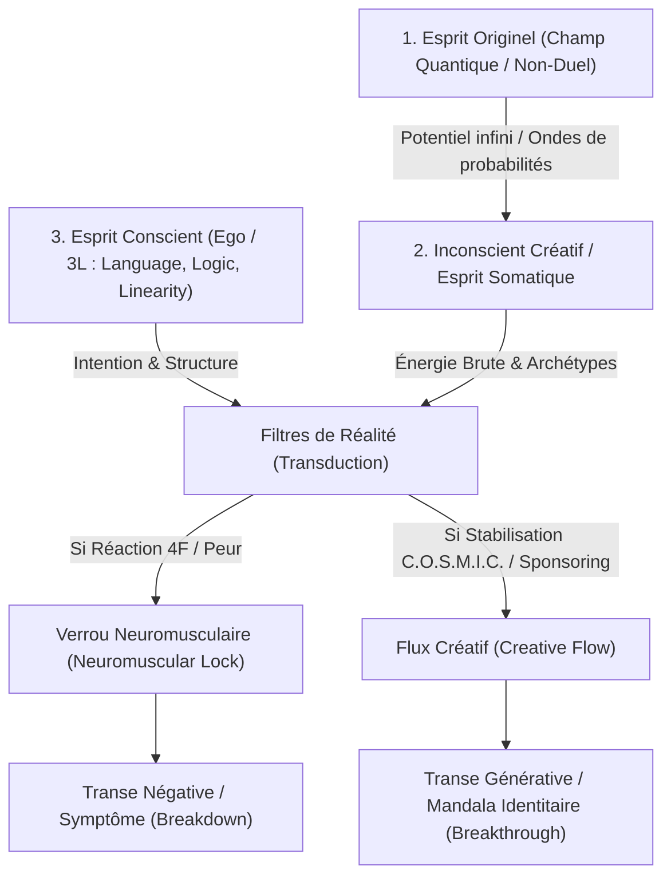
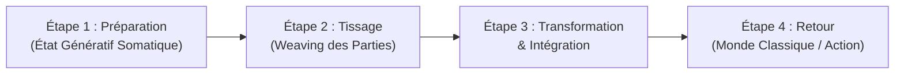

# Generative Trance
**Formateur :** Stephen Gilligan | **ID :** `stephen-gilligan-generative-trance` | **Tranches :** 19

## Synthèse Architecturale du Cours : *Generative Trance* (Stephen Gilligan)

---

### 1. Thèse Centrale & Philosophie du Cours

#### A. La Vision Spécifique de Stephen Gilligan & Différenciation Paradigmatique
La transe générative constitue la **troisième génération d'hypnose**, marquant une rupture épistémologique avec les modèles précédents :
1. **1ère Génération (Traditionnelle / Somnambulique) :** Relation asymétrique d'autorité où le praticien induit une perte de contrôle chez le sujet pour implanter des suggestions directes en contournant l'esprit critique.
2. **2e Génération (Ericksonienne Classique) :** Manipulation stratégique et bienveillante contournant l'ego conscient via des métaphores et doubles contraintes pour que l'inconscient — réputé omniscient et autonome — résolve le problème seul (*« Faites confiance à votre inconscient »*).
3. **3e Génération (Générative) :** Dépassement du dogme de l'inconscient omniscient. L'inconscient n'est pas intelligent isolément : il est un **champ quantique de potentialités indifférenciées**. La pathologie naît du divorce ou de la guerre intra-systémique entre l'esprit conscient (l'ego managérial) et l'esprit somatique/inconscient (l'énergie brute).

**La posture du praticien** n'est ni celle d'un hypnotiseur autoritaire, ni celle d'un programmeur en PNL classique cherchant à corriger une « mauvaise pièce de machine », mais celle d'un **sponsor relationnel** et d'un tuteur de champ. Le travail s'articule comme une alliance collaborative entre deux adultes : le praticien prête son propre système nerveux régulé (*résonance limbique*) pour aider le sujet à maintenir un conteneur somato-cognitif sécurisant face à ses propres intensités refoulées.

#### B. Le Fil Rouge Méthodologique : La Métaphore du Cavalier et du Cheval (*Disciplined Flow*)
Toutes les interventions de Gilligan obéissent à un invariant opératoire :
$$\text{Énergie Brute (Inconscient/Cheval)} + \text{Conteneur Conscient Régulé (Cavalier)} = \text{Percée Générative (Breakthrough)}$$

Dès qu'une déstabilisation identitaire survient (transition de vie, traumatisme, émergence émotionnelle) :
- Si l'ego tente de contrôler, fuir, geler ou s'effondrer (**Matrice des 4F : Fight, Flight, Freeze, Fold**), il verrouille le tonus musculaire (**Neuromuscular Lock**). L'énergie brute est comprimée dans un filtre opaque et dégénère en **transe négative symptomatique** (*Breakdown*).
- Si le système est stabilisé dans une présence incarnée (**État C.O.S.M.I.C.**), le verrou se dissout, le filtre redevient perméable, et l'effondrement de l'onde quantique transduit l'énergie brute en ressource adaptative ou en nouvelle configuration identitaire (*Breakthrough*).

---

### 2. Carte des Concepts & Leviers Émergents



#### 1. Ontologie Quantique & Modèle Tri-Monde
- **Esprit Originel (*Primordial Mind*) :** Arrière-plan non-duel, vide fertile (*sunyata*), sécurité ontologique fondamentale sans contenu objectivable. Neurologiquement lié à la mise en veille des boucles de rumination du réseau du mode par défaut (DMN).
- **Inconscient Créatif (*Creative Unconscious / Somatic Mind*) :** Champ de superposition quantique où toutes les potentialités, mémoires implicites et configurations d'états coexistent sans contradiction logique. Langage de l'hémisphère droit (images, rythmes, affects, métaphores).
- **Esprit Conscient (*Cognitive Mind / Ego*) :** Agent exécutif régulé par les *3L* (Langage, Logique, Linéarité). Rôle d'ancrage dans la réalité consensuelle, de discrimination téléologique et de pilotage dans le temps newtonien.

#### 2. Mécanismes Psychobiologiques de Fixation et de Déblocage
- **Transduction Quantique-Classique (*Reality Filters*) :** Inspiré du modèle holographique (Karl Pribram). Le monde phénoménologique n'est pas extérieur : il résulte de la façon dont le filtre neuro-somatique effondre le champ des probabilités en une expérience discrète.
- **Verrou Neuromusculaire (*Neuromuscular Lock*) :** Fixation corporelle et myofasciale issue d'un réflexe d'orientation non résolu, combinant une haute charge sympathique interne (*hyper-arousal*) et une inhibition motrice/respiratoire. Il fige les cartes cérébrales (*fixed brain maps*) et crée une dépendance d'état (*state dependency*) fermée sur la répétition du passé.
- **Matrice des 4F (*Fight, Flight, Freeze, Fold*) :** Les quatre réactions réflexes de défense de l'ego face à la déstabilisation, transformant un signal d'évolution en transe négative.
- **Superposition Quantique Identitaire :** Reconnaissance que le symptôme et la ressource coexistent déjà dans le système. La transe générative maintient les opposés ensemble (*complementarity / both-and*) sans forcer de choix prématuré, menant à une réorganisation en *mandala identitaire*.

#### 3. Le Stabilisateur Neuro-Cognitif : La Matrice C.O.S.M.I.C.
Condition indispensable d'auto-organisation du conteneur avant toute exploration :
- **C - Centered :** Ancrage viscéral dans l'axe médian (Hara/ventre) pour couper court aux boucles de panique de l'amygdale.
- **O - Open & Mindful :** Espace attentionnel méta-cognitif permettant d'inclure le phénomène sans s'y identifier (*être avec sans devenir*).
- **S - Subtle Awareness :** Syntonie kinesthésique fine et résonance limbique interpersonnelle remplaçant l'effort de contrôle musculaire grossier (*muscle-bound ego*).
- **M - Musicality :** Modulation prosodique, rythmique et respiratoire ; syntaxe affective qui parle directement à l'hémisphère droit.
- **I - Intentional :** Définition d'un attracteur téléologique positif tenu fermement depuis le centre corporel.
- **C - Creative Engagement :** Remplacement de la lutte par l'acceptation créative (*creative acceptance*), le principe des polarités complémentaires et l'exploration des possibles infinis.

---

### 3. Tableau Récapitulatif des Techniques & Démonstrations

| Technique / Exercice | Objectif Opératoire | Déclencheur / Indication | Séquence Résumée |
|---|---|---|---|
| **Protocole Macro en 4 Phases de la Transe Générative** | Conduire une réorganisation identitaire complète sans effondrement ni transe molle. | Crise de vie, dépression, conflit de valeurs, blocage d'évolution (ex. cas « Mary »). | **1. Préparation :** Installation de l'état C.O.S.M.I.C. et contractualisation téléologique (intention claire).<br>**2. Déstabilisation Délibérée :** Induction par absorption/défocalisation relâchant le contrôle de l'ego.<br>**3. Transformation Générative :** Tissage conscient-inconscient, accueil du problème dans l'espace de holding.<br>**4. Intégration Somato-Pratique :** Ancrage somatique, pont vers le futur (*future pace*) et traduction en actions concrètes. |
| **Désactivation du Réflexe d'Orientation (*Orienting Response Relinquishment*)** | Éteindre l'hypervigilance motrice et oculaire pour passer du mode « faire » (*doing*) au mode « être » (*being*). | Agitation somatique, regard fovéal inquisiteur, hyper-contrôle intellectuel, anxiété aiguë. | **1.** Détection des micro-tensions et des mouvements de balayage oculaire.<br>**2.** Fixation attentionnelle saturante (point visuel ou battement respiratoire monotone).<br>**3.** Ralentissement de la cadence verbale et utilisation d'une prosodie descendante et répétitive jusqu'à l'immobilité tonique sécurisée (chute de la garde sympathique). |
| **Dissolution du Verrou Neuromusculaire (*Unlocking the Body Map*)** | Découpler l'activation émotionnelle intense de l'inhibition motrice et restaurer la fluidité fasciale. | Sensation de nœud viscéral, respiration coupée, paralysie décisionnelle, figement traumatique. | **1.** Localisation somatique précise de la contraction.<br>**2.** Respiration circulaire guidée à travers la zone sans forcer la détente.<br>**3.** Réintroduction de micromouvements ondulatoires et de sons étirés pour transformer la rigidité en flux énergétique circulant. |
| **Sponsoring Somatique du Symptôme (*Creative Acceptance*)** | Stopper la violence intra-systémique et convertir un obstacle en « signal de l'âme » (*soul signal*). | Rejet violent d'un symptôme, haine de soi, phobie d'impulsion, douleur chronique résistante. | **1.** Nommer et saluer le symptôme depuis le centre C.O.S.M.I.C. (*« Bienvenue, je te vois »*).<br>**2.** Poser la main sur la région corporelle correspondante en contact réconfortant.<br>**3.** Remplacer l'interrogation logique (*« Pourquoi ? »*) par une curiosité somatique (*« Quelle énergie vitale tente de s'exprimer sous cette contraction ? »*). |
| **Tissage du Mandala Identitaire (Superposition Quantique)** | Intégrer deux parties ou états perçus comme mutuellement exclusifs sans faire de compromis réducteur. | Conflits de double contrainte (ex. accomplissement professionnel vs vie affective, vulnérabilité vs force guerrière). | **1.** Ancrer spatialement et somatiquement l'état A (ex. main droite, posture A).<br>**2.** Ancrer spatialement et somatiquement l'état B opposé (ex. main gauche, posture B).<br>**3.** Élargir le champ attentionnel (*Open Awareness*) pour ressentir les deux simultanément dans le corps.<br>**4.** Laisser émerger une posture/geste tiers qui unifie les deux polarités dans une complétude différenciée. |
| **Recâblage Visuo-Moteur du Signal Fantôme (Inspiré de Ramachandran)** | Fournir au système nerveux un feedback sensoriel congruent pour dissoudre une trace mnésique fixée. | Douleurs référées, obsessions sur une perte passée, sentiment de membre/partie arrachée ou manquante. | **1.** Cartographie de la représentation mentale douloureuse figée.<br>**2.** Création d'une contre-image visuelle ou kinesthésique libre de contrainte (métaphore du miroir).<br>**3.** Sollicitation synchrone de mouvements bilatéraux fluides pour contraindre le cortex somatosensoriel à mettre à jour son empreinte résiduelle. |

---

## Extractions Détaillées par Tranche (Opératoire & Verbatim)


## --- Tranche 1 / 19 ---

Voici l'extraction intégrale et opératoire de la substance de la tranche 1/19 (*Generative Trance* de Stephen Gilligan).

---

### 1. Mécanismes & Principes Actifs

#### A. La Co-opération Diadique Conscient-Inconscient (Troisième Génération d'Hypnose)
- **Principe actif :** Contrairement à l'hypnose traditionnelle (somnambulique, perte de contrôle, sujétion à l'opérateur) ou à l'hypnose ericksonienne classique de 2e génération (contournement stratégique du conscient par le thérapeute pour s'adresser au seul inconscient), la transe générative postule que la transformation durable requiert un tissage délibéré entre l'esprit conscient (le cavalier, la structure, l'intention discriminante) et l'inconscient créatif (le cheval, le réservoir de ressources somatiques et archétypales). En unissant ces deux instances plutôt qu'en endormant le conscient, le système nerveux accède à un niveau supérieur d'auto-organisation cognitive et somatique.
- **Tags libres :** `#cooperation_conscient_inconscient #troisieme_generation #flux_discipline #higher_consciousness`

#### B. La Dissolution du Verrou Neuromusculaire (*Neuromuscular Lock*)
- **Principe actif :** Face à une menace ou à une déstabilisation identitaire, le système nerveux réagit par une sidération somatique et attentionnelle (le verrou neuromusculaire / les 4 F : *Fight, Flight, Freeze, Faint*). Cette rigidification physique fige les filtres de la réalité et emprisonne le sujet dans un comportement répétitif pathologique. La transe générative opère comme un relâchement de la réponse d'orientation rigide, convertissant la contraction musculaire défensive en un état de disponibilité sensorielle et fluide.
- **Tags libres :** `#neuromuscular_lock #deverrouillage_somatique #liberation_reponse_orientation #flux_vs_figement`

#### C. L'Acceptation Créative (*Creative Acceptance*)
- **Principe actif :** L'acceptation n'est pas une résignation passive mais une curiosité active envers ce qui se manifesterait si le problème ou le symptôme était accueilli. Neurologiquement, s'opposer à un symptôme maintient l'activation de l'amygdale et le verrou neuromusculaire ; l'accueillir neutralise le réflexe d'évitement et ouvre un espace d'exploration où le symptôme révèle sa fonction de ressource adaptative ou de « signal de l'âme » (*soul signal*).
- **Tags libres :** `#creative_acceptance #curiosite_somatique #desactivation_lutte #symptome_comme_signal`

#### D. La Déstabilisation Naturelle de l'Identité
- **Principe actif :** La transe n'est pas un artifice clinique induit de l'extérieur, mais un phénomène biologique et relationnel spontané qui survient dès que les repères de l'ego vacillent (transitions de vie, traumatismes, créativité, deuils, naissances). Lorsque le filtre rigide de l'ego se fissure, le sujet entre dans un état de liminalité (*betwixt and between*). Si cet état est rejeté ou mal accompagné, il produit un effondrement (*wasteland*) ; s'il est contenu dans un champ relationnel sécurisant, il permet la recomposition d'une nouvelle identité.
- **Tags libres :** `#transe_naturelle #destabilisation_identitaire #liminalite #reconstruction_de_realite`

#### E. L'Attelage des Trois Esprits à Trois Paliers d'Intégration
- **Principe actif :** L'être humain fonctionne via trois esprits distincts :
  1. *L'esprit somatique* (le corps, les sensations, la mémoire procédurale, le centre Hara).
  2. *L'esprit cognitif* (la conceptualisation, le langage, la discrimination, l'intention).
  3. *L'esprit du champ / relationnel* (l'environnement, le contexte interpersonnel, le champ systémique et archétypal).
  Chaque esprit peut opérer à trois niveaux : *primitif* (fusion indifférenciée), *égoïque* (séparation rigide, contrôle) ou *génératif* (différenciation intégrée et fluide). Le travail consiste à faire passer ces trois esprits au niveau génératif.
- **Tags libres :** `#trois_esprits #somatic_mind #cognitive_mind #field_mind #paliers_de_conscience`

#### F. La Matrice COSMIC
- **Principe actif :** Acronyme structural des conditions neuro-cognitives requises pour stabiliser une transe générative :
  - **C**entered (Centré) : Ancrage kinesthésique dans l'axe somatique (Hara/ventre).
  - **O**pen (Ouvert) : Élargissement du champ attentionnel sans focalisation exclusive.
  - **S**ubtle awareness (Conscience subtile) : Perception des micro-mouvements, micro-tensions et nuances internes.
  - **M**usicality (Musicalité) : Rythme prosodique, fluidité dynamique des transitions sans à-coups.
  - **I**ntentional (Intentionnel) : Orientation vers un résultat positif désiré.
  - **C**reative engagement (Engagement créatif) : Participation active et curieuse à l'expérience.
- **Tags libres :** `#matrice_cosmic #criteres_etat_generatif #architecture_attentionnelle`

---

### 2. Protocoles, Techniques & Démonstrations (Étape par Étape)

#### Protocole Macro : Le Processus en 4 Étapes de la Transe Générative

##### **Intention / Indication**
Transformer un blocage existentiel, un symptôme ou un comportement conflictuel en ressource créative, en sortant de la polarité « Vie de village » (conformisme) vs « Terres dévastées » (dépression/cynisme) pour entrer dans le « Voyage de la conscience ».

##### **Mise en place & Pré-framing**
Expliquer au sujet qu'il ne va pas perdre conscience ni s'endormir, mais développer un état d'éveil supérieur où son conscient et son inconscient collaborent activement. Présenter le problème non pas comme une anomalie à éradiquer, mais comme un appel à la transformation (*soul signal*).

##### **Séquence d'actions pas à pas**

- **Étape 1 : Préparation de l'état génératif (Centrage & Connexion)**
  1. *Établir l'intention positive :* Définir clairement ce que le sujet souhaite créer (orientation téléologique positive, non négative).
  2. *Connexion au centre (Drop into center) :* Amener l'attention dans le corps physique (respiration, relâchement de la mâchoire, contact avec le sol, descente dans le bas-ventre/Hara).
  3. *Connexion aux ressources :* Évoquer des souvenirs positifs, des modèles, des soutiens archétypaux ou relationnels.
  4. *Évaluation par auto-échelle (Self-scaling) :* Demander au sujet de calibrer intérieurement sur une échelle (ex. de 1 à 10) la qualité de son centrage et de sa connexion aux ressources.

- **Étape 2 : Accueil et tissage des parties identitaires (*Welcoming and Weaving*)**
  1. *Inviter les parties :* Ouvrir le champ génératif pour accueillir sans jugement la partie bloquée, le symptôme ou la part vulnérable, ainsi que les parties ressources.
  2. *Défocaliser la fusion :* Permettre au sujet de se sentir à la fois relié à l'expérience et distinct d'elle (*"feel both a part of and apart from an experience"*).
  3. *Tissage créatif :* Établir un dialogue fluide entre l'intention consciente, la part blessée/symptomatique et le champ de ressources.

- **Étape 3 : Intégration et Transformation**
  1. Laisser le système réorganiser la relation entre les parties au sein du champ somatique et cognitif.
  2. Faciliter l'émergence d'une nouvelle réponse, d'un nouveau sens ou d'un recadrage somatique spontané.

- **Étape 4 : Transfert des apprentissages dans la vie réelle (*Future Pace & Return*)**
  1. *Marquage des apprentissages clés :* Identifier explicitement ce qui a changé dans la structure interne.
  2. *Pont vers le futur :* Imaginer des situations concrètes à venir où cette nouvelle configuration opère.
  3. *Engagements et vœux :* Formuler une déclaration d'engagement envers ce nouvel état.
  4. *Gratitude :* Remercier l'inconscient et le corps pour le travail accompli.
  5. *Réorientation :* Retour complet à l'état de veille ordinaire tout en préservant le lien au centre.
  6. *Boucle de rétroaction :* Vérifier les ajustements nécessaires pour le cycle suivant.

##### **Signes de calibration**
- Respiration abdominale basse, lente et régulière.
- Déglutition spontanée et décontraction du tonus musculaire facial (joues, paupières, mâchoire).
- Posture alignée, absence de micro-mouvements convulsifs de fuite ou de figement (*freeze*).
- Réponses verbales lentes, pondérées, émergentes depuis le corps et non réactives/intellectualisées.

---

### 3. Heuristiques, Subtilités & "Sagesse du Praticien"

#### Règles Conditionnelles & Arbres de Décision
1. **Si le sujet tente d'éradiquer son symptôme ou exige de redevenir « normal » :**
   * *Action :* Recadrer la demande : le symptôme n'est pas une panne mécanique, c'est un « signal de l'âme » indiquant que le rôle restrictif de la « vie de village » n'est plus viable.
   * *Raison :* Tenter de renvoyer de force le sujet au conformisme sans intégrer le message du symptôme renforce le refoulement et prépare une rechute dans le *wasteland*.
2. **Si le sujet se sent submergé ou terrifié par une émotion ou un souvenir :**
   * *Action :* Rétablir immédiatement la dissociation protectrice générative : l'amener à *"être avec quelque chose sans devenir cette chose"* (*be with something without becoming it*), créer une « seconde peau » ou projeter l'expérience dans un réceptacle externe (ex. la balle d'énergie).
   * *Raison :* La fusion non contenue active le verrou neuromusculaire et réactive le trauma au lieu de le transformer.
3. **Si le sujet analyse intellectuellement son expérience ou intellectualise la transe :**
   * *Action :* Réorienter immédiatement vers l'esprit somatique (*"Drop into center"*), faire porter l'attention sur le souffle, le poids du corps et le relâchement neuromusculaire.
   * *Raison :* Le mental conscient égoïque tente de reprendre le contrôle unilatéral ; la transe exige un partenariat sensoriel et non une glose mentale.

#### Postulats Fondamentaux de Stephen Gilligan
- **La transe comme lieu d'apprentissage :** La transe n'est pas un sommeil passif où le thérapeute installe des suggestions, mais un espace expérientiel où le client réorganise ses ressources profondes.
- **La vulnérabilité requiert le centrage :** On ne peut être vulnérable et transformer ses blessures de manière sécurisée que si l'on est solidement enraciné dans son centre somatique.
- **Acceptation créative préalable au changement :** On ne peut transformer ce qu'on refuse de rencontrer. Accepter une partie n'est pas la valider comme un comportement définitif, mais reconnaître son droit d'exister dans le champ de la conscience.
- **La réalité est construite :** Toute souffrance découle d'un filtre perceptif figé qui a confondu la carte avec le territoire ; ouvrir la transe permet de déconstruire le filtre et de reconstruire de nouvelles options.

---

### 4. Pépites Verbatim & Patterns Linguistiques (MOT À MOT EN V.O.)

#### Pépite 1 : La relation d'équanimité somatique
> « you (can) feel both a part of and apart from an experience … be with something without becoming it … »

- **[Analyse du Pattern]** : 
  - **Calembour phonétique et bascule syntaxique :** Utilisation du contraste quasi homophonique en anglais entre *"a part of"* (inclus/associé) et *"apart from"* (séparé/dissocié). 
  - **Double position perceptive simultanée :** Brise la dichotomie rigide dissociation vs association. Cela installe une position méta intégrée où le sujet peut expérimenter la résonance émotionnelle sans risque de submersion (désidentification bienveillante).

#### Pépite 2 : L'éveil du flux créatif (Citation introductive)
> « Let your mind start a journey through a strange new world. Leave all thoughts of the world you knew before. Let your soul take you where you long to be … Close your eyes, let your spirit start to soar, and you’ll live as you’ve never lived before. »

- **[Analyse du Pattern]** :
  - **Commandes enchâssées et verbes permissifs :** Enchaînement de structures impératives douces (*"Let your mind..."*, *"Leave all thoughts..."*, *"Let your soul..."*, *"Close your eyes..."*).
  - **Présupposition de rupture et transition :** Présuppose que l'ancien monde de représentations peut être abandonné sans effort, et que le voyage intérieur conduit inévitablement vers l'accomplissement d'un désir profond (*"where you long to be"*).
  - **Post-condition temporelle absolue :** *"and you'll live as you've never lived before"* clôt la séquence en installant une rupture temporelle irréversible (présupposition que le futur sera qualitativement inédit).

#### Pépite 3 : Les trismes d'induction réutilisables
> « trance is a learning place »

- **[Analyse du Pattern]** :
  - **Truisme et recadrage de définition :** Équivalence complexe directe reliant "transe" et "lieu d'apprentissage".
  - **Désamorçage des peurs d'influence :** Court-circuite la croyance limitante selon laquelle la transe serait un état de soumission, de passivité ou d'amnésie, pour la repositionner en cadre pédagogique et auto-généré.

> « trust your unconscious »

- **[Analyse du Pattern]** :
  - **Présupposition existentielle et commande directe :** Présuppose formellement que l'inconscient existe, qu'il est autonome, doué d'une sagesse positive intrinsèque, et qu'il mérite une reddition du contrôle égoïque.
  - **Nominalisation mobilisatrice :** L'inconscient est traité comme une entité bienveillante protectrice distincte du mental discursif.

#### Pépite 4 : La métaphore structurelle de William James
> « the unconscious mind is the horse and conscious mind is the rider: it’s the relationship between the two that is most important. »

- **[Analyse du Pattern]** :
  - **Métaphore isomorphe :** Structure relationnelle montrant que la puissance brute (le cheval/l'inconscient somatique) ne peut être domptée par la violence sans risquer la ruade, et que l'intelligence directrice (le cavalier/le conscient) est impuissante seule sans l'énergie de la monture.
  - **Focalisation sur le lien (tiers inclus) :** Déplace l'attention de la domination d'un élément sur l'autre vers la qualité du lien dynamique et de la communication entre les deux.


## --- Tranche 2 / 19 ---

Voici l'analyse opératoire intégrale de la tranche 2/19 de la formation *Generative Trance* par Stephen Gilligan, structurée selon les exigences d'ingénierie du coaching génératif, de la PNL et de l'hypnose de 3e génération.

---

### 1. Mécanismes & Principes Actifs

#### A. Architecture Tri-Monde de la Conscience (#architecture_tri_monde #ontologie_generative)
Gilligan pose que la conscience créative opère à travers trois réalités superposées et interdépendantes, dont la déconnexion produit la pathologie :
1. **L'Esprit Originel / Conscience Pure (*Original Mind / Pure Consciousness*) :** 
   - *Principe actif :* Espace d'arrière-plan sans forme, non-duel, caractérisé comme source lumineuse et bienveillante d'énergie vitale (*élan vital, prāṇa, chi*). Neurologiquement et phénoménologiquement, il s'agit d'un état de désengagement attentionnel total des boucles de traitement de l'information (DMN - *Default Mode Network*), permettant au système nerveux de relâcher les tensions homéostatiques de survie et d'expérimenter une sécurité basale ontologique.
2. **Le Monde Quantique / L'Inconscient Créatif (*Creative Unconscious / Quantum World*) :**
   - *Principe actif :* Champ de pure imagination, hors temps et espace newtoniens, existant sous forme d'ondes virtuelles de probabilités. Il n'est pas "intelligent" de manière autonome ou omnisciente à l'ancienne (critique du dogme naïf « faites confiance à votre inconscient »), mais constitue le réservoir des potentialités non actualisées, des archétypes et des solutions divergentes.
3. **Le Monde Classique / L'Esprit Conscient (*Conscious Mind / Classical World*) :**
   - *Principe actif :* Réalité empirique newtonienne régie par les *3 L* de l'hémisphère gauche (*Language, Logic, Linearity*). Son rôle est d'assurer la gestion exécutive, la survie pratique, la mesure temporelle, l'ancrage sensoriel et le passage à l'action. Sans lui, les potentialités restent des hallucinations sans impact ("un simple rêveur").

#### B. Superposition Quantique Identitaire (#superposition_quantique #mandala_identitaire)
- **Principe actif :** Emprunté à la physique quantique, le principe de superposition stipule qu'une particule/onde contient simultanément tous ses états possibles tant qu'aucune mesure n'est effectuée. Transposé à l'identité : un symptôme ou un état présent ("Je suis déprimé") n'est qu'un effondrement d'onde (*wave collapse*) particulier. Dans l'inconscient créatif, les états complémentaires (ludique, combattant, sage, vulnérable) coexistent déjà en superposition. La transe générative maintient ouverte la superposition sans forcer un choix binaire, permettant de tisser ensemble des identités apparemment incompatibles en un *mandala créatif*.

#### C. Filtres de Réalité et Transduction Somato-Cognitive (#filtres_de_realite #transduction_holographique)
- **Principe actif :** En s'appuyant sur les travaux de Karl Pribram (modèle holographique du cerveau), Gilligan démontre que la "réalité" matérielle n'est pas extérieure mais résulte de la transduction des ondes quantiques à travers les filtres du système nerveux (perceptions sensorielles, croyances, tonus musculaire). La valeur émotionnelle (ressource ou symptôme) d'une énergie brute (ex. énergie guerrière, libido) dépend exclusivement de la configuration de ce filtre.

#### D. Verrou Neuromusculaire vs Flux Créatif (#neuromuscular_lock #creative_flow)
- **Principe actif :** 
  * **Le verrou neuromusculaire (*Neuromuscular Lock*) :** Lorsque le système réagit par la peur, la contraction ou la dissociation, le filtre se fige. Il s'ensuit un piégeage par dépendance d'état (*state-dependency effect*) où l'esprit conscient tente de contrôler rigidement l'expérience, créant des boucles de souffrance fermées.
  * **Le flux créatif (*Creative Flow*) :** La transe générative relâche le verrou somatique, restaure la perméabilité du filtre et réautorise la circulation fluide de l'information entre l'Esprit Originel, l'Inconscient et l'Esprit Conscient.

---

### 2. Protocoles, Techniques & Démonstrations (Étape par Étape)

#### Protocole Macro : Architecture Opératoire de la Transe Générative en 4 Phases
*(Modèle opérationnel exposé au Chapitre 4)*

* **Intention / Indication :** Débloquer une identité ou une situation figée par un verrou neuromusculaire (dépression, conflit d'objectifs, transition de vie bloquée, crise de milieu de vie à la "Mary").
* **Mise en place & Pré-framing :** Cadrer l'expérience non pas comme une perte de contrôle ou un "effacement de l'ego", mais comme un partenariat d'égal à égal entre l'esprit conscient et l'inconscient créatif. Poser la prémisse que toute réalité est construite et donc reconstructible.



##### Séquence d'actions pas à pas :

1. **Étape 1 : Préparation (Développement de l'état génératif & Centrage)**
   - *Action somatique :* Amener le sujet dans l'axe de son corps (*mind-body centering*).
   - *Activation des 5 dimensions somatiques :* 
     1. Relaxation (baisse du tonus parasite),
     2. Absorption (focalisation interne douce),
     3. Ouverture (défocalisation de la périphérie),
     4. Flux musical (*musical flow* : fluidité du souffle et de la prosodie),
     5. Ancrage / Enracinement (*groundedness* : contact avec la terre et le bassin).
   - *Connexion au vide/champ :* Inviter à lâcher prise de tout contenu cognitif pour toucher le "milieu de nulle part" (*middle of nowhere*).

2. **Étape 2 : Tissage des parties identitaires (*Weaving identity parts*)**
   - *Identification de l'état problème :* Accueillir l'état conscient figé (ex: "le Dave déprimé") sans le juger ni vouloir le corriger immédiatement.
   - *Appel des états ressources superposés :* Éliciter dans l'inconscient créatif des parties complémentaires/ressources (la part joueuse, la part sage, la part guerrière saine).
   - *Mise en présence simultanée :* Créer un espace transitionnel (sphère d'énergie, champ relationnel) capable de contenir à la fois la part blessée/symptomatique et les parts ressources sans confrontation.

3. **Étape 3 : Transformation et Intégration créative**
   - *Application du principe de complémentarité :* Faire dialoguer ou faire fusionner les polarités opposées dans la "soupe de transe" (*trance soup*).
   - *Transduction du filtre :* Transformer la structure du filtre neuromusculaire par la respiration et la résonance somatique, métamorphosant le pattern brut en expression saine et générative.

4. **Étape 4 : Le retour dans le monde ordinaire (*Return to the classical world*)**
   - *Traduction exécutive :* L'esprit conscient réinvestit ses fonctions managériales (hémisphère gauche) pour traduire l'expérience vécue en plans comportementaux concrets, engagements et rituels quotidiens.
   - *Test d'incarnation :* Ancrer les nouveaux patterns dans la réalité matérielle (relations, hygiène de vie, communication, actions sous 24h).

* **Signes de calibration pour le praticien :**
  - Passage d'une voix hachée/tendue à une voix musicale et rythmée.
  - Décoloration des crispations musculaires posturales (déverrouillage de la mâchoire, des épaules, du diaphragme).
  - "Éclaircissement de la lumière" somatique (*somatic brightness*) : rougeoiement du teint, dilatation pupillaire, micro-oscillations d'assimilation du tronc.

---

### 3. Heuristiques, Subtilités & "Sagesse du Praticien"

#### Règles Opératoires Conditionnelles ("Si X -> Alors Y parce que Z")
- **Si le client verbalise une identité négative exclusive (ex: "Je suis un lâche", "Je suis dépressif") :**
  * *Alors :* Valider et accueillir pleinement cet état comme une forme classique temporaire, puis ouvrir immédiatement l'espace quantique aux états complémentaires opposés.
  * *Parce que :* Vouloir chasser ou éliminer un état problème renforce le verrou neuromusculaire par réactance psychologique. L'isolation d'une partie crée le symptôme ; l'adjonction de ses complémentaires crée la résolution.
- **Si le sujet tente d'analyser intellectuellement ce qui se passe pendant l'induction :**
  * *Alors :* Ne pas disqualifier son esprit critique, mais l'assigner à son rôle légitime d'observateur/gestionnaire bienveillant qui garde la porte du monde classique pendant que le reste explore.
  * *Parce que :* L'esprit conscient est un partenaire managérial indispensable ; le combattre crée une guerre civile interne.
- **Si le sujet manifeste de la terreur face au "lâcher-prise" ou au silence intérieur :**
  * *Alors :* Réduire l'amplitude du lâcher-prise en introduisant des repères d'ancrage somatiques (*grounding*) ou un champ relationnel externe sécurisant avant de toucher le vide.
  * *Parce que :* L'ego non sécurisé perçoit la Conscience Pure comme un abîme destructeur de survie (*fear of dropping into an abyss*).

#### Pièges Classiques & Erreurs de Débutant
1. **L'illusion du "Laisse faire ton inconscient" (*The passive surrender trap*) :**
   - *Piège :* Croire que l'inconscient possède à lui seul l'intelligence de régler la vie du sujet de manière automatique.
   - *Correction de Gilligan :* L'inconscient est un champ quantique de potentialités brutes, pas un pilote automatique. Il a impérativement besoin de l'esprit conscient pour poser l'intention, cadrer les filtres et traduire les visions en structures concrètes d'action.
2. **Le piège de la transe éthérée sans ancrage classique :**
   - *Piège :* Vivre des expériences de transe magnifiques, lumineuses et cosmiques qui ne changent rien à la vie quotidienne du sujet.
   - *Correction :* Une expérience quantique n'a de valeur thérapeutique ou générative que lorsqu'elle est solidement traduite et encodée dans le monde classique empirique (*grounded in single-value reality*).

---

### 4. Pépites Verbatim & Patterns Linguistiques (MOT À MOT EN V.O.)

#### Pépite 1 : L'Élicitation de l'Espace Transitionnel Neutre
> **Verbatim :**  
> *"Milton Erickson used to playfully use this term when inviting people in trance to experience a safe place where one could detach from all content... the middle of nowhere."*
> 
> * **[Analyse du Pattern]** :  
>   * **Défocalisation sémantique et rupture de cadre :** L'expression idiomatique familière *"the middle of nowhere"* est extraite de sa connotation d'isolement péjoratif pour être réencadrée en espace transitionnel positif.
>   * **Effacement du contenu (*Content-free induction*) :** Permet une dissociation sélective où le système nerveux suspend temporairement le scanning de menaces et le traitement d'informations sans mobiliser la résistance de l'analyse logique.

#### Pépite 2 : La Préservation de l'Énergie Vitale Unique
> **Verbatim (Citation de Martha Graham mobilisée par Gilligan) :**  
> *"There is a vitality, a life force, an energy, a quickening that is translated through you into action, and because there is only one of you in all of time, this expression is unique. And if you block it, it will never exist through any other medium and it will be lost. The world will not have it. It is not your business to determine how good it is nor how valuable nor how it compares with other expressions. It is your business to keep it yours clearly and directly, to keep the channel open. You do not even have to believe in yourself or your work. You have to keep yourself open and aware to the urges that motivate you. Keep the channel open."*
> 
> * **[Analyse du Pattern]** :  
>   * **Délivrance de la contrainte de performance (*Double-bind libérateur*) :** L'injonction paradoxale d'acceptation *"You do not even have to believe in yourself or your work"* désamorce instantanément la boucle critique du censeur interne (l'esprit conscient en verrou neuromusculaire).
>   * **Empilement de truismes et d'urgences existentielles :** La succession de clauses assertives (*"because there is only one of you in all of time"*) installe une nécessité ontologique absolue qui neutralise les doutes secondaires.
>   * **Métaphore du canal somatique :** Le syntagme répété *"keep the channel open"* fonctionne comme une commande hypnotique directe ciblant la levée du verrou neuromusculaire au profit de la circulation de l'influx nerveux.

#### Pépite 3 : Le Cadrage Dé-pathologisant par Superposition
> **Verbatim :**  
> *"For example, let’s say a fellow named Dave complains that he is depressed. We would accept and welcome this as his present identity state, while also appreciating that there are many other identity states resting in his creative unconscious – some playful, some young, some old, some wise, some wounded, etc. The challenge becomes how to make room for the conscious identity – the 'depressed Dave' – while also inviting and welcoming other (complementary) ones."*
> 
> * **[Analyse du Pattern]** :  
>   * **Nominalisation dé-identifiante par le langage :** L'expression *"the 'depressed Dave'"* isole l'état dépressif sous forme d'une simple configuration passagère d'un rôle d'acteur, plutôt que comme l'essence du sujet.
>   * **Présupposition d'inclusion et d'abondance :** L'usage de la conjonction restrictive-inclusive (*"while also appreciating that..."*) empêche la polarisation conflictuelle. Elle présuppose formellement que les ressources de vitalité ne sont pas à acquérir ou à fabriquer, mais sont *déjà présentes et dormantes* dans la superposition quantique du sujet.


## --- Tranche 3 / 19 ---

### 1. Mécanismes & Principes Actifs

#### 1. Transduction Quantique-Classique par les Filtres de Réalité
- **Principe actif** : L'expérience vécue n'est pas une entité préexistante « à l'extérieur », mais l'effondrement de la fonction d'onde du champ quantique de l'inconscient créatif en réalités classiques discrètes. Cet effondrement est opéré par les filtres de la conscience observatrice (*Reality Filters*). Ces filtres agissent comme des vitraux : ils traduisent le flux indifférencié d'énergie/information en formes perceptives, cognitives et somatiques concrètes. Si une structure de sens (ex. sexualité, intimité) porte un potentiel infini dans l'inconscient créatif, la valeur finale (positive, douloureuse, ressource, symptôme) dépend strictement du calibrage du filtre.
- **Tags libres émergents** : #transduction_quantique_classique #filtres_de_realite #effondrement_d_onde_observateur #gateway_filters #vitrail_perceptif

#### 2. Dépendance d'État (*State Dependency*) & Boucles de Réplication
- **Principe actif** : L'état neuro-émotionnel contraint et borne le traitement cognitif, l'accès mnésique et la projection future. Un état fixe restreint les activations synaptiques et mémorielles aux seules traces congruentes avec cet état (les états euphoriques rappellent des souvenirs positifs et orientent vers des indices de réussite ; les états dysphoriques shuntent l'appareil cognitif vers le danger et le manque). La répétition chronique d'une réalité n'est pas la preuve de son objectivité, mais la preuve de l'immobilité de l'état sous-jacent.
- **Tags libres émergents** : #state_dependency #congruence_mnesique #shunt_cognitif #contrainte_d_etat

#### 3. Verrou Neuromusculaire (*Neuromuscular Lock*) et Transe Traumatique
- **Principe actif** : Réaction psychobiologique d'immobilisation face à une menace perçue où coexistent simultanément une haute excitation interne (hyper-arousal sympathique) et une inhibition motrice/respiratoire périphérique. Le verrou neuromusculaire soude une carte cérébrale fixe (*fixed brain map*) à une tension myofasciale chronique. Cette rigidification rend le filtre de réalité opaque : le sujet confond sa carte avec le territoire et s'enferme dans l'auto-réplication du passé. Chez l'humain, à la différence des autres mammifères qui déchargent cette activation dès la fin du danger, le verrou peut persister des décennies par bouclage cognitif.
- **Tags libres émergents** : #verrou_neuromusculaire #trauma_trance #carte_cerebrale_figee #inhibition_respiratoire #opacite_du_filtre #arousal_paradoxal

#### 4. La Matrice Réactive des 4F (*Fight, Flight, Freeze, Fold*)
- **Principe actif** : Les 4 stratégies d'adaptation sous stress qui ferment les portes de la conscience générative :
  * **Fight (Attaque)** : Agression, colère, haine, volonté de domination, ressentiment.
  * **Flight (Fuite)** : Peur, évitement, retrait phobique, anxiété d'anticipation.
  * **Freeze (Sidération / Figeage)** : Immobilisation motrice, dissociation péri-traumatique, intellectualisation désincarnée (*disembodied thinking*), paralysie.
  * **Fold (Effondrement)** : Soumission biologique, engourdissement, affaissement postural, dépression, léthargie, torpeur, endormissement défensif.
  Ces postures somato-affectives empoisonnent la « clarté originelle » et forment l'identité de base paroxystique du symptôme.
- **Tags libres émergents** : #matrice_des_4F #fight_flight_freeze_fold #poisons_de_l_esprit_originel #somatisation_du_stress

#### 5. Déconstruction de l'Illusion de Rétroaction par Recâblage Visuo-Moteur (Principe de Ramachandran)
- **Principe actif** : Le cerveau traite l'image interne comme la seule réalité d'action disponible. Dans la douleur du membre fantôme, le traumatisme de l'arrachement ou de la lésion s'ancre en tant qu'image cérébrale figée sans possibilité de mise à jour motrice sensorielle. L'apport d'un feedback visuel congruent et libre de douleur (la boîte à miroirs) contourne le verrou central en offrant au système nerveux la preuve visuelle que le membre est détendu et en mouvement, dissolvant instantanément l'inhibition douloureuse.
- **Tags libres émergents** : #mirror_box_mechanism #recablage_image_motrice #dissolution_du_membre_fantome #reorganisation_carte_corticale

#### 6. Désamorçage du Réflexe d'Orientation (*Orienting Response Release*)
- **Principe actif** : Le réflexe d'orientation est le mécanisme d'alerte biologique (focalisation oculaire, rétrécissement attentionnel, passage en mode « faire / traquer le danger ») déclenché par toute nouveauté ou rupture de pattern. La fixation chronique de l'attention en mode alerte (alimentée par le bavardage mental, les écrans, les ruminations) interdit la transe régénératrice. L'entrée en transe génératrice s'opère par l'habituation ou la désactivation somatique délibérée de ce réflexe d'orientation, basculant l'axe nerveux du « faire » vers le « être avec ».
- **Tags libres émergents** : #reflexe_d_orientation #orienting_response #desactivation_alerte #passage_au_mode_etre

#### 7. Transe Négative vs Transe Générative (Le Double Pédalage Neuro-Affectif)
- **Principe actif** : La transe est un processus biologique naturel de déstabilisation de l'identité qui survient dès que les repères classiques s'effondrent. 
  * **Transe négative** : La perte de contrôle de l'ego déclenche une panique somatique et un verrou neuromusculaire (analogie de l'accélérateur et du frein à main enfoncés simultanément : le véhicule dérape ou s'écrase).
  * **Transe générative** : Suspension fluide des filtres conscients combinée à une présence somatique centrée (*disciplined flow*), permettant à l'intelligence de l'inconscient créatif d'informer la structure de l'esprit conscient sans rupture d'alliance.
- **Tags libres émergents** : #transe_naturelle #transe_negative #transe_generative #pedalage_paradoxal #flow_discipline

---

### 2. Protocoles, Techniques & Démonstrations (Étape par Étape)

#### Protocole A : Déverrouillage Neuromusculaire et Passage en Flux Génératif
* **Intention / Indication** :
  Présence d'un état de rigidité, boucle de rumination mentale (« constipation cognitive »), anxiété situationnelle, posture affaissée ou défensive (l'un des 4F actif bloquant la créativité ou l'apprentissage).
* **Mise en place & Pré-framing** :
  Expliquer au sujet que son problème actuel n'est pas un défaut identitaire mais un « verrou » physiologique temporaire destiné à le protéger. Poser le cadre : *« On ne peut pas résoudre un problème avec le même état musculaire qui l'a créé. »*
* **Séquence d'actions pas à pas** :
  1. *Identification somatique du verrou* :
     Inviter le sujet à repérer où se situent la tension musculaire et la restriction du souffle associées à la difficulté.
  2. *Reconnaissance du mode réactif (Diagnostic 4F)* :
     Classifier intérieurement ou explicitement la posture réactive : s'agit-il d'Attaque (tension mâchoires/poings), de Fuite (agitation/retrait), de Figeage (apnée/regard fixe) ou d'Effondrement (affaissement/atonie) ?
  3. *Inhibition volontaire de l'effort mental* :
     Inviter à cesser de chercher une solution analytique (arrêter de « pousser » mentalement).
  4. *Suspension du réflexe d'orientation* :
     Relâcher la fixation oculaire (défocaliser le regard en vision panoramique), libérer la mâchoire, réamorcer un rythme respiratoire abdominal lent et ininterrompu.
  5. *Attunement au champ de possibilités (« Just let it happen »)* :
     Inviter le système nerveux à glisser dans un espace d'attente réceptive sans but d'action immédiate, en maintenant l'ancrage corporel central (*somatic centering*).
  6. *Connexion résonante à une intention positive* :
     Injecter une intention claire dans le corps détendu sans forcer la forme de la réponse.
* **Signes de calibration** :
  * Déglutition spontanée et reprise d'une amplitude respiratoire basse (diaphragmatique).
  * Chute du tonus musculaire parasite (épaules qui descendent, traits du visage lissés).
  * Perte de la fixité oculaire (micro-mouvements oculaires fluides ou fermeture douce des paupières).
  * Signes manifestes de transition d'une posture défensive vers un alignement stable et ouvert.

#### Protocole B : Réactivation de Structure de Référence Somato-Mnésique (Modélisation de l'Auto-Guérison d'Erickson)
* **Intention / Indication** :
  Incapacité fonctionnelle, paralysie perçue face à un objectif, désespoir acquis, blocage psychosomatique ou perte de motricité/ressource.
* **Mise en place & Pré-framing** :
  Cadrer la mémoire non pas comme un simple souvenir nostalgique, mais comme une matrice neuromusculaire holographique capable d'informer la physiologie présente.
* **Séquence d'actions pas à pas** :
  1. *Sélection d'une mémoire kinesthésique source* :
     Faire émerger un souvenir ancien (souvent d'enfance), non contaminé par le conflit actuel, où l'action ou le mouvement désiré était naturel, facile et joyeux (ex. le geste spontané de lancer une balle).
  2. *Absorption expérientielle profonde* :
     Guider le sujet non pas à « regarder » le souvenir de l'extérieur, mais à s'y immerger sensoriellement (VAKOG complet) jusqu'à ce que la signature temporelle actuelle disparaisse.
  3. *Maintien de la résonance sans forçage moteur direct* :
     Maintenir l'attention focalisée sur le plaisir et les micro-sensations du pattern originel pendant une durée prolongée (de quelques minutes en séance à des pratiques répétées sur la durée).
  4. *Observation des micro-réactivations neuromusculaires* :
     Attendre patiemment que les unités motrices du corps actuel commencent à capter la résonance du pattern mnésique (trémulations légères, micro-contractions, chaleur).
  5. *Intégration dans le champ présent* :
     Laisser le schéma neuromusculaire ancien s'installer comme nouvelle structure de référence pour l'état présent.
* **Signes de calibration** :
  * Fasciculations musculaires involontaires dans les groupes musculaires ciblés.
  * Changements vasomoteurs (rougissement, réchauffement cutané périphérique).
  * Dissolution de l'expression faciale de doute au profit d'un état d'absorption idéo-motrice.

---

### 3. Heuristiques, Subtilités & "Sagesse du Praticien"

#### Règles Conditionnelles d'Intervention
- **Si** le sujet verbalise une réalité bloquée, stérile ou toxique (« *Je suis incapable de vivre une intimité épanouissante* »), **alors** ne discute jamais le contenu logique de la croyance ; **traite-la** comme un réglage mécanique de filtre qui effondre la fonction d'onde quantique dans une seule configuration classique. La cible de travail est le filtre et l'état sous-jacent, pas l'argument.
- **Si** le sujet semble réfléchir intensément avec tension du front, mâchoires serrées et blocage respiratoire (« intellectualisation/pensée constipée »), **alors** interromps immédiatement le processus verbal : son filtre est en verrou neuromusculaire, garantissant qu'il ne fera que recycler les données du passé. Fais-le respirer et bouger avant de continuer.
- **Si** le sujet entre en transe mais manifeste de l'anxiété, de la confusion aiguë ou un repli dépressif (symptôme = transe négative), **alors** ne tente pas de le ramener immédiatement en conscience ordinaire par la force ; **stabilise** son ancrage somatique (sécurité, souffle, centrage) pour transmuter la transe négative en transe positive en libérant le frein d'urgence de l'ego.
- **Si** le sujet est constamment distrait par le moindre bruit ou stimulus périphérique, **alors** son réflexe d'orientation est hyperactivé ; réduis la vitesse de ton débit verbal, induis une focalisation somato-sensorielle interne pour habituer le réflexe et permettre le basculement vers le mode réceptif.

#### Pièges Classiques & Erreurs Corrigées
- **Le piège du solipsisme simpliste (« Tu crées ta propre réalité »)** : Ne pas faire croire au client que ses seules pensées conscientes contrôlent l'univers entier de façon magique. Les filtres sont multicouches (neurologiques, ancestraux, familiaux, culturels, biologiques). Le travail consiste à ajuster le filtre individuel au sein de cette matrice complexe, non à gonfler l'ego d'une toute-puissance illusoire.
- **L'erreur de l'hypnose standardisée de laboratoire (Le modèle de Stanford / Hilgard vs Erickson)** : Vouloir appliquer un script préétabli rigide (« *one size fits all* »). L'hypnose standardisée bride les variables pour la recherche ; la transe génératrice utilise les forces uniques et les idiosyncrasies de l'individu pour faire émerger du neuf.
- **La fausse équivalence entre passivité et transe génératrice** : Le fameux « *Just let it happen* » n'est pas un abandon amorphe, une anesthésie ou un affaissement sans direction (Fold). C'est un *flux discipliné* qui requiert un alignement rigoureux entre intention consciente claire et réceptivité somatique.
- **La confusion entre relaxation superficielle et transformation génératrice** : Une transe de simple détente (« *nice trance* ») procure un répit temporaire à l'ego mais laisse les filtres et les structures d'identité intacts. La transe génératrice vise une déconstruction-reconstruction structurelle.

#### Postulats Fondamentaux de Stephen Gilligan
- *« You are only as good as your state »* : La qualité de la réalité perçue ou créée est strictement fonction de la qualité de l'état sous-jacent de l'observateur.
- *La transe est naturelle et non artificielle* : L'état hypnotique est une fonction biologique innée dédiée au renouvellement et à la réorganisation de l'identité.
- *Le symptôme est une transe négative non reconnue* : Les pathologies (dépressions, phobies, addictions) sont des transes dissociatives profondes où la perte de contrôle de l'ego a provoqué un verrou neuromusculaire défensif.
- *L'analogie du vitrail* : La lumière originelle de la conscience est incolore et pure ; ce sont les vitraux (les filtres) qui lui donnent couleur, dessin et limites.

---

### 4. Pépites Verbatim & Patterns Linguistiques (MOT À MOT EN V.O.)

#### Pépite 1 : La Transduction Quantique et la Responsabilité Générative
> « Our filters transduce the waves of the quantum world into the realities of the classical world. This means that we are ultimately responsible for our reality; the good news being that with this responsibility comes the possibility for transformation. »
- **[Analyse du Pattern]** :
  * **Recadrage ontologique & Présupposition d'équivalence complexe** : Établit un pont sémantique direct entre la physique quantique et l'autonomie psychologique. Le verbe *transduce* naturalise l'acte perceptif en processus physique.
  * **Reframing de la responsabilité** : Enchaînement par un connecteur de causalité (*This means that... the good news being that...*) qui neutralise la culpabilité habituellement associée au mot « responsabilité » pour le convertir instantanément en ressource de libération (« *possibility for transformation* »).

#### Pépite 2 : L'Élégance de la Formule d'Action Directe
> « Thus, your reality is a function of the setting of these filters. So if you don’t like your reality, change your filters. »
- **[Analyse du Pattern]** :
  * **Structure logique d'implication absolue (Conditionnelle opérante)** : Raccourci syntaxique radical (*if X, then Y*). Ce truisme apparent déplace la charge du problème : l'obstacle n'est pas la réalité (qui n'est qu'un résultat secondaire dépendant), mais le paramétrage interne (*setting*), induisant une commande implicite d'auto-ingénierie.

#### Pépite 3 : La Définition Opératoire de la Transe
> « Trance is (1) a temporary suspension of the reality filters of the conscious mind, and (2) an experiential absorption into the quantum world of the creative unconscious. »
- **[Analyse du Pattern]** :
  * **Double présupposition structurelle** : L'utilisation de l'adjectif *temporary* neutralise la peur de la perte définitive de contrôle pour l'ego. 
  * **Polarisation fonctionnelle** : Sépare nettement l'intellect conscient (qui filtre et borne) de l'inconscient créatif (décrit comme vaste et quantique), offrant au système nerveux une direction claire d'immersion expérientielle.

#### Pépite 4 : La Suggestion d'Erickson Face au Diagnostic Médical
> « When he developed polio at 17, the doctors told him he would never move again. He thought that was “an interesting suggestion” and began a series of deep inner explorations about how he might regain movement. »
- **[Analyse du Pattern]** :
  * **Rupture de pattern par méta-recadrage linguistique** : La condamnation médicale irrévocable subit une translation sémantique immédiate : elle cesse d'être un « fait » scientifique pour devenir une simple « suggestion ». 
  * **Présupposition d'apprentissage** : L'adjectif *interesting* brise le cadre émotionnel de la terreur/sidération (inhibition des 4F) pour basculer dans la curiosité d'exploration génératrice.

#### Pépite 5 : La Déconstruction Humoristique du Verrou Cognitif
> « Perhaps most insidiously, what we usually call “thinking” is a core state of neuromuscular lock, evidenced by muscular tension and inhibited breathing. I sometimes joke that thinking and constipation are, for most people, basically the same muscular patterns, with lots of effort and not much to show for it. »
- **[Analyse du Pattern]** :
  * **Métaphore de rupture par analogie corporelle crue** : Provoque un choc comique (rupture de l'intellectualisation) reliant la pensée obsessionnelle à la constipation.
  * **Dévalorisation stratégique de l'effort conscient** : L'expression « *lots of effort and not much to show for it* » discrédite l'utilité du contrôle analytique tendu, incitant le système nerveux du sujet à relâcher l'effort stérile au profit du lâcher-prise opérationnel.

#### Pépite 6 : L'Aphorisme de Csíkszentmihályi Recontextualisé
> « Informally speaking, you’re only as good as your state. For example, if you’re tense and shut down, not much good will happen for you. »
- **[Analyse du Pattern]** :
  * **Truisme direct et formulation de réalité inévitable** : Utilisation d'un registre informel (« *Informally speaking* ») pour contourner la résistance critique de l'auditeur. 
  * **Lien de cause à effet somatique** : Ancre que l'état physiologique fermé (*tense and shut down*) prédétermine un échec environnemental sans recours possible, forçant l'attention à se reporter immédiatement sur la physiologie de l'état présent.


## --- Tranche 4 / 19 ---

Voici l'analyse opératoire intégrale de la tranche 4/19 du cours *Generative Trance* de Stephen Gilligan, structurée selon les exigences d'ingénierie du coaching et de la transe générative.

---

### 1. Mécanismes & Principes Actifs

#### A. Désactivation du Réflexe d'Orientation (Orienting Response Relinquishment)
* **Principe actif :** Le réflexe d'orientation est une réponse neurobiologique de survie déclenchée automatiquement par des stimuli environnementaux inédits, brusques ou asymétriques (rupture de pattern, bruit soudain, mouvement). Le système nerveux central bascule alors instantanément : désengagement des processus internes en cours, pic d'éveil sympathique (*arousal*), rétrécissement attentionnel, orientation fovéale et recherche immédiate d'actions de défense (*"What's out there? What do I do?"*). Chez l'humain, ce réflexe est entretenu artificiellement et de manière chronique par l'anticipation mentale de menaces imaginaires, par la sur-stimulation technologique et par des micro-comportements d'évitement (agitation motrice, grattage, micro-ajustements posturaux).
* **Impact sur la transe :** Ce réflexe verrouille le sujet dans un mode « faire » (*doing mode*) et dans le « verrouillage neuromusculaire » (*neuromuscular lock*), figeant l'esprit conscient hypervigilant et excluant l'accès à l'inconscient créatif. La transe ne peut émerger que par la neutralisation de ce mécanisme, soit par saturation/absorption focale singulière (qui empêche le balayage oculaire hypervigilant), soit par entraînement rythmique itératif (qui signale au système nerveux l'absence de nouveauté et l'innocuité de l'environnement).
* **Tags :** `#orienting_response` `#neuromuscular_lock` `#sympathetic_de-escalation` `#doing_to_being` `#hypervigilance_extinction`

#### B. Transe comme Matrice de Déconstruction et Re-création Identitaire
* **Principe actif :** L'identité n'est pas une entité fixe mais un ensemble organique de « filtres de réalité » et de cartographies cognitives/somatiques régulées par l'esprit conscient en mode managérial. Lorsque ces filtres deviennent obsolètes, rigides ou inadéquats (transitions de vie, deuils, pathologies, nouveaux départs), le système entre naturellement en état de déstabilisation. 
* **Impact sur la transe :** La transe constitue le processus biologique et psychologique naturel par lequel les « fixations » d'un filtre de réalité (croyances rigides, mémoires épisodiques traumatiques, comportements de contrôle) sont déliées (*unbound*) et remises en négociation au sein de l'inconscient créatif. 
  - Si cette ouverture est accueillie avec contraction et verrouillage neuromusculaire, la transe devient **négative / symptomatique** (dépression, attaque de panique, compulsion).
  - Si elle est accueillie avec une présence relationnelle sécurisante, elle devient une **percée générative** (*breakthrough*), permettant la naissance d'une nouvelle configuration identitaire.
* **Tags :** `#identity_deconstruction_reconstruction` `#reality_filter_unbinding` `#organic_identity_renewal` `#symptom_as_negative_trance` `#quantum_to_classical_collapse`

#### C. L'Évolution Tri-Générationnelle de l'Hypnose & Modèle Relationnel Sujet-Inconscient
* **Principe actif :** La transe prend la forme et la valeur du conteneur relationnel qui la soutient. Gilligan cartographie trois paradigmes historiques :
  1. *1ère Génération (Autoritaire / Traditionnelle) :* Postulat que le conscient et l'inconscient sont tous deux incompétents (« idiots »). Le praticien anesthésie le conscient pour commander unilatéralement à l'inconscient comme à un enfant soumis. Résultats fragiles et instables.
  2. *2ème Génération (Ericksonienne) :* Reconnaissance de l'intelligence créative prodigieuse de l'inconscient. Toutefois, l'esprit conscient du client y est encore perçu comme un obstacle limitant qu'il convient de contourner (suggestions indirectes, dissociation, saupoudrage) ou de dépotentialiser (confusion, surcharge).
  3. *3ème Génération (Générative) :* Réconciliation et partenariat collaboratif. Le conscient n'est plus disqualifié ; il est éduqué à devenir un guide compétent, bienveillant et curieux. L'individu internalise la fonction hypnotique (« devenir son propre Milton Erickson ») dans une relation d'accordage semblable à celle du cavalier et du cheval (*horse whisperer* de Monty Roberts).
* **Tags :** `#third_generation_trance` `#horse_and_rider_attunement` `#internalized_erickson` `#collaborative_consciousness`

#### D. L'Architecture des Trois Esprits (The Three Minds)
* **Principe actif :** Le self génératif traite la réalité à travers trois niveaux d'intelligence interconnectés :
  1. *L'Esprit Somatique (Somatic Mind) :* L'intelligence animale/mammifère incarnée. Localisée dans le corps, les émotions, l'action, l'instinct et la mémoire ancestrale. Elle possède une présence passée et présente, mais aucune projection future ni capacité de méta-représentation (conscience sans conscience de soi). Base d'ancrage obligatoire de toute transe.
  2. *L'Esprit de Champ (Field Mind) :* L'intelligence systémique et non-locale constituée des contextes englobants (famille, culture, environnement physique, collectif). Souvent invisible au conscient (cf. « erreur fondamentale d'attribution »), le champ détermine directement les configurations d'état interne.
  3. *L'Esprit Cognitif (Cognitive Mind) :* L'intellect réflexif « dans la tête ». Utilise les symboles, le langage, les narrations verbales et les représentations séquentielles. Il permet d'extraire du sens, d'élaborer des choix et de naviguer entre différentes perspectives.
* **Tags :** `#somatic_mind` `#field_mind` `#cognitive_mind` `#triadic_consciousness_filters`

#### E. Le Niveau Primitif de Conscience (Primitive Level of Consciousness)
* **Principe actif :** Correspond au traitement neurologique de l'hémisphère droit (cf. Iain McGilchrist). Il incarne la « plénitude sans conscience de soi » (*wholeness without self-awareness*).
  - Le temps y est cyclique et rythmique (inspiration/expiration, jour/nuit) et non linéaire/chronologique.
  - L'énergie y est illimitée, poétique et holistique (« tout est relié à tout »).
  - *Limite opératoire :* Par lui-même, il évolue à une vitesse géologique ou circulaire (la tortue dans la fable). Il ne peut pas figer le temps, analyser un paramètre isolé ou générer des choix conscients dirigés. Il doit être fécondé par la conscience réflexive pour devenir génératif.
* **Tags :** `#primitive_consciousness` `#right_hemisphere_filter` `#wholeness_without_self_awareness` `#cyclical_time`

---

### 2. Protocoles, Techniques & Démonstrations (Étape par Étape)

#### Protocole 1 : Désamorçage Neurobiologique du Réflexe d'Orientation (Induction Bilatérale)

* **Intention / Indication :** Présence d'agitation motrice, regard fuyant ou scannant, discours intellectuel tendu, incapacité à s'intérioriser, verrouillage neuromusculaire face à un problème.
* **Mise en place & Pré-framing :** Cadrer que la transe n'est pas une perte de contrôle, mais la mise au repos du système de scan environnemental pour permettre au système nerveux de passer du « mode survie/faire » au « mode être ».
* **Séquence d'actions pas à pas :**
  1. *Neutralisation par Focalisation Singulière (Option A) :*
     - Fixer le regard sur un point spatial ultra-spécifique (flamme d'une bougie, repère visuel dans la pièce, ou point imaginaire dans l'espace).
     - Maintenir l'immobilité oculaire absolue pour éteindre le balayage saccadique arrhythmique des yeux tendus.
     - Élargir simultanément la vision périphérique sans bouger les globes oculaires.
  2. *Neutralisation par Entraînement Rythmique (Option B) :*
     - Introduire un pattern sensoriel répétitif prédictible : pulsation respiratoire cadencée, battement métronomique, chant mantrique ou balancement somatique subtil.
     - Saturer le système nerveux avec ce rythme continu jusqu'à ce que le cerveau reptilien/limbique intègre l'information : *"Aucun danger nouveau, l'environnement est stable"*.
  3. *Transition vers la Transe Générative :*
     - Dès la chute du tonus de vigilance, injecter une présence relationnelle chaude (*limbic attunement*) et des suggestions d'auto-bienveillance (*loving kindness*) pour éviter la dérive vers une transe négative (gel catatonique ou rumination).
* **Signes de calibration :** 
  - Fixité et défocalisation du regard (regard transe).
  - Ralentissement et approfondissement du rythme respiratoire (passage en dominante parasympathique).
  - Disparition des micro-mouvements parasites (cessation de se gratter, de réajuster sa posture, d'épousseter ses vêtements).
  - Lissage des traits du visage (décontraction des muscles masséters et frontaux).

---

#### Protocole 2 : Matrice de Résolution Créative en 4 Étapes (Modèle Wallas Appliqué à la Transe)

* **Intention / Indication :** Sujet bloqué sur une impasse intellectuelle, surcharge mentale décisionnelle, stagnation sur un objectif complexe où l'analyse rationnelle tourne en boucle.
* **Mise en place & Pré-framing :** Expliquer au sujet que l'esprit conscient ne peut que préparer et vérifier, tandis que la solution émerge de l'espace quantique de l'inconscient durant une phase de non-faire délibérée.
* **Séquence d'actions pas à pas :**
  1. *Étape 1 : Préparation (Esprit Conscient) :*
     - Le sujet formule explicitement le problème, collecte les faits, cartographie les contraintes et définit l'intention claire.
     - Pousser l'analyse jusqu'au point de saturation ou de rendement décroissant (*impasse*).
  2. *Étape 2 : Incubation (Immersion en Inconscient Créatif / Esprit Somatique) :*
     - Prescription formelle d'abandon du problème (*"clear the decks"*).
     - Induction de transe : réorientation de l'attention vers le corps, marche, sieste hypnotique ou suspension de l'effort conscient.
     - Autoriser le déliement complet des filtres logiques habituels dans le champ de repos.
  3. *Étape 3 : Illumination (Émergence Quantique / Hémisphère Droit) :*
     - Réception passive des manifestations non-linéaires de l'inconscient : images archétypales, symboles condensés, métaphores viscérales (ex: l'Ouroboros de Kekulé, l'épée enflammée de Barbara).
     - Accueil sans jugement critique ni tentative immédiate de rationalisation.
  4. *Étape 4 : Vérification & Intégration (Esprit Conscient Réhabilité) :*
     - Retour de l'esprit intellectuel pour tester, structurer, traduire en actions tangibles et valider écologiquement le matériel émergé.
* **Signes de calibration :** 
  - Transition nette entre le froncement de sourcils du conscient (Étape 1) et le lâcher-prise neuromusculaire profond (Étape 2).
  - Soupir végétatif, micro-sursaut d'insight ou élargissement pupillaire lors de l'illumination (Étape 3).
  - Reprise d'un tonus alerte mais détendu, aligné avec le corps (Étape 4).

---

### 3. Heuristiques, Subtilités & "Sagesse du Praticien"

#### Règles Conditionnelles & Arbres de Décision
* **Si** le sujet manifeste des micro-gestes parasites (se frotte le visage, tire sur ses vêtements, change constamment de posture), **alors** calibre cela non comme de l'inconfort anodin, mais comme une manœuvre inconsciente d'activation du réflexe d'orientation visant à préserver la dominance de l'esprit conscient désincarné. **Action :** Introduis immédiatement un focus singulier ou un rythme répétitif pour saturer le canal moteur et sensoriel.
* **Si** une transe est induite uniquement par répétition rythmique sans apport de bienveillance et d'accordage limbique (*loving kindness / limbic attunement*), **alors** il y a un risque majeur de bascule dans une transe négative (rumination dépressive, transe d'anxiété, repli catatonique).
* **Si** le sujet traverse une crise existentielle, une maladie grave ou une rupture (transition identitaire), **alors** considère ses symptômes (panique, désespoir, addiction) non comme des pathologies intrinsèques, mais comme l'émergence naturelle d'une transe de déconstruction retenue dans un cadre relationnel négatif et un verrouillage neuromusculaire. **Action :** Modifie le conteneur relationnel pour transformer la transe destructrice en rite de passage régénérateur.
* **Si** l'on veut modifier durablement un filtre identitaire rigide (ex: « Je ne peux faire confiance à personne »), **alors** ne débats pas au niveau logique (cognitif) ; invite d'abord le système dans une transe somatique pour délier (*unbind*) les ancrages kinesthésiques et mnésiques avant toute proposition de nouvelle cartographie.

#### Pièges Classiques & Postulats Fondamentaux de Gilligan
* **Le piège de l'ancienne hypnose (1ère et 2ème générations) :** Croire qu'il faut éliminer, endormir ou mépriser l'esprit conscient du patient. En transe générative, disqualifier le conscient affaiblit le résultat, car le sujet doit développer la capacité de s'auto-guider dans sa propre vie sans dépendre d'un hypnothérapeute extérieur.
* **Le piège de la transe brute (Niveau Primitif) :** Penser que la simple transe profonde ou la régression somatique suffit à guérir. Le niveau primitif (cerveau droit / nature) est circulaire et extrêmement lent à évoluer. Sans l'alliance avec un conscient aiguisé et différencié, le sujet tourne en rond dans son expérience sans créer de nouveauté générative.
* **L'axiome central de Gilligan :** *« La signification, la valeur, la forme et la fonction d'une transe sont créées par la connexion humaine qui s'y relie. »* Il n'y a pas de transe bonne ou mauvaise en soi : le contexte relationnel détermine si le phénomène sera un enfer symptomatique ou un vecteur d'évolution.

---

### 4. Pépites Verbatim & Patterns Linguistiques (MOT À MOT EN V.O.)

#### Pépite 1 : Le Réflexe d'Orientation comme Rupture du Verrouillage
> *"The rhythmic repetition signals the brain that there is no new environmental information, so it’s safe to open deeper into the world of relaxation and inner absorption. Only at this point is it possible to rest, release problems, and open to new creative possibilities."*

* **[Analyse du Pattern]** : 
  - **Présupposition causale et temporelle** (*"signals the brain... so it’s safe... Only at this point is it possible"*). Gilligan lie neurologiquement la fin de l'alerte à la sécurité viscérale, posant comme condition nécessaire et exclusive (*"Only at this point"*) le passage par le rythme pour déverrouiller l'accès aux ressources créatives.
  - **Empilement de verbes d'action passive** (*"rest"*, *"release"*, *"open"*), guidant le système du sujet vers une déflation progressive de l'effort volontaire.

---

#### Pépite 2 : La Nature Transitoire et Organique de l'Identité
> *"Milton Erickson would emphasize trance as a space to reorganize identity, and note that this need occurs at least periodically throughout the life cycle. Thus, you had one map of 'trust' when you were 4 years old but, no matter how good it was, you’d better not have the same understanding at mid-life. So it is natural that our identity must die and be reborn throughout life, and trance is a main means by which this occurs."*

* **[Analyse du Pattern]** :
  - **Truisme irréfutable et recadrage d'évidence** (*"you had one map of 'trust' when you were 4 years old... you’d better not have the same understanding at mid-life"*). Utilisation d'une analogie évidente du développement de l'enfant pour détruire la résistance du conscient à la déconstruction actuelle.
  - **Normalisation de la mort psychologique** (*"So it is natural that our identity must die and be reborn"*). Utilisation de l'adverbe *"natural"* pour lever la terreur existentielle liée à la perte de repères, recadrant l'angoisse de dissolution en étape biologique saine de renaissance.

---

#### Pépite 3 : Le Partenariat Cavalier-Cheval (Génération 3)
> *"This requires reorganizing one’s conscious mind to skillfully engage with the creative unconscious in a mutually influential and respectful way. In doing so, a person can 'become their own Milton Erickson,' internalizing the 'hypnotist' and 'client' roles in relational resonance. This allows one to 'walk in two worlds,' entraining the quantum world of the creative unconscious with the classical world of the conscious mind."*

* **[Analyse du Pattern]** :
  - **Double intégration identitaire** (*"become their own Milton Erickson"*, *"internalizing the 'hypnotist' and 'client' roles"*). Commande conversationnelle implicite qui réconcilie la scission interne (agent vs patient, contrôleur vs contrôlé) au profit d'une autorité intérieure intégrée.
  - **Métaphore spatiale paradoxale** (*"walk in two worlds"*). Suggestion post-hypnotique d'une conscience double et simultanée (non-dualité opératoire), dissolvant le préjugé voulant que l'on doive perdre conscience pour entrer en transe.

---

#### Pépite 4 : L'Inconscient comme Intelligence Poétique Primordiale
> *"The creative unconscious is another example: it is an unbroken pattern of innately poetic intelligence that guides the creation and balance of psychological life. The strength of this 'dreamtime' consciousness lies in its wholeness: within it, 'everything is connected to everything' as part of a deeper unity."*

* **[Analyse du Pattern]** :
  - **Recadrage ontologique et nominalisation valorisante** (*"unbroken pattern of innately poetic intelligence"*). Substitution du concept freudien de l'inconscient (pulsions refoulées chaotiques) par une force d'ordonnancement esthétique, rassurante et autosuffisante.
  - **Prédicat de connexion universelle** (*"wholeness"*, *"everything is connected to everything"*). Provoque une bascule immédiate vers l'hémisphère droit en suspendant la logique d'exclusion et de séparation propre à l'ego analytique.


## --- Tranche 5 / 19 ---

### 1. Mécanismes & Principes Actifs

#### A. La Triade des Niveaux de Conscience (Primitive, Ego, Générative)
* **Principe actif** : L'expérience humaine est filtrée à travers trois paliers d'organisation systémique et neurologique :
  1. *Conscience Primitive (Hémisphère Droit / Inconscient Créatif)* : Traite le monde comme un ensemble interconnecté, implicite, incarné et relationnel. Elle opère hors du temps linéaire et sans séparation égocentrique isolée. Sa limite fondamentale est l'absence de conscience de soi réflexive (*self-awareness*) : elle ne peut pas "arrêter le temps", analyser une sous-partie ou générer rapidement des cartes alternatives. Son rythme d'évolution est homéostatique et lent (archétype de la tortue).
  2. *Conscience de l'Ego (Hémisphère Gauche / Esprit Conscient)* : Émergence évolutive de la représentation symbolique de soi et de la temporalité linéaire. Elle permet la simulation de scénarios hors du temps présent, l'analyse, la catégorisation, la planification et la recomposition de sous-parties. Sa pathologie structurelle réside dans l'identification sélective : elle fragmente la totalité en dichotomies rigides (*soi vs autrui*, *bien vs mal*) et s'y enferme via le verrouillage neuromusculaire (*neuromuscular lock*), créant une dissociation d'avec le corps vivant et le champ relationnel.
  3. *Conscience Générative (Partenariat Hémisphérique / Intégration Holistique Différenciée)* : Réconciliation où l'esprit conscient (ego) se met au service de l'intelligence systémique globale (inconscient créatif). L'ego conserve sa clarté réflexive, son intentionnalité et ses capacités symboliques, mais reste ancré dans la plénitude somatique et relationnelle.
* **Tags émergents** : #niveaux_de_conscience #hemispheric_partnership #primitive_vs_ego #differentiated_wholeness #transcend_and_include

#### B. La Décompensation Identitaire : Bifurcation *Breakdown* vs *Breakthrough*
* **Principe actif** : L'identité ordinaire de l'ego ("business as usual") fonctionne jusqu'à ce qu'un choc déstabilisateur (traumatisme, stress chronique, transition de vie majeure, ou déstabilisation intentionnelle en transe) s'impose. La carte de l'ego s'effondre et libère un afflux massif d'énergie primitive brute.
  - Si cette régression est accueillie par un verrouillage neuromusculaire de survie réflexe (*fight, flight, freeze, fold*), l'énergie primitive se condense sous forme de symptômes pathologiques, formant une « transe négative » (*breakdown*).
  - Si cette même énergie brute est accueillie dans un état de résonance relationnelle et somatique sécurisé (état génératif), elle fournit le carburant biologique nécessaire à l'émergence d'une identité de niveau supérieur (*breakthrough*).
* **Tags émergents** : #destabilisation_identitaire #bifurcation_seuil #transe_negative #neuromuscular_lock #creative_flow

#### C. L'Acronyme C.O.S.M.I.C. : Architecture de l'État Génératif
* **Principe actif** : Système d'attracteurs neuromusculaires et cognitifs conçu pour empêcher l'effondrement en transe négative et stabiliser la transe créative :
  - **C - Centered (Centré)** : Ancrage kinesthésique sur la ligne médiane somatique (ventre/hara, plexus solaire, cœur). Empêche la réactivité limbique en créant un "point zéro" qui désactive le verrouillage musculaire d'urgence face au symptôme.
  - **O - Open & Mindful (Ouvert & Pleine Conscience)** : Présence non réactive et sans contenu prédéfini. Permet d'être simultanément *avec* l'expérience tout en étant distinct d'elle (être à la fois participant et observateur bienveillant, brisant la fusion identificatoire).
  - **S - Subtle Awareness (Conscience Subtile & Résonance Limbique)** : Remplacement de l'effort musculaire grossier (*muscle-bound ego*) par une écoute fine des micromouvements somatiques et de la résonance limbique interpersonnelle (syntonie mammifère).
  - **M - Musicality (Musicalité)** : Utilisation de la prosodie, du rythme, de la respiration et de la tonalité comme langage premier de l'hémisphère droit. La musicalité relie le système nerveux au champ avant toute intervention cognitive et neutralise l'aridité du contrôle verbal dénotatif.
  - **I - Intentional (Intention Positive)** : Définition d'un vecteur téléologique clair, compact et résonant orienté vers le futur. Sans intention positive tenue depuis le centre somatique, l'inconscient dérive dans une transe molle ou se fait aspirer par des attracteurs traumatiques.
  - **C - Creative Engagement (Engagement Créatif)** : Rejet de la lutte contre l'expérience au profit de 3 modes opératoires : l'acceptation créative (*creative acceptance*), la complémentarité (*complementarity / both-and*) et le principe des possibilités infinies (*infinite possibilities*).
* **Tags émergents** : #cosmic_state #matrice_generative #stabilisateur_neurosomatique #syntonie_limbique

---

### 2. Protocoles, Techniques & Démonstrations (Étape par Étape)

#### Protocole 1 : Structuration de l'Espace Génératif via la Matrice C.O.S.M.I.C.
* **Intention / Indication** : À installer impérativement *avant* d'aborder tout matériel traumatique, conflit interne ou symptôme récalcitrant. Indispensable pour éviter que le client ne plonge dans une abréaction ou un verrouillage neuromusculaire.
* **Mise en place & Pré-framing** : Cadrer que le travail ne consiste pas à lutter contre le problème ou à "forcer l'esprit sur le corps", mais à développer d'abord un contenant relationnel et somatique de haute qualité capable d'accueillir l'énergie du symptôme.
* **Séquence d'actions pas à pas** :
  1. **Centrage Kinesthésique (*Centered*)** :
     - Inviter le sujet à ramener son attention le long de la ligne médiane de son corps.
     - Localiser le "point un" (*one point*) : ventre (hara), plexus solaire ou région du cœur.
     - Guider la respiration directement dans ce point jusqu'à sensation de gravité, d'assise et de calme non réactif.
  2. **Expansion du Champ Conscient (*Open*)** :
     - Évoquer un moment où le sujet s'est senti profondément connecté (nature, proche, expérience esthétique).
     - Poser la question de calibration spatiale : *"Notice where your sense of self ends..."*.
     - Laisser la frontière égocentrique s'ouvrir à l'infini tout en maintenant le contact kinesthésique avec le centre.
  3. **Attunement Limbique & Écoute Subtile (*Subtle Awareness*)** :
     - Ralentir le débit vocal.
     - Calibrer la micro-dynamique corporelle et ajuster le rythme respiratoire du praticien sur celui du sujet (résonance limbique d'accueil).
  4. **Modulation Rythmique & Prosodique (*Musicality*)** :
     - Passer d'un registre verbal référentiel (prose explicative) à une voix cadencée, chantante, rythmée sur le cycle inspir/expir (*call-and-response* non verbal).
  5. **Ancrage de l'Intention Positive (*Intentional*)** :
     - Faire formuler au sujet un objectif positif, succinct et résonant orienté vers l'avenir (ce qu'il veut créer, et non ce qu'il veut éliminer).
     - Faire respirer cette intention directement au centre du corps.
* **Signes de calibration** :
  - Ralentissement et approfondissement du rythme respiratoire (respiration diaphragmatique).
  - Relâchement des fascias faciaux et des épaules (levée du *neuromuscular lock*).
  - Pupilles dilatées, regard doux et défocalisé.
  - Micro-oscillations posturales fluides (absence de rigidité ou d'affaissement hypotonique).

---

#### Protocole 2 : Utilisation Éricksonienne par Acceptation Créative
* **Intention / Indication** : Présence d'un schéma compulsif, d'une croyance délirante, d'une fixation rigide ou d'une résistance frontale de l'ego du client.
* **Mise en place & Pré-framing** : Ne jamais contredire, confronter ou chercher à invalider la logique du client. Partir du postulat que l'énergie et la forme de surface contiennent une intention adaptative primitive valide.
* **Séquence d'actions pas à pas** :
  1. **Accueil inconditionnel de la forme de surface** : Valider explicitement l'identité ou le symptôme présenté sans le juger (ex. de Milton Erickson face au patient interné : reconnaître qu'il affirme être Jésus-Christ).
  2. **Extraction du prédicat d'action fonctionnel** : Identifier les attributs pratiques ou comportementaux réels associés à cette construction (ex. : *"Jésus était charpentier et aimait aider les gens"*).
  3. **Canalisation contextuelle écologique** : Inviter le sujet à exprimer immédiatement ce prédicat d'action dans une tâche tangible et relationnelle du monde réel (ex. : intégrer l'équipe de menuiserie sur le chantier de l'hôpital).
  4. **Absorption par l'action relationnelle** : Laisser l'implication dans l'activité et le lien aux pairs saturer la conscience de l'ego jusqu'à ce que la fixation identitaire isolée devienne obsolète d'elle-même.
* **Signes de calibration** :
  - Diminution instantanée de l'attitude défensive et de la tension corporelle chez le sujet.
  - Engagement moteur volontaire dans la direction suggérée.
  - Déplacement progressif de l'attention du délire abstrait vers l'exécution concrète de la tâche.

---

#### Protocole 3 : Intégration par Bascule Rythmique des Opposés (*Complementarity / Both-And*)
* **Intention / Indication** : Conflits de double contrainte du type : *"Je veux X, mais Y m'en empêche"* (ex. : vouloir aborder quelqu'un mais être paralysé par la peur).
* **Mise en place & Pré-framing** : Expliquer que le problème n'est pas la présence de l'un ou l'autre côté, mais l'incapacité de l'ego isolé à faire coexister deux vérités fonctionnelles au sein d'un même champ.
* **Séquence d'actions pas à pas** :
  1. **Élicitation de la polarité A** (le désir/l'objectif) : Amener le sujet à incarner la position A somatiquement, identifier son intention positive et sa forme corporelle.
  2. **Bascule rythmique vers la polarité B** (la peur/l'inhibition) : Déplacer l'attention vers l'autre côté, honorer sa fonction de protection et son énergie somatique.
  3. **Mouvement pendulaire alternatif** : Faire osciller l'attention du sujet de façon rythmée entre A et B sans chercher à les réconcilier mentalement.
  4. **Tenue simultanée dans le champ génératif (*Both at the same time*)** : Demander au sujet de s'installer dans son centre et d'ouvrir un champ d'attention plus large capable d'englober les deux pôles simultanément dans le corps.
* **Signes de calibration** :
  - Mouvements oculaires intégratifs (balayage bilatéral ou regard fixe panoramique).
  - Disparition de la contraction agoniste/antagoniste dans les muscles posturaux.
  - Soupir de relâchement neurovégétatif marquant le passage de la contradiction logique à la synthèse somatique.

---

### 3. Heuristiques, Subtilités & "Sagesse du Praticien"

#### Règles Conditionnelles d'Intervention (If / Then / Because)
- **SI** le client amène un objectif formulé négativement (*"Je veux me débarrasser de mon anxiété"*) ou ne sait pas ce qu'il veut, **ALORS** suspendre toute tentative d'approfondissement de transe et construire d'abord une intention positive succincte et résonante, **PARCE QUE** faire confiance à l'inconscient sans vecteur téléologique positif expose le système nerveux à dériver dans des attracteurs traumatiques ou des transes négatives.
- **SI** le sujet s'enferme dans une analyse intellectuelle rigide ou un discours abstrait désincarné, **ALORS** introduire immédiatement de la musicalité dans la voix (tonalité chantée, modulation de rythme, pauses calées sur l'expiration), **PARCE QUE** le discours référentiel active l'hémisphère gauche isolé, tandis que la prosodie musicale mobilise directement l'hémisphère droit et la résonance limbique.
- **SI** l'identité de l'ego se déstabilise sous l'impact d'une crise ou d'une technique de rupture de pattern, **ALORS** calibrer immédiatement la réponse neuromusculaire du sujet :
  - S'il y a amorce de *fight/flight/freeze/fold*, le ramener au centrage somatique (*drop down under the drama*).
  - S'il y a détente et curiosité, approfondir l'accès aux ressources primitives pour générer la nouvelle identité.

#### Pièges Classiques & Erreurs de Débutant
1. **L'illusion du "Mind over Body" (Erreur de la suggestologie classique)** : Vouloir forcer le corps ou le symptôme par des affirmations volontaristes ou des injonctions autoritaires directes. Cela renforce le *neuromuscular lock* et durcit la dissociation entre l'ego et l'inconscient créatif.
2. **Confondre l'acceptation créative avec la résignation passive** : L'accueil inconditionnel (*welcoming*) n'est pas un abandon impuissant face au problème, mais une curiosité active envers l'énergie brute sous-jacente afin de lui offrir un nouveau canal d'expression.
3. **Négliger le rythme d'intégration de l'inconscient créatif** : Oublier la métaphore de la tortue et du lièvre. L'ego (le lièvre) veut des changements conceptuels instantanés, mais l'intégration biologique et somatique (la tortue) suit un tempo organique lent. Tenter de brusquer ce rythme provoque des rechutes homéostatiques.

#### Postulats Fondamentaux de Stephen Gilligan
- *La transe n'est pas un état artificiel créé par l'hypnotiseur* : C'est un retour psychobiologique fondamental à la conscience primitive, indispensable à la guérison et à l'intégration.
- *Un symptôme est une transe primitive figée dans un verrouillage neuromusculaire* : Ce qui détermine si une crise devient un effondrement (*breakdown*) ou une percée (*breakthrough*), ce n'est pas l'événement déclencheur, mais la qualité de la relation humaine et somatique établie avec cette énergie brute.
- *Le langage premier de l'être humain est la musique* : La communication purement dénotative et abstraite aliène ; seule la résonance prosodique et rythmique permet de tisser le champ d'intimité propice à la transformation.

---

### 4. Pépites Verbatim & Patterns Linguistiques (MOT À MOT EN V.O.)

#### 1. Recadrage Métaphorique de la Vitesse Évolutive
> "In the ancient myth of the race between the tortoise and the hare, the tortoise is primitive consciousness. (But as I tell my clients, always remember who wins that race!)"

* **[Analyse du Pattern]** :
  - **Recadrage d'attribution symbolique** : Associe la lenteur supposée de l'inconscient (la tortue) à la victoire inéluctable sur l'ego agité et pressé (le lièvre).
  - **Présupposition d'efficacité organique** : En rappelant la fin universellement connue du mythe, Gilligan implémente la suggestion post-hypnotique implicite que laisser opérer l'inconscient à son propre rythme mènera avec certitude au succès thérapeutique, désamorçant l'impatience anxieuse de l'esprit conscient du client.

---

#### 2. Induction Spatiale de Champ par Délimitation Négative
> "As you tune into that memory, notice where your sense of self ends. Most people report that it does not stop anywhere, it opens infinitely outward."

* **[Analyse du Pattern]** :
  - **Présupposition d'accès kinesthésique** : L'amorce temporelle *"As you tune into that memory..."* lie de façon causale l'évocation du souvenir à la focalisation sensorielle.
  - **Question de recherche transdérivationnelle** : *"Notice where your sense of self ends"* oriente le système nerveux vers la recherche d'une limite spatiale physique du "Moi".
  - **Truisme et normalisation par validation de pairs (*bandwagon suggestion*)** : *"Most people report that it does not stop anywhere..."* suggère indirectement l'impossibilité de trouver une frontière, guidant l'attention vers une dissolution des frontières de l'ego (*"opens infinitely outward"*) pour ouvrir un état de pleine conscience non-duale sans confrontation directe.

---

#### 3. Recadrage Paradoxal et Kinésique du Symptôme
> "Can you imagine waltzing with your anxiety or singing your depression?"

* **[Analyse du Pattern]** :
  - **Rupture de pattern catégorielle (Violation de sélection sémantique)** : Associe un verbe d'expression esthétique et fluide (*waltzing*, *singing*) à des états d'inhibition et de figement somatique (*anxiety*, *depression*).
  - **Désactivation instantanée du verrouillage neuromusculaire** : En forçant le système nerveux à se représenter l'anxiété sous forme de valse (mouvement circulaire, rythmé, équilibré) ou la dépression sous forme de chant (vibration vocale, expiration continue), la structure kinesthésique du blocage (*fight/freeze*) est court-circuitée au profit de la musicalité.

---

#### 4. Recadrage d'Utilisation Éricksonienne (Double Lien Constructif)
> "Erickson introduced himself, affirmed that Jesus was indeed a carpenter and someone who liked to help people, and then invited 'Jesus' to join the carpentry crew engaged in a building project on the hospital grounds."

* **[Analyse du Pattern]** :
  - **Pacing absolu sans confrontation (Pacing de la réalité du sujet)** : Accepte intégralement l'illusion psychotique du patient (*"affirmed that Jesus was indeed..."*).
  - **Recadrage de contenu par dérivation de prédicat** : Glisse imperceptiblement du statut théologique abstrait (*être Jésus*) à l'action concrète socialement fonctionnelle (*être charpentier, aider autrui*).
  - **Double lien thérapeutique implicite** : Si le patient refuse de travailler le bois, il contredit son identité autoproclamée de Jésus ; s'il accepte, il s'engage dans une activité structurante et relationnelle qui dissout la fixation pathologique.


## --- Tranche 6 / 19 ---

### 1. Mécanismes & Principes Actifs

- **La boucle de violence intra-systémique vs Flux créatif**
  - *Principe actif :* Tenter de nier, dissocier, anesthésier ou projeter une expérience négative déclenche un verrouillage neuromusculaire (*neuromuscular lock*) et une escalade de violence interne : plus l'ego conscient réagit négativement à son ressenti, plus l'état se dégrade. À l'inverse, l'état génératif restaure un « flux créatif » avec les énergies primitives de l'inconscient en ouvrant un espace de maintien positif (*holding space*) au-delà du problème.
  - *Tags :* #violence_intrasystemique #neuromuscular_lock #creative_flow #holding_space #deframe_negativity

- **Partenariat Conscient / Inconscient (« Disciplined Flow »)**
  - *Principe actif :* La créativité n'est pas le fruit exclusif de l'inconscient mais de la qualité de l'état sous-jacent maintenu par l'esprit conscient. L'esprit conscient agit comme régulateur et traducteur : il pose l'intention, maintient les conditions écologiques (état génératif), accueille les émergences de l'inconscient créatif et les re-traduit en langage classique et actions concrètes dans le monde.
  - *Tags :* #disciplined_flow #partenariat_conscient_inconscient #state_dependency #traduction_ego_inconscient

- **L'Intention Positive comme Contrainte Générative (5 mots ou moins)**
  - *Principe actif :* Sans intention positive nette, l'inconscient part en dérive associative libre (*free association*) ou est aspiré par les remous négatifs (*negative undertow*). Formuler un but en évitant la négation empêche le renforcement involontaire de l'image du problème. La contrainte stricte de brièveté (« règle des 5 mots ou moins ») court-circuite les métarécits justificatifs de l'ego (« Je veux X parce que Y mais j'ai peur de Z ») qui fonctionnent comme de véritables inductions de transe de basse qualité (*low-grade trance inductions*), détournant l'attention du centre intentionnel.
  - *Tags :* #positive_intention #regle_5_mots #low_grade_trance_interruption #court_circuit_narratif

- **Résonance Somatique et « Felt Sense » (Gendlin)**
  - *Principe actif :* Les mots restent de simples concepts intellectuels désincarnés tant qu'ils n'activent pas une réponse somatique perceptible. La résonance somatique (chez le sujet et chez le praticien via accordage limbique) sert de biofeedback direct indiquant que l'inconscient créatif est activé et que le lien corps-esprit est établi, conférant au verbe sa dimension transformatrice (« words magic »).
  - *Tags :* #somatic_resonance #felt_sense #accordage_limbique #mind_body_connection

- **Le Centrage Somatique (Espace libre de contenu)**
  - *Principe actif :* Le centrage fournit un point d'ancrage somatique et stable *en dessous* du flux des pensées, des émotions et des réactivités cognitives. C'est une connexion « libre de contenu » (*content-free*) à un sentiment fondamental de plénitude et de sécurité, immunisant le système nerveux contre l'inhibition respiratoire et les contractions défensives lorsqu'il aborde des charges traumatiques.
  - *Tags :* #centering #content_free_connection #stabilisation_somatique #anti_lock

- **Le Champ de Ressources et la « Communauté de Saints » (Jung)**
  - *Principe actif :* L'impossibilité d'accéder à des ressources internes provient d'une dépendance d'état induite par le verrouillage neuromusculaire (*neuromuscular lock*). En projetant spatialement des présences positives protectrices, inspirantes ou tutélaires tout autour de soi dans le champ de transe (derrière, à côté, dans le cœur), l'espace perceptif s'élargit et contrebalance toute présence ou mémoire menaçante, créant l'écologie nécessaire pour inviter les charges émotionnelles sans collapsus.
  - *Tags :* #community_of_saints #champ_de_ressources #spatialisation_relationnelle #deverrouillage_somatique

- **Auto-calibrage Émergent (Self-Scaling 1-10)**
  - *Principe actif :* Demander à « un chiffre de venir » plutôt que « à quoi pensez-vous » déplace l'évaluation du mental analytique vers l'évaluation kinesthésique globale de l'inconscient. Suggérer des micro-ajustements optimaux (1 à 2 points) contourne les résistances homéostatiques liées aux impératifs radicaux du type « tout ou rien », activant la plasticité adaptative sans déclencher d'alarme du système nerveux.
  - *Tags :* #self_scaling #inconscient_evaluateur #micro_shift #valeur_optimale_vs_maximale

- **Théorie de l'Expérience en Deux Niveaux & Tissage Spatial des Parties**
  - *Principe actif :* Au niveau primaire (énergie brute, inconscient), un pattern expérientiel est dépourvu de sens figé et possède le potentiel d'adopter n'importe quelle forme (ressource ou symptôme). Ce n'est qu'au niveau secondaire qu'il est figé négativement par les filtres cognitifs/somatiques rigides. En spatialisant les polarités (objectifs, obstacles, critiques, ressources) sur des ancres physiques et spatiales (mouvements idéo-moteurs des bras), la transe défait les cadres négatifs (*de-framing*) et permet au système de coordonner ces énergies autrefois rivales en une équipe unifiée.
  - *Tags :* #two_stage_theory #de_framing #spatialisation_ideomotrice #parts_weaving #equipe_interieure

- **Musicalité Transe-Linguistique**
  - *Principe actif :* Le langage verbal logique n'est que secondaire dans la transe générative ; la musicalité (prosodie, silence, tempo, respiration, résonance) constitue la première langue humaine et s'adresse directement à l'intelligence sensuelle de l'esprit somatique. L'utilisation délibérée de structures non verbales ou de sons sans signification lexicale (syllabes imaginaires, langues étrangères inconnues) désamorce la compulsion de décodage analytique de l'hémisphère gauche et active une transe énergétique profonde.
  - *Tags :* #musicality #langage_somatique #contournement_semantique #rythme_et_prosodie

---

### 2. Protocoles, Techniques & Démonstrations (Étape par Étape)

#### Protocole 1 : L'Établissement des Trois Connexions Positives (Étape 1 de la Transe Générative)
* **Intention / Indication :** Préparation obligatoire avant tout travail sur un problème, un traumatisme ou un objectif complexe. Indispensable pour éviter la dérive associative ou le verrouillage neuromusculaire.
* **Mise en place & Pré-framing :** Cadrer auprès du client que l'on « finit le travail avant de commencer » (Milton Erickson). Aucun travail sur le problème ne commence tant que le conteneur sécurisé n'est pas établi.

* **Séquence d'actions pas à pas :**
  1. **Calibration de l'Intention Positive :**
     - Inviter le client à énoncer ce qu'il veut créer (orienté vers l'avant, sans négation).
     - Appliquer la règle des 5 mots ou moins : *« Ce que je veux le plus dans ma vie, c'est [X] »*.
     - Compter sur les doigts de manière ludique ; stopper tout débordement narratif par un signal sonore amical (*« beep »*).
     - Élaguer jusqu'à obtenir une formule pure de 5 mots maximum.
  2. **Vérification de la Résonance Somatique :**
     - Calibrer le ton, le regard, la respiration et la réponse kinesthésique interne du praticien face à la déclaration.
     - Si la résonance est absente (intellectualisation) : ralentir le client, l'inviter à respirer, à contacter la sensation corporelle et à répéter la phrase jusqu'à sentir le frisson ou l'impact somatique partagé.
  3. **Connexion au Centre Somatique (Reviviscence) :**
     - Guider une relaxation générale au fil de la respiration.
     - Suggérer l'émergence spontanée d'un souvenir positif où le sujet s'est senti profondément connecté, entier et confiant (nature, lien d'amour, réussite stimulante).
     - Attendre une confirmation idéo-motrice (hochement de tête).
     - Réactiver les détails sensoriels (VAKOG) pour faire descendre l'expérience dans le corps présent.
     - Poser la question de localisation : *« D'où parlerais-tu, d'où marcherais-tu depuis ce ressenti ? Où est le centre ? »*
     - Inviter le client à poser physiquement une ou deux mains sur ce centre pour sceller l'ancrage somatique.
  4. **Activation du Champ de Ressources (« Communauté de Saints ») :**
     - Éliciter les présences soutenantes (personnes vivantes, défunts, mentors, animaux, symboles, lieux ressourçants de l'enfance).
     - En cas d'histoire traumatique lourde sans ressource apparente : chercher les refuges archaïques (arbres, cachettes, éléments naturels).
     - Spatialiser les ressources : inviter le client à les ressentir autour de lui dans la pièce (à droite, derrière lui, dans le cœur).

* **Signes de calibration :**
  - Respiration ventrale ample et déliée.
  - Déglutition réflexe, relâchement des muscles masticateurs et périorbitaires.
  - Résonance limbique ressentie par le praticien (synchronisation respiratoire, baisse de la tension dans la pièce).

---

#### Protocole 2 : L'Échelle d'Auto-Évaluation Inconsciente (Self-Scaling 1-10)
* **Intention / Indication :** Mesurer, suivre et moduler en temps réel la profondeur de l'état génératif (centrage, intention, sécurité, transe) tout au long de la séance ou dès qu'un signe de verrouillage apparaît.
* **Mise en place & Pré-framing :** Expliquer que l'on s'intéresse à la valeur optimale et non maximale (un 7 de relaxation peut être plus fonctionnel qu'un 10).

* **Séquence d'actions pas à pas :**
  1. **Élicitation du chiffre par l'inconscient :**
     - Focaliser sur la dimension à mesurer (ex: le centrage).
     - Formuler l'injonction passive : *« Sur une échelle de 1 à 10, laisse un chiffre venir à ton esprit qui représente le mieux ton niveau de [X] en ce moment. »*
  2. **Validation & Dédramatisation :**
     - Accueillir le chiffre quel qu'il soit comme une donnée précieuse du système.
  3. **Suggestion d'un Micro-Shift Optimal :**
     - Proposer un déplacement doux : *« Penses-tu qu'il serait intéressant de découvrir comment tu pourrais augmenter (ou réduire) ce chiffre juste d'un ou deux points... juste assez pour que ton inconscient amorce un décalage significatif ? »*
  4. **Intégration Transe-Somatique :**
     - Faire fermer les yeux, profonde inspiration.
     - Inviter l'inconscient créatif à apporter les éléments nécessaires (souvenirs, symboles, couleurs, résonances) pour accomplir ce micro-ajustement.

* **Signes de calibration :**
  - Chiffre énoncé spontanément sans réflexion ni calcul intellectuel.
  - Micro-mouvement somatique d'apaisement (soupir, affaissement des épaules) validant l'intégration du shift de 1 à 2 points.

---

#### Protocole 3 : Tissage Spatial et Idéo-moteur des Polarités (Démonstration Hank)
* **Intention / Indication :** Résoudre un conflit d'identité aigu ou un blocage où une part négative (peur, critique, mémoire douloureuse) sabote un objectif désiré.
* **Mise en place & Pré-framing :** Valider au préalable les 3 connexions positives. Poser le principe qu'aucune part n'est mauvaise : toute énergie est initialement neutre et utile au système global.

* **Séquence d'actions pas à pas :**
  1. **Cartographie des 4 composantes de l'identité :**
     - 1. Objectif (ex: Vivre une relation intime).
     - 2. Problème (ex: Peur et méfiance).
     - 3. Ressources (ex: Succès entrepreneurial, sa fille, l'océan).
     - 4. Parts négatives / Critiques (ex: Mémoire du divorce, voix interne : « Ne fais confiance à personne »).
  2. **Ancrage Spatial Idéo-moteur (Les bras vers le ciel, paumes ouvertes) :**
     - *Bras Droit - Hauteur d'épaule :* Espace de l'Objectif.
     - *Bras Droit - Abaissé d'environ 30 cm :* Espace des Ressources.
     - *Bras Gauche - Hauteur d'épaule :* Espace du Problème.
     - *Bras Gauche - Abaissé d'environ 30 cm :* Espace des Parts Négatives / Voix critiques.
  3. **Activation Séquentielle dans le Champ :**
     - Faire monter le bras droit (lévitation idéo-motrice) vers l'épaule : accorder le corps aux images et sensations de l'objectif.
     - Rabaisser le bras droit, faire monter le bras gauche à hauteur d'épaule : accueillir, sans fuir, les sensations du problème *tout en maintenant le centrage somatique*.
  4. **Tissage Autonome par l'Inconscient :**
     - Donner l'instruction à l'inconscient de piloter lui-même les mouvements alternés des bras.
     - Laisser le corps naviguer spontanément : 30 secondes sur l'objectif, bascule de 20 secondes sur la part critique, retour aux ressources, etc.
  5. **Accompagnement Polyphonique du Praticien :**
     - Le praticien fait office d'écho / miroir : verbaliser et valider chaque position touchée par les mains du sujet, en suggérant que de nouvelles connexions et compréhensions systémiques s'opèrent à chaque passage.

* **Signes de calibration :**
  - Fluidité et autonomie des mouvements de lévitation des bras (mouvement idéo-moteur sans saccade volontaire).
  - Transition douce des expressions faciales entre la douleur/peur et la ressource, sans rupture de transe ni panique (absence de verrouillage neuromusculaire).

---

### 3. Heuristiques, Subtilités & "Sagesse du Praticien"

- **L'Heuristique du Gardien de la Transe (Règle d'arrêt absolu) :**
  * *Règle :* *SI* à n'importe quel moment de la séance le sujet perd son centrage somatique (apparition de signes de verrouillage neuromusculaire : apnée, rigidité faciale, regard vitreux dissocié), *ALORS* interrompre immédiatement le travail sur le problème ou l'objectif, et revenir exclusivement à la restauration du centrage et des ressources. *PARCE QUE* travailler dans la transe sans centrage amplifie la violence intra-systémique et traumatise à nouveau le système.

- **L'Heuristique du Compteur de Mots (Anti-Story Trance) :**
  * *Règle :* *SI* le client dépasse 5 mots pour définir son objectif ou commence une phrase explicative (« Je veux X parce que... mais... »), *ALORS* couper avec bienveillance et humour (bruit de « beep ») pour exiger la formulation brute. *PARCE QUE* les histoires justificatives sont des transes négatives de bas niveau qui hypnotisent le client dans son impuissance.

- **L'Heuristique de l'Évaluation Ouverte (Inconscient vs Intellect) :**
  * *Règle :* *SI* l'on utilise une échelle d'évaluation (1-10), *ALORS* dire systématiquement « Laisse un chiffre venir à ton esprit » et JAMAIS « Quel chiffre penses-tu être le bon ? ». *PARCE QUE* la première formulation active la réception passive de l'esprit somatique/créatif tandis que la seconde réveille l'ego analytique et ses calculs de contrôle.

- **L'Heuristique de la Maîtresse de Maison (Aesthetic Spacing) :**
  * *Règle :* *SI* plusieurs parts d'identité sont invitées dans le champ génératif, *ALORS* ne jamais les fusionner brutalement ni laisser une part critique dominer l'espace sonore ou kinesthésique ; attribuer à chacune un rythme, une intensité et un espace spatial distincts. *PARCE QUE* l'intégration exige d'abord une différenciation harmonieuse ; le praticien agit comme l'hôte d'un dîner qui place harmonieusement ses convives pour que le dialogue prenne.

- **L'Heuristique de la Soustraction Linguistique :**
  * *Règle :* *SI* le praticien s'aperçoit qu'il cherche des mots complexes ou que le sujet écoute trop attentivement le sens logique, *ALORS* basculer dans la musicalité pure, le rythme du souffle, voire des sons inventés ou une langue étrangère. *PARCE QUE* la transe n'opère pas au niveau de la sémantique de surface mais au niveau du motif vibratoire, rythmique et de l'intelligence sensuelle du corps.

---

### 4. Pépites Verbatim & Patterns Linguistiques (MOT À MOT EN V.O.)

#### Verbatim 1 : L'Induction du Centrage par Reviviscence
> *"And as you can continue to breathe in and out … relaxing and opening … in and out … what a nice thing to know that you can begin to allow a positive memory to come into your mind … a time in your life when you felt deeply connected … deeply whole … deeply confident … no need to try to remember, just let it happen … breathing … wondering and letting your unconscious begin to remember an experience when you felt really deeply connected … perhaps an experience in nature … or when you were with someone you really love … or when you succeeded at a challenging task. Just let such a positive memory come into your awareness …"*

* **[Analyse du Pattern]**
  - **Pacing somatique et truisme rythmique :** *« continue to breathe in and out … relaxing and opening »* synchronise l'attention consciente sur un processus végétatif autonome.
  - **Présupposition d'apprentissage agréable :** *« what a nice thing to know that you can begin to allow... »* installe une méta-émotion de curiosité et d'acceptation bienveillante, tout en enchâssant la permission passive (*« begin to allow »*).
  - **Triple empilement d'états ressources :** *« deeply connected … deeply whole … deeply confident »* crée une résonance cumulative par répétition anaphorique de l'adverbe *« deeply »*, guidant la descente proprioceptive.
  - **Injonction paradoxale permissive / Levée de l'effort conscient :** *« no need to try to remember, just let it happen »* désactive le cortex préfrontal (l'effort de mémoire volontaire) au profit d'une émergence passive pilotée par l'inconscient.
  - **Saupoudrage d'alternatives universelles :** Proposer la nature, l'amour ou le défi garantit que le système du sujet trouvera une voie d'accès sans résistance.

---

#### Verbatim 2 : L'Élicitation de l'Ancre Somatique du Centre
> *"And as you remember such an experience, let yourself tune into the sensory details – where you were, who was there, different details, and so forth … and as you do so, you can let yourself feel that experience fully again in your body … each breath bringing the experience more strongly into the present moment … so that you can begin to sense those feelings now … and as you do, you can begin to notice where the core, where the center of that deep experience is … so that if you were going to speak from that core feeling, walk from that core experience … think from that core feeling … where is the center? (pause) And as you sense it, let yourself take a hand, or perhaps both hands, and gently touch your center … And as you touch, let yourself feel a connection between your center and you … a very positive connection …"*

* **[Analyse du Pattern]**
  - **Reviviscence VAKOG progressive :** L'activation des détails sensoriels externes sert de levier pour transférer l'expérience dans le corps actuel (*« fully again in your body »*).
  - **Liaison temporelle et somatique :** *« each breath bringing the experience more strongly into the present moment … so that you can begin to sense those feelings now »* utilise chaque cycle ventilatoire comme un amplificateur automatique de transe.
  - **Généralisation kinesthésique par projection opératoire :** *« speak from that core feeling, walk from that core experience … think from that core feeling »* force la cognition et l'identité à adopter ce point somatique comme nouveau locus de contrôle.
  - **Ancrage kinesthésique auto-administré en boucle de rétroaction :** L'invitation à toucher le centre avec les mains matérialise l'état interne dans un geste somatique concret, créant une boucle cybernétique fermée (*« connection between your center and you »*).

---

#### Verbatim 3 : Le Recadrage du Manque de Résonance
> *"I sense you’re speaking about something important, but I’m not feeling any deeper connection to it. I’d like to invite you to slow down, take a breath, sense what you’re speaking about, and tell me again."*

* **[Analyse du Pattern]**
  - **Validation sans complaisance (Confrontation bienveillante) :** Reconnaître l'importance cognitive déclarée par le client (*« speaking about something important »*) tout en invalidant immédiatement son impact opérationnel (*« but I’m not feeling any deeper connection to it »*). Le praticien utilise son propre corps comme instrument de mesure écologique.
  - **Rupture de pattern de débit verbal :** La commande enchâssée d'inhibition motrice (*« slow down, take a breath, sense... »*) brise le discours rationnel automatisé pour forcer le sujet à réassocier la parole au champ kinesthésique avant toute nouvelle émission verbale.

---

#### Verbatim 4 : La Suggestion du Micro-Shift par l'Échelle Inconsciente
> *"Do you think it would be interesting to discover how you could increase (or decrease) that number just a little bit – perhaps one or two points – just enough to let your unconscious begin to make a meaningful shift? So when you’re ready, let your eyes close … and take a nice deep breath … and as you close your eyes … let your creative unconscious bring to you whatever experiences … positive memories, people, symbols, colors, songs, other awarenesses … that allow you to develop a deeper connection with X … just a little bit more … just enough to begin to allow your unconscious to shift into a deeper level of creative activity."*

* **[Analyse du Pattern]**
  - **Question d'amorce hypnotique (Interrogative Lead) :** *« Do you think it would be interesting to discover... »* contourne tout réflexe d'opposition en plaçant la suggestion sous l'angle de la curiosité ludique.
  - **Balisage réducteur anti-résistance (Micro-framing) :** *« just a little bit – perhaps one or two points – just enough »* neutralise la peur du changement brutal en réduisant l'exigence à un seuil homéostatiquement acceptable par le système nerveux.
  - **Double lien temporel d'induction :** *« So when you're ready, let your eyes close … and as you close your eyes... »* subordonne la fermeture des yeux à la volonté du sujet, tout en utilisant cet acte moteur pour enclencher immédiatement l'étape suivante.
  - **Saturation multi-canal non spécifique :** L'énumération ouverte (*« memories, people, symbols, colors, songs, other awarenesses »*) offre à l'inconscient une liberté totale de sélection du matériau métaphorique tout en maintenant fermement le vecteur de direction (*« deeper level of creative activity »*).

---

#### Verbatim 5 : L'Accueil Inconditionnel d'une Part Négative dans l'Espace Tissé
> *"And as you let the right arm move back down … you can let your left arm slowly lift up to shoulder height … that’s right … slowly lift up to shoulder height … so that as your left arm lifts, you can begin to attune to … to welcome … to allow different parts of the problem to be sensed … fears … I don’t want to … concerns … and yet even as those parts of the problem occur, you can feel your center … remember your positive intention … all the while making room for all the different parts of the problem …"*

* **[Analyse du Pattern]**
  - **Marquage spatial et dissociation idéo-motrice :** L'abaissement du bras ressource et la montée du bras gauche séparent physiquement les charges émotionnelles pour éviter la contamination kinesthésique chaotique.
  - **Validation d'accompagnement (Pacing verbal) :** *« that’s right … slowly lift up »* ratifie le mouvement physique pour approfondir la réceptivité hypnotique.
  - **Normalisation sémantique des résistances :** En nommant explicitement les hésitations internes (*« fears … I don't want to … concerns »*), le praticien accueille le dialogue interne récalcitrant sans le juger.
  - **Double conscience simultanée (Split awareness) :** *« and yet even as those parts of the problem occur, you can feel your center … all the while making room... »* force le système nerveux à maintenir simultanément le sentiment de sécurité somatique (le centre) et l'activation de la peur, reprogrammant la réponse d'alarme en une expérience de tolérance et d'intégration élargie.


## --- Tranche 7 / 19 ---

### 1. Mécanismes & Principes Actifs

- **La Musicalité comme Premier Langage de l'Être Humain (*Musicality as Primary Language*)**
  - **Principe actif :** Le cerveau limbique et le système nerveux réagissent aux caractéristiques acoustiques (prosodie, rythme, tempo, silences, intonations) bien avant le décodage sémantique de l'hémisphère gauche. En réduisant la primauté du sens verbal au profit de la résonance somatique, la musicalité court-circuite le contrôle discursif de l'ego et réveille l'intelligence sensuelle de l'inconscient somatique (*somatic mind*). L'utilisation de syllabes dénuées de sens (*nonsense syllables*) ou de langues étrangères prouve que l'induction opère neurologiquement par le rythme et la transmission du champ énergétique non-verbal plutôt que par l'intellect.
  - **Tags émergents :** `#musicalite_somatique` `#debranchement_semantique` `#primauté_prosodique` `#champ_de_resonance`

- **L'Élaboration Symbolique vs Fixité du Signe (*Symbol Elaboration vs Sign*)**
  - **Principe actif :** L'esprit conscient (ego) fige la réalité en « signes » univoques et linéaires (signifié = signifiant unique), ce qui verrouille le sujet dans un blocage neuromusculaire et conceptuel. L'inconscient créatif traite chaque élément comme un « symbole » polysémique, capable de porter des significations multiples, fluides et contradictoires. En jouant sur les calembours, les glissements phonétiques et les ruptures d'homophonies (ex: *a part* / *apart*, *no* / *know*), le praticien brise le verrouillage neuromusculaire (*neuromuscular lock*) de la pensée littérale et dissocie le sujet de sa rigidité pour restaurer le flux créatif.
  - **Tags émergents :** `#elaboration_symbolique` `#deverrouillage_neuromusculaire` `#polysemie_dynamique` `#jeu_phonetique_ouvert`

- **L'Intégration Transformationnelle au Pic Esthétique (*Transformational Integration at Aesthetic Peak*)**
  - **Principe actif :** En tissant simultanément les différentes polarités d'identité (le but, la peur, les ressources, les parts critiques) et en accélérant le tempo et les bascules de l'une à l'autre, le système cognitif sature son traitement linéaire habituel. À l'acmé de cette montée en tension (le crescendo esthétique), un point de bascule opère : une rupture de transe déclenchée par une commande kinesthésique/prosodique prolongée (le glissement du *"noww!"*) projette le système nerveux dans un espace transcendant non-historique, permettant à une nouvelle identité de s'auto-organiser hors des boucles de conditionnement passées.
  - **Tags émergents :** `#integration_transformationnelle` `#crescendo_esthetique` `#saturation_polyphonique` `#trance_slide` `#saut_identitaire`

- **Le Corps Subtil comme « Corps des Corps » (*Subtle Body as Body of Bodies*)**
  - **Principe actif :** L'ego contracté réduit le corps physique à un objet mécanique ou un animal à contraindre, bloqué par des tensions musculaires chroniques qui l'isolent du champ quantique de l'inconscient créatif. À l'inverse de l'hypnose classique qui maintient une catalepsie rigide ou un affaissement passif (soumettant l'ego du client à celui de l'hypnotiseur), la transe générative dissout ce verrouillage pour ouvrir un corps énergétique subtil. Ce corps subtil (« fait de lumière ») englobe et transcende le corps physique ; étant non-physique, il est invulnérable (*unwoundable*). Il agit comme un métaconteneur capable d'accueillir et de transformer n'importe quel état perturbé.
  - **Tags émergents :** `#corps_subtil` `#corps_des_corps` `#dissolution_verrou_neuromusculaire` `#invulnerabilite_energetique`

- **Le Centrage comme Stabilisateur Sans Contenu (*Content-Free Attentional Stability*)**
  - **Principe actif :** L'être humain recherche compulsivement la stabilité. L'ego y parvient maladroitement en s'accrochant à des contenus rigides : croyances fondamentalistes, dépendances relationnelles, projections du passé. Le centrage offre une stabilité supérieure car purement attentionnelle et somatique (dénuée de contenu spécifique). En alignant l'attention sur l'axe physique et énergétique (sous le nombril, cœur ou plexus), le système nerveux maintient une alerte calme et une présence non-duale sans réactivité de jugement (« bon vs mauvais »). Il ouvre un canal de transduction fluide vers les ressources archétypales de l'inconscient créatif tout en permettant de différencier le témoin conscient des contenus vécus (*« être avec quelque chose sans devenir cette chose »*).
  - **Tags émergents :** `#centrage_somatique` `#stabilite_sans_contenu` `#canal_de_transduction` `#differenciation_temoin` `#non_dualite_operatoire`

---

### 2. Protocoles, Techniques & Démonstrations (Étape par Étape)

#### A. Protocole d'Intégration et de Culmination en Transe (Étape 3 du Modèle Global)
* **Intention / Indication :** Déclencher la naissance d'une nouvelle identité intégrée après avoir déployé et harmonisé les différentes parts du système (buts, symptômes, ressources, critiques).
* **Mise en place & Pré-framing :** Construire un rapport profond où conscient et inconscient créatif sont en influence mutuelle continue. Structurer le cadre comme une composition musicale montant vers un climax.
* **Séquence d'actions pas à pas :**
  1. *Évocation Polyphonique Accélérée :* Nommer et activer successivement dans le champ de transe le but désiré, les manifestations somatiques de la vulnérabilité (ex: la timidité/peur), les ressources concrètes (ex: l'océan, le travail, la fille), et les voix critiques recadrées avec curiosité.
  2. *Intensification du Tempo :* Augmenter la cadence des alternances (*« d'un côté... de l'autre côté... »*) pour accélérer les transitions entre les parts jusqu'à créer un champ unifié saturé.
  3. *Annonce du Point de Rupture :* Installer la suggestion post-hypnotique immédiate : le prochain mot spécifique servira de déclencheur pour plonger dans un niveau plus profond de réorganisation identitaire.
  4. *Déclenchement du "Trance Slide" :* Prononcer le mot pivot (*« noww! »*) avec une prosodie étirée, imitant le souffle d'un vent de changement traversant la réalité du sujet.
  5. *Phase de Silence d'Intégration (5 minutes) :* Laisser le sujet en silence quasi-total pour ne pas interférer avec le processus auto-organisateur de l'inconscient. N'intercaler que de très rares suggestions de soutien d'arrière-plan (*holding field*) : *« that’s it, that’s good … just letting it happen … »*.
* **Signes de calibration :** Respirations profondes et spontanées, relâchement complet du tonus postural, signes d'immersion interne profonde, absence de mouvements oculaires analytiques rapides. (Attention : si les yeux s'ouvrent brutalement ou si une tension musculaire réapparaît, cela indique un échec d'intégration par manque de préparation ou exclusion d'une part).

---

#### B. Protocole de Transfert des Apprentissages dans la Vie Réelle (Étape 4 du Modèle Global)
* **Intention / Indication :** Clôturer la transe en s'assurant que les réorganisations profondes s'ancrent dans les comportements quotidiens, sans supposer que le transfert se fera magiquement de lui-même.
* **Mise en place & Pré-framing :** Inviter le sujet à stabiliser ses acquis avant toute ouverture des yeux.
* **Séquence d'actions pas à pas :**
  1. *Marquage des Apprentissages Clés :* Guider une revue interne silencieuse. Demander au sujet d'isoler une ou deux prises de conscience fondamentales, de les respirer et de leur assigner un espace somatique précis dans le corps.
  2. *Projection dans le Futur Positif (Pont vers le Futur) :* Faire visualiser et ressentir des scénarios réels à court et moyen terme (demain, semaine prochaine, mois prochain) où la nouvelle qualité (ex: l'intimité) se manifeste naturellement.
  3. *Engagements et Vœux Profonds :* Inviter le sujet à identifier une promesse fondamentale envers sa vie et son avenir. Guider le geste kinesthésique d'amener sa main sur son centre somatique pour y faire vibrer et prononcer silencieusement ce vœu.
  4. *Émission de Gratitude :* Faire contacter un sentiment de gratitude envers soi-même, envers les personnes aidantes et les présences soutenantes. Faire poser la main sur le centre en répétant intérieurement : *« Merci… Merci… Merci… »*.
  5. *Scellage Énergétique & Réorientation Somato-Sensorielle :* Suggérer de draper une « seconde peau de lumière » autour de son corps pour protéger et bénir les apprentissages. Moduler la voix vers une musicalité de l'état de veille ordinaire. Guider le retour via le réajustement du souffle, l'ouverture des yeux et le retour spatial dans la pièce.
  6. *Recueil du Feedback :* Questionner sur les facilitateurs et les interférences vécus (ex: voix critique, bulle de peur).
  7. *Intégration du Feedback pour le Cycle Suivant :* Utiliser les interférences identifiées (ex: la régression d'un soi jeune effrayé) comme thème central de la séance suivante.
* **Signes de calibration :** Changement du rythme respiratoire vers un schéma d'éveil, retour progressif du tonus musculaire, réorientation spatiale des yeux, état affectif doux et apaisé.

---

#### C. Protocole de Centrage par Accordage Somatique (*Centering through Somatic Attunement*)
* **Intention / Indication :** Dissoudre le verrouillage neuromusculaire de l'ego ; créer le conteneur stable d'alerte calme requis pour toute transe générative.
* **Mise en place & Pré-framing :** Trouver une posture physique combinant détente et vigilance éveillée.
* **Séquence d'actions pas à pas :**
  1. *Installation et Décélération (*Settle in, settle down*) :* Guider la stabilisation posturale et le ralentissement du tempo interne.
  2. *Bascule de la Pensée au Souffle :* Déplacer le foyer attentionnel de la rumination discursive vers les sensations des mouvements respiratoires, métaphorisés comme les vagues de l'océan qui entrent et sortent.
  3. *Relâchement des Tensions Musculaires :* Associer l'expiration à la libération des tensions physiques pour fluidifier le passage de l'air.
  4. *Respiration sur l'Axe Vertical :* Visualiser et ressentir le souffle montant à l'inspiration le long de la colonne vertébrale jusqu'au sommet du crâne et vers le ciel ; puis descendant à l'expiration à travers le tronc, le bassin, les genoux et la plante des pieds jusqu'au centre de la terre.
  5. *Relâchement et Descente des Hanches :* Focaliser l'attention sur l'ouverture et l'affaissement détendu des hanches vers le sol pour ancrer un enracinement profond (*grounding*) et une présence calme.
* **Signes de calibration :** Abaissement visible des épaules, respiration abdominale lente et profonde, alignement vertical sans rigidité de la colonne, déglutition spontanée.

---

### 3. Heuristiques, Subtilités & "Sagesse du Praticien"

- **L'Heuristique de l'Hôtesse de Table (*Dinner Hostess Skill*) :**
  * *Règle :* Si deux parties du système entrent en conflit ou si une partie monopolise l'espace psychique en écrasant les autres -> *Alors*, le praticien doit agir comme un gestionnaire d'équipe ou une maîtresse de maison organisant un plan de table : assigner un espace relationnel distinct à chaque partie afin qu'elles coexistent dans une « totalité différenciée » (*differentiated wholeness*), au lieu de chercher à éliminer la partie dominante.

- **L'Heuristique du Diagnostic par les 4 Étapes :**
  * *Règle :* Si le sujet n'arrive pas à se détendre, résiste ou ne se sent pas en sécurité -> *Alors*, cela indique que l'étape 1 (Préparation : centrage, intention, ressources) a été bâclée ou est insuffisante.
  * *Règle :* Si le processus bloque sur une impasse émotionnelle (*impasse*) -> *Alors*, cela indique qu'une part identitaire significative a été ignorée ou rejetée hors du champ d'accueil.
  * *Règle :* Si l'intégration finale (Étape 3) échoue (yeux qui s'ouvrent brusquement, agitation mentale) -> *Alors*, ne forcez pas la transe ; revenez en arrière par une enquête directe pour identifier quelle ressource ou quelle part n'a pas été incluse.

- **L'Heuristique du Sanctuaire Somatique pour les Symptômes Douloureux :**
  * *Règle conditionnelle :* Si une émotion difficile ou perturbée (peur, panique, douleur) surgit -> *Poser impérativement la question opératoire :* *« Where do you feel it most in your body? »*.
  * *Mécanisme :* Pour transformer une expérience, il faut d'abord lui offrir un foyer (*to transform any experience, it must first be given a home*). En plaçant l'émotion négative au sein d'un centre somatique sécurisé et en l'exposant à une présence humaine bienveillante, elle se transmute spontanément.

- **L'Heuristique de la Ressource Archétypale Externe pour la Fatigue de Soin :**
  * *Règle :* Si un sujet blessé refuse ou est épuisé à l'idée d'être le soignant de ses propres parties blessées (cas de Marianne) -> *Alors*, ne le forcez pas à incarner l'adulte réparateur. Invitez une présence archétypale transcendante de rang supérieur (ex: la « Mère Divine ») à s'installer dans son centre cardiaque pour recueillir et bercer les parts blessées, permettant au conscient de capituler dans la confiance.

- **Erreurs classiques & Postulats fondamentaux :**
  * *Piège classique du débutant :* Croire que les mots et le contenu intellectuel font le travail hypnotique. Le praticien débutant parle trop pendant les phases d'intégration et s'inquiète si le client ne se souvient pas de ce qui a été dit. Postulat de Gilligan : le conscient est l'humble serviteur de l'inconscient créatif ; la résonance énergétique et la musicalité créent l'espace, le verbal n'est que secondaire.
  * *Postulat de réalité :* *« Reality is created from a state »*. Aucun problème ne peut être résolu à partir de l'état contracté qui l'a créé. Le centrage n'est pas un accessoire de relaxation, c'est le prérequis absolu pour générer un état supérieur d'où de nouvelles solutions deviennent inévitables.

---

### 4. Pépites Verbatim & Patterns Linguistiques (MOT À MOT EN V.O.)

#### Pépite 1 : Le Riff Phonétique et Déverrouillage Symbolique
> "And you can be a part of that experience and apart from it at the same time. And you can know no and know yes now, you know …"
* **[Analyse du Pattern]** : Utilisation d'une **ambiguïté phonétique** et d'une **antithèse simultanée** (*a part* / *apart* ; *know* / *no*). Ce jeu de mot crée une dissociation contrôlée : le sujet peut être simultanément immergé et observateur de son expérience. L'empilement homophonique (*know no / know yes now / you know*) sature le processeur syntaxique rationnel de l'hémisphère gauche, forçant l'esprit à basculer dans le traitement symbolique non-linéaire.

#### Pépite 2 : L'Élision Morphologique et Glissement Rythmique
> "And you can be it … feel the beat … be it … feel the being … the beat … the be-ing be-fore … be-cause bee in the bonnet as you move through trance."
* **[Analyse du Pattern]** : **Glissement par assonance et allitération** (*be / beat / being / before / because / bee*). Le langage perd sa fonction sérielle pour devenir une texture rythmique pure. C'est une **rupture de pattern sémantique** continue qui désamorce le cadre logique rigide, induisant un état de transe par pure musicalité et jeu enfantin (*punning*).

#### Pépite 3 : Le Tissage Polyphonique et le Déclencheur "Trance Slide"
> "And you can experience the goal … I want intimacy … the changing faces and feelings of the shyness … not too fast … all the resources … your work … the ocean … a curious shifting understanding of the critical voices … shifting … moving … increasing … on the one hand … on the other hand … and in a moment, when next I say the word “now” you can let yourself drop into a deeper level of trance … where all these experiential patterns can integrate together into a new positive identity … a new way to know … to trust … to experience intimacy … and let yourself drop deeper and experience that integration noww!"
* **[Analyse du Pattern]** : 
  - **Empilement de réalités multiples (*trance weaving*)** : Juxtaposition d'éléments conscients et inconscients sans connecteurs logiques stricts (le but, la timidité somatique, les ressources de la nature, les voix critiques).
  - **Présupposition temporelle et post-hypnotique** : *« and in a moment, when next I say the word “now” you can let yourself drop... »* programme une réponse somatique conditionnée avant même que le mot ne soit émis.
  - **Commande enchâssée prolongée (*Trance slide*)** : L'étirement phonétique du mot *« noww! »* agit comme une ancre vocale mimétique qui entraîne kinesthésiquement l'effondrement des tensions et l'immersion vers le palier intégratif.

#### Pépite 4 : L'Ancrage Kinesthésique du Vœu Profond
> "And as you sense them … let yourself feel them deeply vibrating in your center … You may want to touch your center … (pause) feel your center … and silently speak those vows … practicing each day … remembering each day … the deepest life you want to live in this world."
* **[Analyse du Pattern]** : 
  - **Suggestion permissive couplée à un ancrage somatique** : *« You may want to touch your center... »* introduit une commande kinesthésique non intrusive.
  - **Répétition incantatoire et projection comportementale** : L'anaphore temporelle *« practicing each day … remembering each day »* implante une présupposition d'action continue dans la réalité ordinaire post-transe, rattachée physiquement à la vibration du centre somatique.

#### Pépite 5 : La Métaphore de Clôture et Protection de la Transe
> "And then when you are ready … let yourself begin to gently prepare to bring closure to the experience … perhaps you’d like to wrap a “second skin of light” around your body … giving it protection … giving it blessing … to carry all these intimate learnings as you walk in the world in the coming days and weeks and months ahead …"
* **[Analyse du Pattern]** : 
  - **Double contrainte temporelle permissive** : *« when you are ready … let yourself begin... »* donne le contrôle illusoire au conscient tout en amorçant inévitablement la fermeture.
  - **Métaphore somato-sensorielle (« seconde peau de lumière »)** : Crée une enveloppe symbolique protectrice qui prévient la vulnérabilité post-hypnotique.
  - **Pont vers le futur temporellement gradué** : La formulation séquentielle *« days and weeks and months ahead »* étire l'intégration des apprentissages profonds sur une ligne temporelle ouverte.


## --- Tranche 8 / 19 ---

### 1. Mécanismes & Principes Actifs

- **Le Verrouillage Neuromusculaire et l'Aliénation du Centre**
  - **Principe actif :** Une expérience brute ou un schéma archétypique émerge de l'inconscient créatif via le centre somatique (canal de transduction). Si cette énergie est accueillie négativement par l'environnement humain ou par le moi (rejet, peur, punition), l'énergie se fige sous forme de contraction musculaire et prend une signification négative (ex: panique, douleur, rage). Le sujet s'éloigne alors de son corps pour éviter cette charge archétypale, créant un *verrouillage neuromusculaire* (*neuromuscular lock*). Chaque réactivation contextuelle déclenche automatiquement ce schéma non intégré.
  - **Tags :** #neuromuscular_lock #somatic_center #transduction_channel #archetypal_freeze #experiential_construction

- **Le Noyau Invulnérable (*The Unwounded Core*)**
  - **Principe actif :** L'émotion négative en surface (peur, panique, colère) n'est que la forme conditionnée issue d'un historique relationnel déficient. Au cœur de cette manifestation réside une énergie vitale pure, inconditionnée et non blessée (*unwounded and unwoundable core*). La souffrance elle-même est la preuve que la force vitale refuse la résignation passive. En accordant une attention relationnelle bienveillante à l'énergie plutôt qu'au contenu traumatique, le système nerveux commute du mode de défense (sympathique/dorsal) vers le mode d'intégration ventro-vagal.
  - **Tags :** #unwounded_core #positive_life_force #non_identification_au_contenu #relational_attunement

- **La Résonance Limbique comme Boussole Thérapeutique**
  - **Principe actif :** La transe générative ne réside pas uniquement à l'intérieur du crâne du sujet, mais dans le *champ relationnel interpersonnel*. Le praticien s'accorde somatiquement au sujet (ralentissement du rythme respiratoire, micro-ajustements posturaux). Cette synchronisation neuro-végétative guide la direction de l'intervention : si la résonance augmente, le praticien insiste ; si elle s'étiole, il réajuste l'angle d'approche.
  - **Tags :** #limbic_resonance #interpersonal_trance_field #somatic_resonance #two_body_attunement

- **La Transe Équilibrée : Relaxation vs Absorption**
  - **Principe actif :** Une transe passive où le sujet s'effondre sans tonus cognitif (*"collapse into a heap and drool"*) ne produit aucune plasticité créative. L'état génératif requiert la co-présence d'une détente somatique profonde (*relaxation*) et d'une focalisation absorbée sans tension (*relaxed concentration / experiential absorption*). Cela permet au cortex associatif de traiter des configurations complexes sans générer de contraction corporelle.
  - **Tags :** #relaxed_concentration #experiential_absorption #active_trance #plasticite_somatique

- **Le Modèle de la Console Somatique (*The Somatic Mixer Model*) & Échelle Auto-évaluative**
  - **Principe actif :** Représenter l'état interne sous forme de potentiomètres gradués (de 1 à 10) désamorce l'absolutisme émotionnel ("tout ou rien"). Demander une modulation progressive de 1 ou 2 points engage l'inconscient créatif dans un réglage homéostatique fin, réaliste et écologique (la valeur optimale étant souvent un 6 ou 7 plutôt qu'un 10).
  - **Tags :** #somatic_mixer #self_scaling #modulation_neurovegetative #optimal_vs_maximal

- **Le Trépied Fondamental de la Préparation Générative**
  - **Principe actif :** Toute transformation pérenne exige l'ancrage simultané de trois liens positifs : (1) Le Centrage somatique (corps/axe), (2) L'Intention claire (téléologie positive en moins de 5 mots), (3) Les Ressources (archétypes, ancêtres, symboles, nature, figures aimantes). Le tissage de ces trois pôles crée un réseau de soutien qui stabilise le système nerveux face au défi.
  - **Tags :** #three_positive_connections #centering #intention #resources #generative_scaffolding

---

### 2. Protocoles, Techniques & Démonstrations (Étape par Étape)

#### Protocole 1 : Centrage par Accordage Somatique en 5 Étapes
* **Intention / Indication :** Déconnecter le bavardage mental compulsif, ancrer la présence corporelle et établir un axe vertical stable avant tout travail de transe.
* **Mise en place & Pré-framing :** Posture assise, dos droit sans raideur, épaules relâchées.

```
Étape 1 : Settle in, settle down
  └── Trouver une posture confortable, à la fois détendue et alerte.

Étape 2 : Shift from thinking to breathing
  └── Déplacer l'attention des pensées vers le flux respiratoire (métaphore de la vague).

Étape 3 : Release muscle tension
  └── Autoriser la détente musculaire sur chaque expire.

Étape 4 : Breathe through vertical axis
  └── Inspirer en faisant monter le souffle le long de la colonne jusqu'au sommet du crâne et au ciel ;
  └── Expirer en faisant descendre le souffle le long du rachis, du bassin, des jambes, sous la terre.

Étape 5 : Relax and drop hips
  └── Relâcher et laisser descendre le bassin/les hanches pour générer l'enracinement somatique (grounding).

Étape 6 : Localisation et Ancrage Manuel
  └── Identifier où résonne le centre (Cœur, Ventre, Plexus solaire).
  └── Poser délicatement et consciemment une main sur cet emplacement pour stabiliser la présence.
  └── Auto-évaluation (1 à 10) de la force de présence du centre.
```

* **Signes de calibration :** Abaissement visible des épaules, ralentissement respiratoire abdominal, déglutition spontanée, lissage des traits du visage.

---

#### Protocole 2 : Centrage par Reviviscence de Souvenirs Positifs
* **Intention / Indication :** Renforcer le centre somatique en injectant une charge expérientielle de plénitude, de connexion ou de confiance déjà vécue.
* **Séquence d'actions pas à pas :**
  1. Établir la progression somatique de base (Protocole 1).
  2. Inviter l'inconscient à faire émerger un souvenir positif (nature, lien d'amour, accomplissement réussi).
  3. Calibration du signal idéo-moteur (ex: hochement de tête pour confirmer l'accès au souvenir).
  4. Remerciement explicite à l'inconscient créatif pour la collaboration.
  5. Ré-association sensorielle complète (VAKOG) : explorer le lieu, les présences, les sons, les textures en respirant dans l'expérience.
  6. Transduction somatique : identifier où cette sensation positive réside physiquement dans le corps.
  7. Ancrage tactile : déposer la main sur cette zone corporelle et évaluer l'intensité (1-10).
  8. Encodage : conserver ce contenu comme élément musical (*"trance song"*) réutilisable tout au long de la séance pour approfondir ou ressourcer.

---

#### Protocole 3 : Centrage à travers une Expérience Négative (Transmutation de la Panique/Symptôme)
* **Intention / Indication :** Quand le sujet rencontre un symptôme bloquant (panique, anxiété, contraction, colère) dès qu'il tente de se détendre ou d'accéder à son centre.
* **Mise en place :** Appliquer une curiosité respectueuse sans confrontation directe.
* **Séquence d'actions pas à pas :**
  1. **Ralentissement & Normalisation :** Respirer profondément, ralentir le débit verbal. Utiliser les mantras relationnels : *"That’s interesting... I’m sure that makes sense."*
  2. **Désidentification & Nommage :** Redéfinir le symptôme comme une "présence" extérieure ou une entité relationnelle (*"this presence of what you’re calling panic shows up"*).
  3. **Localisation somatique :** Demander au client de localiser précisément l'énergie dans son corps (ex: poitrine, gorge, plexus).
  4. **Évaluation initiale :** Chiffrer l'intensité de la présence sur une échelle de 1 à 10.
  5. **Accueil inconditionnel (Hospitalité relationnelle) :** Le praticien s'adresse directement à la présence somatique : *"Welcome... I’m glad you’ve joined us."*
  6. **Calibration du retour :** Observer les réactions ambivalentes (ex: une part se détend, une autre panique).
  7. **Validation des polarités :** Valider l'intégrité et la raison d'être des deux parties contradictoires (*"I'm sure both sides make sense, they each have deep integrity"*).
  8. **Intégration somatosensorielle :** Inviter le sujet à poser sa main sur la zone apaisée, respirer dedans et reconnaître la sagesse/vulnérabilité logée dans ce centre.
* **Signes de calibration :** Passage d'un regard figé/hyper-vigilant à un regard adouci, relâchement du thorax, larmes d'émotion intégratrice, baisse déclarée du score d'inconfort.

---

#### Protocole 4 : Phase de Préparation Complète de la Transe Générative (Démonstration Allan)
* **Intention / Indication :** Aligner le client avant d'entamer une boucle de transformation complexe (ex: difficultés conjugales).
* **Séquence pas à pas :**
  1. **Sortie du masque social :** Quitter le masque social pour descendre dans le noyau interne (*"settle in, settle down"*).
  2. **Formulation de l'Intention positive :** Formuler le désir profond sous la structure : *"Ce que je veux le plus dans ma vie, c'est [5 mots ou moins]"*.
  3. **Précision contextuelle :** Identifier le domaine de vie où cette intention est la plus significative (ex: le mariage).
  4. **Attunement relationnel silencieux :** 30 secondes de silence partagé pour amplifier le champ relationnel.
  5. **Activation du Centre Somatique (Ressource profonde) :** Évocation d'un souvenir d'amour inconditionnel ou de sagesse (ex: dernière conversation avec sa mère défunte) -> Main sur le cœur -> Note du centre = 10/10.
  6. **Mesure de l'Intention :** Évaluer la connexion au but (Allan note sa motivation à 5/10).
  7. **Optimisation progressive (Somatic Mixer) :** Demander à l'inconscient de faire monter le niveau de 1 ou 2 points par l'émergence d'une image/souvenir spontané (émergence du jeu d'enfant à 9-10 ans -> connexion passe à 8/10).
  8. **Convocation du Champ de Ressources :** Appel aux ressources externes (lieux naturels, archétypes, figures du passé).
     - Ressource 1 : Vagues d'Hawaï (liberté, surf).
     - Ressource 2 : Souvenir du couple au tout début de leur mariage.
  9. **Spatialisation des Ressources :** Localiser où se tiennent ces ressources dans l'espace péripersonnel (ex: au-dessus de l'épaule droite). Saluer gestuellement et verbalement les ressources dans l'espace.
  10. **Tissage Intégratif :** Parcourir en boucle : Intention -> Centre somatique -> Ressources. Laisser les trois pôles fusionner.
  11. **Vœu Sacré (*Sacred Vow*) :** Énoncer un engagement d'adulte constructif (non pas un vœu d'enfant réactif basé sur ce qu'on refuse d'être, mais un vœu positif d'adulte engagé).
  12. **Gratitude & Réorientation :** Exprimer de la gratitude, respiration profonde, réouverture des yeux.

---

### 3. Heuristiques, Subtilités & "Sagesse du Praticien"

- **L'Heuristique du Titrage Face au Négatif :**
  * *Règle :* *"Si l'énergie négative dans le centre menace d'inonder le système nerveux (overwhelm) -> Alors contacte-la pendant quelques secondes seulement, puis redirige immédiatement l'attention sur une ancre ressource positive (souvenir agréable), avant d'y revenir progressivement."*
  * *Raison :* Empêcher la retraumatisation tout en conservant la capacité de transduction du centre.

- **Les 4 Mantras Relationnels Intérieurs du Praticien :**
  1. *"That’s interesting"* (Supprime tout jugement clinique pathologisant, instaure la curiosité neutre).
  2. *"I’m sure that makes sense"* (Présuppose la rationalité adaptative et systémique du symptôme).
  3. *"Something is trying to heal or wake up"* (Recadre la crise somatique comme une tentative d'éveil d'une ressource archétypale).
  4. *"Welcome"* (Offre une hospitalité inconditionnelle qui désamorce immédiatement la résistance de défense).

- **Heuristique de la "Console Somatique" (Optimal vs Maximal) :**
  * *Règle :* Ne jamais viser automatiquement 10/10 sur un paramètre (ex: relaxation ou espièglerie). Un 6 ou 7 est souvent le niveau optimal pour maintenir le tonus de concentration et la pertinence face à l'objectif.
  * *Règle :* Toujours inviter des augmentations subtiles (1 à 2 points) plutôt que des bascules brutales, ce qui contourne les verrous de sécurité de l'inconscient.

- **Gestion de l'Ambivalence (Dépolarisation) :**
  * *Règle :* Si le sujet rapporte : *"Une part se calme, mais l'autre s'inquiète davantage"* -> Répondre immédiatement : *"C'est logique, je suis certain que les deux côtés ont du sens et possèdent une profonde intégrité."* Ne jamais prendre parti pour la faction apaisée contre la faction apeurée.

- **La Dérive du Masque Social :**
  * *Piège classique :* Démarrer le travail thérapeutique au niveau de la conversation sociale (*"social performance mask"*). Tant que le client et le thérapeute ne sont pas descendus somatiquement dans leur centre par la respiration lente, toute verbalisation sur les objectifs reste stérile et intellectuelle.

- **Le Postulat du Vœu Adulte vs Vœu Enfant :**
  * *Principe philosophique :* Dans l'enfance, les vœux inconscients se construisent en négatif (*"Je ne serai jamais comme mon père/ma mère"*, *"Je ne laisserai personne me blesser"*). La maturité générative exige d'émettre des vœux positifs et affirmés sur la manière dont on choisit d'habiter ses relations.

---

### 4. Pépites Verbatim & Patterns Linguistiques (MOT À MOT EN V.O.)

#### Verbatim 1 : L'Axe Somatique Vertical
> "As you relax your muscles and follow your breath, see how you can allow your breath to move up and down through your spine … as you breathe in, let the breath move up, inside the spine, all the way to the crown of your head, and continuing all the way to the heavens above … and as you breathe out, you can sense the breath moving down through your spine, down through your body, down your hips and knees … down through the soles of you feet … dropping all the way down to the center of the earth."
* **[Analyse du Pattern]** : Utilisation d'une métaphore spatiale et somatosensorielle verticale (*vertical axis*). Les suggestions s'appuient sur un rythme de truismes physiologiques couplés à l'inspiration et l'expiration (*"as you breathe in...", "as you breathe out..."*). L'extension métaphorique va de l'infiniment céleste (*"heavens above"*) à l'ancrage chtonien le plus profond (*"center of the earth"*), induisant un alignement postural sans effort par activation du système vestibulaire et proprioceptif.

---

#### Verbatim 2 : L'Accueil de l'Entité Symptomatique
> "That’s interesting … I’m sure that makes sense. So when you go to relax, this presence of what you’re calling panic shows up … Is that right?"
* **[Analyse du Pattern]** : Triple manœuvre linguistique : (1) Séparation identitaire : Gilligan nominalise la panique en *"this presence"*, détachant le sujet du symptôme ("ce que tu appelles panique" au lieu de "ta panique"). (2) Recadrage par truisme : *"I'm sure that makes sense"* désamorce la honte ou la pathologie en validant la fonction protectrice inconsciente. (3) Question de clôture pour calibration (*"Is that right?"*), créant un sas de synchronisation (Yes Set).

---

#### Verbatim 3 : L'Hospitalité et la Féminisation/Personnification du Symptôme
> "Thanks for letting me know that that’s where she is right now … And on a 1 to 10 scale, where 1 is the low end and 10 is the high end, how much do you feel the presence of panic right now? [...] 8 … That’s interesting … I would like to say to that presence inside of your heart, welcome … Welcome. I’m glad you’ve joined us."
* **[Analyse du Pattern]** : Emploi délibéré du pronom personnel féminin (*"where she is right now"*) qui transforme une étiquette clinique abstraite et terrifiante en une entité relationnelle digne d'empathie. L'usage réitéré du mot d'hospitalité direct (*"welcome... Welcome"*) parlé sur une tonalité adoucie crée un contre-conditionnement opérant immédiat face à la peur de la crise de panique.

---

#### Verbatim 4 : L'Accueil de l'Ambivalence Interne
> "One part more calm, the other more worried. I’m sure both sides make sense, I’m sure they each have deep integrity … And what happens when I say that?"
* **[Analyse du Pattern]** : Emploi d'un recadrage d'équivalence complexe et de pré-supposition d'intégrité (*"deep integrity"*). En validant simultanément deux polarités antagonistes, le praticien neutralise la double contrainte interne du sujet et ouvre un espace d'auto-observation réflexive sans conflit (*"And what happens when I say that?"*).

---

#### Verbatim 5 : Recadrage de l'Auto-Évaluation Imparfaite
> "About a 5 … that’s good to know! That right now it’s a 5. Who knows what it will be in a short while? But it’s great to know that you can sense exactly where you are in relationship to an experience inside of you … anytime, anywhere … Isn’t that good to know?"
* **[Analyse du Pattern]** : Recadrage complet d'un score perçu comme un échec ("seulement 5") en compétence méta-cognitive exceptionnelle : savoir estimer où l'on se trouve somatiquement est redéfini comme une maîtrise de soi accessible *"anytime, anywhere"*. La présupposition temporelle ouverte (*"Who knows what it will be in a short while?"*) instille l'inévitabilité du changement positif, conclue par une question d'accordage rhétorique hypnotique (*"Isn’t that good to know?"*).

---

#### Verbatim 6 : Spatialisation et Vœu Sacré
> "Where do you sense them in your present field? Are they inside of your body? Hovering over your head? Behind you? Just notice where in the present space you sense these important resources. [...] (looks over Allan’s right shoulder and gently waves) Welcome to both of you. Thank you for coming forth to guide Allan on his great journey... [...] As children we usually make negative vows … of who we don’t want to be like … of what we don’t want to happen … And what a nice thing to know that as we become grownups, we are called to make the positive vows, the positive commitments …"
* **[Analyse du Pattern]** :
  - *Spatialisation somatique :* Projection des ressources internes dans l'espace péripersonnel (champ somato-spatial). Le geste du praticien qui salue physiquement l'espace au-dessus de l'épaule valide kinesthésiquement l'hallucination positive du sujet et matérialise l'archétype dans le champ partagé.
  - *Recadrage développemental :* Contraste archétypal entre la psyché de l'enfant (vœux négatifs défensifs par évitement) et la souveraineté de l'adulte (engagements positifs créateurs). L'usage de tournures impersonnelles douces (*"what a nice thing to know that as we become grownups, we are called..."*) neutralise le surmoi critique et appelle à une responsabilisation sacrée.


## --- Tranche 9 / 19 ---

Voici l'analyse opératoire intégrale de la tranche 9/19 du cours *Generative Trance* de Stephen Gilligan, structurée selon les principes d'ingénierie demandés.

---

### 1. Mécanismes & Principes Actifs

#### 1. Le Verrou Neuromusculaire et l'Élargissement Périphérique du Champ
- **Principe actif :** Dans un état de problème, l'attention s'effondre en focalisation étroite (*tunnel vision*) sur un objet unique (croyance d'inadéquation, menace, douleur, souvenir). Cet état cognitif s'ancre somatiquement sous forme d'une crispation musculaire réactive (*neuromuscular lock*). Le système nerveux reste piégé dans un circuit fermé où la tension physique réinjecte la menace mentale.
- En désengageant le regard et l'attention focale pour ouvrir le champ périphérique (principe d'aïkido : *« Never give your eyes to the attacker »* ; ou EMDR), le cortex inhibe le réflexe de saisie de l'ego contracté. Ce déverrouillage neuromusculaire rétablit la connectivité avec l'inconscient génératif, permettant de traiter simultanément la menace et l'ensemble des ressources environnantes sans sidération.
- **Tags libres :** `#neuromuscular_lock` `#peripheral_field_expansion` `#dissolution_de_la_saisie` `#decontraction_somatique`

#### 2. La Table de Mixage Somatique (*Somatic Mixer*) & l'Auto-Étalonnage Émergent
- **Principe actif :** La transe générative n'est pas un état binaire (on/off), mais une constellation de paramètres somatiques continus (relaxation, jeu/légèreté, absorption, centrage, ancrage). En demandant au sujet d'attribuer un chiffre spontané (1 à 10) sans effort conscient, le praticien force l'activation d'un canal proprioceptif direct sans passer par le jugement critique.
- L'incrémentation modeste suggérée (+1 ou +2 points) élimine la résistance de performance de l'ego (sauvegarder le "10" pour plus tard). Le système nerveux mobilise alors des symboles subconscients autonomes (chaleur, lion, saut dans une piscine, chanson enfantine) pour réorganiser physiquement l'état somatique.
- **Tags libres :** `#somatic_mixer` `#scaling_emergent` `#micro_incrementation_somatique` `#decalage_d_etat`

#### 3. Le Tressage Non-Duel des Éléments d'Identité (*Mandala of Identity*)
- **Principe actif :** Contrairement à l'hypnose classique qui cherche parfois à réprimer ou remplacer le négatif par le positif, la transe générative ouvre un espace quantique non-duel au-delà du "bien vs mal". Le praticien invite à jeter dans le même chaudron transformateur les blessures anciennes, les souvenirs lumineux, les peurs, les accords et les désaccords.
- Par analogie symphonique/musicale (sons, résonances, accords), ces polarités cessent d'être des conflits internes figés pour devenir des harmoniques complémentaires. Le cerveau reconfigure ses cartographies neurales (*brain maps*) en un tout intégré et cohérent.
- **Tags libres :** `#mandala_of_identity` `#non_dual_integration` `#alchimie_des_contraires` `#musicalite_generative`

#### 4. Le Bouclage Somato-Cognitif par les Vœux Sacrés (*Sacred Vows*) & Pont Temporel
- **Principe actif :** Les conditionnements infantiles inconscients reposent massivement sur des "vœux négatifs" d'évitement (*« je ne veux pas être comme mon père/ma mère »*, *« je refuse de revivre cela »*), ce qui maintient le système focalisé sur l'empreinte traumatique. 
- Transformer cette énergie en un "vœu positif d'engagement" ancre l'état génératif dans la réalité relationnelle adulte. La projection d'un « double subtil du futur » qui renvoie un signal au soi présent active un pont proprioceptif d'attraction téléologique (la finalité tire le présent).
- **Tags libres :** `#positive_vows` `#engagement_somatique` `#double_subtil_futur` `#attracteur_teleologique`

#### 5. L'Objet Énergétique Relationnel (*The Energy Ball*)
- **Principe actif :** Transposition de l'exercice classique des "mains aimantées" hors du cadre de soumission autoritaire hypnotique vers une pratique d'autorégulation issue du Qi Gong et de l'Aïkido (*Tai no Henko*). L'espace entre les mains sert de biofeedback proprioceptif continu : si la confrontation avec le problème détruit la balle, le sujet sait qu'il a perdu son centre.
- La balle énergétique spatialise le problème hors de l'enveloppe corporelle immédiate, permettant une désidentification sans dissociation stérile, puis permet une réinternalisation par le geste lent vers le centre somatique.
- **Tags libres :** `#energy_ball` `#biofeedback_proprioceptif` `#spatialisation_du_champ` `#tai_no_henko`

---

### 2. Protocoles, Techniques & Démonstrations (Étape par Étape)

#### Protocole 1 : Optimisation d'un Paramètre Somatique via le *Somatic Mixer*
* **Intention / Indication :** Quand le sujet est centré mais que son état psychocorporel manque de plasticité pour la transformation créative (trop sérieux, crispé, sur-réactif).
* **Mise en place & Pré-framing :** Expliquer que pour permettre un apprentissage profond, le système a besoin d'ajuster son état sous-jacent. Rassurer l'ego sur le fait qu'on ne cherche pas une perfection absolue ("garder le 10 pour plus tard").
* **Séquence opératoire :**
  1. *Étalonnage spontané :* Demander au sujet de laisser monter un chiffre de 1 à 10 représentant son niveau actuel sur le paramètre (ex: relaxation). Insister pour ne pas y réfléchir activement.
  2. *Normalisation et validation :* Ratifier le chiffre obtenu comme une preuve de connexion intérieure consciente (*« N'est-ce pas formidable de savoir qu'à tout moment... »*).
  3. *Suggestion de progression incrémentale :* Proposer de monter de seulement 1 ou 2 points via l'inconscient créatif.
  4. *Fermeture sensorielle & incubation :* Inviter à fermer les yeux, inspirer profondément, et laisser monter spontanément images, sensations, mémoires, mélodies ou métaphores.
  5. *Silence opératoire :* Garder le silence pendant 20 à 30 secondes en maintenant la résonance somatique de coach observateur-participant.
  6. *Recalibration & Ancrage symbolique :* Demander le nouveau chiffre, puis interroger le sujet sur les associations expérientielles émergées (ex: lion au soleil, chaleur, baignade).
* **Signes de calibration :** Ralentissement respiratoire, chute du tonus musculaire des épaules/visage, micro-sourires involontaires, réactivité oculaire ralentie.

---

#### Protocole 2 : Matrice de Transformation Non-Duelle (Intégration en Transe)
* **Intention / Indication :** Phase centrale de transformation lorsque les 3 connexions positives (centre, intention, ressources) et l'état somatique sont optimisés.
* **Mise en place & Pré-framing :** Cadrer l'expérience non comme un acte de volonté mentale, mais comme une symphonie où chaque mémoire (positive ou douloureuse) a sa place dans la nouvelle harmonie.
* **Séquence opératoire :**
  1. *Activation du vortex relationnel :* Inviter à laisser flotter l'ensemble des éléments (compréhensions, histoire, aspects conflictuels et lumineux du problème).
  2. *Transmutation musicale/sensorielle :* Rythmer par la voix le tournoiement des polarités (accords, discords, temps d'amour, temps de peur, joyaux, blessures anciennes).
  3. *Coalescence en Mandala :* Suggérer que toutes ces facettes s'enroulent, se déroulent et s'intègrent dans un nouveau schéma cérébral (*brain map* / *new pattern*).
  4. *Commande de décharge/intégration :* Marquer l'instant d'intégration par une inspiration profonde et une élongation vocale impérative (*« nowwwwwww! »*).
  5. *Gardiennage du champ :* Maintenir un espace silencieux soutenu uniquement par des suggestions minimales de ratification somatique (*« that's it »*, *« a deep integration »*).
* **Signes de calibration :** Balancement subtil du corps, respiration diaphragmatique profonde, phase d'immobilité cataleptique douce, signes de traitement subconscient intense (REM sous paupières closes).

---

#### Protocole 3 : La Technique de la Balle Énergétique (*The Energy Ball*)
* **Intention / Indication :** Transformer un problème ou matérialiser un objectif en utilisant le champ spatial et la résonance somatique externe comme levier non-dual.
* **Mise en place & Pré-framing :** Cadrer l'exercice non comme une transe imposée par l'opérateur (mains magnétiques autoritaires), mais comme une syntonisation avec le flux de force vitale (*chi*) et un test d'équilibre d'aïkido.
* **Séquence opératoire :**
  * **Étape 1 : Préparation**
    1. Se centrer somatiquement dans son corps.
    2. Activer l'intention positive (objectif ou problème à transformer).
    3. Convoquer les ressources soutenantes.
  * **Étape 2 : Déploiement du Champ Génératif**
    1. Tendre les deux mains vers l'avant, paumes face à face, pour ressentir la balle d'énergie subtile.
    2. Focaliser l'attention sur l'espace intermédiaire, syntoniser la fréquence énergétique (micro-mouvements d'ajustement).
    3. Élargir la vision périphérique au-delà de la balle.
    4. Poser l'engagement premier : *« garder la balle vivante »*, quoi qu'il se présente.
  * **Étape 3 : Alchimie Transformative**
    1. Amener l'image du problème ou de l'objectif directement à l'intérieur de la sphère d'énergie.
    2. Inviter l'inconscient créatif à métamorphoser l'image pour générer l'état désiré.
    3. Plonger lentement les mains au cœur de la sphère, recueillir l'image transformée et la ramener physiquement vers le centre somatique (ventre/cœur) pour l'intégrer.
  * **Étape 4 : Clôture & Réorientation**
    1. Formuler un vœu et un engagement sacré basé sur cette intégration.
    2. Éprouver de la gratitude envers soi et les ressources du champ.
    3. Réviser les apprentissages essentiels.
    4. Réorienter l'attention vers le monde extérieur via une inspiration complète et l'ouverture des yeux.
* **Signes de calibration :** Tremblement fin involontaire des mains, modification spontanée de la distance inter-palmaire (attraction/répulsion élastique), synchronisation respiration/mains.

---

### 3. Heuristiques, Subtilités & "Sagesse du Praticien"

#### Règles Conditionnelles d'Intervention :
- **Si** le sujet présente un profil hyper-rationnel ou excessivement sérieux, **alors** privilégier le paramètre du "jeu / légèreté" (*playfulness*) dans le *somatic mixer*, **parce que** la rigidité intellectuelle bloque l'émergence métaphorique de l'inconscient.
- **Si** le sujet est hyper-réactif émotionnellement, **alors** installer en priorité l'élément "absorption", **parce que** le système a besoin de stabiliser son focus attentionnel pour ne pas exploser hors du champ.
- **Si** le sujet rapporte des tensions musculaires secondaires (épaules contractées, mâchoires serrées) lorsqu'on le questionne sur son ressenti viscéral, **alors** relaxer impérativement ce verrouillage musculaire avant d'explorer l'émotion primaire, **parce que** la crispation musculaire est une défense secondaire qui masque le centre viscéral réel.
- **Si** la résonance somatique baisse chez le sujet ou dans le champ partagé, **alors** ralentir ou stopper la direction verbale en cours, **parce que** la résonance somatique est le seul feu vert de congruence entre l'esprit cognitif et le corps.
- **Si** des conflits ou perturbations apparaissent dans les jours suivant la transe (ex: disputes de couple chez Allan), **alors** ne pas paniquer ni considérer que la transe a échoué ; accueillir l'événement avec les mantras relationnels (*« I'm sure this makes sense »*, *« Welcome »*), **parce que** la transe réveille des strates sous-jacentes d'écologie systémique nécessitant une mise à jour comportementale dans la matière.

#### Pièges Classiques & Erreurs Corrigées :
- **Vouloir atteindre le "10/10" immédiatement :** Erreur de l'ego performatif. Viser délibérément une amélioration subtile (+1 ou +2 points) pour contourner la résistance et permettre un travail organique sans surchauffe nerveuse.
- **Le mythe de la guérison instantanée et statique :** La transe n'est pas un vaccin magique figé, mais le réenclenchement d'un flux de développement vivant. Le suivi des jours post-transe est aussi déterminant que la séance elle-même.
- **Subir les champs déterministes extérieurs :** L'individu non éveillé est la marionnette des champs sociaux, familiaux ou culturels (enfermement dans le verrou neuromusculaire). L'état génératif n'annihile pas ces champs, il les *englobe et les transcende* (*includes yet transcends*).

---

### 4. Pépites Verbatim & Patterns Linguistiques (MOT À MOT EN V.O.)

#### 1. Séquence d'Étalonnage et Décongestion de l'Effort
> « Great. And to find your best state of relaxation, let’s start with your current level. Using that same 1 to 10 scale we used earlier, where 1 is the low end and 10 is the high end, I’d like you to just tune into your inner state, notice your level of relaxation, and let a number pop into your mind that represents your present level of relaxation. Just let the number pop in – you don’t have to effortfully think about it so much … »
- **[Analyse du Pattern]** : Présupposition d'existence d'un "meilleur état" déjà disponible (*« your best state »*). Utilisation d'un prédicat dissociatif passif (*« let a number pop into your mind »* répété deux fois) couplé à une dé-suggestion d'effort conscient (*« you don't have to effortfully think about it »*), ce qui déconnecte le filtre analytique de l'hémisphère gauche et ouvre l'accès direct aux signaux subconscients.

#### 2. Recadrage de Compétence Universelle et Permission Incrémentale
> « Great. 6. Isn’t that good to know that anytime, anywhere, you can sense just how relaxed you are? [...] And do you think it would be interesting to discover how you might increase that level of relaxation just a little more – perhaps one or two points on the scale – just enough to allow a deeper state of relaxation to develop in which your creative unconscious can begin to develop positive new changes? Not too much. You can save the 10 for another time. Just enough to go into a creative trance where the positive changes can begin to develop. »
- **[Analyse du Pattern]** : Question rhétorique négative présupposant une capacité permanente de contrôle intéroceptif (*« Isn’t that good to know that anytime, anywhere... »*). Formulation sous forme de curiosité bienveillante (*« would be interesting to discover »*). Double cadrage réducteur anti-panique (*« just a little more »*, *« save the 10 for another time »*) contenant une commande enchâssée liant causalement la micro-détente à la transformation profonde (*« in which your creative unconscious can begin to develop positive new changes »*).

#### 3. Induction Multimodale du Vortex Musical et Non-Duel
> « And as you allow yourself to release ever more into a creative state … feeling the center … remembering the intention … so many resources flowing … you can feel each different part of your marriage … your understanding of it … your history in it … all the related aspects of it … to begin to whirl and swirl in that beautiful sense of trance-formational music … music to the ears … music in the eyes … music for the future … all the different notes and chords … accords and past discords … music of new harmonies forming … different memories, each a different note in the symphony … different feelings, each a different tone … moving in time, in breath, in center, in deeper trance-formation … times of love … times of fear … beautiful jewels … old wounds … all swimming in time, glimmering in rhyme … unfolding … enfolding … refolding into a new image of intimacy now and in the future … »
- **[Analyse du Pattern]** : Synesthésie poétique poussée (*« music to the ears … music in the eyes »*), jeu de mot phonétique et sémantique (*« accords and past discords »*, *« trance-formation »*). Juxtaposition d'opposés polaires sous forme d'équivalences sonores neutres (*« times of love … times of fear … beautiful jewels … old wounds »*), abolissant le jugement binaire moral. Rythme hypnotique allitératif (*« unfolding … enfolding … refolding »*) préparant le réseau neuronal à une réorganisation plastique globale.

#### 4. Rupture d'Attente et Déclencheur Phonétique d'Intégration
> « … letting them coalesce into a new pattern, a new mandala, a new brain image of a positive marriage … as you take a deep breath, you can let that integration begin nowwwwwww! »
- **[Analyse du Pattern]** : Empilement de métaphores spatiales et neurologiques convergentes (*« new pattern »*, *« new mandala »*, *« new brain image »*). Ancrage sur la physiologie de l'inspiration (*« as you take a deep breath »*). Décharge brutale par une prolongation phonétique de l'adverbe temporel impératif (*« nowwwwwww! »*), marquant une césure rythmique qui précipite le subconscient dans la réorganisation interne silencieuse.

#### 5. Projection Téléologique par le Soi Imaginaire
> « … and you can allow one of your subtle bodies, one of your imaginary selves … to move forward, through time, into that positive future … perhaps several months from now … and as you sense that imaginary Allan in the future, you can see him … you can feel him … you can enjoy him enjoying his marriage … a sense of happiness … and you can see him looking back through time, and signalling you … connecting with you … calling you … guiding you … towards that future with a sweet happiness. »
- **[Analyse du Pattern]** : Dissociation protectrice par l'activation du corps subtil (*« subtle bodies, one of your imaginary selves »*). Boucle temporelle inversée (pont futur non linéaire) : au lieu que le sujet avance péniblement vers l'objectif, c'est le "soi accompli du futur" qui regarde en arrière à travers le temps et tire le sujet actuel par résonance (*« signalling you … connecting with you … calling you … guiding you »*), transformant le futur en un attracteur magnétique inéluctable.


## --- Tranche 10 / 19 ---

### 1. Mécanismes & Principes Actifs

- **La Délocalisation de l'Attention Primaire (Attention Primaire vs Attention Périphérique)**
  *Principe actif* : Lorsqu'un sujet tente de modifier un problème par l'ego conscient, son attention se focalise directement sur le problème, ce qui réactive en boucle l'encodage neuromusculaire du blocage. Gilligan impose une règle opérationnelle stricte : l'attention primaire (focale) est dédiée à *« garder la balle vivante »* (ressentir l'espace subtil, la pulsation, les micro-vibrations entre les paumes et au-delà), tandis que l'image du problème ou du self désiré est reléguée au second plan, en *attention périphérique*. Cela désamorce le réflexe d'agrippement cognitif de l'ego, empêche le système de s'effondrer à nouveau dans l'état de problème et permet à l'inconscient créatif d'opérer la réorganisation sans interférence consciente.
  *Tags* : `#attention_primaire_vs_secondaire` `#keeping_the_ball_alive` `#decentration_attentionnelle` `#peripheric_awareness`

- **Le Verrou Neuromusculaire et son Déblocage par la Transe Dansée (Neuromuscular Lock & Trance Dance)**
  *Principe actif* : Un problème n'est pas un concept mental abstrait ; c'est un gel somatique, une posture figée, un schéma respiratoire bloqué et un point de vue spatial statique (« neuromuscular lock »). En faisant tourner le sujet autour de la balle d'énergie à un tempo délibérément ralenti (4 à 5 fois plus lent que la normale), le praticien dissout la fixation motrice et perceptive. Le mouvement circulaire continu contraint le système nerveux à observer le contenu sous une infinité d'angles visuels et kinesthésiques, brisant la symétrie du symptôme et restaurant la motricité fluide du champ génératif.
  *Tags* : `#neuromuscular_lock` `#trance_dance` `#deverrouillage_somatique` `#slow_motion_movement` `#changement_perceptuel_circulaire`

- **La Métaphore Somatique du Sanctuaire (« Second Skin » / Récipient Alchimique)**
  *Principe actif* : L'espace délimité entre les mains (puis dans l'espace tridimensionnel) fonctionne comme un conteneur spatialisé et protégé (« safe place », « sanctuary », « second skin »). Ce cadre extériorise le matériel psychique vulnérable ou problématique hors de l'identité du sujet tout en maintenant un lien tactile/kinesthésique fin. Cette distance critique crée une dissociation opératoire sécurisante : la partie blessée peut se détendre car elle est tenue (« held ») par le champ, sans submerger le système nerveux central.
  *Tags* : `#holding_space` `#sanctuary` `#second_skin` `#contenant_somatique` `#dissociation_securisante`

- **La Trinité des Énergies Archétypales (Tenderness, Positive Fierceness, Playfulness)**
  *Principe actif* : Dans un état de blocage, le système a figé ou refoulé au moins une des trois matrices fondamentales de l'action humaine :
  1. *Tenderness (Yin)* : Capacité d'accueil, douceur, réconfort viscéral, sécurité d'attachement (tonus parasympathique).
  2. *Positive Fierceness (Yang)* : Frontière protectrice saine, engagement tranchant, « bullshit detector », puissance de soutien sans agressivité destructrice.
  3. *Playfulness (Mage / Shapeshifter)* : Agilité cognitive, flexibilité des réponses, légèreté, capacité à désamorcer le sérieux mortifère de l'ego.
  L'injection séquentielle (une révolution spatiale par archétype) puis la fusion des trois (« tender, fierce, playful support ») réintègre la plasticité adaptative complète du sujet.
  *Tags* : `#archetypal_resources` `#tenderness_yin` `#positive_fierceness_yang` `#playfulness_shapeshifter` `#reconfiguration_archetypale`

- **L'Accordage Subtil et la Résonance Limbique (Quantum Field & Musical Field)**
  *Principe actif* : Basé sur l'expérience directe de Gilligan avec Milton Erickson. La transe générative n'est pas une hypnose verbale mécanique unilatérale mais la création d'un champ quantique/musical partagé. Par la résonance limbique (voix modulée, micro-ajustements posturaux, maintien somatosensoriel discret, présence non verbale inconditionnelle), le praticien prête son propre système nerveux régulé au client pour former une enveloppe de sécurité permettant l'abandon des barrières défensives identitaires.
  *Tags* : `#quantum_field` `#limbic_resonance` `#musical_field` `#accordage_interpersonnel` `#presence_ericksonienne`

---

### 2. Protocoles, Techniques & Démonstrations (Étape par Étape)

#### Protocole 1 : L'Expérience de la Balle d'Énergie de Base (The Energy Ball Technique)

* **Intention / Indication** :
  À utiliser pour transformer un état bloqué (symptôme, anxiété, lutte interne) ou pour matérialiser/intégrer un futur désiré sans déclencher les résistances analytiques de l'ego conscient.
* **Mise en place & Pré-framing** :
  - Déclarer clairement au sujet : ce n'est pas une hypnose dirigiste où quelqu'un prend le contrôle, mais un coaching d'auto-accordage intérieur (analogie avec un athlète ou un artiste accordant son instrument).
  - Trouver le « sweet spot » entre être trop détendu (perte de structure) et trop tendu (blocage du flux créatif).
  - Posture debout ou assise avec colonne vertébrale droite, liberté des bras et des épaules.
* **Séquence d'actions pas à pas** :
  1. *Étape 1 : Préparation & Centrage*
     - Basculer de la pensée au souffle : faire circuler la respiration le long de la colonne vertébrale (« heaven to earth »).
     - Effectuer 4 à 5 mouvements lents de style Tai-Chi (4 à 5 fois plus lents que la normale) : amener les mains au centre, puis les ouvrir vers le monde/champ extérieur, puis revenir au centre.
     - Évoquer l'intention : faire émerger une image du but désiré ou du problème à transformer.
     - Invoquer les ressources : personnes, lieux, ancêtres, symboles qui guident et protègent.
  2. *Étape 2 : Entrée dans la Transe Générative (Ouverture de la Balle)*
     - Ouvrir à nouveau les bras depuis le centre vers le monde très lentement. Laisser le mouvement passer d'une action volontaire à un mouvement auto-généré par l'inconscient.
     - Placer les mains en avant, paumes face à face, coudes et épaules relâchés, hanches détendues.
     - Focaliser sur l'espace entre les mains : ajuster la fréquence subtile (sensations, micro-mouvements, texture, couleur, pulsation liée à l'inspiration et l'expiration).
     - Ouvrir l'attention au-delà de la balle (regard périphérique étendu).
     - Formuler le premier engagement mental : *garder la balle vivante* (« keep the ball alive »).
  3. *Étape 3 : Transformation du Matériel*
     - Tout en maintenant l'attention primaire sur la balle vivante, laisser l'image du problème ou du self futur entrer doucement au centre même de la balle (« center of centers »).
     - Laisser le problème flotter en attention secondaire/périphérique.
     - Amplifier la radiance lumineuse de la balle. Laisser l'inconscient créatif transformer le contenu à l'intérieur du sanctuaire.
     - Lorsque la transformation est mature, approcher très lentement les mains à l'intérieur de la balle, saisir avec un soin infini (« full of care ») cette présence transformée.
     - Rapatrier somatiquement cette présence vers l'un des trois centres vitaux du corps qui l'accueille le mieux : le Cœur, le Ventre (Hara) ou le Troisième Œil.
  4. *Étape 4 : Retour et Ancrage dans le Monde Extérieur*
     - Poser les mains sur le centre récepteur choisi, respirer avec la présence intégrée.
     - Éliciter les prises de conscience et les apprentissages majeurs.
     - Poser des vœux et engagements concrets : promesses sur la manière d'incarner cette présence dans le quotidien.
     - Projection future (Future Pace) : envoyer un corps subtil dans le futur pour créer l'étoile du berger (« north star »).
     - Exprimer une gratitude explicite envers soi-même, les ressources, les ancêtres et les guides.
     - Réorientation complète dans la pièce avec une respiration profonde.
* **Signes de calibration** :
  - Ralentissement et approfondissement du rythme respiratoire calé sur l'oscillation des mains.
  - Chute du tonus musculaire parasite (épaules qui descendent, mâchoire et traits du visage détendus).
  - Micro-mouvements idéomoteurs des doigts/mains attestant d'une régulation automatique (inconsciente) de la distance entre les paumes.
  - Présence d'un soupir d'intégration viscéral lors du contact des mains sur le centre corporel choisi.

---

#### Protocole 2 : La Balle d'Énergie et les Trois Ressources Archétypales (Démonstration avec Peter)

* **Intention / Indication** :
  Procrastination chronique, anxiété de performance, auto-critique sévère, surcharge face à des responsabilités majeures (cas de Peter : lancement d'une 3e entreprise, sentiment d'écrasement).
* **Mise en place & Pré-framing** :
  - Réalisé en position **debout** obligatoirement.
  - Le praticien se place à côté du sujet pour synchroniser ses pas, maintenir le champ sécurisé et prévenir tout déséquilibre physique.
* **Séquence d'actions pas à pas** :
  1. *Centrage et Induction Spatio-Temporelle* : Fermer les yeux, quitter le temps normal pour entrer dans le « temps profond » (« deeper time, deeper space »).
  2. *Érection de la Balle d'Énergie* : Tendre les bras, paumes face à face, ressentir la lumière qui jaillit des doigts et les nuances chromatiques. Attendre le signe idéomoteur (hochement de tête).
  3. *Placement du Soi Vulnérable* : Relâcher l'image de la difficulté au travail dans la balle (« spongieuse et accueillante »). Vérifier la dissociation attentionnelle (la balle en vision périphérique, l'attention focale sur le grand espace au-delà). Validation par un second hochement de tête.
  4. *Révolution 1 - Tendresse (Yin)* :
     - Entamer une rotation circulaire très lente autour de la balle (le praticien tourne à côté de lui en cadence).
     - Émaner depuis le cœur vers le self dans la balle de la tendresse, du soutien doux et de la bienveillance inconditionnelle.
     - Pause respiratoire d'intégration à la fin du premier cercle complet.
  5. *Révolution 2 - Puissance Positive / Férocité Protectrice (Yang)* :
     - Entamer la deuxième rotation (le sujet peut inverser spontanément le sens de rotation : calibrer et accompagner sans corriger).
     - Transmettre une énergie de protection inaltérable, de présence inconditionnelle et de courage (« You can do this… I will protect you… I am with you now »).
     - Pause respiratoire d'intégration.
  6. *Révolution 3 - Espièglerie / Jeu (Playfulness / Shapeshifter)* :
     - Entamer la troisième rotation. Le praticien adopte une voix plus joueuse, mobile et rythmée.
     - Appliquer une main de soutien derrière le dos du sujet, glissant doucement vers le bas pour donner un ancrage kinesthésique de sécurité totale (« Support is behind you now »).
     - Autoriser le corps à danser, flotter comme un papillon (« Float like a butterfly »), briser la gravité et le sérieux du problème.
     - Pause respiratoire d'intégration.
  7. *Révolution 4 - Fusion Harmonique des Trois Énergies* :
     - Quatrième rotation en mélangeant activement tendresse, férocité positive et jeu (« tender, fierce, playful support »).
     - Établir une « seconde peau » d'amour de soi autour du self blessé.
  8. *Rapatriement Somatique et Clôture* :
     - Les mains plongent dans la balle avec délicatesse, recueillent le self régénéré et le déposent sur le centre spontanément choisi (le cœur pour Peter).
     - Intégration viscérale, respiration profonde, énonciation des vœux, gratitude et retour.
* **Signes de calibration** :
  - Changement de direction spontané du mouvement (signe de prise de contrôle par l'inconscient créatif).
  - Déverrouillage postural observable : Peter passe d'un corps rigide à une gestuelle oscillante, fluide et dansante au 3e tour.
  - Modification qualitative du visage : passage d'un faciès fermé/inquiet à un relâchement facial marqué par des micro-sourires.
  - Déclenchement d'un hochement de tête idéomoteur sans sollicitation verbale directe.
  - Spécificité émergente : émergence spontanée de matériel autobiographique profond non suggéré (l'image du petit garçon pleurant seul dans un champ et l'apparition réparatrice du père).

---

### 3. Heuristiques, Subtilités & "Sagesse du Praticien"

- **L'Heuristique du Ratio de Vitesse (Slow Motion Heuristic)** :
  *Règle* : Tout mouvement d'exploration ou de rotation doit impérativement être exécuté au minimum **4 à 5 fois plus lentement qu'un mouvement ordinaire**.
  *Raison d'être* : Les patterns dysfonctionnels de l'ego s'exécutent sur des boucles motrices automatiques rapides. Ralentir massivement le geste empêche l'activation du cortex moteur habituel, oblige le système nerveux à calibrer les sensations kinesthésiques fines et fait basculer la commande vers les voies sous-corticales (inconscient somatique).

- **L'Heuristique de l'Effondrement du Centre (Aikido Feedback Loop)** :
  *Règle* : Si la connexion à une attaque relationnelle ou à un contenu traumatique détruit ou contracte la balle d'énergie, c'est le signal absolu que le praticien ou le client a perdu son centrage (son unité corps-esprit).
  *Conduite à tenir* : Ne jamais insister sur le problème ; interrompre immédiatement l'évocation du contenu, retirer temporairement l'image de la balle, et revenir à l'accordage du conteneur somatique jusqu'à ce que la stabilité du champ soit restaurée.

- **L'Heuristique de l'Inversion Spontanée de Rotation** :
  *Règle* : Si le sujet, lors d'un tour autour de la balle, part spontanément dans la direction opposée (comme Peter au 2e tour), le praticien ne doit en aucun cas le corriger. Il doit pivoter instantanément avec lui pour matcher son mouvement.
  *Raison d'être* : Ce changement de trajectoire est l'empreinte motrice d'une réorganisation autonome de l'inconscient (signe idéomoteur de découplage de la transe).

- **La Règle de Non-Directivité du Contenu Émergent** :
  *Règle* : Le praticien ne nomme jamais l'interprétation symbolique du problème (ex: Gilligan ne parle jamais de la relation au père de Peter). Le praticien structure l'espace, la vitesse et les archétypes de la relation ; le système nerveux du client sélectionne souverainement le matériel biographique à réparer (la réparation père-fils émergée d'elle-même chez Peter).

- **Le Rôle de « Protecteur de l'Espace » (Chaperoning)** :
  *Règle* : Dans une transe somatique debout les yeux fermés, le praticien assume la sécurité physique totale. Sa voix et sa présence se déplacent dans la pièce avec le client. Si le client dévie vers un obstacle, une main douce et ferme le guide sans interrompre son absorption.

---

### 4. Pépites Verbatim & Patterns Linguistiques (MOT À MOT EN V.O.)

#### Dé-hypnose et Cadrage Coopératif (Anti-Authoritarian Framing)
> « Please do not think of this as me hypnotizing you. I am merely offering some coaching suggestions for you to find that creative process within yourself. This is not some supernatural process or some experience where you’re being controlled from outside. On the contrary, it’s a process for you to find that balance point, that “sweet spot” in your mind–body tuning where you can open up a space to be with whatever is going on in your life, and then find some creative new ways to engage with it. »

* **[Analyse du Pattern]** : Utilisation d'une négation hypnotique délibérée (*« do not think of this as me hypnotizing you »*) couplée à un recadrage de désamorçage de l'état d'impuissance. Gilligan élimine la résistance de l'ego face à la perte de contrôle (« controlled from outside ») et installe une métaphore d'auto-accordage musical/sportif (« sweet spot ») qui prédispose le sujet à devenir un agent actif et responsable de son expérience.

---

#### Dissociation Motrice et Glissement Volontaire-Involontaire
> « Let your hands come to your center, then lift your hands from your center, opening and extending into the world beyond. Do this very, very slowly, like a tai chi movement, at least four or five times slower than a normal movement, letting your hands find a way to move on their own. Dropping down into center, opening out in the field … Let it be a voluntary movement in one moment … and then allow it to be movement, all on its own, flowing from within … Your conscious mind directing, then your creative unconscious opening … dropping … opening … releasing … »

* **[Analyse du Pattern]** : Structure de fractionnement kinesthésique et bascule du contrôle. Gilligan commence par une commande motrice volontaire (« Let your hands... »), impose une contrainte temporelle anormale (« 4-5 times slower ») qui fatigue les programmes moteurs automatiques, puis utilise un truisme d'inversion (« voluntary in one moment… then all on its own »). L'enchaînement de participes présents (« dropping… opening… releasing ») soutient la dérive vers l'action idéomotrice involontaire sans rupture de continuité.

---

#### Double Attention & Dissociation Focale/Périphérique
> « Part of you is seeing into the great openness … beyond the ball … Part of you can see … in your peripheral vision … what’s inside … the ball … and be able to hear … my voice … and the nice feeling of seeing … all the different ways that today you can transform and form trance … in a way that … your shoulders relax … »

* **[Analyse du Pattern]** : Pacing et leading par division des canaux de perception (« Part of you… another part of you… »). Utilisation d'un jeu de mots phonétique et syntaxique sophistiqué (« transform and form trance ») qui enchâsse une suggestion directe de transe au milieu d'un empilement de truismes sensoriels (voir au loin, vision périphérique, entendre la voix). L'insertion de l'ancrage somatique (« your shoulders relax ») lie directement l'architecture de double vision à la décharge du tonus parasympathique.

---

#### Transition Temporelle Ericksonienne et Présence Ressource
> « So let go a little more now … and move into the deeper time … move into the deeper space … My voice can go with you. You can utilize it … as a friend of the soul … in your own hero’s journey … »

* **[Analyse du Pattern]** : Commande temporelle indirecte (« move into the deeper time ») qui déconnecte le sujet du temps chronologique ordinaire. La formule classique d'Erickson (« My voice can go with you ») est enrichie par une caractérisation métaphorique profonde (« as a friend of the soul »). Cela insère la voix du praticien non pas comme une autorité directive externe, mais comme une ressource interne disponible, encadrée par l'archétype responsabilisant du « voyage du héros ».

---

#### Injection Verbale de la Férocité Positive (Yang)
> « You can do this … I will protect you … you can do this … you can support yourself … see yourself … from so many different perspectives … being in front … standing to the side … sensing the creative world beyond … and bringing to yourself … a positive fierce support … sending him … beautiful positive support … I am with you now … I am with you now … I will give the support … to fly free … and easy … and confident … See and feel … how much protection … he’s always needed … how much protection … you might send … »

* **[Analyse du Pattern]** : Alternance rapide des pronoms personnels (shifts de positions de perception) : de « I will protect you » (le praticien/l'archétype) à « you can support yourself » (auto-parentage du sujet), puis glissement vers la troisième personne (« sending him… how much protection he's always needed »), créant une dissociation thérapeutique où le Peter adulte prend en charge l'enfant intérieur traumatisé. Répétition d'ancrages auditifs incantatoires (« I am with you now ») qui comblent directement les blessures de solitude et d'abandon non résolues.

---

#### Intégration Finale et Conteneur d'Amour de Soi (« Second Skin »)
> « Feeling balanced … tender, fierce playfulness … Bringing all … swirling … integrating … Allowing that self … to be born again … Watching him, seeing him … in so many ways … he’s with you now … he’s within you now … he’s within your field … He belongs with you … so that as you see him … as you sense him … as you provide a second skin … for him … he can grow and change and feel confident and creative within that field of self-love … »

* **[Analyse du Pattern]** : Empilement de prédicats d'intégration (« swirling… integrating… born again »). Utilisation de la métaphore somatosensorielle profonde de la « seconde peau » (*« provide a second skin for him »*), créant une sensation kinesthésique d'enveloppement, de délimitation saine et de sécurité corporelle. La présupposition d'appartenance (« He belongs with you ») résout la fragmentation psychique en restaurant l'intégrité du champ identitaire (« field of self-love »).


## --- Tranche 11 / 19 ---

Voici l'analyse exhaustive, opératoire et modélisée de la tranche 11/19 du cours *Generative Trance* de Stephen Gilligan.

---

### 1. Mécanismes & Principes Actifs

#### 1. Champ de résonance limbique & Musicalité de la transe (*Limbic Resonance & Trance Musicality*)
- **Principe actif :** Avant même la transmission d'un contenu sémantique, le système nerveux s'accorde sur des paramètres non-verbaux : textures, rythmes, intonations, pulsations et respiration partagée. La résonance limbique (interconnexion neuro-affective entre systèmes nerveux autonomes) crée un champ relationnel qui court-circuite la défense vigile de l'ego. L'inconscient n'est plus envisagé comme une entité isolée à l'intérieur du crâne du sujet, mais comme une fonction de résonance émergeant dans l'interstice (*between-space*) entre les participants.
- **Tags émergents :** `#resonance_limbique #champ_musical #accordage_autonome #esprit_relationnel #depassement_du_langage`

#### 2. Décharge de la compulsion sémantique (*Nonsense Syllables & Scat Singing*)
- **Principe actif :** L'esprit conscient (hémisphère gauche dominant, focalisé sur la réduction logique et la menace) est continuellement en quête de sens rationnel. En introduisant des syllabes absurdes rythmées (*nonsense syllables*) associées à des comptines enfantines, le praticien sature et épuise les filtres d'analyse critique sans déclencher de résistance agressive. Le cerveau bascule dans le mode de conscience pré-symbolique de la petite enfance (*early learning set*), où le son est perçu comme une texture corporelle et kinesthésique plutôt que comme une consigne cognitive rigide.
- **Tags émergents :** `#saturation_semantique #syllabes_non_rationnelles #early_learning_set #conscience_enchantee #scat_hypnotique`

#### 3. Battement métronomique archétypal (*Grandfather Drum & Heart Synchronization*)
- **Principe actif :** L'émission répétée et régulière d'une onomatopée grave et douce (*« boom boom »*), calée précisément sur l'expiration ou le pouls du sujet, induit un entraînement des ondes cérébrales (*brainwave entrainment*) et une synchronisation cardiorespiratoire. Cet ancrage sonore agit comme un tuteur archétypal stable (« le tambour du grand-père ») qui garantit la sécurité de base de l'amygdale, autorisant le cortex à explorer des variations plastiques plus complexes sans panique.
- **Tags émergents :** `#grandfather_drum #synchronisation_cardiorespiratoire #entrainement_neural #ancrage_rythmique #stabilisateur_archetypal`

#### 4. Corps subtil & Seconde peau (*Second Skin / Body Buffer Zone*)
- **Principe actif :** En état de stress ou de menace interpersonnelle, les individus sans limite protectrice saine activent un verrouillage neuromusculaire (*neuromuscular lock* : sidération, colère, fuite, effondrement) car leur zone tampon corporelle (*body buffer zone*) a été rompue. La construction kinesthésique et spatiale d'une « seconde peau » (champ d'énergie subtile enveloppant le corps physique à environ 7-8 cm de distance) rétablit une frontière semi-perméable : elle filtre les intrusions extérieures tout en maintenant le système nerveux détendu et ouvert (*drop into center, open into field*). Neurologiquement, cela décorrèle l'état interne somatique du contexte agressif externe, plaçant le sujet dans un état de superposition quantique de choix de réponses.
- **Tags émergents :** `#seconde_peau #corps_subtil #body_buffer_zone #frontiere_semi_permeable #dissociation_ressourcee #superposition_quantique`

#### 5. Découplage spatial et ré-ancrage somatique (*Spatial Threshold Navigation*)
- **Principe actif :** Utiliser des déplacements physiques au sol (faire un pas en avant dans le déclencheur problématique, faire un pas en arrière dans l'état présent sécurisé) exploite la cognition incarnée et la mémoire spatiale. Le pas en avant active l'engramme somatosensoriel du problème (la sidération passée) ; le pas en arrière interrompt instantanément l'arc réflexe conditionné. L'intégration de la ressource hors contexte, suivie d'une ré-avancée dans l'espace problématique, neutralise le conditionnement aversif par extinction et contre-conditionnement somatique direct.
- **Tags émergents :** `#ancrage_spatial #seuil_somatique #interruption_de_pattern_spatiale #cognition_incarnee`

#### 6. Morphologie géométrique de l'attention (*The Celtic Cross & Multidimensional Axes*)
- **Principe actif :** L'activation délibérée de trois axes spatiaux (vertical : ciel/terre ; horizontal : relations/polarités ; profondeur : intériorité/monde) déploie la géométrie attentionnelle. Le verrouillage neuromusculaire contracte l'attention sur un plan unidirectionnel (focalisation étroite sur le danger). Ralentir les mouvements de 4 à 5 fois et balayer l'espace tridimensionnel réinitialise le cortex pariétal et le réseau de saillance, dissolvant la crispation de l'ego et ouvrant un champ d'espace partagé (*ma-ai* / espace du « Je-Tu » de Buber).
- **Tags émergents :** `#croix_celtique #axes_attentionnels #ralentissement_cinetique #ma_ai #geometrie_somatique #espace_je_tu`

---

### 2. Protocoles, Techniques & Démonstrations (Étape par Étape)

---

#### PROTOCOLE 1 : Le Champ de Transe Générative à Trois Personnes (Trance Musical Field)
* **Intention / Indication :** Ouvrir un champ de transe profond, non-rationnel, hautement sécurisant et plastique, pour transformer un schéma identitaire ou installer une guérison somatique profonde, particulièrement chez des sujets hyper-intellectualisés bloqués dans la défense verbale.
* **Mise en place & Pré-framing :**
  - Trois personnes : 1 Explorateur (*Explorer*), 2 Guides.
  - Cadrer la transe non comme une perte de contrôle, mais comme un état d'apprentissage expérientiel appartenant à l'explorateur.
  - Définir avec l'explorateur un objectif simple, affirmatif, résonant et succinct (ex. : *« I want to feel positive about my future »*, *« I want to experience deep healing in my body »*).
  - Préparation somatique commune : les trois participants s'accordent quelques minutes pour s'aligner sur leur centre, leur intention positive et leurs ressources.
  - L'explorateur fait un signe de tête quand il est prêt.

* **Séquence d'actions pas à pas :**
  - **Étape 1 : Rôle du Guide 1 (L'Ancre Somato-Rythmique)**
    1. Demander la permission et poser doucement une main sur l'épaule de l'explorateur. Établir une résonance relationnelle bidirectionnelle (émettre la détente, recevoir le rythme du souffle).
    2. Synchroniser sa respiration sur celle de l'explorateur et initier le « tambour du grand-père » : prononcer vocalement, de manière grave, douce et vibrante, le pattern : `« Boom boom »`.
    3. Tous les 3 ou 4 `« Boom boom »`, injecter la suggestion du but formulée sous la forme : `« You really can do/experience [X] »`.
  - **Étape 2 : Rôle du Guide 2 (Le Tisseur de Musicalité et de Contenu Subconscient)**
    1. Simultanément au Guide 1, chanter ou scander des syllabes absurdes (*nonsense syllables*, scat lyrique et sensuel) : ex. *« sha ba boom de la boom, dawa shooooon... »*.
    2. Glisser périodiquement vers des comptines ou chansons enfantines rythmées (ex. la chanson de l'alphabet `A-B-C-D...`, *Itsy Bitsy Spider*).
    3. Intercaler les « épices » contextuelles de transe à intervalles réguliers : *« Trance is a learning state »*, *« Trust your unconscious »*, *« That's it, that's good »*, *« Relaxing, a little deeper »*, *« Safety, resources, your own place »*.
  - **Étape 3 : Tissage Polyphonique & Régulation**
    - Les deux guides agissent comme un orchestre de jazz : écoute mutuelle, ajustement dynamique du volume et du tempo pour créer un champ sonore enveloppant.
  - **Étape 4 : Clôture et Retour**
    - Ralentissement progressif des rythmes, silence intégrateur, réorientation douce par les guides.

* **Signes de calibration :**
  - *Indicateurs de succès :* Respiration ventrale ample et lente, relâchement des muscles péri-orbitaires et des épaules, micro-oscillations corporelles en phase avec le rythme sonore.
  - *Détection du verrouillage neuromusculaire :* Apnée, sourcils froncés, mâchoire serrée, retrait physique. Si présent -> les guides ralentissent immédiatement le tempo, adoucissent le timbre et réinjectent exclusivement des suggestions de sécurité et de ressources élémentaires.

---

#### PROTOCOLE 2 : La Seconde Peau (Second Skin Field Protocol)
* **Intention / Indication :** Vulnérabilité émotionnelle, traumatisme de frontière relationnelle, réactivité en sidération/colère face à des figures d'autorité agressives (ex. situation professionnelle toxique réactivant des blessures parentales).
* **Mise en place & Pré-framing :**
  - Praticien et client sont debout face à face (ou côte à côte).
  - Cadrer l'exercice comme une création d'une zone tampon protectrice et semi-perméable permettant d'être présent au monde sans se dissocier ni s'effondrer.
  - Énoncer l'objectif sous forme positive (ex. : *« Rester ouverte et pleinement ressourcée en présence d'hommes agressifs »*).

* **Séquence d'actions pas à pas :**
  - **Étape 1 : Diagnostic Somatique du Déclencheur (Spatial Stepping)**
    1. Inviter le sujet à faire délibérément un pas en avant pour entrer dans l'espace physique/mental du problème : `« Step forward into that place, that relationship, for a moment, just to let yourself feel what happens in your body. »`
    2. Calibrer et faire verbaliser le pattern somatique spontané (ex. inconfort, immobilité, régression infantile : *« I feel immobile, like when my father used to lecture me »*).
    3. Interrompre immédiatement avant l'épuisement : `« Notice how you are in that space and then, when you're ready, take a step back and step out of that space and back into the present moment. »` Le sujet fait un pas en arrière et respire.
  - **Étape 2 : Établissement de la Triade Préparatoire**
    - Guider le sujet pour connecter : (1) son centre somatique, (2) son intention positive, (3) ses ressources. Valider par un hochement de tête.
  - **Étape 3 : Génération de la Balle d'Énergie (Subtle Energy Ball)**
    1. Inviter une métaphore descendante de lumière ou d'eau purificatrice (cascade de lumière dorée entrant par la couronne, remplissant le tronc, les membres, les doigts).
    2. Demander aux mains de se lever lentement vers l'avant jusqu'à ressentir une résistance kinesthésique palpable (la balle d'énergie vitale).
    3. Guider la calibration sensorielle fine de cette sphère : distance entre les mains, diamètre, texture, couleur, pulsation calée sur le souffle. Valider par hochement de tête.
  - **Étape 4 : Déploiement de la Seconde Peau**
    1. Suggérer au sujet de plonger les mains avec bienveillance dans cette énergie et d'étaler cette substance tout autour de son corps physique.
    2. Le sujet déplace lentement ses mains à environ 7 à 10 cm au-dessus de sa peau, enveloppant la tête, le cou, la poitrine, le dos, le bassin, les membres.
    3. Le praticien suggère en boucle les attributs de la seconde peau : perméabilité sélective, filtre spirituel, contenant inviolable, préservation de l'espace souverain.
    4. Attendre que les mains redescendent le long du corps, paumes ouvertes vers l'avant.
  - **Étape 5 : Navigation Navette dans le Déclencheur (Testing)**
    1. Consigne de bascule spatiale : inviter le sujet à refaire un pas en avant dans l'ancienne situation tout en maintenant la primauté sensorielle de la seconde peau.
    2. Explorer les options comportementales au sein de cette zone tampon : tester la tendresse, la combativité noble/féroce (*positive warrior fierceness*), l'espièglerie (*playfulness*).
  - **Étape 6 : Future Pace & Réorientation**
    1. Faire faire un pas en arrière pour revenir au centre.
    2. Formuler des vœux et engagements intérieurs, adresser de la gratitude au système, réorienter vers la pièce.

* **Signes de calibration :**
  - Présence d'un ralentissement moteur spontané des bras du sujet lors du modelage de la seconde peau.
  - Élargissement visible du port de tête et relâchement du diaphragme lors du pas en avant à l'étape 5 (disparition de la sidération).

---

#### PROTOCOLE 3 : La Croix Celtique et les Trois Axes (The Celtic Cross Protocol)
* **Intention / Indication :** Intégration de conflits de polarités, alignement somato-spirituel, incarnation d'une identité de l'âme (*soul presence*) dans la matière.
* **Mise en place & Pré-framing :**
  - Préciser que la croix celtique est employée ici comme symbole mythologique universel (archétype des 4 directions du monde et du cercle central du Soi selon C.G. Jung et Joseph Campbell) et non comme dogme religieux.
  - Poser le cadre d'une « expérience esthétique » analogue à celle d'un pianiste ajustant la subtilité de son toucher.

* **Séquence d'actions pas à pas :**
  - **Étape 1 : Phase de Préparation (Centrage & Cadrage)**
    - Assis droit, stable, aligné, ouvert.
    - Différencier la relaxation profonde générative de l'avachissement passif (*« It's not like watching TV or sitting in a bar relaxation. »*).
  - **Étape 2 : Déploiement Cinétique des Trois Axes**
    - Effectuer des mouvements répétitifs des mains d'une extrême lenteur (4 à 5 fois plus lents que le mouvement habituel), accordés au souffle :
      1. *Axe vertical :* Ouvrir le lien Ciel / Terre (Conscient / Inconscient, Esprit / Âme).
      2. *Axe horizontal :* Ouvrir l'axe latéral Est / Ouest (Féminin / Masculin, Yin / Yang).
      3. *Axe de profondeur :* Ouvrir l'axe sagittal Avant / Arrière (Intériorité / Monde extérieur).
      4. Balayer de manière fluide entre ces trois axes pour tisser le champ relationnel subtil.
  - **Étape 3 : Émergence de la Cinquième Direction (Transformation)**
    1. Localiser le centre somatique (cœur, ventre/hara, plexus ou 3e œil) et y loger l'intention positive.
    2. Utiliser les mains pour « cueillir » cette présence au centre et, par un geste lent et continu, la porter et la soulever vers l'avant dans le monde extérieur (sponsoriser l'émergence de l'âme).
    3. Relâcher le geste dans le champ pour laisser opérer l'intégration au-delà de la forme (*beyond form*).
    4. Ramener le Soi transformé vers le centre.
  - **Étape 4 : Intégration et Clôture**
    - Recueillir les apprentissages clés, visualiser le futur incarné, prononcer des engagements (*vows*), exprimer la gratitude et réorienter l'attention.

* **Signes de calibration :**
  - Vitesse cinétique des mains stabilisée à 20 % de la vitesse normale sans saccades musculaires (preuve de passage au contrôle cérébelleux/inconscient).
  - Micro-pauses respiratoires au sommet de l'inspiration révélant une attention focalisée sur l'espace (*spaciousness*).

---

### 3. Heuristiques, Subtilités & "Sagesse du Praticien"

#### 1. Règles Conditionnelles Praticien (Arbres Décisionnels)
- **SI** le sujet manifeste la moindre trace de verrouillage neuromusculaire (*neuromuscular lock* : apnée, tension frontale, rétraction des trapèzes) **ALORS** suspendre immédiatement toute suggestion d'approfondissement ou d'exploration, ralentir le débit vocal, adoucir le timbre, et saturer l'espace de suggestions primaires de sécurité, de sanctuaire et de ressources élémentaires **PARCE QUE** l'inconscient créatif se ferme instantanément dès que l'amygdale détecte une menace relationnelle.
- **SI** le client est submergé ou régressé dans un pattern du passé en évoquant une situation difficile **ALORS** lui ordonner sans délai de faire un pas physique en arrière pour sortir du seuil spatial **PARCE QUE** la kinesthésie de l'espace physique sépare net la charge traumatique réactivée de l'identité vigile présente.
- **SI** un symbole traditionnel (ex. la Croix Celtique) heurte les représentations religieuses du sujet **ALORS** substituer instantanément le modèle par l'Arbre de Vie, les 4 directions amérindiennes/tibétaines ou l'Homme de Vitruve de Léonard de Vinci **PARCE QUE** le symbole n'est qu'un contenant spatial neutre destiné à cartographier le champ attentionnel.

#### 2. Pièges et Erreurs Classiques
- **L'addiction verbale de l'ego :** Le piège majeur des thérapeutes débutants est de tenter de résoudre un problème par la logique, les arguments et l'analyse intellectuelle. En transe générative, la compulsion sémantique empêche la réorganisation plastique. Le praticien doit accepter d'avoir l'air « ridicule » en vocalisant des syllabes de scat ou des comptines d'enfants pour désamorcer le contrôle du cortex gauche.
- **Confondre transe générative et relaxation amorphe :** Gilligan insiste : l'état requis n'est pas la torpeur passive (« avachi devant la télé ou dans un bar »), mais une relaxation finement accordée (*finely tuned relaxation*), analogue à la posture d'un athlète olympique ou d'un concertiste avant de jouer.
- **Croire que la transe se produit « à l'intérieur » du client :** Erreur d'attribution localisationniste. La transe est un phénomène de champ : le praticien et le client sont tous deux *à l'intérieur* de ce champ relationnel. Le praticien ne peut pas induire un état chez l'autre sans incarner lui-même la fréquence physiologique de cet état.

#### 3. Postulats Philosophiques et Somatiques de Stephen Gilligan
- *« Drop into center, open into field »* (Principe d'Aïkido) : Face à l'agression ou au danger perçu, l'instinct réflexe est la crispation et la fermeture. La maîtrise générative consiste au contraire à s'enraciner profondément dans son centre (*ki/hara*) et à étendre son champ d'énergie *au-delà* de l'agresseur pour englober la relation dans un espace pacifié (*ma-ai*).
- *L'analogie quantique de la conscience :* L'état du corps physique et de l'ego relève de la physique classique (localisé, contraint, rigide). Le corps subtil (seconde peau) fonctionne comme un champ quantique de superposition : tant que le sujet s'identifie à cette enveloppe subtile de possibilités infinies, ses comportements physiques peuvent varier de façon fluide et optimale sans rupture identitaire.

---

### 4. Pépites Verbatim & Patterns Linguistiques (MOT À MOT EN V.O.)

#### Pépite 1 : La Tisseuse Sonore Polyphonique (Démonstration d'Induction Sonore)
> **Coach / Guides :**
> « (Guide 1 gently places hand on explorer's shoulder) Boom boom … that's it … Boom boom … jabaushimoo daba shiwas … Boom boom … shiBAAAshiti dabaji muwa … You really can experience deep healing in your body … That's it … a little deeper … Boom boom … shaabiwaja jidurwas … Boom boom … A, B, C, D (alphabet song) … Boom boom … E, F, G … You really can experience deep healing in your body … H, I, J, K, L-M-N-O-P … Boom boom … Q, R, S, T … shannnnaw bejubija … Boom boom … »

* **[Analyse du Pattern] :**
  - **Saturation multi-canale et confusion par double source :** Deux guides parlent simultanément avec deux registres contrastés (Guide 1 = grave, métronomique, kinesthésique ; Guide 2 = aigu, absurde, mélodique). Le cortex rationnel ne parvient pas à synthétiser l'information logique et abandonne la résistance.
  - **Intercalation de la suggestion directe (*Interspersal Technique*) :** Au milieu du flux incompréhensible de syllabes et de comptines régressives, la commande thérapeutique (`You really can experience deep healing in your body`) est projetée sans aucune défense critique possible, agissant comme une graine déposée dans le sol préparé.
  - **Régression à la conscience enchantée :** L'usage de l'alphabet active l'ancrage mnésique de l'enfance précoce (*early learning set*), associant neurophysiologiquement l'état présent à une époque d'apprentissage rapide et sans jugement.

---

#### Pépite 2 : La Métaphore Descendante et l'Évocation de la Sphère Somatique
> **Coach :**
> « Just let yourself breathe … through your whole body … You may find it helpful to imagine some light or some presence above … moving down … like a waterfall … entering through the crown of your head … and purifying you, cleansing you, opening you to a deep sense of being filled with subtle awareness … with self-love … with confidence … Just breathing that sense of the golden light through your whole body … through your arms … through your legs … through your fingertips … And when you feel that, just let your hands begin to extend out in front of you … slowly … gently … with deep absorption … relaxing your hips … relaxing your shoulders … extending your awareness through your arms … until you can begin to sense yourself holding the energy ball … and let yourself just really feel … just the right distance, how big the ball is … its texture … its color … how it breathes with your breath … its pulsation … just totally tune yourself to that subtle force of light … In fact it's a beautiful presence of your life force. »

* **[Analyse du Pattern] :**
  - **Formule permissive éricksonienne (*Permissive Operator*) :** `« You may find it helpful to imagine... »` élimine toute réactance psychologique en présentant l'hallucination visuelle comme une option facultative mais avantageuse.
  - **Empilement de nominalisations transcendantes :** `« subtle awareness »`, `« self-love »`, `« confidence »`, `« presence of your life force »` créent un vide sémantique que le système inconscient est obligé de remplir avec ses propres expériences kinesthésiques optimales.
  - **Conversion idéomotrice progressive :** Le passage de la perception interne (respiration, lumière) au mouvement physique involontaire des bras (`let your hands begin to extend out... until you can begin to sense yourself holding the energy ball`) ancre l'état hypnotique dans une réalité spatiale et corporelle concrète.
  - **Sous-modalités sensorielles complètes :** Balayage complet VAKOG (visuel : couleur ; kinesthésique : texture, distance, pulsation, température implicite ; auditif : respiration).

---

#### Pépite 3 : Le Tissage Suggestif de la Seconde Peau
> **Coach :**
> « That's it, you really can begin to create a second skin all around you, a beautiful energy field that protects you and allows you to safely extend into the world … And as you move across every area of your body … you may notice that some places in particular need special attention … need special protection … need special blessing … extending the second skin all around you … a beautiful sense … of a field that provides … a whole new level … of safety … a whole new level … of spiritual intelligence … a whole new level … of creating a place for you … All of your thoughts … all of your patterns … all of your feelings … protected … held … within this second skin … so that they belong to you … not to anybody else … so that they are all of your thoughts … all of your patterns … all of your feelings … safely held … in the second skin … that is developing all around you … So that as you move in the world, you can move within the second skin … a beautiful sheathing that allows you to come into the world … and allows the world to come into you … through the spiritual filter … through the generative sheathing of the second skin … a translucent field … a boundary that can breathe … really let yourself breathe it in, let it become second nature … second skin … second nature … Take as long as you need. »

* **[Analyse du Pattern] :**
  - **Anaphore rythmée et transe par répétition :** La triple répétition incantatoire `« a whole new level of safety … a whole new level of spiritual intelligence … a whole new level of creating a place for you »` structure la profondeur de transe par effet de cadence.
  - **Présuppositions de frontières et souveraineté identitaire :** La formule `« so that they belong to you … not to anybody else »` dénoue chirurgicalement les mécanismes d'introjection toxique et d'invasion psychique subis par la cliente face aux figures d'autorité agressives.
  - **Oxymore dynamique / Frontière respirante :** `« a boundary that can breathe »`, `« allows you to come into the world … and allows the world to come into you … through the spiritual filter »`. Ce pattern dissout le faux dilemme classique entre « être blindé et coupé du monde » ou « être sans défense et submergé ». Il installe la notion de perméabilité sélective.
  - **Jeu phonétique et glissement d'équivalence complexe :** Le passage en écho `« second nature … second skin … second nature »` opère un pont linguistique où l'artefact hypnotique (« seconde peau ») devient une fonction biologique automatisée (« seconde nature »).

---

#### Pépite 4 : L'Exploration des Polarités Archétypales au Cœur de la Ressource
> **Coach :**
> « And as you observe with that wonderful feeling of a second skin … you can notice all the different ways that you can confidently move in this situation … all the different awarenesses that keep you centered … confident … relaxed … resourceful … And as you feel that sense of wholeness … within the second skin … all of the different possibilities for new ways of being … some perhaps with tenderness … (brief pause) Some perhaps with fierceness … positive … loving … warrior fierceness for yourself and others … (pause) Some perhaps with playfulness … a beautiful sense of how to play within the safety of your second skin … (pause) Always staying connected to the wholeness of being … »

* **[Analyse du Pattern] :**
  - **Dissémination d'archétypes opposés réconciliés :** Présentation séquentielle de trois ressources a priori contradictoires : la tendresse (*tenderness*), la combativité féroce du guerrier (*fierceness / warrior fierceness*), et l'espièglerie (*playfulness*). 
  - **Recadrage sémantique de l'agressivité :** L'expression `« positive … loving … warrior fierceness for yourself and others »` libère l'énergie combative sans la teinter de violence destructive, permettant à la cliente de mobiliser son agressivité saine sans culpabilité morale.
  - **Ponctuation temporelle et pauses d'intégration :** Les silences intercalés permettent au système nerveux d'activer les réseaux neuronaux associés à chaque ressource somatique avant de les fusionner dans la méta-catégorie `« wholeness of being »`.

---

#### Pépite 5 : Le Pré-framing de l'Expérimentation Esthétique et la Désacralisation de l'Hypnose
> **Coach :**
> « So please don’t think of this in terms of someone hypnotizing you, or in terms of some mystical disembodied experience, but rather as a natural exploration of how to attune to subtle awareness, and then use that subtle awareness for creative purposes. (…) Sense your relaxation process just as if you were an athlete or an artist preparing for a creative performance. It’s not like watching TV or sitting in a bar relaxation. Let yourself begin to sense a finely tuned relaxation. This process is not for others; it’s not about looking good for others, or about pleasing others … It’s about honoring the deep soul gifts within you, by connecting with them and bringing them into the world. So let go of the need to perform for others, and make this a soul performance to life itself. »

* **[Analyse du Pattern] :**
  - **Négation thérapeutique et recadrage d'autorité :** En affirmant `« please don’t think of this in terms of someone hypnotizing you... »`, Gilligan désamorce immédiatement les peurs archaïques de soumission ou de manipulation mentale, tout en définissant en creux la transe comme un acte d'auto-accordage esthétique.
  - **Contraste de distinctions (*Contrast Pattern*) :** Mise en opposition claire entre la « fausse détente » dissociative/abêtissante (`« watching TV or sitting in a bar relaxation »`) et la détente éveillée et vibrante de l'athlète de haut niveau (`« finely tuned relaxation »`). Cela recadre l'attitude interne requise : présence vive et acuité somatique.
  - **Double reflet identitaire :** Bascule de la conformité sociale toxique (`« looking good for others, or pleasing others »`) vers l'alignement ontologique souverain (`« make this a soul performance to life itself »`), neutralisant le surmoi social pour donner les pleins pouvoirs à l'inconscient créatif.


## --- Tranche 12 / 19 ---

Voici l'analyse modélisée de la tranche 12/19 du cours *Generative Trance* de Stephen Gilligan, structurée selon les règles strictes d'ingénierie opératoire.

---

### 1. Mécanismes & Principes Actifs

#### A. La Transe Somatique Tridimensionnelle : La Croix Celtique et la « Cinquième Direction »
* **Terme exact du formateur :** *The Celtic Cross*, *The Fifth Direction*, *Balinese trance dance*.
* **Tags :** `#somatosensory_field_opening` `#neuromuscular_unlock` `#subcortical_spatial_remapping` `#self_sponsoring_gesture`
* **Principe actif :** L'ego contracté maintient ses blocages sous la forme de tensions neuromusculaires isométriques (*neuromuscular lock*), figeant la représentation spatiale du problème. En activant des micromouvements kinesthésiques continus, ralentis à l'extrême (4 à 5 fois plus lents que la normale), le sujet découple le cortex moteur volontaire du contrôle rigide et active les circuits sous-corticaux et cérébelleux du tonus fluide. 
  - L'axe vertical (Ciel/Terre, inspiration/expiration) équilibre les composantes sympathiques (ascendantes) et parasympathiques (descendantes).
  - L'axe horizontal (Est/Ouest) élargit le champ attentionnel de la focalisation tunnel (fovéale/égocentrée) à une vision périphérique panoramique, abaissant le niveau d'excitation de l'amygdale.
  - La « cinquième direction » (axe sagittale/profondeur) matérialise l'émergence de l'intention identitaire (« *soul presence* ») depuis le centre somatique vers le monde, sans la soumettre au regard ou au jugement d'une figure d'attachement extérieure.

#### B. La Dé-projection Écologique de l'Autorisation d'Être
* **Terme exact du formateur :** *Unitary wholeness vs Particular person*, *Childhood caretaker projection*.
* **Tags :** `#developmental_deprojection` `#unconditioned_belonging` `#field_resonance`
* **Principe actif :** Dans l'enfance, le sentiment de légitimité à exister et à s'exprimer dans le monde doit obligatoirement transiter par un tuteur de développement (*caretaker*). Si ce dernier manifeste une présence négative, invalidante ou violente, le système nerveux encode une croyance somatisée : « il n'est pas sûr de se manifester », verrouillée dans le corps sous forme de tétanie motrice ou de contraction. Le protocole rééduque le système nerveux adulte en l'ouvrant directement à la totalité du champ (*unitary wholeness of the world* / « *bowing to everything* ») plutôt qu'à un individu particulier, révoquant la nécessité d'une permission externe pour exister.

#### C. L'Acceptation Créative : Effondrement Quantique vs Fixation Classique
* **Terme exact du formateur :** *Creative Acceptance*, *Quantum level (Symbol) vs Classical level (Sign)*, *Mind of minds*.
* **Tags :** `#creative_acceptance` `#quantum_to_classical_collapse` `#semiotic_recontextualization` `#depotentiation_of_symptom`
* **Principe actif :** Tout pattern problématique (ex: l'écartement des dents chez la patiente d'Erickson) est initialement figé au niveau « classique » comme un **signe** univoque (« je suis laide et incapable d'être aimée ») maintenu par le verrouillage neuromusculaire du conscient. La tentative de solution forcée par l'ego reproduit le verrouillage (*the attempted solution becomes the problem*). 
  L'acceptation créative consiste à réabsorber le symptôme dans le « champ quantique » de l'inconscient créatif où il redevient un **symbole** polymorphe, non fixé, doté d'une infinité de valences potentielles. Dès que le praticien et le sujet embrassent le symptôme sans chercher à le détruire, sa charge d'opposition s'effondre et l'énergie du pattern peut être métabolisée dans un nouveau contexte fonctionnel (utilisation ericksonienne).

#### D. La Boucle Récursive de Synchronisation/Guidage au Niveau Micro
* **Terme exact du formateur :** *The suggestion loop of joining and leading*, *Feeding back feedback*, *Limbic resonance*.
* **Tags :** `#micro_pacing_leading` `#cybernetic_feedback_loop` `#somatosensory_ratification`
* **Principe actif :** La boucle de suggestion en 7 temps ne cherche pas à imposer un contenu extérieur, mais institue un circuit cybernétique fermé entre le système nerveux du sujet et celui du praticien. En ratifiant 3 faits somato-sensoriels irréfutables (*Pacing : This is so*), le praticien sature l'esprit conscient d'accords vérifiables (truismes somatiques), ce qui suspend l'esprit critique. La suggestion d'approfondissement (*Leading*) s'intègre alors sans friction. En demandant immédiatement du feedback (« *What are you aware of now?* ») et en réinjectant ce feedback comme première vérité du cycle suivant, toute réponse du sujet (même un doute, une tension ou un symptôme) devient le combustible de la transe, éliminant mathématiquement le concept de « résistance ».

---

### 2. Protocoles, Techniques & Démonstrations (Étape par Étape)

#### Protocole 1 : L'Alignement Somatique Tridimensionnel de la Croix Celtique
* **Intention / Indication :** Préparation à une performance créative, dispersion mentale, contractions de l'ego, transition vers un état génératif avant d'incarner une intention de vie ou un projet dans la matière.
* **Mise en place & Pré-framing :**
  - Assise droite, colonne vertébrale étirée, corps détendu.
  - Pré-frame fondamental : Décontextualiser la relaxation (« *Ce n'est pas une relaxation de téléspectateur ou de bar, mais celle finement ajustée d'un athlète ou d'un artiste préparant une performance créative* »).
  - Rupture du désir de plaire : Ce processus n'est pas fait pour être vu, évalué ou validé par autrui, mais comme un hommage intime rendu à la vie elle-même.
* **Séquence d'actions pas à pas :**
  1. **Centrage & Respiration Spinale :**
     - Amener l'attention dans la colonne vertébrale. Respirer « à l'intérieur de la colonne ».
     - Observer le balancier : inspiration qui monte le long de l'axe vertical (vers le ciel), expiration qui descend profondément dans la terre (ancrage).
     - Localiser le point d'équilibre corporel (cœur, ventre/hara, plexus solaire) et y poser doucement les mains.
  2. **Ouverture de l'Axe Vertical (Ciel/Terre) :**
     - Ralentir les gestes (4 à 5 fois plus lent que la vitesse habituelle).
     - Une main monte lentement le long de l'axe vertical à travers le chakra couronne vers le ciel ; l'autre main descend simultanément vers le centre de la terre.
     - Ouvrir la sensation au bout des doigts, détendre les poignets, coudes et épaules. Répéter l'aller-retour 3 à 4 fois jusqu'à ce que les mains semblent bouger d'elles-mêmes (idéomotricité).
  3. **Ouverture de l'Axe Horizontal (Périphérie / Est-Ouest) :**
     - Ramener les mains au centre, puis les ouvrir latéralement vers la droite et la gauche à vitesse ultra-lente.
     - Étirer la conscience à l'infini vers l'est et l'ouest, puis ramener les mains vers le centre (« *bringing the world back into your center* »). Répéter 3 à 4 fois.
  4. **Alternance Verticale / Horizontale :**
     - Enchaîner les deux axes en boucle fluide afin de stabiliser le champ de rayonnement de la croix celtique à quatre directions.
  5. **Ouverture de l'Axe de Profondeur (La 5ème Direction) :**
     - Poser les mains sur le centre où réside une sphère d'énergie/de lumière.
     - Déployer lentement les deux mains vers l'avant, vers le monde et vers le futur, comme si l'on libérait un oiseau ou que l'on offrait un don précieux. Laisser l'énergie dorée couler des doigts.
  6. **Danse Transe Générative & Intégration dans le Monde :**
     - Combiner librement les trois axes dans une danse lente (façon transe balinaise ou Tai Chi).
     - Connecter avec la partie la plus profonde de soi que l'on souhaite manifester. Faire émerger cette présence dans le monde via le geste vers l'avant.
     - *Règle d'ajustement :* Si un blocage ou une contraction survient, cesser l'avancée et revenir immédiatement à l'ouverture de l'axe horizontal puis vertical pour ré-élargir l'espace.
  7. **Retour au Centre & Double Sécurité :**
     - Tendre délicatement les mains pour accueillir en retour cette partie manifestée dans le monde, et la ramener au centre intérieur pour lui signifier qu'elle a toujours un foyer intérieur où se régénérer.
     - Transmettre un message intérieur silencieux depuis le souffle et le cœur.
  8. **Orientation Future & Vœux :**
     - Ouvrir plusieurs chemins d'avenirs possibles où cette action et cette présence sont actives.
     - Formuler intérieurement un « vœu fondamental » simple et positif (*core vow*) qui engage la relation à soi, aux autres et à la vie.
     - Éprouver de la gratitude envers la lignée (ancêtres, maîtres, forces de la nature, proches).
* **Signes de calibration :** 
  - Décrochage du contrôle moteur volontaire : apparition de légers mouvements saccadés puis passage à une fluidité autonome (mouvements idéomoteurs involontaires des bras).
  - Déglutition spontanée, changement du rythme respiratoire (passage en respiration abdominale profonde), relâchement des muscles péri-orbitaires et de la mâchoire.

---

#### Protocole 2 : La Boucle Récursive d'Acceptation Créative (Joining & Leading en 7 Étapes)
* **Intention / Indication :** Induction conversationnelle, contournement d'un état d'agitation, absorption hypnotique sans confrontation, ou transformation de résistances/symptômes.
* **Mise en place & Pré-framing :**
  - Établir le centrage et la curiosité relationnelle. S'accorder au rythme de respiration et au tonus vocal du sujet.
* **Séquence d'actions pas à pas :**
  1. **Énoncé de Pacing 1 (Fait sensoriel externe indiscutable) :**  
     « *Tu es assis sur cette chaise...* »
  2. **Énoncé de Pacing 2 (Fait sensoriel comportemental) :**  
     « *... et ton regard se pose sur moi...* »
  3. **Énoncé de Pacing 3 (Fait sensoriel interne observable) :**  
     « *... tes mains reposent sur tes cuisses, tandis que ta respiration va et vient...* »
  4. **Énoncé de Leading (Suggestion permissive d'approfondissement) :**  
     « *... et tu peux te détendre juste un peu plus.* »
  5. **Réception du Feedback (Interrogation ouverte) :**  
     « *Et de quoi es-tu conscient maintenant ?* »
  6. **Réinjection du Feedback (Ratification & Utilisation) :**  
     Le sujet nomme une sensation (ex: picotements dans les mains, doute mental, bruit de fond). Le praticien l'accueille immédiatement :  
     « *C'est très bien... Et tandis que tu ressens ces picotements dans les mains...* »
  7. **Bouclage :**  
     Retour à l'étape 1 en intégrant le matériel subjectif du sujet dans les nouveaux éléments de pacing. Continuer le cycle jusqu'à absorption complète.
* **Signes de calibration :**
  - Ralentissement du clignement des yeux, dilatation pupillaire.
  - Latence accrue entre la question posée par le praticien et la réponse verbale du sujet (signe d'accès transderivationnel et d'absorption interne).
  - Réduction de l'activité motrice spontanée (catalepsie posturale naissante).

---

### 3. Heuristiques, Subtilités & "Sagesse du Praticien"

#### Heuristiques Conditionnelles ("Si... Alors...")
1. **Si** le sujet ressent une interférence, une anxiété ou un blocage corporel en projetant son intention vers l'avant (axe de profondeur), **alors** ne forcez jamais le mouvement vers l'avant ; revenez immédiatement à l'axe horizontal pour ouvrir le champ périphérique, puis à l'axe vertical pour ré-ancrer Ciel/Terre, **parce que** forcer une intention dans un espace contracté réactive le verrouillage neuromusculaire (*neuromuscular lock*).
2. **Si** le sujet exprime un doute majeur ou une résistance verbale (« *Je me demande si je vais y arriver* »), **alors** incluez mot pour mot ce doute dans la boucle de pacing (« *... et il y a ces voix qui se demandent 'Est-ce que je peux le faire ?', et c'est précieux de le noter...* »), **parce que** l'exclusion d'un élément polarise le champ psychique, alors que son inclusion le dé-potentialise en lui accordant droit de cité.
3. **Si** vous proposez une suggestion et que la réponse ou le comportement du sujet s'écarte radicalement de ce que vous attendiez, **alors** réjouissez-vous et suivez sa réponse, **parce que** « *le travail ne commence réellement que lorsque la réponse du client diffère de la suggestion du coach* » : c'est l'indicateur que l'inconscient créatif a pris le relais sur la conformité de surface.
4. **Si** les mouvements des mains restent raides, saccadés ou trop rapides, **alors** ordonnez de ralentir d'un facteur 4 à 5, **parce que** la lenteur kinesthésique extrême empêche les schémas moteurs corticaux automatisés de dominer et contraint le système nerveux à la découverte sensorielle fine.

#### Pièges Classiques & Erreurs de Débutant
* **Confondre acceptation et soumission :** L'acceptation créative n'est ni de la résignation, ni une capitulation passive face au symptôme. C'est une connexion vivante, curieuse et active qui maintient l'espace autour du symptôme pour en déployer les potentiels cachés.
* **Le piège de la solution agressive :** Croire que pour guérir une angoisse ou un comportement indésirable, il faut le supprimer, le restructurer de force ou lutter contre lui. L'axiome de Watzlawick rappelé par Gilligan est impitoyable : *la tentative de solution est précisément ce qui entretient le problème*.
* **Oublier le retour au centre après l'expansion :** Laisser le sujet projeter sa présence dans le monde sans effectuer l'étape de ré-intégration intérieure génère un sentiment de vulnérabilité ou de déperdition d'énergie. Le sujet doit savoir qu'il possède un sanctuaire intérieur permanent pour se reposer.

#### Postulats Fondamentaux de Stephen Gilligan
* **« On s'incline devant tout » (*Bowing to everything*) :** Inspiré de la cérémonie du thé à Kyoto. La transe générative ne relie pas le sujet à une figure d'autorité ou à une entité fermée, mais à la totalité indifférenciée du champ unifié.
* **L'émancipation du regard d'autrui :** Devenir adulte sur le plan génératif, c'est réaliser qu'on n'a besoin de la permission de personne pour exister dans le monde. La transe est une offrande intime à la vie (« *a soul performance to life itself* »), libérée du besoin de plaire ou d'être validé.

---

### 4. Pépites Verbatim & Patterns Linguistiques

#### Pépite 1 : Rupture du Cadre de Performance et Recadrage de la Relaxation
> « It’s not like watching TV or sitting in a bar relaxation. Let yourself begin to sense a finely tuned relaxation. This process is not for others; it’s not about looking good for others, or about pleasing others … It’s about honoring the deep soul gifts within you, by connecting with them and bringing them into the world. So let go of the need to perform for others, and make this a soul performance to life itself. The sacred life of which you are a part … »
* **[Analyse du Pattern] :** 
  - **Distinction négative et contraste d'états :** Gilligan sépare immédiatement l'état recherché d'une relaxation léthargique passive (« *watching TV* ») pour installer un ancrage d'acuité sensorielle aiguë (« *finely tuned relaxation* »).
  - **Déliaison de la conformité sociale :** Triple répétition hypnotique négative (« *not for others... not about looking good... not about pleasing* ») qui désamorce le surmoi social.
  - **Recadrage d'identité sacré :** Transformation sémantique du terme « performance » (passant de la contrainte narcissique externe à une « *soul performance to life itself* »), créant un double lien bienveillant : le sujet est libre du regard extérieur tout en étant engagé dans une responsabilité existentielle plus haute.

#### Pépite 2 : Glissement Subcortical et Dissociation Pensée/Respiration
> « … as you shift from thinking to breathing … from acting to sensing … all your muscles can release as you find a more basic connection to your breath … nothing to do in the body except relaxation … nothing to cling to in the mind … release, let go. »
* **[Analyse du Pattern] :**
  - **Isomorphismes syntaxiques parallèles :** « *from thinking to breathing … from acting to sensing* ». Cette structure binaire impose une transition neurologique fluide du mode analytique (cortex préfrontal) vers le mode intéroceptif (insula et tronc cérébral).
  - **Empilement de négations libératrices :** « *nothing to do … nothing to cling to* », neutralisant la compulsion de contrôle de l'ego.
  - **Commande enchâssée directe :** Clôture par un impératif doux (« *release, let go* »), agissant comme une décharge motrice post-suggestion.

#### Pépite 3 : Métaphore Énergétique de l'Axe Vertical
> « … and with each exhalation … you can feel the breath moving down the spine, down the vertical axis … and just follow that for a while, attuning to the sensual awareness of your vertical axis … moving up … north … to heaven … to the sky … and down … dropping down … deep into the earth … deeply down … and really sense the balance between those two energies … the ascendant … and the descendant … perhaps like two snakes wrapped around each other … like a double helix of awareness … inhaling up … exhaling down … »
* **[Analyse du Pattern] :**
  - **Synchronisation physiologique (Pacing respiratoire) :** Association rigide entre la proprioception du souffle et l'orientation spatiale (inhalation/haut, exhalation/bas).
  - **Cadratura symbolique archétypale :** Évocation des « *two snakes wrapped around each other* » et de la « *double helix* » (rappelant à la fois le caducée, la Kundalini et l'ADN), activant des archétypes inconscients d'équilibre biologique et psycho-spirituel sans jamais imposer une doctrine rigide (« *perhaps like...* »).
  - **Alternance prosodique bipolaire :** Utilisation de marqueurs directionnels opposés (« *heaven/earth* », « *ascendant/descendant* ») produisant un recentrage automatique par intégration des polarités.

#### Pépite 4 : Induction Idéomotrice par Ratification Paradoxale
> « … so that at some point … the hands may seem to be actually moving on their own … At one moment you can move them consciously … and the next moment let them move without conscious effort … continuing this movement all the way up and down at least three or four times … feeling openness through the fingertips … »
* **[Analyse du Pattern] :**
  - **Présupposition temporelle et marqueur d'inévitabilité :** « *so that at some point...* » présuppose que le basculement idéomoteur va nécessairement se produire dans le temps sans spécifier l'instant précis, empêchant le sujet d'échouer.
  - **Dissociation conscient/inconscient fluide :** « *At one moment you can move them consciously … and the next moment let them move without conscious effort* ». Ce balancement détruit l'opposition binaire entre volonté et automatisme en accordant au conscient le droit d'initier le mouvement tout en invitant l'inconscient à prendre le relais en douceur.

#### Pépite 5 : La Boucle Récursive de Pacing Somatique et Réflexion
> « … That’s good … And as you feel the tingling in the hands … and hear the sound of my voice … and notice the feeling of breathing in your body … and any other changing feeling in the hands … and you can relax a little bit more … And what are you aware of now? »
* **[Analyse du Pattern] :**
  - **Liaison conjonctive continue (« And ») :** Utilisation répétée du connecteur « *And* » (polysyndète) pour fusionner en une seule gestalt perceptive le feedback interne du sujet (« *tingling in the hands* »), un stimulus externe neutre (« *sound of my voice* ») et un processus autonome vital (« *breathing in your body* »).
  - **Truisme d'extension sensorielle :** « *and any other changing feeling in the hands* » valide par anticipation tout ce qui pourrait émerger, interdisant toute sensation d'erreur ou d'échec.
  - **Interrogation ouverte d'amplification :** « *And what are you aware of now?* » force l'orientation de la conscience vers l'intéroception et alimente le carburant phénoménologique de la boucle suivante.


## --- Tranche 13 / 19 ---

### 1. Mécanismes & Principes Actifs

- **Boucle d'Écho-Amplification Sensorielle (Suggestion Loop & Joining Feedback)**
  * **Principe actif** : La rétroaction systématique (*feedback statements*) sur ce que le sujet vit déjà crée un truisme irréfutable pour l'hémisphère dominant. Dès que le praticien réinjecte les micro-sensations rapportées par le sujet (mouvements subtils, souffle, tensions, images) en y adjoignant une suggestion de transition (*« and that seems to allow you to start to touch a trance »*), le système nerveux n'offre aucune résistance : il valide les prémisses physiologiques et absorbe la suggestion comme une conséquence naturelle.
  * **Tags libres** : `#suggestion_loop` `#ratification_sensorielle` `#pacing_and_leading_organique` `#de-potentiation_des_resistances`

- **Verrou Neuromusculaire vs Acceptation Créative (Neuromuscular Lock)**
  * **Principe actif** : Toute étiquette négative (« mauvais », « stupide », « honte », « inacceptable ») fige la physiologie et l'influx nerveux dans un verrou neuromusculaire (*neuromuscular lock*), bloquant la fluidité du traitement de l'information somatique et émotionnelle. L'acceptation créative (*creative acceptance*) et l'inclusion de l'expérience réintroduisent la conductivité et le mouvement dans les fascias et le système nerveux autonome, dissolvant la rigidité motrice.
  * **Tags libres** : `#neuromuscular_lock` `#creative_acceptance` `#degel_somatique` `#champ_inclusif`

- **Conscience C.O.S.M.I.C. (État d'Attachement du Praticien)**
  * **Principe actif** : Acronyme opératoire définissant la signature neuro-affective requise : **C**entered (centré), **O**pen/mindful (ouvert/attentif), **S**ubtle awareness (conscience subtile), **M**usicality (musicalité prosodique), **I**ntention (intention positive), **C**reative engagement (engagement créatif). Le système nerveux du sujet s'aligne par résonance autonome et co-régulation vagale sur cet état de présence du praticien.
  * **Tags libres** : `#cosmic_consciousness` `#co_regulation_neurovegetative` `#tonus_vagal_ventral` `#posture_interieure`

- **Canal Médullaire de Transmutation Somatique (Inner Spinal Channel Slide)**
  * **Principe actif** : Le sujet guide l'attention sensorielle (V, A ou K) vers son axe médullaire interne, puis la libère en expirant avec un sentiment d'élan (*whoosh*). Cette trajectoire neuromotrice déplace l'activité des réseaux corticaux de rumination (DMN) vers l'intéroception profonde et le système d'absorption sous-cortical, transformant un contenu discret en état de flux global.
  * **Tags libres** : `#inner_spinal_channel` `#absorption_glissee` `#whoosh_somatico_respiratoire` `#reorientation_interoceptive`

- **Évocation Archétypale et Symbolique Auto-Générée**
  * **Principe actif** : Au lieu d'imposer un ancrage ou un script extérieur, le praticien demande à l'inconscient créatif d'amener une métaphore vivante ou un souvenir enfoui. L'image qui émerge (ex. : la femme guerrière souriante avec une lance) court-circuite les constructions défensives conscientes en réunissant des polarités jusque-là dissociées (ex. : sécurité/agressivité saine vs douceur/intimité/sexualité).
  * **Tags libres** : `#ressource_archetypale` `#symbole_auto_genere` `#reconciliation_des_polarites` `#matrice_inconsciente`

- **Les Vents du Changement (Winds of Change / Allongement Phonétique Non-Verbal)**
  * **Principe actif** : L'étirement de la voyelle du mot *« nowww… »* en un souffle acoustique continu suspend le traitement syntaxique conscient. Cette intervention dépourvue de contenu sémantique (*content-free*) crée un flottement auditif qui « souffle l'esprit » (*blow the mind*) et transfère l'autonomie totale du processus d'intégration au système non-conscient sans surcharge cognitive.
  * **Tags libres** : `#winds_of_change` `#content_free_processing` `#saturation_acoustique` `#suspension_syntaxique`

- **Mantras Relationnels & Transmutation Somato-Émotionnelle**
  * **Principe actif** : Face à un symptôme répulsif (ex. : compulsion, honte, perversion), la réaction automatique induit un état枷dégénératif (*degenerative state*) chez l'opérateur. Les quatre mantras intérieurs modifient la chimie relationnelle : le praticien accueille la charge dans son propre centre cardiaque, dissout l'empreinte toxique par le souffle et restitue au client le noyau vital positif masqué par le symptôme.
  * **Tags libres** : `#mantras_relationnels` `#transmutation_du_symptome` `#detoxification_affective` `#benediction_humaine`

---

### 2. Protocoles, Techniques & Démonstrations (Étape par Étape)

#### Protocole A : La Boucle de Rétroaction Réciproque en Transe Générative (Démonstration Walter)
* **Intention / Indication** : Conduire un sujet en transe profonde à partir de son expérience immédiate, sans suggestion standardisée directive, en intégrant n'importe quel signal somatique ou cognitif.
* **Mise en place & Pré-framing** :
  1. Poser le cadre d'une expérience d'apprentissage collaboratif (*learning experiment*).
  2. Prévenir le sujet de la séquence mécanique : 3 ou 4 reflets d'observation, ajout d'une suggestion ouverte, pause d'assimilation, puis questionnement d'exploration.
* **Séquence d'actions pas à pas** :
  * **Étape 1 : Centrage & Pose d'Intention**
    - Faire fermer les yeux quelques instants, respirer ensemble et poser une intention sous forme de résultat expérientiel souhaité.
    - Demander au sujet de réouvrir les yeux dès que l'intention est contactée.
  * **Étape 2 : Recueil du Premier Matériau Sensoriel**
    - Poser la question de calibration : *« And what did you notice in those few opening moments? »*
    - Écouter le retour (ex. : conscience de la respiration dans la poitrine et de l'espace autour).
  * **Étape 3 : Fermeture de la Première Boucle (Feedbacks + Suggestion)**
    - Restituer 3 reflets exacts : *« When you close your eyes… and begin to pay attention to your breathing… and feel the growing awareness of the space around your chest… »*
    - Greffer le pont de transe : *« …it seems to help you to begin to drop into trance. »*
    - Valider le consentement : *« Shall we go a little further? »*
  * **Étape 4 : Approfondissement en Boucle Récurrente**
    - Réengager la transe : signal idéo-moteur (hochement de tête quand prêt).
    - Empiler les faits présents : respiration, son de la voix, sensations corporelles.
    - Poser l'interrogation ouverte : *« And what are you aware of now? »*
  * **Étape 5 : Amplification et Utilisation des Contenus Émergents**
    - Quel que soit le contenu (mouvements de tête, flou holographique, images de planches de surf), ratifier avec musicalité et réinjecter le vocabulaire du sujet dans la dynamique de transe (*« an ocean of experiences to surf and glide through… »*).
    - Relier la métaphore émergente à l'intention initiale posée à l'étape 1.
  * **Étape 6 : Sortie et Réorientation**
    - Laisser l'inconscient opérer la résolution, inviter à intégrer les apprentissages, réorienter doucement vers le monde externe, puis débriefing court.
* **Signes de calibration** : Sourires réflexes, ralentissement du rythme respiratoire, micro-mouvements idéo-moteurs de la tête, immobilité corporelle, lissage des traits du visage, pauses accrues avant de verbaliser.

---

#### Protocole B : Auto-Transe par Micro-Utilisation Sensorielle Continue (Technique Elizabeth Erickson)
* **Intention / Indication** : Auto-hypnose quotidienne de 20 minutes pour dissoudre les verrous neuromusculaires, se préparer à un défi (performance, accouchement, examen) ou résoudre une impasse.
* **Mise en place & Pré-framing** : S'asseoir dans une posture centrée et ouverte (COSMIC). Yeux ouverts ou fermés selon l'absorption. Voix lente, rythmée et résonante (en silence ou à voix haute).
* **Séquence d'actions pas à pas** :
  * **Étape 1 : Préparation Tripartite**
    1. Centrage somatique.
    2. Définition de l'intention positive.
    3. Invocation/connexion aux ressources.
  * **Étape 2 : Cycle d'Induction V-A-K (Boucle de Constat)**
    - Verbaliser successivement :
      * *« Now I am aware that I see [Contenu externe ou interne] »*
      * *« Now I am aware that I hear [Son ambiant, voix ou silence] »*
      * *« Now I am aware that I feel [Sensation somatique, souffle, tension] »*
  * **Étape 3 : Cycle d'Amplification et Descente Vertébrale**
    - Répéter le cycle en ajoutant le glissement intéroceptif :
      * *« Now I am aware that I see _____ and I let it take me deeper into trance… »* (respirer, relâcher, faire glisser le long de la moelle épinière avec un son/sensation *whoosh* vers l'espace au-delà).
      * *« Now I am aware that I hear _____ and I let it take me deeper into trance… »*
      * *« Now I am aware that I feel _____ and I let it take me deeper into trance… »*
  * **Étape 4 : Bascule vers la Transformation**
    - Dès que le flux génératif s'ouvre, ajuster la formule vers le but :
      * *« Now I am aware that [Phénomène] is happening, and I let it move me deeper towards my goal… »*
    - Laisser surgir les formes inattendues (images archétypales, souvenirs d'enfance, sensations).
    - Déclencher l'intégration par une inspiration profonde :
      * *« And now I can allow all to integrate into a generative solution… »*
  * **Étape 5 : Réintégration dans le Monde Classique**
    1. Noter les apprentissages et les ressentis.
    2. Projeter les changements dans le futur (*future pacing* sensoriel).
    3. Poser des vœux et engagements concrets d'action.
    4. Exprimer de la gratitude envers soi et autrui.
    5. Réorientation complète et ancrage par écrit.
* **Signes de calibration** : Sensation de glissade corporelle (*slide*), soupirs involontaires, relâchement des mâchoires et des épaules, passage spontané d'images rigides à des patterns fluides (mandalas, couleurs, micro-tremblements de décharge somatique).

---

#### Protocole C : Déploiement de Transe à partir de Ressources Expérientielles (Protocole Sofia)
* **Intention / Indication** : Transformer un blocage identitaire, traumatique ou relationnel (ex. : insécurité/inhibition dans l'intimité) lorsque le sujet tente de résoudre le problème depuis le cortex cérébral.
* **Mise en place & Pré-framing** : Installer les trois connexions génératives (centre, intention, ressources). Valider l'intention précise formulée par le client.
* **Séquence d'actions pas à pas** :
  * **Étape 1 : Appel Évocatoire à l'Inconscient Créatif**
    - Suggérer à l'inconscient d'amener spontanément un souvenir agréable oublié, une image métaphorique ou un symbole ressource non planifié.
  * **Étape 2 : Décompactage Sensoriel du Symbole (*Unpacking*)**
    - Prendre le premier élément fourni par le sujet (ex. : la femme guerrière souriante).
    - Faire respirer le sujet dedans et approfondir par des questions d'exploration : l'éclat du regard, la radiance, les mouvements de l'objet (la lance).
    - Rapatrier chaque sous-modalité dans le corps du sujet : *« …and breathe them in and through you… »*.
  * **Étape 3 : Tissage Identitaire et Intégration Trans-Générationnelle**
    - Utiliser le symbole pour ouvrir le champ aux polarités nécessaires (force + vulnérabilité, protection + abandon, lignée ancestrale).
    - Guider une litanie rythmique associant les multiples rôles identitaires (*« the warrior woman… the lover… the healer… the mother… the woman… »*).
  * **Étape 4 : Scellement par les « Vents du Changement »**
    - Terminer la phase d'induction verbale en étirant le mot *« nowww… »* sur une longue expiration sonore.
    - Maintenir plusieurs minutes de silence opératoire total : aucun nouveau contenu verbal ne doit être introduit pendant l'auto-organisation du système.
  * **Étape 5 : Réorientation & Alignement**
    - Sortie progressive, passage en revue des prises de conscience, engagement dans le quotidien.
* **Signes de calibration** : Émergence d'émotions congruentes (larmes d'apaisement, sourires radieux), déglutition spontanée, changement du tonus postural (redressement du dos sans tension), résonance affective immédiate.

---

### 3. Heuristiques, Subtilités & "Sagesse du Praticien"

- **L'Heuristique d'Échec d'Accès aux Ressources : Contenu vs État**
  * *Règle* : Si le sujet peine à trouver une ressource ou dit « je ne trouve rien / je n'y arrive pas », **ne jamais** insister sur le plan du contenu (ex. : chercher un autre souvenir).
  * *Action* : Revenir immédiatement à l'état sous-jacent (*underlying state*). Repérer le verrou neuromusculaire somatique (épaules crispées, front plissé, mâchoire serrée, respiration haute) ou le manque d'absorption. Rétablir la cohérence somatique d'abord (corps, champ relationnel, respiration) ; le contenu ressource émergera ensuite sans effort.

- **L'Heuristique de l'Impasse et des Termes Toxiques**
  * *Règle* : Toute résistance, hésitation, doute ou voix interne négative (*« Can I do it? »*) n'est pas un obstacle à contourner, mais une partie dissociée qui cherche à entrer dans le champ de transe.
  * *Action* : Dès qu'un terme auto-dépréciateur apparaît (« stupide », « nul », « honteux »), le praticien le ratifie immédiatement (*« That’s good to know »*) et l'inclut dans la transe. Ce geste dé-potentialise instantanément la résistance en lui ôtant son statut d'opposant.

- **L'Heuristique de Préservation du Silence Intégratif**
  * *Règle* : Pendant la phase d'intégration somato-inconsciente (étape 3), interdiction formelle d'ajouter du contenu discursif ou des métaphores nouvelles.
  * *Action* : Utiliser exclusivement un soutien non-verbal, une présence bienveillante ou des outils acoustiques dénués de contenu (*content-free*) comme les « vents du changement » (*nowww…*). Toute intrusion verbale réactive le traitement cortical et sabote l'auto-agencement de l'inconscient créatif.

- **Le Postulat du Symptôme comme Énergie Vitale Maltraité**
  * *Règle* : Un comportement compulsif ou destructeur (ex. : hyper-consommation pornographique, procrastination) est l'expression d'un besoin vital sain qui a été exclu ou maltraité par la conscience vigile.
  * *Action* : Séparer l'énergie intrinsèque (ex. : une incroyable vitalité sexuelle) de son habillage toxique ou honteux. Ne jamais valider le cadre moral dégénératif imposé par l'entourage ou la culpabilité du sujet.

- **La Discipline des Quatre Mantras Face à ses Propres Jugements**
  * *Règle* : Si le récit du client déclenche chez le praticien un jugement moral, un dégoût ou une réaction punitive interne (incarnée dans l'extrait par l'hallucination du « Père McCarthy »), le praticien glisse dans un état dégénératif.
  * *Action* : Remercier la partie moralisatrice, se recentrer au niveau du cœur, et réciter intérieurement les quatre mantras relationnels :
    1. *« That’s interesting! »* (Curiosité)
    2. *« I’m sure that makes sense »* (Validation systémique)
    3. *« Something is trying to wake up (or heal) »* (Téléologie positive)
    4. *« Welcome! »* (Hospitalité radicale)

---

### 4. Pépites Verbatim & Patterns Linguistiques (MOT À MOT EN V.O.)

#### Verbatim 1 : L'Inclusion Systémique des Doutes et Résistances
> "… and you’re really wanting to make a certain change … and you have some doubts about your capacity to achieve this goal. Voices wondering, “Can I do it? Can I do it?” Feelings of doubt coming and going … Hesitations … That’s good to know … and you’ve got many resources to draw on … your connections with your friends … Paul and Sue … your experiences in climbing mountains … your spiritual values …"
* **[Analyse du Pattern]** : 
  - **Conjonction de coordination unificatrice (« and »)** : Lie sur le même plan ontologique l'objectif, les résistances et les ressources, neutralisant la polarité conflit/défense.
  - **Externalisation et nominalisation des freins** : Récadre le doute en phénomènes passagers (*« Feelings of doubt coming and going… Hesitations »*), réduisant l'identification du moi au doute.
  - **Truisme d'acceptation inconditionnelle (*« That’s good to know »*)** : Valide l'écologie du système sans chercher à contredire le doute, ce qui fait chuter la réactance psychologique.

#### Verbatim 2 : Pré-cadrage de la Transe comme Co-Laboratoire
> "What I’d like to suggest is that we explore a simple generative trance process. It involves seeing how we can work together to allow your creative unconscious to help you, and how you can explore a relationship with your experience that can take you deeper into a positive trance. Sound interesting?"
* **[Analyse du Pattern]** :
  - **Double adoucisseur linguistique (*« What I’d like to suggest is that we explore… »*)** : Élimine la relation d'autorité hypnotique classique au profit d'un cadre d'exploration partagée.
  - **Présupposition d'action autonome de l'inconscient (*« to allow your creative unconscious to help you »*)** : Installe l'inconscient non comme une cible passive de suggestions, mais comme un agent actif doté d'intelligence propre.
  - **Question de fermeture engageante (*« Sound interesting? »*)** : Obtient un premier accord (*yes-set*) formel et conscient avant tout travail somatique.

#### Verbatim 3 : Rythmicité Poly-Sensorielle et Utilisation de Métaphores Émergentes (Walter)
> "That’s right … some very interesting images that flow through your mind … some very interesting breaths than can flow through your body … some very interesting sensations that can flow through your body … and some very interesting trances that can begin to develop from deep inside of your creative unconscious … and what are you aware of now?"
* **[Analyse du Pattern]** :
  - **Anaphore hypnotique (*« some very interesting… »*)** : Crée une induction par répétition prosodique et cadence rythmique, réduisant la charge cognitive.
  - **Généralisation analogique par contamination du verbe « flow »** : Fait glisser le verbe d'action des images (cognitif) vers le souffle (respiratoire), puis les sensations (somatique), pour aboutir à l'état global (la transe).
  - **Bouclage interrogatif immédiat (*« and what are you aware of now? »*)** : Empêche la fixation consciente sur l'analyse de la suggestion et relance la focalisation sur l'intéroception vivante.

#### Verbatim 4 : L'Utilisation Métaphorique Directe de l'Image du Client
> "And just enjoy all those changes … the lips … the head … the images … an ocean of experiences to surf and glide through … and you can enjoy moving to that best level of trance now that will allow you to attune to the intention that you set … and then let your creative unconscious develop the first part of the realization of that intention … moving through time, space, water, oceans, memories … letting a solution develop … a goal to be reached … a new reality to develop …"
* **[Analyse du Pattern]** :
  - **Empilement de ratifications corporelles** : Utilise les micro-retours du client (*the lips, the head*) pour les convertir en tremplin d'expansion.
  - **Isomorphisme métaphorique spontané** : Walter ayant mentionné des formes de « surfboards », Gilligan convertit immédiatement le flux de conscience en un « océan d'expériences sur lequel surfer et glisser ».
  - **Nominalisations processuelles ouvertes** : Termes vagues et puissants (*« letting a solution develop… a new reality to develop »*) qui laissent au système nerveux la liberté totale de modéliser sa propre résolution.

#### Verbatim 5 : L'Évocation de la Ressource Inattendue (Sofia)
> "What I’d like to invite you to do right now is let yourself take a nice deep breath and relax … relax just enough … that’s good … just enough to let your creative unconscious bring into your awareness a long forgotten pleasurable memory … or perhaps a metaphorical image or symbol … that your unconscious selects out as a very helpful resource to allow you to achieve that goal … Just relax and let yourself perhaps be surprised at what your unconscious brings forward…"
* **[Analyse du Pattern]** :
  - **Suggestion permissive calibrée (*« relax just enough »*)** : Décharge le sujet de l'obligation de réussir une relaxation parfaite ; le « juste assez » est immédiatement accessible.
  - **Double lien de choix illusoire (*« a long forgotten pleasurable memory… or perhaps a metaphorical image or symbol »*)** : Quel que soit le canal emprunté, le système produira une ressource valide.
  - **Présupposition de surprise (*« let yourself perhaps be surprised »*)** : Dissocie l'ego conscient (qui attend un résultat prévisible) de l'inconscient créatif qui fait jaillir la nouveauté.

#### Verbatim 6 : Le Tissage des Multiples Identités et les « Vents du Changement »
> "The beating of a drum … the breathing of the breath … the fierce truth of the heart … the desire to protect and be protected … the desire to share and remain free … the trance dance of the warrior woman … the lover … the healer … the mother … the woman … and so just let all these resources … all these powerful feelings … all these many images … drop you into a deeper trance of integration … letting yourself move into several minutes of integration … of creating a new sense of self … beginning nowww …"
* **[Analyse du Pattern]** :
  - **Rythme archétypal et juxtaposition d'oppositions intégrées** : Allie le besoin de protection et la liberté, réconciliant les dilemmes inconscients de la patiente.
  - **Énumération cumulative des rôles archétypaux féminins** : Élargit le contenant identitaire bien au-delà du rôle d'épouse blessée.
  - **Rupture par allongement acoustique (*nowww…*)** : Technique des « vents du changement » agissant comme une rupture d'ancrage verbal pour sceller le passage à l'intégration silencieuse autonome.

#### Verbatim 7 : La Bénédiction du Symptôme et l'Élargissement Identitaire (Dave)
> "Well, one thing I think we can say for sure: no amount of therapy or hypnosis will take away the fact that you have an amazing sexuality!" Predictably surprised, he responded with, "Yes, but I feel so much shame!" […] "Yes, as a sexual being you have shame … That’s good to know. And who else are you as a sexual being?"
* **[Analyse du Pattern]** :
  - **Recadrage de choc / Renversement de prémisse** : Détruit l'attente du client (qui voulait éradiquer son symptôme/sa pulsion) en affirmant la valeur positive fondamentale de l'énergie vitale sous-jacente (*« an amazing sexuality »*).
  - **Recadrage d'appartenance et dé-fusion (*« as a sexual being you have shame »*)** : Transforme l'identité (« je suis un pervers honteux ») en une expérience transitoire que l'être possède parmi d'autres facettes.
  - **Question d'ouverture générative (*« And who else are you as a sexual being? »*)** : Présuppose inévitablement que l'identité sexuelle du sujet ne se limite pas à la honte et le force à rechercher en transe d'autres dimensions de lui-même.


## --- Tranche 14 / 19 ---

Voici l'extraction intégrale et opératoire de la substance de la tranche 14/19 du cours *Generative Trance* de Stephen Gilligan.

---

### 1. Mécanismes & Principes Actifs

#### A. Le Recyclage Somato-Émotionnel par Résonance Limbique (*Limbic Resonance & Somatic Cleansing*)
- **Principe actif :** Lorsqu'un client exprime une charge honteuse, compulsive ou taboue, le système nerveux du praticien est immédiatement sollicité par contagion affective. Au lieu de rejeter ou de moraliser le symptôme (ce qui recréerait le verrou neuromusculaire chez le client), le praticien accueille la matière brute dans son propre centre somatique (« heart center »), filtre le jugement social/moral toxique (« toxic overlay »), identifie l'énergie vitale sous-jacente (« positive core ») et la renvoie par réverbération vocale et posturale sous forme de bénédiction inconditionnelle.
- **Effet sur le système nerveux :** La régulation descendante (*down-regulation*) de l'amygdale du client s'opère par co-régulation vagale ventrale. Le client n'est plus seul avec sa charge ; la honte se dissout au contact d'un champ relationnel qui ne surréagit pas et qui légitime l'énergie vitale brute.
- **Tags émergents :** `#limbic_resonance #somatic_cleansing #metabolic_filtering #human_blessing #core_goodness_extraction #unconditional_relational_field`

#### B. La Modélisation Somatique du Problème (*Somatic Modeling of Problem Patterns*)
- **Principe actif :** Le symptôme (ex. boire, fumer, anxiété) est encodé sous forme de boucle neuromusculaire automatisée et rigide. En retirant le langage verbal discursif pour ne conserver que la micro-cinématique du geste (la posture et le mouvement), et en forçant une décélération drastique (5 à 6 fois plus lente qu'en temps normal), on casse l'automatisme sous-cortical striatal.
- **Effet sur le système nerveux :** Le ralentissement extrême désamorce le déclenchement réflexe en court-circuitant l'habitude motrice. Il réactive la proprioception fine et le cortex insulaire, ce qui permet à l'expérience somatosensorielle profonde (l'intention archétypale positive, telle que la « chaleur » ou le « lâcher-prise ») d'émerger à la conscience avant que la réponse compulsive de surface ne se fige.
- **Tags émergents :** `#somatic_modeling #neuromuscular_unlock #micro_kinematic_deceleration #trance_dance #proprioceptive_amplification #archetypal_repatterning`

#### C. L'Écologie Systémique et la Psychopathologie de l'Isolement (*Functional Isolation*)
- **Principe actif :** Selon l'axiome existentiel et génératif (« la psychopathologie est l'étude de la solitude »), un problème n'est jamais une entité intrinsèquement défectueuse ; c'est une partie de l'expérience qui s'est retrouvée isolée fonctionnellement du champ global de la personne. La guérison ne consiste pas à supprimer la partie, mais à l'absorber à nouveau dans le champ quantique de l'inconscient créatif en la mettant en relation avec d'autres états ressources (le jeu, la tendresse, la réussite).
- **Effet cognitif/systémique :** Rétablissement de la connectivité globale au sein des réseaux de mémoire autobiographique et identitaire.
- **Tags émergents :** `#systemic_reintegration #field_inclusion #anti_isolation_principle #quantum_field_absorption #aesthetic_balance`

#### D. Le Principe de Complémentarité & la Logique Transe (*Complementarity & Trance Logic*)
- **Principe actif :** L'esprit conscient fonctionne en mode binaire exclusif (*either/or*), ce qui est utile pour l'action séquentielle, mais pathogène lorsqu'il se crispe sur un seul pôle (ex. « Travailler dur » vs « Se reposer = culpabilité »). Lorsque le pôle réprimé force le passage, il apparaît sous forme de symptôme invalidant (ex. fatigue chronique, compulsion). L'inconscient créatif, quant à lui, opère selon une logique non-binaire inclusive (*both/and*).
- **Effet sur le système nerveux :** Faire s'activer simultanément les deux pôles opposés fait sauter le cadre rigide de la conscience vigile (*pops the single truth position*), entraînant soit un effondrement négatif (double contrainte / transe traumatique / gel), soit, dans un cadre sécurisé et soutenu, une transe générative où s'établit la logique de transe (*trance logic*) capable de fusionner les polarités (bisociation créative).
- **Tags émergents :** `#complementarity_principle #both_and_logic #trance_logic #bisociation #double_bind_harnessing #unbinding_identity_filter`

---

### 2. Protocoles, Techniques & Démonstrations (Étape par Étape)

#### Protocole 1 : L'Intégration d'Identité Sexuelle/Symptomatique par Résonance en Boucle (*Limbic Echo Loop*)

* **Intention / Indication :** Dépendance compulsive, honte identitaire intense (ex. pornographie compulsive 5-6h/jour), sentiment d'être « pervers » ou déviant, clivage tête/corps.
* **Mise en place & Pré-framing :**
  1. Le praticien s'auto-régule : face à la tentation de moraliser ou d'appliquer une solution disciplinaire rigide (ex. le « Père McCarthy » intérieur), le praticien s'aligne sur les mantras relationnels (« C'est intéressant », « Ça a du sens », « Quelque chose cherche à s'éveiller »).
  2. Cadrage de rupture : Poser d'emblée la normalité et la puissance de l'énergie vitale refoulée (*« Aucune thérapie ne pourra t'enlever le fait que tu as une sexualité extraordinaire »*).
* **Séquence d'actions pas à pas :**
  - **Étape 1 : Élicitation de la charge émotionnelle brute.** Le client nomme son vécu immédiat (ex. « Oui, mais j'ai tellement honte ! »).
  - **Étape 2 : Cycle d'absorption somatique du praticien.**
    - Inspirer l'émotion du client dans le centre du cœur (*breathe in into heart center*).
    - Décanter et dissoudre le poison du jugement social (*cleanse toxic overlay*).
    - Toucher et bénir le noyau vital fondamental (*touch with human blessing*).
  - **Étape 3 : Miroitement et question d'expansion identitaire.**
    - Formuler : *« Oui, en tant qu'être sexuel, tu ressens de la honte… C'est bon à savoir. Et qui d'autre es-tu en tant qu'être sexuel ? »*
  - **Étape 4 : Répétition en boucle (6 à 7 itérations).**
    - À chaque itération, le client propose une facette différente (« J'ai envie/je suis excité », « J'ai peur », « J'aime regarder des images nues », « Je suis confus », « Je me sens seul »).
    - Le praticien répète le cycle : absorption -> bénédiction -> validation -> relance par la question d'expansion.
  - **Étape 5 : Transition en Transe Générative Profonde.**
    - Lorsque la présence somatique s'adoucit, suggérer un voyage intérieur de 10 minutes pour que l'inconscient créatif tisse un nouveau schéma unifié intégrant l'ensemble de ces facettes dans la vie présente.
* **Signes de calibration :**
  - Passage de la posture défensive/tête baissée (honte) à une vulnérabilité détendue, présence oculaire adoucie, micro-mouvements de respiration thoracique devenant ventrale, entrée spontanée en état de transe esthétique et intégrée.

---

#### Protocole 2 : Modélisation Somatique d'un Pattern Problématique (*Somatic Modeling of Problems*)

* **Intention / Indication :** Habitudes addictives ou compulsives récurrentes (alcool, cigarette, accès de colère, crises d'angoisse) dont les tentatives de contrôle conscient ont échoué.
* **Mise en place & Pré-framing :** Cadrer que le corps sait ce que les mots ne peuvent dire. Demander l'accord d'abandonner tout commentaire verbal pour travailler uniquement au niveau du mouvement physique.

```
+-----------------------------------------------------------------------------------+
|               FLUX OPÉRATOIRE : SOMATIC MODELING OF PROBLEM PATTERNS              |
+-----------------------------------------------------------------------------------+
|  ÉTAPE 1 : Préparation & Alignement                                               |
|  [Centrage]  -->  [Déclaration de l'objectif]  -->  [Connexion aux Ressources]    |
|                                                                                   |
|  ÉTAPE 2 : Déploiement de la Transe Générative                                    |
|  - Isoler le geste clé du problème (ex: lever le verre).                          |
|  - 1re passe : Décélération extrême (5-6x plus lent) + Mantras d'utilisation.     |
|  - Réorientation brève : Extraction de l'intention positive (la sensation pure).  |
|  - 2de passe : Danse de transe fluide (Rythme, Grâce, Musicalité, Sensualité).    |
|                                                                                   |
|  ÉTAPE 3 : Trans-formation Somatique                                              |
|  - Laisser le mouvement évoluer spontanément vers de nouvelles formes.            |
|  - Climax d'intégration somato-sensorielle (5 à 6 minutes).                       |
|                                                                                   |
|  ÉTAPE 4 : Intégration dans la Réalité Ordinaire                                  |
|  [Pont vers le futur] -> [Vœux & Engagements] -> [Gratitude] -> [Réorientation]   |
+-----------------------------------------------------------------------------------+
```

* **Séquence d'actions pas à pas :**
  - **Étape 1 : Préparation & Ancrage Ressource.**
    1. Guider un centrage somatique profond.
    2. Poser l'intention : *« J'aimerais transformer le pattern X »*.
    3. Activer et connecter les ressources intérieures.
  - **Étape 2 : Extraction de la cinématique et Première Passe.**
    1. Demander au client de reproduire physiquement le geste exact du comportement problématique sans parler (ex. lever un verre imaginaire à ses lèvres).
    2. Ralentir le mouvement : imposer une vitesse 5 à 6 fois plus lente que la normale.
    3. Répéter en boucle continue en infusant les suggestions de curiosité sur l'intention inconsciente.
    4. Réorientation courte : le client nomme ce qu'il a ressenti (ex. *« Une vague de chaleur dans la gorge, un besoin viscéral d'abandon/lâcher-prise »*).
  - **Étape 3 : Deuxième Passe & Danse de Transe (*Trance Dance*).**
    1. Réengager le mouvement en y insufflant les qualités de transe générative : fluidité, lenteur, grâce, sensualité, musicalité.
    2. Libérer le verrou neuromusculaire par la répétition hypnotique.
    3. Inviter l'inconscient créatif à laisser le mouvement muter organiquement pour satisfaire le besoin fondamental sous de nouvelles formes physiques.
  - **Étape 4 : Intégration et Réalité Ordinaire.**
    1. Pont vers le futur : visualiser et ressentir les nouveaux comportements incarnés dans des contextes réels à venir.
    2. Formulation de vœux et d'engagements intérieurs clairs.
    3. Expression de gratitude envers les ressources, l'inconscient et soi-même.
    4. Réorientation complète.
* **Signes de calibration :**
  - Passage d'un geste saccadé, mécanique et automatique à une gestuelle sinueuse, ralentie, continue. Déglutition spontanée, soupirs neuro-végétatifs, relâchement des mâchoires et des trapèzes.

---

### 3. Heuristiques, Subtilités & "Sagesse du Praticien"

#### Règles Conditionnelles (Si [X] -> Alors [Y] parce que [Z])
- **Si** le praticien se surprend à ressentir un dégoût moral, une envie de juger ou d'imposer des pénitences (le complexe du « prêtre moralisateur »), **alors** il doit immédiatement remercier cette voix intérieure, se recentrer somatiquement et réciter les mantras relationnels, **parce que** toute tentative de soigner depuis cet état contracté ne ferait que reproduire la transe dégénérative du client.
- **Si** le travail stagne ou rencontre une impasse, **alors** écouter attentivement le langage péjoratif du client pour identifier l'« Autre négatif » rejeté, **parce qu'**une impasse signale toujours un conflit mécanique où l'ego refuse d'accepter une partie antagoniste nécessaire à l'équilibre du système.
- **Si** le blocage persiste sans qu'aucune partie rejetée ne soit identifiable consciemment (« phénomène du mot sur le bout de la langue »), **alors** abandonner immédiatement la recherche mentale active, s'installer dans un centrage réceptif et inviter intérieurement l'élément caché à émerger à son propre rythme, **parce que** l'effort conscient de traque resserre le verrou neuromusculaire.
- **Si** le client exprime une envie irrésistible de rechuter dans son comportement addictif (ex. envie d'alcool), **alors** recadrer cette envie non pas comme un échec, mais comme le signal biologique qu'un besoin spirituel/fondamental (ex. le besoin de s'abandonner) est actif et réclame d'être nourri en conscience, **parce que** le symptôme est le seul canal historique trouvé par l'inconscient pour satisfaire ce besoin vital.
- **Si** deux polarités internes opposées s'activent avec une intensité égale dans un contexte non soutenu, **alors** le système bascule en transe de gel/traumatique (*trauma trance*) ; **si** elles sont activées au sein d'un champ relationnel sécure et centré, **alors** la cohérence rigide de l'esprit conscient saute pour ouvrir le champ des possibles créatifs (*generative trance logic*).

#### Postulats Fondamentaux de Stephen Gilligan dans cette tranche
1. *Le symptôme n'est qu'un commentaire sur la manière dont une énergie vitale a été humainement traitée, non sur sa nature intrinsèque.*
2. *L'inconscient est compensateur des déséquilibres de l'esprit conscient : toute fixation unilatérale de l'ego engendre une réponse symptomatique complémentaire.*
3. *La formule la plus concise pour développer la transe est de maintenir simultanément deux positions contradictoires.*
4. *Dans les vérités profondes, le contraire d'une vérité est une autre vérité tout aussi profonde (principe de Niels Bohr / logique both/and).*

---

### 4. Pépites Verbatim & Patterns Linguistiques (MOT À MOT EN V.O.)

#### Verbatim 1 : Le Recadrage Brut de l'Énergie Vitale
> “Well, one thing I think we can say for sure: no amount of therapy or hypnosis will take away the fact that you have an amazing sexuality!”
- **[Analyse du Pattern] :** 
  - **Présupposition d'impossibilité thérapeutique stratégique :** En affirmant que la thérapie « échouera » à retirer cette sexualité, Gilligan détruit le fantasme d'amputation de l'ego du client.
  - **Recadrage de valeur ontologique :** Transforme un « vice pervers » (étiquette du client) en une force vitale immuable et positive (« amazing sexuality »).
  - **Rupture de pattern par validation paradoxale :** Le client s'attendait à être jugé ou « soigné » de son obsession ; la validation de sa puissance sexuelle désarme instantanément la structure de défense.

---

#### Verbatim 2 : La Boucle d'Inclusion Somato-Identitaire
> “Yes, as a sexual being you have shame … That’s good to know. And who else are you as a sexual being?”
- **[Analyse du Pattern] :**
  - **Séparation identité / état transitoire :** En plaçant « as a sexual being » en tête de phrase, Gilligan ancre l'identité globale, réduisant la « honte » à un simple prédicat passager (« you have shame ») au lieu d'une identité figée (« you are shameful »).
  - **Truisme d'acceptation inconditionnelle :** « That’s good to know » valide l'utilité systémique de la honte sans l'amplifier ni chercher à la corriger.
  - **Présupposition de multiplicité :** La question « And who else are you... » force le système nerveux à chercher au-delà de la mono-fixation sur la honte pour faire émerger d'autres aspects refoulés de l'identité.

---

#### Verbatim 3 : L'Induction par Ralentissement Cinématique
> “That’s it … just letting that movement repeat so slowly, so deeply … with the curiosity: what is my unconscious trying to do here? Something is trying to be created, something important is trying to be fulfilled here … what is it? And just move deeper into the feeling … into the movement of the feeling … into the language of your creative unconscious speaking through the movement … beginning to sense the positive intentions of the behavior … that’s it … relaxing and absorbing … becoming more curious as you continue with that movement …”
- **[Analyse du Pattern] :**
  - **Conjonction de rythme et fixation proprioceptive :** « That’s it … just letting that movement repeat so slowly, so deeply » synchronise la boucle motrice et abaisse le rythme cérébral en combinant lenteur physique et profondeur attentionnelle.
  - **Saupoudrage et nominalisation orientée solution :** « Something is trying to be created, something important is trying to be fulfilled » présuppose avec certitude qu'une intention constructive opère sous le comportement destructeur.
  - **Glissement sémantique fluide (Chiasme kinesthésique) :** Transition progressive de l'action motrice vers l'expérience sensorielle profonde : « move deeper into the feeling … into the movement of the feeling … into the language of your creative unconscious speaking through the movement ». Le mouvement physique devient littéralement la voix de l'inconscient.

---

#### Verbatim 4 : L'Harmonisation des Polarités Antagonistes
> “I can do great work and relax deeply.”
- **[Analyse du Pattern] :**
  - **Syntaxe de complémentarité inclusive (*Both/And*) :** Remplacement de l'opérateur de conflit binaire « soit / soit » (qui produisait la fatigue chronique) par le connecteur « et ».
  - **Équivalence de valeur somatique :** Les deux actions (« do great work » et « relax deeply ») reçoivent une pondération émotionnelle positive égale, permettant au système neuromusculaire de relâcher l'injonction familiale sans trahir l'éthique de travail.

---

#### Verbatim 5 : L'Enchâssement Humoristique de Rupture de Cadre (Bateson / Erickson)
> “Mr. and Mrs. Bigger had a baby and everybody wanted to know who was the biggest Bigger. Of course, it was the baby that was a little Bigger.”
- **[Analyse du Pattern] :**
  - **Ambiguïté phonétique et double cadre simultané :** Exploitation du nom propre « Bigger » juxtaposé au comparatif de supériorité « bigger ».
  - **Rupture par logique paradoxale :** La phrase « a little Bigger » force la cognition à réconcilier simultanément deux sens strictement contradictoires (« être plus petit » et « être plus grand »). Ce court-circuit libère le rire et fait basculer instantanément l'attention dans l'inconscient créatif en faisant sauter la logique unilatérale de l'hémisphère gauche.


## --- Tranche 15 / 19 ---

### 1. Mécanismes & Principes Actifs

- **La Bisociation Créative et la Logique Paradoxale ("Both/And")**
  - *Principe actif* : La pensée linéaire et l'ego conscient opèrent traditionnellement sur une logique d'exclusion binaire aristotélicienne (*"Soit A, soit non-A"*). Lorsque deux pôles opposés ou des idées jusque-là non reliées sont imposés simultanément à la conscience, le cadre de référence rigide s'effondre. Le système nerveux ne peut résoudre la contradiction par l'intellect analytique et doit basculer vers un niveau d'organisation supérieur : le champ intégratif de l'inconscient créatif. L'intégration de réalités opposées (ex. maturité adulte et innocence enfantine, appartenance et détachement) libère une énergie créative massive en dissolvant le conflit interne à la racine.
  - *Tags* : `#bisociation` `#both_and_logic` `#creative_unconscious` `#transcendance_des_contraires` `#effondrement_binaire`

- **Déconstruction et Recontextualisation en Champ Intégratif (Creative Field)**
  - *Principe actif* : Un problème ou un symptôme est structurellement une complémentarité bloquée où une partie de l'identité s'est figée dans une forme de surface rigide et s'oppose violemment à son complément (polarisation antagoniste). La transe générative agit comme un solvant somato-cognitif : son contexte de soutien inconditionnel dissout l'attachement aux formes de surface tout en préservant l'énergie vitale de chaque partie. L'identité glisse d'une position d'identification étroite (*"je suis timide et je rejette la confiance"*) à un champ relationnel spacieux qui accueille, met en jeu et réconcilie la danse des polarités.
  - *Tags* : `#creative_field` `#deconstructive_nature` `#complementarity` `#dissolution_des_formes_de_surface` `#integrative_climax`

- **La Boucle de Suggestion Stéréophonique et Contrapuntique**
  - *Principe actif* : En stimulant alternativement deux contenus complémentaires (par exemple par deux praticiens situés dans l'espace auditif gauche/droit, ou par le tissage verbal continu), on surcharge l'hémisphère dominant par un jeu musical de point et contrepoint (*"staying out / going in"*). L'induction stereophonique et la synchronisation de deux voix sur la formule unificatrice (*"both at the same time"*) forcent la coalescence des réseaux neuronaux distincts qui géraient séparément ces deux états.
  - *Tags* : `#suggestion_loop_of_complementarity` `#stereophonic_induction` `#musicality_of_trance` `#point_counterpoint`

- **La Transe Mutuelle et l'Inconscient Relationnel (Arithmétique Quantique : 1 + 1 = 3)**
  - *Principe actif* : Dès lors que deux individus entrent en synchronie via un accordage limbique (*limbic attunement*) et des boucles perceptives partagées (VAK simultané), l'espace thérapeutique cesse d'être une dynamique sujet-objet ("l'hypnotiseur qui agit sur l'hypnotisé"). Il émerge un "état d'entre-deux" (*between state*) : un champ inconscient relationnel autonome. Cette tierce intelligence systémique contient des ressources inaccessibles à chaque ego isolé, déchargeant le praticien du fardeau du contrôle et retirant au client l'isolement pathogène de son symptôme.
  - *Tags* : `#mutual_trance` `#relational_unconscious` `#limbic_attunement` `#quantum_arithmetic_1_plus_1_equals_3` `#between_state`

- **Sponsorship Relational et Démantèlement du "Good Self / Bad Self"**
  - *Principe actif* : La névrose et la souffrance psychique s'organisent souvent autour du clivage défensif entre une image idéalisée ("Good Self", à montrer) et une ombre rejetée ("Bad Self", à cacher). L'énergie dépensée à masquer ou combattre le "Bad Self" épuise le système. Lorsque cette ombre est nommée en présence d'un témoin sécurisant qui valide l'existence des deux pôles sans jugement (*Sponsorship non-verbal et verbal*) et ré-englobe le tout dans un champ plus vaste (*"you are much, much more"*), la charge défensive tombe instantanément : l'énergie de l'ombre est récupérée et réintégrée dans l'économie psychique globale.
  - *Tags* : `#good_self_bad_self` `#relational_sponsorship` `#shadow_integration` `#unconditional_presence` `#much_much_more`

---

### 2. Protocoles, Techniques & Démonstrations (Étape par Étape)

#### Protocole 1 : La Boucle de Suggestion de Complémentarité (The Suggestion Loop of Complementarity)
* **Intention / Indication** : Ouvrir l'inconscient créatif, dissoudre les conflits d'identité, intégrer un symptôme ou approfondir la transe par le dépassement des résistances.
* **Mise en place & Pré-framing** :
  - Développer l'accordage limbique et le rapport relationnel.
  - Le sujet s'ancre (centrage somatique), s'ouvre aux ressources et formule une intention positive.
  - Présenter l'exercice comme une expérience d'auto-apprentissage ludique et non comme une tentative d'hypnotisation/manipulation.
* **Séquence d'actions pas à pas** :
  1. **Phase 1 : Ratification / Pacing du premier état (X is so)**
     - Formuler une suggestion d'accès à l'un des pôles (ex: *"You can let go just a little bit"* ou *"Your conscious mind can wonder"*).
     - Laisser quelques secondes de silence complet pour permettre à l'expérience somatique interne de se déployer.
  2. **Phase 2 : Accès à l'état complémentaire (Y is so)**
     - Énoncer la suggestion pour le pôle opposé (ex: *"And you can also hold on to a sense of security"* ou *"And your unconscious can wander"*).
     - Laisser un court silence d'intégration somatique.
  3. **Phase 3 : Unification et effondrement des contraires**
     - Formuler l'invitation à vivre les deux simultanément : *"And what a nice thing to know that you can enjoy both at the same time!"* (Si l'exercice est fait à deux coachs C1 et C2, C1 dit l'étape 1, C2 dit l'étape 2, et C1 + C2 prononcent l'étape 3 en parfaite simultanéité stéréophonique).
  4. **Phase 4 : Tissage musical et contrapuntique**
     - Alterner les polarités de plus en plus rapidement jusqu'à réduire à des mots uniques alternés : *"staying out … going in … out … in … staying … going … in … out …"*.
     - Conclure en allongeant les mots-clés par des variations de texture vocale et des sons soufflés (ex: *"time … time … time …"* étiré comme le vent).
* **Signes de calibration** :
  - *Feu vert somatique* : Déglutition réflexe, respiration diaphragmatique profonde et régulière, lissage des traits du visage, relâchement musculaire global, sourires subtils.
  - *Feu rouge (Verrou neuromusculaire / Neuromuscular lock)* : Froncement des sourcils, suspension ou blocage de la respiration, micro-tensions autour des yeux ou des mâchoires. (Indication immédiate de ralentir et d'adoucir le ton).

---

#### Protocole 2 : La Transe Mutuelle (Mutual Trance)
* **Intention / Indication** : Cocréation d'un champ relationnel transformationnel (thérapie de couple, préparation collaborative à la naissance, résolution de blocages archaïques/traumatiques non verbaux).
* **Mise en place & Pré-framing** :
  - Définir l'intention (soit exploration ouverte, soit résolution d'un défi commun).
  - Établir la règle d'or : équilibre strict entre donner et recevoir ; parler pour 50%, écouter et absorber pour 50%.
* **Séquence d'actions pas à pas** :
  1. **Étape 1 : Centrage et alignement tripolaire**
     - Les deux partenaires s'assoient face à face, se centrent (respiration ventrale), contactent leurs ressources, puis ouvrent lentement les yeux.
     - Étendre l'attention périphérique bien au-delà du partenaire pour inclure le champ large, puis percevoir le partenaire *à l'intérieur* de ce champ (évite la fusion symbiotique non différenciée). Valider par un hochement de tête.
  2. **Étape 2 : Boucles VAK simultanées (Synchronisation)**
     - Les deux partenaires prononcent *en même temps* à voix haute, en ajustant volume, tempo et intonation :
       * *"Now I am aware that I see [contenu perceptif ou imaginaire]…"*
       * *"Now I am aware that I hear [contenu auditif externe ou interne]…"*
       * *"Now I am aware that I feel [sensations somatiques, état]…"*
     - Après chaque phrase, respirer ensemble, absorber les deux déclarations dans le silence curieux. Répéter le cycle jusqu'à ce que la sensation de dominance de l'un ou l'autre s'efface au profit du "1 + 1 = 3".
  3. **Étape 3 : Fermeture des yeux et descente**
     - Fermer les yeux naturellement ; prendre une respiration profonde commune et laisser le système somatique s'enfoncer dans le champ partagé.
  4. **Étape 4 : Tissage narratif séquentiel alternatif (Pointillisme de transe)**
     - Le partenaire A émet une seule courte phrase (ex: *"An open field of grass …"*).
     - Le partenaire B inspire, laisse infuser ce qui émerge en lui, et ajoute une courte phrase qui élabore l'image (ex: *"blowing in the wind …"*).
     - Alternance stricte, phrase après phrase, sans qu'aucun ne prenne le contrôle narratif (ex: l'histoire des deux enfants et des deux oiseaux géants).
  5. **Étape 5 : Réorientation graduelle et débriefing**
     - Après 10 à 20 minutes, réorientation douce conjointe, retour progressif à l'état de veille ordinaire, partage verbal de l'expérience vécue.
* **Signes de calibration** :
  - Synchronisation spontanée des cycles respiratoires des deux partenaires.
  - Harmonisation du timbre et du débit vocal (calibrage miroir sans effort conscient).
  - Tremblements somatiques de libération (comme chez Karen, signalant une décharge neurogène sécurisée).

---

#### Protocole 3 : L'Exercice "Good Self / Bad Self" (Sponsorship de l'Ombre)
* **Intention / Indication** : Guérir les divisions internes de l'identité, intégrer la honte, débloquer les jugements invalidants sur soi, dépasser l'autocritique destructive.
* **Mise en place & Pré-framing** :
  - Posture assise en lien relationnel direct.
  - Définir que le contenu ne doit pas être intellectualisé ni prémédité : laisser émerger ce qui vient somatiquement à la fin de la phrase.
* **Séquence d'actions pas à pas** :
  1. **Étape 1 : Centrage et connexion relationnelle**
     - Partenaires A et B se centrent, ouvrent le champ, s'accordent visuellement et valident par un hochement de tête.
  2. **Étape 2 : Énonciation des deux faces de l'identité (Partenaire A)**
     - En maintenant le contact visuel et relationnel, en parlant lentement avec des espaces entre les mots, A déclare :
       * *"What I want you (or the world) to see is that I am [Good Self]"*
       * *"What I don’t want you (or the world) to see is that I am also [Bad Self]"*
     - A relâche l'énergie dans l'espace partagé sans chercher à se justifier. (Si A déconnecte le regard ou la respiration, B l'invite avec douceur à revenir au lien).
  3. **Étape 3 : Réception et Sponsorship Quadruple (Partenaire B)**
     - B absorbe silencieusement les mots dans son propre centre, sans analyser ni tenter de corriger.
     - Une fois que B ressent l'équanimité et la vérité affective de ces états, il prononce avec une tonalité de bénédiction et d'affection :
       * *"I see that you are [Good Self]"*
       * *"I also see that you are [Bad Self]"* (ou recadrage doux de l'état : *"I see there is a part of you that feels..."*)
       * *"I see that you are both [Good Self and Bad Self]"*
       * *"And I see that you are much, much more"*
  4. **Étape 4 : Intégration et inversion des rôles**
     - A ferme les yeux, respire, accueille la bénédiction somatique (toucher du cœur, détente).
     - Les rôles s'inversent : B devient l'émetteur des 2 phrases, A devient le récepteur et émet les 4 phrases de sponsorship.
     - Effectuer 3 à 5 cycles complets pour descendre sous les couches superficielles et toucher les énergies de l'âme.
* **Signes de calibration** :
  - Regard qui cesse de fuir, contact oculaire doux et profond sans défiance.
  - Soupirs de soulagement viscéral lors de l'énoncé du *"much, much more"*.
  - Micro-mouvements corporels spontanés (main posée sur la poitrine/le sternum).

---

### 3. Heuristiques, Subtilités & "Sagesse du Praticien"

- **Heuristique de Navigation Somato-Cognitive (L'équilibriste Conscient / Inconscient)** :
  * *Règle* : Si le praticien penche trop vite ou trop fort vers l'inconscient (hypo-cognition, perte de contrôle perçue) -> *Alors* le sujet réagira par de la tension musculaire, une crispation et de la résistance.
  * *Règle* : Si le praticien reste trop loin du frémissement quantique (*quantum quivering*) de l'inconscient -> *Alors* le sujet stagnera dans son intellect, intellectualisera le processus et transformera la séance en analyse théorique stérile.
  * *Action* : Utiliser l'accordage limbique (*limbic attunement*) pour trouver le point de bascule exact où s'ouvre un "troisième monde" qui contient la conscience vigile, l'inconscient créatif, et bien plus encore.

- **Heuristique du Verrou Neuromusculaire (Neuromuscular Lock)** :
  * *Règle conditionnelle* : Si tu observes un froncement des sourcils, un blocage du diaphragme ou un raidissement postural chez le Trance-Former -> *Alors* ralentis immédiatement le débit, baisse l'intensité et adoucis le ton verbal avec des suggestions de permission (*"That's it … just let it happen … breathe"*), jusqu'à l'apparition du signal somatique "feu vert" (relâchement musculaire et plaisir corporel).

- **Heuristique de Différenciation Avant Intégration** :
  * *Règle absolue* : On ne peut pas intégrer deux opposés sans les avoir d'abord complètement différenciés, validés et honorés séparément.
  * *Erreur classique du débutant* : Vouloir fusionner immédiatement le problème et la ressource, ou forcer la personne timide à "devenir confiante". Le sujet rejette l'intervention.
  * *Correction* : Explorer la forme, la localisation corporelle, l'âge et la sensibilité de la "timidité" d'une part, puis la "confiance" d'autre part, avant de proposer la moindre synthèse.

- **Heuristique de Recadrage Positif des Formes Négatives (Delicate Re-framing)** :
  * *Règle* : Si le pôle rejeté ("Bad Self") est énoncé avec des termes violemment toxiques ou destructeurs (ex: *"Je suis un idiot sans valeur"* ou *"Je suis violent"*), le praticien ne valide pas l'étiquette péjorative comme une vérité identitaire absolue.
  * *Action* : Il reformule subtilement en ramenant l'expression à une structure de parties ou d'expériences relatives : *"I see that there is part of you that feels you are..."*, tout en maintenant une connexion compatissante avec l'énergie brute sous-jacente.

- **Postulat Fondamental sur le Rôle du Praticien (Contre l'Hubris Thérapeutique)** :
  * Croire que le thérapeute est seul responsable de changer le comportement du client et refuser d'être touché/de recevoir profondément ce que le client amène est une erreur méthodologique majeure. Cela enferme le symptôme à l'intérieur du client, l'isole et le pathologise. L'intervention efficace opère en mode "I/Thou" : une collaboration quantique où `1 + 1 = 3`.

---

### 4. Pépites Verbatim & Patterns Linguistiques (MOT À MOT EN V.O.)

#### Verbatim 1 : La Boucle de Suggestion Paradoxale (Stéréophonie Débutants)
> "C1: Your conscious mind can wonder.  
> C2: And your unconscious can wander.  
> C1/C2: And what a nice thing to know you can enjoy both at the same time!"

* **[Analyse du Pattern]** :
  - **Jeu de mot homophonique / Ambiguïté phonétique** : Exploitation du double sens acoustique *wonder* (se poser des questions, s'étonner) et *wander* (vagabonder, dériver). L'esprit conscient tente d'analyser la distinction acoustique pendant que l'inconscient s'autorise à dériver librement.
  - **Présupposition affective d'agrément** : *"what a nice thing to know"* présuppose d'emblée que l'expérience est plaisante, sécurisante et déjà accessible.
  - **Unification paradoxale** : L'utilisation de *"both at the same time"* court-circuite la séquence temporelle habituelle de l'attention sélective, forçant la conscience à s'élargir pour englober la dualité.

---

#### Verbatim 2 : Le Point-Contrepoint Musical vers la Transe
> "And you can really enjoy staying out of trance … and going into a trance … staying out … going in … out … in … staying … going … in … out … And what a nice thing to know you can enjoy both … both … both … both … at the same time … time … time … time … time."

* **[Analyse du Pattern]** :
  - **Rupture de la résistance par permissivité symétrique (Double lien ericksonien inversé)** : En valorisant autant le fait de "rester hors de transe" que "d'entrer en transe", toute résistance consciente à l'induction est neutralisée (résister revient à obéir à la suggestion de "rester hors de transe").
  - **Accélération cadencée et fragmentation lexicale** : Le passage de phrases complexes à des verbes/prépositions isolés (*staying out / going in / out / in*) désorganise la syntaxe rationnelle de l'hémisphère gauche.
  - **Répétition hypnotique et étirement tonal (Slowing & Tonal Texturing)** : La répétition saccadée de *"both"* ancre l'intégration, suivie de la traîne phonétique de *"time"* modulée comme un souffle de vent, créant une lévitation cognitive et un approfondissement somatique instantané.

---

#### Verbatim 3 : Tissage Intégratif Identitaire (Timidité & Confiance)
> "(Inviting both sides) And what a nice thing to know that in trance you can experience so many different realities in a pleasurable way. You know, for example, the feeling of confidence … and how you can feel confidence in so many ways … different times, different places, different memories … and as you allow those feelings to be there, it’s also nice to know you can feel rather shy as well … a sweet, delicate, almost unbearable tenderness … that is the mark of great sensitivity and intelligence …  
> (Connecting with one side) And you can sense that shyness in so many ways … sweetly … curiously … comfortably … where you feel it in your body … the ages connected to it … the breathing deepening all around it …  
> (Connecting with other side) And then as you sense the shyness … you can also sense the confidence … different ages, different places in the body … the sweet shyness … the comfortable confidence …  
> (Integrating both sides) And what a nice thing to know you can allow yourself to experience both at the same time! … A sweet … comfortable … confident … shyness … delicately … confidently … integrating together … in a very interesting … very healing way …"

* **[Analyse du Pattern]** :
  - **Recadrage somatosensoriel et poétique de l'ombre** : La timidité (habituellement vécue comme une honte paralysante) est redéfinie somatiquement comme *"a sweet, delicate, almost unbearable tenderness … the mark of great sensitivity and intelligence"*. Le jugement de rejet se mue en compassion esthétique.
  - **Dissémination somato-temporelle** : Distribution des états dans la géographie corporelle (*"different places in the body"*) et sur la ligne du temps (*"different ages, different memories"*), empêchant l'écrasement ou l'inhibition réciproque des deux états.
  - **Fusion oxymorique enchâssée** : L'assemblage progressif des adjectifs contradictoires (*"A sweet … comfortable … confident … shyness"*) produit une chimère linguistique impossible à appréhender par la logique ordinaire, obligeant le système neurologique à intégrer la ressource de la force (confiance) avec la ressource de la sensibilité (timidité).

---

#### Verbatim 4 : La Formule de Bénédiction du Sponsorship ("Good Self / Bad Self")
> "Nick: Jim, I can see the angels in you.  
> I can also see some of the devils.  
> I can see both dancing within you.  
> And I see much, much more. (smiles)"

* **[Analyse du Pattern]** :
  - **Validation phénoménologique sans complaisance (Truisme relationnel)** : *"I can see the angels"* valide la part noble ; *"I can also see some of the devils"* valide l'ombre sans panique ni complaisance morale, désamorçant le secret et la culpabilité.
  - **Recadrage dynamique et esthétique** : L'antagonisme mortifère entre anges et démons est transformé en interaction harmonieuse grâce au verbe métaphorique *"dancing within you"*.
  - **Dépassement ontologique de champ (*The Beyond Frame*)** : La clause finale *"And I see much, much more"* brise l'illusion que l'identité se résume à la somme de ses dualités. Elle reconnecte le sujet à son essence transpersonnelle non conditionnée.


## --- Tranche 16 / 19 ---

Voici l'extraction opératoire intégrale de la tranche 16/19 de *Generative Trance* de Stephen Gilligan, structurée selon les exigences d'ingénierie du protocole.

---

### 1. Mécanismes & Principes Actifs

#### 1. Le Miroir Limbique Quadrifocal (*The Four Reflecting Statements*)
- **Principe actif :** L'esprit conscient maintient son homéostasie en refoulant ou dissociant les aspects non conformes à l'idéal du moi (*persona* vs *ombre*). En forçant l'expression verbale explicite de ce que le sujet veut cacher, puis en recevant un feedback en quatre temps émis avec bienveillance et résonance limbique (*deep limbic resonance*), le système nerveux subit une désactivation de la menace amygdalienne liée à la honte ou au rejet.
- **Mécanisme neurologique & identitaire :** La séquence en 4 énoncés déconstruit l'identification exclusive aux masques du moi (« je suis X » vs « je ne suis pas Y »). En validant X (ressource), puis Y (symptôme/ombre), puis la simultanéité des deux, et enfin l'espace infini au-delà des deux (*quantum field of the creative unconscious*), la conscience quitte la polarité binaire pour réintégrer l'état non-duel de possibilité pure.
- **Tags libres :** `#miroir_limbique` `#désidentification_du_masque` `#attunement_relationnel` `#espace_quantique_non_duel` `#sponsorisation_inconditionnelle`

#### 2. Démêlage et Localisation Somatique de la Polarité Interne (*Somatic Centering of Parts*)
- **Principe actif :** Une partie bloquée n'est pas une entité abstraite : c'est un schéma neuromuscularisé logé dans un centre somatique précis (ex. plexus solaire, ventre, cœur). Tant que le sujet pense à sa part conflictuelle sur un plan narratif (« je suis nul », « je ne devrais pas m'énerver »), le système nerveux active une constriction sympathique (*tightness*, verrou neuromusculaire). Dès que l'attention se déplace vers la sensation pure (chaleur, vibration, picotement) et que la part est accueillie par un tiers centré, le tonus vagal ventral s'active (*it gets warm*).
- **Mécanisme :** La désidentification s'obtient par l'externalisation en troisième personne (« *cette part* », « *cet invité d'honneur* »), la délimitation spatiale dans le corps (poser la main dessus) et la régression spontanée à l'âge d'encodage (découverte de l'état du moi figé).
- **Tags libres :** `#ancrage_somatique_direct` `#désensibilisation_sympathique` `#dégel_d_etat_du_moi` `#bascule_tight_to_warm` `#sponsoring_somatique`

#### 3. Le Pont Énergétique Cœur-Ventre & Résonance Inter-Centres
- **Principe actif :** La résolution d'un conflit intérieur ne passe pas par la victoire de la volonté consciente sur la pulsion, mais par l'établissement d'une communication synchrone entre deux centres nerveux autonomes distincts (ici : cerveau entérique/ventre-plexus et cerveau cardiaque).
- **Mécanisme :** En touchant et respirant séquentiellement puis simultanément dans les deux centres avec une échelle d'activation équilibrée (au moins 5/10, idéalement 10/10), le champ attentionnel force une synchronisation des oscillateurs physiologiques. La polarité « parent / enfant intérieur blessé » passe d'une dynamique de persécution/répression à un lien d'attachement sécurisé internalisé.
- **Tags libres :** `#pont_inter_centres` `#boucle_somatique_coeur_ventre` `#calibration_d_intensité_scalaire` `#reconnexion_d_attachement`

#### 4. La Danse Somatique Transcendantale des Opposés (*Somatic Trance Dance*)
- **Principe actif :** L'équation fondatrice de la transe générative formulée par Gilligan est : **Symptôme + Centrage = Ressource**. Une manifestation pathologique (anxiété, procrastination, alcoolisme) n'est que l'expression distordue, sous verrou neuromusculaire (*neuromuscular lock*), d'un archétype fondamental d'adaptation (ex. le repli sur soi, la dispersion exploratoire, l'introversion *yin* face à la projection *yang*).
- **Mécanisme neurologique :** En modélisant corporellement le problème et l'objectif par des mouvements physiques, puis en les ralentissant de 5 à 6 fois par rapport à la normale dans un état de centrage esthétique (sans contraction parasite), on libère l'énergie de l'impasse motrice. Le mouvement perd sa rigidité pathologique et retrouve sa fonction biologique vitale d'équilibrage du système.
- **Tags libres :** `#equation_symptome_plus_centrage` `#déverrouillage_neuromusculaire` `#ralentissement_kinesthesique_profond` `#danse_transe_balinaise` `#archetype_yin_yang_moteur`

---

### 2. Protocoles, Techniques & Démonstrations (Étape par Étape)

---

#### PROTOCOLE A : Le Feedback Miroir « Bon Soi / Mauvais Soi » (*Good Self / Bad Self Exchange*)

* **Intention / Indication :** Début de suivi, flou sur la direction de travail, personne enfermée dans une façade d'adaptation polie/souriante refoulant une ombre violente ou désespérée, travail de couple ou intégration d'identité.
* **Mise en place & Pré-framing :** Deux partenaires (ou Praticien et Client). Le récepteur ne doit rien réparer, analyser ou conseiller. Son unique rôle est d'accueillir avec équanimité et curiosité dans son propre centre somatique.
* **Séquence opératoire :**
  1. **Émission par le Sujet A :**
     * Formule 1 : *"Ce que je veux que tu voies en moi, c'est [Bon Soi / Ressource / Masque lumineux]."*
     * Formule 2 : *"Et ce que je ne veux pas que tu voies, c'est [Mauvais Soi / Ombre / Peur / Honte]."*
  2. **Absorption par le Récepteur B :**
     * Silence, respiration, descente dans le centre corporel. Vérifier que les deux polarités sont tenues avec une égale bienveillance (sans dégoût ni préférence).
     * Recadrage doux si nécessaire : convertir l'étiquette identitaire en part distincte (ex. si le client dit *"que je suis un idiot sans valeur"*, reformuler intérieurement ou verbalement en *"une part de toi qui ressent qu'elle est..."*).
  3. **Rétroaction des 4 Énoncés Transformateurs :**
     * Énoncé 1 : *"Je vois que tu es [Bon Soi]."*
     * Énoncé 2 : *"Je vois aussi que tu es [Mauvais Soi]."*
     * Énoncé 3 : *"Je vois que tu es à la fois [Bon Soi] et [Mauvais Soi]."*
     * Énoncé 4 : *"Et je vois que tu es beaucoup, beaucoup plus que cela."*
  4. **Intégration somatique :** Le sujet A ferme les yeux, inspire les bénédictions reçues, pose une main sur son cœur.
  5. **Inversion des rôles :** Pratiquer 4 à 5 cycles complets d'échanges.
* **Signes de calibration :** Ralentissement du rythme respiratoire, soupirs de décharge, micro-sourires, larmoiement de soulagement, posture qui s'adoucit, disparition de la tension musculaire défensive du visage.

---

#### PROTOCOLE B : La Réconciliation des Opposés (*Reconciling Opposites Method*)

* **Intention / Indication :** Conflit interne bloquant, tiraillement entre une intention consciente et un comportement automatique destructeur ou limitant (« Je veux X, mais Y se produit à la place »).
* **Mise en place & Pré-framing :** Cadrer les deux côtés non comme des ennemis, mais comme les fragments complémentaires d'une totalité plus vaste qui cherche à émerger.

##### Séquence d'actions pas à pas :

* **Étape 1 : Centrage, Intention & Ressources**
  * Établir le centrage somatique du praticien et du client.
  * Formuler l'impasse sous la structure standard : *"J'aimerais faire X, mais Y arrive à la place."*
* **Étape 2 : Choix et Sponsorisation de la Part Problème**
  * Demander au client avec quel pôle commencer (la majorité choisit spontanément le problème).
  * Nommer la part à la 3e personne (« il », « elle », « cette présence »).
  * Localiser le centre somatique (ex. plexus solaire, gorge, ventre).
  * Valider son intégrité systémique : *"Ça fait sens", "Tu as une raison d'être là", "Tu es un invité d'honneur dans notre équipe de guérison".*
* **Étape 3 : Étalonnage Somatique & Révélation de l'Âge d'Origine**
  * Vérifier l'état physiologique : faire remarquer la différence somatique entre la condamnation de la part (contraction / *tightness*) et son accueil inconditionnel (chaleur / *warmth*).
  * Faire émerger spontanément un chiffre/âge : *"Laisse un chiffre monter dans ton esprit, qui représente l'âge associé à cette part... Sans réfléchir."*
  * Identifier l'empreinte traumatique/émotionnelle liée à cet âge (ex. divorce des parents, abandon, agression).
  * Vérifier les synchronicités fractales (ex. l'âge de l'enfant intérieur correspond pile à l'âge actuel du fils aîné du client).
  * Calibrer l'intensité somatique de la présence sur une échelle de 1 à 10 (viser un 8-10/10).
* **Étape 4 : Activation et Sponsorisation de la Part Ressource / Objectif**
  * Basculer l'attention sur le pôle opposé (le désir conscient, l'amour, l'intention constructive).
  * Localiser son centre somatique (ex. le cœur).
  * Amplifier la sensation jusqu'à atteindre un niveau d'intensité équivalent (au moins 5/10, idéalement 10/10).
* **Étape 5 : Tissage et Intégration Inter-Centres**
  * Poser une main sur le centre du symptôme -> Respirer dedans, reconnaître ses besoins archaïques.
  * Poser l'autre main sur le centre de la ressource -> Respirer dedans, ressentir la force protectrice ou l'amour présent.
  * Poser les mains simultanément sur les deux centres (ex. main au cœur, main au ventre).
  * Guider verbalement et par la voix de transe le lien de résonance : tisser un pont invisible qui relie, fait circuler et fond l'adulte/parent et l'enfant blessé.
* **Étape 6 : Clôture & Généralisation**
  * Formuler les nouveaux apprentissages identitaires.
  * Faire des vœux et engagements comportementaux explicites.
  * Pont vers le futur (*future pacing*) : visualiser l'action future transformée.
  * Gratitude envers les ressources et réorientation vers l'état de veille.

* **Signes de calibration :**
  * *Pôle non-accueilli :* Respiration bloquée, plexus noué, posture rigide, regard fuyant.
  * *Pôle accueilli :* Yeux qui s'humidifient (*tearing up*), sensation de chaleur diffuse, picotements/vibrations internes, soupir neurovégétatif marquant le basculement parasympathique.

---

#### PROTOCOLE C : La Danse Somatique des Opposés en Transe (*Somatic Trance Dance*)

* **Intention / Indication :** Quand le conflit interne reste bloqué au niveau verbal ou intellectuel, ou pour les personnes très kinesthésiques ayant besoin d'extérioriser les forces en jeu par le mouvement corporel.
* **Mise en place :** Espace libre pour bouger. Posture debout ou assise dégagée.
* **Séquence opératoire :**
  1. **Définition verbale :** Poser le cadre *"Je veux X, mais Y se produit à la place."*
  2. **Modélisation Somatique de la Part A (Objectif) :**
     * Répéter la phrase A. Laisser le corps trouver un geste, une posture ou un mouvement précis qui incarne cet état (ex. focus laser, bras tendus vers l'avant).
  3. **Modélisation Somatique de la Part B (Symptôme) :**
     * Répéter la phrase B. Laisser le corps trouver le geste ou mouvement archétypal opposé (ex. dispersion, tête et bras agités dans tous les sens, ou rétraction repliée sur soi).
  4. **Cycle 1 : Première Transe Légère (Exploration - ~5 minutes)**
     * Dans le centrage, passer très lentement d'un mouvement à l'autre en boucle, sans parler.
     * Vitesse d'exécution : **5 à 6 fois plus lente que la normale**.
     * Attitude : curiosité pure envers l'intention vitale cachée derrière chaque geste.
     * Détection et relâchement immédiat de tout verrou neuromusculaire parasite.
     * Débriefing court.
  5. **Cycle 2 : Transe Profonde Générative (Danse Balinaise - 10 à 15 minutes)**
     * Ré-engager l'alternance motrice avec une grâce esthétique, une fluidité sensuelle et une résonance rythmique continue.
     * Injection des mantras relationnels par le praticien.
     * **Point clé de recalibration :** S'assurer que le sujet reste centré physiquement dans son hara/ventre lors du mouvement « symptôme ». Corriger le geste pour que le centrage ne soit jamais rompu.
  6. **Intégration & Encodage :**
     * Laisser les deux gestes fusionner, se répondre ou se féconder mutuellement dans un mouvement fluide unifié.
     * Ancrage dans le futur, formulation d'engagements éthiques, gratitude et réorientation.
* **Signes de calibration :** Fluidité cinétique sans à-coups (absence de saccades musculaires), respiration rythmée alignée sur le mouvement, traits du visage détendus, disparition de l'autocritique cognitive.

---

### 3. Heuristiques, Subtilités & "Sagesse du Praticien"

#### Règles Conditionnelles Directes (Si... Alors... Parce que...)

* **Si le sujet rejette ou insulte une part négative (ex. *"Cette part est mauvaise, elle ne devrait pas exister"*) :**
  * **Alors :** Ne jamais argumenter intellectuellement. Poser une question de calibration somatique directe : *"Quand tu dis ça, que se passe-t-il dans ton plexus solaire / ventre ?"*
  * **Parce que :** L'esprit conscient argumente, mais le corps prouve instantanément que le rejet génère une constriction nocive (*tightness*), validant somatiquement l'échec de la répression.

* **Si le sujet exprime son ombre sous forme d'étiquette identitaire négative totale (ex. *"Je suis un idiot méprisable"* ou *"Je ne veux pas vivre"*) :**
  * **Alors :** Réinjecter immédiatement une structure de parties via la troisième personne tout en conservant les termes bruts : *"Je vois qu'il y a une part de toi qui ressent qu'elle est un idiot méprisable."*
  * **Parce que :** Cela préserve l'énergie vitale sous-jacente tout en désactivant le piège de la fusion identitaire (*differentiation without dissociation*).

* **Si l'on cherche à intégrer deux parts opposées :**
  * **Alors :** Ne jamais tenter la fusion tant que l'intensité des deux parts n'a pas été calibrée et équilibrée à un niveau minimal de 5/10 (idéalement 8-10/10 pour chacune).
  * **Parce que :** Une part suractivée dévorera ou soumettra la part affaiblie. L'intégration générative exige une parité de présence et de puissance énergétique.

* **Si, lors de la modélisation somatique, le mouvement lié au symptôme brise l'axe vertical ou décentre le sujet (affaissement, hyperextension) :**
  * **Alors :** Faire modifier immédiatement le geste pour rétablir le centrage somatique tout en maintenant l'essence du mouvement.
  * **Parce que :** *Symptôme + Verrou neuromusculaire = Pathologie*, mais *Symptôme + Centrage somatique = Ressource*. L'accès à la ressource est conditionné par la préservation de l'axe central.

#### Pièges Classiques & Réponses Opératoires

1. **L'erreur de l'aide active ou de la thérapie « réparatrice » dans le miroir :** Le récepteur tente de rassurer le sujet ou de positiver son mauvais soi. *Correction de Gilligan :* Rester dans une neutralité bienveillante absolue (*equanimity*). Le pouvoir de guérison réside dans le fait d'être vu et béni dans son entièreté sans tentative de modification.
2. **Le piège de la fusion avec l'état :** Le client devient la colère ou la détresse. *Correction :* Rétablir la relation sujet-objet via le langage spatialisé : *"Je dis bienvenue à cette présence au fond de toi, et toi et moi pouvons l'observer ensemble."*
3. **Le décalage de tempo :** Aller trop vite dans la transition entre les deux centres somatiques. *Correction :* Respecter la musicalité, insérer de longs silences, attendre la propagation du signal neurovégétatif (chaleur, souffle).

#### Postulats Fondamentaux de Stephen Gilligan dans cette tranche

* **L'inconscient créatif contient toutes les identités possibles :** Toute qualité vue chez autrui existe déjà sous forme latente en soi. L'enjeu n'est pas d'éliminer une part obscure, mais d'« humaniser » son énergie brute pour lui restituer sa valeur d'adaptation positive.
* **La non-dualité de la transe :** Le bien et le mal ne sont que des masques de théâtre grec. La transe générative dissout l'adhérence aux masques pour réinstaller le sujet dans le champ quantique de conscience pure.
* **La sagesse du symptôme :** Tout comportement destructeur récurrent est une tentative désespérée de l'inconscient de restaurer la totalité du système face à la vision étriquée du conscient.

---

### 4. Pépites Verbatim & Patterns Linguistiques (MOT À MOT EN V.O.)

#### 1. Le Feedback Quadruple d'Intégration d'Identité
> "I see that you are [good self]  
> I also see that you are [bad self]  
> I see that you are both [good self and bad self]  
> And I see that you are much, much more"
* **[Analyse du Pattern] :** Empilement progressif créant une expansion de cadre (*chunking up*). Les lignes 1 et 2 opèrent une reconnaissance d'équivalence sans exclusion (liaison additive par *"also"*). La ligne 3 brise le tiers exclu par une structure non-duelle en *"both"*. La ligne 4 induit une rupture de cadre transrationnelle par saturation quantitative (*"much, much more"*), projetant le sujet hors de son identité d'ego directement dans le champ de la conscience infinie.

#### 2. Recadrage Somatique d'une Croyance Persécutrice
> "Well, I’m sure that attitude makes sense … But I’m wondering … when you say that, what happens in your solar plexus?"
* **[Analyse du Pattern] :** Utilisation d'un accord permissif (*"makes sense"*) pour contourner la résistance cognitive, suivi d'une conjonction d'orientation (*"But"*) couplée à un marqueur de curiosité en hypnose conversationnelle (*"I'm wondering"*). Ce pattern opère un saut dimensionnel instantané : il déroute l'énergie du débat intellectuel abstrait pour la crasher dans la réalité proprioceptive brute du corps (*"solar plexus"*).

#### 3. Induction de la Transe Somatique et du Champ Relationnel
> "So when we talk to that part in a negative way, it gets really tight. But when we talk to it in a positive way, it gets warm. Do you have a preference?"
* **[Analyse du Pattern] :** Double lien ericksonien fondé sur une évidence somato-sensorielle incontestable. Gilligan lie deux boucles causales pré-calibrées (*négatif = serré* vs *positif = chaud*), puis pose une fausse question ouverte de préférence (*"Do you have a preference?"*). L'esprit conscient est piégé par sa propre physiologie : refuser la transformation équivaudrait à choisir la constriction douloureuse.

#### 4. Régression en Âge Non-Directive et Émergence de l'État du Moi
> "And by the way, I’d like to ask you to let a number come into your mind that represents an age associated with that part of you … Don’t try to think of a number, just let a number pop into your awareness … and what do you become aware of?"
* **[Analyse du Pattern] :** Présupposition temporelle d'inévitabilité précédée d'un intercalaire conversationnel anodin (*"by the way"*). Utilisation d'une dissociation active/passive : interdiction de l'effort conscient (*"Don't try to think"*) et commande permissive invitant le surgissement passif depuis l'inconscient corporel (*"just let a number pop"*). Ce décrochage ouvre un canal direct avec l'encodage mnésique implicite.

#### 5. Réception et Hospitalité Inconditionnelle de l'Ombre
> "Welcome! I’m sure you’ve been on a long journey … and you’re an honored guest here today …"
* **[Analyse du Pattern] :** Recadrage métaphorique d'hospitalité radicale (*Sponsorship*). L'exclamation directe (*"Welcome!"*) s'adresse à la part à la 2e personne, court-circuitant le client. L'expression métaphorique *"long journey"* valide rétroactivement la souffrance et la fatigue de la part sans analyse biographique, tandis que *"honored guest"* élève instantanément un symptôme pathologique détesté au rang d'invité sacré, désactivant la réaction auto-immune du psychisme.

#### 6. Tissage Énergétique et Suggestion d'Unification Hypnotique
> "And then you can touch both centers at the same time … the heart … the gut … the heart … the gut … that’s it … breathing … and sending and sensing and breathing and feeling a bond of connection developing between the heart and the solar plexus … feeling both at the same time … that’s good … allowing a bond to connect … to reconnect … to absorb … father and son … love and healing … reconnection and healing … the bond breathing its connection between the two parts … and when you’re ready you can feel that bond of connection take you even deeper into a healing trance beginning nowwwwwww …"
* **[Analyse du Pattern] :** Rythme hypnotique en balancier binaire (*"the heart... the gut..."*) calqué sur la respiration physiologique. Utilisation massive de verbes au participe présent (*"sending", "sensing", "breathing", "feeling"*) créant une boucle d'équivalences complexes et de truismes kinesthésiques. Insertion d'équivalences métaphoriques d'archétypes identitaires (*"father and son... love and healing"*). Terminaison par une liaison temporelle dépendante de l'autonomie du sujet (*"and when you're ready"*) injectant une suggestion d'approfondissement de transe avec distorsion phonétique prosodique étirée sur l'adverbe temporel direct (*"nowwwwwww"*).


## --- Tranche 17 / 19 ---

Voici l'extraction et la modélisation opératoire intégrale de la tranche 17/19 du cours *Generative Trance* de Stephen Gilligan.

---

### 1. Mécanismes & Principes Actifs

#### Le Principe des Possibilités Infinies (The Principle of Infinite Possibilities)
* **Principe actif :** Tout pattern humain fondamental (l'intention, le besoin, l'énergie vitale) possède une structure profonde quantique non manifestée qui peut s'exprimer sous une infinité de formes en surface. Le problème ou la souffrance naît de ce que Gilligan nomme « la tyrannie de la description unique » (*the tyranny of the single description*), c'est-à-dire l'effondrement rigide du système nerveux et de l'ego sur une seule forme fixe (le symptôme ou l'identité de survie). En réouvrant la divergence cognitive et expérientielle à partir du centre, le système nerveux réaccède à sa plasticité créative fondamentale.
* **Tags :** #principe_des_possibilites_infinies #divergent_thinking #quantum_deep_structure #dissolution_fixation_ego

#### L'Équation Fondamentale de la Transe Générative : Symptôme + Centrage = Ressource
* **Principe actif :** Les modélisations somatiques démontrent que l'activation du pattern problématique provoque invariablement une rupture somatique avec le centre neuro-musculaire. Le symptôme n'est pas une entité pathologique à éliminer, mais une tentative d'expression déconnectée. Dès lors que le sujet apprend à maintenir son centrage somatosensoriel (*somatic centering*) tout en traversant la charge de l'expérience, le système intègre la charge au lieu de se dissocier : la charge devient immédiatement une ressource énergétique disponible.
* **Tags :** #equation_generative #symptom_plus_centering_equals_resource #reconnexion_somatique #transmutation_energetique

#### La Boucle de Suggestion des Choix Multiples (Suggestion Loop of Multiple Possibilities)
* **Principe actif :** Ce levier linguistique contourne les résistances de l'esprit conscient en affirmant d'abord une compétence fondamentale globale (« *You can experience X in so many ways* »), puis en énumérant une série d'options sensorielles non limitatives sous forme de conjectures douces (*perhaps*, *maybe*). L'esprit inconscient se voit offrir une totale autonomie de choix, tandis que la réalisation du phénomène est présupposée de manière inébranlable.
* **Tags :** #boucle_suggestion_possibilites #presupposition_realisation #autonomie_inconsciente #defocalisation_cognitive

#### Le Découpage Sensoriel et Traçage Temporel de la Douleur (Ericksonian Pain Exploration)
* **Principe actif :** La douleur perçue par le conscient est une gestalt rigide et massive. En guidant l'attention vers les micro-frontières somatosensorielles précises (contour exact, texture, température, couleur) puis en instillant la curiosité envers ses micro-fluctuations temporelles, le praticien déconstruit l'illusion d'une douleur statique. La douleur devient un processus dynamique et malléable, ce qui permet à l'inconscient créatif de métamorphoser la métaphore sensorielle (ex. : feu rouge $\rightarrow$ flamme bleue $\rightarrow$ volcan $\rightarrow$ lave apaisante $\rightarrow$ espace de respiration).
* **Tags :** #cartographie_micro_sensorielle #fractionnement_douleur #changement_metaphorique_somatique #somatic_witnessing

#### Le Mouvement Somatique Hémisphérique Alterné (Somatic Trance Dance of Choices)
* **Principe actif :** L'ouverture ultra-lente des bras (4 à 5 fois plus lente qu'un mouvement conscient, à la vitesse du qigong/taï-chi) couplée à une consigne d'alternance seconde par seconde (une seconde dirigée consciemment, une seconde laissée à l'inconscient créatif) provoque une surcharge douce du contrôle exécutif du cortex préfrontal. Cette cinématique absorbe l'attention vigilante et force la bascule dans un état d'onde cérébrale ralenti où la création de nouvelles cartographies d'action émerge sans censure.
* **Tags :** #mouvement_ultra_lent #alternance_conscient_inconscient #surcharge_inhibition_frontale #somato_motricite_transe

#### La Logique Quantique Multidimensionnelle : Le Tétralemme (The Tetralemma)
* **Principe actif :** Issue de la philosophie bouddhiste de Nagarjuna et des systèmes logiques indiens et grecs, cette structure transcende la logique binaire aristotélicienne (vrai/faux) en ancrant spatialement quatre états de vérité : (1) X est vrai, (2) Non-X est vrai, (3) À la fois X et Non-X sont vrais, (4) Ni X ni Non-X ne sont vrais. En passant par un retour au centre neutre (« *Original mind*, vide de forme ») entre chaque position spatiale, le sujet dés-identifie son ego de sa position exclusive. Le cumul final fait émerger un « méta-espace » ou « centre des centres » qui intègre les polarités contradictoires sans tension cognitive.
* **Tags :** #tetralemme #nagarjuna #logique_non_aristotelicienne #meta_espace_identitaire #resolution_paradoxe

---

### 2. Protocoles, Techniques & Démonstrations (Étape par Étape)

#### Protocole 1 : La Boucle de Suggestion des Choix Multiples (Application Générale et Douleur)
* **Intention / Indication :** Débloquer un sujet figé dans un symptôme, introduire un état de transe générative, gérer des douleurs physiques aiguës/chroniques, ou réintroduire du mouvement dans un affect figé (peur, anxiété).
* **Mise en place & Pré-framing :** Cadrer que toute expérience peut se déployer d'une infinité de manières depuis l'intérieur vers l'extérieur (*from the inside out*). Le sujet commence par se centrer, poser une intention brève (5 mots ou moins, positive, résonnante) et se connecter à ses ressources.
* **Séquence d'actions pas à pas :**
  1. **Énonciation de la capacité centrale :** Déclarer que le sujet peut vivre l'expérience X sous de multiples formes.
  2. **Proposition de possibilités sensorielles divergentes :** Offrir 3 ou 4 voies spécifiques (kinesthésique, visuelle, auditive/respiratoire) introduites par des marqueurs d'ouverture (*perhaps*, *maybe*).
  3. **Suggestion d'autonomie interne :** Inviter l'inconscient à choisir ou découvrir la meilleure façon propre au sujet.
  4. **Demande de feedback phénoménologique :** Poser la question de calibration : *« And what are you aware of now? »*.
  5. **Bouclage et incorporation :** Accueillir la réponse brute du sujet (même s'il s'agit d'une peur, d'un inconfort ou d'une couleur inattendue), s'ajuster limbiquement, et en faire le point de départ de la boucle suivante (retour à l'Étape 1).
* **Signes de calibration :** 
  - Ralentissement et approfondissement du rythme respiratoire.
  - Déglutition spontanée, lissage des micro-tensions faciales.
  - Hochements de tête involontaires marquant l'accord interne.
  - Transformation progressive du vocabulaire du sujet (les descriptions figées deviennent métaphoriques, mobiles et nuancées).

---

#### Protocole 2 : Génération de Nouveaux Choix par Déploiement Somatique (Generating New Choices)
* **Intention / Indication :** Libérer un pattern répétitif, compulsif ou dysfonctionnel (ex. : dépendance à la cigarette, réactions émotionnelles automatiques) dont l'intention positive a été identifiée mais dont les voies d'expression actuelles sont destructrices ou obsolètes.
* **Mise en place & Pré-framing :** Expliquer que l'ancien pattern était la meilleure réponse disponible à l'époque et constitue désormais un « programme par défaut ». La transe va permettre de se reconnecter à la structure profonde quantique de l'intention pour forger de nouvelles cartes d'action.
* **Séquence d'actions pas à pas :**
  1. **Préparation & Alignement :** Centrage somatique, affirmation répétée de l'intention positive fondamentale (*« What I most want to create in my life is... »*), invocation des ressources. Validation par hochement de tête.
  2. **Transe 1 - Revue contemplative :** Inviter l'inconscient créatif à mener une revue panoramique (sur 5 minutes de temps subjectif) de toutes les façons dont cette intention a tenté de se réaliser à travers la vie du sujet (depuis l'enfance jusqu'au présent). Réorientation et court débriefing.
  3. **Transe 2 - La Danse du bourgeonnement :**
     - Le sujet ferme les yeux et part d'une position de repos somatique.
     - Mouvement cinématique ultra-lent : lever les bras vers l'extérieur comme une fleur qui s'ouvre au soleil ou une offrande, à une vitesse 4 à 5 fois plus lente que la normale.
     - Fractionnement attentionnel : lever consciemment pendant 1 seconde, puis laisser l'inconscient mouvoir les bras la seconde suivante. Alterner ce rythme seconde par seconde jusqu'à ouverture complète.
     - Pendant l'élévation, suggestion que l'inconscient façonne de nouvelles cartographies comportementales satisfaisantes pour honorer l'intention.
  4. **Mouvement de retour et intégration :** Inverser très lentement la trajectoire des bras pour revenir à la position de repos, en suggérant l'encodage et l'intégration profonde des nouveaux choix dans le corps.
  5. **Répétition de cycles :** Répéter le cycle d'ouverture et de fermeture 2 ou 3 fois pour stabiliser et diversifier les options.
  6. **Pont vers le futur et rituel de clôture :** Pont vers le futur (*future pacing*), formulation d'engagements/vœux, gratitude envers l'ancien pattern (rituel d'adieu ou compassion pour l'ancien choix protecteur), puis réorientation.
* **Signes de calibration :**
  - Fluidité et continuité du mouvement micrométrique des bras (absence de saccades volontaires ou de rigidités cloniques).
  - Transe cataleptique légère durant le déploiement somatique.
  - Signes neurovégétatifs : rougeur cutanée, respiration diaphragmatique profonde.

---

#### Protocole 3 : Le Tétralemme des Vérités Multiples (The Tetralemma)
* **Intention / Indication :** Résoudre un conflit d'identité rigide, une croyance limitante (« Je ne sais pas ce que je fais », « Je suis une victime de trauma ») ou une polarité interne déchirante en la faisant évoluer de l'opposition à la complémentarité.
* **Mise en place & Pré-framing :** Créer un espace physique dégagé permettant de faire un pas dans quatre directions cardinales : Droite, Gauche, Avant, Arrière. Cadrer que chaque vérité humaine fondamentale est complétée par son contraire.
* **Séquence d'actions pas à pas :**
  1. **Identification de la croyance / polarité :** Poser la croyance sous une forme succincte (ex. : « Je suis blessé / brisé »).
  2. **Centrage neutre (Position Zéro) :** Se tenir au milieu du cercle à quatre directions. Respiration verticale (du ciel à la terre, de la terre au ciel), mouvement de vague lent des mains (*drop into center, open into field*). Évacuation de toute forme mentale : simple présence *« I am… I am here »*.
  3. **Direction 1 (Pas à Droite) - « X est vrai » :** Faire un pas à droite. Résonner somatiquement avec la vérité : *« I am unwounded and unwoundable »* (Je suis intact, complet, de pure lumière). Trouver les images, symboles et postures corporelles associés.
  4. **Retour au Centre :** Pas en arrière vers le centre. Relâchement complet de la première position. Retour au vide de forme (*original mind, open luminescence*).
  5. **Direction 2 (Pas à Gauche) - « Non-X est vrai » :** Faire un pas à gauche. Accueillir avec bienveillance et curiosité la vérité complémentaire : *« I am wounded and woundable »* (Je suis blessé, imparfait, incomplet). Laisser résonner somatiquement sans jugement négatif.
  6. **Retour au Centre :** Pas vers le centre. Relâchement, respiration, retour au vide.
  7. **Direction 3 (Pas en Avant) - « À la fois X et Non-X sont vrais » :** Faire un pas en avant. Éprouver la coexistence simultanée des deux vérités : être à la fois blessé dans sa condition humaine et fondamentalement intact au niveau de la conscience spirituelle.
  8. **Retour au Centre :** Pas vers le centre. Relâchement et intégration.
  9. **Direction 4 (Pas en Arrière) - « Ni X ni Non-X ne sont vrais » :** Faire un pas en arrière. Entrer dans la transcendance : l'identité pure au-delà des constructions conceptuelles de « blessé » ou « non blessé ».
  10. **Intégration Finale au Centre :** Revenir au centre. Ouvrir la conscience à toutes les vérités simultanément (*center of centers*). Laisser les vérités contradictoires « chanter en chœur ».
  11. **Réorientation.**
* **Signes de calibration :**
  - Modification posturale distincte et immédiate à chaque pas directionnel.
  - Modification du tonus musculaire (détente profonde au centre, posture dressée sur l'intégrité, affaissement doux et vulnérable sur la blessure).
  - Élargissement périphérique du regard en position d'intégration finale (regard non focalisé de transe).

---

### 3. Heuristiques, Subtilités & "Sagesse du Praticien"

#### Règles Conditionnelles d'Intervention (Si... Alors... Parce que...)
* **Si** le sujet verbalise une irruption d'affects dysfonctionnels ou dérangeants pendant la transe (ex. : *« I feel a bit of fear »*), **alors** le praticien ne cherche ni à dissiper ni à analyser cette peur ; il ralentit instantanément son débit vocal, adopte une tonalité limbiqement apaisante (*slowing down*), remercie la part du sujet d'entrer dans la conversation, et propose de l'honorer par le souffle ou un contact physique bienveillant, **parce que** toute tentative d'évitement active la dissociation, tandis que l'accordage relationnel réintègre immédiatement la charge dans l'espace génératif.
* **Si** une personne tente d'exécuter le mouvement somatique lié à son problème, **alors** elle perdra systématiquement son centrage somatique ; **ajuster impérativement** le mouvement pour préserver la verticalité et l'enracinement corporel avant de poursuivre, **parce que** le symptôme n'est que de l'énergie décentrée : centrage + symptôme = ressource.
* **Si** un ancien comportement toxique ou compulsif réapparaît après une thérapie réussie (rechute), **alors** ne jamais l'interpréter comme un échec, mais comme l'indicateur qu'un besoin positif profond est de nouveau négligé au quotidien et que le système a réactivé son « programme par défaut », **parce que** les rechutes font partie intégrante du cycle de transformation organique et doivent être accueillies avec compassion et réorientation vers les nouveaux choix.
* **Si** un sujet travaille avec les étiquettes de « bon soi » (*good self*) et de « mauvais soi » (*bad self*), **alors** le praticien doit toujours les manipuler avec des guillemets conceptuels stricts, **parce que** aucune part psychologique n'est intrinsèquement bonne ou mauvaise ; c'est l'évaluation rigide de l'ego qui crée la rupture et engendre le conflit interne.
* **Si** l'on cherche à identifier les parties complémentaires d'un « bon soi » chez un patient, **alors** il suffit d'observer trois éléments : le symptôme lui-même, les traits de caractère manifestés par son conjoint, ou ce que la personne attaque et juge avec véhémence chez les autres, **parce que** ce sont les réceptacles projectifs directs du soi non intégré.
* **Si** l'exercice de transe partagée (*mutual trance*) est proposé à un couple intime, **alors** s'attendre à une rupture ou un désaccord immédiat lors du premier essai (contrairement à deux inconnus en séminaire), **parce que** l'espace expérientiel partagé réactive directement les blessures d'attachement et les modes de rupture du lien d'intimité du couple, constituant ainsi le matériau thérapeutique privilégié.

#### Pièges Classiques & Postulats de Stephen Gilligan
* **Le piège de la précipitation verbale :** Dans la transe générative, les mots sont strictement secondaires par rapport à la connexion relationnelle et à la musicalité non verbale. Vouloir utiliser la technique sans établir d'accordage limbique (*limbic attunement*) réduit l'intervention à une manipulation intellectuelle inopérante.
* **Le postulat de la double description de Gregory Bateson :** Pour comprendre intelligemment un système vivant quel qu'il soit, il faut au minimum posséder deux cartographies différentes de ce système. S'enfermer dans une description unique équivaut à la mort systémique.
* **Le deuil de l'ancien choix :** Lors de l'adoption de nouveaux comportements, le sujet peut ressentir le manque de l'ancien symptôme (vécu comme la perte d'un vieil ami réconfortant). Tant qu'un rituel d'adieu et de compassion n'a pas été réalisé envers l'ancien pattern, l'accès durable aux nouveaux choix demeure entravé.

---

### 4. Pépites Verbatim & Patterns Linguistiques (MOT À MOT EN V.O.)

#### 1. L'Accompagnement et l'Accordage Limbique Face à la Peur Surgissante
> **« That’s good to know. Thanks for bringing that experiential part of you into our conversation. And where do you feel that fear? »**
> **« And would it be alright to see how to best be with that fear? »**
> **« You think so … that’s good to know … So let’s take a breath and at the very least honor that fear by slowing down and not going too fast … »**
* **[Analyse du Pattern] :**
  - *Normalisation et hospitalité radicale :* Déqualification instantanée de la menace par le truisme d'acceptation *« That's good to know »*.
  - *Recadrage d'entité :* La peur n'est pas un obstacle, mais une *« experiential part of you »* invitée légitimement dans l'espace conversationnel.
  - *Permission permissive et congruence somatique :* La formulation *« would it be alright to see how to best be with that fear? »* crée un cadre de sécurité absolu sans imposer de changement forcé.
  - *Synchronisation du rythme neurovégétatif :* Utilisation conjointe du souffle et de la prescription de ralentissement pour désamorcer l'emballement du système nerveux sympathique.

#### 2. Induction Fractale de la Modification de la Douleur par Curiosité Ericksonienne
> **« So as you listen to the sound of my voice … and really, deeply absorb … at the right level of trance … at the right distance … to become curious about the smallest beginning of the change … Maybe the fire will have a color that changes … Maybe it will spread a little further and begin to lessen as it does … Maybe it will shift ever so slightly to a different location … You really can deeply absorb and become curious about the exact way that your creative unconscious is already changing that pain in interesting ways … And what are you aware of now? »**
* **[Analyse du Pattern] :**
  - *Liaisons et empilement de truismes :* Connexion de stimuli externes indiscutables (*« listen to the sound of my voice »*) à des processus internes profonds (*« deeply absorb »*).
  - *Distorsion et ajustement spatial dissociatif :* Les expressions *« at the right level of trance … at the right distance »* créent une régulation kinesthésique autonome sans commande autoritaire.
  - *Semis de conjectures divergentes (Maybe loops) :* L'enchaînement de *« Maybe… Maybe… Maybe… »* ouvre les sous-modalités visuelles et spatiales sans résistance possible.
  - *Présupposition temporelle continue et commande cachée :* *« your creative unconscious is already changing that pain »* installe la transformation comme un fait neurologique déjà en cours d'exécution.

#### 3. Double Liage Hémisphérique et Confusion Rythmique Somatique
> **« and you can help that process a little bit consciously … letting the arms lift ever so slightly, so slightly that it may seem like they’re not lifting at all, even though they are lifting ever so slightly now … and only lift them consciously for one second … then let your unconscious lift them ever so slightly for the second second … that’s good … and then you can shift back to a conscious lifting … so that every other moment your conscious mind is lifting in the smallest possible movement … and every other other moment your creative unconscious is lifting and opening into the world … »**
* **[Analyse du Pattern] :**
  - *Confusion cinétique et surcharge cognitive :* L'utilisation de micro-mouvements indiscernables (*« so slightly that it may seem like they're not lifting at all, even though they are »*) neutralise le système de contrôle volontaire par dépassement des seuils proprioceptifs ordinaires.
  - *Fractionnement temporel conscient/inconscient :* Le découpage chirurgical (une seconde au conscient, une seconde à l'inconscient, puis *« every other other moment »*) brise le schéma d'action binaire et installe un état hypnotique par alternance forcée.
  - *Métaphore incorporée :* Le mouvement physique d'ouverture des bras agit comme une métaphore isomorphique de la réceptivité psychologique à de nouvelles options.

#### 4. Induction de la Polarité « Unwounded » du Tétralemme
> **« When you are ready, take one step to the right … into the space of this is true: I am unwounded … and unwoundable … I am whole … I am unbroken … Don’t think it in your head. Let your body attune to it … let yourself use the statement to find it … let your body be a musical instrument, gently feeling for the resonances of I am unwounded and unwoundable … My spirit cannot be damaged … I am whole and of light … Breathe with that … move with that … find in the resonances the truth … the words … the images … the symbols … the feelings … all the subtle dimensions … as when you feel love … you are love … love is unwounded and unwoundable … you are whole … breathe … sense that … »**
* **[Analyse du Pattern] :**
  - *Ancrage spatial spatialisé :* Le mouvement physique (faire un pas à droite) matérialise le passage d'une idée abstraite à un champ somatique réel.
  - *Dérivation transdérivationnelle somato-linguistique :* L'injonction négative *« Don't think it in your head. Let your body attune to it »* interrompt le traitement mental discursif pour activer l'écoute proprioceptive.
  - *Métaphore résonnante :* Le corps qualifié d'*« instrument de musique »* transforme la suggestion verbale en une fréquence somatique globale.
  - *Enchaînement d'identités ontologiques :* Glissement rapide de la description à l'essence (*« when you feel love … you are love … love is unwounded and unwoundable … you are whole »*), générant une fusion immédiate avec l'état archétypal de plénitude.


## --- Tranche 18 / 19 ---

### 1. Mécanismes & Principes Actifs

* **La Matrice Dialectique du Tétralemme Spatialisé (Quatre Vérités)**
  * *Principe actif* : La cognition humaine et l'ego ont tendance à s'enfermer dans une logique aristotélicienne binaire (Vrai/Faux, Blessé/Guéri). En utilisant la logique bouddhiste/indienne du tétralemme (*A*, *non-A*, *A et non-A*, *ni A ni non-A*), le système nerveux est forcé de suspendre ses modèles d'identification rigides. Le déplacement physique dans l'espace ancre kinesthésiquement et proprioceptivement chaque état de vérité distinct, ce qui neutralise la réactivité limbique. Le passage par le « Centre » vide entre chaque position prévient l'effondrement ou la sur-identification à un pôle traumatique.
  * *Tags libres* : #tetralemma_spatial #logique_non_aristotélicienne #effondrement_binaire #centering_reset #neutralisation_proprioceptive

* **Le Diapason Somatique (*Tuning Fork Induction*)**
  * *Principe actif* : L'énoncé verbal (*« I am wounded »*) n'est pas utilisé comme une auto-suggestion analytique ou négative, mais comme une fréquence acoustique et sémantique déclenchant une résonance intéroceptive. Le système nerveux s'en sert de sonde vibratoire pour localiser les îlots de contraction, les blessures non intégrées et le verrouillage neuromusculaire logé dans les fascias et la posture.
  * *Tags libres* : #tuning_fork #résonance_intéroceptive #investigation_somatique #somatic_unhooking

* **Dissolution du Verrouillage Neuromusculaire par Histoires Isomorphiques (*Metaphorical Stories & Neuromuscular Lock*)**
  * *Principe actif* : Les croyances limitantes et les impasses identitaires se manifestent sous forme de crispations toniques musculaires fixes (*neuromuscular lock*). Les métaphores thérapeutiques agissent par isomorphisme structural : elles activent des circuits neuronaux analogues sans déclencher l'appareil critique de défense du conscient. Le rythme hypnotique berce le système réticulaire activateur, libérant l'inconscient créatif pour reconfigurer la cartographie interne du problème.
  * *Tags libres* : #neuromuscular_lock #isomorphisme_métaphorique #contournement_défenses #cartographie_inconsciente

* **Le Conseil de Ressources en Champ Spatialisé (*Council of Resources & Spatial Projection*)**
  * *Principe actif* : En projetant des archétypes, mentors ou éléments naturels dans l'espace péripersonnel autour du corps, le sujet externalise ses ressources internes sous forme de présences distinctes. Cette disposition spatiale en cercle/quaterne élargit l'attention au-delà des limites corporelles étroites (*field awareness*). Le feedback sensoriel reçu depuis ces positions décentre l'ego, brise l'isolation cognitive et active le réseau du mode par défaut en mode créatif et métacognitif.
  * *Tags libres* : #council_of_resources #champ_spatial #quaterno #mandala_of_self #défocalisation_attentionnelle

* **La Résonance Limbique & Musicalité de Transe (*Trance Music Parameters*)**
  * *Principe actif* : Le système nerveux autonome s'accorde au rythme, au tempo, aux intonations et aux répétitions de la voix du praticien. Cette prosodie agit comme un entraînement biologique (*neural entrainment*), stabilisant les ondes cérébrales dans un état alpha/thêta intégratif où la réceptivité symbolique est maximale et le sentiment de sécurité relationnelle absolue.
  * *Tags libres* : #trance_music #résonance_limbique #neural_entrainment #prosodie_thérapeutique #co-régulation

---

### 2. Protocoles, Techniques & Démonstrations (Étape par Étape)

#### A. Le Tétralemme de Guérison Identitaire (Processus Complet d'Intégration)
* **Intention / Indication** : Polarisation douloureuse, clivage identitaire profond (ex: « Je suis brisé » vs posture compensatoire New-Age « Tout va bien, je suis pure lumière »), traumatisme enkysté, auto-rejet d'une partie vulnérable.
* **Mise en place & Pré-framing** : Définir un espace au sol avec un point central (« Centre ») et quatre points cardinaux (gauche, droite, avant, arrière).
* **Séquence d'actions pas à pas** :
  1. *Position 1 (Droite / Première vérité)* : Entrer dans l'état de pure intégrité / non-blessé (*« I am unwounded and unwoundable »*). Respirer dans le corps de lumière.
  2. *Retour au Centre* : Pas en arrière vers la gauche. Revenir au point d'origine vide de forme (*« I am »*, esprit originel, luminescence).
  3. *Position 2 (Gauche / Deuxième vérité)* : Pas vers la gauche. Activer la vérité complémentaire : *« I am wounded »*. Utiliser la phrase comme un diapason somatique. Ne rien forcer, juste être témoin bienveillant des blessures et des zones non-entières.
  4. *Retour au Centre* : Pas à droite vers le centre. Relâcher la forme, bouger lentement les mains pour rouvrir le centre au monde.
  5. *Position 3 (Devant / Troisième vérité - Both/And)* : Un pas en avant. Activer simultanément la lumière et la blessure : *« I am both unwounded and wounded »*. Laisser les deux fréquences tisser ensemble un nouvel accord dans le corps.
  6. *Retour au Centre* : Pas en arrière. Retour au vide, à la présence naturelle semblable au ciel ou à l'océan.
  7. *Position 4 (Arrière / Quatrième vérité - Neither/Nor)* : Un pas en arrière. Entrer dans le transcendant : *« I am neither unwounded nor wounded »*. Laisser émerger une identité au-delà de toute opposition formelle.
  8. *Position 5 (Intégration Finale au Centre)* : Revenir au centre. Ouvrir le canal central aux quatre directions simultanément. Tisser la tapisserie / le mandala intérieur (*« kimono of the soul »*) où chaque vérité devient une note d'une symphonie vivante.
  9. *Clôture somatique* : Poser une ou deux mains sur le centre somatique (cœur/ventre), formuler un engagement/vœu pour sa vie, puis réorienter.
* **Signes de calibration** :
  * Relâchement visible du tonus musculaire au retour au centre.
  * Micro-mouvements spontanés de régulation (respiration abdominale profonde, larmes d'apaisement, rougeur du teint).
  * Alignement postural vertical spontané lors de la phase 5 (intégration).

---

#### B. La Guérison par Histoires Métaphoriques Génératives
* **Intention / Indication** : Rigidité cognitive, blocage neuromusculaire résistant à l'analyse directe, anxiété de performance, timidité paralysante.
* **Mise en place & Pré-framing** : Cadrer que le conscient n'a pas à analyser intellectuellement le récit : l'inconscient créatif traduit librement les métaphores en ressources spécifiques.
* **Séquence d'actions pas à pas** :
  1. *Définition de l'objectif* : Énoncer le but sous forme succincte (≤ 5 mots) et résonante (ex: *« I want to be more comfortable about including my shyness »*).
  2. *Génération des histoires* :
     - Entrer en état génératif centré.
     - S'accorder somatiquement au client.
     - Répéter l'objectif comme un mantra créatif sans filtre critique.
     - Sélectionner 3 métaphores clés (ex: Einstein apprenant à parler tard, Joe Louis régulant son anxiété, un client découvrant la valeur de sa timidité).
  3. *Préparation & Accordage* : Amener le sujet en transe par ancrage au centre (ex: battement de cœur) et activation des ressources.
  4. *Délivrance métaphorique sur rythme de transe* :
     - Proposer le cadre d'absorption inconsciente.
     - Attendre le signal idéo-moteur (hochement de tête).
     - Dérouler les métaphores via la boucle de suggestion multiple : *« You can experience X in so many ways. I’ll give you an example… »*.
     - Calibrer en temps réel : si intensité trop forte, injecter des ressources ; si manque d'engagement, approfondir l'absorption.
  5. *Intégration somatique & Futurisation* : Laisser émerger la partie jeune/blessée dans un cadre de protection (alliance yin/yang), relier au futur et réorienter.
* **Signes de calibration** :
  * Déglutition spontanée, ralentissement de la fréquence respiratoire.
  * Mouvements idéo-moteurs spontanés (le sujet porte la main à son cœur en miroir du récit).
  * Humidification des yeux, relâchement facial immédiat.

---

#### C. Le Conseil des Ressources en Transe Générative
* **Intention / Indication** : Sentiment de solitude face à un défi complexe, confusion de direction, besoin de sagesse multilatérale et de parrainage archétypal.
* **Mise en place & Pré-framing** : Référence au concept de « communauté de saints » de Jung. Normaliser l'utilisation de guides réels, imaginaires, spirituels, historiques ou naturels (forêt, rivière).
* **Séquence d'actions pas à pas** :
  1. *Énoncer l'objectif* : Positif, clair, ≤ 5 mots.
  2. *Constituer le conseil (2 à 3 guides)* :
     - Demander à l'inconscient de faire émerger les guides appropriés.
     - Localiser spatialement chaque guide dans le champ sensoriel entourant le sujet.
     - Dissoudre tout blocage neuromusculaire (relâcher le front, les épaules).
  3. *Préparation & Centrage* : S'aligner avec le conseil comme sphère de ressources protectrices (signal idéo-moteur de validation).
  4. *Contemplation de l'intention (5 min)* : Flotter librement dans les idées de réalisation de l'objectif.
  5. *Réception des avis de chaque membre* :
     - Se connecter au guide 1 dans l'espace (ou s'incarner physiquement dans sa position) et recueillir son regard/conseil.
     - Revenir au centre, absorber, remercier.
     - Répéter séquentiellement pour chaque guide.
  6. *Intégration en Mandala / Quaterne* :
     - Revenir au centre.
     - Percevoir simultanément toutes les présences comme les musiciens d'un orchestre symphonique.
     - Tisser les voix, couleurs et sensations jusqu'à un seuil de cohérence supérieur (*« feeling that integration come all the way together now! »*).
  7. *Futurisation & Réorientation* : Transposer la guidance dans l'action concrète future et revenir en éveil relationnel.
* **Signes de calibration** :
  * Orientation spontanée des globes oculaires vers les coordonnées spatiales précises des ancres de ressources.
  * Changement de tonus postural selon le guide interrogé.
  * Expression faciale de soulagement et d'harmonie globale lors de la fusion orchestrale finale.

---

### 3. Heuristiques, Subtilités & "Sagesse du Praticien"

* **Gestion du clivage défensif (« New Age Trap »)** :
  * *Heuristique* : *Si le sujet s'installe dans une position de fausse lumière (« Tout est parfait, je n'ai aucun problème ») tout en manifestant une tension corporelle de peur -> Ne pas confronter intellectuellement ; faire alterner spatialement les positions du tétralemme.*
  * *Raison opératoire* : La spatialisation permet de toucher les zones d'ombre sans submersion émotionnelle, l'alternance spatialisée désamorçant la panique du système défensif.

* **Calibration et adaptation dynamique du récit métaphorique** :
  * *Heuristique* : *Si le sujet montre un début d'immersion émotionnelle congruente (ex: main portée à la poitrine, larmes) lors d'un détail de l'histoire -> Stopper l'avancée narrative linéaire et élaborer immédiatement sur ce détail somatique.*
  * *Raison opératoire* : L'histoire n'est pas un script rigide mais un prétexte pour stimuler le champ relationnel limbique ; le détail qui touche le sujet marque le point d'entrée exact du matériau inconscient à intégrer.

* **Écologie des parties vulnérables (Alliance Yin / Yang)** :
  * *Heuristique* : *Si une partie vulnérable ou timide émerge après la transe -> Ne jamais chercher à la forcer à devenir audacieuse ; construire une partie protectrice forte (« Yang ») pour la protéger.*
  * *Raison opératoire* : La vulnérabilité ou la timidité est souvent la conscience la plus subtile, sensible et créative de la personne. Son dysfonctionnement venait du manque de protection externe, non de sa nature intrinsèque.

* **Spatialisation comme vecteur de transcendance de l'ego** :
  * *Heuristique* : *Si le sujet conceptualise ses ressources de manière intellectuelle -> Exiger une localisation spatiale précise dans l'espace tridimensionnel autour de lui.*
  * *Raison opératoire* : La spatialisation force le basculement d'une représentation corticale abstraite vers une expérience somatosensorielle vécue hors des frontières corporelles closes.

* **Nature de la métaphore générative** :
  * *Postulat de Gilligan* : Les histoires ne sont pas des « techniques » appliquées à quelqu'un, mais des processus créatifs explorés *avec* quelqu'un, guidés de bout en bout par la résonance limbique et l'accordage en temps réel.

---

### 4. Pépites Verbatim & Patterns Linguistiques (MOT À MOT EN V.O.)

#### Pépite 1 : Le Tétralemme – Deuxième et Troisième Vérités (Accueillir la blessure et syntonisation Both/And)
> "There is a brokenness within me … There is a place in which I am not whole. No need to approach this negatively … just be curious about the places that are not whole … use the statement as a tuning fork … as a resonator to find those parts of you that are wounded … breathe … open … sense … I am wounded … I am unwhole … I have been hurt. And just breathe with that truth … feel it in an open way … a loving way … opening the space for those parts … feel that truth … stay present with it … be with it."
* **[Analyse du Pattern]** : 
  * *Recadrage par la curiosité* : Substitution instantanée du filtre de jugement négatif par une ouverture phénoménologique (*« No need to approach this negatively … just be curious »*).
  * *Métaphore instrumentale somatique* : Utilisation du langage comme ancrage physique vibratoire (*« use the statement as a tuning fork … as a resonator »*).
  * *Empilement d'impératifs adoucis et truisme d'acceptation* : Enchaînement de micro-commandes douces (*« breathe … open … sense … stay present with it … be with it »*) qui créent un parrainage somatique (*somatic sponsorship*) empêchant toute réaction d'évitement ou d'amnésie défensive.

---

#### Pépite 2 : L'Intégration du Mandala – Tissage de la tapisserie identitaire
> "threads of different truths weaving a new garment … open to the four directions … the energies … colors … feelings … of the four directions … integrating through the center … into the fifth dimension … the direction of your whole self opening to it all … Breathe … into and through and as … the center where each direction … every truth … has its own note … minor … major … chords … accords … discords … weaving into an aesthetic wonder … music to behold … a pattern of different threads … woundedness … so much there … unwounded spirit … so much deeper … both and … neither nor … every truth weaving together, a truth even deeper emerging and being born"
* **[Analyse du Pattern]** : 
  * *Synesthésie multi-sensorielle en cascade* : Entrelacement fluide de signaux visuels (*« colors »*, *« threads of silk »*), kinesthésiques (*« energies »*, *« feelings »*, *« weaving a new garment »*) et auditifs (*« note »*, *« chords »*, *« accords »*, *« discords »*).
  * *Prépositions gigognes et dissolution de l'ego* : Utilisation de la séquence syntaxique *« Breathe … into and through and as … the center »*. La transition de *into* (direction) vers *through* (traversée) puis *as* (identification ontologique pure) dissout la dualité sujet/objet.
  * *Utilisation poétique de l'ambiguïté acoustique / Paronomase* : Le glissement phonétique rythmique *« chords … accords … discords »* neutralise la distinction entre conflits internes et harmonies, intégrant les blessures comme des dissonances nécessaires à la beauté globale d'une œuvre musicale.

---

#### Pépite 3 : Pré-cadrage permissif pour l'absorption métaphorique
> "And of course, as in any trance process, you don’t need to consciously analyze or intellectually understand the stories. Rather, let yourself receive the stories in a trance, and let your creative unconscious translate the stories into those meanings that will allow you to best realize your goal. For example, you might find that as I tell a story about a particular topic, you might be experiencing a process involving a very different topic. And so take some time to move to the right depth and the proper quality of trance to best absorb the stories in a helpful way."
* **[Analyse du Pattern]** : 
  * *Double-lien d'apaisement cognitif* : Décharge explicite de la responsabilité analytique du conscient (*« you don’t need to consciously analyze or intellectually understand »*), créant un fractionnement fonctionnel conscient/inconscient classique ericksonien.
  * *Présupposition de dissociation sémantique* : Préparation du cerveau à découpler le contenu de surface de la structure profonde (*« as I tell a story about a particular topic, you might be experiencing a process involving a very different topic »*), ce qui désamorce les résistances thématiques directes et stimule la recherche transdérivationnelle inconsciente.
  * *Truisme d'ajustement intéroceptif* : L'invitation à trouver *« the right depth and the proper quality of trance »* délègue au sujet le contrôle de son immersion tout en présupposant inévitablement l'existence et l'accès à cet état de profondeur.

---

#### Pépite 4 : L'Harmonisation du Conseil de Ressources – Climax de l'intégration
> "And as you can begin to sense all four presences simultaneously … like they were members of a symphony orchestra … all playing together … members of an intimate team … each having his or her own wisdom … each having a unique perspective … you can begin to sense each part playing harmonies with the other parts … colors … images … sounds … feelings … representing the different positions … harmonizing into an integration … a patterning … blending … harmonizing … building … deepening … quickening … new patterns emerging from the harmonies … moving towards an integration … pulsating … breathing … moving towards an integration … in which all the different parts come together to form a deeper whole … and deeper map … a deeper way of realizing the goal … feeling that integration come all the way together noww!"
* **[Analyse du Pattern]** : 
  * *Nominalisations et participes présents en accélération dynamique (Pacing & Leading temporel)* : Utilisation répétitive et cadencée de participes en *-ing* (*« harmonizing … blending … building … deepening … quickening … pulsating … breathing »*), créant un vortex kinesthésique d'expansion continue.
  * *Surcharge sensorielle orchestrée* : Fusion simultanée des sous-modalités visuelles, auditives et intéroceptives pour saturer le canal de traitement séquentiel conscient et forcer une synthèse holistique instantanée.
  * *Commande enchâssée à timing d'ancrage somatique* : L'étirement phonétique sur le marqueur temporel terminal (*« come all the way together noww! »*) agit comme une ancre acoustique percutante déclenchant le verrouillage synaptique de l'état intégré.


## --- Tranche 19 / 19 ---

### 1. Mécanismes & Principes Actifs

- **Intégration Harmonique du Mandala du Soi (The Mandala of Self)**
  - *Principe actif* : Rassemblement simultané de multiples positions perceptuelles, ressources archétypales et perspectives au sein d'un même champ attentionnel (« quaterno »). Au lieu d'activer séquentiellement des ressources (ce qui maintient le cerveau en traitement analytique linéaire), le système nerveux est invité à tenir 4 présences en même temps. Cette surcharge de la mémoire de travail force la bascule vers un traitement holistique de l'hémisphère droit et du champ somatique. Les représentations visuelles, auditives et kinesthésiques se synchronisent en une configuration émergente non réductible à la somme de ses parties.
  - *Tags libres* : #mandala_of_self #quaterno_integration #simultaneous_multitracking #symphonic_synthesis #emergent_order

- **Les Trois Mondes et la Transduction par Filtres (Three Worlds & Filter Transduction)**
  - *Principe actif* : La réalité et l'identité se construisent à travers la traversée de trois plans : (1) la conscience primordiale lumineuse sans contenu (*content-free luminescence*), (2) le champ quantique des potentiels infinis (*quantum field of infinite possibilities*), et (3) le monde classique des actualités concrètes (*classical world of specific actualities*). Les filtres humains (somatiques, cognitifs, relationnels/champ) agissent comme des vitraux réfractant la lumière :
    - *Filtres translucides/ouverts* : circulation fluide de l'information entre l'indéterminé (possibilités) et le déterminé (formes).
    - *Filtres opaques/fermés* : verrouillage neuromusculaire (*neuromuscular lock*) en réaction de survie (lutte, fuite, figement, affaissement / *fight, flight, freeze, fold*). La transe générative assouplit ces filtres pour rendre les sous-modalités identitaires variables (image corporelle, perception de l'espace-temps, croyances futures).
  - *Tags libres* : #three_worlds_model #filter_transduction #quantum_to_classical #neuromuscular_lock_release #identity_submodality_destabilization

- **L'Erreur de Correction d'Erreur (The Error-Correction Error)**
  - *Principe actif* : Formulé par Joseph Chilton Pearce. L'apprentissage moteur et neurologique fondamental opère par une injonction primaire positive orientée vers le but (ex. « marcher »), qui requiert intrinsèquement des sous-processus exploratoires d'ajustement (ramper, perdre l'équilibre, chuter). L'inhibition pathologique survient lorsque l'attention du sujet bascule de l'injonction primaire positive vers l'injonction négative secondaire (« ne tombe pas ! »). Dès lors, le système nerveux se crispe pour tenter de supprimer le problème ou la déviation, ce qui déclenche un verrouillage défensif et bloque l'élan créatif. Le praticien intervient pour rediriger le focus vers l'intention génératrice et dissoudre l'obsession du symptôme.
  - *Tags libres* : #error_correction_error #primary_injunction #positive_intention_attunement #defensive_inhibition_break

- **Vœux de Non-Violence Somato-Cognitive (Vows of Nonviolence)**
  - *Principe actif* : Neutralisation des réponses conditionnées d'auto-punition face à l'échec (auto-dénigrement, compulsion, fuite, abandon). Sur le plan de la théorie de l'apprentissage, la punition ne génère pas de nouvelle compétence ; elle applique une inhibition synaptique temporaire par la peur, garantissant la réémergence du symptôme dès le relâchement de la contrainte. L'engagement explicite de non-violence envers soi déconnecte l'amygdale et l'axe du stress, maintenant le système nerveux dans l'état de sécurité neuroceptive (théorie polyvagale) nécessaire à la réorganisation cognitive créative.
  - *Tags libres* : #vows_of_nonviolence #extinction_of_self_punishment #punishment_inefficacy #neuroceptive_safety

- **Conscience Holonique et Double Appartenance (Holonic Dual-Consciousness)**
  - *Principe actif* : Inspiré d'Arthur Koestler, l'être humain est un « holon » : une totalité autonome et centrée à son niveau individuel (l'ego conscient, l'intention), mais simultanément la simple cellule ou particule d'un ordre supérieur d'intelligence évolutive (l'inconscient créatif, le champ). La transe générative fait coexister simultanément le pôle divin/infini et le pôle vulnérable/poussière (« *enjoy BOTH at the same time* »). Cet équilibre évite l'inflation égocentrique tout comme l'impuissance acquise.
  - *Tags libres* : #holonic_awareness #dual_level_consciousness #both_and_polarity #yin_yang_ego_unconscious

---

### 2. Protocoles, Techniques & Démonstrations (Étape par Étape)

#### Protocole d'Intégration Finale : Le Mandala du Soi (The Symphony of Presences)

* **Intention / Indication** : Phase terminale (Étape 6) du modèle du Conseil des Ressources (*Council of Resources*). À utiliser après que le sujet a exploré individuellement 3 guides/ressources et recueilli leurs feedbacks respectifs sur son objectif positif. Déclencheur : nécessité de synthétiser des forces multiples et parfois divergentes en une matrice unifiée avant le pont vers le futur.
* **Mise en place & Pré-framing** :
  - Le sujet est assis en posture génératrice (colonne droite, pieds au sol, mains ouvertes).
  - Repérage spatial : Le sujet est au centre, avec l'objectif devant lui et les 3 guides positionnés spatialement autour de lui dans le champ.
* **Séquence d'actions pas à pas** :
  - **Étape 1 : Recentrage somatique & Ouverture du Champ**
    - Inviter le sujet à respirer profondément dans son centre, à se poser (« *settling in, settling down* »).
    - Ouvrir le champ attentionnel périphérique pour embrasser simultanément le centre physique et le but positif formulé.
  - **Étape 2 : Évocation multi-perspectives**
    - Nommer successivement les composantes : la perspective propre du sujet, puis le feedback spécifique du Guide 1, du Guide 2 et du Guide 3.
  - **Étape 3 : Descente en Transe Polyphonique**
    - Approfondir la transe somatique : inviter la respiration à descendre au niveau où toutes les présences cessent d'être des objets séparés pour devenir des collaborateurs actifs.
  - **Étape 4 : Activation de la Simultanéité (La Métaphore Orchestrale)**
    - Guider l'attention pour ressentir les 4 présences en même temps dans l'espace environnant, comme les musiciens d'un orchestre symphonique ou les membres d'une équipe intime.
  - **Étape 5 : Entrelacement Synesthésique et Harmonisation**
    - Faire fusionner les sous-modalités sensorielles : couleurs, images, tonalités sonores et kinesthésies de chaque position.
    - Utiliser un empilement de verbes dynamiques continus (*gerunds*) : harmoniser, tisser, pulser, accélérer, approfondir.
  - **Étape 6 : Condensation & Ancrage de l'Émergence**
    - Intensifier le rythme jusqu'au seuil d'intégration : inviter l'émergence d'une carte plus profonde (« *deeper whole … deeper map* »).
    - Bloquer et valider l'impact somatique par une commande énergique d'aboutissement : « *coming all the way together noww!* ».
  - **Étape 7 (Optionnelle) : Souffle de Rupture (« Winds of Change »)**
    - Si l'esprit conscient tente de structurer analytiquement l'intégration, insuffler verbalement une dynamique de rupture pour disperser les résistances résiduelles (*« to blow the mind into new spaces »*).
  - **Étape 8 : Silence Intégrateur & Ratification**
    - Laisser plusieurs dizaines de secondes de silence total.
    - Ratifier par des suggestions permissives de soutien doux (*« That’s it … a deeper communion … »*).
  - **Étape 9 : Étapes 7-8 Macro (Orientation Future & Réorientation)**
    - Faire projeter cette nouvelle configuration dans les situations concrètes du quotidien (pont vers le futur).
    - Réorienter le sujet vers l'état de veille ordinaire avec des filtres assouplis.
* **Signes de calibration** :
  - Étape 1 : Abaissement de la cage thoracique, relâchement du tonus musculaire des épaules, regard qui s'adoucit (défocalisation).
  - Étape 4 : Micro-mouvements de tête ou d'yeux balayant l'espace périphérique invisible ; respiration globale et ample.
  - Étape 6 : Frisson, inspiration subite suivie d'une profonde expiration de relâchement, changement de symétrie faciale, déglutition spontanée.

---

### 3. Heuristiques, Subtilités & "Sagesse du Praticien"

- **Heuristique du Découpage selon la Sécurité du Sujet (*Chunking Rule*) :**
  - *Règle* : Si le sujet manifeste de l'anxiété, une instabilité somatique ou une désorganisation cognitive face à l'état modifié de conscience -> *alors* découper le travail en micro-morceaux de transe courts, hautement structurés et entrecoupés de retours au calme, *parce que* la transe n'est génératrice que si le seuil de sécurité neuroceptive est strictement préservé. À l'inverse, si le sujet montre une régulation fluide, autoriser des sessions longues et continues.

- **Heuristique de la Relation à l'Échec (*The Falling Toddler Rule*) :**
  - *Règle* : Si le sujet se bloque, retombe dans un ancien pattern ou échoue dans une mise en application -> *alors* interdire toute analyse de la faute et réorienter instantanément vers les trois piliers : descendre dans le centre somatique, ouvrir le champ attentionnel et réaccorder l'intention primaire positive, *parce que* l'attention portée à « ne pas échouer » active l'erreur de correction d'erreur et ancre le verrouillage neuromusculaire.

- **Heuristique de l'Ego et de la Surprise (*The Rabbi's Pockets Rule*) :**
  - *Règle* : Si le client tente de planifier rigoureusement l'issue de sa transe ou le déroulement exact de son futur -> *alors* lui rappeler que l'ego est aveugle à la majorité des futurs positifs réels. Cadrer l'attitude du sujet non comme le metteur en scène tout-puissant, mais comme un partenaire conversationnel prêt à être agréablement surpris par l'inconscient créatif.

- **Piège classique du débutant : Confondre Punition et Apprentissage**
  - *Correction* : Nombre de praticiens laissent leurs clients s'auto-flageller après une rechute comportementale en pensant que la culpabilité motive le changement. C'est une hérésie psychophysiologique : la punition ne fait qu'inhiber superficiellement un comportement qui resurgira dès que la vigilance baissera. L'installation de vœux explicites de non-violence est un prérequis structurel à toute transformation durable.

- **Les 3 Piliers de l'Écologie Quotidienne :**
  - La vie repose généralement sur 2 piliers énergivores tournés vers autrui : le Travail et l'Amour (*Work & Love*). Sans un troisième pilier dédié exclusivement aux pratiques de régulation corps-esprit (*mind-body self-awareness practices*), le système s'effondre inévitablement en cas de crise. Le praticien doit prescrire l'appropriation proactive de ce temps personnel.

---

### 4. Pépites Verbatim & Patterns Linguistiques (MOT À MOT EN V.O.)

#### 1. L'Induction Polyphonique du Mandala

> **« And in returning back to center … taking a breath … settling in, settling down … opening up again to a wide field in which you can sense your center … your positive goal of [name goal] … and some of the many positions and perspectives about that goal … your own perspectives … the feedback offered by [name Guide 1] … the feedback offered by [name Guide 2] … and the feedback offered by [name Guide 3] … and breathing, … going a little bit deeper … deep enough to sense all the different presences working in cooperation to achieve that goal … your own presence … and the presence of each of the guides in the space around you … »**
- **[Analyse du Pattern]** : 
  - *Empilement de gérondifs rythmiques* (*« returning… taking… settling… opening… breathing… »*) qui agissent comme un métronome somatique, synchronisant le souffle du sujet sur la cadence du praticien.
  - *Boucle autoréférentielle et spatiale* : inclusion simultanée du « centre » (intéroception) et du « champ étendu » (proprioception externe).
  - *Distorsion de temps et nominalisations emboîtées* : les feedbacks des guides sont nominalisés en « présences », réifiées dans l'espace tridimensionnel, installant la présupposition que ces forces opèrent déjà de concert sans que la volonté consciente n'ait à intervenir (*« working in cooperation »*).

---

#### 2. La Métaphore Orchestrale et la Montée Synesthésique

> **« And as you can begin to sense all four presences simultaneously … like they were members of a symphony orchestra … all playing together … members of an intimate team … each having his or her own wisdom … each having a unique perspective … you can begin to sense each part playing harmonies with the other parts … colors … images … sounds … feelings … representing the different positions … harmonizing into an integration … a patterning … blending … harmonizing … building … deepening … quickening … new patterns emerging from the harmonies … moving towards an integration … pulsating … breathing … moving towards an integration … in which all the different parts come together to form a deeper whole … and deeper map … a deeper way of realizing the goal … feeling that integration come all the way together noww! »**
- **[Analyse du Pattern]** :
  - *Commande enchâssée temporelle et graduelle* : *« begin to sense all four presences simultaneously »* pose le défi cognitif qui sature la mémoire de travail.
  - *Évocation synesthésique en cascade* : alignement brutal de quatre canaux sensoriels (*« colors … images … sounds … feelings »*) servant de combustible à la synthèse.
  - *Accélération rythmique (Quickening)* : accumulation de participes présents créant une montée en tension hypnotique (*« blending … harmonizing … building … deepening … quickening »*).
  - *Marqueur d'intensité phonétique et rupture* : allongement phonétique sur l'adverbe final (*« noww! »*), qui agit comme un ancrage auditif péremptoire déclenchant la décharge et la coalescence du système.

---

#### 3. Recadrage de la Double Nature Identitaire (L'Histoire du Rabbin)

> **« There is a story of an old rabbi who walks around town for some time wearing a long black overcoat, his hands stuck in its pockets. When someone finally asks what he’s up to, he pulls out his hands to show each holding a strip of paper. The one says, I am the Divine, I am everything, I am love itself. The other says, I am but a speck of dust, here but for a few moments. As we say in generative trance, And what a nice thing to know that you can enjoy BOTH at the same time! »**
- **[Analyse du Pattern]** :
  - *Double ancrage spatial kinesthésique et visuel* : l'utilisation des poches droite et gauche matérialise deux réalités polaires radicalement opposées (transcendance infinie vs finitude éphémère).
  - *Double lien positif thérapeutique / Conjonction inclusive paradoxale* : le recadrage final désamorce le dilemme existentiel par un truisme conversationnel enjoué (*« And what a nice thing to know that you can enjoy BOTH at the same time! »*). L'utilisation de la majuscule vocale sur « BOTH » force le système nerveux à valider simultanément la grandeur génératrice et l'humilité somatique, court-circuitant toute tentative de l'ego de choisir l'un au détriment de l'autre.
