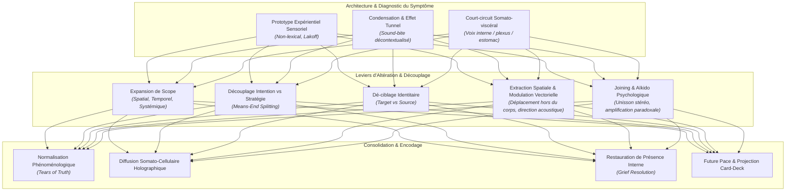

# More Transforming Negative Self-Talk
**Formateur :** Steve Andreas | **ID :** `steve-andreas-more-transforming-negative-self-talk` | **Tranches :** 11

## Synthèse Architecturale du Cours : *More Transforming Negative Self-Talk* (Steve Andreas)

---

### 1. Thèse Centrale & Philosophie du Cours

#### Vision spécifique & Posture face à l'approche standard
L'approche conventionnelle du dialogue interne négatif (TCC standard, PNL simpliste ou développement personnel) traite la voix critique comme un ennemi à faire taire, à réfuter par argumentation rationnelle, ou à remplacer de force par des affirmations positives (« *positive thinking* »). 

La rupture épistémologique opérée par Steve Andreas repose sur deux postulats fondamentaux :
1. **L'Axiome Ericksonien d'Altération Non-Abolitive & d'Utilisation :** On ne supprime, ne combat ni n'éteint jamais une voix interne. La critique interne est une tentative de régulation homéostatique qui s'est figée dans un vecteur dysfonctionnel. L'intervention consiste à s'allier totalement au système (*joining* / aïkido psychologique), à valider inconditionnellement sa finalité conservatrice, et à modifier uniquement sa forme, sa localisation ou son contexte.
2. **La Primauté du Prototype Sensoriel sur le Marécage Lexical :** Une croyance ou une auto-attaque n'est pas une entité abstraite ou textuelle ; c'est un stimulus sensoriel brut (un *prototype* incarné : timbre, localisation spatiale, direction du vecteur acoustique, posture, mimique). Débattre intellectuellement avec la voix revient à s'enliser dans une boucle autoréférentielle stérile. Andreas intervient directement sur l'architecture neuro-somatosensorielle et les sous-modalités physiques pour dissoudre la charge pathogène de façon 100% *content-free*.

#### Fil rouge méthodologique unificateur
Toutes les interventions du cours sont sous-tendues par un mécanisme directeur : **la Désocclusion Contextuelle par Élargissement de Portée et Catégorie (*Scope & Category Expansion*)**. 
Une voix destructive tire son pouvoir toxique d'un effet tunnel perceptif : elle est encodée comme un « extrait sonore » (*sound-bite*) décontextualisé, intemporel et dirigé ontologiquement contre l'identité du sujet (« *C'est la vérité absolue sur moi* »). En restaurant systématiquement le contexte spatial, temporel, relationnel et biographique de l'émetteur (distinction *Cible vs Source*), la phrase cesse d'être une définition de la valeur du sujet pour redevenir le simple symptôme de l'état émotionnel ou des limites de celui qui l'a proférée.

---

### 2. Carte des Concepts & Leviers Émergents

#### Écosystème des Concepts Clés :

* **Le Prototype Expérientiel (vs Piège Lexical) :** Ancrage sur la scène d'origine sensorielle brute plutôt que sur le discours abstrait. Neutralise la rationalisation néocorticale.
* **Désocclusion du Scope (Spatial & Temporel) :** Réintégration du « avant », du « après » et du champ visuel périphérique, détruisant la conclusion figée.
* **Distinction Cible vs Source (*De-targeting*) :** Découplage fondamental prouvant que l'agression verbale reflète la détresse, la peur ou l'impuissance de l'émetteur, et non la nature de la cible.
* **Découplage Intention Positive vs Stratégie d'Acheminement (*Means-End Splitting*) :** Extraction téléologique du but de survie/sécurité, isolant la brutalité du canal d'exécution (*delivery*).
* **Joining Mimétique & Unisson Stéréo (*The Jenna Pattern*) :** Synchronisation motrice des cordes vocales et du larynx pour reprendre le contrôle proprioceptif d'une hallucination/voix intrusive.
* **Extraction Somatotopique & Inversion Vectorielle :** Déplacement de la voix hors des cavités viscérales (rupture de la boucle intéroceptive vagale) et réorientation de la poussée acoustique (du bas vers le haut).
* **Asymétrie Syntaxique (*Sequence Reversal*) :** Réorganisation de l'ordre propositionnel dans les structures concessives (« *Même si...* ») pour déplacer la saillance attentionnelle du déficit vers la ressource.
* **Normalisation Somatique des « Larmes de Vérité » (*Tears of Truth*) :** Recadrage taxinomique des larmes (retrouvailles, soulagement, vérité) ouvrant la réceptivité biologique sans honte.
* **Restauration de Présence (Résolution du Deuil) :** Recodage de la structure sous-modale de l'attachement : passer d'une représentation d'absence/éloignement à une intégration somatique de présence continue.
* **Délégation Radicale de Responsabilité (Résolution Micmac) :** Désarmer la réactance et la polarisation binaire en cédant l'entière autorité opérationnelle à la partie récalcitrante sous contrainte temporelle.

---

### 3. Tableau Récapitulatif des Techniques & Démonstrations

| Technique / Exercice | Objectif Opératoire | Déclencheur / Indication | Séquence Résumée |
|---|---|---|---|
| **Désamorçage par Unisson Stéréo** *(The Jenna Pattern)* | Briser la passivité subie et dissoudre la frontière entre soi et l'intrusion auditive via la motricité laryngée. | Voix intrusive répétitive, obsession auditive, boucle verbale aliénante vécue comme externe et incontrôlable. | 1. Écouter le tempo, la tonalité et les mots exacts. 2. Parler à voix haute à l'unisson parfait (timbre, vitesse, intonation) pour créer un effet « stéréo ». 3. Poursuivre jusqu'à synchronisation motrice complète. 4. Varier subtilement le rythme, le volume ou le ton pour piloter et dissoudre la voix de l'intérieur. |
| **Expansion de Scope & Dé-ciblage** *(Démonstration Lynne - 100% Content-Free)* | Vider un énoncé critique/humiliant de sa charge toxique sans révéler le contenu textuel intime. | Honte intense, traumatisme verbal, culpabilité liée à des jugements parentaux ou d'autorité. | 1. Localiser la voix/scène du prototype sensoriel. 2. Élargir l'espace : voir le visage de l'émetteur, ses yeux, son corps, le lieu global. 3. Élargir le temps : observer ce que l'émetteur vivait avant (stress, limitations, peurs). 4. Constater que le message est un symptôme de l'autre (*De-targeting*). 5. Observer le recul spontané de l'image et l'apaisement kinesthésique. |
| **Extraction Somatotopique & Inversion Vectorielle** | Couper la stimulation viscérale (boule au ventre, oppression thoracique, compulsion compensatoire). | Voix logée dans la poitrine, l'estomac ou la gorge, poussant physiquement « vers le bas ». | 1. Cartographier l'emplacement anatomique et le vecteur de déplacement acoustique. 2. Extraire la voix du corps et la positionner à l'extérieur (dans l'espace péripersonnel). 3. Inverser la trajectoire : orienter le son du bas vers le haut. 4. Constater l'allègement kinesthésique immédiat et la rupture de l'effet d'écrasement. |
| **Amplification Caricaturale & Polarité Inverse** *(Aïkido / Provocative Therapy)* | Court-circuiter l'autorité menaçante de la voix par la saturation absurde et le rire de décharge. | Voix dogmatique, moralisatrice, absolutiste ou perfectionniste rigide. | 1. Isoler le reproche central. 2. Rejoindre la voix en surenchérissant de façon outrancière et grotesque dans son propre sens. 3. Accélérer le débit, amplifier les conséquences jusqu'à l'absurde biologique. 4. Observer le basculement réflexe en polarité inverse (rejet du diktat par le sujet lui-même). |
| **Délégation Radicale de Responsabilité** *(Modélisation Micmac)* | Dénouer une polarisation binaire interne ou collective où une partie bloque tout le système. | Sabotage persistant, résistance passive, opposition virulente d'une partie interne face à un projet de changement. | 1. Interrompre la lutte et les tentatives de passage en force. 2. Valider formellement la partie contestataire comme garante de l'écologie. 3. Lui transférer 100% de la responsabilité opérationnelle pour une durée définie (« *Tu es aux commandes, trouve la solution* »). 4. Laisser la saturation de responsabilité désamorcer la réactance et forcer la négociation coopérative. |
| **Recadrage Syntaxique par Inversion de Séquence** | Rétablir la saillance attentionnelle sur les victoires, compétences ou ressources atténuées par la dépression/l'anxiété. | Phrases automatiques bloquantes en « *Même si [Positif/Effacé], [Négatif/Amplifié]* ». | 1. Identifier l'équation linguistique du sujet. 2. Inverser mécaniquement les propositions : « *Même si [Négatif], [Positif]* » ou lier par « *Et* ». 3. Calibrer l'impact kinesthésique et la réorientation de la focalisation cérébrale. |
| **Restauration de Présence & Deuil Somatique** *(Grief Resolution Model)* | Transformer un manque pathologique déchirant en une sécurité d'attachement interne durable. | Deuil persistant, sensation de vide viscéral, incapacité à se détacher d'un défunt ou d'un lien passé. | 1. Calibrer la sous-modalité d'absence (image lointaine, inaccessible, souvenir de fin). 2. Récupérer les projections affectives : reconnaître que l'amour ressenti est une capacité neuro-somatique du sujet. 3. Ramener la présence sensorielle complète (voix chaude, contact, regard) au contact direct. 4. Internaliser la présence dans le corps (cœur/ventre) par ancrage somatique cellulaire holographique. |
| **Diffusion Somato-Cellulaire & Projection Card-Deck** | Stabiliser un état ressource dans toute la structure corporelle et l'automatiser sur le futur. | Risque de retombée après une prise de conscience ou fragilité de la consolidation mnésique. | 1. Ancrer l'état ressource ressenti. 2. Guider sa diffusion somatique holographique « jusqu'au bout des doigts et des orteils, dans chaque cellule ». 3. Condenser la ressource sous forme de symbole/lumière sur une carte mentale. 4. Déployer un jeu complet de ces cartes le long de la ligne du temps future pour saturer les contextes à venir. |

---

---

## 0. Sommaire Sémantique & Index des Lignes

- **Tranche 1 [Lignes 102-202]** : A : La Délégation Totale de Responsabilité (Modélisation de la Résolution Micmac) — *Protocole :* A : La Délégation Totale de Responsabilité (Modélisation de la Résolution Micmac)
- **Tranche 2 [Lignes 204-382]** : Désamorçage de Boucle Auditive Intrusive par Unisson Stéréo (The Jenna Pattern) — *Protocole :* Désamorçage de Boucle Auditive Intrusive par Unisson Stéréo (The Jenna Pattern) | *Mécanisme :* Synchronisation par imitation motrice et réappropriation somatosensorielle | *Verbatim :* La double dissociation attentionnelle et le double lien permissif
- **Tranche 3 [Lignes 384-556]** : A : Restauration et Récupération d'Information (Retrieving Information Process) — *Protocole :* A : Restauration et Récupération d'Information (Retrieving Information Process) | *Verbatim :* Fragmentation instantanée du quantificateur universel
- **Tranche 4 [Lignes 558-747]** : Recadrage de Voix Interne par Expansion de Scope (Démonstration Lynne - 100% Content-Free) — *Protocole :* Recadrage de Voix Interne par Expansion de Scope (Démonstration Lynne - 100% Content-Free) | *Mécanisme :* Recadrage de Contexte par Expansion de Scope (Spatial, Temporel et Systémique) | *Verbatim :* Recadrage Définitionnel des Pleurs & Suggestion d'Unification
- **Tranche 5 [Lignes 749-919]** : Réorganisation Spatiale & Vectorielle d'une Voix Toxique — *Protocole :* Réorganisation Spatiale & Vectorielle d'une Voix Toxique | *Mécanisme :* Le prototype expérientiel contre le piège linguistique | *Verbatim :* La présupposition de choix et d'agentivité
- **Tranche 6 [Lignes 921-1092]** : Résolution de Deuil / Perte Émotionnelle (Steve Andreas Grief Pattern) — *Protocole :* Résolution de Deuil / Perte Émotionnelle (Steve Andreas Grief Pattern) | *Mécanisme :* Internalisation Somatique Sélective (Critique Externe vs Soutien Interne) | *Verbatim :* Reformulation en Résonance Non-Verbale
- **Tranche 7 [Lignes 1094-1247]** : A : La Voix de l'Ami de Confiance (Transformation de Tonalité par Remplacement Global) — *Protocole :* A : La Voix de l'Ami de Confiance (Transformation de Tonalité par Remplacement Global) | *Mécanisme :* Les Trois Piliers de l'Intention Positive | *Verbatim :* Le Double Cadrage du Choix Ajouté
- **Tranche 8 [Lignes 1249-1435]** : A : Transformation d'un Modèle Critique en Coach Spécialisé & Substitution Vocale de Confian... — *Protocole :* A : Transformation d'un Modèle Critique en Coach Spécialisé & Substitution Vocale de Confiance (Démonstration Steve Andreas avec Ray)
- **Tranche 9 [Lignes 1437-1566]** : Découverte et Ajustement de la Frontière Personnelle (Boundary Discovery & Experimentation) — *Protocole :* Découverte et Ajustement de la Frontière Personnelle (Boundary Discovery & Experimentation) | *Mécanisme :* La Frontière Somatosensorielle / Spatiale comme Filtre Réactif Pré-Cognitif | *Verbatim :* La Désensibilisation Hypnotique par Écran Acoustique
- **Tranche 10 [Lignes 1568-1670]** : A : Contre-Conditionnement Musical du Noyau Critique ("The Earworm Hack") — *Protocole :* A : Contre-Conditionnement Musical du Noyau Critique ("The Earworm Hack") | *Mécanisme :* La Signature Somato-Motrice de l'Incongruence vs Congruence | *Verbatim :* s Verbatim
- **Tranche 11 [Lignes 1672-1832]** : maître : "Transforming a Troublesome Inner Voice" (21 Étapes Intégrales) — *Protocole :* maître : "Transforming a Troublesome Inner Voice" (21 Étapes Intégrales) | *Mécanisme :* Langage injonctif vs Langage descriptif (Génération d'expérience) | *Verbatim :* L'offre de choix asymétrique (Levier d'acceptation sans résistance)

---

## Extractions Détaillées par Tranche (Opératoire & Verbatim)

## Tranche 1 / 11 : A : La Délégation Totale de Responsabilité (Modélisation de la Résolution Micmac)

### 1. Mécanismes & Principes Actifs

- **Principe d'Altération Non-Abolitive (L'axiome d'Erickson) :**
  Tenter d'éradiquer, de faire taire ou de supprimer une voix interne (*"monkey mind"*, part aliénée, boucle auditive) déclenche une réactivité homéostatique du système nerveux et du psychisme. Le processus d'opposition active l'attention sélective sur le stimulus à éviter, renforçant la boucle neurologique. L'intervention efficiente repose sur l'altération (*altering*) des paramètres structurels ou de la relation fonctionnelle avec le signal, jamais sur son abolition (*abolishing*).
  *Tags libres émergents :* #alteration_vs_abolition #utilisation_ericksonienne #homeostasie_psychique #anti_suppression

- **Isomorphisme Relationnel Interne/Externe (L'Écho Holographique) :**
  Une voix interne pénible n'est pas une entité générée ex nihilo : c'est un écho comprimé (*sound bite*) d'une interaction passée avec une personne réelle de l'histoire du sujet. Elle se comporte exactement comme un interlocuteur humain externe : si on l'attaque, l'ignore ou cherche à la bâillonner, elle intensifie sa force de frappe, réattaque ou développe des stratégies de contournement pernicieuses. Si on s'y allie, elle baisse les armes.
  *Tags libres émergents :* #echo_relationnel_internalise #sound_bite_mnesique #isomorphisme_social_neurologique

- **Désocclusion du Contexte et Rupture de la Conclusion Figée :**
  Le dialogue interne destructeur se réduit le plus souvent à une conclusion abstraite séparée de son contexte source d'origine spatio-temporel (*who, where, when, what, how*). Privé de son ancrage sensoriel élargi, l'énoncé s'érige en vérité absolue. Rétablir la matrice contextuelle complète dégonfle le caractère omnipotent de la conclusion et restaure la multiplicité des interprétations possibles.
  *Tags libres émergents :* #desocclusion_contextuelle #recuperation_d_informations #defigeage_de_conclusion #matrice_spatio_temporelle

- **Aïkido Psychologique : L'Alliance Totale avec la Force Adverse :**
  En refusant le rapport de force frontal et en rejoignant la trajectoire de l'attaque, deux bascules systémiques s'opèrent instantanément :
  1. Le praticien / le sujet cesse d'être la cible de l'impact.
  2. Le sujet se retrouve en position géométrique et dynamique de rediriger en douceur l'élan de la force sans friction.
  *Tags libres émergents :* #aikido_psychologique #joining #desengagement_de_cible #redirection_de_vecteur

- **Délégation Radicale de Responsabilité (Le Levier Micmac) :**
  Lorsqu'une partie (interne ou externe) est isolée dans une position d'opposition forcenée, la tentative de la minorer ou de la contraindre accroît sa réactance. Lui transférer intégralement la responsabilité de la décision collective désactive instantanément son mode défensif. La partie dissidente, n'ayant plus à lutter pour exister, réintègre spontanément les contraintes de l'ensemble du système.
  *Tags libres émergents :* #delegation_radicale #desactivation_de_reactance #resolution_systemique_paradoxale

- **Séparation Intention Positive vs Comportement / Forme :**
  Toute vocalisation, même hostile ou anxiogène en surface, est propulsée par une intention adaptative sous-jacente (amour, protection, évitement du danger). Identifier l'intention positive fournit le point d'appui (*fulcrum*) permettant de préserver le but tout en négociant une métamorphose complète de la forme (tonalité, tempo, timing).
  *Tags libres émergents :* #intention_positive #point_d_appui_levier #dissociation_fond_forme

- **Levée du Piège de l'Effort Conscient Volontaire (La boucle de Flemons) :**
  L'effort volontaire et focalisé de l'hémisphère gauche ("vouloir s'endormir", "vouloir arrêter le bavardage mental") produit exactement l'état de vigilance corticale opposé à la régulation autonome. L'invitation à produire délibérément le symptôme le ramène dans le champ de la collaboration, préparant sa dissociation et sa réutilisation.
  *Tags libres émergents :* #piege_de_l_effort_volontaire #intention_paradoxale #recrutement_du_symptome

---

### 2. Protocoles, Techniques & Démonstrations (Étape par Étape)

#### Protocole A : La Délégation Totale de Responsabilité (Modélisation de la Résolution Micmac)
* **Intention / Indication :** Blocage systémique où une partie (interne ou individu) s'oppose avec virulence au reste du système, polarisant le conflit en binaire (Conserver vs Détruire, Avancer vs Bloquer).
* **Mise en place & Pré-framing :** Interrompre la tentative de vote ou de passage en force de la majorité. Poser un cadre temporel court et obtenir l'accord unanime du groupe/système à s'engager dans une résolution non conventionnelle.
* **Séquence d'actions pas à pas :**
  * *Étape 1 : Calibrer et valider l'accord d'ouverture.* Demander confirmation que chacun souhaite une solution immédiate.
  * *Étape 2 : Pré-cadrer le respect de l'opposant.* Déclarer explicitement le refus de marginaliser la partie isolée par la contrainte du nombre.
  * *Étape 3 : Le transfert de souveraineté.* Céder 100% de la responsabilité décisionnelle à la partie isolée : *"C'est toi qui décides pour nous tous."*
  * *Étape 4 : Laisser opérer la bascule neuro-émotionnelle.* Maintenir le silence et l'espace sans intervenir pendant la traversée de la surprise et du triomphe éphémère.
  * *Étape 5 : Récolter la proposition intégratrice.* La partie dissidente formule d'elle-même une solution englobant les besoins de l'ensemble.
* **Signes de calibration :**
  - Choc initial (yeux écarquillés, mâchoires relâchées).
  - Éclair fugace de pouvoir/triomphe chez l'opposant.
  - Fluctuations rapides des micro-expressions faciales traduisant le basculement interne de la défense vers la responsabilité.
  - Détente globale de la musculature corporelle et disparition de l'intonation accusatrice/combative dans la voix.

#### Protocole B : Induction de Découplage Front/Back pour Boucle Auditive Obsédante (Démonstration Flemons)
* **Intention / Indication :** Insomnie psychophysiologique, ruminations auditives en boucle courte (morceau de musique, phrase obsédante de procès/dispute) alimentées par une lutte acharnée pour les stopper.
* **Mise en place & Pré-framing :** Cesser toute lutte d'inhibition. Recruter activement le symptôme en demandant au sujet de générer délibérément la boucle auditive en séance.
* **Séquence d'actions pas à pas :**
  * *Étape 1 : Provocation délibérée du pattern.* Demander au sujet de lancer la boucle auditive ici et maintenant jusqu'à plein régime.
  * *Étape 2 : Ratification sensorielle.* Vérifier que la boucle tourne à son intensité et vitesse habituelles.
  * *Étape 3 : Fractionnement spatial de l'attention.* Proposer une dissociation entre le devant et l'arrière de l'esprit (*front of your mind* / *back of your mind*).
  * *Étape 4 : Double liaison permissive d'écoute.* Suggérer indifféremment que la boucle soit suivie en arrière-plan pendant que la voix du praticien est au premier plan, ou l'inverse, incluant même l'alternance spontanée des deux.
* **Signes de calibration :**
  - Fixation du regard et absorption interne lors du lancement volontaire de la boucle.
  - Déglutition réflexe, ralentissement du rythme respiratoire dès l'installation de la permissivité front/back.
  - Diminution des micro-tensions au niveau des trapèzes et du front (abandon de l'effort dirigé).

---

### 3. Heuristiques, Subtilités & "Sagesse du Praticien"

- **L'Axiome Fondamental d'Erickson :**
  *Règle :* Ne cherche jamais à faire taire, détruire ou extirper une voix ou un symptôme. Tout comportement indésirable contient une ressource ou un signal vital. Ton travail consiste exclusivement à altérer la forme, le canal, la localisation ou la dynamique relationnelle, jamais à éradiquer.

- **Heuristique de Contenu vs Structure (L'Approche aveugle au contenu) :**
  *Si le sujet travaille sur un dialogue interne intime ou toxique -> Ne demande JAMAIS les mots exacts prononcés par la voix.*
  *Pourquoi :*
  1. Préserve l'intimité totale du sujet et supprime tout risque de honte ou de gêne sociale.
  2. Démontre de façon flagrante que l'efficacité du changement repose sur la structure processuelle (spatialisation, tonalité, intention, contexte) et non sur le contenu verbal.
  3. Empêche le praticien et l'audience d'être happés par l'histoire narrative ou de commencer à analyser intellectuellement le texte de la voix.

- **Heuristique du Double Canal (Prosodie vs Sémantique) :**
  *Si les mots de la voix semblent accusateurs ou destructeurs -> Porte ton attention exclusive sur les sous-modalités acoustiques (timbre, souffle, chevrotement, tension).*
  *Pourquoi :* Les mots sont souvent une défense maladroite ou une conclusion figée. L'écoute du grain de la voix révèle la terreur, l'impuissance ou la tentative d'amour sous-jacente (ex: la mère agressive qui est en réalité terrifiée pour la sécurité de son enfant).

- **Le Piège du Contre-Attaque (Back-Talk Trap) :**
  *Erreur de débutant :* Argumenter, insulter ou répliquer rationnellement à une voix critique interne.
  *Conséquence :* Alimenter le clivage interne, intensifier l'énergie de l'écho mnémonique et renforcer le circuit conflictuel.
  *Correction :* Rejoindre (*joining*), valider l'intention d'aide et clarifier la structure d'information manquante.

---

### 4. Pépites Verbatim & Patterns Linguistiques (MOT À MOT EN V.O.)

> "Your task is that of altering, not abolishing."
- **[Analyse du Pattern]** : Présupposition d'action réductrice et contraste exclusif. La structure grammaticale exclut catégoriquement l'option de l'éradication (*abolishing*) pour focaliser l'ensemble de la charge opératoire sur la transformation adaptative (*altering*). C'est un réalignement ontologique immédiat du rôle du praticien.

> "In my Native American tradition, when we have a group which is all on one side, and we have one person who is on another side, we would never have a vote to overrule him, because it’s obvious that the majority will win, making him isolated. We would never do that to someone. The solution is we’re going to turn over the responsibility for the decision to you—the one who’s the isolated person. We’re going to let you decide for all of us."
- **[Analyse du Pattern]** : Recadrage culturel d'autorité bienveillante associé à un double lien libérateur. L'orateur commence par normaliser la posture d'isolement en l'élevant au rang de valeur éthique absolue (*"We would never do that to someone"*), détruisant l'effet de meute. Ensuite, l'attribution unilatérale du pouvoir (*"We’re going to let you decide for all of us"*) opère une rupture totale de pattern : l'opposant ne peut plus se battre contre un ennemi qui s'est entièrement soumis à son arbitrage. La contrainte d'appartenance collective est réinjectée de force dans l'esprit de l'opposant par la responsabilité même qui lui est conférée.

> "While that loop continues, repeating over and over, you can listen to it with the back of your mind, and to me with the front of your mind. Or you can follow the loop with the front of your mind, while the back of your mind monitors where I’m headed. It doesn’t really matter. You might even find them switching back and forth."
- **[Analyse du Pattern]** : Double lien d'illusion de choix avec saupoudrage dissociatif et dissociation spatiale de l'appareil perceptif (*front of your mind* vs *back of your mind*). L'injonction démarre par la ratification sensorielle continue du problème sans chercher à l'arrêter (*"While that loop continues"*). Ensuite, les deux branches de l'alternative distribuent les rôles de façon réversible : que la voix soit devant ou derrière, l'attention au thérapeute est inévitablement installée. La clause d'indifférence (*"It doesn’t really matter"*) court-circuite la résistance de l'effort conscient, et la suggestion ouverte finale (*"switching back and forth"*) prépare la labilité hypnotique et l'effondrement spontané de la boucle rigide.

## Tranche 2 / 11 : Désamorçage de Boucle Auditive Intrusive par Unisson Stéréo (The Jenna Pattern)

Voici l’analyse modélisatrice intégrale, opératoire et chirurgicale de la tranche 2/11 du cours *More Transforming Negative Self-Talk* de Steve Andreas.

---

### 1. Mécanismes & Principes Actifs

#### A. Synchronisation par imitation motrice et réappropriation somatosensorielle
- **Terme de Steve Andreas** : *Joining with a voice* / *Pulling a Jenna* / *Stereo experience*
- **Tags libres** : `#joining_mimetique` `#reappropriation_motrice` `#dissolution_frontiere_symptome` `#micro_mouvements_larynges` `#boucle_phonologique`
- **Principe actif & neurophysiologie** :
  Toute pensée verbale interne (dialogue intérieur) n'est pas une entité désincarnée mais le produit de micro-contractions musculaires réelles au niveau du larynx, de la gorge, des cordes vocales, de la langue, du pharynx et des dynamiques respiratoires associées (mouvements implicites/subvocaux). Le dialogue pathologique ou intrusif (boucle auditive) est vécu comme "étranger", "involontaire" ou "autonome" parce que le sujet a dissocié l'intention consciente de la commande motrice sous-jacente.
  En demandant au sujet de dupliquer volontairement, à l'identique (hauteur, volume, timbre, vitesse, micro-inflexions), la voix automatique (d'abord en unisson décalé d'une fraction de seconde, puis en synchronie parfaite) :
  1. Le système nerveux réactive les mêmes voies neuromusculaires volontaires qui génèrent la production subvocale.
  2. La frontière perceptuelle entre l'intention consciente (*deliberate loop*) et le symptôme involontaire (*automatic loop*) s'effondre par indistinction sensorielle (effet chorale / stéréo).
  3. L'autonomie du symptôme disparaît : dès lors que le sujet contrôle la voix répliquée, le réflexe involontaire est réabsorbé dans l'arc moteur volontaire. Le fait d'arrêter la production motrice délibérée éteint spontanément la boucle automatique.

#### B. Dépolarisation par amplification paradoxale et surcharge caricaturale
- **Terme de Steve Andreas** : *Exaggeration* / *Provocative Therapy joining* / *Opposite-polarity response*
- **Tags libres** : `#exageration_caricaturale` `#reponse_en_polarite_inverse` `#surcharge_absurde` `#defusion_cognitive_prosodique`
- **Principe actif** :
  Lorsqu'une voix critique interne assène un reproche, la posture instinctive du sujet consiste à lutter, nier ou capituler. Cela maintient la boucle active par friction homéostatique. L'exagération paradoxale consiste à surenchérir drastiquement :
  1. *Au niveau du contenu* : pousser l'affirmation jusqu'à l'extrême absolu et catastrophique ("Non seulement j'ai raté ça, mais j'ai bousillé ma vie entière !").
  2. *Au niveau des sous-modalités analogiques* : gonfler le volume, injecter une autorité théâtrale, un dégoût caricatural, ou une voix d'enfant tyrannique et capricieuse.
  Cette amplification rompt l'homéostasie du problème. Dès que le signal dépasse le seuil de crédibilité du système nerveux, l'inconscient déclenche une réaction en polarité opposée (*opposite-polarity response* : "Bon, ce n'est pas si grave que ça en réalité"). L'affect passe du sentiment d'impuissance/terreur au ridicule ou au rire, déchargeant instantanément la charge émotionnelle associée au dialogue interne.

#### C. Récupération indiciale et démantèlement de la condensation cognitive
- **Terme de Steve Andreas** : *Retrieving Missing Information* / *Facts vs. Conclusions* / *Expanding Attention*
- **Tags libres** : `#recuperation_indiciale` `#demantelement_generalisation` `#reintegration_contextuelle` `#recalibrage_nonverbal_spontane`
- **Principe actif** :
  Une voix critique interne ne livre presque jamais un fait ; elle assène une **conclusion tronquée**, issue de suppressions massives (*omissions*) d'informations contextuelles réelles. Par condensation, le mot "nul" ou "stupide" efface l'heure, le lieu, la fatigue, les circonstances, l'identité réelle de l'émetteur original, son état interne et son intention bienveillante/protectrice masquée.
  En réinterrogeant systématiquement les dimensions indexicales (Qui, Où, Quand, Quoi, Comment) :
  1. Le système cognitif est forcé de quitter la transe linguistique décontextualisée pour réactiver la mémoire épisodique sensorielle complète (modalités V-A-K).
  2. L'accès à l'image visuelle du visage de l'émetteur réintroduit instantanément le décodage micro-expressif non verbal (lignes d'inquiétude, regard fuyant, air penaud), ce qui métamorphose la signification perçue du message sans nécessiter d'interprétation verbale intellectuelle.
  3. L'exclusion délibérée du "Pourquoi" empêche le patient de tourner en rond dans les justifications abstraites et le force à rester dans le pur processus phénoménologique.

---

### 2. Protocoles, Techniques & Démonstrations (Étape par Étape)

#### Protocole 1 : Désamorçage de Boucle Auditive Intrusive par Unisson Stéréo (*The Jenna Pattern*)

* **Intention / Indication** :
  Insomnie causée par un dialogue interne persistant, refrain obsessionnel, lambeaux de conversations ou de plaidoiries tournant en boucle (5 à 10 secondes) que le sujet s'épuise à vouloir arrêter par la volonté brute.
* **Mise en place & Pré-framing** :
  Expliquer au patient que l'effort volontaire direct d'éradication renforce la boucle en créant une guerre interne. Proposer de démarrer délibérément la boucle ici et maintenant. Utiliser une métaphore d'induction (ex: l'enfant qui imite son parent en écho décalé puis simultané, ou la chorale où la frontière individuelle se dissout).
* **Séquence d'actions pas à pas** :
  1. **Activation volontaire du symptôme** : Demander au sujet de lancer la boucle auditive intrusive au ralenti ou à pleine puissance dans son bureau.
  2. **Double dissociation attentionnelle** : Structurer l'écoute : écouter la boucle avec l'arrière de l'esprit (*back of your mind*) et la voix du praticien avec l'avant de l'esprit (*front of your mind*), ou inversement.
  3. **Imitation décalée puis simultanée (*Shadowing*)** : Inviter l'avant de l'esprit à imiter mot à mot, son pour son, la boucle de l'arrière de l'esprit. Commencer par une fraction de seconde de retard, puis synchroniser au millimètre.
  4. **Calibrage des sous-modalités analogiques** : Assortir scrupuleusement la vitesse, l'articulation, l'accent, le volume et le timbre de la voix.
  5. **Création de l'effet Stéréo** : Laisser les deux boucles (l'automatique et la délibérée) tourner ensemble en fusion sonore complète.
  6. **Indistinction de l'origine** : Suggérer la confusion : impossible désormais de savoir si c'est la boucle volontaire qui suit l'automatique ou si l'automatique s'est calée sur la délibérée.
  7. **Extinction progressive** : Laisser l'ensemble ralentir ou s'estomper jusqu'au silence complet.
* **Signes de calibration** :
  - Déglutition réflexe, relâchement des muscles péri-laryngés et de la mâchoire (indiquant l'arrêt des micro-mouvements subvocaux compulsifs).
  - Ralentissement et approfondissement du rythme respiratoire.
  - Décoloration des tensions faciales, accès au sourire ou relâchement des paupières signifiant la fin de la lutte cognitive.

---

#### Protocole 2 : Neutralisation par Exagération des Présuppositions Sous-Jacentes

* **Intention / Indication** :
  Réactions automatiques de frustration, de rage, d'impatience ou de dévalorisation ("Fait chier !", "Espèce d'abruti !") face à un événement contrariant.
* **Mise en place & Pré-framing** :
  Identifier que l'émotion négative ne provient pas de l'événement lui-même, mais de la croyance implicite et arrogante que la réalité devrait se plier instantanément à nos désirs ("Le monde me doit satisfaction").
* **Séquence d'actions pas à pas** :
  1. **Repérage du dialogue spontané** : Isoler la petite phrase d'irritation ou de blâme intérieur.
  2. **Extraction de la présupposition implicite** : Identifier la revendication infantile sous-jacente ("J'exige satisfaction immédiate parce que j'existe/j'ai travaillé dur/je suis important").
  3. **Amplification caricaturale délibérée** : Prononcer intérieurement l'exagération de cette prétention avec une voix ultra-rapide, impérieuse, geignarde, péremptoire et théâtrale :
     > *"I want what I want, when I want it—NOW!"*
  4. **Répétition amplifiée** : Si la dépolarisation ne s'opère pas immédiatement, répéter 2 à 3 fois en rendant la voix encore plus stridente, immature et grotesque.
* **Signes de calibration** :
  - Sourire spontané, rire intérieur ou souffle d'amusement face au ridicule de l'attitude.
  - Élargissement instantané de la perspective cognitive (décentrage).

---

#### Protocole 3 : Restauration d'Index d'Information (Qui, Où, Quand, Quoi, Comment)

* **Intention / Indication** :
  Voix interne disqualifiante ou prédictive assénant des jugements globaux ("Tu es nul", "Tu vas encore te planter", "Tu es insensible").
* **Mise en place & Pré-framing** :
  Traiter la voix non pas comme un ennemi à abattre, mais comme un ami maladroit en communication. Poser le cadre : si la voix est agressive ou refuse de parler suite à des années de rejet, lui présenter des excuses sincères pour l'avoir ignorée (*Apologizing*). Avertir le sujet : **ne pas répondre verbalement ou intellectuellement aux questions**, mais laisser remonter l'expérience sensorielle brute.
* **Séquence d'actions pas à pas** :
  1. **Excuses & Alliance (si blocage)** :
     - Dire à la voix : "Je viens seulement d'apprendre qu'on pouvait se parler directement. Pardonne mes bêtises passées, je suis à ton écoute."
  2. **Élicitation du "QUI" (Identité & Source analogique)** :
     - Écouter le timbre, le tempo, la tonalité. Est-ce la voix du sujet ou celle de quelqu'un d'autre ?
     - Si c'est celle de quelqu'un d'autre : Récupérer son historique, son âge, ses peurs, ses motifs, ses failles.
     - Si c'est la voix du sujet : Demander : *"Auprès de qui ai-je appris cette conclusion ?"* ou en cas de doute : *"Si je le savais, qui cela serait ?"*
  3. **Réintégration de l'Image Visuelle** :
     - Superposer au son l'image visuelle du visage de la personne en train de prononcer ces mots.
     - Calibrer sa posture, l'inclinaison de sa tête, les rides d'inquiétude sur son front, son expression faciale réelle (compassion cachée, air penaud, panique personnelle).
  4. **Réintégration du "OÙ" (Contexte spatial)** :
     - Élargir le champ attentionnel : Où cela s'est-il produit ? (ex: en public, à la sortie de l'église, dans un contexte social spécifique dictant les réactions).
  5. **Réintégration du "QUAND" (Ligne du temps & Temporalité)** :
     - Transformer l'image fixe du souvenir en film animé incluant l'avant et l'après.
     - Quel passif la personne venait-elle de vivre ? (ex: traumatisme passé, deuil, licenciement récent).
  6. **Réintégration du "QUOI" (Circonstances objectives)** :
     - Qu'est-ce qui se déroulait d'autre au même moment ? La réaction de l'autre était-elle réellement dirigée contre le sujet ou était-elle l'expression de sa propre impuissance ?
  7. **Réintégration du "COMMENT" (Modalités d'action)** :
     - Comment le sujet et les protagonistes se comportaient-ils précisément à cet instant ?
* **Signes de calibration** :
  - Expression de surprise ou d'étonnement sincère (*"Oh, en fait il avait peur pour moi..."* / *"Elle venait de perdre son travail..."*).
  - Modification spontanée de l'affect sans aucun effort de recadrage discursif artificiel.

---

### 3. Heuristiques, Subtilités & "Sagesse du Praticien"

#### Règles conditionnelles ("Si -> Alors") :
1. **Si** le sujet tente de lutter par la force de sa volonté contre une boucle auditive obsessionnelle, **alors** la boucle redouble d'intensité et d'autonomie, **parce que** l'effort conscient crispe le système et alimente la boucle musculaire subvocale involontaire.
2. **Si** une voix critique interne refuse de répondre ou rétorque violemment (*"Screw you!"*), **alors** s'excuser sincèrement auprès d'elle pour l'avoir ignorée ou combattue pendant des années, **parce que** le manque d'écoute historique crée une rancœur de la partie dissociée qui bloque toute négociation.
3. **Si** le sujet ne sait pas consciemment à qui appartient la voix critique interne, **alors** poser la question présupposante : *"Si tu le savais, qui cela serait ?"*, **parce que** la première réponse qui émerge de l'inconscient partagera exactement les mêmes attributs structurels et fonctionnels que la source réelle, permettant un travail tout aussi efficace.
4. **Si** le praticien ou le sujet est tenté de demander *"Pourquoi ?"* à la voix critique, **alors** s'abstenir formellement et basculer sur *Qui / Où / Quand / Quoi / Comment*, **parce que** le "Pourquoi" réactive les justifications intellectuelles et ramène le sujet dans la conclusion erronée de départ, alors que les questions d'indexicalité activent la mémoire sensorielle épisodique.
5. **Si** le sujet tente de répondre verbalement aux questions de récupération d'information, **alors** interrompre et lui demander d'observer silencieusement l'expérience interne émergente, **parce que** la verbalisation analytique détourne l'attention de l'accès sensoriel non verbal qui transforme le sens.

#### Pièges classiques & Erreurs de débutant :
- **Confondre un fait et une conclusion** : Traiter l'affirmation *"Tu es stupide"* comme une donnée réelle alors qu'il s'agit d'un jugement abstrait fondé sur un événement unique et surcontextualisé (ex: avoir manqué de temps pour réviser un examen un jour de grippe).
- **Vouloir éliminer ou faire taire la voix** : Créer un schisme interne et un combat permanent au lieu d'intégrer la voix comme une entité communicative maladroite.
- **Interpréter le contenu à la place du client** : Vouloir lui expliquer intellectuellement pourquoi ses parents lui parlaient ainsi, au lieu de lui faire simplement visualiser le visage et la posture de l'émetteur pour que la compréhension émerge de manière autonome.

#### Postulats philosophiques propres à Steve Andreas :
- *Toute pensée requiert un mouvement musculaire* : la cognition est intrinsèquement incarnée (*embodied cognition*). Travailler sur une sous-modalité auditive ou visuelle implique de travailler sur la commande nerveuse motrice.
- *Le malentendu est le carburant du conflit* : qu'il soit externe (interpersonnel) ou interne (dialogue avec soi-même), le conflit ne survit que par omission d'informations.
- *L'intervention de pur processus prime sur le contenu* : donner des directives spatiales, visuelles ou temporelles neutres sans injecter de contenu permet au client de générer des insights inébranlables car issus de son propre système nerveux.

---

### 4. Pépites Verbatim & Patterns Linguistiques (MOT À MOT EN V.O.)

#### Pépite 1 : La double dissociation attentionnelle et le double lien permissif
> “While that loop continues, repeating over and over, you can listen to it with the back of your mind, and to me with the front of your mind. Or you can follow the loop with the front of your mind, while the back of your mind monitors where I’m headed. It doesn’t really matter. You might even find them switching back and forth.”

* **[Analyse du Pattern]** :
  Utilisation magistrale d'un double lien ericksonien basé sur la répartition spatiale de l'attention (*front/back of the mind*). Quelle que soit l'option choisie par le sujet (suivre la voix ou suivre le thérapeute), le résultat est identique : le sujet accepte la présence de la boucle au lieu de lutter contre elle, tout en maintenant un ancrage sur la voix du thérapeute. L'expression *"It doesn't really matter"* détruit l'enjeu anxieux et la suggestion ouverte finale (*"switching back and forth"*) induit une fluidité attentionnelle typique de la transe légère.

---

#### Pépite 2 : La métaphore isomorphique de la synchronie et dissolution de la frontière
> “As I said, ‘I hope you have a good day at school, Sweetheart,’ she looked intently at my mouth and managed to form each of the consonants and vowels of the words just a fraction of a second behind my articulating them. I found myself slowing way down as she spoke almost in unison with me, and at the end of the sentence we both burst out laughing. A funny thing happens when you have two or more people voicing the same thing at the same time. If you’re in a choir, holding a certain note, and everyone around you is singing the same note, then the boundary separating you and them dissolves, and your experience of yourself melts a little. You and the other singers blend together.”

* **[Analyse du Pattern]** :
  Métaphore imbriquée préparatoire (isomorphisme direct du protocole). Steve Andreas introduit subrepticement l'idée que reproduire les mouvements de la bouche d'une fraction de seconde derrière l'émetteur mène spontanément au ralentissement et au rire. Il enchaîne immédiatement sur une généralisation truistique (*"A funny thing happens..."*) appuyée sur l'analogie de la chorale, implantant la commande inconsciente de dissolution des frontières de l'ego (*"the boundary separating you and them dissolves"*, *"melts a little"*), préparant le système nerveux à ne plus percevoir la boucle comme un agresseur extérieur.

---

#### Pépite 3 : La suggestion de fusion stéréo et l'effacement de la causalité
> “I wonder what would happen if the front of your mind were to ‘pull a Jenna’ and start imitating, in unison, that back-of-your-mind loop? Instead of trying to stop it, it could create an exact replica, so you’d have two loops going, the automatic one that you can’t get to stop, and a deliberate one, giving you a stereo experience. Go ahead and try that, and let’s see what happens. Match the voice or voices in speed, articulation, accent, volume, and tone. When both are in unison, you may not be able to tell if the deliberate loop in the front of your mind is following the automatic one in the back of your mind, or if the automatic one has synced up with the deliberate one. Both can move together, in unison, around and around, giving you that stereo experience.”

* **[Analyse du Pattern]** :
  Formulation adoucie sous forme de fausse question (*"I wonder what would happen if..."*) qui contourne toute résistance consciente. Recadrage paradoxal : l'incapacité d'arrêter la boucle devient la matière première d'une expérience sensorielle enrichie (*"stereo experience"*). Utilisation d'une boucle de rétroaction linguistique circulaire : en suggérant l'impossibilité de distinguer qui mène la danse (*"you may not be able to tell if..."*), le thérapeute dissout la distinction entre acte involontaire et acte délibéré, conférant subrepticement au sujet le contrôle total de la fonction motrice.

---

#### Pépite 4 : L'exagération de la revendication infantile immédiate
> “I want what I want, when I want it—NOW!”

* **[Analyse du Pattern]** :
  Pattern d'exagération provocatrice pure. Condensation de la présupposition implicite d'égocentrisme ou de toute-puissance infantile qui sous-tend la colère d'adulte. En l'énonçant sur un tempo ultra-rapide et un ton geignard ou théâtralement impérieux, ce truisme émotionnel se heurte à la rationalité consciente de l'adulte, provoquant un décrochage immédiat du cadre sérieux du problème par déclenchement d'un rire dépolarisant.

---

#### Pépite 5 : La réintroduction de l'alliance par l'excuse sincère
> “You can explain that you have only just learned that it is possible to communicate directly with it, and ask it to please forgive your past stupidities.”

* **[Analyse du Pattern]** :
  Recadrage relationnel interne. Au lieu de considérer la voix critique comme un dysfonctionnement neurologique à inhiber, Andreas prescrit une communication directe d'égal à égal qui valide la légitimité de la partie dissociée. Le mot *"stupidities"* prend le contrepied de la rigidité habituelle du client en lui faisant endosser l'entière responsabilité du conflit passé, désamorçant instantanément l'attitude défensive et hostile de la partie interne.

---

#### Pépite 6 : La projection dans le présent du visage de l'émetteur
> “Now see the face of that person as he or she speaks to you.”

* **[Analyse du Pattern]** :
  Commande directe et intervention de pur processus (*pure process instruction*). L'injonction temporelle déictique (*"Now"*) force la transition immédiate de la modalité auditive isolée (où la critique est destructrice) vers la modalité visuelle associée. Le praticien ne suggère aucunement ce qui doit être vu (bienveillance, tristesse ou fragilité de l'autre), laissant l'inconscient du sujet compléter le champ perceptuel par les micro-expressions réelles oubliées, ce qui altère instantanément la valeur sémantique du reproche.

## Tranche 3 / 11 : A : Restauration et Récupération d'Information (Retrieving Information Process)

### 1. Mécanismes & Principes Actifs

* **Élargissement Perceptuel de Portée et Catégorie (*Scope & Category Expansion*)** :
  * *Principe actif* : Le dialogue interne critique souffre généralement d'une distorsion de sélection et d'isolation de contexte (*tunnel vision* / nominalisation auditive). En guidant le sujet à réintégrer les variables de la matrice sensorielle globale (Qui parle ? Où ? Quand ? Comment ? Quels événements passés et futurs impactent ce moment ?), le système nerveux est forcé de sortir de la réaction de défense réflexe. L'évaluation s'élargit : le message cesse d'être une vérité ontologique universelle sur le Soi et redevient un sous-produit contextualisé, éphémère et localisé d'une situation passée.
  * *Tags émergents* : `#restauration_du_contexte` `#elargissement_de_portee` `#des-isolation_sensorielle` `#changement_de_sens_emergence`

* **Distinction Cible vs Source (*De-targeting / Target-Source Decoupling*)** :
  * *Principe actif* : L'esprit assimile par défaut que toute attaque verbale interne le prend pour cible réelle (« *c'est à propos de moi* »). En récupérant l'état interne, les limitations, la détresse ou la perte de repères de la personne d'origine (ex. : le père licencié qui extériorise sa terreur sous forme d'agressivité), le sujet réalise que l'énoncé est une *expression de l'état du locuteur* et non une *définition de l'identité du receveur*. Neurologiquement, l'inhibition de la réponse de menace s'active instantanément : le sujet n'étant plus la cible, la charge de honte ou de culpabilité s'effondre.
  * *Tags émergents* : `#de-ciblage` `#attribution_projective` `#decrochage_identitaire` `#desactivation_menace`

* **Découplage Intention Positive vs Stratégie d'Exécution (*Means-End Splitting*)** :
  * *Principe actif* : Confusion fondamentale du système nerveux entre le *but visé* (survie, protection, appartenance, soulagement, amélioration) et le *comportement ou message verbal adopté* pour l'atteindre (cruauté verbale, dévalorisation, auto-sabotage, pulsion suicidaire). Steve Andreas pose comme postulat opérationnel que toute voix ou partie interne possède une intention positive inconsciente. Le fait d'isoler le but ultime permet de dissocier le vecteur opératoire toxique (« *You're ugly* », « *Kill yourself* ») de sa finalité conservatrice (« *Feel good about yourself* », « *End suffering / Peace* »).
  * *Tags émergents* : `#intention_positive` `#decouplage_moyen_fin` `#reorientation_teleologique` `#survie_paradoxale`

* **Interrogation Épistémique Inconsciente vs Récupération Intellectuelle (*Subconscious Elicitation vs Cognitive Guessing*)** :
  * *Principe actif* : L'accès aux structures profondes nécessite une suspension du traitement verbal conscient (néocortex préfrontal gauche analytique). Si le sujet répond instantanément sans marquer de pause d'écoute interne, il intellectualise et recycle ce qu'il sait déjà. La pause d'interrogation adressée (« *demande-lui comme à une personne distincte* ») induit une micro-transe d'accès aux représentations somatiques et inconscientes refoulées.
  * *Tags émergents* : `#acces_inconscient` `#rupture_rationalisation` `#micro_transe_d_interrogation` `#calibration_latence`

* **Recadrage Spontané de Distance Sous-Modale (*Spontaneous Submodality Shift*)** :
  * *Principe actif* : Dès que la communication parentale/externe est reconnue comme ne concernant que le tiers (« *cela ne te regarde pas, c'est leur problème* »), le système visuo-spatial recode automatiquement la représentation : le visage ou l'image se miniaturise et recule au loin dans l'espace péripersonnel. La sous-modalité spatiale (distance, taille) est le correlate neurologique direct de la saillance émotionnelle.
  * *Tags émergents* : `#glissement_sous_modal_spontane` `#recul_spatial_peripersonnel` `#calibration_somatique`

* **Dynamique d'Introjection et d'Alliance de Survie (*Introjection & Attachment Bond*)** :
  * *Principe actif* : Chez l'enfant dépendant, la rupture de lien équivaut à la mort biologique. Pour préserver la connexion avec un parent violent ou disqualifiant, l'appareil psychique intériorise la voix du parent et s'attaque lui-même (*introjection*). L'auto-critique opère alors comme un compromis adaptatif : « *Je m'auto-pénètre de leur jugement pour rester en conformité et éviter d'être abandonné.* »
  * *Tags émergents* : `#introjection_survie` `#maintien_d_attachement` `#auto_punition_adaptative` `#fidelite_inconsciente`

---

### 2. Protocoles, Techniques & Démonstrations (Étape par Étape)

#### Protocole A : Restauration et Récupération d'Information (*Retrieving Information Process*)

* **Intention / Indication** : Voix interne intrusive, accusatrice ou déstabilisante dont le message a été isolé de son contexte historique et relationnel originel.
* **Mise en place & Pré-framing** : Peut se faire en solo (avec pause et ré-immersion entre chaque étape) ou guidé par un tiers (les yeux fermés, le sujet signale l'intégration par un hochement de tête ou un "OK" pour éviter toute déconnexion sensorielle).
* **Séquence d'actions pas à pas** :
  * **Étape 1 : Calibrer la voix source**  
    Évoquer la voix problématique. Écouter attentivement ses sous-modalités auditives : volume, tonalité, timbre, tempo, hésitations, placement spatial.
  * **Étape 2 : Identification du locuteur (Qui ?)**  
    Déterminer qui parle. Si cela sonne comme sa propre voix : de qui a-t-on appris à se parler ainsi, ou de quel comportement extérieur a-t-on tiré cette conclusion ? Visualiser le visage de la personne pendant qu'elle parle, et passer en revue son profil complet (croyances, attitudes, limites, compétences, frustrations).
  * **Étape 3 : Élargissement spatial (Où ?)**  
    Étendre la conscience à l'environnement global où cette voix s'est exprimée. Noter ce qui est à proximité immédiate ainsi que le paysage/contexte plus large à l'arrière-plan.
  * **Étape 4 : Déroulement temporel dynamique (Quand ?)**  
    Si l'expérience est figée en image fixe, la convertir en film continu. Étendre le film vers le passé (événements préalables ayant conditionné ce comportement) et vers le futur imaginé (peurs ou conséquences redoutées à cet instant).
  * **Étape 5 : Contextualisation des événements concomitants (Quoi d'autre ?)**  
    Explorer ce qui se passe simultanément autour. Quelles autres dynamiques invisibles se déroulaient au même instant ?
  * **Étape 6 : Modalité relationnelle et processus (Comment ?)**  
    Observer comment l'autre réagit à tous ces facteurs, et comment le sujet y répondait. Élucider la boucle d'interaction.
  * **Étape 7 : Intégration et absorption**  
    Faire une pause pour absorber le changement spontané de signification produit par l'afflux d'informations contextuelles.
* **Signes de calibration** : Soupir de décharge, relâchement des trapèzes/épaules, décélération du rythme respiratoire, changement spontané des mots, du volume ou du ton de la voix interne, expression de surprise ou d'étonnement.

---

#### Protocole B : Clarification Socratique de la Voix (*Clarifying Meaning*)

* **Intention / Indication** : Approfondir la communication lorsque le message reste rude, vague ou énigmatique malgré la remise en contexte.
* **Mise en place & Pré-framing** : S'adresser à la voix interne exactement comme à un interlocuteur réel distinct dans la pièce.
* **Séquence d'actions pas à pas** :
  * **Étape 1 : Demande d'expression pleine et entière**  
    Demander intérieurement à la voix : *"Would you please clarify your message, so that I can understand it better? If you had been able to express all your experience of this situation—your feelings, your hopes, your fears, your understandings, your concerns—and express yourself more fully, what would you say to me now? What do you really want to say to me?"*
  * **Étape 2 : Pause d'écoute réceptive**  
    Attendre en silence sensoriel la réponse émergente (auditive, somatique ou symbolique).
  * **Étape 3 : Remerciement systématique**  
    Accueillir la réponse sans jugement : *"Thanks very much for telling me this."*
  * **Étape 4 : Boucle itérative de clarification**  
    Si le message reste flou ou partiel, réitérer : *"I'm still not clear about what you want to tell me, and this puzzles me; can you please clarify further?"*
  * **Étape 5 : Détection du seuil d'intention positive**  
    Poursuivre jusqu'à ce que la finalité protectrice ou bienveillante apparaisse à la surface.

---

#### Protocole C : Extraction Récursive de l'Intention Positive (*Asking for the Positive Intent*)

* **Intention / Indication** : Voix interne destructrice, punitive, dénigrante, hostile ou à tendance suicidaire.
* **Mise en place & Pré-framing** : Présupposition inconditionnelle : *"Aussi cruelle que soit la forme, il y a TOUJOURS une intention positive sous-jacente. La mort n'est pas le but, c'est le moyen pour atteindre la paix ou la fin de la souffrance."*
* **Séquence d'actions pas à pas** :
  * **Étape 1 : Écoute et syntonie**  
    Écouter la phrase critique et noter sa modalité acoustique.
  * **Étape 2 : Interrogation directe**  
    Formuler intérieurement : *"What is your positive intent in saying this to me?"* -> Pauser et écouter.
  * **Étape 3 : Traitement des couches négatives récursives (Chaining)**  
    Si la réponse est encore négative (ex. : *"Je veux te punir"* ou *"Je veux que tu réalises à quel point tu es stupide"*), **ne pas s'y opposer**. Valider le contenu et empiler immédiatement l'interrogation de niveau supérieur :  
    *"OK, you want to [énoncé négatif]. What is your positive intent in doing that?"*  
    Répéter la récursion jusqu'à atteindre un critère de base universel (ex. : paix, sécurité, repos, réussite, protection).
  * **Étape 4 : Traitement des interférences conscientes**  
    - Si le sujet rationalise (*"Je pense que son intention est..."*), lui faire dire cette hypothèse à la voix pour obtenir validation/invalidation directe par la voix elle-même.
  * **Étape 5 : Ratification de l'alliance et Ré-ingénierie comportementale**  
    Valider l'intention : faire alliance sur le *but*. Demander ensuite à la voix de changer ses *moyens d'expression* (phrases affirmatives au lieu d'injonctions négatives, guidage plutôt que punition).
  * **Étape 6 (Cas d'absence d'intention)** :  
    Si la voix est un écho aléatoire amnésique sans intention : lui proposer de cesser, ou lui assigner un nouveau rôle utile (ex. : feedback positif, soutien constructif).

---

### 3. Heuristiques, Subtilités & "Sagesse du Praticien"

* **Heuristique de Détection des Voix Internes Spontanées** :
  * *Règle* : Si le sujet s'exprime en utilisant des citations directes (*"quotes"*) encadrées par de micro-pauses nettes avant et après (ex. : « *J'ai pensé... "Et si personne n'aimait ça ?"* »), il est en train d'entendre en temps réel une voix interne subvocale ou auditive externe intériorisée. Traiter l'énoncé non pas comme une réflexion cognitive abstraite, mais comme un stimulus acoustique incarné.

* **Heuristique de Fragmentation des Quantificateurs Universels (*Scope Splitting*)** :
  * *Règle* : Si le sujet énonce une généralisation absolue toxique (ex. : *"Nobody will like it"*), scinder immédiatement la catégorie en polarités réalistes : *"Of course some will like it and some won't."*  
  * *Raison* : L'absolu bloque le système nerveux dans l'impuissance ; la bipartition rétablit la discrimination perceptuelle et détend le système somatique.

* **Heuristique de Désactivation de l'Intention Centrée sur Tiers** :
  * *Règle* : Si l'investigation révèle que l'intention positive de la voix d'un parent était exclusivement centrée sur le statut de ce parent (ex. : éviter d'avoir honte, préserver son image sociale), conclure simplement : *"Cela ne te concernait pas, cela ne concernait qu'eux. Tu peux leur laisser cela."*  
  * *Effet* : Rompt l'obligation de réponse du sujet. L'injonction devient un bruit de fond sans pertinence (analogue au vent ou à la pluie).

* **Heuristique de Différenciation : Réponse Consciente vs Émergence Inconsciente** :
  * *Règle* : Si le sujet répond quasi instantanément à la question sur l'intention, rejeter l'information comme étant une rationalisation consciente néocorticale.
  * *Intervention* : Renvoyer le sujet à l'écoute : *"Demande-lui intérieurement et écoute ce qu'elle te répond."*
  * *Preuve de validité* : Une réponse valide issue de l'inconscient s'accompagne systématiquement de surprise, d'étonnement (*astonishment*) ou d'un décalage franc avec les hypothèses de départ du sujet.

* **Heuristique de Ré-assignation Fonctionnelle (Horreur du vide psychologique)** :
  * *Règle* : Ne jamais laisser une voix interne sans tâche. L'appareil psychique déteste l'inactivité ; si l'on ordonne simplement à une voix toxique de se taire, elle finira par reprendre son pattern habituel par défaut.
  * *Solution* : Toujours lui réassigner un nouveau comportement constructif aligné avec son intention positive (ex. : transformer le rappel d'incompétence en directive claire sur l'étape suivante).

* **Heuristique d'Acceptation de la Forme Initiale Négative** :
  * *Règle* : Ne jamais contester une réponse négative de premier niveau (*"Je veux te punir"*). L'opposition crée le clivage. Accepter le niveau de surface pour creuser immédiatement l'intention métathéorique sous-jacente (*"OK, tu veux me punir. Et quelle est ton intention positive en faisant ça ?"*).

---

### 4. Pépites Verbatim & Patterns Linguistiques (MOT À MOT EN V.O.)

#### Pépite 1 : Fragmentation instantanée du quantificateur universel
> "Woman: I’ve been wanting to write a play, but I think, 'What if nobody likes it?' [...]  
> Steve: OK, don’t write the play for him. Of course some will like it and some won’t."

* **[Analyse du Pattern]** :  
  Steve Andreas applique un recadrage de contenu fulgurant en deux temps :
  1. *Présupposition de recadrage d'audience* (« *don’t write the play for him* ») : extrait immédiatement la patiente de la soumission au jugement de son mari en présupposant que la pièce n'a pas à être destinée à l'unique individu critique.
  2. *Fragmentation du quantificateur universel* (« *Of course some will like it and some won’t* ») : truisme logique indiscutable brisant la généralisation d'échec (« nobody ») en réinstallant la nuance dans la catégorie réceptrice.

---

#### Pépite 2 : Dé-ciblage identitaire et libération d'autorité parentale
> "Steve: So their communication really had nothing to do with you; it only had to do with them. So you can leave that to them."

* **[Analyse du Pattern]** :  
  Pattern de dé-ciblage net par dissociation logique (*Scope Redefinition*) :
  - Utilisation d'un double contraste linguistique (« *nothing to do with you / only had to do with them* ») qui coupe l'obligation de pertinence personnelle.
  - La commande permissive enchâssée (« *leave that to them* ») offre une issue somatique et relationnelle immédiate, provoquant instantanément le recul kinesthésique et visuel des représentations parentales hors de l'espace péripersonnel (*out of her face*).

---

#### Pépite 3 : La formule opératoire d'expansion de clarification
> "You can say, 'Would you please clarify your message, so that I can understand it better? If you had been able to express all your experience of this situation—your feelings, your hopes, your fears, your understandings, your concerns—and express yourself more fully, what would you say to me now? What do you really want to say to me?'"

* **[Analyse du Pattern]** :  
  Structure de politesse conversationnelle ericksonienne couplée à un saupoudrage d'états internes :
  - L'amorce interrogative adoucie (« *Would you please... so that I can...* ») élimine toute réactivité défensive de la part interne.
  - L'empilement énumératif (« *your feelings, your hopes, your fears, your understandings, your concerns* ») élargit la bande passante de la voix en la saturant de permissions émotionnelles.
  - La question finale directe (« *What do you really want to say to me?* ») contient la présupposition que le message initial n'était qu'une approximation tronquée de ce qui voulait véritablement s'exprimer.

---

#### Pépite 4 : L'enquête récursive sur l'intention positive en chaîne
> "When the first response is also something negative, you simply accept it, and ask for the positive intent behind that. 'OK, you want to punish me. What is your positive intent in doing that?' [...] 'OK, you want me to realize how stupid I am. What is your positive intent in doing that?'"

* **[Analyse du Pattern]** :  
  Pattern d'aïkido verbal et de pacing-leading structural :
  - *Pacing complet* : L'accusation négative est reprise mot pour mot (« *OK, you want to punish me* » / « *OK, you want me to realize how stupid I am* »), ce qui neutralise la résistance en validant la réception du message.
  - *Leading par présupposition métathéorique* : La question « *What is your positive intent in doing that?* » force la cognition interne à remonter d'un niveau logique (*chunking up*), obligeant la structure toxique à révéler sa motivation téléologique de survie ou de régulation.

---

#### Pépite 5 : Déjouer la rationalisation consciente sans confrontation
> "Then you can say, 'Well, OK; please tell that voice what your understanding is, and ask the voice to tell you clearly whether or not you are correct.'"

* **[Analyse du Pattern]** :  
  Pattern de dérivation d'interférence cognitive :
  - Plutôt que d'affronter l'intellectualisation du client (qui créerait une résistance praticien-client), Andreas valide le conscient (« *Well, OK* ») tout en transférant immédiatement la charge de vérification au canal sensoriel inconscient (« *ask the voice to tell you clearly* »).
  - Ce pattern établit une boucle de rétroaction phénoménologique fermée où seul le signal de la voix fait autorité, contournant la spéculation du néocortex.

## Tranche 4 / 11 : Recadrage de Voix Interne par Expansion de Scope (Démonstration Lynne - 100% Content-Free)

### 1. Mécanismes & Principes Actifs

#### A. Recadrage de Contexte par Expansion de Scope (Spatial, Temporel et Systémique)
* **Principe actif :** Une voix interne ou un souvenir traumatisant tire son pouvoir pathogène d'une focalisation ultra-réduite : l'expérience est amputée de son environnement, coupée de sa ligne temporelle et isolée sous forme d'un stimulus auditif ou visuel brut (effet tunnel perceptif). En forçant le système nerveux à réinjecter le contexte spatial (*« Where are they speaking to you? »*), le contexte temporel avant/après (*« What happened just before... and after? »*) et le contexte biographique de l'émetteur (*« their history, limitations, difficulties »*), le cerveau cesse d'encoder l'événement comme une vérité absolue sur soi. Le changement de cadrage perceptif redéfinit instantanément le sens (*Meaning Reframing*) et désamorce la charge kinesthésique négative.
* **Tags :** `#expansion_de_scope` `#scope_spatial` `#scope_temporel` `#recadrage_de_contexte` `#désillusion_perceptive`

#### B. Dé-nominalisation du Système de Croyance (Protoype vs Marais Verbal)
* **Principe actif :** Une croyance n'est pas une entité abstraite ou une formule logique désincarnée ; c'est une généralisation linguistique assise sur une expérience sensorielle concrète d'origine (un « prototype » au sens de la linguistique cognitive de George Lakoff). Si le praticien travaille au niveau du contenu lexical ou intellectuel (*« words and beliefs »*), il s'enlise dans le marécage mental et les boucles de rationalisation du sujet. En ramenant l'intervention sur la phénoménologie pure du prototype (la voix, la tonalité, le visage, la pièce, la posture), la croyance se désagrège au niveau physiologique où elle s'est cristallisée.
* **Tags :** `#prototype_cognitif` `#dé-nominalisation` `#ancrage_sensoriel_primaire` `#anti_intellectualisation`

#### C. Normalisation et Catégorisation Phénoménologique des Larmes (« Tears of Truth »)
* **Principe actif :** Face à l'émergence émotionnelle (larmes), le réflexe habituel du sujet est la honte, l'excuse ou la peur de l'effondrement (*« I apologize if I do »*). Steve Andreas opère une rupture de méta-cadre en déployant une taxonomie fonctionnelle des pleurs : *tears of sorrow* (chagrin/perte), *tears of reunion* (retrouvailles/réconciliation avec une partie aliénée), *tears of relief* (soulagement d'une douleur prolongée). En labellisant ces manifestations comme des « larmes de vérité » (*tears of truth*), il transforme un symptôme de détresse perçu en un indicateur somatique d'intégration et de complétude (*« becoming whole again »*). Le système nerveux passe de la contraction défensive à la réceptivité biologique.
* **Tags :** `#tears_of_truth` `#normalisation_somatique` `#recadrage_de_la_vulnérabilité` `#intégration_organique`

#### D. Diffusion Somatique Holographique & Ancrage Cellulaire
* **Principe actif :** Pour éviter qu'un état ressource ou une prise de conscience ne reste confiné à un état mental éphémère (*« fleeting experience »*), Andreas guide une diffusion kinesthésique à travers la totalité de la carte corporelle (*« out to your fingertips, down to your toenails, so that every cell in your body can remember »*). Cette irradiation sensorielle maximise la surface d'encodage neuro-somatique. De plus, il projette ce même schéma somatique sur la partie/voix dissociée (*Eunice*), synchronisant l'identité consciente et la structure inconsciente dans un même ressenti viscéral.
* **Tags :** `#diffusion_somato_cellulaire` `#ancrage_holographique` `#stabilisation_mnésique` `#synchronisation_partie_corps`

#### E. Extraction de l'Intention Positive et Restitution de Responsabilité
* **Principe actif :** Une voix critique destructive (ex. liée aux troubles des conduites alimentaires ou à l'autodépréciation) utilise des messages sadiques (*« You're fat », « You're ugly »*) pour atteindre un but vital de survie, d'acceptation sociale ou de régulation du stress (*« reduce stress by controlling what I can »*). La souffrance provient de la confusion tragique entre la finalité bienveillante et la violence du canal d'acheminement (*« the delivery of that message sucked »*). En contraignant la voix ou l'émetteur projeté à déclarer son intention positive fondamentale et en découvrant que l'agression n'était qu'une défense maladroite (*« It wasn't about hurting me. They were mostly defending someone else »*), le conflit intrapsychique s'éteint, laissant place au pardon, à la compassion ou au soulagement.
* **Tags :** `#intention_positive` `#dissociation_intention_comportement` `#désarmement_du_critique` `#écologie_interne`

---

### 2. Protocoles, Techniques & Démonstrations (Étape par Étape)

#### Protocole 1 : Recadrage de Voix Interne par Expansion de Scope (Démonstration Lynne - 100% Content-Free)

* **Intention / Indication :** Présence d'une voix critique interne intrusive, d'un souvenir d'humiliation verbale persistant ou d'un jugement culpabilisant/terrorisant. Applicable immédiatement sans que le sujet n'ait besoin de révéler le contenu intime ou les mots exacts prononcés (idéal pour traumatismes, honte ou confidentialité absolue).
* **Mise en place & Pré-framing :** 
  - Poser la prémisse opératoire : si la voix fait souffrir, c'est que le sujet y croit (*« if you listen to a troublesome voice and if you’re troubled by it, then it means you believe it »*).
  - Cadrer explicitement l'absence de contenu (*Content-Free*) pour rassurer le sujet et éliminer la charge narrative.

##### Séquence d'actions pas à pas :

1. **Élicitation Submodale Auditive Brute :**
   - Demander au sujet de se brancher sur la voix dans l'instant présent.
   - Calibrer l'accès auditif et orienter l'attention vers les paramètres analogiques : tonalité, tempo, hésitations, accentuations, volume (*« listen to the tonality, and the details, the hesitations, the emphasis... »*).
2. **Expansion Submodale Visuelle (Attribution de la Source) :**
   - Identifier l'émetteur : *« Do you know whose voice this is? »*.
   - Inviter le sujet à voir le visage de la personne pendant qu'elle prononce les paroles (préciser qu'une image floue ou terne suffit amplement).
   - Tester l'impact kinesthésique/sémantique de l'apparition du visage.
3. **Expansion du Scope Spatial (Le Macro-Contexte) :**
   - Sortir du gros plan sur le visage et élargir la focale : *« Where are they speaking to you? »*.
   - Faire visualiser l'environnement large autour de l'interaction (pièce, extérieur, décors).
   - Vérifier le glissement émotionnel (*« Does that change the meaning? »*).
4. **Expansion du Scope Temporel (Ligne du Temps Immédiate) :**
   - Élargir l'intervalle temporel en amont : *« What happened just before this event? (few minutes or half hour before) »*.
   - Si le sujet bloque (*« I can't do before »*), contourner par l'hallucination créative : *« Hallucinate it then. Make it up. What if you just made it up? »*.
   - Élargir l'intervalle temporel en aval : *« And also what happened after? »*.
   - Calibrer le soulagement/dégagement de la charge émotionnelle (*« It shifts the attention away... it lightens it »*).
5. **Expansion du Scope Systémique & Biographique (Humanisation de l'Émetteur) :**
   - Demander au sujet de contempler l'histoire de vie de la personne, ses forces, ses limitations, ses blessures, ses espoirs et ses frustrations non résolues d'où est sortie cette parole.
   - Calibrer la bascule émotionnelle : passage de l'état de victime terrorisée/diminuée à un sentiment de compassion ou de pitié (*« I’m feeling sorry for them »*).
6. **Clarification de l'Émission (Re-Communication Complète) :**
   - Guider le sujet à poser la question interne à l'émetteur : *« If you could tell me fully what you meant to say by what you said, including the background... what would you say? »*.
   - Laisser l'inconscient recevoir les informations de contexte manquées à l'époque.
   - Demander au sujet de remercier l'émetteur pour la clarification.
7. **Extraction de l'Intention Positive :**
   - Enjoindre le sujet à demander l'intention positive motrice : *« What was your positive intent? »* (ex. protéger quelqu'un d'autre, décharger une angoisse propre, incapacité maladroite à communiquer).
   - Recueillir la confirmation intérieure (*« It wasn't about hurting me »*).
   - Valider la résolution relationnelle interne (excuses de l'émetteur, apaisement complet).
8. **Test & Validation Concrète :**
   - Ré-évoquer le stimulus auditif initial : *« Can you hear the original voice now? »*.
   - Vérifier le découplage somatique : la voix peut subsister acoustiquement, mais sa réponse affective est neutralisée, le sujet se sent libre et apaisé (*« I don't feel the way I felt. Freer. »*).

* **Signes de calibration observés :**
  - Passage d'une respiration bloquée et de larmes de détresse à des soupirs profonds spontanés (*deep breaths*).
  - Ton de voix plus vivant et dynamique (*more lively voice*).
  - Rires et relâchement des muscles du visage en phase de résolution.
  - Réponses verbales courtes, spontanées et congruentes (*« Freer »*, *« No »* ferme).

---

#### Protocole 2 : Installation et Consolidation d'un Accord Intrapersonnel (Démonstration Addie)

* **Intention / Indication :** Post-recadrage d'une voix interne toxique (ex: voix d'anorexie/boulimie, automutilation psychologique) lorsque le sujet craint la rechute ou l'érosion de l'accord dans le temps.
* **Mise en place & Pré-framing :** Interrompre l'analyse intellectuelle du conscient pour s'adresser directement à l'inconscient et à la partie concernée (*« Now, you’re talking to her conscious mind now. I want to talk to your unconscious mind »*).

##### Séquence d'actions pas à pas :

1. **Vérification Écologique Directe auprès de la Partie :**
   - Yeux fermés, s'adresser au prénom de la partie (*Eunice*) : a-t-elle besoin d'un rappel conscient pour maintenir son nouveau rôle bienveillant ?
   - Si oui, négocier un protocole de rappel explicite (fréquence, signaux d'alerte, réajustement progressif).
2. **Défocalisation du Doute par Paradoxe et Hypothèse Praticien :**
   - Poser l'hypothèse de travail déstabilisante : *« I have a hunch she's wrong... you don’t need to do anything else »* pour briser l'attente névrotique de devoir lutter en permanence.
3. **Savourer l'État Ressource (Imprinting Kinesthésique) :**
   - Fermer les yeux et se reconnecter viscéralement à l'état de soulagement, de complétude et de chaleur vécu lors de l'intégration.
   - Prendre le temps délibéré de le savourer pour en faire une ressource stable et accessible.
4. **Diffusion Somatique Cellulaire Intégrale :**
   - Guider la propagation du ressenti : du sommet du crâne jusqu'au bout des ongles des mains et des pieds, dans chaque cellule du corps.
5. **Généralisation à la Partie (Extension Systémique) :**
   - Commander que la voix/la partie (*Eunice*) absorbe et répande ce même état à travers ses propres limites corporelles imaginaires, pour qu'elle s'en souvienne automatiquement lorsqu'il sera approprié de rappeler au sujet ses vraies valeurs de l'intérieur.
6. **Prescription d'Isolement Post-Séance (Bain d'Intégration) :**
   - Prescrire formellement au sujet de ne pas verbaliser ni socialiser immédiatement après la séance : rester seul, s'immerger mentalement et physiquement dans l'expérience comme dans un bain chaud pour laisser la consolidation synaptique s'opérer.

* **Signes de calibration observés :** Sensation immédiate de légèreté corporelle (*« I feel light! »*), traits du visage lissés, congruence non-verbale totale.

---

### 3. Heuristiques, Subtilités & "Sagesse du Praticien"

#### Règles Conditionnelles & Heuristiques d'Action

* **SI** le sujet s'excuse de pleurer ou commence à monter dans l'angoisse émotionnelle,  
  **ALORS** ne pas le consoler avec des platitudes, mais délivrer immédiatement un mini-cours psycho-éducatif recadrant ses larmes en *« larmes de réunion »* ou *« larmes de vérité »*,  
  **PARCE QUE** cela transforme instantanément la honte en fierté somatique et valide le processus d'unification interne.

* **SI** le sujet affirme être incapable d'accéder au contexte amont (*« I can't do before »*),  
  **ALORS** lui ordonner d'halluciner ou d'inventer de toutes pièces la scène précédente (*« Hallucinate it then. Make it up »*),  
  **PARCE QUE** l'inconscient utilise la fiction pour projeter la structure de ses schémas profonds ; le simple fait de défocaliser l'attention spatio-temporelle allège immédiatement la charge kinesthésique, que le contenu soit historiquement exact ou imaginaire.

* **SI** un participant ou le sujet commence à intellectualiser, théoriser ou demander une confirmation verbale du changement (*« What does better mean? »*, *« What was your belief? »*),  
  **ALORS** couper court au bavardage conceptuel (*« These psychiatrist types can go on forever! »*) et ramener le sujet au test sensoriel primaire (*« Can you hear the original voice now? How do you feel? »*),  
  **PARCE QUE** les croyances s'enracinent dans des ressentis et des prototypes sensoriels ; débattre au niveau des mots fait replonger le sujet dans le marais cognitif sans rien vérifier sur le plan neuro-végétatif.

* **SI** le sujet montre un visage qui se détend, des larmes douces, des respirations profondes et un sourire,  
  **ALORS** ne pas lui demander de mettre des mots précis sur ce qu'il vit,  
  **PARCE QUE** le comportement non-verbal est déjà la preuve souveraine de la réorganisation neuronale ; exiger une verbalisation force une rationalisation corticale qui peut perturber l'intégration inconsciente.

* **SI** l'intervention touche à sa fin après une puissante résolution émotionnelle,  
  **ALORS** interdire au sujet d'aller papoter ou d'enchaîner sur une autre activité cognitive, et prescrire un temps d'isolement total (*« take a bath in that »*),  
  **PARCE QUE** le bavardage social post-séance dissipe les ancrages neufs avant que les réseaux neuronaux n'aient fini de consolider l'expérience.

#### Pièges Classiques & Postulats d'Andreas

* **L'erreur du contenu (Content Trap) :** Croire qu'il faut connaître l'histoire, les mots insultants ou les secrets de famille pour guérir une voix interne. Le contenu distrait le praticien et réactive le trauma chez le client. Le travail sur la forme, la structure et le scope est 10 fois plus rapide et respecte l'intimité.
* **Le postulat sur la voix persécutrice :** Une voix interne méchante n'est jamais un ennemi à abattre ou à faire taire de force (Addie a passé 5 ans et des milliers de dollars en thérapie à lutter contre elle sans succès). Dès que son intention bienveillante est reconnue, elle accepte de changer de tonalité et de modalité d'expression.

---

### 4. Pépites Verbatim & Patterns Linguistiques (MOT À MOT EN V.O.)

#### Pépite 1 : Recadrage Définitionnel des Pleurs & Suggestion d'Unification
> **Steve :** *« No, you don’t need to apologize. And—tears—there are many kinds of tears. Let me do a mini-lecture for a minute. And you tell me if I get something wrong. There are tears of sorrow. Right? Somebody leaves; somebody dies. There are tears of reunion; a soldier comes back from the war, you cry. There are tears of relief; if you are in great pain for a long time and somebody gives you a shot of some good stuff—“Ahhh,” there’s tears of relief. Tears of reunion are very beautiful, and I think that’s what you’re feeling. Does that make sense to you? [...] Tears of reunion, getting back in touch with something—of becoming whole again. »*

* **[Analyse du Pattern] :** Empilement de truismes et rythme d'élicitation conversationnelle (*yes-set* implicite). Andreas utilise une métaphore somatosensorielle puissante (*« a shot of some good stuff—“Ahhh” »*) pour évoquer un soulagement viscéral immédiat. Puis, il glisse une suggestion directe de guérison identitaire enchâssée dans la définition même des larmes de retrouvailles : *« getting back in touch with something—of becoming whole again »*. L'émotion n'est plus une panne, elle devient la preuve biologique de la réintégration de soi.

---

#### Pépite 2 : Recadrage Temporel & Injonction de Non-Résistance Hypnotique
> **Steve :** *« And I recommend that you cultivate this experience. You know, some people cultivate grudges. They collect horrible memories, and so on like that. [...] but that these kinds of tears of truth—they are to be cultivated and honored, and can lead you to live a life that is very, very rich and wonderful. So I would encourage you to honor those tears fully. Sound good? »*

* **[Analyse du Pattern] :** Utilisation d'un contraste par analogie comportementale (*« cultivate grudges »* vs *« cultivate this experience »*). Andreas emploie le verbe d'action noble *« honor »* répété deux fois, ce qui neutralise le jugement critique et installe une prescription de comportement interne à long terme (*« can lead you to live a life that is very, very rich and wonderful »*). La terminaison par un tag question faussement anodin (*« Sound good? »*) verrouille l'assentiment inconscient.

---

#### Pépite 3 : Dérivation Trans-dérivationnelle et Bypass du Conscient
> **Steve :** *« Now, you’re talking to her conscious mind now. I want to talk to your unconscious mind. (Softly) Ask that voice—Eunice? [...] Close your eyes. Ask her if she needs any reminder. »*

* **[Analyse du Pattern] :** Rupture de pattern conversationnel nette. En séparant explicitement le mental conscient (*« conscious mind »*) de l'esprit inconscient (*« unconscious mind »*), Andreas pose une frontière hypnotique instantanée. Le changement de tonalité vocale (*« Softly »*) agit comme un ancrage auditif d'entrée en transe légère, orientant l'attention vers un dialogue interne direct avec la partie clivée (*Eunice*), court-circuitant l'appareil discursif rationnel.

---

#### Pépite 4 : Ancrage Kinesthésique Globalisé & Commande de Programmation Automatique
> **Steve :** *« Allow that feeling to go throughout your whole body—out to your fingertips, even your fingernails, up to the top of your head, down to your toes, down to your toenails, so that every cell in your body can remember that experience of integration. . . . And that Eunice can do the same. That she can have that go right out to her fingertips, right down to her toes, out to her ears, out to the top of her head, out to the surface of her skin so that she can remember that fully and automatically whenever it’s appropriate—whenever she wants to remind you to pay attention to your own needs and your own values, to feel good about yourself from the inside. »*

* **[Analyse du Pattern] :** Suggestion d'extension somatosensorielle hyper-précise avec fractionnement anatomique (*fingertips, fingernails, toes, toenails, cells*). Ce balayage kinesthésique sature l'attention interne. Andreas transfère ensuite ce schéma corporel à l'entité dissociée (*« And that Eunice can do the same »*), créant une fusion métaphorique entre la personne et sa voix. Il termine par une commande post-hypnotique contingente et auto-déclenchée (*« fully and automatically whenever it’s appropriate »*), couplée aux critères de valeur les plus élevés du sujet (*« pay attention to your own needs and your own values »*).

---

#### Pépite 5 : Recadrage Préalable de la Croyance (Prémisse Opératoire)
> **Steve :** *« And in a sense this is a belief, because if you didn’t believe in this voice, it wouldn’t be a problem, right? I mean, every once in a while have you had someone say to you something really off the wall and you just think, “Well, I guess they’re schizophrenic or something—it doesn’t have anything to do with me.” So if you listen to a troublesome voice and if you’re troubled by it, then it means you believe it, right? »*

* **[Analyse du Pattern] :** Utilisation d'un contre-exemple universellement validé (entendre les propos absurdes d'un fou dans la rue ne nous blesse pas, car le système n'y accorde aucun crédit). Andreas pose une équivalence complexe implacable sous forme de double lien logique : `Être troublé par une voix = Y accorder sa croyance`. Ce recadrage retire immédiatement la voix du statut de « réalité externe imposée » pour la reclasser en « attribution interne de valeur de vérité », ouvrant la voie à sa modification arbitraire.

---

#### Pépite 6 : Contournement du Blocage par Prescription d'Hallucination
> **Lynne :** *« I can’t do before. »*  
> **Steve :** *« You can’t do before. OK. You can’t even imagine what might have happened before? »*  
> **Lynne :** *« Well— »*  
> **Steve :** *« What if you just made it up? What do you think might have happened? »*  
> **Lynne :** *« Umhmn. »*  
> **Steve :** *« Does that change it at all? »*  
> **Lynne :** *(taking a deep breath)* *« Well, in the sense that we shifted away from the event. »*

* **[Analyse du Pattern] :** Utilisation du recadrage en mode *As If* (Comme si). Face à l'impossibilité mnésique déclarée par le sujet (*« I can't do before »*), Andreas valide d'abord le constat avec pacing (*« You can’t do before. OK »*), puis utilise une question de défi modal doux (*« What if you just made it up? »*). En autorisant explicitement l'affabulation, il lève la censure du censeur de vérité factuelle. Le résultat neurologique recherché n'est pas la précision historique, mais le déplacement de l'attention hors de l'épicentre traumatique (*« shifted away from the event »*), vérifié immédiatement par un profond soupir neurovégétatif.

---

#### Pépite 7 : Double Élargissement d'Attribution d'Intention
> **Steve :** *« What was their positive intent? It could be a very limited positive intent coming out of their own frustration—they just needed to yell at somebody at that moment. It could have been that they were worried about you, and they spoke out of their worry, and they were not very good at communicating, so they said it in a crummy way that made you feel bad all these years. And ask them for their positive intent. And then listen to what they say back. »*

* **[Analyse du Pattern] :** Ensemencement cognitif de cadrages alternatifs (*seeding*). Avant même que le sujet ne pose la question à l'émetteur interne, Andreas balise le champ des réponses possibles par deux hypothèses déculpabilisantes et profondément humaines : 
  1. La décharge impulsive due à la frustration de l'émetteur (recentrant le problème sur l'incapacité de l'autre).
  2. L'inquiétude sincère dégradée par une incompétence communicative (*« not very good at communicating, so they said it in a crummy way »*). 
  Ce saupoudrage sépare radicalement l'impact négatif ressenti (*« feel bad all these years »*) de l'intention réelle de l'émetteur, préparant le terrain pour la découverte libératrice : *« It wasn’t about hurting me »*.

## Tranche 5 / 11 : Réorganisation Spatiale & Vectorielle d'une Voix Toxique

Voici l'analyse opératoire intégrale de la tranche 5/11 du cours *More Transforming Negative Self-Talk* de Steve Andreas, structurée selon vos exigences d'ingénierie.

---

### 1. Mécanismes & Principes Actifs

#### A. Le prototype expérientiel contre le piège linguistique
- **Principe actif :** Une croyance n'est pas un ensemble de mots abstraits, mais une généralisation cognitive construite sur un « prototype » (Lakoff, 1987) — une expérience brute, incarnée, très spécifique et concrète. Traiter la croyance au niveau lexical (« le marécage des mots ») fige le sujet dans une boucle autoréférentielle stérile. En ancrant le travail sur un prototype sensoriel précis, le système nerveux réaccède aux stimuli d'origine (visage, voix, tonalité, posture) et redevient plastique aux réorganisations de sens.
- **Tags libres :** `#prototype_cognitif` `#depassement_du_piege_lexical` `#ancrage_sensoriel_brut` `#generalisation_vers_specifique`

#### B. Élargissement du Scope spatio-temporel (*Scope and Category Expansion*)
- **Principe actif :** Une voix critique interne opère toujours dans un cadre perceptif hyper-réduit (un « extrait sonore » isolé). En déployant systématiquement la portée (*scope*) dans l'espace (le visage de l'émetteur, son corps, le décor, les témoins) et dans le temps (ce qui s'est passé avant, la trajectoire de vie, ce qui suit), le cerveau contextualise l'agression. L'intention de l'émetteur (projection, jalousie, souffrance personnelle, protection d'un tiers) devient apparente. L'attaque perçue se transforme immédiatement en symptôme de l'émetteur, vidant la voix de sa charge toxique pour le sujet.
- **Tags libres :** `#expansion_de_scope` `#recontextualisation_spatio_temporelle` `#decentration_perceptive` `#intention_positive_systemique`

#### C. Intégration perceptive simultanée vs séquentielle
- **Principe actif :** Tant que les éléments de l'expérience sont traités en série (la phrase, puis plus tard le souvenir, puis l'émotion), le sujet reste clivé et réactif. Le fait d'obliger le système nerveux à maintenir *simultanément* dans le champ attentionnel la voix, le visage, le contexte large, et l'histoire de la personne force le cortex associatif à synthétiser une nouvelle Gestalt globale instantanée (*the big picture*).
- **Tags libres :** `#traitement_simultane` `#synthese_gestaltique` `#integration_corticale_globale`

#### D. Submodalités critiques de la voix : Localisation somatique vs spatiale
- **Principe actif :** Une voix interne localisée *à l'intérieur* du corps (poitrine, estomac) active directement les voies intéroceptives et viscérales du système nerveux autonome (SNA), générant angoisse, nausée ou oppression viscérale souvent compensées par des compulsions (boulimie, addictions = auto-médication somatique). Extraire la voix du corps physique et la déplacer dans l'espace péripersonnel (au-dessus du front, à plusieurs mètres) rompt le court-circuit somatosensoriel, diminue radicalement l'intensité émotionnelle et rétablit un traitement cognitif externe distancié.
- **Tags libres :** `#extraction_somatotopique` `#deconnexion_viscerale` `#submodalites_auditives_spatiales` `#desensibilisation_spatiale`

#### E. Directionnalité vectorielle de la voix et métaphores incarnées
- **Principe actif :** La cognition est incarnée (*embodied cognition*). Une voix qui pointe « du haut vers le bas » (vers le plexus ou la poitrine) est physiquement encodée par le système nerveux comme une force mécanique de pression vers le bas (« lapider », « enfoncer », « déprimer » / *push down*). Renverser le vecteur acoustique pour qu'il pointe vers le haut allège immédiatement la charge kinesthésique et dissout la sensation d'écrasement sans toucher au moindre contenu textuel.
- **Tags libres :** `#vecteur_acoustique` `#cognition_incarnee` `#inversion_vectorielle` `#decharge_kinesthique`

#### F. Inversion de séquence syntaxique (*Sequence Reversal*)
- **Principe actif :** La conjonction concessive « Même si X, Y » alloue l'attention neurologique de façon asymétrique : le contenu subordonné (X) est minimisé/atténué, tandis que la proposition principale finale (Y) reçoit l'accent attentionnel majeur. Chez les personnes dépressives ou anxieuses, la structure inversée (« Même si j'ai réussi beaucoup de choses [effacé], rien n'a de sens [amplifié] ») verrouille le système sur le désespoir. Réorganiser la séquence ou remplacer le connecteur par un « et » rééquilibre ou inverse la saillance cognitive.
- **Tags libres :** `#asymetrie_syntaxique` `#saillance_attentionnelle` `#inversion_de_sequence` `#recadrage_grammatical`

#### G. Échoïsme non-verbal en première personne (*Mirroring somatosensoriel*)
- **Principe actif :** Lorsque le praticien reproduit sur *son propre corps* l'emplacement exact et le geste décrits par le sujet (pointer sa propre tête plutôt que celle du sujet), il produit une résonance par neurones miroirs qui valide sans jugement l'expérience interne du sujet tout en maintenant un champ de travail phénoménologique partagé, éliminant la distance analytique d'un observateur extérieur.
- **Tags libres :** `#isomorphisme_gestuel` `#resonance_somatosensorielle` `#calibration_miroir` `#empathie_incarnee`

---

### 2. Protocoles, Techniques & Démonstrations (Étape par Étape)

#### Protocole 1 : Réorganisation Spatiale & Vectorielle d'une Voix Toxique
* **Intention / Indication :** Présence d'une voix interne critique, invalidante, ou produisant une sensation physique d'oppression somatique (écrasement, dépression, nausée, blocage thoracique).
* **Mise en place & Pré-framing :** Cadrage strict 100 % libre de contenu (*content-free*). Ne demander que la phrase brute si nécessaire, sans explorer l'histoire personnelle ni le contexte biographique pour garantir une sécurité totale et éviter les biais interprétatifs du praticien.

* **Séquence d'actions pas à pas :**
  1. **Localisation somatotopique précise :**
     - Demander où se situe la voix : à l'intérieur du corps, à la surface, ou dans l'espace personnel ?
     - Si elle est fragmentée en plusieurs endroits (ex: poitrine ET front), identifier qu'il s'agit de la même voix source générant une confusion acoustique.
  2. **Unification et extraction du corps :**
     - Prescrire au sujet de déplacer la composante somatique/viscérale (poitrine/ventre) vers le haut (front/extérieur) à l'aide de sa main (mouvement physique d'accompagnement moteur).
     - Vérifier que toute l'émission acoustique est regroupée en un seul point hors des viscères.
  3. **Calibration du premier shift kinesthésique :**
     - Faire fermer les yeux au sujet et écouter la voix unifiée. Calibrer le soulagement (« moins oppressant »).
  4. **Diagnostic et inversion du vecteur acoustique (Direction) :**
     - Déterminer l'orientation de propagation du son : vers où la voix « pointe-t-elle » ?
     - Si le vecteur pointe vers le bas (effet de tassement kinesthésique), donner l'instruction motrice d'inverser l'angle de diffusion pour la faire pointer droit vers le haut.
     - Calibrer le relâchement somatique immédiat (« plus léger »).
  5. **Éloignement péripersonnel :**
     - Prescrire de hisser la source sonore à une distance supérieure (ex: 2 mètres au-dessus de la tête).
     - Calibrer la perte de saillance : le son devient plus vague, l'impact émotionnel chute, la voix perd son autorité.

* **Signes de calibration observés par Andreas :**
  - Mouvements des mains du sujet (mouvements descendants d'écrasement vs élévation motrice).
  - Déglutition, modifications respiratoires (passage d'une respiration bloquée/haute à une respiration plus ample).
  - Détente des traits faciaux, sourires réflexes de surprise ou d'allègement.

---

#### Protocole 2 : Expansion du Scope & Résolution de Projection (Devils into Angels)
* **Intention / Indication :** Une voix externe intériorisée qui paralyse le sujet par des conclusions existentielles globales (« tout est inutile », « tu es seul »).
* **Mise en place :** La voix a été préalablement stabilisée et rendue auditivement claire mais non-écrasante.

* **Séquence d'actions pas à pas :**
  1. **Identification de l'émetteur source :**
     - Focaliser l'attention sur les caractéristiques acoustiques brutes (tonalité, timbre, tempo).
     - Déterminer s'il s'agit de la voix propre du sujet ou de celle d'un tiers sans exiger que le praticien sache de qui il s'agit.
  2. **Couplage visuel (Visage de l'émetteur) :**
     - Associer l'image du visage de la personne à la voix.
  3. **Déploiement spatial et temporel du contexte (*Scope Expansion*) :**
     - Élargir le champ visuel : voir l'environnement immédiat dans lequel cette personne parlait, son mode de vie, son attitude générale face à l'existence.
  4. **Séparation de l'Expérience et de la Conclusion :**
     - Poser la distinction fondamentale : le message de la voix (« tout est inutile ») est une *conclusion / généralisation*, non un fait.
     - Demander au sujet d'explorer intérieurement : *« Quelles expériences de vie, blessures ou souffrances propres à cette personne l'ont conduite à tirer cette conclusion pessimiste ? »* (Sans rien raconter à voix haute).
  5. **Découverte de l'Autonomie de la Douleur de l'Autre :**
     - Calibrer l'apparition d'un sentiment de tristesse ou de compassion (*sorrow*) envers l'émetteur.
     - Valider que le message parlait en réalité de la dépression/impuissance de l'émetteur, et nullement de la valeur ou du destin du sujet.
  6. **Gestion des deuils et promesses loyales non résolues (si l'émetteur est décédé) :**
     - Si la tristesse révèle une personne décédée avec laquelle le sujet a noué un serment de fidélité ou d'impuissance partagée (« j'ai promis d'aller bien »), faire dialoguer le sujet avec cette représentation.
     - Réintroduire l'humour ou la perspective spirituelle pour rompre la boucle tragique (ex: vérifier auprès d'une autorité supérieure/Dieu).
     - Extraire la voix positive ou dissocier les injonctions paradoxales (voix de vie vs voix d'attente dans la mort).

* **Signes de calibration observés par Andreas :**
  - Apparition de larmes de compassion/tristesse (distinctes des larmes de rage ou de désespoir).
  - Mouvements posturaux (tête inclinée dans les mains signalant le deuil ou la loyauté inconsciente).
  - Ralentissement du débit verbal, voix brisée signalant un contact avec le noyau émotionnel profond.

---

### 3. Heuristiques, Subtilités & "Sagesse du Praticien"

#### Règles conditionnelles d'Andreas :
- **Si** le sujet a une voix critique localisée dans le corps (estomac, poitrine) -> **Alors** la déplacer impérativement hors du corps physique (front puis espace externe) -> **Parce que** les voix viscérales activent directement la souffrance kinesthésique autonome et créent des comportements d'auto-médication (compulsions alimentaires, addictions).
- **Si** le sujet rapporte que la voix le tire ou l'écrase vers le bas (*lapidating*, *depressing*) -> **Alors** calibrer l'orientation géométrique du son et inverser le vecteur vers le haut -> **Parce que** le système nerveux encode spatialement la direction physique du son comme une force motrice concrète.
- **Si** le sujet s'embrouille face à deux localisations spatiales pour une même voix -> **Alors** fusionner d'abord les deux sources en un seul lieu avant toute autre manipulation -> **Parce que** la dualité spatiale surcharge le traitement auditif et génère de la confusion attentionnelle.
- **Si** une intervention sur les submodalités rend le son distant et vague sans altérer l'impact global -> **Alors** autoriser le sujet à rapprocher légèrement la voix ou à augmenter le volume pour travailler l'identification de l'émetteur et le sens.
- **Si** le sujet pleure alors qu'il explore une voix censée être encourageante -> **Alors** calibrer immédiatement la ré-intrusion sous-jacente de la voix toxique ou d'un conflit de loyauté inconscient -> **Parce que** les pleurs ne valident jamais le contenu déclaré d'un état positif.

#### Pièges classiques & Erreurs de débutant corrigés :
- **L'illusion du bavardage sémantique :** Passer du temps à débattre des croyances et du contenu textuel d'une voix est une erreur majeure. Le changement pérenne opère sur la structure, les submodalités sensorielles et l'expansion de la portée de l'expérience, jamais sur le débat d'idées.
- **Le piège de la confirmation verbale :** Demander au sujet « Est-ce que tu as changé ? » sollicite le mental abstrait. Il faut poser des questions phénoménologiques concrètes (« Est-ce que tu entends encore la voix originale ? Qu'est-ce qui change dans la sensation ? ») et faire confiance exclusive à la calibration non-verbale.
- **L'étiquetage psychopathologique :** Ne jamais utiliser de diagnostic fourre-tout comme « dépression ». Utiliser les verbatims et la phénoménologie du sujet (« sensation d'écrasement », « poussé vers le bas », « trou noir »).
- **L'inutilité d'interroger ce qui est déjà évident :** Andreas note rétrospectivement qu'il est inutile de poser des questions de vérification lorsque le sujet sait déjà intuitivement qui parle ; il vaut mieux enchaîner immédiatement sur l'expansion de contexte.

#### Postulats philosophiques propres à Steve Andreas :
1. **La vitesse du changement :** *« Change does not have to take long. Change can be very quick. All change is almost instantaneous. »* L'évolution neurologique procède par micro-bascules de configuration immédiates.
2. **Le respect absolu de la tristesse :** La tristesse n'est pas un dysfonctionnement à éliminer par une réassurance bon marché. C'est une émotion humaine légitime face aux pertes irréversibles de l'existence (*« Some things in life are sad »*).
3. **Le contenu-libre comme éthique :** Travailler *content-free* élimine la contamination de la thérapie par les valeurs, morales ou préjugés du praticien, tout en protégeant le client de toute honte ou exposition intrusive.

---

### 4. Pépites Verbatim & Patterns Linguistiques (MOT À MOT EN V.O.)

#### Pépite 1 : La présupposition de choix et d'agentivité
> **Steve:** "You actually hear it down there. That’s a very bad choice. . . . I don’t know how you got there, but that’s a bad choice. How about taking the voice that’s down here and moving it up to join the voice that’s up here. It’s the same voice, right?"
- **[Analyse du Pattern] :**
  - **Recadrage par présupposition d'agentivité :** En qualifiant l'emplacement somatique de « mauvais choix » avec un ton léger, Andreas présuppose de façon inattaquable que le sujet a lui-même configuré cet agencement et possède donc le pouvoir neurologique d'en choisir un autre à l'instant même.
  - **Rupture d'état par l'absurde/humour :** L'humour dédramatise le symptôme et désactive les défenses en libérant l'attention.
  - **Tag question de fermeture :** « It's the same voice, right? » induit l'accord cognitif pour unifier la représentation sensorielle sans débat.

---

#### Pépite 2 : La dissociation du sens et de l'expérience physique
> **Steve:** "Right. You can still hear the original voice, but you feel differently."
- **[Analyse du Pattern] :**
  - **Dissociation stimulus / réponse :** Présuppose que le maintien acoustique du signal originel n'implique plus l'activation automatique de l'ancienne réponse kinesthésique.
  - **Conjonction d'effacement (« but ») :** Relègue le son au rang de simple bruit de fond perceptif et place la primauté attentionnelle sur la nouvelle réponse somatique (« feel differently »).

---

#### Pépite 3 : Normalisation métaphorique et isomorphisme de direction
> **Steve:** "Straight down. No wonder it’s pushing you down. These things all make sense when you get down to the bottom of things. Now, I want you to turn the voice around so it’s pointing up. So what happens if you point it up?"
- **[Analyse du Pattern] :**
  - **Validation de la logique somatique :** « No wonder it's pushing you down » valide l'intelligence biologique du corps du sujet (le symptôme n'est pas une tare, c'est la conséquence géométrique directe du vecteur acoustique).
  - **Jeu de mots kinesthésique / Truisme incorporé :** Utilisation de « get down to the bottom of things » qui résonne avec la spatialisation physique tout en induisant de la clarté.
  - **Question ouverte orientée sur le process :** « So what happens if you point it up? » commande l'exécution mentale du geste tout en présupposant une transformation inévitable.

---

#### Pépite 4 : Dé-généralisation de la croyance vers la cause d'autrui
> **Steve:** "This is kind of a summary, right? This is a conclusion about a lot of things. What are the things that this person is—has in their mind or in their memory, that leads them to this conclusion that life is useless?"
- **[Analyse du Pattern] :**
  - **Recadrage ontologique :** Transforme la « vérité absolue » (« la vie est inutile ») en simple « résumé » ou « conclusion » subjective.
  - **Déliaison identitaire :** Déplace la source de la vérité de la réalité du monde vers la mémoire et les limites cognitives de l'émetteur d'origine.
  - **Fragmentation du nominalisme :** Force le passage de la nominalisation globale (« life is useless ») à une quête de faits spécifiques ancrés dans l'histoire de l'autre personne.

---

#### Pépite 5 : Métaphorisation du symptôme somatique
> **Steve:** "Tell me more about the tears? If your tears could give words. . . . What would your words say? What would the tears say if they were to express themselves fully?"
- **[Analyse du Pattern] :**
  - **Prosopopée / Personnification somatique :** Donne une voix directe au fluide corporel (« if your tears could give words »), court-circuitant la censure intellectuelle du cortex pour faire émerger le verbatim brut du système émotionnel limbique.
  - **Double contrainte permissive :** « If they were to express themselves fully » commande implicitement la libération cathartique tout en la présentant sous une forme hypothétique douce.

---

#### Pépite 6 : Dépolarisation par transcendance humoristique
> **Steve:** "OK. Now, he’s in heaven now, so he’s got a good adviser. Ask him to check in with God—or whoever’s important to you that way. And get some advice about how to live life, without the sorrow, without the sadness."
- **[Analyse du Pattern] :**
  - **Rupture de pattern par incongruité humoristique :** Introduit l'image de Dieu comme « conseiller » pour alléger le climat de mort et de dépression chronique, provoquant un sourire chez le sujet.
  - **Utilisation du cadre de croyance du sujet :** « Or whoever's important to you that way » s'assure de l'écologie du pattern quelle que soit la spiritualité de la personne.
  - **Commandes enchâssées pour état désiré :** « get some advice about how to live life, without the sorrow, without the sadness », posant la libération comme une orientation concrètement accessible.

## Tranche 6 / 11 : Résolution de Deuil / Perte Émotionnelle (Steve Andreas Grief Pattern)

Voici l'analyse opératoire intégrale de la tranche 6/11 de l'ouvrage et séminaire de Steve Andreas, *More Transforming Negative Self-Talk*.

---

### 1. Mécanismes & Principes Actifs

#### A. Internalisation Somatique Sélective (Critique Externe vs Soutien Interne)
- **Principe actif :** Le système nerveux traite les stimuli auditifs différemment selon leur localisation spatiale. Une voix critique située à l'intérieur du corps ou de la boîte crânienne est confondue avec l'identité ("c'est moi"), provoquant un effondrement kinesthésique direct sans filtre critique. À l'inverse, extérioriser la voix critique rétablit une frontière projective (elle devient un objet observable que l'on peut évaluer ou ignorer). Pour une voix ressource ou soutenante, l'effet recherché est l'inverse : la faire descendre dans le torse (cœur, ventre) l'associe à la proprioception viscérale et somatique, ancrant une sécurité biologique stable.
- **Tags libres :** `#spatialisation_somatique #internalisation_ressource #externalisation_critique #distinction_ego_syntonique_dystonique`

#### B. Résolution du Deuil par Restauration de la Présence (Grief Resolution Model)
- **Principe actif :** Le deuil pathologique n'est pas causé par la perte de la personne, mais par la structure de la représentation interne : le sujet code le défunt comme *absent*, *inaccessible*, *fuyant* ou figé dans le moment traumatique de sa mort/rupture (image lointaine, en noir et blanc, fuyante, ou souvenir de perte). Le cerveau produit alors une réponse de manque et de tristesse. 
Le levier de Steve Andreas consiste à inverser la sous-modalité de distance et de modalité sensorielle : transformer l'absence en présence continue. En restaurant une image grandeur nature, mobile, accessible, puis en réactivant le contact kinesthésique (toucher, sentir, étreindre), le système nerveux cesse de chercher l'inaccessible. En intégrant ensuite cette présence dans le corps (cœur, poitrine) ou sous forme d'enveloppe (châle/manteau), le lien d'attachement est sécurisé de l'intérieur.
- **Tags libres :** `#grief_to_presence #reconnexion_sensorielle_complete #encodage_attachement_interne #résolution_deuil_andreas`

#### C. Récupération des Projections et Appropriabilité des Ressources
- **Principe actif :** Le sujet attribue souvent les émotions positives (amour, force, sécurité, joie) à la présence physique de l'autre ("C'est lui qui me faisait ressentir cela"). Steve Andreas recadre neurologiquement cette erreur de causalité : les sentiments ressentis appartenaient déjà au système nerveux du sujet. Laisser la personne au loin revient à maintenir ses propres capacités émotionnelles hors de portée. En réintégrant la relation dans la mémoire cellulaire, le sujet récupère son potentiel affectif.
- **Tags libres :** `#réappropriation_affective #reclaiming_projected_resources #écologie_relationnelle`

#### D. Généralisation Temporelle par Vectorisation Card-Deck (Future Pace Lumineux)
- **Principe actif :** La création d'une image ressource ("guiding light") condensée sur un support symbolique (une carte), multipliée en un jeu complet puis projetée le long de la ligne du temps future (Time Line), active les récepteurs visuels prospectifs. Cela pré-programme le système d'activation réticulaire (SAR) à repérer dans l'avenir des contextes où rejouer ces qualités relationnelles, dissolvant l'anxiété d'abandon ou la peur du vide relationnel.
- **Tags libres :** `#multiplication_sous_modalités #projection_future_timeline #ancrage_visuo_spatial_itératif`

#### E. Réassignation Fonctionnelle des Voix Étrangères Intériorisées (Voice Task Delegation)
- **Principe actif :** Les critiques internes issues de figures d'autorité (parents, éducateurs) sont des introjects psychiques qui conservent l'énergie et les compétences comportementales du modèle d'origine (vigilance, détection d'erreurs, mémoire, planification). Combattre ces voix renforce le conflit intérieur. En les déplaçant d'abord à distance sécurisante (ex: sur une clôture à 5 mètres), puis en reconnaissant leur besoin fondamental d'utilité et de valorisation, on transforme un "juge" en "assistant exécutif". L'esprit inconscient réassigne le pattern cognitif du modèle à une tâche constructive choisie par le sujet.
- **Tags libres :** `#réallocation_de_tâche_inconsciente #transformation_introject #neutralisation_par_l_utilité #voice_functional_reassignment`

---

### 2. Protocoles, Techniques & Démonstrations (Étape par Étape)

---

#### PROTOCOLE 1 : Résolution de Deuil / Perte Émotionnelle (Steve Andreas Grief Pattern)

* **Intention / Indication :** Présence d'un deuil non résolu, tristesse chronique suite au décès d'un proche ou à une rupture amoureuse, sentiment de vide ou promesse non tenue envers un disparu qui bloque le présent.
* **Mise en place & Pré-framing :**
  - Cadrer la tristesse non comme un manque irrémédiable, mais comme une mauvaise organisation des souvenirs (focalisation sur la mort/fin plutôt que sur la vie).
  - Écarter l'option de l'amnésie pour faire admettre au sujet la valeur absolue du lien.
* **Séquence d'actions pas à pas :**
  1. **Nommer et Éliciter la Scène Ressource :**
     - Donner un nom au disparu.
     - Demander un souvenir d'un moment privilégié, positif, où le lien était plein (interdiction d'utiliser le moment de la mort/rupture).
  2. **Calibration des Sous-Modalités Spatiales et Dynamiques :**
     - Identifier la position de l'image (devant, derrière, distance), sa taille (grandeur nature vs miniature) et son mouvement (fixe vs animé).
     - *Ajustement :* Si l'image est fuyante ou distante, la ramener face à soi, grandeur nature, regard orienté vers le sujet.
  3. **Réengagement Multi-Sensoriel (V-A-K-O) :**
     - Inviter le sujet à fermer les yeux.
     - Établir le contact kinesthésique direct : tendre les bras, toucher la personne, la sentir (odeur), entendre sa voix.
     - Calibrer les larmes de reconnexion (relâchement musculaire, respiration ample) vs larmes de perte.
  4. **Gestion des Ruptures de Contact (Boucle de rattrapage) :**
     - Si l'image s'évanouit ou fuit ("He vanishes", "He's one step ahead") : faire faire un saut temporel en arrière de quelques minutes vers le moment où le contact tactile était réel, et ré-associer.
  5. **Intégration Somatique Interne :**
     - Recadrer la mémoire : tout ce que cette personne a éveillé chez le sujet lui appartient.
     - Proposer des métaphores spatiales d'accueil : déposer l'essence de la personne dans le cœur/la poitrine, ou la porter enveloppée comme un manteau/châle autour des épaules.
     - Laisser le sujet choisir l'emplacement corporel exact.
  6. **Verrouillage Kinesthésique Cellulaire & Test d'Écologie :**
     - Suggérer que cette présence s'inscrit dans chaque cellule du corps.
     - Prévenir l'objection inconsciente : expliquer que garder cet amour à l'intérieur n'empêche pas d'aimer d'autres personnes dans le futur, mais sert de boussole/norme de qualité.
  7. **Projection Temporelle ("Deck of Cards" Future Pace) :**
     - Matérialiser symboliquement cette sensation en une image/lumière guide dans la main.
     - Transformer cette image en un paquet de cartes lumineuses étincelantes.
     - Lancer le jeu de cartes vers l'avant sur la ligne du temps future pour baliser la trajectoire de vie.
  8. **Test et Intégration Finale :**
     - Réactiver le déclencheur d'origine (l'ancienne voix critique ou désespérée) et mesurer le changement de réponse.
     - Créer une bulle protectrice post-séance pour permettre la sédimentation inconsciente.
* **Signes de calibration :**
  - Passage d'une tête baissée et posture effondrée à un redressement du buste et regard vers le haut.
  - Décroisement spontané des jambes, bâillements ou étirements musculaires signalant l'intégration neuromusculaire.
  - Transformation de l'affect : larmes de reconnexion (accompagnées d'un sourire ou d'un apaisement respiratoire).

---

#### PROTOCOLE 2 : Réassignation d'une Capacité de Voix Interne (Asking a Voice for Help)

* **Intention / Indication :** Voix critique persistante dont on a identifié l'origine (ex: voix parentale), déjà externalisée et spatialisée, dont on souhaite neutraliser le rôle de juge en utilisant ses compétences intrinsèques.
* **Mise en place & Pré-framing :**
  - La voix doit être préalablement placée à distance confortable (ex: 3 à 5 mètres à l'extérieur).
  - Postulat : Tout comportement critique repose sur une aptitude sous-jacente (vigilance, précision, analyse, mémoire) qui cherche un emploi valorisant.
* **Séquence d'actions pas à pas :**
  1. **Cartographie des Compétences du Modèle :**
     - Observer la personne associée à la voix. Dans quoi excellait-elle réellement ? (Rigueur, anticipation des risques, ténacité, observation fine). Lister ces compétences.
  2. **Expression d'Appréciation Directe :**
     - S'adresser explicitement à la voix pour valoriser ses forces réelles sans flatterie.
  3. **Remerciement pour les Apprentissages Intégrés :**
     - Citer un ou deux domaines précis où le sujet a déjà bénéficié de ce que cette personne lui a transmis.
  4. **Sélection d'une Compétence Non Transmise :**
     - Identifier une compétence forte du modèle que le sujet ne sait pas exécuter lui-même (ex: déceler immédiatement les omissions dans un discours, tenir des comptes).
  5. **Demande de Délégation / Mandat Explicite :**
     - Proposer formellement à la voix de prendre en charge cette mission spécifique : *"Acceptes-tu de surveiller X et de m'alerter quand Y se produit ?"*
  6. **Boucle de Test Opératoire (Replay Passé / Projection Future) :**
     - Choisir une situation passée difficile où cette aide aurait été cruciale.
     - Dérouler le film mental en laissant la voix intervenir sous sa nouvelle fonction.
     - Si l'aide est efficace -> remercier. Si elle n'intervient pas -> ouvrir la négociation sur ses objections.
  7. **Contrôle d'Écologie (Congruence Check) :**
     - Demander à l'ensemble du système intérieur : *"Y a-t-il une partie de moi qui s'oppose à cet arrangement ?"* Traiter tout signal somatique discordant.
* **Signes de calibration :**
  - La tonalité de la voix interne passe d'un ton sarcastique/moralisateur à un ton collaboratif ou complice.
  - Soulagement corporel : disparition de la tension d'opposition ou du réflexe de soumission face au dialogue interne.

---

### 3. Heuristiques, Subtilités & "Sagesse du Praticien"

#### Règles Conditionnelles Explicites & Implicites
* **Règle de localisation des voix :**
  - *SI* une voix est critique/destructrice -> *ALORS* elle doit être placée à l'extérieur du corps et à distance, *PARCE QUE* la distance spatiale réduit l'impact kinesthésique et permet le traitement cognitif objectif.
  - *SI* une voix est soutenante/positive -> *ALORS* elle gagne à être installée à l'intérieur du corps (poitrine, ventre), *PARCE QUE* l'intériorisation crée une alliance proprioceptive directe avec l'identité.
* **Règle d'émergence émotionnelle paradoxale :**
  - *SI* le sujet pleure alors qu'on lui demande de penser à ce qui va bien -> *ALORS* ne pas insister sur le positif mental ; investiguer immédiatement l'interférence (une promesse non tenue, une voix de deuil ou de culpabilité a repris le contrôle du canal).
* **Règle de distinction des larmes :**
  - *SI* le sujet pleure lors de la réactivation sensorielle -> *ALORS* calibrer s'il s'agit de "tears of grief" (larmes d'isolement/vide) ou de "tears of reconnection" (larmes d'intégration/chaleur). Ne jamais présumer : poser la question (*"Is that a good experience?"*).
* **Règle du deuil fuyant :**
  - *SI* l'image du défunt s'éloigne ou s'évanouit dès qu'on s'en approche -> *ALORS* ne pas forcer l'avancée ; faire faire un saut temporel en arrière de quelques minutes vers l'état où le contact kinesthésique était établi (*"Take a time travel back 3 minutes..."*).
* **Règle d'ajustement du langage :**
  - *SI* le client utilise le système métrique ("quarter of a meter") -> *ALORS* adopter immédiatement ses unités de mesure, même anodines, *PARCE QUE* le rapport s'établit dans le partage microscopique de sa carte du monde.
* **Règle de synchronisation vocale par empathie somatique :**
  - *SI* le sujet traverse une douleur profonde -> *ALORS* laisser sa propre voix se briser légèrement lors de la reformulation plutôt que de dire froidement *"I understand"*, *PARCE QUE* le non-verbal atteste d'une résonance réelle alors que l'affirmation verbale n'est qu'intellectuelle.

#### Pièges Classiques & Postulats de Steve Andreas
* **Le piège de l'intention positive dans le deuil :** Ne pas chercher l'intention positive d'une voix de deuil au début. Le deuil est déjà, en soi, un rappel douloureux de moments magnifiques perdus. Chercher une intention abstraite intellectualise le processus, alors qu'il faut directement transformer la modalité d'absence en présence.
* **Le piège de l'étiquette diagnostique ("Dépression") :** Ne jamais utiliser le mot "dépression" avec le sujet. Les étiquettes nominalisées masquent la structure opérationnelle. Une "dépression" chez Pamela est concrètement : *une voix au-dessus de sa tête qui pousse vers le bas et répète que la vie n'a pas de sens suite à une promesse non tenue*. Traiter la structure sous-modalitaire, jamais le diagnostic.
* **L'illusion du manque externe :** Croire que les qualités éprouvées lors d'une relation appartenaient à l'autre personne. C'est le système nerveux du sujet qui générait ces sentiments. Les abandonner au loin est une mutilation psychique.
* **Le besoin d'utilité des parties psychiques :** Les voix intérieures (même toxiques au départ) détestent l'inactivité. Elles s'adoucissent dès qu'on leur confie une mission d'expertise adaptée à leur talent d'origine.

---

### 4. Pépites Verbatim & Patterns Linguistiques (V.O. + Analyse)

---

#### 1. Reformulation en Résonance Non-Verbale
> **Steve:** Tell him, “I made this promise and it’s very hard for me to keep the promise.” *(Steve’s voice breaks on the last four words)*
- **[Analyse du Pattern] :** **Empathie somatique incarnée vs Tréma intellectuel.** Andreas évite le piège méta-communicatif banal ("Je comprends ce que tu ressens") qui isole le praticien dans une posture d'observateur clinique. En laissant sa propre physiologie se synchroniser jusqu'à briser sa voix sur les mots exacts de la cliente, il utilise une commande directe sous forme de citation tout en injectant une validation viscérale profonde dans le champ relationnel.

---

#### 2. Recadrage de Propriété des Ressources
> **Steve:** The memories that you have of this person, the positive memories, are yours. It would be a great loss if you were to keep him always at a distance. Whatever you had good with this person was yours, and the feelings that he aroused in you, the feelings that you elicited in him, all of those are part of your memory and part of who you are.
- **[Analyse du Pattern] :** **Dé-nominalisation et réappropriation projective par empilement de truismes.** Andreas déconstruit l'illusion que les émotions positives appartenaient au défunt. L'utilisation du parallélisme syntaxique (*"feelings that he aroused in you / feelings that you elicited in him"*) fusionne les deux polarités de la relation pour les réassigner à l'identité de Pamela (*"part of who you are"*). L'argument du "double gâchis" (*"It would be a great loss..."*) mobilise le principe d'aversion à la perte pour forcer l'intériorisation.

---

#### 3. Métaphores d'Incorporation Kinesthésique (Offre à Choix Multiples)
> **Steve:** And people often put them into their body in some way. Sometimes they put them into their heart so that they’re always connected. Some people wear them like a cloak or a shawl around their bodies, so this is embracing them. There are various ways of doing this. Notice how that would feel, if you try out different ways.
- **[Analyse du Pattern] :** **Truisme universel et suggestions analogiques permissives.** Utilisation du quantificateur flou (*"people often", "some people"*) qui élimine toute résistance en normalisant le processus. Il fournit deux sous-modalités kinesthésiques majeures : l'incorporation viscérale (*"into their heart"*) ou l'enveloppement externe protecteur (*"cloak or a shawl"*). L'injonction finale (*"Notice how that would feel..."*) contient une présupposition d'action : elle présuppose que le sujet est déjà en train de tester somatiquement ces options.

---

#### 4. Rupture Préventive d'Objection Écologique
> **Steve:** Now some people worry that if they have this feeling in their heart, in the chest, that they might not have feelings for other people, that it would get in the way. And it’s not true. It’s exactly the reverse. That to have that feeling lets you know what you’re capable of, lets you know what kind of relationship you want to have.
- **[Analyse du Pattern] :** **Inoculation / Réfutation anticipée d'objection.** Andreas verbalise l'objection inconsciente la plus courante dans le travail de deuil (la culpabilité de "remplacer" le défunt ou d'épuiser son stock d'amour). En qualifiant cela d'erreur et en posant l'inversion catégorielle stricte (*"It’s exactly the reverse"*), il transforme la présence du défunt en "étalon-or" ou critère d'évaluation pour les relations futures (*"guiding light"*).

---

#### 5. Amplification Sous-Modalitaire et Future Pace Projectif
> **Steve:** Whatever you value, put it on this card and then make it glow so that you can never forget. Now I want you to make it into a deck of cards, so you multiply it, and each one will be a little different. OK? And now I want you to do something very interesting. I want you to take this deck of cards... and throw them out into your future so that you can see those little spots of light leading you into the future.
- **[Analyse du Pattern] :** **Empilement de sous-modalités visuelles dynamiques et commande enchâssée d'intrigue.** L'amorçage *"something very interesting"* focalise l'attention transdérivationnelle. La séquence combine : matérialisation symbolique (carte) -> amplification sous-modalitaire (luminosité/glow) -> ancre mnésique négative inversée (*"never forget"*) -> multiplication numérique (deck) -> projection kinesthésique et visuelle spatiale sur la ligne du temps (*"throw them out into your future"*). Les "points de lumière" agissent comme des balises perceptives anticipatrices.

---

#### 6. Test d'Incongruence et Détrônement de la Voix Critique
> **Steve:** Talk to that voice and say, “You know, do you really believe what you’re telling me?” And listen to their tonality, the tonality of that voice as it responds to you. Does it really believe what it’s saying? ... Do you believe what it’s saying? No. OK, good. Tell them, that voice that, “You have your opinion; I have mine. I don’t believe it. I have my Lucho in my heart—”
- **[Analyse du Pattern] :** **Méta-questionnement et clivage de croyance par défocalisation.** En demandant d'écouter la tonalité de la voix interne plutôt que son contenu verbal, Andreas force une écoute analogique critique. Il conduit ensuite le sujet vers une position de différenciation d'opinion (*"You have your opinion; I have mine"*), cassant l'hallucination de vérité universelle pour la réduire à un point de vue externe disqualifié par une nouvelle ancre corporelle supérieure (*"I have my Lucho in my heart"*).

---

#### 7. Induction de Clôture & Préservation Écologique
> **Steve:** And I’d like, when you sit down there, I want you to just stay with yourself. Put yourself in a bubble like you’re in an egg, for a while, and just be with that sense. OK?
- **[Analyse du Pattern] :** **Métaphore structurante d'isolation protectrice post-transe.** L'image de l'œuf / la bulle crée une frontière spatiale kinesthésique étanche autour du corps du sujet. Cela empêche les interactions sociales immédiates de l'auditoire de court-circuiter ou de contaminer le travail de consolidation neurologique profonde tout juste achevé.

## Tranche 7 / 11 : A : La Voix de l'Ami de Confiance (Transformation de Tonalité par Remplacement Global)

Voici l'ingénierie et la modélisation opératoire intégrale de la tranche 7/11 du cours de Steve Andreas.

---

### 1. Mécanismes & Principes Actifs

#### 1. Les Trois Piliers de l'Intention Positive
- **Principe actif** : Habituellement, le travail sur les parties en PNL ne traite l'intention positive que comme un *objectif final de contenu* (ex: sécurité, respect). Steve Andreas décompose toute intention positive en trois dimensions opérationnelles :
  1. *L'objectif intrinsèque* (ce que la partie veut obtenir/protéger).
  2. *Le désir de communiquer* (le besoin fondamental de transmettre ce message à l'individu).
  3. *Le besoin d'être reconnue et appréciée* pour ses efforts et sa fonction.
- **Impact neurologique/cognitif** : Si une voix crie ou utilise un ton agressif, ce n'est pas par malveillance mais parce que son désir de communiquer échoue à capter l'attention. En satisfaisant son besoin d'être entendue et validée (Piliers 2 et 3), l'inconscient n'a plus besoin d'augmenter le volume ou l'agressivité du signal somato-auditif pour forcer l'écoute.
- **Tags libres** : `#triade_intention_positive` `#desir_de_communication` `#besoin_de_reconnaissance` `#desescalade_auditive`

#### 2. Greffe de Prosodie Ressource ("Trusted Friend's Voice")
- **Principe actif** : Chaque tonalité de voix porteuse d'une relation de confiance stocke un réseau synaptique dense de présuppositions inconscientes : bienveillance, sécurité neuroceptive, absence de jugement, alliance et réceptivité. En transplantant la texture acoustique (timbre, tempo, volume, prosodie) d'un ami de confiance sur la partie interne problématique, le praticien by-passe l'analyse critique de surface. Le système nerveux réagit instantanément à la signature prosodique de sécurité avant même de traiter le contenu linguistique.
- **Impact cognitif** : Évite d'ajuster laborieusement chaque sous-modalité auditive une par une (hauteur, vitesse, réverbération, localisation). C'est un changement par *gestalt* acoustique.
- **Tags libres** : `#greffe_prosodique` `#emprunt_de_timbre` `#neuroception_de_securite` `#gestalt_sous_modalitaire`

#### 3. Élargissement de Scope : De la Synesthésie Abstraite au Contexte Réel
- **Principe actif** : Lorsqu'une voix interne devient persécutrice ou terrifiante, elle est souvent dissociée de son contexte source (le sujet perçoit une abstraction géométrique, par exemple une "forme brune circulaire sans corps", ou une voix désincarnée omnipotente dotée d'un quantificateur universel). Réintroduire du *Scope* (champ perceptif élargi) force le cerveau à réassocier la voix à un corps humain (visage, micro-expressions, posture), à un lieu physique spécifique (pièce, événement d'enfance) et à une histoire relationnelle.
- **Impact neurologique** : La décontextualisation crée l'illusion d'une puissance infinie et universelle. La contextualisation réancre le stimulus dans la mémoire épisodique, ce qui réactive automatiquement les limites objectives de l'émetteur (incompétences, maladresses de communication) et désamorce l'affect de terreur.
- **Tags libres** : `#elargissement_de_scope` `#recontextualisation_episodique` `#desabstraction` `#reancrage_physique`

#### 4. Recatégorisation des Limitations vs Utilisation des Compétences
- **Principe actif** : Séparer l'évaluation de la personne source en deux catégories cognitives strictes :
  1. *Ses limitations* (biologiques, émotionnelles, intellectuelles, compétences relationnelles défaillantes) expliquant la maladresse du message originel.
  2. *Ses compétences d'excellence* (ce que cette personne faisait brillamment et dont le sujet peut extraire la modélisation inconsciente).
- **Impact cognitif** : Cela dissout la double contrainte interne : le sujet n'a plus à rejeter en bloc la figure d'attachement (et ses compétences utiles) ni à absorber passivement ses toxicités relationnelles.
- **Tags libres** : `#tri_en_categories` `#dissociation_competence_vs_limitation` `#tri_de_modelisation`

---

### 2. Protocoles, Techniques & Démonstrations (Étape par Étape)

#### Protocole A : La Voix de l'Ami de Confiance (Transformation de Tonalité par Remplacement Global)
* **Intention / Indication** : Voix interne dont l'intention positive est déjà validée, mais dont le ton, le volume ou le style reste irritant, agressif, culpabilisant ou intrusif.
* **Mise en place & Pré-framing** : S'assurer que le sujet est d'accord avec l'intention de la voix. Préciser que la voix ne perd aucun choix mais en acquiert un nouveau plus efficace pour se faire entendre.

* **Séquence pas à pas** :
  1. **Sélection de l'ami** : Faire évoquer une personne de confiance (vivante ou décédée, préférablement du même sexe que la voix) dont le sujet sait qu'elle lui veut du bien et qu'il écouterait attentivement quoi qu'elle dise. *(Alternative "As if" : si le sujet n'a personne, construire la voix hypothétique d'un tel allié)*.
  2. **Calibration acoustique** : Faire écouter mentalement la voix de cet ami (timbre, volume, tempo, intonations caractéristiques, chaleur, sourire dans la voix).
  3. **Négociation avec la voix problématique** : Demander à la voix problématique si elle accepterait d'essayer cette nouvelle tonalité pour vérifier si le message passe mieux. Rassurage fondamental : *"Tu ne perds pas l'ancienne façon de crier, tu l'auras toujours en réserve si je n'écoute pas."*
  4. **Essai et test immédiat** : Inviter la voix à énoncer son message actuel avec la nouvelle voix d'ami.
  5. **Validation et Gratification** : Remercier chaleureusement la voix pour ce changement (nourrir le 3e aspect de l'intention positive).
  6. **Micro-ajustements contextuels** : Régler si nécessaire la vitesse, le moment d'apparition (avant ou après une tâche, jamais pendant si cela distrait) ou l'accent.
  7. **Répétition future (Pont vers le futur)** : Imaginer une situation future déclenchante et observer si la voix adopte spontanément le ton de l'ami.
  8. **Vérification de congruence (Écologie)** : Scanner l'ensemble du système pour toute objection.
  9. **Traitement des objections** :
     - *Ajustement* : Choisir un autre ami ou modifier les sous-modalités.
     - *Contextualisation* : Restreindre l'usage de cette voix à certains contextes précis (ex: vie personnelle uniquement).
     - *Recadrage* : Redéfinir l'objection (ex: *"Avoir cette voix montre ta flexibilité mentale, pas une perte de réalité"*).

* **Signes de calibration** : Relâchement de la mâchoire et des épaules du sujet lors du basculement sur la voix de l'ami ; ralentissement du rythme respiratoire ; expression faciale d'écoute détendue.

---

#### Protocole B : Démonstration sur Scène (Andreas & Ray) — Recontextualisation et Extraction de Compétences
* **Intention / Indication** : Dialogue interne flou, omniprésent, réifié sous forme de synesthésie abstraite déconnectée de tout contexte réel.
* **Mise en place & Pré-framing** : Contrat de processus "Content-free" (sans dévoiler le contenu intime au public).

* **Séquence pas à pas** :
  1. **Invitation au contact et détection d'ambiguïté** : Inviter le sujet à écouter la voix sans la fuir. Ray déclare qu'elle est "ambiguë et envahissante" et visualisée comme une forme "brune et circulaire" sur une ligne du temps.
  2. **Tri d'Origine (Soi vs Autre)** : Identifier à qui appartient cette voix. Ray identifie qu'il s'agit de quelqu'un d'autre.
  3. **Visualisation Contextuelle (Scope Visuel)** : Faire apparaître le visage, le haut du torse et la posture de la personne au moment où elle parlait.
  4. **Calibration de l'incongruité du modèle** : Ray remarque que le visage est "doux" alors que les mots sont durs. Andreas valide la découverte d'incongruité.
  5. **Élargissement spatial du Scope (Scène complète)** : Placer la scène dans un décor physique réel (pièce, contexte relationnel précis).
  6. **Prise en compte des Limitations de l'émetteur** : Inviter le sujet à recenser mentalement toutes les failles de cette personne (histoire, immaturité, manque de compétences communicationnelles).
  7. **Demande de clarification à l'inconscient de l'émetteur** : Demander à la personne imaginaire : *"Que veux-tu vraiment me dire ?"* (Focus sur l'inconscient de l'autre, pas sur les désirs du sujet).
  8. **Extraction de l'Intention Positive** : Clarifier le but bénéfique du message jusqu'à disparition complète de l'ambiguïté.
  9. **Validation et Remerciements** : Remercier la personne pour la communication.
  10. **Bascule vers l'inventaire des compétences** : Demander d'énumérer les talents réels et compétences d'excellence de cette personne.
  11. **Tri d'intégration des apprentissages** :
      - *Catégorie 1* : Ce que le sujet a déjà appris de valable auprès de cette personne -> Remercier.
      - *Catégorie 2* : Les compétences d'excellence que la personne possédait mais que le sujet n'a jamais modélisées/intégrées -> Préparation à l'assimilation.

* **Signes de calibration observés par Andreas** :
  - Étonnement vocal (la voix de Ray monte dans les aigus sur le mot *"soft"*, révélant la rupture de son pattern perceptif initial).
  - Écart d'incongruité : *"It's so out of character; it's almost like I'm hearing it, but—can't believe it"* (signe irréfutable que le message émerge de l'inconscient et n'est pas une fabrication consciente du sujet).
  - Micro-mouvement céphalique latéral ("head tip back and forth") immédiatement calibré et verbalisé par Andreas comme signifiant *"Sort of"* (validation mitigée nécessitant de creuser l'intention positive).

---

### 3. Heuristiques, Subtilités & "Sagesse du Praticien"

1. **Règles conditionnelles (If/Then)** :
   - *Si* la voix refuse d'adopter une nouvelle tonalité (*"says no"*), *alors* ne pas forcer : revenir aux étapes antérieures pour nettoyer un malentendu sur l'intention positive ou sur la perte d'options.
   - *Si* le sujet visualise la voix sous une forme abstraite ou dissociée (ex: "un cercle brun"), *alors* réintroduire immédiatement l'origine humaine (*"Is this your voice or someone else's?"*) pour réintégrer la mémoire épisodique.
   - *Si* le sujet dit que c'est sa propre voix, *alors* questionner la généalogie du pattern : *"Who does it remind you of?"* ou *"Where did you learn to talk in this way?"*.
   - *Si* le sujet confond ce qu'il aimerait entendre avec ce que l'autre veut dire (*"What do I really want him to say?"*), *alors* recadrer fermement vers la source : *"No, it's not what you want him to say, it's what does he want to say to you"*.
   - *Si* le sujet réagit par l'incrédulité face au nouveau message clarifié (*"I can't believe it"*), *alors* calibrer cela comme un succès : c'est la preuve neurologique d'un accès à un matériel inconscient non censuré par le conscient.
   - *Si* le sujet commence à évoquer les choses négatives apprises auprès de cette personne, *alors* bloquer la régression : différer le négatif (*"we can deal with those some other time"*) et focaliser strictement l'attention sur ce qui a été utile.

2. **Pièges classiques & Corrections** :
   - *Le piège de la privation de choix* : Demander à une voix de changer de ton sans lui garantir qu'elle conserve son ancien mode opératoire déclenche une résistance protectrice immédiate. La rassurer en lui offrant le changement comme un *test temporaire réversible*.
   - *Le piège de la dispersion dans le contenu* : Vouloir savoir exactement ce que dit la voix. Andreas s'astreint à une discipline stricte de travail "content-free" pour que le groupe et le client se focalisent sur la structure du processus.
   - *Le piège de la disparité de genre* : Utiliser une voix d'ami de sexe opposé à la voix initiale produit parfois une incongruité désagréable. Choisir par défaut un ami du même sexe.

3. **Postulats philosophiques d'Andreas** :
   - La modélisation humaine est omniprésente depuis l'enfance : nous stockons en nous les comportements de personnes toxiques ou distantes (comme l'image d'un oncle allumant une allumette), sans être obligés de les exécuter.
   - Une ressource ou une compétence observée chez autrui dans le passé reste disponible dans la mémoire du sujet comme matériel d'apprentissage, même des décennies après la mort de la personne.

---

### 4. Pépites Verbatim & Patterns Linguistiques (MOT À MOT EN V.O.)

#### Pépite 1 : Le Double Cadrage du Choix Ajouté
> « I am not proposing to take any old choices away from you; I’m only asking you to consider adding a new one. If I don’t listen well when you use a more pleasant tonality, you can always go back to yelling at me. »

* **[Analyse du Pattern]** : 
  - Présupposition de non-perte (*"not taking choices away"*).
  - Élargissement permissif (*"adding a new one"*).
  - Négociation par réassurance comportementale basée sur un contrat gagnant-gagnant conditionnel (*"you can always go back to yelling"*). Ce double lien désamorce instantanément la rébellion de la partie en lui restituant son pouvoir coercitif ultime en cas d'échec.

---

#### Pépite 2 : La Suggestion Directe du Changement Écologique
> « Would you be willing to try using this voice of my trusted friend, whom I would listen to attentively no matter what the content is? I am not asking you to give up the choice of using the tonality that you have been using. I’m only asking you to try an alternative to find out how well it works. »

* **[Analyse du Pattern]** : 
  - Question fermée de complaisance orientée vers l'ouverture (*"Would you be willing to try..."*).
  - Présupposition d'attention inconditionnelle (*"whom I would listen to attentively no matter what"*), qui offre à la partie l'assurance d'atteindre son 2e aspect fondamental (le désir d'être écoutée).
  - Cadrage expérientiel temporaire (*"to find out how well it works"*), qui abaisse le seuil de risque critique.

---

#### Pépite 3 : Le Cadrage "As If" pour la Recherche de Ressources
> « If you did have a trusted friend, of the same sex as this voice, someone who you knew wanted the best for you, someone whom you would listen to, no matter what the person had to say, how would that person’s voice sound? . . . Would it be soft or loud? Would it be slow or fast? Would there be a special tonality that was like a smile or a chuckle in that voice? What would it sound like? »

* **[Analyse du Pattern]** : 
  - Déploiement du cadre hypothétique (*"As if"*) pour contourner l'objection du manque de modèle réel.
  - Empilement de critères de sécurité affective (*"wanted the best for you"*, *"listen to no matter what"*).
  - Guidage sous-modalitaire par alternatives couplées (*"soft or loud"*, *"slow or fast"*), suivi d'une métaphore kinesthésico-auditive puissante (*"a tonality that was like a smile or a chuckle"*).

---

#### Pépite 4 : Recadrage de la Normalité Cognitive
> « You object to having this person speak using your friend’s voice because you think you might lose track of reality. But actually it is a sign of creativity and flexibility; crazy people are very rigid and uncreative. And as long as you don’t tell anyone about this voice, it won’t concern others. »

* **[Analyse du Pattern]** : 
  - Redéfinition / Sleight of Mouth : requalification du symptôme perçu ("perdre le contact avec la réalité") en preuve inverse ("créativité et flexibilité mentale").
  - Contre-exemple polarisé déstigmatisant (*"crazy people are very rigid"*).
  - Réduction contextuelle pragmatique assurant la sécurité sociale (*"as long as you don't tell anyone, it won't concern others"*).

---

#### Pépite 5 : Traitement de l'Incrédulité Inconsciente
> « He said this to you in a way that was very troublesome and ambiguous, you said. What does that voice want to say to you, that it said somehow confusingly, or in a way that made it hard for you to understand? »

* **[Analyse du Pattern]** : 
  - Pacing du problème du sujet (*"troublesome and ambiguous"*).
  - Présupposition linguistique d'un déficit d'encodage chez l'émetteur plutôt que d'une intention agressive (*"confusingly"*, *"made it hard to understand"*). Cette dissociation entre le message profond et sa maladresse d'émission libère l'espace pour une clarification bienveillante.

## Tranche 8 / 11 : A : Transformation d'un Modèle Critique en Coach Spécialisé & Substitution Vocale de Confian...

### 1. Mécanismes & Principes Actifs

- **Transformation d’une voix critique en ressource externe d’apprentissage (Coaching Allocentrique)**
  - *Principe actif :* Une voix critique internalisée est souvent la trace mémorielle d’un mentor, parent ou pair dont le sujet a rejeté l'attitude globale en bloc. En isolant les compétences réelles de cette personne (`special skills and abilities`) de ses limitations personnelles, le système cognitif cesse de se défendre contre l'ensemble du personnage. En demandant à la voix d'endosser le rôle explicite de « coach » ou de conseiller technique sur ses domaines d'excellence spécifiques (au lieu d'émettre des jugements globaux dévalorisants), on réoriente l'énergie critique vers une fonction d'assistance instrumentale. Le sujet conserve son autonomie décisionnelle tout en intégrant des compétences absentes de son répertoire.
  - *Tags :* `#role_shifting` `#critic_to_coach` `#skill_extraction` `#boundary_differentiation`

- **Substitution Submodale d'Identité Vocale (Voice Transposition Anchor)**
  - *Principe actif :* Le système nerveux évalue la menace et la crédibilité d'un message auditif principalement par son timbre, sa prosodie et sa tonnalité (marqueurs somatiques de familiarité et de sécurité affective). Lorsque le message émane d'une voix historiquement hostile, l'amygdale déclenche automatiquement une réaction de défense ou d'effondrement, quel que soit le bien-fondé du contenu. En transférant les qualités acoustiques (timbre, grain, ton de bienveillance inconditionnelle) d'un ami de confiance (`trusted friend`) sur l'émetteur interne, on court-circuite la réaction d'alerte neurovégétative. Le système traite le flux d'informations à travers un canal de confiance acquis, dissolvant les résistances automatiques.
  - *Tags :* `#voice_transposition` `#auditory_submodalities` `#limbic_safety` `#anchor_transference`

- **Atténuation de l'Accrochage Symptomatique par Non-Négation (Relational Non-Opposition)**
  - *Principe actif (exposé via Flemons & Andreas) :* L'effort volontaire direct d'éradication, d'expulsion ou d'inhibition d'un phénomène psychique indésirable (pensée effrayante, voix, anxiété) renforce le lien neurologique avec ce dernier. En vertu de la structure récursive du système nerveux et du langage, tenter de « chasser » ou de « faire taire » un signal l'oblige à intensifier sa charge pour se faire entendre (comportement de « sangsue » / *leechlike quality*). Travailler sur l'altération des qualités de processus (process aspects : volume, lumière, posture) plutôt que sur l'annulation du contenu dissipe la dynamique d'escalade symétrique entre le moi et le symptôme.
  - *Tags :* `#non_negation` `#symptom_alteration` `#cybernetic_loop` `#anti_repression`

- **Suppression du Flou Sémantique par Élicitation de Critères (Deletion Recovery)**
  - *Principe actif :* Les injonctions internes toxiques (telles que le murmure récurrent de Carrie : *« Did you do enough? »*) fonctionnent en boucle ouverte car elles reposent sur une omission majeure (*deletion*) : le critère d'achèvement ou de suffisance. En l'absence de critère contextuel explicite (« Assez pour quoi ? »), l'inconscient est dans l'incapacité cybernétique de déclencher le signal d'arrêt de la boucle de vigilance. Le système reste bloqué en hyper-vigilance permanente. Poser des critères objectifs permet de fermer la boucle de rétroaction.
  - *Tags :* `#deletion_recovery` `#meta_model` `#criteria_specification` `#loop_closure`

- **Désensibilisation et Accès aux Détails Somato-Sensoriels (Description vs. Conclusion)**
  - *Principe actif :* Demander au sujet des descriptions sensorielles micro-comportementales (la tension d'un dos, l'inclinaison d'une tête, la forme d'une bouche) plutôt que des étiquettes diagnostiques ou conclusions verbales (« elle est en colère ») a pour effet de :
    1. Réduire la réactivité affective brute en déplaçant le traitement cortical vers l'analyse perceptive fine.
    2. Révéler des couches émotionnelles masquées sous la surface (ex. : la bouche montre la colère, mais les yeux révèlent la déception, puis la tristesse et le sentiment d'abandon). La conclusion univoque est déconstruite au profit d'une complexité relationnelle riche qui ouvre la voie au recadrage spontané.
  - *Tags :* `#sensory_grounding` `#description_vs_conclusion` `#meaning_decompilation`

- **Désidentification Vocale et Dédoublement Linguistique (Separating Voice from Being)**
  - *Principe actif (analyse critique d'Andreas sur Flemons) :* Étiqueter une instance interne en la nommant « la voix intelligente » (*the smart voice*) ou « la voix effrayée » (*the scared voice*) fige l'instance dans un rôle structurel rigide, la contraignant logiquement à n'être que cela. À l'inverse, utiliser une tournure nominale qui sépare l'émetteur de son comportement momentané (« la voix qui dit "je suis intelligente" » / « la voix qui a peur ») désenchâsse l'identité de l'état. Cela préserve la flexibilité systémique et la liberté d'adopter d'autres états et perspectives.
  - *Tags :* `#linguistic_differentiation` `#identity_vs_behavior` `#nominalization_dissolution`

- **Polarité Intégrative et Co-opération des Voix Opposées (Adversarial Alliance)**
  - *Principe actif :* Lorsque deux voix internes sont en lutte (ici l'affirmation défensive « Je suis intelligente ! » contre la peur de commettre une erreur « J'ai peur / Je ne veux pas tout gâcher »), les traiter comme des entités indépendantes capables de dialoguer supprime le conflit intrapsychique. En suggérant à la partie affirmative de reconnaître et remercier la partie effrayée parce qu'elle l'aide à rester attentive et méticuleuse (« elle te rend plus intelligente »), l'opposition fonctionnelle devient une synergie. Le résultat phénoménologique spontané est la fusion visuelle et émotionnelle (la lumière vive / la paix).
  - *Tags :* `#parts_integration` `#adversarial_to_synergistic` `#reframing_alliance`

- **Délimitation Écologique des Émotions d'Autrui (Emotional Boundary Differentiation)**
  - *Principe actif :* L'anxiété chronique ou l'hyper-vigilance résulte souvent de la confusion fusionnelle entre sa propre responsabilité émotionnelle et la souffrance d'une figure d'attachement. Permettre à la tristesse de la mère « d'appartenir à la mère » sans chercher à la réparer ni à la prendre sur soi décharge le système nerveux d'une injonction réparatrice impossible, transformant l'angoisse en une tristesse saine, propre et apaisée.
  - *Tags :* `#boundary_differentiation` `#emotional_ownership` `#permission_to_feel`

---

### 2. Protocoles, Techniques & Démonstrations (Étape par Étape)

#### Protocole A : Transformation d'un Modèle Critique en Coach Spécialisé & Substitution Vocale de Confiance (Démonstration Steve Andreas avec Ray)

* **Intention / Indication :** 
  À employer lorsque la voix critique internalisée appartient à une personne réelle du passé du sujet, dont l'influence négative subsiste, mais qui possédait par ailleurs des aptitudes techniques, relationnelles ou intellectuelles réelles que le sujet n'a pas acquises ou maîtrise mal.
* **Mise en place & Pré-framing :**
  Clarifier d'abord toute ambiguïté sur l'intention positive de la voix. Valider la résolution du doute avant d'engager le travail de réattribution des rôles.

* **Séquence d'actions pas à pas :**
  1. **Calibration de clôture du travail préalable :** Valider par l'observation micro-somatique (hochements, inclinaisons) et par le verbal qu'il ne reste aucune ambiguïté sur l'intention positive. Faire remercier la voix pour sa disposition à communiquer.
  2. **Cartographie des compétences objectives de l'émetteur :** Demander au sujet de laisser de côté les limites de la personne pour lister mentalement ses talents réels, ses savoir-faire et ses points forts remarquables.
  3. **Expression de gratitude pour les compétences acquises :**
     - Identifier parmi cette liste ce que le sujet a lui-même appris de cette personne.
     - Exprimer verbalement/mentalement de la gratitude pour ces apprentissages utiles, en mettant de côté le côté inconfortable de la méthode pédagogique de l'époque.
  4. **Isolation des compétences manquantes / Ressources externes potentielles :**
     - Poser la question : *« Quelles compétences de cette personne n'as-tu pas apprises, ou mal apprises ? Lesquelles te manquent ou font défaut chez toi ? »*
     - Sélectionner 1 ou 2 aptitudes clés.
  5. **Contrat de Coaching & Changement de Rôle :**
     - Complimenter d'abord la personne sur ces compétences précises : *« Tu es vraiment fort(e) en [X] et [Y], et moi pas. »*
     - Proposer formellement le contrat : *« Aimerais-tu être une ressource pour moi en m'offrant des conseils utiles aux moments et endroits appropriés ? En devenant une sorte de coach qui m'indique quoi remarquer, dire ou faire pour que je progresse ? »*
     - Calibrer la réaction interne de la figure (signes de plaisir, d'empressement, assentiment).
  6. **Test Rétrospectif (Past Pacing) :**
     - Replonger le sujet dans une situation passée réelle où ces compétences lui ont cruellement manqué.
     - Observer l'intervention du nouveau coach et vérifier comment les conseils modifient l'issue et le vécu de la situation.
  7. **Substitution de la Tonnalité Vocale (Voice Swapping) :**
     - Identifier une personne de référence du même sexe que la voix critique : un ami intime, un conjoint ou un mentor envers qui la confiance et la bienveillance sont inconditionnelles.
     - Éliciter et faire écouter les sous-modalités acoustiques caractéristiques de cet ami (timbre, ton, grain qui permet de le reconnaître instantanément au téléphone).
     - Demander à la voix critique si elle accepte d'emprunter désormais la voix de cet ami de confiance pour s'adresser au sujet.
     - Essai immédiat dans le présent avec la nouvelle tonalité. Calibrer l'effet de soulagement ou d'amusement (*« It was cool »*).
  8. **Pont vers le Futur (Future Pacing) & Test de Stabilité :**
     - Projeter le sujet dans une situation future potentielle nécessitant une assistance.
     - Vérifier que l'avertissement ou le conseil est émis spontanément avec la voix de l'ami de confiance.
  9. **Contrôle d'Écologie Corporelle Somatique (Congruence Check) :**
     - Scanner l'ensemble du corps pour s'assurer qu'aucune tension ou qu'aucune petite voix dissidente ne subsiste en périphérie.

* **Signes de calibration :**
  - Mouvement de tête latéral hésitant (*head tip back and forth*) = ambiguïté / « sort of » nécessitant clarification.
  - Micro-expressions faciales détendues, regard illuminé ou sourire lors de la proposition du rôle de coach (*« eager and pleased »*).
  - Diminution instantanée du tonus musculaire de défense lors du basculement sur la voix de l'ami de confiance.

---

#### Protocole B : Altération Hypnotique de Processus, Dépolarisation & Fusion Lumineuse (Démonstration Douglas Flemons commentée par Andreas)

* **Intention / Indication :**
  Pour les hyper-vigilances chroniques, les voix parentales sévères culpabilisantes (« En as-tu fait assez ? ») et les conflits intérieurs entre une partie réactive défensive et une partie apeurée.
* **Mise en place & Pré-framing :**
  - Neutraliser les interférences du tiers présent (ex. : conjoint) en orientant le regard des deux vers un point focal commun (technique de l'écran partagé de cinéma).
  - Fixer le principe directeur : altérer le processus (volume, lumière, posture) au lieu de chercher à expulser la voix.

* **Séquence d'actions pas à pas :**
  1. **Spatialisation & Élicitation Sensorielle Précise de la Scène Origine :**
     - Faire décrire la position relative (ex. : assis au sol vulnérable regardant vers le haut ; mère debout, imposante, de dos ou partiellement entrée).
     - Remplacer les déductions par des observables sensoriels (la bouche serrée, le regard déçu).
     - Faire émerger les sentiments cachés de la figure intimidante (découverte de la tristesse sous la colère).
  2. **Présupposition de la Voix Sage :**
     - Ordonner d'aller écouter la « voix sage » interne capable de savoir qu'il est indispensable de faire les choses à sa propre manière.
  3. **Atténuation des Paramètres de Processus (Submodalités) :**
     - *Baisse de volume :* Utiliser une métaphore homologique (ex. : la mère qui crie de baisser la musique pour pouvoir réfléchir) pour légitimer la baisse du volume sonore de la voix parentale.
     - *Baisse de luminosité :* Tamiser l'éclairage de la pièce pour instaurer un climat d'introspection et de sécurité intime.
  4. **Séparation Émotionnelle du Message :**
     - Calibrer le ton de l'affirmation interne (si défensif ou en colère).
     - Accueillir la légitimité de la colère (*« Sure, for good reason »*), puis suggérer d'extraire la colère de la voix sage pour ne conserver que sa clarté posée.
  5. **Mise en Dialogue des Parties Antagonistes (Smart vs. Scared) :**
     - Extraire la peur de l'identité du sujet : écouter le message spécifique de la peur plutôt que de subir la frayeur brute.
     - Réduire son intensité sans la faire disparaître.
     - Demander à la voix sage de ne pas faire taire la partie apeurée, mais de la rassurer en reconnaissant son utilité : la remercier de maintenir la vigilance et de l'aider ainsi à « être plus intelligente ».
  6. **Transformation Non-Volontaire & Intégration Somatique :**
     - Laisser le dialogue interne se déployer sans diriger le contenu.
     - Observer l'évolution spontanée des émotions (la peur devient tristesse, puis paix, puis phénomène lumineux visuel intense type soleil).
     - Valider la disparition de la frontière entre les deux voix (impossibilité de les distinguer).
     - Introduire la métaphore des ombres et de la lumière filtrée (nécessité écologique de conserver ombre et clarté).
  7. **Ancrage Somatique & Test en Réalité Virtuelle (Road-Testing) :**
     - Stocker cet état dans un espace sûr à l'intérieur du corps ; confier la consolidation aux rêves nocturnes.
     - Renvoyer immédiatement le sujet dans la scène matricielle initiale (la chambre avec la mère).
     - Vérifier la réaction : restitution de la tristesse à la mère (*« sa tristesse est la sienne »*), libération personnelle et sentiment que « c'est OK ».

* **Signes de calibration :**
  - Rythme respiratoire qui s'approfondit et larmes d'intégration somatique.
  - Modification tonale : la voix du sujet passe du défi tendu (*« I am smart! »*) au calme posé, puis à la certitude douce.
  - Incapacité physique ou cognitive à segmenter les voix lorsqu'on interroge la séparation.

---

### 3. Heuristiques, Subtilités & "Sagesse du Praticien"

- **Calibration du micro-mouvement d'ambiguïté (Head-Tip Rule) :**
  *Heuristique :* Si le sujet bouge la tête de gauche à droite avec une légère inclinaison (balancement latéral) en disant « oui » ou en restant silencieux, ne valide jamais l'étape. Cela signale un flou cognitif ou une réserve inconsciente (« plus ou moins » / *sort of*). Poursuis immédiatement l'élicitation jusqu'à obtenir un hochement vertical net et congruent.

- **Gestion des parasitages d'apprentissage toxique :**
  *Heuristique :* Si le sujet objecte lors d'une phase de reconnaissance de compétences : *« Mais j'ai aussi appris plein de choses néfastes de lui/elle »*, ne rentre pas dans le contenu négatif. Valide l'objection (*« Ça ne m'étonne pas »*), compartimente temporellement (*« on s'en occupera une autre fois »*) et maintiens le faisceau attentionnel sur les compétences utiles, même si le mode d'apprentissage initial a été inconfortable ou douloureux.

- **Le piège de la nominalisation identitaire (Critique Steve Andreas) :**
  *Heuristique :* Ne dis jamais « la voix intelligente » ou « la voix apeurée ». Dis systématiquement : « la voix qui dit *je suis intelligente* » et « la voix qui a peur ». Si tu soudes le comportement à l'identité de la voix, celle-ci est piégée dans son obligation de performance ou de détresse. Si tu sépares la voix de sa production verbale, elle recouvre la liberté de dire et d'expérimenter autre chose.

- **La règle de l'altération submodale vs. répression :**
  *Heuristique :* Tenter de supprimer directement un stimulus audio intrusif active une boucle réactive d'opposition. Altère d'abord ses sous-modalités physiques (le volume, la vitesse, le grain) ou submodales visuelles (l'éclairage ambiant). Baisse le volume de l'agresseur sous prétexte de « s'entendre penser », ce qui légitime l'action sans déclarer une guerre ouverte à la partie hostile.

- **Extraction du critère manquant dans les voix critiques :**
  *Heuristique :* Si une voix harcèle le sujet avec des questions ouvertes culpabilisantes (ex. : *« En as-tu fait assez ? »*), identifie immédiatement la suppression (*deletion*). Pose la question de cadrage méta-modèle : *« Assez pour quoi ? »*. Sans critères de complétude explicites, un système nerveux reste programmé pour l'angoisse infinie.

- **Test de congruence corporel multi-zones :**
  *Heuristique :* Après toute transformation d'un dialogue interne, ne te contente pas d'un « oui, ça va ». Demande un balayage proprioceptif complet du corps pour débusquer « une petite voix cachée criant dans le désert » qui exprimerait une réserve écologique.

- **Écologie des frontières affectives (Restitution systémique) :**
  *Heuristique :* Face à la détresse d'une figure parentale intériorisée, ne cherche pas à rendre la scène joyeuse. Transforme l'angoisse en une tristesse respectueuse, et amène le sujet à laisser la tristesse de l'autre lui appartenir. La tristesse propre est un état écologique de deuil et de différenciation, tandis que l'anxiété est une tentative illusoire de contrôle omnipotent.

---

### 4. Pépites Verbatim & Patterns Linguistiques (MOT À MOT EN V.O.)

* **Pacing d'un micro-comportement d'ambiguïté :**
> *Steve: "Did you see his head tip back and forth? That means 'sort of.' You know that one—most of you—but still, it can help your communication if you notice that—and you can pace it and respond to it. Is there more positive intent? Ask him if there is something else that would clarify or resolve the uncertainty, or the ambiguity."*
- **[Analyse du Pattern] :** Calibration en temps réel d'un signal non-verbal micro-somatique (balancement latéral de la tête) traduit immédiatement par l'opérateur en état interne (« Sort of » / incertitude). L'instruction subséquente utilise une présupposition d'existence d'une clarification accessible (*« something else that would clarify »*), incitant le sujet à interroger la structure profonde de la partie plutôt qu'à rationaliser.

* **Recadrage d'inconfort d'apprentissage :**
> *Steve: "I'm not surprised, but we can deal with those some other time; just stay with what you learned that was valuable, and give thanks for that—even if the learning process was uncomfortable, as long as the resulting skill is useful to you."*
- **[Analyse du Pattern] :** Tranchage temporel et mise en parenthèse (*pacing & leading*). Andreas valide l'objection sans lui donner d'énergie, puis opère une distinction nette entre le *processus d'apprentissage* (qui a pu être toxique ou inconfortable) et le *résultat instrumental* (la compétence acquise). Le connecteur *« as long as »* subordonne l'acceptation émotionnelle à l'utilité pragmatique présente.

* **Établissement du contrat de ressource (Coach Reframing) :**
> *Steve: "Now ask that voice, 'Would you like to be a resource to me by offering me helpful advice at appropriate times and places? You could be a sort of coach who would offer me specific knowledge and suggestions about what to notice, say, or do, so that I could learn to become more skilled? I would really value and appreciate that.'"*
- **[Analyse du Pattern] :** Injonction indirecte enchâssée sous forme d'invitation polie adressée à la partie. L'expression *« at appropriate times and places »* pose un verrou écologique temporel et contextuel strict. L'empilement sensoriel *« what to notice [V], say [A], or do [K] »* couvre l'ensemble des canaux de traitement de l'information pour définir concrètement le rôle de coach, tandis que la formule de clôture offre une récompense relationnelle (appréciation, reconnaissance du statut).

* **Sélection et ancrage des qualités de la voix de confiance :**
> *Steve: "Can you think of someone of the same sex as the voice, who is a trusted friend, someone who you know has your best interests at heart—someone like an old high school buddy, a spouse, or someone whom you trust, and you would listen to no matter what they had to say to you, and no matter how they said it—it would be important for you to listen to them because you know there is this foundation of trust and good will? . . . Listen to the qualities of his voice. What makes him individual? The kind of thing where you pick up the phone and someone says, 'Hi,' and you already know who it is because of their tonality."*
- **[Analyse du Pattern] :** Empilement de truismes et d'ancrages de sécurité (*« trusted friend »*, *« best interests at heart »*, *« foundation of trust and good will »*). Andreas isole le pattern auditif réflexe via l'analogie universelle du coup de téléphone. Le conditionnement sous-modal est déclenché par une seule syllabe (*« Hi »*), activant instantanément l'empreinte neuronale de sécurité avant toute transmission de contenu.

* **Présupposition de l'existence de la Voix Sage :**
> *Douglas: "Go inside and find that voice of yours that's wise enough to know that, despite your mother's pain, her disappointment, her sadness, her anger, despite all that, it's necessary for you to do things your way. Go and listen to that voice, that necessary, wise voice, and tell me what it's saying."*
- **[Analyse du Pattern] :** Présupposition existentielle majeure : l'ordre *« Go inside and find »* présuppose de manière incontournable que la voix sage existe déjà au sein du système. La qualification *« wise enough to know that »* élimine le débat sur la légitimité d'agir à sa façon. L'accumulation des nominalisations de la souffrance de la mère (*pain, disappointment, sadness, anger*) est balayée par la répétition hypnotique de l'adjectif *« necessary »*.

* **Atténuation analogique de sous-modalité via une métaphore maternelle :**
> *Douglas: "My mother used to come to my door and yell, 'Turn that music down! I can't hear myself think!' That was good motherly advice: Turn down the volume so you can hear yourself think. So go ahead and turn down the volume of your mother's voice so you can hear yourself think. And you might as well lower the illumination on her as well, so you can see better, too."*
- **[Analyse du Pattern] :** Isomorphisme métaphorique et boucle d'emboîtement. Flemons utilise l'archétype de la mère pour donner un « conseil maternel » légitimant l'action de baisser le volume de sa propre mère. La commande cachée *« Turn down the volume so you can hear yourself think »* est répétée trois fois sous couvert d'une anecdote personnelle. La transition vers la sous-modalité visuelle (*« lower the illumination »*) s'appuie sur le connecteur permissif *« you might as well »*, couplant la baisse de luminosité avec l'augmentation du discernement interne (*« so you can see better »*).

* **Démantèlement de l'opposition binaire et alliance coopérative :**
> *Douglas: "So I wonder what might happen if you were to reassure the scared voice that you won't let her disappear, reassure her that she keeps you smart, that you'll always listen to her because she makes you smarter."*
- **[Analyse du Pattern] :** Cadre du « Comme si » (*As-If Frame*) introduit par *« I wonder what might happen if... »*, contournant toute résistance consciente. Ce pattern opère un recadrage fonctionnel complet de la peur : au lieu d'être un obstacle à l'intelligence, la peur devient le prérequis cybernétique de l'intelligence (*« she keeps you smart »*, *« she makes you smarter »*). La peur est validée comme une fonction de sécurité indispensable.

* **Présupposition de transformation continue non-volontaire :**
> *Douglas: "OK, listen to that, and wait to see how it continues to change."*
- **[Analyse du Pattern] :** Double présupposition temporelle et dynamique. L'injonction *« wait to see »* place le conscient dans une posture passive d'observateur réceptif, tandis que *« how it continues to change »* ne laisse aucune possibilité de stagnation ou de régression : le changement est acté comme étant déjà en cours et voué à se poursuivre de manière autonome.

* **Différenciation des frontières émotionnelles et recadrage de libération :**
> *Douglas: "Yes. And can you notice what happens to you when you allow her sadness to be hers? . . . You can give her the freedom to be sad. And this is a freedom for you too, isn't it?"*
- **[Analyse du Pattern] :** Utilisation du verbe de prise de conscience *« notice »* qui présuppose un effet somatique inévitable. La formulation *« allow her sadness to be hers »* trace une frontière d'individuation nette. Flemons effectue un recadrage sémantique magistral : supporter la tristesse d'autrui n'est plus un échec ou un abandon, mais un don d'autonomie (*« give her the freedom »*), qui se répercute en miroir sur le sujet via le tag question final (*« isn't it? »*), scellant la double libération.

## Tranche 9 / 11 : Découverte et Ajustement de la Frontière Personnelle (Boundary Discovery & Experimentation)

Voici l'analyse opératoire intégrale de la tranche 9/11 de *"More Transforming Negative Self-Talk"* de Steve Andreas.

---

### 1. Mécanismes & Principes Actifs

#### A. La Frontière Somatosensorielle / Spatiale comme Filtre Réactif Pré-Cognitif
* **Principe actif :** Les voix toxiques externes ne pénètrent pas l'esprit sous forme de simples signaux acoustiques neutres, mais sont encodées synesthésiquement sous forme d'impacts physiques kinesthésiques (*"as if a knife had been plunged into the heart"*). L'absence de frontière spatiale protectrice force le système nerveux à ingérer l'impact sémantique de façon brute et non médiée, déclenchant des réponses limbiques immédiates (peur, abattement, sidération). Une frontière projective matérialisée dans l'espace péripersonnel (distance, épaisseur, texture, amortissement acoustique) agit comme un tampon neural : elle ralentit le traitement de l'information, empêche la contamination kinesthésique directe et rétablit une marge temporelle permettant au cortex préfrontal d'évaluer le message.
* **Tags :** `#frontiere_somatosensorielle` `#espace_peripersonnel` `#decouplage_kinesthique` `#tampon_spatial`

#### B. La Transmutation Synesthésique Auditive-Visuelle (Dé-kinesthésiation)
* **Principe actif :** Le canal auditif direct et le canal kinesthésique sont intimement liés aux réponses émotionnelles réflexes (effet de saisie immédiat). En forçant le signal auditif critique à être "intercepté" par la frontière et imprimé sous forme de texte visuel flottant dans l'espace (*printed words hovering in space*), le système nerveux bascule du traitement auditivo-émotionnel passif au traitement visuel analytique actif. Voir des mots écrits à distance découple la charge émotionnelle, objective le contenu sémantique, et permet une analyse logique et comparative sans intrusion somatique.
* **Tags :** `#transmutation_synesthesique` `#spatialisation_visuelle` `#objectivation_lexicale` `#desensibilisation_visuelle`

#### C. L'Échec Systémique de la Répression Verbale Directe ("Shut up!")
* **Principe actif :** Crier intérieurement "Tais-toi !" (*"Shut up!"*) crée une réponse consciente et volontaire qui tente de mater une partie inconsciente autonome. Comme la voix critique est historiquement un écho intériorisé d'interactions sociales passées, le système psychique applique la dynamique relationnelle humaine : l'agression engendre l'escalade, la rébellion ou la guérilla passive (ex: un sarcasme discret tel que *"Riiight!"* surgissant au pire moment). De plus, l'affrontement sature la boucle phonologique de travail (*internal noise*), rendant le self-talk constructif impossible et supprimant l'accès à l'intention positive (l'alerte ou la mise en garde) portée maladroitement par la voix.
* **Tags :** `#polarisation_interne` `#effet_rebond` `#saturation_boucle_phonologique` `#sabotage_inconscient`

#### D. L'Incongruence Posturo-Motrice ("Two Minds / Two Bodies")
* **Principe actif :** Tout conflit intrapsychique entre deux parties ou deux voix se traduit simultanément par une micro-motricité contradictoire observable dans le corps (*"of two minds, of two bodies"*). Le système nerveux moteur envoie des influx antagonistes simultanés : amorce d'avancée du buste contrée par un recul, oscillation de la tête, mains qui s'approchent puis se rétractent, poings serrés contredisant un ton posé. La résolution intégrative se calibre par l'unification motrice : le geste devient congruent, définitif, non hésitant.
* **Tags :** `#incongruence_somatique` `#double_innervation_motrice` `#calibration_posturale` `#congruence_motrice`

---

### 2. Protocoles, Techniques & Démonstrations (Étape par Étape)

#### Protocole 1 : Découverte et Ajustement de la Frontière Personnelle (*Boundary Discovery & Experimentation*)

* **Intention / Indication :** Vulnérabilité excessive aux critiques d'autrui, perméabilité affective, sentiment d'intrusion, incapacité à faire tampon face à des agressions verbales externes.
* **Mise en place & Pré-framing :** Cadrer que la frontière a été construite aléatoirement durant l'enfance par essais-erreurs, qu'aucune frontière n'est parfaite mais qu'elle est entièrement modulable. Pré-framer la sécurité psychologique : *"You can play with your mind without going blind"* (le cerveau revient spontanément à l'état antérieur si un réglage ne convient pas).

* **Séquence d'actions pas à pas :**
  1. **Étalonnage de Référence (Sécurité) :** Fermer les yeux. Penser à une personne avec laquelle la sécurité est totale. Remarquer la nature de l'espace et s'il existe une frontière (souvent réduite à néant ou très ouverte).
  2. **Contraste & Élicitation de la Frontière (Insécurité) :** Penser à une personne générant un fort sentiment d'insécurité. Détecter la frontière protectrice qui se matérialise spontanément dans l'espace.
  3. **Cartographie Submodale Détaillée :**
     - *Matériau & consistance :* De quoi est-elle faite ? Rigide (verre, acier), souple (plastique mou, caoutchouc), champ énergétique/magnétique, radar ?
     - *Couverture spatiale :* Entoure-t-elle complètement le sujet, seulement devant, au-dessus, en dessous ?
     - *Distance & Épaisseur :* À quelle distance du corps se trouve-t-elle ? Quelle est son épaisseur ?
     - *Modalités secondaires :* Couleur, transparence, propriétés acoustiques (étouffement des sons).
  4. **Test de Dissolution (Validation Opératoire) :** Imaginer dissoudre ou retirer temporairement cette frontière en présence de la personne menaçante. Constater l'afflux brutal de vulnérabilité, validant ainsi la fonction protectrice du filtre.
  5. **Phase d'Expérimentation & Calibrage Itératif :**
     - Tester la distance (ex: repousser la frontière à 30 pieds / 10 mètres pour créer un "radar précoce").
     - Tester la résilience/souplesse (remplacer les matériaux cassants par du caoutchouc ou un champ absorbant l'onde de choc).
     - Tester le filtrage acoustique (doter la frontière de la capacité à étouffer le son, réduire le volume, ou faire sonner les voix comme à travers un mur ou sous l'eau).
     - Corriger l'écologie : si un blindage épais bloque la visibilité, ajuster la transparence ou la translucidité tout en maintenant la ténacité.
  6. **Test In Virtuo :** Évoquer une situation difficile passée avec la nouvelle frontière configurée et vérifier le sentiment de sécurité et de ressources.

* **Signes de calibration :** Détente des traits faciaux, respiration qui descend dans l'abdomen, redressement stable du buste sans rigidité défensive, disparition des micro-sursauts kinesthésiques à l'évocation des voix hostiles.

---

#### Protocole 2 : L'Intercepteur Visuel de Mots Critiques (*The Spatial Word-Printer*)

* **Intention / Indication :** Tendance à réagir au quart de tour avec de la douleur ou de la colère face à des attaques verbales directes ("tu es un naze", "tu es toxique").
* **Mise en place & Pré-framing :** Cadrer que les mots ne sont que des vibrations d'air et des hypothèses. Pour les analyser froidement, il faut les sortir du canal auditif et les maintenir "à bout de bras".

* **Séquence d'actions pas à pas :**
  1. **Activation de la Frontière :** Visualiser la frontière résiliente positionnée à distance sécurisante (ex: 2 à 3 mètres).
  2. **Interception Synesthésique :** Quand l'interlocuteur projette une critique, la frontière "attrape" les mots en plein vol.
  3. **Impression Lexicale :** Les mots se matérialisent sous forme de texte écrit en lettres capitales, soit inscrits sur la paroi de la frontière, soit flottant dans l'espace intermédiaire (*hovering in space*).
  4. **Découplage Émotionnel & Lecture Critique :**
     - Regarder les mots écrits à distance, hors du corps.
     - Comparer la description écrite avec l'expérience factuelle interne : *"Est-ce que cette affirmation concorde avec la réalité de mon comportement ?"*
  5. **Routage de Réponse Opératoire :**
     - *Si le message est imprécis / flou :* Demander une clarification factuelle sans charge émotionnelle (*"Tu viens de dire que je suis un monstre, sur quels actes précis t'appuies-tu ?"*).
     - *Si la critique révèle un angle mort valide :* Extraire l'information utile, s'excuser si nécessaire, ajuster son comportement futur.
     - *Si l'interlocuteur délire ou projette ses propres limites (pathologie, ivresse, névrose) :* Constater que l'énoncé n'appartient qu'à la structure interne de l'émetteur et le laisser flotter sans l'ingérer.

* **Signes de calibration :** Absence de spasme diaphragmatique, voix posée et non agressive lors de la demande de clarification, regard qui se défocalise ou monte vers l'espace visuel externe (traitement analytique des mots écrits) au lieu de basculer en kinesthésique interne bas.

---

### 3. Heuristiques, Subtilités & "Sagesse du Praticien"

* **L'heuristique de la Distance Critique :**
  * *Si* la frontière du client est collée à la peau comme une armure (*suit of armor*), *alors* il réagira au quart de tour avec un sentiment d'étouffement ou d'agression immédiate dès qu'un choc survient.
  * *Règle :* Toujours inviter à repousser la frontière à plusieurs mètres du corps afin de créer une zone tampon (*radar*) offrant le temps neurologique de traiter l'information.
* **L'heuristique de la Fragilité Structurelle (Matériaux Cassants vs Résilients) :**
  * *Si* un client utilise une métaphore de mur de briques, de verre ou d'acier, *alors* il risque la rupture catastrophique (*"shattered"*, *"fell apart"*) face à un choc dépassant la résistance du matériau.
  * *Règle :* Transmuter les structures rigides en matériaux dissipateurs d'énergie (caoutchouc, champs électromagnétiques, membranes souples) capables d'absorber l'onde sans fissuration.
* **L'heuristique de l'Opposition Intrapsychique ("Shut up!") :**
  * *Si* le sujet tente de mater sa voix critique par la force verbale (*"Shut up!"*, mantra répressif), *alors* la partie inconsciente va soit intensifier le conflit, soit contourner la confrontation par du sabotage discret (micro-sarcasmes, sabotage temporel imprévisible).
  * *Exception opérationnelle :* Autoriser le "Tais-toi !" uniquement comme mesure de rupture d'urgence transitoire chez un sujet totalement sous emprise et paralysé par sa voix, pour amorcer un début d'émancipation motrice, puis basculer impérativement sur la négociation des intentions positives.
* **Le Piège de la Perte de l'Alerte Vitale :**
  * Ignorer ou faire taire brutalement une voix critique détruit le signal d'alarme adaptatif (*throwing out the baby with the bathwater*). Le praticien doit poser la règle : *"Une voix critique est une tentative incompétente de rendre service"*.
* **La Règle de l'Incongruence des Chaises (Apport Gestalt revisité) :**
  * Dans le travail de dialogue entre deux parties (type dialogue à deux chaises), ne jamais se fier uniquement au lexique. L'incongruence somatique (poings serrés avec voix mielleuse, épaules affaissées avec mots combatifs) révèle le vrai blocage. Toujours faire *"donner la parole au corps"* (*"give your fists words"*).

---

### 4. Pépites Verbatim & Patterns Linguistiques (MOT À MOT EN V.O.)

#### Pépite 1 : La Désensibilisation Hypnotique par Écran Acoustique
> **"If you imagine that the boundary is made of something that muffles the sound, or changes its volume or tonality in some other way—for instance, as if you were hearing it through a wall, or underwater, or from an old tape recorder—you may find that it is much easier to listen to the words without having to respond immediately with strong feelings."**

* **[Analyse du Pattern] :**
  * *Empilement de recadrages submodaux analogiques :* Utilisation de conjonctions disjonctives (*"or... or..."*) offrant un choix d'illusions équivalentes qui court-circuitent l'analyse critique.
  * *Présupposition temporelle et comportementale :* *"you may find that it is much easier"* installe une suggestion indirecte modale de facilité croissante.
  * *Déconnexion kinesthésique enchâssée :* La formule finale *"without having to respond immediately with strong feelings"* dissocie syntaxiquement la perception sensorielle de la réaction autonome involontaire, installant un temps mort neurologique salvateur.

---

#### Pépite 2 : La Demande de Clarification Dé-kinesthésiée
> **"You just called me a creep, but I’m not sure exactly what I did that led you to that conclusion; can you clarify that so that I can understand?"**

* **[Analyse du Pattern] :**
  * *Séparation sémantique radicale :* Isole le jugement d'identité ("creep") et le traite comme une conclusion abstraite sans fondement observable.
  * *Rétrogradation métamodèle vers le comportemental :* Utilisation du verbe factuel *"what I did"* qui force l'interlocuteur à redescendre du plan de l'identité vers le plan des opérations sensorielles spécifiques.
  * *Posture basse éricksonienne d'incompréhension délibérée :* *"I'm not sure exactly... so that I can understand"* neutralise l'escalade agressive en feignant le désir d'apprentissage, obligeant le critique soit à s'auto-exposer, soit à désamorcer son attaque.

---

#### Pépite 3 : Le Postulat d'Innocuité Mentale
> **"Some day your face will freeze, and you’ll look like that for the rest of your life! For years I have had a favorite saying, 'You can play with your mind without going blind.' Only changes that fit well with all aspects of who you are will be lasting, and of course that is what you want."**

* **[Analyse du Pattern] :**
  * *Rupture de pattern par le ridicule et l'analogie populaire :* Assimile la peur du changement psychologique irréversible à la vieille superstition infantile du visage figé.
  * *Aphorisme rythmique et rime hypnotique :* L'emploi du proverbe humoristique personnel (*"play with your mind without going blind"*) ancre la légèreté et la sécurité de l'exploration submodale.
  * *Présupposition écologique contraignante :* *"Only changes that fit well... will be lasting"* injecte un cadre rassurant qui protège l'homéostasie du client, scellé par un truisme d'accordage inattaquable (*"and of course that is what you want"*).

---

#### Pépite 4 : La Mise en Lumière de la Discordance Somatique (Perls Transposé)
> **"I hear your voice drenched with tears."**

* **[Analyse du Pattern] :**
  * *Métaphore synesthésique puissante :* Relie l'auditif pur (*"voice"*) au tactile/kinesthésique liquide (*"drenched with tears"*), court-circuitant le masque verbal logique pour adresser directement l'affect refoulé.
  * *Feedback phénoménologique pur :* Ne formule aucune interprétation ni théorie psychologique ; nomme uniquement le signal analogique brut pour forcer le système nerveux du sujet à s'y reconnecter immédiatement.

## Tranche 10 / 11 : A : Contre-Conditionnement Musical du Noyau Critique ("The Earworm Hack")

### 1. Mécanismes & Principes Actifs

#### 1. La Signature Somato-Motrice de l'Incongruence vs Congruence
* **Principe actif :** Lorsque deux processus décisionnels ou deux voix internes s'affrontent, le système neuromusculaire reçoit des commandes motrices contradictoires et simultanées provenant d'aires corticales distinctes. L'ambivalence se traduit physiquement par des micro-retraits, des hésitations axiales (torse avançant puis reculant, tête oscillant latéralement) ou une asymétrie motrice. À l'inverse, l'état de congruence unifie les décharges efférentes motrices vers un vecteur unique ("wholeheartedly").
* **Tags émergents :** #congruence_somato_motrice #vecteur_neuromusculaire_unifie #micro_hesitation_axiale #conflit_moteur_observable

#### 2. L'Effet Rebond de l'Opposition Directe et Escalade du "Bruit Auditif"
* **Principe actif :** S'opposer verbalement à une voix interne intrusive (que ce soit via le "Shut up!" de Bandler ou le contre-discours rationnel des TCC de Burns) active la boucle de réactivité défensive du système autonome. Dans les réseaux neuronaux, l'inhibition directe sans redirection augmente l'excitation du nœud ciblé (paradoxe du "ne pensez pas à un éléphant rose"). De surcroît, tenter de débattre avec une voix ajoute une seconde voix dans la boucle auditive interne, saturant la mémoire de travail auditive et empêchant les signaux soutenants de se faire entendre.
* **Tags émergents :** #saturation_boucle_phonologique #effet_rebond_inhibitoire #polarisation_interne #escalade_defensive_acoustique

#### 3. L'Illusion de l'Élimination & la Fonction Executive Vital du Dialogue Interne (Le Paradoxe de Taylor)
* **Principe actif :** Le dialogue interne (hémisphère gauche, aires du langage de Broca/Wernicke) n'est pas un simple "singe bavard" parasitaire ; c'est le déclencheur séquentiel de l'action motrice, de l'orientation spatio-temporelle et de la résolution de problèmes. Tenter d'éteindre complètement le dialogue interne (par méditation forcenée ou inhibition pathologique/AVC) produit un état de désactivation exécutive (immobilité catatonique, perte des repères temporels et de frontières du soi). Le voyage temporel mental (se remémorer le passé, planifier le futur) repose intégralement sur ce canal.
* **Tags émergents :** #ancrage_operatoire_du_dialogue_interne #voyage_mental_temporel #immobilite_catatonique_post_inhibition #illusion_du_nirvana_aphasique

#### 4. Le Reconditionnement Affectif par Contraste Musical (L'Oreille Musicale / Earworm Hack)
* **Principe actif :** Le cerveau traite la prosodie, la tonalité émotionnelle et la musique principalement dans des circuits sous-corticaux et temporaux droits, distincts des voies sémantiques pures. En condensant un schéma négatif en un noyau verbal minimal (3 à 6 mots) et en le chantant sur une mélodie triomphale et stimulante (comme l'Alléluia de Haendel), on induit un décalage neuro-affectif absolu (violation d'attente sémantique). La structure rythmique persistante (earworm) parasite et écrase le réseau neuronal d'accès habituel à la détresse.
* **Tags émergents :** #saturation_melodique_antagoniste #reduction_noyau_syntaxique #court_circuit_prosodique #earworm_reconditionnement

#### 5. La Genèse Systémique du Symptôme Persécuteur (Dynamique Longden)
* **Principe actif :** Une hallucination acoustico-verbale ou un dialogue interne dissocié démarre souvent sous une forme neutre et purement descriptive. La transformation en voix persécutrice, agressive et grotesque n'est pas inhérente au processus biologique, mais résulte du cadre relationnel projeté : la peur, le rejet médical/social et la tentative d'annihilation transforment une partie blessée/protectrice en ennemi juré. Traiter la voix comme un messager métaphorique porteur d'une intention positive rétablit l'homéostasie.
* **Tags émergents :** #retroaction_relationnelle_du_symptome #escalade_iadogene #humanisation_du_signal_dissocie #intention_positive_traumatique

#### 6. L'Isomorphisme Somatique-Auditif : Conversion de Symptôme en Voix
* **Principe actif :** Tout symptôme physique persistant (douleur, tremblement essentiel, tic, tension somatique) ou image intrusive possède une structure d'information. En adressant une question ouverte au symptôme ("Que me dirais-tu si tu pouvais parler ?"), le praticien force le cerveau à encoder le ressenti cénesthésique ou somato-sensoriel dans le canal auditif numérique. Une fois converti en voix, le symptôme peut être négocié avec tous les outils de recadrage et d'alliance du sous-système de dialogue interne.
* **Tags émergents :** #transduction_somato_auditive #interpellation_isomorphe #redefinition_relationnelle_du_symptome

---

### 2. Protocoles, Techniques & Démonstrations (Étape par Étape)

#### Protocole A : Contre-Conditionnement Musical du Noyau Critique ("The Earworm Hack")
* **Intention / Indication :** Pensée automatique critique récurrente, obsédante et courte ("Je suis nul", "Je vais rater") qui déclenche instantanément une chute d'état interne.
* **Mise en place & Pré-framing :** Cadrer l'exercice comme une expérience ludique de surcharge auditive. Ne pas chercher à argumenter sur la véracité du contenu sémantique.
* **Séquence d'actions pas à pas :**
  1. *Condensation sémantique :* Écouter la voix critique et en extraire la phrase minimale (3 à 6 mots maximum) : ex. *"I'm so stupid"*.
  2. *Sélection d'un ancrage musical opposé :* Identifier un morceau musical porteur d'une énergie triomphale, entraînante ou joyeuse (ex. le Chœur de l'Alléluia du *Messie* de Haendel).
  3. *Synchronisation rythmique :* Chanter mentalement (ou à voix haute si seul) la phrase critique sur l'air choisi, à plein volume interne, en ajustant les syllabes aux notes et au tempo (ex. *"I'mmm... so stu-pid ; I'mmm... so stu-pid, so stu-pid, so stu-pid, so stu-u-pid !"*).
  4. *Répétition d'inondation :* Boucler le chant plusieurs fois jusqu'à ce que la charge affective se dissolve dans le ridicule ou la légèreté.
  5. *Test de calibration :* Si l'état interne n'a pas basculé, changer de morceau musical et amplifier le volume interne jusqu'à bascule kynesthésique.
* **Signes de calibration :** Rire spontané, relâchement des mâchoires, soupir de soulagement, incapacité du sujet à reproduire le sentiment d'abattement initial.

#### Protocole B : Transduction Somato-Auditive d'un Symptôme Inconfortable
* **Intention / Indication :** Tout symptôme physique récurrent, habituel ou chronique non verbal (tremblement essentiel, spasme, douleur résiduelle, image intrusive, tic).
* **Mise en place & Pré-framing :** Poser le postulat éricksonien : *"Votre tâche est de modifier, non d'abolir."* Cesser de lutter pour éteindre le symptôme physique, et créer un canal de communication.
* **Séquence d'actions pas à pas :**
  1. *Focalisation sans lutte :* Orienter l'attention sensorielle sur le symptôme (ex. les tremblements de la main).
  2. *Invitation projective :* Poser au symptôme la question directe :
     > *"If you could speak to me now, what would you say to me? What is your message for me? What would you like me to know?"*
  3. *Capture de la réponse :* Réceptionner le premier énoncé interne spontané émergeant dans le canal auditif.
  4. *Alliance & Négociation :* Appliquer immédiatement les outils de recadrage d'intention positive et d'harmonisation de tonalité sur cette voix émergente.
  5. *Intégration relationnelle :* Établir un cadre relationnel d'acceptation bienveillante (ex. Steve Andreas requalifiant ses tremblements séniles en *"my wiggles"* et les exagérant délibérément pour désamorcer l'anxiété).
* **Signes de calibration :** Baisse immédiate du tonus sympathique de combat/fuite face au symptôme ; passage d'une attitude de dissimulation crispée à une interaction détendue et curieuse.

---

### 3. Heuristiques, Subtilités & "Sagesse du Praticien"

* **L'heuristique de l'alliance d'urgence (Bandler/Burns) :**
  * *Règle :* **SI** le client est dans une impuissance totale, prostré, sous l'emprise d'une voix persécutrice qui le martyrise (dépression sévère, suicide potentiel), **ALORS** lui enseigner à dire *"Shut up!"* ou à répliquer rationnellement est une première étape d'urgence valide pour mobiliser ses ressources.
  * *Contre-règle impérative :* Ne JAMAIS s'arrêter là. Traiter cela comme un expédient temporaire car cela crée une scission et une guerre civile interne. La cible finale doit être la congruence, la collaboration et l'intégration.
* **L'heuristique de l'incongruence motrice :**
  * *Règle :* Observer la dynamique des mouvements corporels plutôt que le seul discours : si le geste amorce un mouvement vers l'avant puis hésite ou recule, ou si le torse vacille, deux programmes moteurs s'annulent mutuellement. Une délibération interne saine produit de légères hésitations temporaires ; une guerre interne produit un blocage postural ou un déséquilibre permanent.
* **Le piège de la cécité non-verbale des TCC :**
  * *Règle :* Travailler uniquement sur le contenu sémantique ("distortion cognitive", "pensée irrationnelle") sans modifier la sous-modalité critique (tempo, ton, volume, localisation spatiale de la voix) échoue à transformer la relation affective entre le sujet et sa part critique.
* **La règle d'or d'Erickson contre l'illusion spiritualiste :**
  * *Règle :* *"Altering, not abolishing"*. Vouloir éteindre complètement le dialogue interne (le mythe du silence absolu prôné par certains courants de méditation ou du "New Age") est une régression cognitive vers l'état aphasique ou catatonique. Le dialogue interne est l'outil indispensable de la planification et de la mémoire. On ne détruit pas une capacité, on réoriente son fonctionnement.
* **Le piège de la contradiction autoréférentielle du "Ici et Maintenant" :**
  * *Règle :* Toute injonction verbale ordonnant de supprimer les mots ("Les mots sont inutiles") utilise le code qu'elle prétend condamner. Dire *"Don't listen to me"* ou *"Remember, Be Here Now"* oblige le cerveau à sortir de l'ici et maintenant pour se souvenir de l'instruction.

---

### 4. Pépites Verbatim & Patterns Linguistiques (MOT À MOT EN V.O.)

#### Pépites Verbatim

> "Whether someone is congruently moving toward or away, laughing, fighting, or loving, all parts are united in expressing it 'wholeheartedly.'"
* **[Analyse du Pattern] :** Utilisation d'un regroupement d'opposés comportementaux (*"moving toward or away, laughing, fighting, or loving"*) unifiés par une nominalisation d'état plein (*"wholeheartedly"*). Cela présuppose que la congruence n'est pas limitée aux états passifs ou calmes, mais s'applique à toute gamme émotionnelle dès lors qu'il y a alignement neurologique complet.

> "People in the real world don’t like to be disagreed with, and internal voices are no different; they are likely to become defensive, and redouble their efforts to convince you of what they are saying."
* **[Analyse du Pattern] :** Isomorphisme anthropomorphique et analogie persuasive. En transférant les lois universelles de la communication interpersonnelle (la résistance face à la contradiction frontale) au monde intrapsychique, Andreas installe une évidence cognitive : contredire sa voix interne produit inévitablement une escalade de symétrie et de rigidité.

> "It’s very similar to the old joke about trying not to think of pink elephants—they just get bigger, pinker, and more numerous."
* **[Analyse du Pattern] :** Utilisation d'une métaphore populaire d'injonction paradoxale couplée à une gradation tridimensionnelle (*"bigger, pinker, and more numerous"*). Le pattern expose le mécanisme neurologique d'activation par négation : l'ordre d'inhibition intensifie l'encodage sensoriel de la cible.

> "And I’m asking myself, 'What is wrong with me; what is going on?' And in that moment, my brain chatter, my left hemisphere brain chatter went totally silent. Just like someone took a remote control and pushed the mute button and—total silence. And at first I was shocked to find myself inside of a silent mind. But then I was immediately captivated by the magnificence of energy around me."
* **[Analyse du Pattern] :** Citation de Dr. Jill Bolte Taylor. Utilisation d'une sous-modalité auditive analogique abrupte (*"remote control and pushed the mute button"*). La disparition soudaine de l'étiquetage linguistique provoque une bascule kinesthésique massive : effacement des frontières spatiales de l'ego et submersion par les canaux sensoriels non médiatisés.

> "Then all of a sudden my left hemisphere comes back online and it says to me, 'Hey! We got a problem, we got a problem, we gotta get some help.'"
* **[Analyse du Pattern] :** Personnification hémisphérique et langage d'alerte direct. La voix interne réapparaît non comme un parasite, mais comme un agent de survie opérationnel indispensable à la régulation biologique face au danger de mort.

> "Now think of a piece of music that is upbeat, triumphant, or inspiring to you in some way. One of my favorites is the 'Hallelujah Chorus' of Handel’s Messiah, but any music that is uplifting for you will work. . . . Now sing that short sentence very loudly, internally (or externally if you are alone) to the music you have chosen, over and over."
* **[Analyse du Pattern] :** Enchaînement d'instructions directives avec sélection ouverte de ressources (*"upbeat, triumphant, or inspiring"*). Utilisation d'un truisme permissif (*"any music that is uplifting for you will work"*) qui engage l'agentivité du sujet tout en imposant la contrainte sous-modalitaire : amplification du volume et tempo imposé par le support musical.

> "For instance, if you sing the sentence above to the tune of the 'Hallelujah Chorus,' it might go, 'I’mmm . . . so stu-pid; I’mmm . . . so stu-pid, so stu-pid, so stu-pid, so stu-u-pid!' . . . If that doesn’t change your response to the sentence, choose some other uplifting music, and sing your sentence to that music, nice and loud, until you find one that changes your response."
* **[Analyse du Pattern] :** Pacing prosodique et allongement phonétique délibéré (*"I'mmm... so stu-pid"*). Andreas force le ralentissement et la musicalisation de l'attaque verbale. L'instruction suivante inclut une présupposition de résultat inévitable via une boucle d'étalonnage conditionnel (*"until you find one that changes your response"* : il est tenu pour acquis que la réponse changera, la seule variable étant le choix de la mélodie).

> "If you have a repetitive symptom that bothers you—a habit, a pain, a physical symptom, a flashback image, or anything else—you can ask it to speak to you, in the same way that you would ask someone in the real world: 'If you could speak to me now, what would you say to me? What is your message for me? What would you like me to know?'"
* **[Analyse du Pattern] :** Empilement de questions ouvertes projectives encadrées par une conditionnelle contrefactuelle (*"If you could speak to me now..."*). Ce pattern contourne la résistance logique en demandant à une sensation kinesthésique ou une image visuelle d'emprunter le canal linguistique pour expliciter son intention positive non reconnue.

> "Your task is that of altering, not abolishing." (Milton Erickson)
* **[Analyse du Pattern] :** Axiome ericksonien binaire en contraste strict (*"altering, not abolishing"*). Présupposition écologique fondamentale : toute manifestation psychique ou somatique possède une fonction utile qui doit être transformée dans son expression, jamais détruite au risque de déséquilibrer l'écologie globale du système.

## Tranche 11 / 11 : maître : "Transforming a Troublesome Inner Voice" (21 Étapes Intégrales)

### 1. Mécanismes & Principes Actifs

* **Langage injonctif vs Langage descriptif (Génération d'expérience)** :
  * *Principe actif* : Steve Andreas reprend la distinction de Paul Watzlawick et George Spencer Brown : le langage descriptif (ex. le DSM-5 ou la nosographie psychiatrique) réifie un problème en décrivant un état présent figé, sans fournir le moindre levier dynamique. À l'inverse, le langage injonctif agit comme une partition musicale ou une recette : il fournit au système nerveux une suite ordonnée d'instructions motrices, sensorielles et attentionnelles qui forcent la réplication directe d'une expérience interne précise. L'esprit ne guérit pas par l'explication intellectualisée, mais par le vécu phénoménologique direct d'une configuration inédite.
  * *Tags libres* : `#langage_injonctif #partition_experientielle #recette_operatoire #epistemologie_watzlawick #action_sur_le_processus`

* **Découplage de la recette et de la théorie explicative** :
  * *Principe actif* : L'efficacité neurologique d'un protocole d'intervention ne dépend absolument pas des rationalisations théoriques que l'opérateur lui plaque dessus. De la même façon qu'une réaction chimique opère selon ses lois cinétiques indépendamment des croyances de l'expérimentateur, une séquence d'injonctions précises accédant aux bons leviers de sous-modalités et d'intention positive produira le résultat prévu, même si le praticien possède une théorie aberrante ou incomplète.
  * *Tags libres* : `#decorrelation_theorie_effet #independance_du_processus #efficacite_empirique #blackbox_technologique`

* **Élargissement du cadre spatio-temporel et défocalisation de la cible (Context Scope Expansion)** :
  * *Principe actif* : La voix critique intériorisée est souvent perçue comme un jugement absolu et décontextualisé dirigé contre soi. En forçant l'imagerie mentale à reculer pour intégrer l'espace physique, les antécédents causaux et les conséquences temporelles de la scène originelle, le cerveau réintègre les limitations cognitives de l'émetteur. Le message passe du statut de « vérité ontologique sur ma valeur » à celui de « symptôme de la détresse, des carences ou de la maladresse d'un tiers dans une situation donnée ».
  * *Tags libres* : `#expansion_du_scope #recontextualisation_spatiotemporelle #desidentification_de_l_attaque #recalibrage_attributionnel`

* **Transplantation de canal prosodique (Friend Voice Shifting)** :
  * *Principe actif* : Le système limbique réagit automatiquement et de façon viscérale aux sous-modalités vocales (timbre, grain, fréquence, tempo, attaques). En conservant le message sémantique et l'intention protectrice de la partie critique tout en « drapant » son émission dans les sous-modalités acoustiques d'un allié bienveillant inconditionnel, on court-circuite la réaction d'alarme amygdalienne (défense/inhibition) et on ouvre le cortex préfrontal à l'écoute intégrative.
  * *Tags libres* : `#transplantation_prosodique #substitution_de_sous_modalite_auditive #neutralisation_de_l_alarme #vecteur_vocal_securisant`

* **Clarification par amplification/atténuation somatique directe (Somatic Biofeedback Signaling)** :
  * *Principe actif* : Pour vérifier l'écologie ou identifier une objection inconsciente sans passer par la rationalisation consciente, le praticien invite le système somatosensoriel à utiliser un signal d'intensité binaire : amplifier la sensation si objection, la diminuer si accord. Cette voie directe dialogue avec les boucles d'évaluation neuro-végétatives avant toute mise en mots discursive.
  * *Tags libres* : `#biofeedback_somatique #signal_ideomoteur_proprioceptif #ecologie_somatique #amplification_reduction_intensite`

---

### 2. Protocoles, Techniques & Démonstrations (Étape par Étape)

#### Protocole maître : "Transforming a Troublesome Inner Voice" (21 Étapes Intégrales)

* **Intention / Indication** :
  * Présence d'une voix intérieure critique, dévalorisante, rappelant des échecs passés ou prédisant des catastrophes futures.
* **Mise en place & Pré-framing** :
  * S'installer dans un espace calme. Si le travail se fait seul, lire chaque instruction, fermer les yeux, exécuter complètement avant de passer à la suite (ou mieux : se faire lire les instructions à voix basse et lente par un guide, idéalement secondé par un coach observant l'interaction). Cadrer la voix non comme une ennemie à abattre, mais comme une communication maladroite contenant une intention et des compétences spécifiques.

* **Séquence d'actions pas à pas** :
  1. **Sélection de la voix** :
     * Inviter le sujet à identifier une voix interne problématique (critique présente, rappel d'échecs passés, prédictions anxiogènes).
  2. **Écoute fine des sous-modalités** :
     * Isoler le signal acoustique pur : tonalité, volume, tempo, rythme, hésitations (les indices précis qui permettraient de reconnaître cette personne immédiatement au téléphone).
  3. **Identification de la source** :
     * Déterminer à qui appartient la voix.
     * *Si c'est un tiers* -> Aller directement à l'étape 4.
     * *Si c'est la propre voix du sujet* -> Demander : *"Who did you learn from to talk in this way?"*
     * *Si la voix reste inconnue* -> Poser la question en cadre hypothétique : *"If you did know, who would it be?"* ou *"Who does this voice remind you of?"*
  4. **Adjonction de l'image visuelle** :
     * Faire apparaître visuellement la personne en train de parler. Observer ses micro-mouvements faciaux, ses expressions et sa posture pour glaner des données sur son état interne.
  5. **Élargissement du contexte (Scope expansion)** :
     * Élargir le champ visuel et auditif dans l'espace et le temps : où est la scène ? Quel événement antérieur déclenche cette réaction ? Qu'est-il advenu ensuite ? Percevoir l'ensemble de la gestalt situationnelle.
  6. **Reconnaissance des limitations de l'émetteur** :
     * Éliciter les incapacités structurelles de cette personne (éducation, croyances rigides, frustrations, déficits émotionnels). Réaliser que le contenu et la forme de son attaque sont le reflet de son impuissance expressive et non de la réalité du sujet.
  7. **Demande de clarification du message** :
     * S'adresser à la voix : *"Would you please clarify your message? What would you say to me if you had been able to express yourself fully, and talk honestly about more of your experience of this situation? What is it that you really want me to hear?"*
  8. **Remerciement pour la clarification** :
     * Valider : *"Thank you for clarifying your communication."*
     * *Boucle conditionnelle* : Si le message reste flou, réitérer la demande autant de fois que nécessaire en remerciant à chaque itération.
  9. **Extraction de l'intention positive** :
     * Demander : *"What is your positive intent in telling me this?"*
     * *Si la réponse semble négative* -> Remonter d'un niveau d'abstraction (intention de l'intention) : *"Thank you. What is your positive intent in telling me that?"* Répéter jusqu'à obtenir un niveau de protection ou de préservation (pour soi, pour elle, ou pour un groupe) acceptable.
  10. **Alliance et proposition de flexibilité de communication** :
      * Remercier sincèrement pour l'intention positive.
      * Demander : *"Would you be willing to consider communicating in a different way, so that it would be much easier for me to pay full attention to what it is that you want me to hear?"*
      * *(En cas de "non", revenir aux étapes précédentes pour dénouer un malentendu).*
  11. **Analyse de la cible de l'intention** :
      * Examiner à qui profite cette intention positive : au sujet seul, à l'émetteur originel, à un tiers, ou à une combinaison des trois.
  12. **Inventaire des compétences de la voix** :
      * Dresser la liste des forces et aptitudes réelles de cette personne dans la vie, et lui faire un compliment explicite : *"You are really good at [X] and [Y]."*
  13. **Appropriation des compétences acquises** :
      * Identifier parmi ces forces celles que le sujet a déjà intégrées, et exprimer sa gratitude : *"I learned well from you how to [X] and [Y]. Thanks very much for teaching me that."*
  14. **Reconnaissance des compétences non intégrées** :
      * Identifier les compétences de la personne que le sujet n'a jamais su développer, et les reconnaître : *"You are also really good at [X] and [Y], and I never learned how to do that well."*
  15. **Recrutement de la voix comme ressource / Allié** :
      * Demander : *"Would you be willing to assist me in situations where those skills would be useful to me?"*
      * *Test passé* : Imaginer une situation passée où cette compétence aurait été utile et écouter ce que dit la voix.
      * *Test futur* : Imaginer une situation future potentielle et tester l'assistance de la voix.
  16. **Sélection d'un mentor vocal bienveillant (Optionnel si la voix reste inconfortable)** :
      * Trouver un(e) ami(e) de confiance (passé(e) ou présent(e)), du même sexe que la voix, dont l'amour/respect est incontestable et qu'on écouterait quoi qu'il/elle dise.
      * *(Si aucun ami n'est trouvé, solliciter l'imaginaire : "If I did have such a trusted friend, what would that person’s voice sound like?")*
  17. **Calibrage des sous-modalités de l'ami** :
      * Écouter précisément les qualités acoustiques uniques de cet ami (timbre, débit, modulation, chaleur).
  18. **Proposition de greffe vocale (Négociation non coercitive)** :
      * Proposer à la voix critique : *"Would you be willing to try using this voice of my trusted friend, whom I would listen to attentively no matter what it said? I am not suggesting taking away any old choices, only offering a new one. If I don’t listen well, you can always go back to using the voice that you have used in the past."*
  19. **Test d'adoption et micro-ajustements** :
      * Demander à la voix d'effectuer un essai immédiat avec ce nouveau timbre.
      * Observer la réponse somatique du sujet et remercier la voix.
      * Ajuster si besoin le volume, la douceur, ou le *timing* d'intervention (ex. parler avant ou après une tâche, mais pas pendant l'action pour éviter la surcharge cognitive).
  20. **Pont vers le futur et mise à l'épreuve** :
      * Projeter une situation future où la voix aura un message utile à transmettre : vérifier la forme de transmission et le confort du sujet.
  21. **Vérification d'écologie & Résolution des objections résiduelles** :
      * Demander à l'ensemble du système : *"Does any part of me have any objection or concern about any of the changes that have been made?"*
      * En cas de signal somatique ou visuel : calibrer via l'amplification/atténuation. Si l'objection persiste, la transformer en mots/images et appliquer l'une des 3 stratégies de résolution d'objection (voir Heuristiques).

* **Signes de calibration** :
  * Détente faciale lors du passage de l'invective à l'intention positive.
  * Modification du tonus musculaire quand la voix adopte le timbre de l'ami de confiance.
  * Diminution spontanée des sensations de tension viscérale lors du test somatique de l'étape 21.

---

### 3. Heuristiques, Subtilités & "Sagesse du Praticien"

* **La règle d'or du "Choix additionnel" vs "Privation de choix"** :
  * *Règle* : Si une partie craint de perdre son pouvoir d'alerte, ne lui demandez JAMAIS d'abandonner sa voix originelle.
  * *Formulation opératoire* : Posez explicitement que l'ancien timbre reste disponible en cas de non-écoute de la part du sujet (*"I am not suggesting taking away any old choices, only offering a new one. If I don't listen well, you can always go back..."*). Cela désarme instantanément la résistance homéostatique de la partie protectrice.

* **Les 3 Stratégies Universelles de Résolution d'Objection (Étape 21)** :
  1. *Ajustement fonctionnel* : Modifier la modalité pour supprimer l'interférence avec d'autres buts (ex. changer d'ami ressource si le timbre choisi active un souvenir ambigu).
  2. *Contextualisation restrictive (Scope limiting)* : Restreindre le fonctionnement du nouveau pattern à un contexte spécifique (ex. actif dans la vie personnelle, inerte dans la vie professionnelle si cela nuit à la posture hiérarchique).
  3. *Recadrage / Recatégorisation du sens* : Redéfinir la nature de l'objection pour annuler le conflit logique (ex. si le sujet craint de « devenir fou » en entendant un parent avec la voix d'un ami, recadrer cette capacité comme une preuve de flexibilité neuronale et de haute créativité, tout en posant la règle de discrétion sociale : *"tant que vous ne le criez pas sur les toits, personne n'en saura rien"*).

* **Le traitement préalable des objections au changement (Modèle du Pardon d'Andreas)** :
  * *Heuristique* : Ne forcez jamais un basculement émotionnel (vers le pardon, la réconciliation ou l'abandon de l'amertume) tant que les objections logiques et éthiques du sujet ne sont pas vidées.
  * *Piège classique* : Tenter de faire pardonner un sujet alors que son système présuppose que *Pardonner = Donner raison à l'agresseur* ou *Pardonner = Bénéfice exclusif pour l'autre*.
  * *Règle* : Si le sujet bloque, déconstruisez d'abord les présuppositions d'équivalence complexe (*"That bastard doesn't deserve it"*) avant d'appliquer la mécanique de bascule qui, elle, ne prend que quelques secondes.

* **Heuristique de l'erreur de communication (Backing up)** :
  * *Règle* : Tout refus d'une partie interne à une étape d'accord (ex. étapes 10 ou 18) signifie un saut d'étape ou un malentendu non résolu en amont. Ne négociez pas en force : reculez d'un ou deux crans (*"Back up one or more steps"*), recalibrez l'intention positive et remerciez à nouveau avant de réavancer.

---

### 4. Pépites Verbatim & Patterns Linguistiques (MOT À MOT EN V.O.)

#### 1. L'offre de choix asymétrique (Levier d'acceptation sans résistance)
> **Verbatim** :
> *“Would you be willing to try using this voice of my trusted friend, whom I would listen to attentively no matter what it said? I am not suggesting taking away any old choices, only offering a new one. If I don’t listen well, you can always go back to using the voice that you have used in the past.”*

* **[Analyse du Pattern]** :
  * **Question d'accord à faible engagement** (*"Would you be willing to try using..."*) : L'usage du verbe d'essai modalise la demande et élimine la notion d'irréversibilité.
  * **Présupposition de valeur et d'attention captive** (*"whom I would listen to attentively no matter what it said"*) : Présuppose que le but premier de la voix (être enfin écoutée) est garanti par le nouveau véhicule vocal.
  * **Double lien de non-perte** (*"not taking away... only offering a new one"*) : Neutralise la peur de dépossession propre aux mécanismes de défense.
  * **Boucle de sécurité rétroactive conditionnelle** (*"If I don't listen well, you can always go back..."*) : Restitue le contrôle ultime à la partie. En se sachant libre de reprendre son arme initiale, la résistance n'a plus de raison d'être, ce qui paradoxalement rend le retour à l'ancien comportement inutile.

---

#### 2. Élicitation du signal somatosensoriel binaire d'écologie
> **Verbatim** :
> *“If you have an objection to the arrangements we have made, please increase that sensation; if you have no objection, allow the sensation to diminish.”*

* **[Analyse du Pattern]** :
  * **Calibrage direct sur la boucle proprioceptive** : Court-circuite le commentaire métacognitif pour relier la prise de décision à l'amplitude du canal kinesthésique.
  * **Structure d'injonction alternative symétrique** : Utilisation d'un cadre propre sans biais inductif : le système nerveux a une voie motrice claire pour le "Oui" (amplification) et pour le "Non" (décroissance), éliminant l'hésitation analytique consciente.

---

#### 3. Recadrage de la créativité vs la folie (Attribution catégorielle)
> **Verbatim** :
> *“You object to having this person speaking using your friend’s voice because you think you might lose track of reality. But actually it is a sign of your creativity and flexibility; crazy people are very rigid and uncreative. And as long as you don’t tell anyone else about this voice, it won’t concern them.”*

* **[Analyse du Pattern]** :
  * **Rupture d'équivalence complexe** : Démantèle l'association *"Modifier une voix = Devenir fou"* pour poser la contre-équivalence *"Rigidité = Folie"* et *"Flexibilité de manipulation des sous-modalités = Haute créativité / Santé mentale"*.
  * **Recadrage de contexte social pragmatique** (*"as long as you don't tell anyone..."*) : Désamorce la paranoïa de la sanction sociale en ramenant l'expérience à son strict cadre fonctionnel interne privé.

---

#### 4. La définition pure du protocole opératoire (Brown / Andreas)
> **Verbatim** :
> *“The taste of a cake, although literally indescribable, can be conveyed to a reader in the form of a set of injunctions called a recipe. Music is a similar art form; the composer does not even attempt to describe the set of sounds he has in mind, much less the set of feelings occasioned through them, but writes down a set of commands (a musical score) which, if they are obeyed by the reader, can result in a reproduction, to the reader, of the composer’s original experience.”*

* **[Analyse du Pattern]** :
  * **Analogie isomorphique double (Recette / Partition)** : Contourne l'illusion intellectualiste qui exige de comprendre conceptuellement un symptôme avant de le modifier.
  * **Mise en valeur du langage injonctif** : Établit que l'expérience vécue finale découle non de l'analyse sémiotique des notes ou des ingrédients, mais de l'exécution séquentielle scrupuleuse des opérations primaires.

