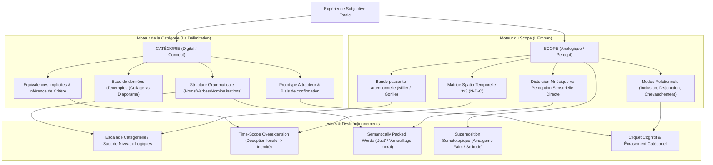

# Six Blind Elephants Vol 1 - Fundamental Principles of Scope and Category
**Formateur :** Steve Andreas | **ID :** `steve-andreas-six-blind-elephants-vol-1-fundamental-principles-of-scope-and-category` | **Tranches :** 25

Voici la synthèse architecturale ultra-dense et structurée issue de l'analyse intégrale des mécanismes et protocoles extraits du cours.

---

## Synthèse Architecturale du Cours

### 1. Thèse Centrale & Philosophie du Cours

#### La vision spécifique de Steve Andreas vs l'approche standard
Dans l'histoire des sciences cognitives et de la PNL classique, l'expérience humaine a souvent été modélisée soit par le prisme exclusif du contenu linguistique (le Métamodèle originel), soit par une manipulation mécanique d'éléments isolés (submodalités traitées comme des boutons de potentiomètre sans contexte, ancrages pavloviens).

Steve Andreas opère une rupture épistémologique fondamentale inspirée de Gregory Bateson et William James :
* **Unification par les deux méta-opérations fondamentales du système nerveux :** Toute souffrance, tout symptôme, toute croyance rigide et toute ressource subjective résultent de l'interaction dynamique entre seulement deux variables primitives :
  1. Le **Scope** (l'empan sensoriel brut — VAKOG — temporel, spatial et attentionnel : l'analogique, le continu, le « percept »).
  2. La **Catégorie** (le découpage logique, les frontières, l'étiquetage, l'assignation de critère : le digital, le discret, le « concept »).
* **Démystification de l'inconscient :** Loin de l'inconscient freudien réifié comme entité pulsionnelle obscure ou du « génie magique » ericksonien, l'inconscient chez Andreas est un **ensemble de micro-processus computationnels et neurologiques hautement automatisés**. Quand ils fonctionnent, ils sont transparents ; quand ils coincent, c'est par erreur d'empan (scope trop étroit ou trop large) ou par erreur logique de classification (confusion de critères, fausse équivalence, saut catégoriel).
* **Priorité au percept sur le concept :** La posture d'Andreas consiste à ramener systématiquement le sujet du monde des ombres mnésiques et des abstractions linguistiques congelées (nominalisations) vers la discrimination sensorielle directe, haute-résolution, non étiquetée.

#### Le fil rouge méthodologique
Le fil conducteur unifiant toutes les démonstrations et interventions du cours suit une boucle opératoire stricte :
1. **Élicitation de la topologie sensorielle :** Identifier la taille, l'emplacement et la portée spatio-temporelle du matériau brut traité par le sujet (Scope).
2. **Détection du court-circuit catégoriel :** Isoler le critère implicite, l'escalade logique ou la nominalisation qui force l'expérience dans un tiroir binaire inadapté.
3. **Manoeuvre structurelle :** Soit faire varier le *Scope* (Zoom In/Out, réduction de la portée temporelle, inclusion/exclusion, décomposition analogique), soit transformer la *Catégorie* (recatégorisation par critères explicites, injection de contre-exemples dans la base de données, dé-nominalisation en processus).
4. **Ré-automatisation et vérification corporelle :** Laisser le système nerveux auto-organiser la nouvelle synthèse sans interférence consciente vigile.

---

### 2. Carte des Concepts & Leviers Émergents

#### 1. Architecture du Scope (Le Matériau Sensoriel Brut)
* **Percept vs Concept (Défaillance transitoire de catégorisation) :** Le flux sensoriel brut (*raw data*) est instantanément « cuit » par l'automate cognitif en concepts. En condition dégradée, le décrochage (*wobbling*) révèle la machinerie projective du cortex qui cherche à forcer la cohérence.
* **Faisceau attentionnel & Cécité d'inattention :** L'empan conscient restreint (goulot d'étranglement) inhibe activement la majorité des stimuli hors du critère de focalisation immédiat.
* **Substitution mnésique du présent :** Le cerveau comble le vide perceptif (ce qui est hors champ, derrière la tête, ou passé) par des représentations internes tronquées et contrastées, prises à tort pour la réalité présente.
* **Modes relationnels topologiques (Inclusion, Disjonction, Chevauchement) :** Tout événement s'inscrit dans l'espace ou le temps selon ces 3 seules relations logiques, déterminant la structure des conflits de parties ou des intégrations systémiques.
* **Matrice spatio-temporelle 3x3 (81 désynchronisations) :** Croisement Temps (N-D-O : Nested, Different, Overlapping) et Espace (N-D-O). Démontre la probabilité mathématique intrinsèque de mésentente interpersonnelle (1 chance sur 9 d'alignement spontané).
* **Décomposition de la douleur nociceptive :** Triade (douleur passée mémorisée + douleur immédiate présente + douleur future anticipée). Réduire le scope temporel au strict point zéro présent dissout les composantes 1 et 3 et supprime l'angoisse de la douleur.

#### 2. Architecture de la Catégorie (L'Opération Logique et Sémantique)
* **Digitalisation et amputation analogique :** La catégorisation transforme un continuum fluide (analogique) en valeur binaire discrète (0/1), sacrifiant le détail sensoriel au profit de la vitesse d'action/survie.
* **Mots à charge sémantique saturée (*Semantically Packed Words*) :** Cas du mot *"just"* qui fusionne une restriction arbitraire d'empan (scope minuscule) et une validation morale indiscutable (légitimité, justice), paralysant l'évaluation critique.
* **Grammaire comme métastructure de catégorisation :**
  - *Noms :* Verbes figés, ralentis, arrêt sur image.
  - *Nominalisations :* Congélation processuelle ôtant tout pouvoir d'action.
  - *Verbes :* Dynamique spatio-temporelle analogique en cours.
* **Base de données d'exemples (*Database of Examples*) :** Encodage spatial dans l'espace péri-personnel d'une catégorie sous forme de collage panoramique simultané (structure robuste, certitude) ou de diaporama séquentiel (structure instable, doute).
* **Prototype comme Attracteur Étrange :** Un exemple hautement saillant sert de matrice auto-organisée aspirant rétrospectivement et prospectivement toutes les données cohérentes, alimentant le biais de confirmation.
* **Équivalence par échange :** Les transactions conditionnelles (« Si tu fais X, je fais Y ») forcent la recatégorisation implicite d'expériences hétérogènes sous un critère unique (ex. glissement de l'affection vers le commerce).

#### 3. Phénomènes à l'Interface Scope-Catégorie
* **Asymétrie de résolution Visuel vs Kinesthésique Évaluatif :** Le visuel permet une discrimination ultra-fine (millions de nuances) ; le kinesthésique viscéral/émotionnel a une résolution très pauvre (bon/mauvais/vide), ce qui engendre des amalgames somatotopiques (confondre la sensation de faim stomacale avec un sentiment d'isolement/solitude).
* **Cliquet cognitif (*Cognitive Ratchet Effect*) :** L'élargissement de scope réintégrant un élément dans sa dynamique globale est irréversible : le cerveau ne peut plus percevoir l'élément isolé de la même manière.
* **Substitution de conséquence & écrasement catégoriel :** Remplacer une conséquence réelle lointaine (accident) par une punition artificielle immédiate (privation de sortie) fait primer l'expérience directe et masque le danger véritable.
* **Escalade catégorielle toxique & Extension temporelle du Scope (*Time-Scope Overextension*) :** Projection d'un incident isolé dans un scope temporel permanent via un saut de niveau logique (« Cet événement ponctuel a échoué » $\rightarrow$ « Toute notre relation est une imposture » / « Je suis un raté »).

---

### 3. Tableau Récapitulatif des Techniques & Démonstrations

| Technique / Exercice | Objectif Opératoire | Déclencheur / Indication | Séquence Résumée |
|---|---|---|---|
| **Épreuve de Réalité Sensorielle vs Image Mémorielle** | Établir la distinction irréductible entre la perception directe présente et la simulation interne. | Croyances rigides, deuil bloqué, certitudes trompeuses sur des événements passés ou autrui. | 1. Observer un objet réel devant soi en haute résolution sensorielle (VAKOG direct). 2. Se retourner et observer la représentation interne mémorisée de l'objet. 3. Comparer explicitement les submodalités : perte de contraste, flou, simplification des textures. 4. Ancrer somatiquement la différence fondamentale entre *voir* et *se souvenir*. |
| **Décomposition Analgésique du Scope Temporel** | Réduire drastiquement l'intensité d'une douleur physique ou émotionnelle aiguë. | Douleur chronique, angoisse aiguë, crise de panique, anticipation phobique. | 1. Éliciter la sensation douloureuse dans sa globalité. 2. Isoler et soustraire la projection future (« combien de temps ça va durer »). 3. Isoler et soustraire la mémoire rétroactive (« depuis combien de temps je subis »). 4. Réduire le scope temporel au strict micro-instant présent (fraction de seconde actuelle). 5. Constater la chute de la charge nociceptive réduite au stimulus sensoriel pur. |
| **Désamorçage des Mots Saturés (*Unpacking "Just"*)** | Briser l'inhibition critique et déverrouiller un cadrage sémantique moralement piégé. | Présence de nominalisations restrictives ou d'adverbes de réduction morale (« C'est *juste* une formalité », « C'est *juste* normal »). | 1. Repérer l'occurrence du terme saturé (*just* / *seulement* / *normal*). 2. Séparer explicitement la fonction d'empan (la réduction de scope imposée) de la fonction axiologique (la caution morale). 3. Questionner le scope exclu : « Si ce n'était pas *seulement* cela, qu'est-ce qui est masqué d'autre autour ? » 4. Rétablir le continuum sensoriel global. |
| **Recadrage par Macro-Scope Temporel (*Macro-Scheduling*)** | Sortir de la panique d'urgence limbique locale pour réinstaller une auto-régulation fluide. | Compulsions immédiates, sentiment de submersion au travail, procrastination de survie, gestion de crise locale. | 1. Identifier la boucle de réactivité confinée dans un scope court (ex. 5-15 min). 2. Élargir le champ attentionnel à l'échelle temporelle macro (journée, semaine, mois). 3. Distribuer stratégiquement les îlots de ressources et de repos (*pepper in*) dans l'espace global. 4. Valider l'encodage temporel global pour que le pilotage inconscient prenne le relais sans effort de volonté. |
| **Discrimination Somatotopique Haute Résolution** | Dissocier une émotion globale paralysante d'un signal biologique interoceptif confondu. | Boucles compulsives (boulimie, grignotage émotionnel), anxiété somatique diffuse (boule au ventre). | 1. Focaliser l'attention sur l'emplacement kinesthésique précis du signal somatique. 2. Basculer en modalité visuelle pour cartographier forme, contour, couleur et texture du signal. 3. Découpler la sensation viscérale primaire (ex. contractions stomacales) de l'étiquette émotionnelle plaquée (ex. « je me sens seul »). 4. Traiter le signal biologique selon son critère physiologique réel (boire, manger, respirer) et non sous le concept erroné. |
| **Cartographie et Densification de la Base de Données d'Exemples** | Installer ou consolider une ressource/qualité de concept de soi stable et inébranlable. | Sentiment d'imposture, instabilité identitaire, croyance limitante sur ses capacités, doute chronique. | 1. Éliciter la représentation spatiale des exemples prouvant la ressource (position, simultanéité vs séquence). 2. Transformer un diaporama séquentiel fragile en un collage panoramique simultané (mosaïque d'images fixes entourant le sujet). 3. Densifier la base en recherchant et intégrant des micro-expériences sensorielles concrètes passées. 4. Ajuster la perspective (associée/dissociée) et ancrer la sensation de solidité structurelle de la catégorie. |
| **Contraction de Portée Temporelle (*De-escalation of Time-Scope*)** | Neutraliser une généralisation identitaire toxique suite à un échec ou une déception ponctuelle. | Escalade de niveaux logiques : « J'ai raté cet entretien » $\rightarrow$ « Je suis incompétent » ; dispute $\rightarrow$ divorce. | 1. Repérer le saut catégoriel reliant un fait microscopique à une macro-conclusion permanente. 2. Ramener explicitement la délimitation temporelle aux bornes de l'événement sensoriel source (date, heure, durée exacte). 3. Recatégoriser l'événement sous une classe locale et transitoire (« une action inefficace de 10 minutes »). 4. Préserver la macro-catégorie identitaire intacte en discriminant le comportement ponctuel de l'ensemble de la personne. |
| **Désarmer l'Équivalence d'Échange Implicite** | Rétablir l'écologie relationnelle polluée par des transactions contractuelles masquées. | Ressentiment dans le couple, chantage affectif, sentiment d'instrumentalisation ou de culpabilité. | 1. Mettre au jour la formule conditionnelle cachée (« Si je te donne X, tu me dois Y »). 2. Rendre visible le conflit de catégories entre les deux éléments échangés (ex. amour/temps vs conformité/devoir). 3. Dissocier les deux éléments pour les réattribuer à leurs cadres logiques respectifs. 4. Rétablir une communication explicite sur les critères réels de chaque partenaire. |

---

## Extractions Détaillées par Tranche (Opératoire & Verbatim)

## --- Tranche 1 / 25 ---

### 1. Mécanismes & Principes Actifs

- **La Défaillance Transitoire de la Catégorisation Automatique (Percepts bruts vs Concepts "cuits")**
  *Principe actif :* Le système nerveux humain n'a quasiment jamais accès à l'expérience sensorielle pure (*raw sensory-based experience*). Dès l'entrée sensorielle, la neurologie applique un filtrage et un étiquetage instantanés qui transforment le *percept* (flux brut) en *concept* (objet délimité, nommé, stabilisé). Lorsque les conditions perceptives sont dégradées (pénombre, stimulus faible, élément hors contexte comme des œufs de merle au sol après la coupe d'un arbre), l'automate de catégorisation inconsciente décroche temporairement. Pendant ce court laps de temps, l'esprit entre dans une oscillation cognitive (*wobbling*) : face à l'impossibilité d'associer un pattern connu, le cortex génère en boucle des hypothèses projectives de plus en plus extrêmes pour tenter de rétablir la cohérence sémantique.
  *Tags :* #percept_vs_concept #experience_sensorielle_brute #panne_de_categorisation #wobbling_cognitif #projection_compensatoire

- **Le Faisceau Attentionnel Réduit (Scope) et la Cécité d'Inattention**
  *Principe actif :* La conscience vigile est limitée à un goulot d'étranglement strict (7 ± 2 unités d'information de Miller, souvent moins en situation dynamique). Le champ d'attention fonctionne comme un faisceau lumineux étroit balayant une obscurité totale. Dès lors qu'une tâche de focalisation sélective est assignée (compter des passes de ballon), le système inhibe activement tout stimulus non pertinent au regard du critère d'évaluation immédiat, y compris un élément discordant majeur (l'expérience du gorille). Ce que l'individu appelle « la réalité » n'est qu'une fraction infime (le *scope*) découpée arbitrairement dans le continuum sensoriel global.
  *Tags :* #scope_attentionnel #faisceau_attentionnel #cecite_inattention #inhibition_perceptive #filtrage_sensoriel

- **L'Inconscient comme Processus Génératif Non-Entitaire**
  *Principe actif :* Loin du modèle psychanalytique réifiant l'inconscient comme une entité autonome ou un alter ego obscur, l'inconscient chez Steve Andreas désigne l'ensemble des processus neurologiques et linguistiques automatisés s'exécutant hors de la conscience vigile (production syntaxique, praxies motrices, associations sémantiques). Tant que le processus opère sans friction, il demeure transparent à la conscience. Dès que la conscience tente d'intervenir directement dans la micro-gestion d'un processus automatique fluide (ex: monitoring de la parole en public), elle introduit une interférence neurologique (bégaiement, hésitation, perte de fluidité). L'intervention du praticien consiste à amener temporairement à la conscience le micro-processus fautif (images internes, cadrage temporel), à le réajuster, puis à le ré-automatiser.
  *Tags :* #inconscient_processuel #automatisation_neurologique #interference_consciente #reautomatisation

- **Le Remplacement du Présent Perceptuel par l'Imagerie Mémorielle Simulée**
  *Principe actif :* La perception présente n'est pas un flux direct continu, mais une reconstruction hybride combinant une faible part de données sensorielles actuelles et une grande part de mémoires internes réinjectées en temps réel. Lorsque l'individu regarde devant lui, son sentiment de ce qui l'entoure (ce qui se trouve derrière son dos) repose exclusivement sur des images mémorielles dégradées, à contraste artificiellement altéré ou tronquées en détail. Le cerveau traite ces représentations internes comme équivalentes à une présence sensorielle, érigeant ainsi sa carte du monde sur des ombres mnésiques sans vérifier la source perceptive.
  *Tags :* #substitution_memorielle #carte_vs_territoire #distorsion_mnesique #imagerie_interne

- **L'Ascension Toxique des Niveaux Logiques (Escalade Catégorielle)**
  *Principe actif :* À partir d'un événement sensoriel isolé et restreint (un œuf trop cuit, un silence), le système cognitif produit un saut déductif immédiat : il sélectionne un scope microscopique, lui applique une catégorie dévalorisante (*uncaring*, *indifference*), puis recrute en mémoire sélective toutes les occurrences passées validant cette étiquette. Ce mécanisme agrège les incidents en une macro-catégorie identitaire ou relationnelle irréversible (*he doesn't love me*, *married the wrong woman*), imposant une réponse comportementale drastique (divorce) basée sur une illusion de causalité directe.
  *Tags :* #saut_categoriel #escalade_niveaux_logiques #biais_de_confirmation #retro_selection_mnesique

---

### 2. Protocoles, Techniques & Démonstrations (Étape par Étape)

#### Démonstration / Épreuve de Réalité Sensorielle vs Image Mémorielle
* **Intention / Indication :** Faire vivre au sujet la différence structurelle irréductible entre une donnée perceptive brute et une construction mémorielle interne qu'il prend à tort pour le présent. À utiliser en amorce de travail sur les croyances rigides, le deuil, ou les représentations tronquées du passé.
* **Mise en place & Pré-framing :** Cadrer l'exercice comme une expérience physiologique directe, sans intellectualisation préalable. Demander au sujet d'immobiliser sa tête.
* **Séquence d'actions pas à pas :**
  1. *Suspension du canal visuel externe :* Demander au sujet de fermer les yeux sans bouger la tête.
  2. *Évocation de la représentation d'arrière-plan :* Inviter le sujet à porter son attention sur ce qui se trouve directement derrière lui en ce moment même.
  3. *Calibration de l'image interne :* Laisser une pause d'intégration (`...`). Guider le sujet pour qu'il dresse l'inventaire précis des éléments visibles dans son image interne (couleur, contraste, netteté, items recensés).
  4. *Confrontation sensorielle directe :* Inviter le sujet à ouvrir les yeux, à pivoter physiquement pour regarder ce qui se trouve réellement derrière lui.
  5. *Comparaison différentielle (Contrastive Analysis) :* Faire confronter l'inventaire de l'image mentale avec la réalité sensorielle directe (richesse des détails, profondeur de champ, luminosité, objets ignorés par la mémoire).
  6. *Réintégration et ancrage du constat :* Faire pivoter le sujet vers sa position de départ et lui faire remarquer comment la mémoire vient instantanément remplacer l'absence de vision directe.
* **Signes de calibration :**
  - Mouvements oculaires d'accès visuel remémoré (yeux en haut/gauche ou défocalisés) lors de la phase yeux fermés.
  - Micro-réactions de surprise ou d'hésitation posturale lors du pivot physique face aux écarts de détails.
  - Relâchement musculaire ou modification du clignement oculaire lorsque le sujet réalise la disparité entre la projection mentale et le territoire réel.

---

### 3. Heuristiques, Subtilités & "Sagesse du Praticien"

- **Règle du Scope Élargi vs Scope Réduit :**
  * *Si* une expérience isolée génère une réaction émotionnelle disproportionnée (ex: irritation face à un post-it rose refusé, anxiété face à un comportement du partenaire) -> *alors* élargir immédiatement le scope contextuel (examiner la couleur du support, l'environnement physique immédiat, ou les contraintes de l'autre personne) *parce que* l'ajout de données environnementales réelles modifie la catégorie attribuée sans nécessiter de recadrage verbal complexe.
  * *Si* une performance fluide se dégrade subitement dès l'apparition d'un observateur -> *alors* restreindre délibérément le scope attentionnel à la tâche kinesthésique/sensorielle immédiate *parce qu'*un scope trop large incluant le regard tiers active une sur-catégorisation évaluative perturbatrice (*performance/evaluation*).

- **Heuristique de la Plainte Affective en Couple :**
  * *Si* un client formule une conclusion radicale sur son identité ou sa relation (*"je dois divorcer"*, *"j'ai épousé la mauvaise personne"*) à partir d'un détail comportemental -> *alors* ne jamais débattre de la conclusion au niveau logique élevé ; remonter immédiatement au scope initial minimal (le micro-comportement déclencheur : un silence, une assiette) et cartographier les omissions attentionnelles périphériques (la fatigue, un appel téléphonique en cours).

- **Heuristique du Travail de Deuil (Andreas Insight) :**
  * *Si* un client ressent une sensation de "vide douloureux" (*aching emptiness*) lors d'un deuil -> *alors* explorer la structure submodale de son imagerie interne (position, présence, distance, luminosité du défunt) plutôt que d'élaborer sur le plan verbal ou émotionnel *parce que* la souffrance provient de la forme de l'image construite inconsciemment (ex: image absente, vide spatial) et se résout par la réorganisation de cette structure perceptive interne (vers une présence interne chaleureuse et intégrée).

- **Piège Classique du Praticien Débutant :**
  * Croire que le client réagit au monde sensoriel réel. Le praticien ne doit jamais oublier que le client réagit exclusivement à la catégorie attribuée à une sélection ultra-réduite d'indices sensoriels ou mémoriels. Tenter de raisonner le client sur son ressenti sans modifier le scope ou la catégorie sous-jacente est une impasse opératoire.

---

### 4. Pépites Verbatim & Patterns Linguistiques (MOT À MOT EN V.O.)

> "If my reader can succeed in abstracting from all conceptual interpretation and lapse back into his immediate sensible life at this very moment, he will find it to be what someone has called a big blooming buzzing confusion, as free from contradiction in its 'much-at-onceness' as it is all alive and evidently there… Out of this aboriginal sensible muchness attention carves out objects, which conception then names and identifies forever… We say what each part of the sensible continuum is, and all these abstracted whats are concepts… The intellectual life of man consists almost wholly in his substitution of a conceptual order for the perceptual order in which his experience originally comes." (William James cité par Steve Andreas)
* **[Analyse du Pattern]** : Présupposition existentielle et double injonction sensorielle. Utilisation d'allitérations kinesthésiques et auditives (*big blooming buzzing confusion*) créant une surcharge sensorielle délibérée (*confusion technique*), suivie d'une nominalisation spatiale métaphorique (*attention carves out objects*) qui modélise l'attention non pas comme une réception passive, mais comme un acte chirurgical de découpe et de réification conceptuelle.

---

> "When we understand how we unconsciously attend to a scope of experience, immediately categorize it, and then respond to the meaning of this categorization, it opens up a world of alternative choices and options. When we don’t like the meaning of an event, we can change the scope and/or category that we are attending to, in order to change its meaning."
* **[Analyse du Pattern]** : Enchaînement de truismes et lien de cause à effet temporel (*When... then...*). Le présupposé selon lequel le sens n'est pas inhérent à l'événement mais produit par la boucle attentionnelle conditionne l'esprit du récepteur à accepter une agentivité totale (*we can change... to change*), installant une commande indirecte de flexibilité perceptive.

---

> "Pause for a moment from reading this book, and scan your surroundings and your physical body with all your senses to get an idea of the scope of all that you have been ignoring as you were reading…."
* **[Analyse du Pattern]** : Commande directe d'interruption de pattern (*Pause for a moment*) couplée à une commande enchâssée d'orientation transdérivationnelle (*scan your surroundings and your physical body*). L'utilisation du mot *ignoring* présuppose comme un fait indiscutable qu'une immense quantité d'informations était déjà présente hors de la conscience, forçant une prise de conscience somatique immédiate par contraste.

---

> "Without moving your head, close your eyes and think about what is behind you at this moment… Closing your eyes eliminates the visual scope of experience, allowing you to attend more easily to your internal images. You probably have some kind of image of what is behind you—not an empty nothingness. Now turn around to see what is there at this moment, and compare it with your image…."
* **[Analyse du Pattern]** : Induction fractionnée comportementale et suggestion de truisme négatif (*not an empty nothingness*). La directive physique négative (*Without moving your head*) induit un ancrage spatial strict, tandis que l'enchaînement des commandes motrices (*close your eyes... turn around... compare*) brise la passivité intellectuelle du lecteur pour forcer une vérification kinesthésique et visuelle in situ.

## --- Tranche 2 / 25 ---

### 1. Mécanismes & Principes Actifs

- **La Distorsion Perceptive Inhérente au Présent (Mémoire vs Perception)** :
  * *Principe actif* : Le système nerveux traite ce que nous appelons « expérience présente » en substituant une fraction infime de données sensorielles mémorisées à la perception brute directe. Dès qu'un sujet quitte du regard une scène (ex. ce qui se trouve derrière sa tête), le cerveau compense le vide perceptif en générant une représentation interne (image, son, sensation). Cette reconstruction est inévitablement déformée : contrastes accentués, perte massive de détails, compression des textures et amplification sélective. Sur le plan cognitif, nous opérons en quasi-permanence non pas sur le territoire sensoriel brut, mais sur des "ombres déformées" issues d'enregistrements passés limités par l'empan attentionnel antérieur.
  * *Tags* : #memory_vs_perception #internal_distortion #sensory_based_experience #attention_compression #cognitive_reconstruction

- **Le Scope (Étendue de l'Expérience Sensorielle)** :
  * *Principe actif* : Le *scope* (l'empan ou l'étendue) quantifie le volume d'expérience sensorielle auquel un sujet prête attention à un instant T (visuel, auditif, kinesthésique, olfactif, gustatif). Il unifie perception présente, souvenirs du passé et projections futures sous le même matériau de base brut (*raw material*). La souffrance ou les ressources du sujet dépendent de la façon dont ces matériaux sont assemblés : une expérience peut être structurée comme un « donjon moisi » (*musty dungeon*) ou un « espace ouvert et chaleureux » (*warm open place*) simplement en variant l'amplitude du scope.
  * *Tags* : #scope #experiential_bandwidth #sensory_materials #representational_architecture

- **Les Trois Modes Relationnels des Scopes (Inclusion, Disjonction, Chevauchement)** :
  * *Principe actif* : Dans le temps comme dans l'espace, la relation entre deux unités d'expérience sensorielle ne peut prendre que trois configurations topologiques objectives :
    1. *Nested (Emboîté / Hiérarchie d'inclusion de scope)* : Le plus petit sous-ensemble est intégralement contenu dans le plus grand (relation partie/tout stricte). L'emboîtement est asymétrique et sans équivoque (une minute est dans une heure, jamais l'inverse).
    2. *Different (Différent / Disjoint)* : Deux scopes temporels ou spatiaux qui ne partagent aucune coordonnée commune. L'un ne peut être inclus dans l'autre.
    3. *Overlapping (Chevauchant)* : Deux scopes partagent une intersection tout en conservant chacun des éléments exclusifs.
  * *Tags* : #scope_inclusion #part_whole_hierarchy #nested_scope #different_scopes #overlapping_scopes

- **Nature Analogique Réelle vs Ponctuation Digitale Artificielle du Temps et de l'Espace** :
  * *Principe actif* : Le continuum temporel et spatial subjectif est intrinsèquement analogique (un flux continu d'intensités et de durées variables, comparable à un rhéostat). Le cerveau crée artificiellement des bornes *digitales* (tout-ou-rien, segments discrets, labels de langage : "secondes", "hier", "souvent", "ici", "là", "boulot") basées uniquement sur les *événements* contenus dans ce flux, et non sur le temps ou l'espace lui-même. Si aucun événement n'est discriminé, aucune démarcation digitale ne peut exister.
  * *Tags* : #analog_vs_digital #experiential_time #arbitrary_digitalization #event_based_punctuation

- **La Matrice Spatio-Temporelle 3x3 (Combinatoire des 9 Scopes et 81 Désynchronisations Interpersonnelles)** :
  * *Principe actif* : En croisant le Temps (N, D, O) et l'Espace (N, D, O), on obtient une grille rigoureuse de 9 configurations possibles de scopes pour tout événement intérieur ou extérieur. Dans une interaction humaine entre deux personnes, il existe $9 \times 9 = 81$ combinaisons relationnelles de focalisation. La probabilité spontanée que deux interlocuteurs traitent le même scope spatio-temporel de la même façon n'est que de 1 sur 9 (environ 11%), ce qui modélise mathématiquement l'inévitabilité des quiproquos, malentendus et projections d'intention malveillante.
  * *Tags* : #spatiotemporal_matrix #9_scope_grid #interpersonal_mismatch_model #miscommunication_mechanics

- **Décomposition Kinesthésique de la Douleur par le Scope Temporel** :
  * *Principe actif* : La sensation de douleur n'est pas monolithique ; elle se compose neurologiquement de trois fractions : la douleur sensorielle présente, la douleur mémorisée (rétroactive) et la douleur anticipée (projection future). En réduisant le scope temporel au strict instant présent ("living in the now" sensoriel pur), les composantes mémorisée et anticipée s'effondrent, diminuant massivement la charge nociceptive perçue.
  * *Tags* : #pain_triad_decomposition #present_pain #anticipated_pain #scope_reduction_analgesia

- **Focalisation Externe Téléologique vs Hyper-focalisation Somatique Interne** :
  * *Principe actif* : Porter son attention sur son propre corps défaillant, vieillissant ou douloureux (scope somatique restreint) induit une boucle de rétroaction kinesthésique qui dégrade la motricité fine, la coordination et la grâce motrice. Déplacer instantanément le scope spatial et attentionnel vers l'objectif externe (la cible, la direction, la tâche à accomplir) court-circuite les micro-corrections conscientes crispées et réactive les automatismes moteurs fluides et harmonieux du système nerveux autonome.
  * *Tags* : #internal_proprioceptive_trap #goal_oriented_scope #motor_fluidity_restoration #somatic_decentering

- **Le Piège Opératoire des Réducteurs Linguistiques : "Just" et "Only"** :
  * *Principe actif* : Les adverbes/adjectifs réducteurs imposent une restriction autoritaire du champ attentionnel en verrouillant un scope microscopique ("ne regarde rien d'autre, ce fragment isolé résume toute la réalité"). 
    1. *Double contrainte sémantique* : Dans une attaque relationnelle ("Tu ne penses qu'au sexe" / "Tu ne penses qu'à l'argent"), si la personne nie, elle ment (car la composante existe et a de la valeur pour elle) ; si elle confirme, elle valide la réduction ("je ne suis QUE cela"), ce qui la criminalise.
    2. *Surcharge sémantique (« Semantically Packed »)* : Le mot "just" agit simultanément au niveau inconscient comme un adverbe réducteur de scope ("seulement/tout juste") et comme un adjectif moral suprême ("juste/équitable/vrai/loyal/mérité"). Contester l'énoncé revient inconsciemment à contester la justice et le bien absolu, verrouillant la victime dans l'impossibilité de répliquer.
  * *Tags* : #linguistic_scope_constriction #just_and_only #double_bind_trap #semantic_packing #moral_equivoque

---

### 2. Protocoles, Techniques & Démonstrations (Étape par Étape)

#### Protocole 1 : Le Démasquage Sensoriel Perception vs Mémoire (Étalonnage du Scope Présent)
* **Intention / Indication** : Faire expérimenter directement au sujet la différence neurologique fondamentale entre une perception en temps réel et une construction mémorielle, brisant l'illusion de l'accès direct au "réel".
* **Mise en place & Pré-framing** : Inviter le sujet à rester immobile, assis confortablement, sans se retourner au préalable.
* **Séquence d'actions pas à pas** :
  1. *Élimination du champ visuel direct* : Demander au sujet de fermer les yeux (ce qui élimine l'empan visuel externe et force l'accès aux représentations internes).
  2. *Élicitation de l'image interne arrière* : L'inviter à se représenter mentalement ce qui se trouve directement derrière lui en cet instant précis ("Remarquez l'image que vous avez de ce qui est derrière vous... ce n'est pas un néant vide").
  3. *Test de vérification externe directe* : Demander au sujet d'ouvrir les yeux, de se retourner physiquement et d'observer la scène réelle.
  4. *Retour et ré-encodage mémoriel* : Faire revenir le sujet face au praticien/au livre, fermer à nouveau les yeux et énumérer la liste précise des éléments vus dans son souvenir immédiat.
  5. *Comparaison et calibration des distorsions* : Faire comparer la liste mémorielle avec la réalité observée une seconde fois. Noter la chute massive de détails, l'effondrement des nuances de couleurs/profondeur, et les contrastes artificiellement rehaussés par la mémoire.
* **Signes de calibration** : Sourire de surprise du sujet, micro-pauses cognitives, mouvement oculaire d'accès visuel remémoré ($V_r$) suivi d'un constat d'appauvrissement sensoriel lors de la verbalisation.

---

#### Protocole 2 : Accordéon du Scope Temporel (Temporal Scope Accordion)
* **Intention / Indication** : Sortir un sujet d'un état d'impulsivité aveugle ("in time" destructeur) ou d'un état de phobie/panique aiguë, ou réhabiliter la capacité de jouissance du présent chez un planificateur anxieux compulsif ("through time" obsessionnel).
* **Mise en place & Pré-framing** : Cadrer le temps comme un continuum analogique élastique que l'on peut dilater ou comprimer à volonté.
* **Séquence d'actions pas à pas** :
  1. *Ancrage dans le scope du point zéro* : Amener le sujet à focaliser son attention sensorielle sur l'extrême immédiateté du présent (la seconde en cours).
  2. *Dilatation courte* : Étendre le scope pour en faire un film incluant ce qui s'est produit quelques minutes avant et ce qui va arriver dans les prochaines minutes.
  3. *Expansion macroscopique* : Élargir progressivement le film temporel en amont et en aval : plusieurs semaines, plusieurs mois, plusieurs années, jusqu'à la totalité de l'arc de vie.
  4. *Focalisation rétrospective (« Perspective du lit de mort »)* : Depuis la fin de l'horizon temporel dilaté, faire réévaluer le problème actuel ("Personne sur son lit de mort n'a jamais dit : 'J'aurais aimé passer plus de temps au bureau'").
  5. *Resserrement contrôlé* : Réduire graduellement le film pour revenir à l'instant présent d'origine, en intégrant la ressource d'amplitude acquise.
* **Signes de calibration** : Ralentissement de la fréquence respiratoire, déglutition, détente musculaire des trapèzes, défocalisation du regard, désescalade affective immédiate de l'urgence.

---

#### Protocole 3 : Expansion Panoramique du Scope Spatial (Sortie du Tunnel Vision)
* **Intention / Indication** : Dissoudre les fixations anxieuses, les états de blocage kinesthésique ou cognitif (comme le problème des 9 points), et réintégrer les informations contextuelles périphériques exclues.
* **Mise en place & Pré-framing** : "Votre champ d'attention visuel ou auditif peut être ajusté comme le zoom d'une caméra."
* **Séquence d'actions pas à pas** :
  1. *Point focal minuscule* : Faire fixer un détail spatial minuscule (ex. la pointe d'un stylo ou une sensation microscopique sur le menton).
  2. *Ouverture radiale* : Guider le sujet pour qu'il élargisse la vision/l'ouïe/la kinesthésie de manière bidimensionnelle puis tridimensionnelle.
  3. *Vision périphérique panoramique* : Déployer le champ jusqu'à embrasser un panorama total à 180° (ou perception auditive enveloppante à 360°, ou perception somatique corporelle globale interne/externe).
  4. *Ressort et focalisation adaptative* : Faire alterner le sujet entre zoom étroit (concentration) et grand angle (perspective), jusqu'à fluidité complète du basculement.
* **Signes de calibration** : Dilatation pupillaire, relâchement des muscles péri-orbitaires, disparition des micro-mouvements saccadés des yeux, passage en état alpha léger (état de transe d'apprentissage).

---

#### Protocole 4 : Le Recadrage de Décompression des Réducteurs « Just / Only »
* **Intention / Indication** : Neutraliser instantanément les doubles contraintes et les attaques en tunnel vision dans les conflits interpersonnels (ex: couples, négociations, management).
* **Mise en place & Pré-framing** : Rendre explicite la structure linguistique de la réduction opérée par l'interlocuteur sans valider le piège "vrai/faux".
* **Séquence d'actions pas à pas** :
  1. *Interruption de la polarisation* : Refuser de répondre par l'affirmative ou la négative brute (ne pas tomber dans le piège binaire "Non je ne m'en fous pas" / "Oui c'est vrai").
  2. *Désignation du mécanisme de restriction* : Mettre en lumière l'amputation de scope créée par le mot ("En disant 'juste' ou 'seulement', tu réduis toute la réalité de notre relation à un trou de serrure").
  3. *Validation de l'élément focalisé (Truisme)* : Valider explicitement l'importance de l'élément mentionné ("Effectivement, le sexe / l'argent est une dimension importante pour moi").
  4. *Expansion du Scope Spatio-Temporel* : Réintroduire la totalité du paysage relationnel évacué ("...et c'est un aspect parmi de nombreux autres aspects essentiels : notre complicité, la sécurité de nos enfants, les projets que nous bâtissons ensemble depuis des années").
* **Signes de calibration** : Rupture de pattern chez l'interlocuteur (silence soudain, clignement des yeux, posture physique qui se redresse, expiration longue marquant la sortie du blocage défensif).

---

### 3. Heuristiques, Subtilités & "Sagesse du Praticien"

- **L'Heuristique de Flexibilité Situationnelle du Scope Temporel** :
  * *Règle* : 
    - **SI** la situation présente est gratifiante et plaisante $\rightarrow$ **ALORS** immerger totalement l'attention dans le présent immédiat ("living in the now", scope étroit) pour maximiser le plaisir sensoriel, avec de brèves dilatations périodiques pour vérifier que la direction générale reste écologique.
    - **SI** la situation présente est douloureuse ou désagréable $\rightarrow$ **ALORS** élargir immédiatement le scope dans le temps vers le passé et le futur pour noyer l'épisode dans une perspective globale et élaborer un plan d'action.
    - **EXCEPTION CRITIQUE / PIÈGE** : Si le sujet anticipe que la douleur ou la situation pénible va durer indéfiniment dans le futur $\rightarrow$ élargir le scope temporelle amplifie la souffrance de manière insoutenable ! Dans ce cas précis, **réduire au contraire le scope au présent pur** pour couper l'anticipation négative.

- **L'Heuristique Somatique vs Téléologique (Le remède à la maladresse et à la douleur)** :
  * *Règle* : **SI** un sujet est âgé, malade, douloureux ou physiquement maladroit et qu'il porte son attention sur son propre corps $\rightarrow$ **ALORS** son contrôle conscient engendre raideur, saccades et amplification de la douleur.
  * *Action* : Transférer impérativement le scope spatial de l'attention du corps interne vers l'objectif externe (la destination, le point dans l'espace à atteindre). Le système moteur autonome retrouve instantanément sa grâce et sa régulation automatique.

- **L'Heuristique de Résolution des Malentendus Relationnels** :
  * *Règle* : **SI** deux personnes s'opposent sur des termes temporels digitaux vagues ("Bientôt", "Souvent", "Toujours", "Plus tard") $\rightarrow$ **ALORS** ne JAMAIS débattre sur l'intention morale ou la véracité des faits, mais **calibrer immédiatement l'empan temporel analogique sous-jacent**.
  * *Exemple Steve Andreas* : Pour une personne, "Tu fais toujours ça" signifie "trois fois cette semaine" (scope de 7 jours) ; pour l'autre, cela signifie "depuis 10 ans" (scope de décennies). Si le comportement change, la première le remarquera en une semaine, la seconde mettra des années à enregistrer la modification parce que sa fenêtre de vérification (*checking scope*) est démesurée.

- **L'Heuristique de Résolution de Problème par le Scope (Nine-Dot & Connected Boxes)** :
  * *Règle* : Tout problème perçu comme insoluble est le résultat d'un scope spatial ou conceptuel auto-restreint (frontières implicites imposées arbitrairement par le sujet sans qu'elles figurent dans l'énoncé du réel).
  * *Symptôme clinique* : Le sujet regarde l'espace où la solution n'est pas parce que "la lumière y est meilleure" (le syndrome des clés perdues sous le réverbère). Élargir le scope physique au-delà du cadre apparent dissout l'impasse.

---

### 4. Pépites Verbatim & Patterns Linguistiques (MOT À MOT EN V.O.)

> **"Without moving your head, close your eyes and think about what is behind you at this moment… Closing your eyes eliminates the visual scope of experience, allowing you to attend more easily to your internal images. You probably have some kind of image of what is behind you—not an empty nothingness. Now turn around to see what is there at this moment, and compare it with your image…."**
* **[Analyse du Pattern]** : Utilisation d'une commande d'inhibition physique directe (*"Without moving your head"*), couplée à une conjonction de cause à effet guidant l'attention interne (*"allowing you to attend more easily"*). L'expression *"not an empty nothingness"* applique une négation hypnotique qui élimine l'option du vide et force neurologiquement l'accès à une représentation interne visuelle, immédiatement suivie d'une boucle de feedback par comparaison sensorielle contrastée.

---

> **"Like the raw materials for building a house, we can put them together in many different ways, to create a wide variety of homes—some of which are unpleasant dark musty dungeons, while others are warm, open, comfortable places. When we know how these raw materials can be combined, we can build a home for ourselves that suits us, and remodel it when we want to."**
* **[Analyse du Pattern]** : Métaphore isomorphique de construction architecturale. Andreas installe un double ancrage spatial et émotionnel opposé (*"musty dungeons"* vs *"warm, open, comfortable places"*). La structure syntaxique finale utilise une présupposition temporelle de maîtrise (*"When we know how..."* présuppose que l'apprentissage est inéluctable) et une commande enchâssée d'auto-détermination émancipatrice (*"build a home for ourselves... remodel it when we want to"*).

---

> **"Nested scopes (time) To experience the simplest kind of scope change in time, start with the present moment, and then gradually increase the scope to a movie that includes what happened a few minutes before, and what you expect to happen in the next few minutes. Then gradually extend that movie more and more, both before and after, to include a period of weeks, months, or years,… and then gradually narrow it down again to that brief moment that you started with, which is now in the past."**
* **[Analyse du Pattern]** : Pacing et Leading temporel continu soutenu par l'adverbe progressif *"gradually"*. Le pattern transforme une entité discrète statique en un processus dynamique cinématographique (*"to a movie that includes..."*). Les points de suspension (*"..."*) marquent une suspension temporelle invitant à la transe kinesthésique d'étirement de l'espace-temps, suivie d'une rupture de pattern ontologique finale : le point d'origine n'existe plus, *"which is now in the past"*, installant l'impermanence de l'observateur.

---

> **"A nearfatal accident or illness can shorten this future scope to almost nothing, and afterward we are likely to pay much more attention to appreciating the present. Some 'awareness' exercises ask someone to go to the end of their life and look back and reevaluate their life, or review a current problem from this much longer perspective. A common saying expresses the change in response that often results from this change in scope: 'No one on their deathbed ever said, “I wish I had spent more time at the office.”'"**
* **[Analyse du Pattern]** : Recadrage de contexte par projection temporelle extrême (*Deathbed Reframe*). L'évocation d'un accident ou de la mort active un choc émotionnel léger (réveil somatique), immédiatement canalisé vers une citation d'autorité populaire désarmante. La structure linguistique transporte l'auditeur à l'extrémité de sa propre ligne du temps pour opérer une révision de critères par rétroaction, rendant les préoccupations triviales du présent instantanément dérisoires.

---

> **"“Just” and “only” essentially say, “Don’t pay attention to anything else; this small scope is all that matters.” Once the scope has been narrowed by “just” or “only,” what is in this small scope is all there is to pay attention to. For instance, a complaint that wives often make to their husbands is, 'You just care about sex.' How is he to answer? He probably does care about sex, so he can’t really answer, 'No, I don’t,'—and if he did, he probably wouldn’t get much for a while! If he agrees, then he is admitting that he only cares about sex, making him into a 'bad guy,' a 'no-win' trap."**
* **[Analyse du Pattern]** : Déconstruction opératoire d'une double contrainte (*double bind*). Andreas met à nu la fonction de sélection négative des restrictifs linguistiques (*"Don't pay attention to anything else"*). Il illustre la mécanique du piège relationnel avec un humour pragmatique qui dédramatise le contenu pour en exposer la pure structure logique : l'impasse où le démenti est un mensonge et l'assentiment est une auto-condamnation.

---

> **"When used as an adjective, 'just' has even more meanings. My dictionary lists eight: 1. upright, honest, righteous. 2. equitable, impartial, fair. 3. exact, accurate, precise. 4. correct, true. 5. deserved, merited. 6. legally right, lawful, rightful. 7. right, proper. 8. wellfounded. Synonyms: 'exact, honest, impartial, precise, proper, upright.' 'Just' is a word that can be described as 'semantically packed,' because so many meanings are loaded into a single word. In short, 'just' means all that is valued as right and good. Whenever we use this word, all these meanings will be evoked, and that makes it difficult for most people to challenge it’s use, since that would mean challenging 'all that is right and good.'"**
* **[Analyse du Pattern]** : Démantèlement d'un pattern de « mot sémantiquement surchargé » (*semantically packed word*). Andreas utilise un empilement de truismes définitionnels pour démontrer l'hypnose conversationnelle involontaire : par polysémie et confusion grammaticale (adverbe vs adjectif), le système nerveux de l'auditeur active simultanément le champ lexical de la justice morale, rendant toute réfutation cognitivement paralysante par crainte d'attaquer la vertu elle-même.

## --- Tranche 3 / 25 ---

### 1. Mécanismes & Principes Actifs

- **La charge sémantique saturée (*Semantically Packed Words*) et le verrouillage moral :**
  - *Principe actif :* Certains mots condensent simultanément une fonction syntaxique de cadrage restrictif et une charge axiologique universellement positive. L'exemple central est le mot *"just"* (en anglais) : utilisé adverbialement, il opère un rétrécissement drastique du *scope* (espace/temps/attention : "seulement", "à peine", "exactement"). Utilisé adjectivalement, il convoque la rectitude morale, la justice, la légalité et l'exactitude ("juste", "équitable", "mérité"). 
  - *Effet neurologique et cognitif :* Le système nerveux traite le langage de manière inconsciente et parallèle. Lorsque l'interlocuteur utilise *"just"*, le cerveau active les deux réseaux sémantiques. Remettre en question le rétrécissement de champ (*scope*) revient implicitement, pour l'inconscient de l'auditeur, à contester "ce qui est bon, juste et droit" (*all that is valued as right and good*). Cela crée une sidération critique ou une impossibilité cognitive de contester le cadrage sans paraître immoral ou injuste.
  - *Tags :* `#charge_semantique_saturee` `#semantically_packed` `#verrouillage_moral_inconscient` `#double_ancrage_syntaxique` `#tunnel_vision_linguistique`

- **L'irréversibilité de l'expansion du *scope* (*Cognitive Ratchet Effect*) :**
  - *Principe actif :* Une fois qu'un stimulus ou un pattern isolé (petit *scope*) est raccordé à sa fonction macroscopique dans le système global (large *scope* — ex. le réflexe rotulien réintégré dans la marche automatique), le réseau neuronal intègre ce niveau hiérarchique supérieur. Il devient quasi impossible pour le cerveau de désapprendre cette connexion contextuelle pour régresser volontairement au fait isolé.
  - *Effet cognitif :* L'élargissement de *scope* stabilise le sens de façon permanente. La compréhension systémique agit comme un cliquet cognitif : le sens n'est plus dans l'élément, mais dans la relation de l'élément avec la totalité en mouvement.
  - *Tags :* `#cliquet_cognitif` `#irreversibilite_du_scope` `#contextualisation_systemique` `#enlarged_scope`

- **La reconfiguration temporelle globale (*Macro-Scope Scheduling*) vs la réactivité ponctuelle :**
  - *Principe actif :* Le traitement d'un problème au niveau local (ex. "j'ai faim devant mon ordinateur à 14h") active une boucle d'urgence dans un *scope* temporel étroit (5 minutes), forçant le recours à des comportements de survie non écologiques (malbouffe, saut de repos). En élargissant le *scope* à la journée entière ou à la semaine, le système nerveux déplace le traitement de l'urgence limbique vers la planification préfrontale.
  - *Effet somatique et comportemental :* La charge de travail globale restant identique, son découpage permet d'y intégrer ("pepper in") des sous-états de ressource (créativité, sensorialité). Une fois ce méta-programme spatial et temporel encodé, une horloge interne inconsciente prend le relais ("automatic pilot"), déclenchant des bascules comportementales fluides sans dépense de volonté consciente.
  - *Tags :* `#macro_scope_scheduling` `#bascule_automatique_inconsciente` `#dilution_de_l_urgence` `#ressources_imbriquees`

- **La modulation adaptative du *scope* (Zoom In / Zoom Out / Side Shift) :**
  - *Principe actif :* Aucun *scope* n'est intrinsèquement supérieur. 
    1. *Zoom Out (Élargissement) :* Utile pour diluer une réactivité émotionnelle locale (ex. passeport oublié en voyage -> le but global est de vivre une aventure avec son fils -> la colère est différée).
    2. *Zoom In (Rétrécissement délibéré) :* Indispensable face à l'impuissance acquise causée par un *scope* démesuré (ex. la souffrance planétaire -> désespoir -> rétrécir l'attention sur l'ici et maintenant pour poser une micro-action concrète).
    3. *Side Shift (Changement latéral de scope) :* Déplacement de l'attention d'une variable à une autre à granularité équivalente (ex. passer de *"mon intention d'émetteur"* à *"la réponse verbale/non-verbale du récepteur"* dans l'axiome PNL).
  - *Tags :* `#flexibilite_attentionnelle` `#zoom_in_zoom_out` `#side_shift` `#antidote_impuissance_acquise`

- **La nature analogique du *Scope* vs la nature digitale de la Catégorie :**
  - *Principe actif :* Le *scope* est sensoriel direct (VAKOG), continu, fluide et analogique (William James : *percepts*). La catégorie est une opération d'extraction logique, binaire, discrète et digitale (0 ou 1, dedans ou dehors, *concepts*).
  - *Effet neurologique :* La catégorisation efface délibérément les nuances analogiques (la chaleur, la texture, la durée d'un baiser ou la forme exacte d'une poignée de porte) au profit d'une étiquette d'action ("poignée = tourner"). Le gain en économie cognitive et en survie se paie systématiquement par une amputation massive d'informations sensorielles directes.
  - *Tags :* `#percept_vs_concept` `#continu_vs_discret` `#analogique_digital` `#suppression_d_information` `#naïve_set_theory`

- **La signature somatique et prosodique du Scope vs de la Catégorie :**
  - *Principe actif :* L'état interne du locuteur transparaît dans son canal non verbal. 
    - *Dominance Scope :* Prosodie mélodique, voix liée, tempo fluide, gestes continus, courbes et sans rupture (type Taï Chi). L'attention connecte les éléments dans l'espace et le temps.
    - *Dominance Catégorie :* Débit saccadé, staccato, accents toniques abrupts, gestes hachés, percutants, tranchants ou pointages d'index délimitant des débuts et fins stricts. L'attention segmente, tranche et isole.
  - *Tags :* `#calibration_prosodique` `#gestuelle_tai_chi_vs_staccato` `#signature_somatique_du_scope` `#segmentation_digitale`

- **Les 4 modes de genèse des Catégories (de l'implicite à la règle opératoire) :**
  - *Principe actif :* L'esprit humain structure ses "paquets de scopes" (*bundles of scopes*) selon 4 voies :
    1. *Inconsciente/Expérientielle (magnétique) :* Un scope mémorable attire les expériences similaires par des propriétés physiques observables directes (mode commun à l'animal et au très jeune enfant, non verbal).
    2. *Par énumération (Listing) :* Rassemblement d'objets aux propriétés physiques hétérogènes unis par une fonction ou un contexte spatial commun (ex. meuble = table, tapis, canapé).
    3. *Par critères relationnels explicites :* Définition abstraite basée sur des rapports de droit, de fonction ou de contrôle plutôt que sur la matière physique (ex. possession = contrôle + transférabilité).
    4. *Par règle génératrice ou procédure :* Algorithme créatif permettant de générer une infinité de membres sans avoir à les lister (ex. nombres impairs = $1 + 2k$).
  - *Tags :* `#genese_categorielle` `#bundle_of_scopes` `#criteres_relationnels` `#regle_generatrice` `#aimant_experientiel`

---

### 2. Protocoles, Techniques & Démonstrations (Étape par Étape)

#### Protocole 1 : L'Exercice du Script de Scope (*Scope Script Exercise*)
* **Intention / Indication :** Désamorcer un souvenir récurrent douloureux, une réactivité automatique ou une impasse décisionnelle causée par un enchaînement inadapté de focalisations spatiales et temporelles.
* **Mise en place & Pré-framing :** Cadrer l'exercice non pas comme une réinterprétation du passé, mais comme un travail technique de "montage cinématographique" sur les cadrages de la caméra mentale. L'événement extérieur reste inchangé ; seule la séquence des plans (*scopes*) est révisée.
* **Séquence d'actions pas à pas :**
  1. *Étape 1 : Sélection du problème.* Penser à un souvenir spécifique qui suscite encore un dérangement somatique ou émotionnel lors de son évocation.
  2. *Étape 2 : Revue cinématographique brute.* Dérouler le film mental complet de l'expérience, du tout début jusqu'à la fin, en incluant le son et les kinesthésies associées.
  3. *Étape 3 : Découpage technique du script (Storyboarding).* Imaginer qu'un ami réalisateur doit tourner ce film fidèlement. Rédiger mentalement ou sur papier 1 à 2 phrases pour chaque "plan" (*scope*) successif :
     - Noter la taille spatiale et temporelle de chaque scope.
     - Identifier la relation entre les plans : sont-ils emboîtés (*nested*), disjoints (*different*), ou chevauchants (*overlapping*) ?
     - Noter explicitement ce qui est inclus et ce qui est exclu du champ de la caméra.
  4. *Étape 4 : Analyse critique de la séquence de scopes.* Examiner la structure du script :
     - Quels scopes sont microscopiques ? Lesquels sont panoramiques ?
     - Y a-t-il des boucles itératives (tourner en rond sur le même plan minuscule) ou des blocages prolongés ?
     - L'enchaînement est-il chronologique ou y a-t-il des retours en arrière compulsifs (*flashbacks*) ?
     - Diagnostiquer : quel scope précis ou quelle transition précipite le système nerveux dans une direction dysfonctionnelle ?
  5. *Étape 5 : Réécriture et expérimentation du script (*Script Revision*).* Réviser la partition des focales sans modifier aucun fait extérieur :
     - Tester un rétrécissement, un élargissement ou un déplacement latéral de scope aux points de bascule critiques.
     - Ajuster la séquence jusqu'à ce que le déroulé devienne fluide, satisfaisant et générateur de ressources somatiques.
  6. *Étape 6 : Répétition écologique future (*Future Rehearsal*).* Imaginer une situation future analogue. Dérouler mentalement le nouveau script de scopes.
     - Calibrer le niveau de satisfaction interne.
     - Si une friction persiste : reboucler à l'étape 5.
     - Si l'état est congruent : répéter la séquence plusieurs fois dans des contextes futurs variés pour automatiser le méta-programme.
* **Signes de calibration :** Lissage respiratoire lors de l'évocation du déclencheur, disparition des micro-tensions faciales liées au souvenir initial, posture stabilisée, absence d'accès oculaires saccadés (recherche de fuite) lors de l'étape 6.

---

#### Protocole 2 : L'Écologie Systémique par Expansion Spatio-Temporelle (*Systemic Ecology Check*)
* **Intention / Indication :** Valider la viabilité d'un changement d'état, d'une décision ou d'un comportement avant consolidation, pour prévenir tout retour de flamme inconscient (*backlash*) ou sabotage relationnel.
* **Mise en place & Pré-framing :** Cadrer que même la meilleure transformation comporte un coût ou des effets secondaires. L'objectif est d'explorer par anticipation le réseau global de la vie du sujet pour ajuster le tir plutôt que de subir des conséquences imprévues.
* **Séquence d'actions pas à pas :**
  1. *Étape 1 : Induction de clôture sensorielle.* Demander au sujet de fermer les yeux pour couper les afférences externes et saturer l'espace de simulation interne.
  2. *Étape 2 : Sollicitation explicite de l'inconscient.* Adresser directement la suggestion aux strates profondes du système (voir verbatim section 4).
  3. *Étape 3 : Balayage spatial et contextuel.* Guider le sujet à projeter le nouveau comportement dans tous ses contextes vitaux : sphère intime/foyer, sphère professionnelle, sphère récréative/loisirs.
  4. *Étape 4 : Balayage relationnel (sphères d'influence).* Observer l'impact du changement sur les personnes clés : famille, partenaires, hiérarchie, pairs, amis.
  5. *Étape 5 : Déploiement temporel (VAKOG étendu).* Inviter le sujet à *voir, entendre et ressentir* ce que produit cette réponse répétée au fil des semaines, des mois et des années.
  6. *Étape 6 : Sonde d'objection somatique.* Poser la question directe : *"As-tu une quelconque objection à ce changement ?"*
  7. *Étape 7 : Rétro-ingénierie et calibrage :*
     - *Si conséquences mineures/négligeables :* Valider la congruence du coût et sceller le changement.
     - *Si objection ou friction significative :* Revenir en arrière immédiatement, réajuster les critères ou la forme du changement pour minimiser/éliminer le frottement systémique.
* **Signes de calibration :** Asymétries posturales soudaines, apnées réflexes, micro-mouvements de déglutition ou froncements de sourcils indiquent une objection inconsciente immédiate, contredisant souvent un "non, tout va bien" purement verbal.

---

### 3. Heuristiques, Subtilités & "Sagesse du Praticien"

- **L'Heuristique du "Juste plus tard" face à l'imprévu contrariant :**
  - *Règle :* Si un imprévu logistique majeur survient et menace de déclencher de la colère ou de la frustration -> *alors* élargir instantanément le *scope* à l'intention méta (ex. "passer du bon temps avec mon fils") et utiliser la procrastination tactique : *"I can always get angry later"*.
  - *Raisonnement :* Remettre la colère à plus tard désamorce la décharge adrénergique immédiate. Le *scope* élargi requalifie l'obstacle en péripétie constitutive de l'aventure.

- **L'Heuristique de Contre-Mesure face à l'Impuissance Dépressive :**
  - *Règle :* Si le sujet (ou le praticien) contemple la détresse globale ou les horreurs du monde et sombre dans l'impuissance (*helplessness*) -> *alors* couper immédiatement l'expansion spatio-temporelle et rétrécir volontairement le *scope* à l'environnement sensoriel immédiat (*here and now*).
  - *Raisonnement :* L'impuissance naît d'une inadéquation entre un *scope* cognitif infini (la planète) et une capacité d'action somatique locale (ici et maintenant). Le focus sur une micro-action restaure l'agentivité neurologique.

- **L'Heuristique de Désamorçage des Conflits Relationnels :**
  - *Règle :* Si deux partenaires ou interlocuteurs s'enferment dans un désaccord stérile -> *alors* ne pas débattre du contenu, mais demander à chacun d'expliciter le *scope* d'espace et de temps auquel il prête attention.
  - *Raisonnement :* La plupart des disputes ne sont pas des désaccords sur les faits, mais des collisions d'intervalles spatio-temporels asymétriques non conscientisés.

- **L'Heuristique de Neutralisation de "Just / Only" :**
  - *Règle :* Dès qu'un client utilise *"c'est juste..."* ou *"c'est seulement..."* pour disqualifier un domaine de vie ou une relation -> *alors* nommer explicitement l'effet de vision tunnel (*tunnel vision*), valider l'élément nommé comme étant *une* partie importante, puis énumérer toutes les autres composantes omises du grand *scope*.
  - *Raisonnement :* On neutralise le rétrécissement sans rejeter la valeur de l'élément mis en avant.

- **Le Piège de l'Enseignement Abstrait (Word Blizzard) :**
  - *Erreur classique :* Enseigner des catégories par un déluge de mots, de listes et de définitions sans ancrage dans l'expérience primaire (scopes perceptuels préalables). L'étudiant acquiert un savoir digital désincarné, incapable de transférer ses critères au monde réel.
  - *Correction Andreas :* Toujours faire précéder la catégorie par l'exploration phénoménologique du scope sensoriel (ex. poser des questions inductives sur le fonctionnement du corps avant d'enseigner le nom du réflexe).

- **La Détection de l'Incongruence Pédagogique/Systémique :**
  - *Axiome d'Andreas :* Lorsqu'un enseignant ou un parent prône verbalement une catégorie éthique (ex. le "respect" ou la "démocratie") au sein d'un méta-cadre qui l'invalide dans les actes (autoritarisme, manque de respect non verbal), l'élève apprend simultanément les deux niveaux : l'allégeance verbale de façade (*lip service*) et l'intégration somatique du comportement autoritaire. Le canal analogique gagne toujours sur le digital.

---

### 4. Pépites Verbatim & Patterns Linguistiques (MOT À MOT EN V.O.)

#### Pépite 1 : La rupture du verrou moral de "Just" par expansion inclusive
> *"Then you can go on to say that while sex or money is important to you, it is only one of many things that are important, and go on to mention all the other aspects of the relationship that you value."*
- **[Analyse du Pattern] :** Utilisation d'un cadre de validation partielle (*pacing and leading*) via la conjonction de concession *"while..."* qui sature la polarité d'opposition. L'inclusion quantificatrice (*"only one of many things"*) retourne le mot restrictif (*"only"*) contre lui-même pour ouvrir sur une énumération floue et expansive (*"all the other aspects... that you value"*), réinjectant du *scope* sans entrer en confrontation directe avec le critère du client.

#### Pépite 2 : La suggestion post-hypnotique d'irréversibilité par double contrainte temporelle
> *"Once you have enlarged scope in this way, it’s usually very difficult to return to a smaller scope. The next time you think of the knee-jerk reflex, do you think you will be able to not think of its larger function in walking?"*
- **[Analyse du Pattern] :** Structure de présupposition temporelle enchâssée (*"Once you have..."*). Introduction d'un truisme éricksonien d'amorce (*"it's usually very difficult to..."*), suivi d'une question à double lien négative (*"do you think you will be able to not think of..."*). Le cerveau est placé dans l'impossibilité computationnelle d'annuler le traitement : pour "ne pas penser" à la marche en pensant au genou, il est obligé d'y penser immédiatement. Le verrouillage cognitif est scellé.

#### Pépite 3 : La proclamation d'inertie différée face au cortisol
> *"I was about to get angry at this unpleasant complication, but I remembered that my larger goal was to enjoy a trip with my son and decided that this was a good time for procrastination—‘I can always get angry later.’"*
- **[Analyse du Pattern] :** Rupture de pattern émotionnel par recadrage d'un défaut comportemental habituellement combattu (la procrastination) converti en ressource de régulation vagale. L'auto-injonction *"I can always get angry later"* exploite une présupposition de permission future non bloquante qui court-circuite la charge limbique immédiate sans générer la résistance liée au refoulement.

#### Pépite 4 : La formule canonique d'induction pour l'Écologie Systémique Inconsciente
> *"I want all aspects of you, and particularly your unconscious mind, to carefully consider the impacts of this change in all areas of your life—home, work, play—and how this might affect all the important people in your life—family, friends, boss, co-workers, etc. I want you to see and hear and feel what it will be like to have this new response available to you in all of the many activities that you engage in over time, and let me know of any problems or objections you notice, so that we can adjust the change to avoid or minimize these problems."*
- **[Analyse du Pattern] :** 
  - *Fragmentation et dissociation opératoire :* *"all aspects of you, and particularly your unconscious mind"* dissocie les processus critiques conscients de la sphère somatique globale.
  - *Empilement multidimensionnel (Universal Quantifiers) :* Balayage exhaustif des contextes d'activité (*"home, work, play"*) couplé à une expansion des relations identitaires (*"family, friends, boss, co-workers"*).
  - *Entraînement sensoriel complet (VAK truisme) :* Commande enchâssée directe reliant les 3 modalités sensorielles principales (*"see and hear and feel"*).
  - *Pont vers le futur et cadre de sécurité :* L'injonction temporelle (*"over time"*) installe la persistance du changement, tandis que la demande de rétroaction (*"let me know of any problems... so that we can adjust"*) désamorce toute peur inconsciente en promettant une flexibilité totale.

## --- Tranche 4 / 25 ---

### 1. Mécanismes & Principes Actifs

- **La perte d'information analogique par la catégorisation digitale** :
  Toute catégorisation impose une frontière binaire (« dedans/dehors », « oui/non ») régie par des critères d'inclusion. Ce mécanisme neurologique et cognitif simplifie massivement le traitement de l'information en mémoire de travail, mais au détriment direct des variations continues (analogiques). Lorsqu'une expérience est rangée dans une catégorie digitale, le système nerveux efface l'évaluation fine des gradients sensoriels (intensité, nuances, texture) pour ne traiter que l'étiquette.
  - `#categorisation_digitale #amputation_analogique #reduction_d_information #criteres_d_inclusion`

- **Isomorphisme somato-prosodique du Scope (Analogue) et de la Catégorie (Digital)** :
  L'appareil expressif d'un individu trahit en temps réel son mode de découpage cognitif :
  1. *Traitement analogique / Scope élargi* : Voix mélodique, intonation continue, tempo fluide, gestuelle ample et ininterrompue (analogie du Tai Chi fluide). La continuité corporelle et prosodique lie les mots digitaux en un champ unifié d'espace-temps.
  2. *Traitement digital / Catégorisation segmentée* : Voix hachée (*staccato*), arrêts nets, gestes de découpe, pointages secs (*poking, cutting, jerking*). Les segments moteurs matérialisent physiquement le morcellement digital de l'expérience vécue.
  - `#prosodie_analogique #gestuelle_staccato #isomorphisme_moteur #scope_temporel_spatial #prosodie_vs_lexique`

- **Décalibrage de résolution sensorielle (Visuel vs Kinesthésique Évaluatif)** :
  Le système nerveux présente une asymétrie radicale de bande passante selon les modalités :
  * *Système Visuel* : Conçu pour la discrimination ultra-fine (capacité de distinguer plus de 6 millions de nuances de couleur, ou d'isoler une étoile à des années-lumière). C'est le support optimal pour différencier et préciser.
  * *Kinesthésique Évaluatif (Émotions/Sentiments)* : Extrêmement limité en nombre de distinctions (épuisement cognitif entre 30 et 75 états répertoriés ; souvent réduit à 3 états primaires : « bon », « mauvais », « neutre »). Cette faible résolution en fait un système dédié à la **généralisation** et à l'unification (« un avec l'univers », amour extatique, étiquettes globales). Traiter un problème uniquement en kinesthésique évaluatif condamne le sujet à l'amalgame digital tout-ou-rien.
  - `#asymetrie_sensorielle #bande_passante_visuelle #resolution_kinesthesique #generalisation_emotionnelle #discrimination_visuelle`

- **Confusion par superposition somatotopique (L'amalgame Faim / Solitude)** :
  Deux états internes distincts peuvent partager la même localisation corporelle (l'abdomen/le bas du torse) et le même méta-critère somatosensoriel (« un vide / quelque chose qui manque »). Faute d'une discrimination sensorielle fine, le système nerveux applique une étiquette erronée (*Faim* au lieu de *Solitude*). L'action motrice déclenchée (manger) comble la mauvaise catégorie, laissant intact le besoin d'origine et initiant une boucle compulsive par réactivation immédiate du signal.
  - `#superposition_somatotopique #erreur_de_categorisation #boucle_compulsive #signal_de_vide #discrimination_interoceptive`

- **Digitalisation de l'intensité et distorsion d'urgence (« Starving »)** :
  Le passage erroné d'une variation analogique (gradient continu de faim) à une étiquette binaire d'alerte vitale (« j'agonise de faim / I'm starving ») déclenche instantanément une réaction neuro-végétative d'urgence de survie (« je vais mourir »). Le sujet réagit à l'étiquette sémantique absolue et non au stimulus biologique réel, empêchant toute régulation homéostatique.
  - `#digitalisation_de_l_intensite #urgence_semantique #survie_illusoire #gradient_analogique`

- **Structure catégorielle de la grammaire et réification nominale** :
  La structure même du langage reflète l'organisation des catégories cognitives :
  * *Noms* : Statufient l'expérience en objets stables et figés (images arrêtées). « Un nom est un verbe ralenti » (*A noun is a slow verb*).
  * *Verbes* : Processus dynamiques (films mentaux).
  * *Nominalisations* : Congélation d'un processus continu en une entité matérielle rigide, ôtant au sujet tout levier d'action immédiat.
  * *Adjectifs / Adverbes* : Sous-catégorisation de choses ou de processus.
  * *Prépositions* : Catégorisation des relations spatiales ou temporelles.
  * *Conjonctions (« et ») / Disjonctions (« mais »)* : Outils de fusion catégorielle (union) ou de scission polarisante.
  - `#nominalisation #grammaire_de_la_cognition #reification #slow_verb #syntaxe_categorielle`

- **Le syndrome des « Valises Vides » (Catégories sémantiques sans ancrage sensoriel)** :
  Un mot est la poignée d'une valise qui contient des expériences sensorielles. Lorsque des catégories sont apprises uniquement à travers d'autres mots sans contrepartie en VAKOG direct (ex. théories universitaires pures, étudiants de Feynman au Brésil répétant des lois d'optique sans savoir observer une lentille, ou l'odeur du fruit durian), le système cognitif manipule des « poignées sans valises ». Le sujet développe une illusion de compétence déconnectée de la structure de la réalité.
  - `#valise_vide #poignee_semantique #deconnexion_sensorielle #abstraction_sans_reference`

- **Catégorisation préemptive et réorientation attentionnelle sélective** :
  Assigner un label verbal à un stimulus capture immédiatement l'attention sur les critères d'inclusion de cette étiquette et occulte activement tous les autres aspects. Cette nomination préempte le champ perceptif : une fois la catégorie posée (« Devil's thumb », « amour intense »), elle neutralise l'émergence d'interprétations alternatives (« sexe masculin », « insécurité maladive ») en verrouillant la mémoire et le ressenti sur le cadre fixé.
  - `#categorisation_preemptive #biais_d_induction #recadrage_de_sens #saillance_perceptive`

- **Catégorisation implicite et induction par contamination analogique** :
  L'association contextuelle non-verbale (ex: information médicale placée dans un « livre » assimilé à la Bible ; nom d'une cliente identique à celui de la fille du thérapeute ; slogan publicitaire associant nourriture et liposuccion) injecte automatiquement tous les prédicats, affects et règles de la catégorie implicite dans l'expérience cible, sans qu'un lien logique n'ait été formulé consciemment.
  - `#categorisation_implicite #transfert_contextuel #contamination_analogique #ancrage_involontaire`

---

### 2. Protocoles, Techniques & Démonstrations (Étape par Étape)

#### Protocole de Restauration de la Discrimination Interoceptive (ex: Faim vs Solitude)
* **Intention / Indication** :
  Indiqué pour les comportements compulsifs, addictions comportementales, suralimentation ou somatisations où deux états internes sont confondus à cause d'une localisation corporelle et d'un affect évaluatif similaires.
* **Mise en place & Pré-framing** :
  Expliquer au sujet que le corps possède des signaux distincts, mais que l'attention s'est habituée à traiter deux messages différents avec une seule étiquette globale.
* **Séquence d'actions pas à pas** :
  * **Étape 1 : Accès pur à l'état A (Le besoin somatique sans le parasite)**
    Demander au sujet de revivre un souvenir précis où il était en lien affectif sécurisant/chaleureux (entouré de personnes aimantes) mais où il avait physiquement faim parce qu'il n'avait pas mangé depuis longtemps.
    *Instruction* : « Remémore-toi ce moment... et remarque ces sensations avec des détails exquis... »
  * **Étape 2 : Élicitation fine des sous-modalités de l'état A**
    Cartographier précisément : localisation exacte, température, forme du ressenti, pression, mouvement interne de la sensation de faim pure.
  * **Étape 3 : Rupture d'état (Break State)**
  * **Étape 4 : Accès pur à l'état B (Le besoin relationnel sans le besoin somatique)**
    Demander au sujet de revivre un moment où il venait de terminer un repas complet et copieux (estomac rassasié), mais où il ressentait un manque aigu de contact humain, de présence ou d'affection.
    *Instruction* : « Pense à un moment où tu venais de faire un repas pleinement satisfaisant, mais où tu te sentais seul et ressentais un besoin intense d'être avec quelqu'un... et remarque ces sensations avec une grande précision... »
  * **Étape 5 : Élicitation fine des sous-modalités de l'état B**
    Cartographier : localisation, qualité du vide, pesanteur, rythme respiratoire, micro-tensions spécifiques à la solitude pure.
  * **Étape 6 : Alternance comparative rapide (Changement de Scope)**
    Faire commuter le sujet activement de l'état A à l'état B plusieurs fois de suite :
    *Instruction* : « Alterne entre les deux expériences afin de remarquer précisément les différences subtiles entre ces deux sensations corporelles. »
  * **Étape 7 : Pont vers le futur (Future Pace) & Test**
    Projeter le sujet dans une situation déclenchante future. Le calibrer pour vérifier que la discrimination opère automatiquement : l'apparition de la sensation A déclenche la recherche de nourriture, l'apparition de la sensation B déclenche l'appel d'un ami ou une interaction sociale.
* **Signes de calibration** :
  * Déplacement des micro-ajustements posturaux et respiratoires selon l'état évoqué (respiration abdominale vs thoracique bloquée).
  * Modification du regard lors de l'accès aux sous-modalités (accès visuel débloquant la finesse de la discrimination kinesthésique).
  * Ralentissement du débit verbal lors de la prise de conscience des différences micro-somatiques.

---

#### Protocole de Recatégorisation Préemptive Verbale (Démonstration Leslie Cameron-Bandler)
* **Intention / Indication** :
  Désamorcer instantanément un affect destructeur (jalousie maladive, colère, honte) en captant l'énergie de la réponse sous une étiquette positivement orientée vers la ressource, avant que le cadre psychopathologique ne s'installe.
* **Mise en place & Pré-framing** :
  Aucun pré-framing explicite. L'intervention s'exécute en interruption immédiate du flux de plainte du sujet.
* **Séquence d'actions pas à pas** :
  * **Étape 1 : Réception de l'étiquette pathologique**
    Le client pose sa catégorie dysfonctionnelle (ex: « Je souffre d'une jalousie déraisonnable »).
  * **Étape 2 : Nomination préemptive instantanée de niveau supérieur**
    Intervenir sans délai en requalifiant l'expérience sous une catégorie relationnelle noble et fondatrice :
    *Verbatim opératoire* : « So you love him a lot! »
  * **Étape 3 : Ancrage du nouveau cadre de compétence**
    Construire sur cette catégorie d'amour pour faire expliciter au client ses compétences relationnelles réelles :
    - Comment elle exprime cet amour.
    - Comment elle suscite l'amour chez son partenaire.
    - Quelles preuves sensorielles attestent de l'unicité de leur lien.
  * **Étape 4 : Déconstruction de la catégorie d'interchangeabilité**
    Remplacer la croyance implicite (« Je suis une femme interchangeable que n'importe qui peut remplacer ») par la reconnaissance de ses critères d'unicité et de sa capacité d'agir sur la relation.
* **Signes de calibration** :
  * Rupture brutale du pattern défensif (choc attentionnel, dilatation pupillaire, relâchement des muscles faciaux).
  * Soupir de soulagement physiologique remplaçant la tension de l'insécurité.
  * Disparition immédiate de la menace perçue dès lors que la valeur personnelle et l'unicité sont validées.

---

### 3. Heuristiques, Subtilités & "Sagesse du Praticien"

- **Heuristique de sélection de modalité pour le changement** :
  * *Si* le sujet est coincé dans une généralisation toxique ou un blocage émotionnel massif (« Tout va mal », « Je suis dépressif »),
  * *Alors* force l'accès à la modalité **visuelle** ou auditive externe,
  * *Parce que* le kinesthésique évaluatif ne possède qu'une poignée de distinctions (incapable de discriminer finement), tandis que le visuel active une résolution de plus de six millions de nuances, restaurant immédiatement la capacité à faire des distinctions et à fracturer le problème.

- **Heuristique de la nomination préemptive en séance** :
  * *Si* le praticien nomme une expérience avec les mots du déficit (ex: « Vous vous sentez vraiment insécure »),
  * *Alors* il contamine le système nerveux du sujet en validant la catégorie de l'impuissance et oriente son attention vers ses faiblesses,
  * *Par conséquent* nomme TOUJOURS le comportement sous l'angle de la ressource ou de l'intention sous-jacente (ex: « Vous l'aimez énormément »), car la catégorie posée en premier verrouille les accès mnésiques du client.

- **Heuristique de vigilance contre les catégories implicites non désirées** :
  * *Si* une analogie, une anecdote ou un détail personnel du praticien crée un parallèle catégoriel involontaire (ex: mentionner que sa propre fille porte le même prénom que la patiente, ou utiliser une métaphore violente pour un objectif sain),
  * *Alors* TAIS-TOI et élimine ce détail,
  * *Parce que* l'inconscient du sujet importe l'intégralité du bagage émotionnel de la catégorie implicite induite (relation père-fille, transfert, dégoût somatique).

- **Heuristique de l'analogie et de l'équivalence** :
  * *Toute comparaison (« X est comme Y », « X est plus grand que Y ») présuppose obligatoirement une catégorie commune.* Pour détruire une comparaison limitante chez un client, il suffit de changer les critères ou de faire exploser la catégorie implicite qui permettait la comparaison.

- **Pièges classiques & Postulats de Steve Andreas** :
  * *L'illusion du diagnostic psychiatrique* : La majorité des catégories psychologiques classiques étiquettent la maladie et la faiblesse, agissant comme des suggestions hypnotiques négatives qui aggravent l'état du patient.
  * *L'illusion de la réalité des frontières* : Les catégories sont des impositions purement arbitraires de la pensée humaine sur le flux analogique de l'expérience sensorielle. Elles n'existent pas dans le monde réel (ex: le découpage du monde en 4 catégories arbitraires chez les Dyirbal d'Australie).

---

### 4. Pépites Verbatim & Patterns Linguistiques (MOT À MOT EN V.O.)

#### Pépites Verbatim

> "A noun is a slow verb."
* **[Analyse du Pattern]** : **Recadrage de dé-nominalisation par aphorisme compressé**. En redéfinissant un nom comme un « verbe ralenti », Andreas fluidifie instantanément la rigidité cognitive des entités fixes. Cette formule linguistique détruit la réification : ce qui semblait immuable et solide (une chose, une identité, un trait de caractère) redevient un processus cinétique continu soumis au temps et donc susceptible d'évolution.

> "A word is like a handle on a suitcase; it allows us to grasp and carry the experiences in the suitcase. When you hear a word that you don’t know the meaning of, it is just a sound... It is like an empty suitcase—or perhaps a handle with no suitcase attached—because it doesn’t connect with any scope of experience."
* **[Analyse du Pattern]** : **Métaphore isomorphe structurelle**. Utilisation d'un objet usuel (valise/poignée) pour cartographier la relation signifiant/signifié. La distinction « poignée sans valise » crée une représentation spatiale et kinesthésique concrète de l'absence de référent sensoriel, permettant au sujet de réaliser immédiatement la vacuité des concepts abstraits non adossés au VAKOG.

> "So you love him a lot!"
* **[Analyse du Pattern]** : **Recadrage de contenu par catégorisation préemptive immédiate**. Face à l'aveu de « jalousie irrationnelle » de la patiente, cette intervention court-circuite la culpabilité et l'auto-dépréciation. Syntaxiquement formulé comme une déduction évidente (« So... ») créant un truisme instantané, le pattern redéfinit l'énergie du symptôme comme une preuve d'amour immense, établissant une plate-forme d'alliance et de ressource identitaire.

> "Now notice how your internal image changes as you consider how that same object can be renamed in the following ways: a 'manmade object,'… an 'abstract sculpture,'… a 'collection of chemicals,' … a source of 'pleasure,'… or 'utility,'… or 'power,'… or a 'major source of pollution and climate change.' When placed in the ocean, it could serve as an 'anchor,' … or an 'erosion control structure,'… or an 'artificial fish habitat.'"
* **[Analyse du Pattern]** : **Déstabilisation de référence par empilement de recatégorisations (Fractionnement de Scope)**. La séquence d'instructions verbales ponctuée de pauses intégratives (« … ») contraint l'interlocuteur à modifier en temps réel les sous-modalités de sa représentation visuelle interne du même objet physique (« une voiture »). L'enchaînement démontre expérientiellement la plasticité totale du sens en fonction des critères de catégorisation appliqués.

> "What do Smoky the Bear and Alexander the Great have in common?"
* **[Analyse du Pattern]** : **Rupture de pattern et induction de transe par recherche transdérivationnelle**. En associant deux entités historiques/culturelles sans rapport sémantique direct, la question force le système cognitif à suspendre ses jugements immédiats et à lancer un balayage inductif profond à travers une multitude de scopes de mémoire pour identifier une similitude cryptique (la réponse implicite étant leur deuxième prénom commun : "the").

## --- Tranche 5 / 25 ---

Voici l'extraction opératoire intégrale de la **Tranche 5/25** du cours de Steve Andreas (*Six Blind Elephants Vol 1 - Fundamental Principles of Scope and Category*).

---

### 1. Mécanismes & Principes Actifs

#### 1. L'Équivalence d'Échange et l'Inférence de Critère
- **Principe actif :** Tout échange explicite ou implicite formulé sous la structure conditionnelle (*« Je fais X pour toi si tu fais Y pour moi »*) postule une équivalence fonctionnelle ou ontologique entre les deux éléments échangés. Le système nerveux traite automatiquement cette réciprocité comme un critère d'appartenance à une même métacatégorie. Si les deux éléments appartiennent déjà à un cadre homogène (ex. *laver la voiture* et *faire la vaisselle* sous la catégorie « tâches ménagères/nettoyage »), la catégorisation est congruente. En revanche, si l'on échange des éléments de classes d'expérience distinctes (ex. *sexe* contre *cadeaux/argent*), le cerveau transfère le premier élément hors de son cadre initial (« intimité/affection ») vers le cadre du second (« transaction commerciale »). Cette recatégorisation implicite reconfigure toutes les déductions logiques, règles de valorisation marchande et attitudes relationnelles associées.
- **Tags libres :** #equivalence_par_echange #recategorisation_implicite #glissement_ontologique #structure_de_transaction

#### 2. L'Écrasement Catégoriel par Substitution de Conséquence (Biais de Punition)
- **Principe actif :** L'association d'une conséquence artificielle (ex. privation de sortie / *grounding*) à un comportement à risque intrinsèque (vitesse au volant, ivresse) force le cerveau à regrouper ces deux éléments sous la même catégorie des « conséquences de l'acte ». Le système nerveux privilégie toujours l'accès aux données sensorielles directes, réelles et vécues (l'ennui de la punition immédiate) au détriment des données virtuelles ou extrapolées (mort, traumatisme médullaire, accident mortel). Résultat : la représentation de la conséquence réelle est masquée/supplantée par la conséquence artificielle, rendant la prévention inefficace car le coût perçu est drastiquement sous-évalué.
- **Tags libres :** #substitution_de_consequence #ecrasement_categoriel #consequence_artificielle_vs_reelle #distraction_cognitive

#### 3. Organisation Submodalitaire de la Base de Données d'Exemples (*Database of Examples*)
- **Principe actif :** Une catégorie de base (*basic-level category*) repose neurologiquement sur une banque d'expériences sensorielles concrètes. Cette base est matérialisée dans l'espace personnel du sujet (intra-crânien ou péri-personnel extrapersonnel), agencée sous forme simultanée (mosaïque, collage d'images statiques, panorama) ou séquentielle (diaporama, flux auditif temporel). La robustesse d'une croyance ou d'un concept dépend de la densité de cette base : plus le nombre d'exemples sensoriels encodés est élevé, plus la généralisation est stable et résistante aux contre-exemples isolés.
- **Tags libres :** #base_de_donnees_d_exemples #encodage_spatial_peripersonnel #collage_simultane_vs_diaporama_sequentiel #densite_d_exemples

#### 4. Le Prototype comme Attracteur Auto-organisé (*Attractor Template*)
- **Principe actif :** Un exemple marquant, précoce ou hautement saillant sert de prototype d'amorçage cognitif. En théorie des systèmes dynamiques (auto-organisation), ce prototype agit comme un attracteur étrange : il règle les filtres de perception sélective du système nerveux pour aspirer et agréger automatiquement tous les stimuli correspondants de l'environnement ou de la mémoire passée (ex. *l'effet d'achat d'une Audi qui fait subitement remarquer toutes les Audi sur la route* ; *l'activation du prototype « aimable » qui fait réémerger des dizaines de souvenirs alignés*).
- **Tags libres :** #prototype_attracteur #amorcage_perceptif #systeme_auto_organise #aspiration_retrospective

#### 5. Le Piège de la Portée Temporelle dans l'Étiquetage (*Time-Scope Overextension*)
- **Principe actif :** Une réponse émotionnelle négative transitoire liée à des déceptions ponctuelles a une portée (*scope*) temporelle courte (« avoir un coup de mou aujourd'hui »). Si le sujet étiquette cet état avec un terme de catégorie à portée temporelle macroscopique (« dépression »), le système nerveux lance immédiatement une recherche transdérivationnelle sur toute la ligne du temps pour valider la catégorie. Il agrège alors les mauvais souvenirs passés, constituant en boucle fermée une immense base de données qui pérennise l'état et rend les contre-exemples positifs inopérants s'ils sont présentés de manière isolée.
- **Tags libres :** #surdimensionnement_de_portee #boucle_de_retroaction_depressive #portee_temporelle_macro #recherche_transderivationnelle

#### 6. L'Erreur de Domaine d'Application de Catégorie (*Inappropriate Scope / Category Error*)
- **Principe actif :** L'application de catégories présupposant une conscience, une intention ou un contrat social (ex. « amical », « hostile », « vicieux », « juste ») à des systèmes physiques inanimés ou aux lois de l'univers (tremblement de terre, climat, biologie, cosmologie) constitue une distorsion sémantique majeure. Appliquer la catégorie « équité/justice » (*fairness*) à la vie ou à la nature crée une structure de victimisation passive, car le sujet attend d'un système sans intention qu'il se conforme aux règles d'un contrat humain.
- **Tags libres :** #erreur_de_domaine #projection_d_intentionnalite #illusion_de_justice #postulat_de_victimisation

#### 7. Les Modes d'Indication et de Récupération du Sens
- **Principe actif :** Pour extraire le sens d'un mot ou d'une catégorie (ex. « chien »), le cerveau peut adopter trois stratégies d'accès :
  1. *Scan exhaustif de la base* : Balayage ultra-rapide des centaines d'exemples selon un critère ciblé (ex. taille pour concevoir des cages).
  2. *Prototype typique* : Sélection d'une représentation individuelle centrale servant d'étalon rapide (ex. Labrador pour « chien », Rouge-gorge pour « oiseau »).
  3. *Prototype moyen (Average exemplar)* : Création d'une image composite, floue ou synthétique par effacement des traits distinctifs individuels et fusion des critères communs (analogue aux visages composites informatiques perçus comme plus attractifs).
- **Tags libres :** #recuperation_du_sens #scan_de_base #prototype_typique #prototype_moyen_composite

---

### 2. Protocoles, Techniques & Démonstrations (Étape par Étape)

#### Protocole A : Audit et Désamorçage des Catégories Implicites de Contrat (Conflit Relationnel & Colère)
* **Intention / Indication :** Quand un sujet exprime de la colère ou un ressentiment récurrent envers un proche, un collègue ou un partenaire, traduisant la perception qu'un « accord » a été violé.
* **Mise en place & Pré-framing :** Cadrer la colère non comme une pulsion incontrôlable, mais comme le signal précis de la rupture perçue d'un contrat implicite ou explicite.
* **Séquence d'actions pas à pas :**
  1. *Élicitation de l'accord violé :* Inviter le sujet à se connecter à l'épisode de colère et poser la question : *« Quel accord a été rompu dans cette situation ? »*
  2. *Exhumation du contrat implicite :* Si aucun contrat explicite n'a été formulé, faire expliciter la transaction sous-jacente : *« Qu'avais-tu supposé que tu donnais, et qu'attendais-tu en retour de manière équivalente ? »*
  3. *Audit de la catégorisation induite :* Examiner les deux termes de l'échange. *« Dans quelle catégorie cet échange place-t-il votre relation ? »* (ex. relation marchande, contrat de dépendance parent-enfant, troc émotionnel).
  4. *Test de congruence :* Vérifier si les conséquences logiques de cette catégorie soutiennent ou détruisent la nature voulue du lien.
  5. *Réalignement / Renégociation :* Si la catégorie est inadéquate, dissoudre l'accord tacite et reformuler un cadre d'interaction fondé sur des critères explicites et homogènes.
* **Signes de calibration :** Dissolution immédiate de la charge de colère (baisse de tension musculaire faciale, respiration abdominale) dès que l'accord implicite erroné est mis au jour.

#### Protocole B : Rééquilibrage de Portée par Mantra Inversé (*Scope Rebalancing on "It's Not Fair"*)
* **Intention / Indication :** Plainte récurrente du type « C'est injuste ! », victimisation, jalousie ou comparaison descendante face aux avantages d'autrui.
* **Mise en place & Pré-framing :** Expliquer brièvement que le mot « juste/injuste » ne s'applique qu'aux contrats entre humains et que son usage spontané souffre d'un biais d'attention hémi-focalisé (on ne scrute que ce que les autres ont en plus).
* **Séquence d'actions pas à pas :**
  1. *Calibration de la formule cible :* Identifier le jugement du sujet : *« Ce n'est pas juste que [X possède Y et pas moi] »*.
  2. *Inversion de l'échantillonnage de portée (Scope Flipping) :* Forcer l'attention consciente sur l'autre moitié du champ phénoménologique (les attributs ou situations où les autres ont moins).
  3. *Application du Mantra d'ancrage compensatoire :* Répéter la structure syntaxique exacte en complétant avec les éléments visibles de l'environnement immédiat :
     - *« Ce n'est pas juste qu'il soit en fauteuil roulant et pas moi. »*
     - *« Ce n'est pas juste qu'elle ait moins d'argent que moi. »*
     - *« Ce n'est pas juste que je sois en bonne santé et que d'autres souffrent d'une maladie orpheline. »*
  4. *Intégration somatique :* Poursuivre le balayage jusqu'à ce que la sensation de victimisation s'effondre et laisse place à une perception neutre de la réalité telle qu'elle est.
* **Signes de calibration :** Rupture du ton geignard (*whimpering tone*), redressement postural, recul kinesthésique (passage d'une kinesthésie viscérale d'injustice à un état neutre de calibration sensorielle pure).

#### Protocole C : Élicitation et Cartographie de la Base de Données Catégorielle
* **Intention / Indication :** Explorer la microstructure d'un concept ou d'un nom de catégorie (ex. « chien », « réussite », « trahison », « estime de soi ») pour identifier comment le système interne génère la signification.
* **Mise en place & Pré-framing :** Inviter le sujet à faire une pause introspective avant toute réponse intellectuelle.
* **Séquence d'actions pas à pas :**
  1. *Déclenchement du signifiant :* Prononcer le mot étiquette et suspendre la communication.
  2. *Élicitation spatiale et modalaire :*
     - *« Quelle image, son ou sensation émerge en premier ? »*
     - *« Où cette représentation est-elle localisée dans ton espace personnel ? (Dans la tête, en dehors, à quelle distance ?) »*
  3. *Calibration de la taille et de la dynamique :*
     - *« Est-ce une image unique ou multiple ? »*
     - *« S'agit-il d'un collage simultané d'images planes ou d'un défilement séquentiel (diaporama rapide) ? »*
  4. *Identification du type de représentation :*
     - S'agit-il d'un *scan de base* complet ?
     - S'agit-il d'un *prototype typique* (l'élément le plus commun) ?
     - S'agit-il d'un *prototype moyen* (synthèse visuelle composite dont les détails singuliers sont gommés) ?
     - S'agit-il d'un *prototype saillant personnel* (un souvenir fondateur à forte charge émotionnelle) ?
* **Signes de calibration :** Micro-mouvements oculaires d'accès spatial (ex. regard figé en haut à gauche pour un collage, balayage horizontal pour un diaporama), orientation de la tête vers le point spatial où flottent les représentations.

---

### 3. Heuristiques, Subtilités & "Sagesse du Praticien"

#### Règles Conditionnelles Opératoires
- **Si** un client active un parallélisme nominatif ou biographique avec votre vie personnelle (ex. sa fille porte le prénom de la vôtre, ou son âge correspond à celui de la mort de votre père) -> **Alors** taisez scrupuleusement ce détail et n'en faites aucune mention -> **Parce que** cette mise en équivalence forcerait inconsciemment le client dans une catégorie relationnelle projetée (« fille/père »), chargeant la relation thérapeutique de tout son passif émotionnel et détruisant la posture d'égal à égal.
- **Si** un enfant/sujet vient de vivre directement les conséquences d'un comportement dangereux (ex. tête-à-queue sur route glissante avec choc émotionnel intense) et que son visage montre qu'il intègre le choc -> **Alors** ne faites aucune leçon, ne punissez pas et ne privez pas de sortie -> **Parce que** l'intervention parentale détourne l'attention de la leçon viscérale réelle pour la focaliser sur le ressentiment contre la punition artificielle.
- **Si** un sujet est enlisé dans une étiquette de longue portée temporelle (ex. « dépression ») adossée à une gigantesque base de données négatives -> **Alors** ne lui opposez jamais un contre-exemple isolé de joie ou de gratitude -> **Parce que** le système nerveux compare ce contre-exemple unitaire à la masse colossale des mauvais souvenirs, ce qui le dissout instantanément et confirme l'impuissance.
- **Si** vous voulez restructurer une catégorie dysfonctionnelle massive -> **Alors** prenez le temps de guider patiemment l'élicitation d'une vaste collection d'exemples congruents pour ériger une nouvelle base de données rivale dense -> **Parce que** seule une masse critique d'expériences regroupées spatialement peut rivaliser avec la stabilité d'une ancienne généralisation.
- **Si** une population refuse des consignes sanitaires ou éducatives orales -> **Alors** présentez le même contenu sous forme de livre relié et illustré -> **Parce que** la forme matérielle réassigne automatiquement le contenu dans la catégorie « sérieux/sacré » héritée du seul livre d'autorité qu'ils connaissent (la Bible).
- **Si** vous évaluez un slogan ou un ancrage marketing/thérapeutique -> **Alors** vérifiez les associations sensorielles réelles induites par le terme de comparaison (ex. *liposuccion* active la vue de chairs sanglantes aspirées, inhibant la faim au lieu de promouvoir le sandwich).

#### Pièges Classiques & Postulats de Steve Andreas
- *Le piège de la nominalisation factive (« It is just not fair ») :* Croire que l'injustice est une propriété du monde réel alors qu'elle n'est qu'un jugement de valeur projeté sur des faits qui « sont » simplement (*« The natural physical world isn’t fair or unfair, it just is »*).
- *L'analogie de l'arbitre de baseball (Umpire epistemology) :*
  1. L'empiriste naïf : *« Il y a des balles et des prises, et je les siffle telles qu'elles sont. »*
  2. Le phénoménologue : *« Il y a des balles et des prises, et je les siffle telles que je les vois. »*
  3. Le constructiviste / modélisateur de catégories : *« Il y a des balles et des prises, mais elles ne sont rien tant que je ne les ai pas nommées. »*
- *Le danger de la stabilité des catégories :* La stabilité cognitive qui préserve nos compétences et notre identité est la même qui enferme un individu dans la dépression ou la pathologie par bouclage auto-renforçant.

---

### 4. Pépites Verbatim & Patterns Linguistiques (MOT À MOT EN V.O.)

#### Pépite 1 : L'équivalence d'échange et la corruption catégorielle
> « Often people make agreements that involve exchanges. “I’ll do this for you, if you will do that for me.” […] Any exchange creates an implication that the two things exchanged are equivalent in some way, and that equivalence acts as a criterion for a category. […] For instance, an exchange of sex for gifts or money takes sex out of the category “expression of affection or commitment,” and puts it into the category “commercial exchange.” That will change the way both partners think of sex, and may cause trouble because of the logical consequences of that categorization, whether those become fully conscious or not. »
- **[Analyse du Pattern] :** Structure de présupposition par conditionnelle d'équivalence (*If/Then Equivalence*). L'association de deux verbes dans une boucle d'échange postule syntaxiquement leur égale valeur d'échange. Cela force une transcatégorisation immédiate : l'inconscient applique au premier élément l'ensemble des règles déductives, critères de validité et conséquences sémantiques propres au second domaine.

#### Pépite 2 : L'amorçage auto-organisé du Soi (Attracteur)
> « A clear example also acts as a template to unconsciously select and collect additional examples from past experience. A few minutes after a man had created a new database for thinking of himself as “lovable,” he said, “What I’m having the sense of now, as I was going back through time, was a whole bunch of events immediately sort of came out as, ‘Oh, that’s an example of that,’ and ‘That’s another one,’ and ‘There’s another one.’” »
- **[Analyse du Pattern] :** Boucle d'aspiration transdérivationnelle par chaîne de truismes répétitifs (*Iterative Confirmation Chain*). L'installation préalable du prototype opère comme un filtre d'évocation rétrograde dans lequel la commande implicite déclenche une réorganisation spontanée de l'histoire de vie sous forme d'une cascade d'accès analogiques.

#### Pépite 3 : La métaphore ericksonienne sur la nature de la vie
> « Erickson had to excuse himself and leave the room to regain his composure before returning to tell her what he had found. As he described it, he told himself, “You’d better think that over and get a perspective on life because that’s what you’re going to face over and over again as a doctor: the total unfairness of life.” An agreement can be fair, but life is not. »
- **[Analyse du Pattern] :** Rupture de pattern par contraste clinique extrême (Juxtaposition tragique). En opposant le clochard alcoolique de 73 ans en parfaite santé à la jeune femme brillante condamnée à brève échéance par la maladie de Bright, Erickson brise l'illusion infantile d'une morale cosmique. L'affirmation finale (*« An agreement can be fair, but life is not »*) opère une scission catégorielle nette qui sépare le domaine de l'intention humaine de la réalité ontologique neutre.

#### Pépite 4 : La déconstruction chirurgicale du piège linguistique de l'injustice
> « There are only four words—or five, really, since the full statement is, “It is just not fair.” “Just” means “only,” a tunnel-vision word that essentially says, “Don’t pay attention to anything else; this is all that matters” […] “It’s” or “it is” is a statement of fact, what linguists call a “factive,” because “is” is a word that we use to describe being or fact (in contrast to appearance or opinion). […] The person making the statement is missing, and the object of the statement is also missing, augmenting the presupposition that it is an unquestioned fact. Expanding this sentence into its full scope, we get, “I’m saying it is not fair to me” »
- **[Analyse du Pattern] :** Déconstruction métamodèle intégrale par restauration de la structure profonde (*Deep Structure Recovery*). Andreas démonte la nominalisation factive (*is*), dénonce l'opérateur de restriction d'attention (*just* qui agit comme une commande de cécité sélective), et restaure l'index de référence manquant ainsi que le performatif d'origine (*I am saying... to me*), transformant une prétendue vérité universelle écrasante en une simple opinion subjective localisée.

#### Pépite 5 : La relativité radicale de la catégorisation (Les trois arbitres)
> « “Some are balls and some are strikes, and I call them as they are.” —First umpire.
> “Some are balls and some are strikes, and I call them as I see ‘em.” —Second umpire.
> “Some are balls and some are strikes, but they ain’t nothin’ ‘til I call’ em.” —Third umpire. »
- **[Analyse du Pattern] :** Triple recadrage épistémologique progressif (*Epistemological Escalation*). Cette parabole déplace l'auditeur à travers trois niveaux de réalité :
  1. *Réalisme naïf* : la catégorie préexiste dans les faits extérieurs.
  2. *Constructivisme subjectif* : la perception filtre la réalité.
  3. *Performativité linguistique pure (Nominalisme actif)* : l'événement n'existe pas en tant que catégorie tant que l'acte de langage déclaratif ne l'a pas fait advenir en traçant la frontière arbitraire.

## --- Tranche 6 / 25 ---

### 1. Mécanismes & Principes Actifs

- **Typologie Structurale des Prototypes & Économie Cognitive**
  * **Principe actif :** Pour éviter la surcharge synaptique d'un scan exhaustif de tous les items mémorisés (database scan), le cerveau utilise un raccourci de compression : le *prototype*. Andreas isole six modes d'instanciation interne, chacun dictant une déformation prévisible de la réalité :
    1. *Exemple typique* : Rendu modal moyen/fréquent qui matche les occurrences du quotidien (#typical_prototype #compression_heuristique).
    2. *Exemple moyen (Averaged prototype)* : Fusion computationnelle inconsciente soustrayant les traits distinctifs individuels pour ne garder qu'une matrice générique floue (analogue aux visages moyennés par ordinateur, perçus biologiquement comme plus attractifs car exempts d'asymétries ou d'anomalies) (#perceptual_averaging #prototype_median).
    3. *Exemple saillant personnel* : Souvenir autobiographique à forte charge affective (posée le plus souvent dans l'enfance ou lors d'un choc émotionnel) promu au rang de représentant exclusif de la catégorie (#salient_anchor #affective_yardstick).
    4. *Idéal* : Construction géométrique ou conceptuelle pure abstraite ("le meilleur des mondes possibles"), non empirique, polarisée vers la symétrie et la perfection (ex. le triangle équilatéral pointe vers le haut) (#abstract_ideal #perfectionism_generator).
    5. *Parangon* : Instance incarnée réelle exceptionnelle poussant un critère à l'extrême (ex. Lassie, Einstein, Hitler) (#paragon_exemplar #benchmark_reel).
    6. *Stéréotype* : Caricature déformée accentuant un ou deux traits saillants, bâtie sans contact sensoriel direct (nourrie de récits, médias, préjugés culturels) (#cultural_stereotype #sensory_deprived_coding).

- **Structure Radiale de la Catégorie (Lakoff/Rosch)**
  * **Principe actif :** Une catégorie n'est pas un ensemble équipotentiel ("sac de billes"), mais un réseau rayonnant hiérarchisé autour d'un noyau central (le prototype) relié à des occurrences périphériques. La position radiale détermine la vitesse et la probabilité d'activation neurologique : les items périphériques ne sont sollicités que si le contexte restreint le cadre (ex. "chien" -> berger/labrador ; "petit chien" -> chihuahua) (#radial_category_structure #semantic_branching #activation_threshold).

- **Généralisation Automatique par le Noyau Prototypique**
  * **Principe actif :** Toute intervention thérapeutique ou pédagogique qui modifie ou implémente l'expérience-prototype au centre du réseau radial cascade automatiquement sur l'intégralité des exemples périphériques de la catégorie. Traiter un élément périphérique (comme dans la désensibilisation systématique classique) nécessite de répéter le protocole sur chaque embranchement, alors que frapper le prototype (l'expérience la plus intense, traumatique ou matricielle) reconfigure la catégorie entière en une seule passe (#prototype_generalization_cascade #hub_intervention).

- **Écrasement Sensoriel par Projection Catégorielle (Hallucination Prédictive)**
  * **Principe actif :** Dès qu'un stimulus externe est étiqueté, le système nerveux commute de l'accès sensoriel direct (bottom-up) à la simulation interne du prototype (top-down). L'expérience vécue n'est plus celle de l'objet réel, mais celle de la catégorie projetée (démonstration clinique de la purée froide à la sauce caramel prise pour de la glace par un gourmet, ou de l'effondrement immédiat du *flow state* dès qu'une auto-évaluation méta ("C'est génial ce que je fais") interrompt le traitement sensoriel temps réel) (#top_down_perceptual_override #maya_categorielle #flow_interruption).

- **Décentrement par Surcharge Sensorielle Externe (Disjonction de la Boucle Obsessionnelle)**
  * **Principe actif :** Le cerveau possédant une bande passante attentionnelle limitée, forcer une immersion dans une tâche externe à haute vélocité sensorielle (sport rapide, action physique immédiate) coupe instantanément les boucles de rétroaction internes (rumination, évaluation catégorielle). Sans bande passante disponible pour alimenter le prototype interne, l'état obsessionnel s'éteint mécaniquement (#external_sensory_grounding #bandwidth_saturation #anti_rumination_reset).

- **Critères comme Portiers et Liants Catégoriels (Binding Bundles)**
  * **Principe actif :** Si la catégorie est le faisceau d'expériences, les critères sont les liens qui le serrent. Les critères agissent comme des filtres de sélection (standards d'inclusion/exclusion). Chez l'adulte, ils opèrent majoritairement de façon implicite et inconsciente à travers le prototype, rendant le sujet incapable d'expliciter pourquoi il rejette ou accepte une expérience avant un travail formel d'élicitation (#implicit_gatekeepers #criteria_binding).

---

### 2. Protocoles, Techniques & Démonstrations (Étape par Étape)

#### Protocole 1 : Category Script Exercise (Révision du Script Catégoriel)
* **Intention / Indication :** Quand un souvenir résiduel génère encore une réactivité émotionnelle négative récurrente, ou lorsqu'un sujet s'enferme dans une escalade cognitive toxique (ex. silence du conjoint -> interprété comme rejet -> soi-même comme victime -> mariage comme piège -> divorce comme seule issue).
* **Mise en place & Pré-framing :** Cadrer l'exercice non pas comme une altération des faits historiques, mais comme le démontage du "film interne" et de la grille de lecture catégorielle qui a produit la détresse.

* **Séquence d'actions pas à pas :**
  1. *Évocation du Problème :* Identifier un souvenir spécifique non résolu qui continue de déranger le sujet dans le présent.
  2. *Revue Sensorielle Primaire :* Faire défiler le film complet de l'événement tel qu'il a été originellement encodé (V-A-K associé : images, sons réels, kinesthésies initiales), du début exact à la fin.
  3. *Écriture du Scénario Analytique (Métaposition d'Auteur) :* Donner pour consigne : *"Imagine qu'une amie doit réaliser un film de ton expérience interne. Écris un script de quelques phrases décrivant chaque catégorie mentale utilisée à chaque seconde pour lui expliquer ce que tu vivais intérieurement."*
  4. *Audit des Prototypes & Catégories :*
     - Relire la séquence catégorielle chronologique.
     - Isoler quel type de prototype (idéal, parangon négatif, stéréotype, exemple saillant blessé) a été plaqué sur chaque étape.
     - Calibrer les boucles : Y a-t-il un enfermement prolongé dans une catégorie ou des boucles récursives stériles ?
  5. *Révision Systémique & Remplacement :*
     - Sans modifier les données sensorielles brutes de la situation externe (les faits réels restent constants), expérimenter des catégories alternatives viables ou remplacer les prototypes mobilisés (ex. requalifier "silence = mépris" en "silence = fatigue / absorption réflexive").
     - Réviser itérativement la trame jusqu'à obtenir un état de congruence somatique et de satisfaction interne.
  6. *Pont vers le Futur (Future Pace) :*
     - Projeter le sujet dans une situation future similaire.
     - Répéter mentalement le déroulement du nouveau script catégoriel.
     - *Condition de test :* Si la réponse n'est pas fluide, revenir à l'étape 5. Répéter 3 à 5 fois jusqu'à automatisme neuro-comportemental.

* **Signes de calibration :** Relâchement musculaire au niveau des mâchoires/épaules à l'étape 5 ; bascule respiratoire (d'une respiration haute et bloquée à une respiration abdominale) lors du remplacement du prototype ; regard fixe défocalisé durant l'ajustement du script, attestant d'une réorganisation interne computationnelle.

---

#### Protocole 2 : Implémentation / Neutralisation Rapide de Prototype (Intervention d'Urgence Pédiatrique ou Traumatique)
* **Intention / Indication :** Immédiatement après un événement à haute charge d'effroi (morsure de chien, accident aquatique), avant que l'expérience ne devienne le noyau d'une nouvelle catégorie phobique par généralisation radiale.
* **Mise en place & Pré-framing :** Intervenir dans la fenêtre de consolidation mnésique immédiate. Aucune intellectualisation : immersion sensorielle kinesthésique opposée.
* **Séquence d'actions pas à pas :**
  1. *Interruption de la consolidation :* Stopper la boucle de replay interne de l'effroi.
  2. *Introduction immédiate d'un contre-prototype vivant :* Faire manipuler physiquement et câliner un représentant ultra-doux, inoffensif et affectueux de la même catégorie (ex. un chiot ou un chien d'assistance doux).
  3. *Ancrage d'un nouveau centre de gravité :* Laisser le contact sensoriel agréable saturer le système nerveux pour créer un prototype rival instantané qui empêche l'expérience effrayante de devenir le pôle attracteur exclusif de la catégorie "chien".

---

#### Démonstration Ericksonienne : Submersion par Débordement d'Exemples Sociaux
* **Intention / Indication :** Phobie sociale paralysante basée sur des projections internes terrifiantes (stéréotypes/exemples saillants de rejet).
* **Mise en place :** Mobilisation de complices externes dans un cadre écologique réel.
* **Séquence :**
  1. Plonger le sujet dans un flux d'interactions sociales ininterrompues et dynamiques (ex. deux jeunes femmes exubérantes qui le monopolisent pour commander, parler, danser).
  2. Maintenir une cadence d'échange si dense que l'attention externe sature la bande passante : impossibilité cognitive pour le patient d'accéder à ses images internes anxiogènes.
  3. À la fin de la soirée, l'accumulation brute de dizaines de micro-expériences réussies en "temps réel" a submergé et destitué l'ancien prototype phobique au profit d'une nouvelle catégorie expérientielle.

---

### 3. Heuristiques, Subtilités & "Sagesse du Praticien"

- **L'Heuristique du Choix de Cible en PNL (Hub vs Periphery) :**
  * *Règle :* *"Si tu veux transformer une catégorie entière en un minimum de passes, choisis toujours l'expérience-prototype la plus intense (le noyau traumatique ou matriciel). Si tu traites un élément périphérique, le changement reste local et ne contamine pas le reste du système."*
  * *Correction d'erreur :* Andreas dénonce la lenteur de la désensibilisation systématique comportementale : elle part du bas du gradient (périphérie) et met des mois à remonter, là où la PNL frappe le centre radial du pattern phobique pour faire s'effondrer l'ensemble du réseau en une séance.

- **Le Piège des Catégories Homonymes Multiples (Distinction de Domaines) :**
  * *Règle :* *"Si un travail sur un prototype intense ne résout pas le problème global, cherche s'il n'y a pas deux catégories distinctes masquées sous la même étiquette linguistique."* (Exemple clinique de la claustrophobie d'Andreas : traiter le prototype d'être "physiquement enfermé dans un placard" n'a pas guéri l'angoisse d'être "enfermé/piégé dans une relation". Deux prototypes distincts pour deux catégories distinctes portant le même nom).

- **Le Coût Épistémique de l'Efficacité :**
  * Pour fonctionner vite, le cerveau compresse la réalité à travers des prototypes. Le coût inévitable de cette vitesse est l'inexactitude systématique.
  * *Piège classique :* Confondre son prototype avec l'objet en face de soi. Traiter une personne réelle comme une extension de son stéréotype ou de son parangon.

- **Le Poison du Comparateur Idéal (Mécanique du Perfectionnisme) :**
  * Comparer en permanence des personnes ou des événements empiriques à un *Idéal* (qui est une épure abstraite anhistorique et sans défaut) génère une insatisfaction chronique structurelle. L'idéal est un compas d'orientation vers le futur, jamais une jauge de conformité pour le présent.

- **L'Inversion de l'Effet d'Annonce Mortelle :**
  * Catégoriser une issue fatale comme "La vie est trop courte" ou "Ce n'est pas juste" extrait l'individu de son expérience sensorielle et détruit ses jours restants dans la colère ou l'amertume.
  * À l'inverse, basculer dans le pur sensoriel immédiat ("Qu'est-ce qui compte vraiment maintenant ?") dissout les plans abstraits à long terme et libère un état de présence pure (l'expérience d'illumination sensorielle affranchie de la "Maya" catégorielle).

---

### 4. Pépites Verbatim & Patterns Linguistiques (MOT À MOT EN V.O.)

#### Pépite 1 : L'Élicitation du Prototype Moyen & Visuel
> *"You can think of a single image that is a sort of summary or average of all the dogs you have seen, one that represents your criteria for 'dogness' or 'dognicity' in a very general way, by deleting all the specific different individual characteristics of each of the different dogs included in the category. My average dog is mostly gray, with some black and white, facing left, a sort of German Shepherd/wolf, but much more ordinary looking."*

* **[Analyse du Pattern]** : Utilisation d'un néologisme nominalisant (*"dogness"*, *"dognicity"*) forçant le système nerveux à chercher le méta-niveau de la classe plutôt que l'objet. Steve Andreas projette ensuite ses propres sous-modalités très précises (*"facing left"*, *"mostly gray"*) non pas pour imposer son contenu, mais comme truisme analogique pour guider le sujet à inspecter la localisation spatiale et chromatique de son propre écran mental.

---

#### Pépite 2 : La Déconstruction de l'Idéal Géométrique
> *"Although a few people will think of an isosceles or right triangle, nearly everyone thinks of a triangle with three equal sides and equal angles—and always with one of the points upward, never downward! Almost no one thinks of an irregular or obtuse triangle, even though those are much more common in everyday experience. Somehow an equilateral triangle represents 'triangleness' to us 'better' than other kinds of triangles do."*

* **[Analyse du Pattern]** : Double contrainte expérientielle et mise en évidence de présupposition spatiale inconsciente (*"always with one of the points upward, never downward!"*). Il démontre au sujet que sa cognition stocke des invariants spatiaux stricts sans qu'il en ait jamais décidé consciemment, créant une rupture de pattern sur l'illusion d'objectivité de nos représentations internes.

---

#### Pépite 3 : Le Piège de la Déduction Catégorielle Conjugale
> *"First, he is likely categorizing his wife’s silence as indifference, resentment, hostility, or some other unpleasant 'attitude.' As a result, he might categorize himself as an 'innocent victim' and think of himself as 'hopelessly trapped,' in a 'terrible relationship' and that the only way out would be to get a 'divorce.' However, the wife’s silence might only have been the result of preoccupation with planning a surprise birthday party, daydreaming, tiredness, fascination with what she was reading, or something else irrelevant to their relationship."*

* **[Analyse du Pattern]** : Démontage en cascade d'équivalences complexes et d'inférences transdérivationnelles (*Mind Reading*). Andreas juxtapose une chaîne d'escalade sémantique toxique (silence -> hostilité -> victime -> piège -> divorce) à un empilement de contre-exemples sensoriels banals (fatigue, rêverie, fête surprise). La juxtaposition démontre la béance absurde entre l'événement sensoriel brut (absence de son émis) et l'édifice hallucinatoire catégoriel projeté dessus.

---

#### Pépite 4 : La Transcendance de l'Évaluation Binaire
> *"In one of my favorite cartoons, two people are arguing over whether a glass of water is half-full or half-empty, both categorizations. When they ask a third person to resolve their disagreement, he drinks the water, and says, 'Delicious!' a response to the water itself, rather than to either of the conflicting categorizations."*

* **[Analyse du Pattern]** : Récit métaphorique à rupture de cadre (Outframing). Alors que les deux protagonistes sont piégés dans un double lien cognitif binaire (optimisme vs pessimisme — deux catégorisations linguistiques arbitraires), le tiers s'abstrait du débat méta pour opérer une action kinesthésique/gustative directe (*"Delicious!"*). Recadrage radical qui privilégie la réalité sensorielle directe sur l'illusion des batailles de catégorisation linguistique.

---

#### Pépite 5 : La Définition Opératoire des Critères
> *"If we think of categories as bundles of things and events, criteria are the bindings that hold them together. Criteria are the standards or 'gatekeepers' that determine whether an event belongs in a particular category or not, and this will vary greatly from person to person."*

* **[Analyse du Pattern]** : Métaphore spatio-mécanique fonctionnelle (*"bundles"* et *"bindings"*, *"gatekeepers"*). Andreas installe une représentation visuo-kinesthésique tangible d'un processus abstrait : les critères ne sont plus de vagues idées philosophiques, mais des cordes concrètes qui serrent un paquet ou des gardiens physiques à la porte d'entrée d'un territoire perceptuel.

## --- Tranche 7 / 25 ---

### 1. Mécanismes & Principes Actifs

* **Critères Sensoriels vs Critères Catégoriels (Sensory-Based vs Categorical Criteria)**
  * *Principe actif :* Le système nerveux ne peut tester la validité d'une règle, d'un choix ou d'une croyance que si ses critères d'évaluation reposent sur des données sensorielles concrètes (VAKOG). Lorsqu'un sujet définit une catégorie désirable par d'autres catégories abstraites (ex. : une relation d'amour doit être « intime », « chaleureuse », « stable »), la boucle de rétroaction neurologique (TOTE) tourne à vide : aucune preuve sensorielle directe n'est disponible pour valider ou invalider la décision. À l'inverse, l'ancrage sensoriel permet d'ajuster les prédictions et d'éviter les erreurs répétitives d'évaluation.
  * *Tags :* `#sensory_based_criteria` `#categorical_criteria` `#tote_validation` `#grounding_sensoriel`

* **Absence de Critères Détectables et Vulnérabilité aux Injontions Extérieures (Unanchored "Importance")**
  * *Principe actif :* La catégorie abstraite « important » (ou les règles sociales/familiales de type « il faut ») est souvent introjectée sans le moindre critère sensoriel. Faute de prise sensorielle, la croyance devient neurologiquement impossible à tester, à réviser ou à réfuter par l'expérience vécue. Elle ne repose que sur la peur de la sanction ou le besoin de validation sociale, ce qui maintient le sujet prisonnier d'activités dysfonctionnelles, culpabilisantes ou sources de souffrance chronique.
  * *Tags :* `#unanchored_importance` `#croyance_sans_critere` `#injonction_introjectee` `#boucle_aveugle`

* **Nature Numérique vs Analogique des Critères (Digital vs Analog Criteria & Cutoff Thresholds)**
  * *Principe actif :* 
    * Les *critères numériques* fonctionnent en « tout ou rien » (interrupteur ON/OFF, deal breakers). Ils éliminent catégoriquement toute option ne satisfaisant pas la condition binaire (ex. : 5 places assises dans une voiture).
    * Les *critères analogiques* opèrent sur un continuum graduel (intensité, économie, confort, sécurité). Pris isolément, ils n'éliminent pas d'option mais s'accumulent pour faire pencher la balance.
    * *Transformation de seuil (Threshold) :* Lorsqu'une variable continue dépasse un certain seuil neurologique critique, elle bascule en distinction numérique (ex. : température continue devenant « froid » ou « chaud »). Dans les relations ou les conflits de couple, deux partenaires peuvent partager le même critère nominal (ex. : « propreté ») tout en ayant des seuils d'action sensoriels totalement divergents, ce qui déclenche des blocages comportementaux.
  * *Tags :* `#digital_criteria` `#analog_criteria` `#cutoff_threshold` `#seuil_de_bascule` `#deal_breaker`

* **Logique Combinatoire : Critères Additifs vs Alternatifs (Additive vs Alternative Logic)**
  * *Principe actif :* 
    * L'addition logique de critères ($X \text{ et } Y \text{ et } Z$) resserre drastiquement le champ de la catégorie : chaque nouveau critère soustrait des options éligibles.
    * L'alternative logique ($X \text{ ou } Y \text{ ou } Z$) ouvre plusieurs ensembles distincts de critères satisfaisants. Mélanger ces deux logiques sans compartimentation sature la mémoire de travail et paralyse la prise de décision.
  * *Tags :* `#additive_criteria` `#alternative_criteria` `#restriction_de_champ` `#reduction_categorielle`

* **L'Inefficacité Neuro-Cognitive des Critères Négatifs (Negated Criteria)**
  * *Principe actif :* Le cerveau ne peut pas cartographier l'espace d'une catégorie par ce qui en est exclu. Spécifier ce qu'on *ne veut pas* (ex. : « pas d'escalier en colimaçon ») définit l'extérieur de la frontière sans jamais donner les coordonnées de ce qui s'y trouve. En thérapie, le focus sur le problème maintient le réseau attentionnel orienté vers l'état indésirable sans fournir au système moteur et perceptif de cible d'attraction.
  * *Tags :* `#negated_criteria` `#focus_probleme` `#frontiere_sans_direction` `#repositionnement_directionnel`

* **Séquençage Temporel des Qualificatifs et Construction de la Représentation Visuelle**
  * *Principe actif :* L'ordre syntaxique dans lequel les critères sont énoncés conditionne la stabilité ou l'instabilité de l'imagerie mentale. Dans la syntaxe anglaise (critère général $\to$ spécifique $\to$ objet : « big blue house »), le champ visuel interne prépare l'espace (expansion/contraction $\to$ teinte) avant que l'objet ne se matérialise directement aux dimensions requises. À l'inverse, nommer l'objet en premier puis ses qualificatifs (syntaxe espagnole ou française : « maison, grande, bleue ») force le cortex visuel à générer un objet neutre par défaut, puis à le faire sauter d'échelle et flasher de couleur, induisant des micro-ruptures et des ajustements successifs dans l'imagerie.
  * *Tags :* `#syntax_order_imagery` `#stabilite_visuelle_interne` `#coalescence_spatiale` `#micro_ajustements_mentaux`

* **Critère Unique Déterminant de Catégorie (Unique Category Elicitor)**
  * *Principe actif :* Un critère sensoriel hautement saillant ou statistiquement rare (ex. : « debout et mesurant 1m80 » ou « mange des fourmis ») suffit à lui seul à déclencher l'activation automatique d'une catégorie globale (« personne » ou « fourmilier »), écrasant les autres stimuli environnementaux. Ce mécanisme explique l'identification projective (les animaux qui parlent classés inconsciemment dans la catégorie « humain ») et les illusions perceptives persistantes.
  * *Tags :* `#unique_criterion` `#activation_categorielle_automatique` `#saillance_perceptive` `#declencheur_implicite`

* **Le Paradoxe du Calibrage : Critères Trop Élevés vs Critères Trop Bas ("High" vs "Low" Criteria)**
  * *Principe actif :*
    * *Critères trop élevés (Perfectionnisme) :* La multiplication de critères stricts sur des micro-scopes (ex. : la perfection sur chaque détail) garantit une insatisfaction globale chronique dans le macro-scope de l'existence. Des critères absolus (ex. : « être aimé de tous », « avoir tout fait ») sont numériquement impossibles à satisfaire, verrouillant le sujet dans l'épuisement.
    * *Critères trop bas (Vulnérabilité & Phobies) :* Un critère trop sommaire ou trop accessible fait entrer n'importe quel stimulus dans une catégorie lourde de conséquences (ex. : considérer la simple politesse d'un homme comme preuve « d'amour » rend vulnérable à l'exploitation ; classer n'importe quel bruit sec dans « danger mortel » pérennise le SSPT).
  * *Tags :* `#high_criteria_perfectionism` `#low_criteria_vulnerability` `#ajustement_de_frequence` `#leash_categoriel`

* **Critères Inappropriés & Erreurs de Prototype Événementiel (Inappropriate Criteria & Prototype Fixation)**
  * *Principe actif :* L'esprit associe fréquemment l'expérience intense d'un état interne (ex. : l'amour, la sécurité) à des stimuli sensoriels contingents et non pertinents présents lors de la première empreinte (ex. : taille, couleur de cheveux). Le cerveau encode ces caractéristiques accidentelles comme critères de recherche de la catégorie, confondant le « contenant accidentel » avec la substance fonctionnelle réelle (chaleur, humour, bienveillance).
  * *Tags :* `#inappropriate_criteria` `#prototype_fixation` `#faux_criteres` `#effet_lolita`

---

### 2. Protocoles, Techniques & Démonstrations (Étape par Étape)

#### Protocole 1 : Réduction d'une Réponse Émotionnelle Invasive par Resserrement Critériel (Modèle Leslie Cameron-Bandler)
* **Intention / Indication :** Quand une réaction émotionnelle automatique (jalousie, panique, colère, insécurité) se déclenche trop souvent, saturant le quotidien du sujet.
* **Mise en place & Pré-framing :** Cadrer la réaction non comme une pathologie à extirper chirurgicalement, mais comme une catégorie fonctionnelle dont les critères d'accès sont devenus trop permissifs (« low criteria »). Le but est de rajouter des conditions précises et sensorielles pour restreindre la réponse aux seules situations nécessitant une réelle vigilance.
* **Séquence d'actions pas à pas :**
  1. *Identification de la réponse problématique :* Nommer la réponse (ex. : jalousie) et son intention adaptative (ex. : protéger mon couple).
  2. *Création du Palier Neutre (Scénario 1 - Absence de signal) :*
     - Guider le sujet pour visualiser le stimulus de base sans comportement actif (ex. : le conjoint en présence d'une autre femme, mais cette dernière ne drague pas du tout).
     - Vérifier la physiologie : installer le critère sensoriel de « non-danger » $\to$ la réponse est inutile, détente corporelle.
  3. *Création du Palier Asymétrique (Scénario 2 - Signal externe unilatéral sans réponse interne) :*
     - Faire visualiser le stimulus actif unilatéral (ex. : la femme drague le conjoint, mais le conjoint reste froid, neutre, non réceptif).
     - Ancrer la discrimination : tant que le conjoint ne répond pas, le danger est nul $\to$ maintien de la sérénité.
  4. *Création de la Réponse de Compétence Opératoire (Scénario 3 - Signal bilatéral actif) :*
     - Faire visualiser le cas où le stimulus externe rencontre une amorce de réponse chez le conjoint.
     - Au lieu du réflexe de panique/jalousie, faire répéter mentalement au sujet la réactivation de sa valeur propre, sa certitude d'être aimée, et l'émission de comportements d'attraction positive pour réengager le conjoint.
  5. *Intégration & Test futur :*
     - Vérifier que la catégorie « moment de ressentir de la jalousie » exige désormais la conjonction stricte de trois critères additifs stricts, réduisant l'occurrence réelle du déclencheur à quasi zéro.
* **Signes de calibration :** Ralentissement du rythme respiratoire lors de l'évocation des paliers 1 et 2 ; posture stable ; bascule de l'agitation défensive vers une focalisation stratégique calme sur le palier 3.

---

#### Protocole 2 : Recadrage de Comparaison Dépréciative par Déplacement Critériel (Self/Other Re-Criteria)
* **Intention / Indication :** Le sujet s'enferme dans une comparaison binaire toxique avec autrui (ex. : « Mon patron a beaucoup plus de succès que moi ») et sombre dans la dévalorisation.
* **Mise en place & Pré-framing :** Accepter formellement la comparaison du sujet sans débattre de sa validité (« pacing »), puis attaquer l'arbitraire du critère sous-jacent.
* **Séquence d'actions pas à pas :**
  1. *Validation de surface (Pacing) :* « D'accord, tu as moins de succès que ton patron sur le plan strictement professionnel/financier. »
  2. *Ouverture du champ des critères alternatifs :* « Sur quels autres critères as-tu beaucoup plus de succès que lui ? »
  3. *Enquête guidée sur des catégories de vie orthogonales :*
     - Qualité du lien familial/affectif : « Comment évalues-tu ta relation avec ta femme et tes enfants par rapport à la sienne ? »
     - Réseau amical : « Comment sont tes amitiés comparées aux siennes ? »
     - Préservation de la santé et jouissance du temps : « Comment profites-tu de tes vacances ? Comment gères-tu tes économies ou tes achats du quotidien ? »
  4. *Rupture par l'absurde de la généralisation numérique :* « Est-ce que ton patron est absolument meilleur que toi dans TOUS les domaines de l'existence ? »
* **Signes de calibration :** Rupture du schéma d'affaissement postural ; sourire ou hésitation cognitive (signe de désactivation de la croyance numérique) ; réorientation du regard vers d'autres espaces mnésiques.

---

#### Protocole 3 : Clarification d'une Recherche de Catégorie (Passage de Critères Catégoriels à Critères Sensoriels)
* **Intention / Indication :** Sujet cherchant un partenaire de vie, un nouveau métier ou un lieu de vie, mais accumulant déceptions ou blocages indécis.
* **Mise en place & Pré-framing :** Demander au sujet d'établir la liste de ce qu'il recherche (critères de base).
* **Séquence d'actions pas à pas :**
  1. *Test de la petite annonce (Personal Ad Test) :* 
     - « Si tu mettais cette liste exacte dans une petite annonce, décrirait-elle fidèlement ce qui compte vraiment pour toi au fond ? »
     - « Est-ce que cette annonce attirerait spécifiquement le type de personne avec qui tu adorerais passer ta vie ? »
  2. *Démontage des catégories abstraites :*
     - Isoler chaque mot abstrait (ex. : « confiance », « complicité », « intelligence »).
     - Poser la question de la preuve sensorielle : « Donne-moi un exemple précis de confiance. À quoi vois-tu, entends-tu concrètement que tu peux faire confiance à cette personne ? Quelle est la preuve sensorielle directe ? »
  3. *Élimination des critères accidentels/inappropriés :*
     - Interroger les critères de surface (couleur de cheveux, marque de voiture, détails vestimentaires).
     - « Si une personne possédait une profonde gentillesse, de l'humour et une complicité totale avec toi, mais n'avait pas ce détail physique, la rejetterais-tu ? »
  4. *Hiérarchisation opératoire :*
     - Isoler les critères *numériques absolus* (deal-breakers indispensables).
     - Identifier les critères *analogiques cumulatifs* (ce qui ajoute de la valeur sans être éliminatoire).
* **Signes de calibration :** Passage d'un discours automatique et stéréotypé à des pauses de recherche interne profonde (accès visuels et kinesthésiques) ; réajustement physiologique vers un état de soulagement et de clarté décisionnelle.

---

### 3. Heuristiques, Subtilités & "Sagesse du Praticien"

* **Règle de Fréquence Comportementale :**
  * *Si une réponse/comportement problématique se produit TROP SOUVENT* $\to$ Rendre les critères d'accès à la catégorie beaucoup plus spécifiques et nombreux (passer en logique hautement additive) pour restreindre l'opportunité d'occurrence.
  * *Si une réponse désirable se produit TROP RAREMENT* $\to$ Assouplir et diminuer les critères d'inclusion de la catégorie pour que davantage d'expériences du quotidien puissent la satisfaire.

* **Heuristique de Détection des Critères Négatifs :**
  * Si le client s'exprime par la négative (« Je ne veux plus de stress », « Je cherche une maison sans escalier ») $\to$ Interrompre immédiatement la boucle de description de l'exclusion et recadrer vers la direction : *« D'accord, c'est ce que vous ne voulez pas ; maintenant, dites-moi exactement ce que vous voulez. »*
  * *Métaphore d'action immédiate :* Raconter l'histoire du taxi : monter dans un taxi en disant au chauffeur où l'on ne veut pas aller ne le fera jamais avancer vers la destination.

* **Heuristique du Découplage Conflit / Seuil d'Action (Couples & Équipes) :**
  * Lorsque deux personnes se disputent en affirmant être d'accord sur une valeur (ex. : « On veut tous les deux que ce soit propre/ordonné ») tout en s'accusant mutuellement $\to$ Ne jamais travailler sur la valeur nominale. Chercher immédiatement le différentiel de seuil sensoriel d'action (*Combien de vaisselle dans l'évier avant que le besoin d'agir ne se déclenche ?*). Le conflit n'est jamais sur la valeur, mais sur le calibrage du seuil numérique de passage à l'acte.

* **Règle de Réduction du Perfectionnisme (Scope Shift) :**
  * Si un sujet s'épuise dans un niveau d'exigence maniaque sur des détails minimes (critères maximaux sur des micro-scopes) $\to$ Déplacer immédiatement son attention vers le macro-scope de sa vie globale. Démontrer que la saturation d'énergie sur les micro-scopes génère une insatisfaction structurelle majeure à l'échelle de l'existence. Autoriser l'abaissement délibéré des critères sur ce qui est sans conséquence.

* **Heuristique de Survie vs Dépendance (Relations Abusives) :**
  * Lorsqu'une personne tolère la violation répétée de critères intolérables dans une relation $\to$ Ne pas chercher pourquoi ses critères analogiques de tolérance sont si souples. Débusquer le critère *numérique opposé* inconscient qui verrouille le système (ex. : « Si je pars, je meurs » ou « Personne d'autre sur terre ne voudra de moi »). Tant que ces critères numériques de survie restent actifs, aucune accumulation de douleur analogique ne fera franchir le seuil de rupture.

* **Distinction Opératoire Nourriture vs Carburant ("Food vs Fuel") :**
  * Savoir distinguer dans son propre fonctionnement interne la modalité « Plaisir/Excellence » (haute exigence critérielle) de la modalité « Fonctionnel/Carburant » (abaissement temporaire des critères pour répondre à un besoin primaire sans blocage ni frustration).

---

### 4. Pépites Verbatim & Patterns Linguistiques (MOT À MOT EN V.O.)

#### Pépite 1 : Le Déplacement d'Indice Comparatif
> **« OK, you’re not as successful as your boss in business; in what ways are you more successful than your boss? How about your relationship with your wife and kids, or with your friends? How about saving money, enjoying your vacations, or getting good deals on used cars? Is your boss better than you at everything? »**

* **[Analyse du Pattern] :**
  * *Pacing initial direct :* Acceptation du postulat négatif (« OK, you’re not as successful... ») neutralisant toute résistance dialectique.
  * *Présupposition de compétence :* La formulation « in what ways are you more successful... » présuppose linguistiquement comme un fait certain que le sujet *est* supérieur à son patron dans d'autres registres ; seule la modalité (« in what ways ») reste à définir.
  * *Empilement d'exemples d'ancrage concrets :* Balayage rapide de contextes affectifs, relationnels et pragmatiques créant une saturation cognitive qui disloque la généralisation univoque.
  * *Réduction à l'absurde (Double Lien inversé) :* La question finale « Is your boss better than you at everything? » confronte le sujet à un choix binaire où répondre « oui » est neurologiquement indéfendable, forçant l'effondrement de l'idéalisation du patron.

---

#### Pépite 2 : La Métaphore Directive du Taxi pour Dissoudre la Négation
> **« If I got in a cab, and told the driver, ‘I don’t want to go to the bus station, and I don’t want to go to the airport, or to the stadium,’ how would the driver know where to take me? Negation is a very useful ability, but not for specifying the criteria for a category. When someone has negated criteria it is usually easy to say, ‘OK, that’s what you don’t want; tell me what you do want.’ »**

* **[Analyse du Pattern] :**
  * *Isomorphisme structurel immédiat :* La métaphore du taxi projette le pattern linguistique abstrait du client dans un cadre sensoriel kinesthésique et évident où l'absurdité du comportement devient instantanément palpable.
  * *Validation et limitation de portée :* « Negation is a very useful ability, but not for... » préserve la compétence cognitive du sujet tout en lui fixant une frontière d'inopérabilité catégorielle.
  * *Transition de commande enchâssée :* La formule finale bascule de la description du problème à l'impératif direct d'orientation attentionnelle : « tell me what you do want ».

---

#### Pépite 3 : L'Induction Séquentielle de Stabilisation Visuelle
> **« I want you to think of a… big… blue… house…. When I do this, I first have a blank field. When I think of “small,” the entire field jiggles a bit with a slight contraction toward the center. Then with the word “red” the whole field becomes slightly red. Finally the wallet appears, starting as a vague image that occupies the entire visual field and then instantly shrinks to much smaller image that occupies only part of the field. It is as if the first two general criteria are “ready and waiting” for the object to be mentioned, and then they all snap together into an image of the object with those criteria. »**

* **[Analyse du Pattern] :**
  * *Fractionnement temporel par points de suspension :* L'insertion délibérée de pauses suspensives ralentit le flux d'accès mnésique et force l'observateur interne à calibrer précisément la phénoménologie de construction de chaque sous-modalité (taille $\to$ couleur $\to$ objet).
  * *Micro-inductions kinesthésiques et visuelles :* Utilisation de verbes d'action somatiques précis (« jiggles », « slight contraction », « snaps together ») qui guident le système nerveux de l'auditeur à reproduire kinesthésiquement et visuellement la dynamique exacte de l'encodage mental.

## --- Tranche 8 / 25 ---

Voici l'extraction et l'analyse opératoire intégrale de la tranche 8/25 de *Six Blind Elephants Vol 1* par Steve Andreas.

---

### 1. Mécanismes & Principes Actifs

- **Critères accidentels vs Critères fonctionnels (#incidental_criteria #prototype_fixation #unconscious_imprinting)**
  - *Principe actif :* Lors d'une première empreinte émotionnelle intense (ex: premier amour), le système nerveux encode l'expérience sous forme d'un ensemble global (« package » gestaltique). La cognition commet ensuite une erreur de catégorisation : elle extrait les traits perceptifs superficiels et immédiatement saillants (taille, couleur de cheveux, silhouette) pour en faire le filtre prototype de recherche, alors que la valeur fonctionnelle vécue résidait dans des critères internes invisibles (chaleur, humour, joie). L'individu se retrouve à chercher la réplique formelle du déclencheur plutôt que l'état ressource.

- **Filtrage séquentiel Digital d'abord, Analogique ensuite (#digital_first_screening #cognitive_load_reduction)**
  - *Principe actif :* Le cerveau a une capacité de traitement de travail limitée. Examiner simultanément une multitude d'options selon des critères analogiques (gradués, nuances de satisfaction) provoque une surcharge et de la déception (investir de l'affect dans un choix qui sera rejeté plus tard sur un critère binaire). En appliquant d'abord un critère digital (tout ou rien : prix plafond, taille, localisation), le système nerveux élimine d'un bloc 95 % des options incompatibles, préservant la bande passante cognitive et la dopamine pour l'évaluation fine des options restantes.

- **Critère à rétrécissement maximal immédiat (#entropy_reduction #narrowing_range)**
  - *Principe actif :* Lorsque deux filtres d'exclusion existent, l'ordre d'application détermine l'énergie dépensée. Appliquer en premier le critère au pouvoir de réduction le plus drastique (celui qui laisse 3 options plutôt que celui qui en laisse 2 000) effondre l'arbre de décision en une seule opération de calcul neurologique.

- **Inversion de séquence pour la préservation motivationnelle (#motivational_sequencing #state_dependent_search)**
  - *Principe actif :* La motivation à la tâche dépend de l'état neuro-émotionnel activé pendant la recherche. Si le premier filtre appliqué active la contrainte, l'effort ou l'ennui (« ce qui aide les autres » sans plaisir personnel), le système dopaminergique s'éteint et l'action est abandonnée avant d'aboutir. En inversant l'ordre des critères — activer d'abord l'évaluation hédonique (« ce que j'aime faire »), puis filtrer ces éléments par l'utilité (« comment cela peut aider autrui ») —, le sujet reste dans un état de ressource et d'exploration soutenu tout au long du processus.

- **Monnaie d'évaluation commune somato-émotionnelle (#common_currency #somatic_summation #pairwise_comparison)**
  - *Principe actif :* Les critères analogiques hétérogènes (confort, esthétique, coût, sécurité) ne partagent pas d'unité de mesure objective. Le système nerveux résout cette incommensurabilité en convertissant l'adéquation de chaque critère en un gradient viscéro-somatique (sensation de satisfaction vs insatisfaction). Le corps fait la somme vectorielle de ces états ressentis. Pour éviter la saturation computationnelle, le mécanisme optimal est le tri par paires (comparer l'état somatique induit par l'option A vs B, conserver la gagnante, puis comparer au challenger suivant).

- **Glissement de Portée (Scope Shift) temporel, spatial et relationnel (#temporal_scope_expansion #criteria_deserving_shift)**
  - *Principe actif :* Un critère (« facile », « compétent », « légitime/méritant ») change totalement de polarité selon la taille du cadre spatio-temporel dans lequel il est évalué. 
    - *Scope temporel :* Une action « facile » à court terme (le mensonge pour esquiver un conflit) devient massivement « coûteuse/difficile » à long terme (anxiété, traçage des faux récits, rupture relationnelle).
    - *Scope relationnel/d'application :* Déplacer le champ d'application d'un critère bloquant (ex: « Je ne mérite pas qu'on me traite bien ») en l'orientant vers l'extérieur (« Est-ce que les autres méritent votre gentillesse ? ») court-circuite les interdits d'auto-valorisation tout en réintégrant l'identité du sujet (« Je suis donc quelqu'un de gentil »).

- **Hiérarchie de critères par écrasement vs par transformation rayonnante (#hierarchy_overpowering vs #core_transformation_infusion)**
  - *Principe actif classique (Erickson/PNL standard) :* Juxtaposer un critère subordonné (avoir raison, la saveur des œufs, refuser les épinards) à un métacritère de survie ou d'appartenance plus élevé (être heureux, préserver son mariage, être grand et fort). Le métacritère écrase le critère bas par effet de levier. *Limite neurologique :* Le critère inférieur reste insatisfait et conserve une charge de conflit interne prête à resurgir si la pression contextuelle baisse.
  - *Principe actif Core Transformation (Connirae Andreas) :* Remonter la chaîne des intentions positives jusqu'à un État Essentiel d'Être (*Core State*). Puis faire cascader et rayonner cet état de complétude de haut en bas à travers chaque critère intermédiaire. Le besoin d'origine n'est plus écrasé : il est dissous et transmuté (l'amour n'est plus quémandé dans le manque mais apprécié dans la plénitude ; la sécurité n'est plus une vigilance anxieuse mais un ancrage inaltérable).

- **Spatialisation submodale des métacritères (#spatial_submodalities_of_criteria #analog_tuning)**
  - *Principe actif :* Dans la neuro-architecture spatiale interne, la hiérarchie des valeurs n'est pas un concept abstrait : les critères dominants sont représentés plus haut, plus près, ou en plus grand dans l'espace péripersonnel. Modifier délibérément l'emplacement kinesthésico-visuel d'un critère (monter la « famille », descendre le « travail ») reconfigure directement les poids synaptiques de décision au niveau somatique.

---

### 2. Protocoles, Techniques & Démonstrations (Étape par Étape)

#### Protocole A : Audit Rétrospectif et Calibration des Critères de Décision
* **Intention / Indication :** Quand un sujet prend de mauvaises décisions répétées, souffre de remords d'acheteur (« buyer's remorse ») ou utilise des critères imposés/inadéquats.
* **Mise en place & Pré-framing :** Cadrer l'exercice comme une rétro-ingénierie des processus cognitifs passés pour extraire les filtres implicites qui fonctionnent et ceux qui égarent.
* **Séquence d'actions pas à pas :**
  1. *Élicitation du succès passé :* Choisir une décision spécifique passée dont le résultat est pleinement satisfaisant.
  2. *Extraction des critères conscients :* Cartographier tous les critères auxquels le sujet avait activement prêté attention lors du choix.
  3. *Découverte des critères implicites (« chance ») :* Identifier les facteurs critiques qui ont rendu le résultat formidable mais qui n'avaient pas été planifiés consciemment à l'époque. Les formaliser pour les rendre délibérés à l'avenir.
  4. *Élicitation de l'échec passé :* Choisir une décision au résultat insatisfaisant.
  5. *Traque des critères parasites :* Identifier les critères non pertinents ou accidentels qui ont détourné l'attention.
  6. *Identification des omissions :* Mettre au jour les critères cruciaux qui ont été totalement ignorés.
  7. *Formulation de la nouvelle matrice de critères :* Établir la liste corrigée à injecter systématiquement dans les décisions futures.
* **Signes de calibration :** Regarder l'apparition d'un « shift » de soulagement et d'intégration (respiration plus ample, hochement de tête) lorsque le critère manquant est enfin nommé verbalement.

---

#### Protocole B : Entonnoir de Décision en 4 Temps (Séquençage Digital -> Analogique)
* **Intention / Indication :** Sujet paralysé face à un excès de choix (voiture, orientation, partenaire, achat lourd) ou épuisé par l'analyse.
* **Mise en place & Pré-framing :** « Pour choisir efficacement sans se fatiguer, on ne compare pas tout d'un coup. On commence par filtrer grossièrement, puis on affine. »
* **Séquence d'actions pas à pas :**
  1. *Listing exhaustif :* Noter tous les critères sans autocensure.
  2. *Scission Digital vs Analogique :* Séparer la liste en deux colonnes :
     - Colonne A : Critères digitaux binaires (Oui/Non, seuil infranchissable, budget max, taille requise).
     - Colonne B : Critères analogiques (degré de confort, beauté, style, feeling).
  3. *Passage du filtre digital à fort pouvoir d'élagage :* Appliquer en priorité le critère digital qui élimine le plus grand volume d'options (ex: éliminer 95 % des options non conformes au budget/format).
  4. *Évaluation analogique par tournoi par paires (Head-to-Head) :*
     - Prendre seulement 2 options restantes à la fois.
     - Les projeter côte à côte dans le champ visuel interne.
     - Calibrer la réponse somato-émotionnelle globale (intensité du sentiment de satisfaction).
     - Conserver la meilleure option, éliminer l'autre.
     - Répéter avec l'option suivante jusqu'à l'option finale unique.
* **Signes de calibration :** Disparition de la confusion oculaire (mouvements saccadés rapides) au profit d'un accès kinesthésique stable (regard vers le bas, corps qui s'ancre) lors de la comparaison deux par deux.

---

#### Protocole C : Désamorçage du Complexe d'Attractivité (Recadrage de la Portée des Critères)
* **Intention / Indication :** Sujet disant : « Je ne me trouve pas séduisant(e), donc je ne peux pas être aimé(e) / avoir de relation ».
* **Mise en place & Pré-framing :** Cadrer la distinction logique entre « relation avec soi-même » et « relation avec un partenaire ».
* **Séquence d'actions pas à pas :**
  1. *Élucidation de l'erreur de cadre :* Poser le postulat : « Votre critère ne serait valide que si vous vouliez coucher avec vous-même ou vivre en couple avec vous-même. Dans une relation, ce qui compte n'est pas que vous vous trouviez attirant, mais que l'autre vous trouve attirant selon SES critères à lui/elle. »
  2. *Déconstruction de l'illusion de la beauté physique :* Ternir le stéréotype du « tout avantage » de la beauté plastique :
     - Éliciter la paranoïa structurelle des personnes très belles (« M'aime-t-il pour moi ou comme un trophée ? Que restera-t-il quand ma beauté s'effacera ? »).
     - Recadrer la beauté comme un fardeau d'insécurité relationnelle identique à l'extrême richesse.
  3. *Recadrage par l'exception analogique (Modèle Ericksonien) :* Utiliser le précédent historique du cas d'Erickson (femme paralysée sans contrôle sphinctérien ayant trouvé un médecin spécialiste de l'élimination qui l'a épousée et lui a donné des enfants) pour détruire la généralisation « mes défauts objectifs me rendent inaimable ».
  4. *Adoption de l'attitude d'abandon pragmatique :* Inviter le client à cesser d'essayer de comprendre l'erreur de goût des autres et simplement en jouir (« long ago I decided to just enjoy it »).
* **Signes de calibration :** Rupture de pattern par le rire ou la stupeur, décrispation des traits du visage, relâchement des épaules.

---

#### Protocole D : Recadrage par Hiérarchie de Critères en Double Lien Éthique
* **Intention / Indication :** Conflit de couple stérile, rigidité d'ego, obsession d'avoir raison sur des détails factuels insignifiants.
* **Mise en place & Pré-framing :** Valider d'abord pleinement le critère factuel pour éviter la résistance de l'ego.
* **Séquence d'actions pas à pas :**
  1. *Pacing du critère inférieur :* « Vous avez probablement tout à fait raison sur ce point factuel... »
  2. *Mise en évidence du coût contextuel :* « ...mais votre dispute est extrêmement désagréable pour vous deux et détruit votre lien. »
  3. *Délivrance du double lien hiérarchique :* « Qu'est-ce qui a le plus de valeur pour vous : avoir raison, ou être heureux ? » (ou : « Qu'est-ce qui compte le plus : ces œufs trop cuits, ou une relation aimante avec votre mari ? »).
* **Signes de calibration :** Blocage respiratoire réflexe, silence cognitif lourd (traitement du double lien), suivi d'un sourire d'embarras marquant la capitulation de l'ego.

---

#### Protocole E : Ajustement Spatial Submodal de la Hiérarchie des Valeurs
* **Intention / Indication :** Sujet « workaholique » souhaitant rééquilibrer sa vie (ex: placer la famille au-dessus du travail sans effort de volonté conscient).
* **Mise en place & Pré-framing :** Travailler directement dans la géométrie de l'espace péripersonnel.
* **Séquence d'actions pas à pas :**
  1. *Localisation spatiale simultanée :* Demander au sujet de penser au Critère A (Travail) et au Critère B (Famille) en même temps.
  2. *Calibration spatiale :* Localiser où flotte chaque représentation (hauteur, distance, taille). Constater que le critère actuellement dominant est spontanément visualisé plus haut, plus proche ou plus grand.
  3. *Ajustement analogique somatique :*
     - Guider le sujet pour faire glisser manuellement ou visuellement le Critère Famille vers le haut, plus près de lui, et l'agrandir.
     - Simultanément, faire descendre le Critère Travail, l'éloigner légèrement et réduire sa taille.
  4. *Calibration du « Felt Sense » :* Ajuster au millimètre jusqu'à ce que le corps valide par une sensation viscérale que la nouvelle position « feels right » (ajustement analogique).
* **Signes de calibration :** Soupir d'alignement corporel, regard stable vers le nouvel emplacement haut/proche, micro-mouvements des mains réorganisant l'espace kinesthésique.

---

#### Protocole F : Élicitation et Cascading de la Core Transformation (Connirae Andreas)
* **Intention / Indication :** Comportement compulsif, conflit intérieur persistant, anxiété, sentiment de non-mérite ou blocage identitaire profond.
* **Mise en place & Pré-framing :** Établir la communication avec la partie responsable du comportement problématique, en postulant son intention positive absolue.
* **Séquence d'actions pas à pas :**
  1. *Élicitation du premier outcome (X) :* Demander à la partie : « Qu'est-ce que tu veux à travers ce comportement/sentiment ? »
  2. *Chaînage ascendant des méta-résultats :* Poser en boucle la question opératoire : « En ayant [Résultat précédent X], que veux-tu, à travers le fait d'avoir [X], qui soit encore plus important ? »
  3. *Montée en abstraction (3 à 7 itérations) :* Continuer jusqu'à ce que la réponse bascule d'un objectif contextuel vers un état d'Être universel (« Être », « Paix intérieure », « Amour », « OKness », « Unité »).
  4. *Installation et Infusion du Core State :* Guider le sujet à s'immerger pleinement dans cet État Essentiel.
  5. *Cascading descendant de transformation rayonnante :* Prendre la hiérarchie en sens inverse (du sommet vers la base). Pour chaque outcome intermédiaire, poser la question d'infusion : « Comment le fait d'avoir DÉJÀ [Nom du Core State] irradie à travers [Outcome N] et le transforme ? »
  6. *Écologie et généralisation :* Observer comment l'ancien problème n'a plus de raison d'être ou devient une simple expression fonctionnelle de l'état d'Être.
* **Signes de calibration :** Ralentissement moteur profond, traits du visage lissés, coloration cutanée, voix qui descend dans les graves, pauses spontanées d'intégration.

---

### 3. Heuristiques, Subtilités & "Sagesse du Praticien"

- **Heuristique de Séquençage Décisionnel :**
  - *Si* le sujet est saturé par une prise de décision complexe, *alors* force l'application des critères digitaux d'exclusion d'abord, et les critères analogiques d'appréciation ensuite, *parce que* le cerveau ne peut pas calculer des satisfactions nuancées sur un trop grand nombre de variables sans épuiser sa dopamine.
  
- **Heuristique d'Énergie Motivationnelle :**
  - *Si* un client commence une tâche d'exploration avec découragement et abandonne à répétition, *alors* inverse l'ordre des critères d'évaluation en plaçant le plaisir/la curiosité en premier et l'utilité/contrainte en second, *parce que* la séquence des critères détermine l'état neuro-endocrinien dans lequel s'effectue la tâche.

- **Heuristique de Relativité des Critères Relationnels :**
  - *Si* un client se juge indésirable ou non qualifié pour une interaction, *alors* rappelle-lui que le critère d'acceptation appartient exclusivement au système de référence de l'autre, *parce que* projeter son auto-évaluation négative sur le filtre d'autrui est une illusion de lecture de pensée égocentrée.

- **Heuristique de Gestion des Conflits de Couple :**
  - *Si* deux partenaires s'opposent violemment sur un même objet/événement, *alors* ne cherche pas qui a tort ou raison : cartographie les critères qu'ils appliquent (l'un regarde la forme, l'autre la couleur ; l'un l'utilité pratique, l'autre la résonance sociale/familiale), *parce que* les désaccords ne portent presque jamais sur le fait lui-même, mais sur la dimension de réalité sélectionnée comme prioritaire.

- **Piège classique & Erreur de débutant : L'Écrasement par Hiérarchie de Critères :**
  - *Le piège :* Utiliser un critère supérieur (l'amour, la grandeur d'âme, la paix) pour forcer le sujet à ignorer un critère inférieur insatisfait. 
  - *La correction d'Andreas :* Comprendre que l'écrasement laisse le besoin inférieur frustré et actif sous la surface. Privilégier soit le *Six-Step Reframing* (satisfaire l'intention par d'autres moyens), soit la *Core Transformation* (irradier de l'intérieur), pour éviter tout conflit interne résiduel et garantir une stabilité écologique du changement.

- **Postulat philosophique de Steve Andreas :**
  - La beauté et la richesse physiques sont des pièges d'évaluation qui créent de la méfiance et de l'isolement cognitif (« m'aime-t-on pour mon essence ou pour mon apparat ? »). Ne pas correspondre aux standards conventionnels de beauté est une libération pragmatique qui permet de jouir simplement de l'appréciation d'autrui sans douter de ses motifs.

---

### 4. Pépites Verbatim & Patterns Linguistiques (MOT À MOT EN V.O.)

#### Pépite 1 : Le Double Lien Hiérarchique de l'Ego
> « You may well be right about that, but your disagreement is very unpleasant for both of you. Which would you rather be—right, or happy! »

* **[Analyse du Pattern] :**
  - *Yes-set partiel & Pacing immédiat :* « You may well be right about that » valide la prétention factuelle de l'ego, ce qui désarme instantanément la posture défensive du sujet.
  - *Pivot d'évidence sensorielle :* « but your disagreement is very unpleasant for both of you » déplace le cadre de la véracité logique vers l'expérience kinesthésique immédiate de la douleur partagée.
  - *Double lien de fausse alternative (Either/Or bind) :* « Which would you rather be—right, or happy! » juxtapose deux critères logiquement non mutuellement exclusifs comme une alternative binaire forcée. Le mot « right » est phonétiquement et contextuellement associé au coût relationnel, rendant « happy » irrésistiblement attractif.

---

#### Pépite 2 : L'Utilisation Ericksonienne par Psychologie Inversée et Cadrage d'Identité
> « My son, Bert, at the manly age of five … feeling his importance as a citizen, said, “I’m not going to eat any of THAT stuff!” … referring to a bowl of spinach. And I said, “Of COURSE not. You’re not old enough, not strong enough, not big enough!” Mother started protesting, “He is TOO old enough, big enough, strong enough.” And you know on whose side Bert was…. »

* **[Analyse du Pattern] :**
  - *Pacing d'accord absolu :* « Of COURSE not » valide le refus de l'enfant sans friction, brisant immédiatement son pattern de réactance oppositionnelle.
  - *Recadrage par prérequis identitaire inaccessible :* « You’re not old enough, not strong enough, not big enough! » redéfinit l'action physique banale (manger des épinards) en un privilège réservé à une caste supérieure (les grands, les forts).
  - *Mise en scène d'un tiers contestant :* L'intervention de la mère crée un contexte triangulé où, pour prouver qu'il est grand et fort (son métacritère suprême), l'enfant n'a d'autre choix que de manger les épinards pour contredire le père et donner raison à la mère.

---

#### Pépite 3 : La Question de Chaînage d'Outcomes de la Core Transformation
> « Having this outcome (X), what do you want, through having X, that’s even more important? »

* **[Analyse du Pattern] :**
  - *Présupposition d'obtention totale :* « Having this outcome (X) » utilise un participe présent qui installe l'accomplissement de X comme un fait acquis dans la réalité subjective, apaisant immédiatement la tension d'attente liée à cet objectif.
  - *Nominalisation traversante :* « through having X » force l'inconscient à regarder *au-delà* de la forme concrète de l'outcome et à l'utiliser simplement comme un pont instrumental.
  - *Opérateur de montée catégorielle :* « that’s even more important » active une orientation transdérivative vers un niveau logique supérieur, dissolvant la fixation sur le contenu au profit de structures de signification de plus en plus globales.

---

#### Pépite 4 : La Suggestion d'Infusion et de Transmutation Rayonnante
> « How does already having (core state description) radiate through and transform this (outcome)? »

* **[Analyse du Pattern] :**
  - *Présupposition temporelle d'antériorité installée :* « already having » efface toute notion d'effort, de quête ou de distance temporelle : la ressource essentielle est présupposée présente, disponible et saturante dès maintenant.
  - *Métaphore spatio-somatique dynamique :* Le verbe « radiate through » évoque une lumière ou une onde chaleureuse qui traverse sans effort les barrières cognitives ou les contractions somatiques.
  - *Présupposition de changement obligatoire :* La conjonction « and transform » ne demande pas si l'outcome sera transformé, mais présuppose que la transformation est le corollaire inévitable du rayonnement, demandant uniquement à l'esprit inconscient d'en observer la modalité (« How does... »).

---

#### Pépite 5 : L'Expansion de la Portée Relationnelle du Mérite
> « Once I was talking with a woman who appeared to me to be a very kind person... saying “I don’t deserve it.” ... When I asked her, “Do others deserve your kindness?” she immediately responded positively, and then had no objection to thinking of herself as a kind person. »

* **[Analyse du Pattern] :**
  - *Court-circuitage du schéma d'interdiction :* L'injonction interne « Je ne mérite pas » est une règle auto-référentielle d'humilité ou de culpabilité. Andreas évite délibérément l'analyse psychologique du « pourquoi » (qui aurait renforcé l'ancrage du blocage).
  - *Déplacement de Scope :* En transférant le prédicat « mériter » sur le récepteur extérieur (« Do others deserve your kindness? »), il sollicite son système de valeurs de générosité active.
  - *Rebouclage identitaire par implication logique rétroactive :* Si les autres méritent sa gentillesse et qu'elle la leur donne, la gentillesse est un fait avéré dans l'expérience partagée ; l'étiquette identitaire (« a kind person ») se réinstalle sans violer l'interdit de fierté personnelle.

## --- Tranche 9 / 25 ---

Voici l'extraction et la modélisation intégrale de la substance opératoire de cette tranche 9/25.

---

### 1. Mécanismes & Principes Actifs

#### A. Incompatibilité et Complémentarité des Métaprogrammes / Opérateurs de Décision de Couple
* **Principe actif** : L'attraction interpersonnelle opère souvent sur la recherche inconsciente de compétences complémentaires (ex. un partenaire incertain attiré par un décideur rapide). Cependant, le conflit de couple émerge d'une divergence de micro-critères et de séquençages temporels/spatiaux :
  * *Critères élevés vs faibles* (seuil d'acceptation restrictif vs permissif).
  * *Critères rigides vs contextuels* (adaptation situationnelle vs dogme).
  * *Séquençage rapide/minimal vs approfondi/lent* (recherche de clôture cognitive rapide vs certitude exhaustive).
  * *Portée (Scope) courte vs longue* : évaluer l'action sur l'instant immédiat (marcher sous la pluie) versus sur les conséquences globales futures (trois blocs de marche trempé aller-retour).
* **Tags libres** : `#decision_operators #complementarity_trap #scope_mismatch_interpersonal #criteria_divergence`

#### B. Niveaux Logiques par Inclusion Catégorielle (*Categorical Inclusion*)
* **Principe actif** : Steve Andreas formalise les « niveaux logiques » non pas comme une hiérarchie ontologique ou spirituelle prédéterminée (critique implicite du modèle rigide de Dilts), mais comme une pure opération mathématique/cognitive d'**inclusion de classe** : $Y \subset X$. 
  * Un niveau supérieur est simplement une catégorie plus générale qui inclut des sous-catégories ou des membres concrets.
  * *Relativité structurelle* : Le niveau logique dépend exclusivement de la manière dont l'individu organise sa propre base de données interne. Il n'est jamais absolu ni déterminé par le simple contenu lexical (ex. "toucher" et "embrasser" peuvent être sur le même niveau ou à des niveaux différents selon le système du sujet).
* **Tags libres** : `#categorical_inclusion #logical_levels_relativity #class_inclusion_neurology #anti_dogma_levels`

#### C. Propriétés Asymétriques des Catégories : Héritabilité Unidirectionnelle & Constriction
* **Principe actif** :
  * **Héritabilité unidirectionnelle (*Inheritability*)** : Tout critère d'une catégorie générale s'applique obligatoirement à toutes ses sous-divisions descendantes (si tous les blocs de ce tas sont blancs, tout bloc triangulaire sera blanc). En revanche, l'inverse est faux (tous les blocs blancs ne sont pas triangulaires).
  * **Constriction (*Constriction*)** : L'ajout de critères supplémentaires dans une sous-catégorie restreint (*constricts*) mécaniquement le nombre d'éléments admis dans celle-ci.
* **Tags libres** : `#unidirectional_inheritability #category_constriction #set_theory_cognition`

#### D. Distorsion par Abstraction Successive & Perte d'Ancrage Sensoriel
* **Principe actif** :
  * **Niveau 1** : Expériences basées sur les sens (*sensory-based*), représentées par un **prototype** (image représentative simplifiée).
  * **Niveau 2** : Catégories regroupant des catégories de Niveau 1. Le prototype de Niveau 2 est une *abstraction d'abstractions*.
  * **Niveau 3+** : Abstractions d'abstractions d'abstractions.
  * **Impact neurologique** : Plus on monte en niveau logique/généralisation, plus la représentation interne perd ses sous-modalités fines (couleur vive, détails 3D, contour net) pour devenir floue, fantomatique et conceptuelle (ex. l'image d'un "vertébré" vs celle d'un "cheval"). Cela économise de la bande passante cognitive, mais coupe le système nerveux de la réalité sensorielle (*loss of sensory contact*), générant distorsions et rigidités névrotiques.
* **Tags libres** : `#prototype_abstraction #sensory_loss #submodality_blur #levels_of_abstraction`

#### E. Empilement de Niveaux Logiques de Présupposition Hypnotique (*Presuppositional Stacking*)
* **Principe actif** : Chaque fois qu'une phrase enchâsse plusieurs niveaux de catégories subordonnées, l'attention consciente est captée par le niveau de surface (ex. accepter ou refuser de faire une action), tandis que les niveaux logiques inférieurs sont **présupposés et acceptés sans examen critique par le système cognitif**. 
* **Tags libres** : `#presuppositional_stacking #hypnotic_depth_syntax #covert_reframing #bypassing_critical_faculty`

---

### 2. Protocoles, Techniques & Démonstrations (Étape par Étape)

#### Protocole 1 : Recadrage de Problème par Enchâssement Rétrospectif à 5 Niveaux Logiques
* **Intention / Indication** : Neutraliser une fixation obsessionnelle ou une croyance limitante sur un "problème" subjectif, en le rétrogradant du statut d'état présent au statut de souvenir désuet.
* **Mise en place & Pré-framing** :
  1. Demander au sujet de penser à son problème actuel.
  2. Calibrer la sous-modalité dominante (taille de l'image, localisation, intensité kinesthésique).
* **Séquence d'actions pas à pas** :
  * **Étape 1** : Découvrir la représentation actuelle du problème :
    * *« Think of a problem that you have, and notice how you represent it in your mind… »*
  * **Étape 2** : Délivrer le pattern interrogatif d'enchâssement à 5 niveaux de présuppositions :
    * *« Could I allow myself to remember how I used to believe I had this problem? »*
  * **Étape 3** : Traitement neurologique des niveaux présupposés :
    * Niveau 1 (Base) : La chose existe sous forme de *problème*.
    * Niveau 2 : Ce problème n'était en fait qu'une *croyance* (*belief*).
    * Niveau 3 : Cette croyance appartient au *passé révolu* (*used to*).
    * Niveau 4 : L'état présent consiste uniquement à s'en *souvenir* (*remember*).
    * Niveau 5 : L'enjeu conscient porte uniquement sur le fait de se l'autoriser ou non (*allow myself*).
  * **Étape 4** : Évaluer immédiatement la modification des sous-modalités :
    * *« …and notice how your image changes… »*
* **Signes de calibration** :
  * Recul spatial spontané de l'image (l'image s'éloigne ou glisse vers le passé).
  * Décoloration / passage en noir et blanc ou perte de netteté des contours.
  * Décharge musculaire, soupir végétatif marquant le déblocage somatique.

---

#### Protocole 2 : Test de Recouvrement Sensoriel par les 7 Questions de Portée (Scope Questions)
* **Intention / Indication** : Ramener un sujet qui s'est égaré dans des abstractions de haut niveau (concepts vagues, nominalisations, jugements déconnectés) à la réalité sensorielle directe.
* **Mise en place & Pré-framing** : Lorsqu'un client emploie un terme abstrait de niveau 2 ou 3 (ex. "respect", "injustice", "rejet"), l'interrompre dans son escalade conceptuelle.
* **Séquence d'actions pas à pas** :
  * **Étape 1** : Identifier la catégorie abstraite de haut niveau énoncée par le client.
  * **Étape 2** : Sélectionner parmi les 7 questions de Scope celle qui force la récupération de la base de données sensorielles :
    1. *What?* (Quel événement spécifique sensoriel ?)
    2. *Which?* (Lequel précisément parmi tous les exemples ?)
    3. *When?* (Quand dans le temps : début, durée, fin ?)
    4. *Where?* (Où dans l'espace physique ?)
    5. *Who?* (Qui est présent, vu, entendu ?)
    6. *How?* (Comment cela s'exécute-t-il concrètement, pas à pas ?)
    7. *Why?* (Quels critères de haut niveau régissent cette inclusion ?)
  * **Étape 3** : Faire décrire la scène avec des prédicats VAKOG bruts (ce qui a été vu, entendu, ressenti physiquement).
* **Signes de calibration** :
  * Rupture du débit verbal rapide/théorique.
  * Ralentissement respiratoire, accès aux mémoires épisodiques (mouvements oculaires vers le bas ou en mémoire visuelle).

---

### 3. Heuristiques, Subtilités & "Sagesse du Praticien"

#### Heuristiques Conditionnelles (Si [X] -> Alors [Y] parce que [Z])
1. **Si** deux partenaires sont en conflit sur une décision quotidienne (ex. galanterie vs praticité sous la pluie),  
   **Alors** ne pas chercher qui a "raison", mais cartographier la divergence de *Scope* (portée spatio-temporelle courte vs longue) et la hiérarchie de critères utilisée,  
   **Parce que** le comportement découle mécaniquement de critères valides appliqués à des périmètres perceptuels différents.
2. **Si** un client ou un thérapeute emploie le terme "niveau logique supérieur",  
   **Alors** ne jamais présupposer qu'il s'agit d'un niveau "plus important" ou "plus spirituel",  
   **Parce que** "plus élevé" en inclusion catégorielle signifie uniquement *plus général et plus abstrait*, et non supérieur en valeur vitale (la valeur découle des critères relationnels, pas de la généralité logique).
3. **Si** vous voulez tester si deux concepts $A$ et $B$ sont à des niveaux logiques différents pour un sujet,  
   **Alors** testez la formule linguistique : *"Est-ce que [A] est un exemple de [B] ?"*,  
   **Parce que** l'inclusion d'un membre dans une catégorie est l'unique révélateur empirique du niveau logique individuel.
4. **Si** un client souffre d'un problème matériel ou médical réel (ex. un cancer, une faillite financière),  
   **Alors** n'utilisez JAMAIS de recadrage par présupposition du type *"souvenez-vous quand vous croyiez avoir ce problème"*,  
   **Parce que** recatégoriser un danger concret comme une simple "croyance passée" est une distorsion dangereuse qui empêche la résolution réelle et détruit le principe de réalité sensorielle.

#### Pièges Classiques & Sagesse de Steve Andreas
* **Le piège de la nominalisation de groupe (*Fallacy of Division/Composition*)** : Confondre le groupe et les membres du groupe. *« A group of cows is not a cow; it is a herd »*. Vous pouvez caresser le chat, mais pas le mot "chat". Le menu n'a aucune valeur nutritive comparé au plat.
* **Le piège de l'abstraction sans retour** : Les praticiens tombent souvent dans le piège de travailler à des niveaux d'abstraction très élevés (ex. l'Amour, l'Énergie, l'Âme) en oubliant que chaque abstraction mutile et supprime l'information sensorielle spécifique. Le travail hypnotique efficace doit savoir monter en abstraction pour assouplir, puis redescendre impérativement au Niveau 1 sensoriel pour ancrer le changement dans la chair et le comportement.
* **Vocabulaire rigoureux** : Utiliser *« more specific »* et *« more general »* pour les **catégories**, et réserver *« smaller »* et *« larger »* pour le **Scope** (la portée spatio-temporelle). Mélanger ces termes crée une confusion totale entre la taille d'une tranche d'expérience et son degré d'abstraction logique.

---

### 4. Pépites Verbatim & Patterns Linguistiques (MOT À MOT EN V.O.)

#### Verbatim 1 : L'injonction méditative de Virginia Satir (6 niveaux de présuppositions)
> **« As we come fully in touch with our capacity, inborn in all of us, to choose out of all we have at this moment, that which fits us well, we notice that there are things we haven’t used. »**
* **[Analyse du Pattern]** : 
  * *Présupposition temporelle et d'état* : « As we come… » présuppose que le processus de contact est déjà en cours.
  * *Présupposition d'adverbe* : « fully » force l'inconscient à calibrer l'intensité plutôt que l'existence du contact.
  * *Nominalisation existentielle universelle* : « our capacity, inborn in all of us » installe l'inviolabilité et la possession innée de la ressource (impossible de douter d'avoir la capacité sans contester sa propre nature humaine).
  * *Empilement d'inclusions catégorielles* : Le choix (« to choose ») est extrait d'un ensemble global (« all we have »), contraint par un critère temporel immédiat (« at this moment »), validé par un critère d'adéquation identitaire (« that which fits us well »).
  * *Prise de conscience hypnotique finale* : « we notice that… » subordonne l'attention à la découverte de ressources dormantes (« things we haven’t used »), rendant l'existence de ces ressources totalement incontestable.

---

#### Verbatim 2 : Le recadrage interrogatif à 5 niveaux d'enchâssement
> **« Could I allow myself to remember how I used to believe I had this problem? »**
* **[Analyse du Pattern]** :
  * *Question modale de permission (Niveau 5)* : « Could I allow myself… » déplace le focus conscient sur l'autorisation interne, contournant toute résistance quant à la réalité du problème.
  * *Commande d'accès mémoriel (Niveau 4)* : « …to remember… » présuppose que l'événement est déjà archivé dans la mémoire épisodique passée.
  * *Marqueur d'obsolescence temporelle (Niveau 3)* : « …how I used to… » classe irréversiblement l'état dans une habitude révolue et terminée.
  * *Recadrage épistémologique (Niveau 2)* : « …believe… » transforme ce qui était vécu comme une réalité ontologique ou factuelle en une simple opinion/croyance subjective.
  * *Catégorie de base (Niveau 1)* : « …I had this problem? » termine la phrase par le mot-clé, mais celui-ci est désormais encapsulé sous quatre couches logiques successives qui l'ont complètement dévitalisé de sa charge affective présente.

---

#### Verbatim 3 : Le contre-exemple d'induction iatrogène toxique
> **« I want you to get fully in touch with the latent and uncontrollable destructive forces seething within you. »**
* **[Analyse du Pattern]** :
  * *Présupposition d'existence par adjectifs cumulatifs* : « latent », « uncontrollable », « destructive », « seething ». La structure syntaxique ne demande pas *si* ces forces existent, mais commande directement d'entrer en contact avec elles.
  * *Violation de l'écologie du système* : Démonstration par Andreas de la façon dont un clinicien maladroit ou orienté vers la pathologie hypnotise négativement le patient en utilisant le même mécanisme d'inclusion catégorielle pour installer une névrose incontrôlable.

---

#### Verbatim 4 : L'axiome de Piaget sur l'auto-organisation
> **« Intelligence organizes the world by organizing itself! »**
* **[Analyse du Pattern]** :
  * *Boucle autoréférentielle et équivalence complexe* : Établit une relation d'identité stricte entre la structure cognitive interne et la perception du monde externe. 
  * *Implication thérapeutique* : Changer l'organisation des catégories internes (l'intelligence qui s'organise elle-même) reconfigure instantanément et automatiquement le monde perçu par le sujet, sans toucher au monde physique extérieur.

## --- Tranche 10 / 25 ---

Voici l'extraction exhaustive et l'analyse opératoire de la tranche 10/25 de *Six Blind Elephants Vol 1* par Steve Andreas.

---

### 1. Mécanismes & Principes Actifs

#### A. Le Coût Cognitif de l'Abstraction : Déperdition Sensorielle Systémique
* **Principe actif :** Chaque saut vers un niveau logique supérieur (catégorisation successive) opère par suppression délibérée de détails sensoriels spécifiques pour ne retenir qu'un prototype schématique ou un invariant. Si cette compression sémantique offre un gain d'économie cognitive et permet de généraliser des compréhensions à une vaste classe d'expériences, elle coupe le système nerveux du contact direct avec la réalité sensorielle (*sensory-based reality*). 
* **Conséquence neurologique/clinique :** Le sujet finit par interagir non plus avec le stimulus réel, mais avec des « abstractions d'abstractions » (hallucinations conceptuelles, distorsions de mémoire où l'évaluation catégorielle survit mais où l'encodage sensoriel brut VAKOG est effacé).
* **Tags libres émergents :** `#depotentialisation_sensorielle #cout_de_l_abstraction #prototype_appauvri #distorsion_par_generalisation #amputation_vakog`

#### B. La Métrique Différentielle : Inclusion Catégorielle vs Inclusion de Portée (*Scope Inclusion*)
* **Principe actif :** Andreas résout la confusion historique (Russell, Bateson, Dilts, Hall) en séparant formellement deux mécanismes neurologiques distincts de traitement de l'information :
  1. *Categorical / Class Inclusion* (Niveaux Logiques réels) : Un élément sensoriel ou une sous-catégorie est classé comme membre d'une classe plus générale partageant des critères structurels d'appartenance. C'est une relation d'abstraction verticale.
  2. *Scope Inclusion* (Inclusion de Portée) : Un segment d'expérience sensorielle est englobé spatialement ou temporellement dans un cadre plus vaste, sans qu'il y ait la moindre relation de similarité ou de classification commune (ex: un comportement situé à l'intérieur d'un environnement géographique).
* **Conséquence clinique :** Confondre une expansion de contexte (portée) avec un changement de niveau logique (catégorie) produit des modèles théoriques inconsistants et des interventions thérapeutiques désynchronisées.
* **Tags libres émergents :** `#categorical_inclusion #scope_inclusion #distinction_fondatrice #metrique_hierarchique #emboitement_spatial_vs_classe`

#### C. Relativité Opératoire des Niveaux Logiques
* **Principe actif :** Le niveau logique n'est pas une propriété intrinsèque d'un objet, d'un mot ou d'un comportement, mais une relation fonctionnelle déterminée par la microstructure cognitive du sujet à l'instant T. Le niveau 0 est l'expérience sensorielle brute non catégorisée (la portée). Le niveau 1 est la première catégorisation de ce matériau brut. Si un individu ne subdivise jamais une catégorie (ex: « bisou »), cette catégorie est au niveau 1 pour lui. S'il la subdivise en sous-types, elle bascule automatiquement au niveau 2.
* **Conséquence clinique :** Tout système figeant un contenu dans un niveau prédéterminé (ex: affirmer a priori que « l'identité » est intrinsèquement au-dessus des « croyances ») viole la mécanique des systèmes vivants.
* **Tags libres émergents :** `#relativite_des_niveaux #architecture_idiosyncratique #niveau_zero_sensoriel #independance_du_contenu`

#### D. La Décomposition Linguistique à 5 Paliers : Objet, Catégorisation, Nom, et Métadonnées
* **Principe actif :** En s'appuyant sur l'exemple de Lewis Carroll / Bateson, Andreas décode le bug de communication universel issu de l'incapacité à discriminer :
  1. L'expérience sensorielle brute (le son, les mots bruts).
  2. La catégorisation de base de cette expérience (ex: « chanson »).
  3. L'étiquette nominative ou le label assigné à l'objet (le nom / titre).
  4. La catégorie fonctionnelle dans laquelle on classe l'objet (ex: « cantique » / *what it is called*).
  5. La catégorie dans laquelle on classe le nom lui-même (ex: « titre » / *what the name is called*).
* **Conséquence clinique :** Les confusions conversationnelles majeures (« Je n'y crois pas » réagissant au fait qu'une phrase ait été dite plutôt qu'au contenu de la phrase) proviennent d'un carambolage entre l'énoncé-objet et l'évaluation-méta.
* **Tags libres émergents :** `#discrimination_nom_vs_categorie #empilement_autoreferentiel #clarification_du_signal #decryptage_de_carroll`

#### E. L'Aporie Hiérarchique de Dilts et les Contradictions du Méta-State de Hall
* **Principe actif :** Andreas démontre rigoureusement que les modèles à niveaux empilés populaires contiennent des failles structurelles :
  * *Niveaux neuro-logiques (Dilts) :* Comportement/Environnement est une inclusion de portée spatiale (le comportement a lieu dans l'environnement). Capacité/Comportement est une inclusion de classe (une capacité est une classe de comportements). Identité/Croyances inverse l'ordre logique (l'identité n'est qu'une sous-catégorie restreinte des croyances : les croyances *sur soi*). Le modèle gagne à être appréhendé comme une structure fractale où chaque dimension s'auto-inclut.
  * *Meta-States (Hall) :* Hall pose que le méta-état classifie l'état inférieur tout en écrivant simultanément que le premier état est membre de la classe, créant une inversion logique. De plus, rajouter des adjectifs (« sérieux » -> « sérieux joueur » -> « sérieux joueur bienveillant à long terme ») ne monte pas en niveau d'abstraction : cela crée au contraire des *sous-catégories de plus en plus étroites* (spécification descendante) combinées à des expansions de portée temporelle/spatiale.
* **Tags libres émergents :** `#demystification_niveaux_dilts #fractalite_identitaire #inversion_de_sous_categorisation #piege_des_nominalisations_meta`

---

### 2. Protocoles, Techniques & Démonstrations (Étape par Étape)

#### Protocole 1 : Le Rétablissement du Référent Sensoriel (Descente de Niveaux Logiques)
* **Intention / Indication :** À utiliser lorsque le client est enfermé dans une boucle d'abstractions rigides, de jugements négatifs (« Je suis nul », « La situation est sans issue ») ou présente une hallucination cognitive éloignée du réel sensoriel (ex: syndrome du patient observant « les fantômes des ombres des silhouettes des statues de deux marionnettes »).
* **Mise en place & Pré-framing :** Cadrer que les mots utilisés sont des étiquettes compressées qui ont fait perdre le contact avec ce qui se passe réellement dans le corps et l'environnement.
* **Séquence d'actions pas à pas :**
  1. *Isoler l'abstraction cible :* Identifier le mot, l'étiquette ou le jugement situé à un haut niveau logique (Niveau 2, 3 ou plus).
  2. *Déploiement des 7 sondes de portée (The Seven Scope Questions) :* Appliquer méthodiquement :
     * *Quoi / Lequel ?* (Force la discrimination de la sous-catégorie ou du membre exact de la classe).
     * *Où / Quand ?* (Réancre l'expérience dans des coordonnées spatiales et temporelles délimitées — réduction de portée).
     * *Qui ?* (Identifie les agents réels vs des entités abstraites).
     * *Comment ?* (Force la description de la séquence comportementale/procédurale).
     * *Pourquoi ?* (Explicite le critère d'inclusion dans la catégorie supérieure).
  3. *Recherche du prototype sensoriel :* Demander au client de générer un exemple unique, concret et observable sensoriellement (VAKOG) illustrant cette catégorie.
  4. *Test de congruence VAKOG :* Vérifier si l'image interne devient nette, si les détails physiques réapparaissent (comme la bride sur l'image du cheval d'Andreas).
* **Signes de calibration :** 
  * Ralentissement du débit verbal (sortie du bavardage intellectuel).
  * Dé-focalisation puis mouvements oculaires d'accès sensoriel (accès visuel remémoré précis, kinesthésique direct).
  * Respiration plus profonde et décontraction musculaire (décharge de la tension liée aux jugements abstraits).

#### Protocole 2 : L'Aiguillage Chirurgical de Niveau Logique (Intervention Adaptée au Niveau du Problème)
* **Intention / Indication :** Déterminer instantanément si l'intervention doit porter sur l'acquisition d'un comportement, la modification de l'environnement, le changement de représentation sensorielle ou le recadrage de catégorie.
* **Mise en place & Pré-framing :** Écouter la plainte sans chercher d'emblée à faire du « ressenti positif ». Analyser le niveau réel auquel se situe le blocage fonctionnel.
* **Séquence d'actions pas à pas :**
  1. *Cartographier le niveau opératoire de la plainte :*
     * Le sujet manque-t-il d'un comportement/compétence physique ou procédural ? (Ex: ne sait pas conduire).
     * Le sujet fait-il face à une limitation physique irréversible de l'environnement/corps ? (Ex: handicap physique interdisant la conduite).
     * Le sujet a-t-il une réponse affective discordante par rapport à la situation ?
  2. *Sélectionner l'orientation de travail :*
     * *Règle A (Déficit de compétence) :* Si le problème est un manque de compétence, **enseigner le comportement directement**. Ne pas faire de thérapie sur l'émotion de « se sentir mal de ne pas savoir ».
     * *Règle B (Impossibilité structurelle) :* Si le contexte physique est inaltérable, intervenir au niveau logique supérieur : recadrer la signification ou la catégorisation de la limitation.
     * *Règle C (Priorité à la situation) :* Modifier la perception sensorielle de la situation réelle avant de chercher à manipuler directement les émotions. L'ajustement sensoriel réaligne automatiquement l'état kinesthésique.
* **Signes de calibration :**
  * Le sujet passe d'une plainte existentielle/globale à une posture d'apprentissage pragmatique.
  * Disparition spontanée de l'affect négatif dès que l'action ou la réévaluation cognitive est verrouillée.

---

### 3. Heuristiques, Subtilités & "Sagesse du Praticien"

#### Règles Conditionnelles d'Andreas
* **SI** le client exprime une objection de type méta-niveau (ex: *« Je ne crois pas que ça va marcher »*), **ALORS** identifier immédiatement qu'il s'agit d'une catégorie d'un niveau logique supérieur à la technique en cours (une croyance/évaluation sur le processus lui-même). Le praticien ne doit pas débattre au niveau du contenu, mais traiter la relation hiérarchique entre la catégorie d'incrédulité et l'expérience ciblée.
* **SI** un client se sent mal face à un problème, **ALORS** la première intention n'est PAS de changer son sentiment via une technique d'ancrage ou de relaxation, mais de modifier la perception concrète de la situation ou de lui enseigner le comportement manquant. L'affect positif doit être une conséquence mécanique naturelle du réalignement, non un pansement méta.
* **SI** deux descriptions semblent hiérarchisées, **ALORS** appliquer le test mathématique d'inclusion catégorielle : *« Est-ce que les membres de A sont inclus dans B ? »*. Si la réponse est non (s'il s'agit simplement d'un lieu qui contient une action ou d'une extension de temps), c'est une inclusion de portée (*scope*), pas un niveau logique.
* **SI** on ajoute des critères de modalisation à un état (ex: « sérieux » devenant « joueur et bienveillant »), **ALORS** comprendre que l'on est en train de *restreindre et spécifier* une sous-catégorie, et non de s'élever vers un « méta-état supérieur transcendant ».

#### Pièges Classiques & Erreurs Corrigées
* **Le piège de la tour d'ivoire abstraite :** Travailler avec des nominalisations vagues (« mon estime », « mon identité », « mes limitations ») sans jamais exiger les membres sensoriels de la catégorie. Le praticien risque de manipuler des « fantômes d'ombres de statues ».
* **L'erreur de réification des modèles :** Considérer les pyramides de niveaux (comme celle de Dilts) comme des vérités ontologiques gravées dans le cerveau, plutôt que comme des heuristiques pratiques d'attention. L'identité contient l'environnement (ex: « Je suis un homme de l'Ouest ») tout comme les valeurs infusent les comportements : le fonctionnement humain est fractal, non linéaire.
* **Le danger de la perte de spécificité (Le crash de la sonde martienne) :** Oublier qu'une seule abstraction non calibrée au niveau des unités sensorielles réelles (comme confondre pieds/livres et mètres/kilogrammes) mène à un effondrement catastrophique du système. En coaching/thérapie, une abstraction mal calibrée crée de la désillusion et de l'incompréhension mutuelle.
* **La confusion de l'auto-référence :** Ne pas voir que lorsqu'on utilise le langage pour parler du langage (métalangage / linguistique), l'outil de description est identique à l'objet décrit. Si le praticien n'est pas rigoureux, le client et lui tournent dans un labyrinthe autoréférentiel paradoxal.

---

### 4. Pépites Verbatim & Patterns Linguistiques (MOT À MOT EN V.O.)

#### Verbatim 1 : L'Appauvrissement Progressif de l'Abstrait
> “Horses, mice, and sharks are all vertebrates.” Your images of “horses, mice, and sharks” are all fairly specific, even though they are categories of experience, in contrast to an image of a specific horse, mouse or shark. (When I think of “horses” my image even has a bridle!) However, your image of “vertebrate” is probably much less specific, because it is more abstract. My image of “vertebrate” is an amorphous ghostly form with a spinal cord and brain somewhat clearer than the rest of it.
* **[Analyse du Pattern]** : Démonstration expérientielle par contraste sous-modalitaire guidé. Andreas installe d'abord des catégories intermédiaires qui évoquent des représentations VAKOG denses (détail concret de la bride), puis force l'esprit du sujet à monter d'un niveau logique (« vertébré »). L'induction verbale (*« amorphous ghostly form »*) force l'auditeur à vérifier dans sa propre neuro-physiologie la perte immédiate de substance, de netteté et de couleur lorsque l'abstraction s'accroît.

#### Verbatim 2 : La Régression Déconnectée du Schizophrène (Rorschach à 5 Niveaux)
> “Those are the ghosts of the shadows of the silhouettes of the statues of two puppets,” a statement with five logical levels. “Puppet” is an inanimate abstraction from a living human being, having only a few of the characteristics of a real person. “Statue” is a static abstraction from “puppet,” eliminating movement. “Silhouettes” are flat, a further abstraction from 3-dimensional “statues.” “Shadows” is an abstraction from “silhouettes,” eliminating substance, and “ghosts” removes it from the real world altogether!
* **[Analyse du Pattern]** : Déconstruction structurelle par rétrogradation analytique. Andreas isole un empilement syntaxique de génitifs en cascade (« ghosts of the shadows of... ») pour mapper comment l'esprit opère des soustractions successives de canaux sensoriels : soustraction de vie -> soustraction de mouvement -> soustraction de la 3D (profondeur) -> soustraction de la matière -> dérécurrence ontologique absolue du monde physique. C'est la cartographie clinique exacte du processus de dissociation cognitive extrême.

#### Verbatim 3 : Le Paradoxe Carrollien du Chevalier Blanc (Bateson / Alice)
> “The name of the song is called ‘Haddock’s Eyes.’”
> “Oh, that’s the name of the song, is it?” Alice said, trying to feel interested.
> “No, you don’t understand,” the Knight said, looking a little vexed. “That’s what the name is called. The name really is ‘The Aged Aged Man.’”
> “Then I ought to have said, ‘That’s what the song is called’?” Alice corrected herself.
> “No, you oughtn’t: that’s quite another thing! The song is called ‘Ways and Means’: but that’s only what it’s called, you know!”
> “Well, what is the song, then?” said Alice, who was by this time completely bewildered.
> “I was coming to that,” the Knight said. The song really is ‘A-sitting On A Gate’: and the tune’s my own invention.”
* **[Analyse du Pattern]** : Rupture de pattern par déstabilisation métalinguistique et surcharge logique (*confusion technique* d'Erickson). En juxtaposant des formes lexicales identiques (qui sonnent toutes comme des titres avec majuscules) mais occupant des fonctions logiques radicalement décalées (objet brut vs nom vs catégorie de l'objet vs catégorie du nom), le dialogue induit une rupture du cadre habituel de traitement du langage, forçant le cortex à lâcher la compréhension linéaire pour accéder à la structure formelle de la communication.

#### Verbatim 4 : La Démystification de la Transe Mathématique de Michael Hall
> When it comes to how our minds operate in thinking-and-feeling, you can count on something else. You can count on these being non-linear processes. They don’t go in straight lines. Thoughts go in circles, spirals, backwards, inside-out, and more…. [...] You will probably get lost in these processes. You’re supposed to get lost. You will get dizzy and confused. (Hall) [...]
> Well, I admit to being dizzy and confused. What on earth could it mean for thoughts or mind to go “backwards” or “inside out”!? Many years ago, someone said, “All writing is either biography or autobiography.” In this case, I think it is definitely autobiography.
* **[Analyse du Pattern]** : Recadrage épistémologique par confrontation au test sensoriel concret. Hall utilise des suggestions hypnotiques de transe floue, d'empilement de métaphores spatiales sans référent et de présuppositions d'incompétence (« vous êtes censé vous perdre ») pour masquer un manque de définition opérationnelle. Andreas brise net la tentative d'induction d'amnésie/confusion par une ironie chirurgicale au premier degré (truisme littéral), ramenant l'exigence méthodologique : si un concept ne peut pas être décrit en termes sensoriels ou d'inclusion rigoureuse, il s'agit d'une projection projective de son auteur (*autobiographie*) et non d'une modélisation exploitable.

## --- Tranche 11 / 25 ---

### 1. Mécanismes & Principes Actifs

- **Le piège de la distorsion de niveau logique face au doute (Disbelief as Meta-Level Distraction)** :
  * *Principe actif* : Lorsqu'un client déclare « Je ne crois pas que ça va marcher », il formule une évaluation sur le processus. L'incrédulité constitue une catégorie logique supérieure (méta-niveau) englobant l'intervention. L'erreur névrotique du praticien consiste à tenter de modifier la croyance du client avant d'exécuter la technique, introduisant ainsi une croyance sur la croyance du client (méta-méta-niveau). Ce glissement déconnecte complètement le système nerveux du client de l'expérience sensorielle directe et paralyse l'action par empilement d'abstractions stériles.
  * *Tags* : `#piege_meta_niveau` `#dissociation_processus_croyance` `#niveaux_logiques_inclusion`

- **Scission « Guérison par la foi » vs « Science / Technologie cognitive » (Faith Healing vs Science)** :
  * *Principe actif* : La foi exige l'adhésion préalable pour qu'un effet placebo ou suggestif opère. Une technologie cognitive rigoureuse (ex: Fast Phobia Cure, Swish) repose sur la manipulation computationnelle de sous-modalités sensorielles et de circuits neurologiques. Tout comme il est inutile de « croire » en l'électromagnétisme pour faire fonctionner un téléphone portable, l'efficacité d'un protocole d'ingénierie sensorielle ne dépend pas de l'assentiment cognitif conscient, mais de l'exécution mécanique exacte des instructions internes par le système nerveux.
  * *Tags* : `#technologie_cognitive_vs_foi` `#reification_mecanique` `#bypassing_croyance`

- **Le critère suffisant de Coopération Opérationnelle (Cooperation vs Belief)** :
  * *Principe actif* : L'esprit conscient peut demeurer sceptique, critique ou hilare ; tant que le sujet exécute les opérations sensorielles internes (visualiser, dissocier, inverser le film), les circuits neuro-synaptiques sont contraints de recoder l'expérience. Le travail du praticien n'est donc pas de convaincre, mais d'obtenir une stricte obéissance comportementale et imaginative (« cooperation is all you need »).
  * *Tags* : `#cooperation_operatoire` `#autonomie_synaptique` `#court_circuit_conscient`

- **Recatégorisation par Alignement Isomorphique (Cross-Category Mapping)** :
  * *Principe actif* : Lorsqu'un protocole déclenche une résistance idéologique, morale ou religieuse (ex: « la visualisation est New Age / contraire à ma religion »), le praticien trouve dans le système de croyances du sujet une catégorie déjà validée et hautement autorisée (la « prière »), puis démontre que le protocole en constitue simplement une sous-classe sensorielle spécifique (une « prière visuelle »). Le pattern neural inhibiteur est levé instantanément sans confronter la vision du monde.
  * *Tags* : `#recategorisation_isomorphique` `#reencadrement_de_classe` `#chevauchement_de_criteres`

- **Recadrage du « Bénéfice Secondaire » en « Bénéfice Primaire » (Primary Gain Hierarchy)** :
  * *Principe actif* : Si une rechute survient après une disparition complète du symptôme, l'intervention n'a pas échoué dans sa mécanique, mais est entrée en conflit avec un résultat d'ordre supérieur. Qualifié à tort de « secondaire », ce gain est en réalité *primaire* pour l'écologie du sujet car il répond à un besoin critique (ex: obtenir l'attention de son conjoint). Lorsque le symptôme est l'unique membre d'une catégorie fonctionnelle vitale, le système nerveux réinstalle obligatoirement la pathologie tant qu'aucun comportement alternatif équivalent n'a été implémenté.
  * *Tags* : `#benefice_primaire` `#monopole_categoriel` `#ecologie_systemique`

- **Différenciation Structurelle : Scope (Étendue/Percepts) vs Catégorie (Concepts)** :
  * *Principe actif* :
    * Le **Scope** (Étendue) réfère à la matière sensorielle brute continue (*percepts*), aux coordonnées spatiales, temporelles et physiques : c'est le découpage en « parties » (« Qu'est-ce qui en fait partie ? » / « De quoi est-ce une sous-partie ? »).
    * La **Catégorie** réfère à une opération d'abstraction logique (*concepts*) regroupant des éléments selon des critères communs : c'est l'inclusion de classe (« De quoi est-ce un exemple ? » / « Quels sont d'autres exemples de cela ? »).
    * La PNL a généré 25 ans de confusion en agglutinant ces deux axes sous le terme vague de « chunking ». Réduire en morceaux un problème (Scope) n'a rien à voir avec le subsumer sous une classe logique supérieure (Catégorie).
  * *Tags* : `#scope_vs_category` `#percept_vs_concept` `#clarification_chunking` `#axes_orthogonaux_pnl`

- **Détermination Lexicale de la Réponse Interne : « Like » vs « Important »** :
  * *Principe actif* : Le choix d'un mot dans le questionnement contraint mécaniquement la direction attentionnelle du sujet :
    * Demander « Qu'est-ce qui te plaît (like) dans X ? » dirige l'attention vers le bas et latéralement sur le **Scope sensoriel** (les détails perceptifs, les sensations, les images vives).
    * Demander « Qu'est-ce qui est important (important) pour toi dans X ? » extrait l'attention des données sensorielles pour l'élever vers la **Catégorie / Valeur abstraite**, réduisant les détails et construisant des méta-classes de sens.
  * *Tags* : `#amorcage_lexical` `#vecteur_attentionnel` `#extraction_de_criteres`

---

### 2. Protocoles, Techniques & Démonstrations (Étape par Étape)

#### Protocole A : Neutralisation du Scepticisme par Redirection Téléologique & Test d'Écologie Anticipé
* **Intention / Indication** : À utiliser dès que le client verbalise un doute paralysant sur la réussite du processus (« Je ne pense pas que ça marchera », « C'est trop bizarre »).
* **Mise en place & Pré-framing** : Casser l'attente du rôle de « thérapeute rassurant ». Assumer pleinement l'analogie technologique/scientifique.
* **Séquence d'actions pas à pas** :
  1. *Validation du scepticisme & Déclaration d'inutilité de la foi* : Reconnaître le caractère étrange des méthodes et affirmer que la croyance du client n'a aucun impact opérationnel (analogie du téléphone portable).
  2. *Reconnexion au problème sensoriel (Scope / Motivation Away-From)* : Reformuler la souffrance concrète et les sensations intolérables vécues dans le problème présent pour réactiver le levier d'évitement.
  3. *Orientation vers le résultat désiré (Catégorie / Motivation Toward)* : Poser l'état désiré en contraste net avec la souffrance.
  4. *Le saut écologique temporel (Future Rehearsal)* : Poser la question charnière : « Si ces méthodes bizarres fonctionnaient et que vous obteniez ce résultat, auriez-vous une objection à être réellement ainsi ? »
  5. *Immersion sensorielle dans le futur réalisé* : Guider le client à s'imaginer demain, ayant déjà pleinement acquis la réponse désirée.
  6. *Scan contextuel complet* : Faire défiler systématiquement tous les domaines de vie (famille, travail, amis, étrangers) et calibrer les réactions de l'environnement face à ce nouveau comportement.
  7. *Ajustement ou Résolution spontanée* : Si des frottements apparaissent, modifier le résultat. Si la répétition mentale sensorielle complète suffit à intégrer le comportement, conclure la séance sans faire le protocole initial.
* **Signes de calibration** :
  * Rupture de la tension défensive lorsque le praticien se détache du besoin de convaincre.
  * Présence de micro-mouvements faciaux et oculaires témoignant d'une simulation sensorielle réelle (pas seulement intellectuelle) à l'étape 5.
  * Cohérence posturale et respiratoire lors du scan contextuel (absence de sursaut, d'asymétrie musculaire ou de blocage respiratoire).

#### Protocole B : Désamorçage d'Objectif Nuisible par Ascendance de Catégories (Meta-Outcome Elicitation)
* **Intention / Indication** : Lorsqu'un sujet présente un objectif destructeur, irréaliste ou antisocial (ex: « Je veux le tuer », « Je veux me venger »).
* **Mise en place & Pré-framing** : Valider sans jugement la pulsion brute pour éviter la réactance psychologique.
* **Séquence d'actions pas à pas** :
  1. *Accusé de réception* : Valider le désir initial sans valider l'acte.
  2. *Question de Catégorisation / Méta-résultat* : Demander : « Qu'est-ce que le fait d'obtenir [X] t'apporterait ? »
  3. *Filtrage Scope vs Catégorie* :
     - Si la réponse est sensorielle (« Le plaisir de le voir mort » = Scope), ne pas bifurquer : réitérer la question d'inclusion jusqu'à extraire une abstraction nominale.
     - Dès que le client donne une catégorie (« Être quitte », « Récupérer mon respect de moi-même »), verrouiller ce critère.
  4. *Exploration des équivalences comportementales* : Utiliser la catégorie supérieure obtenue (ex: « Respect de soi ») pour générer une multitude de comportements alternatifs inoffensifs qui satisfont ce même critère.
* **Signes de calibration** :
  * Relâchement de la fixation oculaire étroite (tunnel vision de la pulsion).
  * Déplacement du tonus musculaire d'un état de tension combative vers un état réflexif (accès aux valeurs).

#### Protocole C : Exercice Expérimental « Liking » vs « Importance » (Calibration Scope vs Catégorie)
* **Intention / Indication** : Entraîner le praticien à calibrer et ressentir la bascule neuro-attentionnelle entre Scope sensoriel et Catégorisation abstraite.
* **Mise en place & Pré-framing** : Travail en triades (Guide, Explorateur, Observateur). Rôles de 5 minutes par tour.
* **Séquence d'actions pas à pas** :
  1. *Établissement du Baseline* :
     - Le Guide demande : « Quelle est une expérience que tu apprécies ? »
     - L'Explorateur nomme l'expérience (ex: « un bon repas ») et calibre ses sous-modalités internes (VAK). L'Observateur enregistre le non-verbal neutre.
  2. *Phase « Liking » (Expansion de Scope)* :
     - Le Guide demande : « Qu'est-ce qui te plaît dans X ? »
     - Répéter 3 fois : « Qu'est-ce qui te plaît d'autre dans X ? »
     - L'Observateur et le Guide notent l'ancrage sensoriel des réponses et les micro-comportements.
  3. *Phase « Importance » (Ascension en Catégorie)* :
     - Le Guide demande : « Qu'est-ce qui est important pour toi dans X ? »
     - Répéter 3 fois : « Qu'est-ce qui est important d'autre pour toi dans X ? »
     - Noter la désubstantialisation sensorielle et la montée vers les valeurs.
  4. *Débriefing comparatif* : Comparer la structure interne des images (zoom, luminosité, détails vs représentations globales/floues) et les postures corporelles associées.
* **Signes de calibration** :
  * Sur « Like » : Regard orienté vers des points précis de l'espace visuel, gestuelle illustrative descriptive (forme, taille), déglutition, mimiques sensorielles gustatives/tactiles.
  * Sur « Important » : Regard défocalisé ou yeux levés au centre (traitement abstrait), gestes englobants vers le buste/cœur, respiration plus ample et lente, ton de voix plus grave et posé.

---

### 3. Heuristiques, Subtilités & "Sagesse du Praticien"

- **L'Heuristique de l'Incrédulité Concomitante** :
  * *Règle* : Si le client rit de manière hystérique ou clame l'inutilité de l'intervention post-séance (« Je suis bien content de ne pas avoir payé pour ça ! ») -> **Ne pas chercher à se justifier ni à argumenter.** Laisser le système nerveux intégrer le changement ; la persistance du résultat sensoriel écrasera de toute façon le scepticisme conscient à long terme.

- **L'Arbre de Diagnostic en cas d'Échec d'une Intervention** :
  * Dès qu'un protocole validé ne produit pas le résultat escompté, Steve Andreas applique strictement 3 hypothèses exclusives (éliminant toute notion de « résistance du patient ») :
    1. *Erreur d'élicitation du praticien* : Le praticien a mal modélisé la structure du problème et a sélectionné un protocole inadapté.
    2. *Exécution erronée ou ambiguë des instructions* : Les consignes données au client étaient floues, ou le client a fait une interprétation créative parasite au lieu d'exécuter la consigne brute.
    3. *Cas particulier à structure complexe* : La configuration neurologique du problème nécessite un paramétrage non standard du protocole de base.

- **L'Heuristique de la Rechute Temporelle (Monopole du Gain Primaire)** :
  * *Règle* : Si un symptôme disparaît puis réapparaît à l'identique au bout de quelques semaines -> **Ne pas réappliquer le même protocole en boucle.** Poser immédiatement l'hypothèse que le comportement pathologique constitue le *seul et unique membre* d'une catégorie indispensable à l'équilibre relationnel/social du client. Éliciter cette catégorie et installer des membres alternatifs (solutions comportementales équivalentes) avant de retraiter le symptôme.

- **La Règle de Conduite sur le Biais Préférentiel du Sujet (Scope vs Catégorie)** :
  * *Règle* : Si un sujet répond systématiquement à toute question par des catégories -> il lui sera facile de recadrer ses catégories, mais un basculement vers le **Scope sensoriel** sera infiniment plus puissant et transformateur. Inversement, si un sujet est piégé dans le détail sensoriel continu (Scope), l'élever vers une **Catégorie** générale créera une rupture d'état majeure.

- **La Critique Terminologique de Steve Andreas sur le « Chunking » de Robert Dilts** :
  * Andreas dénonce une asymétrie logique majeure chez Dilts : découper un objet (« voiture » en « pneus, moteur ») est un changement de **Scope** (parties physiques), tandis que regrouper (« voitures, trains » en « moyens de transport ») est un changement de **Catégorie** (classes logiques). Considérer le *chunking up* et le *chunking down* comme des opérations inverses est une illusion théorique qui empêche le praticien d'avoir une précision chirurgicale sur les représentations internes du client.

---

### 4. Pépites Verbatim & Patterns Linguistiques (MOT À MOT EN V.O.)

#### Pépite 1 : Déconnexion de la Croyance par Analogie Technologique
> “You think some of the ideas and methods that I use sound really weird and crazy, and you don’t think they could be of any use to you. However, I don’t care whether you think it will work or not, because I’m not a faith healer, and I know that it will work. The theories of physics and electricity that were used to make your cell phone are also pretty crazy, but they work, and when you use your cell phone to call someone, it is completely irrelevant whether or not you believe that it will work.”

* **[Analyse du Pattern]** :
  - *Pacing complet de l'objection* : Utilisation des propres jugements du client (« weird », « crazy ») ce qui désarme toute opposition frontale.
  - *Rupture de pattern relationnel* : L'affirmation péremptoire « I don't care whether you think it will work or not » inverse la polarité habituelle où le thérapeute quémande la confiance du patient.
  - *Distinction catégorielle par métaphore isomorphique* : Scission nette entre « faith healing » et « physical science ». L'analogie du téléphone portable introduit un truisme irréfutable qui neutralise la validité du doute conscient.

---

#### Pépite 2 : La Bascule de Motivation Évitement / Désir (Away-From to Toward)
> “I also know you are really hurting in this situation and you don’t want to have those horrible consequences and bad feelings that you have been having. You’d really like to have much more resourceful ways of responding.”

* **[Analyse du Pattern]** :
  - *Pacing somatosensoriel négatif* : Emploi de termes sensoriels lourds (« hurting », « horrible consequences », « bad feelings ») qui réactivent immédiatement la kinésithésie aversive dans le corps du sujet, créant la propulsion dynamique de fuite (*Away-from*).
  - *Transition fluide par présupposition d'état désiré* : Le passage immédiat à « You'd really like to have... » oriente instantanément le système nerveux vers la recherche de ressources (*Toward*), canalisant l'énergie d'évitement directement au service du changement.

---

#### Pépite 3 : Le Pré-Test Écologique par Dissociation Temporelle et Congruence
> “Now the really important question is this: ‘If my crazy methods did work, and you got the outcome we have been discussing, would you have any objection to actually being that way?’ I want you to vividly imagine that it is now tomorrow, and you have already achieved the outcome you want. I want you to take some time to explore very thoroughly how well this new way of being and responding works for you, now, and in the days and weeks to come. What is it like to have these new responses? How do your family, friends, boss, subordinates, and strangers respond to you, in all the different major contexts in which you live—home, work, play, etc.? Because we might find that we need to adjust your new response to be sure it works well in all aspects of your life, before we go through a process that will create this new ability in you.”

* **[Analyse du Pattern]** :
  - *Structure conditionnelle à double détente* : La question initiale pose le changement comme hypothèse (« If my crazy methods did work... »), contournant l'esprit critique qui ne peut s'opposer à une simple éventualité.
  - *Pseudo-orientation dans le temps (Future Pace)* : Commande hypnotique directe d'ancrage futur (« vividly imagine that it is now tomorrow ») combinée à un présent temporel enchâssé (« you have already achieved »).
  - *Expansion systématique de Scope relationnel et contextuel* : Balayage exhaustif des catégories relationnelles (proches, hiérarchie, inconnus) forçant le cerveau à tester la viabilité systémique du changement.
  - *Présupposition d'action inéluctable* : La clause finale « before we go through a process that will create this new ability in you » verrouille la réalisation du protocole comme une certitude absolue, reléguant le débat précédent au rang de simple formalité de calibrage.

---

#### Pépite 4 : Les Questions Clés de Détermination Catégorielle vs Scope
> “Change scope by asking questions about parts:
> ‘What is this a smaller part of?’ elicits larger scopes.
> ‘What smaller parts is this made up of?’ elicits smaller scopes.
> Change category by asking questions about examples:
> ‘What is this an example of?’ elicits more general categories.
> ‘What are examples of this?’ elicits more specific categories.”

* **[Analyse du Pattern]** :
  - *Opérateurs syntaxiques d'orientation spatio-cognitive* : Les couples « smaller part of » / « parts made up of » forcent la cognition à naviguer dans le tissu physique et sensoriel de l'expérience (Scope mérismatique).
  - *Opérateurs d'inclusion taxonomique* : Les formules « example of » forcent la montée ou la descente dans l'arbre d'abstraction logique (Catégorie taxonomique). Ces quatre questions constituent des algorithmes verbaux purs permettant de repositionner à volonté le point focal de l'attention du sujet.

## --- Tranche 12 / 25 ---

### 1. Mécanismes & Principes Actifs

- **Déconstruction Mécaniste du Clean Language et de la Modélisation Symbolique**
  - *Principe actif* : Le Clean Language (David Grove / Penny Tompkins & James Lawley) n'est pas une simple posture de neutralité passive, mais un opérateur syntaxique d'exploration sensorielle. L'immense majorité de ses questions (19 sur 21 questions spécialisées, et 7 sur 9 questions de base) impose au système nerveux du client une extension ou une réduction du **Scope** (champ sensoriel spatial et temporel : *où*, *depuis quand*, *vers quoi*, *combien de détails*). Seule une infime fraction (question 2 et 3) sollicite une **Catégorisation** explicite (sous-catégorie logique) ou implicite/métaphorique (sur-catégorie logique).
  - *Fonctionnement neurologique/cognitif* : Le thérapeute s'interdit d'introduire tout contenu verbal extérieur. Cette absence d'apport externe force le système nerveux du client à mobiliser ses propres représentations épisodiques et kinesthésiques. En demandant à l'attention de balayer les axes spatiotemporels ou d'aller dans le micro-détail somatique, la méthode augmente la densité d'information disponible au sein du système fermé du client.
  - Tags : `#clean_language_deconstruction` `#scope_expansion_operators` `#content_free_exploration` `#category_vs_scope`

- **Le Double Tranchant du "Content-Free" vs "Content-Injection"**
  - *Principe actif* : Si l'intervention exempte de contenu protège le client des projections et diagnostics pathologisants du thérapeute, elle le piège également dans les frontières de son propre modèle du monde (*"When you're inside a box, it's hard to think outside the box"*). L'injection délibérée et chirurgicale d'un contenu extérieur (par exemple, redéfinir la cible du pardon ou remplacer l'image de fin de vie dans le deuil) force un recadrage immédiat par bascule de scope, économisant des mois d'errance interne.
  - Tags : `#content_injection_utility` `#box_confinement` `#targeted_semantic_input` `#epistemic_speed`

- **Biais Inévitable du Thérapeute par Sélection d'Attention**
  - *Principe actif* : Même sous un protocole d'apparence 100 % neutre et "propre" (Clean Language), le thérapeute exerce une influence directionnelle majeure par deux canaux :
    1. *Le choix chirurgical du mot ou segment repris* : Répéter un mot lié au problème/symptôme oriente l'inconscient vers la pathologie et le passé (orientation psychanalytique) ; répéter un mot lié à une ressource ou à un état désiré oriente vers la solution et le futur (orientation orientée solutions).
    2. *Le choix de la question posée* : Une question temporelle orientée passé (*"And where could... come from?"*) versus futur/possibilité (*"And what would you like to have happen?"*).
  - Tags : `#selective_syntax_bias` `#attentional_steering` `#implicit_conditioning`

- **Indépendance Primordiale de la Pensée face au Langage**
  - *Principe actif* : La pensée n'est pas le langage. La pensée est définie opérationnellement comme un flux séquentiel d'expériences sensorielles délimitées en scopes (visuel, auditif, kinesthésique), catégorisées et représentées par des prototypes. Le langage n'est qu'un outil de communication secondaire, apparu tardivement (~70 000 ans), tandis que l'expérience sensorielle et la catégorisation opèrent chez l'animal et le jeune enfant sans verbalisation.
  - *Conséquence opératoire* : L'ambiguïté linguistique (mots flous, pronoms non spécifiés, doubles sens des titres de presse) s'évapore dès que le praticien ramène le sujet à son expérience sensorielle directe, car l'expérience interne n'est presque jamais ambiguë.
  - Tags : `#primacy_of_sensory_experience` `#language_as_secondary_coding` `#experiential_clarity`

- **Effet de Seuil Quantitatif sur la Bascule Catégorielle (Le Critère "Enough")**
  - *Principe actif* : Lorsque la taille du champ perceptuel (scope) augmente ou diminue sans que le contenu ne change, la seule variation quantitative de l'information peut franchir un seuil neurologique critique. Ce seuil bascule automatiquement la réponse affective et la catégorie de l'événement (ex. : un espace vide restreint = neutralité ou cocon ; ce même espace vide étendu à l'infini = désert, solitude, effroi ; une bouchée de gâteau = délice, une surdose = dégoût).
  - Tags : `#quantitative_threshold` `#enough_criterion` `#scope_induced_category_shift`

- **Structure Mécaniste des Recadrages NLP par Élargissement de Scope**
  - *Principe actif* : Les patterns d'agilité linguistique (Sleight of Mouth / Recadrages) ne sont pas des pirouettes purement sémantiques, mais des ordres de redirection du scope d'attention :
    - *Prior Cause (Cause Antérieure)* : Dilate le scope temporel vers le passé et le scope spatial vers le contexte d'origine. Modifie les critères d'évaluation d'un comportement présent (de l'agression vers la souffrance / l'apprentissage passé).
    - *Consequences (Conséquences)* : Dilate le scope temporel vers le futur et le scope spatial vers les répercussions relationnelles. Génère un nouveau levier motivationnel en confrontant le sujet à l'impact à long terme de sa réponse actuelle.
  - Tags : `#sleight_of_mouth_mechanics` `#temporal_scope_dilation` `#prior_cause_operator` `#consequence_operator`

---

### 2. Protocoles, Techniques & Démonstrations (Étape par Étape)

#### Protocole 1 : Recadrage Auto-Induit par Micro-Détails Sensoriels (Technique de l'Avion)
* **Intention / Indication** : Irritation, agacement ou réactivité émotionnelle subie face à une situation extérieure inchangeable ou non sollicitée (ex. : comportement d'autrui dans un lieu public).
* **Mise en place & Pré-framing** : Prendre conscience de la catégorisation stéréotypée spontanée ("individu arrogant", "soumise"), de l'expansion négative du scope ("ils se pourrissent la vie en permanence") et de l'identification projective ("je me mets à leur place et je souffre").
* **Séquence d'actions pas à pas** :
  1. *Interruption de l'action externe* : Évaluer si une intervention directe est légitime ou utile. Si non (intrusion non sollicitée), décider fermement de réorienter son attention sur sa propre expérience.
  2. *Re-catégorisation globale de la situation* : Remplacer mentalement la catégorie *"Situation dans laquelle je devrais intervenir"* par *"Opportunité d'apprentissage et de curiosité clinique"*.
  3. *Bascule du Scope Temporel* : Passer de *"Ce que je pourrais leur dire dans le futur"* à *"Ce qu'ils émettent précisément dans le présent"*.
  4. *Rétrécissement du Scope Spatial et Sensoriel vers les Micro-Calibrations* : Focaliser toute l'attention visuelle et auditive sur les micro-variations du comportement d'autrui :
     - Tonalités exactes de voix,
     - Variations de tempo et de débit,
     - Mécanique séquentielle précise des interruptions.
  5. *Retrait attentionnel émotionnel* : Observer le découplage automatique entre l'écoute des signaux fins et les émotions (les leurs et la sienne).
* **Signes de calibration** : Disparition immédiate de la tension/irritation somatique, émergence d'un état de curiosité neutre, plaisir intellectuel/sensoriel issu de l'observation fine.

---

#### Protocole 2 : L'Exercice du "Script de Scope et Catégorie" (Scope and Category Script)
* **Intention / Indication** : Neutraliser un souvenir déplaisant, un ancrage traumatique résiduel ou un état problématique récurrent qui continue d'affecter le sujet au présent.
* **Mise en place & Pré-framing** : Le sujet va adopter une méta-position de scénariste/réalisateur. Il doit expliciter la mécanique invisible de son flux de pensée en décomposant les plans de caméra de son film interne.
* **Séquence d'actions pas à pas** :
  1. *Étape 1 : Évocation du Problème*
     - Activer le souvenir désagréable ou la situation problématique active.
  2. *Étape 2 : Visionnage Intégral du Film*
     - Dérouler le film mental de l'événement avec les images, la bande-son et les ressentis kinesthésiques, du début absolu jusqu'à la fin.
  3. *Étape 3 : Rédaction du Script Opératoire*
     - Imaginer qu'un ami doit tourner le film exact de cette expérience.
     - Rédiger une à deux phrases descriptives pour chaque segment, en identifiant explicitement le **Scope** (taille du champ, durée temporelle, détails) et la **Catégorie** (sens attribué, étiquette de l'événement).
  4. *Étape 4 : Audit Critique et Paramétrique du Script*
     - Analyser les paramètres fins :
       - Les scopes spatiaux : étroits ou larges ?
       - Les scopes temporels : flashs instantanés ou scènes interminables/figées ?
       - Les catégories : spécifiques ou hyper-généralisées ? Utiles ou limitantes ?
       - Les prototypes : quelle image/représentation centrale sert d'étalon à chaque catégorie ?
       - Les boucles : y a-t-il des sauts répétitifs ou des régressions vers le passé/projections futures ?
  5. *Étape 5 : Révision Expérimentale du Script*
     - En maintenant la situation externe factuelle intacte, modifier délibérément la séquence interne des scopes et des catégories :
       - Rétrécir ou élargir un champ spatial/temporel où c'est nécessaire.
       - Remplacer une catégorie problématique par une catégorie ressource.
       - Changer le prototype représentatif.
     - Tester plusieurs variantes jusqu'à trouver une séquence interne fluide et satisfaisante.
  6. *Étape 6 : Répétition Mentale (Future Pace)*
     - Se projeter dans une situation future similaire.
     - Dérouler automatiquement le nouveau script mental révisé.
     - Valider la réponse somatique ; si un accroc persiste, revenir à l'étape 5. Répéter dans plusieurs contextes futurs distincts.
* **Signes de calibration** : Modification du tonus musculaire, respiration plus ample et continue, posture détendue, absence de sursaut émotionnel lors de l'évocation des déclencheurs initiaux.

---

#### Protocole 3 : Recadrage Clinique Direct par Injection de Contenu (Exemples : Pardon et Deuil)
* **Intention / Indication** :
  - *Cas A (Pardon)* : Sujet bloqué dans le ressentiment avec l'objection : *"L'autre ne mérite pas d'être pardonné"*.
  - *Cas B (Deuil)* : Sujet en souffrance chronique bloqué sur l'image traumatisante de la fin de la relation ou de la mort.
* **Mise en place & Pré-framing** : Valider entièrement le constat logique du sujet pour désarmer toute résistance polémique avant d'injecter la distinction opératoire.
* **Séquence d'actions pas à pas** :
  - *Application Cas A (Pardon - Opérateur Mandela)* :
    1. *Validation de la catégorie actuelle du sujet* : *"You may be absolutely right that they don't deserve forgiveness."* (Valide que l'autre ne le mérite pas).
    2. *Basculement du Scope de Destination* : Réorienter la cible du pardon : *"However, forgiveness isn't for them, it's for you..."*
    3. *Recadrage métaphorique percutant* : Lier le ressentiment à un auto-empoisonnement (Citer Nelson Mandela) pour modifier la valence kinesthésique.
  - *Application Cas B (Deuil - Remplacement d'Image)* :
    1. *Diagnostic du Scope Temporel erroné* : Repérer si l'attention est figée sur l'instant de rupture/mort/déchirement.
    2. *Substitution impérative de contenu* : Obliger le système visuel du sujet à remplacer cette image terminale par une image ressource de la relation à son apogée (*relationship at its best*).
* **Signes de calibration** : Relâchement respiratoire brutal, larme de décharge/apaisement, disparition des tensions faciales associées à la colère ou au figement traumatique.

---

### 3. Heuristiques, Subtilités & "Sagesse du Praticien"

- **Heuristique de Choix d'Intervention (Scope vs Catégorie)** :
  - *Règle* : Si vous cherchez un changement d'état rapide et respectueux du modèle du monde du client, **modifiez d'abord le scope seul**. 
  - *Raison* : Le changement de scope (regarder plus large, plus près, plus tôt ou plus tard) est une intervention purement structurelle (*process-only*). Toute nouvelle catégorisation qui émerge alors provient organiquement du propre système du client, sans résistance écologique.

- **Heuristique de l'Effet Cadre (Cadres Matériels vs Contenu)** :
  - *Règle* : Lorsque vous faites expérimenter l'effet d'un changement de taille de cadre (scope), conservez strictement le même matériau/style de cadre mental.
  - *Raison* : Si vous changez le style de cadre (ex. : bois brut vs ornement baroque vs aluminium moderne), vous injectez une catégorisation implicite parasite qui altère l'éclairage et la texture de l'image interne au lieu d'observer l'effet pur de la taille du champ perceptif.

- **Heuristique du Déblocage par Injection de Contenu** :
  - *Règle* : Si un client reste stérilement bloqué dans un problème après plusieurs boucles en Clean Language, **interrompez le mode "content-free" et introduisez le concept/distinction manquant**.
  - *Raison* : Être prisonnier d'un problème signifie que le système de catégorisation interne du client est déficitaire sur ce point précis. Exiger qu'il invente seul une solution hors de sa boîte conceptuelle peut prendre des mois ; lui fournir le bon cadre extérieur débloque le processus instantanément.

- **Heuristique de Calibration du Biais de Synchronisation** :
  - *Règle* : Surveillez chirurgicalement quel segment exact du discours du client vous répétez.
  - *Raison* : Reprendre les nominalisations de plainte renforce le canal problème/passé. Répéter sélectivement les prédicats de mouvement, de possibilité et de directionalité future oriente neurologiquement le client vers les solutions, même en utilisant des questions formellement "Clean".

- **Heuristique de Régulation Alimentaire / Addictions (Oscillation du Seuil)** :
  - *Règle* : Si un client présente des crises de boulimie (binge eating), traitez en priorité la restriction cognitive et la vitesse d'ingestion sensorielle.
  - *Raison* : L'alternance entre régime strict et ingestion hyper-rapide court-circuite le feedback sensoriel du goût. Le système nerveux n'atteint jamais le seuil perceptif de satiété hédonique (*"enough"*), transformant la régulation naturelle en oscillation pathologique.

---

### 4. Pépites Verbatim & Patterns Linguistiques (MOT À MOT EN V.O.)

#### Pépite 1 : La Question Fondatrice du Self-Modeling
> "And what would you like to have happen?"
* **[Analyse du Pattern]** :
  - Présupposition de directionalité désirée : le verbe conditionnel modal (*"would like"*) couplé à l'infinitif parfait (*"to have happen"*) présuppose qu'un événement futur positif est non seulement possible, mais déjà virtuellement accompli dans l'espace des solutions.
  - Le connecteur initial *"And"* lie la réponse à venir à l'état présent sans rupture, créant une continuité hypnotique fluide qui ouvre un scope temporel prospectif.

---

#### Pépite 2 : Les Opérateurs Syntaxiques Fondamentaux de Scope et Catégorie
> 1. "And is there anything else about… ?"
> 2. "And what kind of… is that…?"
> 3. "And that’s … like what?"
> 4. "And where is …?"
> 5. "And whereabouts …?"
> 6. "And then what happens?"
> 7. "And what happens next?"
> 8. "And what happens just before …?"
> 9. "And where could… come from?"
* **[Analyse du Pattern]** :
  - La question 1 élargit le scope sensoriel au même niveau logique (*more detail/breadth*).
  - La question 2 force une sous-catégorisation explicite (*sub-category chunking*).
  - La question 3 déclenche une projection métaphorique (sur-catégorisation analogique à niveau logique supérieur via comparaison).
  - Les questions 4 et 5 réclament un ancrage spatial tridimensionnel précis (*spatial scope*).
  - Les questions 6 et 7 étirent le scope temporel vers le futur séquentiel (*future temporal scope*).
  - Les questions 8 et 9 étirent le scope temporel vers l'antécédence causale (*past temporal scope*).
  - L'usage systématique de la conjonction *"And"* en tête de phrase empêche le client de vivre la question comme une remise en cause ou une interruption, l'intégrant comme un prolongement naturel de son expérience interne.

---

#### Pépite 3 : Le Recadrage du Pardon par Déplacement de Cible (Steve Andreas / Nelson Mandela)
> "You may be absolutely right that they don’t deserve forgiveness. However, forgiveness isn’t for them, it’s for you—so that you can be free of resentment, obsessive thoughts about revenge, etc. As Nelson Mandela said after spending 27 years in prison, 'Resentment is like drinking poison, and waiting for your enemies to die.'"
* **[Analyse du Pattern]** :
  - *Agreement frame partiel* (*"You may be absolutely right..."*) : Valide le critère de justice du client pour désarmer toute résistance polémique.
  - *Séparation par pivot* (*"However..."*) et redéfinition de scope (*"not for them, it's for you"*) : Déplace l'angle d'impact de l'acte d'un focus relationnel externe vers un focus d'écologie somato-psychique interne.
  - *Double lien métaphorique par analogie somatique brutale* (*"drinking poison and waiting for your enemies to die"*) : Relie directement l'entretien du ressentiment à un comportement d'auto-destruction absurde, rendant le maintien de la rancœur cognitivement et viscéralement intenable.

---

#### Pépite 4 : La Rupture Comique de Catégorie par Recadrage de Scope Temporel
> “What would you like people to say about you at your funeral?”
> “LOOK, he’s MOVING!!!”
* **[Analyse du Pattern]** :
  - Rupture de pattern par glissement de scope : La question conventionnelle présuppose un scope temporel situé post-mortem, invitant à une catégorisation mémorielle rétrospective (bilan d'une vie achevée).
  - La réponse brise instantanément cette présupposition en basculant le scope d'attention dans le présent sensoriel immédiat de la scène funéraire (*"LOOK, he's MOVING"*). Ce glissement réinjecte le statut du sujet dans la catégorie *"Vivant"*, provoquant le rire par subversion soudaine de la logique temporelle du cadre.

---

#### Pépite 5 : L'Opérateur de Cause Antérieure (Stephen Covey Subway Pattern)
> "Oh, you’re right. I guess I should do something about it. We just came from the hospital where their mother died about an hour ago. I don’t know what to think, and I guess they don’t know how to handle it either."
* **[Analyse du Pattern]** :
  - Déflagration par extension de scope vers le passé immédiat (*"about an hour ago"*) et le contexte spatial absent (*"the hospital where their mother died"*).
  - Effondrement instantané de la catégorisation *"Père irresponsable / enfants mal élevés"* au profit d'une catégorie *"Famille en état de choc traumatique aigu"*.
  - Neutralisation immédiate de l'agressivité de l'interlocuteur sans aucune argumentation logique, démontrant la supériorité d'un apport d'information de scope temporel antérieur sur toute tentative de recadrage verbal abstrait.

## --- Tranche 13 / 25 ---

### 1. Mécanismes & Principes Actifs

*   **Extension du scope temporel vers le passé (*Past Scope Extension / Family Reconstruction*)**
    *   *Principe actif* : La catégorisation d'un comportement agressif ou limitant dépend du cadre d'origine auquel il est attribué. En restreignant le scope au présent, le sujet perçoit l'agression d'autrui comme une attaque personnelle dirigée contre lui (« *c'est contre moi* »). En étendant le scope temporel au passé de l'agresseur (enfance, limitations éducatives, traumatismes parentaux), le système nerveux recatégorise l'acte : il ne s'agit plus d'une agression relationnelle délibérée, mais du symptôme réactif d'une souffrance antérieure. La charge affective bascule instantanément de la colère défensive à la compassion ou au détachement objectif.
    *   *Tags* : #extension_scope_passe #reconstruction_familiale_satir #decentrage_attributionnel #recategorisation_compassionnelle

*   **Extension du scope temporel vers le futur et encodage spatial des conséquences (*Future Scope & Consequences Encoding*)**
    *   *Principe actif* : La volonté (« *willpower* ») n'est pas une force morale abstraite, mais la résultante directe de la vivacité sous-modale et de la proximité spatiale de l'imagerie du futur. Les comportements impulsifs et compulsifs sont causés par une rupture ou un éloignement de la représentation future (images minuscules, fixes, grises, lointaines ou hors champ visuel). En rendant les conséquences futures visibles, grandes, colorées, tridimensionnelles et proximales (à portée de main/regard), le système nerveux traite la conséquence future comme un feedback présent immédiat, inhibant naturellement la compulsion ou fournissant l'énergie pour une tâche ardue.
    *   *Tags* : #extension_scope_futur #encodage_spatial_timeline #feedforward_visuel #moteur_motivationnel_consequences

*   **Projection temporelle abusive et recatégorisation pessimiste (*Catastrophic Fortune-Telling / Overextended Future Scope*)**
    *   *Principe actif* : L'extension pathologique du scope consiste à projeter un état affectif ou un symptôme présent sur l'ensemble de la ligne temporelle future (« *je souffrirai pour toujours* »). Cette surgénéralisation temporelle fige le problème dans une catégorie d'impossibilité ontologique (« *incurable* »), ce qui paralyse l'inhibition motrice et cognitive nécessaire à la résolution active. Réduire le scope au seul moment présent casse la certitude hallucinée du futur et rouvre l'espace opératoire.
    *   *Tags* : #prophétie_temporelle_abusive #surgeneralisation_futur #paralysie_ontologique #recalibration_presente

*   **Réduction de scope spatial et temporel contre la surcharge (*Downscaling Scope / Overwhelm Reduction*)**
    *   *Principe actif* : L'écrasement mental (*overwhelm*) se produit lorsque la mémoire de travail et les aires de traitement sensoriel tentent de traiter simultanément un volume trop vaste d'informations non hiérarchisées. En réduisant volontairement le champ d'attention (spatialement en éloignant, rapetissant ou masquant les représentations parasites ; temporellement en segmentant l'action en micro-intervalles), le système nerveux restaure un ratio signal/bruit opérable. L'évaluation de l'accomplissement se fait alors sur un micro-objectif immédiat plutôt que sur l'écart monumental restant à parcourir.
    *   *Tags* : #reduction_scope #degagement_charge_cognitive #micro_chunking_temporel #inhibition_distractions_spatiales

*   **Recadrage de contexte par changement de scope externe ou comportemental (*Context Shift & Environmental Pattern Interrupt*)**
    *   *Principe actif* : La signification et l'utilité d'un comportement ne sont jamais intrinsèques ; elles émergent des critères activés par l'environnement immédiat. Déplacer physiquement les protagonistes dans un contexte absurde, incongru ou contraint (ex: salle de bain, nudité partielle) ou modifier un maillon séquentiel périphérique (ex: enfiler une paire de chaussures précise, retarder la dispute après la douche) brise le pattern automatique stimulus-réponse. L'ancrage contextuel habituel du conflit ne pouvant plus opérer, le système nerveux est forcé de recalibrer ses réponses socio-émotionnelles.
    *   *Tags* : #recadrage_contexte_externe #rupture_pattern_contextuelle #incongruence_environnementale #solution_focused_exceptions

*   **Tri d'expérience et bascule d'attention tridimensionnelle (*Behavior / Feeling / Thinking Triage*)**
    *   *Principe actif* : L'expérience humaine consciente opère en permanence sur trois canaux : comportement externe, état affectif interne, computation cognitive. La majorité des dysfonctionnements proviennent d'une attention focalisée à 100 % sur un canal et de l'occultation totale des deux autres. Réorienter l'attention vers un canal délaissé (ex: basculer de la saveur buccale immédiate [sensation présente] à la sensation de plénitude gastrique future [interoception prospective]) modifie la prise de décision viscérale.
    *   *Tags* : #triage_cognitif_comportemental_affectif #attention_interoceptive #reallocation_sensorielle

*   **Positions perceptuelles : Dissociation spectateur et Inversion Victime-Acteur (*Observer Scope & Causal Loop Feedback*)**
    *   *Principe actif* : En position associée (1re personne), le sujet ne voit pas son propre visage ni son comportement ; il n'enregistre que l'impact subi et catégorise la situation comme « agression extérieure » (position de victime passive). Le passage en position d'observateur externe (3e personne / vue dissociée) élargit le scope spatial pour englober la relation complète. L'individu découvre la boucle cybernétique fermée : comment son propre comportement, sa voix et sa posture déclenchent en miroir la réaction toxique de l'autre. Le sujet passe de l'impuissance réactive à la responsabilité opératoire.
    *   *Tags* : #dissociation_observateur #boucle_cybernetique_retroactive #sortie_posture_victime #meta_position_spatiale

*   **Position « Autre » et réappropriation projective (*2nd Position & Shadow Reowning*)**
    *   *Principe actif* : S'associer pleinement dans la physiologie et le point de vue d'autrui (2e position) force le système nerveux à échantillonner les données émotionnelles et contextuelles de l'interlocuteur. Dans les protocoles de dialogue externe (comme la chaise vide de la Gestalt), le sujet prend conscience neurologique que le partenaire de conflit n'étant pas présent, le conflit expérimenté est une collision intrapsychique entre des sous-parties de son propre système. Le changement de scope transforme l'altérité externe conflictuelle en intégration interne de parties clivées.
    *   *Tags* : #seconde_position_perceptuelle #chaise_vide_gestalt #reappropriation_parties_clivees #integration_intrapsychique

---

### 2. Protocoles, Techniques & Démonstrations (Étape par Étape)

#### Protocole A : Élargissement Temporel du Traumatisme Phobique (Alternative à la Double Dissociation)
*   **Intention / Indication** : Phobies ou flash-backs consécutifs à un accident ou un événement choquant (ex: phobie de la conduite de nuit après un crash). Indiqué lorsque le sujet revit l'image statique terrifiante du déclencheur sans recourir au protocole standard de double dissociation visuo-kinesthésique (qui repose sur le scope spatial).
*   **Mise en place & Pré-framing** : Cadrer l'intervention non pas comme une désensibilisation, mais comme une vérification de la compétence et une réinsertion chronologique complète de la réponse comportementale.
*   **Séquence d'actions pas à pas** :
    1.  *Élicitation et validation de la compétence de réaction (Scope Présent élargi)* :
        *   Interroger le sujet sur la qualité de sa propre réponse motrice au moment où le danger est apparu : *« Étais-tu satisfait(e) de ton comportement face au danger ? »*
        *   Vérifier que la réaction a été automatique, rapide et protectrice (ex: avoir dévié le volant).
        *   *(Variation si non satisfait)* : Si le sujet n'est pas satisfait de sa réaction, lui faire générer et répéter mentalement ce qu'il aurait pu faire de différent jusqu'à satisfaction avant de continuer.
    2.  *Transformation de l'image fixe en séquence d'action (Micro-Movie Scope)* :
        *   Faire transformer l'image traumatique instantanée et figée de l'impact en un court film montrant son acte d'évitement compétent.
    3.  *Ancrage de l'identité de compétence future (Scope Futur immédiat)* :
        *   Faire remarquer et verbaliser que si la situation se reproduisait, le sujet possède déjà le réflexe automatique et l'habileté pour faire le maximum possible.
    4.  *Extension macro-temporelle post-événement (Post-Crash Movie Scope)* :
        *   Demander d'étirer le film bien au-delà de l'impact pour y inclure toute la ligne du temps ultérieure : la prise en charge, la guérison complète des blessures, le rétablissement, et la capacité retrouvée à fonctionner normalement dans des contextes similaires (ex: conduire en journée sans encombre).
*   **Signes de calibration** :
    *   À l'étape 1 et 2 : Dé-sidération, redressement postural spontané, respiration thoracique haute qui redescend en respiration abdominale profonde.
    *   À l'étape 3 et 4 : Disparition de la tension faciale et de l'hypertonie oculaire ; posture corporelle indiquant le calme, l'accès à des ressources et une tonalité vocale stable remplaçant l'agitation phobique.

---

#### Protocole B : Traitement Spatio-Visuel de l'Overwhelm Mental
*   **Intention / Indication** : Sujet envahi par une surcharge cognitive, mentale ou organisationnelle (« *je suis submergé / j'ai trop de choses en tête* »), incapable de prioriser ou de commencer une tâche.
*   **Mise en place & Pré-framing** : Expliquer que la surcharge est une simple question d'encombrement spatial visuel dans l'espace péripersonnel interne et qu'il suffit de réorganiser les volumes.
*   **Séquence d'actions pas à pas** :
    1.  *Localisation des représentations parasites* :
        *   Faire identifier précisément où se trouvent les images des tâches futures ou des urgences (ex: coincées à l'intérieur de la tête, collées juste devant le nez).
    2.  *Déplacement spatial expérimental (Testing des vecteurs d'éloignement)* :
        *   Tester systématiquement le déplacement des images hors du champ central :
            *   Pousser sur les côtés (gauche, droite).
            *   Pousser derrière la tête.
            *   Pousser vers le haut, à travers et au-dessus du crâne.
    3.  *Modification sous-modale concomitante* :
        *   Observer quelle direction spatiale induit automatiquement un rapetissement des images, la perte des couleurs (passage en noir et blanc) et l'extinction du son/bruit interne.
    4.  *Micro-focalisation et tri séquentiel* :
        *   Une fois l'espace visuel central libéré (« *donner de l'air* »), faire redescendre uniquement UN seul élément, délimité à la plus petite unité d'action réalisable dans les 15 à 30 prochaines minutes.
*   **Signes de calibration** :
    *   Ralentissement du débit verbal, relâchement des trapèzes et des épaules, clignements des yeux plus lents et plus réguliers, expiration profonde de soulagement.

---

#### Protocole C : Désamorçage de Dispute par Rupture Contextuelle Externe (d'après O'Hanlon / Andreas)
*   **Intention / Indication** : Couples ou partenaires bloqués dans des escalades conflictuelles symétriques incontrôlables (« *départs en vrille* » récurrents dès le déclenchement d'un désaccord).
*   **Mise en place & Pré-framing** : Prescription d'une tâche paradoxale stricte sous contrat préalable : la prochaine fois que le conflit émerge, interdiction formelle de continuer la dispute dans la pièce et la configuration courantes.
*   **Séquence d'actions pas à pas** :
    1.  *Signal d'arrêt et pause obligatoire* :
        *   Dès que le ton monte et que l'escalade menace d'échapper au contrôle, déclencher une courte pause physique.
    2.  *Translation dans un contexte spatial incongru et asymétrique* :
        *   Déplacer obligatoirement la suite de l'échange dans un lieu spécifique et inhabituel (ex: la salle de bain).
        *   Imposer une contrainte posturale et vestimentaire asymétrique : le partenaire A se déshabille intégralement et s'allonge dans la baignoire vide ; le partenaire B reste habillé et s'assoit sur les toilettes fermées.
    3.  *Reprise formelle de la dispute* :
        *   Ordonner de reprendre l'argumentation exactement là où elle s'était arrêtée, avec les mêmes arguments et la même véhémence.
    4.  *Constat de l'impossibilité opératoire et conditionnement d'un ancrage de rappel* :
        *   Le ridicule et la vulnérabilité imposés par le contexte empêchent physiologiquement la montée de l'agressivité.
        *   Répéter la consigne systématiquement lors des altercations suivantes jusqu'à ce qu'un simple regard vers le lieu incongru (ex: regarder la porte de la salle de bain) suffise comme interrupteur de pattern conversationnel.
*   **Signes de calibration** :
    *   Inhibition du rictus d'agressivité, émergence d'un sourire ou d'un éclat de rire réprimé (incongruence affective avec la colère), baisse spontanée du volume vocal, réorientation vers un mode de négociation rationnel.

---

### 3. Heuristiques, Subtilités & "Sagesse du Praticien"

*   **Règle du calibrage de la Timeline pour l'impulsivité** :
    *   *Si* un sujet souffre de comportements compulsifs ou d'incapacité à planifier (*impulsivité*), *alors* vérifie la distance et les sous-modalités de sa ligne du temps future. *Parce que* si le « lendemain » ou le futur proche est codé sous forme d'une minuscule photo fixe, terne et située à un pâté de maisons de distance, il ne possède aucun poids neurologique capable de contrebalancer le stimulus sensoriel présent.
*   **Règle du calibrage de la Timeline pour la dépression et la rumination** :
    *   *Si* un sujet est incapable de tirer les leçons de ses erreurs, vérifie si son passé n'est pas logé directement derrière lui (hors de vue). À l'inverse, *si* un sujet est chroniquement déprimé et rumine, vérifie si son passé déplaisant n'est pas suspendu directement sous son nez, bloquant son champ visuel vers l'avant.
*   **Règle de l'agression et du décentrage de l'interlocuteur** :
    *   *Si* un client entre dans une colère noire (« *goes ballistic* ») lors d'un conflit relationnel, *alors* élargis son scope sur l'impact de sa réaction chez l'autre : montre-lui que son explosion émotionnelle offre un prétexte parfait à son interlocuteur pour disqualifier la légitimité de sa plainte (« *il est hystérique, impossible de lui parler* »). Le maintien du calme devient ainsi un choix stratégique d'efficacité relationnelle et non une contrainte morale.
*   **Règle de l'évaluation de tâche longue (anti-découragement)** :
    *   *Si* un sujet se décourage au milieu d'un long projet, *alors* force une réduction de scope : interdis la comparaison entre le travail accompli et la montagne qui reste à faire. Réduis l'attention à la micro-unité en cours (les 5 prochaines minutes, le mot qu'on écrit, la phrase qu'on reformule) pour générer des micro-décharges de satisfaction dopaminergique continue.
*   **Règle de la fausse voyance (*Fortune-Telling License*)** :
    *   *Si* un sujet affirme avec certitude qu'un problème le hantera jusqu'à sa mort (« *I'll carry this pain to the grave* »), *alors* attaque immédiatement l'absence de légitimité épistémique par l'humour en lui demandant de montrer sa « licence officielle de voyant ». *Parce que* cette prédiction n'est pas un fait mais une catégorisation illégitime étendant un ressenti présent sur un futur non advenu, ce qui empêche toute tentative de résolution.
*   **Règle du deuil et de la réassociation kinesthésique** :
    *   *Si* une personne est bloquée dans un deuil prolongé et douloureux avec une sensation de « vide intérieur », *alors* vérifie si elle est dissociée des souvenirs positifs partagés avec le défunt. *Parce que* le sentiment de perte provient du fait d'observer ces bons souvenirs de l'extérieur sans en ressentir l'amour. La réassociation dans les souvenirs ressources comble le vide en installant la présence interne continue de la personne perdue.
*   **Règle de la posture de victime vs posture de causalité** :
    *   *Si* un client se sent victime impuissante d'un comportement d'autrui (« *il me rend fou* »), *alors* fais-le basculer en position d'observateur externe pour qu'il observe comment son propre non-verbal précède et stimule la réponse désagréable de l'autre. On ne peut pas contrôler autrui, mais on peut modifier ce qu'on injecte dans la boucle relationnelle.

---

### 4. Pépites Verbatim & Patterns Linguistiques (MOT À MOT EN V.O.)

*   > *« Oh, he gets so upset; I can’t talk to him when he’s like that. »*
    *   **[Analyse du Pattern]** : Déplacement de focalisation attentionnelle (*Quote pattern / Mock dialogue*). En verbalisant à voix haute le dialogue interne de l'interlocuteur du client, Andreas fait entendre comment l'intensité émotionnelle du client agit comme un signal de disqualification, invalidant le fond du message au profit de la forme.

*   > *« Now, looking back on my youth I feel quite lucky to have had the opportunity to learn how to do that, despite the discomfort at the time. »*
    *   **[Analyse du Pattern]** : Recadrage temporel rétrospectif (*Temporal Counter-Framing*). L'emploi de l'adverbe d'état présent « *Now* » couplé à « *looking back* » installe une dissociation temporelle qui permet de redéfinir un passé aversif (« *discomfort* », « *unlucky* ») sous la catégorie d'une « *opportunité d'apprentissage précieuse* », modifiant la valence kinesthésique de l'histoire personnelle.

*   > *« First I asked her if she was satisfied with her behavior in response to the oncoming car, and found that she was. She was alert to the danger, and had quickly and automatically steered away from the oncoming car, but hadn’t been able to avoid the crash. »*
    *   **[Analyse du Pattern]** : Présupposition de compétence et truisme de réhabilitation. La question ne porte pas sur la peur, mais sur la *satisfaction du comportement moteur*. L'adverbe « *automatically* » valide la réponse inconsciente protectrice du système nerveux, préparant la recatégorisation du trauma en démonstration d'efficacité biologique.

*   > *« Then I pointed out that she was a competent driver who had done all she could in a very difficult situation, so if a similar situation ever happened in the future, she knew what to do, and could be confident that she would do it quickly and automatically. »*
    *   **[Analyse du Pattern]** : Pont vers le futur fondé sur une équivalence complexe (*Complex Equivalence & Future Pacing*). La structure logique lie la réaction passée à une garantie de maîtrise future : [Comportement d'évitement passé = Preuve de compétence] $\rightarrow$ [Événement similaire futur = Activation garantie et automatique de la compétence]. L'adverbe « *confidently* » est enchâssé comme conséquence logique inévitable.

*   > *« This kind of statement reveals an unwarranted extension of a present problem into a much larger scope of future time... I jokingly ask people to show me their fortune-telling license, to point out the absence of any real basis for their certainty that the problem can never be solved. »*
    *   **[Analyse du Pattern]** : Métaphore de rupture de pattern par l'absurde (*Humorous Pattern Interrupt*). L'intervention linguistique (« *montrez-moi votre licence de voyant* ») brise l'hallucination de certitude en attaquant le présupposé d'omniscience temporelle du sujet sans entrer dans une argumentation logique frontale.

*   > *« With this narrow scope, each word that appears on the screen gives me a small feeling of accomplishment and satisfaction at the progress I have made. I feel this even when I write something and then change it or delete it because I want to say it differently, because that is also a small bit of progress. »*
    *   **[Analyse du Pattern]** : Recadrage total de critère par micro-scope (*Micro-Chunking Criterion Shift*). Andreas redéfinit l'acte de supprimer ou modifier du texte non pas comme un échec ou un recul, mais comme une unité de progrès (« *also a small bit of progress* »), garantissant une boucle d'auto-renforcement kinesthésique positif constant.

*   > *« Every behavior is useful in some context. »*
    *   **[Analyse du Pattern]** : Présupposition fondamentale universalisante (quantificateur universel « *Every* »). Cette affirmation postule l'existence d'une intention positive ou d'une utilité adaptative pour tout schéma d'action, déculpabilisant le client et réorientant la recherche clinique vers la découverte du contexte fonctionnel approprié plutôt que vers la suppression du symptôme.

*   > *« Okay, okay, let’s just calm down and see if we can talk this out. »*
    *   **[Analyse du Pattern]** : Commande conversationnelle apaisante induite par anticipation contextuelle. Le simple ancrage visuel (regard vers la salle de bain) déclenche cette verbalisation spontanée, remplaçant la charge agressive par une démarche de résolution coopérative sous peine d'avoir à exécuter la tâche absurde et inconfortable.

*   > *« When you take ‘other’ position, you first dissociate from your own position, and then associate into the position of someone else in the event. »*
    *   **[Analyse du Pattern]** : Guidage spatial pas-à-pas (*Sequential Perceptual Instruction*). Andreas décompose la compétence abstraite d'« empathie » en deux opérations kinesthésiques et spatiales distinctes et séquentielles : 1) Déconnexion de soi (dissociation), 2) Incarnation de l'autre (association).

*   > *« In the process, clients realize that what they think of as conflicts between themselves and someone else are actually conflicts between different parts of themselves. »*
    *   **[Analyse du Pattern]** : Recadrage de portée ontologique (*External-to-Internal Scope Reframe*). L'illusion d'un conflit relationnel externe (« *moi contre l'autre* ») est reconfigurée linguistiquement et spatialement en une dynamique intrapsychique (« *conflit entre parties de soi* »), rendant l'intégration et la résolution immédiatement accessibles au sujet sans dépendre du tiers absent.

## --- Tranche 14 / 25 ---

Voici l’analyse opératoire intégrale de la tranche 14/25 du séminaire *Six Blind Elephants* (Vol. 1) de Steve Andreas.

---

### 1. Mécanismes & Principes Actifs

- **Décentrage par Scope Perceptuel Alterné (« Other Position ») & Intégration des Parties Gestaltistes**
  - *Principe actif* : Prendre la position « Autre » (*other position*) oblige le système nerveux à désactiver l’ancrage proprioceptif et somatique égocentrée (dissociation de Soi) pour projeter son traitement sensoriel et cognitif dans la physiologie, les contraintes et les motivations d'autrui (association dans l'Autre). Au niveau neurologique, cela active le réseau miroir et fournit des données non filtrées par les biais de confirmation habituels de la position Soi. Dans le travail de la chaise vide (Gestalt), l'extériorisation d'un conflit relationnel sur un support vide, suivie de l'incarnation physique de ce support, fait s'effondrer l'illusion d'une altérité externe : le sujet constate expérientiellement que les reproches adressés à l'autre sont générés par ses propres structures neurales. Le mécanisme opératoire est une réappropriation (*reowning*) des parties dissociées du Soi et la reprise de responsabilité.
  - *Tags libres* : `#changement_de_scope_spatial` `#dissociation_reassociation` `#reowning_gestaltiste` `#position_autre` `#resorption_projection`

- **Décontamination Spatiale des Positions Perceptuelles (« Aligning Perceptual Positions »)**
  - *Principe actif* : Découvert par Connirae Andreas, ce levier repose sur le codage synesthésique spatial des sous-modalités. Les représentations dysfonctionnelles proviennent d'intrusions croisées : un Observateur qui ressent des émotions kinesthésiques (qui appartiennent à la position Soi), une position Soi colonisée par une voix critique extérieure (qui appartient à la position Autre), ou une boucle auditive logée dans l'espace péripersonnel externe au lieu d'être localisée dans le tractus vocal (gorge). L'alignement consiste à assigner des coordonnées spatiales rigoureuses à chaque canal d'information, éliminant la pollution kinesthésique de l'Observateur et restaurant la neutralité analytique.
  - *Tags libres* : `#alignement_perceptuel` `#nettoyage_spatial_sous_modalités` `#tri_somatosensoriel` `#spatial_sorting`

- **Rupture Radicale de Scope par Pattern Interrupt & Séquençage de Confusion Ericksonienne**
  - *Principe actif* : Contrairement à l'élargissement ou à la réduction de scope, le saut vers un scope entièrement disjoint (*different scope*) crée un hiatus cognitif. En introduisant une anomalie catégorielle ou une tâche insoluble (« confusion technique »), le cerveau entre en sidération analytique : l'hémisphère dominant échoue à classer le stimulus dans un cadre sémantique existant. Cette rupture de pattern génère une tension homéostatique intense (« quête désespérée de sens »), qui abaisse radicalement le facteur critique. Le système devient hyper-réceptif à toute nouvelle catégorisation ou réorientation de scope offerte immédiatement par le praticien pour sortir du vide sémantique, provoquant souvent une amnésie rétrograde du scope antérieur.
  - *Tags libres* : `#rupture_de_pattern` `#confusion_ericksonienne` `#different_scope` `#amnesie_retrograde` `#vide_semantique_ouvrable`

- **Externalisation Narrative & Scission Identité/Comportement**
  - *Principe actif* : Inspiré de David Epston et Michael White (Thérapie Narrative), ce levier extrait le symptôme hors du schéma corporel et de l'identité du sujet (« tu as un problème » vs « tu es le problème ») en le réifiant sous la forme d'une entité discrète, autonome et personnifiée (*sneaky poo*, le gremlin, l'entité). 
    1. *Désamorçage de la lutte de pouvoir systémique* : Le comportement problématique n'étant plus attribué à la mauvaise volonté du sujet, le blâme, la honte et la coercition parentale/relationnelle s'effondrent instantanément sans argumentation rationnelle.
    2. *Dissociation affective* : Le cadre fictionnel « comme si » (*as if*) réduit la charge kinesthésique négative, basculant le traitement cognitif d'un mode défensif/réactif vers un mode ludique et créatif.
    3. *Recadrage téléologique* : En dotant l'entité d'une intention positive ou d'une stratégie définie, on transforme une anomalie incontrôlable en une compétence/tactique à décoder et déjouer.
  - *Tags libres* : `#externalisation_narrative` `#personnification_du_symptome` `#scission_identite_comportement` `#dissociation_ludique_as_if` `#bypassing_blame`

- **Désamorce de la Boucle d'Évaluation Comparative (Self/Other -> Other/Other -> Self/Self)**
  - *Principe actif* : La comparaison chronique Soi/Autre (*self/other*) soumet l'estime de soi et le sentiment de compétence à une fluctuation permanente en fonction d'autrui. La tentative de stopper directement ce réflexe échoue car le cerveau nécessite une tâche de remplacement. Le praticien sature la bande passante cognitive en injectant un comparateur neutre et dissocié (*other/other*), qui désamorce l'affect personnel, pour ensuite réorienter le vecteur temporel vers une comparaison intra-individuelle (*self/self* : mon niveau présent vs mon niveau passé ou futur). L'auto-concept se stabilise car il ne dépend plus de variables externes instables.
  - *Tags libres* : `#recalibrage_comparatif` `#auto_concept_stable` `#triangulation_other_other` `#stabilisation_identitaire`

- **Expansion Somato-Spatiale de la Frontière Identitaire (Mind/Body Unification & Omniprésence)**
  - *Principe actif* : L'esprit est culturellement représenté comme un sous-ensemble confiné dans la boîte crânienne, créant une coupure conceptuelle et proprioceptive avec le reste du corps. En guidant le sujet à dissoudre visuellement et kinesthésiquement cette frontière pour faire coïncider l'esprit avec l'enveloppe corporelle entière, puis en dilatant cette matrice jusqu'aux confins de l'univers perçu, on exploite le principe neuro-phénoménologique selon lequel *toute expérience externe n'est qu'un pattern de signaux neuronaux internes*. Le sujet réintègre l'ensemble de son champ perceptif comme faisant partie de son propre système, dissolvant les boucles de stress et d'isolement psychique au profit d'un état unifié « both/and ».
  - *Tags libres* : `#dissolution_frontiere_somatique` `#expansion_de_scope_spatial` `#reintegration_esprit_corps` `#etat_oceanique_cognitif` `#non_dualite_operatoire`

- **Détermination du Scope par Catégorisation (« Observed Categorical Scope »)**
  - *Principe actif* : La catégorie mentale agit comme un filtre sélectif de découpage sensoriel. Le système perceptif projette des frontières artificielles sur le continuum du réel : selon la catégorie active, la même scène visuelle est instantanément segmentée en « paysage » (macro-scope), « forêt » (méso-scope), « arbres » (micro-scope) ou « feuilles » (nano-scope). Catégoriser un événement prédétermine la granularité et les frontières de l'attention consciente avant même toute analyse.
  - *Tags libres* : `#observed_categorical_scope` `#segmentation_perceptive` `#projection_de_frontieres` `#filtrage_attentionnel`

---

### 2. Protocoles, Techniques & Démonstrations (Étape par Étape)

#### Protocole 1 : Externalisation Narrative d'un Comportement Involontaire / Compulsif
* **Intention / Indication** : Conflits répétitifs, symptômes perçus comme « incontrôlables » (énurésie, encoprésie, compulsions alimentaires, accès de colère, addictions) où s'est installée une dynamique toxique de culpabilisation, d'échec de la volonté consciente et de lutte de pouvoir (parent/enfant ou sujet/symptôme).
* **Mise en place & Pré-framing** : Cadrer le symptôme non pas comme une défaillance morale ou une pathologie intrinsèque de l'identité, mais comme l'intrusion d'une entité externe tierce et rusée agissant dans un cadre fictionnel assumé (« comme si »).
* **Séquence d'actions pas à pas** :
  1. *Nommage et Réification* : Donner un nom concret, ludique ou métaphorique au symptôme (ex: « Sneaky Poo », « le Gremlin », « la Bouteille »).
  2. *Investigation Phénoménologique de l'Entité* : Cartographier ses habitudes spatiales, temporelles et ses modes opératoires via le dessin, la narration ou l'investigation clinique : Où aime-t-il se cacher ? À quel moment précis choisit-il de surprendre le sujet ? Quels sont ses stratagèmes ?
  3. *Alliance Stratégique Triangulaire* : Fédérer l'ensemble des protagonistes (thérapeute, parents, entourage, sujet) en une équipe d'enquêteurs unis face à l'entité. Toute velléité de blâme est déviée vers l'entité.
  4. *Exploration de l'Intention Positive* : Éliciter la finalité sous-jacente de l'entité (« Pourquoi pensez-vous qu'elle agit ainsi ? De quoi essaie-t-elle de se protéger ou que veut-elle vraiment obtenir ? »).
  5. *Traque des Exceptions Spécifiques* : Identifier méticuleusement les contextes où l'entité a échoué à se manifester. Déterminer quelles ressources internes ou contextuelles ont déjoué ses plans.
  6. *Conception de Contre-Mesures* : Élaborer des tactiques concrètes et ludiques pour déjouer activement les tentatives de l'entité lors de ses prochaines apparitions.
* **Signes de calibration** : Disparition immédiate de la posture défensive, affaissement des épaules (relâchement de la tension musculaire liée à la culpabilité), accès spontané au rire ou au jeu, regard orienté vers la recherche créative (accès visuel constructif) plutôt que kinesthésique d'abattement.

#### Protocole 2 : Recalibrage de l'Auto-Concept par Triangulation des Comparaisons
* **Intention / Indication** : Instabilité chronique de l'estime de soi, syndrome de l'imposteur, dévalorisation issue de comparaisons systématiques et défavorables avec autrui (réseau social, milieu professionnel).
* **Mise en place & Pré-framing** : Expliquer que la comparaison Soi/Autre place la valeur personnelle sur des montagnes russes permanentes. Proposer d'expérimenter délibérément une gymnastique attentionnelle.
* **Séquence d'actions pas à pas** :
  1. *Polarisation Inversée Temporaire* : Si le sujet se compare à ceux qui réussissent mieux, lui faire évaluer immédiatement des personnes qui ont moins de compétences ou de résultats que lui.
  2. *Double Comparaison Simultanée (Saturation)* : Exiger du sujet qu'il maintienne simultanément les deux repères : voir quelqu'un de plus performant et quelqu'un de moins performant en même temps. Constater l'alternance forcée et le choix conscient qui en émerge.
  3. *Transition par Comparaison Dissociée (Other / Other)* : Déplacer l'évaluation sur deux experts tiers incontestables (ex: « Comment Itzhak Perlman évalue-t-il son jeu par rapport à un autre virtuose mondial ? »). Calibrer l'impossibilité de trancher de manière absolue et l'apparition d'un regard purement technique et objectif.
  4. *Réancrage Temporel Interne (Self / Self Rétrospectif)* : Ramener le scope sur le sujet seul dans sa propre ligne temporelle : « Quel était votre niveau réel de compétence il y a 12 ou 24 mois comparé à aujourd'hui ? »
  5. *Projection de Compétence Future (Self / Self Prospectif)* : Étendre le scope vers l'avant : « Imaginez vos capacités dans un an, et observez l'écart avec votre niveau actuel. »
  6. *Stabilisation Sans Comparateur* : Guider le sujet à s'apprécier comme une catégorie singulière, sans référence comparative externe (archétype de Rabbi Zusia).
* **Signes de calibration** : Arrêt des micro-mouvements de tête d'auto-dépréciation, ton de voix qui se pose dans les médiums/graves, respiration abdominale profonde, disparition de l'état d'urgence interne.

#### Protocole 3 : Expansion Somato-Spatiale de la Conscience (Mind/Body/Universe Dissolution)
* **Intention / Indication** : Hyper-intellectualisation, dissociation corps/esprit (« tête coupée du corps »), anxiété d'isolement existentiel, blocage face à une situation de stress relationnel aigu.
* **Mise en place & Pré-framing** : Inviter le sujet à réaliser une expérience phénoménologique immédiate sur la représentation spatiale de ses frontières internes.
* **Séquence d'actions pas à pas** :
  1. *Localisation Initiale* : Demander au sujet de repérer où il situe son « esprit » (généralement dans la tête) et son « corps », en calibrant la différence de volume perçue.
  2. *Diffusion Corporelle Complète* : Suggérer la dissolution de la membrane crânienne imaginaire. Guider visuellement et kinesthésiquement l'esprit pour qu'il s'écoule et remplisse chaque cellule, chaque nerf, jusqu'à l'extrémité des doigts et des orteils. Synchroniser avec un son subtil ou le souffle.
  3. *Dilatation Cardiaque (Heart/Mind/Body)* : Appliquer le même mécanisme au centre du cœur : étendre le ressenti cardiaque jusqu'au bout des doigts. Faire tester l'expérience d'entrer en contact ou d'imaginer toucher une difficulté avec ce complexe unifié cœur/esprit/corps.
  4. *Expansion Panoramique Ultime* : Inviter le sujet à dilater les frontières de ce complexe bien au-delà de la peau, jusqu'à envelopper la pièce, l'environnement, et métaphoriquement les étoiles les plus lointaines.
  5. *Intégration Phénoménologique « Both/And »* : Ancrer la réalité neurobiologique sous-jacente : toute perception de l'extérieur est générée *dans* son propre système nerveux. Intégrer la polarité : univers individuel autonome ET connectivité absolue avec l'ensemble du champ expérientiel.
* **Signes de calibration** : Ralentissement drastique du clignement oculaire, dilatation pupillaire, relâchement complet de la mâchoire et des trapèzes, déglutition spontanée, immobilité corporelle profonde caractéristique de la transe somatique.

---

### 3. Heuristiques, Subtilités & "Sagesse du Praticien"

- **Heuristique de la Lutte pour le Contrôle** :
  * *Règle* : Si le sujet et son entourage s'enferment dans une bataille sur le contrôle d'un comportement, *alors* le praticien doit immédiatement faire migrer le scope hors de la catégorie « contrôle ».
  * *Raison* : Le mot « contrôle » présuppose logiquement et neurologiquement une opposition binaire (contrôleur vs contrôlé). Dès que le problème est cadré comme un enjeu de domination, les deux parties oublient leur objectif commun fondamental (la résolution du problème sous-jacent) et s'ancrent dans la résistance.

- **Heuristique du Blâme Systémique Indirect** :
  * *Règle* : Ne jamais dire rationnellement à des parents ou à un entourage d'arrêter de blâmer, culpabiliser ou punir un sujet.
  * *Raison* : La consigne directe impose un effort conscient presque impossible à tenir sous stress émotionnel. Même si les mots changent, le blâme fuira par le paralangage (ton, micro-expressions, posture). En changeant le scope par l'externalisation (*l'entité est la coupable*), l'inutilité du blâme s'impose de façon auto-évidente et inconsciente, sans résistance.

- **Heuristique de l'Alternance Comparative sous Saturation** :
  * *Règle* : Si un sujet est prisonnier d'une comparaison destructrice, ne tentez pas de lui faire supprimer la comparaison ; exigez qu'il compare simultanément deux repères polaires opposés.
  * *Raison* : L'appareil cognitif est incapable de traiter deux comparaisons complexes en parallèle. Forcer la double tâche induit une alternance séquentielle qui brise la rigidité du filtre et restitue la liberté de choix.

- **Heuristique du Recul Temporel Dépressif (Le Piège de l'Apprentissage Rétrospectif)** :
  * *Règle* : Si un sujet réagit à l'acquisition d'une nouvelle compétence par du regret (« Pourquoi n'ai-je pas su faire cela il y a dix ans ? »), *alors* basculez immédiatement son point de vue d'observation du passé vers le présent, pour transformer le regret en compassion envers son moi passé plus limité.
  * *Subtilité inverse* : Cette même mécanique temporelle devient hautement thérapeutique chez une personne âgée dont les facultés déclinent : l'orienter délibérément vers le passé lui permet de revivre pleinement ses compétences d'antan et d'adopter une posture de douceur bienveillante envers son moi présent affaibli.

- **Heuristique du Présupposé Déontologique de Steve Andreas** :
  * Le changement de scope est une intervention de pur processus (*pure process intervention*). Le praticien ne doit jamais imposer son propre contenu, ses valeurs ou ses croyances métaphysiques. Tout nouveau sens doit émerger organiquement de la réorganisation interne de la structure cognitive du client.

---

### 4. Pépites Verbatim & Patterns Linguistiques (MOT À MOT EN V.O.)

#### Pépite 1 : La Formulation Modèle d'Emprunt de Compétence
> « If I were able to experience this situation out of the eyes of ______, what would I see, hear, and feel that is different from how I view it now? »
- **[Analyse du Pattern]** : Structure de conditionnel complexe combinée à une commande d'accès sensoriel V-A-K complet (« see, hear, and feel »). La présupposition centrale (« that is different from how I view it now ») court-circuite la résistance logique en posant comme un fait acquis que la perception alternative sera nécessairement différente, forçant l'inconscient à projeter des données d'expertise préalablement enregistrées mais non réclamées.

#### Pépite 2 : La Dissociation Bienveillante vers un Tiers
> « If your child, or a friend, had this problem, and you really would like to help them solve it, what could you do with them or suggest to them that would make a difference? »
- **[Analyse du Pattern]** : Déplacement de scope par projection affective protectrice (« child, or a friend »). La syntaxe active le système d'attachement et de soin (qui dispose de ressources de compassion et de créativité élevées), neutralisant instantanément la boucle d'auto-jugement et l'anxiété de performance inhérentes à la position Soi associée.

#### Pépite 3 : Le Recadrage Bandlerien du Symptôme en Compétence Transmissible
> « Let’s say I had to fill in for you for a day. What would I have to do to have your problem? Teach me how to do it. »
- **[Analyse du Pattern]** : Rupture de pattern radicale. Le symptôme est extrait de la catégorie « pathologie passive / malédiction subie » et basculé dans la catégorie « processus actif / savoir-faire procédural structuré ». L'injonction « Teach me how to do it » présuppose la maîtrise totale par le client des micro-étapes de son comportement, transformant l'impuissance en expertise opérationnelle décortiquable.

#### Pépite 4 : L'Induction d'Unification Esprit-Corps par Dissolution de Limite
> « Now try dissolving that boundary, however you represent it, and think of your mind flowing out and extending throughout your whole body, into every cell, right out to your fingertips and your toes, and everything in between, so that your mind becomes exactly as large as your body. As you do this, notice how that feels, and whether there might be some soft sound that accompanies this… »
- **[Analyse du Pattern]** : Utilisation d'un prédicat d'invitation permissif (« try dissolving... however you represent it ») qui valide d'avance n'importe quelle stratégie de représentation du sujet. Séquence de métaphores spatiales fluides (« flowing out », « extending ») ancrées somatiquement jusqu'aux extrémités (« fingertips and toes »). La transition vers le couplage kinesthésique et auditif (« notice how that feels, and whether there might be some soft sound... ») réalise une dérivation transdérivationnelle qui approfondit la transe corporelle.

#### Pépite 5 : La Dissolution Solipsiste et le Recadrage d'Unité Cosmique
> « So although we all have experiences that we describe as “other,” or “outside of us,” or “external reality,” all of that actually happens inside our brains, and is a part of us, despite the separation that we usually assume. So in one sense, we are each isolated universes unto ourselves. But in another, we are all one. And this is not an either/or choice, but a “both/and.” As many mystics have said, you are already one with the world; it’s just a matter of realizing it. You all exist inside my brain and I exist in yours. You are all part of me, and I am a part of you. We are all connected together. »
- **[Analyse du Pattern]** : Utilisation du recadrage épistémologique basé sur la réalité neurophysiologique (vérité d'évidence indiscutable : toute perception extérieure est un événement neuronal interne). Enchaînement de truismes menant à un paradoxe apparent, résolu par le dépassement du dilemme cartésien via le recadrage dialectique « both/and ». L'induction se termine par un empilement de suggestions enchevêtrées d'interconnexion (« exist inside my brain... part of me... connected together »), neutralisant l'angoisse de l'isolement existentiel.

## --- Tranche 15 / 25 ---

### 1. Mécanismes & Principes Actifs

* **Champ d'Attention Délimité par la Catégorisation (*Observed Categorical Scope*)** :
  * *Principe actif* : Dès qu'une étiquette linguistique ou conceptuelle est projetée sur le continuum sensoriel, le système attentionnel opère un découpage automatique en figure/fond (*foreground/background*). La catégorie dicte l'empan spatial et temporel de l'attention consciente sans qu'aucun changement de direction du regard ne soit nécessaire. Nommer un stimulus (ex. un « baiser » vs une « collision » vs « faire l'amour ») restreint ou élargit mécaniquement la tranche d'espace-temps prise en compte et occulte le reste du champ perceptif.
  * *Tags* : `#observed_categorical_scope #decoupage_attentionnel #figure_fond #filtrage_perceptif #projection_de_frontieres`

* **Extrapolation Projective / Remplissage Inférentiel (*Deduced Categorical Scope*)** :
  * *Principe actif* : Mécanisme d'économie cognitive par lequel le système nerveux détecte un nombre minimal de critères perceptifs (ex. un son « miaou ») et injecte instantanément dans la représentation interne la totalité des critères associés au prototype de cette catégorie (griffes, poils, dents), sans vérification sensorielle. Cela produit une hallucination cognitive utile : l'esprit traite une inférence déduite comme une donnée sensorielle brute. En cas d'ambiguïté (ex. un micro-mouvement facial ou un silence), ce mécanisme génère des déductions paranoïdes, des préjugés ou des conclusions erronées traitées subjectivement comme la réalité.
  * *Tags* : `#deduced_categorical_scope #remplissage_inferentiel #hallucination_cognitive #economie_heuristique #biais_de_projection #litmus_test`

* **Expansion par Association Contextuelle & Effet Prototype (*Aggregate Categorical Scope*)** :
  * *Principe actif* : Lorsqu'une expérience singulière entre dans une catégorie, elle est immédiatement fusionnée et contextualisée par l'ensemble des autres éléments de cette catégorie ainsi que par son prototype de référence. La valeur, la charge émotionnelle et le sens accordés à l'élément dépendent de l'agrégat dans lequel il est baigné (ex. un tableau dans un vide-grenier vs dans une salle des ventes Sotheby's ; une vie individuelle d'un pouce replacée dans une chaîne de vies antérieures). L'accumulation quantitative d'exemples confère la robustesse de croyance (certitude d'une compétence vs certitude de la dépression).
  * *Tags* : `#aggregate_categorical_scope #effet_prototype #contextualisation_associative #poids_probant #densification_de_croyance`

* **Traitement Parallèle Spatial vs Séquentiel Temporel (*Spatial Gestalt Shift*)** :
  * *Principe actif* : Le traitement linguistique conscient est séquentiel (un critère à la fois, effaçant le précédent par surcharge de la mémoire de travail). En disposant spatialement plusieurs représentations sous forme de cercles simultanés autour d'une image centrale, le praticien force le cerveau à basculer en mode de traitement visio-spatial global (inconscient). Les sous-modalités (teintes, reflets, tailles, mouvements) s'inter-influencent automatiquement, déclenchant une auto-régulation homéostatique sans analyse verbale.
  * *Tags* : `#traitement_spatial_simultane #saturation_parallele #reconfiguration_inconsciente #gestalt_visuelle`

* **Catégorisations Pré-câblées et Précédence Catégorielle (*Neurological Presets & Prior Category*)** :
  * *Principe actif* : Contrairement à l'idée reçue que le sensoriel (*scope*) précède toujours la catégorie, le système nerveux possède des catégories innées (reconnaissance des visages chez le nouveau-né, distinction des spectres de longueurs d'ondes en couleurs discrètes) et des catégories acquises surgelées (grammaire natale, stéréotypes). Une fois la catégorie consolidée, elle filtre le réel *a priori* : elle sélectionne le stimulus compatible et interdit l'émergence d'une perception neuve sans effort délibéré de recatégorisation.
  * *Tags* : `#prior_category #pre_reglages_neurologiques #filtre_a_priori #stabilite_perceptive`

* **Valeurs comme Échos Subjectifs des Besoins Homéostatiques (*Values as Feedback of Needs*)** :
  * *Principe actif* : Les « besoins » constituent le signal d'un déséquilibre physiologique ou somatique. Les « valeurs » sont les catégories subjectives regroupant les périmètres d'expérience (*scopes*) capables de restaurer l'homéostasie en générant du plaisir et de la satisfaction. La valeur est donc le système de navigation guidant l'organisme vers ce qui comble le manque somatique.
  * *Tags* : `#homeostasie_systemique #valeurs_et_besoins #boucle_de_retroaction #criteres_de_satisfaction`

---

### 2. Protocoles, Techniques & Démonstrations (Étape par Étape)

#### A. Protocole d'Harmonisation Décisionnelle et de Recadrage de Perspective (Perspective Pattern)
* **Intention / Indication** :
  * Blocage décisionnel complexe, paralysie par analyse séquentielle.
  * Traumatismes d'événements isolés (ex. culpabilité liée à une interruption de grossesse, remords d'un choix passé).
  * Comportements impulsifs (achats compulsifs, décisions unilatérales ignorant l'écologie relationnelle/familiale).
  * Ressentiment envers un proche (focalisation obsessionnelle sur un trait irritant).
* **Mise en place & Pré-framing** :
  * Environnement calme. Expliquer que l'esprit rationnel traite les problèmes à la chaîne en oubliant l'ensemble, alors que l'inconscient sait intégrer simultanément plusieurs dimensions complexes si on lui offre l'espace visuel adapté.
* **Séquence d'actions pas à pas** :
  1. *Alliance Inconsciente & Focalisation Centrale* : Inviter explicitement l'inconscient à soutenir l'intégralité du travail. Faire émerger une image claire de la décision ou de l'élément cible (ex. le choix à faire, le comportement irritant, l'achat envisagé). Mettre cette image temporairement de côté.
  2. *Extraction des 6 Éléments Périphériques (*Relevant Scopes*)* : Faire identifier 6 dimensions ou conséquences critiques liées à la cible (risques réels, bénéfices potentiels, besoins personnels, besoins des personnes clés affectées, apprentissages, ressources). Faire noter 2-3 mots-repères si nécessaire.
  3. *Mise en Espace Géométrique Silencieuse* : Projeter mentalement 6 cercles de taille égale disposés en mandala/couronne circulaire, en laissant un espace vide de même taille au centre exact.
  4. *Intégration Centrale et Traitement Simultané* : Placer l'image de la décision (ou de la cible) au centre du cercle des 6 cercles.
  5. *Attente Opératoire & Observation des Mutations de Sous-Modalités* : Demander au sujet de ne rien forcer, de regarder l'ensemble des 7 cercles en même temps et d'observer les transferts spontanés : mouvements, ajustements de taille, dialogues sans paroles entre images, passages de couleurs ou d'éléments visuels d'une bulle à l'autre, jusqu'à stabilisation homéostatique.
* **Signes de calibration** :
  * Relâchement de la mâchoire et défocalisation du regard (signe de bascule en vision périphérique et traitement visio-spatial).
  * Changement de respiration (passage d'une respiration thoracique saccadée à une respiration abdominale lente).
  * Micro-hochements de tête signalant l'intégration des éléments en interaction.

#### B. Protocole de Dissolution d'Inférence Abusive (Isomorphisme Linguistique de Déduction Catégorielle)
* **Intention / Indication** :
  * Déclaration péremptoire, croyance limitante ou généralisation abusive construite sur un seul critère (*litmus test*, préjugé, généralisation post-échec).
* **Mise en place & Pré-framing** :
  * Zéro collecte d'informations sur le contenu. Ne pas tenter de rationaliser, d'argumenter ou de contredire directement (ce qui renforcerait la polarité du sujet).
* **Séquence d'actions pas à pas** :
  1. *Repérage de la Structure Logique Défectueuse* : Extraire l'algorithme sous-jacent : `[Critère X observable minimal] entraîne nécessairement [Conclusion identitaire/générale Y]`.
  2. *Génération Immédiate d'un Isomorphe Absurde* : Identifier dans un tout autre domaine un exemple partageant la même structure, mais dont la fausseté est grossièrement évidente pour n'importe quel être humain.
  3. *Livraison en Calque Isomorphe Strict* : Renvoyer la réplique du tac au tac en calquant mot pour mot la syntaxe, le rythme et les mots de liaison de la phrase d'origine.
  4. *Rupture et Silence Opératoire* : Se taire immédiatement pour laisser le paradoxe logique heurter le cadre de référence du sujet.
* **Signes de calibration** :
  * Arrêt net du débit verbal du sujet.
  * Fixité oculaire ou haussement des yeux/mains (état de transite de confusion / *freeze* cognitif).
  * Vocalisation involontaire de rupture (« Ohhh ! », rire de surprise, stupeur non-verbale).

---

### 3. Heuristiques, Subtilités & "Sagesse du Praticien"

* **L'Heuristique du Calque Isomorphe vs l'Argumentation Logique** :
  * *Règle* : Si le sujet produit une généralisation abusive basée sur un critère unique, ne tentez JAMAIS de nuancer par un contre-exemple explicatif (ex. dire : *« Certaines femmes ont les cheveux courts »* ou *« Certains y arrivent seuls »*). Ces réponses restent dans un cadre de débat rationnel et activent la résistance.
  * *Action* : Renvoyez une absurdité qui respecte rigoureusement la même forme syntaxique. Parce que la phrase a la même forme, le cerveau est contraint de la ranger dans la même catégorie cognitive ; la fausseté flagrante du calque contamine et désintègre instantanément la prémisse d'origine.

* **Heuristique de la Réaction face au Silence de l'Autre** :
  * *Règle* : Face à l'absence de signal sensoriel (le silence d'un interlocuteur), le système nerveux a tendance à projeter ses angoisses les plus archaïques en inférant du rejet, du mépris ou de l'inattention.
  * *Action* : Interdiction formelle de deviner ou d'accuser (*« Tu m'ignores ? »*). Adoptez un ton de curiosité descriptive neutre, en verbalisant uniquement la réalité sensorielle directe : constater l'absence de retour auditif et demander confirmation du traitement du message.

* **Heuristique de l'Affaiblissement par l'Échelle d'Agrégation (L'Effet Past-Life)** :
  * *Règle* : Si une souffrance, une phobie ou un blocage paraît insurmontable, c'est que son empan (*scope*) occupe 100 % de l'espace de la catégorie actuelle du sujet.
  * *Action* : Agrandir démesurément la catégorie d'agrégation (par une ligne temporelle englobant plusieurs vies, des générations ou des siècles). En réduisant la taille relative de l'événement problématique à « un pouce » au sein d'une immense chaîne, l'intensité affective s'effondre par dissociation sans qu'il soit nécessaire d'éradiquer techniquement le symptôme.

* **Piège du Praticien : Prétendre Valider la Réalité Ontologique des Croyances** :
  * *Erreur classique* : Chercher à savoir si une métaphore (comme les vies antérieures ou l'impact d'un acte sur 10 générations) est « vraie » ou scientifiquement prouvée.
  * *Postulat d'Andreas* : Peu importe la vérité métaphysique. Ce qui compte est purement fonctionnel : comment la personne structure-t-elle spatialement et catégoriellement son expérience ? Si la structure produit du soulagement, de l'alignement et de la joie d'exister, elle est validée d'un point de vue opératoire.

* **Heuristique de Dé-catégorisation Identitaire par Contre-Exemples Transgénérationnels** :
  * *Règle* : Lorsque le sujet s'enferme dans une étiquette de déclin (ex. « Je me fais vieux car je laisse tomber mes clés ou j'ai des trous de mémoire »), il attribue à la catégorie « vieillesse » des comportements génériques.
  * *Action* : Relever immédiatement que des enfants de 5 ans ou des jeunes adultes en pleine santé font exactement la même chose. Dissocier le comportement de la catégorie identitaire ciblée.

---

### 4. Pépites Verbatim & Patterns Linguistiques (MOT À MOT EN V.O.)

#### Pépite 1 : Le Réflecteur Isomorphe de Zappa
> « So I guess your long hair makes you a woman. »
> « So I guess your wooden leg makes you a table. »
* **[Analyse du Pattern]** :
  * Calque syntaxique absolu (*« So I guess your [X physique visible] makes you a [Y identité catégorielle abusive] »*).
  * Isomorphisme déductif immédiat : force l'inconscient de l'émetteur à traiter l'absurdité du second énoncé à travers le même algorithme que le premier, provoquant l'effondrement instantané du cadre sans aucune délibération argumentative.

#### Pépite 2 : La Désactivation de la Dévaluation de la Discipline
> « NLP is a crock. »
> « Because I can’t use it on myself. »
> « Yeah, I guess brain surgery is a crock, too. »
* **[Analyse du Pattern]** :
  * Déstabilisation par analogie structurelle extrême.
  * Présupposition enchâssée : l'efficacité d'une méthodologie opératoire complexe n'a strictement aucun rapport avec la possibilité d'en être le propre opérateur sur soi-même (un neurochirurgien n'opère pas son propre cerveau). La particule d'accord feinte (*« Yeah, I guess... »*) évite le rapport de force frontal tout en introduisant le poison logique qui dissout la croyance.

#### Pépite 3 : Métaphore de l'Élucidation Déductive du Géologue
> « Its surface also has a unique shiny surface, somewhat like a rock that has been tumbled and polished, showing that it was swallowed by a dinosaur approximately 150 million years ago. […] Like chickens and many other birds, some dinosaurs had gizzards, muscular stomachs that used stones to grind their food. This stone was smoothed by spending some time in a dinosaur’s gizzard, becoming what paleontologists call a “gastrolith,” or “stomach stone.” »
* **[Analyse du Pattern]** :
  * Utilisation d'un objet transitionnel concret pour induire une transe d'expansion temporelle et de projection déductive.
  * L'enchaînement de truismes descriptifs sensoriels (*« shiny surface »*, *« tumbled and polished »*) ancre la déduction dans une réalité phénoménologique indiscutable, illustrant concrètement comment le cerveau humain injecte des millions d'années d'histoire imaginaire à partir d'un simple stimulus minéral grisâtre.

#### Pépite 4 : Enquête Phénoménologique Face au Silence
> « I’d like to know if you heard what I just said, because I didn’t hear you reply. »
* **[Analyse du Pattern]** :
  * Épuration totale des projections de l'esprit (*mind-reading* neutralisé).
  * Ancrage strictly sensoriel (*« because I didn’t hear you reply »*). L'énoncé isole le fait brut (l'absence de son entrant) de toute interprétation malveillante ou projective, maintenant le canal relationnel ouvert dans une curiosité propre et non défensive.

#### Pépite 5 : Induction de la Matrice Circulaire Inconsciente
> « Take a moment to invite your unconscious mind to assist you fully in this entire process…. Then think of an important decision that you need to make in the near future,… and then set this image aside…. Now add your image of the decision into that empty space in the middle of the circle of circles, and take some time to simply experience what it is like for you to see all these seven images together at once. You may find that the images change somewhat as a result of this arrangement. They may even interact with each other as if they were having a conversation without words, or they may shift position, or get a little larger or smaller, or change content. »
* **[Analyse du Pattern]** :
  * Présupposition d'autonomie des processus inconscients (*« invite your unconscious mind to assist you »*).
  * Saturation sensorielle par empilement modal permissif (*« You may find... They may even... or they may... »*), ce qui empêche toute résistance consciente en validant d'avance n'importe quel micro-ajustement perceptif.
  * Commande implicite de transformation systémique sans effort volitionnel conscient (*« as if they were having a conversation without words »*).

## --- Tranche 16 / 25 ---

### 1. Mécanismes & Principes Actifs

- **La primauté des catégories sur l'expérience sensorielle directe** : Une fois formées, les catégories devancent les stimuli entrants. Le système nerveux applique un filtre catégoriel a priori qui pré-structure l'évaluation somatique et comportementale avant même le traitement perceptif fin.
  - `#primauté_catégorielle #filtre_cognitif_a_priori #pré_encodage`

- **Dualité neurofonctionnelle : Sensations perceptives vs Sentiments évaluatifs (Méta-kinesthésies)** :
  - *Perceptual feelings* (tactile, proprioception, vestibulaire) : Données factuelles brutes sur l'état externe et interne. Neutres neurologiquement quant à l'importance tant qu'elles ne sont pas rapportées à un besoin.
  - *Evaluative feelings / Méta-sentiments* (plaisir, déplaisir, attirance, dégoût) : Boucles de rétroaction situées à un niveau logique supérieur, signalant l'écart par rapport à l'équilibre homéostatique ou aux valeurs. Localisation somatique préférentielle : axe médian antérieur (poitrine, abdomen).
  - `#séparation_perceptif_évaluatif #méta_kinesthésie #axe_médian_somatique #signal_homéostatique`

- **Confusion de niveau logique : Traiter le signal vs Traiter la cause structurelle** : Les émotions désagréables sont des signaux cybernétiques de correction de trajectoire. Tenter de modifier directement le sentiment évaluatif (par catharsis, substances, ou manipulation d'état) revient à « masquer le voyant d'huile moteur avec du scotch ». Le changement réel impose une modification de la situation contextuelle ou du cadrage perceptif (scope/category) qui génère ce signal.
  - `#erreur_niveau_logique #voyant_d_huile #illusion_cathartique #correction_cybernétique`

- **Décomposition modale et granularité submodale (Scopes fins)** : Un « état » global est un agrégat flou et difficilement modifiable en bloc. Réduire le scope d'intervention aux sous-modalités sensorielles spécifiques (tempo, tonalité d'une voix critique, distance, luminosité) offre des leviers d'action chirurgicaux. Le canal auditif analogique (tonalité/chaleur) neutralise l'impact évaluatif du contenu verbal digital.
  - `#réduction_de_scope_submodale #levier_analogique_auditif #découplage_forme_contenu`

- **Démystification de l'« Arithmétique des États » (Arithmetic Theory of States Fallacy)** : Erreur consistant à croire qu'un état ressource doit posséder une intensité somatique égale ou supérieure à celle du problème (ex: opposer un +7 à un -6). Les états évaluatifs ne s'additionnent ni ne se soustraient arithmétiquement. Ce qui réorganise le système est la **pertinence fonctionnelle/neurologique** de la ressource manquante par rapport au contexte, non sa charge énergétique (ex: la dissociation visuelle, ressource quasi neutre somatiquement [+1], dissout instantanément une phobie [-10]).
  - `#sophisme_arithmétique_des_états #adéquation_neurologique #pertinence_qualitative_vs_intensité`

- **Relativité contextuelle de la ressource (Inversion ressource / entrave)** : Aucun état interne n'est une ressource universelle en soi. Une compétence neurologique adaptée à un contexte donné constitue une pathologie dans un autre (ex: la dissociation guérit la phobie mais crée le deuil pathologique et les troubles de l'érection ; l'association est le problème dans la phobie et la solution dans le deuil).
  - `#relativité_contextuelle #inversion_ressource_entrave #écologie_neurologique`

- **Découplage concept de soi (*Self-concept*) vs Estime de soi (*Self-esteem*)** :
  - *Self-concept* : Catégorisation descriptive de soi (descriptions, souvenirs, prototypes internes).
  - *Self-esteem* : Évaluation méta du concept de soi. Modifier directement l'estime de soi est impossible ; elle s'ajuste automatiquement par alignement structural : soit en modifiant les valeurs pour apprécier la structure de soi actuelle, soit en acquérant de nouvelles réponses congruentes avec ses valeurs.
  - `#niveaux_logiques_du_soi #self_concept_vs_self_esteem #alignement_critériologique`

- **Hiérarchisation et prototypes de valeurs** : Une valeur est une méta-catégorie d'expériences satisfaisant des besoins physiologiques ou symboliques. Chaque valeur est ancrée cognitivement dans un « prototype d'expérience » de référence. Les conflits internes résultent de valeurs isolées sans hiérarchie claire au moment de la décision.
  - `#catégorie_de_valeurs #prototype_d_expérience #résolution_conflit_de_valeurs`

---

### 2. Protocoles, Techniques & Démonstrations (Étape par Étape)

#### Protocole A : Neutralisation de la Voix Critique par Recodage Submodal Auditif

* **Intention / Indication** : Présence d'un dialogue interne critique, dévalorisant ou anxiogène paralysant le sujet.
* **Mise en place & Pré-framing** : Présenter la distinction entre *contenu verbal* (les mots prononcés) et *vecteur analogique* (tonalité, tempo, timbre). Expliquer que le système nerveux réagit d'abord à la prosodie avant d'évaluer le sens.
* **Séquence d'actions pas à pas** :
  1. **Élicitation du stimulus interne** : Faire repenser à une erreur récente et isoler la voix critique interne.
  2. **Calibration submodale** : Faire prêter attention exclusivement à la vitesse (*tempo*), au volume, à la directivité spatiale et au timbre de cette voix.
  3. **Contraste analogique d'ancrage** :
     - Imaginer une personne aimée disant *"I love you"* d'un ton froid, hostile, sec et rejetant. Remarquer l'impact somatique.
     - Imaginer la même personne disant *"You son of a bitch"* avec une voix chaleureuse, lente, séduisante, souriante et enveloppante. Remarquer la réaction de détente et d'attraction.
  4. **Transposition submodale** : Faire réentendre les mots exacts de la critique interne, mais en leur appliquant strictement cette tonalité chaleureuse, lente, séduisante et amusée.
  5. **Évaluation du signal feedback** : Noter le changement immédiat dans les méta-sensations de la poitrine/ventre.
  6. **Extraction de la ressource informative** : Une fois la charge hostile désactivée par le changement analogique, vérifier si le message verbal contient un conseil contextuel utile à conserver.
* **Signes de calibration** : Décompression des traits du visage, relâchement respiratoire (passage en respiration abdominale), rire ou sourire réflexe, posture qui s'ouvre.

---

#### Protocole B : Numérisation Analogique du Signal Somatique & Biofeedback Volontaire (Contrôle de la Douleur / Détresse)

* **Intention / Indication** : Gestion de douleurs chroniques ou d'états de détresse ressentis de manière digitale (« tout ou rien »).
* **Mise en place & Pré-framing** : Expliquer que le système nerveux encode souvent des gradations sous forme d'absolus binaires (« j'ai mal » vs « je n'ai pas mal »), masquant les micro-variations utiles.
* **Séquence d'actions pas à pas** :
  1. **Calibration de l'échelle (SUD - Sensory Unit of Distress)** : Demander au sujet d'évaluer l'intensité du signal somatique sur une échelle continue de 1 à 10.
  2. **Tracking des micro-variations contextuelles** : Guider l'attention du sujet sur ce qui fait osciller le chiffre au fil de la journée (attention portée ailleurs, contexte environnemental, position physique).
  3. **Déplacement du focus perceptif** :
     - Diriger volontairement l'attention sur des zones corporelles neutres ou agréables (sensations tactiles et proprioceptives précises dans les paumes des mains ou la plante des pieds).
     - Calibrer immédiatement la variation chiffrée sur la zone douloureuse initiale (ex: passage de 8 à 5).
  4. **Ancrage de l'action volontaire** : Répéter délibérément le mouvement attentionnel jusqu'à ce que le contrôle analogique devienne une réponse automatique et habituelle du système nerveux.
* **Signes de calibration** : Régulation du tonus musculaire périphérique, pupilles qui se dilatent légèrement (défocalisation du stimulus aversif), modulation verbale plus posée.

---

#### Protocole C : Cartographie des Prototypes de Valeurs & Audit Comportemental Rétrospectif

* **Intention / Indication** : Conflits de décision, indécision chronique, dissonance entre valeurs proclamées et comportements réels.
* **Mise en place & Pré-framing** : Prévenir que les valeurs conscientes idéalisées diffèrent souvent des critères opératoires réels qui guident l'action sous pression.
* **Séquence d'actions pas à pas** :
  1. **Élicitation des critères de valeur** :
     - Poser la question de soustraction : *"Qu'est-ce qui a de la valeur pour vous ? Qu'est-ce qui vous manquerait cruellement si vous n'y aviez plus accès ?"*
     - Balayer les contextes de vie : relations, activités, objets, informations.
  2. **Extraction des critères récurrents** : Observer les descripteurs qui reviennent de façon transversale à travers plusieurs domaines de vie distincts.
  3. **Identification du Prototype d'Expérience** :
     - Pour chaque valeur majeure identifiée (ex: honnêteté, liberté, sécurité), demander : *"Quelle est l'expérience prototype précise (souvenir concret, image de référence) que vous utilisez intérieurement pour représenter cette valeur ?"*
  4. **Audit rétrospectif sur situations de conflit** :
     - Sélectionner une décision passée où un tiraillement interne a eu lieu (ex: maintenir un engagement vs saisir une opportunité plus attractive).
     - Retracer les faits comportementaux bruts : quelle action a été réellement posée ?
     - Mesurer le feedback évaluatif à long terme : quel niveau de satisfaction ou de soulagement cette décision a-t-elle produit sur la durée ?
* **Signes de calibration** : Regards orientés vers les zones d'accès mnésique spécifiques lors de la recherche du prototype, silences de réévaluation profonde (intégration de la cohérence interne).

---

### 3. Heuristiques, Subtilités & "Sagesse du Praticien"

- **L'Heuristique du "Voyant d'Huile"** : *Si le client présente une émotion négative intense (colère, anxiété, insatisfaction), ne cherche JAMAIS à faire disparaître l'émotion directement.* Traite l'émotion comme un signal cybernétique indiquant un déséquilibre perceptif ou contextuel. Demande-toi : *« De quelle information ou compétence neurologique ce système manque-t-il dans cette situation pour rétablir son équilibre ? »*
- **Règle de sélection des ressources : Adéquation vs Intensité** : *Si un problème est de forte intensité (ex: phobie à -10), ne cherche pas une ressource positive surpuissante (+10).* Cherche la compétence neurologique manquante, même si elle est neutre ou très douce (ex: dissociation visuelle à +1). L'intensité d'une ressource inadéquate amplifie le problème au lieu de le résoudre.
- **Règle de test contextuel d'une compétence (Association vs Dissociation)** :
  - *Si le problème implique une terreur/phobie* -> La personne est trop associée à un souvenir aversif -> Appliquer la **dissociation**.
  - *Si le problème implique un deuil bloqué ou un dysfonctionnement sexuel* -> La personne est dissociée de ses sensations corporelles ou des mémoires d'accès -> Appliquer l'**association**.
- **Correction des dérives de la "Catharsis pure"** : Faire crier un client dans un coussin ou une boîte insonorisée (façon Cri Primal de Janov) part du postulat erroné que l'émotion est un liquide toxique à drainer. Un cri est un signal social destiné à alerter autrui pour obtenir de l'aide. Évacuer le signal dans le vide sans changer ni la communication ni la cause sous-jacente est une perte de temps thérapeutique.
- **Correction sur l'Estime de Soi** : *Ne travaille JAMAIS à faire gonfler l'estime de soi directement avec des affirmations positives ou des suggestions valorisantes.* L'estime de soi étant une évaluation mécanique du concept de soi, travaille soit sur les critères de catégorisation du concept de soi, soit sur l'apprentissage de nouveaux comportements alignés avec les valeurs du sujet.
- **Piège des "Méta-États" flous** : Éviter d'empiler des concepts d'états vagues sur d'autres états vagues (ex: appliquer du « courage » sur de la « honte »). Cela crée une confusion exponentielle. Préférer toujours la décomposition en sous-modalités sensorielles précises et vérifiables.

---

### 4. Pépites Verbatim & Patterns Linguistiques (MOT À MOT EN V.O.)

#### Pépite 1 : La démonstration du primat submodal sur le contenu verbal
> “For instance, imagine someone you love using a voice that is cold, abrupt, dismissive, and hostile saying, ‘I love you.’…  
> Now imagine the same person using a voice that is warm, slow, loving, inviting, smiling, saying, ‘You son of a bitch.’…  
> Probably you experienced the second example as more loving, and you found it easier to listen to that message.”

- **[Analyse du Pattern]** :  
  - *Rupture de pattern et dissonance cognitive délibérée* : Andreas juxtapose un contenu sémantique ultra-positif avec un packaging prosodique hostile, puis l'inverse exact (insulte ordurière drapée d'une prosodie d'amour inconditionnel).
  - *Commande expérientielle directe* : L'utilisation de l'impératif doux (*"imagine..."*) combiné à des points de suspension (*"..."*) force le système nerveux du sujet à générer l'expérience kinesthésique interne avant de pouvoir traiter la phrase suivante.
  - *Présupposition de résultat inévitable* : Le terme adverbial *"Probably"* agit paradoxalement comme un truisme d'ancrage qui ratifie la réaction somatique du sujet tout en contournant toute résistance critique.

---

#### Pépite 2 : Recadrage submodal instantané de la voix critique interne
> “Now think of a critical internal voice that berates you for your mistakes from time to time, and first listen to the tonality and tempo of that voice….  
> Now hear the same words, but spoken in that warm, slow, loving, sexy, inviting, smiling voice….  
> That kind of change in voice tone usually makes it much more pleasant to listen to the voice. You may even be able to appreciate and make use of any useful advice the voice has to offer.”

- **[Analyse du Pattern]** :  
  - *Fractionnement attentionnel* : Andreas sépare d'abord l'évaluation sémantique du son brut en demandant d'isoler uniquement le *tempo* et la *tonalité*.
  - *Empilement d'ancres submodales sensorielles* : L'accumulation d'adjectifs analogiques ciblés (*"warm, slow, loving, sexy, inviting, smiling"*) surcharge le canal auditif interne et neutralise toute possibilité physiologique pour l'amygdale de déclencher une réponse de menace.
  - *Recadrage contextuel et utilisation fonctionnelle* : La conclusion (*"make use of any useful advice..."*) applique une présupposition d'intention positive : le problème n'était pas le fond de la critique, mais son emballage neuro-acoustique.

---

#### Pépite 3 : La métaphore isomorphe du voyant de pression d'huile
> “Treating the signal of the problem, rather than the problem itself, is like noticing the oil pressure light on the dashboard of your car and putting masking tape over it, instead of attending to the low oil level in the engine that the light signals.”

- **[Analyse du Pattern]** :  
  - *Analogie structurelle / Isomorphisme mécanique* : Utilisation d'un système cybernétique simple (voyant de tableau de bord / carter d'huile) pour déjouer l'attachement affectif du client à son symptôme.
  - *Réduction à l'absurde (Sleight of Mouth)* : Assimiler la recherche de catharsis émotionnelle ou la prise de substances anxiolytiques à l'action de *"coller du ruban adhésif sur un voyant rouge"* discrédite instantanément l'évitement du problème sans jamais heurter frontalement l'ego du client.

---

#### Pépite 4 : L'argument du contre-exemple chirurgical (Démolition de l'arithmétique des états)
> “A phobia is one of the most intense psychological states that someone can experience, surely a -10. However, the resource, visual dissociation, is a neutral or very mild state, no more than a +1. According to the arithmetic theory of states, the phobia cure could not possibly work! On the other hand, a very intense state of excitement can make a phobia worse. Our interventions need to be directed at the situation, or our perception of the situation, not its evaluation.”

- **[Analyse du Pattern]** :  
  - *Raisonnement par contre-exemple extrême (Modus Tollens)* : Andreas confronte directement la théorie populaire des ancres de ressources en PNL (l'obligation de sur-calibrer l'intensité) à l'efficacité prouvée de la Double Dissociation Visuelle.
  - *Dichotomie logique Perception vs Évaluation* : Clôture par une distinction nette de niveaux logiques (*"at the situation, or our perception of the situation, not its evaluation"*), réorientant définitivement l'attention de l'analyste de l'affect brut vers l'architecture de la représentation interne.

## --- Tranche 17 / 25 ---

### 1. Mécanismes & Principes Actifs

- **Décalage Énonciation / Réponse Comportementale (Incongruence des Valeurs)**  
  *Principe actif :* Le système cognitif verbal produit des rationalisations identitaires abstraites (« je crois en l'honnêteté ») sans vérifier la base expérientielle réelle. Les décisions réelles sont régies par des critères opératoires implicites stockés sous forme de prototypes sensoriels. Lorsqu'une situation de choix survient, c'est la valeur associée au stimulus immédiat ou au soulagement de tension somatique qui pilote le comportement moteur, créant un écart entre l'auto-modélisation consciente et l'action réelle.  
  *Tags libres :* #nominalisation_vs_comportement #discordance_valeur_action #criteres_operatoires_inconscients

- **Expansion Temporelle du Champ de Perception (Temporal Scope Extension)**  
  *Principe actif :* Les décisions impulsives néfastes résultent d'un rétrécissement drastique du champ de vision spatio-temporel (*small scope*), où le système limbique ne répond qu'au gradient de récompense immédiat (le dessert appétissant, la voiture de sport rouge). Élargir le cadre temporel (*larger scope of time*) force le cortex préfrontal à intégrer les coûts différés (prise de poids, endettement, rupture relationnelle) et réajuste dynamiquement le poids évaluatif des sensations présentes par rapport aux conséquences futures.  
  *Tags libres :* #temporal_scope #gradient_recompense #prevision_consequences #dilatation_de_cadre

- **Intégration d'Arrière-Plan Relationnel vs Réactivité au Premier Plan**  
  *Principe actif :* Dans un conflit interpersonnel (ex. l'oubli d'un coup de téléphone), l'attention se focalise sur un détail saillant négatif en figure de premier plan (*figure/ground*). Recatégoriser l'événement au sein du « champ relationnel étendu » déplace l'évaluation : la rupture d'attention locale ne peut plus peser davantage que l'ensemble du lien affectif global étalé sur des années, désamorçant la charge d'agressivité.  
  *Tags libres :* #figure_fond #scope_relationnel #recategorisation_de_contexte

- **Acculturation par Intériorisation Dogmatique (Introjection de Valeurs Sociales)**  
  *Principe actif :* L'individu absorbe des valeurs et règles transmises par son milieu (famille, religion, société) sans validation expérientielle vécue. Lorsque ces critères introjectés entrent en collision directe avec les besoins neurophysiologiques homéostatiques de l'organisme, le sujet inhibe ou anesthésie ses retours somatiques primaires (*perceptual feelings*). À l'extrême (ex. anorexie), l'impératif catégorique conceptuel neutralise le signal biologique vital de survie.  
  *Tags libres :* #valeurs_introjectees #inhibition_socratique #dissociation_viscerale #court_circuit_homeostatique

- **Dissonance Identitaire Post-Traumatique (PTSD par Conflit de Valeurs en Milieu Extrême)**  
  *Principe actif :* En état de survie ou de guerre, le répertoire comportemental est contraint par des impératifs d'urgence absolue, forçant l'individu à exécuter des actes en violation flagrante de ses catégories morales habituelles. Tant que le contexte collectif persiste, le comportement est validé par contagion et normalisation du groupe. Au retour dans le contexte civil, le sujet compare rétrospectivement son comportement sous stress extrême avec ses représentations identitaires civiles, générant une scission interne aiguë (« Quel genre de monstre suis-je ? ») qui alimente le noyau du stress post-traumatique.  
  *Tags libres :* #scission_identitaire #conflit_de_survie #ptsd_moral_injury #rupture_contextuelle

- **Illusion de l'Objectivité & Épistémologie Constructiviste**  
  *Principe actif :* Tout énoncé dit « objectif » est une construction portée par un système nerveux particulier, opérant sous des présuppositions, des instruments et un cadre délimité. En s'appuyant sur Heinz von Foerster et les théorèmes de Gödel et Tarski, Andreas démontre qu'aucun système formel ou moral ne peut être à la fois complet et exempt de contradictions internes. Prétendre qu'une valeur est « objectivement vraie » ou « divine » constitue une manœuvre d'autorité destinée à interdire l'évaluation sensorielle directe par l'expérience vécue.  
  *Tags libres :* #epistemologie_von_foerster #theoreme_incompletude_valeurs #deconstruction_dogmatique

- **Hiérarchie Catégorielle vs Évaluation Contextuelle (Hétérarchie)**  
  *Principe actif :* Une hiérarchie logique purement descendante (taxonomie basée sur des critères fixes comme couleur -> forme -> hauteur) classifie le réel de manière statique. Mais dans le vivant, une hiérarchie de valeurs doit demeurer dynamique et hétérarchique : l'importance d'un critère fluctue en permanence selon l'environnement externe et les exigences homéostatiques internes. La rigidification d'une hiérarchie conduit à l'impasse comportementale dès que les conditions contextuelles changent.  
  *Tags libres :* #hierarchie_statique_vs_dynamique #heterarchie_vivante #taxonomie_criterielle

---

### 2. Protocoles, Techniques & Démonstrations (Étape par Étape)

#### Protocole d'Élucidation et Réalignement des Valeurs par l'Expérience Concrète (Reality-Check VAK)
* **Intention / Indication :**  
  À utiliser lorsqu'un sujet hésite chroniquement, prend des décisions impulsives qu'il regrette, s'enferme dans des discours moraux non congruents (« je devrais... ») ou traverse un conflit interne paralysant entre deux choix.
* **Mise en place & Pré-framing :**  
  Expliquer au sujet qu'une valeur n'est pas un mot noble sur une affiche, mais une réponse affective réelle d'attraction ou de répulsion corporelle. Prévenir que confronter ses valeurs réelles peut être déstabilisant car nos actes révèlent souvent autre chose que ce que l'ego raconte.
* **Séquence d'actions pas à pas :**
  1. *Évocation Expérientielle Plein Champ :*  
     Demander au sujet de s'immerger sensoriellement (VAK) dans une décision passée insatisfaisante ou un dilemme futur spécifique (dans la réalité ou par imagination guidée exhaustive).  
  2. *Élicitation des Prototypes Sensoriels :*  
     Identifier l'expérience prototype qui représente chaque valeur en jeu : *"Quelle image concrète, quel son, quelle sensation incarnent ce qui est important pour toi là-dedans ?"*  
  3. *Dilatation du Scope Temporel et Spatial :*  
     Étendre délibérément le cadre au-delà du stimulus immédiat : projeter le film mental à +1 jour, +1 mois, +5 ans. Intégrer l'impact financier, relationnel, somatique et identitaire global.  
  4. *Test de Priorisation Organique :*  
     Placer les différentes options simultanément dans l'espace attentionnel (portée catégorielle agrégée / *aggregate scope*). Noter vers quel élément le système nerveux s'oriente naturellement lorsque toutes les conséquences à long terme sont rendues visibles en même temps.  
  5. *Comparaison Nominalisation vs Acte Réel :*  
     Mettre en contraste la valeur professée verbalement avec le comportement effectif adopté. Poser la question de bascule : *"Est-ce que cette règle t'appartient par expérience directe, ou l'as-tu simplement héritée sans la tester ?"*  
  6. *Pont vers le Futur & Écologie :*  
     Rejouer la situation avec le scope élargi et la nouvelle pondération hétérarchique. Vérifier l'alignement somatique viscéral.
* **Signes de calibration :**  
  - Relâchement musculaire au niveau des épaules et de la mâchoire lors du passage d'une valeur dogmatique (« je dois ») à une valeur éprouvée (« c'est vital pour moi »).  
  - Pause réflexive prolongée (yeux défocalisés) marquant la réorganisation de la hiérarchie interne.  
  - Disparition du ton revendicateur intellectuel au profit d'un timbre de voix plus grave et ancré.

---

### 3. Heuristiques, Subtilités & "Sagesse du Praticien"

- **Règle de l'Écart Dit / Fait :**  
  *Si* le client prétend qu'une valeur est capitale pour lui (ex. « l'authenticité ») mais que ses décisions réelles la contredisent systématiquement,  
  *alors* ne confrontez pas directement son mensonge apparent ; invitez-le à explorer la situation concrète où il a agi différemment pour identifier la valeur concurrente non avouée (ex. la sécurité, l'évitement du conflit) qui a réellement pris le contrôle moteur à cet instant précis.

- **Règle du Scope Relationnel vs Réaction Ponctuelle :**  
  *Si* un client entre en fureur pour un micro-incident relationnel (un oubli, un retard),  
  *alors* contraignez son focus attentionnel à réenglober la totalité de l'axe temporel de la relation. Demandez-lui : *"Cet événement ponctuel vaut-il plus que les années de lien affectif partagé ?"* Le changement d'échelle dissout mécaniquement la disproportion émotionnelle.

- **Règle de l'Urgence Dé-polarisante :**  
  *Si* un sujet est perdu dans une rumination obsessionnelle de choix éthiques ou personnels contradictoires,  
  *alors* rappelez-vous que la complexité s'effondre dans l'urgence. En situation de survie immédiate, le système nerveux hiérarchise instantanément. Utilisez un scénario imaginaire de crise aiguë pour faire émerger la valeur racine brute.

- **Règle du Piège de la « Valeur Objective » :**  
  *Si* le sujet justifie une souffrance ou une auto-mutilation comportementale par une morale absolue (« C'est la règle », « C'est péché », « Tout le monde doit faire ainsi »),  
  *alors* sachez que vous êtes face à une valeur sociale introjectée sans validation empirique personnelle. Le travail thérapeutique consiste à réintroduire le sujet observateur dans la boucle : *"Qui a formulé cette règle, dans quel contexte historique, et quel est son coût biologique exact pour ton corps aujourd'hui ?"*

- **Règle de la Critique du « Meta-Stating » :**  
  Andreas souligne une erreur méthodologique majeure : tenter de résoudre un problème en empilant un état indifférencié sur un autre état indifférencié (*meta-stating*) aggrave la confusion. La solution technique consiste au contraire à fractionner l'état en modalités et sous-modalités fines (*micro-scopes*) pour modifier le mécanisme d'accès précis à la racine du problème.

---

### 4. Pépites Verbatim & Patterns Linguistiques (MOT À MOT EN V.O.)

#### Pépite 1 : La Confrontation du Scope Relationnel
> « For example, was that phone call that your wife forgot to tell you about that made you angry really more important than your loving relationship with her? If that situation were to happen again, do you want to get angry again, or would you rather do something different that would be a better expression of what is important to you when you consider the larger scope of your relationship over time? »
* **[Analyse du Pattern] :**  
  - *Polarisation par mise en contraste asymétrique :* Andreas oppose un événement minuscule et trivial (*"that phone call"*) à une nominalisation émotionnelle majeure et globale (*"your loving relationship with her"*), rendant la colère absurde par simple différence d'échelle.  
  - *Double lien de choix présupposé :* La question alternative (*"do you want to get angry again, or would you rather do something different..."*) présuppose que continuer à se mettre en colère est un choix délibéré et grotesque, forçant l'orientation vers le changement.  
  - *Commande d'élargissement de cadre :* L'expression finale installe une condition temporelle inévitable (*"when you consider the larger scope..."*) qui contraint la cognition à adopter un méta-point de vue panoramique.

#### Pépite 2 : Déconstruction Épistémologique de l'Objectivité (Citation de von Foerster)
> « It is syntactically and semantically correct to say that subjective statements are made by subjects. Thus, correspondingly, we may say that objective statements are made by objects. It is only too bad that these damned things don’t make any statements. »
* **[Analyse du Pattern] :**  
  - *Raisonnement par parallélisme syntaxique rigoureux mené à l'absurde :* L'argument utilise une symétrie logique irréprochable (sujet -> subjectif, objet -> objectif) pour exposer brutalement la faille ontologique du terme « objectif ».  
  - *Rupture de pattern humoristique et désacralisation :* L'utilisation du juron familier (*"these damned things"*) brise instantanément le cadre académique solennel pour ancrer l'évidence : aucun objet ne parle ; toute affirmation humaine découle intrinsèquement d'un sujet incarné.

#### Pépite 3 : Métaphore Écologique vs Monoculture Autoritaire
> « A traditional society is a lot like the “monoculture” of a modern wheat farm or apple orchard. Only wheat or apple trees are tolerated; all other plants are weeds to be exterminated. A natural ecosystem is very different. Even though all the plants have common needs for air, water, and soil nutrients, different plants do better in different locations. »
* **[Analyse du Pattern] :**  
  - *Isomorphisme structurel percutant :* La métaphore de la monoculture agricole transpose les régimes de pensée autoritaires et dogmatiques dans une image industrielle destructrice où toute différence devient une « mauvaise herbe » à éliminer.  
  - *Recadrage intégratif par les besoins de base :* L'écosystème naturel sert de pont métaphorique : tout en reconnaissant les nécessités universelles partagées (*"air, water, and soil nutrients"* = besoins physiologiques fondamentaux), il légitime la diversité des expressions de valeurs selon le biotope individuel (*"different plants do better in different locations"*).

#### Pépite 4 : Diagnostic Radical sur l'Erreur de Niveau Logique en Thérapie
> « Most therapy and personal change has been directed toward changing unpleasant evaluative feelings directly, rather than at changing the situation that elicits these feelings. Since evaluative feelings are always at a higher logical level than the situations that elicit them, this is an example of attempting to work at the wrong logical level. »
* **[Analyse du Pattern] :**  
  - *Distinction chirurgicale de niveaux logiques :* Andreas sépare le signal d'évaluation (l'inconfort ressenti) de l'événement déclencheur (la situation concrète).  
  - *Présupposition d'inefficacité thérapeutique :* En affirmant que la thérapie conventionnelle s'attaque directement au sentiment évaluatif, il pose que tenter de calmer ou d'éliminer une sensation désagréable sans modifier la structure contextuelle qui la génère constitue une faute logique majeure (traiter le messager plutôt que la situation signalée).

## --- Tranche 18 / 25 ---

### 1. Mécanismes & Principes Actifs

#### A. La dissociation fondamentale entre Généralité Logique, Valeur et Contrôle
*   **Principe actif neurologique et cognitif** : L'esprit humain tend spontanément à commettre une surgénéralisation erronée : considérer qu'un niveau catégoriel plus "haut" ou plus "général" (au sens de l'inclusion logique / taxonomie) contrôle ou surpasse en valeur les niveaux "inférieurs" (comme dans les "niveaux logiques" ou "niveaux neurologiques" de Dilts). Steve Andreas démontre que l'inclusion logique (`Couleur -> Forme -> Hauteur`) est purement descriptive. La hauteur de la catégorie n'indique qu'un niveau d'abstraction ou d'inclusion, jamais un pouvoir de commandement neurologique. Le contrôle et la valeur ne proviennent pas du niveau logique en soi, mais de l'adjonction de **critères relationnels**.
*   **Tags émergents** : #dissociation_inclusion_vs_controle #illusion_des_niveaux_logiques #critere_descriptif_vs_relationnel #arbitraire_taxonomique

#### B. Critères Descriptifs vs Critères Relationnels
*   **Principe actif** :
    *   *Critère descriptif* : Définit les propriétés intrinsèques perceptuelles (forme, couleur, taille, durée, heure). Il transmet des propriétés par héritabilité taxonomique, sans établir d'obligation ni de dynamique de pouvoir.
    *   *Critère relationnel* : Spécifie la manière dont les membres d'une classe interagissent avec d'autres entités ("patron", "femme", "subordonné", "client", valeur d'échange monétaire). Seuls les critères relationnels génèrent une hiérarchie de contrôle ou d'importance, à condition expresse qu'ils s'appliquent *au sein même* du système considéré.
*   **Tags émergents** : #critere_relationnel #critere_descriptif #vecteur_d_influence #frontiere_systemique

#### C. L'Attention comme Fondement Neurologique des Hiérarchies de Valeurs
*   **Principe actif** : L'attention n'est pas neutre ; elle est orientée par les besoins, intérêts et valeurs du système nerveux. Dans les métaprogrammes de tri de contenu (acronyme **PLAIT** : *Persons, Locations, Activities, Information, Things* + *Time*), la catégorie de premier rang (celle par laquelle le sujet filtre l'expérience en premier) ne contrôle pas les autres, mais capture le focus attentionnel.
*   **Codage sous-modalitaire spontané** : Ce tri d'importance se traduit directement par des attributs perceptifs amplifiés dans les représentations internes :
    *   *Tri Personnes* : figures en 3D, plus grandes, plus lumineuses, effet figure/fond accentué.
    *   *Tri Activités* : mouvements surlignés, trajectoires lumineuses, brillance cinétique.
    *   *Tri Lieux/Temps* : prédominance des relations spatiales, recul panoramique, repères temporels.
    *   *Tri Information* : lignes/fils lumineux reliant les concepts et processus.
*   **Tags émergents** : #tri_de_contenu_PLAIT #codage_sous_modalitaire_des_valeurs #focalisation_attentionnelle #signature_perceptuelle

#### D. La Hétérarchie : L'Architecture Neurobiologique Réelle vs Dégénérescence Hiérarchique
*   **Principe actif** : Le système réticulaire activateur ascendant (SRAA / *reticular activating system* de W.S. McCulloch) fonctionne depuis des centaines de millions d'années selon une **hétérarchie** et non une hiérarchie pyramidale. 
    *   *Redondance de commandement potentiel* (*redundancy of potential command*) : Toutes les structures cérébrales communiquent simultanément en réseau d'interaction mutuelle. La possession de l'information critique à l'instant *t* confère automatiquement l'autorité opérationnelle à la partie qui la détient.
    *   *Dégénérescence hiérarchique* : Une hiérarchie pyramidale rigide (ex: modèle militaire, patriarcat rigide) est une simplification artificielle, inflexible et dégénérée d'une hétérarchie vivante. À un instant donné, le comportement d'un individu ressemble à une hiérarchie (un besoin passe devant un autre), mais observé dans la durée, le contrôle circule dynamiquement d'un pôle à l'autre selon le contexte (homéostasie écologique interne).
*   **Tags émergents** : #heterarchie_neurobiologique #redondance_de_commandement_potentiel #ecologie_interne_dynamique #degenerescence_hierarchique

---

### 2. Protocoles, Techniques & Démonstrations (Étape par Étape)

#### Protocole 1 : Audit & Cartographie d'une Hiérarchie (Contrôle vs Importance)
*   **Intention / Indication** : À utiliser lorsqu'un client présente un blocage décisionnel récurrent, des choix auto-destructeurs ("inaccurate hierarchy"), ou une plainte liée à une structure d'autorité (couple, famille, organisation, conflit intérieur).
*   **Mise en place & Pré-framing** : Démystifier le caractère "naturel" de l'ordre actuel en posant que tout ordre catégoriel est une convention cognitive arbitraire adoptée par le sujet ou son système.
*   **Séquence d'actions pas à pas** :
    1.  *Identifier les catégories en jeu* : Extraire les éléments que le sujet classe ou priorise (ex: critères de carrière, membres de la famille, valeurs de couple).
    2.  *Déterminer la nature des critères (Descriptifs vs Relationnels)* :
        *   Demander : *"Sur quoi repose cette distinction ? Une propriété de l'élément (descriptif) ou la relation qu'il entretient avec le reste (relationnel) ?"*
    3.  *Vérifier le domaine d'application du critère* :
        *   Le critère relationnel s'applique-t-il légitimement *à l'intérieur* du système analysé ou s'agit-il d'une contamination externe (ex: statut de père reporté dans l'entreprise, statut d'expert professionnel reporté sur le conjoint) ?
    4.  *Tester l'existence d'un Contrôle réel vs d'une Valeur subjective* :
        *   Tester le contrôle : Le niveau supérieur donne-t-il des ordres réels et contraignants au niveau inférieur, ou s'agit-il simplement d'un ordre d'attention/importance ?
    5.  *Permuter l'ordre catégoriel (Test d'Arbitraire)* :
        *   Faire réorganiser délibérément la séquence (ex: passer de `Couleur -> Forme -> Hauteur` à `Hauteur -> Forme -> Couleur` ; ou passer de `Personnes -> Activités` à `Activités -> Personnes`).
        *   Observer l'impact sur le sens et la flexibilité du sujet.
*   **Signes de calibration** :
    *   Relâchement des tensions posturales dès que le sujet prend conscience que sa hiérarchie interne n'est pas une loi cosmique immuable mais une séquence d'attention malléable.
    *   Changement du débit vocal et désynchronisation des certitudes rigides ("Il faut absolument que...").

#### Protocole 2 : Évaluation et Restauration d'une Hétérarchie Relationnelle / Systémique
*   **Intention / Indication** : Conflits de couple, dysfonctionnements familiaux, sentiment d'impuissance ou rébellion chronique face à une autorité rigide.
*   **Mise en place & Pré-framing** : Cadrer l'égalité fonctionnelle : dans un système sain, l'autorité n'appartient pas à un statut permanent mais glisse vers celui qui possède l'expertise, l'énergie ou le besoin prioritaire à l'instant *t*.
*   **Séquence d'actions pas à pas** :
    1.  *Calibrer l'organigramme officiel vs le réseau réel d'influence* :
        *   Identifier qui est désigné verbalement comme le "décideur".
        *   Traquer les micro-indices comportementaux non-verbaux pour localiser le véritable centre décisionnel (regards de validation, interruptions, postures).
    2.  *Détecter la rigidification hiérarchique* :
        *   Repérer les patterns où l'asymétrie est devenue structurelle et figée (ex: infantilisation prolongée, mépris systématique, statut de "patient désigné").
    3.  *Injecter la flexibilité hétérarchique* :
        *   Faire reconnaître au système que la compétence et le besoin sont distribués.
        *   Redéfinir le leadership situationnel : l'autorité bascule temporairement vers celui qui détient l'information pertinente ou l'état de vulnérabilité légitime (ex: maladie temporaire).
*   **Signes de calibration** :
    *   Micro-indices non-verbaux de dominance/soumission à surveiller : contact visuel soutenu vs regard fuyant/baissé, épaules affaissées vs buste redressé, ton de voix geignard vs voix assertive, interruptions de parole.
    *   Rétablissement d'un va-et-vient conversationnel fluide (temps de parole équilibré, hochements de tête d'écoute mutuelle).

---

### 3. Heuristiques, Subtilités & "Sagesse du Praticien"

*   **Règle du Démasquage de l'Organigramme** :
    *   *Si* un client ou un système décrit une hiérarchie explicite ("C'est mon père / mon patron / moi qui décide"), *alors* ne tiens aucun compte de la déclaration verbale et calibre les micro-comportements analogiques (qui regarde qui avant de répondre, qui coupe la parole, qui a le dernier mot). *Parce que* le contrôle réel est presque toujours codé sous forme de critères relationnels implicites non-verbaux.
*   **Règle de l'Incongruence des Valeurs** :
    *   *Si* un sujet déclare une hiérarchie de valeurs verbalement ("La famille est plus importante que le travail"), *alors* compare cette affirmation avec ses choix comportementaux concrets et la direction automatique de son attention sensorielle. *Parce que* l'attention spontanée est le seul indicateur neurobiologique authentique de la valeur subjective ; les valeurs verbalisées ne sont souvent que des critères descriptifs idéalisés.
*   **Règle de l'Inversion des Niveaux** :
    *   *Si* un praticien ou un client affirme qu'une catégorie générale "contrôle" les sous-catégories par nature (ex: "l'identité contrôle les croyances qui contrôlent les comportements"), *alors* challenge cette assertion en inversant ou en changeant la séquence des critères. *Parce que* la hauteur dans une taxonomie indique le degré de généralité logique, jamais la direction du contrôle causal ou cybernétique.
*   **Règle de l'Hétérarchie Écologique** :
    *   *Si* une hiérarchie de valeurs ou de contrôle devient rigide et figée dans le temps, *alors* le système va inévitablement générer de la douleur, du conflit ou des symptômes chez le maillon le plus faible ("patient désigné"). *Parce qu'*aucun système vivant ne peut survivre avec une hiérarchie statique ; l'écologie vivante exige une hétérarchie où le commandement circule en fonction des fluctuations du contexte.
*   **Piège classique de débutant corrigé par Andreas** :
    *   Croire que l'on peut établir une pyramide fixe des besoins ou des valeurs (erreur de Maslow). Les humains violent constamment leur prétendue pyramide (ex: risquer sa survie physique pour une valeur d'auto-réalisation, d'honneur ou pour sauver autrui). Une hiérarchie de valeurs n'est qu'une coupe transversale temporaire d'une dynamique hétérarchique vivante.

---

### 4. Pépites Verbatim & Patterns Linguistiques (MOT À MOT EN V.O.)

#### Pépite 1 : La déconstruction de l'autorité des niveaux supérieurs
> "However, since we can create very different hierarchies simply by using the same criteria (or different ones) in a different sequence, it is evident that the 'higher' levels in this kind of categorization are simply more general and less specific, not necessarily more important or controlling."

*   **[Analyse du Pattern]** : Utilisation d'un connecteur d'évidence déductive (*"since... it is evident that..."*) adossé à un recadrage de redéfinition sémantique. Andreas neutralise le présupposé de pouvoir associé au mot *"higher"* en le vidant de sa charge hiérarchique pour le ramener à une pure métrique d'inclusion : le "haut" ne signifie rien d'autre que "plus général / moins spécifique". Rupture radicale du lien causal arbitraire entre abstraction et domination.

#### Pépite 2 : La redondance de commandement potentiel (McCulloch)
> "Of necessity, the system must enjoy a redundancy of potential command in which the possession of the necessary urgent information constitutes authority in that part possessing the information. That it has worked so well throughout evolution, without itself evolving, points to its structure as the natural solution of the organization of appropriate behavior."

*   **[Analyse du Pattern]** : Présupposition modale de nécessité biologique (*"Of necessity, the system must enjoy..."*), combinée à une réattribution du concept d'autorité (*"possession of the necessary urgent information constitutes authority"*). Le formateur ancre l'autorité non pas dans une identité ou un grade, mais dans un état informationnel transitoire. L'argument évolutionniste (*"without itself evolving, points to its structure as the natural solution"*) agit comme une suggestion de vérité incontournable (truisme naturaliste) pour faire accepter la suprématie adaptative de l'hétérarchie sur la hiérarchie.

#### Pépite 3 : Le recadrage de la hiérarchie de contrôle comme pathologie
> "A values hierarchy can be very useful as a general guide to what is usually more important to you. But if it becomes rigid and specific, it can be very damaging. A hierarchy of control can be thought of as an oversimplified and degenerate heterarchy."

*   **[Analyse du Pattern]** : Recadrage réducteur et disqualifiant à fort impact (*"oversimplified and degenerate heterarchy"*). Andreas concède d'abord une utilité locale au concept de hiérarchie (*"very useful as a general guide"*), avant d'introduire un basculement conditionnel (*"But if it becomes rigid..."*). Il détruit le prestige des structures de contrôle pyramidales en les requalifiant non pas d'accomplissement organisationnel, mais de forme "dégénérée" et atrophiée de la fluidité hétérarchique originelle.

#### Pépite 4 : La méta-suggestion sur la plasticité des valeurs en temps réel
> "To take a small example, right now I hope that reading this book is most important to you. But a little later, you may get tired of reading, and if the phone rings, or you start to notice a feeling of hunger, that may become more important to you than reading—and I hope that you respect this shift in your values and take action to satisfy whatever different values emerge!"

*   **[Analyse du Pattern]** : Boucle de synchronisation/guidage conversationnelle (*Pacing and Leading*) intégrant le contexte sensoriel immédiat du lecteur. Andreas s'aligne sur l'état présent (*"reading this book is most important to you"*), introduit des truismes physiologiques et environnementaux futurs inévitables (*"phone rings", "feeling of hunger"*), puis enchâsse une permission / injonction d'auto-écoute bienveillante (*"I hope that you respect this shift in your values and take action..."*). Ce pattern entraîne neurologiquement le sujet à valider l'instabilité naturelle et saine de ses priorités.

## --- Tranche 19 / 25 ---

### 1. Mécanismes & Principes Actifs

- **Hétérarchie dynamique vs Hiérarchie rigide**
  - *Principe actif* : Un système sain (relationnel ou biologique) opère sous forme d'hétérarchie : une collaboration fluide et temporaire où la priorité accordée aux objectifs de l'un ou l'autre change selon les compétences et le contexte. La pathologie relationnelle ou psychosomatique émerge lorsqu'une asymétrie temporaire se fige en hiérarchie permanente. Dès lors, le système perd sa capacité d'auto-ajustement cybernétique et gaspille l'information disponible.
  - *Tags libres* : `#heterarchie_dynamique` `#rigidification_hierarchique` `#boucle_retroaction` `#flexibilite_systemique`

- **Le paradoxe du contrôle coercitif (Double contrainte d'inhibition)**
  - *Principe actif* : Le besoin de contrôle n'est jamais un but en soi ; c'est un moyen au service de besoins sous-jacents insatisfaits. Vouloir contrôler autrui génère une contradiction neurologique immédiate : pour contrôler autrui, l'individu doit d'abord sur-contrôler ses propres gestes, paroles et impulsions. Ce sur-contrôle entraîne une inhibition motrice/émotionnelle massive et une tension somatique chronique. De plus, autrui résiste à la coercition, créant une escalade d'oppositions réciproques.
  - *Tags libres* : `#illusion_du_controle` `#inhibition_spontanee` `#tension_somatique` `#escalade_symetrique`

- **Coercition par la position basse ("One-Down" Coercition)**
  - *Principe actif* : L'inégalité ne s'exerce pas seulement par la supériorité explicite ("one-up"). La position d'impuissance, d'incompétence affichée ou de victimisation ("one-down") force autrui, par conditionnement social et culpabilité, à prendre en charge la tâche. C'est un levier de contrôle tout aussi coercitif et rigidifiant que l'autoritarisme.
  - *Tags libres* : `#position_basse_coercitive` `#impuissance_apprise_manipulatoire` `#controle_asymetrique`

- **Désensibilisation du feedback physiologique par leurre sensoriel**
  - *Principe actif* : L'organisme régule la satiété via un couplage signal/conséquence métabolique (ex: goût sucré -> pic glycémique -> satiété). Lorsqu'un leurre sensoriel (édulcorant sans calorie) dissocie la sensation gustative de sa réponse métabolique, le signal perd sa signification pour le système nerveux. Le calibrage interne s'éteint, entraînant une désinhibition de la prise alimentaire et une hyperphagie compensatoire.
  - *Tags libres* : `#leurre_sensoriel` `#rupture_boucle_somatosensorielle` `#deregulation_homeostasique`

- **Prescription paradoxale du symptôme alimentaire (Protocole Nardone/Portelli)**
  - *Principe actif* : En boulimie/hyperphagie, le contrôle volontaire et la privation cognitive sont les déclencheurs causaux majeurs de la crise ("le contrôle excessif mène à la perte de contrôle"). En prescrivant formellement l'ingestion des aliments interdits et les plus désirés aux heures régulières de repas, l'interdit est levé. Privé de la tension générée par la transgression, le stimulus perd sa charge compulsive. L'hétérarchie naturelle appétit/satiété est restaurée.
  - *Tags libres* : `#prescription_du_symptome` `#decharge_compulsive` `#restauration_homeostasique` `#levage_d_interdit`

- **Distinction : Indication vs Logique vs Signifiance (Significance)**
  - *Principe actif* :
    1. *Indication* : Étiquette catégorielle objective (« C'est une boîte d'allumettes »).
    2. *Logique* : Cohérence inférentielle interne fermée de type « Si X, alors Y » bornée aux valeurs vrai/faux, aveugle à la pertinence dans le monde réel.
    3. *Signifiance* : Attribution subjective de valeur, d'impact et de signification pour soi dans un contexte donné (« Qu'est-ce que cela implique pour mes objectifs, mes craintes ou mon intégrité ? »). La signifiance s'élabore par expansion du scope spatial et temporel autour du stimulus.
  - *Tags libres* : `#triade_indication_logique_signifiance` `#attribution_de_sens` `#expansion_de_scope`

- **La triade structurelle de la signifiance : Causalité, Équivalence, Contexte**
  - *Principe actif* : Toute signifiance subjective est encodée neurologiquement via trois architectures de liaison cognitive :
    1. *Séquentielle / Temporelle (Cause-Effet)* : $X \rightarrow Y$. Encodée sous forme de film mental linéaire.
    2. *Simultanée / Spatiale côte à côte (Équivalence complexe)* : $X = Y$. Encodée sous forme de deux images fixes juxtaposées dans le même instant.
    3. *Simultanée / Spatiale emboîtée (Contexte / Figure-Fond)* : $X \text{ dans } Y$. Encodée par la mise en relief d'un premier plan dans un arrière-plan environnemental/temporel.
  - *Tags libres* : `#architecture_de_la_signifiance` `#cause_effet_temporel` `#equivalence_spatiale` `#figure_fond_contextuelle`

- **Recadrage de Contexte par Redirection Fonctionnelle**
  - *Principe actif* : Il est cognitivement et neurologiquement épuisant de réprimer ou d'éteindre un comportement actif. En appliquant le postulat « Tout comportement est utile dans un certain contexte », le praticien valide l'utilité du patron moteur/émotionnel dans son écologie d'origine (ex: crier en cas de danger imminent). Cela élimine l'auto-culpabilité et déplace la tâche : il ne s'agit plus de *cesser* le comportement, mais de le *rediriger* vers les contextes adaptés.
  - *Tags libres* : `#recadrage_de_contexte` `#redirection_comportementale` `#conservation_de_fonction`

---

### 2. Protocoles, Techniques & Démonstrations (Étape par Étape)

#### Protocole 1 : Exploration de l'Inégalité Relationnelle et Restauration de l'Équilibre

* **Intention / Indication** :
  À utiliser lorsqu'un sujet est enlisé dans une relation conflictuelle, aliénante, toxique ou frustrante, caractérisée par une lutte de pouvoir, de la soumission ou une prise en charge compulsive.
* **Mise en place & Pré-framing** :
  Cadrer que toute asymétrie relationnelle requiert une complicité ou un acquiescement inconscient des deux parties (« Personne ne peut vous faire sentir inférieur sans votre consentement »).
* **Séquence d'actions pas à pas** :
  1. *Évocation de la scène spécifique* : Faire défiler le film mental d'une interaction précise et problématique avec la personne.
  2. *Calibration de l'asymétrie* :
     - Identifier qui est en position haute (*one-up / supérieur / aux commandes*) et qui est en position basse (*one-down / inférieur / exécutant ou dépendant*).
     - Tester la généralisation : l'inégalité est-elle omniprésente ou inversée/suspendue dans d'autres contextes ?
  3. *Cartographie des micro-comportements de maintien* :
     - *Niveau verbal* : Repérer qui dicte les conduites, directement ou via des présuppositions/implications.
     - *Niveau non-verbal chez l'autre* : Revoir le film au ralenti. Observer le port de tête, les micro-mouvements, les rictus, le ton de voix, les interruptions. Qualifier l'impact kinesthésique interne reçu.
     - *Niveau non-verbal personnel (Passage en 3e position)* : Adopter la position d'observateur extérieur. Regarder son propre corps interagir : posture avachie, regard fuyant, sourire soumis, ou au contraire posture dominante. Comment ces signaux maintiennent-ils la catégorisation d'inégalité ?
  4. *Définition du résultat désiré (Égalité / Partenariat dynamique)* :
     - Créer un film mental détaillé de la relation transformée en partenariat égalitaire.
     - Préciser les nouveaux prédicats verbaux, le débit, l'alignement postural et les ancrages non-verbaux de réciprocité.
  5. *Répétition mentale & Génération d'options face à la résistance* :
     - Anticiper que l'autre protagoniste va tenter de rétablir le cadre asymétrique habituel.
     - Explorer et répéter plusieurs contre-mesures comportementales face à ses tentatives de reprise de contrôle.
  6. *Pont vers le futur (Future Pace)* :
     - Visualiser la prochaine interaction réelle. Tester la réponse spontanée dans ce nouveau format. Si une incongruence subsiste, rétrograder à l'étape 5.
* **Signes de calibration** :
  - Disparition des marqueurs d'inhibition (épaules affaissées, voix étranglée ou respiration bloquée).
  - Posture corporelle symétrique et respiration basse et détendue lors de l'évocation de la relation future.

---

#### Protocole 2 : Recadrage de Contexte d'un Comportement Problématique

* **Intention / Indication** :
  Sujet en lutte contre un comportement automatique indésirable (ex: emportement, cris, agressivité, mutisme, repli).
* **Mise en place & Pré-framing** :
  Installation du postulat : « Aucun comportement n'est mauvais en soi ; chaque comportement est hautement approprié et utile dans un contexte spécifique ».
* **Séquence d'actions pas à pas** :
  1. *Délimitation du comportement source* : Isoler l'action brute (ex: hurler violemment).
  2. *Recherche du contexte hautement écologique* : Guider le sujet vers un contexte où cette réponse exacte est salvatrice (ex: crier pour stopper net un enfant s'apprêtant à toucher un câble sous tension).
  3. *Élicitation de la validation somatique* : Observer le relâchement de l'auto-jugement dès que l'utilité du pattern est reconnue.
  4. *Redirection contextuelle* : Remplacer l'injonction bloquante (« Arrête de crier ») par une règle d'adressage contextuel (« Crie dans ce contexte d'urgence, utilise un autre comportement dans le salon »).
* **Signes de calibration** :
  - Décompression diaphragmatique immédiate (expiration audible).
  - Passage d'un affect d'auto-condamnation à une posture de choix discriminant.

---

### 3. Heuristiques, Subtilités & "Sagesse du Praticien"

- **L'illusion du symptôme de contrôle** :
  *Si* un sujet ou un client présente des « problèmes de contrôle » (veut tout contrôler ou se plaint d'être sous contrôle), *alors* ne traitez jamais le contrôle comme le problème réel. Le contrôle est une stratégie intermédiaire au service d'un besoin masqué (sécurité, reconnaissance, soulagement). Traiter directement le besoin sous-jacent dissout le réflexe de contrôle.

- **Le piège du renforcement volontaire en thérapie des compulsions** :
  *Erreur de débutant / du thérapeute classique* : Chercher à donner au patient boulimique ou compulsif "plus de contrôle de sa volonté". Le sur-contrôle cognitif est la cause directe du craquage compulsif.
  *Règle Andreas* : Diminuer le contrôle volontaire pour restaurer la réceptivité aux boucles de rétroaction sensorielles et somatiques naturelles.

- **Non-séparabilité des formes de signifiance** :
  La cause-effet ($X \rightarrow Y$), l'équivalence ($X = Y$) et le contexte ($X \text{ dans } Y$) ne sont pas des entités étanches, mais des facettes d'un même phénomène cognitif. Tout énoncé d'équivalence (« Ce regard signifie qu'il me méprise ») peut être reconfiguré par le praticien en cause-effet (« Ce regard déclenche en moi l'idée qu'il me méprise ») ou en contraste de contexte (« Face à ces personnes intimidantes, ce regard ressort comme du mépris »).

- **Effet de perspective spatiale Figure/Fond (Submodalités de Contexte)** :
  *Si* vous visualisez un objet/comportement en avant-plan rapproché sur un fond éloigné, vous focalisez toute l'attention affective sur l'objet.
  *Si* vous repoussez mentalement l'objet au loin à travers une « ouverture » dans le décor, le contexte englobant devient premier et l'objet perd instantanément son impact émotionnel.

- **Le problème de ponctuation culturelle/relationnelle (Watzlawick)** :
  Deux personnes engagées dans une même interaction peuvent s'accorder sur les faits objectifs et la logique formelle, tout en vivant un conflit violent parce que leur découpage séquentiel (ponctuation des étapes) diffère.

---

### 4. Pépites Verbatim & Patterns Linguistiques (MOT À MOT EN V.O.)

#### Pépite 1 : La dynamique hétérarchique saine
> « There is a kind of dance, in which each is responding to the other, collaborating in deciding whose goals or views take precedence in a given situation. »
- **[Analyse du Pattern]** : Utilisation d'une métaphore motrice fluide (*« a kind of dance »*) qui active somatiquement la réciprocité non-figée. Les nominalisations de participation (*« collaborating »*, *« responding »*) présupposent l'absence d'arbitraire autoritaire et recadrent la flexibilité comme une interaction harmonieuse.

#### Pépite 2 : La double contrainte interne du contrôleur
> « Striving for control sets up a very interesting contradiction. In order to control others, I first have to control myself—what I do and say, etc. So the first person to be controlled is the person who wants to control others, and this usually results in a lot of inhibition of spontaneous response, and resulting tension. »
- **[Analyse du Pattern]** : Recadrage conversationnel par retournement logique (effet miroir). La structure conditionnelle (*« In order to X, I first have to X myself »*) détruit l'illusion de puissance du dominant en révélant qu'il est la première victime emprisonnée et inhibée par son propre système de contrainte.

#### Pépite 3 : La prescription paradoxale de Nardone
> « Think every day about your favorite foods, without thinking about health, and prepare every meal—breakfast, lunch and dinner—with your favorite foods, your most loved foods. Prepare your meals carefully to make them taste good, and enjoy eating your favorite foods. Eat whatever you want to at mealtimes, but no snacking. »
- **[Analyse du Pattern]** : Prescription paradoxale du symptôme à fort impact sensoriel. Répétition hypnotique des prédicats kinesthésiques de plaisir (*« favorite foods »*, *« most loved »*, *« taste good »*, *« enjoy »*) couplée à une injonction d'amnésie des critères contraignants (*« without thinking about health »*). Le cadre comportemental restrictif final (*« Eat whatever you want... but no snacking »*) canalise l'accès au plaisir dans des fenêtres précises, cassant la dynamique de rébellion inconsciente contre la privation.

#### Pépite 4 : La relativité de la signifiance vs l'illusion d'objectivité
> « It is not the things in themselves which trouble us, but the opinions we have about these things. »
- **[Analyse du Pattern]** : Citation d'Épictète servant de truisme d'amorce (Pacing). Clivage linguistique net entre l'événement objectif (catégorie / indication) et le commentaire interne ou l'attribution de signifiance (opinion / représentation interne), séparant radicalement le stimulus de la réponse émotionnelle.

#### Pépite 5 : La translation entre les trois dimensions du sens
> « For instance, the statement, “Because of his reckless driving, he will get into an accident.” could link a short movie of a careening car with an image of a car wreck sequentially, or the two images could be still pictures side by side linked simultaneously in space, or one of the images could be inside the other, with the outside one providing the background. »
- **[Analyse du Pattern]** : Déconstruction structurelle conversationnelle. Andreas démontre comment une même structure de surface linguistique (« Because... ») peut être transcodée par le système nerveux du sujet sous trois configurations de submodalités spatiales et temporelles distinctes (film cinétique séquentiel, double image simultanée, ou emboîtement figure-fond). Cela permet au praticien d'intervenir au niveau du codage analogique sous-jacent plutôt que d'argumenter sur le contenu verbal.

## --- Tranche 20 / 25 ---

Voici l'extraction intégrale, opératoire et modélisée de la tranche 20/25 de *Six Blind Elephants* (Steve Andreas).

---

### 1. Mécanismes & Principes Actifs

* **La Triade Structurelle de la Signification (Cause-Effet, Équivalence, Contexte)**
  * **Principe actif** : Le système nerveux attribue du sens à un stimulus $X$ en liant son scope à un second élément $Y$ selon trois géométries cognitives fondamentales :
    1. *Cause-Effet* ($X \rightarrow Y$) : liaison temporelle séquentielle (film mental, antécédent/conséquence).
    2. *Équivalence complexe* ($X = Y$) : liaison spatiale simultanée (images juxtaposées côte à côte, identité de sens, métaphore, critère incarné).
    3. *Contexte* ($X \text{ dans } Y$) : relation figure/fond (inclusion d'une image au sein d'un arrière-plan plus large).
    Toute expérience contient simultanément ces trois aspects. L'illusion d'un problème ou d'un conflit provient du fait que l'attention du sujet se fige sur un seul mode en occultant les deux autres.
  * **Tags** : #triade_de_signification #cause_effet #equivalence_complexe #relation_figure_fond #geometrie_cognitive

* **Inclusion Sensorielle vs Flou Catégoriel ("Misty Clouds")**
  * **Principe actif** : La force de compulsion neurologique et l'impact affectif d'une représentation dépendent du degré de précision sensorielle de $X$ et de $Y$.
    * Deux scopes purement sensoriels spécifiques activent des boucles motrices et émotionnelles immédiates (ex. couteau qui glisse et coupe la chair).
    * Deux catégories abstraites ("négligence" $\rightarrow$ "blessures") créent deux "nuages de brume" reliés par un vecteur indéterminé : le système nerveux ne sait pas quel prototype encoder, ce qui engendre une inertie comportementale totale (échec des campagnes anti-tabac intellectuelles).
  * **Tags** : #sensory_scope_vs_category #misty_clouds #puissance_d_impact #saturation_sensorielle #prototypes_internes

* **Dépasser le Modèle Géographique du "Reframing" (Scope Spatio-Temporel vs Recatégorisation Directe)**
  * **Principe actif** : La métaphore classique du « cadre » physique biaise la pratique en limitant le recadrage à l'espace (ce qui est dans le champ vs hors champ). Le concept de **Scope** intègre obligatoirement la dimension **temporelle** (séquences futures ou passées). De plus, une recatégorisation peut s'opérer de manière directe *sans changer le scope* : l'objet reste strictement identique dans l'espace et le temps, mais bascule de classe conceptuelle (ex. un trou de hotte sale devient une « œuvre d'art abstrait » dès lors qu'il est encadré).
  * **Tags** : #au_dela_du_reframing #scope_temporel #recategorisation_pure #glissement_categoriel

* **Dé-cadrage Préalable par "Scope Agrégé" (De-framing via Aggregate Scope)**
  * **Principe actif** : Imposer directement une nouvelle signification sur une croyance rigide déclenche une résistance immédiate. Le dé-cadrage consiste d'abord à éroder la valeur de la catégorie adverse en agrégeant des exemples négatifs (ex. survaloriser le silence en décrivant ceux qui parlent comme superficiels, répétitifs et insensibles). Une fois le cadre initial délégitimé, le terrain cognitif est libre pour implémenter la nouvelle équivalence.
  * **Tags** : #de_framing #aggregate_scope #erosion_de_cadre #pre_recadrage

* **La Nature Relationnelle du Sens ("Signification Pour Qui ?")**
  * **Principe actif** : Les crises existentielles (« Quel est le sens de ma vie ? ») résultent d'une distorsion de suppression linguistique massive : l'omission du récepteur. Un objet ou un individu ne possède aucune signification *en soi* de manière réflexive directe (une pomme n'a pas de sens pour elle-même). Le sens est une fonction purement relationnelle : $X \text{ a du sens pour } Z \text{ dans le contexte } C$. En réintégrant les scopes effacés (les autres, les conséquences, les critères), le vide existentiel s'effondre.
  * **Tags** : #nature_relationnelle_du_sens #suppression_du_recepteur #restauration_des_scopes_manquants #anti_nihilisme

* **L'Agrégation Transtemporelle Rétrospective (L'Effet "It's a Wonderful Life")**
  * **Principe actif** : Les quatre ancrages de sens selon Baumeister (But, Efficacité, Moralité, Estime comparée) reposent sur un feedback présent vulnérable. Dès qu'une rupture survient (perte de statut, maladie, vieillesse), le sujet conclut au néant. En ouvrant le scope temporel vers le passé et en sommant l'impact cumulé discret d'un individu sur l'écosystème humain (y compris envers des inconnus de la chaîne logistique/sociale), on compile un méta-scope kinesthésique puissant et inaltérable.
  * **Tags** : #george_bailey_effect #agregation_retrospective #sens_cumulatif #stabilite_identitaire

---

### 2. Protocoles, Techniques & Démonstrations (Étape par Étape)

#### Protocole 1 : Recadrage Isomorphique vs Hétéromorphique (Matching the Form)

* **Intention / Indication** :
  * Transformer une plainte, un reproche relationnel ou un blocage interne en modifiant soit uniquement le contenu (isomorphique : plus facile à accepter), soit le processus lui-même (hétéromorphique : rupture plus profonde).
* **Mise en place & Pré-framing** :
  * Écouter la plainte et repérer immédiatement son architecture de surface :
    * Cause-Effet : « X me fait penser / produit Y »
    * Équivalence : « X signifie / veut dire Y »
    * Contexte : « X est trop intense / inapproprié pour Y »
* **Séquence d'actions pas à pas** :

  * **Option A : Recadrage Isomorphique (Même Forme, Nouveau Contenu)**
    1. *Pour un Cause-Effet ($X \rightarrow Y$)* :
       - Synchroniser le lien causal d'origine : « Le fait que X soit arrivé t'a amené à ressentir Y... »
       - Guider vers une cause alternative ou une conséquence élargie ($X \rightarrow Z$) : « ...et cela t'a poussé à vérifier la solidité de notre lien pour t'assurer qu'il est authentique. »
    2. *Pour une Équivalence ($X = Y$)* :
       - Synchroniser l'équation : « Tu as pensé que mon retard signifiait que je ne tenais pas à toi... »
       - Introduire une nouvelle équivalence ($X = Z$) : « ...en réalité, tu as tellement de valeur pour moi que j'ai pris le temps nécessaire pour conduire prudemment et arriver en sécurité. »
    3. *Pour un Contexte ($X \text{ dans } Y$)* :
       - Isoler le comportement $X$ du contexte $Y$.
       - Proposer un contexte élargi ou contrasté $C_2$ où $X$ devient hautement vertueux : « Mon retard pour notre soirée est regrettable, mais arriver en retard est une excellente chose si l'alternative est de ne pas arriver du tout. »

  * **Option B : Recadrage Hétéromorphique (Changement de Processus)**
    1. Accueillir la plainte dans sa forme de départ (ex. Cause-Effet).
    2. Réorienter l'attention vers un mode ignoré : commuter délibérément vers le Contexte ou l'Équivalence pour contraindre le sujet à construire de nouveaux index de référence.

* **Signes de calibration** :
  * Relâchement musculaire facial, expiration spontanée, micro-mouvements oculaires d'accès visuel interne (le sujet construit le nouveau film mental ou réorganise ses images), sourire d'insight (réaction bisociative analogue à une chute de blague).

---

#### Protocole 2 : Dissolution de la Perte de Sens Existentielle ("The Meanings of My Life")

* **Intention / Indication** :
  * Dépression existentielle, sentiment de futilité (« Rien n'a de sens », « Dans 50 000 ans tout sera oublié »), perte soudaine d'efficacité, de statut ou d'objectifs futurs.
* **Mise en place & Pré-framing** :
  * Pré-cadrer que chercher « LE » sens de sa vie de façon isolée revient à vouloir faire un gâteau en retirant la farine, les œufs et le sucre : il manque tous les ingrédients syntaxiques. Poser le postulat que le sens est intrinsèquement relationnel.
* **Séquence d'actions pas à pas** :
  1. *Démantèlement de l'illusion nihiliste* :
     - Utiliser le paradoxe temporel : « Si rien de ce qui se passera dans 50 000 ans n'importe aujourd'hui, alors le fait que nos actions actuelles n'aient pas d'impact dans 50 000 ans n'a aucune importance maintenant non plus. »
  2. *Réintégration des scopes supprimés* :
     - Poser la question correctrice : « Du sens pour QUI ? »
     - Réduire le scope : « Quel est le sens de ta présence ce matin pour ton enfant / pour un ami / pour le facteur ? »
  3. *Agrégation des strates relationnelles* :
     - Demander au sujet de passer en revue les cercles d'impact :
       * Cercle proche (famille, collègues, clients).
       * Cercle indirect (personnes croisées, services rendus).
       * Cercle systémique invisible (la chaîne humaine interconnectée).
  4. *Sommation simultanée (Empilement kinesthésique)* :
     - Inviter le sujet à fermer les yeux.
     - Lier l'ensemble de ces points d'impact dans un champ spatial unique : passer d'une séquence temporelle morcelée à une image panoramique simultanée.
     - « Votre vie ne possède pas UN sens abstrait ; elle possède une constellation de sens concrets pour autrui, et la somme de ces sens constitue votre valeur réelle. »
* **Signes de calibration** :
  * Changement de posture (redressement du dos), ré-humidification des yeux, respiration diaphragmatique profonde, sortie de la transe négative dissociée vers une plénitude kinesthésique incarnée.

---

### 3. Heuristiques, Subtilités & "Sagesse du Praticien"

* **Règle de Redirection Comportementale** :
  * *Heuristique* : Ne tentez jamais d'arrêter brutalement un comportement inadéquat ($X$) ; trouvez le contexte exact ($C$) où ce comportement est une compétence vitale, validez-le, puis redirigez-le. « Criez dans ce contexte-ci (danger réel), pas dans celui-là. » La reconnaissance de la valeur contextuelle désamorce l'autocritique et libère l'énergie de réallocation.
* **Heuristique de Densité Sensorielle** :
  * *Heuristique* : Si une suggestion de changement reste sans effet, c'est que vous manipulez des « nuages de brume » (catégories abstraites). Remplacez immédiatement les abstractions par un film sensoriel spécifique en haute définition (couleurs, textures, sons précis, conséquences physiques immédiates).
* **Heuristique de Calibration du Rejet comme Révélateur de Critères** :
  * *Heuristique* : Si le sujet rejette violemment votre recadrage (« Non, c'est impossible »), ne forcez pas : calibrez les mots exacts du refus.
    * *Exemple d'Andreas* : Proposer un comportement « automatique » déclenche le dégoût (« Trop mécanique »). La substitution par le mot « spontané » provoque l'enthousiasme immédiat. Deux mots conceptuellement proches peuvent heurter ou épouser la carte des critères du sujet.
* **Heuristique du "Set-up" et du "Punch Line" (Livraison Analogique)** :
  * *Heuristique* : Un recadrage ne fonctionne pas par sa seule logique verbale ; il fonctionne comme une blague (bisociation de Koestler). Il exige un cadrage préliminaire (dé-cadrage), une rupture de tempo, un silence marqué, et une modulation tonale au moment précis où le nouveau cadre est articulé.
* **Heuristique de l'Effet Miroir de la Critique** :
  * *Heuristique tout-terrain* : Face à un sujet blessé par le jugement d'un tiers, appliquer le scope externe universel : « La réaction de cette personne en dit infiniment plus sur ses filtres et son monde interne que sur qui vous êtes réellement. »

---

### 4. Pépites Verbatim & Patterns Linguistiques (MOT À MOT EN V.O.)

#### Pépite 1 : La rupture du paradoxe temporel nihiliste
> « But if that is true, it must also be true that nothing that will be the case in 50,000 years makes a difference now, either. In particular, it doesn’t make a difference now that in 50,000 years what we do now won’t make a difference. »
* **[Analyse du Pattern]** :
  * *Renversement logique par auto-référence et boucle temporelle imbriquée*. Andreas prend la prémisse de l'interlocuteur (« ce qui se passe dans 50 000 ans annule le présent ») et l'applique symétriquement au moment présent (« l'inexistence d'impact futur n'a donc aucun pouvoir disqualifiant sur l'instant présent »). L'effet de vertige cognitif brise la transe nihiliste par saturation du traitement conscient de la causalité.

#### Pépite 2 : Dé-cadrage préalable par agrégation négative
> « You know, I have been to a lot of parties where one or two people monopolize the conversation. Sometimes they tell lots of jokes or long stories without ever noticing whether or not anyone wants to hear them. Often it seems to me that their mouth is just running on “automatic pilot,” and they don’t really have much to say, and aren’t sensitive to others. »
* **[Analyse du Pattern]** :
  * *Destruction de cadre par Scope Agrégé et recatégorisation péjorative implicite*. Au lieu de valoriser directement le silence du timide, Andreas détruit d'abord la polarité inverse (« parler en public ») en l'associant à l'insensibilité, au monologue vide et à l'automatisme mécanique. Cela libère un espace de soulagement immédiat chez le client introverti.

#### Pépite 3 : Installation de la nouvelle équivalence par truisme métaphorique
> « I often find myself waiting for one of the quieter people to speak up. Maybe it’s because they took the time to really think about the interests and feelings of others before talking, or perhaps it’s because they carefully thought about exactly what they wanted to say before speaking. But often I find that a sentence or two from one of those quieter people is worth two dozen from one of the more outspoken ones, and I think of the old saying, “Still water runs deep.” »
* **[Analyse du Pattern]** :
  * *Suggestions enchâssées permissives ("Maybe...", "Perhaps...") culminant sur un ancrage archétypal*. Utilisation de truismes (« took the time to really think »), amplification de contraste quantitatif (« one or two sentences worth two dozen ») et clôture hypnotique par un proverbe d'autorité ancestrale (« Still water runs deep ») qui scelle la nouvelle équivalence complexe : *Silence = Profondeur et Respect*.

#### Pépite 4 : Recadrage multiniveau combiné (Isomorphisme relationnel)
> « I’m really glad you brought this up, because I know how difficult it is for you to talk about your feelings, and your talking about them is a measure of how important our relationship is to both of us. And if you hadn’t mentioned it, your concern would probably have affected our intimacy in ways that neither of us wants. I was planning to leave work early to be sure to be on time, but then my boss gave me a rush order, and when I finished it, that put me right in the peak rush-hour traffic. A few times I was tempted to run a yellow light to save time, but then I thought to myself, ‘I’ll bet she’d rather I get there late, than not at all.’ »
* **[Analyse du Pattern]** :
  * *Empilement stratégique de recadrages :*
    1. *Méta-recadrage d'intention* : Valider le reproche comme une preuve de courage et d'engagement pour le couple.
    2. *Présupposition de conséquence négative évitée* : Lier le fait d'avoir parlé à la préservation de l'intimité.
    3. *Récit sensoriel cause-effet* : Détail chronologique incontestable (ordre d'urgence du patron, heure de pointe).
    4. *Changement de contexte ultime par citation interne enchâssée* : « I'll bet she'd rather I get there late, than not at all. » Le retard est recatégorisé non pas comme un manque de respect, mais comme un arbitrage salvateur pour préserver sa propre vie par amour pour elle.

## --- Tranche 21 / 25 ---

Voici l'extraction opératoire et chirurgicale de la tranche 21/25, structurée selon les exigences d'ingénierie du modèle de Steve Andreas.

---

### 1. Mécanismes & Principes Actifs

#### A. Le Sens Indirect par Agrégation Temporelle et Relationnelle (L'Effet « George Bailey »)
* **Principe actif :** Tenter de trouver le sens de sa vie de manière réflexive directe (« Quel est le sens de *ma* propre vie ? ») est une impasse linguistique et neurologique : la question omet le contexte, les conséquences, le bénéfice pour autrui et les critères d'évaluation. En basculant la question vers un cadrage relationnel indirect (« Quel sens ma vie a-t-elle eu pour telle personne précise ? »), le système nerveux accède immédiatement à des représentations sensorielles concrètes (actes, sourires, transmissions, transactions). En accumulant ces fragments dans un empan temporel élargi (du passé lointain jusqu'aux inconnus du bout de la chaîne logistique, puis par ricochet aux amis d'amis), on construit un *scope catégoriel agrégé* (*aggregate categorical scope*). Cette masse critique d'expériences positives reliées crée un socle kinesthésique stable, immunisé contre l'angoisse de néantisation ou la crise existentielle, même face à l'échéance de la mort.
* **Tags émergents :** `#sens_indirect_relationnel` `#aggregate_categorical_scope` `#effet_george_bailey` `#desomission_du_sens` `#ancrage_existentiel`

#### B. Recatégorisation au Même Niveau Logique (Redescription / Reframing Nominal)
* **Principe actif :** Tout mot employé par un sujet active un champ sémantique strict qui contraint le tri de l'information perceptuelle et la réponse somato-émotionnelle. La redescription consiste à substituer une étiquette verbale par une autre située au *même niveau logique d'abstraction*, mais activant une valence neurologique radicalement différente. L'expérience somatique de base reste la même (ex. : crampe de faim liée à la glycémie, verrues, lenteur d'action), mais le cerveau cesse de la traiter comme une menace ou un dysfonctionnement (« faim = famine/punition » vs « faim = graisse en train de fondre et preuve de volonté » ; « têtu » vs « ferme » ; « passif » vs « respectueux » ; « verrues » vs « marchandise achetable »).
* **Tags émergents :** `#recategorisation_meme_niveau` `#redescription` `#recadrage_de_contenu` `#commutation_semantique`

#### C. Renversement d'Équivalences Complexes et Inversion de Présuppositions
* **Principe actif :** Lorsqu'un individu est bloqué, il lie deux éléments par une équivalence complexe inconsciente rigide : $A = B$ (ex. : « Si je dis à mon mari ce que je veux sexuellement, je le limite »). Le praticien ne débat pas de la validité de l'énoncé ; il renverse l'équation à $180^\circ$ : $\text{non-}A = B$ (« Ne pas lui dire, c'est lui retirer le choix de te faire plaisir, donc c'est ça qui le limite »). Ce choc cognitif court-circuite le schéma automatique, induit une surcharge de traitement (transe de recherche) et force une réorganisation instantanée des catégories d'action.
* **Tags émergents :** `#renversement_d_equivalence` `#reversing_presuppositions` `#polarite_inversive` `#transe_de_recherche`

#### D. Recatégorisation de la « Résistance » : L'Objection comme Donnée Écologique
* **Principe actif :** L'illusion de la « résistance » découle d'une mauvaise catégorisation du thérapeute, qui prend l'objection pour une barrière globale au changement, alors qu'il s'agit d'un *signal d'alerte écologique local*. Tout changement menace l'équilibre entre deux besoins fondamentaux : **Sécurité** (conserver ce que l'on possède déjà) et **Développement** (acquérir ce dont on a besoin). L'objection n'est pas un refus de changer, mais l'expression inconsciente d'un critère vital ou d'un bénéfice secondaire non sécurisé. Valider ou épouser l'objection restaure immédiatement l'alliance et fait basculer le sujet dans la recherche de solutions.
* **Tags émergents :** `#redefinition_de_la_resistance` `#polarite_securite_developpement` `#objection_comme_donnee_critere` `#ecologie_systemique`

#### E. L'Inversion Provocatrice (Alliance Radicale avec le Problème - Farrelly)
* **Principe actif :** Face à un client polarisé ou habitué à la confrontation avec les figures d'autorité (qui lui disent de changer), le praticien s'allie exagérément avec les avantages du statu quo (« Ce serait une folie de changer, regarde tout ce que tu y gagnes »). Ce décrochage inattendu détruit le levier d'opposition habituel du client, déclenche un réflexe d'auto-affirmation inverse et le pousse à défendre lui-même la nécessité de son propre changement.
* **Tags émergents :** `#therapie_provocative` `#alliance_avec_le_symptome` `#inversion_d_opposition` `#counter_opposition_leverage`

#### F. Échec vs Feedback : Structure Temporelle de la Présupposition
* **Principe actif :** Les catégories « Échec » et « Feedback » partagent le même empan temporel (l'observation d'un résultat passé), mais divergent quant à leur vecteur projectif. « Échec » catégorise l'acte comme une identité passée figée et présuppose la répétition automatique de cette limitation dans le futur. « Feedback » recatégorise l'événement en pur apport d'information opératoire, ce qui présuppose structurellement une bifurcation et un ajustement correctif dans les itérations futures.
* **Tags émergents :** `#echec_vs_feedback` `#projection_temporelle_future` `#presupposition_d_apprentissage`

#### G. Normalisation : Dissolution du Méta-Jugement
* **Principe actif :** Lorsqu'un sujet souffre, il empile fréquemment une seconde couche de souffrance cognitive : le méta-jugement (« Je suis anormal/bizarre de réagir comme ça »). Ce méta-cadre accapare l'attention consciente dans l'autocritique stérile. La recatégorisation en état « normal/universel » (« La majorité des gens dans votre situation ressentiraient exactement cela ») fait chuter le cortisol, dissout l'isolement identitaire et libère les ressources attentionnelles pour le travail opérationnel.
* **Tags émergents :** `#normalisation` `#dissolution_du_meta_jugement` `#desescalade_identitaire`

---

### 2. Protocoles, Techniques & Démonstrations (Étape par Étape)

#### Protocole 1 : Construction de l'Agrégat de Sens Vital (« L'Effet George Bailey »)
* **Intention / Indication :** Dépression existentielle, angoisse du vide, sentiment d'inutilité (« Ma vie n'a aucun sens »), angoisse face à la finitude ou crise de milieu de vie.
* **Mise en place & Pré-framing :** Interdire au sujet de chercher un « grand sens » abstrait et unique. Établir que le sens est un phénomène relationnel, contextuel et mesurable par ses impacts.
* **Séquence d'actions :**
  1. *Focalisation proximale :* Faire fermer les yeux au sujet. Lui demander de visualiser les visages de ses proches (famille, amis intimes) pour lesquels sa présence a apporté du réconfort, du rire, de l'information ou de l'amour. Calibrer l'apparition d'un impact émotionnel.
  2. *Élargissement concentrique (cercle intermédiaire) :* Ajouter dans l'espace mental les collègues, étudiants, connaissances légères, clients réguliers, et observer les micro-bénéfices qu'il leur a apportés.
  3. *Inclusion des acteurs fonctionnels du quotidien :* Intégrer les employés de supermarché, facteurs, livreurs, commerçants pour qui ses interactions courtoises et son activité économique ont été un soutien concret.
  4. *Expansion par ricochet & invisibles :* Guider l'attention vers les personnes qu'il ne rencontrera jamais mais qu'il a soutenues indirectement (ceux qui fabriquent les objets qu'il achète, les conjoints d'amis apaisés par son écoute).
  5. *Intégration panoramique simultanée :* Demander au sujet de voir cette foule immense s'étendre jusqu'à l'horizon et de ressentir la somme simultanée de toutes ces significations dans son corps.
* **Signes de calibration :** Ralentissement respiratoire profond, lissage des traits du visage, micro-mouvements oculaires d'accès spatial panoramique, changement de posture (redressement thoracique sans tension), émergence d'une kinesthésie chaleureuse (« far beyond just words »).

---

#### Protocole 2 : Recatégorisation Somatique de la Faim (Gestion du Poids)
* **Intention / Indication :** Découragement lors d'un régime alimentaire, sentiment de privation, impulsion de craquage face aux crampes d'estomac.
* **Mise en place & Pré-framing :** Expliquer que la sensation physique brute est inévitable mais que la souffrance découle entièrement de la boîte sémantique (« punition », « famine ») dans laquelle le cerveau la classe.
* **Séquence d'actions :**
  1. *Élicitation de la sensation brute :* Localiser la sensation de faim dans le corps (localisation, tension, température, intensité).
  2. *Décontextualisation du sens pathologique :* Découpler le signal de la notion de « manque » ou d'« agression ».
  3. *Empilement d'équivalences de succès (Aggregate Categorical Scope) :*
     - Étape A (Physiologique) : « C'est la confirmation mathématique que votre glycémie baisse et que votre corps brûle enfin vos réserves de graisse stockées. »
     - Étape B (Esthétique/Posture) : « Chaque seconde où vous ressentez cela, c'est le signal direct que votre taille s'affine et que vos abdominaux s'aplatissent. »
     - Étape C (Vitalité) : « C'est le signe que vous allégez la charge que votre cœur et vos articulations doivent transporter. »
     - Étape D (Identitaire/Caractère) : « C'est la mesure physique en temps réel de votre ténacité, de votre volonté et de votre capacité à rester aligné avec votre objectif. »
  4. *Test de calibration :* Demander au sujet de porter à nouveau son attention sur la sensation au ventre en conservant ces 4 significations actives simultanément.
* **Signes de calibration :** Détente des masséters, sourire spontané, passage d'un réflexe de repli somatique à une posture d'affirmation et de fierté.

---

#### Protocole 3 : Désamorçage de l'Impulsivité Réactive par Déplacement du Contrôle (Cas Richie / Peter Fraenkel)
* **Intention / Indication :** Comportement violent ou impulsif déclenché par une provocation verbale chez un sujet motivé par le besoin de « dominer » ou « ne pas se laisser faire ».
* **Mise en place & Pré-framing :** Valider à $100\%$ le critère du sujet (ex. : « Je comprends parfaitement que tu veuilles défendre l'honneur de ta mère et montrer qui est le patron »). Zéro sermon moral.
* **Séquence d'actions :**
  1. *Validation du critère sous-jacent :* S'aligner avec la valeur « contrôle / domination ».
  2. *Introduction de la contradiction structurelle :* Poser l'inversion d'équivalence : « Il y a juste un détail : quand ils déclenchent ta bagarre avec deux mots, ce sont eux qui contrôlent ton comportement. C'est eux les patrons, pas toi. »
  3. *Ancrage visuel métaphorique :* « C'est comme si tu portais une cible de fléchettes sur le torse. Ils n'ont qu'à viser le centre en disant deux mots pour t'envoyer en colle. »
  4. *Vérification du stimulus déclencheur :* Demander : « Ils disent quoi pour toucher la cible ? » Laisser le sujet nommer le déclencheur (« Ta mère »).
  5. *Attente du freeze cognitif :* Se taire et calibrer la réorganisation interne.
  6. *Passage à l'action stratégique :* Discuter des moyens d'« enlever la cible de fléchettes » pour reprendre la vraie maîtrise du jeu.
* **Signes de calibration :** Rupture du regard (accès visuel interne), adoucissement immédiat du tonus facial, soupir de sidération (« Merde, j'avais jamais vu ça comme ça »), posture d'immobilité réflexive remplaçant la tension musculaire combative.

---

#### Protocole 4 : L'Interruption par Inversion Enthousiaste (Whitaker / Andreas)
* **Intention / Indication :** Client bloqué dans une boucle de plaintes, une rigidité pessimiste ou une objection tenace.
* **Mise en place :** Écouter le problème jusqu'au moment où le présupposé limitant affleure clairement.
* **Séquence d'actions :**
  1. *Interruption de pattern prosodique :* Interrompre la plainte par une exclamation radicalement joyeuse et incongrue (« Dieu merci ! », « C'est formidable ! », « Génial ! »).
  2. *Maintien du silence stratégique :* Laisser le sujet plonger dans la confusion cognitive et lancer sa recherche inconsciente de sens.
  3. *Délivrance de la question inversée :* Formuler une question qui présuppose que le problème est un levier de réussite ou une aide (ex. : « De quelle manière le fait que vous ayez des failles personnelles va-t-il soutenir votre couple bien mieux que si vous étiez parfait ? »).
* **Signes de calibration :** Blocage respiratoire suivi d'une expiration réflexe, rougeur cutanée (flush), sourire perplexe ou rire nerveux, dilatation pupillaire indiquant le traitement inconscient en profondeur.

---

### 3. Heuristiques, Subtilités & « Sagesse du Praticien »

* **Règle du Changement de Contenu vs Changement de Scope :**
  * *Si* vous modifiez uniquement le champ d'observation (élargissement, rétrécissement, chevauchement), *alors* l'intervention est « content-free » : la nouvelle signification émerge des valeurs du client.
  * *Si* vous proposez une nouvelle étiquette verbale (recatégorisation de contenu), *alors* vous introduisez vos propres filtres : vous devez impérativement calibrer l'écologie et l'adhésion corporelle du sujet.

* **Heuristique de Traitement de la Résistance :**
  * *Si* un client résiste, bloque ou émet une objection face à une piste d'intervention, *alors* ne combattez jamais cette résistance et ne la qualifiez pas d'obstacle psychologique. Traitez-la comme une **spécification technique précieuse** sur un critère qui n'a pas encore été sécurisé.
  * *Formule opératoire :* « Comment pouvons-nous accomplir ce changement tout en garantissant une sécurité totale sur [le critère protégé par l'objection] ? »

* **Heuristique des Clients Oppositionnels (Style Farrelly / Erickson) :**
  * *Si* un sujet adopte un réflexe systématique de polarité (contredire toute suggestion du thérapeute), *alors* prenez violemment parti pour le problème et dressez la liste exhaustive des bénéfices secondaires de ne surtout rien changer. Le sujet sera structurellement contraint de faire levier sur son mécanisme d'opposition pour plaider sa propre guérison.

* **Heuristique d'Inversion Temporelle des Présuppositions :**
  * Whitaker oriente ses présuppositions vers les motifs du passé pour briser les dynamiques relationnelles toxiques.
  * Erickson oriente ses présuppositions vers l'avenir pour ouvrir des perspectives d'action inconscientes.

* **Erreurs classiques de débutant :**
  1. Tenter d'éliminer la sensation désagréable au lieu de modifier son cadre d'interprétation.
  2. Proposer un recadrage trop tôt sans avoir détendu le cadre initial (*deframing préalable requis*).
  3. Traiter « sécurité » et « développement » comme une alternative exclusive ($A$ OU $B$), ce qui active la panique du système nerveux.
  4. Réfuter intellectuellement une croyance plutôt que d'utiliser une commande négative ou une question inversée présupposante.

---

### 4. Pépites Verbatim & Patterns Linguistiques (MOT À MOT EN V.O.)

#### Pépite 1 : La Commande Négative d'Engagement Temporel (Milton Erickson)
> **« Whatever you do, don't name your unborn child! »**

* **[Analyse du Pattern] :**
  * **Commande négative directe (*Negative Command*) :** La syntaxe de surface ordonne de ne pas faire (« don't name »), tout en contraignant l'inconscient à se représenter l'acte pour le refuser.
  * **Levier d'opposition polaire :** Erickson exploite la dynamique conflictuelle installée avec le couple pour susciter la désobéissance active.
  * **Substitution catégorielle et dilatation temporelle :** Utilisation délibérée de « child » plutôt que « fetus ». Le mot « child » étend le *scope* temporel de la représentation jusqu'à la puberté, forçant le couple à halluciner une personne complète et individualisée, rendant l'acte d'avortement psychologiquement impossible.

---

#### Pépite 2 : La Redéfinition Provocatrice de la Déviance en Incompétence (Salvador Minuchin)
> **« I'm very worried about you, because you don't seem to be very good at this. You are very likely to go to prison for a long time, and it is very rough in there; I don't think you will survive that. »**

* **[Analyse du Pattern] :**
  * **Rupture de pattern radicale :** L'adolescent attend un sermon moralisateur sur le mal (« moral deviance »), ce qui renforcerait son identité de rebelle héroïque. Minuchin attaque le comportement sous l'angle de la pure *incompétence technique*.
  * **Cadrage paradoxal bienveillant :** L'expression « I'm very worried about you » désarme la défiance relationnelle.
  * **Présupposition d'échec professionnel :** Présuppose que le délit est un métier où le jeune échoue lamentablement, complétée par une projection temporelle traumatique inévitable (« prison... you will not survive ») qui détruit le statut valorisant de la transgression.

---

#### Pépite 3 : Le Recadrage Structurel Incestueux / Rupture Liminaire (Carl Whitaker)
> **« So your second marriage worked out much better than your first one. [...] Yes, well, I'm not available either. »**

* **[Analyse du Pattern] :**
  * **Attribution d'équivalence structurelle masquée :** En désignant le lien mère-fils par « second marriage », Whitaker force une recatégorisation instantanée de l'intimité fusionnelle en transgression incestueuse inconsciente, gelant les facultés critiques de la mère.
  * **Enchaînement par accord de surface et présupposition elliptique :** « Yes » feint de s'aligner sur la protestation de la mère (« Ce n'est pas un mariage ! »), mais l'ajout de « I'm not available either » introduit un double lien. Le mot « either » présuppose obligatoirement qu'une autre personne est indisponible : dans le contexte, le fils lui-même. Whitaker neutralise la séduction maternelle tout en confirmant implicitement le caractère illégitime du lien.

---

#### Pépite 4 : La Question Inversée à Présuppositions Multiples (Connirae Andreas)
> **« In what ways, now that you think about it, will the fact that you have personal flaws and you know it, actually support your developing a better relationship, than if you had no personal flaws at all? »**

* **[Analyse du Pattern] :**
  * **Présupposition de pluralité obligée :** « In what ways » (au pluriel) interdit la réponse binaire « oui/non » et oblige le cerveau à trouver au moins deux démonstrations concrètes.
  * **Commande temporelle enchâssée :** « now that you think about it » agit comme une commande hypnotique d'exécution immédiate dans le présent.
  * **Élargissement de scope inclusif :** « and you know it » convertit la faille passive en compétence méta-cognitive active.
  * **Comparatif avantageux forcé :** « actually support [...] better than if you had no personal flaws at all » inverse brutalement le présupposé de départ (les failles détruisent le couple) pour établir que l'absence de failles serait en réalité plus dommageable.

---

#### Pépite 5 : L'Inversion Provocatrice du Rapport de Force (Frank Farrelly)
> **« Well, what the hell do you want to stand on your feet eight hours a day when you can make the same amount of money lying on your back for 20 minutes? »**

* **[Analyse du Pattern] :**
  * **Hyper-alliance outrancière avec le symptôme :** Farrelly prend le parti le plus scandaleux du statu quo financier de la prostitution, ruinant l'archétype du thérapeute conventionnel « encourageant ».
  * **Contraste somatique et temporel outré :** Mise en balance physique (« debout 8 heures » vs « sur le dos 20 minutes ») conçue pour forcer la cliente à sortir de sa victimisation passive et à formuler elle-même ses valeurs morales et son besoin de dignité.

## --- Tranche 22 / 25 ---

### 1. Mécanismes & Principes Actifs

#### A. Recatégorisation par Dépolarisation Intégrative (Security vs. Development)
* **Principe actif :** Le système cognitif fige fréquemment les dilemmes sous forme de dichotomies exclusives à somme nulle ($A$ OU $B$, ex. sécurité *ou* croissance). Cette structure binaire crée un conflit de parties ou une paralysie décisionnelle. En élevant le cadre au niveau méta pour affirmer que tout choix comporte des coûts, des risques, mais aussi des opportunités de sécurité ET de développement, le praticien neutralise la polarisation. Le système nerveux cesse de traiter le changement comme une menace absolue pour la survie et peut allouer des ressources cognitives à la résolution intégrative.
* **Tags :** `#polarite_inclusive` `#integration_de_parties` `#depolarisation_categorielle` `#both_and_framing`

#### B. Décalage Temporel et Vectoriel : Échec vs. Feedback
* **Principe actif :** Bien que s'appliquant aux mêmes faits bruts du passé, l'étiquette « échec » opère une généralisation temporelle pessimiste en projetant la répétition de l'erreur dans le futur ($t_{-1} \to t_{+1}$ figé). À l'inverse, la catégorie « feedback » modifie la relation entre le passé et l'avenir : elle traite le passé comme une pure source d'information cybernétique destinée à ajuster le comportement futur. La portée temporelle reste identique, mais la causalité interne passe d'un déterminisme fataliste à un apprentissage génératif.
* **Tags :** `#reallocation_temporelle` `#presupposition_cybernetique` `#boucle_retroactive` `#failure_to_feedback`

#### C. Normalisation et Allègement Métacognitif
* **Principe actif :** Qualifier son propre vécu d'« anormal », de « bizarre » ou de « pathologique » déclenche une boucle métacognitive secondaire d'auto-jugement et d'anxiété. Cette surcharge monopolise l'attention de travail. En requalifiant l'expérience en réponse statistiquement ou contextuellement commune (« n'importe qui ressentirait cela », « nous avons tous notre prix »), le praticien dissout la honte et la fixation identitaire, basculant l'énergie attentionnelle de l'angoisse stérile vers la résolution concrète du problème.
* **Tags :** `#normalisation_radicale` `#desamorçage_metacognitif` `#reduction_d_entropie` `#deculpabilisation_identitaire`

#### D. Exagération Homéopathique, Prescription de Symptôme & Débordement Absurde
* **Principe actif :** Emprunté à la thérapie provocatrice (Frank Farrelly) et aux approches systémiques (Milton Erickson, Joel Bergman), ce levier consiste à ratifier la plainte en amplifiant démesurément sa portée (scope) jusqu'à l'absurde, ou en prescrivant rituellement la conclusion logique extrême du pattern (ex. simuler la veillée funèbre d'Eddie). Deux mécanismes neurologiques/cognitifs sont activés :
  1. *L'inversion de polarité psychologique :* Face à un interlocuteur qui pousse le symptôme au-delà du réel, le patient est contraint d'occuper la position opposée (la voix du bon sens, de la modération et de la vie).
  2. *La rupture de pattern par le rire :* L'exagération grotesque désamorce la sidération émotionnelle en créant une incongruité comique qui force une prise de recul métacognitive.
* **Tags :** `#therapie_provocatrice` `#prescription_du_symptome` `#inversion_de_polarite` `#reductio_ad_absurdum` `#rupture_par_le_rire`

#### E. Recatégorisation Comportementale et Relationnelle Instantanée
* **Principe actif :** Toute agression ou prédation repose sur une définition unilatérale du cadre relationnel (ex. prédateur/victime, surveillant/détenu). Si la cible refuse d'entrer dans la réponse complémentaire attendue (lutte ou fuite) et pose un comportement appartenant à une catégorie relationnelle radicalement étrangère (caresse d'apaisement, demande polie d'escorte protectrice), l'agresseur subit un arrêt sur image cognitif (*overload/freeze*). Le cerveau ne peut traiter l'incongruité sans suspendre son script moteur d'attaque.
* **Tags :** `#recategorisation_comportementale` `#pattern_interrupt_relationnel` `#changement_de_danse` `#recadrage_d_action`

#### F. Réduction à l'Exemple Sensoriel Spécifique (Chunking Down)
* **Principe actif :** Les nominalisations vagues (« Elle me rend fou ») créent des catégories monolithiques, insolubles et terrifiantes. En forçant la descente vers le niveau sensoriel direct (VAKOG : que fait-elle exactement ? que ressens-tu corporellement ?), le praticien réduit la taille du problème (scope) et accède à la structure concrète de l'expérience (ex. submodalités spatiales : « se sentir petit » = représentation interne de soi rapetissé). Modifier un exemple sensoriel microscopique permet ensuite de généraliser la nouvelle réponse à toute la catégorie.
* **Tags :** `#chunking_down` `#ancrage_sensoriel` `#microcosme_holarchique` `#submodalites_spatiales`

#### G. Contre-Exemples et Recherche de la Différence Déterminante
* **Principe actif :** En recherchant soit d'autres stimuli produisant le même effet (critère commun caché), soit des contextes où le stimulus déclencheur n'a pas produit le symptôme (exceptions/contre-exemples positifs), le praticien isole le filtre exact (« la différence qui fait la différence »). Cela permet de découvrir les indices perceptifs précis (ton de voix, posture) utilisés par le sujet pour générer l'état problématique, rendant possible la transposition de sous-modalités (*mapping across*).
* **Tags :** `#recherche_d_exceptions` `#difference_qui_fait_la_difference` `#mapping_across` `#extraction_de_criteres`

#### H. Disjonction Identité vs. Comportement (Self vs. Behavior)
* **Principe actif :** Une erreur ou un comportement inadapté requalifié en « je suis mauvais/incompétent » verrouille l'auto-correction : un « soi » intrinsèquement défectueux ne peut pas réparer le système. Reclasser l'expérience au niveau logique inférieur (comportement circonscrit dans le temps plutôt qu'essence de l'individu) préserve l'intégrité de l'agent opératoire (*Self*) et transforme la fatalité identitaire en un simple problème technique d'apprentissage comportemental.
* **Tags :** `#niveaux_logiques_dilts_andreas` `#disjonction_identite_comportement` `#preservation_du_soi`

#### I. Emboîtement Catégoriel (Nesting Categories & Pacing de Croyance)
* **Principe actif :** Tenter de détruire de front une croyance rigide ou une décision absolue (ex. « Je dirige ma famille comme une unité militaire », « Je veux divorcer ») déclenche une résistance psychologique maximale. L'emboîtement consiste à ratifier intégralement la catégorie rigide supérieure ($X$), puis à ouvrir des sous-catégories contrastées à l'intérieur de celle-ci ($X_1$ vs. $X_2$, ex. Général 14-18 inefficace vs. Général 39-45 adaptatif). Le sujet réévalue sa stratégie sans jamais sentir que sa valeur ou son cadre de base a été attaqué.
* **Tags :** `#emboitement_categoriel` `#nesting_categories` `#contournement_de_resistance` `#pacing_and_leading_structurel`

#### J. Recatégorisation à un Niveau Logique Supérieur et Héritabilité (Higher Level Recategorization)
* **Principe actif :** Englober une expérience spécifique dans une métacatégorie plus vaste. En vertu du **principe d'héritabilité**, toutes les propriétés et présuppositions de la classe supérieure s'appliquent immédiatement à l'élément inclus. Requalifier une mauvaise habitude en « quelque chose que vous avez appris à faire de manière systématique et fiable » transfère instantanément les critères d'apprentissage, de régularité et de modifiabilité au comportement indésirable, tout en le reliant à l'ensemble des compétences positives déjà maîtrisées.
* **Tags :** `#recategorisation_superieure` `#principe_d_heritabilite` `#changement_de_metacadre` `#bundling_bundles`

---

### 2. Protocoles, Techniques & Démonstrations (Étape par Étape)

#### Protocole 1 : Recadrage Provocateur par Exagération Absurde (Modèle Farrelly/Andreas)
* **Intention / Indication :** Client bloqué dans une plainte victimologique, une rumination paranoïaque, des peurs obsessionnelles mineures (« et si... ») ou une revendication d'impuissance rigide.
* **Mise en place & Pré-framing :** Adopter une posture de congruence totale, de fausse alliance inconditionnelle avec le symptôme ou d'amplification théâtrale sans la moindre condescendance visible.
* **Séquence d'actions pas à pas :**
  1. *Ratification & Amplification démesurée :* Valider la prémisse du sujet en lui attribuant une ampleur grotesque ou catastrophique (ex. peurs de moutons de poussière vaudous, surveillance par la mafia et Interpol, préparation solennelle des funérailles).
  2. *Prescription de l'hyper-vigilance ou du rituel extrême :* Donner des instructions d'action qui rendent la poursuite du symptôme intenable, épuisante ou risible (ex. brûler le cheveu suspect, porter un magnétophone en continu, veillée funèbre sur une porte montée sur parpaings).
  3. *Attente du point de bascule (The Reversal) :* Maintenir le cadre absurde jusqu'à ce que le client proteste (« Attends, ce n'est pas si grave ! » ou « Je ne peux plus vivre comme ça ! »).
  4. *Pivot vers la résolution de problème :* Dès que le rire ou l'exaspération émerge, revenir instantanément à un ton calme et rationnel pour explorer les alternatives réalistes.
* **Signes de calibration :** Rupture du schéma corporel tendu, éclat de rire soudain (souvent au milieu d'un cri ou d'une plainte), relâchement musculaire des épaules et de la mâchoire, passage spontané d'un discours passif à une auto-affirmation constructive.

---

#### Protocole 2 : Recatégorisation Comportementale d'Urgence (Pattern Interrupt Somato-Relationnel)
* **Intention / Indication :** Escalade conflictuelle, agression imminente, prise d'otage relationnelle, passage à l'acte violent où la force ou la fuite sont inopérantes.
* **Mise en place & Pré-framing :** Neutraliser en soi toute réaction de panique ou de contre-agression motrice. Agir sur le plan de la relation pure.
* **Séquence d'actions pas à pas :**
  1. *Suspension de la réponse complémentaire :* Cesser toute résistance physique symétrique (ne pas lutter contre la strangulation, ne pas fuir la poursuite).
  2. *Émission d'un signal appartenant à une catégorie opposée :* Produire un geste ou une parole d'affection, de douceur ou de vulnérabilité confiante (caresser doucement le bras de l'étrangleur, s'approcher de l'agresseur pour lui demander de servir d'escorte protectrice).
  3. *Saisie du temps de latence (*freeze*) :* Mettre à profit la sidération cognitive de l'autre (« C'est trop bizarre, qu'est-ce qui se passe ? ») pour ancrer le nouveau cadre (marche partagée, relâchement de l'étreinte).
* **Signes de calibration :** Arrêt immédiat de l'action motrice agressive, dilatation pupillaire du sujet/agresseur, regard vague marquant la recherche de sens interne, désarmement du tonus musculaire offensif.

---

#### Protocole 3 : Descente Opératoire au Microcosme Sensoriel (Sensory-Based Chunking Down)
* **Intention / Indication :** Plainte formulée sous forme de nominalisation abstraite globale (« Elle me rend fou », « Tout va mal », « Je perds mes moyens »).
* **Mise en place & Pré-framing :** Expliquer implicitement ou explicitement qu'un changement nécessite un plan précis, comme une séquence vidéo.
* **Séquence d'actions pas à pas :**
  1. *Traque de l'exemple singulier :* Si le client répond par une sous-catégorie (« Quand elle rit de moi »), relancer jusqu'à obtenir un événement unique ancré dans le temps et l'espace (« Jeudi dernier à 20h »).
  2. *Élicitation VAKOG microscopique :* Reconstituer la scène : comportement externe exact de l'autre + traitement interne du sujet (dialogue interne, kinesthésique, submodalités).
  3. *Détection et correction des sous-modalités spatiales :* Vérifier la littéralité des métaphores somatiques (ex. « Je me sens petit » $\to$ recalibrer l'image interne du soi à hauteur d'yeux réelle).
  4. *Test de généralisation par le microcosme :* Demander si cet événement est représentatif de la catégorie globale. Réaliser l'intervention sur ce cas unique, puis faire réévaluer l'ensemble des souvenirs passés et des projections futures pour vérifier la propagation par héritabilité.
* **Signes de calibration :** Respiration qui passe d'un blocage thoracique haut à une amplitude abdominale ; accès visuels précis (yeux pointant vers un emplacement fixe dans l'espace mental) ; gestuelle des mains décrivant la taille/position réelle des représentations internes.

---

#### Protocole 4 : Emboîtement Thérapeutique de Sous-Catégorie (Nesting inside Rigid Frameworks)
* **Intention / Indication :** Sujet affichant une croyance dogmatique, morale, militaire ou idéologique inébranlable qui bloque la thérapie (ou volonté butée d'agir de façon destructive, ex. divorce conflictuel).
* **Mise en place & Pré-framing :** Accepter à 100 % le cadre du client sans jamais débattre de sa validité.
* **Séquence d'actions pas à pas :**
  1. *Validation formelle du cadre macro ($X$) :* Ratifier le cadre (« Vous voulez gérer votre foyer comme une armée » ou « Vous voulez divorcer »).
  2. *Création d'une dichotomie interne contrastée à l'intérieur de $X$ :* Proposer deux manières d'incarner cette catégorie : l'une obsolète/coûteuse, l'autre adaptative/efficace (ex. Général 14-18 ignorant les pertes vs. Général 39-45 soucieux du moral et de l'adaptation ; divorce sanglant ruinant les deux parties vs. divorce intelligent préservant les ressources).
  3. *Auto-qualification du sujet :* Laisser le sujet se positionner par rapport à ces sous-catégories.
  4. *Exploitation du sous-espace pour introduire la flexibilité :* Travailler au perfectionnement de la sous-catégorie fonctionnelle, ce qui réintroduit naturellement les comportements thérapeutiques autrefois rejetés.
* **Signes de calibration :** Hochement de tête d'approbation initiale (fin de l'attitude défensive) ; silence réflexif prolongé ; micro-expressions d'auto-évaluation critique ; adoption du vocabulaire de la métaphore proposée.

---

### 3. Heuristiques, Subtilités & "Sagesse du Praticien"

* **La règle de non-affrontement des métacadres rigides :**
  * *Règle :* Si un client arrive avec une croyance dogmatique ou un projet d'action inattaquable $\to$ ne combattez jamais le cadre supérieur. Emboîtez une sous-catégorie à l'intérieur (« Quel type de [X] voulez-vous être ? »).
  * *Raison :* Combattre le cadre macro provoque une résistance identitaire immédiate. Travailler à l'intérieur du cadre préserve la sécurité du client tout en ouvrant des marges de manœuvre stratégiques.

* **L'utilisation diagnostique du contre-exemple positif (l'exception) :**
  * *Règle :* Si le stimulus problématique s'est produit une fois sans déclencher la réponse pathologique $\to$ arrêtez immédiatement l'exploration du problème et concentrez 100 % de votre attention sur ce cas d'exception.
  * *Raison :* Le contre-exemple recèle « la différence qui fait la différence ». Il montre les critères et sous-modalités exacts que le cerveau utilise déjà pour rester en sécurité ou en ressources.

* **La littéralité spatiale des métaphores kinesthésiques :**
  * *Règle :* Si le client verbalise une sensation spatiale (« Je me sens tout petit », « Il m'écrase ») $\to$ traitez la description au pied de la lettre au niveau des représentations visuelles internes.
  * *Raison :* Le système kinesthésique traduit directement la disposition spatiale de l'image interne (submodalités). Agrandir l'image de soi ou repositionner l'autre modifie instantanément la réponse affective.

* **L'évaluation des présuppositions fondamentales du modèle d'intervention :**
  * *Règle :* Si une thérapie ou une démarche piétine en boucle $\to$ examinez le métacadre philosophique de la méthode elle-même (ex. modèle médical de la maladie/combat, modèle psychanalytique de la fouille du passé/catharsis).
  * *Raison :* Tout modèle applique ses propres critères par héritabilité. Présupposer qu'un problème est une « maladie » interdit d'utiliser l'intention positive du symptôme ; présupposer qu'il faut du temps disqualifie toute intervention brève.

* **Le piège de la nominalisation chez le débutant :**
  * *Erreur :* Commencer à intervenir sur la plainte « Elle me rend fou » ou « J'ai un problème de communication ».
  * *Correction d'Andreas :* Ne jamais intervenir avant d'avoir atteint l'exemple sensoriel élémentaire (la micro-vidéo VAKOG) ou la sous-catégorie spécifique partageant les critères réels du problème.

---

### 4. Pépites Verbatim & Patterns Linguistiques (MOT À MOT EN V.O.)

#### Pépite 1 : Recadrage de la Sécurité et du Développement
> « How can you change in a way that is secure? or How can you be secure as you contemplate change? »
* **[Analyse du Pattern]** : Inversion syntaxique et présupposition d'inclusion mutuelle. L'utilisation du lien conjonctif enchâssé (« *in a way that is...* », « *as you contemplate...* ») force le système nerveux à traiter simultanément les catégories « changement » et « sécurité », dissolvant la structure d'opposition exclusive ($A$ OU $B$) au profit d'un état unifié ($A$ ET $B$).

---

#### Pépite 2 : La Normalisation Éclair en Cinq Secondes
> « Well, I guess we all have our price. »
* **[Analyse du Pattern]** : Truisme universel et quantification existentielle (« *we all* »). L'expression reprend mot à mot le signifiant de souffrance du sujet (« *terrible price* ») pour en vider la charge mélodramatique et l'inscrire dans la condition humaine ordinaire, transformant une plainte stérile en un arbitrage conscient de coûts/bénéfices.

---

#### Pépite 3 : Saturation de l'Absurde par Exagération Catastrophique
> « Oh, are you one of those people who are afraid of ‘dust mice’ under the bed, or that someone is going to go through your trash and save your fingernail clippings to make a voodoo doll and put a hex on you? Do you worry about a passing airplane dropping a piece of ‘blue ice’ from the toilet on your head? Just how bad is this? »
* **[Analyse du Pattern]** : Empilement rapide d'images grotesques et d'analogies extravagantes. Cette surenchère sensorielle génère une rupture de pattern immédiate qui sature l'attention critique et force le sujet, par contraste saisissant, à relativiser l'ampleur de sa propre peur et à la recatégoriser comme mineure.

---

#### Pépite 4 : Désescalade Conjugale Provocatrice
> « Yeah, I guess you’re right. I’ll pack my bags. Do you want the house or the car? »
* **[Analyse du Pattern]** : Accord paradoxal instantané suivi d'un saut logique vers la conséquence terminale absurde. Ce saut met en lumière de manière éclatante la disproportion entre l'incident réel (un oubli de course) et la distorsion d'équivalence complexe énoncée par le conjoint (« tu ne m'aimes pas »), déclenchant le rire et la réouverture du dialogue.

---

#### Pépite 5 : La Provocation de Frank Farrelly en Chambre d'Isolement
> « Atta girl! You’ve got ‘em on the run! They’re scared shitless of you now, the sonufabitchin’ bug-housers and that crazy freak! Keep it up, don’t let ‘em break you... No matter what! No matter how long they keep you in there! »
* **[Analyse du Pattern]** : Utilisation du langage du patient (argot, insultes) et prescription théâtrale de la résistance agressive. En se positionnant comme un complice plus fanatique que la patiente elle-même, Farrelly lui ôte le bénéfice psychologique de la rébellion contre l'institution et la force à adopter spontanément une posture de calme et de réalisme (« *Aw, go to hell, Frank! [...] I'm shaping up and shippin' outa here* »).

---

#### Pépite 6 : La Recatégorisation Comportementale d'une Agression Nocturne
> « Excuse me, I’m feeling scared. Would you escort me home? »
* **[Analyse du Pattern]** : Requête d'alliance vulnérable inversant instantanément les rôles sociaux. La phrase dissout le script prédateur/proie en installant sans négociation le cadre protecteur/dame en détresse, rendant l'agression motrice cognitivement incompatible avec le nouveau rôle public assigné à l'agresseur.

---

#### Pépite 7 : La Disjonction Fondatrice Identité vs. Comportement
> « OK, you had a bad experience, and you want to be sure that it doesn’t happen to you again. That doesn’t have anything to do with who you are as a person; it just means that you made a mistake. »
* **[Analyse du Pattern]** : Recadrage de sens par dissociation de niveaux logiques. La formulation valide d'abord l'intention positive de protection (« *want to be sure that it doesn’t happen again* »), pose une rupture explicite avec l'identité ontologique (« *doesn't have anything to do with who you are* »), et rétrograde l'événement au rang de simple événement comportemental révisable (« *just means that you made a mistake* »).

---

#### Pépite 8 : L'Emboîtement Militaire des Généraux (Nesting)
> « Were you like a First World War general or a Second World War general? The former had learned little over four years and seemed to have had little interest in the morale of their troops or in saving lives [...] The latter, however, learned from their experiences, paid considerable attention to matters of morale and to the limiting of casualties, and were adaptive to changing circumstances. »
* **[Analyse du Pattern]** : Double lien emboîté respectant le système de valeurs martial du client. Le praticien ne conteste pas la métaphore militaire du foyer, mais y intègre un dilemme d'efficacité opérationnelle (général incompétent/boucher vs. général brillant/adaptatif), contraignant le sujet à choisir l'adaptation et le respect des troupes pour rester fidèle à son identité de commandant.

---

#### Pépite 9 : Recatégorisation d'une Mauvaise Habitude par Héritabilité
> « One of the things that you have learned to do very systematically and dependably. »
* **[Analyse du Pattern]** : Nominalisation méta et présupposition de compétence. L'utilisation des adverbes « *systematically* » et « *dependably* » requalifie un comportement compulsif ou indésirable en une prouesse d'apprentissage neurologique inconsciente, présupposant que cette même fiabilité méthodologique pourra être transférée sans effort au comportement ressource de remplacement.

## --- Tranche 23 / 25 ---

### 1. Mécanismes & Principes Actifs

#### A. Le Piège de la Recatégorisation Dérivée (Le Modèle Médical & Moral)
* **Principe actif :** Lorsqu'un comportement problématique est catégorisé sous le concept de "maladie" (*medical model*) ou de "péché" (*sin/evil*), cette taxonomie impose une relation d'opposition et de conflit direct (combattre la maladie par chirurgie/antibiotiques, exorciser le mal). Il devient structurellement impossible, au sein de ce cadre de référence, de s'allier au comportement ou au symptôme. La présupposition de conflit verrouille le praticien et le sujet dans une boucle circulaire : si le traitement échoue, la seule déduction logique permise par le cadre est qu'il faut *davantage du même traitement* (creuser plus profond dans le passé, évacuer plus d'émotions), interdisant tout accès à la structure mentale interne sous-jacente.
* **Tags :** #epistemological_trap #medical_model_limit #presupposition_lock #structural_vs_historical

#### B. Intention Positive : Recatégorisation de la Résistance et Découplage Portée/Catégorie
* **Principe actif :** Postuler que « tout comportement a une intention positive » n'est pas une affirmation morale, mais un outil de recatégorisation opératoire. La majorité des sujets opèrent sous une règle implicite : *comportement destructeur = intention négative*, ce qui ne laisse le choix qu'entre la soumission ou le combat. L'intention positive découple l'évaluation du comportement (inacceptable/destructeur) de l'évaluation de la finalité interne (adaptative/positive). 
* **Dynamique de Scope (Portée) :** Andreas démontre que le comportement destructeur provient presque toujours d'une **portée spatio-temporelle hyper-réduite** (*very small scope in both space and time*) : satisfaction immédiate dans le présent pour le "moi", sans considération pour autrui ou le futur. S'allier à l'intention positive permet de valider le noyau motivationnel tout en travaillant coopérativement à **élargir le scope** pour concevoir une alternative écologique.
* **Tags :** #positive_intent #scope_widening #resistance_dissolution #cooperative_framing #systemic_alignment

#### C. Postulat du Meilleur Choix Possible : Conversion Culpe -> Incompétence/Apprentissage
* **Principe actif :** La culpabilité et le regret naissent de la violation d'une valeur interne, immédiatement catégorisée par le sujet comme « faiblesse personnelle », « tare » ou « méchanceté ». Le postulat selon lequel *« chacun fait le meilleur choix possible avec les ressources dont il dispose au moment T »* neutralise l'auto-blâme en introduisant une rupture temporelle : il acte que le choix passé était une conséquence inévitable d'une limitation perceptive/informationnelle à cet instant.
* **Effet neurologique/cognitif :** La culpabilité et le blâme consomment les ressources attentionnelles sur la punition. En recatégorisant le problème d'une défaillance morale ("mal") vers un déficit d'apprentissage ("ignorance/incompétence"), l'attention est immédiatement réorientée vers le développement de compétences futures.
* **Tags :** #best_choice_presupposition #guilt_neutralization #temporal_reframe #punishment_to_education

#### D. La Carte n'est pas le Territoire : Démondialisation et Dé-fusion Cognitive
* **Principe actif :** Lorsqu'un sujet ne possède qu'une seule interprétation d'un événement, il y est pleinement associé (« la réalité *est* ainsi »). Qualifier son interprétation par des formules méta (« c'est *une* façon de voir la situation en ce moment ») instancie une catégorie générique supérieure : *« Les façons de percevoir et comprendre les événements »*.
* **Effet opératoire double :**
  1. *Dissociation immédiate :* Le sujet n'est plus l'expérience ; il observe son modèle de l'expérience parmi d'autres.
  2. *Effondrement de la certitude :* Passage de la certitude absolue (« c'est coincé ») à l'évaluation comparative (« ce modèle est-il le plus utile ? »).
* **Tags :** #map_territory_distinction #meta_category_creation #defusion_cognitive #dissociation_par_recadrage

#### E. Qualificateurs Cognitifs : Recatégorisation Adverbiale au Méta-Niveau
* **Principe actif :** L'usage d'adverbes de modalité placés en tête de proposition (*heureusement, tristement, curieusement, bizarrement, de manière compréhensible*) fonctionne comme un opérateur logique supérieur qui englobe la proposition subordonnée. 
* **Mécanisme :** Si un sujet dit « c'est une catastrophe », et que le praticien répond « *Curieusement*, vous considérez cela comme une catastrophe », l'impact émotionnel n'est pas nié : il est inclus à l'intérieur d'une méta-catégorie d'ordre logique supérieur : *« les choses curieuses/intéressantes »*. Cela déplace l'attention de la réaction viscérale vers un état de curiosité, prérequis neurobiologique à l'apprentissage et à la résolution de problème.
* **Tags :** #cognitive_qualifiers #logical_levels #meta_state_induction #adverbial_framing

#### F. Le Cadre du « Comme Si » (*As-If Frame*) & la Transgression Sans Risque
* **Principe actif :** Déclarer « Ce n'est pas réel, c'est pour faire semblant » suspend l'inhibition motrice et cognitive liée à la peur des sanctions, de l'échec ou du jugement moral. Le cerveau traite les simulations internes comme de l'expérience directe tout en maintenant une métacognition de non-danger.
* **Le levier d'hyper-protection :** Demander au sujet d'imaginer quelque chose qu'il *sait pertinemment qu'il ne ferait jamais* élimine toute barrière défensive. Or, pour simplement concevoir cette possibilité, le système nerveux est forcé de procéder à une répétition mentale (*rehearsal*). Durant cette simulation, le système intègre que l'action est en réalité inoffensive et potentiellement bénéfique, créant ainsi une nouvelle référence comportementale (un *prototype* identitaire).
* **Tags :** #as_if_frame #unconscious_rehearsal #safe_simulation #identity_prototype

#### G. Pré-cadrage Évasif (« Avant de commencer » / « Ce n'est pas de la thérapie »)
* **Principe actif :** La simple dénomination d'un contexte (« séance de travail », « thérapie ») déclenche des schémas d'attente, de performance, de doute et de vigilance critique chez les sujets méfiants ou auto-analytiques. L'assertion « Avant de commencer, réglons juste un détail technique... » crée une bulle opératoire protégée : le changement est accompli pendant ce prétendu intermède préliminaire, court-circuitant le facteur critique.
* **Tags :** #context_switching #threshold_bypass #implicit_framing #non_therapy_context

#### H. La Recatégorisation Aversive et le Double Lien Thérapeutique
* **Principe actif :** Redéfinir le symptôme ou le comportement rebelle en lui assignant un sens frontalement opposé aux valeurs fondamentales ou à l'amour-propre du sujet. 
* **Mécanisme d'extinction :** 
  - Si la rébellion d'un adolescent est recatégorisée comme *« obéir au désir secret des parents qu'il soit indépendant »*, continuer l'acte revient à se soumettre aux parents.
  - Si un résident psychiatrique utilise son immobilité pour prouver son pouvoir de rébellion et que l'équipe recatégorise cette immobilité comme la prestation d'un *« idiot modèle pour susciter la pitié »*, le comportement perd instantanément son gain secondaire (l'affirmation de puissance) et devient intolérablement aversif.
  - *Le piège paradoxal (cas Luigi) :* Si le comportement est étiqueté comme une mission d'espionnage, nier l'espionnage en anglais confirme le statut d'espion (« un espion nie toujours »). La seule porte de sortie pour détruire l'étiquette aversive est l'abandon total des comportements symptomatiques.
* **Tags :** #aversive_recategorization #therapeutic_double_bind #symptom_invalidation #counter_paradox

---

### 2. Protocoles, Techniques & Démonstrations (Étape par Étape)

#### Protocole 1 : Réorientation Temporelle Rétrograde en Transe (Modèle Erickson)
* **Intention / Indication :** Blocage sur l'issue d'un problème complexe, sentiment d'impuissance, incapacité consciente à concevoir la séquence d'actions menant à la résolution.
* **Mise en place & Pré-framing :** Induction d'une transe formelle avec surcharge cognitive pour désorienter les repères temporels stricts du sujet.
* **Séquence d'actions pas à pas :**
  1. **Désorientation temporelle :** Utiliser la saturation linguistique sur les coordonnées temporelles (*« hier était aujourd'hui, aujourd'hui était demain... »*). Provoquer une rupture d'accroche logique consciente.
  2. **Projection temporelle future :** Ancrer le sujet dans un futur défini (ex: dans 6 mois ou 1 an) où le problème est déjà résolu depuis longtemps et fait partie du passé lointain.
  3. **Adoption de l'amnésie feinte par le praticien :** Le praticien déclare avoir une mémoire défaillante et être incapable de se rappeler comment ils ont réussi à résoudre le problème.
  4. **Élicitation de la stratégie inconsciente :** Demander au sujet de faire le bilan rétrospectif depuis cette position future et d'expliquer pas à pas ce qu'il a fait de différent à l'époque pour produire ce résultat.
  5. **Réveil avec amnésie du processus :** Réveiller le sujet en suggérant l'amnésie de la séquence exploratoire.
  6. **Prescription comportementale directive :** Le praticien réutilise mot pour mot les étapes décrites par l'inconscient du sujet sous transe pour lui prescrire consciemment la marche à suivre.
* **Signes de calibration :** Ralentissement moteur, absence de clignotement oculaire, regard défocalisé, accès direct à la mémoire procédurale sans hésitation discursive (le sujet raconte la solution sur un ton de fait accompli).

---

#### Protocole 2 : Le Recadrage Paradoxal / Absurde (« Just a crazy old guy » & Recatégorisation Inoubliable)
* **Intention / Indication :** Résistance systémique de couple ou de famille, rigidité idéologique, escalade symétrique autour d'un irritant du quotidien (ex: porte de placard laissée ouverte).
* **Mise en place & Pré-framing :** Bypasser d'emblée toute exigence de crédibilité ou de vérité. Le praticien pose comme méta-cadre : *« Je suis juste un type fou qui dit tout ce qui lui passe par la tête »*.
* **Séquence d'actions pas à pas :**
  1. **Repérage du point de friction circulaire :** Identifier le comportement banal qui sert d'ancrage à l'escalade conflictuelle (ex: oublier de fermer une porte = catégorisé comme "manque de respect" ou "négligence").
  2. **Injection d'une attribution sémantique hautement improbable mais séduisante :** Lier le comportement irritant à un processus inconscient érotique ou valorisant (ex: *« laisser la porte ouverte est en réalité le signal préconscient que tu as envie de faire l'amour avec lui »*).
  3. **Autoriser le rejet conscient :** Laisser les sujets qualifier l'idée de complètement absurde ou folle.
  4. **Attelage indélébile du stimulus :** Dès que le stimulus réapparaît dans la réalité (la porte ouverte), l'évocation de la nouvelle catégorie est inévitablement activée dans la boucle de pensée du partenaire, court-circuitant l'accès au schéma d'irritation habituel.
* **Signes de calibration :** Rire de surprise ou de gêne, sidération immédiate (*jaw drop*), disparition de l'affect colérique, suspension de la réponse défensive automatique.

---

#### Protocole 3 : Recatégorisation Aversive par Attribution Anti-Valeurs
* **Intention / Indication :** Comportement d'opposition, rébellion stérile, provocation transgressive ou posture d'autorité usurpée.
* **Mise en place & Pré-framing :** Ne jamais attaquer le comportement de front (ce qui validerait le jeu relationnel d'opposition).
* **Séquence d'actions pas à pas :**
  1. **Identifier la valeur cardinale exploitée par le sujet :** Repérer ce dont le sujet tire fierté (ex: se sentir fort, rebelle, mature, menaçant).
  2. **Formuler la qualification inverse :** Trouver une catégorie qui associe directement le comportement à une image rabaissante, pitoyable ou infantilique pour le sujet (ex: l'arrogance d'un aîné recatégorisée en rôle maternel protecteur ; la provocation sexuelle d'un exhibitionniste recatégorisée en anomalie minuscule inspirant la pitié).
  3. **Délivrer la réponse avec une incongruence émotionnelle totale :** Répondre au comportement non pas par la peur ou la colère attendue, mais par un affect de bienveillance, de condescendance ou de pitié sincère (*« Oh, on a tellement de peine pour toi, c'est tellement minuscule ! »* / *« Merci, Maman ! »*).
  4. **Répéter mécaniquement en cas de tentative de test :** Maintenir le cadre jusqu'à extinction complète du comportement sous l'effet du coût aversif.
* **Signes de calibration :** Décontenancement soudain, rétractation posturale, départ précipité, interruption nette du patron moteur.

---

### 3. Heuristiques, Subtilités & "Sagesse du Praticien"

* **L'inutilité de l'accord du client :**
  > *Règle :* Un praticien débutant croit à tort que le client doit être d'accord avec ses interventions ou les trouver vraies. Une recatégorisation absurde, choquante ou outrageuse s'ancre bien plus profondément en mémoire qu'une explication raisonnable. *« They can agree with me, or they can disagree with me, but they can't ignore me »* (Whitaker).
* **Heuristique de rupture du cadre dépressif (Le modèle Cloe Madanes) :**
  > *Si* le sujet conditionne sa valeur vitale à un critère sociétal rigide (ex: travail = estime de soi, chômage = envie de suicide),  
  > *Alors* feindre une incompréhension totale (« Expliquez-moi, je ne comprends rien à ce raisonnement bizarre ») et recadrer son chômage comme une contribution morale positive pour le monde (ex: ingénieur en armement au chômage = le monde se porte mieux tant que vous ne fabriquez pas d'armes).
* **Gestion d'un recadrage rejeté :**
  > *Si* une recatégorisation est rejetée de manière virulente par le client,  
  > *Alors* ne jamais débattre ni défendre le cadre. Adopter immédiatement l'une des 3 manœuvres :
  1. *L'abandon satyrien :* « Ah, je vois que cette façon de penser ne vous correspond pas du tout », et basculer sur une autre.
  2. *L'auto-invalidation innocente :* « Je ne sais pas pourquoi j'ai dit ça, j'ai dû avoir un court-circuit cérébral (*brain freeze*). Ça vous arrive parfois ? ».
  3. *Le dédoublement spatial (Split physique) :* Faire un pas de côté pour quitter l'emplacement spatial d'où la phrase est sortie, pointer cet espace vide et blâmer un tiers (« Bon sang, je savais que ça ne collerait pas pour vous, mais mon superviseur a insisté pour que je teste ça »).
* **La limite structurelle de la recatégorisation :**
  > *Axiome :* On ne peut pas appeler une voiture « de la nourriture » et espérer que quelqu'un la mange. La recatégorisation doit impérativement disposer d'un point d'ancrage plausible dans le modèle du monde du sujet (ex: Luigi refuse d'être un espion, mais croit possible que l'asile emploie des espions).

---

### 4. Pépites Verbatim & Patterns Linguistiques (MOT À MOT EN V.O.)

#### Pépite 1 : La Manœuvre d'Inclusion par Qualificateur Cognitif
> “Interestingly, you think of that event as unpleasant.”

* **[Analyse du Pattern] :** Utilisation de l'adverbe de modalité en tête de phrase (*cognitive qualifier*). Syntactiquement, le mot « unpleasant » est subordonné et encapsulé dans la méta-catégorie créée par « Interestingly ». Cela produit une dé-saturation émotionnelle instantanée : le focus n'est plus l'affect négatif, mais le fait fascinant que le cerveau du sujet produise cette catégorisation particulière.

---

#### Pépite 2 : La Question Miracle (Solution-Focused / Dissociative As-If)
> “While you are sleeping tonight, a miracle happens…. And the problems that brought you here are solved, just like that!… But, this happens while you are sleeping, so you cannot know that it has happened.”… Once you wake up in the morning, how will you go about discovering that this miracle has happened to you?” or “how will your best friend know that this miracle happened to you?”

* **[Analyse du Pattern] :** 
  - Présupposition temporelle (« While you are sleeping tonight »).
  - Contournement de l'effort conscient d'analyse (« so you cannot know that it has happened » : décharge l'ego de la responsabilité de trouver le "comment").
  - Présupposition de résolution totale et instantanée (« solved, just like that! »).
  - Commande de calibration sensorielle orientée futur (« how will you go about discovering... »).
  - Alternative d'ancrage perceptuel : transition de la position associée (1re personne) à une position dissociée (« how will your best friend know... »), réduisant drastiquement la friction psychologique chez les sujets bloqués par le cadre du réel.

---

#### Pépite 3 : Surcharge Temporelle Ericksonienne (Trance Induction)
> “You know, yesterday, yesterday was today, and today was tomorrow, while the day before that was yesterday, and tomorrow was the day after tomorrow. If you think about a year from now today, it’s not real, but a year from now, today will be in the distant past, only a memory of what was once real…”

* **[Analyse du Pattern] :** Empilement de truismes temporels circulaires créant une confusion linguistique sévère (*transderivational search*). Le cortex de l'auditeur tente d'assigner une valeur de vérité à chaque équivalence séquentielle, sature sa mémoire de travail et abandonne la résistance critique, induisant une transe profonde propice à la re-linéarisation temporelle subjective.

---

#### Pépite 4 : Amnésie Feinte et Réorientation Rétrograde (Erickson)
> “Now that it is the fall of 2006, and you have put those difficulties permanently behind you, I’d like you to review just what it was that you did differently to bring about those changes that you are so satisfied with now. I have a terrible memory, and I can’t recall what it was that we did that was so effective in helping you make those changes.”

* **[Analyse du Pattern] :** 
  - Hallucination temporelle positive installée au présent (« Now that it is the fall of 2006 »).
  - Présupposition absolue d'éradication du problème (« you have put those difficulties permanently behind you »).
  - Commande implicite de satisfaction (« you are so satisfied with now »).
  - Double lien de modestie thérapeutique / amnésie feinte (« I have a terrible memory ») : force le sujet à assumer 100 % de l'agence et de la paternité de la solution, extrayant de son inconscient le plan d'action sans interférence rationnelle.

---

#### Pépite 5 : Recadrage Provocateur de l'Injonction au Travail (Cloe Madanes)
> “You’re saying you’re going to kill yourself because you’re not working? That’s strange. Could you please explain?” […] “In my generation, nobody wanted to work. We were proud of not working. We wanted to tune in and drop out. So what’s so great about work that you want to kill yourself because you don’t have it?” […] “I always worked in plants manufacturing weapons.” — “Oh, great! So the world is a better place because you don’t work!”

* **[Analyse du Pattern] :** 
  - Rupture radicale de pattern empathique habituel (refus de compatir à l'affect suicidaire).
  - Recatégorisation du drame en aberration logique (« That’s strange »).
  - Confrontation par un contre-cadre historique et générationnel (relativisation culturelle du travail via la contre-culture des années 60).
  - Recadrage utilitaire à portée éthique globale : conversion instantanée du chômage d'une faillite identitaire en acte de salubrité publique (« the world is a better place »). L'humour et l'absurde font sauter la fixation dépressive.

## --- Tranche 24 / 25 ---

Voici l'analyse d'ingénierie modélisatrice de la tranche 24/25 du cours *Six Blind Elephants* (Vol. 1) de Steve Andreas.

---

### 1. Mécanismes & Principes Actifs

#### A. Désamorçage de rejet de recadrage par dissociation spatiale et tiers fictif
* **Principe actif :** Lorsqu'un sujet rejette violemment une recatégorisation proposée par l'intervenant, le risque majeur est la rupture de rapport et l'entrée dans une bataille d'ego (« j'ai raison vs tu as tort »). En se déplaçant physiquement de côté, le praticien externalise spatialement la proposition rejetée : l'ancienne position spatiale devient le contenant de la « mauvaise idée », tandis que le praticien dans son nouvel emplacement se place *du côté du client*, regardant ensemble cet espace tiers. En attribuant la faute à un tiers externe (« mon superviseur », « un article », « un gel cérébral »), le praticien crée une alliance contre l'erreur, préservant intacte l'autorité thérapeutique tout en offrant au sujet une sortie honorable sans résistance.
* **Tags :** #dissociation_spatiale #tiers_émissaire #sauvegarde_rapport #externalisation_de_l_erreur #défusion_thérapeutique

#### B. La structure cognitive de l'humour : Bisociation, Charnière & Rupture de Scope
* **Principe actif :** L'humour constructif opère selon la même neurologie que l'insight créatif (*« no difference between HAHA! and AHAH! »*). Il repose sur la *bisociation* (Arthur Koestler) : un même stimulus sensoriel ou linguistique est simultanément associé à deux catégories mutuellement incompatibles. La structure exige :
  1. Un cadrage initial restreint créant une attente catégorielle stable (ex: dates annuelles).
  2. Un point d'ambiguïté phonétique, sémantique ou spatiale (la « charnière » / *hinge*).
  3. L'introduction soudaine d'un élément qui brise la catégorie initiale (ex: « toilettes » avec le double sens de *miss* temporel vs spatial), forçant le système nerveux à réorganiser instantanément son scope attentionnel.
* **Effet neurologique :** Suppression de la rivalité binoculaire (*absence of binocular rivalry* mise en évidence par J.D. Pettigrew). Lors d'une rivalité binoculaire (rayures horizontales à un œil, verticales à l'autre), un cerveau sous stress ou dépression oscille lentement entre les deux images. Le rire issu d'un changement de catégorie induit instantanément la vision en motif croisé (*Crosshatch*), signe direct d'une synchronisation et d'un équilibrage inter-hémisphérique.
* **Tags :** #bisociation #charnière_d_ambiguïté #synchronisation_interhemispherique #abolition_rivalite_binoculaire #crosshatch_state #scope_shift

#### C. L'état d'ambiguïté pétillante (*Bubbly Ambiguity*) vs Transe de Sérieux
* **Principe actif :** La gravité ou le « grand sérieux » du thérapeute le conduit à se faire hypnotiser par le cadre de référence rigide du client (*« hypnotized by their clients into seeing their problems the way they see them »*). À l'inverse, l'exposition à des titres ou anecdotes à double sens syntaxique active un état neuro-émotionnel de fluidité cognitive (*bubbly movement*), caractérisé par une disposition active à générer des significations multiples. Raconter une blague (même sans rapport avec le problème) brise l'adhérence cognitive du client à sa catégorie fermée et prépare sa neurologie au recadrage.
* **Tags :** #transe_de_serieux #bubbly_ambiguity #flexibilite_categorielle #amorçage_cognitif #déshypnose_du_cadre

#### D. Méta-Catégorisation et Principe d'Héritabilité (*Inheritability*)
* **Principe actif :** Lorsqu'un élément est recatégorisé à un niveau logique supérieur (catégorie plus générale), les critères et attributs de cette nouvelle macro-catégorie descendent automatiquement et contaminent/reconfigurent l'élément par le principe d'héritabilité logique. De plus, la macro-catégorie intègre d'autres éléments au sein du même aggregate (*aggregate categorical scope*), créant des associations neuronales inédites qui rendent obsolète la charge émotionnelle originelle.
* **Tags :** #niveau_logique_superieur #principe_d_heritabilite #aggregate_categorical_scope #subsomption

#### E. Recadrage de survie par transcendance du double lien (Modèle Ernst Beier)
* **Principe actif :** Face à un ultimatum coercitif de type *double bind* / dilemme binaire sans issue (« Donne-moi ton pain ou je te dénonce / Si tu donnes tu meurs de faim, si tu refuses tu es exécuté »), répondre au niveau logique de la demande garantit la destruction. Ernst Beier modifie les scopes et niveaux de catégorisation :
  1. *Scope métacognitif / auditif :* Suspendre l'action pour ouvrir une fenêtre de retraitement (« Je ne peux pas croire que j'ai bien entendu »).
  2. *Recatégorisation identitaire valorisante :* Englober l'agresseur dans la catégorie « homme bien / décent », mutuellement exclusive avec l'acte de délation.
  3. *Scope élargi de causalité universelle (Normalisation) :* Recontextualiser la pulsion prédatrice sous la catégorie de la faim qui animalise *« nous tous »* (suppression du clivage bourreau/victime).
  4. *Régulation temporelle différentielle :* Reporter l'injonction dans un futur indéfini (« mais déjà maintenant ? »), ce qui préserve le choix sans entrer en confrontation directe.
* **Tags :** #surtranscendance_du_double_lien #recategorisation_identitaire_incompatible #normalisation_universelle #delai_temporel #bypassing_coercion

---

### 2. Protocoles, Techniques & Démonstrations (Étape par Étape)

#### Protocole 1 : Récupération de Rapport & Désengagement Physique post-Rejet
* **Intention / Indication :** Lorsque le client rejette catégoriquement une recatégorisation ou manifeste de l'agacement, du scepticisme ou de la colère face à une intervention du praticien.
* **Mise en place & Pré-framing :** Aucun pré-cadrage verbal. L'intervention repose sur la rupture kinésique immédiate.
* **Séquence d'actions pas à pas :**
  * **Étape 1 (Déplacement spatial) :** Se lever ou faire un pas physique de côté par rapport à l'axe direct où l'on se trouvait au moment d'énoncer le recadrage rejeté.
  * **Étape 2 (Clivage gestuel et visuel) :** Orienter son regard et pointer ses gestes vers l'espace vide qu'on occupait deux secondes plus tôt. S'adresser verbalement à cet espace comme s'il contenait une tierce entité.
  * **Étape 3 (Attribution externe / Tiers bouc émissaire) :** Blâmer une source externe (un superviseur, un article lu récemment, ou une défaillance neurologique momentanée de type « court-circuit mental »).
  * **Étape 4 (Rejonction avec le client) :** Revenir verbalement vers le sujet en validant son bon sens : *« Je savais bien que ça ne collerait pas pour vous... »* ou poser une question d'universalisation : *« Ça vous arrive aussi d'avoir un freeze mental ? »*.
  * **Étape 5 (Pivot) :** Abandonner complètement l'ancienne tentative (style Virginia Satir : *« Bon, cette façon de voir ne vous convient pas »*) et tester immédiatement une nouvelle porte d'entrée.
* **Signes de calibration :**
  * Relâchement musculaire au niveau des épaules et de la mâchoire du client.
  * Décroisement des bras ou expiration audible (soulagement de ne pas avoir à argumenter).
  * Sourire ou hochement de tête signifiant que le rapport est restauré.

---

#### Protocole 2 : L'Induction d'Ambiguïté Ludique Pré-Résolution de Problème
* **Intention / Indication :** À utiliser face à un client figé dans le sérieux, le fatalisme ou l'enfermement logique (« il n'y a qu'une seule façon de voir mon problème »).
* **Mise en place & Pré-framing :** Interrompre temporairement la collecte de données sur le problème. Ne pas chercher de lien logique avec le motif de consultation.
* **Séquence d'actions pas à pas :**
  * **Étape 1 (Rupture d'état) :** Proposer une devinette, un cartoon en 3 cases ou un titre journalistique à double lecture syntaxique (ex: ambiguïté sujet/complément ou verbe/nom).
  * **Étape 2 (Stabilisation du premier sens) :** Laisser le client installer la première interprétation évidente.
  * **Étape 3 (Déclenchement de la chute / Charnière) :** Fournir l'élément d'information terminal qui rend la première interprétation impossible et force l'esprit à basculer sur le second cadre incompatible.
  * **Étape 4 (Calibration du Crosshatch State) :** Laisser infuser le rire franc ou le sourire d'insight. Calibrer l'apparition d'un regard défocalisé et d'un état dynamique et détendu.
  * **Étape 5 (Réintroduction du problème sous amorçage) :** Réintroduire la situation bloquée pendant que ce réseau de recherche de significations multiples est actif dans la neurologie.
* **Signes de calibration :**
  * Émission d'un rire spontané (non artificiel).
  * Micro-secousses au niveau des yeux / dilatation pupillaire indiquant le traitement de l'ambiguïté.
  * Respiration plus ample, déverrouillage postural.

---

#### Protocole 3 : Désamorçage d'Agression / Extorsion par Méta-Niveau (Matrice Beier)
* **Intention / Indication :** Face à une tentative de manipulation, chantage, intimidation ou exigence binaire imposée par un tiers hostile.
* **Mise en place & Pré-framing :** Suspendre toute réaction émotionnelle réflexe (fuite ou combat).
* **Séquence d'actions pas à pas :**
  * **Étape 1 (Ouverture d'un sas métacognitif) :** Exprimer l'incrédulité quant à sa propre audition (*« I can’t believe I heard you right »*). Ceci force l'agresseur à réaliser que son injonction n'a pas produit l'impact de terreur escompté et lui offre l'opportunité de reformuler.
  * **Étape 2 (Attribution d'une identité noble incompatible) :** Fixer l'agresseur et affirmer une catégorisation identitaire élevée (*« You sure look like a decent fellow »*). L'acte d'agression devient alors une dissonance intolérable pour l'identité attribuée.
  * **Étape 3 (Recatégorisation causale universelle & Alliance) :** Englober le comportement prédateur sous une pulsion biologique universelle en intégrant le « Nous » (*« I know that hunger can make beasts out of all of us »*). Le motif est légitimé, ce qui élimine le besoin de l'agresseur de prouver sa force.
  * **Étape 4 (Insertion d'une condition temporelle dilatoire) :** Conclure par une interrogation portant sur le timing (*« but so soon? »*). Cela présuppose que l'acte pourrait avoir lieu dans un futur extrême, mais qu'il est prématuré et injustifié dans l'instant T.
* **Signes de calibration :**
  * Regard fixe, état de sidération/transe momentanée chez l'interlocuteur (interruption de pattern).
  * Silence de plusieurs secondes pendant que son système nerveux tente de réconcilier les deux catégories contradictoires.
  * Retrait physique sans passage à l'acte.

---

### 3. Heuristiques, Subtilités & "Sagesse du Praticien"

* **Heuristique de la Porte de Sortie Satirienne :**
  * *Règle :* Si le client rejette un recadrage -> Ne JAMAIS argumenter ni défendre le recadrage. Dire immédiatement : *« Oh, so that way of thinking about it doesn’t fit for you »*, laisser tomber instantanément cette catégorie et en essayer une autre.

* **Heuristique de l'Erreur Matérielle du Praticien :**
  * *Règle :* Si une intervention crée une crispation -> Se désolidariser de sa propre production verbale via l'auto-dérision (*« brain freeze »*) et universaliser l'erreur pour réinviter le rapport.

* **Heuristique du Déplacement Spatial (Spatial Disengagement) :**
  * *Règle :* Si la tension monte face à une interprétation -> Déplacer son corps physique d'un mètre sur le côté. Adresser des reproches à la chaise ou à l'espace qu'on occupait une seconde plus tôt. S'allier avec le client contre « l'imbécile qui était assis là et qui a suivi les ordres d'un superviseur ou d'un livre ».

* **Heuristique de l'Humour vs Mépris (Status Jockeying) :**
  * *Règle :* L'humour fondé sur le rabaissement (*putting others down*) ou la provocation sexuelle/agressive n'est qu'une compétition de statut social. En thérapie, seul l'humour basé sur le *changement de structure* (scope et bisociation) est curatif.

* **Heuristique du Danger du « Sérieux Thérapeutique » :**
  * *Règle :* Un praticien trop sérieux se fait hypnotiser par la vision du monde fermée de son client. L'empathie mal comprise enferme le praticien dans l'impasse du client. L'humour, le jeu (*playfulness*) et l'ambiguïté sont des antidotes indispensables pour préserver la créativité du praticien.

* **Heuristique du Problème des 9 Points (Thinking Outside the Box) :**
  * *Règle :* Tout problème déclaré insoluble par un sujet contient une prémisse implicite non formulée qui restreint artificiellement le scope (ex: « rester dans les limites du carré formé par les points », « utiliser un stylo à pointe fine »). Pour résoudre l'impasse, expliciter la contrainte cachée et étendre le scope au-delà de cette frontière imaginaire.

* **Heuristique de la Dépendance à l'Ordre Syntaxique :**
  * *Règle :* Dans un empilement catégoriel, l'ordre de présentation détermine la rigidité de l'attente. L'énoncé d'éléments homogènes en premier crée une inertie catégorielle puissante qui décuple l'impact cognitif de l'élément de rupture final.

---

### 4. Pépites Verbatim & Patterns Linguistiques (MOT À MOT EN V.O.)

#### Pépite 1 : La porte de sortie de Virginia Satir
> “Oh, so that way of thinking about it doesn’t fit for you.”
* **[Analyse du Pattern] :**
  * **Nominalisation dématérialisante :** L'interprétation rejetée n'est pas qualifiée d'« erreur » ou de « fausseté », mais de simple *« way of thinking about it »* (une option parmi une infinité).
  * **Métaphore kinesthésique d'ajustement (*fit*) :** Utilisation du verbe *« fit »* (comme pour un vêtement), ce qui déculpabilise totalement le sujet : ce n'est pas le client qui est résistant ni l'idée qui est mauvaise, c'est simplement une coupe qui ne convient pas à sa morphologie cognitive du moment.

---

#### Pépite 2 : L'auto-dérision et l'universalisation du bug cognitif
> “I don’t know why I said that; I guess I just had a ‘brain freeze.’ Does that ever happen to you?”
* **[Analyse du Pattern] :**
  * **Abandon de posture haute :** Déclaration de non-savoir (*« I don't know why I said that »*) qui détruit toute relation dissymétrique de pouvoir.
  * **Régression métaphorique familière :** Le terme *« brain freeze »* recatégorise une bavure thérapeutique potentielle en un micro-incident physiologique innocent et banal.
  * **Boucle de rapport d'universalisation :** La question finale *« Does that ever happen to you? »* force le client à rechercher dans sa propre base de données des moments où lui aussi a eu un blanc mental, générant une alliance immédiate d'humanité partagée.

---

#### Pépite 3 : Le désengagement par projection sur un tiers
> “Damn, I knew that wouldn’t fit for you, but my supervisor insisted that I try it.”
* **[Analyse du Pattern] :**
  * **Interjection émotionnelle d'alignement :** Le mot *« Damn »* marque une frustration partagée avec le client.
  * **Validation rétroactive de l'intuition commune :** *« I knew that wouldn’t fit for you »* présuppose que le praticien et le client étaient secrètement d'accord dès le départ sur l'inadéquation de l'idée.
  * **Clivage d'autorité :** L'introduction du *« supervisor »* transfère la responsabilité sur une figure d'autorité absente, consolidant le rapport praticien-client contre cette contrainte extérieure.

---

#### Pépite 4 : La double charnière temporelle et spatiale
> “What do the following three things have in common—birthdays, anniversaries and toilets?” […] “Men tend to miss them.”
* **[Analyse du Pattern] :**
  * **Empilement catégoriel trompeur :** L'association séquentielle *« birthdays »* et *« anniversaries »* impose neurologiquement la macro-catégorie « événements temporels annuels ».
  * **Intrusion d'un invariant physique incongru :** *« toilets »* agit comme une rupture brutale de la catégorie précédente.
  * **Charnière polysémique (*miss*) :** Le prédicat verbal *« miss »* opère une bisociation immédiate : rater/oublier dans le temps (pour les deux premiers) vs rater physiquement/manquer la cible dans l'espace (pour le troisième).

---

#### Pépite 5 : Titres journalistiques à double cadrage syntaxique
> “Doctor testifies in horse suit.”
* **[Analyse du Pattern] :**
  * **Ambiguïté de complément circonstanciel / lexical :** La structure syntaxique permet simultanément deux visualisations incompatibles : un médecin habillé d'un déguisement de cheval (*suit* = vêtement), ou un médecin témoignant dans le cadre d'un procès intenté au sujet d'un cheval (*suit* = *lawsuit*). L'esprit oscille entre ces deux réalités, induisant instantanément l'état d'ambiguïté pétillante.

---

#### Pépite 6 : La riposte magistrale d'Ernst Beier face au maître-chanteur en camp
> “I can’t believe I heard you right. You sure look like a decent fellow. I know that hunger can make beasts out of all of us—but so soon?”
* **[Analyse du Pattern] :**
  * **Rupture d'écoute immédiate :** *« I can’t believe I heard you right »* pose un refus implicite d'enregistrer la menace, forçant une boucle d'arrêt cognitive chez l'agresseur.
  * **Imposition d'identité supérieure :** *« You sure look like a decent fellow »* projette une hallucination positive et enferme l'autre dans le dilemme identitaire : soit il maintient son extorsion et accepte de n'être qu'une ordure, soit il se conforme au regard valorisant qui lui est offert.
  * **Universalisation déculpabilisante :** *« hunger can make beasts out of all of us »* normalise l'impulsion par une fatalité physiologique partagée, retirant tout motif de rancœur ou de vindicte personnelle.
  * **Rétrécissement de l'échappatoire temporelle :** La question *« but so soon? »* recadre l'urgence de la demande non pas comme une impossibilité absolue, mais comme un acte prématuré indigne d'un homme qui a encore le contrôle de lui-même.

## --- Tranche 25 / 25 ---

Voici l'analyse opératoire de la tranche finale (25/25), constituant l'index analytique détaillé du volume 1 ainsi que la cartographie des interventions et ressources cliniques de Steve Andreas.

---

### 1. Mécanismes & Principes Actifs

* **La Matrice Scope / Catégorie comme Système Métathérapeutique**
  * **Principe actif :** L'index révèle que l'intégralité des pathologies cognitives et émotionnelles (phobie, deuil, culpabilité, honte, paranoïa, perfectionnisme, SSPT/PTSD) découle d'un mauvais calibrage de deux paramètres fondamentaux :
    1. Le **Scope** (l'empan perceptuel, spatial ou temporel pris en compte : trop restreint, sur-inclusif, chevauchant ou déplacé).
    2. La **Catégorisation** (le découpage sémantique, l'étiquetage, l'assignation de signification et le type logique).
    Changer la thérapie ne consiste pas à changer de doctrine, mais à ajuster l'empan (*Scope*) ou la classe logique d'assignation (*Recategorization* au même niveau, à un niveau supérieur ou à un niveau inférieur).
  * **Tags libres :** `#scope_category_matrix` `#meta_therapeutic_architecture` `#logical_level_alignment` `#experiential_sorting`

* **La Re-catégorisation Hiérarchique (Same / Higher / Lower Level)**
  * **Principe actif :** Face à une expérience bloquée, le système nerveux encode une signification équivalente rigide (*A = B*). Le praticien dispose de trois mouvements de recatégorisation :
    - *Same-level recategorization (Redescription)* : Substituer une étiquette par une autre appartenant au même niveau logique sans changer l'extension empirique (ex. normalisation, recadrage de contexte).
    - *Higher-level recategorization* : Monter en méta-niveau pour encapsuler l'expérience dans un cadre de sens intégrateur (valeur, méta-objectif, fonction adaptative globale).
    - *Lower-level recategorization* : Décomposer la nominalisation en micro-opérations sensorielles concrètes (passer de "je suis nul" aux sous-modalités ou aux comportements spécifiques observables), ce qui dissout l'abstraction pathogène.
  * **Tags libres :** `#recategorization_engine` `#same_level_redescription` `#lower_level_chunking` `#higher_level_subsumption`

* **Découplage Soi vs Comportement (*Self vs. Behavior*)**
  * **Principe actif :** Confusion de niveaux logiques courante où une violation de critère comportementale est projetée au rang d'identité (type logique supérieur). La distinction nette entre le réceptacle identitaire (*Self-concept*) et les actions ponctuelles (*Behavior*) immunise l'estime de soi tout en maintenant un retour d'information (*feedback*) correctif précis sur le comportement.
  * **Tags libres :** `#self_vs_behavior` `#identity_decontamination` `#resilient_self_concept` `#counterexample_integration`

* **Architecture Complexe du SSPT (Décomposition Modulaire)**
  * **Principe actif :** Le trauma complexe n'est pas un bloc monolithique mais une constellation de modules distincts :
    1. *Phobic Core* (terreur sensorielle, flash-backs, cauchemars) nécessitant une désensibilisation par dissociation (ex. Fast Phobia / V/K Dissociation).
    2. *Affects Secondaires Associés* : Culpabilité (*guilt*), deuil (*grief*), honte (*shame*), regret, hypervigilance, rage réactionnelle et voix critiques internes. Traiter l'ensemble avec un seul outil échoue ; chaque affect requiert son propre calibrage de scope et de critère de valeur.
  * **Tags libres :** `#ptsd_modular_decomposition` `#phobic_core_dissociation` `#secondary_affect_unbundling` `#sequential_reprocessing`

---

### 2. Protocoles, Techniques & Démonstrations (Étape par Étape)

#### Protocole A : Séquençage Opératoire du SSPT Complexe (Modèle Andreas)
* **Intention / Indication :** Présence d'un trauma de guerre ou d'accidents majeurs associant flashbacks phobiques, intrusions nocturnes, dérèglements émotionnels multiples et perte de repères identitaires.
* **Mise en place & Pré-framing :** Cadrer la séance en annonçant que le trauma est un composé modulaire. Séparer immédiatement le déclencheur de panique pur (le noyau phobique) des jugements cognitifs ultérieurs (culpabilité, regrets).
* **Séquence d'actions pas à pas :**
  * *Étape 1 : Neutralisation du noyau phobique (Phobic Core).* Appliquer la technique de dissociation V/K (double dissociation cinéma/projection) sur le souvenir traumatique initial jusqu'à extinction somatique de la réponse de panique/flashback.
  * *Étape 2 : Détection et séparation des modules satellites.* Isoler par questionnement spécifique :
    - Y a-t-il eu perte irréversible ? -> Module *Grief Resolution* (Processus de Deuil).
    - Y a-t-il auto-blâme sur une issue imprévisible ? -> Module *Guilt Transformation* (Recadrage d'intention positive et scope temporel).
    - Y a-t-il critique interne virulente ? -> Module *Transforming Negative Self-Talk* (Modification des sous-modalités auditives de la voix : pitch, tempo, localisation spatiale).
  * *Étape 3 : Restructuration de l'hypervigilance et du Self-Concept.* Réorienter le système d'alerte : réévaluer les critères de danger réels vs passés, et rebâtir le sentiment d'intégrité personnelle (*Transforming Your Self*).
  * *Étape 4 : Test écologique et Pont vers le Futur.* Exposer le sujet mentalement aux stimuli contextuels récents sans réactivation du système nerveux sympathique.
* **Signes de calibration :** Respiration abdominale stable, disparition des micro-mouvements de sursaut, coloration faciale neutre, voix posée sans tremblement sous-glottique.

---

#### Protocole B : Recatégorisation Aversive / Paradoxale (Pattern Farrelly / Erickson / Andreas)
* **Intention / Indication :** Sujet coincé dans une résistance passive, un comportement compulsif rationalisé ou une complaisance envers un schéma auto-destructeur.
* **Mise en place & Pré-framing :** Utiliser l'exagération et la redéfinition pour saturer le cadre permissif du client.
* **Séquence d'actions pas à pas :**
  * *Étape 1 : Calibrer la catégorie actuelle du sujet.* Identifier le label socialement acceptable dont le sujet habille son problème (ex. "Je suis perfectionniste", "Je suis juste très précautionneux").
  * *Étape 2 : Re-catégorisation brutale de même niveau ou de niveau inférieur.* Redécrire le comportement en utilisant des prédicats bruts, sans fard ou comiquement grotesques (ex. transformer "prudence" en "paranoïa stérile qui vous vole vos journées").
  * *Étape 3 : Amplification/Exagération jusqu'au seuil critique (Threshold).* Exagérer la conséquence logique jusqu'à ce que le système cognitif du sujet refuse l'étiquette et produise une réaction d'opposition saine.
  * *Étape 4 : Utilisation de la rupture.* Dès que le sujet dit "Non, ce n'est pas ça du tout !", ancrer immédiatement ce refus comme preuve de la ressource sous-jacente.
* **Signes de calibration :** Rire spontané (effet Koestler : bisociation), rupture de posture physique, rejet verbal direct de la catégorie dysfonctionnelle.

---

### 3. Heuristiques, Subtilités & "Sagesse du Praticien"

* **Règles conditionnelles du praticien :**
  * *Si le sujet confond son comportement avec son identité (ex: "Je suis un échec") -> alors diviser le Scope et descendre d'un niveau logique :* Faire expliciter l'action motrice précise et l'instant temporel concerné pour détruire la généralisation ontologique.
  * *Si le sujet est bloqué dans une boucle émotionnelle circulaire -> alors tester l'adéquation du Scope :* Vérifier si l'évaluation se fait sur un empan temporel trop court (ex: évaluer sa valeur d'après les résultats des dernières 10 minutes) ou sur un empan spatial biaisé (ignorer le contexte environnemental).
  * *Si un sentiment d'insatisfaction ou d'amertume persiste après un recadrage -> alors vérifier la hiérarchie des valeurs :* Une valeur d'ordre supérieur est probablement violée par la solution de niveau inférieur proposée.
  * *Si le client manifeste des symptômes multiples de SSPT -> ne jamais attaquer l'ensemble d'un bloc :* Traiter d'abord la réponse phobique physiologique pure avant d'aborder les conflits moraux, les regrets ou les deuils.

* **Pièges classiques & Corrections :**
  * *Piège du "Just love yourself more" :* Penser que l'estime de soi s'injecte par de simples incantations positives. *Correction Andreas :* L'estime de soi résiliente est une structure cognitive précise basée sur une base de données de contre-exemples et de critères solides (*Transforming Your Self*).
  * *Piège de la libération cathartique (janovienne/Primal Scream) :* Croire que l'expression explosive d'un sentiment libère la pathologie. *Correction Andreas :* Les sentiments sont des évaluations de relation entre perception et critères ; exprimer l'affect sans changer le scope ou la catégorie ne fait que ré-entraîner neurologiquement la boucle de détresse.

---

### 4. Pépites Verbatim & Patterns Linguistiques (MOT À MOT EN V.O.)

* **Extrait 1 : Déconstruction de la méthode incantatoire d'estime de soi**
  > "Everyone agrees it’s good to have high self-esteem, but almost no one knows how to actually get it. Practices such as 'just loving yourself more' don’t usually work. This model shows how to discover the unconscious structure of identity, and how to align your identity with your values."
  * **[Analyse du Pattern] :**
    - Rupture de truisme culturel : Validation de la valeur commune ("Everyone agrees...") immédiatement contrastée par une présupposition d'impuissance structurelle collective ("almost no one knows...").
    - Recadrage nominalisateur : Démystification des injonctions naïves ("just loving yourself more") étiquetées comme inefficaces, basculant vers une présupposition d'architecture inconsciente modélisable ("discover the unconscious structure").
    - Commande enchâssée d'alignement : Lier causalement l'identité à des critères vérifiables ("align your identity with your values").

* **Extrait 2 : Découpage chirurgical du traumatisme complexe**
  > "Post Traumatic Stress Disorder is often comprised of many aspects. In this program, you’ll learn the complete treatment protocol to resolve the phobic core of PTSD (terror, nightmares and flashbacks). You’ll also learn protocols to identify and address the other aspects of complex PTSD: guilt, grief, shame, regret, anxiety, hypervigilance, anger/rage, and critical internal voices."
  * **[Analyse du Pattern] :**
    - Fragmentation de nominalisation massive : Le label clinique paralysant ("PTSD") est découpé en composantes fonctionnelles distinctes, réduisant drastiquement le sentiment d'impuissance (*overwhelm*).
    - Hiérarchisation séquentielle implicite : Distinction cardinale entre le "phobic core" (système autonome/amygdale) et les affects secondaires à forte charge sémantique (culpabilité, deuil, voix critiques).
    - Présupposition d'action résolutive : Utilisation de verbes d'action résolutifs ("resolve", "identify and address") présupposant la contrôlabilité de chaque élément une fois isolé.

* **Extrait 3 : Modélisation des micro-interventions narratives et paradoxales (Hommage aux pionniers)**
  > "A unique introduction to NLP, each chapter addresses a different problem or goal using a different change method. Includes actual change sessions, many examples, and step-by-step instructions."
  * **[Analyse du Pattern] :**
    - Équivalence complexe pragmatique : Relie l'apprentissage de la compétence à l'immersion empirique directe ("actual change sessions", "step-by-step instructions").
    - Induction de variabilité adaptative : Présupposition qu'il n'existe pas de panacée universelle, mais un appareillage d'outils calibrés selon la typologie du problème et le réglage de scope/catégorie requis.
