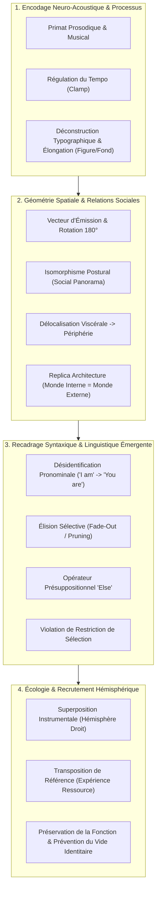

# Transforming Negative Self-Talk
**Formateur :** Steve Andreas | **ID :** `steve-andreas-transforming-negative-self-talk` | **Tranches :** 11

# Synthèse Architecturale du Cours : *Transforming Negative Self-Talk* (Steve Andreas)

---

## 1. Thèse Centrale & Philosophie du Cours

### Vision spécifique & Rupture avec l'approche standard
L'approche conventionnelle du dialogue interne négatif (issue principalement des TCC classiques, de la restructuration cognitive et de la psychologie positive simplifiée) repose sur deux axiomes fallacieux :
1. **L'illusion de la suppression** : tenter de « faire taire », stopper ou chasser la voix critique.
2. **L'illusion de la réfutation par le contenu** : argumenter avec la voix, lui opposer des contre-preuves logiques ou plaquer des affirmations positives contraires.

Pour **Steve Andreas**, ces deux approches violent les lois fondamentales de la neuro-linguistique et de la dynamique systémique :
* **L'effort paradoxal et l'escalade argumentative :** Débattre avec une voix interne lui confère un statut ontologique d'égal à égal ; la partie émettrice monte le volume, accélère la cadence et durcit sa position pour percer la résistance. Tenter d'éliminer la voix active l'inhibition paradoxale (le réseau de saillance se focalise sur ce qu'il cherche à exclure) et ampute une fonction adaptative d'alerte ou de méta-cognition.
* **Le primat analogique (Forme > Contenu) :** Le système nerveux autonome ne réagit pas primairement à la sémantique formelle, mais au **décodage prosodique, postural et spatial** du signal auditif (tronc cérébral et amygdale avant le néocortex). Une phrase n'a aucun pouvoir affectif autonome : c'est son enveloppe acoustique (timbre, tempo, volume, résonance) et sa localisation/orientation géométrique qui dictent la réponse kinesthésique.
* **L'écologie de l'addition :** *« Never subtract experience; always add to it. »* On ne supprime rien dans le système nerveux ; on enrichit les paramètres d'accès, on insère du contexte, on transpose des expériences de référence déjà intégrées, ou l'on recrute des canaux hémisphériques complémentaires.

### Le fil rouge méthodologique : *The Pure Process Change*
Le principe unificateur de toutes les interventions de Steve Andreas est le **changement pur de processus** (*pure process change*) :
$$\text{Impact Émotionnel} = f(\text{Localisation}, \text{Direction}, \text{Tempo}, \text{Tonalité}, \text{Relation Posturale})$$
En intervenant chirurgicalement sur les **paramètres analogiques et spatiaux** de la boucle sans disputer la véracité des mots :
1. Le découplage neuro-kinesthésique est instantané (effondrement de la réponse sympathique/panique).
2. Les défenses analytiques et l'opposition interne sont contournées sans friction.
3. La fonction protectrice sous-jacente est préservée et recalibrée dans un cadre écologique coopératif.

---

## 2. Carte des Concepts & Leviers Émergents

### A. Architecture Topographique & Spatiale
* **Cartographie péripersonnelle & Vecteur d'émission :** Le cerveau encode l'autorité et la menace via la directionnalité. Une voix orientée *vers* le crâne déclenche l'alarme somatique. Pivoter son vecteur d'émission à 180° (orienté vers l'extérieur) produit une atténuation physique perçue et coupe la boucle de résonance somatosensorielle.
* **Isomorphisme postural (*Social Panorama*) :** La position relative de la voix réplique les dynamiques sociales réelles :
  * *Face-à-face* = confrontation, rivalité, jugement.
  * *Différence d'élévation* = asymétrie de statut (la voix au-dessus écrase).
  * *Alignement côte à côte, même hauteur, même regard* = coopération, regard partagé sur un problème extérieur neutre.
* **Somatisation viscéro-sémantique & Déplacement périphérique :** Une voix logée dans les centres neurovégétatifs majeurs (estomac, plexus, cœur) parasite directement l'axe vagal. La déplacer vers une extrémité corporelle neutre (coude, genou, gros orteil) trivialise spontanément son impact et modifie organiquement sa prosodie.

### B. Dynamique Submodale & Analogique
* **Rupture de la Gestalt par élongation temporelle :** L'anxiété exige une cadence rapide pour maintenir l'hyper-éveil sympathique. En insérant des silences (2 à 3 secondes) ou en étirant les voyelles, la cohésion phonologique s'effondre ; le système nerveux ne peut plus synthétiser le signal d'alarme.
* **Bascule Figure/Fond (*Foreground/Background Shift*) :** Par l'espacement spatial des caractères ou la projection sur un panneau d'affichage lointain, l'attention glisse des lettres menaçantes vers le vide interstitiel neutre.
* **Transposition de l'expérience de référence (*Reference Experience Mapping*) :** L'inconscient applique instantanément les lois physiques d'une mémoire sensorielle éprouvée (ex. fermer une double porte en chêne, plonger la tête sous l'eau dans un bain, mettre des boules Quies) pour atténuer le signal sonore interne.

### C. Recadrage Syntaxique, Pronominal & Présuppositionnel
* **Décrochage pronominal (« I am » $\to$ « You are ») :** Passer de la 1ère personne à la 2nde ou 3ème personne rétablit une frontière de contact psychologique (*ego boundary*) et transforme une vérité identitaire fusionnelle en une communication relationnelle traitable.
* **Élision sélective (*Pruning / Fade-Out*) :** Effacer visuellement les modalisateurs d'évitement (« *I'm afraid that it won't...* ») pour ne conserver que le noyau d'action résiduel (« *...work out* ») reconfigure spontanément la commande motrice sans confrontation cognitive.
* **L'opérateur présuppositionnel « Else » :** Remplacer « *What can I enjoy?* » (qui présuppose le vide) par « *What ELSE can I enjoy right now?* » contraint l'inconscient à une recherche transdérivationnelle orientée vers l'abondance tout en validant l'état présent.
* **Violation de restriction de sélection :** Qualifier un objet inanimé (« *une chaise heureuse* ») force la projection de l'affect sur l'observateur tout en court-circuitant la résistance de l'ego.

### D. Écologie Systémique & Dynamique Hémisphérique
* **Recrutement inter-hémisphérique par la musique instrumentale :** Le dialogue interne critique mobilise les aires verbales de l'hémisphère gauche. Superposer une mélodie purement instrumentale (sans paroles) active l'hémisphère droit et sature la bande passante auditive sans risque de conflit propositionnel.
* **Alerte du vide identitaire (*Identity Vacuum*) :** L'extinction submodale ultra-rapide d'un symptôme compulsif/anxieux de longue date libère une masse d'énergie et de temps sans structure. Si ce vide n'est pas anticipé et investi par de nouveaux apprentissages et critères d'identité, un effet rebond (critique violente ou paranoïa) compense la perte de repères.

---

## 3. Tableau Récapitulatif des Techniques & Démonstrations

| Technique / Exercice | Objectif Opératoire | Déclencheur / Indication | Séquence Résumée |
|---|---|---|---|
| **Rotation Directionnelle de la Voix** | Découpler l'impact somatique par inversion du vecteur acoustique | Voix intrusive, impérative, orientée frontalement ou venant de l'arrière de la tête | 1. Localiser l'azimut, la distance et le point d'impact exact du vecteur sonore. 2. Faire pivoter la source sonore de 180° sur son axe (pour qu'elle parle vers l'extérieur). 3. Observer l'éloignement naturel de l'écho, la chute du volume et l'effondrement kinesthésique. |
| **Recadrage Postural (*Social Panorama*)** | Transformer une dynamique de jugement/écrasement en alliance de travail | Voix dominante, moralisatrice, placée en surplomb ou en confrontation face-à-face | 1. Mapper la position relative (hauteur, angle de regard). 2. Ajuster l'élévation pour amener le regard strictement « d'égal à égal ». 3. Déplacer la voix pour la positionner côte à côte, regardant ensemble dans la même direction vers un problème externe. |
| **Délocalisation Viscérale Périphérique** | Désactiver la capture neurovégétative (nausée, boule au ventre, oppression) | Voix ressentie ou émise depuis l'estomac, le plexus solaire ou la région cardiaque | 1. Identifier l'organe hôte et la sensation viscérale associée. 2. Faire glisser physiquement la voix le long du membre (vers le coude, la cheville ou le gros orteil). 3. Noter la transformation spontanée de la prosodie (qui devient comique, fluette ou inoffensive) et le relâchement vagal. |
| **Transposition d'Expérience de Référence** | Atténuer l'intensité auditive sans lutte de volonté | Voix trop forte, criarde ou persistante | 1. Identifier une expérience réelle d'atténuation physique éprouvée (fermer une porte capitonnée, plonger sous l'eau, s'éloigner d'un train). 2. Transposer les sous-modalités physiques de cette mémoire directement sur la voix interne. 3. Laisser l'automatisme neurologique réguler le volume. |
| **Rupture Temporelle & Billboard Visuel** | Briser l'automate anxiogène par effondrement de la gestalt lexicale | Boucle d'anticipation rapide, ruminations accélérées, discours catastrophiste | 1. Imposer un silence de 2 à 3 secondes entre chaque mot de la phrase critique. 2. Transférer la chaîne auditive sur un panneau d'affichage visuel (*billboard*). 3. Étirer l'espace physique entre chaque lettre jusqu'à ce que l'attention bascule sur le fond vide (*figure/ground shift*). |
| **Élision Sélective (*Fade-Out / Pruning*)** | Réorganiser la commande interne en affirmation stable | Phrases auto-limitantes débutant par un doute ou une modalité d'évitement | 1. Visualiser la phrase complète écrite dans l'espace mental. 2. Effacer (*white-out*) sélectivement l'amorce anxieuse (ex. « *Et si ça ne* »). 3. Laisser émerger le segment résiduel recontextualisé (« *va pas marcher* » $\to$ « *marcher* ») comme une directive claire. |
| **Décalage Tonal & Inflexion Interrogative** | Détruire la certitude subjective d'une prophétie négative | Déclarations péremptoires et fatalistes (« *Tu vas échouer* ») | 1. Isoler la tonalité affirmative et définitive de la voix. 2. Remplacer l'intonation descendante par une inflexion montante à la fin de la phrase (? accentuée). 3. Lire la phrase avec une prosodie grotesque (voix de dessin animé) ou une voix d'acteur détachée/sarcastique. |
| **Superposition Instrumentale Hémisphérique** | Bloquer la montée en puissance d'un TOC ou d'une crise de panique verbale | Boucles obsessionnelles verbales, urgences compulsives motrices (ex. lavage de mains) | 1. Ancrer une ressource auditive purement instrumentale, mélodique et lente (ex. nocturne de Chopin, solo de guitare). 2. Lors du déclenchement compulsif, allumer mentalement la piste musicale avec dominance de volume. 3. Utiliser le tempo lent pour contraindre mécaniquement la vitesse du dialogue interne (*tempo entrainment*). |
| **Redirection Présuppositionnelle (« What Else... ? »)** | Réorienter la recherche attentionnelle sans invalidation de l'expérience | Fixation sur le manque, plainte statique, blocage hédonique | 1. Noter l'impasse générée par « *Qu'est-ce que je pourrais apprécier ?* ». 2. Reformuler en intégrant le présupposé additif : « *Qu'est-ce que je peux apprécier d'autre en ce moment ?* ». 3. Laisser l'inconscient scanner l'environnement pour trouver des cibles sensorielles immédiates. |
| **Amorçage Émotionnel par Violation de Sélection** | Induire un état somatique ressource sans alerte de l'ego | Résistance directe aux affirmations d'estime de soi ou d'auto-compassion | 1. Sélectionner des éléments physiques neutres de l'environnement (fauteuil, rideaux, lumière). 2. Leur attribuer le prédicat émotionnel cible (« *un fauteuil confiant* », « *une pièce paisible* »). 3. Laisser la recherche transdérivationnelle rétro-projeter la qualité somatique sur le système nerveux de l'observateur. |

---

## Extractions Détaillées par Tranche (Opératoire & Verbatim)

## --- Tranche 1 / 11 ---

Voici l'extraction et la modélisation opératoire intégrale de la tranche 1/11 du cours et ouvrage de Steve Andreas.

---

### 1. Mécanismes & Principes Actifs

#### A. Le Principe d'Altération Non-Abolitive (L'Héritage Ericksonien)
- **Principe actif :** Tenter de supprimer, faire taire ou « tuer » une voix interne active le phénomène d'effort paradoxal : la tentative de contrôle conscient focalise l'attention et recrute le réseau de saillance, amplifiant la charge neuronale de la voix. Une voix interne est un encodage mnésique d'apprentissage linguistique et relationnel (souvent hérité de figures d'attachement) faisant désormais partie intégrante de la neurobiologie du sujet. Supprimer la voix reviendrait à amputer une fonction cognitive (orientation, alerte, méta-cognition). La transformation consiste à modifier les paramètres analogiques d'accès (la forme) sans détruire la fonction.
- **Tags émergents :** `#alteration_not_abolition` `#non_suppression` `#retroaction_paradoxale` `#preservation_systemique` `#neurobiologie_du_dialogue_interne`

#### B. La Dissociation Processus vs Contenu (Le Primat de la Tonalité et de la Musicalité)
- **Principe actif :** Le système nerveux décode la prosodie, la tonalité, le timbre, la hauteur et le tempo bien avant d'extraire la sémantique formelle (activation du tronc cérébral et du système limbique avant le néocortex). Une voix agressive activant l'amygdale déclenche un état de panique ou d'abattement non pas par les mots employés, mais par son profil fréquentiel et dynamique (voix lente et basse $\to$ effondrement dépressif ; voix aiguë et rapide $\to$ boucle de panique sympatique). En modifiant le canal analogique musical sans toucher au contenu textuel, la réponse kinesthésique s'effondre instantanément, rendant le message inoffensif ou traitable cognitivement.
- **Tags émergents :** `#primat_prosodique` `#tonalite_vs_syntaxe` `#deconnexion_neuro_kinesthésique` `#driver_affectif_submodal`

#### C. L'Échec Systémique du Débat Interne (L'Effet Rebond de la Dispute Cognitive)
- **Principe actif :** Contredire ou argumenter avec sa propre voix critique interne (façon restructuration cognitive classique / TCC frontale) reproduit la dynamique d'un conflit relationnel externe : la partie émettrice augmente l'amplitude, le volume et l'insistance de son message pour franchir la barrière de résistance. Argumenter valide implicitement le statut ontologique de la menace et maintient la focalisation attentionnelle sur le problème.
- **Tags émergents :** `#escalade_argumentative_interne` `#contre_productivite_du_debat` `#renforcement_d_opposition`

#### D. L'Organisation Topographique du Dialogue Interne (Spatialisation & Directionnalité)
- **Principe actif :** Le cerveau encode la pertinence, l'intimité et l'autorité d'un signal auditif à travers des coordonnées spatiales précises dans l'espace péripersonnel (interne/externe, azimut, élévation) et surtout son vecteur de propagation (direction). Une voix externe pointée directement vers la boîte crânienne mime une agression physique ou une intrusion impérative, forçant le système d'alarme à réagir. Lorsque le vecteur sonore pivote à 180° (orienté vers l'extérieur), la propagation acoustique subjective s'éloigne des récepteurs internes, la perception de volume décroît et l'impact kinesthésique chute mécaniquement par découplage somatosensoriel.
- **Tags émergents :** `#cartographie_peripersonnelle` `#vecteur_d_emission` `#rotation_directionnelle` `#geometrie_de_l_impact`

#### E. La Focalisation Figure-Fond ( foreground-background ) et Économie Attentionnelle
- **Principe actif :** La bande passante de l'attention consciente est strictement limitée (loi de Miller, goulot attentionnel). L'inattention sélective naturelle fait que tout signal non nourri par la focalisation recule dans le fond perceptif (*ground*). L'anxiété et la dépression reposent sur la résurrection mnésique d'événements passés ou la simulation projective de futurs catastrophiques qui n'existent pas dans l'instant perceptif. Ramener l'attention sur des stimuli sensoriels somatiques ou environnementaux présents (ou à haut risque physique immédiat) draine instantanément l'énergie métabolique allouée à la boucle auditive interne.
- **Tags émergents :** `#figure_fond` `#saturation_attentionnelle` `#ancrage_perceptif_present` `#drainage_d_energie_mentale`

---

### 2. Protocoles, Techniques & Démonstrations (Étape par Étape)

#### Protocole 1 : Cartographie et Rotation Directionnelle de la Voix Critique
* **Intention / Indication :** Présence d'une voix critique, dévalorisante, anxiogène ou culpabilisante qui génère une réponse émotionnelle viscérale (kinesthésie désagréable immédiate).
* **Mise en place & Pré-framing :** Cadrer l'exercice comme une simple expérience d'exploration perceptuelle. Poser le postulat que la voix n'a pas besoin d'être combattue ou arrêtée, mais simplement écoutée sous un autre angle pour découvrir comment le système nerveux la traite.
* **Séquence d'actions pas à pas :**
  1. *Évocation du stimulus :* Demander au sujet d'activer ou d'écouter la voix problématique qui produit l'état désagréable.
  2. *Élicitation de l'emplacement (Location) :*
     - Est-elle à l'intérieur de la tête ou à l'extérieur ?
     - Si à l'extérieur : devant, derrière, à gauche, à droite, en haut, en bas ?
     - À quelle distance précise de la tête ?
  3. *Calibration somato-motrice :* Inviter le sujet à pointer physiquement avec la main ou le doigt l'endroit précis où réside la source sonore.
  4. *Élicitation du vecteur d'orientation (Direction) :*
     - Vers où le « haut-parleur » de la voix est-il tourné ?
     - Est-elle pointée directement vers le sujet, vers sa tête, ou ailleurs ?
  5. *Test de rotation directionnelle (Inversion 180°) :*
     - Sans changer l'emplacement ni les mots, ordonner/permettre à la voix de pivoter complètement à l'opposé (orientée dos au sujet, parlant vers l'horizon/l'extérieur).
     - Calibrer le changement d'état : constater la diminution du volume et la chute d'intensité émotionnelle.
  6. *Calibration fine des angles intermédiaires :*
     - Tester la voix tournée à 90° (à mi-chemin entre face et dos).
     - Tester l'orientation vers le haut (zénith), vers le bas (sol), vers la gauche, vers la droite.
  7. *Intégration du choix :* Faire constater au système nerveux que l'intensité de l'impact est désormais sous contrôle analogique volontaire.
  8. *Reset écologique :* Faire ramener temporairement la voix à son orientation d'origine pour servir de ligne de base avant les modulations suivantes.
* **Signes de calibration :** 
  - Regard qui décroche vers la zone spatiale de la voix (accès oculaire auditif).
  - Gestuelle spontanée de la main pointant l'espace péripersonnel.
  - Décompression somatique immédiate lors du pivotement de la voix (épaules qui descendent, expiration spontanée, adoucissement des traits du visage).

---

### 3. Heuristiques, Subtilités & "Sagesse du Praticien"

#### Règles conditionnelles directes :
- **Si** une voix désagréable est située à l'extérieur de la tête, **alors** elle est quasi systématiquement orientée directement vers la tête du sujet, créant un sentiment d'intrusion.
- **Si** le sujet tente de faire taire volontairement une voix sans succès, **alors** interdire formellement tout effort d'arrêt ou de débat et rediriger l'attention sur la modification des sous-modalités analogiques (spatialisation, vecteur, tonalité).
- **Si** le praticien observe une divergence entre ce que le modèle prédit (« la voix tournée vers l'extérieur diminue l'intensité chez la majorité ») et ce que le sujet ressent, **alors** la réponse idiosyncratique du sujet devient l'unique vérité du système :
  > *« Whenever your response is different than what I describe, that is very important information. Your response is yours... »*
- **Si** une personne souffre d'un abattement dépressif chronique, **alors** calibrer en priorité la présence d'une voix interne au tempo excessivement lent et au registre grave monotone.
- **Si** une personne présente un tableau de panique aiguë, **alors** chercher immédiatement une voix au tempo ultra-rapide et au pitch aigu.

#### Pièges classiques & Corrections :
- **Le piège de la sémantique :** Passer du temps à analyser *ce que dit la voix* (le sens des reproches, l'origine historique, les traumatismes liés). Steve Andreas démontre que le contenu sémantique est souvent un épiphénomène ; le véritable levier neuro-affectif est la façon dont le son est spatialisé et modulé en fréquence.
- **Le piège de l'éradication :** Vouloir anéantir la voix. Une voix interne est un fragment de la machinerie linguistique du sujet. L'abolir ampute le sujet de ses capacités de planification, d'auto-évaluation et d'alerte. Le mandat opératoire est fixé par Milton Erickson : *alter, not abolish*.
- **Le piège de la prescription universelle de la pleine conscience :** Forcer un sujet à « être uniquement dans le moment présent » en permanence. Si l'ancrage dans le présent coupe les ruminations, il détruit aussi la capacité de rappel des souvenirs ressources et l'anticipation positive optimiste.

---

### 4. Pépites Verbatim & Patterns Linguistiques (MOT À MOT EN V.O.)

#### Pépite 1 : Le Cadre Fondateur d'Erickson
> « Your task is that of altering, not abolishing. »
- **[Analyse du Pattern]** : Présupposition binaire d'injonction thérapeutique. L'antithèse syntaxique (*altering, not abolishing*) pose l'existence indiscutable de la structure cible tout en retirant d'emblée la tentative de destruction au profit d'une flexibilité graduelle. Utilisation d'un nominalisation de processus (*altering*) qui oriente le praticien vers la modulation chirurgicale plutôt que vers la confrontation.

#### Pépite 2 : La Démonstration du Primat Tonal sur la Sémantique
> « For instance, imagine hearing a harsh, sarcastic voice that says, “I love you!” . . . Then hear a soft, loving, sexy voice saying, “You son of a bitch.” . . . Did you respond primarily to the words or the tonality? »
- **[Analyse du Pattern]** : Double contraste sémantico-prosodique et induction par incongruence volontaire. En créant un court-circuit flagrant entre le contenu digital (les mots) et l'enveloppe analogique (l'affect véhiculé par le ton), Steve Andreas force le sujet à vivre l'expérience kinésthésique directe que la physiologie réagit d'abord au paramètre analogique (tonalité) avant de traiter la syntaxe. La question finale n'est pas ouverte : c'est une question de calibration rhétorique dont la réponse est déjà inscrite dans l'état corporel du sujet.

#### Pépite 3 : Le Recadrage de la Normalité Universelle (Dépathologisation)
> « When I have hundreds of people in a room, and I ask, “Who among you has good self-esteem?” hands go up—not many, but some hands go up. And then I ask them, “Do you have an inner critic? Do you have a voice inside your head that criticizes you and says rotten things to you, and puts you down, and says mean and horrible things to you?” And every single one says, “Yes.” And I say to them, “If you have a voice that says rotten things to you, how can you have good self-esteem?” And the interesting reply—it’s always a bit different—but the common bottom line is they don’t listen to it. »
- **[Analyse du Pattern]** : Recadrage de normalisation par citation d'autorité (Yapko) enchâssée dans une narration collective. Le pattern déconstruit l'illusion selon laquelle l'estime de soi dépendrait de l'absence de voix négative. Par l'accumulation d'adjectifs péjoratifs (*« rotten », « mean and horrible »*), Andreas amplifie le phénomène pour mieux asséner la rupture de cadre : le problème n'est pas l'émission de la voix, mais le protocole de réception auditif adopté par le système conscient.

#### Pépite 4 : L'Induction Élicitatrice de la Géométrie Interne
> « Listen now to a troublesome voice that makes you feel bad in some way, and notice its location in your personal space. Most voices are located either somewhere inside your head or in the space immediately surrounding your head. . . . Is it located somewhere inside your head or outside? . . . Is it in front or behind, left side or right side, above or below? . . . And which way it is pointed—toward you, away from you, or somewhere in between? . . . »
- **[Analyse du Pattern]** : Empilement de questions fermées à choix multiples coordonnées par des pauses d'intégration hypnotique (`. . .`). La structure syntaxique présuppose que la voix *possède déjà* une localisation physique précise et une orientation vectorielle (*« notice its location », « which way it is pointed »*). L'utilisation de contrastes dimensionnels simples (*inside/outside, front/behind, above/below*) guide l'inconscient du sujet à spatialiser concrètement ce qui était auparavant vécu comme une émotion diffuse et ingérable.

#### Pépite 5 : La Permissivité Non-Volontariste de la Modification
> « For most people this is quite easy; it is just not something they ever thought of doing. If you have any difficulty, simply allow that voice to change direction. »
- **[Analyse du Pattern]** : Suggestion indirecte de facilité avec normalisation de l'absence passée de contrôle (*« it is just not something they ever thought of doing »* : présuppose que le seul obstacle était l'absence de l'idée, non la capacité neurologique). Utilisation du verbe permissif d'accueil (*« simply allow that voice to change »*), éliminant toute activation de la volonté consciente crispée qui recréerait la résistance psychologique.

## --- Tranche 2 / 11 ---

### 1. Mécanismes & Principes Actifs

- **Équivalence Neurologique Monde Externe / Monde Interne (Replica Architecture)** :
  Le cerveau traite les représentations internes en réactivant les mêmes réseaux neuronaux et moteurs que ceux sollicités par les stimuli sensoriels du monde extérieur. Si une menace externe proche exige une réaction somatique d'urgence (sympathique/combat-fuite), une voix interne perçue à quelques centimètres de la tête déclenchera exactement la même décharge neurovégétative. Éloigner la source rétablit un délai cognitif perçu, diminuant l'urgence biologique.
  *Tags :* `#isomorphisme_sensoriel #threat_distance_law #replica_neurology #chronoception_spatiale`

- **Attribution Linguistique et Décrochage Identitaire ("I am" vs "You are")** :
  L'utilisation de la première personne (« Je suis nul ») fusionne le sujet, l'émetteur et le récepteur dans un espace intra-crânien unique, dissolvant les frontières de l'ego et générant de la confusion (« Suis-je la voix ou ma réponse émotionnelle ? »). La bascule à la deuxième personne (« Tu es nul ») force une dislocation spatiale immédiate : la voix est obligée de s'extérioriser géographiquement pour adopter une posture de communication interpersonnelle, restaurant instantanément un self solide et séparé.
  *Tags :* `#pronominal_syntax_shift #ego_boundary_solidification #dissociation_syntaxique #intra_to_interpersonal`

- **Isomorphisme Postural et Projection Sociale (Social Panorama)** :
  La disposition spatiale relative (hauteur, orientation du regard, alignement corporel) pilote automatiquement le statut relationnel perçu :
  - *Face-à-face* = conflit, confrontation, jugement mutuel.
  - *Côte à côte, même direction* = alliance, coopération, partage d'un objet tiers d'attention.
  - *Différence de hauteur* = asymétrie de pouvoir (supérieur = écrasant/autoritaire ; inférieur = vulnérable). L'alignement « d'égal à égal » (yeux à hauteur d'yeux) neutralise l'autorité toxique et modifie organiquement la prosodie vers un ton neutre et constructif.
  *Tags :* `#social_panorama_mechanics #perceptual_geometry #status_leveling #cooperative_axis`

- **Somatisation Viscéro-sémantique des Localisations Internes** :
  Assigner une voix critique à des organes à forte charge autonome/affective (estomac, cœur) crée des confusions somatiques handicapantes :
  - *Voix dans l'estomac* : fusionne avec les signaux viscéraux élémentaires (nausée, faim compulsive, angoisse viscérale, sensation d'abandon).
  - *Voix dans le cœur* : pollue le centre affectif d'auto-évaluation et de lien, créant détresse affective et paralysie.
  - *Déplacement vers les extrémités (coude, genou, gros orteil)* : déconnecte le message des voies vagales majeures, trivialise l'impact et altère spontanément la prosodie (voix plus aiguë, faible, grotesque).
  *Tags :* `#visceral_semantic_confusion #autonomic_interference #peripheral_bleaching #somatic_decoupling`

- **Transposition de l'Expérience de Référence (Reference Experience Mapping)** :
  L'inconscient utilise des métaphores somatosensorielles encodées pour piloter des variables non régies directement par la volonté. En réactivant le pattern d'une expérience de référence stable (porte qui se ferme, tête sous une couverture, tête sous l'eau dans une baignoire), le système nerveux applique automatiquement l'atténuation du signal acoustique (volume, filtrage des hautes fréquences).
  *Tags :* `#reference_experience_transfer #analog_somatic_anchor #cross_modal_attenuation #naturalistic_attenuation`

- **Négociation Écologique et Respect de l'Intention Protectrice** :
  Une submodalité (localisation) qui refuse de bouger ou qui revient en boucle signale une intention protectrice inconsciente non reconnue : la voix craint que le sujet ne l'écoute plus s'il n'est pas terrorisé par sa proximité. Reconnaître l'intention (« Dans cet autre endroit, je pourrai mieux t'entendre ») lève la résistance sans forcer le système.
  *Tags :* `#parts_ecology #submodality_homeostasis #secondary_gain_negotiation #linguistic_permissiveness`

---

### 2. Protocoles, Techniques & Démonstrations (Étape par Étape)

#### Protocole 1 : Recalibrage Spatial Tridimensionnel de la Voix Critique
* **Intention / Indication** : Voix interne intrusive, accusatrice, obsédante ou paralysante.
* **Mise en place & Pré-framing** : Cadrer l'exercice comme une exploration purement technique de la structure, sans s'attacher au sens des mots. Valider que chaque système nerveux est unique (« Vos réponses vous appartiennent, si c'est différent, c'est juste la façon dont votre esprit fonctionne »).
* **Séquence pas à pas** :
  1. *Étalonnage initial* : Faire résonner la voix critique telle qu'elle se manifeste habituellement ; calibrer la sensation kinesthésique de base.
  2. *Variation de Direction/Orientation* : Faire pivoter l'axe d'émission de la voix (pointée vers le sujet, dos au sujet, vers le haut, vers le bas, gauche, droite). Noter la chute d'intensité quand la voix est dirigée vers l'extérieur.
  3. *Cartographie Corporelle Périphérique* :
     - Déplacer la voix dans le coude gauche. Calibrer le changement spontané de tonalité/hauteur.
     - Déplacer brièvement dans l'estomac et le cœur pour *faire constater par contraste* l'inadéquation et la confusion somatique (puis en sortir immédiatement).
     - Déplacer dans le genou droit, le gros orteil gauche.
  4. *Exploration Externe des 6 Axes et de la Distance* :
     - Projeter la voix à l'extérieur : 60 cm (2 pieds), 3 m (10 pieds), 9 m (30 pieds), 30 m (100 pieds).
     - Tester les 6 axes spatiaux : Devant, Derrière (désactivation liée à la ligne du temps/passé), Gauche, Droite, Dessus, Dessous.
  5. *Intégration Optimale* : Récupérer la meilleure localisation et la combiner avec la meilleure orientation d'émission.
* **Signes de calibration** : Baisse du tonus musculaire défensif, ralentissement respiratoire, relâchement de la mâchoire, sourire ou rire réflexe (effet de décalage burlesque lorsque la voix passe dans un membre éloigné).

---

#### Protocole 2 : Bascule Pronominale & Émergence de l'Image (« I am » vers « You are »)
* **Intention / Indication** : Flou identitaire, auto-dépréciation (« Je suis nul/incompétent »), incapacité à distinguer qui parle.
* **Mise en place & Pré-framing** : « Nous allons modifier un seul mot dans la structure sans toucher au reste de la phrase. »
* **Séquence pas à pas** :
  1. *Constat syntaxique* : Identifier si la phrase débute par « Je suis... » ou « Tu es... ».
  2. *Permutation pronominale* : Si « Je suis », forcer la phrase à être dite en « Tu es [adjectif]... ».
  3. *Repérage spatial instantané* : Constater que la voix est éjectée du centre de la boîte crânienne vers l'extérieur (souvent sur le côté, à ~30 cm d'une oreille).
  4. *Élicitation de l'Émetteur* : Demander « À qui appartient cette voix ? » ou « Si tu le savais, qui ce serait ? / À qui cela te fait-il penser ? ».
  5. *Activation Visuelle Spontanée* : Récupérer la mémoire épisodique du locuteur extérieur situé dans un contexte géographique précis.
* **Signes de calibration** : Sensation de soulagement corporel (« plus solide sur son identité »), pupilles s'orientant vers une zone spatiale externe précise (recherche visuelle/accès auditif externe).

---

#### Protocole 3 : Recadrage Spatial par Positionnement Satir/Austin (Intervention de Contact Épaule)
* **Intention / Indication** : Figure d'autorité hostile intériorisée (ex: père critique, figure dominante) qui toise le sujet d'en haut, de face, maintenant une relation de soumission infantile.
* **Mise en place & Pré-framing** : Utiliser la proprioception en imagination active ou en mouvement physique debout.
* **Séquence pas à pas** :
  1. *Élicitation de la géométrie relationnelle* : Localiser l'image de la personne (ex: debout, tout près, de face, plus haute). Noter son expression faciale et sa posture tendue.
  2. *Rupture de posture géographique* : Faire lever le sujet (physiquement ou mentalement).
  3. *Manœuvre de Contournement* : Guider le sujet pour qu'il marche et se place **derrière** la figure critique.
  4. *Ancrage Kinesthésique Bienveillant* : Inviter le sujet à poser doucement une main sur chaque épaule de la figure et à masser délicatement pour détendre la tension dans ses trapèzes.
  5. *Chuchotement Hypnotique Réciproque* : Lui faire chuchoter à l'oreille de la figure : *« Détends-toi maintenant... complètement... C'est bon... tout va bien... »*.
  6. *Calibration du Relâchement* : Constater que la représentation interne du critique se détend, s'affaisse ou se met à pleurer.
* **Signes de calibration** : Disparition immédiate de la position de vulnérabilité, égalisation spontanée de la hauteur perçue, bascule de la critique vers l'empathie ou la neutralité factuelle.

---

#### Protocole 4 : Atténuation par Écrantage d'Expérience de Référence (Reference Experience Volume Mute)
* **Intention / Indication** : Volume sonore de la voix trop élevé et résistant à la simple volonté consciente.
* **Mise en place & Pré-framing** : Expliquer que la neurologie réagit aux souvenirs complets multi-sensoriels et non à un bouton de volume abstrait.
* **Séquence pas à pas** :
  1. *Recherche d'isomorphe dans la mémoire externe* : Faire scanner des situations de vie réelles où le son d'une voix a baissé brutalement sans baisse d'intensité de la gorge de l'émetteur :
     - Fermeture d'une porte massive entre le sujet et l'autre.
     - Tirage d'un rideau épais.
     - L'autre tourne le dos ou met sa tête sous une couverture.
     - Plonger la tête sous l'eau dans une baignoire (effet de filtre passe-bas/muffle).
  2. *Reviviscence sensorielle complète* : Réactiver la mémoire choisie avec toutes ses caractéristiques VAKOG.
  3. *Superposition sur la voix interne* : Appliquer ce même filtre physique (ex: intercaler une porte hermétique) entre soi et la voix critique.
* **Signes de calibration** : Déglutition, relâchement des muscles péri-auriculaires et temporaux, vérification que la voix devient lointaine ou étouffée.

---

### 3. Heuristiques, Subtilités & "Sagesse du Praticien"

- **Règle de Permissivité Linguistique en cas d'Inertie de la Voix** :
  *Si* la voix refuse de bouger sous une injonction directe (« Déplace la voix ») ou revient élastiquement à sa base,
  *Alors* basculer immédiatement en langage permissif d'observation passive : *« Regarde simplement ce qui se passe quand tu la laisses bouger »*,
  *Parce que* l'injonction directe déclenche une résistance active de l'ego ou d'une sous-partie protectrice, tandis que l'invitation permissive contourne l'effort conscient.

- **Règle de Préservation de l'Écoute (Bait & Safety)** :
  *Si* la voix s'oppose formellement au déplacement (« Si tu ne m'écoutes pas, tu vas avoir des problèmes »),
  *Alors* négocier en garantissant l'accès au message : *« Dans un autre endroit, il me sera plus facile de t'entendre, et je serai plus disposé à t'écouter »*,
  *Parce que* la voix n'a pas pour objectif de blesser, mais de délivrer un avertissement vital. Quand son intention est sécurisée, la structure cède d'elle-même.

- **Règle de l'Indécidabilité Somatique (Zone d'Interdiction Thérapeutique)** :
  *Si* un sujet place naturellement sa voix critique dans l'estomac ou le cœur,
  *Alors* ne jamais le laisser s'y installer durablement ; tester cette position uniquement pour lui faire vivre le contraste de la nocivité, puis déplacer d'urgence,
  *Parce que* l'enchevêtrement des signaux autonomes (faim, nausée, arythmie anxieuse) crée des pathologies fonctionnelles et une paralysie décisionnelle.

- **Règle du Contraste Contre-Intuitif (Calibration par l'Absurde)** :
  Pour faire prendre conscience au sujet de l'existence d'une sous-modalité automatique (comme le lien distance-volume), lui faire faire le contraire : imaginer quelqu'un qui s'éloigne en train tout en parlant de plus en plus fort. L'effort neurologique et l'étrangeté ressentie prouvent instantanément le fonctionnement câblé de l'expérience de référence.

- **Règle de la Géométrie Corporelle dans l'Espace Physique Réel (Austin Trap)** :
  Quand un sujet est assis face à une représentation intimidante, le faire **se lever physiquement**. La représentation mentale reste généralement ancrée à son altitude initiale dans l'espace géographique de la pièce. En se levant, le sujet passe automatiquement d'une position d'infériorité à une position d'égalité ou de domination bienveillante sans avoir à forcer une modification d'image.

- **Postulat Philosophique de Steve Andreas** :
  *« La variabilité individuelle prime sur la statistique. »* Les termes « généralement » et « la plupart des gens » ne sont que des repères. La réponse du client est la seule vérité opératoire. S'il réagit à l'inverse de la norme (ex: une voix plus terrifiante de loin), c'est une information de calibrage précieuse sur sa propre organisation neuronale (ex: profil d'ambidextre/inversion de timeline).

---

### 4. Pépites Verbatim & Patterns Linguistiques (MOT À MOT EN V.O.)

#### Pépite 1 : Cadrage Épistémologique de la Divergence Individuelle
> "Whenever your response is different than what I describe, that is very important information. Your response is yours, no matter what I may say is “usually true” for “most people.” If you experience something different, that isn’t wrong; it’s just that your mind works somewhat differently than that of “most people.” As long as you discover how your mind works, you can use this information to have more choices."
* **[Analyse du Pattern]** : Recadrage de normalisation et validation radicale de l'autorité interne du sujet. Utilisation d'une structure en double dissociation (« ce n'est pas faux, c'est juste différent ») éliminant l'anxiété de performance thérapeutique. Présupposition d'autonomisation : toute découverte — même aberrante par rapport au modèle standard — est transformée en levier (« have more choices »).

---

#### Pépite 2 : Dé-volition Permissive face à la Résistance
> "Instead of saying, 'move the voice,' try saying, 'just watch as it moves,' or 'notice what happens as you allow the voice to move' and see if that kind of language makes it easier for the voice to move to a new location."
* **[Analyse du Pattern]** : Déplacement de l'agentivité vers un état de témoin passif (*spectator ego*). « Just watch as... » présuppose temporellement que le mouvement a déjà lieu de manière autonome. Le verbe « allow » (permettre) supprime la notion de lutte ou de contrôle volontaire, dissolvant la réactance psychologique.

---

#### Pépite 3 : Levier Écologique de Négociation avec la Voix
> "If you reply to the voice, 'In a different location it would be easier for me to hear what you say, and I would be more willing to listen to you,' the voice may then be willing to change location, because its intention is no longer threatened."
* **[Analyse du Pattern]** : Utilisation du recadrage de négociation de sous-parties. La formulation enchâsse une promesse de coopération (« it would be easier for me to hear... more willing to listen ») conditionnée au changement submodal. On court-circuite la boucle de résistance en montrant que le changement de forme améliore l'accomplissement du fond (l'intention de la partie).

---

#### Pépite 4 : Induction Dérivationnelle pour Révéler l'Identité Masquée
> "Next notice who is speaking to you in this way, and notice if you have an image of this person who is speaking to you. (If you can’t immediately identify whose voice it is, ask yourself, 'If I did know, who would it be?' or 'Who does this voice remind me of?')"
* **[Analyse du Pattern]** : Questionnement par conditionnel contrefactuel (« If I did know, who would it be? »). Cette manœuvre syntaxique éricksonienne classique désactive le mécanisme de censure du « je ne sais pas », autorisant l'inconscient à livrer l'empreinte mnésique sans engager la responsabilité logique de la conscience critique.

---

#### Pépite 5 : Script de Pacification Corporelle Somato-Émotionnelle (Satir / Austin)
> "That’s right. Now close your eyes. I want you to imagine walking around behind him, and gently place one hand on each of his shoulders and gently massage those shoulders. Whisper into one ear that is close enough to hear you, to 'Relax now . . . all the way.' . . . Tell him it’s OK, . . . it’s OK, . . . Give him a few moments to relax, all the way down now. . . ."
* **[Analyse du Pattern]** :
  - *Truisme d'approbation initial* : « That’s right » (ratification de transe).
  - *Commande directe couplée à un ancrage spatial kinesthésique* : rompt la relation de confrontation en déplaçant le client dans l'angle mort de l'agresseur, le transformant en pourvoyeur de réconfort.
  - *Pacing vocal et fractionnement* : Les points de suspension (« . . . ») marquent des ralentissements de tempo.
  - *Double commande enchâssée récursive* : En faisant chuchoter au client « Relax now . . . all the way down now », le client prononce pour l'autre les mots exacts qui induisent sa propre transe somatique de relâchement par rétroaction proprioceptive et boucle audio-phonatoire.

## --- Tranche 3 / 11 ---

Voici l'analyse opératoire intégrale de la tranche 3/11 du cours *Transforming Negative Self-Talk* de Steve Andreas (avec les apports méthodologiques de Nick Kemp).

---

### 1. Mécanismes & Principes Actifs

#### A. Le Levier de Transposition Métaphorique Sensorielle (Isochronisme Neurologique)
- **Principe actif :** Le système nerveux autonome et les réponses kinesthésiques réagissent aux représentations internes vives exactement de la même manière qu’aux stimuli du monde externe. Imaginer plonger ses mains dans l'eau glacée provoque une vasoconstriction périphérique réelle ; imaginer les plonger dans l'eau chaude provoque une vasodilatation. Pour modifier une modalité subconsciente (comme le volume ou l'intensité d'une voix interne), le cerveau utilise des équivalences du monde réel déjà éprouvées de manière répétée (fermer une porte, tirer un rideau, s'immerger sous l'eau dans une baignoire, mettre la tête sous les draps). L'inconscient applique instantanément les lois physiques de l'expérience source à la dynamique interne.
- **Tags émergents :** `#transposition_sensorielle` `#equivalence_neurologique` `#attenuation_acoustique_contextuelle` `#reponse_ideomotrice_ideovagale`

#### B. La Modification Pure de Processus vs Intervention sur le Contenu
- **Principe actif :** Modifier la localisation, la distance, la direction, la vitesse (tempo) ou la tonalité constitue un « changement de processus pur » (*pure process change*). Le contenu sémantique (la phrase toxique) n'a de pouvoir affectif que par l'intermédiaire de son formatage neuro-acoustique. En intervenant sur la forme sans toucher aux mots, on contourne les défenses analytiques du client et on réorganise la relation sujet/voix sans entrer dans le débat argumentatif.
- **Tags émergents :** `#pure_process_change` `#deconstruction_acoustique` `#contournement_du_debat_cognitif` `#submodalites_analogiques`

#### C. Le Découplage Temporel de la Menace (Hyper-Éveil & Verrouillage en Vitesse Rapide)
- **Principe actif :** L'anxiété est une boucle d'anticipation rapide. Lorsque le dialogue interne tourne à haute vitesse, le système nerveux est maintenu en état d'hyper-alerte (activation sympathique maximale), créant un effet de « boîte de vitesses bloquée en rapport supérieur ». À cette vitesse, le cortex préfrontal n'a plus accès aux voies secondaires (options de recul, choix comportementaux, résolution de problème). Ralentir mécaniquement le tempo de la voix force la désactivation sympathique et réinstalle le système parasympathique, restaurant la flexibilité cognitive.
- **Tags émergents :** `#hyper_eveil_sympathique` `#boite_de_vitesse_cognitive` `#desactivation_parasympathique` `#tempo_comme_declencheur_affectif`

#### D. La Déconstruction Sémantique par Espacement Spatial et Typographique (Figure/Ground Shift)
- **Principe actif :** Le cerveau traite le langage écrit ou auditif en regroupant les unités de sens sous forme de blocs cohérents (gestalts). En étirant spatialement les mots, puis les lettres d'une phrase négative projetée visuellement, ou en insérant des silences prolongés entre chaque mot parlé, on opère une bascule figure/fond (*figure/ground shift*). L'attention du sujet ne porte plus sur les symboles porteurs de menace, mais sur le vide/l'espace neutre qui les sépare. Le sens grammatical s'effondre, désactivant la charge kinesthésique associée.
- **Tags émergents :** `#figure_ground_shift` `#effondrement_de_la_gestalt` `#dilution_typographique` `#vide_intersticiel`

#### E. L'Écologie des Objections et l'Évitement de l'Escalade Conflit-Interne
- **Principe actif :** Supprimer brutalement une voix ou imposer une voix positive symétriquement opposée (« Je suis nul » contré par « Je suis fort ») produit une escalade du conflit intérieur ou une rébellion de l'inconscient. De plus, une voix négative porte souvent une fonction protectrice (vigilance, anticipation). Si elle disparaît sans intégration, le sujet éprouve un sentiment de vide ou d'instabilité (*shaky feeling*). Pour modifier le dialogue interne sans déclencher de résistance, il faut :
  1. Vérifier la congruence et respecter toute objection comme un signal d'intelligence inconsciente supérieure.
  2. Construire des recadrages linguistiques compatibles avec la prémisse du problème (ex: « Je peux apprendre à être intelligent » présuppose que je ne le suis pas encore, désamorçant ainsi l'opposition directe avec « Tu es stupide »).
- **Tags émergents :** `#congruence_inconsciente` `#fonction_protectrice` `#solidite_vs_instabilite` `#accord_implicite_anti_polarisation`

---

### 2. Protocoles, Techniques & Démonstrations (Étape par Étape)

---

#### PROTOCOLE 1 : L'Atténuation Analogique Réaliste du Volume Interne
* **Intention / Indication :** Réduire l'impact émotionnel et le volume d'une voix critique ou intrusive sans lutter contre elle.
* **Mise en place & Pré-framing :** Cadrer que le système nerveux obéit aux lois de l'expérience physique. Demander au sujet de faire appel à des souvenirs réels où un son externe s'est étouffé ou a baissé de volume.
* **Séquence d'actions pas à pas :**
  1. Identifier la voix problématique et son volume initial.
  2. Éliciter une mémoire physique répétée d'atténuation sonore :
     - Quelqu'un qui ferme une porte entre lui et vous.
     - Quelqu'un qui tire un rideau épais.
     - L'interlocuteur qui se détourne ou met sa tête sous les couvertures.
     - L'action de se boucher les oreilles avec les mains.
     - L'immersion des oreilles sous l'eau dans une baignoire.
  3. Demander au sujet d'appliquer ce filtre physique précis à la voix interne problématique (visualiser la porte se fermer, le rideau se tirer ou l'immersion se faire).
  4. Constater la chute de décibels et la modification de l'état émotionnel interne.
  5. Calibrer l'écologie (sentiment de confort et de contrôle).
* **Signes de calibration :** Baisse des épaules, relâchement de la mâchoire, expiration spontanée, posture plus stable.

---

#### PROTOCOLE 2 : Le Ralentissement de Tempo pour Anxiété et Hyper-Alerte (Nick Kemp)
* **Intention / Indication :** Traitement de l'anxiété aiguë, phobies (ex: peur de l'avion), ruminations paniques, états de stress où le sujet est « coincé en vitesse rapide ».
* **Mise en place & Pré-framing :** 
  - Expliquer la chaîne : Pensée/Structure cognitive $\to$ Émotion/Sensation $\to$ Comportement.
  - Réaliser un check de congruence préalable : vérifier si une part du sujet a une objection à être plus confortable ou si la peur a une fonction de survie contextuelle.
* **Séquence d'actions pas à pas :**
  1. **Accès au Dialogue Interne Précurseur :**
     - Inviter le sujet à fermer les yeux et à revivre un épisode juste avant que la sensation n'émerge.
     - *Si le sujet est dissocié/bloqué :* le réassocier via les sensations kinesthésiques réelles (texture de la chaise, posture, appui des pieds au sol) OU utiliser la bulle de BD (« Qu'écrirait le dessinateur dans la bulle au-dessus de ta tête ? »).
     - Déterminer la phrase exacte (ex: *« L'avion va s'écraser dans la mer »*).
     - Généraliser à la catégorie globale (« Dis-tu cela ou une phrase similaire dans d'autres situations ? »).
  2. **Calibrage du Tempo Initial (Baseline) :**
     - Poser le choix binaire : *« Tu le dis à un tempo de conversation normal ou à un tempo plus rapide ? »*
     - Faire répéter la phrase mentalement telle quelle pour calibrer la réponse kinesthésique de base.
  3. **Premier Ralentissement (Réduction d'un tiers) :**
     - Le praticien prononce lui-même la phrase du sujet à voix haute, ralentie d'environ 1/3.
     - Le praticien marque un temps d'arrêt.
     - Le sujet répète la phrase intérieurement à cette même vitesse ralentie et observe la différence.
  4. **Deuxième Ralentissement Dramatique (Calibré sur l'Expiration) :**
     - Le praticien démontre le tempo ultra-lent à voix haute.
     - **Règle physiologique :** Insérer **au moins 2 secondes** de silence entre chaque mot.
     - **Synchronisation :** Caler chaque mot sur **l'expiration** du sujet (ancrage de la détente parasympathique).
     - **Rupture d'attente :** Observer la tension d'anticipation chez le sujet et prononcer le mot suivant *légèrement plus tard* qu'attendu.
     - **Pause terminale :** Doubler la durée de la pause entre l'avant-dernier et le dernier mot de la phrase.
     - Demander au sujet de répéter la phrase intérieurement à cette allure hyper-lente.
  5. **Test & Vérification de Congruence :**
     - *« Quand tu essaies de repenser à cela comme tu le faisais avant, que remarques-tu de différent ? »*
     - Pont vers le futur : projeter le sujet dans la situation de la semaine suivante et vérifier l'absence d'objections écologiques.
* **Signes de calibration :** Ralentissement du rythme respiratoire, disparition des micro-tensions faciales, déglutition, rire ou sourire spontané (signe d'effondrement de la charge phobique).

---

#### PROTOCOLE 3 : Déconstruction Visuelle et Kinesthésique (Variations Billboard)
* **Intention / Indication :** En cas d'échec ou d'effet insuffisant du ralentissement auditif pur, ou pour amplifier l'effondrement sémantique.
* **Séquence d'actions pas à pas :**
  1. **Projection Visuelle :** Projeter la phrase négative sur un panneau d'affichage devant soi (taille, police, distance, graisse).
  2. **Espacement Inter-Mots :** Écarter les mots les uns des autres pour agrandir l'espace vide entre eux.
  3. **Bascule Figure/Fond :** Porter toute l'attention visuelle non plus sur les mots, mais sur les espaces vides intersticiels.
  4. **Espacement Inter-Lettres :** Écarter les lettres à l'intérieur de chaque mot, puis fixer les espaces vides entre les lettres.
  5. **Suppression Sub-lexicale / Reconfiguration :**
     - En présence d'une négation (ex: *« I can't »* / *« Je ne peux pas »*), faire supprimer mentalement la particule négative sans prononcer le mot interdit (ex: *« Retire l'apostrophe et le 't' du deuxième mot »*).
     - Pour un mot hautement pathogène : le faire pâlir graduellement jusqu'au « pfff » (effacement blanc total).
  6. **Variation Kinesthésique-Tactile :** Demander au sujet d'avancer les mains, de saisir physiquement les lettres et les mots comme des objets solides, et d'écarter manuellement les mots et les lettres pour toucher l'espace vide.
* **Signes de calibration :** Déconnexion du regard (défocalisation/transe légère), soupir de soulagement, bascule posturale immédiate vers le repos.

---

### 3. Heuristiques, Subtilités & "Sagesse du Praticien"

#### Règles Conditionnelles Opératoires
- **Si** le sujet ressent un malaise physique (estomac, cœur) lors d'un déplacement de voix, **alors** revenir immédiatement à l'état antérieur, **parce que** cette sensation kinesthésique est le signal direct d'une objection écologique de l'inconscient.
- **Si** une voix revient spontanément à son emplacement d'origine après un changement expérimental, **alors** abandonner ce réglage et chercher une autre modalité, **parce que** le système indique que le changement testé n'est pas utile ou fonctionnel.
- **Si** une voix disparaît et que le sujet ressent un soulagement mais accompagné d'un sentiment d'instabilité ou de fragilité (*shaky feeling*), **alors** faire revenir immédiatement la voix à une distance/direction confortable pour dialoguer avec elle, **parce que** la voix a été étouffée sans intégration et que sa fonction protectrice a été perdue.
- **Si** la voix disparaît avec une sensation de solidité accrue (*feeling more whole*), **alors** valider le processus, **parce que** la part s'est réorganisée et intégrée à l'identité.
- **Si** le sujet résiste à l'idée d'abandonner son anxiété par peur du danger, **alors** utiliser le recadrage temporel contextuel (*« L'anxiété est utile pour décider ou non de monter dans l'avion ; une fois dans l'avion, elle ne protège plus de rien, autant profiter du vol »*).
- **Si** une objection persiste avec une fonction de sécurité, **alors** lui déléguer la résolution du problème : *« Comment peux-tu continuer à me protéger du danger tout en me permettant d'être plus confortable ? »*.
- **Si** vous voulez renforcer une voix positive (ex: *« Je suis capable »*), **ne jamais** la poser en opposition directe à une voix négative (*« Tu es incompétent »*), **mais** choisir une formulation d'apprentissage inclusive (*« Je peux apprendre à devenir capable »*), **parce que** cela présuppose le point de départ de la critique et annule la guerre civile interne.
- **Si** le sujet accélère une voix dépressive lente (ex: femme endeuillée), **alors** la tonalité bascule spontanément vers le ridicule ou l'humour (voix de rappeur hip-hop), **parce que** la physiologie de la dépression dépend structurellement d'un tempo traînant et grave.

#### Pièges Classiques & Erreurs Corrigées
- **Erreur de débutant :** Dire au sujet *« Pense à un moment où... »*. C'est une induction ambiguë qui mène à la dissociation (le sujet s'observe de l'extérieur) ou au scan mental superficiel d'une liste de souvenirs sans jamais entrer dedans.
- **Correction :** Utiliser une formule d'association immédiate orientée sur le temps présent de l'action : *« Je voudrais que tu appelles l'une de ces situations à l'esprit maintenant, et que tu me dises ce que tu penses ou ce que tu te dis, juste avant que la sensation n'apparaisse. »*
- **Piège du contenu :** Nommer le mot toxique qu'on veut effacer (ex: *« Efface le mot 'peur' »*). Cela réactive la représentation neuronale du mot au moment même où on tente de l'éteindre. **Règle absolue :** Ne désigner le mot que par son indexation syntaxique (*« Le deuxième mot »*, *« Le quatrième mot »*).

---

### 4. Pépites Verbatim & Patterns Linguistiques (MOT À MOT EN V.O.)

#### Pépite 1 : L'Accès Associé au Dialogue Interne Précurseur
> *"Now I know from what you have told me that up until this point you have experienced this intense feeling on a number of occasions. I’d like you to bring one of these times to mind now, and let me know what you are either thinking or saying to yourself at these times, just before the feeling occurs. You can do this either with your eyes open or closed. Most people find it easier with their eyes closed."*

* **[Analyse du Pattern]** :
  - **Présupposition temporelle et bornage du problème :** L'expression *« up until this point »* (jusqu'à ce point précis) borne le problème dans le passé et présuppose implicitement qu'à partir de maintenant, l'expérience cesse d'exister sous sa forme ancienne.
  - **Ciblage du déclencheur séquentiel :** L'instruction *« just before the feeling occurs »* isole le prédicat linguistique avant que la cascade neuro-kinesthésique ne se verrouille.
  - **Double lien ericksonien et truisme d'induction :** L'alternative *« eyes open or closed »* suivie de la validation normative *« Most people find it easier with their eyes closed »* constitue une suggestion indirecte puissante qui oriente le sujet vers la fermeture des yeux et l'intériorisation sans contrainte autoritaire.

---

#### Pépite 2 : La Réassociation Somatosensorielle d'Urgence
> *"When you are in that experience, what do you feel in your body? If you are sitting down, can you feel the shape, texture, and temperature of that particular chair, and your posture as you sit in it? If you are standing, can you feel how your feet contact the floor, and the position of your feet? Do you feel tense or relaxed, balanced or off balance?"*

* **[Analyse du Pattern]** :
  - **Empilement de sous-modalités kinesthésiques réelles :** L'interrogation séquentielle sur la forme, la texture, la température et le contact des pieds force le système nerveux à recréer la proprioception de la scène source.
  - **Interrogations polaires forcées :** L'utilisation de paires d'opposés (*tense or relaxed, balanced or off balance*) oblige le cortex sensoriel à scanner la physiologie interne, ce qui détruit la dissociation cognitive et réassocie instantanément le sujet.

---

#### Pépite 3 : La Projection Métaphorique Dissociée (« Thought Bubble »)
> *"If I were to draw a picture of you in one of these experiences, as in a comic book, where the artist draws thought bubbles above each character’s head, what should I put in the bubble over your head to indicate what is being thought at that precise moment?"*

* **[Analyse du Pattern]** :
  - **Utilisation et canalisation de la séparation (Utilisation frame) :** Au lieu de forcer une association qui résiste, le praticien utilise la tendance à la dissociation du sujet.
  - **Métaphore de la bande dessinée (Dé-trivilialisation) :** L'image de la bulle de pensée transforme une charge émotionnelle diffuse en un objet visuel externe délimité, permettant une extraction objective du verbatim sans réactiver la panique.

---

#### Pépite 4 : L'Extinction Visuelle Indirecte sans Réactivation Neuronale
> *"Remove the apostrophe and the t in the second word of the sentence... And now take the fourth word, and do the same thing. Start to fade it out a little bit more, a little bit more. And then there's a certain point where — pfff — white it out. So it's not there. You know it's not there, because when you look now, it's not there."*

* **[Analyse du Pattern]** :
  - **Règle de désignation indirecte :** Utilisation exclusive de la position ordinale (*« the second word »*, *« the fourth word »*) pour contourner l'activation de la boucle acoustico-sémantique.
  - **Onomatopée d'interruption de pattern :** L'insertion de l'onomatopée motrice *« — pfff — »* agit comme un ancrage auditif de rupture, marquant le passage instantané de l'état visible à l'effacement total.
  - **Empilement de truismes et tautologie sensorielle :** La chaîne *« So it's not there. You know it's not there, because when you look now, it's not there »* sature la boucle logique en reliant la certitude interne à la simple vérification visuelle actuelle.

---

#### Pépite 5 : La Déconstruction Conversationnelle de la Séquence Symptomatique (Nick Kemp à Fred)
> *"Now most of the time, what they’re experiencing is the end— the final behavior at the end of the sequence. So, the final behavior is, you know, doing this (gestures at waist height). And before you get to that, you have how a person feels (gestures at chest height). And before you get to the feeling, you have what happens here (gestures at head height), which is what they’re thinking, and how they’re thinking about it. Because you can’t just get a feeling. You know, if I said to you, 'I want you to feel wildly enthusiastic,' but you’re not allowed to picture anything, look at anything, think anything to yourself, or hear anything, you can’t get from the state that you’re in to that state. There’s got to be some translation here. So here’s the good news: In order to change the final result, you’ve got to change this stuff up here."*

* **[Analyse du Pattern]** :
  - **Spatialisation somato-gestuelle (Ancrage spatial de la chaîne T-O-T-E) :** Nick Kemp ancre visuellement la chronologie de la réponse : le comportement final en bas (taille), l'émotion au milieu (poitrine), et la pensée en haut (tête).
  - **Preuve par l'absurde (Réfutation d'impossibilité) :** La commande impossible (*« feel wildly enthusiastic »* sans représentation interne) démontre expérientiellement au sujet que l'émotion n'est pas une entité magique spontanée, mais la conséquence mécanique d'un processus cognitif.
  - **Recadrage d'empowerment (« The good news ») :** La conclusion logique transforme une fatalité subie (l'anxiété qui envahit le musicien) en un levier opérationnel contrôlable : en modifiant simplement le niveau supérieur de la chaîne gestuelle, le résultat final s'effondre obligatoirement.

## --- Tranche 4 / 11 ---

Voici l'extraction et la modélisation intégrale de la substance opératoire de cette tranche, selon les règles d'ingénierie et la structure demandées.

---

### 1. Mécanismes & Principes Actifs

#### A. Rupture de la Gestalt Auditive par Élongation Temporelle et Spatialisation Lexicale
* **Principe actif :** Une boucle de dialogue interne anxiogène opère sous forme d'une unité synchrone automatisée (*gestalt*) cadencée à haute vitesse. Cette vitesse rapide mime physiologiquement l'état d'urgence sympathique. En intercalant des silences forcés de 2 à 3 secondes entre chaque mot, puis en transférant la chaîne auditive dans le registre visuel spatialisé (panneau d'affichage / *billboard*), le système nerveux perd la cohérence phonologique nécessaire pour synthétiser le signal d'alarme. Le mot n'est plus une commande somatique réflexe ; il devient un objet d'attention disjoint de sa charge émotionnelle.
* **Tags :** `#elongation_temporelle` `#synesthesie_auditivo_visuelle` `#deconstruction_de_gestalt` `#decouplage_tempo_affect`

#### B. Extinction Sélective & Recadrage Syntaxique Émergent (The "Fade-Out / Pruning" Effect)
* **Principe actif :** En effaçant visuellement (*white-out*) les premiers mots d'une phrase anxiogène auto-générée (« *Is it gonna go well?* » -> « *Go well* » ou « *Oh shit I don’t wanna be here* »), le praticien supprime les opérateurs de modalité dubitative ou les amorces d'évitement. La chaîne résiduelle non effacée se réorganise spontanément dans le champ cognitif en une commande positive ou une affirmation stable (« *Go well* »), sans injection artificielle de pensée positive extérieure.
* **Tags :** `#elision_visuelle_selective` `#recadrage_syntaxique_interne` `#reconfiguration_spontanee` `#pruning_lexical`

#### C. Altération Modale par Décalage Tonal Direct (Atonie & Prosodie Interrogative)
* **Principe actif :** Le cerveau encode la certitude du danger via la tonality (ton péremptoire, pressé, contracté). Deux bascules directes détruisent cette certitude sans toucher au contenu sémantique :
  1. *L'intonation de lecture plate (script/théâtre)* : désengage l'identification du soi en réattribuant l'énoncé à un texte tiers extérieur, provoquant une dissociation kinesthésique immédiate.
  2. *L'inflexion interrogative montante* : transforme un prédicat de panique (« *Je ne veux pas être ici.* ») en doute cognitif (« *Je ne veux pas être ici ?* »), ce qui réouvre immédiatement l'espace de traitement de l'information au niveau cortical.
* **Tags :** `#inflexion_montante` `#tonalite_de_script` `#desidentification_vocale` `#effondrement_de_certitude`

#### D. Le Vide Identitaire Post-Symptomatique et l'Effet Rebond de l'Écologie
* **Principe actif :** Une modification submodale rapide (tempo/tonalité) appliquée à un dialogue interne peut éteindre instantanément un comportement compulsif ou addictif ancré depuis des décennies (ex. alcoolisme/insomnie sur 16 ans). Cependant, lorsque le symptôme servait de colonne vertébrale à l'identité (*self-concept*) et structurait l'intégralité du temps, de l'état d'excitation (*hyped-up persona*) et du réseau social, sa disparition crée un vide existentiel (*vacuum*). Si ce vide n'est pas rempli par de nouvelles structures de sens, de valeur et une modification préalable du *contenu* des voix critiques, celles-ci se réactivent sous une forme paranoïaque et violente projetée vers l'extérieur.
* **Tags :** `#vide_identitaire` `#recul_critique_rebond` `#ecologie_systemique` `#perte_de_self_concept` `#limite_du_changement_submodal_pur`

#### E. Principe d'Addition d'Expérience vs Soustraction
* **Principe actif :** « *Never subtract experience; always add to it.* » Tenter de supprimer, réprimer ou faire taire une voix interne réduit les choix du système et génère une résistance adaptative. Ajouter une piste auditive superposée (stimulus musical instrumental, traité principalement par l'hémisphère droit non linguistique) altère le traitement affectif global sans entrer en conflit avec le contenu lexical conscient.
* **Tags :** `#addition_versus_soustraction` `#stimulation_hemispherique_droite` `#superposition_musicale`

#### F. Dérivation Métaphorique Idéomotrice en Transe Flash (Exemple de Chopin/Soderquist)
* **Principe actif :** L'activation d'une ressource auditive interne hautement investie d'affect (une mélodie de nocturne de Chopin fredonnée et entendue intérieurement) crée un pont d'accès immédiat à une transe de réceptivité. En couplant l'impulsion motrice compulsive (l'envie de se laver les mains) au déclenchement de cette mélodie interne (« *turning on that nocturne instead* »), le praticien substitue le programme moteur d'apaisement sans affronter la névrose obsessionnelle.
* **Tags :** `#substitution_ideomotrice` `#couplage_ressource_transe` `#ancrage_auditif_croise`

---

### 2. Protocoles, Techniques & Démonstrations (Étape par Étape)

#### PROTOCOLE 1 : La Déconstruction Tempo-Spatiale de Nick Kemp (Démonstration sur Fred)
* **Intention / Indication :** Panique de performance, anxiété d'anticipation, trac paralysant chez les musiciens, orateurs ou sportifs déclenché par une petite phrase interne prononcée rapidement.
* **Mise en place & Pré-framing :** Expliciter que le ressenti somatique n'est que la résultante finale de la vitesse et de la modalité du dialogue interne (« *It’s the way in which you think and how you think that creates the feeling* »).
* **Séquence pas à pas :**
  1. **Élicitation du verbatim premier :** Demander au sujet de fermer les yeux et de retrouver le moment anxiogène exact. Extraire la phrase exacte en bulle de bande dessinée à la première personne (ex. : « *Oh shit, I don’t wanna be here* »).
  2. **Calibration de la sous-modalité d'origine :** Vérifier que la voix est rapide et anxieuse. Calibrer la réponse kinesthésique (ex. : tension démarrant dans la poitrine, descendant dans les bras et montant aux lèvres).
  3. **Ancrage somatique présent :** Commander une inspiration profonde et la sensation des pieds à plat sur le sol (*grounding*).
  4. **Bascule en voix de lecture (Atonie) :** Faire répéter la phrase une fois d'une voix totalement neutre, monocorde, comme si le sujet lisait la réplique banale d'une pièce de théâtre.
  5. **Bascule en inflexion interrogative montante :** Faire répéter la phrase en montant le ton à la fin, la transformant en question dubitative (« *Oh shit. I don’t wanna be here ?* »).
  6. **Élongation temporelle (Espacement extrême) :** Le praticien modèle lui-même le débit en espaçant chaque mot de 2 à 3 secondes de silence (« *Oh . . . shit! . . . I . . . don’t . . . wanna . . . be . . . here.* »). Le sujet répète à cette vitesse ultra-lente.
  7. **Projection sur Billboard Visuel :** Demander au sujet de projeter les mots écrits devant lui sur un grand panneau d'affichage, nets et distincts.
  8. **Espacement spatial des graphèmes :** Augmenter la distance spatiale entre chaque mot sur le panneau.
  9. **Élision progressive (Fade-out / White-out) :** Faire estomper puis disparaître subitement (*pffft*) les mots anxiogènes ou les modaux douteux, jusqu'à ce qu'il ne reste que les mots porteurs ou un espace blanc.
  10. **Test & Réévaluation Kinesthésique :** Demander au sujet de tenter de repenser à la phrase originale comme il le faisait avant.
* **Signes de calibration :** Relâchement musculaire visible du thorax et des épaules, ralentissement du rythme respiratoire, sourire ou rire de dérision (« *It doesn’t have any significance / It’s quite relaxing* »), transformation de l'émotion d'angoisse en simple « souvenir neutre ».

---

#### PROTOCOLE 2 : Exploration Directe des Accents & Tonalités Internes (Steve Andreas)
* **Intention / Indication :** Dialogue critique persistant résistant au simple changement de volume ou d'emplacement spatial.
* **Mise en place :** Isoler la phrase critique et calibrer son impact affectif de base.
* **Séquence pas à pas :**
  1. **Écoute de base :** Noter précisément les mots et la tonalité exacte (timbre, mélodie, hauteur).
  2. **Balayage d'accents géographiques / nationaux contrastés :** Faire prononcer la même phrase interne successivement avec des accents fortement typés (accent britannique aristocratique, mexicain, chinois, texan, russe, italien, etc.). Observer le basculement émotionnel.
  3. **Balayage de profils de personnalité caricaturaux :** Faire dire la phrase avec la voix de quelqu'un de calme, d'un individu hésitant, d'un menteur compulsif, d'un individu surexcité, etc.
  4. **Balayage des attitudes modales :** Tester la phrase sur un ton d'étonnement absolu, d'incompréhension totale, d'ordre militaire ou de perplexité.
  5. **Sélection et Pont vers le Futur (*Future Pace*) :** Dès qu'un ton neutralise la charge ou génère une ressource utile, figer ce réglage et demander au sujet de s'imaginer dans le contexte futur déclencheur en entendant la voix s'exprimer avec ce nouveau filtre tonal.
* **Signes de calibration :** Rupture de l'affect négatif, rire spontané, désensibilisation kinesthésique immédiate face à la voix.

---

#### PROTOCOLE 3 : Le "Mood Shift" par Superposition Musicale (Steve Andreas)
* **Intention / Indication :** États d'humeur récurrents (dépression latente, sentiment d'offense, colère résiduelle, abattement).
* **Mise en place :** Cadrer l'exercice sur le principe d'addition plutôt que d'éradication du ressenti.
* **Séquence pas à pas :**
  1. Identifier l'humeur limitante récurrente.
  2. Sélectionner une musique instrumentale candidate :
     - Soit par contraste direct (ex. : air tzigane festif contre un état abattu).
     - Soit par amplification homéopathique / réduction à l'absurde (ex. : une marche funèbre exagérée jouée par mille violons pour rendre la dramatisation grotesque).
  3. Activer mentalement la musique sélectionnée à fort volume auditif interne.
  4. Tout en maintenant la musique en continu, révoquer le souvenir ou le déclencheur de l'état limitant.
  5. Observer la modulation de l'état : ajuster le style de musique jusqu'à obtenir l'effet stabilisateur ou libérateur optimal.
  6. **Pont vers le Futur :** Visualiser la situation déclenchante future tout en laissant la musique démarrer automatiquement en arrière-plan.
* **Signes de calibration :** Changement de posture, redressement de la tête, micro-mouvements en rythme avec la musique, dégonflement du sérieux du problème.

---

### 3. Heuristiques, Subtilités & "Sagesse du Praticien"

#### Règles Opératoires Directes :
* **Règle de Contextualisation (Anti-Soulagement Éphémère) :**
  * *Si* le sujet se sent parfaitement détendu dans le cabinet mais rechute dès qu'il quitte la pièce, *alors* l'intervention a manqué de contextualisation. Il faut immédiatement tester le processus dans les conditions réelles d'anticipation (ex. : « *Quel est le premier morceau au programme ?* »).
* **Règle de l'Origine Somatique du Trac :**
  * *Si* le sujet décrit le résultat de son anxiété (« *les notes ne sortent pas* »), *alors* interrompre immédiatement (« *Comme quoi ? Tu as oublié de t'habiller ?* »). Ne jamais travailler sur les descriptions de conséquences ; traquer la phrase brute à la première personne projetée dans le futur.
* **Heuristique de Vitesse :**
  * *Toute anxiété de performance est une cadence rapide.* Forcer le sujet à adopter des silences de 2 à 3 secondes entre chaque mot détruit mécaniquement la boucle neuro-émotionnelle d'angoisse.
* **Règle d'Écologie Critique (Cas de l'Addiction et de l'Insomnie) :**
  * *Si* une intervention submodale ultra-rapide supprime un comportement ancré depuis des années (ex. : alcoolisme), *alors* auditer IMMÉDIATEMENT le *Self-Concept* (l'identité).
  * *Règle :* Ne jamais supprimer un comportement régulateur d'identité sans construire préalablement ce qui va combler le vide temporel, relationnel et psychologique créé.
  * *Avertissement d'Andreas :* Chez un sujet dépendant, il est souvent impératif de modifier d'abord le *contenu* sémantique des voix intérieures avant de modifier leur *tempo/tonalité*, sous peine que ces critiques internes ne reviennent de manière amplifiée et paranoïaque dès le premier temps mort.
* **Règle du Choix Musical Subjectif :**
  * Ne jamais imposer une musique externe sans calibrer le système de valeurs du sujet (ex. : la musique de cirque détend certains sujets mais déclenche une fureur narcissique chez d'autres qui se sentent tournés en dérision).

---

### 4. Pépites Verbatim & Patterns Linguistiques (MOT À MOT EN V.O.)

#### PÉPITE 1 : Pré-cadrage de l'accès impossible sans représentation
> « *I want you to feel wildly enthusiastic,” but you’re not allowed to picture anything, look at anything, think anything to yourself, or hear anything, you can’t get from the state that you’re in to that state. Fred: No, no. Nick: There’s got to be some translation here.* »
* **[Analyse du Pattern]** : Réduction par l'absurde et présupposition opératoire. Nick démontre à Fred que l'état émotionnel ne peut pas survenir dans le vide ; il impose le postulat selon lequel une opération interne (image, dialogue, son) est le mécanisme obligatoire de « traduction » (*translation*). Fred valide inconsciemment qu'il est l'auteur actif de son anxiété.

---

#### PÉPITE 2 : Fractionnement conversationnel & Façonnement d'accord hypnotique
> « *Nick: OK. And keep your eyes closed, and just check. Is it said in an anxious kind of thought, in an anxious kind of a voice, and a quick kind of a voice? Just say, “Yes.” Fred: Yes, it is. Nick: Saves time really, it’s like a rhetorical question.* »
* **[Analyse du Pattern]** : Commande conversationnelle directe couplée à un recadrage humoristique. L'injonction « *Just say, "Yes"* » contourne l'analyse consciente tout en installant une conformité hypnotique. L'explication désinvolte (« *Saves time really...* ») dédramatise le cadre et ratifie l'autorité du praticien sur le rythme de la séance.

---

#### PÉPITE 3 : Induction kinesthésique d'effacement visuel (Tautologie de confirmation)
> « *You know when things fade out, they just get fainter and fainter and fainter . . . and then suddenly—pffft—you white them out so they’re not there. And you’ll know when they’re not there, because when you look, they’re not there.* »
* **[Analyse du Pattern]** : Empilement de truismes et boucle tautologique de validation sensorielle (« *You’ll know when they’re not there, because when you look, they’re not there* »). L'onomatopée disruptive (« *pffft* ») court-circuite le cortex et induit une amnésie/disparition immédiate de l'objet visuel par commande kinesthésique.

---

#### PÉPITE 4 : Suggestion post-hypnotique enchâssée sur la réécoute
> « *And take a deep breath in, and relax back into the space that’s now there, instead. And as you feel your feet flat on the floor, you can notice now, and every time you listen back to this, just what it is that you notice that’s different.* »
* **[Analyse du Pattern]** : Enchaînement d'évidences sensorielles présentes (*pacing* : respiration, pieds au sol) pour ancrer une suggestion post-hypnotique temporelle (*leading* : « *and every time you listen back to this...* »). L'usage de questions ouvertes présupposant le changement (« *what it is that you notice that's different* ») interdit tout retour au fonctionnement antérieur.

---

#### PÉPITE 5 : Élicitation de transe par résonance musicale et pontage de symptôme (Cas Soderquist)
> « *I said, “When I practice a nocturne in the evening often I can hear that melody in my head all next day,” and she nodded in agreement. “You can hear that melody right now, can’t you?” I said. She smiled and her attention turned inward to listen, and she slipped into a nice little trance. As she did so, I ventured, “Perhaps, when you get the urge to wash your hands, you might enjoy turning on that nocturne instead.”* »
* **[Analyse du Pattern]** : Empilement de truismes expérientiels partagés amenant à une transe de focalisation interne immédiate (*tag question* : « *can’t you?* »). Dès l'apparition des signes minimaux de transe (sourire, regard intérieur), Soderquist glisse une suggestion permissive permissive et hautement valorisante (« *Perhaps... you might enjoy turning on that nocturne instead* ») qui substitue instantanément le comportement obsessionnel compulsif par un plaisir esthétique déjà neurologiquement validé.

## --- Tranche 5 / 11 ---

Voici l'extraction et la modélisation opératoire intégrale de la tranche 5/11 du cours de Steve Andreas :

---

### 1. Mécanismes & Principes Actifs

#### A. Le Levier de l'Audition Instrumentale Pure (Activation Hémisphérique Croisée & Absence de Conflit Sémantique)
* **Principe actif :** Le dialogue interne critique ou obsessionnel opère principalement via les zones linguistiques de l'hémisphère gauche (analytique, digital, sémantique). L'introduction d'une musique purement instrumentale (ex. nocturne de Chopin, riff de guitare) active l'hémisphère droit (mélodique, holistique, spatial). Comme la musique ne contient pas de mots, elle ne peut pas entrer en conflit propositionnel direct avec les déclarations de la voix négative. Le conflit s'il existe est inter-hémisphérique et non intra-hémisphérique, ce qui permet à l'état ressource induit par la mélodie de saturer la boucle auditive sans réveiller le censeur verbal.
* **Tags émergents :** `#cross_hemispheric_recruitment` `#nonverbal_audio_anchor` `#semantic_conflict_bypass` `#tempo_entrainment`

#### B. La Régulation Temporelle des Sous-Modalités comme Rupture d'Accélération Anxiogène
* **Principe actif :** Dans les boucles de panique et de TOC (ex. lavage compulsif des mains), la voix interne fonctionne comme un accélérateur kinesthésique : elle augmente en volume, en tempo et en intensité. L'ancrage d'une pièce musicale à tempo lent (comme un nocturne) impose un ralentissement analogique direct à l'ensemble du système nerveux. La vitesse du dialogue interne ne peut mécaniquement pas s'emballer lorsqu'elle est superposée à une structure rythmique lente et dominante.
* **Tags émergents :** `#submodality_tempo_clamp` `#auditory_entrainment` `#compulsion_circuit_break`

#### C. L'Intégration Bimodale du Chant (Activation Bi-Hémisphérique Parallèle)
* **Principe actif :** Ajouter une chanson (paroles + musique) stimule simultanément les deux hémisphères cérébraux avec différentes composantes du même message unifié. Cela crée un impact cognitif et émotionnel plus profond que la musique ou les mots seuls. Toutefois, ce vecteur introduit un risque de friction cognitive : si les mots de la chanson contredisent frontalement l'état interne actuel, une réaction défensive ou un clivage survient.
* **Tags émergents :** `#dual_hemisphere_coactivation` `#bimodal_audio_induction` `#cognitive_dissonance_risk`

#### D. La Présupposition Évolutive (« What else... ? ») vs L'Injonction Réductrice
* **Principe actif :** Poser la question « What can I enjoy ? » implique linguistiquement et pragmatiquement que le sujet n'éprouve aucun plaisir dans l'instant présent (recherche dans le vide, sensation de contrainte ou d'échec). En revanche, l'adjonction de l'opérateur présuppositionnel *else* (« What *else* can I enjoy right now ? ») verrouille comme un fait indiscutable que le sujet est *déjà* en train d'expérimenter du plaisir ou du positif, et contraint le focus attentionnel à chercher une cible additionnelle (recherche transdérivationnelle orientée vers l'abondance). De plus, cette formulation n'entre pas en conflit avec les plaintes actuelles : elle n'utilise pas de négateur (« mais ») mais opère en addition (« et »).
* **Tags émergents :** `#presuppositional_attention_redirect` `#transderivational_search_priming` `#additive_syntactic_joining` `#linguistic_else_operator`

#### E. Violation de Restriction de Sélection (Selectional Restriction Violation) & Équivalence Référentielle Inverse
* **Principe actif :** En linguistique ericksonienne, attribuer un prédicat émotionnel humain à un objet inanimé (« chaise heureuse », « rideaux heureux », « chaise sûre ») viole la restriction de sélection sémantique (une chaise ne possède pas de système nerveux). L'inconscient, contraint de donner du sens à la proposition pour la traiter, est forcé d'opérer une recherche transdérivationnelle et de projeter le référent émotionnel sur la seule conscience vivante présente : le sujet lui-même. 
* En inversant l'équivalence projective ordinaire (« Un monde triste = je suis triste » devient « Cet environnement est étiqueté heureux = mon système est indexé sur l'état d'être heureux »), le mot agit comme une amorce somatosensorielle sans jamais déclencher le rejet du modèle du monde car l'affirmation ne porte pas formellement sur l'ego du sujet.
* **Tags émergents :** `#selectional_restriction_violation` `#transderivational_projection` `#external_environmental_priming` `#depersonalized_affirmation`

#### F. La Décharge Kinesthésique Rétrograde (Boucle Faciale Rétroactive d'Ekman)
* **Principe actif :** L'activation motrice des muscles péri-oraux et zygomatiques associés au sourire (même par imitation mécanique ou ancrage contextuel via l'appréciation d'objets) envoie des signaux bio-rétroactifs au système limbique. Couplée à une exploration visuelle guidée d'éléments familiers, cette rétroaction musculaire crée une induction d'états d'appréciation sans dissonance cognitive.
* **Tags émergents :** `#facial_feedback_loop` `#somatomotor_priming` `#distributed_appreciation_anchoring`

---

### 2. Protocoles, Techniques & Démonstrations (Étape par Étape)

#### Protocole 1 : Substitution Audio Non-Verbale (Riff ou Nocturne Anti-Compulsion / Anti-Panique)
* **Intention / Indication :** Déclencheurs de panique, pensées catastrophistes répétitives, TOC / rituels compulsifs générés par une voix interne qui accélère en tempo, volume et intensité.
* **Mise en place & Pré-framing :** Établir le rapport via l'univers musical du client (piano, guitare, etc.). Présenter l'intervention comme une curiosité ou une expérience de musicien, sans enjeu formel ni confrontation avec le symptôme.
* **Séquence d'actions pas à pas :**
  1. **Élicitation de l'Accroche Sensorielle Ressource :** Identifier un morceau instrumental, un solo ou un riff précis que le sujet maîtrise ou apprécie viscéralement (ex. un nocturne lent de Chopin, un riff de blues/rock).
  2. **Vérification de la Capacité Hallucinatoire Auditive :** Vérifier que le sujet peut entendre la mélodie jouer intérieurement dans l'instant présent (« You can hear that melody right now, can’t you? »).
  3. **Attente de l'Induction de Transe :** Calibrer le recentrage interne et la transe spontanée provoquée par l'écoute intérieure de la mélodie.
  4. **Pont Éricksonien Dérivé (Suggestion Permissive Enchâssée) :** Lier le déclencheur symptomatique habituel (ex. envie compulsive de se laver les mains, montée d'angoisse dans la voiture) au déclenchement de la musique intérieure au lieu du comportement cible.
  5. **Répétition & Répétition Mentale (Mental Rehearsal) :** Faire rejouer mentalement la scène plusieurs fois en associant le stimulus stressant à l'activation instantanée de l'audio ressource.
* **Signes de calibration :** Sourire spontané, défocalisation du regard, respiration qui s'approfondit et ralentit (adaptation au tempo musical), hochement de tête calme et congruent (« I can do that »), disparition de l'agitation motrice.

---

#### Protocole 2 : Installation d'une Chanson de Fond pour la Régulation d'Humeur (Background Song Installation)
* **Intention / Indication :** Humeurs dysphoriques récurrentes, tendances dépressives matinales, états chroniques négatifs sans cause aiguë immédiate.
* **Mise en place & Pré-framing :** Avertir le sujet de la règle d'écologie : surveiller toute objection interne liée aux paroles. Si un conflit surgit, s'arrêter et changer de sélection musicale.
* **Séquence d'actions pas à pas :**
  1. **Identification de l'Humeur Problème :** Faire repenser brièvement à une humeur limitante familière récurrente.
  2. **Sélection de la Chanson Ressource :** Choisir une chanson aux paroles et à la rythmique perçues comme inspirantes et stimulantes par le sujet.
  3. **Ajustement des Sous-Modalités Auditives :** Faire entendre la chanson dans la tête du sujet en modulant activement le volume, le tempo, la stéréo pour maximiser l'effet d'élévation affective.
  4. **Test de Dissonance / Écologie :** Évoquer mentalement la situation problématique habituelle tout en maintenant la chanson. Observer si l'état bascule ou s'il y a friction/rejet interne.
  5. **Automatisation en Tâche de Fond (Elevator Music Pattern) :** Chanter la chanson intérieurement en boucle jusqu'à ce qu'elle devienne une musique d'ambiance inconsciente qui persiste pendant que l'attention consciente bascule sur d'autres tâches.
  6. **Ancrage Contextuel Précoce :** Associer les premiers déclencheurs visuels ou temporels de la journée (ou de la situation critique) au démarrage automatique de la chanson.
* **Signes de calibration :** Posture qui se redresse, micro-mouvements corporels synchronisés avec le rythme, passage d'un affect lourd à un affect léger sans crispation faciale.

---

#### Protocole 3 : Recadrage Projectif Environnemental (Vikas Dikshit Method - "The Happy/Safe World")
* **Intention / Indication :** États dépressifs, anxiété généralisée, voix autocritiques où les affirmations classiques de type « Je vais bien » échouent ou provoquent une rébellion interne.
* **Mise en place & Pré-framing :** Expliquer qu'on va simplement regarder l'environnement immédiat et le décrire de manière sensorielle et factuelle sans effort d'auto-persuasion.
* **Règle d'exclusion absolue :** Ne jamais appliquer l'adjectif à des êtres humains adultes ou à des animaux (pour éviter l'effet de comparaison/contraste négatif). Utiliser exclusivement des **objets inanimés**.
* **Séquence d'actions pas à pas :**
  1. **Extraction de l'État Désiré (Antagoniste Réel) :** Identifier l'état indésirable (ex. anxiété, déprime, agitation) et déterminer son opposé strict (ex. *sécurité*, *bonheur/joie*, *calme/centrage* - éviter les termes tièdes comme "neutre" ou "acceptable").
  2. **Formulation de Balayage Environnemental :** Regarder les objets inanimés environnants un par un et prononcer intérieurement ou à voix haute :
     - « Je suis assis sur cette chaise [adjectif ressource]. »
     - « Voici cette table [adjectif ressource]. »
     - « Ce sont des fenêtres [adjectif ressource] avec des rideaux [adjectif ressource]. »
  3. **Dosage & Répétition :** Pratiquer cet étiquetage en continu pendant 10 à 15 minutes par jour sur une période de 15 à 30 jours.
  4. **Calibration de la Prosodie Interne :** Veiller à ce que la tonalité vocale utilisée soit calme, neutre et descriptive (type constat objectif), ou légèrement curieuse, jamais sarcastique ou désespérée.
* **Signes de calibration :** Sortie de la rumination interne, orientation du regard vers l'extérieur (défocalisation/ouverture sensorielle), baisse du tonus musculaire défensif, apparition de micro-signes de soulagement.

---

#### Protocole 4 : L'Itinéraire d'Appréciation et de Sourire Somato-Émotionnel (Appreciate and Smile Walkthrough)
* **Intention / Indication :** Isolement affectif, retrait social, irritabilité chronique, blocage émotionnel vis-à-vis du quotidien.
* **Mise en place & Pré-framing :** Exercice les yeux fermés, visualisant un parcours spatial familier d'une durée de 15 minutes.
* **Séquence d'actions pas à pas :**
  1. **Seuil & Ancrage Proprioceptif :** Faire imaginer au sujet qu'il est devant sa propre porte d'entrée. Faire ressentir la clé dans la main, entendre le bruit de la serrure qui tourne.
  2. **Appréciation Initiale de l'Inerte :** Regarder la porte, générer une pensée d'appréciation et sourire physiquement.
  3. **Progression Graduelle par Cercles d'Appartenance :**
     - Parcourir son domicile : regarder chaque objet/pièce, apprécier et sourire.
     - Étendre aux personnes proches : membres de la famille, voisins, connaissances familières.
     - Étendre aux espaces publics récurrents : bureaux, écoles, magasins.
     - Étendre aux inconnus croisés dans ces contextes.
  4. **Boucle Réflexive Somatique Finale :** Revenir à l'intérieur de son propre corps ; visiter mentalement ses organes et membres, en leur envoyant appréciation et sourire.
  5. **Prescription de Fréquence :** 15 minutes par jour pendant un mois complet.
* **Signes de calibration :** Détente des muscles masséters, activation visible des orbiculaires des yeux (sourire de Duchenne authentique induit mécaniquement), respiration ventrale libérée.

---

### 3. Heuristiques, Subtilités & "Sagesse du Praticien"

#### Règles Opératoires Conditionnelles (If / Then)
* **Si** le dialogue interne est dominé par une voix critique féroce, **alors** ne tentez JAMAIS d'ajouter une voix positive antinomique (« Je m'aime et je suis formidable »), **parce que** vous polarisez le système psychologique : l'ancienne voix montera en volume et redoublera d'arguments contradictoires factuels (effet boomerang).
* **Si** vous voulez interrompre une compulsion ou une panique sans susciter de résistance sémantique, **alors** substituez le dialogue interne par une structure musicale sans paroles (nocturne, riff), **parce que** l'absence de syntaxe verbale neutralise toute contestation logique par l'hémisphère gauche.
* **Si** le dialogue négatif d'un sujet s'accélère lors de crises, **alors** choisissez une ancre auditive au tempo impérativement lent (adagio, nocturne), **parce que** le système nerveux s'entraîne physiologiquement sur la vitesse de l'entrée auditive prédominante.
* **Si** vous utilisez le protocole d'adjectivation de l'environnement (« Happy/Safe World »), **alors** limitez strictement le balayage aux objets inanimés, **parce que** regarder un autre être humain (surtout un pair adulte) heureux ou calme risque d'activer un mécanisme de comparaison sociale descendante (« Lui va bien, pas moi »), amplifiant l'état dépressif.
* **Si** vous concevez une affirmation d'auto-guidance, **alors** formulez-la sous forme de question ouverte contenant l'opérateur présupposé *else* (« What else can I enjoy/understand/notice right now? »), **parce que** cela évite la présupposition de manque induite par la question brute et détourne le focus attentionnel vers le présent sans heurter le réel.
* **Si** vous introduisez une chanson à texte et que le sujet rapporte une tristesse persistante ou un serrement intérieur, **alors** stoppez immédiatement l'expérience, **parce que** la contradiction directe entre l'état subjectif et les paroles du morceau crée une friction interne toxique.

#### Pièges Classiques & Erreurs Corrigées
1. **Le Piège des Affirmations Universelles (L'Écueil de Coué) :** Utiliser des quantificateurs universels (« Chaque jour, à tous points de vue... », « Tout est parfait », « Je suis toujours en sécurité »). Le système de veille réaliste de l'inconscient (la voix sceptique protectrice) détecte immédiatement l'exception factuelle (la douleur au genou, la dispute du matin) et utilise cette faille pour anéantir la crédibilité du processus.
2. **L'Injonction Forcée au Positif (« What can I enjoy ? ») :** Omettre le mot *else*. Sans *else*, la question sous-entend que la situation actuelle est vide de toute satisfaction, ce qui induit une tonalité d'échec, de lourdeur ou une intonation d'autorité parentale culpabilisante.
3. **Le Piège du Remplacement Brutal de Voix :** Croire qu'une nouvelle voix bienveillante efface automatiquement l'ancienne. En réalité, sans intégration préalable, l'ajout d'une voix crée simplement deux entités en guerre dans le théâtre mental du client.
4. **La Tonalité Sarcasme/Dépression Déguisée :** Réciter les protocoles linguistiques (« Cette chaise est heureuse ») avec une prosodie ironique, blasée ou geignarde. La sous-modalité auditive (le ton) domine toujours le contenu lexical : un mot positif dit avec un ton dépressif agit comme une commande dépressive.

#### Postulats de Steve Andreas
* *La réalité a toujours le dernier mot :* Toute intervention linguistique qui contredit frontalement la réalité sensorielle de l'individu sera tôt ou tard rejetée par l'inconscient.
* *Le respect des parties récalcitrantes :* La voix qui conteste une affirmation positive n'est pas un « saboteur » à éliminer ; c'est un mécanisme de vigilance chargé de vérifier la conformité avec la réalité. Ne jamais entrer en lutte contre elle.
* *Le pouvoir réside dans le processus, non dans le point d'arrivée :* Une bonne affirmation est un processus attentionnel orienté vers le présent (« Qu'est-ce que je peux observer d'autre ? »), et non la fixation d'un état final lointain et inaccessible (« Je suis parfaitement guéri »).

---

### 4. Pépites Verbatim & Patterns Linguistiques (MOT À MOT EN V.O.)

#### Pépite 1 : L'Induction Musicale Dérivée
> « “When I practice a nocturne in the evening often I can hear that melody in my head all next day,” and she nodded in agreement. “You can hear that melody right now, can’t you?” I said. She smiled and her attention turned inward to listen, and she slipped into a nice little trance. As she did so, I ventured, “Perhaps, when you get the urge to wash your hands, you might enjoy turning on that nocturne instead.” »

* **[Analyse du Pattern] :**
  - **Truisme d'expérience partagée & Ratification :** *« often I can hear that melody in my head all next day »* normalise l'hallucination auditive interne et prépare le terrain mental sans forcer.
  - **Question de vérification à présupposition forte (Tag Question) :** *« You can hear that melody right now, can’t you? »* agit comme une commande de transe immédiate (Yes-set et bascule attentionnelle transdérivationnelle interne).
  - **Suggestion permissive conditionnelle (Contingency Suggestion) :** *« Perhaps, when you get the urge to wash your hands, you might enjoy turning on that nocturne instead. »* 
    - Le mot *« Perhaps »* (adoucisseur éricksonien) désamorce tout réflexe d'opposition ou d'enjeu de performance.
    - La conjonction temporelle *« when [X] »* accepte et valide la pulsion du symptôme sans la juger ni chercher à la bloquer.
    - Le prédicat *« you might enjoy »* recadre une obligation de contrôle pénible en une perspective d'accès à un plaisir sensoriel.
    - L'adverbe *« instead »* substitue le comportement de manière économique à la fin de la phrase, après que l'état d'absorption a été réactivé.

---

#### Pépite 2 : La Présupposition d'Abondance Attentionnelle
> « What else can I enjoy right now? »

* **[Analyse du Pattern] :**
  - **Présupposition existentielle par adjonction du comparatif (« else ») :** Cette interrogation force l'esprit inconscient à accepter comme prémisse incontestable qu'il existe *déjà* quelque chose d'appréciable dans le champ présent. Le calcul sémantique ne peut pas répondre à la question sans valider au préalable la présence d'un élément positif initial.
  - **Ancrage temporel présent strict (« right now ») :** Bloque la projection vers le futur (source d'anxiété) ou le passé (source de rumination), ramenant toute la bande passante cognitive sur l'échantillonnage de l'environnement immédiat.
  - **Absence d'opposition syntaxique :** Ne contient aucun connecteur d'invalidation (pas de « mais », « cependant »), permettant de joindre (« and ») l'observation d'éléments désagréables à la recherche simultanée d'éléments satisfaisants sans générer de déni de la réalité.

---

#### Pépite 3 : La Déconstruction de l'Illusion de Coué
> « Every day, in every way, I’m getting better and better. There is a very serious problem with this particular affirmation in the repeated word every. It will never be true that every day in every way I am getting better. Reality just isn’t like that. Even if I am getting marvelously better in many ways, it won’t be in every way. Most of us have an internal voice that listens for universal statements and challenges them... »

* **[Analyse du Pattern] :**
  - **Mise en évidence du piège du quantificateur universel :** L'emploi de *« every »* constitue une généralisation abusive du méta-modèle. Andreas montre que la syntaxe absolue agit comme un déclencheur direct pour la fonction critique de recherche de contre-exemples de l'hémisphère gauche.
  - **Méta-recadrage de la voix critique :** Andreas recadre la voix saboteuse interne comme un organe sain de vérification de réalité indispensable à la survie psychique.

---

#### Pépite 4 : L'Amorçage Émotionnel Transdérivationnel Inanimé (Vikas Dikshit)
> « “I am sitting on this happy chair. There is this happy table. And these are happy windows with happy curtains.” »

* **[Analyse du Pattern] :**
  - **Violation de restriction de sélection (Selectional Restriction Violation) :** L'adjectif affectif *« happy »* est grammaticalement greffé sur des noms inanimés inertes (*« chair »*, *« table »*, *« windows »*, *« curtains »*).
  - **Double contrainte d'assimilation inconsciente :** Comme les meubles ne peuvent pas être heureux, l'esprit du sujet doit obligatoirement résoudre cette anomalie sémantique en activant en lui-même la structure kinesthésique et neurophysiologique associée au concept de « bonheur » pour attribuer un sens à la phrase.
  - **Dé-personnalisation thérapeutique (Absence de menace pour l'Ego) :** Le sujet n'a jamais à prétendre « Je suis heureux » (ce qui serait faux et rejeté par son état dépressif). Le mot est projeté sur l'espace extérieur neutre, ce qui élimine toute résistance ou auto-accusation de fausseté.

---

#### Pépite 5 : Les Quatre Critères Opératoires de l'Affirmation Fonctionnelle
> « 1. It directs your attention to events in the present moment, withdrawing your attention from whatever is going on in your mind that may be contributing to your unpleasant state.
> 2. It is a process that you can do right now—whatever your present state is—in contrast to an end point (enjoyment, happiness) that may seem unattainable and distant in time.
> 3. It doesn’t contradict your reality in the moment.
> 4. It directs your attention to something in the world external to you, in a way that naturally and indirectly elicits an internal resourceful state of enjoyment, happiness, and such. »

* **[Analyse du Pattern] :**
  - **Modèle de contraste Processus vs État Final :** Andreas oppose la visée d'un état cible rigide (qui renvoie le sujet à son impuissance actuelle) à l'engagement dans une micro-procédure cognitive immédiate et réalisable quel que soit le point de départ émotionnel.
  - **Extraction d'invariants structurels :** Ce pattern fournit une méta-règle de validation syntaxique universelle pour tout nouveau protocole de dialogue intérieur : l'ancrage externe orienté processus qui respecte la congruence écologique de l'instant.

## --- Tranche 6 / 11 ---

### 1. Mécanismes & Principes Actifs

#### 1. Rétroaction Somato-Émotionnelle & Déclenchement Ascendant
* **Principe actif :** L'activation mécanique délibérée de la musculature faciale (ex. zygomatiques sollicités par un sourire ou le maintien d'un crayon entre les dents) rétroagit directement sur le système nerveux autonome et les circuits sous-corticaux de l'affect (recherches de Paul Ekman). Dans l'approche plus subtile de Dikshit/Andreas, ce n'est pas un placage mécanique ("fake smile") : l'enchaînement perceptif externe couplé à une formule interne d'appréciation installe un cadre congruent déclenchant spontanément la réponse motrice et affective.
* **Tags :** `#retroaction_somatique #facial_feedback #declenchement_ascendant #amorcage_congruent`

#### 2. Réduction Submodale Préalable (Prévention du Conflit Interne)
* **Principe actif :** Ajouter une voix ressource, positive ou rationnelle en présence d'une voix critique qui opère à plein volume déclenche une guerre d'usure neurologique et cognitive (symétrie conflictuelle). En réduisant d'abord le volume, l'amplitude ou l'impact spatial de la voix limitante (ou en l'étouffant métaphoriquement/submodalement), la saturation du canal auditif interne diminue. L'introduction ultérieure de la voix aidante se fait sans friction ni polarisation des polarités.
* **Tags :** `#attenuation_submodale #deconfliction_interne #prevention_de_guerre_interne #baisse_de_volume`

#### 3. Écologie de l'Intention Positive vs Voix Dépassées (Outdated/Random)
* **Principe actif :** Le système interne ne tolère pas la neutralisation arbitraire d'un signal auditif porteur d'une fonction de survie ou de correction d'erreur. Si la voix porte une intention positive active (avertir d'un danger physique, d'un coût social ou d'un échec récurrent), baisser le volume supprime l'alerte ("jeter le bébé avec l'eau du bain"), ce qui amène l'inconscient à crier plus fort ultérieurement. En revanche, si la voix est une simple réverbération historique dépassée (ex. un parent décédé) ou un encodage aléatoire sans fonction écologique (ex. une remarque de cour d'école), elle peut être immédiatement étouffée ou remplacée.
* **Tags :** `#intention_positive #voix_obsolete #ecologie_du_signal #tri_fonctionnel`

#### 4. Ancrage d'Indice Somatique Universel (Le Point d'Accroche Somatique)
* **Principe actif :** Les affirmations abstraites et générales ("tout le monde fait des erreurs") ne s'activent pas au moment critique car elles manquent d'un déclencheur sensoriel précis et d'un lien d'appartenance à soi. Relier une règle cognitive à un marqueur anatomique permanent et invariant (le nombril) fournit : 
  1. Un stimulus visuel/proprioceptif non ambigu ;
  2. Une preuve biologique immédiate d'appartenance à la catégorie des humains faillibles ("avoir un nombril").
* **Tags :** `#ancrage_somatique #declencheur_perceptif #criterialite_biologique #concretisation_analogique`

#### 5. Normalisation Catégorielle
* **Principe actif :** Recatégoriser l'erreur ou l'imperfection : d'un événement identitaire toxique ("je suis nul/défectueux"), elle devient la propriété inhérente et normale d'une classe biologique ("tout être pourvu d'un nombril fait des erreurs"). Le recadrage de catégorie désamorce instantanément la réponse punitive auto-agressive.
* **Tags :** `#normalisation #recadrage_de_classe #inclusion_categorielle`

#### 6. Conjonction Paradoxale Intégratrice ("Même si... / Even though")
* **Principe actif :** Contrairement aux affirmations binaires ("Je m'accepte" en opposition frontale avec "Je suis un raté") qui génèrent un rejet immédiat par le système de vérification interne, le connecteur syntaxique *"Même si"* juxtapose l'objection et l'acceptation sans les opposer. Il valide la réalité phénoménologique de l'état négatif présent tout en étendant le cadre pour y inclure l'acceptation inconditionnelle.
* **Tags :** `#syntaxe_integratrice #conjonction_paradoxale #desamorcage_d_opposition #neutralisation_de_polarite`

#### 7. Renversement de Prémisse Causale (Problème comme Propulseur)
* **Principe actif :** Les critiques internes lient classiquement le problème présent à une impuissance future par lien de cause à effet ("Puisque X, alors impossible d'avoir Y"). En inversant délibérément la syntaxe ("Puisque X, cela rend Y plus facile/possible"), le cerveau est forcé de chercher activement des contre-exemples et des chemins logiques de validation (recherche transdérivationnelle orientée solution).
* **Tags :** `#renversement_causal #recadrage_de_consequence #recherche_transderivationnelle`

#### 8. Élargissement de la Portée (Scope) et Perspective Multidimensionnelle
* **Principe actif :** La souffrance et l'impuissance résultent d'un rétrécissement d'attention ("tunnel vision") qui isole un stimulus de son arrière-plan spatial, temporel ou relationnel. En ouvrant délibérément le *scope* (inclure ce qui fonctionne autour du problème, juxtaposer l'image difficile avec une multitude d'images ressources simultanées, ou réinsérer l'arrêt sur image dans un film continu), l'événement perturbateur perd sa saillance monopolistique et redevient une proportion mineure de l'expérience globale.
* **Tags :** `#elargissement_du_scope #perspective_spatiale #perspective_temporelle #contre_balance_simultanee`

---

### 2. Protocoles, Techniques & Démonstrations (Étape par Étape)

#### Protocole A : La Chambre Radio & Remplacement Déconflicté (Cas Bill)
* **Intention / Indication :** Présence d'une voix critique historique omniprésente (ex. introjection des critiques parentales), apprise par imprégnation mais dénuée de fonction protectrice actuelle, qui contamine les humeurs quotidiennes.
* **Mise en place & Pré-framing :** Cadrer la tête comme un espace personnel souverain ("Puisque c'est votre tête, vous pouvez y mettre ce que vous voulez").
* **Séquence d'actions :**
  1. **Spatialisation & Métaphorisation :** Inviter le sujet à visualiser une pièce dans son esprit et à localiser la voix critique émise par un appareil précis (ex. une radio posée contre le mur).
  2. **Intervention Submodale Directe :** Proposer au sujet d'aller vers l'appareil pour soit tourner le bouton de volume vers le bas, soit placer un oreiller devant les haut-parleurs pour étouffer le son.
  3. **Vérification du Silence :** Calibrer le soulagement physiologique immédiat et valider la disparition du vacarme.
  4. **Autorisation & Introduction de la Voix Ressource :** Rappeler au sujet sa légitimité territoriale sur son propre espace mental. Lui demander d'introduire sa propre voix, portant un contenu aligné avec ses valeurs actuelles (reconnaissance, gratitude pour sa famille, santé).
  5. **Pont vers le Futur & Répétition Contextuelle (Future Pace) :** Faire répéter au sujet l'activation de cette nouvelle voix dans le contexte déclencheur habituel (ex. pendant le trajet en voiture du travail vers la maison), jusqu'à ressentir une énergie joyeuse stable à l'arrivée.
* **Signes de calibration :** Grand soupir spontané, relâchement musculaire visible (épaules, mâchoire), déclaration verbale d'un silence inédit ("My head is quiet for the first time ever").

#### Protocole B : L'Ancrage du Nombril & Métaphore Isomorphique (Cas Tommy)
* **Intention / Indication :** Comportement d'auto-punition sévère (ex. se cogner la tête, s'insulter) déclenché immédiatement par une erreur mineure ou un accident chez un enfant ou un sujet très suggestible.
* **Mise en place & Pré-framing :** Établir un contact visuel direct. Utiliser une narration archétypale adaptée (l'écureuil et le vieux hibou sage) pour contourner la résistance consciente et favoriser une identification projective totale.
* **Séquence d'actions :**
  1. **Mise en Correspondance Isomorphique :** Raconter l'histoire d'un alter-ego ("Timmy l'écureuil") qui vit exactement les mêmes échecs et réactions (glisser, perdre ses noisettes, se sentir bête).
  2. **Calibration de l'Entraînement :** Vérifier que le sujet hoche la tête à chaque péripétie, confirmant l'isomorphisme et l'absorption hypnotique.
  3. **Introduction de l'Autorité Bienveillante :** Faire intervenir une figure de sagesse (le Vieux Hibou) capable de voir la situation de haut.
  4. **Intervention Somatique Inattendue (Rupture de Pattern) :** Ordonner soudainement au sujet de vérifier la présence d'un attribut corporel universel ("Est-ce que tu as un nombril ? Fais voir ton nombril").
  5. **Création de la Règle Catégorielle :** Formuler la règle reliant l'attribut à la normalisation de l'erreur : *"Tout le monde qui a un nombril fait des erreurs"*.
  6. **Installation de la Réaction Substitutive :** Enchâsser la boucle réflexe : déclencheur (faire une erreur) -> action somatique (regarder son nombril) -> auto-instruction auditive interne (*"It’s OK. Everyone who has a belly button makes mistakes"*).
  7. **Sortie & Suggestion Post-Hypnotique Directe :** Renvoyer la famille profiter de leur vie avec une commande directe d'harmonie.
* **Signes de calibration :** Hochonnements synchrones de tête durant le récit ; exécution motrice spontanée et littérale de l'ordre (lever son t-shirt et regarder son nombril).

#### Protocole C : Désamorçage de Polarité par Conjonction "Même si"
* **Intention / Indication :** Clivage interne où une affirmation positive standard ("Je m'accepte") déclenche instantanément une riposte cynique ou critique ("C'est faux, tu es un incapable").
* **Mise en place & Pré-framing :** Faire constater expérimentalement l'échec du choc frontal entre auto-rejet et auto-affirmation.
* **Séquence d'actions :**
  1. **Élicitation du Jugement Critique :** Identifier l'auto-reproche brut (mots exacts, insultes ou jugements péjoratifs).
  2. **Test du Conflit Frontal :** Faire prononcer l'affirmation opposée pure ("Je m'accepte profondément...") et faire calibrer l'inconfort ou l'affaiblissement de la phrase.
  3. **Intégration Syntaxique :** Faire prononcer la structure conjonctive : *"Même si [énoncé exact du reproche / de la difficulté], je m'accepte profondément et complètement."*
  4. **Généralisation à l'Objectif :** Étendre la formule au-delà de l'acceptation, vers des buts opératoires : *"Même si [énoncé du problème actuel], je peux [énoncé du résultat désiré]."*
  5. **Analyse Expérientielle :** Faire constater au sujet l'absence de réaction immunitaire interne et la sensation d'espace ou d'alignement créée par la structure.
* **Signes de calibration :** Absence de dialogue interne d'opposition ; sensation de détente ou d'évidence dans la physiologie.

#### Protocole D : Recadrage Médical par Présentation Comparative Panoramique
* **Intention / Indication :** Choc émotionnel, sidération ou détresse consécutive à l'annonce d'une pathologie ou d'une lésion localisée ("tunnel vision" sur la maladie).
* **Mise en place & Pré-framing :** Cadrer l'exploration diagnostique non pas comme un focus exclusif sur la blessure, mais comme un bilan holistique du fonctionnement global.
* **Séquence d'actions :**
  1. **Déploiement du Champ Global Sain :** Présenter (visuellement ou spatialement par le geste) une série dominante d'images (ex. 12 à 15 scans IRM imaginaires du corps entier) montrant tous les organes et systèmes en fonctionnement parfait, résilient et autorégulé.
  2. **Ancrage Visuel de la Vitalité :** Faire constater la vaste proportion de santé et de ressources adaptatives disponibles dans le système.
  3. **Insertion Proportionnée du Problème :** Ajouter une seule image terminale montrant la zone lésée ou déséquilibrée en la situant au sein de la matrice globale.
  4. **Cadrage d'Action :** Définir le problème comme une anomalie localisée entourée d'une immense armée de processus sains prêts à collaborer au traitement et à la guérison.
* **Signes de calibration :** Rétablissement de la mobilité oculaire (rupture de la fixité traumatique) ; respiration plus ample ; baisse visible de la charge d'anxiété.

---

### 3. Heuristiques, Subtilités & "Sagesse du Praticien"

* **Règle d'Attaque Frontale vs Écologie (Critique de la CBT classique) :**
  * *Heuristique :* Si le praticien incite le sujet à argumenter rationnellement contre sa voix critique ("talk back"), il crée une polarisation symétrique où la voix critique redouble d'intensité pour défendre son point de vue. Ne jamais entrer en débat d'avocat avec une voix interne avant d'avoir réduit son impact submodal ou compris son intention.
* **Diagnostic de la Fonction du Signal :**
  * *Heuristique :* Si une voix critique possède une intention positive actuelle (ex. alerter d'une erreur factuelle, protéger d'une agression réelle), ne cherchez pas à supprimer son intensité sans préserver son message d'alerte, sous peine de rendre le sujet aveugle à ses propres erreurs.
  * *Heuristique :* Si la voix est simplement l'écho d'un contexte relationnel mort ou dépassé (parents critiques, brimade d'enfance ancienne), elle peut être éteinte, déplacée ou étouffée sans réserve écologique.
* **Le Piège de l'Affirmation Abstraite :**
  * *Heuristique :* Une vérité générale ("Tout le monde a le droit à l'erreur") n'a aucun pouvoir hypnotique en situation de crise si elle n'est pas attachée à un ancrage sensoriel spécifique présent sur le corps du sujet (ex. le nombril). L'abstrait s'évapore ; le tangible s'impose.
* **L'Artifice Musculaire Précède l'Affect :**
  * *Heuristique :* Il est souvent plus rapide de modifier l'affect par une consigne somato-motrice directe ou une induction d'appréciation externe suivie d'une rétroaction musculaire que d'essayer de convaincre le sujet de ressentir du bien-être de manière purement volontaire.
* **Transformation des Causes en Ressources :**
  * *Heuristique :* Si le sujet déclare : *"Je suis X (défaut), donc je ne peux pas obtenir Y (but)"*, obligez-le à explorer : *"En quoi le fait d'être X rend-il l'obtention de Y plus facile ou possible ?"* (ex. la paresse motive à automatiser et simplifier les processus). L'absurdité apparente de la prémisse force une réorganisation cognitive générative.
* **Statut de l'Image Arrêtée (Freeze Frame) vs Processus :**
  * *Heuristique :* La souffrance traumatique ou obsessionnelle extrait un instantané hors du temps, lui conférant une illusion d'éternité. La restauration de la perspective passe toujours par la remise en mouvement temporelle (avant/après) ou par l'élargissement panoramique contextuel (ce qui se passe autour en même temps).

---

### 4. Pépites Verbatim & Patterns Linguistiques (MOT À MOT EN V.O.)

#### Pépite 1 : La Souveraineté Territoriale dans la Pièce Mentale (Ron Soderquist / Steve Andreas)
> "Since it’s your head, you can put in anything you want. For example, because you are thankful for your family and your health, you can fill that room with your own thankful voice, if you wish."

* **[Analyse du Pattern]** :
  * Présupposition d'autorité et de propriété indiscutable (*"Since it's your head"*), ce qui confère instantanément au sujet les pleins droits exécutifs sur son espace interne.
  * Recadrage de permission permissive mais orientée (*"you can put in anything you want"*).
  * Enchaînement de causalité naturelle reliant un état émotionnel préexistant indiscutable à une action intérieure d'installation (*"because you are thankful... you can fill that room with your own thankful voice"*).
  * Clause d'adoucissement ericksonien en terminaison (*"if you wish"*), préservant l'autonomie perçue tout en scellant la suggestion.

---

#### Pépite 2 : La Rupture d'Isomorphisme et l'Ancrage du Nombril (Ron Soderquist / Steve Andreas)
> "Little Timmy the Squirrel, do you have a belly button? Let me see your belly button. . . . Little Timmy, take a good look at your belly button, because everyone who has a belly button makes mistakes. From now on, whenever you make a mistake, just look at your belly button and say: It’s OK. Everyone who has a belly button makes mistakes."

* **[Analyse du Pattern]** :
  * Rupture de pattern et confusion de niveau d'abstraction : l'autorité métaphorique (le Hibou) interpelle l'animal du conte avec un trait biologique concret partagé par l'enfant qui écoute, provoquant un pontage hypnotique instantané entre la métaphore et le corps physique du sujet.
  * Commande directe enchâssée d'action somatique (*"Let me see your belly button"* / *"take a good look"*).
  * Établissement d'une équivalence complexe universalisante (*"everyone who has a belly button makes mistakes"*), convertissant la culpabilité individuelle toxique en condition biologique universelle partagée.
  * Marqueur temporel impératif (*"From now on"*) suivi d'un ancrage conditionnel précis (*"whenever you make a mistake, just look at your belly button and say..."*), créant une suggestion post-hypnotique à déclencheur comportemental infaillible.

---

#### Pépite 3 : La Conjonction Intégratrice Paradoxale (Steve Andreas)
> "Even though I [critical self-evaluation], I deeply and completely accept myself."
> "Even though I have failed repeatedly, I can learn to succeed."

* **[Analyse du Pattern]** :
  * Utilisation du connecteur linguistique concessif conditionnel (*"Even though"* / *"Même si"*).
  * Ce pattern contourne la réaction de rejet binaire (qui se produirait avec des connecteurs d'opposition comme "Mais" ou des juxtapositions naïves) en accordant une validité complète au constat limitant présent tout en liant syntaxiquement cette réalité à l'état de complétude ou à la capacité d'apprentissage futur.
  * Neutralisation de la charge de contradiction par inclusion hiérarchique : le rejet fait partie de ce qui est englobé par l'acceptation.

---

#### Pépite 4 : L'Inversion Radicale de Causalité (Steve Andreas)
> "Because I have failed repeatedly, I’ll be able to succeed."
> "Since I’m lazy, I’m motivated to find ways to get a job done faster with less effort, and that will make my boss happy."

* **[Analyse du Pattern]** :
  * Conjonctions causales fortes de prémisse (*"Because"*, *"Since"*).
  * Violation délibérée du modèle du monde conventionnel du sujet qui associait jusqu'alors son défaut à une condamnation systématique.
  * Induction d'une recherche transdérivationnelle forcée : l'énoncé pose comme un truisme logique que l'inconvénient est précisément l'instrument ou le prérequis de la réussite, obligeant la cognition à réorganiser le statut sémantique de l'expérience (l'échec devient expertise de ce qui ne fonctionne pas ; la paresse devient recherche d'efficience).

---

#### Pépite 5 : Le Recadrage Spatial Panoramique de Diagnostic Médical (Steve Andreas)
> "If we were to take CAT scans or MRIs of your entire body, and put them up on view [gesturing as if putting a series of a dozen or more images up on a translucent viewing screen], we would find that almost all of them would show that your body is functioning in a healthy way, responding quickly and appropriately to any temporary injury or imbalance. Now [putting up one more image] there is a significant problem in this one area that we need to do something about."

* **[Analyse du Pattern]** :
  * Conditionnel hypnotique immersif (*"If we were to take..."*), introduisant une expérience visuelle multi-écrans sans confrontation brutale.
  * Déploiement spatial gestuel kinesthésique d'ancrage analogique (l'orateur matérialise physiquement une douzaine d'écrans dans l'espace péripersonnel).
  * Saturation lexicale du champ de compétence et de résilience biologique (*"functioning in a healthy way"*, *"responding quickly and appropriately"*, *"temporary injury"*).
  * Marqueur de transition attentionnelle focalisée (*"Now"*), suivi du positionnement d'une image unique et circonscrite qui réduit la pathologie à un problème d'ingénierie locale au lieu d'une catastrophe existentielle.

## --- Tranche 7 / 11 ---

### 1. Mécanismes & Principes Actifs

#### A. Le Chœur Polyphonique Spatialisé (Auditory Perspective / DBM Model)
* **Principe actif :** En état de détresse auditive, le système nerveux opère en « audition tubulaire » (*tunnel hearing*) : la voix critique occupe 100 % de la bande passante attentionnelle et du champ spatial auditif, ce qui déclenche une sidération ou un effondrement kinesthésique immédiat. En disposant 4 voix ressources réelles autour de la tête (chœur spatialisé à 360°) et en réintégrant la voix problème au sein de cette polyphonie simultanée :
  1. *Saturation de l'analyse séquentielle du canal auditif :* Le cerveau conscient ne peut pas décoder syntaxiquement 5 flux verbaux simultanés (limitation de l'empan mnésique et de la mémoire de travail phonologique). Il bascule obligatoirement d'un décodage analytique/digital du contenu à une appréhension globale, analogique et prosodique (tonalités, présence).
  2. *Défocalisation spatio-acoustique :* La voix critique perd son monopole directionnel et son amplitude relative. Elle recule spontanément dans le mixage perceptif, réduisant l'activation limbique associée.
  3. *Recadrage de relation (« Et » vs « Mais ») :* L'intervention n'oppose pas frontalement les ressources au problème (ce qui créerait une polarisation ou un conflit de parties), mais juxtapose les voix en parallèle. La voix critique devient un simple signal parmi d'autres au sein d'un contexte de soutien global.
* **Tags émergents :** #auditory_perspective #tunnel_hearing_disruption #polyphonic_chorus #simultaneous_multichannel_saturation #spatial_audio_remapping #non_conflictual_integration

#### B. La Dé-reification Temporelle (Passage de l'Arrêt sur Image au Film Continu)
* **Principe actif :** Les mémoires traumatiques, phobiques ou de ressentiment fonctionnent par extraction d'un fragment hors du continuum temporel. Le sujet fige l'événement désagréable en une image fixe (*still picture*). Une image statique implique une éternité subjective (l'absence de mouvement temporel signale au système nerveux un danger permanent et immuable). En réinsérant l'instant critique dans un film temporel élargi (ce qui s'est produit *avant*, ce qui suivra *après*), le système nerveux rétablit la cinétique naturelle des états affectifs. L'événement douloureux cesse d'être une identité ou un état permanent pour redevenir un événement transitoire parmi une multitude d'événements neutres ou positifs.
* **Tags émergents :** #temporal_de_reification #still_to_movie_expansion #macro_time_contextualization #state_transience_restoration

#### C. L'Écologie Source-Identité (Isomorphisme Voix Interne vs Externe)
* **Principe actif :** Si une voix critique interne est confrontée à des voix ressources externes (ou inversement), le système cognitif active immédiatement un biais d'immunité identitaire ou une disqualification logique (*« Eux disent ça par politesse, mais moi je sais ce que je vaux réellement »*). Pour contourner cette friction logique et préserver l'écologie cognitive, les voix ressources doivent obligatoirement partager la même assignation auctoriale que la voix problématique : source interne confrontée à des sources internes, source externe confrontée à des sources externes.
* **Tags émergents :** #source_identity_matching #cognitive_friction_bypass #authorial_congruence #epistemic_containment

#### D. L'Ancrage Matinal d'Amorçage (Morning State Priming)
* **Principe actif :** L'état hypnopompique (transition veille-sommeil) est une fenêtre de haute suggestibilité naturelle où les filtres critiques sont abaissés. Les premières submodalités auditives internes activées au réveil (tempo, volume, tonalité) servent d'amorce (*prime*) neuro-émotionnelle pour toute la journée. Établir délibérément une phrase ressource synchronisée avec les stimuli sensoriels naturels du réveil (lumière, sonnerie, sensation du corps) conditionne un automatisme comportemental préventif, évitant l'usure cognitive requise pour réparer un état dégradé en cours de journée.
* **Tags émergents :** #hypnopompic_priming #auditory_state_setter #contextual_cue_pairing #preventive_neuro_anchoring

#### E. Le Levier Stratégique « Comme Si » et l'Effet d'Entraînement Minimal (Nardone & Portelli / Andreas)
* **Principe actif :**
  1. *Neutralisation par le cadre fictionnel (« Comme si ») :* En demandant au sujet d'opérer dans un univers prétendu/imaginaire, la résistance critique et les jugements de faisabilité du néocortex (*« C'est impossible, je suis malade »*) sont contournés.
  2. *Activation de l'ensemble des solutions par tri comparatif :* L'injonction de choisir le geste *le plus petit et le plus minimal* oblige le système cognitif à balayer mentalement *l'ensemble exhaustif* de toutes les manifestations de la guérison pour pouvoir déterminer laquelle est la plus insignifiante. Cet inventaire forcé active et renforce massivement le réseau neuronal de la solution.
  3. *Passage de la fiction au réel (Rupture du cadre « As If ») :* Dès que l'action minimale concrète est posée physiquement dans la matière, elle n'appartient plus au monde imaginaire : elle devient un fait biologique et comportemental indiscutable qui valide rétroactivement la catégorie de la guérison.
  4. *Amorçage de la saillance attentionnelle (*Perceptual Sensitization*) :* Le focus matinal sur les comportements de guérison programme le système réticulaire activateur. Le sujet se met à repérer spontanément les moments de la journée où il sourit, agit ou respire comme une personne guérie, accumulant des preuves concrètes d'évolution.
* **Tags émergents :** #as_if_frame #minimal_action_trojan #solution_inventory_forced_search #sensory_sensitization #presuppositional_snowball #strategic_behavioral_anchoring

---

### 2. Protocoles, Techniques & Démonstrations (Étape par Étape)

#### A. Protocole de Perspective Auditive Polyphonique (John McWhirter / Steve Andreas)
* **Intention / Indication :** Dialogue interne critique obsessionnel, voix toxiques (internes ou externes), bruits intrusifs qui déclenchent un effondrement kinesthésique ou une sidération émotionnelle par focalisation exclusive.
* **Mise en place & Pré-framing :** Processus sans divulgation de contenu nécessaire (*content-free*). Préciser d'emblée au sujet qu'il n'aura pas besoin d'écouter les mots de manière analytique lorsque toutes les voix parleront ensemble, afin d'éviter le sentiment d'échec ou d'anxiété de performance.
* **Séquence d'actions pas à pas :**
  * **Étape 1 : Élicitation et localisation du stimulus problématique**
    Demander au sujet d'écouter la voix critique et de vérifier son inconfort. Calibrer la physiologie. Localiser précisément la voix dans l'espace 3D péri-personnel (ex: *« Derrière la tête, légèrement à droite »*). Identifier formellement la source : voix de soi-même ou voix d'un tiers.
  * **Étape 2 : Évacuation temporaire**
    Faire disparaître temporairement la voix problème (*« Laisse-la aller là où vont les voix quand on ne les écoute pas »*).
  * **Étape 3 : Recherche des voix ressources isomorphes**
    Faire retrouver 4 souvenirs distincts où une voix (impérativement de la même catégorie : interne si le problème est interne, externe si externe) a constitué un soutien ou un encouragement puissant. Écouter chaque voix l'une après l'autre en calibrant ses mots, sa tonalité chaleureuse et la réponse somatique induite.
  * **Étape 4 : Disposition spatiale en chœur (Polyphonie)**
    Faire spatialiser les 4 voix ressources de façon équilibrée autour de la tête (devant, derrière, côtés), en maintenant vide l'emplacement exact de la voix problème. Déclencher la lecture simultanée des 4 voix en continu comme un chœur.
  * **Étape 5 : Réintroduction et intégration de la voix problème**
    Faire réintégrer la voix critique dans son emplacement initial, au sein du chœur des 4 voix actives. Demander au sujet d'écouter les 5 flux simultanément.
  * **Étape 6 : Évaluation et calibration du changement**
    Observer les modifications de submodalités spontanées (distance qui s'éloigne, baisse de volume) et le basculement kinesthésique (passage de l'accablement émotionnel à l'extraction d'une information utile/feedback).
  * **Étape 7 : Test et Pont vers le futur (*Future Pace*)**
    Faire une pause ou changer d'état, puis réévoquer délibérément la voix problème seule : vérifier que la réponse kinesthésique apaisée et distanciée s'active désormais automatiquement.
* **Signes de calibration :**
  - Mouvements oculaires d'accès (regard en haut pour l'image, puis en bas à gauche pour le dialogue interne).
  - Détente musculaire faciale, relâchement du froncement de sourcils.
  - Synesthésies spontanées positives (ex: sensation kinesthésique d'être enveloppé ou soutenu dans un fauteuil confortable).
  - Ton de voix apaisé lors du débriefing.

#### B. Protocole de Programmation du Dialogue Matinal
* **Intention / Indication :** Réveils léthargiques, rumination immédiate au lever, anticipations négatives matinales sabotant l'état journalier.
* **Mise en place & Pré-framing :** Cadrer le réveil comme l'amorceur de trajectoire de l'état interne pour l'ensemble des heures à venir.
* **Séquence d'actions pas à pas :**
  * **Étape 1 : Définition de l'état désiré au réveil**
    Identifier la qualité émotionnelle/somatique voulue dès la sortie du sommeil (enthousiasme, calme, entrain).
  * **Étape 2 : Design du dialogue interne (Forme & Fond)**
    Formuler la phrase exacte (ou le chant) porteuse de cet état. Régler précisément le tempo, l'inflexion, la tonalité et l'énergie vocale.
  * **Étape 3 : Cartographie des déclencheurs sensoriels contextuels**
    Identifier les signaux sensoriels bruts et inévitables du réveil (lumière passant sous les paupières, son de l'alarme, contact physique des draps) et les lier comme déclencheurs de la nouvelle phrase interne.
  * **Étape 4 : Vérification d'écologie (Objections internes)**
    Scanner le système : vérifier s'il existe une partie qui résiste, doute ou trouve la phrase artificielle/irréaliste.
  * **Étape 5 : Ajustement et satisfaction des objections**
    Adapter les mots, adoucir le tempo ou ajuster la tonalité jusqu'à obtenir un alignement intérieur complet (congruence totale).
  * **Étape 6 : Répétition mentale et Test d'automatisation**
    Faire visualiser le réveil du lendemain matin au moment précis de l'émergence de la conscience, et calibrer si la phrase s'enclenche de façon fluide et spontanée.

#### C. Prescription de Tâche Stratégique Matinale (« Comme Si ») (Nardone / Portelli / Andreas)
* **Intention / Indication :** Troubles obsessionnels-compulsifs (TOC), troubles alimentaires, états dépressifs, ruminations chroniques, blocages comportementaux résistants aux thérapies d'analyse.
* **Mise en place & Pré-framing :** Livré sous forme de tâche concrète quotidienne à domicile (*homework/tasking*), formulée comme une expérience comportementale stricte sur plusieurs semaines.
* **Séquence d'actions pas à pas :**
  * **Étape 1 : Questionnement matinal obligatoire**
    Chaque matin, au saut du lit, le sujet doit se poser l'auto-question : *« Que ferais-je de différent aujourd'hui si je n'avais plus mon problème, ou si j'en étais complètement guéri ? »*
  * **Étape 2 : Évocation panoramique de la guérison**
    Laisser émerger l'éventail de toutes les attitudes, actions, gestes ou paroles qui signaleraient cette guérison.
  * **Étape 3 : Sélection de l'élément infinitésimal**
    Parmi toutes les idées apparues, choisir délibérément *la chose la plus petite, la plus minime, mais parfaitement concrète*.
  * **Étape 4 : Passage à l'acte volontaire**
    Mettre en pratique cette action minimale dans la journée, comme si la guérison était acquise.
  * **Étape 5 : Règle de non-répétition quotidienne**
    Chaque matin successif, interdiction de reprendre la même action : choisir obligatoirement une action différente dans la liste des manifestations de la guérison.

---

### 3. Heuristiques, Subtilités & "Sagesse du Praticien"

#### Règles Conditionnelles Opératoires
* **Si** la voix problème est interne (dialogue intérieur du sujet) **-> alors** sélectionner impérativement 4 voix ressources internes (souvenirs de soi s'encourageant), **parce que** confronter une voix interne à des voix externes déclenche un rejet d'écologie cognitive (*« Eux disent ça, mais moi je sais que j'ai tort »*).
* **Si** le sujet rapporte une image avant d'entendre la voix (synesthésie visuo-auditive) **-> alors** valider sans dévier du protocole (*« C'est parfait, nous pouvons quand même utiliser la voix »*), **parce que** l'accès visuel est souvent un déclencheur synesthésique qui ne bloque pas le retraitement auditif.
* **Si** le sujet panique de ne pas comprendre distinctement le sens littéral des 5 voix parlant simultanément **-> alors** normaliser immédiatement le phénomène en expliquant que le système conscient n'est pas conçu pour décoder 5 flux linguistiques en même temps, **parce que** chercher à tout comprendre force l'analyse consciente et détruit l'effet Gestalt de perspective globale.
* **Si** le changement ne tient pas après répétition du chœur auditif **-> alors** enquêter sur le bénéfice secondaire et les gains écologiques masqués (ex: susciter l'aide d'un conjoint, éviter une tâche ingrate), **parce que** la détresse auditive sert alors d'instrument d'influence relationnelle inconsciente.
* **Si** le sujet est opposant, rebelle ou sceptique face à la prescription du « Comme si » **-> alors** insister lourdement sur le fait de ne faire que la chose *la plus insignifiante et minimale*, **parce que** pour défier le thérapeute, le sujet choisira souvent d'accomplir une action plus grande, ce qui renforce d'autant plus l'ancrage de la guérison. Même s'il refuse d'agir, le simple fait de chercher le comportement minimal l'oblige à concevoir mentalement la solution.
* **Si** l'on veut appliquer la tâche du « Comme si » de façon générative **-> alors** reformuler la question vers l'atteinte d'un résultat d'épanouissement (*« Que ferais-je si mon couple était déjà pleinement harmonieux ? »*), **mais** s'assurer d'avoir au préalable vérifié les critères d'objectif bien formulé et l'écologie systémique.

#### Pièges Classiques & Erreurs Corrigées
* **Erreur de conceptualisation (Guerre vs Contexte) :** Croire que les 4 voix ressources sont là pour « écraser », « faire taire » ou « dominer » la voix négative. *Correction de Steve Andreas :* Cela réintroduit la scission et le conflit de parties. Les voix ne disent pas *« Mais »* (opposition), elles disent *« Et »* (perspective élargie, contexte d'arrière-plan).
* **Erreur d'universalisation des techniques (L'illusion de l'outil universel) :** Penser qu'un protocole stratégique généraliste dispense de la précision chirurgicale des patterns spécifiques. *Exemple fondamental d'Andreas :* La phobie et le deuil ont des structures submodales rigoureusement opposées (la phobie est une association dans un souvenir négatif ; le deuil est une dissociation d'un souvenir positif). Appliquer le protocole de la phobie à un deuil aggrave la souffrance au lieu de la soulager. La technicité exige l'adéquation structurelle exacte de l'outil au problème.
* **Omission de l'écologie dans les approches stratégiques pures :** Dans l'approche stratégique de Nardone, il manque un test explicite de congruence et d'objections des parties. Sur des compétences complexes ou à risque, cette absence peut engendrer des passages à l'acte non sécurisés.

---

### 4. Pépites Verbatim & Patterns Linguistiques (MOT À MOT EN V.O.)

#### A. Évacuation Non-Violente de la Voix Problème
> *"Now just let that voice go to wherever voices go when you’re not listening to them..."*
- **[Analyse du Pattern]** : Présupposition spatiale et métaphore ouverte à double détente. La formulation présuppose comme un truisme indiscutable que les voix ont un lieu d'inexistence temporaire où elles se retirent d'elles-mêmes (*« wherever voices go »*). Elle dé-solidifie l'emprise du symptôme sans lutte active, en le requalifiant en un simple phénomène perceptif passager dépendant uniquement de l'attention du sujet.

#### B. Normalisation Préventive de la Saturation Cognitive
> *"When you hear those four voices all talking at once, it will be harder to hear the details of what they are saying, but you can still hear the tonalities, and know the general nature of what they are saying."*
- **[Analyse du Pattern]** : Précadrage et suggestion post-hypnotique à double liaison permissive. Utilisation de la conjonction temporelle d'inévitabilité (*« When you hear... »*). Andreas neutralise par anticipation l'anxiété de contrôle de l'hémisphère gauche (*« it will be harder to hear the details »*), tout en redirigeant l'attention sur le canal analogique et subliminal (*« hear the tonalities »*, *« know the general nature »*).

#### C. Intégration Douce au Sein de la Polyphonie
> *"Now bring that troubling voice back in to join the other four, and listen to all five voices at once. Notice if this changes your response to that voice in any way."*
- **[Analyse du Pattern]** : Recadrage relationnel d'affiliation (*« join the other four »*) plutôt que d'affrontement. La directive d'observation (*« Notice if this changes... »*) contient une présupposition d'altération inévitable masquée sous une clause d'apparence neutre (*« if... in any way »*), ce qui désamorce toute réactance psychologique tout en guidant la neuro-attention vers la détection de la différence.

#### D. La Prescription Stratégique du « Comme Si » (Injonction de Nardone & Portelli citée par Andreas)
> *"Every day, in the morning, question yourself: 'What would I do differently today if I no longer had my problem, or if I had recovered from my problem?' Among all the things that come to your mind, choose the smallest, most minimal but concrete thing, and put it into practice. Every day, choose a small but concrete thing as if you had already overcome your problem, and voluntarily put it into practice. Every day choose something different."*
- **[Analyse du Pattern]** : 
  - *Double présupposition temporelle enchâssée* : *« no longer had »* et *« had recovered »* installent la fin de la pathologie comme un fait déjà accompli dans le temps.
  - *Quantificateur universel forçant l'inventaire* : *« Among all the things that come to your mind »* présuppose l'existence abondante de solutions comportementales disponibles.
  - *Double contrainte de minimisation paradoxale* : *« choose the smallest, most minimal but concrete thing »*. La réduction de l'effort perçu abaisse les résistances à zéro tout en forçant la comparaison cognitive globale.
  - *Commande enchâssée d'action incarnée* : *« put it into practice »* répété en boucle, transférant l'hypothèse cognitive abstraite dans la réalité somatique indiscutable.

#### E. L'Alternative d'Amorçage Matinal Génératif
> *"Wow, which of my projects do I get to do first?"*
- **[Analyse du Pattern]** : Présupposition d'enthousiasme par présélection fermée. L'adverbe d'état euphorique (*« Wow »*) amorce la tonalité. Le pronom interrogatif sélectif (*« which... »*) court-circuite la possibilité de ne pas vouloir agir. Le verbe modal d'opportunité et de privilège (*« do I get to do »* vs *« I have to do »*) transmute instantanément l'obligation aliénante en désir et en récompense.

## --- Tranche 8 / 11 ---

### 1. Mécanismes & Principes Actifs

- **La Symétrie Inverse Structurelle des Interventions (Phobie vs Deuil)**
  - *Principe actif :* L'efficacité d'un protocole repose sur l'adéquation exacte de sa topographie sous-modale avec l'état problématique. Une phobie est une mémoire kinesthésique intense où le sujet est *associé* (in-time / stepped into) à un souvenir douloureux ; le deuil dysfonctionnel est une mémoire dont le sujet est douloureusement *dissocié* (stepped out of) d'un souvenir ressource ou d'un lien aimé. Appliquer le pattern de phobie (dissociation V/K) à un deuil force une dissociation supplémentaire, intensifiant la perte et la souffrance. Réciproquement, associer brutalement un phobique aggrave le traumatisme.
  - *Tags :* `#symetrie_inverse_sous_modale` `#isomorphisme_d_intervention` `#association_vs_dissociation`

- **Le Prototype Cognitif Linguistique (Lakoff) et la Réponse Kinesthésique Réflexe**
  - *Principe actif :* Le cerveau ne traite pas les mots comme des étiquettes neutres mais instancie immédiatement un *prototype* (image mentale spécifique, chargée d'émotions et de souvenirs). Lorsqu'un mot à forte charge sémantique comme « criticism » ou « loser » est prononcé ou auto-généré, le système nerveux n'évalue pas la situation présente : il projette le prototype le plus disponible (souvent un souvenir traumatique ou une chorale de jugements passés). L'émotion ressentie dans l'instant présent est une réponse neuro-kinesthésique au prototype interne, et non à l'événement sensoriel réel.
  - *Tags :* `#prototype_cognitif` `#amorce_semantique` `#contamination_mnesique` `#hallucination_de_prototype`

- **La Contamination Temporelle et Spatiale par Sur-Généralisation**
  - *Principe actif :* Le cerveau compresse des événements discrets (« j'ai raté un entretien ») en catégories globales (« je suis un loser » ou « j'ai passé une mauvaise journée »). Ce mécanisme efface l'indexation spatiotemporelle et contextuelle. L'étiquette nominalisée s'étend à l'ensemble de la ligne temporelle (passé, présent, futur) et à tous les contextes, bloquant l'accès neurologique aux souvenirs de succès et aux stimuli neutres ou positifs contemporains de l'événement.
  - *Tags :* `#effacement_index_spatiotemporel` `#nominalisation_identitaire` `#contagion_semantique`

- **L'Autophagie Sémantique par Autoréférence Circulaire (Auto-Nullification)**
  - *Principe actif :* Lorsqu'une évaluation négative globale s'applique au « Soi » (« Je suis stupide », « Je suis indigne »), elle crée une boucle autoréférentielle close. En forçant la logique propositionnelle à s'appliquer à l'énoncé lui-même (« Si je suis stupide, alors l'affirmation 'Je suis stupide' est une pensée stupide »), la validité de la croyance s'effondre logiquement sous son propre poids. L'auto-référence négative s'auto-annule et neutralise instantanément la réponse kinesthésique associée. À l'inverse, l'autoréférence sur une qualification positive renforce sa consistance interne.
  - *Tags :* `#autoreference_circulaire` `#autophagie_semantique` `#paradoxe_russellien` `#effondrement_logique`

- **L'Imperméabilité Logique des Présuppositions Syntactiques**
  - *Principe actif :* Contrairement aux affirmations déclaratives qui peuvent être contestées au niveau de la surface (« Tu es stupide » $\rightarrow$ « Non »), la présupposition (« C'est incroyable à quel point tu es stupide » ou « Si tu devenais intelligent, je serais surpris ») enfouit la charge négative sous la structure logique de la phrase. Le cerveau traite obligatoirement la présupposition comme une vérité d'arrière-plan établie pour pouvoir évaluer la clause principale. Même sous négation formelle, la présupposition survit intacte.
  - *Tags :* `#presupposition_enchassee` `#contournement_critique` `#verite_d_arriere_plan`

- **Incapacité Neurologique de Représentation de la Négation Opératoire (Effet Ironic Process)**
  - *Principe actif :* Le système nerveux ne possède aucun mécanisme sensoriel pour coder le « non » direct. Pour comprendre ou traiter « Ne mange pas ce gâteau » ou « Ne sois pas nerveux », le cerveau doit obligatoirement fabriquer en premier lieu la représentation visuelle et kinesthésique du gâteau ou du trac, avant de tenter d'y apposer un marqueur cognitif d'annulation (barre, effacement). Ce processus mobilise l'attention motrice et active les réseaux neuronaux de l'action même que le sujet cherche à inhiber, créant une lutte interne qui décuple la charge d'attention.
  - *Tags :* `#echec_computationnel_de_la_negation` `#amorce_ideomotrice` `#lutte_attentionnelle` `#ironic_process`

---

### 2. Protocoles, Techniques & Démonstrations (Étape par Étape)

#### A. Le Pattern de Décontamination (John McWhirter / Steve Andreas)
* **Intention / Indication :** À utiliser face à une expérience sur-généralisée toxique qui contamine l'ensemble d'une période ou de l'identité (« une mauvaise soirée », « une mauvaise journée », « une mauvaise relation », « je suis nul »). Permet d'isoler l'incident réel et de réactiver la réalité sensorielle périphérique et ressource.
* **Mise en place & Pré-framing :** Cadrer que l'évaluation globale masque les détails spécifiques exploitables pour apprendre, et avertir que le contact direct avec le point noir peut transitoirement intensifier l'inconfort avant l'élargissement perceptuel.
* **Séquence d'actions pas à pas :**
  1. *Évocation du conteneur global :* Demander au sujet de penser à l'événement global contaminé (« Pense à cette mauvaise journée / mauvaise soirée »).
  2. *Isolation chirurgicale du point focal négatif :* Demander d'identifier ce qui a été spécifiquement désagréable ou problématique dans cet événement. Laisser la kinesthésie désagréable monter brièvement.
  3. *Défocalisation vers le fond sensoriel neutre :* Diriger explicitement l'attention du sujet sur tous les éléments neutres contemporains de l'événement n'ayant aucun lien avec l'incident (ex: « Remarque la sensation derrière ton genou, la couleur des murs, le bruit des voitures au loin, la texture de tes vêtements »). Pauser et faire calibrer l'apaisement.
  4. *Extraction des opportunités positives / contrefactuelles omises :* Guider l'attention sur les aspects qui auraient pu être appréciés si le sujet n'avait pas été distrait par l'événement focal (ex: « Les oiseaux dehors, les souvenirs agréables auxquels tu aurais pu penser, les personnes bienveillantes présentes, les options que tu aurais pu explorer »). Élargir vers des pensées et images ressources disponibles à ce moment-là.
  5. *Réévaluation et sommation équilibrée :* « En considérant à présent l'ensemble de la situation, comment la résumerais-tu maintenant ? »
* **Signes de calibration :** Relâchement des tensions faciales à l'étape 3 ; mouvements oculaires de balayage large (accès visuel périphérique) ; changement de posture (dé-tassement corporel) ; respiration plus ample et changement spontané du prédicat lexical à l'étape 5 (« En fait, c'était juste 10 minutes pénibles au milieu d'un dîner correct »).

---

#### B. Protocole de Démêlage des Évaluations Identitaires (Unraveling Evaluations)
* **Intention / Indication :** Indiqué lorsqu'une voix interne impose une identité négative factice (« Je suis stupide », « Je suis un raté ») vécue comme une vérité absolue et indiscutable.
* **Mise en place & Pré-framing :** Installer la distinction fondamentale entre un *fait sensoriel* et une *opinion externe introjectée*. Rappeler que le nourrisson ne possédait pas le langage et n'a pu générer cette phrase seul.
* **Séquence d'actions pas à pas :**
  1. *Rupture de la première personne (Dissociation énonciative) :* Convertir le « Je suis [X] » en énoncé de seconde personne : « Tu es [X] ». Normaliser : *« Tu n'es pas né avec cette phrase. C'est quelqu'un d'autre qui te l'a dite en premier. »*
  2. *Recherche de l'index de référence (Source originelle) :* Poser la question directe : « Qui t'a dit cela précisément ? Quel genre de personne était-ce ? »
  3. *Rétablissement du contexte spatiotemporel effacé :* Investiguer l'événement déclencheur : « Où étais-tu ? Quel âge avais-tu ? Que venait-il de se passer exactement juste avant ? »
  4. *Décomposition de l'évidence :* Demander : « Quels événements ou preuves précises ont convaincu cette personne d'affirmer cela à ce moment précis ? »
  5. *Recadrage par réévaluation spontanée :* Laisser le sujet mesurer le décalage entre la réaction émotionnelle ou la limite de l'émetteur d'origine et la réalité globale de ses propres capacités.
* **Signes de calibration :** Sourcils qui se froncent puis se détendent (rupture de la transe négative) ; tonalité de la voix interne qui perd son omnipotence ; posture qui se redresse ; rire ou sourire d'incrédulité face à l'absurdité de la source démasquée.

---

#### C. Protocole d'Inversion Circulaire Autoréférentielle (Self-Reference Nullification)
* **Intention / Indication :** Désamorçage immédiat d'une auto-critique identitaire en boucle fermée (« Je suis stupide », « Je suis indifférent/insensible », « Je suis un bon à rien »).
* **Mise en place & Pré-framing :** Utiliser la logique formelle sans agressivité, comme une expérience de physique mentale pure.
* **Séquence d'actions pas à pas :**
  1. *Élicitation de l'auto-jugement :* Faire formuler la phrase exacte (« Je suis [X] »).
  2. *Application du prédicat sur l'acte d'énonciation :* Réinjecter l'attribut directement sur la phrase elle-même :
     - *« Si tu es stupide, alors dire 'Je suis stupide' est une remarque stupide. »*
     - *« Dire 'Je suis un bon à rien' est une affirmation qui ne vaut rien. »*
     - *« 'Je suis paresseux' est une phrase paresseuse. »*
  3. *Vérification kinesthésique de l'effondrement :* Demander au sujet de répéter l'affirmation circulaire et de constater l'annulation du sens et la dissolution de l'impact émotionnel.
* **Signes de calibration :** Pause cognitive marquée (sidération logique passagère) ; perte immédiate du tonus musculaire de défense ; sourire réflexe ou éclat de rire devant le paradoxe.

---

#### D. Restauration de l'Objet de Comparaison par Saturation d'Exemples (Deletions Restoration)
* **Intention / Indication :** Cas où le dialogue interne torture le sujet par des comparatifs sans repère (« Tu n'es pas assez bien », « Tu dois faire mieux », « Tu dois travailler plus dur »).
* **Mise en place & Pré-framing :** Cadrer l'omission grammaticale comme un non-sens : une phrase comparative sans complément est une commande vide et infiniment tyrannique.
* **Séquence d'actions pas à pas :**
  1. *Détection du comparatif orphelin :* Isoler le prédicat (« pas assez bien », « mieux », « plus dur »).
  2. *Interrogation du référent effacé :* Demander avec légèreté : « Pas assez bien... pour quoi ? » / « Mieux... que quoi ? » / « Plus dur... que quoi ? »
  3. *Saturation générative de micro-contextes évidents :* Faire énumérer au sujet des compétences et situations réelles où le critère est largement validé :
     - *« Es-tu assez bien pour conduire une voiture ? »*
     - *« Es-tu assez bien pour parler intelligemment ? »*
     - *« Es-tu assez bien pour aller à l'épicerie ? »*
  4. *Ancrage d'une nouvelle généralisation par l'absurde et le jeu :* Encourager le sujet à compléter le cadre manquant avec des propositions humoristiques (« Je suis assez bien pour participer à un rodéo »). Répéter le pattern jusqu'à écraser l'ancien automatisme.
* **Signes de calibration :** Passage d'un état lacrymal/dépressif à une posture détendue, apparition du rire, fluidité verbale retrouvée, autonomisation immédiate dans la production d'exemples.

---

### 3. Heuristiques, Subtilités & "Sagesse du Praticien"

- **L'Incompatibilité Structurale : La Règle Phobie vs Deuil**
  - *Heuristique :* Toujours vérifier la structure d'association/dissociation du problème avant d'intervenir. Si le problème est un excès d'association kinesthésique à un événement douloureux (Phobie, Traumatismes), dissocier. Si le problème est une dissociation douloureuse d'une ressource ou d'un lien (Deuil, Perte), associer. L'erreur de débutant classique consiste à utiliser un protocole de dissociation universel sur une personne en deuil, ce qui aggrave dramatiquement la souffrance.

- **Le Test de Négation pour la Traque des Présuppositions**
  - *Heuristique :* Face à une phrase toxique complexe, pour extraire instantanément le poison invisible sans avoir à mémoriser les 31 formes de présuppositions du méta-modèle : *Négativiser l'énoncé principal et observer ce qui reste obligatoire pour que la phrase ait du sens.* Ce qui reste inchangé après négation est la présupposition toxique sur laquelle le travail linguistique doit porter.

- **L'Interpellation de la Licence de Voyance (Fortune-Telling License)**
  - *Heuristique :* Dès qu'un sujet utilise un quantificateur universel appliqué au futur (« Je ne réussirai jamais », « Rien de ce que je ferai ne marchera »), ne pas argumenter sur le fond de la croyance. Interrompre le pattern par l'absurde : lui demander de présenter sa « licence officielle de voyant certifié ». Cette rupture de transe désamorce l'illusion de certitude cognitive.

- **Le Piège de l'Éradication Directe de la Voix Interne**
  - *Heuristique :* Ne jamais tenter de « faire taire », « supprimer » ou « éliminer » une voix interne critique. Vouloir supprimer une voix est une négation (« Je ne veux plus entendre cette voix »), ce qui focalise toute l'attention dessus. De plus, le cerveau a horreur du vide sensoriel : un espace cognitif forcé au silence sera immédiatement colonisé par un processus potentiellement plus invasif. La seule règle valide est le *remplacement direct et écologique* par un autre contenu sensoriel ou par l'assignation d'un nouveau rôle à la voix.

- **Le Danger des Mots Évaluatifs sous Apparence Descriptive**
  - *Heuristique :* Beaucoup d'adjectifs que le sujet présente comme factuels (ex: « petit », « nouveau », « différent ») véhiculent en réalité des jugements de valeur implicites (« petit = insignifiant », « nouveau = supérieur »). Le praticien doit séparer la description sensorielle pure de l'évaluation morale projetée.

---

### 4. Pépites Verbatim & Patterns Linguistiques (MOT À MOT EN V.O.)

#### Pépite 1 : La dislocation de la fausse identité par dé-nominalisation temporelle
> « Look, I’m sure that you didn’t pop into this world saying this to yourself. When you were an infant, you didn’t even understand words, much less talk to yourself—you had to learn that much later from other people around you. You may have learned to say this to yourself, but it is really what someone else said to you, so it is much more accurate to say ‘You’re stupid’ than ‘I’m stupid.’ »

* **[Analyse du Pattern]** : 
  - *Régression chronologique indiscutable (Truismes temporels)* : Rétablissement de la ligne de temps de l'enfance où le langage n'existait pas, ce qui pulvérise la croyance que ce jugement fait partie de la nature innée du sujet.
  - *Dissociation pronominale forcée* : Glissement linguistique délibéré du pronom interne « I » vers le pronom externe d'adresse « You », transformant une identité ressentie en une agression extérieure identifiable et traitable.

---

#### Pépite 2 : L'Interruption par l'absurde de la projection future
> « When people generalize into the future in this way, I usually ask them to show me their fortune-telling license. Usually they look a bit puzzled, until I point out that they are predicting the future without being adequately trained and certified. »

* **[Analyse du Pattern]** :
  - *Rupture de pattern par absurdité contextuelle* : La demande d'un artefact administratif inexistant (« fortune-telling license ») crée un gel cognitif immédiat (*confusion technique*).
  - *Présupposition de non-qualification* : Présuppose que pour affirmer que son futur sera un échec continu, il faudrait détenir une science divinatoire parfaite, ce qui requalifie l'affirmation en simple croyance irrationnelle et non en fait.

---

#### Pépite 3 : La dissolution de la comparaison orpheline
> « Good enough for what? Are you good enough to drive a car, good enough to speak intelligently, good enough to write a letter, good enough to go to a grocery store? »

* **[Analyse du Pattern]** :
  - *Questions de méta-modèle en rafale (Challenge de suppression)* : Attaque immédiate de la suppression comparative (*Good enough for what?*).
  - *Empilement d'évidences comportementales triviales (Pacing sensoriel indiscutable)* : Conduire, parler, écrire, faire des courses sont des faits observables impossibles à réfuter. Cela sature la mémoire de travail de preuves invalidant la généralisation négative globale.

---

#### Pépite 4 : La révélation du mécanisme paradoxal de la négation
> « Even though that image is canceled, it is in your mind briefly, which draws your attention to it, and that tends to influence your behavior. The familiar example “Don’t think of pink elephants” is a communication that elicits exactly what the command tells you not to do. It is self-contradictory, and no one who understands English can read that sentence and not think of pink elephants. Now that you are thinking of pink elephants, try not to think of them, and notice what you experience in response to doing this. »

* **[Analyse du Pattern]** :
  - *Double lien expérientiel immédiat (Double-bind conversationnel)* : En intimant l'ordre « try not to think of them », l'instructeur force le système nerveux à maintenir la cible active dans le champ de la conscience.
  - *Mise en évidence du conflit idéomoteur* : Démontre en direct au sujet que l'effort de suppression amplifie la représentation neuronale au lieu de l'éteindre.

---

#### Pépite 5 : La réorientation attentionnelle par substitution directe
> « If you think of something you would rather think of, like orange kangaroos, or agile aardvarks, the pink elephants will simply fade away into the background of your attention—until I mention this, and you notice that you are not noticing them, bringing them into the focus of your attention again. »

* **[Analyse du Pattern]** :
  - *Remplacement d'image saillante par allitération et incongruité* : L'utilisation de prototypes visuels fortement contrastés (« orange kangaroos », « agile aardvarks ») monopolise immédiatement le canal visuel interne, reléguant naturellement l'ancienne image à la périphérie sans aucune lutte kinesthésique.
  - *Boucle temporelle et commande post-hypnotique intégrée* : « until I mention this, and you notice that you are not noticing them » installe une prise de conscience méta sur les flux de l'attention, démontrant la malléabilité absolue du focus conscient.

## --- Tranche 9 / 11 ---

### 1. Mécanismes & Principes Actifs

- **Le Piège Neurologique de la Négation Interne (The Negation Trap & Compulsion Loop)**
  - *Principe actif :* Le système nerveux ne traite pas la négation de manière unitaire. Pour annuler ou nier une commande cognitive (« Ne mange pas ce gâteau »), le cerveau doit d'abord obligatoirement générer la représentation sensorielle interne de l'action interdite (l'image du gâteau, son goût, l'acte de déglutir). Cette représentation active immédiatement les circuits d'amorçage moteur et neurochimique correspondants (envie, salivation). La négation linguistique rajoute un conflit conscient sur une pulsion somatique déjà déclenchée, ce qui attire encore plus l'attention vers ce qu'on cherche à éviter.
  - *Tags libres émergents :* #negation_trap #representational_priming #attentional_compulsion #paradoxical_focus #cognitive_ironic_processing

- **L'Horreur du Vide Cognitif et le Principe de Substitution Délibérée (Cognitive Vacuum & Deliberate Replacement)**
  - *Principe actif :* Tenter de supprimer une voix interne crée un vide sensoriel et attentionnel. Les sens et l'appareil cognitif ne tolèrent pas l'oisiveté opérationnelle (« idle space »). Supprimer sans remplacer provoque un appel d'air mental où émergent spontanément des éléments compensatoires souvent plus pathogènes ou chaotiques. À l'inverse, commuter activement le focus vers un contenu sensoriel concurrent (« agile aardvarks ») relègue instantanément l'ancienne représentation en arrière-plan sans combat attentionnel.
  - *Tags libres émergents :* #cognitive_vacuum #displacement_principle #figure_ground_reversal #content_replacement #active_refocusing

- **La Négation Identitaire vs Comportementale et le Piège de la Double Négation (Identity Negation & Meta-Negation Clash)**
  - *Principe actif :* Appliquée à l'identité, la négation génère des boucles réflexives destructrices. Exprimer un manque (ex: « manque de valeur personnelle » / « lack of self-worth ») constitue déjà une négation de l'être. Chercher ensuite à « obtenir » de l'estime de soi consiste à tenter de *nier la négation originale*, ce qui fige le système dans une oscillation conflictuelle. Pour libérer le système, il faut identifier et dissoudre la négation fondatrice plutôt que de bâtir une construction positive sur une fondation soustractive.
  - *Tags libres émergents :* #identity_negation #double_negation_conflict #self_concept_ontology #structural_clarity #root_negation_dissolution

- **La Directionnalité Perceptive de la Question (Question-Driven Attentional Scope)**
  - *Principe actif :* Une question interne agit comme un filtre de sélection et un opérateur de cadrage attentionnel rigide. Elle force la recherche transdérivationnelle vers des pans précis de l'expérience sensorielle tout en occultant systématiquement le reste. Changer un opérateur modal (passer de « *What should I order?* » [nécessité/règles externes] à « *What food will feel best an hour from now?* » [projection kinesthésique différée]) reconfigure instantanément la boucle biochimique et l'état somatique du sujet.
  - *Tags libres émergents :* #attentional_vector #transderivational_guidance #scope_and_category #modal_filtering #somatic_consequence_projection

- **La Question Fondamentale Inconsciente (Core Question / Virtual Question)**
  - *Principe actif :* Dérivée des travaux de Leslie LeBeau, la question fondamentale est un opérateur métacognitif récursif sous-jacent. Elle s'exécute en continu sous le seuil de conscience, organisant la totalité des perceptions, états émotionnels et comportements du sujet à travers tous les contextes de sa vie (ex: « *Am I safe?* »). Parce qu'elle est omniprésente, elle devient invisible pour l'individu (présupposition d'arrière-plan, telle l'eau pour le poisson).
  - *Tags libres émergents :* #core_question #virtual_question #subconscious_operating_system #ontological_anchor #background_presupposition

- **Le Contraste par l'État Modifié Extrême (Altered-State Contrast Method)**
  - *Principe actif :* Dans un état modifié de conscience profond et agréable (méditation, transe, substance), la question fondamentale habituelle est soit absente, soit déjà totalement résolue/comblée. L'analyse par contraste inversé de cet état révèle avec une précision chirurgicale la question pathologique du quotidien (ex: si le sujet ressent « tout le monde est en sécurité absolue », son système ordinaire tournait sous « suis-je en danger ? »).
  - *Tags libres émergents :* #altered_state_contrast #inversion_elicitation #state_differential #complementary_revelation

---

### 2. Protocoles, Techniques & Démonstrations (Étape par Étape)

#### Protocole A : Spécification Chirurgicale de l'Objectif (Outcome Specification Outline)
*Adaptation complète de l'élaboration d'objectif appliquée aux voix et scripts internes.*

* **Intention / Indication :** Quand un sujet formule un objectif sous forme de négation (« Je ne veux pas bégayer / stresser »), ou poursuit un but dont les effets secondaires écologiques risquent d'auto-saboter la réussite (syndrome de *The Monkey’s Paw*).
* **Mise en place & Pré-framing :** Cadrer que tout changement implique une perte ou un coût écologique potentiel. L'objectif doit être défini de manière sensorielle et testé sous toutes ses coutures avant exécution.

* **Séquence d'actions pas à pas :**
  1. **État Désiré (Desired State) :**
     - Demander : *« What do you want? »*
     - Forcer la forme affirmative : *« State the outcome in positive terms. »*
     - Vérifier le locus de contrôle : *« Is this initiated and controlled by you? »* (Exclure les causalités magiques ou dépendantes d'autrui).
     - Calibrer sur du sensoriel pur : *« Give me a specific sensory-based description, and/or give me a behavioral demonstration of what you want. »*
     - Ajuster la portée (Scope) : *« Give me an example of what you want. »* (Circonscrire à un contexte précis au lieu d'une généralisation globale).
  2. **Procédure de Preuve (Evidence Procedure) :**
     - Preuve d'atteinte : *« How will you know when you have it? What specific evidence will let you know that you have achieved it? »*
     - Preuve de progression (Feedback boucle courte) : *« What specific evidence will let you know that you are making progress toward your goal? »*
  3. **Contexte & Déclencheur Sensoriel (Context & Trigger) :**
     - Paramètres spatio-temporels : *« Where, when, and with whom do you want it? »*
     - Point d'ancrage somato-perceptif : *« What specific sensory-based cues will trigger the new behavior or state? »*
  4. **Écologie & Congruence (Congruence / Ecology Check) :**
     - Scanner les interférences systémiques : *« How will your desired outcome affect other aspects of your life, either positively or negatively? Does any part of you have any objection to your having this outcome? »*
     - *Si objections, appliquer immédiatement l'une des 3 options de résolution :*
       - Option 1 : Restreindre le contexte d'application.
       - Option 2 : Réviser la nature même de l'objectif pour dissoudre le conflit.
       - Option 3 : Installer une compétence comportementale nouvelle pour gérer l'effet indésirable (ex: apprendre à dire non fermement).
  5. **Obstacles & Freins (Blocks) :**
     - Identifier le blocage interne : *« What stops you from having your desired outcome already? »*
  6. **Ressources Existantes (Existing Resources) :**
     - Recenser ce qui est déjà opérationnel : *« What resources do you already have that will support getting your outcome? »*
  7. **Ressources Additionnelles (Additional Resources) :**
     - Recenser les compétences manquantes : *« What other resources do you need in order to get your outcome? »*
  8. **Découpage & Trajectoire (Steps & Chunking) :**
     - Trajectoire : *« How are you going to get there? »*
     - Alternatives : *« Do you have more than one way to get there? »*
     - Première micro-étape accessible : *« Is the first step specified and achievable? How about subsequent steps? »*
  9. **Extraction du Méta-Objectif (Meta-Outcome Elicitation) :**
     - *Si l'objectif de base crée des impasses ou des coûts trop élevés :* Demander *« What will that outcome do for you? »* ou *« What will you get if you do that? »* jusqu'à trouver l'intention pure non-problématique, puis ré-exécuter le protocole sur ce méta-objectif.

* **Signes de calibration :**
  - Passage d'un discours abstrait/nominalisé à une posture détendue, respiration régulière et gestes congruents lors de la description sensorielle spécifique.
  - Détection immédiate des micro-asymétries faciales, hésitations vocales ou blocages respiratoires à l'étape 4 (signalant une objection écologique inconsciente).

---

#### Protocole B : Exhumation & Recodage de la Question Fondamentale (Core Question Elicitation)

* **Intention / Indication :** Démasquer le programme interne inconscient qui génère de l'anxiété chronique, du perfectionnisme, un sentiment d'illégitimité ou d'insécurité.
* **Mise en place & Pré-framing :** Expliquer que nous opérons sous une interrogation implicite permanente. Pour l'extraire, on compare son alignement avec le contexte de vie ou on utilise un état altéré agréable comme miroir négatif.

* **Séquence d'actions pas à pas :**
  1. **Sélection du Contexte Référence :**
     - Choisir un domaine de vie pivot impliquant au moins une autre personne (travail, couple, famille).
     - Calibrer les sous-modalités complètes du contexte (taille, distance, couleur de l'image interne ; tonalité et tempo des sons ; intensité somatique).
  2. **Méthode d'Élicitation 1 (Infiltration Directe) :**
     - Poser la question sonde : *« If there were a question, always in the back of my mind, that quietly guided all my experience and behavior in this context, what might it be? »*
     - Noter la formule brute qui émerge.
     - **Test de congruence écologique :** Réinjecter la question dans le contexte mental. Si la représentation visuelle ou kinesthésique bouge, la question est fausse. Si elle ne change rien (parfaitement ajustée au décor), c'est la véritable question fondamentale.
     - **Test du Contraste Inversé :** Formuler l'exact opposé de la question et observer la rupture immédiate d'état.
  3. **Méthode d'Élicitation 2 (Contraste par État Modifié) :**
     - Évoquer un état de transe, méditation ou expérience modifiée profonde et hautement agréable.
     - Déterminer ce qui fait la différence absolue avec l'état ordinaire.
     - Identifier ce qui était absent ou entièrement accompli dans cet état (ex: « sentiment de sécurité totale »).
     - Inverser cette réalisation pour trouver la Core Question quotidienne (ex: « Suis-je en sécurité ? »).
  4. **Généralisation Trans-Contextuelle :**
     - Tester la question retenue dans d'autres contextes (nourriture, loisirs, conflits). Ajuster le niveau d'abstraction (Chunking) pour qu'elle s'applique globalement (ex: passer de « Quel aliment choisir ? » à « Que dois-je faire maintenant ? »).
  5. **Criblage Analytique (Checklist de Steve Andreas) :**
     - Passer la question au crible des critères syntaxiques :
       * *Présuppositions :* Qu'est-ce qui reste vrai si l'on nie la question ?
       * *Opérateurs Modaux :* Y a-t-il nécessité/obligation (*should, must*) ou possibilité/choix (*can, want*) ?
       * *Temps verbal :* Est-elle fixée sur le passé ou orientée présent/futur ?
       * *Tri Soi/Autre :* Qui est le focus (I, they, we) ?
       * *Voix Active/Passive :* Sujet acteur ou objet passif des événements ?
       * *Format Digital vs Analogique :* Question fermée binaire (Oui/Non, anxiogène) ou continuum graduel (*How much...* / *How can I...*) ?
       * *Boucle autoréférentielle :* Le système s'évalue-t-il lui-même en boucle close (*« How well am I doing? »*) ou évalue-t-il le résultat externe (*« How did that work? »*) ?
  6. **Modification & Ajustement :**
     - Transformer la question selon les faiblesses révélées par la checklist pour restaurer l'agentivité, le format analogique et l'orientation vers les ressources.

* **Signes de calibration :**
  - Lors de la découverte de la vraie question : expression de reconnaissance muette (« shift » postural, soupir, rire de décharge ou immobilité de transe).
  - Lors du test de la question opposée : bascule physiologique instantanée (changement de rythme respiratoire, rougeur ou détente musculaire).

---

### 3. Heuristiques, Subtilités & "Sagesse du Praticien"

- **L'Heuristique du Remplacement Obligatoire :** Ne tente jamais d'éteindre ou de faire taire une voix critique sans installer immédiatement une voix ou un focus alternatif. *Si le sujet tente d'éradiquer une voix -> alors redirige-le vers le contenu de substitution immédiat, car le vide attentionnel réinvite une pensée encore plus pathogène.*
- **L'Heuristique du Recadrage Positif de la Négation :** Si le client a un réflexe invincible d'utiliser des négations, utilise sa structure syntaxique à son profit au lieu de lutter contre elle :
  * *Règle :* Utiliser la négation pour forcer la représentation interne de l'état désiré (ex: « *Don’t think about how great you will feel when you have reached your desired weight* » ou « *Ne sois pas trop calme avant de monter sur scène* »).
- **L'Heuristique du Décodage de la Fausse Positivité :** Méfie-toi des demandes formulées positivement qui cachent un conflit sur une négation d'identité. Vouloir « de l'estime de soi » masque souvent une identification préalable à « je n'ai aucune valeur ». *Si le sujet cherche à construire de la valeur -> alors cherche d'abord la négation d'origine qui a décrété son absence de valeur et dissous-la.*
- **L'Heuristique de la Flèche et de la Cible :** On ne tire pas à l'arc en se focalisant sur les zones où la flèche ne doit pas aller. L'attention doit être fixée exclusivement sur les coordonnées sensorielles du point d'impact désiré.
- **L'Heuristique des Trois Vœux (*The Monkey’s Paw Rule*) :** Tout objectif thérapeutique non vérifié écologiquement contient le germe de sa propre catastrophe. Anticipe systématiquement que chaque gain entraîne une perte. Si le coût n'a pas été identifié avant l'intervention, c'est l'inconscient du sujet qui sabotera le changement plus tard pour préserver le système.
- **L'Heuristique du Format Digital vs Analogique :** Les questions fermées binaires (*« Am I safe? »*, *« Am I good enough? »*) sont des pièges neurologiques : dans un univers complexe et changeant, le système trouvera toujours une fraction d'incertitude qui le fera basculer sur « Non ». *Si la Core Question est binaire -> alors convertis-la systématiquement en échelle continue analogique (« How can I become safer? » / « How safe am I right now? »).*
- **L'Heuristique de la Boucle Réflexive Fermée :** Les questions portant sur l'évaluation continue de soi (*« How am I doing? »*) isolent le sujet de son environnement et créent de la maladresse somatique (bégaiement, trac). *Remplace l'évaluation du Soi par l'évaluation du mécanisme externe (« How is this process working? »).*

---

### 4. Pépites Verbatim & Patterns Linguistiques (MOT À MOT EN V.O.)

#### Pépite 1 : La Négation Paradoxale Éricksonienne
> « Don’t think about how great you will feel when you have reached your desired weight. »

* **[Analyse du Pattern] :** Utilisation délibérée de la négation comme commande cachée (Embedded Command). Pour exécuter la négation (« *Don't think...* »), le système nerveux est obligé de se représenter sensoriellement le résultat final (« *feel great* » et « *reached desired weight* »). La négation neutralise la résistance consciente tout en amorçant directement l'état kinesthésique désiré.

#### Pépite 2 : La Présupposition de Calme Progressif en Question Ouverte
> « I wonder how much calmer I can be... »

* **[Analyse du Pattern] :** Utilisation d'un verbe d'attitude floue (« *I wonder* ») associé à un comparatif analogique (« *how much calmer* »). Ce pattern présuppose que le calme est déjà présent, détruit le format binaire rigide (calme vs stressé), et lance un processus de transe orienté vers l'amplification d'une échelle kinesthésique continue.

#### Pépite 3 : La Commande Négative de Calibration de Transe
> « Don’t be too calm when you prepare to speak. »

* **[Analyse du Pattern] :** Double lien permissif (Presuppositional Double Bind). En interdisant l'excès de calme (« *Don't be too calm* »), la phrase installe comme truisme inévitable le fait que la personne *sera* calme. Elle offre également une soupape à l'énergie somatique normale (trac) sans la catégoriser en panique.

#### Pépite 4 : L'Infiltration Subliminale de la Question Fondamentale
> « If there were a question, always in the back of my mind, that quietly guided all my experience and behavior in this context, what might it be? »

* **[Analyse du Pattern] :** Formule de dissociation temporelle et modale (« *If there were...* ») combinée à une métaphore spatiale inconsciente (« *in the back of my mind* ») et un ancrage adverbial de douceur (« *quietly guided* »). La structure contourne l'analyse rationnelle critique pour sonder directement les prémisses organisatrices du comportement sous le seuil d'éveil.

#### Pépite 5 : La Décomposition Analogique d'un Absolu Bloquant
> « Am I safe? is a digital or binary question with only two possible answers, while How safe am I? is an analog (continuum) question with much more choice. »

* **[Analyse du Pattern] :** Recadrage de structure profonde (Meta-Pattern Shift). Andreas remplace une nominalisation fermée à valeur de verdict existentiel (question numérique 0/1) par une variable scalaire analogique. L'esprit cesse de chercher une garantie absolue impossible pour s'orienter vers la mesure et l'augmentation des degrés perceptifs de sécurité.

## --- Tranche 10 / 11 ---

Voici l'extraction exhaustive, structurée et strictement opératoire de la tranche 10/11 du cours *Transforming Negative Self-Talk* de Steve Andreas.

---

### 1. Mécanismes & Principes Actifs

*   **Conservation de l'intensité somato-émotionnelle par surprise cognitive :**
    *   *Principe actif :* Contrairement aux méthodes de désensibilisation ou de réduction de sous-modalités (baisser le volume, éloigner la voix) qui cherchent à affaiblir la charge, ce mécanisme maintient l'intensité nerveuse intacte mais en inverse instantanément la polarité. Le sujet a passé des mois ou des années à conditionner une réponse neurologique massive à une séquence phonétique précise. En conservant l'exacte empreinte acoustique tout en révélant une signification positive ou absurde, le choc de la surprise et du rire détourne toute l'énergie du conditionnement d'origine au profit du nouvel état ressource.
    *   *Tags :* #conservation_intensite #detournement_neurologique #choc_de_surprise #inversion_de_polarite

*   **Ambiguïté phonologique et ré-encodage homophonique :**
    *   *Principe actif :* La boucle phonologique interne ne traite que des flux acoustiques bruts. Le sens dépend entièrement de la segmentation lexicale et de l'orthographe projetée par le cortex. En exploitant les homophones (*whether/weather*, *no good/know good*, *nobody/know body*, *useless/use less*, *can't/can knot*, *disease/diss ease*), le praticien brise le lien arbitraire entre le son et la détresse sémantique. Le cerveau ne peut plus entendre la formule toxique sans que le sens alternatif, incongru ou valorisant, ne s'active simultanément.
    *   *Tags :* #ambiguite_phonologique #homophonie_operatoire #deconditionnement_acoustique #double_encodage

*   **Repunctuation syntaxique et altération du Scope perceptuel :**
    *   *Principe actif :* Modifier l'emplacement du point final (*full stop*), de la virgule ou transformer une affirmation en point d'interrogation/d'exclamation tronque le champ de traitement attentionnel (*scope*). Isoler les deux premiers mots d'un énoncé toxique (ex. transformer *"I'm no good"* en *"I am."*) force le système nerveux à valider d'abord une vérité ontologique irréfutable (l'affirmation d'existence), avant de traiter le reste de la phrase sous forme d'injonction d'action (*"Know good!"*).
    *   *Tags :* #repunctuation_syntaxique #scope_shift #segmentation_temporelle #ancrage_ontologique

*   **Recadrage analogique vs digital des questions maîtresses :**
    *   *Principe actif :* Les questions fermées binaires (*digital yes/no*) créent une impasse cognitive dès lors qu'elles s'appliquent à un environnement dynamique (*"Am I safe?"* ou *"Did I do everything I could?"* ne peuvent jamais recevoir un "oui" absolu et alimentent l'angoisse). Convertir la question en continuum analogique (*"How safe am I right now?"*) oblige le système nerveux à évaluer des gradations sensorielles concrètes, ce qui réinjecte immédiatement du choix et de la flexibilité d'action.
    *   *Tags :* #digital_vs_analogique #continuum_sensoriel #questions_maitresses #liberation_de_choix

*   **Rupture de boucle auto-réflexive (*Self-Reflexive Loop*) :**
    *   *Principe actif :* Les questions tournées vers l'évaluation de soi (*"How well am I doing?"*) enferment le sujet dans une introspection stérile et l'isolent des stimuli environnementaux. Déplacer l'attention vers l'évaluation contextuelle du résultat comportemental (*"How well did that work?"*) reconnecte le système cognitif aux canaux sensoriels externes (*VAKOG*) et à la boucle de rétroaction opérationnelle.
    *   *Tags :* #boucle_autoreflexive #decentrage #feedback_vs_jugement #orientation_externe

*   **Recadrage de catégorie par analogie métaphorique (La métaphore de la prédiction médicale) :**
    *   *Principe actif :* En assimilant un pronostic médical fataliste à de la voyance illégale (*"fortune-telling license"*), le praticien reclasse l'affirmation d'autorité d'un cadre "vérité scientifique incontournable" à un cadre "charlatanisme douteux". Ce saut catégoriel détruit instantanément le présupposé de certitude de la trace mnésique traumatique.
    *   *Tags :* #recadrage_de_categorie #changement_de_cadre #desacralisation_d_autorite

---

### 2. Protocoles, Techniques & Démonstrations (Étape par Étape)

#### Protocole A : Audit et Optimisation des Questions Maîtresses (Core Questions)

*   **Intention / Indication :** Quand le dialogue interne problématique prend la forme d'une question récurrente qui paralyse l'action, génère de l'insécurité ou installe un état dépressif/anxieux.
*   **Mise en place & Pré-framing :** Expliquer au sujet qu'une question oriente automatiquement la direction du projecteur attentionnel. Toute modification de sa structure modifie la chimie corporelle qui en découle.
*   **Séquence d'actions pas à pas :**
    1.  *Extraction de la question source :* Identifier la formulation exacte de la question que le sujet se pose dans la situation problème.
    2.  *Crible linguistique de structure :*
        *   Repérer les négations : convertir le « problème » en direction désirable (ex. remplacer *"What's wrong?"* par *"How can I make this better?"* ou *"What can I learn from this?"*).
        *   Repérer les comparaisons (*more, less, better*) : vérifier si elles fournissent un feedback utile ou de la dévalorisation ; ajuster ou éliminer la comparaison.
        *   Conversion binaire -> continuum : transformer la question fermée en question analogique (ex. remplacer *"Am I safe?"* par *"How safe am I?"*).
        *   Ancrage sensoriel : s'assurer que la question dirige l'esprit vers des comportements et faits sensoriellement observables (*sensory-based*) plutôt que des concepts vagues.
        *   Neutralisation de boucle réflexive : substituer l'évaluation de l'identité par l'évaluation de l'efficacité d'un acte extérieur.
        *   Direction motivationnelle : vérifier si la question pousse vers (*toward*) ou éloigne de (*away from*).
    3.  *Génération d'alternatives verbales (Brainstorming) :* Tester des variations syntaxiques modifiant le statut passif/actif ou intégrant des présuppositions positives (ex. de *"Am I loved?"* à *"How much am I loved?"* ou *"What can I do to make her love me more?"*).
    4.  *Test de congruence et calibration :* Faire essayer chaque formulation une par une. Observer les micromouvements non-verbaux.
    5.  *Vérification écologique :* Projeter mentalement l'utilisation de la nouvelle question dans tous les domaines majeurs de vie (famille, travail, santé) pour traquer d'éventuels effets secondaires indésirables.
    6.  *Répétition future (Future Pace) :* Répéter la question choisie dans plusieurs contextes futurs anticipés pour automatiser le pattern.
    7.  *Boucle de feedback différé :* Définir un engagement d'évaluation à 1 ou 2 semaines pour mesurer la généralisation inconsciente.
*   **Signes de calibration :** Détente des traits du visage, respiration plus profonde et ventrale, posture qui s'ouvre lors du passage au continuum analogique ; hésitation, froncement de sourcil ou asymétrie corporelle en cas d'objection écologique.

---

#### Protocole B : La Méthode de Résolution Interne (Melanie Davis / Steve Andreas)

*   **Intention / Indication :** Phrases toxiques courtes, répétitives, obsédantes, souvent tenaces depuis l'enfance ou associées à des addictions, insomnies ou dépressions sévères (ex. *"I'm no good"*, *"I can't sleep"*, *"I'm useless"*).
*   **Mise en place & Pré-framing :** Poser le postulat fondamental : *"Ce que vous vous répétez depuis si longtemps est un message utile et profondément positif, mais qui a été mal compris jusqu'ici."*
*   **Séquence d'actions pas à pas :**
    1.  *Externalisation mot à mot :* Faire écrire la phrase exacte sur un support visuel (feuille de papier, tableau) et la faire prononcer à voix haute avec sa prosodie toxique d'origine.
    2.  *Segmentation (Repunctuation) :* Découper la phrase en deux ou plusieurs fragments syntaxiques distincts en plaçant un point final (*full stop*) stratégique.
    3.  *Injection d'ambiguïté phonologique & recadrage du fragment 1 :*
        *   Substituer le mot négatif par son homophone positif, absurde ou incongru.
        *   Faire répéter le premier segment jusqu'à ce que le sens nouveau soit assimilé somatiquement (rire, sourire, soupir).
    4.  *Traitement du second fragment :*
        *   Assigner une nouvelle fonction grammaticale (ex. transformer un prédicat en ordre direct/commande hypnotique).
        *   Guider le sujet pour qu'il réponde concrètement à l'invitation générée par ce second segment (ex. lister les bonnes choses qu'il connaît, nommer ceux qui ont besoin de lui).
    5.  *Réassemblage avec nouvelle prosodie :* Faire lire la phrase complète segmentée en adoptant délibérément une intonation enjouée, un ton de commandement descendant (*command tone down*) ou une intonation interrogative.
*   **Signes de calibration :** Rire franc incontrôlable (*laughter*), sursaut/inhalation brusque (*gasp*), passage instantané d'une posture tassée à un redressement spontané, soupir de soulagement avec détente mandibulaire.

---

#### Protocole C : Inversion de Polarité et Restructuration de Traumatisme d'Autorité

*   **Intention / Indication :** Propos traumatique asséné par une figure d'autorité (médecin, parent, enseignant) ayant figé le sujet dans un pronostic d'échec, de maladie ou de mort.
*   **Mise en place & Pré-framing :** Accueillir la charge émotionnelle par un rire décalé et une attitude déstabilisante face à la prétendue autorité.
*   **Séquence d'actions pas à pas :**
    1.  *Rupture de cadre par le ridicule :* Requalifier le verdict solennel en prétention absurde (ex. chercher les diplômes de voyance aux murs, demander si le médecin possède une licence de divination).
    2.  *Désamorçage non-verbal congru :* Accompagner la requalification par une gestuelle théâtrale et un regard direct qui inclut le client dans la complicité du rire.
    3.  *Inversion de dominance conversationnelle imaginaire :* Faire fermer les yeux au client et lui faire répéter la scène où il prend l'ascendant verbal, exprimant sa colère avec force pendant que la figure d'autorité écoute passivement.
    4.  *Verrouillage par calembour homophonique (*Pun*) :* Sceller la libération en exploitant la morphologie du mot traumatique pour lui donner une signification de victoire (ex. *"diss ease"* = la capacité de rembarrer le médecin avec aisance).
*   **Signes de calibration :** Respiration libérée et ample, disparition de la tension oculaire, sourire détendu, validation verbale d'apaisement.

---

### 3. Heuristiques, Subtilités & "Sagesse du Praticien"

*   **Règle du non-abaissement d'intensité :**
    *   *Si* le client a investi une énergie viscérale immense dans son discours interne négatif, *alors* ne cherche pas à réduire cette intensité : utilise cette même force motrice brute en modifiant uniquement le vecteur sémantique par surprise. L'impact du nouveau sens sera proportionnel à l'énergie de l'ancien.
*   **Heuristique de la présupposition d'intention utile :**
    *   *Si* un dialogue interne torture un sujet de manière obsessionnelle depuis des années, *alors* postule qu'il ne peut pas être totalement erroné ; formule l'hypothèse qu'il s'agit d'un excellent conseil formulé dans un code crypté que le client a décodé de travers.
*   **Heuristique du travail phonétique en groupe :**
    *   *Si* le praticien bute sur une phrase sans trouver d'ambiguïté homophonique, *alors* il doit abandonner l'analyse sémantique, isoler la matière acoustique brute avec un groupe de pairs, et laisser jouer l'inventivité phonétique sans chercher le sens rationnel immédiat.
*   **Heuristique de l'accentuation linguistique :**
    *   *Si* un mot refuse de livrer une ambiguïté dans sa prononciation standard, *alors* fais varier l'accent (ex. accent français, européen ou régional) ou altère le tempo ; la distorsion phonétique ouvre l'accès à des homophones inaccessibles en prononciation académique.
*   **Heuristique des questions numériques vs analogiques :**
    *   *Si* une question commence par « Est-ce que je suis... » (*Am I...*), *alors* transforme-la systématiquement en « À quel point suis-je... » (*How much / How...*) : la première force un jugement binaire illusoire, la seconde présuppose l'état et invite à une mesure de gradation.
*   **Postulat philosophique de Steve Andreas :** Le langage n'est pas un système de désignation statique, mais une partition musicale interactive. Le sens n'est jamais fixé dans le mot, mais dans la ponctuation temporelle, l'inflexion tonale et le découpage de la séquence sonore. Changer la ponctuation, c'est changer la biologie.

---

### 4. Pépites Verbatim & Patterns Linguistiques (MOT À MOT EN V.O.)

#### Pépite 1 : La segmentation météotologique (Melanie Davis)
> "First, I had her write the sentence down on a large piece of paper, and say it out loud to me with the same intonation and inflection. . . . Next I changed two things: One was using phonological ambiguity to change “whether” to “weather.” The other was a full stop (period) after the word “weather” so that it became, “I don’t know weather.” Then I asked her to breathe in and wonder if it mattered that she didn’t know weather, when there were plenty of people who did, so she could always find out if she needed to know weather. . . . “Now say the rest of the sentence.” She took a breath in and said, “I am good enough.”"
*   **[Analyse du Pattern]** : Double levier d'ambiguïté phonologique (*whether/weather*) et de repunctuation par insertion d'un arrêt absolu (*full stop*). Cette rupture syntaxique sépare une proposition subordonnée toxique en deux phrases autonomes : une déclaration triviale et absurde dédramatisée par le rire (*"I don't know weather"*), immédiatement suivie d'une affirmation d'identité positive pure et incontestable (*"I am good enough"*), délivrée sur un soupir somatique libérateur.

---

#### Pépite 2 : La commande ontologique et d'action (Melanie Davis)
> "I divided the sentence into two parts, and wrote the first part on the board, “I am” (which is only a different way of writing “I’m”) and had her repeat it and know that it was an undeniable statement: “I am.” “Yes, you are,” I told her. Then I had her repeat “I am” to herself until she began smiling. Then I changed the second part of her original sentence from “no good” to “know good.” “Yes, you do,” I said, “and I think it’s more of a command, something you are supposed to do. So what good do you know?”"
*   **[Analyse du Pattern]** : Décomposition d'une contraction verbale pour isoler l'affirmation ontologique d'existence (*"I am"*), ratifiée par le praticien comme truisme inattaquable. Puis, bascule homophonique directe (*"no good"* -> *"know good"*), convertissant une étiquette dépréciative passive en une commande hypnotique active enchâssée (*embedded command*), suivie d'un présupposé d'évidence (*"Yes, you do"*) et d'une question ouverte orientant la recherche mnésique vers des éléments ressources.

---

#### Pépite 3 : Le recadrage somato-sémantique du suicide (Melanie Davis)
> "When I asked what she told herself she said, “Nobody needs me to be around.” I wrote the first part of her sentence out for her so it looked like this: “Know body.” She literally gasped as she read the words and told me that she struggled with eating, and had never really liked her body. I asked her what would be different if she really knew her body. She smiled, and said, “I would probably eat something and feel good.” Then I wrote the next part of her sentence, “needs me to be around,” and asked her, “Who?” She began to cry through a deep smile, and listed all the people in her life who needed her to be around."
*   **[Analyse du Pattern]** : Re-segmentation lexicale d'un pronom indéfini négatif (*Nobody* -> *Know body*) produisant un choc de recadrage kinesthésique instantané (*gasp*), connectant directement la verbalisation aux troubles somatiques du sujet. Le reliquat de la phrase (*"needs me to be around"*) est ensuite traité par méta-modèle via une question de récupération de l'indice référentiel manquant (*"Who?"*), inversant la suppression d'origine et provoquant un dégel émotionnel par réactivation du réseau relationnel soutenant.

---

#### Pépite 4 : L'impératif de sevrage (Melanie Davis)
> "I wrote “I am,” and had him repeat this statement to himself, as I kept telling him, “Yes, you are.” Then in a command tone, I took the last word and said, “Use less! Use less! Use less!” At this point he started laughing."
*   **[Analyse du Pattern]** : Utilisation d'une ambiguïté phonétique par ré-accentuation rythmique (*useless* transformé en verbe d'action + adverbe : *use less*). L'association du ton de commande descendant (*command down-tone*) répété trois fois transforme une insulte identitaire d'impuissance en une directive comportementale précise, congruence et thérapeutique pour un sujet en sevrage de substances.

---

#### Pépite 5 : La prescription paradoxale d'inhibition de la pensée (Melanie Davis)
> "I wrote this for her: “Don’t think!” and said to her, “Breathe in, and wonder what it would be like to not think.” She smiled, and I followed up with, “And when you don’t think, what do you think will happen?” She smiled really broadly, and said, “I will sleep tonight.” And she did."
*   **[Analyse du Pattern]** : Tronquage de la boucle anxieuse (*"Don't think I will sleep tonight"*) par extraction de l'impératif négatif de tête (*"Don't think!"*). L'injonction est associée à une induction sensorielle ouverte (*"wonder what it would be like..."*) couplée à un marqueur physiologique (inhalation). Une fois l'état de vide mental induit, la question utilise une présupposition temporelle de liaison (*"And when you don't think..."*) qui enchaîne inéluctablement l'accès au sommeil comme conséquence naturelle.

---

#### Pépite 6 : La désacralisation de l'oracle médical (Steve Andreas)
> "Do you know what I do when a doctor makes a prediction like that? . . . I look around at all the walls [I elaborately pantomimed craning my neck to look around at all the walls of the office, looking for diplomas] and then I look at the doctor [I turned and looked directly into her eyes, which directed the message—apparently directed to the doctor—to the woman as well] and ask, ‘Do you have a fortune-telling license?’"
*   **[Analyse du Pattern]** : Rupture de pattern kinesthésique et spatiale (pantomime de recherche visuelle sur les murs), suivie d'un ancrage analogique par fixation oculaire directe, projetant sur la cliente l'état de défi destiné au médecin. La métaphore ironique de la licence de voyance détruit le cadre de validation scientifique et installe un doute radical par recadrage d'absurdité.

---

#### Pépite 7 : Le calembour thérapeutique d'émancipation (Steve Andreas)
> "A bit later, I said to her, “Just now you were able to ‘diss’ your doctor with ease, . . . so you really do have ‘diss’ ease!”—completely changing the meaning of the word disease and her response to it."
*   **[Analyse du Pattern]** : Déconstruction phonologique d'un substantif pathologique terrifiant (*disease* scindé en *diss* + *ease*). En capitalisant sur le comportement assertif que la patiente vient de manifester dans la métaphore ("disser" le médecin avec aisance), le mot-étiquette est vidé de sa fatalité nosologique et réinvesti comme la preuve concrète d'une compétence relationnelle et d'une souveraineté retrouvée.

## --- Tranche 11 / 11 ---

### 1. Mécanismes & Principes Actifs

* **Recadrage par Changement de Catégorie Sémantique (De « Sentence Médicale » à « Voyance »)** :
  * *Principe actif* : Lorsqu'une autorité extérieure (ici un médecin) prononce un verdict temporel péremptoire (« 2 mois à 6 ans à vivre »), le système nerveux encode l'énoncé sous le statut de « réalité physique inévitable » (#verdict_medical #certitude_catastrophique). En introduisant brutalement le cadre de la divination (« licence de voyance »), le praticien force l'appareil cognitif à basculer l'événement d'une catégorie à haute certitude ontologique vers une catégorie intrinsèquement douteuse, aléatoire et discréditée (#fortune_telling #reclassification_categorielle). L'effet de vérité s'effondre instantanément.
  * *Tags* : `#category_shift` `#fortune_telling_reframe` `#destabilisation_certitude` `#ontologie_de_l_autorite`

* **Décharge Motrice et Désensibilisation par le Rire Partagé** :
  * *Principe actif* : L'état d'effroi traumatique repose sur une inhibition de l'action couplée à une activation sympathique figée. Le rire franc et corporel initié par le praticien fonctionne comme un entraînement neuro-affectif (#affective_entrainment) : il force un dégel respiratoire, une modification du tonus musculaire et libère des endorphines, brisant la sidération phobique (#freeze_break). Le rire recadre la menace en absurdité grotesque.
  * *Tags* : `#laughter_entrainment` `#rupture_tonique` `#decharge_neurovegetative`

* **Inversion de Dominance et Restauration d'Agentivité Interpersonnelle** :
  * *Principe actif* : Le trauma lié à une figure d'autorité provient de la posture de subordination passive (subir l'écoute d'un verdict sans possibilité de riposte motrice ou verbale). En faisant rejouer la scène imaginaire où le sujet devient actif, dominateur et projectif, tandis que la figure d'autorité est reléguée au rôle de récepteur passif et silencieux, le système nerveux réécrit l'encodage relationnel (#reallocation_statut). La valence affective du souvenir passe de l'impuissance terrifiée à la maîtrise agentique (#memory_reconsolidation).
  * *Tags* : `#dominance_inversion` `#agency_restoration` `#re-enactment_correctif`

* **Décomposition Phonétique et Recadrage Punitif/Délivrance (« Dis-ease » -> « 'Diss' with ease »)** :
  * *Principe actif* : En découpant le nominalisme rigide d'une pathologie (« disease ») en deux composants phonologiques distincts (« to diss » [moucher/remettre à sa place] et « ease » [aisance]), le praticien commute la charge sémantique d'un état somatique subi (« être malade ») vers une compétence comportementale triomphante (« dégommer le médecin avec aisance »). Cette double liaison phonologique désancre la gravité du mot et induit une libération somatique immédiate.
  * *Tags* : `#phonetic_splitting` `#pun_reframing` `#diss_ease` `#désancrage_lexical`

---

### 2. Protocoles, Techniques & Démonstrations (Étape par Étape)

#### Protocole : Neutralisation d'une Prédiction Médicale Traumatique & Inversion de Dominance

* **Intention / Indication** :
  * Utilisé lorsqu'un client est hanté, terrorisé ou figé par un verdict diagnostique ou pronostique émis par une autorité médicale sur un ton d'apocalypse (« doom-and-gloom »).
  * Indiqué en cas de sidération face à une « sentence de mort » perçue comme inéluctable.

* **Mise en place & Pré-framing** :
  * Détecter la modalité par laquelle l'autorité a figé le trauma (ton de voix sombre, certitude temporelle).
  * Le praticien adopte une congruence physique d'amusement détendu, en rupture totale avec la solennité tragique du sujet.

* **Séquence d'actions pas à pas** :
  * **Étape 1 : Rupture de pattern par dérision pantomimée (Discrédit de l'autorité)**
    * Éclater d'un rire franc et spontané face à la gravité annoncée du pronostic.
    * Mimer exagérément la recherche de diplômes sur les murs (torsion du cou, regard circulaire dubitatif).
    * Pivoter brutalement le regard pour verrouiller les yeux du client et poser la question de requalification : *« Avez-vous une licence de voyance ? »* (ceci associe le client à l'audace de remettre en cause le médecin).
  * **Étape 2 : Reconfiguration imaginaire de la relation de pouvoir (Dialogue correctif)**
    * Demander au client de fermer les yeux et de convoquer la scène en imagination.
    * Lui donner l'instruction d'exprimer toute sa colère et tout ce qu'il a gardé sur le cœur à l'encontre du médecin.
    * Imposer un cadre structurel strict : le client parle avec force et domination ; le médecin doit rester strictement passif et silencieux à l'écoute.
  * **Étape 3 : Calibrage somatique du dégel**
    * Attendre l'expression corporelle de la libération (changement respiratoire, sourire, relâchement des épaules).
  * **Étape 4 : Clôture par commutation homophonique (Ancrage du recadrage)**
    * Utiliser le jeu de mots phonétique liant l'acte de s'affirmer (« to diss ») avec la facilité ressentie (« with ease ») pour dissoudre le mot « disease » en une preuve de pouvoir personnel.

* **Signes de calibration** :
  * Bascule du visage de la crispation/terreur vers le rire partagé (Étape 1).
  * Tonus vocal affermi et posture redressée lors de l'expression imaginaire (Étape 2).
  * Soupir de soulagement, amplitude respiratoire retrouvée et sourire spontané : *« breathe more easily »* (Étape 3).
  * Rire libre et absence totale de tension résiduelle à l'évocation du mot pathologique (Étape 4).

---

### 3. Heuristiques, Subtilités & "Sagesse du Praticien"

* **Règles conditionnelles du praticien** :
  * *Si le client est terrorisé par la forme solennelle d'un diagnostic d'autorité -> alors rire franchement et requalifier la prédiction en charlatanisme / voyance*, parce que la peur se nourrit de l'attribution d'omniscience à l'expert.
  * *Si un souvenir traumatique implique une asymétrie de pouvoir où le client a été réduit au silence -> alors lui faire revivre la scène en inversant unilatéralement la dominance (sujet dominant / agresseur passif)*, parce que le système nerveux intègre l'événement comme inachevé tant que la riposte n'a pas été exécutée motrice-ment ou symboliquement.
  * *Si le mot désignant le problème clinique génère une transe négative figée -> alors utiliser la décomposition phonétique (calembour / homophonie)*, car fracturer la structure sonore du mot libère la physiologie du conditionnement sémantique.

* **Pièges classiques & Corrections** :
  * *L'erreur de la réassurance logique molle* : Essayer de rassurer le sujet en disant « Mais non, la médecine se trompe parfois, ne vous en faites pas » ne fait que valider la catégorie du débat médical. Steve Andreas balaie la catégorie elle-même en mimant l'absurde (la licence de voyante).
  * *L'erreur de la ventilation passive sans réorganisation structurelle* : Faire simplement « exprimer sa colère » au client sans contraindre la posture du tiers peut amener à revivre l'impuissance. La règle impérative est d'imposer la *passivité absolue* de l'interlocuteur dans la représentation interne pour garantir l'expérience de dominance.

* **Postulats opératoires de Steve Andreas** :
  * Le sens d'une expérience n'est jamais dans l'événement, mais dans la catégorie au sein de laquelle le système cognitif la range.
  * L'autorité d'une voix dépend du statut et de l'espace relationnel qu'on lui concède dans le cinéma intérieur.
  * La structure fine du langage (submodalités auditives, phonétique, présuppositions) est un levier d'action direct sur la neurobiologie : le changement profond peut être instantané, léger et réjouissant (*« rapid and easy change »*).

---

### 4. Pépites Verbatim & Patterns Linguistiques (MOT À MOT EN V.O.)

#### Pépite 1 : La Requalification d'Omniscience en Divination
> *“Doctors and their predictions! Do you know what I do when a doctor makes a prediction like that? . . . I look around at all the walls [craning neck] and then I look at the doctor [looking directly into her eyes] and ask, ‘Do you have a fortune-telling license?’”*

* **[Analyse du Pattern]** :
  * **Présupposition d'absurdité par généralisation catégorielle** : *« Doctors and their predictions! »* traite d'emblée l'ensemble des diagnostics pronostiques comme une manie prévisible et ridicule.
  * **Question d'amorce hypnotique (Pacing & Leading narratif)** : *« Do you know what I do...? »* force l'attention du sujet dans un tunnel d'attente pour capter la stratégie du praticien.
  * **Défocalisation somatique et rupture kinesthésique** : Le mime d'allonger le cou pour inspecter les murs détourne le focus de la peur interne vers l'absurdité de l'environnement physique.
  * **Ancrage analogique et commande par projection oculaire** : En pivotant pour fixer les yeux de la cliente au moment précis de prononcer la citation adressée au médecin (*« Do you have a fortune-telling license? »*), Andreas transfère l'audace et le mépris sceptique directement dans l'inconscient de la cliente, recadrant instantanément la « sentence de mort » en vulgaire prédiction foraine.

---

#### Pépite 2 : L'Inversion Phonético-Sémantique de la Maladie
> *“Just now you were able to ‘diss’ your doctor with ease, . . . so you really do have ‘diss’ ease!”*

* **[Analyse du Pattern]** :
  * **Pacing temporel direct** : *« Just now you were able to... »* ancre la preuve comportementale immédiate qui vient d'avoir lieu dans la réalité présente.
  * **Scission homophonique / Rupture d'équivalence complexe** : Découpage chirurgical du signifiant figé *disease* (/dɪˈziːz/) en deux lexèmes distincts : l'argot verbal transitif *to diss* (manquer de respect, rabattre le caquet) et la préposition d'état *with ease* (avec aisance, fluidité).
  * **Connecteur causale rétroactif (Cause-Effet implicite)** : *« ...so you really do have... »* valide ironiquement le diagnostic médical d'origine pour mieux en pervertir le sens de l'intérieur. La « maladie » (disease) devient la preuve factuelle de la capacité du sujet à destituer l'autorité avec facilité. L'effet de double lien libérateur déclenche le rire et la détente vagale.
