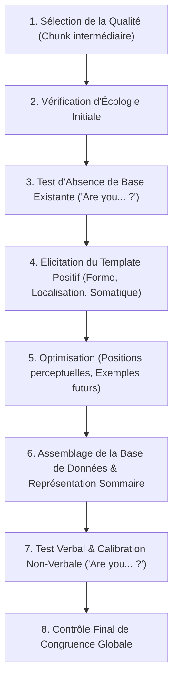
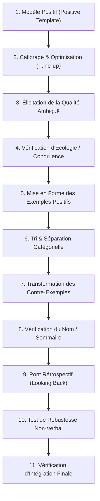

# Transforming Your Self - Becoming Who You Want to Be
**Formateur :** Steve Andreas | **ID :** `steve-andreas-transforming-your-self-becoming-who-you-want-to-be` | **Tranches :** 26

Voici la synthèse architecturale ultra-dense, rigoureuse et structurée issue du corpus et des tranches d'extraction de Steve Andreas (*Transforming Your Self - Becoming Who You Want to Be*).

---

# Synthèse Architecturale du Cours : *Transforming Your Self* (Steve Andreas)

---

## 1. Thèse Centrale & Philosophie du Cours

### Vision spécifique & Posture de Steve Andreas
* **Du nominalisme réifié au dynamisme cybernétique (*Self-Concepting*) :** Là où la psychologie classique et la PNL standard traitent souvent le « Soi » ou l'« Estime de soi » comme des blocs monolithiques, des entités statiques ou de simples croyances isolées (« Je crois que je suis X »), Andreas dé-nominalise l'identité pour la redéfinir comme un **verbe d'action cybernétique** : le *self-concepting*. L'identité n'est pas un fait gravé, mais un algorithme neurologique continu de filtrage, de sélection soustractive, d'organisation spatio-temporelle et d'évaluation réflexive.
* **Primauté absolue de la Structure sur le Contenu :** Deux personnes ayant vécu exactement le même nombre d'échecs et de réussites peuvent développer des concepts de soi opposés (ex. sentiment d'incompétence vs maîtrise inébranlable). Le système nerveux ne réagit pas à la factualité brute de l'histoire personnelle, mais à la **syntaxe d'encodage sous-modal et spatial** (taille, distance, disposition panoramique, association/dissociation, netteté des frontières). L'intervention thérapeutique ne réécrit pas le passé : elle reconfigure le système d'indexation de la mémoire.
* **L'inconscience opératoire comme idéal d'écologie :** Contrairement aux approches New Age ou au développement personnel axé sur l'hyper-vigilance narcissique (« se répéter qu'on est extraordinaire »), Andreas pose qu'un concept de soi sain doit être **transparent et latent** (comme la certitude inconsciente de son propre nom). L'attention consciente vigilante doit rester disponible à 100 % pour la tâche et le monde extérieur (flow state), sans interférence méta-réflexive de surveillance de soi.

### Le Fil Rouge Méthodologique
Toutes les interventions du cours reposent sur un levier unique et élégant : **l'alignement cybernétique entre une Représentation Résumée (*Summary Representation / Prototype*) et une Base de Données (*Database*) richement indexée dans l'espace subjectif, protégée par l'intégration homéostatique des contre-exemples.**
1. **Éliciter** la structure formelle d'une qualité robuste existante chez le sujet.
2. **Identifier** la structure défaillante (ambiguë, fragile, polarisée ou basée sur l'évaluation d'autrui).
3. **Transposer** le gabarit structurel sur la qualité cible en construisant une base de données probante et en encodant les contre-exemples non comme des négations de l'identité, mais comme des signaux d'apprentissage / rétroactions correctives.

---

## 2. Carte des Concepts & Leviers Émergents

### A. Épistémologie et Mécanique Cognitive
* **Dé-nominalisation Identitaire (*Self-Concepting*) :** Dissolution du substantif figé « Moi » au profit d'une dynamique processuelle computationnelle récursive ($Sujet = Objet$).
* **Sélection Soustractive Inévitable (*Selection & Omission*) :** Tout concept de soi est une généralisation forgée par omission massive. Tout être humain possède une banque de souvenirs d'erreurs et de réussites ; l'identité est le filtre attentionnel qui sélectionne ce qui compte comme preuve.
* **Équivalence Réciproque Monde/Soi ($Monde = Soi^{-1}$) :** Une croyance identitaire projetée sur l'environnement externe (« Le monde est menaçant/écrasant ») est l'inversion spéculaire d'une croyance sur soi (« Je suis fragile/vulnérable »). Intervenir sur la topologie du concept de soi dissout instantanément la distorsion du monde.
* **Invariance Spatio-temporelle de l'Index Référentiel « Je » :** Métacadre invariant 24h/24 qui transcende les variations d'états, le sommeil ou les contextes, servant de boussole heuristique pour l'anticipation comportementale.
* **Architecture Feed-Forward (*Retroconception Temporelle*) :** Le concept de soi n'est pas qu'un miroir du passé ; il projette des attracteurs futurs attrayants et rétro-calcule (*backward planning*) les actions et ressources requises au présent.

### B. Topologie et Architecture Structurale du Soi
* **Dualité Représentation Résumée (*Handle*) vs Base de Données (*Database*) :**
  * *La Représentation Résumée (Prototype)* : Poignée cognitive condensée (symbole visuel, geste somatique, schéma kinesthésique) permettant un accès instantané et non conscient à la qualité.
  * *La Base de Données* : Réseau d'exemples expérientiels réels encodés en sous-modalités (généralement arrangés dans un arc/panneau spatial devant soi).
  * *Pathologie de dissociation* : Un prototype flamboyant sans base de données produit l'illusion de « haute confiance / faible compétence » menant au crash dans le réel.
* **Niveaux de Portée Sémantique (*Scope*) :**
  * *Niveau restreint (comportements/avoir)* : « Je conduis un taxi », « J'ai peur ».
  * *Niveau cosmique/diffus* : « Je suis une poussière d'étoile » (perte de spécificité opératoire).
  * *Niveau intermédiaire (qualités/capacités)* : Niveau d'intervention optimal (« Je suis persévérant », « Je suis fiable »), assez vaste pour structurer de multiples domaines de vie, assez précis pour être nourri d'exemples sensoriels concrets.
* **Étendue Numérique et Granularité Mnésique :** Nombre critique de représentations d'expériences requises pour stabiliser la conviction du système nerveux sans encombrer la mémoire de travail (encodage simultané sous forme d'album, d'éventail ou de mosaïque spatiale).

### C. Dynamique des Valeurs, Estime et Vulnérabilités
* **Hiérarchie Logique : Concept de Soi vs Estime de Soi :**
  * *Concept de Soi* : Cartographie descriptive de « Qui je suis / Quelles sont mes qualités » (cognitif/structurel).
  * *Estime de Soi* : Méta-évaluation émotionnelle du concept de soi au travers du filtre de ses valeurs personnelles (affectif/évaluatif).
* **Hétérarchie Adaptative des Valeurs (Warren McCulloch) :** Le système nerveux sain ne fonctionne pas selon une pyramide rigide de valeurs immuables, mais selon une « redondance de commandement potentiel » : l'autorité bascule dynamiquement et temporairement vers la valeur la plus pertinente selon le contexte biologique et relationnel.
* **Symptomatologie de Compensation (Arrogance & *Other-Esteem*) :** Le besoin impérieux de validation externe, d'auto-glorification ou d'écrasement d'autrui ne traduit pas un « excès » d'estime de soi, mais un concept de soi poreux, friable et ambigu qui tente d'anesthésier le doute structurel interne.
* **Synergie Durabilité / Sensibilité :** Plus un concept de soi est solidement indexé et stable, plus le système nerveux tolère et absorbe les signaux d'erreur et le feedback correctif sans s'effondrer ni déclencher de défenses paranoïdes ou narcissiques.
* **Réintégration de Neurologie Dissociée :** Les représentations d'agresseurs ou de figures d'autorité internalisées mobilisent de l'énergie nerveuse tant qu'elles sont traitées comme « ennemies ». Leur réempreinte et enrichissement en ressources réintègrent cette part de neurologie aliénée dans l'économie globale du sujet.

---

## 3. Tableau Récapitulatif des Techniques & Démonstrations

| Technique / Exercice | Objectif Opératoire | Déclencheur / Indication | Séquence Résumée |
|---|---|---|---|
| **Operational Reality Check** *(Show Me Now)* | Briser l'intellectualisation et le métalangage stérile ; calibrer la réalité comportementale brute. | Sujet/groupe enfermé dans des explications abstraites, des théories complaisantes ou du jargon PNL sans mise en acte. | 1. Obtenir l'assentiment verbal sur une prémisse théorique.<br>2. Basculer instantanément dans une mise en situation simulée exigeant une action chirurgicale immédiate (*« Montre-le-moi maintenant »*).<br>3. Calibrer les ruptures de congruence et la réalité motrice. |
| **Feedback Indexé sur Données Réelles** | Ancrer une estime de soi saine et congruente sans créer de complaisance toxique ni de doute métacognitif. | Utilisation compulsive d'éloges vides (*« Tu es un génie »*) créant une dépendance au regard externe ou une fausse haute estime fragile. | 1. Éliminer tout qualificatif global flatteur non contextualisé.<br>2. Isoler le comportement ou le résultat factuel observable.<br>3. Relier directement l'observation empirique à l'effort/stratégie employé.<br>4. Renvoyer le sujet à sa propre évaluation interne des critères (*« Qu'en penses-tu toi-même ? »*). |
| **Élicitation de la Structure du Self-Concept** | Cartographier l'architecture spatiale et les sous-modalités d'une qualité solide vs qualité incertaine. | Préparation à toute modification ou création d'un trait identitaire chez le sujet. | 1. Évoquer une qualité indiscutable chez le sujet (*« Es-tu quelqu'un de X ? »*).<br>2. Localiser spatialement la banque d'exemples (distance, angle, hauteur, disposition en arc/pile).<br>3. Analyser les sous-modalités critiques (association/dissociation, couleur, films/arrêts sur image, cadres).<br>4. Identifier la présence et la position de la Représentation Résumée (*Handle*). |
| **Installation d'une Nouvelle Qualité Identitaire** *(Building a Positive Quality)* | Implanter un trait de caractère ou une capacité manquante de manière pérenne et stable. | Sujet désireux d'intégrer une ressource identitaire permanente (ex. persévérance, bienveillance, calme). | 1. Clarifier la définition opérationnelle et les critères du trait.<br>2. Récolter une banque d'au moins 3 à 6 souvenirs réels de manifestation du trait.<br>3. Formater et encoder ces souvenirs selon la structure spatiale du concept de soi robuste du sujet.<br>4. Condenser une Représentation Résumée (*Prototype/Handle*) liée à cette base.<br>5. Tester la stabilité et projeter dans le futur (*feed-forward*). |
| **Transformation d'un Trait Négatif ou Dépréciateur** | Dissoudre une étiquette identitaire limitante (*« Je suis paresseux / nul »*) et restaurer la fluidité adaptative. | Auto-jugement négatif figé, prophétie autoréalisatrice d'échec basée sur une macro-généralisation. | 1. Dé-nominaliser le trait en comportements spécifiques contextuels.<br>2. Re-contextualiser et requalifier les souvenirs négatifs en banques de contre-exemples d'apprentissage.<br>3. Rechercher les exemples omis de la qualité positive opposée.<br>4. Réencoder la nouvelle polarité selon la syntaxe structurelle solide du sujet. |
| **Intégration Homéostatique des Contre-Exemples** *(Immunisation du Self-Concept)* | Rendre le concept de soi à la fois inébranlable et sensible au feedback correctif (éviter l'effondrement par seuil critique). | Sujet perfectionniste rigide qui nie ses erreurs ou s'effondre dans le doute dès qu'un échec survient. | 1. Éliciter un souvenir où le sujet n'a pas manifesté la qualité (contre-exemple).<br>2. Dissocier le souvenir, réduire sa taille, le placer en périphérie ou en transparence.<br>3. Extraire le feedback d'apprentissage sans altérer l'étiquette centrale.<br>4. Lier le contre-exemple à la base de données comme preuve d'humanité et source de recalibrage continu. |
| **Réempreinte Systémique Interne** *(Reimprinting Holographique)* | Réintégrer la charge nerveuse aliénée liée à des figures parentales ou des agresseurs passés. | Présence de voix critiques internes, traumatismes développementaux, loyautés ou oppositions identitaires stériles. | 1. Identifier la représentation interne de l'autre problématique.<br>2. Explorer la structure spatiale et sous-modale de cette figure.<br>3. Remonter à l'intention positive d'origine ou au manque de ressources initial de cette personne.<br>4. Injecter les ressources manquantes (calme, recul, sécurité) dans la représentation de l'autre.<br>5. Réintégrer cette neurologie transformée dans l'écologie globale du sujet. |

---

---

## 0. Sommaire Sémantique & Index des Lignes

- **Tranche 1 [Lignes 107-211]** : de Rupture de Complaisance Théorique (« Show Me Now / Operational Reality Check ») — *Protocole :* de Rupture de Complaisance Théorique (« Show Me Now / Operational Reality Check ») | *Mécanisme :* Dé-nominalisation du Soi : Du « Self » au « Self-Concepting » | *Verbatim :* Défi Opératoire Direct face au Jargon Académique
- **Tranche 2 [Lignes 213-336]** : d'Ancrage Vérifiable de l'Estime chez l'Enfant (ou Soi-Même) : Le Feedback Indexé sur Données — *Protocole :* d'Ancrage Vérifiable de l'Estime chez l'Enfant (ou Soi-Même) : Le Feedback Indexé sur Données | *Verbatim :* La Présupposition d'Évolution et le Split Contenu / Structure
- **Tranche 3 [Lignes 338-444]** : Le Pré-Cadrage Cause-Effet : "Bascule Comportement $\rightarrow$ Identité" — *Protocole :* Le Pré-Cadrage Cause-Effet : "Bascule Comportement $\rightarrow$ Identité" | *Mécanisme :* La Dynamique Valeurs : Hiérarchie rigide vs Hétérarchie adaptative | *Verbatim :* Le Recadrage Rétroactif des Priorités de Valeurs
- **Tranche 4 [Lignes 446-583]** : Réintégration d'une Neurologie Aliénée par Réempreinte des Représentations d'Autrui — *Protocole :* Réintégration d'une Neurologie Aliénée par Réempreinte des Représentations d'Autrui | *Mécanisme :* La Boucle de Rétroaction Corrective Synchrone (vs. Effondrement par Seuil Catastrophique) | *Verbatim :* La Métaphore du Témoin d'Huile et de la Rupture par Seuil
- **Tranche 5 [Lignes 585-703]** : Élicitation de la Structure Fondatrice du Self-Concept (Exercice 4-1) — *Protocole :* Élicitation de la Structure Fondatrice du Self-Concept (Exercice 4-1) | *Mécanisme :* Architecture Hiérarchique de l'Identité et Portée Sémantique (Scope) | *Verbatim :* La Poignée et la Valise
- **Tranche 6 [Lignes 705-812]** : A : Ajustement Écologique de la Base de Données (Résolution de la Saturation & Zoom Automati... — *Protocole :* A : Ajustement Écologique de la Base de Données (Résolution de la Saturation & Zoom Automatique) | *Mécanisme :* Le Paradoxe Résolution/Capacité de la Banquise Perceptive (Simultanéité vs Acuité) | *Verbatim :* Suggestion de l'Automatisme Inconscient Écologique
- **Tranche 7 [Lignes 814-925]** : Audit & Ajustement Temporel du Concept de Soi (Checklist 5) — *Protocole :* Audit & Ajustement Temporel du Concept de Soi (Checklist 5) | *Verbatim :* La rupture de clarté par le méta-modèle inversé
- **Tranche 8 [Lignes 927-1061]** : Audit et Rééquilibrage de la Distribution Temporelle — *Protocole :* Audit et Rééquilibrage de la Distribution Temporelle | *Mécanisme :* Distribution Temporelle et Continuité Émergente | *Verbatim :* La métaphore du biais photographique
- **Tranche 9 [Lignes 1063-1236]** : Audit & Triangulation des Positions Perceptuelles dans la Base de Données — *Protocole :* Audit & Triangulation des Positions Perceptuelles dans la Base de Données | *Mécanisme :* Triangulation Perceptuelle et Holographie Identitaire | *Verbatim :* La Suggestion d'Inconfort Utile et Recadrage Temporel
- **Tranche 10 [Lignes 1238-1421]** : L'Élicitation Conversationnelle du Concept de Soi chez un Tiers — *Protocole :* L'Élicitation Conversationnelle du Concept de Soi chez un Tiers | *Mécanisme :* Le piège de la bascule Orgueil / Honte et la comparaison sociale | *Verbatim :* Le double ancrage de l'ambivalence dans le « Bigger than life »
- **Tranche 11 [Lignes 1423-1572]** : A : Intégration Visuo-Spatiale Simple d'un Contre-Exemple — *Protocole :* A : Intégration Visuo-Spatiale Simple d'un Contre-Exemple | *Mécanisme :* Transition Digital / Analogique de la Base de Données Identitaire | *Verbatim :* Le Méta-Recadrage de la Culpabilité Opératoire
- **Tranche 12 [Lignes 1574-1719]** : Négociation Temporelle des Signaux d'Alerte (Exclusion Contextuelle) — *Protocole :* Négociation Temporelle des Signaux d'Alerte (Exclusion Contextuelle)
- **Tranche 13 [Lignes 1721-1870]** : A : Regroupement et Transformation du Pire Contre-Exemple ("Exercise 8-4") — *Protocole :* A : Regroupement et Transformation du Pire Contre-Exemple ("Exercise 8-4") | *Mécanisme :* Le Regroupement par Isomorphisme et Transformation de l'Archétype Suprême ("Worst Example as Category Icon") | *Verbatim :* Le Verrouillage Écologique de Portée
- **Tranche 14 [Lignes 1872-1996]** : A : Identification et Sélection d'une Qualité à Construire — *Protocole :* A : Identification et Sélection d'une Qualité à Construire | *Verbatim :* Le Recadrage du Geste et de la Réception Sensorielle
- **Tranche 15 [Lignes 1998-2140]** : A : Construction d'une Nouvelle Qualité Identitaire (Exercice 9-1) — *Protocole :* A : Construction d'une Nouvelle Qualité Identitaire (Exercice 9-1)
- **Tranche 16 [Lignes 2142-2293]** : Transformation d'une Qualité Ambiguë en Qualité Positive Stable — *Protocole :* Transformation d'une Qualité Ambiguë en Qualité Positive Stable
- **Tranche 17 [Lignes 2295-2406]** : Transformer une Qualité Ambiguë en une Qualité Positive — *Protocole :* Transformer une Qualité Ambiguë en une Qualité Positive | *Mécanisme :* Hétérarchie des Besoins vs Hiérarchie Rigide | *Verbatim :* La Bascule de l'Hétérarchie Temporelle
- **Tranche 18 [Lignes 2408-2606]** : Conversion d'Identité Négative en Base de Données Affirmative (Anti-Projection) — *Protocole :* Conversion d'Identité Négative en Base de Données Affirmative (Anti-Projection) | *Mécanisme :* Le Clivage Neuro-Sémantique de la Négation Identitaire | *Verbatim :* La Négation et l'Injonction Paradoxale Directe
- **Tranche 19 [Lignes 2608-2751]** : Transmutation d'une Qualité Négative en Qualité Valorisée — *Protocole :* Transmutation d'une Qualité Négative en Qualité Valorisée | *Verbatim :* La Généralisation Temporelle de la Capacité Identitaire
- **Tranche 20 [Lignes 2753-2871]** : Démonstration Andreas / Sam : Résolution Kinesthésique d'un Contre-Exemple Bloquant — *Protocole :* Démonstration Andreas / Sam : Résolution Kinesthésique d'un Contre-Exemple Bloquant | *Mécanisme :* Le Biofeedback Somatique comme Baromètre d'Intégration Identitaire | *Verbatim :* Le Choix Forcé Réducteur d'Anxiété
- **Tranche 21 [Lignes 2873-3042]** : Exploration et Cartographie de la Frontière Protectrice Externe (Exercice 13-1) — *Protocole :* Exploration et Cartographie de la Frontière Protectrice Externe (Exercice 13-1) | *Mécanisme :* Transition Structurale : Du Contenu/Processus Intra-Psychique à la Topologie de Délimitation | *Verbatim :* Suggestion de l'espace d'alerte et de la métaphore analogique
- **Tranche 22 [Lignes 3044-3152]** : Exploration et Transformation d'une Frontière Interne (Démonstration Sandy & Terri) — *Protocole :* Exploration et Transformation d'une Frontière Interne (Démonstration Sandy & Terri)
- **Tranche 23 [Lignes 3154-3324]** : Cartographie différentielle Connexion vs Déconnexion (Exercice 14-1) — *Protocole :* Cartographie différentielle Connexion vs Déconnexion (Exercice 14-1) | *Mécanisme :* Le paradoxe de l'appauvrissement neurologique sous menace (Neurological Depletion via Boundary Contraction) | *Verbatim :* Le cadrage permissif de la vérité subjective
- **Tranche 24 [Lignes 3326-3496]** : L'Aikido Mental & Rupture de Script Agressif & L'Aikido Mental & Non-Résistance Structurale — *Protocole :* L'Aikido Mental & Rupture de Script Agressif | *Mécanisme :* L'Aikido Mental & Non-Résistance Structurale | *Verbatim :* Verbatim 1 : L'Incongruence Absurde contre la Menace Armée
- **Tranche 25 [Lignes 3498-3652]** : Protocole de Perspective Visuelle Simultanée (Démonstration Mike) — *Protocole :* Protocole de Perspective Visuelle Simultanée (Démonstration Mike) | *Verbatim :* Induction par Métaphore Sensorielle Concrète vs Nominalisation
- **Tranche 26 [Lignes 3654-3746]** : McWhirter's Kinesthetic Perspective Pattern & Compartimentation et somatotopie des ressource... — *Protocole :* McWhirter's Kinesthetic Perspective Pattern | *Mécanisme :* Compartimentation et somatotopie des ressources (Quadrants corporels)

---

## Extractions Détaillées par Tranche (Opératoire & Verbatim)

## Tranche 1 / 26 : de Rupture de Complaisance Théorique (« Show Me Now / Operational Reality Check »)

### 1. Mécanismes & Principes Actifs

#### Dé-nominalisation du Soi : Du « Self » au « Self-Concepting »
*   **Principe actif :** Dans la cognition humaine, traiter l'identité comme une entité statique (« le Soi », « l'Identité ») crée une fixation neurologique et sémantique : le sujet subit son identité comme un fait immuable. En transformant le substantif en verbe d'action (« *self-concepting* »), Andreas restitue la neuroplasticité du processus. Le concept de soi cesse d'être un objet logé dans le système pour redevenir une cascade active de micro-opérations de traitement de l'information (filtrage, sélection, organisation, encodage VAKOG).
*   **Tags libres émergents :** `#denominalisation_identitaire` `#self_concepting` `#processus_vs_entite` `#neuroplasticite_semantique` `#dynamique_processuelle`

#### Sélection Biaisée et Filtrage Sélectif de l'Histoire Personnelle
*   **Principe actif :** Le cerveau humain dispose d'une masse critique de souvenirs contradictoires (tout individu a déjà agi avec intelligence, et tout individu a déjà agi avec stupidité). L'identité n'est pas la somme exhaustive de l'histoire vécue, mais un algorithme de tri et d'omission. L'activation d'un prédicat identitaire (« je suis X ») force le système attentionnel et mnésique à sur-pondérer les éléments de preuve congruents avec le label et à reléguer l'opposé dans l'ombre cognitive. Modifier une qualité identitaire consiste donc à modifier les règles d'indexation et de sélection de la banque d'expériences mémorielles.
*   **Tags libres émergents :** `#selection_categorielle` `#omission_systematique` `#filtrage_mnesique` `#reindexation_d_experience` `#biais_de_confirmation_identitaire`

#### Primauté de la Structure Formelle sur le Contenu Mnésique
*   **Principe actif :** Deux individus possédant des banques de souvenirs strictement identiques peuvent développer des concepts de soi diamétralement opposés selon *la manière* dont ces représentations sont encodées (taille, distance, emplacement spatial, association/dissociation, agencement temporel, polarité modale). L'effet sur le système nerveux (sécrétion neurochimique de certitude vs sentiment d'échec) ne provient pas de l'événement brut, mais du format structurel de la synthèse interne (*summary representation* / *prototype*).
*   **Tags libres émergents :** `#structure_vs_contenu` `#sous_modalites_critiques` `#encodage_spatial` `#synthese_representationnelle` `#prototype_cognitif`

#### La Carte Identitaire comme Outil d'Orientation Cybernétique
*   **Principe actif :** Une carte doit nécessairement omettre des détails du territoire pour être computationnellement exploitable par le cerveau. La fonction biologique du concept de soi est de fournir un schéma heuristique d'anticipation et de régulation comportementale rapide (« Que fait quelqu'un comme moi dans une telle situation ? »). La rigidité ou la dysfonction survient quand le sujet confond l'abstraction sélective de sa carte avec la totalité du territoire organique et relationnel.
*   **Tags libres émergents :** `#carte_heuristique` `#reduction_de_complexite` `#economie_cognitive` `#boussole_comportementale` `#cybernetique_du_soi`

---

### 2. Protocoles, Techniques & Démonstrations (Étape par Étape)

#### Protocole de Rupture de Complaisance Théorique (« Show Me Now / Operational Reality Check »)
*   **Intention / Indication :** À utiliser dès qu'un sujet, un groupe de praticiens ou un client s'enferme dans un métalangage explicatif, abstrait ou complaisant (intellectualisation, jargon diagnostic, circularité théorique sans levier de changement).
*   **Mise en place & Pré-framing :** Cadrer l'adhésion du groupe/sujet sur une prémisse théorique admise (« Tout le monde est d'accord que X est crucial ? »), puis basculer brusquement dans une demande de mise en acte chirurgicale et immédiate en situation réelle simulée.
*   **Séquence d'actions pas à pas :**
    1.  *Validation du consensus théorique :* Obtenir un assentiment unanime sur une valeur ou un objectif abstrait (« Vous êtes d'accord que développer l'estime de soi/guérir le trauma est fondamental ? »).
    2.  *Incarnation du cas test (Role-Play immersif) :* Le praticien prend immédiatement la posture du patient/problème : « *Imaginons que je suis cette personne ici et maintenant.* »
    3.  *Exigence d'action procédurale pure :* Poser l'injonction directe : « *Fais-le. Conditionne-moi / guéris-moi maintenant. Montre-moi la première action.* »
    4.  *Maintien prolongé du silence opérationnel :* Laisser le vide et l'impuissance des descriptions théoriques s'effondrer d'eux-mêmes sans meubler la conversation.
    5.  *Contre-épreuve systématique :* Si une nouvelle théorie est avancée (« Il faut utiliser le reconditionnement opérant » / « guérir le trauma passé »), répondre par la réassignation immédiate : « *OK, vas-y. Fais-le maintenant.* »
    6.  *Bascule vers la micro-démonstration :* Une fois la faillite de la théorie admise, injecter une intervention ciblée démontrant le contraste entre « décrire » et « modifier la structure ».
*   **Signes de calibration :**
    *   Passage de hochements de tête affirmatifs fluides à un gel moteur complet (inhibition de l'action).
    *   Silence lourd et prolongé dans la pièce (surcharge cognitive due à l'absence de programme moteur associé aux concepts nominaux).
    *   Décrochage oculaire et baisse de tonus postural chez les participants/interlocuteurs.

#### Protocole d'Élucidation du Filtrage Mnésique Identitaire
*   **Intention / Indication :** Révéler au sujet l'arbitraire complet de la construction de son concept de soi (qu'il soit dépréciatif ou survalorisé) afin d'assouplir la rigidité de la croyance sur son identité.
*   **Mise en place & Pré-framing :** Établir que la mémoire n'est pas un bloc figé, mais une matière première infinie dans laquelle chaque trait est le résultat d'une sélection délibérée d'exemples et de l'oubli symétrique des contre-exemples.
*   **Séquence d'actions pas à pas :**
    1.  *Identification du trait cible :* Isoler le label identitaire verbalisé (« Je suis incompétent / bête / intelligent »).
    2.  *Excavation de la base de données sélective :* Faire expliciter les souvenirs utilisés pour justifier cette étiquette (« Quels souvenirs fais-tu défiler pour savoir que tu es ainsi ? »).
    3.  *Mise en lumière de l'omission structurelle :* Poser directement le postulat miroir : « *Pour maintenir cette certitude, quelles expériences réelles de ton passé es-tu obligé d'ignorer en ce moment ?* »
    4.  *Recherche du pool d'expériences contraires :* Guider l'attention vers l'évidence que l'opposé exact s'est déjà produit dans sa biographie (tout être a déjà fait preuve de l'attitude inverse).
    5.  *Recadrage de la toile :* Présenter l'identité actuelle comme une simple peinture parmi des milliers d'autres réalisables avec les mêmes pigments biographiques.
*   **Signes de calibration :**
    *   Micro-surprises (ouverture des paupières, pause respiratoire) lors de la question sur les éléments ignorés.
    *   Mouvements oculaires exploratoires vers des zones de mémorisation inhabituelles pour accéder aux souvenirs neutralisés ou omis.
    *   Détente musculaire périphérique consécutive à la défocalisation du filtre rigide.

---

### 3. Heuristiques, Subtilités & "Sagesse du Praticien"

#### Heuristiques Procédurales & Règles de Décision
*   **Si** un modèle thérapeutique ou un livre propose des centaines de pages décrivant la pathologie ou les problèmes (style DSM-IV), **alors** le considérer comme opérationnellement nul pour la transformation et rechercher les micro-procédures d'ingénierie active (analogie du chirurgien qui détaille l'usage des pinces et bistouris, non la seule description de la tumeur).
*   **Si** le praticien se surprend à « prêcher » (indiquer la direction, la valeur ou l'idéal : pardonner, s'aimer), **alors** il doit stopper immédiatement et basculer sur l'« entraînement » (*training*) : fournir la séquence psychophysique exacte permettant d'atteindre cet état dans le corps en moins d'une heure.
*   **Si** un sujet dit souffrir d'un conflit intérieur (« Je suis fâché contre moi-même », « Je me sabote »), **alors** localiser immédiatement la scission syntaxique et spatiale entre le « Je » (l'observateur/évaluateur) et le « Moi » (la partie évaluée ou le concept de soi activé). Ne pas traiter le problème au niveau du comportement, mais au niveau de la relation structurelle entre ces deux instances.
*   **Si** une intervention sur le concept de soi réussit, **alors** la validation n'est pas une simple déclaration verbale mais une réponse somatique globale congruente (*full-body experience*).

#### Pièges Classiques & Erreurs de Débutant
*   *L'illusion nominale :* Croire que parce qu'un client dit « je manque d'estime de moi », l'estime est une substance à injecter. L'erreur est de chercher à réparer l'estime directement, au lieu d'ajuster le système de catégorisation et d'évaluation interne (*self-concepting* aligné avec les valeurs).
*   *Le piège de la description :* Confondre la capacité à cartographier ou disserter sur un trouble psychologique avec la capacité à conduire une intervention corrective étape par étape.
*   *Le réductionnisme visuel :* Réduire le concept de soi à une simple « image de soi » (*self-image*), en oubliant que l'armature est massivement auditivo-digitale (dialogue interne, jugements), kinesthésique (sensations somatiques) et parfois olfactive/gustative.
*   *Croire en la validité absolue de l'autobiographie :* Considérer les récits du client sur lui-même comme des vérités historiques, au lieu de les appréhender comme les produits d'une extraction d'échantillons hautement sélective et arbitraire.

#### Postulats Fondamentaux de Steve Andreas
*   *L'ingénierie du spécifique :* Tout état psychologique complexe (pardon, deuil, identité solide, frontière relationnelle) possède un algorithme interne reproductible et enseignable en format atelier/thérapie en moins de 60 minutes.
*   *Le modèle de la linguistique cognitive :* L'inconscient applique au Soi les mêmes règles de catégorisation et de prototypage (cf. George Lakoff) qu'il applique aux objets du monde physique.
*   *L'écologie de l'imperfection :* Les erreurs et échecs ne sont pas des pollutions de l'identité, mais les fondations structurelles indispensables d'un concept de soi résilient et précis.

---

### 4. Pépites Verbatim & Patterns Linguistiques (MOT À MOT EN V.O.)

#### Défi Opératoire Direct face au Jargon Académique
> « "I have been hearing from many presenters, for a day and a half now, that a good self-concept and self-esteem are really important in getting people to stop using drugs. Do you all agree with that?"
> "Oh, yeah," they all nodded their heads.
> I said "Good. I have two questions for you. The first question is, 'What is it that you've been talking about that is so important?' And my second question is, 'How would you go about helping someone get some of it?'"
> When I asked those questions the room got very quiet. Then I said, "Let's pretend that I'm someone who is hooked on drugs. Help me improve my self-concept, or give me some self-esteem. Help me out."
> Someone said, "Well, you could use operant conditioning."
> I said "Great! Condition me, now. Show me what you can do."
> The room got very quiet again. »
*   **[Analyse du Pattern] :**
    *   *Yes-set préparatoire suivi d'un piège logique :* Obtention d'un accord collectif massif (« Do you all agree with that? ») pour verrouiller l'adhésion avant de poser les questions de décomposition structurelle (méta-modèle inversé : demander la spécification du substantif et du processus).
    *   *Rupture de pattern par immersion somatique :* Andreas refuse le niveau méta-théorique et impose la simulation immédiate (« Let's pretend... Help me out »).
    *   *Injonction opératoire à double contrainte (« Show me what you can do ») :* Force l'interlocuteur à confronter instantanément le vide procédural derrière l'étiquette sémantique (« conditionnement opérant »), induisant un état de transe de confusion/recherche interne chez l'ensemble des participants.

#### Élicitation de la Scission Interne « I » vs « Myself »
> « Do you ever say, or think to yourself, "I'm disappointed with myself; I thought I could do that, but I really blew it," "I wish I felt better about myself," or "I'm so mad at myself; I fall apart at the slightest criticism." How about, "I'm so frustrated with myself," "I'm my own worst enemy; I keep sabotaging myself," or "I wish I could get myself to do that" (or stop doing that)? Have you ever wondered how you got into this unpleasant struggle between "I" and "myself," or how you can get out of it? »
*   **[Analyse du Pattern] :**
    *   *Empilement de truismes et citations conversationnelles :* Utilisation de citations internes que chaque auditeur a déjà prononcées, contournant toute résistance critique par effet Barnum expérientiel immédiat.
    *   *Mise en évidence de la double dissociation (« I » vs « myself ») :* Révélation de la fracture grammaticale et cognitive où l'observateur (« I ») prend l'observé (« myself ») pour cible hostile.
    *   *Présupposition de libération enchâssée :* La formulation « how you got into... or how you can get out of it » présuppose syntaxiquement deux éléments majeurs : (1) il y a eu un moment d'entrée dans cet état (donc ce n'est pas inné), et (2) la porte de sortie existe nécessairement et attend simplement d'être empruntée.

#### Recadrage de la Plasticité Mnésique par la Métaphore de l'Artiste
> « However, it is not just the memories you have, but how you organize and think about those memories that provides the basis for your self-concept. Given a blank canvas, and a certain set of colors and brushes, an artist can paint a very wide range of paintings, and the same is true of the self that you construct out of your personal history.
> When you think about yourself, the first thing that you do is select from your immense range of experience. You can't possibly think of it all, so you have to select, and as you select some aspects, you inevitably have to ignore others. »
*   **[Analyse du Pattern] :**
    *   *Distinction analogique de structure vs contenu :* La mémoire est recadrée non comme une autobiographie gravée dans le marbre, mais comme une boîte de pigments inertes (matériau brut sans signification préexistante).
    *   *Présupposition d'action créatrice (« the self that you construct ») :* Le choix du verbe « construct » prive l'identité de tout statut de fatalité génétique ou environnementale : si elle est construite, elle est déconstructible et reconfigurable.
    *   *Normalisation de l'amnésie sélective par nécessité neurologique :* L'emploi de « inevitably have to ignore others » déculpabilise le fonctionnement cognitif : oublier ou omettre des souvenirs n'est plus un dysfonctionnement mental, mais une loi thermodynamique inévitable du traitement de l'information. L'enjeu devient donc : que décide-t-on d'ignorer et d'illuminer ?

## Tranche 2 / 26 : d'Ancrage Vérifiable de l'Estime chez l'Enfant (ou Soi-Même) : Le Feedback Indexé sur Données

### 1. Mécanismes & Principes Actifs

- **La primauté de la structure sur le contenu (Structure vs. Content)**
  - *Principe actif* : L'efficacité et la stabilité d'un concept de soi ne dépendent pas de la véracité objective des souvenirs ou de leur quantité brute, mais du mode d'encodage et d'organisation spatio-temporelle de ces représentations dans le système nerveux. Le cerveau ne traite pas la totalité des données d'une vie : il échantillonne et met en forme. L'intervention thérapeutique n'a pas à réécrire l'histoire factuelle, mais à reconfigurer la syntaxe interne de sélection et de structuration des archives mnésiques.
  - *Tags* : `#primauté_structurelle` `#syntaxe_interne` `#encodage_mnésique` `#cartographie_cognitive`

- **La sélection soustractive inévitable (Selection & Omission)**
  - *Principe actif* : Tout concept de soi est une généralisation forgée par omission sélective. Pour construire l'identité "Je suis intelligent", le sujet extrait et magnifie les occurrences de succès tout en inhibant l'accès aux contre-exemples d'erreurs (et inversement pour l'étiquette "Je suis stupide"). Puisque tout être humain possède une banque d'expériences comportant les deux polarités, l'identité perçue n'est qu'un filtre attentionnel arbitraire. Cette propriété neurologique démontre l'extrême plasticité du concept de soi : changer l'identité consiste à modifier les critères de sélection et de pondération des souvenirs disponibles.
  - *Tags* : `#omission_sélective` `#échantillonnage_identitaire` `#plasticité_du_soi` `#filtre_attentionnel`

- **Hiérarchie logique Concept de Soi vs. Estime de Soi (Logical Levels of Self-Evaluation)**
  - *Principe actif* : L'estime de soi est une méta-évaluation émotionnelle du concept de soi par le prisme des valeurs personnelles. 
    1. Niveau 0 : Expériences comportementales brutes (ex: aider quelqu'un à se relever).
    2. Niveau 1 (Concept de soi) : Généralisation sur l'identité (ex: "Je suis une personne bienveillante").
    3. Niveau 2 (Estime de soi) : Évaluation du Niveau 1 par les valeurs du sujet (ex: "J'accorde de la valeur à la bienveillance, donc je m'auto-valide positivement").
    L'estime de soi ne peut pas être manipulée directement de façon durable. Tenter de hausser l'estime de soi sans modifier la structure du concept de soi ou sans l'aligner sur les valeurs produit un artefact instable (rejet cognitif ou arrogance compensatoire).
  - *Tags* : `#niveaux_logiques_du_soi` `#méta_évaluation` `#alignement_valeurs_concept` `#mécanique_estime_de_soi`

- **Dynamique Hétérarchique vs. Hiérarchique des Valeurs (McCulloch Heterarchy)**
  - *Principe actif* : Les modèles théoriques de valeurs (comme la pyramide de Maslow) postulent une hiérarchie rigide et descendante. Or, le système d'activation réticulée (SAR) et le système nerveux fonctionnent en *hétérarchie* (« redondance de commandement potentiel »). Dans une hétérarchie, chaque élément interagit en réseau démocratique simultané ; l'autorité bascule dynamiquement et temporairement vers le sous-système qui détient l'information la plus urgente ou contextuellement pertinente. Imposer une hiérarchie consciente rigide sur un système hétérarchique inconscient crée des pathologies dissociatives (ex: anorexie/boulimie où la valeur d'esthétique/minceur étouffe de force le signal biologique vital de faim).
  - *Tags* : `#hétérarchie_neurologique` `#redondance_de_commandement` `#système_réticulé_activateur` `#pathologie_hiérarchique_rigide`

- **Symptomatologie de compensation : La fausse haute estime de soi (Arrogance as Shaky Self-Concept)**
  - *Principe actif* : L'arrogance, l'auto-glorification et le besoin impérieux de validation externe ne signalent pas un « excès » d'estime de soi, mais un concept de soi structurellement fragile et poreux aux contre-exemples. La persona surcompensatoire tente d'extraire de l'estime d'autrui (*other-esteem*) pour combler un vide structurel interne. À l'inverse, un concept de soi solidement encodé et congruisé n'a aucun besoin neurologique d'exhibition ou de réassurance sociale.
  - *Tags* : `#surcompensation_narcissique` `#fragilité_structurelle` `#other_esteem` `#sécurité_identitaire`

---

### 2. Protocoles, Techniques & Démonstrations (Étape par Étape)

#### Protocole d'Ancrage Vérifiable de l'Estime chez l'Enfant (ou Soi-Même) : Le Feedback Indexé sur Données
* **Intention / Indication** : Sortir de l'éloge toxique/vide ("Tu es génial", "Tu es le meilleur") qui crée du doute métacognitif ou de la complaisance passive ("informationally impaired"), pour bâtir un concept de soi solide couplé à une estime congruente.
* **Mise en place & Pré-framing** : L'estime de soi durable exige des données factuelles (*data base*) reliées explicitement à une valeur et à une identité.
* **Séquence d'actions pas à pas** :
  1. *Étape 1 : Révélation de la Donnée Brute (Behavioral Data)*
     - Isoler un comportement spécifique, observable et incontestable dans l'expérience récente du sujet.
  2. *Étape 2 : Nommage de la Valeur et du Lien Identitaire (Value-Trait Generalization)*
     - Relier ce comportement précis au trait de caractère / qualité générale du concept de soi.
  3. *Étape 3 : Expression de l'Évaluation Positive (Aligned Esteem)*
     - Valider explicitement l'adéquation entre l'acte, la qualité démontrée et le système de valeurs.
* **Signes de calibration** : Intégration somatique calme, posture redressée sans gonflement d'égo, absence de micro-mouvements de scepticisme (plissement des yeux, recul du menton) générés par le compliment non fondé.

---

#### Protocole d'Élicitation Somato-Temporelle des Valeurs Réelles
* **Intention / Indication** : Découvrir ce qui a une valeur réelle pour le système nerveux d'un individu (en court-circuitant les valeurs introjectées ou purement discursives de la société/famille).
* **Mise en place & Pré-framing** : Aucune valeur n'est "objective". Le seul critère fiable est la réponse kinesthésique interne du système à court et long terme.
* **Séquence d'actions pas à pas** :
  1. *Étape 1 : Projection en Immersion Sensorielle VAKOG*
     - Inviter le sujet à entrer dans une expérience spécifique (réelle passée ou imaginée future) comme s'il y était maintenant.
  2. *Étape 2 : Étalonnage Kinesthésique Immédiat (Short-term Feedback)*
     - Calibrer la réponse viscérale instantanée : *"Est-ce que ça fait 'bon' ou est-ce que ça fait 'mauvais' à l'intérieur ?"*
  3. *Étape 3 : Déroulé Temporel (Long-term Impact)*
     - Avancer sur la ligne du temps pour tester l'impact résiduel à retardement de cette même action.
  4. *Étape 4 : Détection d'Introjection Sociale*
     - Comparer la réponse du corps avec les règles reçues : la règle provient-elle d'un choix autonome ou d'une conformité forcée créant une inhibition interne ?
* **Signes de calibration** : Congruence tonique, détente abdominale/respiratoire (valeur alignée) vs. tension laryngée, respiration haute bloquée, déglutition sèche (valeur conflictuelle ou imposée).

---

### 3. Heuristiques, Subtilités & "Sagesse du Praticien"

- **Heuristique de diagnostic du travail identitaire** :
  - *Si* le sujet manifeste une fuite récurrente de soi (addictions, consommation compulsive d'écrans/nourriture, alcool pour "se sentir normal" en société), une sous-réalisation chronique (*underachieving*) par évitement du risque, OU une arrogance ostentatoire / fanfaronnade...
  - *Alors* ne travaillez jamais sur le comportement isolé ni sur l'estime de soi de surface : traitez la structure du concept de soi sous-jacent qui est poreuse, non alignée ou négativement encodée.
- **Règle d'or de l'inutilité de l'estime directe** :
  - *Si* vous essayez de faire en sorte que le client « s'aime lui-même » ou « se sente bien » par des affirmations positives ou de la suggestion directe...
  - *Alors* vous perdez votre temps ou vous activez un retour de flamme cognitif (*backfire* : "Pourquoi insiste-t-il autant ? Pense-t-il que je suis si nul qu'il doive me flatter ?"). Vous devez fournir la structure mnésique qui produit *automatiquement* l'auto-évaluation positive.
- **Subtilité sur le "Vrai Soi" (True Self vs. Maps)** :
  - La recherche d'un "Vrai Soi" métaphysique ou unique est une illusion catégorielle (équivalente à chercher quelle carte entre la géologique, la routière et la végétale est la « vraie » carte du terrain).
  - *Heuristique praticien* : Le concept de soi n'a pas à être « vrai », il doit être **utile** pour orienter le sujet dans le monde et congru avec ses valeurs opérationnelles.
- **Principe hétérarchique des priorités** :
  - Tout conflit de valeurs figé (dilemme insoluble) résulte d'une tentative d'imposer une hiérarchie rigide là où le système exige une rotation hétérarchique des prérogatives selon le contexte et le temps.

---

### 4. Pépites Verbatim & Patterns Linguistiques (MOT À MOT EN V.O.)

#### Pépite 1 : La Présupposition d'Évolution et le Split Contenu / Structure
> *"How well your self-concept functions lies only partly in the content-what you think about yourself, and much more in how you think about it. That may seem a bit mysterious at this point, but it will become clear."*

* **[Analyse du Pattern]** : 
  - *Distinction opératoire fondamentale* : Séparation immédiate entre contenu (*what*) et processus/structure (*how*).
  - *Présupposition temporelle et truisme de progression* : *"That may seem a bit mysterious at this point, but it will become clear."* L'utilisation de *"at this point"* circonscrit la confusion au présent éphémère, tandis que le connecteur *"but"* couplé au futur d'inévitabilité *"it will become clear"* verrouille inconsciemment l'intégration future de la compréhension.

---

#### Pépite 2 : La Métaphore Isomorphique de la Carte Incomplète
> *"No matter how good a map is, it always leaves out things, events, and information that you can find in the territory. The only way to have a complete map would be to reproduce the territory completely, particle by particle, atom by atom. Since this reproduced territory would be as big and unwieldy as the original, it would defeat the very purpose of having a map."*

* **[Analyse du Pattern]** : 
  - *Recadrage par réduction à l'absurde* : Démontre la nécessité fonctionnelle de l'omission.
  - *Normalisation de l'incomplétude* : En démontrant qu'une carte parfaite à l'échelle 1:1 est un fardeau inutilisable, Andreas déculpabilise instantanément le sujet de ne pas "se connaître totalement" ou de commettre des erreurs de parcours : l'omission devient la condition même de l'utilité de l'esprit.

---

#### Pépite 3 : Le Piège de l'Éloge Non-Spécifique (Metamodel Violation Feedback)
> *"If unspecified praise is overdone, that can even backfire and get the opposite result, if the child starts thinking about the larger implications. 'Why is my dad making such a big deal? Does he think I'm doing so badly that he's worried and thinks I need praise?'"*

* **[Analyse du Pattern]** : 
  - *Citation enchâssée et lecture de pensée inversée (Mind Reading)* : Andreas mime le dialogue interne métacognitif de l'enfant.
  - Il démontre comment un index de référence non spécifié ("Tu es formidable") force le système récepteur à générer une hypothèse d'intention cachée, souvent pathologique ou anxiogène.

---

#### Pépite 4 : La Réfutation de l'Objectivité par l'Observateur Caché
> *"Some people speak of objective values, but the word 'objective' is always a lie, because there is always an observer hidden somewhere... Heinz von Foerster has stated the fallacy of 'objective' knowledge very powerfully: 'It is syntactically and semantically correct to say that subjective statements are made by subjects. Thus, correspondingly, we may say that objective statements are made by objects. It is only too bad that these damned things don't make any statements.'"*

* **[Analyse du Pattern]** : 
  - *Sleight of Mouth / Redéfinition et Attaque du Cadre (Redefining & Chunk Up)* : Destruction de l'illusion des « valeurs objectives ».
  - *Rupture logique et humour cybernétique* : L'utilisation de l'argument sémantique et syntaxique de Von Foerster neutralise radicalement toute prétention dogmatique ou morale extérieure en rappelant la nature strictement subjective et humaine de tout jugement de valeur.

---

#### Pépite 5 : L'Enchâssement Éliciteur de la Décision Écologique
> *"If that situation were to happen again, do you want to get angry again, or would you rather do something different that would be a better expression of what is most important to you in that situation?"*

* **[Analyse du Pattern]** : 
  - *Double lien de choix orienté (Double Bind with Embedded Criteria)* : 
    - Branche A : Rejouer l'ancienne réponse automatique négative (*"get angry again"*).
    - Branche B : Émettre une nouvelle réponse comportementale alignée sur la valeur supérieure (*"a better expression of what is most important to you"*).
  - Le contraste syntaxique rend la branche A absurde et force le système nerveux à sélectionner la réorientation vers les valeurs fondamentales du sujet.

## Tranche 3 / 26 : Le Pré-Cadrage Cause-Effet : "Bascule Comportement $\rightarrow$ Identité"

### 1. Mécanismes & Principes Actifs

#### A. La Dynamique Valeurs : Hiérarchie rigide vs Hétérarchie adaptative
* **Principe actif :** Le système nerveux évalue constamment les situations en termes de valence affective immédiate et différée (*short-term vs long-term feel-good/feel-bad*). Une valeur n'est pas un absolu statique, mais un critère d'évaluation contextuel. L'imposition d'une hiérarchie rigide (valeur A primant mathématiquement sur valeur B) génère du conflit interne et des réactions inadaptées (ex. la colère pour un oubli de coup de fil détruisant la valeur relationnelle globale). À l'inverse, l'organisation cognitive naturelle fonctionne en *hétérarchie* (concept de Warren McCulloch) : la priorité des valeurs bascule dynamiquement selon l'état somatique interne, le contexte externe, les buts et les informations disponibles.
* **Tags émergents :** `#heterarchie_des_valeurs` `#feedback_boucle_temporelle` `#ecologie_contextuelle` `#valence_affective` `#alignement_valeur_identite`

#### B. Les 4 Piliers Systémiques du Self-Concept
1. **La Grande Généralisation condensée :** 
   * Le cerveau économise sa bande passante cognitive en condensant des milliers d'expériences hétérogènes étalées dans le temps sous un seul label/qualité nominalisée (ex. "persistance"). Cette généralisation crée une distorsion par omission massive des contre-exemples (sommeil, abandons stratégiques légitimes), mais sert d'heuristique directrice globale pour le comportement présent et futur. Modifier ce label réorganise en chaîne l'ensemble des comportements associés, y compris ceux qui semblent sans rapport logique direct (ex. passer de "poor boy" à un autre soi élimine spontanément la conduite automobile à risque).
   * **Tags :** `#nominalisation_identitaire` `#macro_generalisation` `#effet_domino_transversal`
2. **La Continuité Spatio-Temporelle invariante :**
   * Le self-concept est un cadre interne invariant qui transcende les variations d'états, les contextes et les décennies. Même dans la confusion, le sommeil, le rêve ou les comportements atypiques ("je n'étais pas moi-même"), le système linguistique et cognitif préserve un index référentiel invariant ("Je"). Contrairement au travail sur une phobie qui n'opère que sur des tranches temporelles minuscules et contextuellement isolées, le self-concept agit comme un métacadre présent 24h/24.
   * **Tags :** `#invariance_spatiotemporelle` `#index_referentiel_je` `#metacadre_identitaire`
3. **Le Système Feed-Forward (Rétroaction Proactive / Planification Inverse) :**
   * Contrairement aux systèmes homéostatiques de feedback biologique (comme un thermostat régulant une température pour maintenir l'état actuel), le self-concept humain utilise un guidage *feed-forward*. L'esprit projette une image-cible future attractive et calcule rétroactivement (*backward planning*) les états et comportements requis au présent pour combler l'écart. C'est le moteur de l'évolution adaptative.
   * **Tags :** `#feed_forward` `#retroconception_temporelle` `#attracteur_futur` `#strategic_planning`
4. **La Récursion en Boucle Fermée (Système Auto-Référentiel Instantané) :**
   * Le self-concept est un système informationnel où le sujet est simultanément l'observateur, le créateur et l'objet observé ($Sujet = Objet$). Toute modification de l'image de soi informe et modifie instantanément le fonctionnement du système nerveux (au millième de seconde de la transmission neuronale), créant une prophétie autoréalisatrice. Les croyances sur soi sélectionnent l'attention, le tri d'information et les filtres mnésiques (on ne retient que ce qui valide l'étiquette interne).
   * **Tags :** `#recursivite_neuronale` `#prophetie_autorealisatrice` `#boucle_retroactive_instantanee` `#filtrage_perceptuel_selectif`

#### C. L'Équivalence Réciproque : Croyance sur le Monde vs Croyance sur Soi
* **Principe actif :** Une croyance identitaire projetée sur l'environnement extérieur est le miroir parfait d'une croyance sur soi ($Monde = Soi^{-1}$). Déclarer *"Le monde est écrasant/dangereux"* équivaut cognitivement à *"Je suis impuissant/fragile"*. Intervenir directement sur la topologie du self-concept dissout le problème plus vite et plus radicalement que de tenter de restructurer la vision globale du monde extérieur.
* **Tags :** `#reciprocite_monde_soi` `#projection_identitaire` `#levier_economique_de_changement`

#### D. La Matrice de Compétence vs Confiance (Critère d'Exactitude)
* **Principe actif :** L'évaluation de soi n'a de valeur adaptative que si elle cartographie fidèlement la réalité neurologique et comportementale.
  * *Basse compétence / Basse confiance :* Sûr et réaliste, évite les erreurs critiques, base solide pour l'apprentissage.
  * *Haute compétence / Haute confiance :* Boucle vertueuse ascendante idéale, congruence opérationnelle.
  * *Haute compétence / Basse confiance (Trisomatique / Choke / Trac) :* Sous-réalisation par inhibition du potentiel ; simple problème d'état interne et d'accès aux ressources.
  * *Basse compétence / Haute confiance (Ignorance + Arrogance) :* Danger critique, cécité cognitive causant des dommages réels à autrui. Le praticien ne doit JAMAIS installer de la confiance sans calibrer la compétence sous-jacente.
* **Tags :** `#matrice_competence_confiance` `#calibration_dunning_kruger` `#ecologie_de_l_arrogance` `#exactitude_du_self_concept`

---

### 2. Protocoles, Techniques & Démonstrations (Étape par Étape)

#### A. Le Pré-Cadrage Cause-Effet : "Bascule Comportement $\rightarrow$ Identité"
* **Intention / Indication :** Quand une technique brève ou contextuelle (ex. Fast Phobia Cure, Swish, ancrage) risque de rester cantonnée à un simple "changement d'habitude" sans affecter la trajectoire de vie globale du client.
* **Mise en place & Pré-framing :** Poser le lien logique de cause à effet *avant* d'exécuter la technique, lorsque le sujet est encore dans la conscience de son échec historique prolongé.
* **Séquence d'actions pas à pas :**
  1. **Établir le passif d'échec :** Valider verbalement la durée et la chronicité du problème (ex. 22 ans de blocage malgré de multiples tentatives).
  2. **Poser l'hypothèse d'une résolution ultra-rapide :** Introduire la possibilité qu'un protocole simple et court fasse disparaître le symptôme.
  3. **Lier explicitement le résultat à l'identité :** Poser la formule d'équivalence complexe : *"Si ce problème disparaît en quelques minutes, cela sera la preuve irréfutable que vous êtes une personne capable de changer profondément et rapidement."*
  4. **Verrouiller la congruence :** Calibrer l'adhésion totale du sujet à cette règle logique.
  5. **Exécuter la technique comportementale.**
  6. **Test de transfert :** Valider que le succès de la technique est immédiatement catégorisé par le sujet comme une preuve sur *qui il est*, et non sur le simple outil.
* **Signes de calibration :** Micro-hochements de tête verticaux, élargissement du regard, soupir d'intégration somatique signifiant que le client s'approprie le sens du changement.

#### B. Déconstruction Analytique du Swish Pattern comme Outil Identitaire (Modèle Bandler/Andreas)
* **Intention / Indication :** Réorganisation rapide et durable des réponses automatiques face à un stimulus déclencheur, en construisant un fragment d'identité directrice future.
* **Mise en place & Pré-framing :** Cadrer la création de l'image de soi future non pas comme un catalogue d'actions, mais comme une présence et un faisceau de qualités intérieures.
* **Séquence d'actions pas à pas :**
  1. **Création de l'Image-Cible Décontextualisée :**
     * Guider le sujet pour visualiser une représentation dissociée de lui-même ayant complètement dépassé le problème.
     * **Condition d'exclusion stricte :** Interdiction d'inclure un comportement moteur spécifique ou un décor contextuel précis dans l'image.
     * **Contenu requis :** L'image doit rayonner les qualités internes (ex. congruence, clarté, résilience, calme) qui rendent l'ancien problème structurellement impossible.
  2. **Repérage du Déclencheur Sensoriel Initial :** Identifier l'image associée (vue à travers ses propres yeux) qui initiait automatiquement l'ancien pattern problématique.
  3. **Couplage Dynamique en Swish :** Lier neurologiquement le déclencheur (qui rétrécit et s'assombrit) à l'image du soi évolué (qui grandit, s'illumine et prend tout l'espace visuel).
  4. **Répétition / Automatisation :** Répéter le balayage à vitesse croissante ($< 1$ seconde), avec rupture d'état (écran blanc) entre chaque itération.
  5. **Test & Future Pace :** Présenter le déclencheur originel et observer la redirection automatique vers l'état interne de l'image de soi.
* **Signes de calibration :** Dilatation pupillaire, changement de posture, impossibilité cognitive de retrouver l'ancien état de stress face au signal déclencheur, micro-sourire spontané.

---

### 3. Heuristiques, Subtilités & "Sagesse du Praticien"

* **Règle de l'Indépendance Comportement/Contexte (Lois du Swish Identitaire) :**
  * *Si* tu laisses le client insérer un comportement spécifique ou un lieu précis dans son image d'auto-évolution, *alors* le changement restera confiné à ce comportement et à ce lieu.
  * *Parce que* pour devenir une composante du *self-concept* qui transcende l'espace et le temps, la représentation doit coder une *qualité d'être*, et non une simple action contingente.
* **Heuristique du Danger de l'Hyper-Confiance :**
  * *Si* un client a une haute confiance mais une basse compétence réelle, *alors* ne renforce JAMAIS son self-concept ou son assurance.
  * *Parce que* la confiance découplée de la compétence produit de l'arrogance, de la cécité et des conséquences désastreuses pour autrui (*"Ignorance, power, and pride are a deadly mixture"*). Travaille d'abord sur la boucle de feedback et l'apprentissage concret.
* **Heuristique du "Choke" / Trac de Scène :**
  * *Si* le sujet possède déjà tous les comportements moteurs nécessaires (respiration, élocution, motricité) mais s'effondre en public, *alors* c'est un problème d'accès aux ressources par défaillance de la confiance, non de compétence.
  * *Action :* Éliciter un état de confiance robuste et l'ancrer/l'intégrer directement dans la scène.
* **Piège de l'Effacement Amorphique du Succès Thérapeutique :**
  * *Piège :* Éliminer une phobie sans avoir préalablement lié l'intervention au self-concept amène souvent le client à banaliser complètement le travail (ex. la cliente de l'ascenseur qui oublie qu'elle a été phobique et ne réalise même plus le changement).
  * *Sagesse :* Le client oublie le thérapeute et la méthode si le succès est attribué à un simple non-événement contextuel plutôt qu'à une réévaluation de ses propres capacités de transformation.
* **Métaphore de la Jauge d'Huile (La Boucle d'Auto-Correction) :**
  * Coller un morceau de ruban adhésif sur le voyant d'huile pour ne plus le voir, puis mettre des bouchons d'oreille pour ne plus entendre le cliquetis du moteur, jusqu'à ce que le moteur explose.
  * *Règle :* Tout self-concept sain doit comporter une porte d'entrée permanente pour le feedback négatif / correctif. Un self-concept rigide qui refuse les signaux d'avertissement de la réalité conduit inévitablement à l'effondrement systémique.

---

### 4. Pépites Verbatim & Patterns Linguistiques (MOT À MOT EN V.O.)

#### Pépite 1 : Le Recadrage Rétroactif des Priorités de Valeurs
> *"For example, is that phone call that your wife forgot to tell you about that made you angry really more important than your loving relationship with her? If that situation were to happen again, do you want to get angry again, or would you rather do something different that would be a better expression of what is most important to you in that situation?"*
* **[Analyse du Pattern] :**
  * **Choc de contraste de portée (Scope Clash) :** Met en collision directe un micro-événement insignifiant (*"that phone call"*) avec une macro-valeur identitaire et affective (*"your loving relationship"*).
  * **Double lien conversationnel (Double Bind) & Choix illusoire :** Oppose une régression comportementale absurde (*"do you want to get angry again"*) à une ouverture attractive formulée de manière présupposée (*"or would you rather do something different that would be a better expression..."*). Le sujet ne peut refuser sans valider qu'il préfère l'incongruence destructrice.

#### Pépite 2 : La Suggestion d'Équivalence Complexe "Changement de Soi"
> *"You have suffered from this phobia for 22 years. And you have tried many approaches to change it, and they have all failed. Now if we were able to eliminate your phobia in a very short time, by a simple visualization process, that would be positive proof that you are a person who is capable of making rapid and profound changes. You just haven't known how to do this before, and that experience would open the door to all the other changes you have wanted to make in yourself for so many years, would it not?"*
* **[Analyse du Pattern] :**
  * **Empilement de truismes (Pacing du passif) :** *"suffered for 22 years"*, *"tried many approaches"*, *"they have all failed"*. Valide le modèle du monde du client pour obtenir une suite de "oui" internes.
  * **Conditionnelle de pont identitaire :** *"Now if we were able... that would be positive proof that you are a person who..."*. Reclasse une simple réussite visuo-motrice en une preuve ontologique sur l'identité (*"a person who is capable"*).
  * **Recadrage temporel de compétence :** *"You just haven't known how to do this before"* présuppose que l'incapacité n'était qu'un simple manque d'information procédurale désormais résolu.
  * **Tag question hypnotique :** *"...would it not?"* scelle la boucle récursive et oblige le système critique à accepter la connexion causale.

#### Pépite 3 : L'Induction du Soi Évolué Futur
> *"See an image of yourself no longer having this problem."*
* **[Analyse du Pattern] :**
  * **Instruction de dissociation visuelle directe :** *"See an image of yourself"* force le système nerveux à sortir de l'état associé du problème pour devenir l'observateur méta d'une version réorganisée de lui-même.
  * **Négation temporelle présupposée :** *"no longer having this problem"* n'invite pas à regarder comment résoudre le problème, mais postule que le problème appartient déjà au passé, orientant immédiatement l'attention du cerveau en mode feed-forward.

## Tranche 4 / 26 : Réintégration d'une Neurologie Aliénée par Réempreinte des Représentations d'Autrui

Voici l'extraction et la modélisation intégrale de la substance opératoire de cette tranche 4/26.

---

### 1. Mécanismes & Principes Actifs

#### A. La Boucle de Rétroaction Corrective Synchrone (vs. Effondrement par Seuil Catastrophique)
* **Principe actif neurologique et systémique :** Tout système vivant durable régule son homéostasie par des micro-ajustements permanents déclenchés par des signaux d'erreur de faible amplitude. Lorsqu'un concept de soi opère sans intégration continue du feedback, le système nerveux met en place des mécanismes d'évitement cognitif (déni, rationalisation, surdité attentionnelle). Les écarts entre la représentation interne et la réalité empirique s'accumulent sans mise à jour incrémentielle jusqu'à atteindre un seuil critique de rupture (*threshold* / "toucher le fond" des programmes en 12 étapes). Le système ne s'ajuste plus : il s'effondre dans la sidération et la confusion identitaire.
* **Résolution du paradoxe Durabilité vs. Sensibilité :** Steve Andreas démontre que la solidité/durabilité d'un concept de soi n'est pas antinomique avec sa réceptivité au feedback, mais en est le prérequis direct : plus la structure interne est stable et robuste, plus le système nerveux peut tolérer et métaboliser l'information corrective sans entrer en menace défensive de survie psychologique.
* **Tags :** `#feedback_loop_homeostasis` `#catastrophic_threshold_collapse` `#durability_sensitivity_synergy` `#false_self_dissolution`

#### B. L'Inconscience Opératoire du Soi (Débrayage de l'Attention Réflexive)
* **Principe actif cognitif :** L'évaluation réflexive consciente (*self-consciousness*) recrute la bande passante de la mémoire de travail (cortex préfrontal) au détriment de l'exécution sensori-motrice fluide (ganglions de la base et cervelet). Dès qu'un individu génère la pensée réflexive méta (« Je me débrouille super bien ! » ou « Attention à ne pas rater »), il crée une scission attentionnelle : une partie de la puissance de calcul neurologique surveille l'exécutant au lieu de traiter les stimuli de la tâche en temps réel.
* **Fonctionnement optimal :** Le concept de soi sain doit opérer à l'état latent/inconscient — exactement comme le nom propre d'un individu en état de flow : disponible instantanément si sollicité de l'extérieur, mais totalement transparent et inactif dans le champ de la conscience vigilante pendant l'action.
* **Injonction paradoxale mystique :** L'instruction spirituelle négative « Ne pas avoir d'ego / Ne pas avoir de soi » active le traitement paradoxal de la négation (obligeant le système nerveux à se représenter le soi avant de tenter de le supprimer), créant une double hyper-focalisation réflexive et un conflit interne insoluble.
* **Tags :** `#unconscious_self_concept` `#flow_state_bandwidth` `#paradoxical_negative_command` `#reflexive_monitoring_interference`

#### C. L'Écologie Structurelle de l'Équivalence Identitaire (Non-Comparaison)
* **Principe actif de catégorisation :**
  1. *Distinction de Processus :* Établir une qualité comme un attribut intrinsèque non-relatif (`« Je suis bienveillant »`) code une catégorie ouverte stable, sans présupposition sur autrui. Établir une qualité par comparaison vectorielle (`« Je suis plus bienveillant que X »`) rend l'identité dépendante d'un différentiel externe, générant mécaniquement de la séparation, de la menace compétitive et de l'insécurité chronique.
  2. *Distinction de Contenu :* Les prédicats identitaires qui présupposent formellement une asymétrie hiérarchique (`« roi »`, `« saint »`, `« gagnant »`) obligent la structure cognitive à maintenir active une catégorie dévalorisée (`« sujets »`, `« pêcheurs »`, `« perdants »`), programmant le conflit relationnel dans la grammaire même de l'identité.
* **Tags :** `#intrinsic_vs_comparative_identity` `#linguistic_presupposition_hierarchy` `#social_separation_coding` `#structural_category_boundary`

#### D. La Réintégration de Neurologie Dissociée par Réempreinte Holographique
* **Principe actif de projection interne :** L'image d'un agresseur ou d'une figure parentale du passé n'est pas l'individu réel : c'est un ensemble d'encodages neurologiques au sein du propre cerveau du sujet. Lorsque cette mémoire est étiquetée comme « autre », « hostile » ou « autonome », le sujet mobilise une part active de sa propre énergie nerveuse pour la combattre, la refouler ou s'en défendre, diminuant d'autant ses ressources disponibles.
* **Effet de la réempreinte (Dilts / Andreas) :** Enrichir la représentation de l'autre en lui apportant des ressources (patience, vision globale, calme) modifie la dynamique interne de cette sous-partie. La neurologie auparavant aliénée est réintégrée dans l'économie globale du système nerveux, transformant une boucle de stress post-traumatique en un allié ressource interne.
* **Tags :** `#alienated_neurology_reintegration` `#internalized_other_representation` `#resource_enrichment` `#systemic_reimprinting`

#### E. L'Arrogance comme Anesthésiant de l'Ambiguïté Identitaire
* **Principe actif psychodynamique :** L'arrogance, l'égoïsme et la recherche d'importance personnelle ne traduisent pas un excès de certitude, mais la tentative frénétique de compenser une vacuité ou une ambiguïté structurelle du concept de soi. Le besoin compulsif de validation externe, de statut ou d'écrasement d'autrui est un plâtre posé sur une structure interne friable et perméable au doute.
* **Signature somatique de la solidité :** Une qualité identitaire intégrée de façon congruente et robuste au niveau neuro-conceptuel ne nécessite aucune démonstration verbale ou posturale compensatoire ; elle rayonne naturellement par le non-verbal sans solliciter l'adulation externe.
* **Tags :** `#egotism_as_anesthetic` `#ambiguous_self_compensation` `#congruent_radiance` `#narcissistic_instability`

---

### 2. Protocoles, Techniques & Démonstrations (Étape par Étape)

#### Protocole 1 : Réintégration d'une Neurologie Aliénée par Réempreinte des Représentations d'Autrui
* **Intention / Indication :** Quand le sujet est parasité, réactif ou bloqué émotionnellement par le souvenir d'une figure passée (parent, supérieur, agresseur), perçue comme intrusive, hostile ou autonome au sein de sa psyché.
* **Mise en place & Pré-framing :** Cadrer que la personne du passé n'existe plus dans le présent sous sa forme biologique : elle n'existe plus que comme un ensemble de circuits neurologiques et d'images au sein de la psyché du sujet. Se battre contre elle, c'est utiliser son propre cerveau contre soi-même.
* **Séquence d'actions pas à pas :**
  * **Étape 1 : Accès à la représentation aliénée.** Faire retrouver au sujet le souvenir perturbant où la figure externe agit négativement.
  * **Étape 2 : Diagnostic de ressource manquante chez autrui.** Poser la question : *« Quelle compréhension, ressource interne, perspective ou état émotionnel aurait permis à cette personne d'agir de manière sage, mesurée et constructive dans cette situation précise ? »* (ex: patience, bienveillance, conscience des conséquences à long terme).
  * **Étape 3 : Élicitation et ancrage de la ressource.** Faire accéder le sujet à cette ressource dans sa propre expérience sensorielle (ou par modélisation pure) jusqu'à ce qu'elle soit pleinement incarnée et stable.
  * **Étape 4 : Injection de ressource dans la figure interne.** Demander au sujet d'observer la figure du passé recevant pleinement cette ressource. Observer comment son visage, son ton de voix, sa posture et son comportement se modifient.
  * **Étape 5 : Re-déroulement du souvenir révisé.** Faire revivre la scène initiale avec cette nouvelle configuration où la figure agit désormais avec ressource et calme envers le sujet.
  * **Étape 6 : Récupération et intégration somatique.** Inviter le sujet à constater que cette image n'est plus un corps étranger menaçant, mais une part de son propre système nerveux désormais apaisée, disponible et intégrée comme un allié interne.
* **Signes de calibration :**
  - Relâchement des tensions faciales et des muscles posturaux de défense.
  - Respiration qui descend dans l'abdomen (passage du système sympathique au parasympathique).
  - Disparition de la tonalité vocale d'accusation ou de peur ; émergence d'un ton neutre ou bienveillant.

#### Protocole 2 : Audit de Clivage Linguistique et Réalignement des Prédicats d'Identité
* **Intention / Indication :** Nettoyage préventif ou curatif lors de la construction d'une qualité de concept de soi, pour éviter le développement de supériorité, d'isolement ou de vulnérabilité aux retours de flamme de l'ego.
* **Mise en place & Pré-framing :** Expliquer la différence entre une affirmation identitaire intrinsèque (qui crée la plénitude) et une affirmation comparative/hiérarchique (qui programme la guerre avec l'environnement).
* **Séquence d'actions pas à pas :**
  * **Étape 1 : Élicitation de l'énoncé identitaire.** Faire verbaliser au sujet la qualité qu'il souhaite consolider sous la forme brute : *« Je suis [Qualité] »*.
  * **Étape 2 : Test de Comparaison de Processus.**
    - Poser la question de calibration : *« Est-ce que cette affirmation implique ou exige que d'autres personnes le soient moins, ou ne le soient pas du tout ? »*
    - Si l'affirmation prend la forme implicite ou explicite de *« Je suis plus X que les autres »*, ramener la structure à un absolu partageable : *« Il est tout à fait possible que tout le monde possède cette qualité ; cela reste vrai de moi sans dépendre de leur niveau. »*
  * **Étape 3 : Test de Contenu et Présupposition Lexicale.**
    - Examiner le substantif utilisé. Si le sujet utilise un titre ou une étiquette hiérarchique (*« un champion »*, *« un leader supérieur »*, *« un saint »*), déconstruire la présupposition structurelle asymétrique (qui exige des perdants, des suiveurs ou des pécheurs).
    - Convertir le substantif relationnel en une qualité d'être ou de capacité intrinsèque (*« capable d'excellence »*, *« attentif et clair »*).
  * **Étape 4 : Test de Transition Verbe d'État vs. Verbe d'Action.**
    - Calibrer le niveau d'appropriation : analyser si le sujet utilise *« Je suis [X] »* (fusion identitaire) ou *« J'ai [X] / Je fais [X] »* (possession/comportement périphérique).
* **Signes de calibration :**
  - Sensation d'espace et d'ouverture relationnelle (fin du regard fuyant ou du port de tête hautain de compensation).
  - Absence de tension vocale associée au besoin de prouver ou de convaincre.

---

### 3. Heuristiques, Subtilités & "Sagesse du Praticien"

#### Heuristiques Conditionnelles ("Si -> Alors")
* **Si** le sujet présente une haute confiance couplée à une basse compétence réelle, **alors** interdiction formelle de renforcer son concept de soi sur cette dimension avant d'avoir installé des boucles de feedback opérationnelles, **parce que** le mélange « ignorance, pouvoir et fierté » génère de la destruction pour lui-même et pour autrui.
* **Si** un sujet réagit de manière agressive, défensive ou rationalisatrice face à un retour de son environnement, **alors** son concept de soi n'intègre pas les signaux d'erreur et fonctionne sur le modèle du « faux-moi » (*false self*), **parce qu'**il perçoit le feedback comme une menace d'anéantissement de son identité plutôt que comme une donnée d'ajustement.
* **Si** le sujet commence à s'auto-évaluer consciemment pendant l'exécution d'une tâche de performance (« Je gère parfaitement ! »), **alors** son niveau d'efficacité va chuter immédiatement, **parce que** l'attention réflexive vampirise les ressources cérébrales allouées à la motricité et au traitement sensoriel instantané.
* **Si** un sujet tente d'atteindre un état de non-ego ou de connexion spirituelle en s'ordonnant « Je ne dois pas avoir de soi », **alors** interrompre cette stratégie et lui faire utiliser la structure du Swish Pattern ou du Flow, **parce que** l'injonction négative redouble l'hyper-conscience de soi au lieu de la dissoudre.
* **Si** une image de soi générée dans un protocole (ex: Swish) reste dissociée et distante dans le temps, **alors** la faire réintégrer et automatiser immédiatement, **parce qu'**une dissociation prolongée de son propre sens de soi aliène l'individu de son identité et entrave la connexion avec les autres.
* **Si** un sujet fait preuve de vanité, d'arrogance ou d'un besoin compulsif de faire valoir son importance, **alors** traiter cela non comme un excès d'assurance mais comme le symptôme direct d'une structure identitaire ambiguë et pleine de doutes, **parce que** l'arrogance est une tentative inconsciente d'anesthésier la douleur de l'insécurité interne via l'adulation externe.

#### Pièges Classiques & Erreurs de Débutant
* **Le piège de la construction sans frein :** Croire qu'aider un client consiste à lui donner une confiance aveugle en lui-même sans calibrer ses compétences empiriques.
* **L'amalgame durabilité / rigidité :** Penser qu'un concept de soi stable doit être protégé des critiques et des erreurs, alors que sa pérennité provient exclusivement de sa perméabilité aux rétroactions correctives précoces.
* **Vouloir corriger les erreurs en plein vol :** Faire analyser ses erreurs à un client pendant qu'il agit. L'analyse des erreurs doit être différée, sous peine de détruire le flux et de multiplier les fautes en temps réel.

#### Postulats Philosophiques de Steve Andreas
* *L'identité est un outil pratique, pas une réalité métaphysique :* L'identité sert à savoir quel nom signer sur un chèque ou quel bagage récupérer à l'aéroport ; en faire une forteresse sacrée est une aberration psychologique.
* *La véritable maîtrise est silencieuse et sans prétention :* Un individu qui sait qui il est au niveau structurel n'a rien à prouver, rien à défendre, aucune susceptibilité (l'insulte est reçue avec une pure curiosité épistémologique).
* *L'unité commence par la fin des comparaisons linguistiques :* Tant que l'on se définit par rapport à ce que l'on a de « plus » ou de « moins » qu'un autre, on sème les graines de l'hostilité et de la souffrance relationnelle.

---

### 4. Pépites Verbatim & Patterns Linguistiques (MOT À MOT EN V.O.)

#### Pépite 1 : La Métaphore du Témoin d'Huile et de la Rupture par Seuil
> "A self-concept without feedback is a lot like driving a car and ignoring the warning signals. The oil pressure warning light goes on when you're low on oil, so you put some masking tape over it so it doesn't bother you. And then when the oil is gone, you hear some knocking in the engine, so you put in ear plugs. That helps a lot because then you also don't hear the honking of other cars and any sirens or other sounds that might bother you. Finally the engine blows up and the car stops, and you finally have to recognize that there is a problem."
* **[Analyse du Pattern] :**
  - **Métaphore isomorphique graduelle :** Établit une homologie parfaite entre les mécanismes de défense psychologiques (déni, évitement) et des gestes physiques absurdes (ruban adhésif sur le voyant, bouchons d'oreille face au bruit de moteur).
  - **Ironie pédagogique et réduction à l'absurde :** La phrase *« That helps a lot because then you also don't hear... »* utilise un faux recadrage positif pour souligner la détérioration exponentielle de la conscience de l'environnement causée par l'anesthésie sélective.
  - **Présupposition de fatalité systémique :** L'explosion du moteur illustre le principe cybernétique selon lequel ignorer les signaux d'alerte faibles rend inévitable l'effondrement violent par franchissement de seuil (*hitting the wall*).

#### Pépite 2 : L'Injonction Négative Paradoxale de l'Égo Spirituel
> "'Don't have a self' is a negative command, just like 'Don't think of agile aardvarks,' that makes you think of precisely what you're not supposed to think of! Rather than eliminating awareness of self, this actually makes you doubly conscious of your self. First you think about yourself, and then you think that you shouldn't be thinking about yourself! This divides your attention, and sets up conflict between the two."
* **[Analyse du Pattern] :**
  - **Exemple de rupture à fort contraste visuel :** Utilisation d'une allitération absurde et hautement visuelle (*« agile aardvarks »*) qui contraint instantanément le système nerveux à violer la négation.
  - **Décomposition séquentielle du double lien :** Modélisation pas-à-pas de l'impasse mentale (*« First you think... and then you think you shouldn't... »*), démontrant comment l'injonction mystique dogmatique crée une division interne schismatique (*divided attention*) et un méta-conflit émotionnel.

#### Pépite 3 : Le Marqueur Linguistique de l'Assimilation Inconsciente (Le Flash Turquoise)
> "Connirae said, 'Well, let's see. Last weekend I demonstrated the Swish Pattern with you. Did it work?'
> 'Oh, yes, it worked fine. The problem's gone. But every once in a while, I see this flash of blue.'
> Connirae thought for a while, and then asked, 'When you made the image of yourself no longer having the problem, what were you wearing?'
> 'Oh! I was wearing a turquoise dress!'
> In most cases this self-image becomes completely unconscious. But in her case, every time it was triggered, she became faintly aware of a flash of blue in her mind, although everything else about it was unconscious."
* **[Analyse du Pattern] :**
  - **Preuve clinique par le résidu synesthésique :** Illustration du basculement d'une construction consciente complexe vers un automatisme neurologique pur. L'intégralité du concept de soi ressource est devenue subconsciente, ne laissant affleurer à la conscience qu'un artefact submodalitaire compressé (un flash de couleur).
  - **Recadrage d'un symptôme perçu en indicateur de succès :** Ce que la cliente rapportait comme une anomalie bizarre (*« The strangest thing is happening »*) est recadré comme la validation empirique de l'ancrage inconscient du pattern.

#### Pépite 4 : La Transmutation d'une Neurologie Aliénée (Le Père Intériorisé)
> "How does this work? How does adding resources to someone else in my memory help me feel better? My father has been dead for 55 years, so he only exists in my nervous system as an image, a representation in my mind. I may say, 'My father yelled at me,' but at this moment that is only my memory of what happened quite some time ago. In other words, my memory of my father is actually a part of me, but I label it 'father' as if it were something separate and different from me, and I respond by being angry at what 'he' did. [...] By integrating resources into my image of my father, I'm actually combining resources with a part of myself."
* **[Analyse du Pattern] :**
  - **Dé-nominalisation et réappropriation ontologique :** Steve Andreas dissout l'illusion d'une entité extérieure présente : le père disparu est ramené à sa réalité neurologique stricte (*« only exists in my nervous system as an image »*).
  - **Recadrage de la scission interne :** Mise en évidence de l'illusion spatiale et linguistique qui consiste à traiter une partie de son propre cerveau comme un « intrus » extérieur.
  - **Présupposition d'auto-guérison systémique :** L'intervention sur autrui dans la mémoire est dévoilée pour ce qu'elle est réellement : une réunification de soi à soi (*« combining resources with a part of myself »*), libérant la charge neurologique mobilisée dans la lutte contre le fantôme intériorisé.

#### Pépite 5 : La Définition Clinique de l'Arrogance
> "Self-importance is actually the conscious half of an uncertain and ambiguous self-concept. A self-important person is actually in great doubt about himself and spends a lot of time and effort seeking external evidence and support from others that s/he is really OK. The more s/he seeks this support from others, the more s/he becomes dependent on them, and less able to rely on their own self-evaluation."
* **[Analyse du Pattern] :**
  - **Recadrage structurel par inversion dialectique :** L'arrogance n'est pas l'opposé du doute, elle en est la composante visible (*« the conscious half of an uncertain and ambiguous self-concept »*).
  - **Boucle de rétroaction aliénante (Double contrainte) :** Démonstration de l'asservissement progressif de l'ego : plus le sujet cherche la confirmation extérieure de sa valeur, plus il détruit son autorité épistémique interne, augmentant sa dépendance envers les observateurs mêmes qu'il prétend dominer.

#### Pépite 6 : La Shift Syntaxique de l'Identité vs. Propriété/Comportement
> "Statements like 'I'm a blonde,' 'I'm a New Yorker,' or 'I'm a truck driver' are statements about identifying with your physical body, your surroundings, and your work. In contrast, if someone said, 'I have blonde hair,' 'I live in New York,' or 'I drive a truck,' that indicates that they think of these more as something that they have or do rather than who they are. They don't identify quite so strongly with these aspects as someone who says, 'I am.'"
* **[Analyse du Pattern] :**
  - **Calibration de surface sur les opérateurs linguistiques :** Distinction fondamentale entre le verbe d'état ontologique (*« To be »* / *« Je suis »*) qui verrouille l'élément au cœur de l'identité, et les verbes d'action ou de possession (*« To have »*, *« To live »*, *« To drive »*).
  - **Levier opératoire de flexibilité :** La simple rétrogradation syntaxique d'une identité vers un comportement ou une possession permet de dé-figer une généralisation rigide, ouvrant la voie à la transformation sans déclencher les défenses immunitaires du système du soi.

## Tranche 5 / 26 : Élicitation de la Structure Fondatrice du Self-Concept (Exercice 4-1)

### 1. Mécanismes & Principes Actifs

#### A. Architecture Hiérarchique de l'Identité et Portée Sémantique (Scope)
* **Principe actif** : L'identité opère sur plusieurs niveaux d'abstraction logique et cognitive. 
  * *Niveau restreint (comportements, environnement, corps)* : Codé linguistiquement par l'avoir ou le faire (*« J'ai les cheveux blonds »*, *« Je conduis un camion »*). L'association à l'identité y est faible. Le glissement vers le verbe « être » (*« Je suis chauffeur »*) verrouille l'identification somatique ou contextuelle.
  * *Niveau cosmique / universel* : Représentations vastes, diffuses, sans contours fins (*« Je suis une poussière d'étoile »*). Les distinctions de fonctionnement s'effacent au profit de la globalité.
  * *Niveau intermédiaire (qualités, traits, capacités)* : Portée opératoire optimale. Assez vaste pour générer une généralisation comportementale sur de multiples domaines de vie, mais assez précis pour être soutenu par des souvenirs et des traces perceptuelles concrètes (*« Je suis bienveillant »*, *« Je suis persévérant »*).
* **Tags émergents** : `#hierarchie_identitaire #niveaux_de_portee #scope_intermediaire #predicats_identitaires_vs_comportementaux`

#### B. La Dualité Représentation Résumée (Handle) vs Base de Données (Database)
* **Principe actif** :
  * *La Représentation Résumée (Summary Representation / Prototype)* : Symbole condensé, schéma visuel simplifié, voix ou sensation globale qui fait office de « poignée de valise ». Elle permet un accès instantané et non conscient à l'identité sans surcharge cognitive.
  * *La Base de Données (Database)* : Réseau de contre-exemples et d'exemples expérientiels réels encodés en sous-modalités. C'est le contenu de la « valise ». La solidité et la durabilité d'un trait reposent exclusivement sur la richesse structurelle, spatiale et sensorielle de cette base.
  * *Pathologie de la dissociation Summary/Database* : Une représentation résumée éclatante sans base de données produit le profil « haute confiance / faible compétence » (l'illusion de maîtrise menant au crash dans le réel).
* **Tags émergents** : `#summary_representation #prototype_cognitif #poignee_de_valise #database_d_exemples #haute_confiance_faible_competence`

#### C. L'Écologie de l'Inconscience du Self-Concept
* **Principe actif** : Un concept de soi fonctionnel et robuste doit demeurer en arrière-plan neurologique (inconscient). Dès lors que la certitude identitaire est stable, le système nerveux libère l'intégralité de la bande passante attentionnelle pour interagir avec l'environnement extérieur dans le présent. L'obligation de maintenir consciemment son importance (« se sentir important ») est le signe d'une structure fragile et narcissique susceptible de s'effondrer.
* **Tags émergents** : `#inconscience_du_self_concept #liberation_attentionnelle #connexion_presente #protection_anti_ego`

#### D. Granularité Numérique et Densité Probatoire
* **Principe actif** : L'évaluation de la vérité interne (« Suis-je vraiment X ? ») dépend du nombre et de la distribution des traces mnésiques mobilisées simultanément ou séquentiellement.
  * Un seul exemple limite la généralisation à un contexte unique ou produit une anxiété de fausseté.
  * L'accumulation d'exemples ancre la conviction de durabilité dans le système nerveux.
  * *Effet de saturation sous-modalitaire* : Dans un affichage simultané, l'ajout excessif d'exemples peut saturer le champ visuel, provoquant un rétrécissement d'échelle, une décoloration (palissement) ou une baisse du volume sonore interne, ce qui paradoxalement fragilise la réponse kinesthésique.
* **Tags émergents** : `#densite_probatoire #seuil_de_generalisation #saturation_multimedia #ecologie_visuelle_simultanee`

#### E. Soustraction Contextuelle vs Ancrage Réel
* **Principe actif** : Le gommage du décor et de l'environnement (effacer la scène pour ne garder que l'attitude corporelle du soi) transforme une simple réaction contextuelle (*« Cet objet est intéressant »*) en une capacité génératrice endogène (*« Je suis curieux de nature »*). Le risque clinique est la perte des critères comportementaux spécifiques et une déconnexion de l'interaction avec le réel.
* **Tags émergents** : `#soustraction_de_contexte #attribution_interne_endogene #generalisation_generative #danger_de_detachement`

---

### 2. Protocoles, Techniques & Démonstrations (Étape par Étape)

#### Protocole 1 : Élicitation de la Structure Fondatrice du Self-Concept (Exercice 4-1)
* **Intention / Indication** : Cartographier sans distorsion l'architecture sensorielle interne d'une qualité certaine, solide et valorisée, avant toute tentative de modification.
* **Mise en place & Pré-framing** :
  * Demander au sujet de choisir un trait de taille intermédiaire (*« I am... »*), solidement ancré et aligné avec ses valeurs (ex: intelligence, constance, bienveillance).
  * *Règle absolue d'exclusion du contenu* : Interdire formellement de discuter du nom de la qualité ou des histoires narratives. Se focaliser uniquement sur la structure (où, comment, quelle modalité).
* **Séquence d'actions pas à pas** :
  1. *Activation du processus inconscient* : Poser la question de processus : *"How do you know that you are [quality]?"*
  2. *Repérage de la Représentation Résumée* : Noter le premier déclencheur réflexe (image flash, petite voix, impulsion kinesthésique).
  3. *Exploration de la Base de Données (5 min en silence, yeux fermés)* : Faire plonger le sujet dans la recherche des traces mémorielles qui soutiennent cette certitude.
  4. *Interrogation structurelle en trio (10 min)* :
     * Quelles sont les modalités présentes (V, A, K) ?
     * Quel est l'agencement spatial (devant, sur les côtés, sous l'oreille, ligne temporelle) ?
     * Est-ce un collage simultané, un classeur séquentiel, une pile, un défilement ?
* **Signes de calibration** :
  * Gestuelle spontanée des mains (pointage spatial vers un classeur imaginaire bas, geste vers l'oreille pour l'auditif, balayage panoramique pour un collage).
  * Mouvements oculaires d'accès et micro-expressions d'alignement ou d'hésitation.

---

#### Protocole 2 : Ajustement et Test de Résistance des Variables Sous-Modalitaires (Exercice 4-2)
* **Intention / Indication** : Optimiser la durabilité, la solidité et la certitude d'une qualité du Self-Concept par l'expérimentation paramétrique directe.
* **Mise en place & Pré-framing** :
  * Utiliser la Checklist des variables de processus (Checklist 4).
  * Poser le cadre de sécurité : les changements ne restent stables que s'ils sont écologiques et supérieurs à la configuration initiale ; on peut tester et revenir en arrière.
  * Règle de rigueur expérimentale : *ne modifier qu'une seule variable à la fois*.
* **Séquence d'actions pas à pas** :
  1. *Test de la quantité d'exemples* : Multiplier puis réduire drastiquement le nombre d'expériences (ex: passer de 30 à 1, puis à 100). Calibrer l'impact sur le sentiment de solidité.
  2. *Test de distribution spatio-temporelle* : Convertir un système séquentiel en simultané, ou inversement. Déplacer l'emplacement spatial (ex: centré vers la gauche).
  3. *Test de dissociation vs association* :
     * Observer la scène de l'extérieur (dissocié, comme un écran ou une photo).
     * Entrer dans l'image (associé) pour réactiver le son et la kinesthésie proprioceptive directe.
  4. *Test de gommage contextuel (Context Dropping)* : Faire disparaître le décor pour ne conserver que la posture et la réponse somatique du soi.
  5. *Intégration et calibrage somatique* : Déterminer la configuration exacte qui génère la certitude interne la plus inébranlable sans surchage.
* **Signes de calibration** :
  * Fluidité et tonalité vocale (passage de *"Yes, I am"* à un *"Yes, I really am"* vibrant).
  * Respiration profonde vs apnée d'anxiété quand la base est réduite à un seul élément.
  * Posture corporelle (redressement, engagement du buste vers l'avant, détente faciale).

---

### 3. Heuristiques, Subtilités & "Sagesse du Praticien"

#### Règles Conditionnelles de l'Intervention
* **Si** le sujet a une certitude absolue mais une incompétence manifeste sur le terrain, **alors** vérifier immédiatement le ratio *Summary Representation / Database* : il possède probablement un prototype géant et lumineux sans base d'exemples concrets pour l'adosser au réel.
* **Si** l'augmentation du nombre d'exemples affaiblit la certitude du sujet au lieu de la renforcer, **alors** investiguer la taille et l'intensité des images : dans un affichage simultané, l'ajout d'items compresse leur surface, délave les couleurs et éteint les pistes auditives. *Correction* : agrandir l'écran mental global ou passer à un balayage semi-séquentiel.
* **Si** le sujet a du mal à s'attribuer une qualité parce qu'il s'exprime uniquement en termes de comportements externes (*« Je m'occupe souvent des autres »*), **alors** établir un pont linguistique vers l'être (*« Ce qui équivaut à dire que tu es quelqu'un de profondément attentionné »*).
* **Si** l'on cherche à rendre une qualité générative sur tous les contextes, **alors** effacer le décor environnemental des exemples pour isoler la réponse somatique pure. **Mais attention** : vérifier que le sujet ne perd pas les critères perceptifs indispensables pour savoir *comment* agir précisément selon le contexte.
* **Si** le sujet a besoin de ressentir la plénitude de l'expérience, **alors** s'assurer qu'il a la capacité technique d'enjamber la dissociation pour *s'associer* directement dans l'exemple choisi.

#### Pièges Classiques & Réponses d'Ingénierie
* *Le piège de la discussion de contenu* : Les sujets veulent raconter pourquoi ils sont gentils ou compétents. Le praticien doit couper court et recentrer sur l'ingénierie sensorielle : *"Ne me dis pas ce que c'est, dis-moi où se trouve l'image et comment tu l'entends."*
* *L'illusion de l'invention* : Le sujet pense qu'il « invente » les images ou les voix simplement parce qu'elles deviennent conscientes. *Recadrage d'Andreas* : tester les variations montre immédiatement que certaines modalités sonnent « vrai » et d'autres « faux », ce qui prouve l'existence d'une structure sous-jacente préexistante.
* *Le safe-frame conversationnel* : Offrir un signal d'arrêt explicite (ex: métaphore du signe de croix pour disparaître dans un nuage de fumée) donne au sujet le contrôle absolu, ce qui désamorce les défenses inconscientes et autorise une curiosité exploratoire maximale.

---

### 4. Pépites Verbatim & Patterns Linguistiques (MOT À MOT EN V.O.)

#### Pépite 1 : La Poignée et la Valise
> *"The summary image that you have for the word 'chair' is a bit like a handle on a suitcase; it allows you to get hold of the set of experiences that you have in the suitcase. This database is much richer and full of information than the summary representation."*
* **[Analyse du Pattern]** : 
  * Métaphore isomorphique structurelle.
  * Utilisation d'un objet fonctionnel ordinaire (la valise) pour ancrer une distinction neuro-sémantique abstraite (prototype vs mémoire épisodique distribuée). L'esprit inconscient cartographie immédiatement l'utilité respective de la compacité (la poignée) et du réservoir opératoire (le bagage).

#### Pépite 2 : La Cadre de Sécurité Expérimentale
> *"Some mothers who don't want their kids to make faces, warn them that if they do, their face may freeze in one position, even though there is actually no danger of that. Likewise, you can experiment freely with changing your database, because a change will only 'stick' if you find that it really works better for you than what you were already doing."*
* **[Analyse du Pattern]** : 
  * Recadrage métaphorique par analogie régressive enfantine.
  * Décontextualisation de la peur du changement : en associant la résistance du sujet à une croyance infantile absurde (le visage qui reste coincé), Andreas démantèle l'anxiété de rupture identitaire.
  * Présupposition enchâssée d'homéostasie écologique (*« a change will only stick if it really works better »*), installant une permission totale d'exploration sans risque perçu.

#### Pépite 3 : Le Contrat d'Interruption Totale
> *"By the way, if you, or anyone else, ever wants to stop interacting with me at any time, just make the sign of the cross, and I will disappear in a puff of smoke, and not bother you further. That way I can feel free to ask you questions and play with you, comfortable in the knowledge that you have complete permission to stop at any time."*
* **[Analyse du Pattern]** : 
  * Rupture de pattern par l'humour absurde (*« make the sign of the cross... disappear in a puff of smoke »*).
  * Inversion de responsabilité et liberté paradoxale : en accordant explicitement un droit de veto absolu, il s'octroie la liberté de questionner de manière invasive et chirurgicale (*« That way I can feel free... »*). La résistance s'effondre par saturation de sécurité.

#### Pépite 4 : La Distinction du Swish et de l'Attribution Interne
> *"That is why in the Swish Pattern we always ask the person to see an image of themselves without a context, so that the change in self-concept will generalize as widely as possible. We also ask the person to see themselves not doing any particular behavior, because that would tend to limit them to only the particular behavior they pictured. By seeing yourself with qualities, but without context or specific behavior, that makes it much more generative."*
* **[Analyse du Pattern]** : 
  * Empilement de présuppositions d'universalité par soustraction négative (*« without a context... not doing any particular behavior »*).
  * Évacuation délibérée du contenu anecdotique pour forcer le système nerveux à générer une structure d'identité pure (état d'être) plutôt qu'un modèle de comportement isolé. Définition linguistique directe de la générativité cognitive.

## Tranche 6 / 26 : A : Ajustement Écologique de la Base de Données (Résolution de la Saturation & Zoom Automati...

### 1. Mécanismes & Principes Actifs

#### 1. Le Paradoxe Résolution/Capacité de la Banquise Perceptive (Simultanéité vs Acuité)
* **Principe actif :** Dans un affichage simultané (panoramique/collage), l'augmentation quantitative d'exemples sature la bande passante visuelle. Pour maintenir tous les éléments dans le champ de vision personnel, le système nerveux opère une réduction automatique de taille, ce qui entraîne une dégradation des sous-modalités (perte de contraste, décoloration/pâleur, affaiblissement auditif). Cette perte d'acuité sensorielle affaiblit directement la réponse kinesthésique de certitude.
* **Tags :** `#resolution_vs_capacite` `#degradation_sous_modale` `#saturation_bande_passante` `#ecologie_de_l_affichage`

#### 2. L'Association comme Récupérateur Multimodal Holistique
* **Principe actif :** L'état dissocié opère comme un filtre cognitif qui exclut les canaux auditifs et kinesthésiques internes. S'associer (« step in ») à une représentation déclenche la reviviscence synesthésique immédiate (sons, tonalités, sensations corporelles, proprioception). C'est cette complétude sensorielle qui injecte dans la neurologie le sentiment de « solidité » et de « réalité vivante » (*live on stage*), absente du simple monitoring visuel externe.
* **Tags :** `#recuperation_multimodale` `#synesthesie_associative` `#facteur_de_realite` `#incarnation_somatique`

#### 3. L'Indexation Hiérarchique Hybride (Le Zoom Dynamique & L'Éventail de Cartes)
* **Principe actif :** Résout le conflit neuro-computationnel entre la *quantité* (qui donne la certitude statistique) et la *définition* (qui donne l'impact affectif). En maintenant un champ d'arrière-plan périphérique (savoir que la masse d'exemples est présente, ex. les bordures d'un jeu de cartes étalé) tout en focalisant l'attention centrale sur un seul exemple zoomé, agrandi et associé, le cerveau bénéficie simultanément de la robustesse de la base de données et de la richesse kinesthésique sans submersion (*overwhelm*).
* **Tags :** `#zoom_dynamique` `#eventail_de_cartes` `#architecture_hybride` `#focalisation_peripherique`

#### 4. La Localisation Spatiale comme Hub d'Intégration Sensorielle
* **Principe actif :** L'emplacement spatial tridimensionnel dans le champ péricorporel n'est pas une simple coordonnée visuelle : c'est le liant fondamental que le cerveau utilise pour unifier les flux sensoriels dissociés (visuel, auditif, tactile). Déplacer une base de données de son locus habituel brise l'intégration multisensorielle, provoquant un rejet kinesthésique viscéral immédiat (« *I didn't like it. I moved it back right away* »).
* **Tags :** `#locus_peripersonnel` `#integration_multisensorielle` `#coherence_spatiale` `#ancrage_topologique`

#### 5. La Convergence Solidité / Sensibilité au Feedback
* **Principe actif :** Réfutation du modèle intuitif où une croyance forte serait dogmatique et rigide. Plus la base de données interne comporte d'exemples contrastés (multi-contextuels, multimodaux, fins), plus le gabarit de comparaison interne (*internal template*) possède de descripteurs de haute résolution. Le système nerveux scanne en continu l'environnement par comparaison inconsciente (T.O.T.E.) : la moindre anomalie comportementale ou contextuelle produit une discordance (*mismatch*) flagrante, déclenchant instantanément une alerte d'auto-correction.
* **Tags :** `#sensibilite_au_feedback` `#gabarit_de_haute_resolution` `#solidite_flexible` `#detection_de_mismatch`

#### 6. Le Levier de Congruence Identitaire / Valeurs (Cas Robert McDonald)
* **Principe actif :** Lorsqu'un comportement automatisé (ex. fumer) est recadré de manière à entrer en collision directe et explicite avec une valeur identitaire cardinale (ex. « ne jamais nuire à un être sans défense »), la discordance cognitive et somatique devient insoutenable. L'énergie de la valeur supérieure subsume instantanément l'addiction, éliminant le besoin de volonté ou de sevrage graduel en reconfigurant l'identité à la racine.
* **Tags :** `#realignement_identitaire` `#collision_de_valeurs` `#bascule_par_mismatch` `#ecologie_des_parties`

---

### 2. Protocoles, Techniques & Démonstrations (Étape par Étape)

#### Protocole A : Ajustement Écologique de la Base de Données (Résolution de la Saturation & Zoom Automatique)
* **Intention / Indication :** Quand le sujet essaie d'ajouter des exemples pour renforcer une qualité, mais que son sentiment de certitude diminue ou qu'il s'effondre en surcharge cognitive (*overwhelm*, images qui pâlissent, rétrécissent ou deviennent silencieuses).
* **Mise en place & Pré-framing :** « *Le principe est de prendre la structure qui est déjà là et de demander : comment ajouter sans soustraire quoi que ce soit d'utile ?* »
* **Séquence d'actions pas à pas :**
  1. **Diagnostic structurel :** Faire expliciter au sujet si son affichage est simultané ou séquentiel, et calibrer ce qui se détériore lors de l'ajout quantitatif (taille, distance, couleur, son).
  2. **Test d'élargissement global :** Tenter d'agrandir l'ensemble du champ. Si le champ dépasse l'espace visible, abandonner cette voie.
  3. **Implémentation de l'automatisme de zoom (Option Sue / Alice) :**
     * Garder la vue panoramique globale en arrière-plan (où l'on *sait* que les exemples sont là sans scruter les détails).
     * Créer une règle automatique : dès que l'attention se pose sur un exemple, il s'agrandit instantanément, prend ses couleurs et s'approche (effet loupe).
     * S'associer immédiatement à l'image agrandie : enfiler l'expérience comme un vêtement pour en réactiver les sons et les sensations.
     * Revenir en arrière pour réintégrer la vue d'ensemble.
  4. **Alternative pour profil séquentiel / kinesthésique intolérant au zoom rapide (Option George) :**
     * Si le zoom crée une secousse interne (*shakes me up*), empiler les exemples en profondeur comme un **jeu de cartes étalé sur une table**.
     * Présenter un seul grand exemple détaillé au premier plan à savourer pleinement, tout en laissant les bordures des autres exemples dépasser visiblement derrière.
  5. **Accélération et automatisation :** Répéter le mouvement mental plusieurs fois jusqu'à ce que la transition devienne fluide, rapide et confiée aux processus inconscients.
* **Signes de calibration :** Détente faciale, respiration qui s'approfondit lors de l'association, passage d'une confusion figée à un hochement de tête fluide, sourire spontané, animation vocale.

#### Protocole B : Calibration Contrastive Dissocié vs Associé
* **Intention / Indication :** Développer la discrimination du sujet entre l'information pure (dissociée) et l'impact de réalité/solidité identitaire (associé).
* **Mise en place & Pré-framing :** Cadrer l'exercice comme une vérification expérimentale directe, non intellectuelle.
* **Séquence d'actions pas à pas :**
  1. Identifier un exemple clair de la qualité étudiée.
  2. Si le sujet est spontanément associé : lui demander de faire un pas en arrière hors de l'image, de s'observer dedans à distance (dissociation temporaire).
  3. Si le sujet est naturellement dissocié : lui demander d'agrandir l'image à taille réelle, de l'enrouler autour de lui (*pull it around you*) et d'entrer à l'intérieur.
  4. Faire marquer une pause d'intégration corporelle.
  5. Poser la question de calibration discriminante : « *Laquelle des deux configurations produit la plus grande sensation de solidité ou de réalité ?* »
* **Signes de calibration :** Changement immédiat de posture ; en associé : accès aux micro-mouvements émotionnels, intonation vocale vivante, réactivité somatique accrue.

---

### 3. Heuristiques, Subtilités & "Sagesse du Praticien"

* **L'heuristique d'or de la préservation de la structure :** Toujours demander : *« Comment puis-je ajouter à ce qui est déjà là sans enlever quoi que ce soit d'utile ? »* Ne jamais forcer un sujet visuel simultané à devenir strictement séquentiel s'il perd la certitude du nombre, et ne jamais forcer un sujet kinesthésique à un affichage panoramique s'il y perd la saveur de l'instant.
* **Lenteur initiale = Traitement neurologique neuf :** Si une modification mentale semble lente au début, Steve rassure immédiatement : toute nouvelle syntaxe est lente à s'encoder, mais accélère rapidement dès qu'elle démontre son utilité fonctionnelle à l'inconscient.
* **La règle de calibration de la question :** Quand un sujet répond à côté (ex. Dave répondant sur la prévisibilité d'un film plutôt que sur la solidité), ne pas valider complaisamment : recadrer gentiment mais fermement vers le paramètre exact calibré (*« That's an interesting observation, but it isn't quite what I asked about... »*).
* **Le piège des « grands exemples héroïques » :** Les praticiens et les clients cherchent souvent des accomplissements monumentaux pour nourrir le concept de soi. Andreas pose l'heuristique inverse : ce sont les **micro-exemples quotidiens à haute fréquence** (sourire à un vendeur, laisser passer une voiture) qui saturent le système d'une force bien supérieure, car leur récurrence multiplie l'impact probabiliste dans la vie réelle.
* **Inconfortable n'est pas inopérant :** Une expérience désagréable ou difficile peut constituer une preuve identitaire massive (ex. Alice démontrant sa qualité dans des épreuves dures). La valeur d'un exemple réside dans sa charge de données probantes, pas nécessairement dans son hédonisme.
* **La primauté des modalités analogiques :**
  - Le système visuel excelle pour la simultanéité et le scan rapide d'une masse de données.
  - Le système auditif et le système kinesthésique sont par nature principalement séquentiels ; les empiler en simultané produit du flou ou de la bouillie sensorielle, sauf entraînement très spécifique.
* **Sagesse de l'inconscient observateur :** L'inconscient du sujet écoute les démonstrations faites avec d'autres participants et met à jour sa propre base de données de manière autonome (ex. Sam). Le praticien doit savoir ne pas trop donner de consignes directes au départ pour préserver la structure écologique native du sujet.
* **L'heuristique du recadrage somatique de l'organe (Robert McDonald) :** Pour court-circuiter une rationalisation intellectuelle (« je sais que fumer est mauvais pour la santé »), faire dialoguer la personne directement avec la sensation/l'organe concerné en se plaçant à l'intérieur.

---

### 4. Pépites Verbatim & Patterns Linguistiques (MOT À MOT EN V.O.)

#### Pépite 1 : Suggestion de l'Automatisme Inconscient Écologique
> "Let me offer you something that many people do, and see if it works for you. Many people have a little automatic mechanism that does the following: When you focus on one example, the image quickly gets very large and colorful, so that you can easily step into it and associate into the feelings and hear the sounds that are in that experience. Try that. . . ."

* **[Analyse du Pattern]** :
  - **Normalisation par consensus social ("Many people do...") :** Baisse le facteur critique en présentant la compétence comme universellement accessible.
  - **Nominalisation émancipatrice ("a little automatic mechanism") :** Installe l'idée que le processus va s'exécuter de lui-même sans effort volontaire.
  - **Enchaînement temporel / Cause à effet ("When you focus... the image quickly gets... so that you can easily...") :** Lie la simple direction du regard à un grossissement automatique, menant directement à l'association sensorielle complète.

#### Pépite 2 : La Métaphore Spatiale de l'Éventail de Cartes
> "Try this. You have just one large detailed picture, and you can take all the time you need to savor it. And as you experience that one fully, you can also see the edges of all the other examples, sort of peeking out from behind this one, like a deck of cards that has been spread out on a table, so you can know that all those others are also there, waiting for their turn to be savored. . . ."

* **[Analyse du Pattern]** :
  - **Pacing kinesthésique d'apaisement ("take all the time you need to savor it") :** Valide le rythme lent et le besoin kinesthésique du sujet, neutralisant l'anxiété de la vitesse.
  - **Métaphore visuelle/spatiale isomorphe ("deck of cards that has been spread out") :** Fournit à l'esprit une architecture visuelle précise qui résout le paradoxe : un seul objet au centre de l'attention sans perdre la preuve périphérique de l'existence des autres.
  - **Présupposition de complétude ("so you can know that all those others are also there, waiting...") :** Présuppose la certitude absolue de la quantité sans exiger leur affichage cognitif coûteux au premier plan.

#### Pépite 3 : La Provocation Conceptuelle Absurde (L'Homme Glorpful)
> "Sometimes it can be useful to use extreme cases to think about these things. Let's say that I tell you that I think you are a very glorpful person, but you have no idea what I mean by that, because you have no examples of what glorpness is. You would have absolutely no way of knowing when your behavior was glorpful or not. Then if I gave you one example, that would give you a meaning for the word, but it would be a very narrow meaning, because you wouldn't know about all the other events that also exemplify glorpicity."

* **[Analyse du Pattern]** :
  - **Néologisme désorientant ("glorpful" / "glorpicity") :** Détruit instantanément toute tentative d'association à une sémantique préexistante, forçant le système nerveux à constater le vide de sens en l'absence d'une base de données d'exemples.
  - **Démonstration par l'absurde épistémologique :** Démontre de façon viscérale que le sens d'un concept identitaire ne provient pas du signifiant verbal, mais de la somme des contre-exemples et exemples concrets indexés dans l'expérience.

#### Pépite 4 : La Ratification de l'Apprentissage Autonome de l'Inconscient
> "That often happens. As we experiment with changing these elements, and discussing the advantages of different arrangements, your unconscious mind is also paying attention, and if it thinks it would be a good idea, it sometimes just goes ahead and changes what you do spontaneously. That is one reason why I didn't want to give you too much direction at the beginning, so that you could find out what you already had to begin with, rather than be influenced by what I said."

* **[Analyse du Pattern]** :
  - **Double séparation Conscient / Inconscient :** Scinde l'agentivité de l'auditeur en attribuant à l'inconscient une capacité de veille, de jugement critique indépendant (*"if it thinks it would be a good idea"*) et d'action directe autonome (*"goes ahead and changes what you do spontaneously"*).
  - **Pré-supposition d'intégration invisible :** Transforme la simple écoute d'un débat en un processus actif de reconfiguration neuronale profonde, déchargeant le conscient du besoin de contrôler le changement.

## Tranche 7 / 26 : Audit & Ajustement Temporel du Concept de Soi (Checklist 5)

### 1. Mécanismes & Principes Actifs

- **La Prédiction comme Amplificateur d'Acuité Sensorielle (Feedforward vs. Feedback)**
  *Principe actif :* L'encodage explicite d'un exemple futur n'est pas un simple acte de visualisation passive, c'est une commande de feedforward neurologique. En créant une représentation prédictive calibrée dans le futur ("je serai curieux/attentif à tel moment"), le système nerveux établit un gabarit perceptif. Lorsque l'événement réel survient, le cerveau compare automatiquement l'influx sensoriel entrant avec le gabarit mémorisé. L'écart (mismatch) déclenche instantanément l'attention consciente. Prédire rend l'individu non seulement disposé, mais *mécaniquement capable* de capter le feedback fin sur son comportement.
  *Tags libres :* #feedforward_perceptif #gabarit_predictif #acuite_sensorielle_declenchee #prediction_sensibilisatrice

- **L'Ancrage Temporel Pré-Verbal comme Preuve Ontologique d'Identité**
  *Principe actif :* Faire reculer la recherche d'exemples d'une qualité jusqu'à la petite enfance (stade pré-verbal) court-circuite le surmoi social et les constructions rationnelles de l'égo. Si la qualité était déjà présente avant l'acquisition du langage et de la socialisation, elle cesse d'être perçue comme un "comportement appris" ou une "stratégie adaptative" : elle devient une propriété intrinsèque de l'organisme, un invariant biologique et ontologique.
  *Tags libres :* #ancrage_preverbal #continuite_ontologique #immunisation_identitaire #invariant_organismique

- **Dissociation Structurelle Identité / Comportement par Saturation de la Base de Données**
  *Principe actif :* En PNL classique, dire à un sujet "tu n'es pas ton comportement" reste une consigne intellectuelle de surface. Steve Andreas démontre que cette distinction devient un présupposé neurologique automatique uniquement lorsque la base de données interne contient une distribution d'exemples si vaste (passé lointain, passé proche, présent, futurs multiples) que l'identité globale représente 99,99 % de la masse cognitive. Dès lors, un comportement d'échec ou inadéquat ne pèse que 0,01 % : il ne peut plus contaminer l'identité et est traité purement comme une donnée de feedback externe à ajuster.
  *Tags libres :* #ratio_99_99_stabilite #separation_neurologique_soi_comportement #immunite_au_blame #masse_critique_d_exemples

- **L'Exemple Futur comme Capacité Élastique vs Comportement Rigide**
  *Principe actif :* Projeter un comportement spécifique contraint le système à une rigidité motrice et déclenche des conflits d'écologie (peur de l'engagement, perte d'options). En revanche, encoder une *qualité* ou une *capacité* dans le futur (ex. curiosité, bienveillance, flexibilité) définit uniquement le *comment* et non le *quoi*. La submodalité d'indétermination ou de flou délibéré sur le contexte futur permet d'adapter le comportement en temps réel sans invalider la qualité.
  *Tags libres :* #futurisation_de_capacite #vague_securisant #meta_programme_options #elasticite_contextuelle

- **Le Générateur de Créativité ("Vuja De") par Exemples Futurs Inattendus**
  *Principe actif :* Si la projection future ne fait que cloner le passé, le concept de soi s'enferme dans une boucle homéostatique fermée. L'insertion délibérée d'exemples futurs partiellement indéterminés où le sujet se surprend lui-même à manifester la qualité dans des contextes inédits installe une autorisation inconsciente d'expansion. Le "vuja de" (sentiment d'inédit dans un cadre familier) brise les frontières de l'expression identitaire.
  *Tags libres :* #generateur_de_creativite #vuja_de_conceptuel #expansion_de_frontiere #indetermination_generative

- **Débiaisage de l'Échantillonnage Mémoriel ("L'Effet Carte Postale / Album Photo")**
  *Principe actif :* La mémoire autobiographique souffre d'un biais d'encodage sélectif systématique : les individus n'enregistrent que les pics émotionnels ou les événements balisés (vacances, anniversaires), omettant le tissu continu du quotidien. Ce biais crée des "trous temporels" dans le concept de soi. Examiner la distribution temporelle et remplir les vides rétablit une trame continue et élimine les fausses croyances d'incompétence basées sur l'absence de souvenirs actifs.
  *Tags libres :* #debiaisage_memoriel #illusion_carte_postale #continuite_temporelle_homogene #densification_de_base

---

### 2. Protocoles, Techniques & Démonstrations (Étape par Étape)

#### Protocole 1 : Audit & Ajustement Temporel du Concept de Soi (Checklist 5)
* **Intention / Indication :** Quand une qualité est perçue comme instable, fragile, cantonnée au passé ("j'étais comme ça avant"), dépendante des circonstances extérieures, ou insensible au feedback.
* **Mise en place & Pré-framing :** Utiliser une qualité déjà explorée (ressentie comme positive et stable). Poser le cadre : le temps est une variable de processus qui détermine la continuité de qui l'on est à travers l'existence.
* **Séquence d'actions pas à pas :**
  1. *Exploration silencieuse (5 min) :* Le sujet balaye sa base de données interne pour cette qualité selon 4 axes :
     - **Lignes temporelles :** Y a-t-il des exemples dans le Passé, le Présent, le Futur ? Quelle est la définition interne du présent (point minuscule vs espace large) ?
     - **Distribution temporelle :** Les exemples sont-ils uniformément répartis, ou massés dans l'enfance, le récent, ou le futur ? Y a-t-il des décennies entières de vide ?
     - **Taille de chunk temporel :** Chaque exemple dure-t-il des secondes, des heures, des mois ou des années ?
     - **Étalement (Spreading) :** La qualité s'étend-elle sur des périodes entières ("une bonne année") au risque d'une sur-généralisation, ou est-elle segmentée ?
  2. *Soustraction expérimentale :* Faire retirer temporairement les exemples futurs. Calibrer la dégradation de l'état (perte d'espoir, passage du verbe "Je suis" au verbe "J'ai fait ça une fois").
  3. *Densification du Futur (Future-Pacing d'Identité) :* Ajouter des exemples dans le futur à court, moyen et long terme.
  4. *Régression Ontologique (Recherche du Premier Exemple) :* Inviter le sujet à remonter dans le passé : *"Et avant cela ?"*, jusqu'aux souvenirs pré-verbaux de la petite enfance.
  5. *Test de solidité & Test de feedback :* Vérifier si l'évaluation de soi reste inébranlable lorsqu'un comportement non aligné est évoqué.
* **Signes de calibration :** 
  - Posture redressée, voix qui s'ancre dans les graves, micro-mouvements oculaires balayant le continuum temporel (ligne du temps spatiale).
  - Transition linguistique : passage de verbes d'action passés ("I used to") au verbe d'état présent intemporel ("I am").

#### Protocole 2 : Réorientation Temporelle Ericksonienne Rétrograde (Look Back)
* **Intention / Indication :** Quand le sujet perçoit un changement identitaire futur comme trop difficile, écrasant ou nécessitant un labeur insurmontable.
* **Mise en place & Pré-framing :** Déplacer la conscience du sujet directement dans le futur où le résultat est déjà accompli.
* **Séquence d'actions pas à pas :**
  1. Transporter le sujet dans le futur, associé dans la réalisation pleine de la qualité.
  2. Pivoter spatialement et orienter le regard vers le passé (vers le moment présent).
  3. Poser la question opératoire : *"Étant déjà ici dans ce futur où cette qualité fait partie de toi, regarde en arrière : quelles ont été les petites étapes simples que tu as ajustées pour en arriver là ?"*
  4. Laisser l'inconscient rétro-concevoir le cheminement (reverse engineering perceptif).
* **Signes de calibration :** Détente musculaire faciale immédiate, soupir de soulagement somatique, disparition de la tension liée à l'effort anticipé.

#### Protocole 3 : L'Écologie comme Test de Congruence Interne (La Réunion du Parlement Intérieur)
* **Intention / Indication :** Vérifier l'acceptation globale du système nerveux avant de verrouiller un ajout dans le futur.
* **Mise en place & Pré-framing :** Reconnaître que l'écologie en cabinet est d'abord une écologie *interne* (congruence des sous-personnalités/parties).
* **Séquence d'actions pas à pas :**
  1. Tourner l'attention vers l'intérieur : lancer une sommation interne (*"Alerte ! Voilà ce que j'ai l'intention de faire. Quelqu'un a-t-il une objection ?"*).
  2. Observer la réponse visuelle/kinesthésique globale : repérer les parties approbatrices (foule qui applaudit, sensations d'ouverture).
  3. **L'exploration des bordures :** Scanner spécifiquement les périphéries du champ perceptif pour repérer les figures passives, renfrognées ou mal à l'aise.
  4. *Règle d'arbitrage :* Ignorer l'ennui ou l'indifférence (neutralité bienveillante). Traiter impérativement tout signe de mécontentement via négociation avant d'avancer.
* **Signes de calibration :** Absence de micro-tensions périphériques, respiration ventrale continue et symétrique.

---

### 3. Heuristiques, Subtilités & "Sagesse du Praticien"

- **L'Heuristique du Geste d'Éviction :**
  *Règle :* Si le sujet fait un geste de la main comme pour jeter quelque chose derrière lui ou écarter un objet pendant qu'il parle d'une période de sa vie -> *alors* interrompre immédiatement et explorer ses critères de rejet d'exemples. Il est en train d'exclure arbitrairement des preuves valides de sa qualité sous prétexte d'âge, d'immaturité ou de contexte inadapté.
- **L'Heuristique du Présent/Futur Vague vs Précis :**
  *Règle :* Si le sujet fige son futur avec des représentations hyper-spécifiques et rigides -> *alors* il va ressentir un enfermement et une anxiété de performance (piège de Sid). Rétablir du flou submodalitaire sur les détails contextuels et intensifier la clarté uniquement sur la *qualité/l'état d'être*.
- **L'Heuristique d'Écologie vs Congruence (Distinction de John McWhirter) :**
  *Règle :* Ne confondez jamais la congruence d'un client avec l'écologie systémique réelle. Demander à un client si son conjoint ou son patron sera d'accord n'est qu'un test de congruence de son propre modèle du monde. L'écologie externe réelle ne peut être testée qu'au contact du monde réel.
- **L'Heuristique du 99.99% (Désamorçage de la Vulnérabilité) :**
  *Règle :* Si un client panique face à un feedback négatif ou un échec -> *alors* c'est qu'il n'a pas encodé assez d'antécédents temporels. Enrichissez le passé jusqu'au pré-verbal. Dès que le socle d'exemples est massif, le comportement erroné devient une donnée pure de correction sans charge émotionnelle de honte.
- **L'Erreur du Débutant : Vouloir traiter les contre-exemples trop tôt :**
  *Piège :* Vouloir résoudre les doutes ou les contre-exemples dès leur apparition (question d'Al).
  *Correction d'Andreas :* Ignorer temporairement les contre-exemples. Construire d'abord une structure affirmative robuste. Traiter un contre-exemple sur une structure fragile détruit l'édifice ; traiter un contre-exemple sur une structure solide affine le discernement.

---

### 4. Pépites Verbatim & Patterns Linguistiques (MOT À MOT EN V.O.)

#### Pépite 1 : La rupture de clarté par le méta-modèle inversé
> "Can you be a little more vague?"
* **[Analyse du Pattern]** : Recadrage paradoxal humoristique instantané par rupture de pattern. Alors qu'Ann utilise un langage abstrait et globalisant ("It changed my present. It just changed everything"), Andreas commande l'inverse de la précision cartésienne habituelle pour forcer le système linguistique d'Ann à s'effondrer et à produire une calibration submodalitaire précise ("Clearer... detailed... associated").

#### Pépite 2 : La distinction de surface vs présupposition inconsciente
> "However, there is a huge difference between saying those words to someone, and helping them develop their internal database in ways that make this distinction clearly, and at a totally unconscious level, so that the person presupposes it."
* **[Analyse du Pattern]** : Présupposition hiérarchique et contraste cognitif. Andreas oppose l'illusion de l'injonction verbale de surface (le conseil conscient inopérant) à la reconfiguration architecturale de la mémoire épisodique qui installe la distinction identité/comportement comme une prémisse neurologique implicite et indiscutable.

#### Pépite 3 : Le piège du vœu temporel rigide
> "Making a firm vow at any moment in time means that you think you are smarter now than you will be in the future—either you expect to learn nothing in the future, or you expect to be dumber!"
* **[Analyse du Pattern]** : Double lien (double bind) réducteur d'absurdité. Face à Sid qui s'estime emprisonné par ses projections futures, Andreas enferme la rigidité prédictive dans un dilemme cognitif inacceptable : soit le client postule son arrêt de développement futur, soit sa régression intellectuelle. Ce choc logique libère immédiatement la flexibilité d'adaptation.

#### Pépite 4 : L'induction conversationnelle de rétro-ingénierie temporelle (Ericksonienne)
> "So you went into the future, what Milton Erickson called 'reorientation in time,' and then looked back to see what you had done in order to get there. Many changes appear to be difficult when we think about doing them in the future, because of all the work we will have to do to get there. However, from the vantage point of already being different in the future and looking back on the necessary changes as having already happened, it appears to be much easier."
* **[Analyse du Pattern]** : Empilement de truismes et dissociation temporelle ericksonienne. Utilisation de la réorientation dans le temps avec bascule du temps des verbes ("looking back on... having already happened"). La syntaxe déplace la subjectivité après l'effort, transformant le coût cognitif du changement en un souvenir rétrospectif d'un succès garanti.

#### Pépite 5 : La convocation de l'écologie interne (Parlement intérieur)
> "I like to turn inward and go, 'Alert! Hey you guys, this is what I'm thinking of doing. Does anyone have any objections?' and then pause to notice any response. Most often I just imagine a crowd of people smiling and clapping, indicating that what I want to do is fine. But I have learned that I need to really look around to see if anyone on the fringes looks unhappy."
* **[Analyse du Pattern]** : Métaphore spatiale projetée et commande d'accès somatique. Andreas personnifie les processus distribués du cerveau sous forme d'une foule. L'attention est dirigée par un balayage spatial fovéal vers périphérique ("on the fringes"), formant une instruction hypnotique directe pour traquer les objections inconscientes masquées.

#### Pépite 6 : L'analogie du biais de l'album photo et de l'Irlande
> "If you studied someone's family photos, would you get an accurate sample of their living?... The posters of Ireland always show bright blue sunny skies, with perhaps a small fluffy cloud or two. Then when you get there, you may notice that two-thirds of the time the sky is overcast or raining... By doing this you can find out how your representation of the quality is biased because there are periods of your life for which you have no examples, or only a few."
* **[Analyse du Pattern]** : Isomorphisme métaphorique de recadrage épistémologique. Andreas détrône l'autorité du souvenir épisodique : les souvenirs ne sont pas la réalité mais des "affiches touristiques" choisies. Cela déculpabilise le client de ses manques et ouvre la voie technique à la collecte délibérée d'exemples dans les zones de vie négligées.

## Tranche 8 / 26 : Audit et Rééquilibrage de la Distribution Temporelle

### 1. Mécanismes & Principes Actifs

#### A. Distribution Temporelle et Continuité Émergente
* **Principe actif :** Pour que le système nerveux installe une qualité au niveau du *Self-Concept* (identité) plutôt que d'une simple capacité ou d'un comportement contextuel, il a besoin d'une extrapolation statistique à travers le temps. Si les représentations mémorielles sont concentrées sur un seul âge (ex. uniquement l'âge adulte ou l'enfance), l'inconscient traite la qualité comme un « état passager » ou « révolu ». Le fait de boucher les trous temporels (*time distribution gaps*) recalibre la fonction de généralisation neurologique : la qualité passe du statut de souvenir conditionnel à celui de trait structurel inhérent et permanent (*through-time process*).
* **Tags :** #time_distribution #sampling_bias #through_time_continuity #database_density #inherent_quality

#### B. Granularité Temporelle (*Chunk Size of Time*)
* **Principe actif :** Chaque unité encodée dans la base de données possède une durée perçue (d'un millième de seconde à plusieurs années). 
  - Les petits formats temporels (*short chunks*) encodent l'immédiateté, la flexibilité et la réactivité instantanée (« je peux être comme ça en un instant, sans gravité ni engagement lourd »).
  - Les grands formats temporels (*long chunks*, films continus) encodent la solidité, la résilience aux variations environnementales et la capacité de maintien (*sustainability*).
  - La co-présence des deux formats permet à la fois la liberté d'accès sans inertie et le sentiment d'enracinement inébranlable.
* **Tags :** #chunk_size_of_time #durational_encoding #behavioral_responsiveness #stability_vs_freedom

#### C. Dilution Temporelle (*Time Spreading*)
* **Principe actif :** Tendance cognitive et linguistique spontanée à étaler l'affect associé à un incident ponctuel (positif ou négatif) sur l'ensemble d'un bloc de temps englobant (« une sale semaine », « un mariage raté », « toute ma vie est un gâchis »). Le système nerveux applique un effet de halo temporel rétroactif ou proactif, écrasant les micro-expériences contradictoires. En découpant finement l'événement (*chunking down*), le praticien rompt cette contamination émotionnelle globale ; à l'inverse, l'étalement délibéré d'une micro-ressource sur une ligne de vie génère une unité identitaire solide.
* **Tags :** #time_spreading #temporal_halo #affect_generalization #gestalt_decontamination

#### D. Hologramme Identitaire & Non-Séparabilité des Qualités
* **Principe actif :** L'esprit humain segmente ses comportements en étiquettes linguistiques (« gentillesse », « perspicacité », « force ») uniquement par contrainte de bande passante attentionnelle. En réalité neurologique et phénoménologique, ces qualités coexistent de façon inséparable dans chaque geste (comme la brillance, la dureté et la clarté d'un même diamant). Lorsque le sujet zoome sur un souvenir spécifique, il découvre la présence sous-jacente de multiples autres ressources ignorées lors de l'encodage initial, ce qui restaure le sentiment d'intégrité systémique (*wholeness*).
* **Tags :** #inherent_unity #diamond_metaphor #multi_quality_blending #attentional_filtering

#### E. Positions Perceptuelles dans l'Encodage Identitaire
* **Principe actif :** L'impact neurologique d'un souvenir constitutif de l'identité varie radicalement selon la perspective spatio-cognitive :
  - **1re position (Self) :** Assure la kinesthésie directe, l'accès viscéral et l'agentivité.
  - **3e position (Observer) :** Offre un feedback correctif externe objectif, dédramatise les anomalies, stabilise la structure et révèle les leviers d'amélioration comportementale.
  - **2e position (Other) :** Permet la transmission viscérale de l'impact relationnel (empathie, compassion, feedback d'impact interpersonnel). Une identité équilibrée requiert un échantillonnage croisé des trois positions.
* **Tags :** #triple_perceptual_positions #observer_stabilization #empathic_calibration #feedback_integration

#### F. Décalibrage Métaphorique vs Réalisme Sensoriel
* **Principe actif :** Les exemples détaillés (« real-life videotape ») ancrent le sentiment de réalité concrète et de faisabilité, tandis que les formes métaphoriques/iconiques (ex: silhouette, cheval pour la force) synthétisent et allègent l'information en gommant les détails contingents. Les distorsions de l'image de soi (comme se voir plus petit, voûté ou idéalisé) encodent des perturbations identitaires (honte, orgueil narcissique) qui limitent l'ajustement dynamique au réel.
* **Tags :** #specific_detail_vs_metaphor #identity_distortions #shame_vs_pride_geometry #sensory_fidelity

---

### 2. Protocoles, Techniques & Démonstrations (Étape par Étape)

#### Protocole 1 : Audit et Rééquilibrage de la Distribution Temporelle
* **Intention / Indication :** Quand un sujet ressent une qualité comme précaire, fragile, accidentelle (« wobbly »), ou lorsqu'un changement de vie nécessite de redéfinir une ancienne identité devenue obsolète (ex. l'ancien athlète ou l'ancien buveur).
* **Mise en place & Pré-framing :** Cadrer la base de données de mémoire comme un album photo familial qui souffre de biais d'échantillonnage systématiques (on ne prend des photos qu'aux anniversaires, jamais quand on dort ou fait la vaisselle).
* **Séquence d'actions pas à pas :**
  1. *Cartographie chronologique :* Demander au sujet de scanner sa ligne du temps pour repérer les trous temporels (ex. décennie scolaire, petite enfance, années récentes).
  2. *Suppression temporaire de contrôle :* Faire supprimer mentalement un bloc de 10 ans d'exemples pour calibrer l'effet de vide ou d'instabilité généré par un manque d'échantillons.
  3. *Excavation et ré-étiquetage :* Revisiter les périodes vides. Rechercher des comportements qui correspondaient à la qualité mais qui avaient été étiquetés différemment (souvent à cause du regard ou des critiques des parents/pairs).
  4. *Insertion dans la base de données :* Intégrer ces nouveaux exemples ré-étiquetés sous la bonne qualité.
  5. *Futurisation structurelle :* S'assurer que le sujet installe des projections automatiques de cette qualité dans le futur.
  6. *Gestion de rupture (cas d'arrêt d'un comportement) :* Délimiter clairement l'ancien comportement dans le passé comme « quelque chose que je faisais autrefois », supprimer tout exemple futur de l'ancien comportement, et garnir le futur d'exemples du nouveau comportement.
* **Signes de calibration :** Le sujet passe d'une sensation d'oscillation/vide (« wobbly ») à un ressenti somatique de plénitude, de solidité interne (« fuller », « solid ») et d'évidence permanente.

---

#### Protocole 2 : Exploration et Modulation du *Chunk Size* & *Time Spreading*
* **Intention / Indication :** Débloquer un sujet qui s'impose une qualité comme un fardeau rigide, ou qui contamine sa perception d'une période par un micro-événement négatif (syndrome de la « semaine pourrie »).
* **Mise en place & Pré-framing :** Utiliser la métaphore : *« Comment mange-t-on un éléphant ? Une bouchée à la fois. »* Expliquer que le temps n'existe que dans le présent à travers des découpages neuronaux réversibles.
* **Séquence d'actions pas à pas :**
  1. *Sélection d'un exemple médian :* Choisir un souvenir de la qualité d'une durée moyenne (ex. 1 à 2 heures).
  2. *Chunking down (Micro-analyse interne) :* Examiner ce laps de temps à la loupe. Identifier les sous-segments précis où la qualité s'exprimait et observer les *autres* qualités co-présentes (lucidité, réactivité, calme).
  3. *Chunking up & Spreading (Dilution temporelle) :* Prendre ce même souvenir et étendre ses frontières temporelles vers l'avant et vers l'arrière. Examiner ce qui s'est passé juste avant et juste après pour y détecter la continuité de cette même qualité sous d'autres formes.
  4. *Calibration comparée du format court vs long :*
     - Éliminer mentalement les formats courts : noter la lourdeur du sentiment d'obligation/engagement à long terme.
     - Éliminer les formats longs : noter la légèreté instantanée mais le manque d'enracinement.
     - Fusionner les deux formats : stabiliser l'accès immédiat (« at the drop of a hat ») couplé à la certitude de tenue dans la durée.
* **Signes de calibration :** Respiration plus profonde, relâchement des tensions liées à l'exigence de performance, intégration d'une sensation de totalité unifiée (*wholeness*).

---

#### Protocole 3 : Audit du Contenu et Balayage des 3 Positions Perceptuelles (Exercice 6-1)
* **Intention / Indication :** Enrichir une qualité du Self-Concept, éliminer les distorsions d'identification toxique et augmenter la réceptivité aux feedbacks correctifs.
* **Mise en place & Pré-framing :** Présentation de la Checklist du Contenu : Positions perceptuelles (1, 2, 3), Détail réaliste vs Métaphore, Identification à des tiers, Contextes majeurs de vie, et Biais morphologiques.
* **Séquence d'actions pas à pas :**
  1. *Test de la position 3 (Observateur) :*
     - Repérer si des souvenirs sont encodés en 3e position.
     - Si absente, extraire un souvenir en 1re position (associé) et l'observer depuis une perspective extérieure neutre (façon caméra ou scientifique bienveillant).
     - Extraire les informations correctives sur sa propre posture et la dynamique relationnelle.
  2. *Test de la position 2 (Autre) :*
     - Entrer mentalement dans le corps de la personne qui faisait face au sujet durant l'expression de la qualité.
     - Calibrer ce que cette personne a réellement vu, entendu et ressenti kinesthésiquement en recevant le comportement.
  3. *Audit d'identification :* Examiner si des tiers modélisés comportent des traits parasites indésirables ; désolidariser le trait désiré des défauts du modèle.
  4. *Audit contextuel :* Vérifier la présence d'exemples dans tous les contextes majeurs (travail, couple, loisirs, famille) pour éviter le confinement contextuel de la ressource.
* **Signes de calibration :** Réaction somatique viscérale lors du passage en 2e position (« grabbed me by the gut », ouverture des yeux, sursaut de compréhension cognitive et émotionnelle). En 3e position : regard panoramique, décentrage émotionnel calme, posture droite réflexive.

---

### 3. Heuristiques, Subtilités & "Sagesse du Praticien"

#### Heuristiques Opératoires Conditionnelles
* **Si** le sujet rapporte un « trou temporel » dans sa base de données (ex. adolescence), **alors** ne cherchez pas nécessairement de nouveaux comportements : cherchez des comportements réels qui ont été étiquetés négativement ou ignorés en raison de jugements parentaux ou scolaires (*« labeled differently »*), et recadrez-les sous l'étiquette de la qualité ciblée.
* **Si** le sujet supprime un bloc de temps et ressent de l'instabilité (*« feels wobbly »*), **alors** cela confirme que la robustesse du Self-Concept dépend directement de la densité de distribution temporelle et non de l'intensité émotionnelle d'un seul pic.
* **Si** le sujet base son identité sur une gloire passée sans données récentes (cas du beau-père athlète il y a 30 ans), **alors** l'inviter à scanner les 30 dernières années le forcera soit à mettre à jour son identité (« j'étais un athlète »), soit à modifier son comportement pour réaligner ses actes avec son concept de soi.
* **Si** le sujet entreprend un changement de vie radical (ex. arrêt d'un sport destructeur pour ses articulations ou sortie d'une addiction), **alors** la règle de la distribution temporelle continue est intentionnellement suspendue : il est écologique de clore l'accès aux exemples futurs de l'ancienne identité tout en conservant les mémoires passées comme ressources d'apprentissage.
* **Si** le sujet craint de basculer en position d'observateur en pleine interaction de peur de paraître distant (*« uninvolved scientist »*), **alors** prescrire la méta-communication transparente : enseigner au sujet à verbaliser une demande de pause (*« I need a minute to reflect... »*) ou à calibrer que le basculement rapide devient imperceptible avec l'entraînement.
* **Si** le sujet applique spontanément un *time spreading* négatif (« sale semaine », « divorce = mariage raté »), **alors** lui montrer que le cerveau traite les durées de façon asymétrique (« moments de gloire » vs « périodes de dépression ») et lui apprendre à inverser délibérément ce biais : vivre des *moments* de déprime et des *périodes* de gloire.

#### Pièges Classiques & Erreurs Corrigées
* **Vouloir "unifier" artificiellement les qualités :** C'est une fausse question issue des limitations de notre langage. Les qualités humaines ne sont pas des blocs séparés qu'il faut coller ensemble ; elles sont déjà organiquement unifiées dans chaque acte, exactement comme la dureté et la brillance d'un diamant.
* **Croire qu'il faut trouver la "vérité" absolue :** Toute représentation d'une qualité est intrinsèquement biaisée (comme les affiches touristiques de l'Irlande avec un ciel bleu trompeur). L'enjeu n'est jamais la vérité métaphysique, mais de construire une cartographie utile qui soutient le devenir du sujet sans le couper du feedback correctif.
* **Le piège du tout-ou-rien de l'étiquette identitaire (modèle AA) :** Définir quelqu'un comme « alcoolique à vie » protège sa vulnérabilité par l'abstinence, mais verrouille son évolution neurologique en lui interdisant l'apprentissage du choix ou du statut d'ex-buveur social.

---

### 4. Pépites Verbatim & Patterns Linguistiques (MOT À MOT EN V.O.)

#### Pépite 1 : La métaphore du biais photographique
> *"When we select experiences to represent a quality, there will always be a bias. For instance, most people take photos of their families and their various activities from time to time. If you studied someone's family photos, would you get an accurate sample of their living? [...] People very seldom take photos of people sleeping (a third of your life!), having an argument, doing the dishes, or other mundane activities, and the same is true of your memories. Because of this, it can be really useful to review your examples for this kind of bias."*

* **[Analyse du Pattern]** : Utilisation d'une analogie isomorphique du quotidien (l'album photo de famille) agissant comme un dé-cadrage déculpabilisant. Andreas utilise une question rhétorique suivie d'évidences statistiques indiscutables (« un tiers de votre vie à dormir ») pour contourner la résistance critique et amener le sujet à accepter avec curiosité que ses souvenirs identitaires actuels ne sont que des clichés triés sur le volet et modifiables.

---

#### Pépite 2 : Déconstruction de la contamination temporelle dépressive
> *"People usually seem to have a tendency to spread unpleasantness more often than pleasantness. People often speak of 'moments of glory' but 'periods of depression.' That has always seemed backwards to me. Why not have moments of depression and periods of glory? Like most things that we do in our minds, these processes tend to be out of our control unless we become aware of them, and actively choose to make use of them to improve our living."*

* **[Analyse du Pattern]** : Recadrage linguistique par inversion de nominalisations temporelles (*Chiasme conceptuel* : « moments de gloire » / « périodes de dépression » inversés en « moments de dépression » / « périodes de gloire »). Présupposition de contrôle volontaire conditionnée par la prise de conscience (« unless we become aware... and actively choose »), créant une rupture de pattern immédiate sur la tendance à la rumination dépressive.

---

#### Pépite 3 : La métaphore de l'unité du diamant
> *"Usually by this time someone has asked how all our different qualities are integrated into a single sense of self. That question puzzled me for years, and despite thinking about it a lot, I found no answer that satisfied me. Fairly recently I realized that the question starts by assuming that all these qualities are separate, and that assumption is false. The clarity, brilliance and hardness of a diamond are all qualities of a single thing. They don't have to be unified; they are already unified."*

* **[Analyse du Pattern]** : Recadrage de la présupposition de la question (*reframing the presupposition*). Andreas commence par s'aligner avec la confusion de l'auditeur (« puzzled me for years » - pacing de vulnérabilité), pour introduire ensuite une métaphore sensorielle percutante (le diamant) démontrant que la séparation des qualités n'est qu'un artefact du langage, dissipant instantanément le faux problème de l'intégration.

---

#### Pépite 4 : Enchâssement temporel circulaire dans l'instant présent
> *"The fact that we are able to think of all these different time frames in the same moment means that the past enters the present and future, and determines our present and future responses. And our future images also enter the present and the past in the same way. We will respond to the past and present differently now depending on the future that we envision, and that was also true of us in the past. My past determines my future, which rebounds and determines my present. And yet all this happens in the present moment."*

* **[Analyse du Pattern]** : Induction conversationnelle de transe par boucle récursive temporelle (*temporal looping*). La syntaxe empile des relations de causalité circulaire croisées (Passé $\rightarrow$ Présent/Futur ; Futur $\rightarrow$ Présent/Passé) provoquant une surcharge de l'hémisphère gauche et une suspension de la linéarité temporelle, résolue par un point d'ancrage kinesthésique unifié dans l'ici et maintenant (« and yet all this happens in the present moment »).

---

#### Pépite 5 : La bascule somatique en position 2
> *"Tess: I think it's amazing that you can ask me all these questions, and for a lot of them I can go, 'Yeah, yeah. Yeah, I can do that; I can see that,' and then when I stepped into other position, that one totally grabbed me by the gut and blew me away and the light bulb went on! That was a revelation to me. Now I know what that other person experiences-something I didn't have a clue about before!"*

* **[Analyse du Pattern]** : Calibration verbatim d'un shift neuro-kinesthésique franc (*gut reaction / visceral shift*). Le passage d'un acquiescement intellectuel superficiel en 1re/3e position (« Yeah, yeah... I can see that » - registre visuel détaché) à l'immersion sensorielle en 2e position (« grabbed me by the gut ») prouve le basculement complet de la chimie corporelle sous l'effet du changement de point de vue spatial.

## Tranche 9 / 26 : Audit & Triangulation des Positions Perceptuelles dans la Base de Données

### 1. Mécanismes & Principes Actifs

#### A. Triangulation Perceptuelle et Holographie Identitaire
* **Principe actif :** L'encodage d'une qualité dans le self-concept ne doit pas reposer uniquement sur la position associée (*Self* / 1ère position). L'intégration de la 2e position (*Other*) et de la 3e position (*Observer*) injecte une boucle de rétroaction sensorielle et relationnelle indispensable. 
  - *Self (1ère position)* : Fournit la kinesthésie vécue, la vitalité et l'agentivité. Sans elle, le système subit une dévitalisation dépressive ou dissociative (déconnexion du sens).
  - *Observer (3e position)* : Fournit un méta-espace neutre, décontextualisé du stress affectif, permettant l'analyse de l'interaction systémique et la réduction de la douleur/confusion.
  - *Other (2e position)* : Active la simulation somatique de l'expérience d'autrui (empathie, théorie de l'esprit, neurones miroirs). Elle révèle l'impact réel des comportements du sujet et valide si la qualité est reçue comme telle ou vécue comme une agression/inconfort.
  - *Intégration holographique* : Lier spatialement les trois positions au sein d'une même représentation tridimensionnelle manipulable empêche la fragmentation ou l'amnésie de contexte.
* **Tags :** `#perceptual_positions_triangulation #holographic_representation #empathy_circuitry #feedback_responsiveness #identity_grounding`

#### B. Géométrie Spatiale et Alignement Somatosensoriel (Aligning Perceptual Positions)
* **Principe actif :** Le cerveau encode les relations de pouvoir, d'objectivité et d'affect par des relations spatiales analogiques (sous-modalités spatiales) :
  - *Distance relative* : Si l'observateur est plus proche du *Self*, il est biaisé en complaisance narcissique. S'il est plus proche de l'*Other*, il bascule en sur-adaptation/culpabilité. L'équidistance physique/mentale garantit la neutralité analytique.
  - *Hauteur relative* : Une position plus haute génère automatiquement un méta-jugement critique ou méprisant (« condescendance » neurologique). Une position plus basse engendre une infériorité somatique ou de la soumission. L'iso-niveau horizontal (`same height`) neutralise la hiérarchie de valeur et impose l'équivalence descriptive.
* **Tags :** `#spatial_syntax #aligning_perceptual_positions #submodality_equidistance #height_hierarchy_neutralization`

#### C. Tension Opératoire entre Donnée Épisodique Sensorielle et Compression Iconique
* **Principe actif :** 
  - *Représentation sensorielle détaillée (Bottom-Up / Données fines)* : Les films associés/dissociés riches en détails sensoriels (posture, tonus vocal, distance, micro-mouvements) fournissent au système nerveux des guides comportementaux précis pour l'action et une haute sensibilité aux erreurs/écarts en direct.
  - *Icône / Métaphore / Symbole (Top-Down / Résumé condensé)* : L'élimination graduelle des détails perceptuels (ex: passage en noir et blanc, réduction aux lignes essentielles) compresse des centaines d'expériences en un archétype unifié. Cela génère une généralisation massive, un transport inter-contextuel direct (*Metaphora* = transport) et un état ressource immédiatement mobilisable face à l'inconnu.
  - *Risque de la compression pure* : Une base de données 100% iconique (« New Age » / métaphore vide) crée l'illusion de la compétence sans guidage moteur concret ni calibrage de l'erreur.
  - *Architecture gigogne (Icon + Data)* : Intégrer les vignettes sensorielles à l'intérieur même ou à la surface de l'icône (ex: texture de la carapace de tortue, icône transparente avec vidéos sous-jacentes) réconcilie la puissance d'évocation identitaire et la précision comportementale fine.
* **Tags :** `#iconic_compression #sensory_granularity #data_layering #metaphoric_transport #behavioral_precision`

#### D. Contamination Mimétique et Encodage des Modèles Externes
* **Principe actif :** La base de données mémorielle du self-concept stocke souvent des figures d'autorité (parents, mentors, thérapeutes) perçues dans l'enfance. Le système nerveux tend à reproduire l'ensemble du paquet comportemental et somatique associé à la figure (y compris les pathologies, dépendances ou tares physiques associées, ex: posture voûtée, tabagisme, surpoids), car il ne discrimine pas nativement entre la compétence visée et les attributs accessoires du porteur de la compétence.
* **Tags :** `#mimetic_contamination #model_decoupling #accidental_identification #attribute_pruning`

#### E. Spécialisation Contextuelle et Cartographie Spatiale des Contextes
* **Principe actif :** Lorsque les représentations d'une qualité sont spatialement ou séquentiellement cloisonnées dans un seul domaine (ex: travail, sport), le sentiment d'identité s'effondre en dehors de ce cadre (« crise de milieu de vie », rigidité de rôle). Le simple transport des sous-modalités (luminosité, taille, dissociation/association, son, 3 positions perceptuelles) du contexte compétent vers le contexte déficitaire transcode immédiatement le sentiment de sécurité et d'agentivité.
* **Tags :** `#contextual_compartmentalization #submodality_cross_mapping #identity_generalization #role_collapse`

#### F. Distorsions Morphologiques du Self-Image : L'Équilibre Réaliste
* **Principe actif :** La taille subjective perçue de son propre corps dans l'image de soi régit directement le tonus musculaire et la posture (proprioception réactive).
  - *Image rapetissée / wimpy* : Effondrement postural, inhibition de l'action, retrait social.
  - *Image hypertrophiée (« Bigger than life » / Fausse fierté)* : Sensation grisante de toute-puissance masquant une instabilité interne (clivage conflictuel : conscience inconsciente de l'irréalité du pattern, risque de bascule symétrique vers la honte).
  - *Taille réelle (Life size)* : Ancrage stable, posture redressée naturelle, absence d'oscillation défensive fierté/honte.
* **Tags :** `#self_image_scaling #somatosensory_feedback #postural_reset #grandiosity_shame_axis`

---

### 2. Protocoles, Techniques & Démonstrations (Étape par Étape)

#### Protocole 1 : Audit & Triangulation des Positions Perceptuelles dans la Base de Données
* **Intention / Indication :** Quand une qualité est instable, non calibrée socialement, génératrice de conflits relationnels, ou quand le sujet doute de la véracité de sa qualité.
* **Mise en place & Pré-framing :** Cadrer la démarche non comme une remise en cause, mais comme un enrichissement informationnel pour éviter de « s'écraser plus tard » contre le mur de la réalité.
* **Séquence d'actions pas à pas :**
  1. *Élicitation de la base de données existante* : Vérifier la proportion d'exemples encodés en position *Self* (1ère personne).
  2. *Évaluation de la 3e position (Observer)* :
     - Prendre une expérience de la base de données.
     - Se décaler dans un point de vue extérieur neutre, équidistant des deux protagonistes et à la même hauteur.
     - Observer l'interaction, la dynamique de cause à effet et les réponses comportementales induites par son propre comportement.
  3. *Immersion en 2e position (Other)* :
     - Entrer complètement dans les souliers et la physiologie de l'autre personne au moment de l'interaction.
     - Vérifier l'impact sensoriel direct de la qualité : est-elle vécue comme agréable, intrusive, inexistante, ou agaçante ?
     - Noter si les critères de l'autre pour définir cette qualité diffèrent de ses propres critères.
  4. *Exploitation du feedback* :
     - Si l'autre confirme l'impact : renforcement direct de la qualité.
     - Si l'autre rejette ou ne reconnaît pas la qualité : décider d'ajuster son comportement pour correspondre aux critères d'autrui, ou choisir d'investir des relations qui valorisent cette expression spécifique.
  5. *Intégration Holographique* : Rassembler les 3 perspectives dans une représentation unifiée (hologramme rotatif ou cube spatialisé accessible instantanément).
* **Signes de calibration :** Réactions viscérales subites (« grabbed me by the gut »), rougeurs faciales (afflux sanguin / micro-honte ou plaisir intense), bascule posturale, passage d'un acquiescement intellectuel flou à une évidence kinesthésique nette.

---

#### Protocole 2 : Alignement Spatial des Positions (Connirae Andreas / Steve Andreas)
* **Intention / Indication :** En cas d'émotions confuses, de sur-culpabilité (sur-développement de la 2e position / codépendance), de détachement froid (sur-développement de la 3e position), ou de narcissisme/impulsivité (1ère position exclusive).
* **Mise en place & Pré-framing :** Expliciter que le cerveau prend les métaphores spatiales au pied de la lettre.
* **Séquence d'actions pas à pas :**
  1. *Localisation spatiale* : Identifier où se trouvent *Self*, *Other*, et *Observer* dans le champ mental.
  2. *Correction de la distance* : Repositionner la 3e position à distance rigoureusement égale entre *Self* et *Other*.
  3. *Correction de la hauteur* : Aligner les trois positions rigoureusement sur le même plan horizontal. Abaisser tout observateur « perché » (critique supérieur) ou remonter un *Self* écrasé.
  4. *Purification du contenu* : S'assurer que la 1ère position ne contient que du ressenti personnel, la 2e que le ressenti de l'autre, et la 3e uniquement une observation descriptive factuelle exempte d'affect brut.
  5. *Ré-ancrage somatique* : Réintégrer la position *Self* ainsi informée.
* **Signes de calibration :** Disparition immédiate de la confusion émotionnelle, respiration plus basse, relâchement des mâchoires et des épaules.

---

#### Protocole 3 : Fusion Structurée Métaphore/Détail (Iconic-Granular Layering)
* **Intention / Indication :** Pour un sujet dont le self-concept est soit un catalogue analytique aride sans flamme identitaire, soit une métaphore poétique floue sans guidage comportemental concret.
* **Mise en place & Pré-framing :** Citer la double nécessité de l'essence (motivation globale) et des pixels (action opératoire).
* **Séquence d'actions pas à pas :**
  1. *Élicitation de l'icône* : Identifier le symbole, l'archétype ou la créature représentant la qualité (ex: lion pour la persévérance, tortue pour la ténacité).
  2. *Vérification du substrat réel* : Demander les micro-comportements spécifiques rattachés (ton de voix, posture, proxémie, gestuelle).
  3. *Architecture d'intégration spatiale (choisir une géométrie)* :
     - *Option A (Mosaïque de surface)* : Projeter les vignettes vidéo détaillées sous forme d'écailles ou de textures recouvrant la surface de l'icône.
     - *Option B (Transparence volumétrique)* : Rendre l'icône semi-transparente, avec les films sensoriels logés à l'intérieur de sa structure.
     - *Option C (Structure pyramidale)* : Placer l'icône au sommet d'un dôme ou d'une pyramide, soutenue à sa base par le socle des scènes vécues précises.
  4. *Test dynamique* : Faire entrer le sujet dans l'icône pour vérifier l'accès simultané au sentiment d'essence globale ET la capacité à zoomer sur une scène précise pour guider l'action.
* **Signes de calibration :** Redressement du buste, voix qui prend du corps, validation que le doute ne peut plus faire basculer l'expérience.

---

#### Protocole 4 : Recadrage et Recodage du Self-Image Déformé
* **Intention / Indication :** Quand le sujet s'auto-visualise sous une forme morphologique diminuée (faible, enfantine, ratatinée) ou hypertrophiée (« plus grand que nature », mégalomane).
* **Mise en place & Pré-framing :** Demander au sujet de vérifier si la sous-modalité de taille sert ou dessert son écologie.
* **Séquence d'actions pas à pas :**
  1. *Mesure de l'écart* : Comparer la représentation mentale du *Self* avec une photographie objective ou la réalité du miroir.
  2. *Calibration de la sous-dimension* :
     - Si le sujet se voit plus petit : lui faire ajuster l'image à **taille réelle (1:1 / life-size)**.
     - Observer l'impact somatique immédiat (redressement, sensation d'état d'alerte/prêt à l'action).
  3. *Calibration de la sur-dimension (« Bigger than life »)* :
     - Si le sujet se voit plus grand que nature : amener l'image à **taille réelle**.
     - Éliciter la contrepartie cachée de l'hypertrophie : tester la 2e position (comment les autres perçoivent cette posture d'intimidation) et la sensation sous-jacente d'instabilité (« wobbly »).
  4. *Stabilisation* : Ancrer une image de soi à taille réelle, débarrassée du cycle oscillation fierté / honte.
* **Signes de calibration :** Ajustement postural spontané du sujet sur sa chaise, décélération du débit verbal, disparition des micro-tensions faciales liées à la compensation.

---

### 3. Heuristiques, Subtilités & "Sagesse du Praticien"

#### Règles Conditionnelles (If / Then)
* **Si** le sujet encode uniquement les réactions d'autrui dans sa base de données (ex: Jean/Ann qui voient les autres réagir sans se voir eux-mêmes), **alors** exiger impérativement l'insertion de l'image de soi (*Self*) manifestant la qualité, **parce que** stocker uniquement le résultat chez autrui fournit de la motivation mais aucune commande neurologique pour générer le comportement soi-même.
* **Si** l'adoption de la 2e position (*Other*) affaiblit la certitude d'une qualité (ex: Stan), **alors** recadrer cela comme un diagnostic opérationnel inestimable, **parce qu**'une friction immédiate est infiniment moins destructrice qu'un crash relationnel différé dans la réalité.
* **Si** le sujet est coincé dans l'autocritique ou la honte (Barb), **alors** tolérer temporairement une exagération symétrique opposée (fierté/auto-magnification) comme antidote transitoire, **mais** programmer rapidement le retour à la taille réelle factuelle, **parce que** la fierté et la honte procèdent de la même matrice dysfonctionnelle (la comparaison évaluative avec autrui).
* **Si** un sujet manifeste une compétence éclatante dans un domaine (ex: négociation en entreprise) et une incompétence apparente dans un autre (ex: vie familiale/couple), **alors** transposer le décor et les acteurs sans toucher à la physiologie interne de la ressource, **parce que** le système nerveux compartmentalise arbitrairement par le contexte sémantique ce qui est universellement transférable sur le plan structurel.
* **Si** un sujet résiste à mettre à jour une représentation rajeunie ou modifiée de lui-même (ex: Andy qui se voit à 26 ans au lieu de 60), **alors** ne pas forcer le changement frontalement : prescrire une observation contextuelle des coûts réels de cette distorsion (miroir le matin, décalage comportemental incongru perçu par l'entourage).

#### Pièges Classiques & Corrections
* *Le piège de la métaphore pure sans ancrage :* Croire qu'avoir un beau symbole (l'aigle, le lion, la lumière) suffit. Correction : Exiger l'inventaire comportemental concret sous-jacent.
* *Le piège de la 2e position sans retour en 1ère :* Rester collé dans l'expérience de l'autre conduit directement à la codépendance (effacement des besoins propres, prise en charge exclusive de la vie d'autrui).
* *Le piège de la 3e position permanente :* Fuir la douleur en se dissociant systématiquement transforme la personne en spectateur désincarné de sa propre vie (syndrome de *L'Étranger* de Camus).
* *Le piège de l'absorption mimétique des modèles :* Prendre un mentor avec ses défauts sans filtrage. Correction : « Nettoyer » chirurgicalement l'image du modèle pour n'en conserver que le patron d'excellence ciblé.

---

### 4. Pépites Verbatim & Patterns Linguistiques (MOT À MOT EN V.O.)

#### Pépite 1 : La Suggestion d'Inconfort Utile et Recadrage Temporel
> **Steve Andreas :** *"Getting feedback like that is never a lot of fun, but it's sure a lot better than being ignorant and perhaps having to crash later. Now that you have noticed this discrepancy, how will you use that information?"*

* **[Analyse du Pattern]** : 
  - *Truisme d'admission somatique* : « *never a lot of fun* » valide et synchronise l'état interne de déception du sujet sans le contester.
  - *Recadrage par contraste d'extrêmes temporels* : Oppose le léger inconfort présent à une catastrophe future garantie (« *crash later* »).
  - *Présupposition d'action inévitable et transition d'agentivité* : « *Now that you have noticed... how will you use...* ». L'utilisation du lien temporel (« *Now that* ») verrouille le fait que la prise de conscience est achevée et oriente irréversiblement l'esprit du sujet vers l'exploitation pragmatique, interdisant la rumination passive.

---

#### Pépite 2 : La Déconstruction Humoristique du Piège de la Dissociation Totale
> **Steve Andreas :** *"Years ago, a 'Ziggy' cartoon said, 'The key to living without frustration and worry, is to avoid becoming personally involved in your own life.' That does work, but the price is a bit high. Existentialist novels, like Camus' The Stranger provide vivid examples of this."*

* **[Analyse du Pattern]** :
  - *Double lien ironique et réduction à l'absurde* : Valide la fonction utilitaire du symptôme (« *That does work* ») pour mieux faire exploser l'évaluation de son coût systémique (« *the price is a bit high* »).
  - *Ancrage culturel d'évitement* : L'association simultanée d'un comic strip populaire (Ziggy) et d'une référence philosophique lourde (*L'Étranger* de Camus) crée une rupture de pattern cognitive qui déshabille la dissociation de tout attrait de « maîtrise zen » ou de pseudo-sagesse spirituelle pour la révéler comme une mort affective.

---

#### Pépite 3 : Le Cadrage Dé-moralisant de l'Identification Parentale Inconsciente
> **Steve Andreas :** *"A lot of psychological theories say that there is some hidden reason why people do that, but I think that it is usually simply because their images are inappropriate. If all you saw as you grew up were people acting in a certain way, all your images would reflect this, and you would have no idea that anything else was possible."*

* **[Analyse du Pattern]** :
  - *Démantèlement de l'étiologie psychodynamique lourde* : Rejette d'un trait la culpabilisation freudienne (« *some hidden reason* ») au profit d'un modèle purement informationnel et cybernétique (« *images are inappropriate* »).
  - *Empilement de truismes déculpabilisants* : « *If all you saw... all your images would reflect this... no idea that anything else was possible* ». Cette chaîne tautologique libère instantanément le sujet de la honte d'imiter ses parents maltraitants/incompétents, requalifiant le problème non pas en tare névrotique, mais en simple déficit de base de données logicielle à actualiser.

---

#### Pépite 4 : Commande Négative et Ancrage Physiologique Indirect
> **Steve Andreas :** *"Assuming that your quality is one that is pleasurable to receive as well as to give, then taking other position doubles your pleasure. And it also provides good feedback about whether the other person is experiencing what you intended. I don't want you to think of where doing this would be particularly enjoyable. I happened to be observing one group while they were experimenting with this, and when Joe added other position, he flushed and turned bright pink!"*

* **[Analyse du Pattern]** :
  - *Présupposition conditionnelle d'amplification* : « *Assuming that... doubles your pleasure* ».
  - *Négation ericksonienne classique (Commande négative enchâssée)* : « *I don't want you to think of where doing this would be particularly enjoyable.* » L'injonction force l'esprit du groupe à rechercher immédiatement et intensément les contextes érotiques ou hautement gratifiants.
  - *Preuve somatique narrative par procuration* : L'évocation du rougissement immédiat de Joe (« *flushed and turned bright pink* ») fournit un modèle de réponse autonome involontaire, court-circuitant l'intellect pour amorcer la réaction physiologique du groupe.

---

#### Pépite 5 : La Régulation Directive de l'Échelle du Self-Image
> **Steve Andreas :** *"Pick one where you're small, and change it to life size. [...] Now pick one where you're big and change it to life size. [...] You like being big. OK, think about being big in this context. Is there anything about it that is not so nice? [...] If you're 'bigger than life,' that means that there is something not quite real about it, so usually you feel a bit wobbly or unstable."*

* **[Analyse du Pattern]** :
  - *Commandes directives impératives* : « *Pick one... change it...* ». Absence totale d'interrogation permissive : le formateur opère comme un technicien calibrant un potentiomètre neurologique.
  - *Interrogation socratique de triangulation écologique* : Brise la complaisance euphorique (« *I feel quite nice being big* ») en forçant la recherche de la contrepartie négative cachée (« *Is there anything about it that is not so nice?* »).
  - *Recadrage somatosensoriel de la mégalomanie* : Lie immédiatement l'adjectif flatteur « *bigger than life* » au prédicat de fragilité somatique « *wobbly or unstable* », révélant la grandeur factice comme une construction anxiogène et précaire.

## Tranche 10 / 26 : L'Élicitation Conversationnelle du Concept de Soi chez un Tiers

Voici l'analyse opératoire intégrale de la tranche 10/26 du séminaire *Transforming Your Self* de Steve Andreas, structurée selon vos exigences d'ingénierie.

---

### 1. Mécanismes & Principes Actifs

#### A. Le piège de la bascule Orgueil / Honte et la comparaison sociale
* **Principe actif :** L'évaluation de soi basée sur la comparaison avec autrui ou un idéal social crée une instabilité fondamentale. Dès lors qu'une qualité repose sur la comparaison, le système nerveux est suspendu à l'environnement : il suffit de rencontrer quelqu'un de « meilleur » pour que la structure d'orgueil (*pride*) bascule instantanément en honte (*shame*). 
* **Dynamique neurologique et cognitive :** L'orgueil fabrique un « faux soi » sur-évalué et relègue les faiblesses dans un « soi de l'ombre » (*shadow self*). La honte fabrique l'illusion inverse (un faux soi sous-évalué, reléguant les ressources dans l'ombre). La résolution neuro-émotionnelle réside dans le recadrage sur la **satisfaction sensorielle immédiate** : une boucle proprioceptive et kinesthésique interne, non relative, stable et indépendante d'un référentiel externe.
* **Tags émergents :** `#piege_de_la_comparaison` `#bascule_orgueil_honte` `#faux_soi_vs_soi_de_lombre` `#stabilisation_par_satisfaction_immediate`

#### B. Distinction Être vs Faire (*Being vs Doing*) et inertie de l'Identité
* **Principe actif :** L'étiquette identitaire (« Je suis chauffeur de camion ») encapsule une quantité massive et indivisible de comportements. Tenter de modifier l'identité active une résistance homéostatique massive du système nerveux. À l'inverse, recadrer sur le niveau du comportement (« Je conduis un camion ») permet d'isoler un ou deux gestes moteurs/cognitifs, laissant intacte l'intégrité de la structure du Soi.
* **Tags émergents :** `#distinction_etre_faire` `#economie_du_changement_identitaire` `#isolation_comportementale`

#### C. Induction et Déduction dans l'Architecture du Concept de Soi
* **Principe actif :**
  - **Représentation sommaire (*Summary Representation*) = Critères déductifs.** Elle agit comme la règle logique : « La gentillesse, c'est X ET Y ET Z ». Elle filtre ce qui a le droit d'entrer dans la base de données.
  - **Base de données (*Database*) = Éléments inductifs.** Elle fonctionne selon une logique de disjonction riche : « La gentillesse, c'est [exemple 1] OU [exemple 2] OU [exemple 3] ». C'est la diversité sensorielle et contextuelle de cette base qui fournit au cortex la capacité combinatoire d'engendrer de nouveaux comportements adaptés en temps réel.
* **Tags émergents :** `#sommaire_comme_criteres_deductifs` `#base_de_donnees_comme_variete_inductive` `#recombinaison_comportementale`

#### D. L'analogie métallurgique : L'effet « Acier » des Contre-exemples
* **Principe actif :** Une base de données constituée à 100 % d'exemples positifs crée une pureté fragile (« fer pur »), rigide et cassante. La moindre erreur réelle vécue dans le monde extérieur risque de détruire l'ensemble de la généralisation (sensation d'illusion, perfectionnisme toxique, risque de crash). L'adjonction calibrée (5 à 10 %) de contre-exemples agit comme le carbone dans le fer pour forger de l'acier : elle retire la perfection théorique mais confère à l'identité une robustesse, une flexibilité et un ancrage somatique inébranlables.
* **Tags émergents :** `#effet_acier_identitaire` `#dosage_critique_contre_exemples` `#immunisation_au_reel` `#solidite_vs_purete`

#### E. Diminution submodalitaire et mise en contexte perceptuelle
* **Principe actif :** L'isolation d'un échec ou d'une erreur (dissociée, exclue de la base) prive le cortex d'informations contextuelles et active l'amygdale (l'inconnu/l'erreur isolée est amplifiée en menace vitale). En intégrant visuellement le contre-exemple **au sein** de la mosaïque d'exemples positifs, mais sous forme atténuée (plus petit, sombre, plat, bordé), le cerveau traite simultanément les succès et les ratés. L'erreur perd sa charge d'effroi pour devenir une simple **donnée d'apprentissage / calibration** (*useful feedback*).
* **Tags émergents :** `#attenuation_submodalitaire_deemphasizing` `#mise_en_perspective_spatiale` `#neutralisation_de_la_menace_par_contexte`

#### F. Intervention Structurelle vs Travail Historique
* **Principe actif :** L'histoire passée (traumatismes, exigences parentales rigides) génère la structure actuelle du problème, mais il n'est pas nécessaire de régresser chronologiquement pour le dissoudre. Le système nerveux répond à la topologie actuelle de ses représentations (taille, distance, encadrement, position spatiale). Changer la configuration spatiale et submodalitaire modifie la réponse physiologique instantanément sans avoir à réexaminer le contenu narratif du passé.
* **Tags émergents :** `#primat_de_la_structure_sur_lhistoire` `#recodage_topologique` `#resolution_sans_contenu`

---

### 2. Protocoles, Techniques & Démonstrations (Étape par Étape)

---

#### PROTOCOLE 1 : L'Élicitation Conversationnelle du Concept de Soi chez un Tiers
* **Intention / Indication :** Cartographier la structure d'une qualité positive chez un sujet dans une interaction informelle sans jargon.

* **Mise en place & Pré-framing :**
  Demander une simple aide exploratoire en ancrant des exemples universels pour normaliser le concept de « qualité ».

* **Séquence d'actions pas à pas :**
  1. **Déclencheur d'ouverture :**
     > *"I'm learning about how people think of themselves, and what is important to them, and I wonder if you'd be willing to help me for a few minutes."*
  2. **Normalisation par exemples :**
     > *"A lot of my friends think of themselves as honest, or kind, or intelligent, or sociable, and other qualities like that. Can you tell me something about yourself that is true of you, and that you like?"*
  3. **Élicitation de la Représentation Sommaire (*Summary*) :**
     > *"I'm curious how you know that. Do you have a mental picture of [quality], or a feeling or internal voice that lets you know that you're [quality]?"*
  4. **Élicitation de la Base de Données (*Database*) :**
     > *"It's great that you have that quick way of knowing that's true of you. I'll bet you also have lots of other examples of being [quality]... How do you do it, and how many examples do you have?"* (Offrir des contrastes : collage simultané vs fichier séquentiel/rolodex).
  5. **Test des variations structurelles et élargissement :**
     - Quantité : *"What would it be like if you had more examples?"*
     - Association : *"Can you step into one of those images and feel what it would be like to be there in that experience again?"*
     - Ligne du temps : *"Do you have examples of being [quality] in the future?"*
     - Positions perceptuelles : *"Do you know what it feels like to be someone else observing your [quality]?"*
     - Contextes : *"Do you have examples of [quality] at work as well as at home?"*

* **Signes de calibration :**
  - Mouvements oculaires d'accès (recherche visuelle en haut, dialogue interne en bas à gauche, kinesthésique en bas à droite).
  - Élargissement de la posture et ouverture de la respiration lors de l'accès aux exemples ressource.
  - Ralentissement du débit verbal indiquant l'accès à la structure profonde.

---

#### PROTOCOLE 2 : Découverte & Audit des Contre-Exemples (Exercice 7-1)
* **Intention / Indication :** Identifier comment le sujet gère intérieurement ses erreurs ou les moments où il a dérogé à sa qualité valorisée.

* **Mise en place & Pré-framing :**
  Poser un cadre sécurisant strict : interdiction formelle de modifier quoi que ce soit au départ pour éviter des effondrements ou des états d'anxiété.

* **Séquence d'actions pas à pas :**
  1. **Consigne d'observation pure :** Se tourner vers l'intérieur (durant environ 5 minutes) et localiser les représentations des moments d'erreur/d'échec concernant la qualité choisie.
  2. **Audit selon la Checklist 7 :**
     - Sont-ils conscients ou dissimulés ?
     - Sont-ils intégrés dans la base de données principale, ou stockés ailleurs (localisation différente), ou dans une autre modalité (ex: voix critique ou sensation d'oppression vs images) ?
     - Sont-ils évidents ou masqués ?
     - Quelles sont leurs sous-modalités distinctives ?
  3. **Classification statistique de groupe :**
     - 1/3 : Contre-exemples déjà intégrés dans la base.
     - 1/3 : Contre-exemples dans la même modalité (visuelle), mais dans un emplacement spatial séparé.
     - 1/3 : Contre-exemples dans un autre emplacement ET une autre modalité (ex. auditif/kinesthésique).

* **Signes de calibration :**
  - Tensions corporelles immédiates ou micro-réactions d'évitement au simple fait d'évoquer les erreurs.
  - Blocages respiratoires si le sujet a séparé drastiquement ses erreurs de son identité.

---

#### PROTOCOLE 3 : Intégration Sécurisée des Contre-Exemples Spatiaux (Même Modalité, Lieu Différent)
* **Intention / Indication :** Traiter le perfectionnisme, la fragilité identitaire (« syndrome de l'imposteur » ou peur panique de l'échec) en intégrant les erreurs dans la base de données positive.

* **Mise en place & Pré-framing :**
  Règle d'or impérative : **Le contre-exemple DOIT être désaccentué submodalitairement avant et pendant son déplacement**. S'il grandit ou s'intensifie, interruption et repli immédiat.

* **Séquence d'actions pas à pas :**
  1. **Sélection unitaire :** Isoler **un seul** contre-exemple situé à l'extérieur de la base.
  2. **Atténuation préventive des sous-modalités :** Vérifier ou modifier l'image pour qu'elle devienne plus petite, plus sombre, plate (2D), entourée d'un cadre, ou aux teintes délavées (sépia/jauni).
  3. **Translation lente :** Rapprocher très lentement cette image unique vers la base de données d'exemples positifs.
     - *Condition de sécurité :* Si l'image devient plus lumineuse, plus grande ou envahissante, **la renvoyer immédiatement à son point de départ**.
  4. **Intégration et Pause Somatique :** Fixer l'image atténuée au sein de la base d'exemples positifs. Faire une pause et calibrer les sensations physiques (recherche du relâchement musculaire).
  5. **Progression titrée (Dosage homéopathique) :** Déplacer quelques autres contre-exemples, un par un, jusqu'à atteindre un quota optimal d'environ **5 à 10 %** de la base totale.
  6. **Ajustement séquentiel (cas des bases dynamiques) :** Si la base est séquentielle (diaporama), accélérer la vitesse de défilement du contre-exemple pour qu'il ne s'attarde pas à l'écran.

* **Signes de calibration du succès :**
  - Chute visible des épaules (*shoulder drop*).
  - Expiration profonde / soupir de soulagement.
  - Alignement postural plus ancré (« grounded »).
  - Verbatim spontané de soulagement : « Je n'ai plus besoin d'être parfait ».

---

### 3. Heuristiques, Subtilités & "Sagesse du Praticien"

#### Heuristiques Conditionnelles (If / Then)
* **Si** le sujet a une base de données pure à 100 % positive sans aucun contre-exemple, **alors** son identité est ultra-fragile (effet « patinage sur glace ») et génère du perfectionnisme névrotique, **parce qu**'aucune marge d'erreur n'est encodée dans la définition de qui il est.
* **Si** l'on retire temporairement les contre-exemples intégrés d'un sujet, **alors** la qualité semble d'abord « plus pure », mais le sujet rapporte rapidement qu'elle semble « moins solide », « moins réelle » et qu'il se sent instable (« wobbly »).
* **Si** le sujet déplace un contre-exemple vers sa base et que celui-ci grossit ou devient effrayant au point de menacer de recouvrir la base, **alors** stopper immédiatement le mouvement et le renvoyer à sa place initiale, **parce qu**'une image d'échec disproportionnée efface l'accès neurologique aux ressources positives et induit un effondrement d'état (*state crash*).
* **Si** la base de données est séquentielle (une image à la fois de type carrousel) et que le contre-exemple bloque le flux, **alors** augmenter la vitesse de transition, **parce que** réduire la durée d'exposition visuelle suffit à transformer l'image en information utile sans saturer la mémoire de travail.
* **Si** le sujet exprime une qualité mais ne reçoit pas la réponse désirée d'autrui (ex: vouloir être gentil et être mal perçu), **alors** classifier cela comme un contre-exemple d'efficacité, **parce que** cela signale un manque de choix comportementaux ou une méconnaissance des critères de l'autre (nécessité de calibrer ou d'adopter la 2e position perceptuelle).

#### Pièges Classiques & Erreurs Corrigées
* **Le piège de la surcompensation par l'orgueil :** Vouloir soigner la honte en gonflant artificiellement ses qualités (exagérer ses succès) est un poison à terme. Andreas valide cela uniquement comme un « antidote temporaire d'urgence », mais insiste sur le fait que l'orgueil maintient la même vulnérabilité structurelle que la honte.
* **L'excès de contre-exemples (> 10-15 %) :** Intégrer trop d'erreurs ou des erreurs sous-modalitairement trop intenses détruit la généralisation positive et bascule le sujet dans une ambivalence chronique et paralysante.
* **Le piège de la psychanalyse et de l'archéologie causale :** Croire qu'il faut obligatoirement fouiller l'enfance dysfonctionnelle pour traiter le perfectionnisme. Andreas rappelle que la structure actuelle est autonome ; la modifier résout le problème sans avoir à revivre l'historique douloureux.

#### Postulats de Steve Andreas
* *« L'illusion de la perfection est la garantie d'être un perdant dans tout ce que l'on entreprend. »*
* Le concept de soi est par essence une carte déformée et incomplète : le but n'est pas d'atteindre une vérité absolue métaphysique, mais de configurer une structure cognitive stable, robuste et ouverte au feedback de la réalité.
* La solidité interne provient de la capacité à inclure ses failles sans qu'elles ne contaminent la totalité de la représentation.

---

### 4. Pépites Verbatim & Patterns Linguistiques (MOT À MOT EN V.O.)

#### Pépite 1 : Le double ancrage de l'ambivalence dans le « Bigger than life »
> *"If you're 'bigger than life,' that means that there is something not quite real about it, so usually you feel a bit wobbly or unstable. At one level you may think that you can take on the whole bar, but at some level, part of you probably realizes, 'No, I don't think this is going to work.' So this is most likely a situation in which you actually feel ambiguous or in conflict between feeling powerful and feeling weak, something we'll explore in more detail later."*
* **[Analyse du Pattern] :**
  - **Déconstruction d'équivalence complexe :** Traduit l'expression populaire valorisante (*"bigger than life"*) en son coût neurologique (*"not quite real"*, *"wobbly"*).
  - **Scission de parties et quantification multiniveau (*Split*) :** Utilisation de *"At one level... but at some level, part of you..."* pour fragmenter l'illusion d'unanimité interne et amener à la conscience le signal somatique d'insécurité sous-jacent.
  - **Suggestion post-hypnotique ouverte / Ensemencement :** *"something we'll explore in more detail later"* installe une boucle ouverte d'apprentissage futur qui détend le sujet dans l'immédiat.

---

#### Pépite 2 : La sortie du piège de la comparaison sociale par l'ancrage somesthésique
> *"Pride is one factor in creating a false self that is more positive than you really are, and a shadow self that includes less valued qualities. Shame creates a false self that is more negative than you really are, and a shadow self that has more valued qualities. Simply knowing who you are keeps you safe from both pride and shame. One way to slip out of the comparison trap is to refocus your attention on the immediate satisfaction that you get from an experience, and stop there—instead of going on to compare yourself with someone else, or some social ideal that you have accepted."*
* **[Analyse du Pattern] :**
  - **Structure en chiasme et symétrie recadrante :** Présentation clinique et équilibrée de l'Orgueil et de la Honte comme deux pathologies jumelles de la même distorsion de contenu.
  - **Présupposition d'évidence salvatrice :** *"Simply knowing who you are keeps you safe..."* installe le présupposé que l'accès à sa propre structure identitaire réelle confère une immunité automatique.
  - **Interruption de pattern syntaxique :** *"and stop there—instead of going on..."* agit comme une injonction directe à couper le processus cognitif d'emballement évaluatif avant la projection vers le comparateur externe.

---

#### Pépite 3 : La métaphore isomorphique de l'acier
> *"Yes. Having a few counterexamples in your database actually strengthens it. This surprised me too, when I first began exploring this. Then I realized that it's a little like putting a small amount of carbon or tungsten into iron to make steel, which is much stronger than pure iron. A database with some counterexamples is less pure, but it's more real."*
* **[Analyse du Pattern] :**
  - **Pacing & Leading (Ratification de l'expérience) :** *"This surprised me too..."* normalise la contre-intuitivité du phénomène chez les participants et élimine toute résistance intellectuelle.
  - **Métaphore isomorphique structurelle :** L'association fer pur (fragile/malléable) vs acier (alliage fer + 1% carbone) fournit à l'inconscient une représentation physique immédiate de la raison pour laquelle intégrer des défauts rend plus fort.
  - **Recadrage sémantique de valeurs :** Redéfinit la « pureté » non comme un idéal vertueux mais comme un manque de solidité, et requalifie l'imperfection en « réalité » (*"less pure, but it's more real"*).

---

#### Pépite 4 : Suggestion enchâssée d'assouplissement pour perfectionnistes
> *"Bill: Now I don't have to be perfect. Before, I had only positive examples, so I couldn't make a mistake. Now it's OK; I know that mistakes are possible, so it takes the pressure off.
> Andreas: Yes, if you have only perfection in your database, you will strive to meet that impossible standard, and there is no room for error. That certainly ought to tense you up! This is what some people have called an 'ideal self,' something that often results from social or religious teachings, or other idealistic ideas about how you should be... Perfectionism is a curse, because you always fall short of that unrealistic standard... Including counterexamples saves you from the heavy burden of perfectionism..."*
* **[Analyse du Pattern] :**
  - **Validation somatique de la causalité :** *"That certainly ought to tense you up!"* relie directement une architecture visuelle interne (l'absence de contre-exemples) à une sensation physique de contraction musculaire involontaire.
  - **Délégitimation de l'idéal :** Emploi de termes d'aliénation (*"impossible standard"*, *"curse"*, *"heavy burden"*, *"full-time job with very low pay"*) pour désensibiliser la charge sacralisée du perfectionnisme.
  - **Commande libératoire indirecte :** En reliant l'acte mécanique d'inclure des contre-exemples au verbe *"saves you"*, Andreas crée une équivalence neuro-fonctionnelle entre une sous-modalité spatiale et la délivrance psychologique.

---

#### Pépite 5 : La séparation radicale entre Structure et Contenu Historique
> *"Dan: When I think of my clients who are perfectionists, most of them can trace this back to dysfunctional families, and trying to please parents who had perfectionist demands.
> Andreas: Sure. There are different ways of working. You can work with history, or you can work with structure. History undoubtedly creates structure, and if you change the history, that can result in changing the structure. What I'm teaching here is how to work directly with structure, and then you often don't have to work with history. When I ask you to integrate counterexamples with examples, that is a purely structural change, because I don't ask you to change the historical events represented in the counterexamples. The change in your response is completely a result of changing the structure—where and how you represent your images."*
* **[Analyse du Pattern] :**
  - **Recadrage d'autorité épistémologique :** Concède l'existence de l'histoire (*"History undoubtedly creates structure"*) pour mieux en évacuer la nécessité opératoire par élégance parcimonieuse.
  - **Distinction opératoire nette :** Établit une dichotomie stricte entre l'événement passé (invariable dans le temps) et son encodage topologique présent (*"where and how you represent your images"*).
  - **Présupposition d'efficacité instantanée :** L'utilisation de l'adverbe *"purely"* et de l'affirmation *"completely a result of changing the structure"* ancre chez le praticien l'inutilité de la catharsis historique pour obtenir un changement affectif durable.

## Tranche 11 / 26 : A : Intégration Visuo-Spatiale Simple d'un Contre-Exemple

### 1. Mécanismes & Principes Actifs

#### 1. Transition Digital / Analogique de la Base de Données Identitaire
* **Principe actif** : Une généralisation identitaire dépourvue de contre-exemples fonctionne comme un interrupteur binaire « tout-ou-rien » (*digital/all-or-none*). L'inclusion délibérée d'une minorité de contre-exemples atténués transforme l'encodage neurologique en signal continu (*analogique / pourcentage*). Cela prévient l'effondrement brutal de la qualité (bascule bipolaire) face à une erreur du monde réel.
* **Tags** : `#codage_analogique_vs_digital` `#stabilisation_identitaire` `#seuil_de_rupture`

#### 2. Robustesse par Contraste Perceptif (L'Effet Poudreuse vs Glace)
* **Principe actif** : La pureté absolue crée une fragilité systémique (*effet Pollyanna*) où le moindre faux pas détruit l'édifice identitaire. La présence de contre-exemples intégrés sert de fondement amortisseur : le contraste perceptif direct renforce l'intensité et la crédibilité des exemples positifs, ancrant la qualité dans la réalité matérielle plutôt que dans un idéal désincarné.
* **Tags** : `#ancrage_de_realite` `#contraste_perceptif` `#resilience_epistemologique`

#### 3. Réduction de l'Ombre Psychologique (*Shadow Self*) et Levée du Déni
* **Principe actif** : Séparer spatialement ou sensoriellement les contre-exemples oblige le système cognitif à recourir au déni pour protéger la généralisation. Ce refoulement nourrit le « soi fantôme » (*shadow self*). En intégrant les contre-exemples au sein de la base de données centrale, l'individu n'a plus besoin d'occulter ses échecs : ceux-ci cessent d'être une menace existentielle pour devenir de simples données d'ajustement.
* **Tags** : `#integration_de_lombre` `#desensibilisation_du_deni` `#ecologie_du_soi`

#### 4. Alignement Isomorphe Intermodalitaire (Normalisation de Format)
* **Principe actif** : Le cerveau ne peut agréger harmonieusement deux représentations concurrentes encodées sous des formats différents (ex. : une image face à une voix ou une émotion brute). C'est l'analogie de l'addition de fractions et de décimales : pour intégrer un contre-exemple, il est impératif de le traduire d'abord dans la modalité dominante de la base de données (ex. : transformer le dialogue interne critique ou le kinesthésique évaluatif en film/image visuelle détaillée).
* **Tags** : `#isomorphisme_sensoriel` `#conversion_intermodale` `#compatibilite_representationnelle`

#### 5. Distinction Kinesthésique Évaluatif vs Perceptuel (Déréification Émotionnelle)
* **Principe actif** : Une sensation corporelle désagréable (colère, fatigue) n'est jamais un contre-exemple en soi ; c'est un kinesthésique évaluatif ($K_e$), une réaction émotionnelle secondaire à un événement. L'intervention consiste à remonter la ligne temporelle pour retrouver l'événement sensoriel perceptif ($V_e/A_e/K_p$) ayant déclenché l'état, isolant ainsi la donnée source de sa charge affective réactive.
* **Tags** : `#kinesthesique_evaluatif_vs_perceptuel` `#remontee_causale_temporelle` `#dereification_affective`

#### 6. Décompression des Métaphores et Résolution Iconique
* **Principe actif** : Les représentations condensées (nuages gris, points lumineux, icônes, métaphores) compressent de multiples incidents sous un format dense et indifférencié. Tenter d'intégrer une métaphore globale dans une base spécifique déclenche une surcharge du système nerveux (céphalées, anxiété, sentiment d'invasion). Révéler le contenu épisodique spécifique dégonfle la menace et permet une intégration unitaire progressive.
* **Tags** : `#decompression_iconique` `#desagregation_metaphorique` `#granularite_episodique`

#### 7. Recadrage Métacognitif de l'Inconfort (Méta-États de Feedback)
* **Principe actif** : Appliquer un opérateur méta sur le ressenti désagréable : se sentir mal d'avoir échoué prouve l'attachement viscéral au critère d'excellence. Le sentiment négatif au niveau 1 ($N_1$) devient au niveau 2 ($N_2$) la preuve irréfutable de la validité de la valeur (« *Plus je me sens mal d'avoir échoué, plus je peux me réjouir de mon niveau d'exigence* »).
* **Tags** : `#meta_recadrage` `#recadrage_d_intention_positive` `#boucle_retroactive_conative`

---

### 2. Protocoles, Techniques & Démonstrations (Étape par Étape)

#### Protocole A : Intégration Visuo-Spatiale Simple d'un Contre-Exemple
* **Intention / Indication** : Contre-exemple visuel localisé hors du champ de la base de données positive, générant un risque de bascule identitaire ou de déni.
* **Mise en place & Pré-framing** : Cadrer le contre-exemple non comme un destructeur, mais comme une balise informative rendant la qualité « solide » et « immunisée ».
* **Séquence d'actions pas à pas** :
  1. *Calibration de la taille relative* : S'assurer que le contre-exemple est visuellement plus petit, moins lumineux ou entouré d'une bordure spécifique par rapport aux exemples positifs.
  2. *Réduction haptique/somatique (si blocage ou grossissement)* : Inviter le sujet à tendre physiquement la main vers la localisation spatiale de l'image, à la saisir symboliquement et à la presser comme de la pâte à modeler jusqu'à obtenir une taille minime inoffensive.
  3. *Translation spatiale prudente* : Déplacer lentement l'image réduite pour l'insérer au milieu du collage des exemples positifs.
  4. *Test écologique* : Vérifier la respiration et la tonicité faciale. L'ensemble doit s'apaiser et rendre la qualité plus stable et « ancrée ».
* **Signes de calibration** : Diminution de la tension des épaules, expiration profonde, tête qui hoche avec un regard panoramique stabilisé.

#### Protocole B : Conversion et Intégration d'un Contre-Exemple Auditif (Voix Critique)
* **Intention / Indication** : Le contre-exemple se manifeste sous forme de dialogue interne ou de voix critique dissidente (« Non, tu ne l'es pas », « Tu n'arriveras à rien ») localisée à l'arrière ou sur les côtés.
* **Mise en place & Pré-framing** : Expliquer qu'on ne peut mélanger des sons et des images directement (règle des fractions/décimales) ; la voix doit être traduite en information visuelle contextuelle.
* **Séquence d'actions pas à pas** :
  1. *Isolation au poste de travail mental* : Envoyer la voix dans un espace de traitement dédié pour l'écouter avec précision (mots, tonalité, identité de l'émetteur, contexte).
  2. *Interrogation du sens* : Poser des questions internes à la voix pour clarifier l'incident spécifique auquel elle fait référence.
  3. *Conversion modale* : Transformer le message auditif en une image visuelle précise et détaillée de la scène réelle évoquée.
  4. *Calibration du contenu émergent* : Observer si la mise en image révèle des indices contextuels masqués par l'abstraction verbale (ex. : sourire gêné de l'interlocuteur montrant qu'il ne croyait pas à sa propre critique).
  5. *Réduction & Intégration spatiale* : Réduire la taille de l'image obtenue, l'amener lentement dans le champ visuel de la base de données positive.
  6. *Itération séquentielle* : Traiter les voix restantes une par une jusqu'au silence complet du conflit interne.
* **Signes de calibration** : Cessation du tiraillement interne (*tug-o-war*), déglutition, passage d'une posture de défense à un état de curiosité détendue.

#### Protocole C : Conversion et Intégration d'un Contre-Exemple Kinesthésique Évaluatif
* **Intention / Indication** : Le contre-exemple est ressenti comme un état corporel lourd, diffus ou réactif (ex. : fatigue somatique, accès de rage, découragement global).
* **Mise en place & Pré-framing** : Qualifier le ressenti de simple réponse évaluative post-événement, et non d'événement source.
* **Séquence d'actions pas à pas** :
  1. *Ancrage sur le ressenti somatique* : Porter attention à la sensation corporelle sans chercher à la modifier.
  2. *Régression causale temporelle* : Guider le sujet pour remonter le fil du temps jusqu'à l'incident originel spécifique ayant produit cette réaction : « *Remonte en arrière jusqu'à l'événement précis auquel cette sensation répond.* »
  3. *Extraction de la scène sensorielle* : Laisser émerger une ou plusieurs images concrètes de la situation vécue.
  4. *Positionnement dans le panorama* : Prendre une image à la fois, l'insérer avec précaution dans la base d'exemples (permettre aux images environnantes de s'écarter légèrement pour lui faire de la place).
  5. *Vérification du shift émotionnel* : L'émotion réactive (colère, déni) doit se transformer en une émotion fondamentale sobre et propre (tristesse saine, déception constructive).
* **Signes de calibration** : Relâchement de la mâchoire, décompression thoracique, adoucissement du regard.

#### Protocole D : Désamorçage d'une Amorphous Blob / Métaphore
* **Intention / Indication** : Contre-exemple représenté sous forme de masse informe (nuage gris, tache collante, boule d'énergie agitée).
* **Mise en place & Pré-framing** : Reconnaître que le manque d'information visuelle concrète alimente la terreur et le rejet inconscient.
* **Séquence d'actions pas à pas** :
  1. *Halte à l'insertion prématurée* : Retirer immédiatement la masse du contact avec la base de données.
  2. *Résolution hypnotique progressive* : Utiliser une suggestion de cristallisation : « *Permets à cette masse de coalescer lentement en images précises qui révèlent les incidents spécifiques qu'elle représente.* »
  3. *Dialogue direct* : Si la coalescence passive ne s'opère pas, s'adresser directement à la forme pour lui demander de fournir le détail des scènes mémorielles.
  4. *Intégration unitaire* : Une fois les scènes spécifiques rendues visibles, insérer les vignettes une par une à échelle réduite.
* **Signes de calibration** : Disparition de la sensation d'étouffement ou d'envahissement spatial.

---

### 3. Heuristiques, Subtilités & "Sagesse du Praticien"

#### Arbre de Décision Conditionnel

* **SI** le contre-exemple grossit spontanément jusqu'à recouvrir la base positive :
  * **ALORS** stopper immédiatement l'avancée, faire utiliser les mains physiques pour le compresser comme de la pâte à modeler jusqu'à une échelle inoffensive avant insertion.
  * *PARCE QUE* l'écrasement visuel efface la généralisation identitaire et précipite le sujet dans une inversion dépressive brutale.

* **SI** le contre-exemple est encodé sous forme de masse informe, d'icône ou de métaphore abstraite :
  * **ALORS** interdire formellement l'intégration immédiate ; forcer la conversion en scènes épisodiques spécifiques détaillées.
  * *PARCE QU'*une métaphore compile un agrégat non trié d'expériences ; l'insérer d'un bloc équivaut à déverser une masse critique d'échecs qui sature le système.

* **SI** le sujet exprime un symptôme somatique immédiat (ex. : mal de tête, nausée) lors de l'insertion :
  * **ALORS** reculer sur-le-champ, extraire l'élément et investiguer l'objection de la partie inconsciente protectrice.
  * *PARCE QUE* la somatisation signale une violation d'un critère de sécurité ou une peur de nivellement par le bas des standards identitaires.

* **SI** le contre-exemple est qualifié de « pas assez bien » (*not enough*) et menace de baisser les standards :
  * **ALORS** recadrer l'élément comme une balise d'alerte stratégique pour l'avenir, et le marquer visuellement d'une sous-modalité distincte (couleur grisée, bordure, luminosité réduite).
  * *PARCE QUE* préserver le standard élevé motive le sujet, et ces instances deviennent des zones de vigilance active plutôt que des preuves d'incompétence.

* **SI** le sujet dispose d'une quantité massive de contre-exemples (parité exemples / contre-exemples) :
  * **ALORS** ne pas les intégrer tous ; laisser la majorité à l'écart pour le moment.
  * *PARCE QU'*une surcharge de contre-exemples fait basculer la polarité de la qualité vers son opposé négatif au lieu de simplement la stabiliser.

* **SI** le sujet a manipulé les sous-modalités par amplification extrême (ex. : agrandir démesurément pour rendre flou/transparent) :
  * **ALORS** identifier l'effet de seuil (*compulsion blowout*), mais insister pour revenir à une intégration informative spécifique.
  * *PARCE QUE* la transparence par explosion supprime l'accès à l'information correctrice du contre-exemple et recrée un pseudo-déni.

#### Pièges Classiques & Postulats de Steve Andreas
* **Le piège de la pureté absolue (*Pollyanna Trap*)** : Croire qu'une identité forte ne doit contenir aucun échec. C'est l'erreur fondamentale des modèles de perfectionnisme naïf : un système sans contre-exemple est un verre de cristal prêt à éclater au moindre choc.
* **Le danger de la temporalisation future** : Les contre-exemples intégrés doivent impérativement être encodés avec des marqueurs temporels du passé (ex. : teintes sépia/jaunies de vieilles photographies, bordures, échelle réduite). S'ils sont encodés au présent ou au futur en grand format associé, ils déclenchent directement les comportements d'échec indésirables.
* **Le rôle régulateur de la tristesse saine** : L'accès à une tristesse authentique lors de la déconstruction de la colère face à un échec passé valide la reconnexion à la réalité vulnérable du soi, préalable nécessaire à tout réalignement durable.

---

### 4. Pépites Verbatim & Patterns Linguistiques (MOT À MOT EN V.O.)

#### 1. Le Méta-Recadrage de la Culpabilité Opératoire
> **Steve Andreas :** « At one level you feel bad, because your behavior didn't meet your standards. But when you think about feeling bad in the larger context, you can feel good about that, because the meaning of feeling bad is that you are committed to your standard. If you didn't care about it, you wouldn't feel bad. So the more you feel bad about a mistake, the more you can feel good about it! »

* **[Analyse du Pattern]** : Recadrage de sens par empilement de niveaux logiques (*Chaining Levels of Thinking*). Andreas utilise un connecteur d'équivalence complexe (*meaning*) liant l'émotion négative de premier ordre ($N_1$) à une valeur motrice de second ordre ($N_2$). La conclusion en double lien paradoxal (*The more X, the more Y*) transforme le symptôme paralysant en preuve auto-validante d'intégrité personnelle.

---

#### 2. La Suggestion Hypnotique de Coalescence d'une Métaphore
> **Steve Andreas :** « Allow the blobs to slowly coalesce into images that reveal the specific incidents that they represent. »

* **[Analyse du Pattern]** : Suggestion permissive autorégulée (*Allow*) couplée à un postulat de temporalité fluide (*slowly coalesce*). Le verbe d'action involontaire (*reveal*) présuppose de façon indiscutable que les incidents spécifiques sont déjà présents sous la masse informe et n'attendent que le signal permissif pour se décompresser à la conscience.

---

#### 3. L'Utilisation Stratégique du « Pas Assez » comme Sentinelle
> **Steve Andreas :** « As a way of maintaining your high standards, I think it could be very useful to include a few examples of "not enough" to alert you to how you might be most likely to fall short of your standards in the future. That way you could be on your guard in those kinds of situations, and be prepared to make the extra effort needed to maintain your standards. »

* **[Analyse du Pattern]** : Recadrage d'intention positive avec pacing rigoureux du critère critique du sujet (*maintaining your high standards* répété en boucle). Utilisation d'une métaphore fonctionnelle implicite (l'échec comme tour de guet / sentinelle préventive). L'argument transforme ce qui était perçu comme une faiblesse corrosive en un outil indispensable au service direct du perfectionnisme du sujet.

---

#### 4. La Restitution Contextuelle d'un Dialogue Interne Séparé
> **Steve Andreas :** « Everyone has some kind of "work station" somewhere in their mind, where they plan, experiment with alternatives, adjust images, and so on. I want you to take that voice to your work station, and listen to it carefully, and notice the words it says, the tonality, the person who is saying it, the context, and any other information that comes up. Then use all that information to create an image of that counterexample situation... »

* **[Analyse du Pattern]** : Truisme universel d'installation spatiale (*Everyone has some kind of "work station"...*). Cet ancrage spatial neutre court-circuite l'identification affective. L'injonction d'attention sensorielle détaillée (mots, tonalité, émetteur, contexte) force le passage d'une réaction kinesthésique brute ($K$) à un traitement cognitif analytique, préparant la métamorphose synesthésique de l'auditif vers le visuel.

---

#### 5. L'Intégration Conversationnelle par Marquage Spatial Gestuel
> **Steve Andreas :** « Can you see that time you messed up, completely surrounded by images of times when you did exactly what you want and value? If that image were a voice, what would it say? I don't suppose you could hear that voice surrounded by those voices that tell you about times when you have had that positive quality. »

* **[Analyse du Pattern]** : Suggestion négative paradoxale encastrée (*I don't suppose you could hear...*). Le cadrage syntaxique invite à l'immersion relationnelle tout en prétendant douter de sa faisabilité, ce qui désamorce toute résistance consciente. La syntaxe spatiale (« *completely surrounded by...* ») force la neuro-cognition à entourer l'unique négatif d'une barrière d'exemples ressources, modifiant la topologie mentale sans effort délibéré.

## Tranche 12 / 26 : Négociation Temporelle des Signaux d'Alerte (Exclusion Contextuelle)

### 1. Mécanismes & Principes Actifs

- **La négociation temporelle des voix et signaux d'alerte (Internal Scheduling of Feedback)**
  *Principe actif* : Dans les contextes de haute performance (sport, chirurgie, prise de parole), la présence d'un contre-exemple ou d'une voix critique dans le champ attentionnel direct sature la mémoire de travail et déclenche l'inhibition motrice ou cognitive (*choking*). Tenter d'éradiquer la partie critique engendre une polarisation interne (la voix crie plus fort pour compenser le déni). Le mécanisme consiste à valider l'intention positive et l'utilité brute de l'information (qui est indispensable pour progresser), mais à en renégocier l'accès temporel : déplacer le feedback *avant* la performance (phase de préparation) ou *après* (phase de débriefing/apprentissage), libérant ainsi l'exécution immédiate de toute interférence.
  *Tags* : #renegociation_temporelle #scheduling_feedback #dissociation_performance_apprentissage #protection_de_memoire_de_travail

- **Redéfinition du périmètre par restriction conditionnelle (Narrowing Scope)**
  *Principe actif* : Une généralisation identitaire absolue (« Je suis X ») s'effondre ou devient rigide face à des contre-exemples récurrents. En isolant le dénominateur commun physiologique ou contextuel de ces échecs (ex. fatigue extrême, surcharge auditive, précipitation), le système nerveux cesse de traiter l'exception comme une remise en cause de l'identité globale. L'ajout d'une clause de délimitation contextuelle (« Je suis X sous réserve de Y ») rétablit la cohérence logique et écologique de la base de données.
  *Tags* : #restriction_de_scope #narrowing_scope #clause_conditionnelle #preservation_identitaire

- **Relabellisation catégorielle par hiérarchisation de valeurs (Recategorizing via Competing Values)**
  *Principe actif* : Ce qui apparaît en surface comme un contre-exemple à une qualité X (ex. être passif = contre-exemple de « motivation ») est souvent la manifestation opérationnelle d'une valeur Y supérieure ou orthogonale (ex. préserver son intégrité physique / santé). En identifiant cette valeur concurrente, l'événement est extrait de la base de données X et transféré dans une base Y dédiée. Cela annule le conflit interne et supprime la charge d'auto-condamnation.
  *Tags* : #recategorisation #conflit_de_valeurs #extraction_categorielle #reallocation_de_base

- **Élargissement spatiotemporel et systémique (Widening Scope)**
  *Principe actif* : Un acte qualifié négativement dans un cadre restreint (court terme, individu isolé) change de valence lorsqu'on élargit le cadre d'évaluation dans le temps (long terme : frustrer un enfant pour sa sécurité future) ou dans l'espace (système : baisser le son pour autrui ; s'inclure soi-même dans la cible de la bienveillance). L'information passe du statut de contre-exemple à celui d'exemple valide par simple changement d'échelle perceptuelle (*chunking up* temporel ou spatial).
  *Tags* : #elargissement_de_scope #widening_scope #changement_d_echelle #recadrage_systemique

- **Régulation sensorielle de la saturation cognitive (Overwhelm Attenuation)**
  *Principe actif* : Le regroupement simultané de multiples contre-exemples submerge la capacité de traitement du cortex préfrontal (surcharge émotionnelle et sensorielle). L'atténuation opératoire repose sur des ajustements sous-modaux directs : éloigner spatialement les représentations, réduire le volume des voix internes, ralentir le tempo cinétique ou isoler une seule unité au premier plan en reléguant le reste en arrière-plan flou.
  *Tags* : #regulation_sous_modale #reduction_de_debit_cognitif #tampon_attentionnel #defusion_visuelle

- **Structure cognitive du pardon et liquidation de la culpabilité (Guilt Deconstruction & Action Proof)**
  *Principe actif* : La culpabilité est le signal kinesthésique d'une rupture entre une action passée et une valeur identitaire interne. Si l'émotion douloureuse confirme l'attachement à la valeur, elle devient dysfonctionnelle si elle reste un état statique d'auto-flagellation. Andreas convertit cette tension en deux résolutions nettes :
  1. *Engagement moteur réparateur* (action concrète d'amendement, excuses, compensation), qui réaligne le système kinesthésique par un acte probant.
  2. *Reconnaissance du choix sous contrainte* : réaliser qu'au moment précis de l'acte, le sujet suivait une valeur hiérarchiquement dominante avec les ressources perceptuelles alors disponibles.
  *Tags* : #dissolution_culpabilite #preuve_par_l_acte #action_compensatoire #realignement_de_valeurs

- **Transformation et Chaînage mnésique (Linked Transformed Counterexamples)**
  *Principe actif* : Plutôt que de simplement supprimer ou réécrire un contre-exemple (ce qui priverait le système du signal d'alerte historique et risquerait de recréer de l'illusionnisme perfectionniste), la représentation de l'erreur passée est directement ancrée/liée par une transition dynamique (fondu, flèche, film court) à la réponse ressource désirée pour le futur. L'activation mnésique du faux pas redirige automatiquement et instantanément l'attention vers le pattern comportemental correctif.
  *Tags* : #chainage_mnesique #transformation_de_contre_exemple #bifurcation_attentionnelle #pont_sur_le_futur

- **Effet de levier par l'exemple-icône (Iconic Generalization)**
  *Principe actif* : Dans un groupe de contre-exemples partageant une structure identique, l'événement le plus intense (souvent le premier en raison de l'effet de surprise/choc) agit comme le pilier d'ancrage de la catégorie entière. En traitant et transformant uniquement cet « exemple-icône », la reconfiguration neuronale se diffuse automatiquement à l'ensemble de la classe d'expériences par analogie structurelle.
  *Tags* : #exemple_icone #generalisation_analogique #changement_generatif #effet_de_levier

---

### 2. Protocoles, Techniques & Démonstrations (Étape par Étape)

#### Protocole 1 : Négociation Temporelle des Signaux d'Alerte (Exclusion Contextuelle)
- **Intention / Indication** : Présence d'une voix critique, de doutes ou de contre-exemples qui parasitent l'attention au moment exact d'une performance complexe à fort enjeu (sport, chirurgie, prise de parole).
- **Mise en place & Pré-framing** : Établir que toute partie du système est une ressource possédant une intention positive. L'objectif n'est pas de faire taire la voix, mais d'ajuster son calendrier d'intervention.
- **Séquence pas à pas** :
  1. *Accusé de réception & Validation* : Écouter la voix ou l'évocation de l'erreur. Formuler explicitement l'acceptation de son utilité : « Je reconnais que tu as des informations précieuses pour m'éviter d'échouer. »
  2. *Recadrage de la fenêtre d'impact* : Démontrer à la partie qu'en intervenant *pendant* l'action, elle provoque le résultat inverse de son intention (effet d'interférence motrice/cognitive).
  3. *Négociation d'un créneau d'intervention* : Proposer un rendez-vous d'évaluation : soit *en amont* (phase de préparation technique, répétition), soit *en aval* (débriefing après l'épreuve).
  4. *Accord écologique & Utilisation réelle* : Obtenir le signal d'accord de la partie. Intégrer formellement ces retours aux moments convenus pour maintenir la crédibilité de l'accord.
- **Signes de calibration** : Baisse immédiate de la tension musculaire périphérique ; respiration plus ample ; disparition des mouvements oculaires d'interférence pendant la répétition mentale de la tâche.

#### Protocole 2 : Recalibrage du Scope d'une Qualité Identitaire
- **Intention / Indication** : Le sujet vit une incongruence ou de la culpabilité car certains de ses comportements passés semblent contredire la qualité qu'il veut intégrer dans son self-concept (ex. « Je veux être bienveillant, mais j'ai été cassant »).
- **Mise en place & Pré-framing** : Traiter les contre-exemples non comme des fautes d'identité, mais comme des délimitations de champ.
- **Séquence pas à pas** :
  1. *Regroupement & Extraction du commun* : Rassembler un petit groupe de contre-exemples (3 à 5) et chercher leur dénominateur commun contextuel ou physiologique (ex. manque de sommeil, faim, bruit parasite, urgence).
  2. *Application de l'ajustement structurel* :
     - *Option A - Réduction conditionnelle (Narrowing)* : Redéfinir la règle identitaire : « Je suis une personne [Qualité], pourvu que la condition X soit respectée. »
     - *Option B - Élargissement spatiotemporel (Widening)* : Élargir l'horizon temporel (bienveillance à long terme) ou systémique (protection d'un tiers, auto-empathie).
     - *Option C - Extraction de valeur dominante* : Requalifier l'acte comme l'expression d'une autre valeur prioritaire (ex. préserver son énergie, réagir à une urgence vitale) et déplacer les souvenirs dans cette nouvelle base de données.
     - *Option D - Métacapacité intégratrice* : Englober les deux polarités dans un rythme systémique d'alternance biologique (ex. repos/motivation, yin/yang).
  3. *Réévaluation de la base* : Vérifier que les exemples restants soutiennent sans friction la qualité centrale.
- **Signes de calibration** : Relâchement de la mâchoire ; micro-sourire de soulagement cognitif ; posture qui s'ancre sans rigidité défensive.

#### Protocole 3 : Traitement de la Surcharge lors du Tri (Overwhelm Reset)
- **Intention / Indication** : Face au regroupement de ses contre-exemples, le sujet se fige, panique ou perd la capacité d'analyser (saturation de la mémoire de travail).
- **Mise en place & Pré-framing** : Cadrer l'état de saturation comme un simple problème de débit d'information, réversible par la manipulation sous-modale.
- **Séquence pas à pas** :
  1. *Interruption et purge* : Stopper l'exercice. Demander au sujet de repousser ou poser l'ensemble des représentations.
  2. *Réduction quantitative* : Ne conserver qu'un ou deux éléments au centre de l'attention.
  3. *Maniement des sous-modalités régulatrices* :
     - *Distance* : Reculer le plan de vision ou faire glisser les souvenirs à plusieurs mètres.
     - *Hiérarchisation spatiale* : Mettre 90% des éléments en arrière-plan flou/statique, ne laisser qu'un élément net au premier plan.
     - *Acoustique* : Baisser le potentiomètre sonore des voix internes, les isoler une par une.
     - *Tempo* : Ralentir la vitesse de défilement des représentations visuelles.
  4. *Reprise progressive* : Reprendre l'analyse analytique uniquement quand le confort physiologique est restauré.
- **Signes de calibration** : Ralentissement du clignement des yeux ; réapparition d'une respiration abdominale régulière ; réorientation de la tête.

#### Protocole 4 : Transformation et Chaînage Mnésique (Iconic Transforming)
- **Intention / Indication** : Résorber un contre-exemple tenace qui menace de déclencher un comportement non désiré dans le futur.
- **Mise en place & Pré-framing** : « Nous allons réécrire le script pour apprendre au système ce qu'il doit exécuter exactement la prochaine fois. »
- **Séquence pas à pas** :
  1. *Extraction & Isolement* : Extraire le contre-exemple de la base de données et le placer sur un espace de travail mental neutre. Identifier si possible l'exemple « icône » (le pire ou le premier du groupe).
  2. *Élicitation de la réponse désirée* : Poser la question de recodage : « Comment aurais-tu voulu réagir à ce moment-là ? Comment veux-tu te comporter à l'avenir si cette situation survient ? »
  3. *Reconfiguration de l'expérience* :
     - Utiliser le montage vidéo mental (*videotape-editing*) ou le changement d'histoire personnelle (apport de ressources, changement de position perceptive, passage en position 2 « autre »).
  4. *Test écologique* : Vérifier que cette nouvelle réponse s'harmonise avec l'ensemble des autres critères d'identité.
  5. *Chaînage structurel (Optionnel mais recommandé à 80%)* :
     - Lier l'image originale du contre-exemple à la nouvelle réponse transformée (via un fondu enchaîné, un mouvement de balayage ou une flèche visuelle).
     - Vérifier que dès que l'attention touche l'erreur passée, elle glisse automatiquement vers la compétence transformée.
  6. *Réintégration et Vérification de généralisation* : Réinsérer l'unité dans la base de données du self-concept. Vérifier si les autres souvenirs analogues du groupe se sont alignés d'eux-mêmes.
- **Signes de calibration** : Accès visuel direct (yeux en haut à droite/gauche sans hésitation) ; tonus postural aligné ; verbalisation fluide du comportement futur sans traces de honte ni de rétractation.

---

### 3. Heuristiques, Subtilités & "Sagesse du Praticien"

- **Heuristique de temporalité du feedback** :
  *Si* une partie critique se manifeste pendant une phase d'exécution motrice ou cognitive fine, *alors* ne combattez jamais la partie, *mais* négociez le décalage de son intervention en amont ou en aval de la tâche, *car* la critique en temps réel détruit la fluidité attentionnelle indispensable à l'action.

- **Heuristique de surcharge (Overwhelm Rule)** :
  *Si* le sujet est submergé par ses contre-exemples (*overwhelmed*), *alors* réduisez instantanément le nombre d'éléments, reculez-les dans l'espace mental ou baissez le volume des voix internes, *car* la saturation cognitive paralyse tout processus d'intégration sémantique.

- **Heuristique de la valeur concurrente (Compensating Value)** :
  *Si* un contre-exemple persiste à contredire une qualité essentielle, *alors* cherchez quelle valeur vitale plus haute le sujet protégeait à ce moment précis, *car* tout comportement est loyal à un critère inconscient prioritaire au moment où il se produit.

- **Heuristique linguistique de conjonction (« But » vs « And »)** :
  *Si* le sujet exprime un conflit de critères sous la forme « Je veux X, *mais* je veux Y », *alors* faites-lui reformuler immédiatement par « Je veux X, *et* je veux aussi Y », *car* le connecteur « mais » efface neurologiquement la première proposition, tandis que « et » force le système nerveux à maintenir la synthèse simultanée des deux besoins.

- **Heuristique du traitement de la culpabilité (The Guilt Antidote)** :
  *Si* le sujet reste bloqué dans une culpabilité stérile, *alors* proposez-lui une action réparatrice concrète dans le monde réel (excuse, compensation) ; s'il refuse de la faire, confrontez-le au fait que cette valeur n'est pas si essentielle pour lui, *car* l'acte est l'unique étalon de mesure de l'engagement identitaire.

- **Heuristique de conservation du signal historique (Link vs Erase)** :
  *Si* le sujet hésite entre effacer son erreur passée ou la conserver, *alors* privilégiez le lien dynamique (erreur -> transformation), *car* préserver la trace visuelle de l'échec passé protège contre l'illusion de perfection tout en orientant l'action vers la solution.

- **Heuristique du levier de l'icône (The Worst First)** :
  *Si* un groupe de contre-exemples présente une structure similaire, *alors* appliquez l'intervention de transformation uniquement sur le pire ou le plus traumatisant (l'icône), *car* la résolution du nœud le plus dense entraîne la généralisation spontanée à toute la classe d'expériences secondaires.

- **Heuristique du déficit de compétence (Skill Deficit Calibration)** :
  *Si* un sujet est incapable de transformer un contre-exemple en comportement désiré, *alors* cessez le travail de recodage mnésique et orientez-le vers l'acquisition factuelle de nouvelles compétences, *car* l'imagination ne peut pas encoder une expertise que le sujet n'a encore jamais observée ou apprise.

---

### 4. Pépites Verbatim & Patterns Linguistiques (MOT À MOT EN V.O.)

> "First you show us how to pound a nail with a rock, and then you show us how to use a hammer."
- **[Analyse du Pattern]** : Métaphore fonctionnelle contrastée. Elle prépare le client à accepter l'inconfort d'un protocole préliminaire plus lourd (l'intégration brute des contre-exemples) avant de lui révéler la technologie de précision (la transformation et le chaînage), valorisant ainsi la progression didactique.

> "Look, I know that you have valuable information about how I have made mistakes in the past. I know that I need that information in order to improve what I do. But I need it before or after performance, and not during it-not while I'm actually doing the surgery, or the pole vault, or the training, or the interview."
- **[Analyse du Pattern]** : Recadrage de négociation de parties avec synchronisation sur l'intention positive. Utilise une succession de truismes indiscutables (« I know that you have... », « I know that I need... ») suivis d'une exclusion contextuelle rigoureuse formulée par un triple ancrage analogique de haute tension motrice (« surgery », « pole vault », « interview ») qui force la partie à constater le danger de son timing.

> "I'm glad that you have so much information about how I messed up, and how I can do better, and I assume that your positive intention is to improve what I do. Now, since you're so smart, why don't you tell me ahead of time, so that I can do something about it, instead of waiting until after I mess up?"
- **[Analyse du Pattern]** : Provocation bienveillante et recadrage paradoxal. Présuppose la compétence absolue de la voix critique (« since you're so smart ») pour lui imposer une tâche prédictive (« tell me ahead of time ») plutôt que rétrospective, retournant l'énergie du censeur contre son propre mode d'action.

> "Replace 'but' with 'and.' 'I want to be kind, and I want to be honest.' 'I want to be honest, and I also want to have friends.' 'But' separates experiences, and tends to erase whatever precedes the 'but.' 'And' joins experiences and acknowledges both."
- **[Analyse du Pattern]** : Recadrage syntaxique direct. Déconstruction du paradoxe d'exclusion. En substituant le connecteur d'effacement (« but ») par un connecteur d'intégration spatiale (« and »), l'esprit est contraint de chercher une solution inclusive de troisième niveau au lieu de s'enfermer dans un dilemme binaire source de culpabilité.

> "Given my perception and understanding of the situation at that time, Was there a more important value that I was actually following?"
- **[Analyse du Pattern]** : Présupposition de légitimité contextuelle. L'enchâssement préalable (« Given my perception and understanding... at that time ») relativise le jugement a posteriori et dégage le sujet du piège de l'omniscience rétrospective, rendant accessible l'exploration des valeurs concurrentes.

> "Oh, I really am a person who follows through on my values. It's just that I was faced with conflicting values, and I followed the one that was more important to me, and I couldn't find a way to follow the other one at the same time."
- **[Analyse du Pattern]** : Restructuration identitaire par réattribution causale. Transforme un constat d'échec moral (« J'ai mal agi ») en un constat de fidélité structurelle à ses propres critères (« I really am a person who follows through... »), restaurant l'estime de soi pour ouvrir la créativité comportementale future.

> "How do I wish I had responded when that happened? How would I like to respond if that kind of situation ever happens to me again in the future?"
- **[Analyse du Pattern]** : Double questionnement génératif orienté solution. La première interrogation répare la trace mnésique dans le passé, tandis que la seconde opère un pont sur le futur immédiat (*future-pace*), installant un nouveau programme sensori-moteur prêt à l'emploi.

## Tranche 13 / 26 : A : Regroupement et Transformation du Pire Contre-Exemple ("Exercise 8-4")

### 1. Mécanismes & Principes Actifs

#### 1. Le Regroupement par Isomorphisme et Transformation de l'Archétype Suprême (*"Worst Example as Category Icon"*)
- **Principe actif :** Le cerveau humain encode les expériences sous forme de catégories gouvernées par des prototypes ou des cas limites (*exemplar theory*). Traiter les contre-exemples un par un est inefficace et cognititivement épuisant. En invitant le sujet à détecter l'élément sous-jacent invariant entre plusieurs échecs (ex. : *"être surmené"* ou *"se sentir écrasé par les attentes d'autrui"*), le praticien crée une catégorie formelle dans l'espace mental du sujet. Au sein de cette catégorie, l'exemple perçu comme le « pire » (*the worst*) ou le plus fondateur sert d'ancre nodale ou d'icône condensée pour tout le cluster. Transformer neurologiquement cet exemple extrême à l'aide d'une ressource adaptée force une réévaluation immédiate et automatique de l'ensemble des représentations subsidiaires par effet de domino computationnel (*generalization*). Si la ressource a tenu sur le pire cas, le système nerveux infère qu'elle s'applique nécessairement aux cas de moindre intensité.
- **Tags émergents :** `#generalisation_catégorielle` `#icone_archetypale_du_pire` `#effet_domino_computationnel` `#reduction_d_effort_therapeutique`

#### 2. La Limitation Préméditée du Champ d'Application (*"Boundary Setting via 'Only'"*)
- **Principe actif :** Une généralisation identitaire illimitée peut s'avérer écologiquement toxique (ex. : étendre la capacité d'éveiller l'attirance amoureuse/sexuelle à tout le monde indistinctement). L'utilisation délibérée de prédicats de restriction de portée (*scope boundaries*) stabilise la sécurité neurologique en verrouillant le contexte d'activation du pattern. L'opérateur linguistique *"seulement"* (*only*) pose une frontière modale qui empêche l'activation indiscriminée de l'état ressource hors du contexte fonctionnel.
- **Tags émergents :** `#délimitation_de_scope` `#opérateur_de_restriction_only` `#écologie_contextuelle`

#### 3. Diagnostic Différentiel Identitaire : « Négation » vs « Ensemble Vide » (*"Null Set"* vs *"Negation"*)
- **Principe actif :** Face à une assertion comme *"Je ne pense pas être aimable"*, il existe deux organisations neurologiques radicalement différentes :
  1. *La négation active (croyance négative) :* La personne possède une base de données d'échecs, de rejets et de jugements confirmant activement *"Je suis inaimable"*. Tenter d'y implanter une qualité positive génère immédiatement un conflit systémique de parties (*parts problem* / dissociation conflictuelle).
  2. *L'ensemble vide (*Null Set*) :* La personne comprend le mot linguistiquement, mais ne possède absolument aucune représentation interne (visuelle, auditive ou kinesthésique) structurée pour y associer son identité. Il y a un vide représentationnel total (*"hits a blank"*).
- Le comportement symptomatique de l'ensemble vide est le besoin compulsif de réassurance externe : le retour de l'autre pénètre un espace sans contenant de stockage pérenne (« l'eau dans une passoire »). Le sujet sollicite alors continuellement autrui pour maintenir temporairement l'état, produisant une dépendance comportementale.
- **Tags émergents :** `#diagnostic_null_set` `#vide_représentationnel` `#syndrome_de_la_passoire` `#prévention_du_conflit_de_parties`

#### 4. La Métastructure d'Accréditation : Voix Sommaire vs Base Évidentielle
- **Principe actif :** Une croyance identitaire robuste ne repose pas uniquement sur une auto-affirmation abstraite (le simple fait de se répéter *"Je suis intelligent"*). Dans le modèle de Steve Andreas, elle s'articule en deux niveaux logiques :
  1. *La base d'évidence empirique (Database) :* Une constellation d'exemples spécifiques (dans le cas de Peter : ~50 souvenirs auditifs précis de figures d'autorité compétentes exprimant de l'estime).
  2. *La voix ou représentation sommaire (Summary Representation) :* Une synthèse métacognitive (voix interne localisée à un endroit spatial précis) qui unifie la base et proclame l'identité.
  - Tenter d'implanter la voix sommaire en premier est inopérant car le système n'a aucune matière sous-jacente pour la valider. Il est impératif de compiler d'abord les données d'expérience, puis d'ériger la voix sommaire pour les synthétiser.
- **Tags émergents :** `#base_evidentielle` `#voix_sommaire` `#hiérarchie_de_niveaux_logiques` `#ancrage_spatial_auditif`

#### 5. L'Inoculation d'Immunité Anti-Pomposité (*"Pomposity Protection"*)
- **Principe actif :** Une identité construite exclusivement à partir de 100% d'exemples parfaits produit de l'arrogance, de la rigidité défensive et une fragilité face à l'échec imprévu (effondrement narcissique). Introduire délibérément 5 à 10% de contre-exemples gérés (ex. : de petites voix rappelant que *"de temps en temps, tu te plantes"*) transforme une croyance dogmatique en une certitude résiliente, plastique et ouverte au feedback correctif.
- **Tags émergents :** `#inoculation_d_humilité` `#protection_anti_pomposité` `#robustesse_par_le_contre_exemple`

#### 6. Le Phénomène d'Attraction Nucléaire Post-Généralisation (*"Nuclear Aggregation"*)
- **Principe actif :** Dès que la nouvelle généralisation identitaire et sa voix sommaire sont stabilisées neurologiquement, le cerveau inverse sa sélection attentionnelle. Les souvenirs neutres, oubliés ou jusque-là rejetés changent de sens et s'agglutinent spontanément autour du nouveau noyau sémantique (*"Oh, that's another example of that!"*). Le biais de confirmation devient alors un générateur autonome de solidité identitaire.
- **Tags émergents :** `#noyau_d_attraction_mnésique` `#biais_de_confirmation_génératif` `#réorganisation_rétroactive`

---

### 2. Protocoles, Techniques & Démonstrations (Étape par Étape)

#### Protocole A : Regroupement et Transformation du Pire Contre-Exemple (*"Exercise 8-4"*)
- **Intention / Indication :** Présence de multiples contre-exemples affaiblissant ou polluant une qualité de concept de soi, ou client apportant une succession de plaintes répétitives et similaires.
- **Mise en place & Pré-framing :** Cadrer que traiter les problèmes un par un prendrait un temps infini, alors que le cerveau fonctionne par catégories. Inviter le sujet à observer la structure globale avant de modifier quoi que ce soit.
- **Séquence d'actions pas à pas :**
  1. *Étape 1 : Regroupement (Grouping) :* Examiner l'ensemble des contre-exemples et expliciter le critère invariant ou la similarité fondamentale (ex. : *"moments où j'étais épuisé"*, *"situations où j'ai agi en sauveur"*). Diviser en plusieurs groupes distincts si des expériences n'ont pas la même nature.
  2. *Étape 2 : Élection du Pire (Worst Example) :* Sélectionner l'exemple le plus intense, le plus marquant ou le plus fondateur de ce groupe (souvent le tout premier, du fait du choc de l'inattendu). Cet exemple devient l'icône de toute la classe.
  3. *Étape 3 : Vérification de Congruence Écologique :* Demander explicitement : *"Est-ce qu'une partie de moi a la moindre objection à ce que cet exemple soit transformé ?"*
  4. *Étape 4 : Transformation du Pire :* Appliquer l'intervention de changement requise sur ce seul événement (ex. : ajout d'une ressource temporelle [ralentir le tempo], réattribution de responsabilité, ou apport d'une ressource manquante).
  5. *Étape 5 : Test de Généralisation :* Évoquer 2 ou 3 autres contre-exemples appartenant au même groupe. Vérifier s'ils ont basculé d'eux-mêmes vers la nouvelle réponse.
     - *Si oui :* La catégorie entière est mise à jour. Passer au groupe suivant s'il y en a un.
     - *Si non :* Revenir à l'étape 1, sélectionner le second pire contre-exemple et le traiter avec une ressource additionnelle jusqu'à ce que la bascule automatique s'opère.
- **Signes de calibration :** Bascule posturale subite, micro-mouvements des yeux balayant l'espace mnésique, sourires de soulagement ou expressions de surprise spontanée (*"tous les autres ont basculé comme des dominos"*).

---

#### Protocole B : Construction d'une Nouvelle Qualité Identitaire à partir d'un Ensemble Vide (*"Building a New Quality from Null Set"*)
- **Intention / Indication :** Sujet en carence identitaire sur une qualité saine (ex. : *"aimable"*, *"capable"*, *"légitime"*), présentant une absence totale de représentations internes et une recherche compulsive et infructueuse de validation extérieure.
- **Mise en place & Pré-framing :**
  - Calibrer impérativement l'absence de négation active. Proposer l'affirmation positive : *"Je te perçois comme [qualité]".* Observer la réaction immédiate. Le sujet doit signaler un vide complet (*"a blank"*), et non une contradiction militante (*"Non, je suis l'inverse"*).
- **Séquence d'actions pas à pas :**
  1. *Étape 1 : Élicitation d'un Modèle Fonctionnel Existant (Qualité Solide Ressource) :*
     - Demander au sujet une qualité dont il est intimement et inconditionnellement certain (ex. chez Peter : *"intelligent"*).
     - Cartographier la structure sous-modalitaire précise de son savoir intérieur :
       - Modalité dominante (auditif externe remémoré, visuel spatialisé, etc.).
       - Localisation spatiale des sources de validation (ex. : voix à gauche).
       - Critère de crédibilité de la source (ex. : personnes perçues comme très compétentes ou respectables).
       - Volume numérique de la base de données (ex. : ~50 souvenirs).
       - Présence ou absence de contre-exemples intégrés.
  2. *Étape 2 : Inoculation de Sécurité Anti-Pomposité :*
     - Vérifier la présence de nuances : autoriser 2 ou 3 contre-exemples bénins dans la base (*"de temps en temps, je fais des erreurs"*), pour maintenir la souplesse adaptative et l'humilité.
  3. *Étape 3 : Vérification Écologique Globale :*
     - Vérifier l'acceptation des parties internes avant d'amorcer le transfert structural vers la qualité manquante.
  4. *Étape 4 : Ensemencement Méthodique de la Base d'Évidence (Database Building) :*
     - **Règle absolue :** Ne PAS construire l'étiquette globale tout de suite.
     - Guider le sujet pour remonter son histoire personnelle et collecter, une à une, des instances vécues concrètes où cette qualité a été manifestée ou reconnue par des personnes respectables (même de façon discrète ou indirecte).
     - Utiliser les mêmes paramètres sous-modalitaires et spatiaux que la qualité modèle (mêmes localisations, tonalités crédibles, sincérité perçue).
     - Laisser le temps neurologique d'intégration (silence prolongé, transe de recherche interne).
  5. *Étape 5 : Installation de la Voix / Représentation Sommaire (Summary Representation) :*
     - Une fois la base ressentie comme complète, inviter le sujet à cristalliser l'ensemble en une voix ou représentation de synthèse à l'endroit spatial exact modélisé à l'étape 1.
     - Laisser émerger la formulation exacte congruente du sujet (ex. pour Peter : passage spontané de *"I am lovable"* à *"I am loved"*).
  6. *Étape 6 : Test Identitaire & Vérification Somatique :*
     - Poser la question directe d'identité : *"Es-tu une personne [qualité] ?"*
     - Observer les indices physiologiques de réorganisation (tonalité vocale, respiration, posture).
- **Signes de calibration :**
  - Chute de la fréquence fondamentale de la voix (voix plus basse, plus posée, résonance de poitrine).
  - Détente musculaire faciale, sensation de *"drôle de nouveauté"* (*"a nice strange"*), émergence d'un état de stupeur ou d'émerveillement (*"feeling of total wonder"*).
  - Émergence spontanée de nouveaux souvenirs s'organisant d'eux-mêmes autour de cette nouvelle identité.

---

### 3. Heuristiques, Subtilités & "Sagesse du Praticien"

#### Heuristiques Opératoires Directes :
- **Si** le sujet rejette une qualité avec véhémence ou fournit des preuves contraires, **alors** c'est une croyance négative active : il est strictement contre-indiqué d'injecter du positif dessus ; il faut d'abord affaiblir la structure négative ou désamorcer le conflit de parties.
- **Si** l'énoncé d'une qualité positive provoque chez le sujet une impression de vide neutre (*"ça fait un blanc, il n'y a rien"*), **alors** il s'agit d'un ensemble vide (*null set*) : vous avez le feu vert pour bâtir la qualité par transposition sous-modalitaire.
- **Si** le sujet dépend maladivement des compliments d'autrui sans jamais parvenir à se rassurer durablement, **alors** il ne possède pas de système de stockage interne pour cette qualité (effet passoire) : le travail consiste à lui structurer une base de données interne et pérenne.
- **Si** les contre-exemples sont traités un par un et que le client revient sans cesse avec une plainte similaire, **alors** suspendez le travail de changement immédiat : forcez d'abord le cadrage d'une catégorie englobante pour identifier le fil conducteur, puis traitez l'exemple le plus aigu du lot.
- **Si** le pire exemple du groupe est transformé mais que les autres ne bougent pas, **alors** la ressource apportée était trop spécifique ou les éléments considérés comme similaires possèdent en réalité des différences sous-jacentes majeures : fractionnez la catégorie en sous-groupes ou injectez une méta-ressource (comme le ralentissement du tempo cognitif).
- **Si** un sujet a construit une croyance sans aucun contre-exemple, **alors** injectez préventivement quelques exceptions reconnues afin de prévenir la rigidité mentale ou l'arrogance aveugle.

#### Pièges Classiques & Erreurs de Débutant :
1. *Bâtir l'étiquette avant l'évidence :* Vouloir faire répéter au client une auto-affirmation abstraite (*"Je suis aimable"*) sans avoir encodé au préalable la banque sensorielle de souvenirs réels qui rend cette phrase vraie pour son système nerveux.
2. *Imposer ses propres représentations :* Dicter au sujet qu'il doit « voir des images » alors que sa modalité d'accréditation identitaire est purement auditive (cas typique de Peter où Andreas recalibre le primat auditif sans forcer le visuel).
3. *Créer des parties conflictuelles :* Plaquer une croyance ressource sans avoir interrogé les objections inconscientes ni exploré la présence d'une contre-croyance préexistante.
4. *Oublier la délimitation de portée (*Scope*) :* Omettre de fixer les frontières contextuelles d'une qualité (ex. : séduction, autorité), risquant une généralisation sauvage et des désagréments relationnels majeurs.

#### Postulats de Steve Andreas :
- *Le concept de soi est une généralisation sur soi-même :* Il obéit exactement aux mêmes lois structurales, spatiales et sous-modalitaires que n'importe quelle catégorie cognitive.
- *L'inconscient n'est pas un réservoir mystique mais un système de tri et d'organisation :* Fournissez-lui une structure claire, un alignement sous-modalitaire et une écologie limpide, et il effectuera les calculs de généralisation de façon autonome et instantanée.
- *La dépendance affective n'est pas un vice moral :* C'est un simple problème d'ingénierie cognitive lié à l'absence d'une base de données interne structurée pour héberger la reconnaissance de sa propre valeur.

---

### 4. Pépites Verbatim & Patterns Linguistiques (MOT À MOT EN V.O.)

#### Pépite 1 : Le Verrouillage Écologique de Portée
> **« A man's self-concept might include his ability to elicit loving sexual states in his wife, and if you accidentally generalize this to others, that could result in a lot of difficulties! So it's always important to examine the change work that you are doing, and be sure that it generalizes only as far as will be useful—and that word "only" can be very useful in setting limits to generalization. "Of course this is only appropriate with your wife." »**

- **[Analyse du Pattern] :** Utilisation d'un cadre d'avertissement humoristique percutant suivi de l'isolement linguistique du modalisateur restrictif *"only"*. L'opérateur *"Of course this is only appropriate with..."* agit comme une commande de présupposition restrictive : il installe une frontière d'inhibition neuronale contextuelle, empêchant l'activation du comportement en dehors du périmètre fonctionnel défini.

---

#### Pépite 2 : La Création Conversationnelle de Catégorie par Empilement de Truismes
> **« All these seem to me to be examples of feeling disappointed by women friends. Does that fit for you? . . . Oh, so all of these are situations in which you felt small and inadequate to deal with a situation, but you had to anyway. »**

- **[Analyse du Pattern] :** Nominalisation et encapsulation de multiples narratifs dispersés dans une catégorie unique (*"examples of feeling disappointed..."*). La question de calibration d'apparence anodine (*"Does that fit for you?"*) est une boucle de validation qui force le système du client à scanner l'ensemble de ses expériences sous ce nouveau filtre unificateur. Dès validation, Andreas enchaîne avec un recadrage de sens en double lien existentiel (*"felt small and inadequate... but you had to anyway"*), créant une gestalt prête pour une transformation globale.

---

#### Pépite 3 : La Distinction Clinique entre Croyance Négative et Ensemble Vide
> **« What happens if you just go ahead and build one of these (positives) and you don't weaken one of these (negatives)?. . . Think about it. Now . . . I'm serious. This is an important point. If someone has a negative belief—if he thought he was unlovable, and I build a belief in here that he is lovable, now what? . . . Now you've got a parts problem. Most people have enough conflict as it is; let's not build in more. »**

- **[Analyse du Pattern] :** Utilisation de questions rhétoriques à suspension de rythme, ponctuées par un changement de tonalité grave (*"Now . . . I'm serious"*). Andreas induit une interruption de pattern pédagogique pour forcer une prise de conscience sur l'écologie systémique : l'avertissement métaphorique *"you've got a parts problem"* prévient l'erreur classique d'amateur consistant à superposer deux signaux contradictoires dans le réseau neuronal du client.

---

#### Pépite 4 : L'Explicitation d'une Présupposition Parentale Toxique vs Générative
> **« I remember my father saying, "I can't imagine where you got all this intelligence from."
Oh, that's nice. Do you hear it? It's presupposed. "I can't imagine where you got all this intelligence from." There is also an implied comparison, isn't there—that he's not that smart. Peter is saying that his father told him that he was smarter than his father. »**

- **[Analyse du Pattern] :** Analyse linguistique en direct d'une présupposition d'existence et de quantité. La phrase paternelle ne débat pas de savoir *si* Peter est intelligent ; elle prend la présence massive d'intelligence comme une vérité absolue établie (*"all this intelligence"*) et déplace l'attention sur l'incompréhension de son origine (*"I can't imagine where you got..."*). Andreas fait expliciter le sous-texte au groupe pour démontrer comment une structure syntaxique installe une croyance identitaire indestructible sans argumentation directe.

---

#### Pépite 5 : L'Induction d'Agrégation Mnésique Inconsciente
> **« Just search back through memory, . . . and of course your unconscious mind can participate fully in this, . . . to think of different times in your life . . . and just as it was important in the other one that the person was intelligent who said that you were intelligent . . . it would probably be important that the person who says these things . . . be a person who is intelligent, and lovable, or has something else that you respect along the same lines. Does that make sense? . . . OK. Just take your time. . . . Gradually assemble, one by one . . . voices that sincerely and congruently . . . give you appreciation for being a caring, lovable person. »**

- **[Analyse du Pattern] :** Induction hypnotique conversationnelle en empilement fluide de clauses subordonnées et pauses suspendues (*tempo ralenti marqué par les points de suspension*).
  - Présupposition d'action involontaire : *"and of course your unconscious mind can participate fully in this"*.
  - Isomorphisme structural : transfert direct du critère d'autorité (*"just as it was important in the other one..."*).
  - Commandes enchâssées temporelles et kinesthésiques : *"Just take your time"*, *"Gradually assemble, one by one"*.
  - Imposition de marqueurs de validité sensorielle : *"sincerely and congruently"*, qui programment l'inconscient à ne sélectionner que des données d'évidence qualitatives et inattaquables.

## Tranche 14 / 26 : A : Identification et Sélection d'une Qualité à Construire

### 1. Mécanismes & Principes Actifs

- **Agrégation d'exemples et cristallisation d'un noyau de généralisation identitaire**
  - *Principe actif :* Lorsqu'une nouvelle qualité est structurée sous la forme d'un gabarit de sous-modalités stable (comme le modèle interne d'intelligence chez Peter), le cerveau commence rétroactivement à réindexer sa mémoire autobiographique. La nouvelle généralisation agit comme un attracteur cognitif (*nucleus*) qui polarise et requalifie spontanément les souvenirs passés, les transformant en données probantes ("Oh, that's an example of that"). Cela consolide la structure sans effort conscient.
  - *Tags :* #nucleation_generalisation #reindexation_autobiographique #attracteur_cognitif #structure_de_preuves

- **Bascule de Référence Externe vers Référence Interne Dépendante du Contexte**
  - *Principe actif :* L'insécurité relationnelle ou le besoin compulsif de réassurance ("Do you love me?") provient d'un déficit d'évaluation interne. Lorsque l'expérience vécue n'est pas codée sous forme de propriété de soi (*self-concept*), l'individu reste dépendant d'un apport externe perpétuel. En installant la conviction interne ("I am loved / lovable"), le système nerveux cesse de solliciter le feedback comme une perfusion vitale. Paradoxalement, cela libère la bande passante attentionnelle pour savourer le feedback réel au lieu de le balayer par le doute.
  - *Tags :* #internal_reference_slicing #autonomie_affective #dissolution_du_besoin_compulsif #receptive_savoring

- **Principe de l'Efficacité Silencieuse vs Drame Émotionnel (Analogie Mécanique)**
  - *Principe actif :* En neuro-sémantique et ingénierie du changement, une forte intensité émotionnelle (pleurs, cris, catharsis de type Gestalt) n'est pas un marqueur d'efficacité, mais le symptôme d'un système qui dissipe de l'énergie brute en raison d'un manque de ressources ou d'outils précis. Tout comme une machine bien calibrée ou un traitement médical ciblé (antibiotiques) opère de manière silencieuse et sans bruit parasite, une restructuration sous-modalitaire exacte opère de façon fluide, rapide et quasi non-dramatique.
  - *Tags :* #efficacite_silencieuse #bruit_energetique_parasite #restructuration_chirurgicale #anti_catharsis

- **Détection d'absence de base de données identitaire par le bug sémantique ("Does Not Compute")**
  - *Principe actif :* Lorsqu'un individu entend une attribution identitaire positive ("Tu es aimable / spirituel") et qu'il réagit par un rejet catégorique ("Non"), il possède une contre-structure active (base négative). En revanche, s'il réagit par la perplexité cognitive pure ("Hein ?", "Quoi ?"), cela signale une vacuité structurelle : aucun réseau neuronal de représentations internes n'a été compilé pour donner du sens à cette étiquette. C'est l'indication idéale pour bâtir une qualité ex nihilo sans conflit écologique.
  - *Tags :* #does_not_compute #vacuite_de_donnees #indicateur_de_non_encodage #diagnostic_de_base_absente

- **Tenacité Temporelle vs Excitation Ponctuelle**
  - *Principe actif :* L'enthousiasme et la motivation sont des états neuro-affectifs à forte intensité mais à cinétique d'extinction rapide. La ténacité (*tenacity*) et l'engagement (*commitment*) reposent sur une structure de durée, pas d'intensité : ils verrouillent la décision dans le temps et suspendent la réévaluation quotidienne permanente du comportement, évitant ainsi l'épuisement décisionnel.
  - *Tags :* #tenacity_duration_vs_intensity #suspension_de_reevaluation #stabilite_temporelle_du_comportement

---

### 2. Protocoles, Techniques & Démonstrations (Étape par Étape)

#### Protocole A : Identification et Sélection d'une Qualité à Construire
* **Intention / Indication :** Déterminer précisément quelle ressource identitaire manque au système du sujet, en s'assurant qu'elle ne vient pas buter sur une base négative préexistante.
* **Mise en place & Pré-framing :** Exposer au sujet que les qualités ne sont pas des abstractions figées mais des ensembles organisés de souvenirs concrets.

* **Séquence d'actions pas à pas :**
  1. **Détection de la faille par l'un des 4 vecteurs diagnostiques :**
     - *Vecteur 1 (Dépendance/Réassurance répétée) :* Rechercher un contexte où le sujet demande continuellement validation/affection à autrui sans que le sentiment ne persiste ("Do you love me?").
     - *Vecteur 2 (Plaintes récurrentes de l'entourage) :* Examiner ce que les autres lui reprochent systématiquement (ex: "trop critique" $\rightarrow$ bâtir *l'acceptation* ; "distant" $\rightarrow$ bâtir *la présence*).
     - *Vecteur 3 (Modèles admirés/enviés) :* Repérer un tiers admiré et extraire le trait précis qui fascine.
     - *Vecteur 4 (Balayage d'étiquettes sémantiques) :* Scanner une liste de nominalisations (curieux, joueur, courageux, intègre...) jusqu'à repérer une qualité neutre ("Hmm, je n'y avais jamais pensé").
  2. **Dé-nominalisation et Ajustement des Critères :**
     - Poser la question de précision : *"Que veux-tu dire par ce mot ?"*.
     - Faire expliciter des exemples concrets pour calibrer la granularité sémantique (ex: l'aventure = complimenter un inconnu vs sauter à l'élastique d'un hélicoptère).
  3. **Test de Vacuité de la Base de Données (Différenciation Négatif vs Absent) :**
     - Demander au sujet d'imaginer un tiers lui disant : *"Tu es une personne très [Qualité]"*.
     - *Test de réponse :*
       - Si rejet ("Non, pas du tout") : Base négative active présente $\rightarrow$ Ne pas construire directement, nettoyer la base négative d'abord.
       - Si perplexité ("Hein ?", bug sémantique, tête penchée) : Aucune base présente $\rightarrow$ Feu vert pour la construction.

---

#### Protocole B : Fabrication Artificielle de Base de Données (En cas d'absence d'exemples réels)
* **Intention / Indication :** Quand le sujet souhaite construire une qualité (ex: le courage) mais déclare n'en avoir aucun souvenir autobiographique à disposition.
* **Mise en place & Pré-framing :** Cadrer que le système nerveux ne distingue pas une mémoire vécue d'une simulation sensorielle complète et révisée de façon écologique.

* **Séquence d'actions pas à pas :**
  1. **Assouplissement des critères d'inclusion :**
     - Interroger les critères de recherche du sujet. Élargir la définition sémantique pour abaisser le seuil perfectionniste (ex: le courage n'est pas "gagner une guerre seul", mais "tenir bon pour ses valeurs face à une opposition").
  2. **Si aucun souvenir n'apparaît encore : Modélisation de Tiers :**
     - Faire sélectionner des personnes qui incarnent cette qualité.
     - Demander au sujet de créer des images dissociées de ces personnes agissant avec cette qualité pour alimenter la nouvelle base.
  3. **Révision Rétroactive de l'Histoire Personnelle (Change Personal History Structuré) :**
     - Sélectionner un souvenir où le sujet a manqué de cette qualité et a souffert du résultat.
     - *Élicitation de la Ressource Clé :* Identifier quelle ressource précise (ex: penser à l'impact sur ses enfants, ou se détacher de l'opinion d'autrui) aurait rendu l'action naturelle et fluide.
     - *Accès à la Ressource :* Faire accéder pleinement à cet état dans le corps via un souvenir où cette ressource était présente.
     - *Rejeu Rétroactif Associé :* Répéter mentalement le film de la scène passée sous ce grand cadre élargi, jusqu'à ce que la conduite alternative devienne pleinement satisfaisante.
  4. **Pont vers le Futur & Consolidation dans la Base :**
     - Projeter cette nouvelle façon d'agir dans des contextes futurs où le sujet en aura besoin (*future pacing*).
     - Insérer le souvenir passé révisé ET les représentations futures dans la nouvelle base de données selon le gabarit sous-modalitaire du sujet.

* **Signes de calibration :**
  - Modification de la respiration et de la posture lors du rejeu (relâchement musculaire, absence de tension de retrait).
  - Validation du sujet que la simulation est satisfaisante et naturelle.

---

### 3. Heuristiques, Subtilités & "Sagesse du Praticien"

- **Distinction "Étrangeté" vs "Objection" :**
  - *Heuristique :* Si à la question "Comment cela te fait-il d'avoir cette qualité ?", le sujet répond "C'est très étrange" ou "Je ne me sens pas moi-même", **ne pas traiter cela comme une objection écologique**.
  - *Calibrations somatiques discriminantes :*
    - **Étrangeté (Simple non-familiarité cognitive) :** Yeux grand ouverts, traits du visage détendus/ouverts, tête légèrement penchée sur le côté ou s'avançant vers l'avant.
    - **Objection (Conflit systémique réel) :** Yeux plissés/rétrécis, tensions musculaires sur l'ensemble du visage, recul de la tête vers l'arrière.
  - *Intervention de normalisation :* Présupposer l'intégration temporelle par une question d'échelle : *"De combien de fois as-tu besoin de vivre une nouvelle expérience pour qu'elle devienne familière ?"* $\rightarrow$ Faire répéter mentalement le chiffre donné par le client (ex: 10 fois).

- **Distinction "Doute sur la faisabilité" vs "Objection écologique" :**
  - *Règle :* Si le client dit *"Je ne pense pas que ce soit possible"*, ce n'est pas un refus ou une objection écologique ; c'est une croyance de capacité.
  - *Formulation opératoire :* Valider le doute et poser la conditionnelle stricte : *"Je comprends que tu doutes de la possibilité de changer cela. Mais si cela arrivait, aurais-tu la moindre objection à ce que ce soit là ?"*.

- **Calibrage du Niveau de Guidage Verbal :**
  - *Règle d'économie :* Ne pas sur-détailler les étapes avec un sujet rapide ou entraîné (au risque de parasiter son traitement interne et de provoquer des ruptures de transe). Ajuster le débit en fonction des boucles de rétroaction du client : ralentir et découper uniquement s'il y a blocage ; laisser faire s'il anticipe le processus.

- **Non-recherche d'un gabarit différent par qualité :**
  - *Postulat Andreas :* Ne pas perdre de temps à modéliser un gabarit sous-modalitaire unique pour chaque qualité vertueuse. Le gabarit fonctionnel d'une qualité robuste (ex: l'intelligence) est transposable tel quel à d'autres qualités positives. "Une différence qui ne fait aucune différence n'est pas une différence" (Bateson).

- **Preuve comportementale triangulée (L'interview des tiers) :**
  - *Critère de validation du Self-Concept :* Le véritable changement identitaire ne s'évalue pas sur la conviction verbale du sujet en fin de séance, mais sur l'altération involontaire de sa posture, de sa voix et de ses interactions observées par ses proches naïfs (ex: pas plus léger, regard plus brillant, écoute sans jugement, jeu spontané avec un enfant, absence de surveillance ou de jalousie).

---

### 4. Pépites Verbatim & Patterns Linguistiques (MOT À MOT EN V.O.)

#### Pépite 1 : Le Recadrage du Geste et de la Réception Sensorielle
> "You could really savor it, and experience it, rather than just discard it."

* **[Analyse du Pattern]** : Présupposition comportementale contrastée. Andreas oppose le verbe de rejet physique ("discard", calibré sur le geste automatique du bras de Peter jetant les compliments derrière son épaule) aux verbes kinesthésiques et sensoriels d'incorporation ("savor", "experience"). L'utilisation de "could" adoucit la suggestion en la transformant en une capacité disponible immédiatement réappropriable.

---

#### Pépite 2 : La Métaphore Médicale du Changement Silencieux
> "Before antibiotics or immunization, every family experienced many life and death dramas as their children struggled with diseases like scarlet fever and smallpox that are now virtually unknown. Antibiotics and immunization are very undramatic, and very effective. In nearly every field, when we know exactly what to do, change is easy, and very undramatic."

* **[Analyse du Pattern]** : Analogie de recadrage épistémologique par empilement de faits irréfutables (truismes historiques). Andreas déconstruit la croyance limitante selon laquelle le changement profond nécessite une catharsis douloureuse en associant le drame émotionnel à l'inefficacité médicale primitive, et la technologie PNL/Self-Concept à la précision silencieuse des antibiotiques modernes. La conclusion est une généralisation inductive directe reliant précision technique et absence de drame.

---

#### Pépite 3 : Le Recadrage Séparateur Croyance vs Objection
> "Fine, I understand that you don't think you can make that change. If it did happen, would you have any objections?"

* **[Analyse du Pattern]** : Dissociation sémantique par fractionnement et présupposition conditionnelle ("If it did happen"). Andreas valide d'abord l'évaluation subjective du client ("I understand that you don't think..."), ce qui désamorce toute résistance argumentative, puis isole immédiatement le vecteur logique d'écologie par un saut contrefactuel qui court-circuite le sentiment d'impuissance.

---

#### Pépite 4 : L'Enchâssement Temporel de la Familiarité
> "How many times do you need to experience something new for it to become familiar? [...] OK, take a minute or two to experience it ten times, and let me know when you're done."

* **[Analyse du Pattern]** : Présupposition par question d'échelle orientée vers une quantification finie. En demandant *"combien de fois"* et non *"est-ce que cela peut devenir familier"*, Andreas présuppose l'inévitabilité mathématique de la familiarisation. La réponse numérique du client devient un engagement contractuel inconscient que l'inconscient exécute ensuite en boucle close dans un espace de temps contracté ("take a minute or two").

## Tranche 15 / 26 : A : Construction d'une Nouvelle Qualité Identitaire (Exercice 9-1)

### 1. Mécanismes & Principes Actifs

- **La réponse d'absence de base de données ("Does Not Compute")**
  - **Principe actif :** Lorsqu'une personne est confrontée à la question identitaire *"Es-tu [X] ?"*, trois réponses fondamentales révèlent l'état neurologique du concept de soi :
    1. *"Oui"* $\rightarrow$ Base de données positive existante.
    2. *"Non"* $\rightarrow$ Présence active d'une base de données négative structurée (généralisation d'exclusion ou contre-exemples organisés).
    3. *"Hein ?", "Quoi ?", confusion / rupture de calcul cognitif* $\rightarrow$ Absence neurologique totale de base de données dédiée pour cette catégorie. L'inconscient ne dispose d'aucun index mémoriel consolidé pour évaluer l'étiquette. C'est l'indication élective pour construire une qualité *ex nihilo* sans avoir à retraiter au préalable un matériau conflictuel préexistant.
  - **Tags :** `#diagnostic_cognitif #absence_de_base_de_donnees #does_not_compute #signal_de_vide_semantique`

- **Intégration d'extrêmes polaires (Qualité d'Équilibre Médian)**
  - **Principe actif :** Face à des comportements oscillant entre deux extrêmes polarisés (ex. sur-socialisation jusqu'à l'épuisement vs retrait solitaire rigide ; boulimie : contrôle conscient rigide vs frénésie inconsciente suivie de purge), le système nerveux est verrouillé dans une bascule pendulaire ("teeter-totter"). Au lieu de combattre l'un des pôles, le praticien extrait la valeur sous-jacente de chaque extrême et synthétise une qualité médiane intégrée. L'encodage de souvenirs réels où les deux besoins ont été simultanément respectés stabilise le système autour d'un point pivot ("pivot point").
  - **Tags :** `#integration_des_polarites #qualite_mediane #stabilisation_pendulaire #reconciliation_organismique`

- **Différenciation Identité Interne vs Expression Comportementale / Contextuelle**
  - **Principe actif :** Les objections des parties inconscientes proviennent quasi systématiquement de la confusion entre *avoir une qualité au niveau de l'identité* et *l'obligation de l'exprimer publiquement dans tous les contextes*. En réinstallant la distinction entre la certitude interne stable (savoir que l'on possède la capacité/qualité) et le choix contextuel conscient de son expression comportementale, l'inconscient lève immédiatement les résistances de préservation écologique.
  - **Tags :** `#distinction_identite_comportement #ecologie_contextuelle #choix_d_expression #stabilite_interieure`

- **Délitement spontané par translation spatiale (Localisation motrice)**
  - **Principe actif :** Dans le modèle de Steve Andreas, la localisation spatiale d'une base de données est le méta-paramètre directeur. Déplacer physiquement ou visuellement la structure d'une qualité ambiguë (ex. une grille rigide en hauteur, séquencée temporellement) directement dans l'emplacement spatial du *template positif* (ex. un collage doux et ondulé à 30 cm devant le visage) déclenche une réorganisation synesthésique spontanée : perte de la rigidité temporelle, adoucissement des sous-modalités (formes passant de rectangles à des ovales), diminution de la saillance négative (passage de relief 3D à plat).
  - **Tags :** `#spatial_anchoring #translation_spatiale #reorganisation_submodalitaire_spontanee #template_positif`

- **Factorisation et Traitement Holographique par Agrégation de Contre-Exemples**
  - **Principe actif :** Au lieu de retraiter laborieusement des dizaines de contre-exemples un par un, l'inconscient possède la capacité de les laisser s'auto-organiser selon leurs invariants sémantiques ou critères communs. En isolant le noyau commun (par exemple résumé en un seul mot-clé), le travail de réencodage (vidéotape editing, injection de ressources) appliqué à un ou deux archétypes majeurs propage instantanément la transformation à l'ensemble du groupe par résonance de catégorie.
  - **Tags :** `#factorisation_de_criteres #traitement_par_lots #agregation_inconsciente #reencodage_holographique`

- **Recadrage de Contenu par Découpage de Catégorie (Distinction Conceptuelle)**
  - **Principe actif :** L'ambiguïté identitaire découle souvent d'une erreur d'indexation cognitive où des contre-exemples n'appartiennent pas à la qualité visée mais à une catégorie différente (ex. confondre l'ignorance factuelle temporaire avec un manque d'intelligence). Extraire ces contre-exemples pour en faire une généralisation neutre distincte ("situations où je n'avais pas encore appris") nettoie instantanément la base de données de la qualité première.
  - **Tags :** `#recadrage_de_contenu #decoupage_de_categorie #nettoyage_d_indexation #chunking_distinction`

---

### 2. Protocoles, Techniques & Démonstrations (Étape par Étape)

#### Protocole A : Construction d'une Nouvelle Qualité Identitaire (Exercice 9-1)

* **Intention / Indication :** Quand le sujet présente une absence de base de données ("Does not compute"), une base trop faible, ou souhaite installer une qualité médiane équilibrant deux extrêmes.
* **Mise en place & Pré-framing :** Cadrer sur une qualité de *taille intermédiaire* (ténacité, loyauté, intelligence, calme). Exclure les apprentissages comportementaux purs qui nécessitent une acquisition motrice réelle (piloter un avion, conduire), sauf s'il s'agit de la *qualité* d'exécution d'un comportement déjà acquis (conduire avec fluidité).



* **Séquence d'actions pas à pas :**
  1. **Sélection du contenu :** Identifier une qualité ou capacité de niveau intermédiaire.
  2. **Contrôle de congruence préliminaire :** Vérifier dans toutes les modalités (V-A-K) s'il existe une objection à intégrer cette qualité. Ajuster la définition de la qualité si nécessaire.
  3. **Test d'absence :** S'assurer que le sujet n'a pas déjà une base de données négative ou conflictuelle solide pour ce concept.
  4. **Élicitation du Template Positif :** Reprendre la structure interne d'une qualité solide déjà cartographiée (représentation sommaire + base de données d'exemples spécifiques). Si kinesthésique : s'assurer qu'il s'agit de kinesthésique tactile/proprioceptif et non d'émotions évaluatives.
  5. **Mise au point (Tune-up) :** S'assurer de la présence des trois positions perceptuelles, de fragments temporels variés et d'exemples futurs.
  6. **Construction de la base :** Retrouver des souvenirs réels incarnant la qualité souhaitée et les organiser strictement dans la forme géométrique/spatiale du template positif. Ajouter des simulations futures. Générer la représentation sommaire (quick reference).
  7. **Test de provocation :** Demander au sujet d'imaginer quelqu'un lui posant la question : *"Es-tu [Qualité] ?"*. Observer la réponse non-verbale immédiate.
  8. **Contrôle d'écologie final :** Vérifier l'intégration avec les autres composantes de l'identité.

* **Signes de calibration observés par le formateur :**
  - Posture physique : redressement spontané, élongation de l'axe corporel, fluidité et adoucissement musculaire.
  - Regard et temps de réaction : micro-réponse automatique de certitude ("quiet knowing") sans délibération analytique tendue.

---

#### Protocole B : Transformation d'une Qualité Ambiguë en Qualité Positive (Démonstration Janice)

* **Intention / Indication :** Présence d'un nombre approximativement équivalent d'exemples et de contre-exemples pour une qualité valorisée, rendant l'auto-évaluation instable et diminuant l'estime de soi.
* **Mise en place & Pré-framing :** Traitement *Content-Free* (sans révéler le contenu de la qualité "Q") afin de préserver l'attention exclusive sur la structure processuelle et éviter les projections du groupe.

* **Séquence d'actions pas à pas :**
  1. **Cartographie du Template Positif :**
     - Éliciter les sous-modalités du modèle de référence : forme globale (wavy collage), forme des éléments (ovales), distance (environ 30 cm du visage), taille des images (petites, par centaines), modalité d'accès (dissocié silencieux d'ensemble, association rapide avec son et ressenti kinesthésique dès l'entrée dans une image).
  2. **Cartographie de la Qualité Ambiguë ("Q" et "non-Q") :**
     - Éliciter la structure actuelle : position spatiale (en hauteur), géométrie (grille rectangulaire), organisation temporelle séquentielle alternée (+ / -), intensité des contre-exemples (plus brillants, en relief 3D, composante auditive plus forte).
  3. **Vérification de Congruence Globale :**
     - Sonde interne multimodale : *"Est-ce qu'une partie de toi a la moindre objection à posséder Q de manière claire et non-ambiguë ?"*.
  4. **Translation Spatiale Directe vers le Template :**
     - Faire descendre la grille ambiguë dans l'espace physique exact du template positif.
     - Calibrer les mutations automatiques (adoucissement, forme ovale, perte de la séquence temporelle stricte).
  5. **Auto-Agrégation Inconsciente des Contre-Exemples :**
     - Inviter les représentations de "non-Q" à se regrouper par mouvements spontanés selon leurs critères communs.
     - Isoler le critère fédérateur (réduction à un mot-clé chapeau).
  6. **Choix des Représentants Archétypaux :**
     - Sélectionner un ou deux contre-exemples majeurs ("le pire", le plus hautement symbolique du lot).
  7. **Transformation par Injection de Ressources / Édition Vidéo :**
     - Appliquer le recadrage comportemental ou la technique d'édition vidéo (que faire différemment avec recul).
     - Si blocage par interférence d'autrui : modéliser un tiers ressource externe (personnage réel ou fictionnel capable de gérer la situation avec aisance).
  8. **Test de Transfert Holographique & Calibration :**
     - Vérifier l'état des autres contre-exemples non traités individuellement (baisse de luminosité, aplatissement).
     - Entrer dans l'un d'eux pour valider le shift kinesthésique : s'il est seulement "neutre" ou "moins négatif", injecter une ressource supplémentaire pour atteindre un état résolument positif ("fun", maîtrise, plaisir).

---

### 3. Heuristiques, Subtilités & "Sagesse du Praticien"

- **Heuristique de calibration non-verbale des gestes spatiaux :**
  - *Règle :* Toujours étalonner les gestes spontanés des mains du sujet par rapport à ses descriptions verbales.
  - *Application :* Si le sujet dit *"c'est proche"* et positionne ses mains à 30 cm de son visage, ou dit *"ça devient grand"* avec une extension d'ouverture des bras, le canal kinesthésique/spatial valide le traitement interne. En cas de contradiction gestuelle, investiguer immédiatement l'omission structurelle.

- **Heuristique face aux objections de contexte ("Si je montre cette qualité, j'aurai des problèmes") :**
  - *Règle :* Si une partie inconsciente craint une répercussion sociale, dissocier la certitude identitaire du comportement observable.
  - *Formulation opératoire :* Valider auprès de la partie qu'elle peut maintenir la pleine certitude interne de la qualité tout en conservant le libre arbitre stratégique de ne pas l'extérioriser dans les contextes hostiles.

- **Heuristique du paresseux stratégique (Principe d'économie interventionnelle) :**
  - *Règle :* Ne jamais traiter les contre-exemples unitairement avant d'avoir tenté un changement par lot sur le dénominateur commun.
  - *Citation de posture :* *"I'm lazy, so if we can do something that could change a whole bunch of experiences at once, I always like to try for it."*

- **Heuristique d'ancrage somatique de la base de données :**
  - *Règle :* Si une base de données du soi repose principalement sur le canal kinesthésique, rejeter les émotions évaluatives (kinesthésique méta/secondaire) et exiger exclusivement des sensations tactiles et proprioceptives directes.

- **Heuristique de suffisance de ressource (Critère d'achèvement) :**
  - *Règle :* Si lors du test, un contre-exemple transformé est qualifié de *"pas négatif"* ou *"acceptable"*, la transformation est incomplète.
  - *Correction :* Une transformation n'est neuro-écologiquement stable que si l'évocation bascule vers une valence franchement positive et stimulante (qualité de légèreté, d'aisance ou de "fun").

---

### 4. Pépites Verbatim & Patterns Linguistiques (MOT À MOT EN V.O.)

> **"Ask that part if it would be all right for you to know that quality about yourself solidly in those contexts, as long as you were careful not to show it. In other words, you know that you have that quality, and you also know that you have the choice whether to behave in that way or not, depending on the situation."**
- **[Analyse du Pattern] :** Recadrage de dissociation identité/comportement par présupposition de contrôle contextuel. L'usage du prédicat d'état *"to know solidly"* sanctuarise la qualité au niveau de l'être, tandis que le double lien contextuel ("tant que tu es prudente à ne pas le montrer") rassure la fonction protectrice de la partie. L'adverbe *"depend on the situation"* réinstalle l'agentivité et la flexibilité comportementale.

---

> **"If you know how to drive a car, you can still know that, even when you're not actually behind the wheel driving. You can know what your name is, even in situations where you'd rather not tell someone else what it is."**
- **[Analyse du Pattern] :** Isomorphisme analogique basé sur des truismes indiscutables (compétence motrice dormante et identité nominale privée). L'analogie transfère l'évidence de la possession d'une compétence latente (conduire sans être au volant) à la qualité identitaire travaillée, dissolvant instantanément l'objection d'exposition forcée par saturation d'évidences cognitives.

---

> **"Have you ever seen an unfamiliar food that looked pretty awful, but when you tasted it, you liked it?"**
- **[Analyse du Pattern] :** Pont analogique d'induction d'ouverture perceptive (suspension du jugement a priori). Recadre l'aversion immédiate ("I don't think I want it") non comme une preuve d'incompatibilité identitaire, mais comme un simple biais visuel superficiel d'absence d'information sensorielle directe, ouvrant neurologiquement le sujet à une réévaluation exploratoire.

---

> **"Now I want you to close your eyes and allow those counterexamples, the negative Q, to group themselves. Maybe they start moving or swimming around and end up grouping themselves into certain assemblages that have something in common. Perhaps it might be one group, perhaps it might be several, I don't know. But they'll group themselves somehow in terms of what they have in common. . . ."**
- **[Analyse du Pattern] :** Suggestion ericksonienne d'auto-organisation inconsciente avec double liens d'impuissance feinte (*"I don't know"*, *"perhaps one, perhaps several"*). Andreas externalise l'agentivité motrice aux images elles-mêmes (*"allow them to group themselves"*, *"moving or swimming"*), contournant l'analyse consciente rationnelle pour engager un tri spatial perceptif autonome et bottom-up.

---

> **"Now, choose the most significant one of those counterexamples-the worst one that somehow symbolizes all the others, and represents of all of them."**
- **[Analyse du Pattern] :** Présupposition d'isomorphisme et d'encapsulation holographique. L'étiquetage *"the worst one that somehow symbolizes all the others"* force l'esprit du sujet à condenser l'intégralité du réseau synaptique des contre-exemples sur un unique nœud critique, préparant le terrain pour un effet domino où la modification de ce seul spécimen entraînera l'effondrement ou la requalification de l'ensemble de la classe.

## Tranche 16 / 26 : Transformation d'une Qualité Ambiguë en Qualité Positive Stable

### 1. Mécanismes & Principes Actifs

- **Architecture Feed-Forward du Self-Concept (Régulation Prédictive vs Causalité Passée) :**
  L'identité n'est pas un enregistrement historique passif mais un système cybernétique d'anticipation (*feed-forward*). L'encodage neurologique d'expériences modifiées crée un attracteur comportemental futur. Transformer un contre-exemple passé ne cherche pas à réécrire l'histoire факtuelle, mais à programmer la réponse motrice et affective par défaut pour les situations analogues à venir.
  *Tags :* `#feed_forward_identity` `#cybernetique_du_soi` `#attracteur_comportemental` `#programmation_predictive`

- **Principe d'Égalité d'Échelle et Marquage Non-Dépréciatif (Color Coding vs Diminution Submodale) :**
  Réduire la taille ou la luminosité d'un souvenir transformé est un réflexe inconscient de minimisation. Or, une représentation réduite dévalue l'apprentissage. En maintenant la taille pleine et en utilisant un codage chromatique spécifique (ex: turquoise), le système nerveux conserve le plein impact de la ressource tout en conservant l'indexation métacognitive (« ceci est une compétence acquise à partir d'une erreur passée »).
  *Tags :* `#submodalite_taille` `#color_coding` `#marquage_metacognitif` `#conservation_d_impact`

- **Sémantique Spatiale des Relations : Remplacement du "Mais" par le "Et" (Inclusion Spatiale) :**
  Dans une polarité séquentielle (« Image positive » suivie immédiatement de « Voix négative/kinesthésique de lourdeur »), le lien est un opérateur de négation (« mais »). En insérant l'image du contre-exemple comme un petit écran *à l'intérieur* de l'écran plus large de l'exemple ressource, la structure neurologique passe de l'invalidation séquentielle à l'intégration simultanée (« et »). Le contre-exemple devient un simple point de données contextuel.
  *Tags :* `#inclusion_spatiale` `#recadrage_syntaxique_spatial` `#transformation_mais_vers_et` `#attenuation_d_impact`

- **Transmutation Transmodale : Du Kinesthésique/Auditif vers le Visuel Dissocié :**
  Les contre-exemples bloquants sont presque toujours encodés sous forme de kinesthésique viscéral (« lourdeur », « tension ») ou d'auditif critique interne (« c'est trop d'effort »). En demandant au sujet de remonter la ligne temporelle pour trouver l'événement visuel déclencheur, on extrait le sujet de la synesthésie émotionnelle pour le placer en position méta/visuelle dissociée, rendant le matériel modifiable sans surcharge affective.
  *Tags :* `#transmutation_transmodale` `#kinesique_vers_visuel` `#dissociation_reflexive` `#debouclage_synesthesique`

- **Critère de Vérification Identitaire : L'Absence de Fanfare ("No Trumpets") :**
  Le doute identitaire se trahit par la surcompensation : dialogue interne d'encouragement intense, besoin de se convaincre, excitation excessive (« trompettes »). À l'inverse, une identité intégrée et solidifiée se manifeste par un silence auditif interne complet, une évidence banale, calme, neutre et directe (« matter-of-fact »).
  *Tags :* `#calibration_no_trumpets` `#evidence_calme` `#silence_auditif_interne` `#preuve_d_integration`

- **Élargissement du Cadre Temporel (Scope Élargi) et Hétérarchie Écologique :**
  L'ambiguïté comportementale (ex: santé vs travail) découle souvent d'une focalisation temporelle microscopique (le moment de faim extrême) soumise à une hiérarchie rigide (« le travail d'abord, le corps ensuite »). En étendant le cadre temporel à la journée ou à la semaine, le système nerveux passe d'une hiérarchie compétitive à une hétérarchie fluide : les besoins s'alternent organiquement sans friction ni volonté forcée.
  *Tags :* `#scope_temporel` `#heterarchie_des_besoins` `#flexibilite_systemique` `#desactivation_de_lutte`

- **Granularité Analytique vs Intégration par Collision Brutale (Contre le Visual Squash aveugle) :**
  Fusionner deux pôles sans analyser leurs contenus (comme dans le Visual Squash traditionnel) produit un choc interne massif nécessitant une longue convalescence intégrative. Traiter les contre-exemples par grappes fonctionnelles ou à l'unité permet de préserver l'intention positive, d'ajuster les ressources exactes nécessaires et de respecter l'écologie du système sans désorganisation.
  *Tags :* `#integration_granulaire` `#critique_visual_squash` `#chimie_des_ressources` `#preservation_ecologique`

---

### 2. Protocoles, Techniques & Démonstrations (Étape par Étape)

#### Protocole : Transformation d'une Qualité Ambiguë en Qualité Positive Stable

* **Intention / Indication :** Quand un individu possède une qualité sous forme oscillatoire/ambiguë (« parfois oui, parfois non », « je veux l'être mais c'est trop d'effort », conflit de polarité).
* **Mise en place & Pré-framing :**
  - Clarifier d'abord que les valeurs du sujet sont univoques (il désire sincèrement cette qualité).
  - Éliciter la structure du *Positive Template* (le modèle d'une qualité positive déjà stable chez lui).
  - Éliciter la structure de la *Qualité Ambiguë* (modalités, sous-modalités, localisation, séquences).
  - *Ne faire le test de congruence qu'APRÈS* avoir posé la structure claire de destination (rendre l'ambiguïté identique au gabarit positif), pour que les parties inconscientes évaluent une cible chirurgicale et non un changement flou.

* **Séquence d'actions pas à pas :**
  1. **Test de Congruence Cadré :** Demander à l'inconscient s'il existe une objection à ce que cette qualité devienne immédiate, automatique et disponible sans effort (en précisant que le choix comportemental restera préservé).
  2. **Conversion Transmodale des Contre-Exemples :**
     - Si le contre-exemple se manifeste par une sensation kinesthésique ou une voix interne (« Trop d'effort » / « Mais... »), remonter dans le temps : *"À quoi cette voix ou ce ressenti répond-il ?"* pour récupérer la scène visuelle d'origine.
  3. **Inclusion Structurale Immédiate :**
     - Si le contre-exemple est enchaîné à un exemple positif, intégrer l'image du contre-exemple comme une sous-image plus petite *à l'intérieur* de l'écran principal positif (changer le « mais » en « et »).
  4. **Extraction du Thème Commun des Contre-Exemples :**
     - Rassembler la banque de contre-exemples.
     - Extraire le dénominateur commun (ex: peur de décevoir, jugement d'autrui, timing trop lent).
  5. **Injection de Ressources Additionnelles Spécifiques :**
     - Identifier la ressource manquante pour rendre l'expérience non pas seulement « neutre ou moins pénible », mais agréable, plaisante ou amusante (*fun, humor, compassion, évaluation/recul*).
     - Si le blocage implique un tiers, injecter le recadrage de séparation : « le comportement d'autrui parle de ses limites, pas de ma valeur ».
  6. **Transformation du Cas Pivot (Le Pire Cas) & Propagation :**
     - Appliquer la ressource au pire contre-exemple jusqu'à transmutation complète.
     - Tester la généralisation spontanée aux autres contre-exemples de la même catégorie.
  7. **Standardisation Submodale & Encodage Chromatique :**
     - S'assurer que les contre-exemples transformés retrouvent la taille réelle des exemples positifs (ne pas les laisser rapetissés).
     - Les indexer avec un marqueur couleur (ex: cadre turquoise) pour signifier un apprentissage issu d'une erreur.
  8. **Vérification Structurelle Globale :**
     - Comparer la structure de la qualité nouvellement configurée avec le gabarit positif de référence. Aligner tout élément restant.
  9. **Test d'Identité & Calibration de Stabilité :**
     - Demander directement : *"Es-tu une personne [Qualité] ?"*
     - Vérifier la réactivité : réponse immédiate, sourire détendu, calme plat, absence de discours interne de persuasion.
  10. **Pont vers le Futur (Pacing) & Comparaison Rétrospective Associée/Dissociée :**
      - Projeter le sujet dans une situation future critique.
      - Depuis le présent consolidé, faire regarder en arrière l'état d'ambiguïté passé pour valider l'effondrement kinesthésique de l'ancien pattern (relâchement des tensions physiques).

* **Signes de calibration :**
  - *Échec/Travail incomplet :* Hésitation verbale (« Ce n'est pas négatif, mais... »), persistance de voix critiques, besoin d'expliquer, sensation de lourdeur, présence de « trompettes » d'auto-persuasion.
  - *Succès/Intégration validée :* Lâcher-prise respiratoire franc (« Whew! »), mouvement fluide ou décontraction scapulaire (épaules détendues), tonus postural stable, rire spontané, réponse réflexe (« Yes. Yes » sans délai d'analyse).

---

### 3. Heuristiques, Subtilités & "Sagesse du Praticien"

- **Règle du Niveau de Ressource (« More than just not negative ») :**
  *Si* le sujet dit : « Ce n'est plus négatif, c'est neutre/acceptable »,
  *Alors* refuser de s'arrêter là et exiger une ressource supplémentaire (amusement, légèreté, humour),
  *Parce que* un encodage neutre n'est pas un attracteur comportemental robuste ; pour qu'un comportement devienne spontané face à l'adversité, il doit être associé à un affect hautement gratifiant (« bullet-proof »).

- **Règle de Dimensionnement Submodal des Contre-Exemples Transformés :**
  *Si* le sujet rapetisse spontanément ses contre-exemples transformés,
  *Alors* lui demander de leur redonner leur pleine dimension et d'utiliser une couleur de repérage,
  *Parce que* rapetisser un souvenir diminue son accessibilité motrice ; or, les situations où l'on a appris à surmonter une erreur passée sont les guides d'action les plus précieux pour le futur.

- **Règle de Séquençage du Congruence Check :**
  *Si* on s'apprête à modifier une qualité identitaire,
  *Alors* ne JAMAIS faire le test d'écologie/congruence avant d'avoir précisément explicité la structure de la transformation finale,
  *Parce que* sonder l'inconscient sur une proposition floue active de fausses angoisses chez des parties saines et empêche les vraies objections de se formuler nettement.

- **Règle du Feedback par le Rire Paradoxal :**
  *Si* le sujet vient de transformer un problème et commence à valider le changement,
  *Alors* proposer ironiquement de reprendre l'ancien pattern douloureux (*"Unless you want to go straight for the bad feeling?"*),
  *Parce que* le refus viscéral et amusé du sujet scelle l'irréversibilité du basculement neurologique (*"No way! No, I don't want to do that"*).

- **Règle des "Trompettes" (Évidence vs Surcompensation) :**
  *Si* le sujet proclame sa nouvelle compétence avec trop d'intensité, d'emphase ou de motivation bruyante,
  *Alors* considérer le travail comme incomplet (persistance du doute),
  *Parce que* l'évidence identitaire est silencieuse, sobre et banale. On n'applaudit pas le fait de savoir ouvrir une porte.

- **Règle du Traitement des Kinesthésiques Négatives :**
  *Si* une sous-modalité d'ambiguïté est kinesthésique,
  *Alors* distinguer immédiatement s'il s'agit d'un toucher perceptuel tactile ou d'une émotion viscérale ; si c'est une émotion, remonter immédiatement au déclencheur visuel externe qui l'a provoquée avant d'opérer la modification.

---

### 4. Pépites Verbatim & Patterns Linguistiques (MOT À MOT EN V.O.)

```text
"Doing change work on a group of experiences usually transfers to all of the examples, but I like to check to make sure."
```
* **[Analyse du Pattern]** : Présupposition d'efficacité générale enchâssée (*« usually transfers to all »*) combinée à une posture de rigueur scientifique non directive. Cette formulation suggère à l'inconscient que le travail est déjà généralisé à l'ensemble du réseau synaptique, tout en maintenant le focus conscient sur une tâche de vérification objective.

```text
"Now, that's an indication to me that you need an additional resource, because we want these to be fun, not just less negative. Maybe 'fun' is the wrong word. But, we want them to be really positive, not just 'OK.'"
```
* **[Analyse du Pattern]** : Recadrage de seuil de tolérance avec utilisation du « we » d'alliance thérapeutique hypnotique. En rejetant l'état « OK » ou « moins négatif », le praticien élève drastiquement le critère d'acceptation neurologique. La feinte hésitation (*« Maybe 'fun' is the wrong word »*) agit comme une incitation paradoxale qui pousse le sujet à valider immédiatement le terme proposé.

```text
"Sometimes it can be very helpful to have some compassion for them, and to realize that their negative behavior is just something they're doing out of their own unhappiness, or their own limitations, or family history, or whatever. In other words, what they're saying or doing is not really about you-it's about them."
```
* **[Analyse du Pattern]** : Recadrage de cause à effet par redéfinition attributionnelle (*Complex Equivalence Reframe*). Déplacement de l'indice de référenciation : le comportement de l'autre cesse d'être un stimulus d'invalidation de soi pour devenir le symptôme exclusif de la limitation de l'autre. Le syntagme permissif (*« Sometimes it can be very helpful... »*) neutralise toute réactance psychologique.

```text
"The second point I want to make is that a transformed quality might be a lie with regard to the past, but it's a truth with regard to the future. Remember that your self-concept is a feed-forward system that creates how you want to be in the future. In one sense, NASA's moon program was a lie for years until it actually put a man on the moon."
```
* **[Analyse du Pattern]** : Recadrage de cadre temporel (Time-Frame Reframe) appuyé par une métaphore d'autorité technologique incontestable (programme Apollo de la NASA). Substitution d'un critère épistémologique (« est-ce fidèle au passé ? ») par un critère téléologique (« est-ce opérationnel pour l'avenir ? »). Ce pattern détruit la croyance limitante d'« imposture » ou de « fausse mémoire ».

```text
"Close your eyes and ask, 'Is there any part of me that has any objection to having this as an unambiguous positive quality?' You wouldn't have to go through the effort of reaching threshold, it would be quick and automatic. You always have the choice of exhibiting it or not, but it could be right at your fingertips, immediately available, just as with all the other positive qualities that you have."
```
* **[Analyse du Pattern]** : Suggestion post-hypnotique à commandes multiples et double lien de sécurité. Tout en feignant d'interroger les objections, le discours sature le champ réceptif avec les bénéfices opérationnels directs (*« quick and automatic »*, *« right at your fingertips »*). L'inclusion de la permission de contrôle (*« You always have the choice... »*) élimine le réflexe de préservation de l'autonomie, facilitant l'adoption instantanée.

```text
"What is that feeling about? What is that voice about? Trace it back in time from the voice and the kinesthetic to get a visual image of what that counterexample is."
```
* **[Analyse du Pattern]** : Régression hypnotique transmodale instantanée. L'impératif direct (*« Trace it back in time »*) court-circuite le débat cognitif sur le ressenti pour forcer l'hémisphère visuel à spatialiser la source de la synesthésie, convertissant un affect paralysant en données manipulables.

```text
"OK. That sounds great to me. Unless you want to go straight for the bad feeling?"
```
* **[Analyse du Pattern]** : Défi paradoxal par provocation humoristique (*Paradoxical Ordeal Pacing*). En offrant le retour délibéré vers la souffrance comme une option grotesque, le praticien force le système nerveux du patient à émettre un rejet catégorique et souverain, ancrant définitivement la rupture avec l'état problématique.

```text
"From your present position, looking back on when you were ambiguous about this quality, what do you notice about the difference between those two experiences?"
```
* **[Analyse du Pattern]** : Double contrainte temporelle avec présupposition d'association/dissociation structurelle. L'expression *« From your present position »* verrouille l'association corporelle dans le nouvel état résolu, tandis que *« looking back on when you were »* force la dissociation vis-à-vis de l'ancien état, le reléguant linguistiquement dans un passé révolu et objectivé.

## Tranche 17 / 26 : Transformer une Qualité Ambiguë en une Qualité Positive

Voici l'analyse opératoire intégrale de la tranche 17/26 du cours *Transforming Your Self* de Steve Andreas.

---

### 1. Mécanismes & Principes Actifs

#### A. Hétérarchie des Besoins vs Hiérarchie Rigide
* **Principe actif :** Dans les représentations internes dysfonctionnelles, une tâche intellectuelle ou sociale s'impose souvent en sommet de hiérarchie rigide au détriment des régulations physiologiques (faim, repos, mouvement). La résolution écologique passe par l'instauration d'une *hétérarchie naturelle* : un système fluide et cyclique où chaque besoin émerge au premier plan à son heure sans conflit ni écrasement des autres dimensions vitales.
* **Tags :** `#heterarchie_naturelle` `#fluidite_systemique` `#ecologie_somatico_temporelle`

#### B. La Dynamique d'Ambiguïté et le "Faux Soi" Défensif (Compensation d'Insécurité)
* **Principe actif :** Lorsqu'une qualité du soi est ambiguë (présence simultanée d'exemples et de contre-exemples non intégrés, ou cadres vides dans la base de données), le système nerveux vit une oscillation constante de doute. Pour compenser cette incertitude interne insupportable, le sujet projette un comportement compensatoire excessif (*"too much quality"*, fanfaronnade, orgueil, arrogance, conformisme forcé ou rébellion rigide).
* **Conséquence neurologique & relationnelle :** Le "faux soi" exige une dépense d'énergie titanesque pour maintenir l'image extérieure. Lorsque l'entourage valide le sujet, le cerveau reptilien et limbique sait qu'il s'agit d'une façade ; la récompense dopaminergique et d'attachement est nulle, engendrant un sentiment chronique d'isolement et de solitude profonde.
* **Tags :** `#faux_soi_compensatoire` `#ambiguite_identitaire` `#isolement_structurel` `#orgueil_vs_stabilite`

#### C. La Névrose du "Not-Self" (Définition Identitaire par la Négation)
* **Principe actif :** En psycholinguistique cognitive, le cerveau ne peut pas traiter une négation sans d'abord évoquer la représentation sensorielle qu'il cherche à nier (pour traiter « je ne suis pas cruel », le système nerveux doit obligatoirement activer des images, sons ou kinesthésies de cruauté). 
* **Effets destructeurs du Not-Self sur le système nerveux :**
  1. *Amorçage idéomoteur toxique :* Le sujet s'entoure en permanence de représentations de ce qu'il déteste ou craint, déclenchant des micro-réflexes de fuite ou de passage à l'acte refoulé.
  2. *Vide identitaire proprioceptif :* Absence totale de cibles d'attraction (*"away-from"* exclusif sans aucun *"toward"*). La personne sait exactement ce qu'elle refuse d'être, mais subit un vide somatosensoriel total sur qui elle est réellement (« emptiness in my belly and chest »).
  3. *Comparaison et supériorité défensive :* Pour stabiliser le vide, le sujet utilise le mépris et la supériorité morale (« Eux sont comme ça, moi non »).
* **Tags :** `#not_self` `#representation_par_negation` `#vide_identitaire` `#absence_de_vecteur_attractif`

#### D. La Mécanique Cognitive de la Projection et de la Paranoïa
* **Principe actif :** Steve Andreas propose le modèle opérationnel de la projection : définir son identité par la négation (« Je ne suis pas X ») force l'inconscient à projeter l'évocation sensorielle de X dans l'espace péripersonnel extérieur. Le sujet est entouré d'images menaçantes de cruauté ou de rejet, interprète le monde extérieur à travers ce filtre d'hyper-vigilance défensive, et bascule graduellement dans la paranoïa clinique sans avoir besoin d'une « pulsion hostile refoulée ».
* **Tags :** `#projection_spatiale` `#genese_cognitive_paranoia` `#hypervigilance_environnementale`

---

### 2. Protocoles, Techniques & Démonstrations (Étape par Étape)

#### Exercice 10 : Transformer une Qualité Ambiguë en une Qualité Positive

* **Intention / Indication :** Quand le sujet est partagé quant à une qualité identitaire (« Parfois je suis X, parfois non »), ce qui engendre doute interne, surcompensation extérieure, orgueil ou instabilité émotionnelle.
* **Mise en place & Pré-framing :** Choisir une qualité ambiguë où les valeurs sont déjà claires (le sujet sait vers où il souhaite aller). Préciser que la séquence est un canevas ajustable à la structure subjective unique de l'individu.



##### Séquence d'actions pas à pas :

1. **Élicitation du Modèle Positif (*Positive Template*) :** Éliciter l'organisation spatiale, les sous-modalités (distance, luminosité, mouvement) et la cinétique qu'utilise le sujet pour une qualité pleinement intégrée.
2. **Optimisation (*Tune-up*) :** Enrichir ce modèle de référence (multimodalité, représentations futures, différentes positions perceptuelles).
3. **Élicitation de la Qualité Ambiguë :** Mapper précisément l'organisation des exemples positifs, des contre-exemples et des zones vides au sein de la base de données.
4. **Test d'Écologie / Congruence Préliminaire :**
   * Demander : *"Une partie de moi a-t-elle la moindre objection à ce que cette qualité devienne une part positive et sans équivoque de mon concept de soi ?"*
   * Résoudre chaque objection (recadrage, redéfinition, ajout de ressources, compétences comportementales).
5. **Moulage des Exemples Positifs :** Transposer les exemples positifs existants pour qu'ils épousent exactement le format structurel du modèle positif de référence.
6. **Séparation Catégorielle :** Examiner les contre-exemples pour extraire ceux qui appartiennent en réalité à *une autre catégorie/qualité* (ex: prudence vs lâcheté), et les nommer séparément pour désencombrer la base de données.
7. **Transformation des Contre-Exemples Résiduels :** Regrouper les contre-exemples restants, transformer le pire du groupe en exemple d'apprentissage/compétence selon le modèle positif, vérifier que le reste du lot suit, et les incorporer dans la base.
8. **Calibrage du Sommaire :** Ajuster le label/nom de la qualité pour qu'il reflète exactement la nouvelle base unifiée.
9. **Pont Rétrospectif (*Looking Back*) :** Porter le regard sur le passé : observer le contraste physiologique et cognitif entre l'état actuel et l'ancien état d'ambiguïté.
10. **Test de Robustesse Réactif :** Simuler une interpellation extérieure : imaginer un tiers demandant *"Es-tu [Qualité] ?"* et calibrer les réactions corporelles automatiques.
11. **Test de Congruence Final :** Vérifier l'écologie globale du système nerveux et dissoudre les derniers micro-doutes.

* **Signes de calibration du formateur :**
  * Décontraction des traits du visage, disparition du tonus musculaire forcé de compensation.
  * Ralentissement respiratoire et centrage somatique.
  * Perte du besoin compulsif d'affirmer verbalement sa valeur (le sujet cesse de vouloir convaincre).
  * Larmes d'apaisement ou soulagement kinesthésique franc lors de la bascule des images.

---

### 3. Heuristiques, Subtilités & "Sagesse du Praticien"

#### Heuristiques Opératoires :
* **Détection du Faux Soi et de l'Ambiguïté :**
  * *SI* un sujet fanfaronne, insiste avec excès (*"too much quality"*), agresse au moindre irrespect ou adopte une pose rigide, *ALORS* ne confrontez pas son ego ; cherchez immédiatement l'ambiguïté ou les cadres vides dans sa base de données du concept de soi.
* **Le Mécanisme du Mépris et du Snobisme :**
  * *SI* une personne commente un objet extérieur (nourriture, marque, code vestimentaire) sur un ton hautain de supériorité, *ALORS* notez qu'elle ne parle pas de l'objet mais cherche à colmater une incertitude identitaire par le statut.
* **Colère vs Tristesse Primaire :**
  * *SI* un sujet manifeste une colère vengeresse suite à un affront, *ALORS* sachez que 99% du temps la lésion ne touche pas son intégrité physique mais son image (« wounded pride »). La porte de résolution n'est pas dans l'affrontement mais sous la couche de fierté : dans la déception et la tristesse originelle liée à la perte.
* **Gestion des Formulations en "Not-Self" :**
  * *SI* le client déclare « Je ne suis pas du genre à... » ou « Je ne suis pas malhonnête », *ALORS* sachez qu'il n'a aucune image de direction attractive ; amenez-le impérativement à générer le pôle positif direct et sa base de données comportementale.

#### Pièges & Erreurs Corrigés :
* **Croire que la fierté (Pride) est saine :** Andreas martèle que l'orgueil est l'envers indissociable de la honte. Tous deux reposent sur la comparaison externe. Une identité solide n'est ni supérieure ni inférieure : elle repose sur des critères d'expérience intrinsèques.
* **Laisser les cadres vides dans la structure spatiale :** (Cas de Frank) Une ambiguïté peut simplement être un manque d'archivage conscient d'exemples positifs. Remplir les cadres vides avec des souvenirs authentiques suffit parfois à faire basculer le système.
* **Manipulation Spatiale Économe :** (Cas de Demie) Plutôt que de transformer les contre-exemples un par un dans la douleur, utiliser la mécanique naturelle du template (faire pivoter l'ensemble vers le stockage à gauche pour évacuer la surcharge négative et réinjecter les positifs depuis la droite).

---

### 4. Pépites Verbatim & Patterns Linguistiques (MOT À MOT EN V.O.)

#### Pépite 1 : La Bascule de l'Hétérarchie Temporelle
> *"It's just all automatic; it just happens. I don't have to really think about it. It's just like a clock goes on in me and says, 'OK, time to switch.' That never happened before, and it's lovely. I really like the idea of doing change work using that larger scope of time, rather than a single experience."*
* **[Analyse du Pattern] :** Nominalisation processuelle de régulation automatique (*« like a clock goes on in me »*). Présupposition d'autonomie inconsciente totale (*« it just happens »*, *« on automatic pilot »*). L'élargissement de l'empan temporel (*larger scope of time*) dissout la polarisation d'un comportement isolé pour l'intégrer dans un rythme physiologique écologique.

#### Pépite 2 : La Pression Compensatoire de l'Incertitude
> *"Most of us tend to tense up, and struggle to look more confident and capable than we actually feel, and our behavior is likely to have this too much quality."*
* **[Analyse du Pattern] :** Utilisation d'un quantificateur universel adouci (*« Most of us »*) pour normaliser le biais défensif sans déclencher de résistance, suivi de l'étiquetage nominal précis du symptôme comportemental : *« this too much quality »* (le trop-plein d'intensité qui trahit le doute sous-jacent).

#### Pépite 3 : Le Piège de la Négation Identitaire
> *"When someone defines themselves by what they are not, rather than by what they are... by focusing on the negation, there is no way to think about who you are, and there are no positive criteria for making distinctions."*
* **[Analyse du Pattern] :** Recadrage logique irréfutable établissant l'impossibilité opérationnelle du système : la négation linguistique crée un vide représentationnel. L'absence de critères positifs (*« no positive criteria »*) bloque toute sélection d'action orientée objectif (*toward*).

#### Pépite 4 : La Tristesse Sous la Colère de l'Ego
> *"When our expectations are not met, there is always a loss, and the first response to loss is disappointment and sadness. This feeling is often so immediately and completely overshadowed by anger and other attempts to avenge or repair the pride of the damaged ego, that the sadness is not noticed... sadness is a more basic feeling, and usually a much better place to start problem solving than pride, anger, and vengeance."*
* **[Analyse du Pattern] :** Déconstruction hiérarchique de l'état émotionnel. Andreas requalifie la colère en tentative de réparation de surface de l'ego blessé (*« avenge or repair the pride »*) et redirige le praticien vers l'émotion primaire (*« more basic feeling »* : la tristesse issue de la perte), qui constitue l'unique levier stable de résolution de problème.

## Tranche 18 / 26 : Conversion d'Identité Négative en Base de Données Affirmative (Anti-Projection)

Voici l'extraction et la modélisation intégrale de la substance opératoire de cette tranche 18/26.

---

### 1. Mécanismes & Principes Actifs

#### A. Le Clivage Neuro-Sémantique de la Négation Identitaire
* **Terme exact d'Andreas** : *"Self-concept that uses negation"* / *"Not self representation"* / *"Disparity between conscious and unconscious response"*
* **Tags libres** : `#negation_identitaire` `#clivage_conscient_inconscient` `#injonction_negative` `#amorce_somatosensorielle`
* **Principe actif & Neurobiologie cognitive** :
  Le système nerveux ne peut pas traiter computationnellement une négation sans d'abord activer l'objet ou le comportement nié. Pour se conceptualiser comme « non-cruel », le cerveau doit d'abord générer l'empreinte neuronale et l'imagerie somesthésique de la *cruauté*, avant d'y superposer un opérateur logique conscient d'inhibition ou d'annulation (la barre rouge du panneau d'interdiction). 
  Il en résulte une asymétrie temporelle et computationnelle fondamentale :
  1. L'inconscient traite les représentations analogiques et réagit plus vite : il est immédiatement activé et amorcé par l'objet nié (la cruauté).
  2. Le conscient s'identifie à l'opérateur logique négatif (« je suis quelqu'un de non-cruel »).
  Cette dichotomie installe un conflit neurologique structurel : l'inconscient exécute ou attire ce que le conscient passe son temps à repousser.

#### B. La Genèse Mécanique de l'Ombre et de la Projection Paranoïaque
* **Terme exact d'Andreas** : *"Unconscious shadow self"* / *"Projection begins with negated internal images"*
* **Tags libres** : `#mecanique_de_lombre` `#projection_paranoiaque` `#localisation_spatiale_de_l_ombre` `#rejet_d_ambiguite`
* **Principe actif** :
  L'Ombre psychologique (au sens jungien, mais ramenée ici à sa pure mécanique neuro-représentationnelle) ne naît pas d'une simple ambiguïté interne. Elle surgit lorsqu'un pôle d'une ambiguïté naturelle est **nié, jugé et rejeté**. 
  - Lorsque la représentation négative (« ce que je ne suis absolument pas ») devient inconsciemment active, elle cherche une issue expressive. Le conscient censure, ignore ou rationalise ces fuites comportementales.
  - Si un tiers pointe ce comportement, le sujet ressent cela comme une attaque totalement infondée ou malveillante car cela contredit frontalement son opérateur logique conscient.
  - **Divergence spatiale Paranoïa vs Personnalité Multiple** :
    * *Paranoïa* : L'image active niée est **projetée à l'extérieur**. Le sujet perçoit l'intention hostile/cruelle dans l'environnement (le FBI, la mafia, les voisins). C'est la localisation spatiale extra-corporelle de l'Ombre.
    * *Personnalité Multiple (DID / Troubles dissociatifs)* : L'image active niée reste **localisée à l'intérieur du corps**. Les polarités rejetées s'organisent en un ensemble cohérent disjoint, appliquant un système de valeurs miroir à la même base d'expériences mémorielles.

#### C. L'Érosion Identitaire du « Soi par Soustraction » (L'Identité Négative)
* **Terme exact d'Andreas** : *"Attitude of scorn, derision, and disgust"* / *"Feeling empty inside"*
* **Tags libres** : `#identite_negative` `#vide_interne` `#evitement_du_reel`
* **Principe actif** :
  Définir son identité uniquement par ce que l'on n'est pas (mépris, cynisme, rejet de l'environnement) crée un déficit structurel de représentations positives de soi. Le système nerveux n'a aucun registre interne stable vers lequel orienter l'énergie kinesthésique et l'action. Il s'ensuit un effondrement de l'intéroception et un sentiment de vide interne, compensé superficiellement par l'appartenance grégaire à des groupes qui partagent le même mépris (les « adolescents cools »).

#### D. Bifurcation Fonctionnelle du « Non-Soi » Positif : Envie vs Motivation
* **Terme exact d'Andreas** : *"Not self (positively valued)"* / *"Expectation of future possibility"*
* **Tags libres** : `#non_soi_positif` `#charniere_de_possibilite` `#encodage_temporel` `#comparaison_sociale`
* **Principe actif** :
  Représenter une qualité valorisée que l'on ne possède pas dépend d'un interrupteur cognitif critique : **l'attente de possibilité future**.
  - *Si encodée comme possible dans le futur* : L'image agit comme un attracteur kinesthésique (future pace motivationnel). Le sujet ressent un élan vers l'avant. Les personnes externes possédant la qualité sont perçues comme des modèles et des ressources.
  - *Si encodée comme impossible* : L'absence de ligne temporelle future projette l'évaluation sur l'axe spatial de comparaison sociale (moi vs eux). Cela génère mécaniquement l'envie, le sentiment d'infériorité, la victimisation et la dévalorisation de soi ou d'autrui pour rétablir une supériorité artificielle transitoire.

---

### 2. Protocoles, Techniques & Démonstrations (Étape par Étape)

---

#### PROTOCOLE 1 : Conversion d'Identité Négative en Base de Données Affirmative (Anti-Projection)
* **Intention / Indication** :
  Sujet présentant des structures linguistiques en négation (« Je ne suis pas le genre de personne à… », « Je ne suis pas cruel/égoïste/faible »), début de dérive projective, méfiance projective, ou auto-concept bâti sur des interdictions.
* **Mise en place & Pré-framing** :
  Utiliser l'inférence logique imparable. Le sujet est coincé par sa propre logique consciente : s'il nie X, il valide l'opposé Y.
  *« Vous me dites que vous n'êtes pas cruel, donc j'en déduis logiquement que vous êtes quelqu'un de bienveillant / doux. »*

* **Séquence d'actions pas à pas** :
  1. **Recatégorisation du Label Global** :
     Remplacer l'étiquette négative du dossier interne (ex: « Non-cruel ») par son équivalent qualitatif positif (ex: « Bon / Bienveillant »).
  2. **Extraction d'un Échantillon Négatif Spécifique** :
     Demander au sujet une illustration concrète de sa négation :
     *« Donnez-moi une des manières concrètes par lesquelles vous n'êtes PAS [cruel] ? »*
     *(Exemple du sujet : « Je ne torture pas les chats. »)*
  3. **Transduction Sensorielle Positive** :
     Interroger le comportement actif réel dans ce même contexte :
     *« D'accord, très bien. Que faites-vous concrètement avec les chats ? »*
     *(Exemple du sujet : « Je les caresse et je leur donne à manger. »)*
  4. **Subsitution Submodale / Remplacement d'Image** :
     Faire remplacer l'image négative (ou le panneau d'interdiction mental) par l'image sensorielle directe du comportement positif :
     *« Parfait, placez l'image de vous en train de les caresser et de les nourrir exactement à la place de cette ancienne image de ne pas les torturer. »*
  5. **Généralisation Inconsciente de la Base de Données** :
     Regrouper les exemples par familles sémantiques. Instruire l'inconscient d'automatiser le remplacement sur toute l'arborescence mnésique résiduelle.

* **Signes de calibration** :
  - Relâchement des tensions faciales et oculaires typiques de l'inhibition motrice.
  - Respiration plus ample (passage de la contraction de blocage à l'accès somatique direct).
  - Fluidité et rapidité croissante dans la génération des représentations positives suivantes.

---

#### PROTOCOLE 2 : Pacing Paradoxal du Sujet Méfiant / Dérive Paranoïaque
* **Intention / Indication** :
  Sujet projetant de la menace sur le praticien, refusant l'intervention par peur de manipulation, rigidifié dans une logique de persécution.
* **Mise en place & Pré-framing** :
  Validation absolue et synchronisation (pacing) du cadre de méfiance pour contourner la résistance sans la heurter de front.

* **Séquence d'actions pas à pas** :
  1. **Prescription de la Méfiance** :
     Ordonner au sujet ce qu'il fait déjà :
     *« Ne me faites surtout pas confiance. Je veux que vous scrutiez méticuleusement chacun de mes mots et chacun de mes gestes pour vous assurer qu'il n'y a absolument rien de néfaste pour vous. »*
  2. **Enchâssement du Présupposé Thérapeutique** :
     La commande précédente présuppose qu'en scrutant, il constatera qu'il n'y a *rien de néfaste*.
  3. **Introduction Chirurgicale des Contre-Exemples Conceptuels** :
     Délier la fusion cognitive [Nuire = Intention Nocive] en injectant deux distinctions universelles :
     *« Même si j'agis avec les meilleures intentions du monde, il se pourrait que je fasse par inadvertance quelque chose qui vous heurte. »*
     - *Distinction A* : Séparation entre **Intention** et **Comportement**.
     - *Distinction B* : Séparation entre **Intention Délibérée** et **Accidentel / Inadvertance**.
  4. **Recadrage de Sécurité sur les Images Négatives** :
     Expliquer, d'une voix neutre et informative :
     *« Créer des images de ce qu'on ne veut pas crée un angle mort sensoriel face à la réalité extérieure, ce qui rend vulnérable aux personnes qui voudraient nuire. Pour être réellement en sécurité, le système a besoin d'images exactes de ce qu'il fait. »*

* **Signes de calibration** :
  - Baisse du tonus d'hypervigilance défensive.
  - Hochement de tête d'accord logique (le paranoïaque adhère à la rationalité pure du danger des angles morts).

---

#### PROTOCOLE 3 : Déverrouillage de la Croyance d'Impossibilité vers la Motivation
* **Intention / Indication** :
  Le sujet identifie une qualité valorisée qu'il n'a pas, s'enferme dans l'envie, la jalousie, le complexe d'infériorité ou le sentiment d'injustice (« Les autres l'ont, moi jamais »).
* **Mise en place & Pré-framing** :
  Découplage de la comparaison sociale externe au profit de l'exploration de la ligne du temps future via le cadre du « Comme si ».

* **Séquence d'actions pas à pas** :
  1. **Mise au jour de l'Échafaudage de Croyance Limitante** :
     Questionner la structure de preuve :
     *« Quelles expériences et quelles croyances sous-tendent votre certitude que vous ne pourrez jamais posséder cette qualité dans le futur ? »*
     *« Quelles preuves avez-vous pour cette croyance limitante, et quelles preuves existent en faveur de la possibilité que vous puissiez l'acquérir un jour ? »*
  2. **Recherche de Micro-Exceptions (Graine Mnésique)** :
     Rappeler au système nerveux qu'il a déjà goûté à l'état recherché :
     *« À quel moment de votre vie avez-vous expérimenté ne serait-ce qu'une fraction minimale de cette qualité ? Peut-être dans une situation totalement inhabituelle, il y a très longtemps, ou même dans un rêve ? »*
  3. **Activation de Métaphores Ressources d'Auto-Surprise** :
     *« Pouvez-vous vous rappeler un moment où vous pensiez être incapable de faire ou d'avoir quelque chose, et où, plus tard, vous vous êtes surpris vous-même ? »*
  4. **Projection dans le Cadre du « Comme si » (As-if frame)** :
     *« Jouons au jeu du "comme si". Qu'est-ce que cela fait d'imaginer la possibilité d'intégrer cette qualité un jour ? Si vous pouviez l'avoir, en quoi votre vie serait-elle différente ? »*
  5. **Recadrage « Capacité vs Modalité » (Pour les limitations physiques apparentes)** :
     Si le sujet invoque une limite physique ou biologique insurmontable (ex: âge, handicap) :
     *« Une qualité personnelle concerne avant tout la manière dont nous agissons, et non l'action brute. Même avec des contraintes physiques majeures, nous avons toujours le choix de la manière. La grâce corporelle peut s'exprimer dans le saut à la perche comme dans le simple geste de tendre une tranche de pain grillé à quelqu'un. »*

* **Signes de calibration** :
  - Désamorçage instantané de l'envie ou du repli amer.
  - Bascule de la posture : ouverture du thorax, regard qui s'oriente vers le haut/futur.
  - Déclarations verbales de curiosité (*« Je me demande comment ils font »* au lieu de *« C'est injuste »*).

---

### 3. Heuristiques, Subtilités & "Sagesse du Praticien"

* **Heuristique de Détection des Flips Représentationnels** :
  * *Règle* : Si un sujet dit « Je ne suis pas [X] », ne jamais présumer de ce qui se passe sous le crâne.
  * *Variantes observées chez Andreas* :
    - Soit le sujet voit des images positives de l'opposé (fonctionnel).
    - Soit il voit l'image de X avec une barre d'interdiction (amorce inconsciente de X).
    - Soit tous les contre-exemples de la qualité positive sautent aux yeux en cascade et submerge le système (cas Wendy).
    - Soit il commence par un film de la qualité positive qui se dégrade spontanément en film de la qualité négative (cas Melissa).
  * *Action* : Toujours investiguer par : *« Quand vous pensez à cela, que voyez-vous, qu'entendez-vous, que ressentez-vous précisément ? »*

* **Heuristique de Déconstruction de la Logique Paranoïaque** :
  * *Règle* : Le sujet paranoïaque fonctionne selon une logique formelle hyper-rigide mais bâtie sur un axiome vicié : `Perception de nuisance = Intention malveillante`.
  * *Action* : Ne combattez jamais la conclusion logique du paranoïaque. Introduisez une faille dans le lien causal en dissociant *intention* et *effet accidentel*.

* **Heuristique de Comparaison Sociale vs Auto-Concept Stable** :
  * *Règle* : Dès qu'un client s'évalue en se comparant à autrui (supériorité ou infériorité), son auto-concept est sous dépendance externe et donc structurellement instable.
  * *Action* : Recadrer l'attention vers l'intérieur. Supprimer les relations de comparaison ordinale (supérieur/inférieur) pour restaurer une base de données purement analogique des qualités incarnées.

* **Heuristique de Réduction des Personnalités Multiples (DID)** :
  * *Règle* : Traiter les personnalités multiples non pas comme des entités globales mystiques ou métaphysiques distinctes, mais comme **une constellation de qualités ambiguës scindées en deux groupes de valeurs opposées**.
  * *Action* : Travailler au niveau chirurgical des qualités individuelles et des ambiguïtés sous-jacentes plutôt que d'opposer des blocs d'identités entières (approche infiniment plus rapide et stable que le traditionnel *Visual Squash*).

---

### 4. Pépites Verbatim & Patterns Linguistiques (MOT À MOT EN V.O.)

#### Pépite 1 : La Négation et l'Injonction Paradoxale Directe
> « Don't think of purple bunnies. Especially not dancing. And certainly not turning somersaults. »

* **[Analyse du Pattern]** :
  - *Empilement d'injonctions négatives à focalisation obligatoire* : En demandant de « ne pas penser », l'opérateur syntaxique impose la construction sensorielle séquentielle de chaque élément (1. lapin violet, 2. lapin qui danse, 3. lapin qui fait des sauts périlleux).
  - *Marqueurs d'intensité restrictive (« Especially not », « And certainly not »)* : Fonctionnent paradoxalement comme des loupes attentionnelles, forçant le cortex visuel à détailler et animer précisément l'action interdite.

#### Pépite 2 : La Logique Fermée de Recatégorisation
> « OK, you're not cruel, so I assume you're kind. »

* **[Analyse du Pattern]** :
  - *Présupposition d'équivalence logique binaire* : En reliant « not cruel » à « kind » par un connecteur d'inférence directe (*« so I assume »*), Andreas impose un choix forcé sans issue. 
  - *Coinçage cognitif* : Le conscient du sujet, attaché à sa négation par fierté morale ou cohérence, ne peut pas réfuter « kind » sans devoir s'avouer « cruel ». Cela force la réindexation immédiate du dossier mnésique sous une étiquette affirmative.

#### Pépite 3 : Le Pacing Paradoxal de la Méfiance & Commande Enchâssée
> « Don't trust me. I want you to carefully scrutinize everything I say and do, to be sure that there is nothing harmful in it. »

* **[Analyse du Pattern]** :
  - *Pacing paradoxal d'attitude* : L'ordre *« Don't trust me »* s'aligne exactement sur la résistance du sujet. S'il obéit, il valide le leadership du thérapeute ; s'il désobéit, il commence à lui faire confiance.
  - *Commande d'hypervigilance autorisée* : En demandant d'examiner *« everything I say and do »*, il canalise l'obsession de contrôle du client au lieu de la subir.
  - *Présupposition d'innocuité finale* : La proposition temporelle et téléologique *« to be sure that there is nothing harmful in it »* installe la présupposition inévitable que la recherche minutieuse aboutira au constat qu'il n'y a *rien de dangereux*.

#### Pépite 4 : La Dissociation Double [Intention vs Comportement] & [Volontaire vs Accidentel]
> « Even if I'm acting with the best of intentions, I might do something to harm you inadvertently. »

* **[Analyse du Pattern]** :
  - *Distinction chirurgicale enchâssée* : La clause conditionnelle concessive (*« Even if... »*) sépare explicitement l'**intention bienveillante** (*« best of intentions »*) de l'**impact comportemental** (*« harm you »*).
  - *Adverbe de rupture causale (« inadvertently »)* : Brise le réflexe paranoïaque d'imputer toute sensation de dommage à une intention hostile calculée. Il implémente furtivement la catégorie mentale de l'« accident involontaire » dans un système de croyance qui ne connaissait que la malveillance préméditée.

#### Pépite 5 : Ensemencement de la Brèche Mnésique de Possibilité
> « When did you experience even a small degree of the quality, perhaps in an unusual situation, or perhaps long ago, or in a dream? Can you think of a time when you thought you could never have something, and then later you surprised yourself? »

* **[Analyse du Pattern]** :
  - *Quantificateur minimal (« even a small degree »)* : Abaisse le seuil de validation critique du conscient pour faciliter la récupération d'un souvenir ressource.
  - *Alternance permissive ericksonienne (« perhaps... or perhaps... or in a dream »)* : Élargit le champ de recherche de la mémoire jusqu'à des contextes non conventionnels ou oniriques, rendant la réponse impossible à bloquer par le filtre habituel d'impossibilité.
  - *Réactivation d'état ressource (Self-Surprise)* : La seconde question présuppose une structure d'apprentissage passée où l'impossibilité apparente s'est dissoute dans la surprise, reconnectant le sujet à sa propre plasticité adaptative.

## Tranche 19 / 26 : Transmutation d'une Qualité Négative en Qualité Valorisée

### 1. Mécanismes & Principes Actifs

- **La Division Conscient/Inconscient par Négation et Création de l'Ombre ("Shadow Self")**
  * *Principe actif :* Le système nerveux ne traite pas la négation syntaxique directement dans son codage analogique primaire (représentations VAK). Dire *"Je ne suis pas cruel"* contraint le cerveau soit à générer une représentation de la cruauté pour ensuite tenter de la biffer/supprimer, soit à créer une division où l'expérience rejetée est refoulée hors de la conscience vigile. Si la charge reste non intégrée à l'extérieur du soi, elle alimente la projection paranoïaque ; si elle est maintenue refoulée à l'intérieur du corps sans cadre intégratif, elle génère une dissociation structurelle pouvant aller jusqu'aux personnalités multiples.
  * *Tags libres :* #negation_analytique_vs_analogique #ombre_dissociee #clivage_identitaire #projection_paranoide #neurobiologie_du_refoulement

- **L'Inversion de l'Envie en Motivation par Changement de Modalité (Impossibilité $\to$ Possibilité)**
  * *Principe actif :* Se représenter une qualité valorisée comme étant absente chez soi produit deux dynamiques opposées selon la croyance modale sous-jacente. Si l'accès est encodé comme structurellement impossible, le système cognitif produit de l'infériorité, du ressentiment et de l'envie (comparaison toxique). Dès que le système de croyance bascule l'absence vers une possibilité temporelle future (*"Je ne l'ai pas encore, mais c'est accessible"*), le différentiel d'état devient un gradient d'apprentissage et un moteur de motivation ou permet un renoncement écologique conscient sans dévalorisation.
  * *Tags libres :* #recadrage_modal_possibilite #gradient_de_motivation #desactivation_envie #resolution_inferiorite

- **L'Extraction de l'Intention Positive comme Levier de Recatégorisation Globale (Content Reframing)**
  * *Principe actif :* Tout pattern comportemental chronique stabilise un bénéfice écologique ou une valeur sous-jacente. Si un individu présente une base de données de contre-exemples (ex: être "mou/effacé"), l'exploration sensorielle révèle souvent une valeur cardinale (ex: écoute profonde, respect de la parole d'autrui). En identifiant cette valeur partagée par l'ensemble des souvenirs incriminés, le praticien change l'étiquette sémantique et la catégorie cognitive sans modifier les faits mnésiques. Les contre-exemples d'une qualité non désirée cessent d'en être et deviennent instantanément des exemples fondateurs d'une nouvelle qualité valorisée.
  * *Tags libres :* #recategorisation_de_contenu #extraction_d_intention_positive #transmutation_de_base_de_donnees #economie_de_moyens_cognitive

- **La Généralisation par Ligne du Temps (Timeline Generalization) comme Ancrage d'Identité**
  * *Principe actif :* Un changement comportemental contextuel résout un problème local mais ne transforme pas le concept de soi tant qu'il n'est pas intégré dans un modèle d'auto-reconnaissance global. En prenant la nouvelle capacité, en la transportant avant l'apparition des premiers défis biographiques et en remontant la ligne temporelle à haute vitesse, le cerveau applique récursivement cette ressource à tous les nœuds mnésiques du passé. Cela transmute une compétence situationnelle en un savoir intérieur stable : *"Je suis quelqu'un qui possède cette ressource"*.
  * *Tags libres :* #timeline_generalization #retro_propagation_de_ressource #cristallisation_identitaire #reconfiguration_mnesique_neuroplastique

- **L'Isolation du Template Positif Vierge face à la Saturation Dépressive**
  * *Principe actif :* Tenter d'injecter des données positives directement au sein de la base de données d'un trait négatif échoue systématiquement (mécanisme de rejet des personnes dépressives face aux compliments), car les filtres attentionnels disqualifient toute exception. Pour contourner ce blindage cognitif, le praticien extrait et active un gabarit positif vierge (sa structure submodale propre : localisation, luminosité, distance) complètement à part. Une fois ce conteneur neuro-fonctionnel stabilisé, on y dépose progressivement les micro-exemples positifs, créant un pôle d'attraction mnésique autonome avant toute confrontation aux contre-exemples.
  * *Tags libres :* #gabarit_positif_isole #contournement_du_filtre_depressif #amorcage_neuro_perceptif #securisation_de_la_structure

- **La Flexibilisation / Élargissement des Critères d'Admission (Perfectionism Softening)**
  * *Principe actif :* Les sujets bloqués dans une auto-dépréciation utilisent des critères d'attribution absolutistes (ex: la créativité est réservée à Einstein ou Monet). Cette rigidité filtre hors du soi des centaines de preuves quotidiennes. Abaisser le seuil critique d'admission (*"Même un tout petit peu pendant une seconde"*) permet d'intercepter les micro-comportements réels et d'amorcer la saturation de la base de données positive.
  * *Tags libres :* #assouplissement_de_criteres #recuperation_de_micro_preuves #destruction_du_perfectionnisme #calibrage_non_verbal_de_rejet

- **La Métonymie Structurelle par "Cas-Icône" (Exemplar Transformation)**
  * *Principe actif :* Lorsque la base de données d'une qualité négative est volumineuse, il est inutile de transformer chaque contre-exemple individuellement. En isolant le nœud le plus dense ou le pire souvenir (l'icône structurelle) et en trouvant la ressource pivot (ex: compassion face à la blessure mutuelle), la résolution de ce cas critique modifie les paramètres relationnels de toute la catégorie d'expériences par résonance analogique.
  * *Tags libres :* #nœud_critique_icone #transformation_holistique #effet_domino_mnesique #resolution_par_l_extreme

---

### 2. Protocoles, Techniques & Démonstrations (Étape par Étape)

#### Protocole 1 : Transmutation d'une Qualité Négative en Qualité Valorisée

* **Intention / Indication :** Quand un sujet souffre d'un trait de caractère chronique non désiré générant honte, mauvaise estime de soi ou comportements compulsifs (ex: autoritarisme, timidité pathologique, dureté).
* **Mise en place & Pré-framing :**
  - Réduire les généralisations massives (*"Je suis une mauvaise personne"*) à une composante comportementale circonscrite (*"Je suis cassant/autoritaire avec mes proches"*).
  - Poser comme postulat incontournable que tout comportement découle d'une intention positive et d'une valeur.
  - Prévenir que le travail vise l'installation d'une structure identitaire (le "savoir intérieur"), et non un simple ajustement comportemental isolé.

* **Séquence d'actions pas à pas :**
  * **Étape 1 : Cartographie de la Qualité Rejetée**
    - Faire expliciter les sous-modalités complètes de la qualité négative (position spatiale, distance, forme, couleur, mouvement, sensations kinesthésiques associées).
    - Mettre cette représentation "sur une étagère" ou à l'écart spatialement pour neutraliser son influence immédiate.
  * **Étape 2 : Activation et Explicitation du Template Positif**
    - Faire évoquer une qualité identitaire déjà solidement connue, aimée et validée par le sujet.
    - Éliciter ses sous-modalités structurelles (ex: lueur violette/rougeoyante, chaude, diffuse, située près de la poitrine).
    - Vérifier que la métaphore ou sensation repose bien sur des comportements/expériences réels (reconnecter le symbole abstrait à des actes tangibles du monde réel).
  * **Étape 3 : Test Écologique Préliminaire**
    - Interroger directement l'inconscient/les parties : *"Est-ce qu'une partie de toi s'oppose à ce que [Qualité Négative] se transforme en [Qualité Positive/Respect Mutuel] en accord avec ce template ?"*
  * **Étape 4 : Test de Recatégorisation Simple (Content Reframing)**
    - Examiner les contre-exemples : partagent-ils une valeur positive commune (ex: assumer la responsabilité, protéger) ?
    - Si oui : renommer directement la catégorie. Si non : passer à l'étape suivante.
  * **Étape 5 : Amorçage de la Base de Données Positive Vierge**
    - Faire collecter des exemples réels du passé où le sujet a manifesté le comportement désiré (même minimes).
    - Les faire fusionner sensoriellement à l'intérieur du template positif (ex: *"Fais-les fondre dans cette lueur violette"*).
  * **Étape 6 : Transformation d'un Exemple Unique (Preuve de Concept)**
    - Isoler un souvenir précis du comportement non désiré.
    - Demander au sujet de concevoir ce qu'il aimerait faire à la place lors de la prochaine occurrence, en incluant une vision élargie (caring, intention de long terme).
    - Dès que l'image/le film alternatif est satisfaisant, l'intégrer dans le template positif.
  * **Étape 7 : Identification du Pattern Central et Sélection du Cas-Icône**
    - Identifier le dénominateur commun de la souffrance/du comportement dysfonctionnel (ex: blessure mutuelle, panique, impuissance).
    - Éliciter la ressource antidote (ex: compassion, accueil de la détresse de l'autre).
    - Sélectionner le pire contre-exemple (le cas extrême où le sujet a "perdu pied") pour servir de modèle de transformation généralisée.
  * **Étape 8 : Réencodage Régressif / Timeline Generalization (Gestion des Blocages)**
    - Si le sujet est sidéré par l'intensité de l'état négatif dans le souvenir :
      1. Revenir à l'état présent pour ancrer pleinement la ressource (le template positif).
      2. Voyager dans le passé avant toute apparition de la blessure (petite enfance, environnement ressource).
      3. Remonter à travers le temps à haute vitesse jusqu'au présent en laissant la ressource ré-informer spontanément chaque événement douloureux croisé.
  * **Étape 9 : Test d'Évaporation et Intégration Finale**
    - Vérifier visuellement et kinesthésiquement les anciens souvenirs négatifs (ex: la zone déchiquetée rouge et noire prend-elle la teinte du template violet ?).
    - Ramener un à un les souvenirs résiduels dans l'espace du template positif.
    - Si une résistance ou un froid corporel réapparaît : identifier la ressource spécifique manquante dans ce contexte précis.

* **Signes de calibration :**
  - *Gestes de disqualification :* Observer les mains qui jettent ou poussent vers l'arrière pour calibrer le rejet perfectionniste d'un exemple ressource.
  - *Localisation somatique :* Contraste thermique et viscéral (ex: sensation de froid/rétraction dans le bas-ventre/l'aine pour l'état négatif vs chaleur/rayonnement dans la poitrine pour l'état ressource).
  - *Fluidité posturale et micro-mouvements faciaux :* Décontraction du visage, rire spontané de soulagement lors du recadrage de l'intention positive.
  - *Stabilité submodale :* Si le template ressource devient flou ou abstrait lorsqu'on y introduit un souvenir, calibrer que la transformation du souvenir n'est pas achevée.

---

### 3. Heuristiques, Subtilités & "Sagesse du Praticien"

- **Heuristique de Découpage de l'Identité Globale :**
  * *Règle :* Si le sujet apporte une étiquette d'auto-dépréciation globale (*"Je suis nul"*, *"Je ne mérite rien"*, *"Je suis une mauvaise personne"*), **alors** interdiction formelle de travailler directement sur cette abstraction. Découper immédiatement en sous-qualités spécifiques et observables (*"court de tempérament"*, *"maladroit physiquement"*, *"incapable d'écouter"*), **parce que** les méga-généralisations activent trop de défenses et noient le système sous une masse ingérable de contre-exemples hétérogènes.

- **Heuristique de Détection des Gestes de Rejet (The "Throw-Away" Gesture) :**
  * *Règle :* Si pendant la recherche de ressources le sujet fait un mouvement de la main rejetant quelque chose derrière lui ou sur le côté en disant *"Non, ça ne compte pas"*, **alors** interrompre immédiatement le flux verbal (*"Attends une minute, qu'est-ce que tu viens de jeter derrière toi ?"*) et forcer l'inclusion de ce souvenir dans le template positif, **parce que** ce geste trahit un critère d'exclusion perfectionniste qui affame la base de données du concept de soi.

- **Heuristique de l'Impasse Dépressive (Séparation des Espaces de Stockage) :**
  * *Règle :* Si l'on essaie d'insérer des exemples positifs au sein même de la base de données négative existante, **alors** le système cognitif les rejettera instantanément comme un corps étranger (syndrome du soutien maladroit au dépressif). Il faut **toujours** bâtir un conteneur/template spatialement distinct et vierge, **parce que** le contexte spatial et submodal dicte la signification des données qui y sont logées.

- **Heuristique du Sens du Voyage Temporel :**
  * *Règle :* Si le sujet ne parvient pas à "créer" la ressource directement dans le passé (blocage somatique, froid persistant), **alors** inverser le vecteur : installer d'abord la ressource ici et maintenant dans le présent adulte, l'emporter en régressant vers l'enfance idyllique, puis remonter la ligne du temps vers l'avenir, **parce que** le système nerveux ne peut pas extraire une ressource depuis un point d'impuissance historique sans le portage explicite du soi présent.

- **Heuristique du Feedback Kinesthésique Immédiat :**
  * *Règle :* Si lors du rapatriement d'un souvenir vers le template positif, la représentation lumineuse s'étiole et le froid viscéral réapparaît, **alors** renvoyer immédiatement le souvenir à sa place d'origine ("sur l'étagère" ou dans l'espace négatif), **parce que** forcer l'inclusion d'un souvenir non neutralisé contamine et détruit le template ressource au lieu de guérir le souvenir.

- **Postulat Philosophique de Steve Andreas :**
  * La structure prime sur le contenu : transformer une séquence de comportements locaux ne sert à rien si les résultats ne sont pas consciemment assemblés sous la forme d'un template structurel qui informe l'identité globale (*"An internally-based knowing of who you are"*).
  * L'assouplissement des critères : la majorité des souffrances identitaires ne provient pas d'un déficit réel de compétences, mais de règles d'auto-évaluation despotiques où seuls les exploits mythologiques sont comptabilisés comme valides.

---

### 4. Pépites Verbatim & Patterns Linguistiques (MOT À MOT EN V.O.)

#### Pépite 1 : La Généralisation Temporelle de la Capacité Identitaire
> "Now I want you to consider the changes that you have just accomplished, and realize that you are someone who can make this kind of change and have a new response in a situation like this. Now I want you to take this valuable new ability with you, and go back to a very early time in your life, before you encountered any of those challenges, and come rapidly up through time, carrying this with you. As you do this, this new resourceful ability can automatically change any situation that is appropriate, modifying the experience in the light of this ability you now have. Continue to travel up through time, and when you reach the present, open your eyes and see yourself continuing through life into the future with this new resource as a part of you."

* **[Analyse du Pattern]** : 
  - *Présupposition de shifting de niveau logique* : La formule *"realize that you are someone who can make this kind of change"* déplace instantanément le gain du niveau comportemental (*ce que j'ai fait*) au niveau identitaire (*qui je suis*).
  - *Commande temporelle rétroactive* : *"before you encountered any of those challenges"* établit un point d'ancrage d'innocence neuro-émotionnelle préalable à la névrose.
  - *Verbe de liaison autonome* : *"can automatically change any situation that is appropriate"* délègue le travail d'intégration à l'inconscient sans effort conscient, tout en installant un garde-fou écologique (*"that is appropriate"*).
  - *Pont vers le futur intégré* : La progression fluide jusqu'à *"into the future with this new resource as a part of you"* scelle l'irréversibilité de la transformation dans la structure temporelle du sujet.

#### Pépite 2 : Interception du Rejet de Données et Assouplissement du Critère
> "Be on the alert for nonverbal gestures of throwing something away or pushing something aside, because that indicates when they are discarding experiences that might be very useful. When this happens, you can say, 'Wait a minute, what did you just throw behind you?' They will probably say something like, 'Oh, well that doesn't count because-' and whatever they say next will provide useful information about their criteria. You can say, 'Well, I think it counts. Let's put it in there anyway, even though you don't think it's a very good example.'"

* **[Analyse du Pattern]** :
  - *Rupture de pattern par métacommentaire spatial* : *"Wait a minute, what did you just throw behind you?"* matérialise l'opération mentale inconsciente sous forme physique, forçant le sujet à conscientiser son processus d'auto-sabotage.
  - *Élicitation de méta-règle* : *"that doesn't count because..."* pousse le sujet à verbaliser explicitement son critère de tri défaillant.
  - *Dépassement par autorité bienveillante et recadrage paradoxal* : *"Well, I think it counts. Let's put it in there anyway, even though you don't think it's a very good example."* Le praticien valide le jugement du client (*"même si tu penses que ce n'est pas un bon exemple"*) tout en imposant l'action d'inclusion (*"mettons-le quand même"*), désamorçant ainsi la résistance par acceptation du doute.

#### Pépite 3 : Métaphore de l'Apprentissage Invisible et Dé-dramatisation
> "Well, that's wonderful. When you think about it, that's the way most of our life is. Once it was a struggle to put on your pants. And now you don't even think about it, because now you have the resources; since you know how to do it, you have your pants on before you even think about it."

* **[Analyse du Pattern]** :
  - *Universalisation par truisme somatique* : L'exemple du pantalon est un ancrage universel de compétence inconsciente absolue issue d'une lutte infantile oubliée.
  - *Isomorphisme de l'intégration inconsciente* : La transition entre *"struggle"* et *"before you even think about it"* normalise la difficulté vécue par le sujet tout en présupposant que la maîtrise relationnelle deviendra tout aussi automatique, réflexe et transparente sur le plan neurologique.

#### Pépite 4 : Décharge Humoristique et Recadrage de Normalisation
> "Sam: And my need isn't recognizing or allowing me to see where you're at. I'm just being an asshole going, 'Well, dammit!!'  
> Steve Andreas: Did you know that 50% of men have hemorrhoids?  
> Sam: No.  
> Steve Andreas: The rest are perfect assholes."

* **[Analyse du Pattern]** :
  - *Rupture d'état radicale par le rire (Pattern Interrupt)* : En pleine exploration d'une confession douloureuse et culpabilisante (*"I'm just being an asshole"*), l'intervention humoristique brise net la spirale de gravité et de honte du sujet.
  - *Normalisation de l'ombre humaine* : La blague universalise l'imperfection humaine de manière percutante, permettant au sujet de dés-identifier son ego de la culpabilité pour se repositionner dans un état d'apprentissage cognitif pragmatique et détendu.

## Tranche 20 / 26 : Démonstration Andreas / Sam : Résolution Kinesthésique d'un Contre-Exemple Bloquant

Voici l'analyse opératoire intégrale de la tranche 20/26 de *Transforming Your Self* de Steve Andreas.

---

### 1. Mécanismes & Principes Actifs

#### A. Le Biofeedback Somatique comme Baromètre d'Intégration Identitaire
* **Principe actif :** Lorsque le sujet tente d'intégrer un contre-exemple non résolu dans sa base de données identitaire (ici représentée spatialement et synesthésiquement par le halo pourpre à gauche), le système nerveux autonome réagit immédiatement à l'incongruence. L'apparition de sensations kinesthésiques spécifiques (froid dans les testicules/aine, jambes engourdies, perte de luminosité du champ visuel) signale un blocage neuro-émotionnel ou un trauma non digéré. L'intégration spatiale ne peut pas être forcée : la physiologie est le signal de validation ultime.
* **Tags :** `#biofeedback_somatique #congruence_somatique #indicateur_de_blocage #test_kinesthésique_involontaire`

#### B. La Dé-confusion "Impuissance Situationnelle vs Manque de Courage/Valeur"
* **Principe actif :** Dans les traumas ou les impasses du passé (notamment infantiles ou intrafamiliales), le sujet confond une contrainte contextuelle objective (limites réelles de pouvoir face à un système écrasant) avec une insuffisance d'identité (« je n'ai pas eu les couilles de... »). En dissociant la contrainte contextuelle (« la situation était impossible ») de l'identité (« cela n'a rien à voir avec ton courage ou ta virilité »), Andreas retire la culpabilité et l'évaluation identitaire négative, restaurant l'intégrité de l'estime de soi.
* **Tags :** `#recontextualisation_de_la_limite #deconfusion_identite_contexte #acceptation_de_l_impuissance #preservation_integrite`

#### C. L'Échange Kinesthésique Transgénérationnel et Restitution Énergétique/Métaphorique
* **Principe actif :** Le sujet a incorporé somatiquement la paralysie et la terreur vécues par son parent (introjection / identification de loyauté). Le praticien teste la restitution symbolique directe (« rends-lui »). Face à l'échec d'une simple décharge symbolique (le pattern reste actif parce que le sujet rationalise que le père *devait* obligatoirement être gelé), Andreas amène le sujet à comprendre la dynamique depuis la 2e position (perceptuelle), pour distinguer ce qui relevait de l'effondrement contextuel du père de la fatalité neurologique.
* **Tags :** `#restitution_transgenerationnelle #deuxieme_position_compassion #desidentification_parentale #introjection_somatique`

#### D. Fragmentation et Tri par les Tâches ("Chunking & Slicing" de la Qualité)
* **Principe actif :** Illustré par le cas de la participante se croyant « désorganisée » : une identité négative globale est souvent alimentée par un biais de sélection où toutes les occurrences sont regroupées sous une étiquette unique. En identifiant le critère sous-jacent commun (« ce sont toutes des tâches que je n'avais pas envie de faire »), la catégorie entière change de cadre. Le problème passe de *« Je suis une personne désorganisée »* (qualité d'identité négative) à *« J'ai du mal à m'exécuter sur ce que je ne choisis pas »* (problème motivationnel/décisionnel). Dès que ce tri est opéré, la base de données originelle de la compétence réapparaît spontanément.
* **Tags :** `#recategorisation_criterielle #chunking_criteriel #tri_de_base_de_donnees #decrochage_identitaire`

#### E. Risque Métaphorique Global vs Modèle Opératoire Détaillé
* **Principe actif :** Les représentations globales, cosmiques et purement métaphoriques (comme le halo pourpre sans sous-modalités fines) ont une grande force d'évocation mais manquent de granularité opératoire. En cas d'échec ou de souffrance, le système cognitif applique cette même machinerie de surgénéralisation abstraite (« dépression globale »). Travailler avec des représentations spécifiques, analogiques et modulables offre plus de points d'accroche pour le changement.
* **Tags :** `#granularite_representationnelle #piege_de_la_surgeneralisation #structure_de_la_depression`

---

### 2. Protocoles, Techniques & Démonstrations (Étape par Étape)

#### Démonstration Andreas / Sam : Résolution Kinesthésique d'un Contre-Exemple Bloquant
* **Intention / Indication :** Quand le sujet tente d'amener un souvenir négatif dans son template positif et rapporte une régression somatique (froid, perte de la forme ressource, sentiment de corps étranger).
* **Mise en place :** Le contre-exemple est renvoyé temporairement à sa place d'origine (sur la droite) pour rétablir l'état ressource.

##### Séquence opératoire :
1. **Re-stabilisation :** 
   - Renvoyer l'exemple non transformé à l'extérieur du champ positif pour récupérer la physiologie ressource.
2. **Identification du Ressource Gap :** 
   - Identifier la ressource manquante spécifique au contexte originel (*Loving resourcefulness* / compassion).
3. **Ancrage Somatique Plein & Ré-encodage de la Ligne du Temps :** 
   - Retrouver une expérience réelle et pleine de cette ressource dans le corps.
   - L'amener avant la naissance / enfance et remonter toute la ligne du temps jusqu'au présent en baignant chaque point de rupture.
4. **Test de la Croyance Identitaire Liée au Corps :**
   - Si un ancrage kinesthésique persiste (ex: *cold balls* / manque de courage), sonder la faisabilité réelle de l'action à l'époque : *Était-il réellement possible d'agir ?*
   - Cadrer l'impuissance situationnelle comme une réalité contextuelle objective ne remettant pas en cause l'identité ou la masculinité.
5. **2e Position Perceptuelle (Compréhension & Compassion Systémique) :**
   - Placer l'agresseur / figure d'autorité dans la pièce.
   - Faire glisser le sujet dans le corps de l'autre pour expérimenter ses limitations internes, sa terreur et son manque d'options.
   - Verbaliser la compassion et tenter la restitution de l'état émotionnel introjecté.
6. **Approche Progressive par Gravité Décroissante (Titration) :**
   - Plutôt que d'insister sur le trauma le plus lourd, faire traiter et intégrer d'abord les contre-exemples mineurs ou déjà partiellement résolus pour amorcer la dynamique d'intégration dans le template.
7. **Amplification Somatique & Mouvements Spatiaux Libres :**
   - Amplifier les gestes spontanés du sujet (mouvements amples, circulaires, chauds) pour dissoudre les tensions résiduelles et faire descendre la sensation vers les extrémités.

* **Signes de calibration :** 
  - Couleur et luminosité du template (maintien ou perte du pourpre).
  - Température corporelle perçue et localisation somatique (aine -> jambes -> pieds/orteils).
  - Tonalité et fluidité de la voix (voix expressive vs voix hésitante/bloquée).

---

#### Exercice 12 : Transformer une Qualité Négative en une Qualité Positive
* **Intention / Indication :** Le sujet s'attribue une étiquette identitaire limitante (« Je suis X [négatif] ») et souhaite construire l'identité inverse polarisée.
* **Format :** En binôme, environ 30 minutes par tour.

##### Séquence d'actions pas à pas :
1. **Template Positif :** Expliciter la structure et le processus interne (sous-modalités, localisation spatiale, distance, format) utilisés par le sujet pour représenter une qualité positive déjà solide.
2. **Réglage Fin (Tune-up) :** Optimiser ce template (ajout de modalités sensorielles, projections futures, autres positions perceptuelles, encodage des contre-exemples).
3. **Élicitation de la Qualité Négative :** Identifier la structure/processus de la qualité dont le sujet veut se défaire.
4. **Vérification d'Écologie / Congruence Préalable :** Demander : *« Est-ce qu'une partie de toi a une objection à ce que tu possèdes l'opposé de cette qualité comme composante positive de ton concept de soi ? »* Résoudre tout signal d'objection (recadrage, intention positive, sécurisation).
5. **Examen et Recatégorisation de la Base de Données :** Analyser les souvenirs qui servaient de preuves à la qualité négative. Déterminer s'ils relèvent en réalité d'un critère ou d'une qualité différente (ex: manque d'envie, contrainte externe, épuisement). Les isoler et les renommer.
6. **Constitution du Nouveau Concept Positif :** Regrouper les exemples positifs existants sous la forme du template optimisé (Étape 2). Rechercher activement d'autres exemples, même minimes (*« Quand as-tu été ne serait-ce qu'un tout petit peu [qualité] ? »*).
7. **Transformation des Contre-Exemples :** Prendre les souvenirs négatifs restants, leur apporter les ressources nécessaires jusqu'à ce qu'ils représentent la manière dont le sujet souhaiterait réagir à l'avenir, puis les intégrer dans la base positive.
8. **Création d'un Sommaire (Label/Nom) :** Choisir une désignation linguistique juste et précise pour résumer cette nouvelle base de données.
9. **Bilan Rétrospectif :** Évaluer le changement de perspective interne par rapport aux expériences passées.
10. **Test :** Poser la question directe : *« Es-tu [Nouvelle Qualité] ? »* et calibrer la réponse non-verbale immédiate (alignement postural, clignement, respiration, latence).
11. **Vérification d'Écologie Finale :** S'assurer de l'absence totale d'objections internes après intégration.

---

### 3. Heuristiques, Subtilités & "Sagesse du Praticien"

* **Si** le sujet verbalise abondamment et intellectualise dans une tentative d'expliquer sa détresse (*« You have too many words »*), **alors** interrompre immédiatement le flux verbal (*« Hush up »*) et le faire basculer en kinesthésique interne / 2e position les yeux fermés, **parce que** la prolifération verbale sert d'évitement à l'impact somatique direct.
* **Si** le sujet tente d'intégrer le contre-exemple le plus violent en premier et échoue, **alors** lui faire remettre cet exemple de côté et faire intégrer d'abord des exemples plus faciles et mineurs, **parce que** cela sature le template d'expériences réussies et renforce la structure positive avant d'aborder le nœud traumatique.
* **Si** une sensation de blocage physique refuse de se dissoudre totalement mais commence à bouger dans le corps (ex: de l'aine vers les mollets), **alors** utiliser l'humour, l'exagération et la métaphore de progression spatiale (*« Tu pourrais juste la laisser descendre jusqu'aux ongles d'orteils »*), **parce que** le rire désamorce l'enjeu identitaire et favorise l'évacuation de la charge somatique résiduelle.
* **Si** une partie inconsciente émet une objection préventive (*« Je veux garder le droit d'objecter dans le futur »*), **alors** valider pleinement cette objection comme un mécanisme de sécurité contre l'excès d'idéalisme (*anti-Pollyanna*), **parce qu**'un concept de soi sain doit intégrer ses propres balises d'alerte et de feed-forward.
* **Si** un client ne reconnaît pas qu'il a un problème (ex: personnalité irritable/colérique qui accuse l'extérieur), **alors** ne pas confronter frontalement son identité (ce qui déclencherait une résistance défensive), mais adopter son cadre de référence et lui vendre une compétence instrumentale compatible avec son modèle du monde (ex: lui apprendre la 2e position sous l'étiquette : *« anticiper l'incompétence d'autrui pour mieux s'y préparer »*), **parce que** la greffe technique s'opère sans heurter le système de critères du client.
* **Piège du Praticien :** Vouloir forcer une résolution intégrale à 100 % en une seule séance de démonstration. Andreas accepte délibérément de s'arrêter à 90-95 % d'intégration quand le sujet a compris le processus et que le blocage principal a migré, laissant au sujet l'autonomie de finaliser l'écologie à son rythme.

---

### 4. Pépites Verbatim & Patterns Linguistiques (MOT À MOT EN V.O.)

#### A. Le Choix Forcé Réducteur d'Anxiété
> **Steve Andreas :** « Which do you like better, though-being powerless and not liking it, or just being powerless? That's your choice. »

* **[Analyse du Pattern] :** Double lien thérapeutique et recadrage d'illusion de choix. Andreas réduit la résistance à un arbitrage pragmatique : l'impuissance étant un fait contextuel inévitable, lutter contre elle n'ajoute que de la souffrance secondaire. Le choix n'est pas entre avoir du pouvoir ou non, mais entre souffrir inutilement ou accepter le réel.

#### B. La Métaphore Dédramatisante et Dissociative
> **Steve Andreas :** « Even Superman was powerless when there was kryptonite around. »

* **[Analyse du Pattern] :** Utilisation d'un archétype culturel universel d'invulnérabilité pour normaliser la vulnérabilité contextuelle. Présuppose que même la puissance absolue possède une clause d'impuissance circonstancielle légitime, découplant l'impuissance de toute défaillance personnelle.

#### C. L'Analogie Absurde de Décrochage Somatique
> **Steve Andreas :** « If a safe falls on you from the 14th floor, you might get crushed flat, but you don't have to get cold balls about it. »

* **[Analyse du Pattern] :** Rupture de pattern par humour noir et incongruité kinesthésique. Andreas sépare chirurgicalement la conséquence physique inéluctable d'un événement externe dévastateur de l'auto-jugement viscéral/identitaire que le sujet y attache.

#### D. Interruption de Pattern Directe & Bascule Interne
> **Steve Andreas :** « Hush up. You have too many words. Close your eyes. »

* **[Analyse du Pattern] :** Commande directe autoritaire bienveillante (rupture de pattern de bavardage analytique). En neutralisant le canal digital/auditif externe qui sert de défense intellectuelle, Andreas force le basculement instantané en représentation interne visuelle et kinesthésique.

#### E. Préservation de la Capacité Comportementale
> **Steve Andreas :** « Well, you have been. You have the capacity, and I wouldn't want to take that away from you, because it might be useful sometime. But the images we've put over here in the purple glow have all been examples of mutual respect. Right? »

* **[Analyse du Pattern] :** Recadrage de contextualisation d'une polarité d'ombre. Au lieu de diaboliser le comportement « autoritaire », Andreas le valide comme une ressource contextuelle potentielle (*flexibilité comportementale*), tout en opérant une présupposition d'appartenance : l'identité centrale choisie et stabilisée dans le template reste le respect mutuel.

## Tranche 21 / 26 : Exploration et Cartographie de la Frontière Protectrice Externe (Exercice 13-1)

Voici l'analyse modélisatrice et opératoire intégrale de la tranche 21/26 du séminaire *Transforming Your Self* de Steve Andreas.

---

### 1. Mécanismes & Principes Actifs

#### A. Transition Structurale : Du Contenu/Processus Intra-Psychique à la Topologie de Délimitation
- **Principe actif :** Jusqu'ici, le travail sur le *self-concept* s'est focalisé sur la micro-structure interne (banques d'exemples, contre-exemples, tri qualitatif, réencodage de contre-exemples). Andreas bascule vers la macro-structure géométrique et spatiale : les frontières externes (*External Boundaries*). La frontière détermine l'inclusion et l'exclusion identitaire : ce qui est codé comme « moi » (*self*) versus « non-moi » (*other/outside*). La frontière assure la régulation homéostatique et la défense du système psychoneurologique.
- **Tags émergents :** `#spatial_boundary_architecture` `#self_other_demarcation` `#structural_containment` `#topological_identity`

#### B. La Dynamique Analogique vs Digitale de Détection de Menace
- **Principe actif :** Une frontière *digitale* (fine, rigide, binaire on/off, type film de Mylar ou carapace d'armadillo collée à la peau) ne transmet aucune information préalable jusqu'au point de rupture ou d'impact. Lorsque le stimulus franchit le périmètre, le système nerveux bascule instantanément en réaction d'alarme orthosympathique maximale (« freaking out », sidération, rage défensive). À l'inverse, une frontière *analogique* (épaisse, volumique, graduelle, type champ d'énergie, coussin acoustique ou brouillard épais) introduit une fonction de gradient : plus l'intrus pénètre dans le champ, plus la proprioception/kinesthésie s'intensifie graduellement. Ce gradient offre un temps d'anticipation computationnelle (*advance warning*) permettant au cortex frontal de choisir une réponse mesurée au lieu d'un réflexe défensif d'urgence.
- **Tags émergents :** `#analog_vs_digital_boundary` `#latency_gradient` `#advance_warning_buffer` `#threat_detection_bandwidth`

#### C. Asymétrie Sensorielle Distance-Temporalité (VAK & Distance Métaphorique)
- **Principe actif :** Le système visuel encode l'information à longue distance (temps de réaction long, désactivation du réflexe de panique). L'auditif encode à moyenne distance. Le kinesthésique pur n'encode qu'au contact direct (distance zéro, temps de décision nul, réaction réflexe maximale). Les frontières collées au corps physique délèguent l'évaluation du danger à la kinesthésie tardive. Éloigner la frontière spatiale dans l'espace péripersonnel ou extrapersonnel réintroduit le guidage visuel et auditif, redonnant au sujet l'espace psychologique nécessaire à l'agentivité.
- **Tags émergents :** `#sensory_distance_heuristics` `#kinesthetic_lag` `#visual_lead_time` `#peripersonal_calibration`

#### D. L'Extension Frontalière et l'Effet Rapport Holistique
- **Principe actif :** Au lieu de saturer la mémoire de travail (7 ± 2 items) en surveillant consciemment le calquage comportemental (respiration, posture, micro-gestes, tonalité), l'opérateur étend son enveloppe de frontière subjective pour y englober doucement l'interlocuteur ou le groupe. En intégrant l'autre dans l'espace proprioceptif du « nous », le système des neurones miroirs et les boucles de synchronisation somatique s'alignent automatiquement et sans effort cognitif. Cela transmute le rapport manipulateur dualiste (« j'obtiens du rapport sur toi ») en synchronie unifiée non verbale (« nous sommes ensemble »).
- **Tags émergents :** `#boundary_expansion_rapport` `#subconscious_mirroring_bypass` `#unified_field_synchrony` `#non_dual_attunement`

#### E. Double Polarité du « Sans-Frontières » : Vulnérabilité Passive vs Inclusion Transpersonnelle
- **Principe actif :** Andreas clarifie une confusion sémantique critique :
  1. *L'absence de frontière par déficit structurel :* Le sujet n'a pas de peau psychique (« no skin at all »). Tout stimulus externe pénètre directement dans les viscères/le cœur sans filtre cognitif ; hypersensibilité traumatique et impuissance.
  2. *L'absence de frontière par expansion englobante :* Le sujet étend sa frontière au-delà du stimulus, ou permet au stimulus de traverser le corps sans résistance (métaphore de la lumière traversant le verre). Comme le stimulus n'est plus étiqueté « agresseur externe » contre lequel buter, la friction et la lutte cessent.
- **Tags émergents :** `#skinless_vulnerability` `#permeable_transparency_frame` `#inclusive_expansion` `#dissolution_of_friction`

#### F. Identification Compensatoire et Lacunes Identitaires Internes (*Internal Lacks*)
- **Principe actif :** L'identification fusionnelle avec un objet externe (enfant, conjoint, équipe sportive, drapeau, voiture) découle d'un trou structurel dans le *self-concept* (déficit d'amour-propre, absence d'estime de soi dans la base de données interne). Le sujet investit son sentiment d'existence dans les réussites de l'objet externe. Tout dommage subi par l'objet externe est halluciné kinesthésiquement comme une mutilation corporelle propre, déclenchant des réactions disproportionnées (rage meurtrière pour un drapeau souillé). La résolution pérenne n'est pas le recadrage moral, mais l'installation d'une base de données interne de la qualité manquante.
- **Tags émergents :** `#compensatory_identification` `#internal_lack_projection` `#identity_database_deficit` `#boundary_leakage`

#### G. Réintégration de l'Ombre par Identification Délibérée au « Non-Moi » Extrême
- **Principe actif :** Tout rejet viscéral ou dégoût violent envers le comportement d'autrui signale une projection d'un fragment dissocié du soi (*alienated / shadow self*). En adoptant intentionnellement la 2e position perceptuelle (identification complète) avec l'agresseur ou le tortionnaire rejeté, le sujet accède aux impulsions sous-jacentes (ex: la pulsion de torture comme tentative désespérée d'échapper à une impuissance radicale). L'impulsion autrefois rejetée est réintégrée, désamorçant la polarisation névrotique.
- **Tags émergents :** `#shadow_reintegration` `#extreme_second_position` `#alienated_subpart_recovery` `#impotence_to_dominance_unmasking`

---

### 2. Protocoles, Techniques & Démonstrations (Étape par Étape)

#### Protocole 1 : Exploration et Cartographie de la Frontière Protectrice Externe (Exercice 13-1)
- **Intention / Indication :** Découvrir comment le sujet code inconsciemment son espace de sécurité, repérer les rigidités, les fragilités ou les asymétries problématiques.
- **Mise en place & Pré-framing :** Utiliser le cadre du « Comme si » (*as-if frame*) pour contourner le doute intellectuel (« j'ai tout inventé »).
- **Séquence pas à pas :**
  1. *Élicitation silencieuse (5 min) :* Inviter le sujet à fermer les yeux ou se concentrer vers l'intérieur. « Si vous aviez une frontière, à quoi ressemblerait-elle ? Où est-elle située ? »
  2. *Audit des sous-modalités & topologie :*
     - Nombre : Unique ou frontières multiples ?
     - Géométrie : Distance (devant, derrière, côtés, haut, bas), forme, épaisseur.
     - Modalités : Visuelle (couleur, transparence, texture), Auditive (bruit propre, sons bloqués/laissés passer), Kinesthésique (température, consistance, solidité, rigidité).
     - Type de signal : Analogique (dégradé continu) ou Digital (mur rigide, barrière binaire).
     - Perméabilité : Que laisse-t-elle entrer ? Que bloque-t-elle ?
  3. *Audit écologique :* Quelle est son intention positive de protection ? Dans quels contextes pose-t-elle problème (engluement, isolement, rigidité) ?
  4. *Expérimentation libre :* Varier délibérément la couleur, la taille, l'épaisseur, le matériau ou échanger métaphoriquement sa frontière avec un partenaire de pratique.
- **Signes de calibration :** Changements immédiats de la posture, relâchement ou raidissement du cou et des épaules, modifications respiratoires lors de l'extension/rétraction de la frontière.

---

#### Protocole 2 : Recodage et Optimisation d'une Frontière Externe (Démonstration Sandy)
- **Intention / Indication :** Quand une frontière est trop proche du corps, rigide, douloureuse ou inefficace face à des agressions spécifiques (ex: violences verbales).
- **Mise en place & Pré-framing :** Reconnaître l'intention positive de protection passée et valider l'historique d'adaptation du sujet.
- **Séquence pas à pas :**
  1. *Élicitation de l'état initial :* Sandy présente une peau d'armadillo collée au corps, rigide et limitante.
  2. *Défocalisation spatiale (Éloignement & Épaississement) :*
     - Inviter à projeter la frontière plus loin du corps physique (distance d'un bras).
     - *Levier d'Andreas :* Expliquer la dynamique analogique. En l'éloignant, elle n'a plus besoin d'être un mur d'acier impénétrable ; elle peut devenir un champ de force épais, semi-perméable, qui s'épaissit ou se solidifie à la demande.
  3. *Affinement des sous-modalités spécifiques au trauma :*
     - Si la blessure est verbale : intégrer une fonction d'étouffement acoustique (*muffling/diminishing sounds*) spécifiquement devant la zone du cœur.
     - Ajuster la perméabilité dynamique : fluide/brumeuse au repos, capable de se densifier uniquement sur le vecteur d'impact lors d'une menace.
  4. *Exploration chromatique et énergétique :*
     - Tester les couleurs (vert -> violet -> magenta lumineux).
     - Calibrer le ressenti corporel interne face à chaque nuance.
  5. *Test de résistance fonctionnelle (In Vivo Imaginaire) :*
     - *Formulation opératoire :* « Liking it is not necessarily a sign that it will work well. Think of a situation in which someone might yell at you, and find out how well the magenta protects you. »
     - Vérifier le basculement : le sujet cesse d'absorber passivement et retrouve l'accès à son dialogue interne assertif et à l'action motrice.
  6. *Écologie et préservation de l'ancien symbole :*
     - Proposer de réintégrer l'ancienne carapace (la ranger métaphoriquement dans un placard comme un objet d'art respecté mais obsolète).
  7. *Pont vers le futur (Future-Pacing) :* Simuler les contextes déclencheurs pour automatiser la réponse du nouveau bouclier.
- **Signes de calibration :** Bascule posturale (Sandy : balancement doux du buste, hochements de tête synchrones avec l'intégration du magenta), ouverture du regard, passage d'une prosodie défensive et contractée à une voix posée et affirmative.

---

#### Protocole 3 : Établissement du Rapport Holistique par Expansion de Frontière
- **Intention / Indication :** Créer une alliance, une résonance inconsciente ou un climat de confiance immédiat sans surcharge cognitive.
- **Mise en place & Pré-framing :** Cesser toute surveillance consciente du matching comportemental.
- **Séquence pas à pas :**
  1. *Ancrage en soi :* Prendre conscience de son enveloppe spatiale actuelle.
  2. *Expansion intentionnelle :* Imaginer que la frontière s'ouvre, s'assouplit et s'étend doucement pour englober la personne (ou le groupe) à l'intérieur de sa propre sphère.
  3. *Communion de champ :* Tenir l'espace interne avec le postulat « Nous sommes ensemble dans cette unité » (*We're in this together*).
  4. *Observation passive :* Laisser la synchronisation respiratoire, vocale et posturale s'exécuter en tâche de fond neuro-végétative.
- **Signes de calibration :** Dilatation pupillaire, relâchement facial chez l'interlocuteur, synchronisation spontanée de la cadence respiratoire, baisse du niveau de méfiance perçu.

---

#### Protocole 4 : Recalibration Pédagogique de l'Espace Personnel (Cas de l'Envahisseur Involontaire)
- **Intention / Indication :** Lorsqu'un individu s'approche excessivement des autres sans conscience du malaise qu'il génère.
- **Mise en place & Pré-framing :** L'explication verbale abstraite échoue systématiquement car le mécanisme spatial est pré-réflexif et kinesthésique.
- **Séquence pas à pas :**
  1. *Créer l'expérience directe :* S'avancer délibérément dans son espace personnel intime jusqu'à ce qu'il manifeste un recul corporel ou un inconfort kinesthésique.
  2. *Arrêt sur image & Métacommunication :* Figer la situation et lui demander : « Qu'est-ce que tu ressens exactement là maintenant ? »
  3. *Liaison de feedback :* Établir le pont : « C'est exactement ce que ressentent les autres quand tu t'approches à cette distance. »
  4. *Recalibration spatiale assistée :* Le guider pour trouver la distance kinesthésique universellement confortable et stabiliser ce repère visuel/kinesthésique.

---

### 3. Heuristiques, Subtilités & "Sagesse du Praticien"

#### Heuristiques Conditionnelles (Si [X] -> Alors [Y] parce que [Z])
1. **Si** la frontière est collée à la peau (*armadillo hide* ou film mince), **alors** inviter le sujet à l'éloigner dans l'espace péripersonnel et à lui donner une épaisseur analogique, **parce qu'**une frontière collée ne laisse aucun délai d'analyse et force le système à réagir par la panique ou la rage réflexe.
2. **Si** le sujet teste une frontière et dit simplement « j'aime beaucoup cette couleur/forme », **alors** forcer immédiatement un test de provocation agressif (« liking it is not necessarily a sign it works »), **parce que** l'esthétique hypnotique ne garantit en rien la robustesse fonctionnelle face au stimulus traumatique.
3. **Si** le sujet souffre de surstimulation auditive (mots blessants, bruits invasifs), **alors** installer une fonction de filtre d'atténuation sélective (*muffling sound shield*) devant les organes de résonance viscérale (typiquement le cœur/plexus), **parce que** les mots blessants ne font pas mal aux tympans mais à la kinesthésie cardiaque.
4. **Si** le sujet se plaint que son logement ou son environnement est trop petit et étouffant, **alors** lui faire rétrécir métaphoriquement son périmètre de frontière pour qu'elle devienne un cocon sécurisant ajusté, **parce que** la claustrophobie résulte souvent d'une frontière projetée plus large que les murs physiques de la pièce.
5. **Si** un individu est en colère et bloqué dans une boucle réactive face aux autres, **alors** utiliser la rupture de pattern de Virginia Satir (rapprocher son visage très près du sien), **parce qu'**une intrusion totale dans l'espace intime monopolise 100% de la bande passante attentionnelle et détruit instantanément le processus conflictuel en cours.
6. **Si** un sujet est obsédé par l'échec ou la réussite d'un tiers (enfant, conjoint), **alors** chercher quel trou identitaire interne (*internal lack*) il compense par procuration, **parce que** l'attachement excessif signale une tentative de combler un vide de *self-concept* non résolu.

#### Pièges Classiques & Erreurs Corrigées
- **Le piège du déni de réalité (« I just made it up ») :** Les sujets débutants disqualifient leurs frontières sous prétexte qu'elles sont imaginaires. Andreas démontre que le système nerveux ne fait aucune différence : modifier la métaphore spatiale altère instantanément la cascade neurovégétative et l'affect.
- **L'illusion du « sans-frontières » spirituel non intégré :** Supprimer les frontières sans avoir construit une solide assise interne génère de l'hypersensibilité persécutrice (*skinless*), pas de l'illumination.
- **Vouloir détruire l'ancienne défense :** Sandy voulait jeter son armure d'armadillo. Andreas l'amène à respecter sa beauté et à la ranger dans un placard symbolique pour conserver l'écologie des parties inconscientes.

---

### 4. Pépites Verbatim & Patterns Linguistiques (MOT À MOT EN V.O.)

#### Pépite 1 : Suggestion de l'espace d'alerte et de la métaphore analogique
> "Usually when a boundary is as close to your body as that hide is, it has to be very strong and hard, because if something gets that close to you, then you really need good protection. But if the boundary is farther out, as you gestured when talking about the steel plate, it can give you more advance warning, so it doesn't have to be as hard. That is particularly true if it becomes a thicker boundary, and more analog, like an energy field that becomes weaker as it becomes more distant from your body. . . ."

- **[Analyse du Pattern]** :
  - **Empilement de truismes et logique déductive irréfutable** : Andreas lie la proximité physique à la dureté nécessaire ("as close... has to be very strong"), créant une passerelle logique évidente pour l'esprit conscient.
  - **Ratification du geste inconscient** : Il utilise le micro-mouvement de Sandy ("as you gestured") pour réinjecter ses propres ressources kinesthésiques dans la transe.
  - **Implantation nominale et commande enchâssée** : L'introduction des modificateurs de structure ("farther out", "advance warning", "thicker", "more analog") agit comme une suggestion indirecte qui reprogramme la géométrie spatiale de Sandy sans confrontation frontale.

---

#### Pépite 2 : Interruption du piège de complaisance et test d'écologie
> "OK. Test it again. Liking it is not necessarily a sign that it will work well. Think of a situation in which someone might yell at you, and find out how well the magenta protects you. . . ."

- **[Analyse du Pattern]** :
  - **Rupture de pattern d'assentiment** : En énonçant sèchement que "Liking it is not necessarily a sign that it will work well", Andreas détruit toute tentative de complaisance envers le formateur (*pleasing the trainer*).
  - **Présupposition de provocation opératoire** : La commande "find out how well the magenta protects you" présuppose temporellement et structurellement que la couleur magenta offre déjà une protection réelle, tout en orientant l'attention sur la mesure du résultat fonctionnel.

---

#### Pépite 3 : Induction de recadrage kinesthésique sur la ceinture de sécurité
> "Then you can ask them if they could imagine that the belt is embracing them gently and lovingly, protecting them by keeping them secure in one position in case of an accident. Those are both recategorizations of experience."

- **[Analyse du Pattern]** :
  - **Recatégorisation de la kinesthésie de contrainte** : Transmutation d'une modalité kinesthésique intrusive/étouffante en une kinesthésie d'étreinte protectrice bienveillante ("embracing them gently and lovingly").
  - **Déplacement de cadre d'équivalence complexe** : Ce qui était catégorisé comme "perte de liberté de mouvement" devient métaphoriquement recadré en "sécurité stable contre la projection violente".

---

#### Pépite 4 : Suggestion d'extension de champ pour le rapport inconscient
> "Rather than do that, you can simply open your boundary and expand it to gently and softly include someone else, or a group. When you do this, your attention will automatically and unconsciously focus on them, and most of your specific behaviors will tend to match them without having to think about it."

- **[Analyse du Pattern]** :
  - **Présupposition temporelle et causale ("When... will...")** : Le mot "When" verrouille l'action imaginaire, et "will automatically and unconsciously focus" programme la délégation somatique à l'inconscient.
  - **Adverbes d'adoucissement hypnotique** : L'utilisation de "gently and softly" neutralise toute résistance défensive ou impulsion de contrôle.
  - **Décharge cognitive explicite** : "without having to think about it" offre à la conscience une permission de lâcher-prise en déchargeant l'effort computationnel sur les processus autonomes.

---

#### Pépite 5 : Modélisation de l'ombre par identification viscérale
> "So I decided to identify with the man whose behavior so repulsed me. When I entered into his experience, I began to think of a time when I had imagined torturing someone who was helpless—I didn't do it, but I sure thought about it in lurid detail! As I reviewed my own impulse to torture and taunt, I realized how it grew out of feeling totally impotent and helpless; torture seemed to be the only way that I could get some response"

- **[Analyse du Pattern]** :
  - **Pénétration délibérée en 2e position transgressive** : Andreas brise le tabou de la moralisation pour modéliser la structure de l'ombre sans jugement.
  - **Révélation de la polarité sous-jacente** : Mise à nu chirurgicale du lien dialectique entre impuissance radicale (*impotent and helpless*) et fantasme de domination destructrice (*impulse to torture*).
  - **Désarmement projectif** : En reconnaissant l'impulsion chez lui-même, la distance aliénante ("ce monstre n'est pas moi") s'effondre, transformant la répulsion phobique en compréhension structurale intégrée.

## Tranche 22 / 26 : Exploration et Transformation d'une Frontière Interne (Démonstration Sandy & Terri)

### 1. Mécanismes & Principes Actifs

- **Récupération des Ressources Aliénées de l'Ombre (*Shadow Self Re-owning*)**
  * *Principe actif :* Le rejet viscéral ou le dégoût envers un comportement extérieur ou un élément interne est le marqueur neurologique direct d'une scission identitaire (*alienated "not me"*). En forçant l'identification délibérée à l'élément répugnant (adopter la 2e position perceptive / gestalt), le système nerveux accède à l'intention positive sous-jacente — souvent une tentative désespérée de récupérer de l'agentivité, du pouvoir ou de la sécurité face à l'impuissance. Intégrer cette polarité désarme le jugement moral projectif, transforme la réactivité en compassion opératoire et réintègre l'énergie psychique bloquée.
  * *Tags :* `#shadow_reclaiming #alienated_resources #gestalt_identification #disarming_projection`

- **Frontières Internes et Somatisation des Conflits de Valeurs (*Internal Boundaries & Somatic Splitting*)**
  * *Principe actif :* Alors que les frontières externes protègent des intrusions de l'environnement, les frontières internes sont des barricades créées dans l'espace kinesthésique/visuel du corps pour isoler des impulsions, émotions ou fonctions jugées inacceptables par le concept de soi (colère, vulnérabilité, sexualité, peur). Ces barrières mentales créent des clivages anatomiques rigides (ex: tête séparée du tronc, poitrine verrouillée) qui bloquent la proprioception et la respiration, générant des tensions chroniques, des hausses de pression artérielle ou des céphalées.
  * *Tags :* `#internal_boundaries #somatic_splitting #mind_body_dissociation #functional_inhibition`

- **Inversion Analogique par Transformation Sous-Modalitaire (*Analog Softening vs Digital Breaking*)**
  * *Principe actif :* Tenter de forcer, briser ou détruire une barrière interne (approche par "brute force" ou "shattering") échoue systématiquement car le système nerveux perçoit l'assaut comme une menace contre la fonction protectrice initiale de la frontière. En modifiant les sous-modalités physiques (opacité, rigidité, matière, perméabilité : passer d'un sarcophage/pierre à une vapeur, un filet ou une lumière dorée), la frontière passe d'un blocage binaire étanche (*digital all-or-none*) à un filtre dynamique sélectif (*analog permeability*), conservant la protection tout en restaurant le flux systémique.
  * *Tags :* `#submodality_permeability #analog_shift #gentle_dissolution #protective_preservation`

- **Désidentification Méditative et Conscience Témoin (*Disidentification & Field Awareness*)**
  * *Principe actif :* En faisant basculer la perspective de "Je suis cette émotion/pensée" à "Je suis le champ dans lequel ces événements internes émergent", le sujet opère une dissociation métacognitive propre aux traditions contemplatives. Les contenus internes cessent d'être fusionnés à l'identité, ce qui suspend la boucle de réactivité émotionnelle et ouvre un espace de choix comportemental.
  * *Tags :* `#disidentification #witness_awareness #field_consciousness #spatial_dissociation`

- **Extension Somato-Spatiale de l'Esprit (*Mind/Body/Heart Expansion & Solipsisme Épistémologique*)**
  * *Principe actif :* La représentation habituelle de l'esprit le restreint à la boîte crânienne (l'esprit plus petit que le corps). En guidant le sujet à étendre l'expérience de l'esprit et du cœur à travers toutes les cellules jusqu'au bout des doigts, puis au-delà des limites cutanées jusqu'aux confins de l'univers perceptible, le sentiment d'isolement s'effondre. Neurologiquement, l'ensemble du réel perçu n'existant que sous forme de signaux bioélectriques décodés dans le système nerveux, l'extérieur *est* déjà neurobiologiquement interne. Réaliser cette vérité supprime l'illusion de séparation et installe un état d'unité fonctionnelle.
  * *Tags :* `#somatic_mind_expansion #heart_mind_integration #boundary_dissolution #epistemic_oneness`

---

### 2. Protocoles, Techniques & Démonstrations (Étape par Étape)

#### Protocole 1 : Exploration et Transformation d'une Frontière Interne (Démonstration Sandy & Terri)
* **Intention / Indication :** Présence d'une tension corporelle, d'un blocage émotionnel, d'une rupture tête/corps, d'une hyper-vigilance relationnelle ou d'un dégoût envers une sensation corporelle interne.
* **Mise en place & Pré-framing :** Cadrer la sensation ou l'objet interne repoussant comme un conteneur de ressources aliénées de l'ombre. Utiliser le cadre du "comme si" (*as-if frame*) pour contourner la résistance analytique : *"Si vous aviez une frontière interne, où serait-elle ?"*
* **Séquence d'actions pas à pas :**
  1. *Localisation & Sous-modalités :* Demander au sujet de repérer l'objet/barrière dans son espace corporel (forme, matériau, couleur, densité, poids — ex: sarcophage métallique, coquille de noix, pierre).
  2. *Élicitation de l'Intention Protectrice :* Pour découvrir ce dont elle protège, demander d'entrebâiller légèrement la barrière (ex: *"Soulève le couvercle juste un peu..."*) et observer quelle menace ou émotion monte (ex: le monde extérieur, méfiance envers les intentions d'autrui).
  3. *Validation de la Fonction Positive :* Reconnaitre la légitimité du besoin de sécurité/protection sans valider la rigidité du support.
  4. *Modulation Sous-modalitaire Expérimentale :* Inviter le sujet à tester librement des altérations de forme et de matière (arrondir, rendre vaporeux, changer de texture, ajouter de la lumière, étendre vers la peau).
  5. *Optimisation Fonctionnelle Différenciée :* Si une zone nécessite plus de protection (ex: la poitrine), inviter à moduler la densité locale tout en laissant le reste irradier (ex: sphère de lumière, boule à facettes, brume dorée).
  6. *Vérification Écologique & Test :* Demander au sujet d'évaluer son niveau de confort et de projeter cette nouvelle frontière dans les contextes réactifs habituels (percevoir les autres sans boucle d'anxiété).
  7. *Contraste / Test de Réversibilité :* Proposer de réinstaller temporairement l'ancienne forme (le sarcophage) -> calibrer le rejet spontané de l'ancien modèle désormais jugé archaïque/inutile.
* **Signes de calibration :** Respiration qui s'amplifie et descend spontanément, détente des épaules, voix qui cesse de trembler, changement de posture (abandon de la cuirasse), micro-larmes de soulagement, sourire et congruence du regard.

---

#### Protocole 2 : Dissolution de la Barrière Esprit/Corps & Cœur/Univers
* **Intention / Indication :** Clivage intellect/corps, dissociation corporelle, sentiment d'isolement existentiel, fermeture défensive du cœur.
* **Mise en place & Pré-framing :** Noter que l'esprit n'est pas confiné au cerveau et que toute perception extérieure est un événement interne généré par le système nerveux.
* **Séquence d'actions pas à pas :**
  1. *Prise de conscience du clivage :* Observer où est localisé l'esprit (habituellement dans la tête, plus petit que le corps).
  2. *Descente et Extension Somatique :* Dissoudre la frontière sous le menton. Laisser la conscience/l'esprit couler comme un fluide dans chaque cellule, jusqu'aux orteils et au bout des doigts. Associer un son doux (*auditory anchor*) à cette expansion.
  3. *Expansion Cardiaque :* Étendre la dimension du cœur à tout l'espace corporel pour former une unité indissociable : cœur/esprit/corps (*heart/mind/body*).
  4. *Dissociation de l'Ouverture et de l'Obligation :* Séparer explicitement l'état d'ouverture affective de toute obligation comportementale (démêler : "ouvrir mon cœur ne signifie pas que je dois sauver/prendre en charge autrui").
  5. *Extension Cosmique :* Étendre la frontière corporelle bien au-delà de la peau jusqu'à englober les étoiles et l'univers entier dans le champ proprioceptif immédiat.
* **Signes de calibration :** Décélération du rythme cardiaque, lâcher-prise facial complet, chaleur cutanée périphérique visible, regard défocalisé, larmes d'émotion esthétique/connexion.

---

### 3. Heuristiques, Subtilités & "Sagesse du Praticien"

- **Règle du Dégoût comme Boussole d'Intégration :**
  * *Condition :* Si le client rapporte une image interne ou un trait de comportement extérieur qu'il qualifie de répugnant, méprisable ou "absolument pas moi" (*repulsive, not me*)...
  * *Action :* Ne jamais éviter ou adoucir ce matériel ; y plonger délibérément par identification (seconde position).
  * *Raison :* Plus la répulsion est intense, plus l'énergie vitale et les ressources aliénées piégées dans l'Ombre sont puissantes.

- **Règle de l'Échec de la Force Brute (*No Breakthrough*) :**
  * *Condition :* Si le sujet tente de "briser", "détruire" ou "casser" une cuirasse (ex: casser la coquille autour du cœur)...
  * *Action :* Interrompre immédiatement la démarche et réorienter vers une approche de fusion douce (*melting, dissolving, permeating*).
  * *Raison :* Forcer une frontière viole son intention protectrice positive ; le système défensif inconscient durcit la barrière en réponse à l'agression.

- **Règle du Démêlage Émotionnel et Comportemental (Le piège d'Ann) :**
  * *Condition :* Si le sujet résiste à dissoudre une frontière protectrice (ex: carapace cardiaque)...
  * *Action :* Vérifier les équivalences complexes parasites liées à l'ouverture (ex: *cœur ouvert = obligation de prendre soin de l'autre, de rester pour toujours, perte de frontières relationnelles*).
  * *Raison :* Une fois l'état d'être (l'amour/l'ouverture) séparé de l'obligation d'agir (la prise en charge), la barrière n'a plus de raison d'être maintenue.

- **Règle de la Posture Déterminante (*Embodied Feedback*) :**
  * *Condition :* Si le sujet s'enferme dans un état dépressif ou une fermeture affective...
  * *Action :* Faire lever la tête, les yeux et les bras vers le ciel.
  * *Raison :* La posture corporelle n'est pas seulement le résultat de l'état interne, elle en est le déterminant neurologique direct ; le système nerveux ne peut pas maintenir la physiologie dépressive dans cette géométrie spatiale.

- **Règle du Test Écologique par Contraste :**
  * *Condition :* Lorsque la nouvelle frontière semble installée et fluide...
  * *Action :* Forcer le sujet à réinstaller brièvement l'ancienne frontière rigide (ex: remettre le sarcophage).
  * *Raison :* Si le changement est intégré, l'ancien schéma provoque une sensation immédiate d'inconfort, d'inutilité et de contrainte artificielle, confirmant la bascule inconsciente.

---

### 4. Pépites Verbatim & Patterns Linguistiques (MOT À MOT EN V.O.)

> "When you find something inside that's repulsive, that means it has a lot of alienated resources that can become a valuable part of you when you re-own them. So the more you judge them as repulsive, the more you have to reclaim from the shadow."
- **[Analyse du Pattern]** : Recadrage par redéfinition sémantique (*Meaning Reframe*) couplé à une présupposition d'équivalence complexe (*repulsive = valuable resources*). L'utilisation de la structure comparative proportionnelle (*the more... the more...*) transforme automatiquement l'intensité de la résistance émotionnelle en levier d'attraction et de motivation à l'intégration.

---

> "And what does that protect you from? One way to find out is to lift the lid of that sarcophagus just a little, to see what comes to your mind when that protection is reduced a little. . . ."
- **[Analyse du Pattern]** : Suggestion permissive et fractionnée utilisant la métaphore isomorphique du client. L'expression adverbiale de minoration (*just a little... reduced a little*) réduit le seuil de menace pour l'amygdale, permettant à l'inconscient d'accéder au matériel refoulé sans déclencher d'abréaction défensive violente.

---

> "People have been speaking for years about 'breakthroughs' and 'shattering' blocks and limiting beliefs. Those words presuppose overcoming a limitation or problem by brute force. When you respect the positive function of a boundary, then change comes through a gentle melting, dissolution, or changing of the barrier, rather than breaking through it."
- **[Analyse du Pattern]** : Recadrage métacognitif linguistique. Andreas expose la métaphore guerrière inconsciente (*brute force*) pour disqualifier l'approche conflictuelle, et installe par présupposition temporelle (*When you respect... then change comes...*) une transe d'adoucissement (*gentle melting, dissolution*).

---

> "Now try dissolving that boundary, however you represent it, and think of your mind flowing out and extending throughout your whole body, into every cell, right out to your fingertips and your toes, and everything in between, so that your mind becomes exactly as large as your body."
- **[Analyse du Pattern]** : Induction somatosensorielle à base de commande analogique couplée (*flowing out and extending*). L'expression *however you represent it* offre un choix illusoire tout en présupposant l'action centrale (la dissolution). L'empilement spatial anatomique (*every cell, fingertips, toes, everything in between*) sature l'attention kinesthésique pour forcer la réintégration corps/esprit.

---

> "Imagine that an evil neurologist from the 'dark side of the force' crept into your room last night while you were sleeping, anesthetized you, removed your brain, and put it into a nutrient solution and hooked up very sophisticated electrodes to all your sensory nerves, and then fed in all the detailed electrical inputs that exactly duplicated the experience of waking up and doing all the things you did today. How would you know the difference?"
- **[Analyse du Pattern]** : Expérience de pensée disruptive (*Brain-in-a-vat paradox*) servant de rupture de pattern radicale de la réalité naïve. La question finale (*How would you know the difference?*) crée un vide transique (*trance logic*) qui force le sujet à admettre immédiatement que toute "réalité externe" est une hallucination interne générée par le système nerveux, brisant les certitudes rigides du self-concept.

## Tranche 23 / 26 : Cartographie différentielle Connexion vs Déconnexion (Exercice 14-1)

Voici l'extraction et la modélisation intégrale de la substance opératoire de cette tranche 23/26.

---

### 1. Mécanismes & Principes Actifs

#### A. Le paradoxe de l'appauvrissement neurologique sous menace (Neurological Depletion via Boundary Contraction)
* **Principe actif :** En situation de conflit, d'agression ou de douleur, le réflexe biologique d'autodéfense contracte les frontières et fige le système nerveux dans un état de déconnexion. Sur le plan cognitif et sensoriel, cet état se traduit par un appauvrissement drastique des sous-modalités (passage au noir et blanc, rigidité, dissociation, rétrécissement perceptif, tension musculaire).
* **Conséquence opératoire :** L'individu jette l'essentiel de ses ressources internes au moment exact où la complexité de l'environnement exigerait un accès maximal à ses capacités de traitement de l'information. La déconnexion interne prive le sujet de la flexibilité nécessaire pour résoudre le problème externe.
* **Tags :** `#appauvrissement_sensoriel_defensif` `#retrecissement_de_frontiere` `#perte_de_ressources`

#### B. La guerre civile neurologique et l'occupation de bande passante (Internal Civil War / Neurological Bandwidth Hijack)
* **Principe actif :** Lorsque l'on ressent de la colère ou de la déconnexion envers une personne absente, l'autre n'existe physiquement nulle part dans l'espace immédiat : il n'est qu'une représentation interne encodée dans notre propre réseau neural. 
* **Dynamique interne :** Une partie de la neurologie du sujet est mobilisée pour générer et maintenir l'image hostile ; une seconde partie est mobilisée pour entrer en guerre et s'indigner contre cette image. Le sujet crée ainsi une scission interne artificielle (« diviser pour régner » appliqué à soi-même). L'énergie psychique et cognitive allouée à ce combat intérieur est soustraite à la gestion du monde réel.
* **Tags :** `#scission_interne` `#occupation_de_bande_passante` `#guerre_civile_neurologique` `#dissolution_d_alienation`

#### C. La défocalisation somatosensorielle de la douleur (Sensory Attunement vs. Pain Response)
* **Principe actif :** L'évitement et la crispation musculaire contre un signal nociceptif amplifient la douleur par constriction vasculaire et rétroaction anxieuse (réaction à la douleur plutôt que traitement du signal). En invitant le sujet à accueillir le signal comme un « ami porteur d'une information » et en l'analysant via des paramètres géométriques et analogiques (forme, frontière de transition, couleur, densité, texture), l'attention migre de la *réaction émotionnelle/réflexe* vers le *traitement analytique pur du stimulus*.
* **Tags :** `#defocalisation_somatique` `#deconstruction_sous_modalitaire_douleur` `#accueil_du_signal`

#### D. La distinction entre dissociation adaptative et dissociation défensive
* **Principe actif :** La dissociation n'est pas un absolu ressourçant ou non ressourçant ; sa valeur dépend strictement de ce dont on se dissocie :
  - *Dissociation d'un état problème :* Isole le composant visuel/auditif en coupant la kinasthésie invalidante, ce qui permet de stopper l'inhibition motrice et d'accéder à des ressources.
  - *Dissociation d'un état ressource ou relationnel :* Coupe le sujet des sensations d'empathie, de fluidité et d'intelligence émotionnelle, réduisant son agentivité et le transformant en « juge froid » ou « cible isolée ».
* **Tags :** `#dissociation_selective` `#fonction_d_aiguillage_kinesthésique`

#### E. L'artifice de la séparation interne / externe et la rétroaction systémique
* **Principe actif :** Séparer le travail interne de la réalité externe n'est qu'un cadre de sécurité pédagogique. Dès lors que l'organisation interne (sous-modalités, frontières) passe de la défense hostile à la connexion intégrée, le comportement non verbal, le timbre vocal et la posture du sujet mutent automatiquement (ton plus lent, adouci, présence détendue). Ce changement de signal externe désamorce les boucles d'attaque/défense chez l'interlocuteur, même hostile.
* **Tags :** `#boucle_retroactive_interne_externe` `#desescalade_somatique_involontaire`

---

### 2. Protocoles, Techniques & Démonstrations (Étape par Étape)

#### Protocole 1 : Cartographie différentielle Connexion vs Déconnexion (Exercice 14-1)

* **Intention / Indication :** Identifier la syntaxe sous-modalitaire précise propre au système nerveux du sujet pour coder la ressource d'inclusion/connexion face au repli/déconnexion.
* **Mise en place & Pré-framing :** 
  - Choisir une personne non présente physiquement.
  - Idéalement : la **même personne** avec laquelle le sujet a vécu un moment de haute connexion et un moment de rupture/déconnexion (neutralise le contenu pour isoler la forme).
  - À défaut : un groupe ou l'univers entier, mais à taille/scope rigoureusement équivalente.
* **Séquence d'actions pas à pas :**
  1. **Évocation silencieuse (5 min) :** Activer d'abord l'expérience $A$ (connexion intense, frontières larges, diffuses ou absentes), puis l'expérience $B$ (déconnexion intense, frontières marquées, rigides, défensives).
  2. **Extraction comparative tri-modale :** Lister précisément les contrastes en $V$, $A$, $K$.
     - *Exemples récurrents calibrés par Andreas :*
       - Visuel : Lumineux vs Sombre ; Associé vs Dissocié ; Couleur vs Noir & Blanc ; Bordures douces vs Bordures dures ; Mouvement vs Figé.
       - Auditif : Proche vs Distant ; Sonore/Fluide vs Silencieux/Saccadé ; Calme vs Bruyant.
       - Kinasthésique : Corps entier vs Fractionné ; Détendu vs Tendu ; Sensation d'expansion/grandeur vs Rétractation/petit.
       - Dialogue interne : « C'est génial » vs « Ça craint ».
  3. **Calibrage de groupe :** Ne conserver que les marqueurs validés par la physiologie spontanée et le consensus des participants.
* **Signes de calibration :** Regard qui s'éclaire, relâchement des mâchoires et respiration abdominale lors de l'évocation de la connexion ; micro-tensions des trapèzes, regard fixe et déglutition lors de la déconnexion.

---

#### Protocole 2 : Transposition Sous-Modalitaire (Mapping Across) de la Déconnexion vers la Connexion (Exercice 14-2)

* **Intention / Indication :** Réintégrer une part de soi projetée dans une figure d'inimitié, récupérer de la bande passante cognitive et accéder à la plénitude de ses ressources face à une situation problématique.
* **Mise en place & Pré-framing :**
  - Clarifier que le travail est **100% intra-psychique** (guérir la neurologie interne et non forcer un comportement crédule dans le monde réel).
  - Rassurer sur la réversibilité : tout changement insatisfaisant peut être immédiatement annulé.
  - Désamorcer l'objection de la confiance aveugle (la connexion augmente le discernement, elle n'oblige ni à prêter de l'argent ni à cautionner l'acte).
* **Séquence d'actions pas à pas :**
  1. **Maintien strict du contenu :** Prendre l'expérience de déconnexion. Conserver intacts les protagonistes, le lieu et les événements exacts qui se sont produits.
  2. **Basculement analogique pas à pas :** Appliquer une par une les sous-modalités de la connexion sur cette scène problématique :
     - Éclaircir l'image, réintroduire la couleur, dissoudre les arêtes dures de l'image.
     - Réassocier le regard si nécessaire, réintroduire le mouvement fluide.
     - Élargir la frontière corporelle ou englober la scène à l'intérieur de la frontière.
  3. **Gestion des blocages de transition :** Si une sous-modalité spécifique résiste ou génère un inconfort somatique aigu :
     - Ne pas forcer.
     - Revenir un pas en arrière.
     - Contourner en modifiant une autre sous-modalité de la liste.
     - Re-tester la sous-modalité bloquante plus tard (elle bascule souvent spontanément une fois le système assoupli).
  4. **Exploration et intégration :** Demeurer dans la scène avec cette configuration enrichie. Observer l'émergence spontanée de nouveaux points de vue, de solutions ou d'un sentiment de compassion/sécurité.
  5. **Pont vers le futur (Future-Pace) :** S'imaginer dans la prochaine interaction réelle avec ce contexte avec cette nouvelle configuration neurologique.
* **Signes de calibration :** Ralentissement du débit vocal, baisse de la fréquence respiratoire, élargissement périphérique du regard, sourire ou rire de soulagement (signe d'intégration de parties autrefois scindées).

---

#### Protocole 3 : Désensibilisation et Transformation Somatosensorielle de la Douleur

* **Intention / Indication :** Douleur physique mineure à modérée, tension somatique chronique liée au stress ou au rejet de l'expérience.
* **Mise en place :** Interrompre la tentative réflexe de fuite ou de tension musculaire.
* **Séquence opératoire :**
  1. **Recadrage d'accueil :** Considérer la sensation douloureuse comme un ami loyal porteur d'un message urgent mais désagréable.
  2. **Rapprochement kinesthésique :** Au lieu de reculer, inviter activement la sensation au centre de la conscience éveillée.
  3. **Décomposition analogique fine :**
     - Déterminer la géométrie exacte : quelle est sa forme ?
     - Explorer la zone frontière : à quoi ressemble la bordure précise où le tissu douloureux transite vers le tissu confortable ?
     - Déterminer la couleur, le poids (lourd/dense ou léger/aérien), la texture (acérée ou sourde).
  4. **Observation du mouvement temporel :** Observer comment le stimulus se modifie au fil des secondes sous le simple effet de l'attention sans jugement.
  5. **Altération sous-modalitaire :** Modifier délibérément la couleur, adoucir la frontière ou alléger la densité pour résorber le signal.
* **Signes de calibration :** Décongestion faciale, baisse du tonus musculaire périphérique, soupir spontané.

---

### 3. Heuristiques, Subtilités & "Sagesse du Praticien"

* **Règle de Chunking sur la Confiance :**
  - *Si* le sujet dit : « Si je me connecte, je ne pourrai plus me méfier / je vais me faire avoir »,
  - *Alors* déconstruire immédiatement la nominalisation globale « Confiance » en ses sous-composants spécifiques : *Faire confiance à qui, pour faire quoi précisément, où et quand ?*
  - *Raison :* On peut faire confiance à l'intention bienveillante globale de quelqu'un tout en se méfiant totalement de ses compétences pratiques (ex. prêter sa voiture à un ami honnête mais sans permis). La connexion n'enlève pas la lucidité critique.

* **Heuristique de contournement séquentiel en Transposition (Mapping Across) :**
  - *Si* un changement de sous-modalité particulier génère une friction somatique ou un refus,
  - *Alors* reculer immédiatement d'un pas et appliquer un autre descripteur de la liste.
  - *Raison :* Le système nerveux fonctionne par réseaux interconnectés ; modifier 3 ou 4 variables périphériques modifie la cohérence globale de l'état, rendant la variable initialement bloquée totalement perméable lors de la passe suivante.

* **La métaphore de la Colère et de l'Homicide (Tristesse vs Rage) :**
  - La colère sépare et déconnecte, ce qui rend la destruction de l'autre facile et pathologique.
  - *Règle philosophique d'Andreas :* Si l'on doit neutraliser ou combattre un agresseur pour se protéger, cela doit se faire depuis un espace de **connexion et d'immense tristesse**, jamais depuis la rage ou la haine. La tristesse préserve le lien à l'humanité commune ; la colère aliène le sujet et enclenche une spirale paranoïaque destructrice pour son propre esprit.

* **L'illusion paranoïaque du pouvoir :**
  - L'ego surdimensionné, le jugement critique et la posture de supériorité morale sont invariablement des façades fragiles compensant une sensation sous-jacente d'impuissance et d'extrême vulnérabilité.
  - L'éveil véritable ou la maturité psychologique se reconnaît à l'absence totale de réflexe défensif et à l'impossibilité d'être mis en colère.

* **Le double niveau du choix (Presupposition of Choice) :**
  - Avoir des mécanismes défensifs n'est pas un problème en soi ; être contraint mécaniquement de les exécuter sans libre arbitre l'est. Choisir consciemment d'adopter une attitude de confrontation ou de distance est infiniment plus puissant et ludique que d'y être poussé par automatisme névrotique.

---

### 4. Pépites Verbatim & Patterns Linguistiques (MOT À MOT EN V.O.)

#### Pépite 1 : Le cadrage permissif de la vérité subjective
> *"I have no idea whether it's 'true' or not, but if taking that perspective could be a useful choice for you, why not try it to find out?"*

* **[Analyse du Pattern]** : 
  - **Désarmement épistémologique direct** (*"I have no idea whether it's 'true' or not"*) : court-circuite le scepticisme intellectuel et le besoin de preuve logique en rejetant la validité ontologique au profit du pragmatisme.
  - **Subordonnée conditionnelle orientée ressource** (*"if taking that perspective could be a useful choice..."*) : recadre la croyance non comme un dogme mais comme un outil à disposition.
  - **Question négative / Pseudo-injonction** (*"why not try it to find out?"*) : supprime toute pression de conformité tout en créant une présupposition d'action exploratoire à risque zéro.

---

#### Pépite 2 : Le pont vers le futur par automatisation neurologique
> *"By imagining being in those contexts with that changed boundary, that will connect the two, so that the protection will automatically be there without your having to think about it."*

* **[Analyse du Pattern]** :
  - **Liaison causale / Cause-Effet explicite** (*"By imagining... that will connect the two, so that..."*) : installe une mécanique neurologique inévitable entre la simulation mentale et le comportement futur.
  - **Commande enchâssée d'inconscience opérationnelle** (*"automatically be there without your having to think about it"*) : décharge l'esprit conscient de toute surveillance vigile et postule que le système autonome prend le relais.

---

#### Pépite 3 : Le recadrage hypnotique de la douleur somatique
> *"The next time you experience pain, instead of fighting or moving away from it, try welcoming it, as if it were a trusted friend with unpleasant, but important news. Instead of pushing it away, try drawing it toward you, and actively bring it into your full awareness, so that you can savor the full experience in all its intricate sensory detail."*

* **[Analyse du Pattern]** :
  - **Rupture de pattern kinasthésique** (*"instead of fighting or moving away from it..."*) : nomme l'évitement habituel pour en bloquer l'exécution automatique.
  - **Métaphore relationnelle anthropomorphique** (*"as if it were a trusted friend with unpleasant, but important news"*) : requalifie l'ennemi (douleur) en allié porteur d'information, neutralisant instantanément la réaction limbique d'angoisse.
  - **Renversement spatial kinesthésique** (*"drawing it toward you"*) : transition d'un mouvement d'expulsion à un mouvement d'attraction.
  - **Paradoxe sensoriel hédonique** (*"savor the full experience"*) : l'usage du verbe « savourer » associé au stimulus douloureux génère une confusion sémantique majeure qui désactive le filtre d'aversion et focalise le néocortex sur l'exploration sous-modalitaire fine.

---

#### Pépite 4 : La territorialisation intra-psychique du conflit
> *"Remember that what I'm proposing in this exercise is only to heal your internal disconnection, without regard to anything you might do with the external situation... Since that person is not in the room at this moment, your representation of that other person clearly exists only in your mind... So one part of your mind is taken up by this image, and you experience this image as separate and disconnected from yourself. Then another part of your mind is occupied with being angry at this image in your mind..."*

* **[Analyse du Pattern]** :
  - **Rétrécissement chirurgical du cadre (Fractionnement interne/externe)** : isole l'interlocuteur de l'illusion de l'impact immédiat du monde extérieur pour désamorcer l'objection de vulnérabilité.
  - **Évidence sensorielle irréfutable** (*"Since that person is not in the room... clearly exists only in your mind"*) : truisme logique imparable contraignant le sujet à admettre que l'ensemble du champ de bataille est purement endogène.
  - **Spatialisation et personnification des parties en conflit** (*"one part... another part..."*) : formalise la scission neurologique comme une occupation aberrante de ressources personnelles contre soi-même, préparant le terrain pour la réunification.

---

#### Pépite 5 : La réhabilitation du choix contre la compulsion
> *"Choosing to do something is a lot different from being driven to do the same thing. If you simply enjoy doing something, why not? If you decide to continue some of those behaviors, I'd be willing to bet that they will be a lot more fun for you, now that the 'having to' do them is gone..."*

* **[Analyse du Pattern]** :
  - **Distinction opératoire nette** (*"Choosing... is a lot different from being driven..."*) : sépare la nature du comportement de la modalité de contrôle (compulsion névrotique vs liberté intentionnelle).
  - **Délivrance de la contrainte morale** (*"why not?"*) : autorise la conservation des comportements de défense s'ils procurent du plaisir.
  - **Suppression du prédicat d'obligation** (*"now that the 'having to' do them is gone"*) : ancre la disparition du devoir contraignant et transforme l'automatisme en jeu délibéré, altérant rétroactivement l'écologie du comportement sur autrui.

## Tranche 24 / 26 : L'Aikido Mental & Rupture de Script Agressif & L'Aikido Mental & Non-Résistance Structurale

Voici l'extraction intégrale, modélisée de manière purement opératoire, de la tranche 24/26 du séminaire et ouvrage *"Transforming Your Self"* de Steve Andreas.

---

### 1. Mécanismes & Principes Actifs

#### 1. L'Aikido Mental & Non-Résistance Structurale
* **Principe actif** : En situation d'agression ou de contrainte, l'opposition directe (force contre force) amplifie le cadre imposé par l'agresseur, verrouille le système nerveux en mode sympathique de survie (lutte/fuite) et consomme les ressources cognitives. L'Aikido mental consiste à maintenir le couplage informationnel et relationnel avec l'assaillant (*staying connected*), à épouser la dynamique de l'énergie entrante sans résistance interne, puis à introduire une divergence angulaire minime qui réoriente la trajectoire de l'attaque. Sur le plan neuro-cognitif, ne pas entrer en panique ou en colère préserve l'accès au cortex préfrontal et aux fonctions exécutives créatives.
* **Tags émergents** : `#aikido_mental` `#non_resistance_dynamique` `#maintien_du_couplage` `#redirection_d_energie` `#preservation_des_ressources_corticales`

#### 2. Re-Cadrage Dominant & Définition de Soi Inviolable
* **Principe actif** : Formulé à travers l'axiome de Virginia Satir (*"les autres ne sont jamais mes définisseurs"*). Toute agression ou tentative de domination repose sur l'acceptation tacite du cadre (*frame*) imposé par l'autre (ex. cadre agresseur/victime). L'opérateur refuse d'entrer dans ce cadre et projette instantanément un méta-cadre ou un cadre alternatif plus puissant, plus absurde ou plus congruent. L'assaillant est alors forcé d'abandonner son script comportemental automatique pour traiter la dissonance cognitive induite par ce nouveau cadre.
* **Tags émergents** : `#refus_du_cadre_impose` `#imposition_de_meta_cadre` `#rupture_de_script` `#souverainete_interieure` `#axiome_de_satir`

#### 3. Rupture de Pattern par Absurdité / Incongruence Somatique
* **Principe actif** : L'agresseur s'attend à de la terreur, de la soumission ou de la riposte symétrique. L'introduction d'un comportement radicalement hors contexte (faire une blague, caresser tendrement le bras qui étrangle, proposer une pièce pour appeler la police, faire mousser des pastilles d'antiacide dans sa bouche) génère un phénomène de sidération cognitive (*overload / freeze* temporaire). Le cerveau adverse s'arrête net : il est obligé de suspendre l'action motrice violente pour allouer ses ressources à l'analyse de cette anomalie perceptive majeure (*"That was just too weird, so I had to stop and figure out what was going on"*).
* **Tags émergents** : `#rupture_de_pattern_radicale` `#sideration_analytique` `#anomalie_perceptive` `#incongruence_tactique`

#### 4. Amnistie Intérieure & Écologie de l'Habitat Mental ("Furnishing the Mind")
* **Principe actif** : Les représentations internes négatives non résolues (rancœur, culpabilité, paranoïa) agissent comme des stresseurs chroniques internes indépendants de l'environnement physique. Selon la métaphore du logement mental, conserver des souvenirs hostiles équivaut à tapisser ses murs d'images d'horreur. Faire la paix avec une représentation conflictuelle libère la charge d'évitement et la convertit en ressource intégrée. Inversement, stocker délibérément une base de données de représentations kinesthésiques et visuelles riches (beauté, gratitude, loyauté, courage) configure le tonus vagal et modifie le seuil de discrimination perceptive de l'individu (analogie du palais gustatif qui s'affine avec l'expérience).
* **Tags émergents** : `#habitat_mental` `#conversion_du_conflit_en_ressource` `#banque_de_donnees_d_enrichissement` `#discrimination_perceptive_fine` `#neutralisation_du_poison_de_la_rancoeur`

#### 5. Distinction Diagnostique : "I have a problem" vs "I am a problem"
* **Principe actif** : Modèle de diagnostic différentiel des niveaux logiques d'intervention.
  - Si le problème est contextuel, spécifique ou lié à un déficit technique/comportemental ("Je ne sais pas orthographier", "J'ai une phobie des ponts"), une intervention au niveau de l'identité ou de l'auto-concept est inefficace, voire nuisible (donner de la confiance en soi à un mauvais orthographieur produit une incompétence inconsciente arrogante sans créer la compétence motrice/visuelle requise).
  - Si le problème est globalisé, temporellement et spatialement indéfini ("toujours", "partout", "jamais", "je suis nul"), le sujet opère au niveau de l'auto-concept ("I am a problem"). L'intervention doit alors impérativement restructurer le codage de l'identité.
* **Tags émergents** : `#diagnostic_differentiel` `#niveaux_d_intervention` `#avoir_vs_etre` `#piege_de_la_fausse_confiance` `#portee_temporelle_spatiale`

#### 6. Pontage Opératoire Comportement -> Identité (Doing/Having to Being)
* **Principe actif** : Passerelle linguistique permettant de requalifier une récurrence comportementale pénible en une aspiration identitaire globale, en isolant le feedback négatif pour susciter le désir d'une nouvelle qualité d'auto-concept stabilisée.
* **Tags émergents** : `#pontage_doing_to_being` `#requalification_identitaire` `#extraction_de_qualite_desiree`

---

### 2. Protocoles, Techniques & Démonstrations (Étape par Étape)

---

#### PROTOCOLE 1 : L'Aikido Mental & Rupture de Script Agressif

* **Intention / Indication** :
  Face à une agression verbale, physique ou psychologique imminente, ou en préparation mentale (Future-Pacing préventif) pour désamorcer une menace sans escalade de violence symétrique.
* **Mise en place & Pré-framing** :
  Condition interne absolue : préserver un état de non-jugement, d'absence de peur paralysante et de non-opposition motrice directe. Maintenir le contact perceptif avec l'assaillant.
* **Séquence d'actions pas à pas** :
  * **Étape 1 : Maintien du Couplage (*Stay Connected*)** : Ne pas fuir mentalement, ne pas se dissocier par tétanie. Valider la présence de l'énergie adverse sans la bloquer frontalement.
  * **Étape 2 : Rejet Implicite du Cadre Admis** : Ne fournir aucune des trois réponses attendues par le prédateur (soumission, panique, contre-attaque symétrique).
  * **Étape 3 : Injection de l'Anomalie / Décalage Sémantique ou Somatique** :
    * *Option A (Inversion des rôles par demande d'aide)* : Transformer l'agresseur potentiel en protecteur en s'adressant directement à son statut social ("Je me sens effrayée, pourriez-vous m'escorter jusqu'à chez moi ?").
    * *Option B (Rupture par absurdité somatique)* : Produire un comportement visiblement dément ou imprévisible qui déclenche un signal de danger/évitement chez l'agresseur (ex. pastilles effervescentes dans la bouche, asymétrie grotesque).
    * *Option C (Recontextualisation banalisante dédaigneuse)* : Traiter l'acte d'intimidation comme une interruption insignifiante d'une tâche prioritaire ("Je prépare mes examens, va tirer sur quelqu'un d'autre").
    * *Option D (Désamorçage par l'incongruence affective)* : Poser un geste de douceur/tendresse physique là où une tension musculaire de lutte est attendue (caresser le bras de l'étrangleur), forçant l'interruption réflexe de l'action.
  * **Étape 4 : Dérivation de l'Énergie** : Laisser l'assaillant assimiler la dissonance cognitive ; exploiter la fenêtre de sidération pour s'éloigner ou figer la nouvelle dynamique relationnelle.
* **Signes de calibration** :
  Suspension immédiate du mouvement adverse, relâchement du tonus musculaire de l'agresseur, regard fixe traduisant une tentative de traitement interne (*internal processing freeze*), vocalisation de confusion ("Oh, OK", "That was too weird").

---

#### PROTOCOLE 2 : Recodage Conversationnel Invisible de l'Auto-Concept

* **Intention / Indication** :
  Installer, enrichir ou consolider une qualité d'auto-concept chez un client au fil d'un échange informel, sans formalisme hypnotique ni rituel explicite de PNL.
* **Mise en place & Pré-framing** :
  Cadrer l'échange comme une conversation curieuse sur un sujet positif (ex. la gentillesse, la créativité, la ténacité). Suivre précisément les réactions non-verbales du sujet à chaque question.
* **Séquence d'actions pas à pas** :
  * **Étape 1 : Élicitation de l'Exemple Source (Index de Référence)**
    * Questionner : *"Donne-moi un exemple de la façon dont tu as été [Qualité X] dans le passé."*
  * **Étape 2 : Multiplication de la Variété & Contre-Exemples de Contexte**
    * Questionner : *"Combien de manières différentes as-tu d'être [Qualité X], avec des personnes différentes et dans des situations variées ?"*
  * **Étape 3 : Étalonnage & Structuration Spatiale de la Base de Données**
    * Questionner : *"Est-ce plus facile pour toi de penser à toutes ces manières réunies d'un seul coup, comme une sorte de collage, ou de les voir défiler les unes après les autres, comme un diaporama rapide ?"*
  * **Étape 4 : Extension Temporelle (Passé Long & Court / Futur)**
    * Questionner : *"Te souviens-tu de moments où tu as été [Qualité X] pendant une très courte durée, et d'autres où cela a duré sur une longue période ?"*
    * Questionner : *"Peux-tu te représenter des moments dans le futur où tu t'attends pleinement à être [Qualité X] ?"*
  * **Étape 5 : Test de Créativité / Générativité**
    * Questionner : *"Si tu devais exprimer [Qualité X] envers quelqu'un d'une manière entièrement nouvelle, que tu n'as jamais essayée, à quoi cela ressemblerait-il ?"*
  * **Étape 6 : Validation de la Position Perceptive Interne & Calibration Externe**
    * Questionner : *"Quand tu penses à ce que signifie être [Qualité X], penses-tu à la manière dont les autres agissent, ou tes exemples sont-ils ceux de tes propres actes ?"*
    * Questionner : *"Si tu penses à un moment où tu l'as été, peux-tu entrer dans le corps de l'autre personne et ressentir ce que cela fait de recevoir ta [Qualité X] ?"*
  * **Étape 7 : Intégration des Contre-Exemples comme Feedback Constructif**
    * Questionner : *"Qu'éprouves-tu quand tu penses aux moments où tu n'as pas été [Qualité X] ?"*
    * Questionner : *"Choisis un de ces moments : que souhaiterais-tu faire à la place la prochaine fois qu'une telle situation se présentera ?"*
    * Questionner : *"Te vois-tu réagir de cette façon la prochaine fois ?"*
  * **Étape 8 : Bouclage Identitaire Rétroactif**
    * Clôturer : *"Ce sera encore un nouvel exemple de combien tu es [Qualité X], n'est-ce pas ?"*
* **Signes de calibration** :
  Accès visuels vers l'emplacement spatial du sous-système de données, hochements de tête d'évidence, respiration plus profonde, détente des traits du visage, validation spontanée sans effort d'argumentation.

---

### 3. Heuristiques, Subtilités & "Sagesse du Praticien"

#### Arbres Décisionnels & Règles Conditionnelles
1. **Règle de Portée Contextuelle vs Identitaire** :
   * *SI* le client déclare un problème restreint à un contexte précis ou une compétence spécifique (*"I can't spell"*, *"I have a phobia"*),
   * *ALORS* utiliser un protocole de changement comportemental contextuel classique (ex. Swish, V/K dissociation, stratégie d'ancrage).
   * *PARCE QUE* modifier l'auto-concept pour un manque de compétence technique ne crée pas le savoir-faire sous-jacent et risque de générer une illusion d'incompétence heureuse ou arrogante.
2. **Règle du Diagnostic "Avoir" vs "Être"** :
   * *SI* le sujet utilise des quantificateurs universels (*"toujours"*, *"partout"*, *"jamais"*) ou exprime son problème sous la forme *"Je suis le problème"* (*"I'm a failure"*, *"I don't deserve happiness"*),
   * *ALORS* une intervention sur l'auto-concept est requise en priorité absolue.
3. **Règle de Préservation des Compétences Sous-jacentes** :
   * *SI* une qualité d'auto-concept est robuste mais que le résultat relationnel est médiocre (ex. se sentir profondément digne d'être aimé mais agir de manière maladroite ou insensible),
   * *ALORS* ne pas surcharger la structure de l'auto-concept ; enseigner directement les compétences comportementales manquantes (calibration, calibration du rapport, sensibilité kinesthésique).
4. **Règle de l'Inconfort dans l'Apprentissage Identitaire** :
   * *SI* le sujet hésite ou résiste à pratiquer les exercices d'auto-concept par sentiment de maladresse,
   * *ALORS* recadrer l'inconfort comme une phase motrice normale via l'analogie de l'apprentissage de l'écriture ou des premiers émois amoureux (*"If something is worth doing, it's worth doing badly at first"*), et installer la métacognition de la ténacité.

#### Pièges Classiques & Erreurs Corrigées
* **Le Piège du "Saupoudrage de Confiance"** : L'erreur typique des praticiens débutants est de tenter de résoudre les problèmes de performance en injectant un état de ressource de confiance en soi. Steve Andreas démontre que la confiance sans la compétence sous-jacente ne fait qu'aggraver l'échec en supprimant le signal d'alarme de l'incompétence.
* **Le Piège de l'Affrontement Symétrique en Gestion de Crise** : Répondre à l'hostilité par l'hostilité valide le cadre de l'agresseur et coupe le praticien/sujet de ses ressources corticales supérieures.

#### Postulats Fondamentaux de Steve Andreas
* L'espace mental est une maison que l'on meuble : tolérer des représentations négatives chroniques équivaut à suspendre des cadavres sur les murs de son salon.
* L'accès à une qualité identitaire peut être entièrement amorcé par un interrogatoire structural précis sous couvert d'une simple conversation informelle.
* L'auto-concept mature est un équilibre fonctionnel entre une certitude interne stable et une perméabilité continue au feedback correctif extérieur.

---

### 4. Pépites Verbatim & Patterns Linguistiques (MOT À MOT EN V.O.)

#### Verbatim 1 : L'Incongruence Absurde contre la Menace Armée
> "Look, I'm studying for finals; I have no time for this kind of nonsense; go shoot someone else."
* **[Analyse du Pattern]** : **Rupture de pattern radicale par écrasement de cadre**. L'énoncé opère une dégradation hiérarchique violente de la menace de mort en la requalifiant en simple désagrément d'agenda (*"kind of nonsense"*, *"no time for this"*). Cette inversion des priorités (les examens priment sur la mort immédiate) produit une sidération logique chez l'agresseur, le privant du signal de peur nécessaire à l'activation de son passage à l'acte.

---

#### Verbatim 2 : L'Inversion d'Attribution par Présupposition de Protection
> "Excuse me, I'm feeling scared. Would you escort me home?"
* **[Analyse du Pattern]** : **Recadrage d'attribution d'identité et commande implicite de rôle**. Au lieu de traiter l'homme comme la cause de la peur (cadre prédateur/proie), l'énoncé exprime une vulnérabilité brute (*"I'm feeling scared"*) et présuppose immédiatement que l'homme est une ressource protectrice chevaleresque (*"Would you escort me home?"*). Cela impose un rôle social valorisant incompatible avec le script de l'agression.

---

#### Verbatim 3 : L'Axiome d'Inviolabilité Identitaire de Virginia Satir
> "Anybody on the outside of me is someone whom I can respond to, but they are never the definers of me, unless I have handed over my charge of myself to them."
* **[Analyse du Pattern]** : **Distinction sémantique stricte entre interaction et définition d'identité**. Utilisation d'une frontière nette : la capacité de réponse (*"respond to"*) relève du comportement, tandis que la définition de soi (*"definers of me"*) relève du noyau identitaire. Le syntagme *"handed over my charge"* installe la présupposition que toute atteinte identitaire externe exige obligatoirement une démission active et consentie du sujet.

---

#### Verbatim 4 : L'Allégorie de Mandela sur le Coût Somatique de la Rancœur
> "Resentment is like drinking poison and waiting for the other person to die."
* **[Analyse du Pattern]** : **Métaphore d'incongruence cybernétique et boucle de feedback absurde**. Le pattern associe une action autodestructrice immédiate et certaine (boire du poison) à une attente causale impossible (la mort d'autrui). Cela brise instantanément le gain secondaire perçu de la rancœur en la repositionnant comme une aberration biologique auto-infligée.

---

#### Verbatim 5 : Le Pontage Opératoire Comportement vers Identité
> "You have spoken to me about frequently judging others and the kinds of difficulties that result from that. So it sounds like you would like to be an accepting person, someone who has respect for all the different ways of being in the world, while also fully respecting your own likes and dislikes. Does becoming someone like that seem to you like a useful goal?"
* **[Analyse du Pattern]** : **Pontage doing-to-being avec préservation de l'écologie interne**. La structure part d'un comportement limitant récurrent (*"frequently judging"*) et en extrait l'antithèse positive au niveau de l'être (*"to be an accepting person"*). La clause de sauvegarde écologique (*"while also fully respecting your own likes and dislikes"*) prévient toute résistance en validant que l'acceptation d'autrui n'annule pas le discernement personnel. La question finale de fermeture enclenche un accord d'engagement sur l'identité.

---

#### Verbatim 6 : La Chaîne d'Empilement Conversationnel de la Qualité Identitaire
> "Give me one example of how you have been kind in the past. How many different ways do you have of being kind, with different people and in different situations? Is it easiest for you to think of all those different ways gathered together all at once, like a kind of collage, or to see them one after another, like a rapid slide show? Can you picture times in the future when you fully expect to be kind? If you were to be kind to someone in a new and different way that you've never tried before, what would that be like? I wonder if you can think of times when you were kind for a very short time, and also times when your kindness lasted over an extended period of time? When you think of examples of what it means to be kind, do you think of how other people have acted in a kind way, or are your examples of times when you were kind? If you think of a time when you were kind to someone, can you imagine what it would be like to step into their body and feel what it's like to be that other person receiving your kindness? What do you experience when you think of times when you weren't kind? Pick one of those times, and tell me what you'd like to do instead the next time a situation like that happens. Can you see yourself responding in that way next time? That will be yet another example of how kind you are, won't it?"
* **[Analyse du Pattern]** : **Algorithme conversationnel complet de compilation d'auto-concept**. Cette suite dense de questions enchaîne de manière fluide :
  1. *Évocation indiciaire* (un exemple).
  2. *Expansion de base de données* (variété des personnes/contextes).
  3. *Structuration sous-modale spatio-temporelle* (choix forcé entre collage simultané ou diaporama séquentiel).
  4. *Pont vers le futur* (*"fully expect"* présuppose la certitude).
  5. *Test de généralisation créative* (nouvelle façon jamais testée).
  6. *Paramétrage de durée* (court vs long).
  7. *Vérification du locus de référence* (interne vs externe).
  8. *Position 2 / Calibration empathique* (éprouver la gentillesse reçue depuis le corps de l'autre).
  9. *Rétroaction corrective sur les contre-exemples* (extraction du comportement désiré futur).
  10. *Verrouillage d'intégration* via tag-question présupposante (*"That will be yet another example of how kind you are, won't it?"*).

---

#### Verbatim 7 : L'Induction Éricksonienne de Clôture & Régression à l'Apprentissage
> "Milton Erickson often used to introduce people to hypnosis by reminding them of what it was like when they first learned the alphabet in grade school, sitting in those hard little desks in rows. Not even really knowing what letters are, seeing them up above the blackboard, or posted all around the room. Wondering why there are capital letters and small letters, and why some of them look so different from each other, even though it's the "same' letter, while other letters that are "different' look so much the same. 'Is a b an upside down p, or a backwards d-or is it an upside down and backwards q? Why doesn't a w actually sound like a double u? If a "silent e' is silent, why isn't it also invisible?' When you were learning these letters, and later learning how to put them together into words, and later sentences, you had no idea that you were laying the foundation for a skill that would later become totally unconscious."
* **[Analyse du Pattern]** : **Induction par confusion et régression temporelle vers l'incompétence consciente dépassée**. La description kinesthésique concrète (*"sitting in those hard little desks"*) ancre le souvenir de l'enfance. Le paradoxe typographique sur les lettres (*b, p, d, q*) surcharge l'hémisphère analytique en reproduisant la confusion cognitive initiale de l'enfant. L'énoncé délivre ensuite la suggestion majeure : ce qui était jadis perçu comme arbitraire, lourd et conscient est aujourd'hui devenu une compétence neurologique entièrement automatisée et inconsciente, préfigurant l'intégration sans effort des processus de restructuration de l'auto-concept.

## Tranche 25 / 26 : Protocole de Perspective Visuelle Simultanée (Démonstration Mike)

### 1. Mécanismes & Principes Actifs

- **Principe de Perspective Simultanée (McWhirter's Perspective Pattern) :**
  - *Principe actif :* L'état de souffrance ou de blocage ("tunnel vision") résulte d'une focalisation étroite qui extrait un événement de son flux temporel et de son contexte spatial, éliminant les informations nécessaires à sa résolution. En intégrant simultanément la représentation problématique au centre d'un champ perceptif élargi composé de quatre représentations ressources, le système nerveux recalibre automatiquement la saillance relative du problème. La charge affective négative décroît immédiatement par simple effet de contextualisation et de saturation périphérique.
  - *Tags :* `#perspective_simultanee` `#recadrage_contextuel_spatial` `#reduction_saillance` `#john_mcwhirter`

- **Atténuation Automatique des Sous-Modalités par Inclusion Holographique :**
  - *Principe actif :* Lorsque l'image problématique est forcée de reposer à plat (*lie flat*) et de s'intégrer au même plan spatial que les ressources, le système cognitif cesse de la traiter en contraste binaire ("problème vs ressources"). Cette inclusion structurelle modifie spontanément ses sous-modalités analogiques (baisse de luminosité, dé-saturation des couleurs, éloignement physique ou baisse de volume pour l'auditif) sans forcer d'intervention directe sur chaque sous-modalité.
  - *Tags :* `#inclusion_spatiale` `#changement_sous_modalites_emergent` `#homogeneisation_de_plan`

- **Distingo Opératoire entre Sensations Données (Tactiles/Proprioceptives) et Sensations Évaluatives :**
  - *Principe actif :* En kinesthésique, les individus confondent systématiquement les données sensorielles primaires (*tactiles*, *proprioceptives* de mouvement/tension dans les muscles et articulations) et les sensations méta-évaluatives secondaires (plaisir, déplaisir, insatisfaction, situées préférentiellement sur la ligne médiane : thorax, plexus, abdomen). Le pattern de perspective ne peut fonctionner que sur les sensations données primaires d'une activité motrice, tandis que l'évaluation sert uniquement de calibrateur de feedback.
  - *Tags :* `#distinction_kinesique_donnees_vs_evaluation` `#proprioception` `#ligne_mediane_evaluative` `#somatotopic_mapping`

- **Ancrage Spatial Péri-Céphalique et Déplacement Somatotopique des Voix Critiques :**
  - *Principe actif :* Les voix internes dérangeantes tirent leur impact de leur localisation stéréophonique immédiate (dans la tête ou en périphérie très proche, souvent à l'arrière ou sur le côté). En occupant l'espace péri-céphalique par quatre voix ressources simultanées et en réintégrant la voix problème au sein de cette polyphonie, le système auditif effectue spontanément un recul spatial (*farther away*) et une baisse d'amplitude (*softer*), transformant le bruit parasite en donnée informative neutre.
  - *Tags :* `#spatialisation_auditive` `#saturation_polyphonique` `#recalibrage_stereophonique`

- **Supériorité de l'Imagerie Concrète Élicitatrice sur les Nominalisateurs Abstraits :**
  - *Principe actif :* Les termes généraux ("excitation", "salivation", "compréhension intellectuelle") n'activent aucun réseau moteur ou neuro-végétatif spécifique. L'évocation d'une séquence sensorielle spécifique (ex: couper un citron jaune vif, voir le liquide briller, presser le jus sur la langue) recrute directement le système nerveux autonome. Les interventions durables exigent des représentations analogiques concrètes et non des concepts linguistiques flous.
  - *Tags :* `#induction_analogique_concrete` `#activation_neurovegetative` `#court_circuit_intellectuel`

---

### 2. Protocoles, Techniques & Démonstrations (Étape par Étape)

#### A. Protocole de Perspective Visuelle Simultanée (Démonstration Mike)

* **Intention / Indication :** Neutraliser la réactivité émotionnelle disproportionnée attachée à une image ou un souvenir problématique figé, et restaurer l'accès aux capacités d'élaboration de solutions.
* **Mise en place & Pré-framing :**
  * Traitement sans contenu : expliciter au sujet qu'il n'a pas besoin de dévoiler le contenu de la scène.
  * Préparer l'esprit inconscient à sélectionner les ressources pour contourner les filtres réducteurs du conscient.
* **Séquence d'actions pas à pas :**
  1. *Test de référence :* Demander au sujet de réactiver l'image problématique. Calibrer la réponse physiologique inconfortable (immobilisation posturale, respiration superficielle).
  2. *Mise de côté :* Ordonner au sujet de déposer cette image de côté dans son espace mental.
  3. *Sélection de 4 ressources :* Demander de trouver 4 expériences ressources distinctes (orientées vers la résolution ou complémentaires). Solliciter l'inconscient pour valider une image représentative complète pour chacune.
  4. *Construction du collage ressource :*
     * Demander de dimensionner chaque image ressource à environ 45 cm x 45 cm (18" x 18").
     * Les assembler en un grand collage situé à environ 90 cm (3 pieds) devant les yeux.
     * Utiliser une métaphore sous-modalitaire kinesthésique/auditive : imaginer du Velcro à l'arrière des images pour les fixer solidement en entendant le bruit d'accroche ("scratch").
  5. *Inclusion intégrée :*
     * Prendre l'image problème et la placer exactement au centre du collage, de manière à ce qu'elle recouvre uniquement les coins intérieurs des 4 images ressources où elles se rejoignent.
     * Ajuster sa taille pour qu'elle repose à plat (*lie flat*) et devienne partie intégrante du collage (la majorité des images ressources restant visible).
  6. *Évaluation & Recalibrage :*
     * Observer la modification de la réponse émotionnelle (quantité d'intensité et qualité de la réponse : passage de la réactivité à la compréhension).
     * Vérifier le changement spontané des sous-modalités du problème (assombrissement, désaturation, miniaturisation).
* **Signes de calibration :**
  * Déblocage de la respiration (de superficielle à ample et régulière).
  * Détente du tonus musculaire du visage et du tronc.
  * Ralentissement du débit verbal et tonalité apaisée ("It takes the juice out of it").

---

#### B. Protocole de Perspective Auditive Simultanée (Démonstration Tim)

* **Intention / Indication :** Neutraliser une voix critique interne ou externe intrusive et désagréable.
* **Mise en place & Pré-framing :**
  * Rassurer le sujet : il est normal de ne pas pouvoir discriminer intellectuellement tous les mots lorsque plusieurs voix parlent en même temps.
  * Définir la règle de symétrie de la source : si la voix problème est la sienne, utiliser des voix ressources de lui-même ; si elle appartient à un tiers, choisir des voix de tiers.
* **Séquence d'actions pas à pas :**
  1. *Accès et calibrage :* Faire entendre la voix dérangeante. Repérer les mouvements oculaires (accès visuel préalable puis auditif digital/tonal) et les micro-mimiques (froncement de sourcils).
  2. *Localisation spatiale stéréophonique :* Identifier précisément la position de la voix dans l'espace (ex: "Derrière la tête, légèrement à droite").
  3. *Mise de côté & Élicitation de 4 voix ressources :*
     * Faire taire la voix et la mettre de côté.
     * Identifier 4 moments de vie où sa voix a été une ressource puissante, en calibrant le timbre, la tonalité et les mots de chacune.
  4. *Disposition spatiale péri-céphalique :*
     * Positionner les 4 voix ressources autour de la tête à équidistance (ex: devant, derrière, gauche, droite), en laissant libre l'emplacement précis où se trouvait la voix problème.
     * Activer les 4 voix en lecture simultanée (saturation du canal d'attention consciente).
  5. *Intégration de la voix problème :*
     * Réinsérer la voix dérangeante dans son emplacement réservé au milieu des 4 voix ressources.
     * Faire écouter les 5 voix parlant simultanément.
  6. *Vérification du shift phénoménologique :* Observer l'éloignement physique spontané de la voix, la baisse de volume et le basculement vers une posture de soutien somatique (synesthésie du "fauteuil confortable").
* **Signes de calibration :**
  * Diminution immédiate des tensions musculaires cranio-faciales.
  * Posture corporelle s'enfonçant dans le siège (relâchement axial).
  * Changement du canal de traitement : la voix n'est plus un déclencheur d'affect désagréable mais une source d'information objective.

---

#### C. Protocole de Perspective Kinesthésique Sensorielle (Démonstration Bill)

* **Intention / Indication :** Corriger une saccade motrice, une rupture de fluidité ou un point de blocage proprioceptif dans un sport, un geste technique ou une performance physique (ex: basket-ball, piano, natation).
* **Mise en place & Pré-framing :**
  * Isoler rigoureusement les sensations tactiles et proprioceptives objectives (mouvement, tension, température) des jugements évaluatifs (frustration, agacement).
  * Posture debout obligatoire pour libérer les micro-mouvements corporels.
* **Séquence d'actions pas à pas :**
  1. *Accès au pattern moteur altéré :* Demander au sujet de revivre un geste spécifique défaillant (ex: lancer franc, dribble) tout en restant debout. Identifier le point de rupture somatique (sensation de "nœud" / *kinked up*, ralentissement artificiel).
  2. *Sélection de 4 ressources motrices intégrales :*
     * Identifier 4 activités physiques distinctes caractérisées par une fluidité parfaite.
     * Condition impérative : ces 4 activités doivent engager le corps entier (*whole-body activity*).
     * Revivre sensoriellement et proprioceptivement chacune d'elles.
  3. *Cartographie somatotopique en quadrants :*
     * Proposer le découpage géométrique du schéma corporel en 4 quadrants (ligne horizontale à la taille, ligne verticale médiane).
     * Assigner et activer simultanément une sensation ressource de fluidité dans chaque quadrant corporel respectif (saturation proprioceptive globale).
* **Signes de calibration :**
  * Micro-oscillations posturales fluides remplaçant l'ankylose ou la rigidité initiale.
  * Respiration abdominale basse et continue sans apnée sur le geste.

---

### 3. Heuristiques, Subtilités & "Sagesse du Praticien"

- **Gestion de la Taille Relative de l'Image Problème (Règle d'Inclusion vs Contraste) :**
  - *Si* le sujet visualise une image problème trop grande qui recouvre les ressources,
  - *Alors* le praticien doit immédiatement interrompre le processus, faire un pas en arrière et imposer une réduction dimensionnelle en utilisant des gestes physiques d'ancrage spatial (mains très écartées pour le collage ressource, mains très rapprochées pour l'image problème).
  - *Pourquoi :* Si l'image problème dépasse ou n'est pas mise à plat (*lie flat*), le cerveau perçoit un contraste binaire qui intensifie la vision en tunnel au lieu de la dissoudre.

- **Sélection des Ressources : Dépasser le Cadre Conscient Réducteur :**
  - *Si* un sujet est enfermé dans une vision en tunnel sévère, son conscient éliminera spontanément des ressources hautement efficaces sous prétexte qu'elles "n'ont aucun rapport avec le problème".
  - *Alors* le praticien doit instruire explicitement l'inconscient de sélectionner les ressources, voire enjoindre un sujet à l'esprit oppositionnel (*contrary/overactive*) de choisir des ressources qui semblent "totalement improbables ou impossibles à relier".

- **Pérennité du Changement par Recadrage Fonctionnel vs Manipulation Éphémère :**
  - *Si* l'on déplace simplement une voix critique dans l'espace (ex: la faire parler depuis le coude gauche ou le talon droit), le changement est temporaire et s'effondre en situation de crise.
  - *Pour rendre l'intervention permanente :* Le déplacement spatial doit découler spontanément de l'inclusion de la voix parmi des voix ressources qui préservent et respectent son intention d'origine (permettre au sujet d'en extraire l'information utile au lieu de lutter contre elle).

- **Nature des Sentiments Évaluatifs vs Sentiments Données :**
  - Les sensations situées sur la ligne médiane antéro-postérieure (gorge, sternum, estomac, bas-ventre) sont presque toujours des réactions méta-évaluatives ("j'aime / je n'aime pas").
  - On ne peut pas appliquer le pattern de perspective directement à une évaluation méta ; on doit descendre au niveau des entrées proprioceptives et sensorielles primaires de l'expérience d'action.

---

### 4. Pépites Verbatim & Patterns Linguistiques (MOT À MOT EN V.O.)

#### Pépite 1 : Induction par Métaphore Sensorielle Concrète vs Nominalisation
> "Let's take a very simple example. I want you all to salivate now, just by focusing your attention on your mouth. . . . That's pretty hard for most people, because "salivation" is just a word, so you don't get a very strong response. Salivating becomes much easier if you vividly imagine cutting open a bright yellow lemon with a sharp knife, seeing the glistening surface of the cut lemon with some drops of lemon juice dripping, and then imagine bringing one half of the lemon up to your mouth and squeezing some of the juice into your mouth and tasting it."

* **[Analyse du Pattern] :** Rupture de pattern didactique par démonstration somatique immédiate. Andreas confronte d'abord le groupe à l'impuissance de la nominalisation abstraite ("salivation") pour créer une boucle d'échec volontaire. Il enchaîne immédiatement avec un empilement de sous-modalités visuelles hautement contrastées (*bright yellow*, *sharp knife*, *glistening surface*, *drops dripping*) combiné à une commande motrice et kinesthésique progressive (*squeezing*, *tasting*). La syntaxe force le cortex à simuler l'action sensorielle, déclenchant automatiquement un réflexe parasympathique salivaire chez les auditeurs, prouvant physiologiquement sa thèse.

---

#### Pépite 2 : Dé-cristallisation de la Réactivité et Présupposition Temporelle de Solution
> "Mike: It takes the "juice" out of it.  
> Andreas: So there's less feeling response to it, is that right? (Yes.) So that is a decrease in the intensity, the amount of the feeling. Does it also change the quality, the kind of response you have, in any way?  
> Mike: Well, I guess the quality of my response is more one of understanding, rather than reaction.  
> Andreas: When you have understanding, that often leads to some kind of potential solution, so that you can see a path out of it.  
> Mike: Oh yeah. I was already working on solutions. What was bothering me was the strength of my reaction to it.  
> Andreas: So now you feel a more comfortable response to it. Is that going to make finding a solution easier? (Yeah.)"

* **[Analyse du Pattern] :** Ratification et fractionnement par questions calibrées. Andreas commence par séparer la dimension quantitative (*decrease in intensity*) de la dimension qualitative (*kind of response*). Dès que le sujet nomme "l'incompréhension transformée en compréhension", Andreas installe un truisme d'équivalence complexe en chaîne causale ("understanding leads to potential solution") qui présuppose spatialement l'issue ("see a path out of it"). Enfin, l'enchaînement "So now you feel... Is that going to make finding a solution easier?" verrouille le nouvel état en utilisant une présupposition temporelle (*now*) et une question fermée orientée vers l'évidence d'un futur fluide.

---

#### Pépite 3 : Pré-cadrage de Dissociation du Contenu et Validation Écologique du Choix
> "I would like to demonstrate this pattern in the visual system with someone who has an image that still troubles you in some way. I don't need to know anything about the content; you can keep that to yourself. . . . (To the group) Do you have any questions you'd like to ask Mike? And Mike, of course you have the choice to not answer any questions that you'd prefer not to."

* **[Analyse du Pattern] :** Préservation radicale de l'espace de sécurité ("Content-Free Framing") et permission paradoxale renforçant le rapport. En annonçant d'emblée "I don't need to know anything about the content; you can keep that to yourself", le praticien désamorce l'inhibition sociale et la résistance de l'ego face à la vulnérabilité. Devant le groupe, la réaffirmation "you have the choice to not answer" agit comme une double protection : elle valide l'autorité du sujet sur son territoire intime, ce qui paradoxalement augmente sa transparence et sa coopération somatique involontaire.

---

#### Pépite 4 : Ancrage Analogique Sous-Modalitaire par Métaphore Kinesthésique/Auditive
> "Some people like to imagine that they put Velcro on the back of the images so when they place them they can hear that little sound that Velcro makes when it sticks, and know that they will stay put. When you have all four up there together, it will be a little harder to see the details of what's in each one, but you'll still know what's there."

* **[Analyse du Pattern] :** Utilisation d'une métaphore instrumentale sous-modalitaire croisée (synesthésie visuelle-auditive-kinesthésique). L'évocation du "Velcro" injecte une sous-modalité auditive précise ("that little sound that Velcro makes") qui active un ancrage de certitude kinesthésique d'adhérence ("know that they will stay put"). De plus, l'affirmation suivante prévient et normalise l'estompage des détails périphériques ("it will be a little harder to see the details... but you'll still know"), éliminant le doute cognitif avant même qu'il n'émerge.

## Tranche 26 / 26 : McWhirter's Kinesthetic Perspective Pattern & Compartimentation et somatotopie des ressource...

### 1. Mécanismes & Principes Actifs

* **Compartimentation et somatotopie des ressources (Quadrants corporels)**  
  *Principe actif :* Le système nerveux kinesthésique traite difficilement des signaux sensoriels tactiles/proprioceptifs multiples et contradictoires s'ils occupent la même zone réceptrice sans différenciation préalable. En partitionnant artificiellement le schéma corporel en quatre quadrants (séparation par un axe sagittal et un axe transverse au niveau de la taille), le praticien crée des récepteurs somatosensoriels distincts. Cela permet l'activation et la stabilisation simultanées de quatre réseaux moteurs et proprioceptifs hautement ressources sans interférence destructive prématurée.  
  *Tags :* `#somatotopie_artificielle` `#quadrants_proprioceptifs` `#stabilisation_multicanale` `#partition_somatosensorielle`

* **Effusion et réorganisation motrice globale (*Kinesthetic Blending*)**  
  *Principe actif :* Lorsque le pattern d'action problème (impliquant le corps entier) est réactivé par-dessus cette grille de ressources stabilisées, la contrainte de réaliser la tâche globale force les micro-programmes moteurs stockés dans les 4 quadrants à déborder de leurs frontières initiales. Les circuits proprioceptifs de fluidité et d'aisance s'infiltrent dans les zones de blocage ("kinks" / saccades neuromusculaires). Il se produit une fusion synaptique où le signal du geste dysfonctionnel est modulé et lissé par les patterns d'innervation motrice des quatre ressources.  
  *Tags :* `#fusion_proprioceptive` `#lissage_neuromusculaire` `#kinesthetic_blending` `#recalibration_motrice`

* **Règles d'intégration unimodale vs Motivation par séparation spatio-temporelle**  
  *Principe actif :* Pour qu'une intégration ou une synthèse cognitive opère au sens du modèle de McWhirter (fusion d'expériences en une généralisation enrichie), les représentations mises en contact doivent impérativement appartenir au même système de codage sensoriel (V avec V, A avec A, K avec K). Si l'on croise les modalités (ex: son de la nature pour motiver un calcul visuel), le système nerveux n'intègre pas les données : il les disjoncte dans l'espace ou le temps selon une structure de conditionnement opérant séquentiel ("fais X pour obtenir Y"). Pour transformer la structure même d'un pattern, il faut une opération mathématique homogène dans la modalité cible.  
  *Tags :* `#isomorphisme_modal` `#loi_homogeneite_sensorielle` `#separation_spatiotemporelle` `#integratif_vs_conditionnement`

* **Transparence sous-modalitaire et chevauchement dimensionnel**  
  *Principe actif :* Dans le système visuel, un problème qui recouvre complètement une ressource masque celle-ci (occlusion opaque). La sous-modalité de "transparence" altère l'opacité perçue et permet la superposition simultanée de plusieurs représentations sans perte d'information (équivalent de l'audition où les sons polyphoniques coexistent sans s'annihiler). Utilisée à l'échelle d'une vie, la transparence permet d'enchâsser un micro-événement opaque dans la matrice globale et vaste de l'histoire de vie (*life scope*), diluant instantanément l'impact traumatique par changement d'échelle perceptuelle.  
  *Tags :* `#transparence_sous_modalitaire` `#occlusion_visuelle` `#perspective_life_scope` `#dilution_par_echelle`

* **Étiologie de la croyance limitante : Agrégation par magnétisme expérientiel**  
  *Principe actif :* Une généralisation ou croyance limitante n'est pas une entité abstraite, mais une catégorie cognitive construite sur un échantillon d'expériences encodées. L'intensité émotionnelle/somatique d'une expérience négative crée un pôle d'attraction ("aimant") qui agrège et biaise la remémoration d'autres événements congruents. La transformation pérenne exige soit d'intervenir chirurgicalement sur l'événement-aimant le plus intense (dont l'effondrement désagrège la chaîne par contagion rétroactive), soit de densifier la base d'exemples ressources pour saturer la catégorie et forcer le système nerveux à basculer vers une nouvelle règle sémantique.  
  *Tags :* `#magnetisme_experientiel` `#architecture_de_croyance` `#saturation_categorielle` `#reconfiguration_statistique_interne`

---

### 2. Protocoles, Techniques & Démonstrations (Étape par Étape)

#### Protocole : McWhirter's Kinesthetic Perspective Pattern

* **Intention / Indication :**  
  Activité physique, performance motrice, geste technique ou état somatique perçu comme saccadé, rigide, bloqué ou non fluide ("kinked up", manque de régularité/aisance).

* **Mise en place & Pré-framing :**  
  Faire lever le sujet afin de libérer sa motricité globale. Cadrer l'accès sur un micro-élément spécifique de l'activité (ex: les lancers francs plutôt que tout le match de basket) pour faciliter le traitement cognitif avant généralisation.

* **Séquence d'actions pas à pas :**
  1. **Élicitation & Calibration du problème :**  
     Demander au sujet d'accéder au ressenti de l'activité cible. Valider qu'il éprouve encore de l'insatisfaction sensorielle (repérer les tensions corporelles, les ruptures de rythme).  
  2. **Extraction de 4 Ressources somato-isomorphes :**  
     Faire mettre de côté l'expérience problème. Demander 4 activités physiques impliquant également le corps entier, mais exécutées avec une fluidité absolue (*smoothness*). Faire revivre et calibrer kinesthésiquement chacune des 4 ressources, une par une.  
  3. **Cartographie en Quadrants corporels :**  
     Inviter le sujet à scinder son schéma corporel en 4 zones distinctes via deux axes imaginaires : une ligne horizontale au niveau de la taille, une ligne verticale médiane le long de la colonne.  
     Lui faire charger et ressentir simultanément chaque ressource dans l'un des quadrants (ex: Quadrant 1 = Ski, Quadrant 2 = Massage, etc.).  
  4. **Superposition et Fusion dynamique (*Kinesthetic Blending*) :**  
     En maintenant la présence des 4 sensations ressources dans leurs zones respectives, demander au sujet d'imaginer exécuter l'activité problème avec l'ensemble de son corps.  
     Donner la suggestion permissive : laisser ces sensations ressources déborder de leurs quadrants, circuler dans le reste du corps et se fondre les unes dans les autres, ainsi que dans le geste problème.  
  5. **Vérification somatique & Débriefing :**  
     Laisser le temps au système nerveux de stabiliser l'ajustement moteur. Recueillir le feed-back proprioceptif ("sens musculaire de fluidité", disparition des points de blocage).

* **Signes de calibration observés par le formateur :**  
  - Posture debout : micromouvements spontanés, oscillation du tronc attestant de l'activation des schèmes moteurs.  
  - Tête qui hoche (nods) attestant de la présence effective des 4 stimuli somatiques avant de passer à l'étape suivante.  
  - Expressions faciales de confusion initiale ("étrange et disjoint") confirmant la surcharge et la compartimentation, suivies d'une détente musculaire globale, respiration plus profonde et mouvements plus continus lors de la fusion.

---

### 3. Heuristiques, Subtilités & "Sagesse du Praticien"

* **Règle de l'Overlap Partiel vs Total :**  
  - *Si* le travail se fait en visuel : *alors* veiller impérativement à ce que l'image problème ne recouvre que partiellement les ressources (sauf si utilisation explicite de la transparence), *parce que* recouvrir totalement une image opaque masque les ressources et empêche l'intégration synaptique.  
  - *Si* le travail se fait en auditif ou en kinesthésique global : *alors* le chevauchement peut être total, *parce que* le système auditif décode la polyphonie et le système kinesthésique permet l'interpénétration sensorielle ("sentir un set de sensations à travers un autre").
* **Mise en garde sur la Transparence sous-modalitaire :**  
  - *Si* le praticien souhaite utiliser la transparence en visuel : vérifier que le sujet n'associe pas "transparent" avec "irréel", "faux" ou "fantomatique", ce qui détruirait l'impact des ressources. En cas de doute, s'en tenir au chevauchement partiel opaque.
* **Intégration vs Motivation (Le piège du mélange des canaux) :**  
  - *Si* le client utilise une modalité A pour stimuler une tâche en modalité B (ex: écouter le bruit du vent pour faire sa comptabilité visuelle) : identifier qu'il s'agit d'un mécanisme de motivation externe (séquentiel / conditionnel), et non d'une intégration de pattern. Ne pas tenter le modèle de McWhirter en croisant les modalités pures sans les convertir au préalable dans le même système de représentation.
* **Diagnostic et levier sur les Croyances Limitantes :**  
  - *Si* la croyance repose sur une expérience unique négative : les techniques classiques de type "Change Personal History" ou "Reimprinting" suffisent.  
  - *Si* la croyance repose sur un groupe d'expériences négatives : identifier impérativement l'expérience la plus intense (le "magnet"). Intervenir directement sur ce nœud pour désagréger automatiquement l'ensemble du cluster par généralisation inverse.  
  - *Si* le réseau d'expériences est mixte ou ambigu (positif et négatif sans clarté) : transformer les mauvais exemples ET enrichir activement le système en injectant de nouveaux exemples ressources jusqu'à saturation positive.

---

### 4. Pépites Verbatim & Patterns Linguistiques (MOT À MOT EN V.O.)

> **Steve Andreas :** "First I want you to reexperience what it's like to play basketball, and it can be very useful to think about one specific element of the game, such as free throws, or dribbling. After you have done the pattern with one element it will be easy to go on to do the same with other elements of the game."
* **[Analyse du Pattern]** :  
  - *Fractionnement contextuel et présupposition temporelle d'apprentissage futur* : Andreas réduit immédiatement la charge cognitive en fractionnant la tâche ("think about one specific element").  
  - L'utilisation de "After you have done the pattern... it will be easy to go on..." installe une double présupposition d'achèvement inévitable du processus ("after you have done") et d'aisance future garantie ("it will be easy").

> **Steve Andreas :** "You don't have to actually dribble or shoot baskets, but I suggest that you stand up, so that your whole body is free to move slightly as you review what you feel as you play some aspect of basketball."
* **[Analyse du Pattern]** :  
  - *Permission paradoxale et amorçage somatique permissif* : La négation de décharge ("You don't have to...") élimine la pression de la performance motrice, suivie immédiatement d'une suggestion couplée ("so that your whole body is free to move slightly as you review...").  
  - L'utilisation de "free to move slightly" autorise les micromouvements idéomoteurs qui réveillent les traces proprioceptives du problème sans déclencher de résistance.

> **Steve Andreas :** "OK, now I want you to do something that will probably feel a bit strange. Imagine that you divide your body into four quadrants with a horizontal line at about your waist and another vertical line down your middle."
* **[Analyse du Pattern]** :  
  - *Régulation d'attente (Pacing the resistance) et rupture de pattern* : Prévenir que l'exercice va sembler bizarre ("will probably feel a bit strange") neutralise d'avance le jugement critique du sujet. Cela valide par avance le trouble sensoriel que la partition artificielle du corps va provoquer, transformant un malaise potentiel en preuve que l'instruction est correctement exécutée.

> **Steve Andreas :** "Now, keeping the feelings of those four different resources, imagine that you are playing basketball, using your whole body. After a little while, allow those resources to move into other parts of your body and blend together. Take a little time to experience what that is like. . . ."
* **[Analyse du Pattern]** :  
  - *Commande d'intégration par subordination temporelle et permission* : La structure participiale d'ancrage continu ("keeping the feelings...") maintient la charge ressource active pendant qu'une tâche concurrente est introduite.  
  - L'adverbe temporel progressif ("After a little while") enclenche le processus inconscient à son propre rythme, tandis que le verbe permissif ("allow those resources to move... and blend") retire toute volonté forcée, laissant le lissage s'opérer de manière auto-organisée dans la neuro-musculature.

